# Karawitan：爪哇甘美兰与声乐素材读，第一卷（密歇根南及东南亚论文系列）

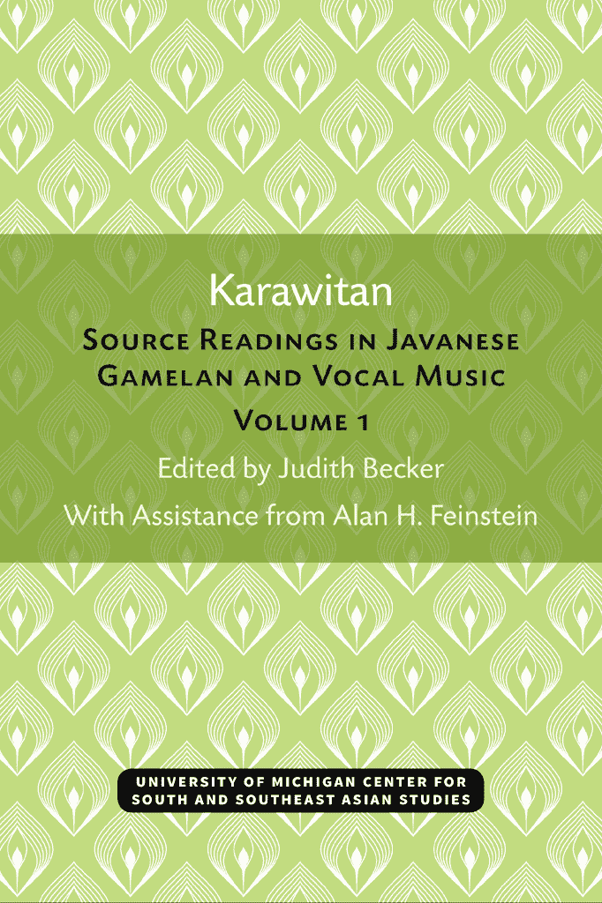

**由美国国家人文基金会/安德鲁·W·梅隆基金会人文开放图书计划资助的开放获取版本。**

- 美国国会目录编目号：`82-72445`
- ISBN：`0-89148-027-7`

本书的出版部分得益于国家人文基金会出版计划的资助。额外资金由：美国国家人文基金会（译文部分）；东南亚地区委员会，亚洲研究协会；密歇根大学拉卡汉姆研究生学院；密歇根大学音乐学院提供。

印于美国

- ISBN：`978-0-89148-027-3`（硬装版）
- ISBN：`978-0-472-03818-3`（平装版）
- ISBN：`978-0-472-12768-9`（电子书）
- ISBN：`978-0-472-90164-7`（开放获取版）

- `Wédha Pradangga Kawedhar`
- Benedictus Yusuf Harjamulya Sastrapustaka 著，R. Anderson Sutton 译
- 卡拉维塔理论与甘米兰演奏技巧简述
- Sulaiman Gitosaprodjo 编选，Judith Becker 译
- 甘米兰中的重要因素
- Ki Sindoesawarno 著，Stanley Hoffman 译
- 爪哇格律（`Gendhing Jawa`）
- Radèn Mas Kodrat Poerbapangrawit 著，Judith Becker 译
- 斯连卓调调式诗（`Serat Sulukan Sléndro`）
- Radèn Ngabèhi Samsudjin Probohardjono 著，Susan Pratt Walton 译

本作品共三卷。

**第一卷**

Martopangrawit、Sumarsam、Sastrapustaka、Gitosaprodjo、Sindoesawarno、Poerbapangrawit 和 Probohardjono 的文章与专著。

**第二卷**

Warsodiningrat、Sumarsam、Gitosaprodjo、Purbodiningrat、Poerbatjaraka、Sindoesawarno 和 Paku Buwana X 的文章与专著。

**第三卷**

- 附录 1：文中提到的术语词表和索引。
- 附录 2：文中提到的乐曲的爪哇记谱法（`titilaias kepatihan`）。
- 附录 3：作者书目。作者、译者、编辑和顾问提到的来源参考文献。

如需获取这些译文原版的信息，请致信：

南亚与东南亚研究中心
出版部
130 Lane Hall
密歇根大学
密歇根州安娜堡 48109
美国

## 前言

## Judith Becker

爪哇文明的最后一个千年是一个文学创作极其活跃的时期。在涵盖公元 900 年至 1900 年爪哇文学的卷三本注释目录中，Pigeaud 收录了数万条条目，将其分为四大类：宗教与伦理；历史与神话；优秀文学；以及最后的杂烩类——科学、艺术、人文、法律、民俗、习俗与杂记。许多文本以爪哇诗律编写，旨在供朗读、吟唱或唱诵，无论是自赏还是面向观众。虽然对音乐、甘米兰、舞蹈和歌曲的引用非常频繁，但专门讨论音乐历史或工艺的文本却很少见。关于音乐最著名的引用——来自 19 世纪的手稿 *Panji Semirang*、*Sastra Miruda*、*Pustaka Raja* 和 *Serat Centhini*——在第一卷和第二卷中进行了讨论（Poerbatjaraka, Warsodiningrat）。

“人类所言论的可查阅记录”往往不仅包含关注的文本本身。对言说方式、作者意图以及其写作所处的传统的进行讨论，有助于跨越遥远文本与读者之间的鸿沟（Becker, A. L. 1979:211-43）。这些作者并非都针对同一受众，也并非在同一时期写作，但在某一方面，他们是相似的：他们对文本的写作持有一种特定的态度，对学术本身持有一种预设。

这些文本在某种意义上并不是“原创”的，因为其作者提出的观点和见解并非独一无二或在传统思想中缺乏根源的。相反，这里呈现的是累积的智慧，即`karawitan`（甘兰音乐中人声与器器的结合）的学术方面，这些方面主要作为口头传统保存和传承，但也通过手稿进行。直到 20 世纪，爪哇岛一直属于一种文字传统，即手稿传统，它拥有自己独特的“认知模式”（noetics），即一套塑造、存储、检索和传输知识的系统（Ong 1977:96）。这些文本的许多作者引用了早期的手稿，许多提到了其他学者的教诲和著作，几乎所有人都在不同的时刻向他们接受甘兰音乐传统的祖先们致敬。

爪哇传统文本的作者通常是在重写之前的某部或多部文本。有时作者会引用其来源（参见本卷中的 Sulaiman Gitosaprodjo）；但更多时候他们并不提及。读者被认为会认同作者的学术假设。将归于 Paku Buwana X 的文本 `Noot Gendhing lan Tembang` 与 Warsodiningrat 著的 `Wedha Pradangga`（见第 2 卷）进行比较，凸显了手稿传统的延续性，也彰显了每位作者对前人手稿处理方式的独特性。这两位作者都遵循了名为 `candra sangkala` 的纪年术法的连贯性系统，并且都引用了前人文本 `Sastra Miruda`。但是，即使在一个原创性和独特性不被高度推崇的、且实践必须追溯过去的学术传统中，作者特定的思想和个性仍然不可避免地显现出来。连续三代师生——Warsodiningrat-Martopangrawit-Sumarsam（见第 1 和第 2 卷）之间对比性的解释和风格，再次指向了传统延续中个性的侧面。

### 爪哇-巴厘的文字传统

所有这些手稿的文学背景，即它们源自且且都表现出清晰渊源的传统，是爪哇-巴厘的文字传统，即 `lontar` 传统。“Lontars”是 19 世纪以前在爪哇制作的传统棕叶手稿，目前在巴厘仍在制作。追溯至千年前的文本通过反复“抄写”得以保存，这还包括编辑、借用、添加和重新排列。在对比“固定形式”印刷书籍的认知模式与巴厘岛的文字认知模式时，Zurbuchen 这样说道：

> . . . 从抄写者的角度来看，每一份新的 lontar 副本都像是一个新的“版本”，抄写者可能会根据自己的知识和经验进行修改、替换和删除。巴厘岛学者有时会查看某作品的多份手稿，并在创建新副本时进行“水平借用” . . .这种借用有时被批判性编辑称为“污染” . . . 它可以影响文本的所有层面，从拼写和词组划分到大段内容。在字印刷传统中，书籍是知识的标准容器；其中的语言实体在不同副本间必须完全一致、可索引、可引用，并在被引用时可参考。在巴厘 lontar 的情况下，元素可以多或少地自由地重塑、摘录、扩展、压缩以及其他改变。（Zurbuchen 1981:127）

尽管这里呈现的手稿具有字印刷传统的形式，但作者受其自身文学遗产（lontar 传统）的影响远大于西方学术传统，这种遗产具有拷贝者的视角。在 Probohardjono 著的 `Serat Sulukan Sléndro` 中，技术信息、宗教传说与仪式、语言学和历史的结合完全不是为了原创，而且正如作者所说，它是“为达兰师（dhalang）学生挑选的口头和书面知识”。它的来源是多个，作者是一位为了方便传承而汇信息的教师。他并不是信息的“作者”。

### 组织结构与分类

在这些文本中频繁出现并足以暗示一种关于 `karawitan` 的文化常规写作方式的组织手段是使用编号分类，每个分类后都跟着一段讨论。分类本身相当一致，通常包括以下内容：

1. `instruments/gamelan`
2. `laras`
3. `pathet`
4. `irama`
5. `gendhing`

这些分类的顺序和内容被自由地“重塑、摘录、扩展、压缩以及其他改变”（Zurbuchen 1981:127）。一些作者增加了其他类别，如 `ethos` 和 `notation`（Gitosaprodjo）、`developments`（Purbodiningrat）、`cèngkok` 和 `style`（Sindoesawarno 1955；见第 2 卷）、`instruments` 和 `garap`（Sindoesawarno 1955）或 `lagu`（Martopangrawit）。

这些文本的另一个共同特征，同时也与爪哇-巴厘 lontar 传统共同的特征，是围绕作者的各种专长领域进行组织，而不是一个抽象的主题。

> 在许多情况下，一份 lontar 看起来与其说是某部作品的完整复制，倒不如说是一个人的知识汇集或教科书。（Zurbuchen 1981:127）

这种凝聚方法在 Martopangrawit 手稿中尤为引人注目，它从 `gendèr` 者的视角提出了 `pathet` 和 `laras` 理论，而不是爪哇和西方理论常用的抽象。

除了这些文本与 lontar 传统共享的风格和组织惯例外，它们有时包含了相同的公式。作者的正式道歉和自谦被称为 `pangaksama`（源自梵语 `ksam`，意为“原谅、耐心”）将这些文本与古爪哇诗歌以及现代修辞风格联系起来。在 `kakawin` 传统中，pangaksama 是边界标记之一，可以出现在文本的开头或结尾。与这个 15 世纪 kakawin pangaksama 的实例相比，

```
我自己远不具备创作优美诗句的天赋，

因为我如此迟钝，

又怎能实现诗人所渴望的一切？

因此，我注定受到他人的极度嘲笑；

但我唯一的希望是，这能对我寻求真理有所帮助。
```

（Teeuw et al. 1969:69，译自第 1 章第 3 节）

Sindoesawarno 的道歉更接近 20 世纪学者的预期，

博学的读者会自由地增加、删减、修改和质疑，或完全抛弃这些理论并用新理论取代它们。（Ilmu Karawitan；* 见第 2 卷）

但个人谦虚和谦卑的精神在两者中是一致的。

在近现代史（约公元 1750-1875 年），苏卡塔（Surakarta）在统治者 Paku Buwana III-VII 和 Mangku Negara IV-V 的时期经历了一场文学复兴（Drewes 1973-1974:199-215）。19 世纪伟大文学人物的后裔仍居住在该市。考虑到印尼艺术学院（ASKI）坐落于苏卡塔，当代音乐文本大多创作于此，或许并不令人意外。这些文本中的两篇——`Noot Gendhing lan Tembang`和`Wédha Pradangga`（从苏卡塔宫廷视角描述的甘美兰传统与作品历史），重申了诗人 R. Ng. Ranggawarsita 所著的 19 世纪文本《Pustaka Raja》中的时间框架；在那部书中，他“填补”了从《摩诃婆罗多》（Mahābhārata，其英雄被认为是爪哇王室祖先）结束到公元 12 世纪东爪哇王国兴起的这段历史。每一个以`candra sangkala`（文字历）形式给出的日期，都提供了一个包含关键词和数字的故事，这些数字本身可以作为冥想的对象，并从中提取出对隐藏现实的洞解（Becker, J. 1980:231）。通过使用`candra sangkala`，这些作者唤起了爪哇历史的一个时期，当时神圣知识、文学和历史是通过私人学习和对 lontar 叶片的口头诵读传承的。

另一份深根于伊斯兰前爪哇的手稿是 Sastrapustaka 的`Wédha Pradangga Kawedhar`。甘美兰乐器前三个音键名称与身体部位的关联，暗示了密教关于微妙体的理论，以及位于头部、颈部和胸部的重要`cakra`（脉轮）点。将其余两个音键命名为与五感官和六识（`rasa`）相关的名称，也与爪哇早期的佛教传统有关（Campbell 1974:330-31; Zoetmulder 1974:180-81）。

大多数手稿是为了向学生交流而写的。Gitosaprodjo 的作品是他在 20 世纪 60 年代和 70 年代初为东爪哇马兰的学生所写的（当时处于录音带和电视出现之前，且远离中爪哇传统中心），也是为了那些（像许多西方甘美兰学生一样）无法直接接触苏卡塔和日惹加塔表演及学术传统的学生而写的。其他文本，如 Warsodiningrat 和 Martopangrawit 的文本，是为 KOKAR（印尼甘美兰学院，现为印尼甘美兰中专——SMKI）和 ASKI 的学生写的，这些是学习中爪哇音乐的中专和学院级机构，其学生通常非常有学识且是熟练的音乐家。Gitosaprodjo 传达了基础信息（源自他在 KOKAR 的老师），而 Martopangrawit 有时探索 karawitan（甘美兰音乐）中认知的边界。表现风格上最接近 20 世纪后期观众预期的手稿是 Sumarsam 所的`Inner Melody in Javanese Gamelan`，该书最初用英文写就。将此手稿的风格与归于 Paku Buwana X 的作品进行比较，可以阐明影响不同传统学术研究的不同假设。

顾问、翻译者和编辑对这些文本进行了两种基本的转化：翻译过程本身（参见 A. L. Becker 所写的第二卷“序言”）；以及将文本格式从手抄传统转变为印刷书籍传统的过程。作为编辑，我实施了拼写和分词的标准化，以及了一套原稿中不存在的大写系统。虽然这种标准化提供了清晰度并符合印刷书籍技术最严格的限制之一，但它也消除了某些使文本与特定时代联系并赋予其优雅感或古朴韵味的的特征。爪哇文字源自从南印度传播到整个东南亚的`Pallava`文字，没有分词。当把爪哇文字转录为罗马字母时，会增加分词。虽然这里的所有文本最初都是用罗马化的爪哇语或印尼语编写的，但地名、神话或历史人物、以及`gendhing`（曲）和`sekar`（歌）的名称没有官方的罗马化形式。不同的作者会选择不同的替代方案。例如，爪哇文字中的甘美曲`Gambir Sawit`看起来如下：


使用罗马字母的现代作家可能会选择以下任何替代方案：`Gambirsawit`、`Gambir-sawit`、`Gambir-Sawit`或`Gambir Sawit`。没有一种形式比另一种更“正确”，但它们在“古程度”上有所不同，即与爪哇文字的接近程度。

在我们的翻译中，词边界用空格标记，即使它们在原稿中没有标记或用连字符标记。这种选择的原因是帮助那些对梵文语、古爪哇语或现代爪哇语仅有少量了解的人解读`gendhing`名称、甘美兰名称和技术术语的组成部分。然而，通过`sandhi`（字母融合）连接的复合词不分，例如`lokananta`（由`loka`加`ananta`，或`loka`加`nata`组成）；通过同位变音鼻辅音连接的复合词也不分，例如`asmarandana`（由`asmara`加`dana`组成）。连字符仅为重叠词（如`abon-abon`）以及互补词对（complementary pairs）保留（如`padhang-ulihan`）。

从爪哇文字的转录还涉及拼写选择。传统爪哇贵族的开放式、方形、柱廊大厅可能拼写为`pendapa`、`penḍapa`、`pendhapa`、`pendopo`、`penḍopo`或`pendhopo`，取决于软腭化的`d`是否由`dh`、`ḍ`标记或完全不标记，以及声音(aw)是用 o 还是 a 拼写。另一种变化可能出现在单词的爪哇语或印尼语拼写的使用上，例如使用`panerus`而非`penerus,`，这表明了对对象的敬畏，或对爪哇语拼写的偏好——这通常是作者年龄或文本写作时间的线索。例如，那些始终使用`badhaya,`而非`bedhaya,`的作家传达了一种古老感。（文中消除了`beḍaya, bedaya, bedhoyo, beḍoyo,`和`bedoyo`这些变体。）

我们保留了一些变体，某些情况下是因为两者都很常见，另一些则是因为拼写差异可能部分决定其含义。对于大多数未翻译的技术术语，以及地名的拼写，我们消除了一种以外的所有变化。这里遵循的拼写规范符合印尼政府 1972 年拼写改革的决定以及爪哇语报的非正式拼写标准。以前写为`ḍ`的声音现在是`dh,`（软腭化的 d）；`ṭ`现在是`th`（软腭化的 t）；`oe`现在是`u`；`dj`现在是`j`（如 judge）；`tj`现在是`c`（如 church）；而声音以前写作 o、å或 a，现在写作 a。这一政策的例外是那些没有将其姓名拼写现代化的作者，例如“Gitosaprodjo”而非“Gitasapraja”；或者在图书馆目录中以旧拼写出现的已故作者，例如“Poerbatjaraka”而非“Purbacaraka”。在罗马化的爪哇语中，字母 e 代表两个音素。未标记的 e 读作标记的 e 代表两个变体：é是[e]，而é是。我们使用变音符号的指南是 Pigeaud 的爪哇语荷兰语字典（1938）。

关于大写的政策是试图向那些对这些术语尚陌生的读者标明它们特异性或普遍性的程度。例如，当提到某一类甘美兰（gamelan）乐时，使用小写字母，例如“gamelan kodhok ngorèk”。当指的是一组特定的乐器时，使用首字母大写的单词和斜体，例如“Gamelan Guntur Sari”。有时，一系列通用的类别术语会出现在特定名称之前，在这种情况下，只有特定名称大写，例如“sekar”（歌）、“macapat”（韵律-旋律类别）、“dhandhang gula”（更具体的节拍-旋律）和“Lik Suling”（歌名）。`ayak-ayakan`、`srepegan` 和 `sampak` 术语出现了一个特殊问题，它们既被用作通用类别的术语，也作为特定的曲目。通常从上下文中可以清楚地看出哪种含义，我们通过小写或大写字母表示了我们的判断，例如“gendhing ayak-ayakan, srepegan 和 sampak 用于 wayang（皮影戏）的伴奏。 .，”或“Srepegan, sléndro pathet nem 用于 wayang 演出的第一部分。”有人可能会认为即使是“Srepegan, sléndro pathet nem”代表的一个类别而非特定的曲目，但只有从抽象的概述来看（即观察“Srepegan, sléndro pathet nem”的所有变体）才是如此。每位作者在谈论“Srepegan, sléndro pathet nem”时，心里通常都有特定的 srepegan。


印尼语和爪哇语中的许多术语可能没有单数或复数标记。我们决定不添加英语复数标记 `s`，而是保留该词的原始形式同时作为单数和复数形式，例如，“在 kraton（皇宫）发现的许多 gamelan. . . .”以及“一个 gamelan 可能由多达三十件乐器组成”。

括号内的任何术语、短语或句子都是翻译者为了说明而添加的，不是原稿的一部分。包含在括号内的术语、短语或句子是原稿的一部分。如果括号中的单词是英语，作者在括号内括了等值的段落或单词。如果括号中的单词是印尼语或爪哇语，翻译者在英语翻译之后立即添加了原始段落；当段落含义模糊或单词有多种含义时，为了那些能读原文的人，添加了原始内容。

为了读者的方便，文中出现的爪哇语密码标记已经标准化。除非另有说明，`G` = 同时击 gong 和 kenong，`N` = kenong，`t` = kethuk。循环单位被括在括号内。

这些材料的翻译和出版准备是一项合作工作，多位个人参与了每一篇文本——翻译者、编辑、至少两位顾问，有时还有作者本人。通常，这些人中的一个或几个人会以脚注的形式提供重要的阐释性评论。因此，在份手稿中，脚注的来源可能有四个或更多处。

我们的助理编辑 Alan Feinstein  own 我们的顾问 A. L. Becker、Sumarsam 和 Hardja Susilo 所起的重要作用，通过查看目录是看不出来的。是 Sumarsam 或 Hardja Susilo 逐行检查了每处翻译，并对照原文进行了核对。Alan Feinstein 则费力地对照每处翻译核对了原文。结果，每份手稿中的段落都经过了重写。A. L. Becker 在这些文本准备的每个阶段提供了决策、指导、建议、警告和鼓励。没有这些优秀学者的努力和耐心，我们对所产生的工作将信心少得多。

Janet Opdyke 作为南亚和东南亚研究中心的出版编辑，将她卓越的编辑才华应用于这些手稿，将学者们凌乱的努力转化为了专业格式的卷册。R. Anderson Sutton 和 Susan Pratt Walton 在这些卷册若干章节的最终编辑中无私地贡献了他们的专业知识。感谢 René Lysloff、Carole Moody 和 Dwight Thomas 对手稿最终版本的打字排版。我们还感谢 Martha King 为我们准备了需要她高超艺术技巧的绘画和图表。

在十年的翻译工作期间，我们获得了来自各种来源的资助。美国人文基金会（National Endowment for the Humanities）是主要的支持来源，为该项目授予了研究材料翻译资助（1979），并为南亚和东南亚研究中心提供了出版补贴（1982-1985）。我们还收到了亚洲研究协会东南亚地区委员会（1976）和密歇根大学拉科汉姆研究生学院（1974, 1975, 1983-1984）的贡献。最后，密歇根大学音乐学院慷慨地提供了额外支持。

# CATATAN-CATATAN PENGETAHUAN KARAWITAN

## 关于甘美兰音乐知识的注释

### 第一卷

Radèn Lurah Martopangrawit

Martin F. Hatch 从印尼语译译

Surakarta: Akademi Seni Karawitan Indonesia and Pusat Kesenian Jawa Tengah, 1972

[第二版，1975]

# 引言

[选自 1972 年版]

此时，印尼艺术学院（Akademi Seni Karawitan Indonesia [A.S.K.I., “印尼表演学院”]）成功出版了这份关于 `karawitan` 的手稿。学生会会感到非常幸运，能够出版这份由 R[adèn] L[urah] Martopangrawit 撰写的手稿。这本书对于我们 A.S.K.I. 的价值是无法估量的。此外，学生会希望由于这本书能够接触更广泛的读者，将增加对 karawitan 的理解和兴趣。

学生会对我们的导师 R. Martopangrawit 许可出版此书深表谢意。我们也感谢中爪爪哇艺术中心（Pusat Kesenian Jawa Tengah）的 S. D. Humardani 博士，他提供了充分配合。

Surakarta，1972 年 1 月

学生会

Akadem Seni Karawitan Indonesia

### 译者注

[针对爪哇语原文]

本书的编者（Martopangrawit）希望此处提供的信息能被广泛读者看到。原稿题为 `Budel`（“遗产”），是用爪哇语写的。在我们看来，通过翻译成印尼语，他的目标将更好地实现。这次翻译是自由的，但没有改变原文的原意或内容。只有少数与爪哇音乐密切相关的爪哇语术语（例如 `garap`、`kalajengaken`、`minggah` 等）未翻译，某些术语在脚注中进行了解释。

## 作者前言

[选自 1972 年和 1975 年版]

我在第七次 `tumbuk`[每八年生日发生一次]的当天开始了这项工作，即按照爪哇历我的五十六岁生日。根据父母留给我的记录，我出生于爪哇历 1845 年 Jimawal 年 Mul 月三日 Rabu Wagé，即公元 1914 年 4 月 4 日。爪哇人的习惯是根据经济能力，在 `tumbuk` 日子邀请亲友举办 `slametan`[“仪式性庆祝”]。

在我的第七次 `tumbuk`，我无法聚集任何 `slametan` 的仪式要求：“ora ana sarat-saraté”（“我负担不起”）。尽管如此，我仍然希望通过这种方式对这次无法举办的庆祝活动的一种纪念。因此，有了这本书。

在爪哇语音乐界中，我是一名表演者（“执行者”，即音乐家）。因此，我的分析反映了作为表演者的观点。

希望这本书能对大家有所帮助，特别是对年轻一代的爪哇音乐家。

苏罗卡塔，1901 年 Mulud 月 4 日

1969 年 5 月 21 日

Martopangrawit

# [KARAWITAN 知识笔记]

## Gendhing（格律）系统

在我的序言中，我提到过这本书将基于[音乐]实践。因此，让读者了解一些 `garap` [‘表演实践’] 的来来脉并无大碍，只需介绍少数几个，以便他们更好地理解本书的含义。读者必须首先了解 `gendhing` 的系统。

## Karawitan（爪哇音乐艺术）

什么是“karawitan”？实际上，“karawitan”的含义非常宽泛，但在这里我们将使用其与 `gendhing` 系统相关的特定含义。Karawitan 是使用 `sléndro` 和 `pélog` 定音系统产生声音的艺术。任何使用 `sléndro` 或 `pélog` 的人声或器乐（即甘兰）音乐都可以被称为“karawitan”。然而，由于我们讨论的是 `gendhing` 系统，我们对该术语的使用将限于甘兰音乐，即 `gendhing`。

## Karawitan 的内容

Karawitan 有两个基本元素：`irama`（节奏/律）和 `lagu`（旋律）。

### 1. Irama（节奏）

与“karawitan”一词一样，“irama”也有宽泛的含义。但在 `gendhing` 中，我们可以缩小其定义。“Irama” 是 `gatra`（节拍）的相对宽度。为了清楚这一点，我们提供了下图；从图中可以看到在相对于 `gendhing` 的特殊语境下，“irama”的含义含义。Irama 也可以被理解为填充 `gatra` 的层次——从每个 `gatra` 包含四个点开始，每个点代表 `balungan`（骨干音）的一个脉冲 [`slag`，源自荷兰语；“节拍”、“脉动”]，并按倍数增加，直到一个 `balungan` 脉冲可以被十六个点填满。这就是 `gendhing` 中 “irama” 的含义。

图 1。Irama 示意图

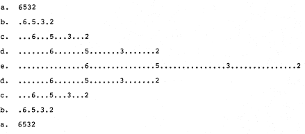

从上述 `irama` 图可以看出，在一种 `balungan` 排列中，`balungan` 脉冲之间的相对距离取决于填充该空间点数。谁负责占据 `balungan` 脉冲之间的空间？这些空间将由旋律乐器的演奏来填充——即通过 `gendèr`、`gambang`、`bonang` 等的 `cèngkok`（装饰音）。在所有演奏 `cèngkok` 的人手中，音符落在每个单独点上的乐器是 `saron panerus`。因此，我们可以利用 `saron panerus` 作为 `irama` 差异的指标。

我们现在必须谈谈 `saron panerus` 的速度。这种速度无法通过科学方法测量，因为在 karawitan 中，速度取决于设定 `irama` 的演奏者（`pamurba irama`）[‘节奏主管’]，即 `kendhang`（鼓）演奏者。由于每个演奏者都有自己独立的速度感，而且由于 `gendhing` 的用途可能不同（例如，用于配合 `wagang kulit` [皮影戏]，其速度通常比音乐会音乐 `[klenengan]` 快），因此 karawitan 中的速度是可变的。

尽管如此，人们仍然可以在 karawitan 中区分出三种基本速度：

1. `tamban` [‘慢’]

2. `sedheng` [‘中速’]

3. `seseg` [‘快’]

karawitan 中的速度被称为“laya”，而不是“irama”。

回到 `saron panerus` 的速度问题，每个脉冲持续大约半秒钟。

我们已经提到了“laya”和“irama”这两个术语。但在日常口语中，永远听不到“laya”这个词；总是使用“irama”。尽管如此，所有的大师级音乐家都自动知道“irama”一词在[不同用法下]的含义。例如，句子“Iramané ketambanen” [‘节奏调太慢了’] 显然指的是 laya，而不是 irama。但在句子“Mengko iramané lancar waé” [‘稍后我们将使用 lancar 节奏’] 中，指的是真正意义上的 irama，而不是 laya。

共有五种 `irama`，每种都有独立的名称。图 1 中的第 (a) 行被称为“irama lancar”。在这一层，`saron panerus` 无法填充 `balungan` 脉冲之间的变化，而是演奏与 `balungan` 旋律相同数量的脉冲[由其他 saron 器携带]。在这种情况下，我使用符号 `1/1` 来表示一个 `balungan` [脉冲]对应一个 `saron panerus` [击节]。第 (b) 行被称为“irama tanggung”，符号为 `1/2` [即一个 `balungan` 脉冲对应两个 `saron panerus` 击节]。第 (c) 行被称为“irama dados”，符号为 `1/4`。第 (d) 行被称为“irama wilet”，符号为 `1/8`。第 (e) 行被称为“irama wilet”，符号为 `1/16`。

### 2. Lagu（旋律）

关于 `lagu`，我们将限制在 `gendhing`。

## Karawitan 的名称与功能

| A. 与 irama 相关的乐器 | 与 lagu 相关的乐器 |

| :--- | :--- |

| 1. kendhang | 1. rebab |

| 2. kendhang | 2. gendèr gedhé |

| 3. kenong | 3. bonang gedhé |

| 4. kenong | 4. gambang |

| 5. kemul | 5. celempung, gendèr panerus, bonang panerus |

| 6. kemul | 6. slenthem, demung, saron barung |

| 7. keth | 7. saron panerus |

| 8. keth | |

| 9. keth | |

| 10. keth | |

| 11. keth | |

| 12. keth | |

| B. irama 相关乐器的对应功能 |

| :--- |

| 1. kendhang (`pamurba irama`): 决定 `gendhing` 的形式，设定 laya (速度)。 |

| 2. kethuk: 强化 `kendhang`，决定 `irama` 层级。 |

| 3. kenong: 根据 `gendhing` 的形式决定 `gatra` 的边界。 |

| 4. kemul: 同 3。 |

| 5. gong: 强化 `kendhang`，作为 pada（段落结束）并标记终调。 |

| C. lagu 相关乐器的对应功能 |

| :--- |

| 1. rebab: 决定 `lagu`，演奏 `gendhing rebab` 的 `buka`。 |

| 2. gendèr gedhé: 用所有的 `cengkok` 美化 `lagu`，演奏 `gendhing gendèr` 的 `buka`，以及 `bonang gedhé` 无法做到时 `gendhing lancaran` 的 `buka`。 |

| 3. bonang gedhé: 用所有的 `cengkok` 美化 `lagu`，演奏 `gendhing bonang` 的 `buka`，以及 `gendhing lancaran` 的 `buka`。 |

| 4. gambang: 用所有的 `cengkok` 美化 `lagu`，演奏 `gendhing gambang` 的 `buka`。 |

| 5. celempung, gendèr panerus, bonang panerus: 装饰 `lagu`。 |

| 6. slenthem, demung, saron barung: 演奏 `lagu` 的框架，称为“balungan”。 |

| 7. saron panerus: 提供脉冲，可作为各种 `irama` 层级的指南。 |

说明。我们将暂停讨论，回到本节中使用过的新术语。

### a. `Cèngkok`。在 gendhing 中，词汇“cèngkok”有两个完全不同的含义：(1) “演奏风格”或“处理方式”（`garap`）；或(2) 一个 gendhing 中 `gongan`（拍）的数量。作为演奏风格的意义，`Cèngkok` 是一种永恒的、不变的旋律，无论是声乐还是器乐都是。例如，`cèngkok` “ayu kuning”（“美丽的黄姑娘”）始终具有以下旋律：


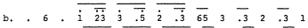

A - yu  ku-ning   béntrok  ma-ya  ma-ya

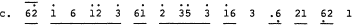

A - yu  ku-ning  béntrok  ma-ya  ma- ya

很清楚，上面的示例具有相同的基调（motif），被称为“ayu kuning”。但填充基调的方法是不同的。这些填充方式和类型上的差异被称为 `wiletan`。因此，上述旋律在 `cèngkok` 上是相同的，但在 `wiletan` 上是不同的。

“cèngkok”一词也可以指代一个 gendhing 中 `gongan` 的总数。通常这种用法仅适用于 `lancaran` 及以上形式的 gendhing。因此，`ayak-ayakan`、`srepegan`、`sampak` 等并不包含在内。此外，“cèngkok”一词在在这种语境下仅指代 gendhing 的一个部分（以区分 `mérong` 和 `inggah` 部分）。当一个 gendhing 既有一个一个 `gongan` 的 `merong` 部分，又有一个一个 `gongan` 的 `inggah` 部分时，人们不会说它有两个 `cèngkok`，而是会说 `mérong` 部分有一个 `cèngkok`，`inggah` 部分有一个 `cengkok`。关于“cèngkok”这个术语就说到这里。

现在我们考虑另一个问题。在讨论了乐器的功能（包括旋律和节奏）之后，可能会对“主管”（`pamurba`）和“维持者”（`pamangku`）这两个术语产生一些疑问。

### b. `Pamurba`。理解“主管”这个词很容易，但它与 karawitan 有什么联系？主管是拥有决策权的人；他也可以被称为领导。因此，`irama` 的主管（`pamurba irama`）是有权设定 `irama` 的演奏者。`lagu` 的主管也是如此。`rebab`——即 `rebab` 演奏者——拥有决策权，也可以被称为领导。`rebab` 演奏者决定了旋律的走向。

所有与 `irama` 相关的决策，如加速、减速以及从一种 `irama` 变为另一种 `irama`，都在 `kendhang` 演奏者的绝对领导下。至于选择 `gendhing`、选择以 `sléndro` 还是 `pélog` 调式演奏，或者决定是否移动到高音区（`ngelik`），则由 `rebab` 演奏者负责。

### c. `Pamangku`。维持乐器是那些执行任务以使主管的想法得以实现的乐器。例如，`irama` 的主管可能希望从一种 `irama` 级别变为另一种，而维持 `irama` 的乐器——就像士兵一样——不能偏离。它们不应该设定自己的速度，因为不仅它们的努力将化诸东流，而且还会破坏 `gendhing` 的流动。`lagu` 的支持者也是如此。如果 `lagu` 主管决定在例如 Ladrang *Moncèr* 的 `buka`（开头）确定 `gendhing`，但在击锣之后 `gendèr` 演奏者继续演奏 Ladrang *Wilujeng*——从而违背了 `lagu` 主管——结果将是 `gendhing` 的崩溃。这里也有必要注意，如果没有 `rebab`，`bonang gedhé` 或 `gendèr barung` 将取代 `rebab` 担任 `lagu` 主管。

## Irama 对 Lagu 和 Cènkok 的影响


现在我们最好回到`gendhing`系统。在这里我们将讨论`irama`对`lagu`和`cèngkok`的影响，因为`irama`有时会迫使`lagu`本身发生变化并限制`cèngkok`。这发生在`irama`级别被加速时——例如从一个`irama`级别过渡到另一个时。`irama`的变化可以引起许多（尽管不是所有）`gendhing`中`lagu`的变化。例如，在Ladrang *Pangkur* gendhing中：

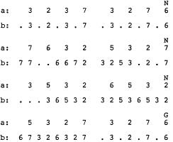

注：`a` = `irama` 1/1, 1/2, 1/4；`b` = `irama` 1/8, 1/16。

在这里可以清楚地看到，`irama`的变化可以同时影响`lagu`和`cèngkok`。

## Irama 对 Lagu 的影响

尽管`irama`对`lagu`的影响很强，但某些`lagu`是不固定的。`irama`有时会迫使`lagu`本身发生变化。`cèngkok`受到限制。这发生在`irama`级别被加速时——例如从一个`irama`级别过渡到另一个时。`irama`的变化可以引起许多（尽管不是所有）`gendhing`中`lagu`的变化。

## Gendhing

我们上面提到，当`lagu`组织成一种形式时，它被称为“gendhing”。但在karawitan中，“gendhing”一词仅用于特定的结构。

## Gendhing 的名称

### 1. Sampak

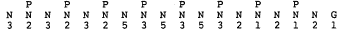

`sampak`的`irama`总是1/1。在指示`irama`的乐器中，只有`kempyang`不使用。使用的`gong`是`gong suukan`。

### 2. Srepegan

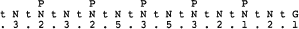

`srepegan`的结构与`sampak`相似。

### 3. Ayak-ayakan

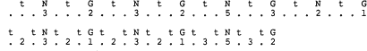

`ayak-ayakan`的初始`irama`是`gropak` (2/1)，随后是1/1，最后是1/2。指示`irama`的乐器中没有使用`kempyang`。`ayak-ayakan`有许多特点，包括：

- 除了最后的锣外，不使用`gong gedhé`。
- 在`sléndro` nem和sanga中，所有的非最终锣由`kempul`代替。
- 在`irama lancar`中，`kethuk`每个`kenong`响一次，但在`irama tanggung`中，每个`kenong`响两次。
- `Irama tanggung`是`ayak-ayakan`的基础`irama`；然而，`irama`也可以变为`dados`。对于某些`wayang`场景——特别是nem中的*babak unjal*（第一场观众的到来）和sanga中的*alas-alasan*（英雄在森林的场景）——全程使用`irama lancar`。

### 4. Kemuda

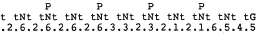

这种形式与`sampak`相同（只要每个`kempul`拍有两个`kenong`拍的话）；唯一的区别是它可以很容易地在`irama lancar`或`irama tanggung`中呈现。在`wayang gedhog`中，`irama lancar`中的`kemuda`作为`srepegan`的替代品，而在`irama tanggung`中它用于替代`ayak-ayakan`。

### 5. Lancaran

a. `balungan nibani`: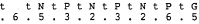

b. `balungan mlaku`: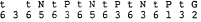

在指示`irama`的乐器中，只有`kempyang`不用于`lancaran`。使用的是`gong`。每个`gongan`有固定数量的`balungan`脉冲。

### 6. Ketawang

“ketawang”一术实际上指的是每个`gongan`都由两个`kenongan`组成的形式（因此，第二个`kenong`与`gong`同时出现）。在甘兰音乐（karawitan）中，“ketawang”一词有两种用法：(a) `gendhing kethuk kalih` [2] 以及更长的形式，每个`gongan`包含两个`kenongan`，被称为“ketawang gendhing”；(b) 使用`kempul`的`ketawang`直接称为“ketawang”。例如：(a) `Ketawang Gendhing Karawitan`, kethuk 4 kerep, laras sléndro pathet nem；(b) `Ketawang Puspa Warna`, laras sléndro pathet manyura。

### 7. Ladrang

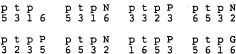

所有指示节奏（`irama`）的乐器都使用了。每个`gongan`都有固定数量的`kenongan`（即四个）。

### 8. Mér

#### a. `mérong kethuk 2` [i.e., kalih/loro] kerep

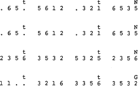

这种形式下既不用`kempyang`也不用`kempul`。这里的`kethuk kalih [2] kerep`表示每个`kenongan`由两个`kethuk`击节组成。“Kerep”【‘频繁’】意味着第一个`kethuk`击节和第二个靠得很（中间间隔8个`balungan`脉冲），这与“kethuk arang”【‘稀疏’】不同，后者`kethuk`击节之间有16个`balungan`脉冲（见下方示例）。

#### b. `mérong kethuk 4` [i.e., sekavan/papat] kerep

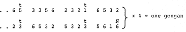

参见上述 (a) 的解释。

#### c. `mérong kethuk 8` [i.e., wolu] kerep

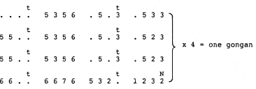

参见上述 (a) 的解释；注意没有“kethuk 8 arang”这种形式。

#### d. `mérong kethuk 2` [i.e., kalih/loro] arang

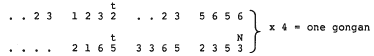

#### e. `mérong kethuk 4` [i.e., sekawan/papat] arang

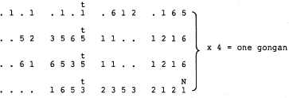

### 9. Inggah

#### a. `inggah kethuk 2` [i.e., kalih/loro]

这种形式与`ladrang`形式相同。因此，某些`ladrang`可以充当`inggah`，尽管许多也可以独立存在。作为`inggah`功能的`ladrang`——例如`Ladrang Tlutur`, sléndro pathet sanga、`Ladrang Bang-bang Wétan`, [sléndro pathet manyura,]、`Ladrang Kawit`, [sléndro pathet manyura,,] 以及其他——是在在没有前面的`mérong`的情况下无法表演的`ladrang`。此外，尽管有些`ladrang`可以独立演奏，但如果它们在`mérong`之后演奏，则被视为`inggah`。

#### b. `inggah kethuk 4` [i.e., sekawan/papat]


#### c. `inggah kethuk 8` [i.e., wolu]

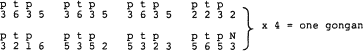

#### d. `inggah 16` [i.e., nem welas]

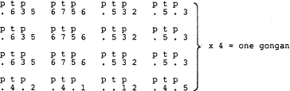

**解释。** 在`inggah`形式的表演中，节奏指示组的所有乐器都会被演奏；但在`inggah kethuk 4`、8和16中，不演奏`kempul`。

### 10. 特殊形式

可以预料，在有规则（*pathokan*）的地方，必然会有这些规则的例外（即不规则之处）。爪哇`gendhing`也是如此。例如，在`mérong`形式中，一个`gongan`应该有四个`kenong`，但存在一个`gongan`有五个`kenong`的情况。同样，在一个`kenongan`中可能会有三个`kethuk`击节（而不是通常的两个或四个）。这些例外被称为*pamijèn*【‘不规则’】。

## Gendhing 中出现的结构（Komposisi）

| 1. buka | 9. suwukan |
| :--- | :--- |
| 2. mérongs | 10. dados |
| 3. ngelik | 11. dhawah |
| 4. umpak | 12. kalajengaken |
| 5. umpak inggah | 13. kaseling |
| 6. umpak-umpakan | |
| 7. inggah | |
| 8. sesegan | |

### 1. Buka

*Buka*【字面意思是“开启”】是一种用作引子或作为`gendhing`“开场”的旋律。`buka`仅由一种乐器演奏。有些`buka`由歌手演唱；这些被称为*buka celuk*。

`buka`示例：

a. `buka bonang`

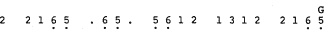

b. `buka rebab` [Ketawang *Pala,* sléndro pathet manyura] 

c. `buka gendha` [Ladrang *Mon,* sléndro pathet manyura] 

d. `buka gambang` [Ketawang *Undur,* sléndro pathet manyura] 

e. `buka kendhang` [Gendhing *Pisan*] 

f. `buka celuk` [Ketawang *Langen Sri,* sléndro pathet manyura] 

**解释。** 在`inggah`形式的表演中，节奏指示组的所有乐器都会被演奏；但在`inggah kethuk 4`、8和16中，不演奏`kempul`。

### 2. Mérong

*Mérong*是`gendhing`的部分，提供了精炼的机会。此外，`mérong`不能独立存在；它必须后面跟着`inggah`。

### 3. Ngelik

*Ngelik*是`gendhing`的一部分，并非必需的；如果有必要，由于时间不足或其他原因，可以省略`ngelik`。

### 4. Umpak

`Umpak`是作品中作为从`mérong`过渡到`inggah`部分的桥接章节。

### 5. Umpak inggah

这种结构与上述第4点解释相似。主要区别在于`umpak inggah`是由节奏主管`(pamurba irama)`信号引导，而由曲调主管`(pamurba lagu)`信号引导向`umpak`的转换。`umpak`和`umpak inggah`均具有`mérong`的`[gong 结构]`特征。并非所有的`gendhing`都有`umpak inggah`部分。为了阐明这些点，下面将给出示例。

### 6. Umpak-umpakan

`Umpak-umpakan` [是一种`umpak`] 并且没有`mérong`的那种[即，gong 结构]形式，而是`inggah`的形式，被用作通往`inggah`主部分的过渡段落。

### 7. Inggah

`Inggah`是 [gendhing] 的一个部分，用于阐述、装饰和变化。因此，`inggah`通常具有活泼的特征。`Inggah`（或“minggah” [根词“inggah”的动词形式]）是`mérong`的延续，尽管某些`inggah`可以独立演奏，即它们不需要跟在`mérong`部分之后。

`minggah`有两种类型：(a) `minggah kendhang`和 (b) `minggah gendhing`。

在`minggah kendhang`中，只有`kendhang`演奏特定于`minggah`的部分，而演奏的旋律仍然是前一个`mérong`部分的核心歌曲（kernel lagu）。唯一的区别在于，`mérong`处于`balungan mlaku`风格，而`minggah`处于`balungan nibani`风格。`mérong`使用简单且平静的`cèngkok`，而`minggah`使用多变或活泼的`cèngkok`。由于`mérong`和`inggah`特格上的这些差异，我们有时无法识别出歌曲的动机是相同的，特别是当`irama`发生变化时。[`minggah kendhang`的旋律] 通常完全源于`mérong`的旋律。但也有一些情况，`minggah kendhang`的旋律是逐句（gatra by gatra）提取其动机的，或者，从更大的旋律乐句`(kalimat lagu)`中提取。

在`minggah gendhing`中，旋律并非源自前一个`mérong`的歌曲，可能是`balungan mlaku`或`balungan nibani`风格。带有`minggah ladrangan` [即在`ladrang`形式中] 的`gendhing`可以使用`minggah kendhang`或`minggah gendhing`。

### 示例

示例旨在澄清上述解释；此外，对于对创作`gendhing`感兴趣的人，这些示例将提供比较的基础。

a. Gendhing `Gliyung`，kethuk 2 kerep，laras sléndro pathet manyura。这个`gendhing`的`inggah`100%是`minggah kendhang`。`inggah`歌曲的衍生源于`mérong`的每一个`gatra`。

```
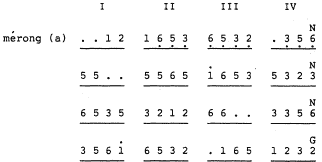
```

```
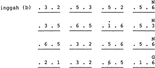
```

b. Ketawang Gendhing `Kawit`，kethuk 2 kerep，minggah ladrang，laras sléndro pathet nem。这个`gendhing`的`inggah`也是100%的`minggah kendhang`。`inggah`歌曲对`mérong`歌曲的衍生是基于旋律乐句的[即，不是逐句]。

```
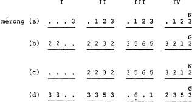
```

```
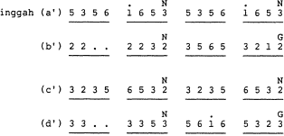
```

这里没有必要提供`minggah gendhing`的示例，因为这种形式下`mérong`的歌曲和`inggah`的歌曲之间没有相似之处。

下面是一个混合组成的`inggah`示例——部分是基于旋律乐句的`minggah kendhang`，部分是`minggah gendhing`。示例是Gendhing `Onang-onang`，kethuk 2 kerep，laras sléndro pathet sanga：

```
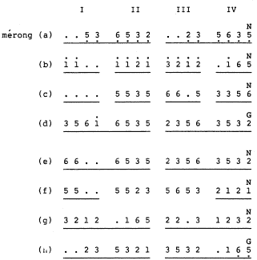
```

```
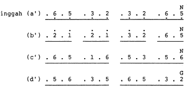
```

```
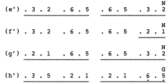
```

`inggah`的大部分是`minggah kendhang`并源于`mérong`的歌曲，基于旋律乐句[即，不是`gatra`]。但，让我们更仔细地观察：

1. 行 (a’) 基于每个旋律乐句。
2. 行 (b’) 基于每个`gatra`。
3. 行 (c’) 基于两个旋律乐句。
4. 行 (f’) 是`minggah gendhing`，最后一个`gatra`除外。因此，根据上述解释，认为`minggah kendhang`的含义是一个不使用`kendhang ciblon`的`inggah`部分普遍观点是错误的。

关于`inggah`还有其他需要注意的事：

1. 有些`mérong`没有`inggah`，因此必须借用其他`gendhing`的`inggah`部分。
2. 有些`mérong`有多个[备选] `inggah`部分。
3. 还有些`inggah`关联有多个[备选] `mérong`。

**解释。** 利用借用`inggah`的`mérong`实际上有自己的`inggah`——无论是`minggah kendhang`或`minggah gendhing`。但由于某种原因，那个`inggah`没有被使用。我们以Gendhing `Laler Mengeng`，kethuk 2 kerep，laras sléndro pathet sanga为例，这个`gendhing`实际上有自己的`inggah kendhang`，但那个`inggah`没有被使用。相反，表演者倾向于借用Gendhing `Tlutur`的`inggah`，它是`ladrang`形式，称为Ladrang `Tlutur`。原因是让`Laler Mengeng`使用`inggah kendhang`意味着打破了关于`inggah`的规则。该规则如下表所示：

| mérong | inggah |
| :--- | :--- |
| kethuk 2 kerep/arang | ladrang/kethuk 4 |
| kethuk 4 kerep/arang | ladrang/kethuk 8 |
| kethuk 8 kerep/arang | kethuk 16 |

那么，为什么`Laler Mengeng`从不使用自己的`inggah`呢？


还有另一种 gendhing——Ketawang Gendhing `Randhat`，kethuk 2 kerep，laras sléndro pathet nem——它总是从不同的 gendhing 借用 inggah，但不是因为上面的规则。`Randhat` 实际上有自己的 inggah，Ladrang `Randhat`。但这种 ladrang 从未被使用；使用的是 `Kandha Manyura`。今日如此。事实上，使用 `Kandha Manyura` 的“最终”仅仅是一个 inggah 部分。如果两个 ladrang 用 `sindèn` 演奏[但没有 gong]，它们之间的相似性是显而易见的——只要音乐家足够熟练。但如果 Ladrang `Randhat` 从未被表演，将是一种遗憾。（因为它源自 mérong。）这现在已成为常见做法。让此作为我们对借用 inggah 的解释即可。

我们不需要对有多个 inggah 的 mérong 进行详细说明。我们只需给出几个示例名称：Gendhing `Gambir Sawit`，在 laras pélog pathet nem 可以 `Pacar Cina`、`Jangga Lana` 或它自己的 inggah。在 laras sléndro 中，`Gambir Sawit` 可以使用自己的 inggah [kethuk 4] 或 `Sembung Gilang`（即，不是该名的 lancaran）。

至于有多个 mérong 的 inggah，给出一些示例即可——例如 `Randha Maya` 或 `Èsèk-èsèk`。`Randha Maya` 作为 Gendhing `Lungkeh` 或 Gendhing `Mongkok Dhelik` 的 inggah，两者都是 laras sléndro pathet nem 且都是 kethuk 4 arang。`Èsèk-èsèk` 可以作为几个 gendhing 的 inggah，例如 Gendhing `Rembun`、Gendhing `Banthèng Warèng` 或 Gendhing `Pucung`，这些都是 laras sléndro [pathet manyura]。它也可以在 laras pélog pathet nem 中作为 Gendhing `Méga Mendhung` 或 Gendhing `Kinanthi` 的 inggah 进行演奏。

也有可以独立的 inggah——例如 `Kinanthi`，laras sléndro pathet manyura，kethuk 4，它由 buka celuk “Padhang bulan. ...”引导。此外，Gendhing `Sinom` 的 inggah 也可以独立存在，由 sekar ageng `Kusumastuti` 引导。

### 8. Sesegan

`sesegan` 一术语应与 `seseg` 术语区分来。`Seseg` 与 laya [节奏]有关，而 `sesegan` 可以归类为 `gendhing` 中的一种结构元素。乐曲的这部分特别用于加速速度的情况。在 `sesegan` 作为“加速速度”的一般意义上，所有的 `gendhing` 都可以认为具有 `sesegan`。具有 `sesegan` [在特定意义下，指仅在速度加快时使用的独立旋律] 的 `gendhing` 包括：`Gendhing` `Bremara`、`Gendhing` `Jalaga`、`Gendhing` `Gobed`、Ladrang `Playon` [均采用 laras pélog pathet lima 调]以及 laras sléndro 的各种 gendhing bonang。

#### 9. Suwukan

“Suwukan”应与 `suwuk` 区分来。`suwuk` 指 `gendhing` 的结束，而 `suwukan` 是 `gendhing` 的结构元素之一，即 `gendhing` 在即将结束时使用的部分。并非所有的 `gendhing` 都有 `suwukan`；其中具有的是 `Gendhing` `Bremara`、`Gendhing` `Jalaga`、`Gendhing` `Babar Layar`（均采用 laras pélog pathet lima）、`Ladrang` `Semang`、Ladrang `Bedhat` 等。

#### 10. Dados

“Dados”指从具有相同 gong 结构的一个 `gendhing` 过渡到另一个——例如，“Ladrang `Sembawa` dados Ladrang `Playon`，”*

#### 11. Dhawah

“Dhawah”指从人声引入或 `bawa` 到 `gendhing` 的过渡——例如，“bawa sekar ageng `Manggala Gita` dhawah Gendhing `Onang-onang`，”*

#### 12. Kalajengaken

“Kalajengaken”指从一个 `gendhing` 过渡到另一个（从 mérong 过渡到 inggah 除外），后者的 gong 结构与第一个不同——例如，“Ladrang `Pangkur` kalajengaken Ketawang `Sinom Parijatha`，”*

#### 13. Kaseling

“Kaseling”指一个 `gendhing` 被另一个 `gendhing` 中断，然后返回第一个 `gendhing`——例如，“Ladrang `Sembawa` kaseling Ladrang `Dhandhang Gula Mas Kèntar`” [这表示从 `Sembawa` 到 `Dhandhang Gula` 然后返回到 `Sembawa`]。

## 结构类型示例

### 1. Gendhing `Jalaga`，kethuk 8 次，minggah kethuk 16，ketawang gendhing, laras pélog pathet lima (gendhing bonang)。`Gendhing` `Jalaga` 中的结构类型有：buka, mérong, umpak, inggah, umpak-umpakan, `sesegan` 和 `suwukan`。

*   **buka**: adangiyah 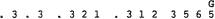

*   **mérong**: 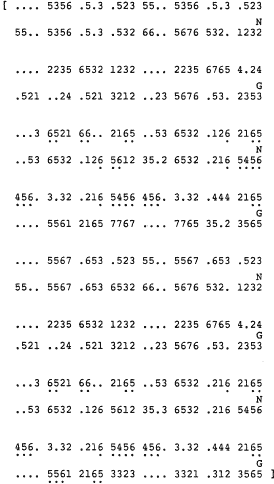

*   **umpak**: 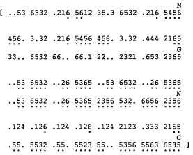

*   **inggah**: 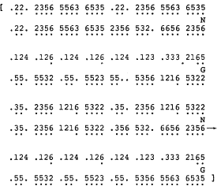

*   **umpak-umpakan**: 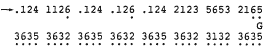

*   **sesegan**: 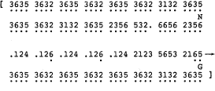

*   **suwukan**: 

### 2. Gendhing `Gobed`，kethuk 4 次，minggah 8，laras pélog pathet nem (gendhing rebab)。`Gendhing` `Gobed` 中的结构类型有：buka, mérong, umpak inggah, inggah 和 umpak-umpakan。

*   **buka**: adangiyah 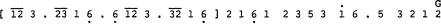

*   **mérong**: 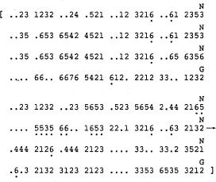

*   **umpak inggah**: 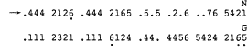

*   **inggah**: 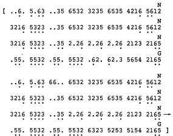

*   **umpak-umpakan**: 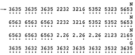

### 3. Gendhing `Asri Katon`，kethuk 2 次，minggah kethuk 4，laras pélog pathet barang。`Gendhing` `Asri Katon` 中的结构类型有：buka, basic mérong, mérong ngelik, umpak inggah 和 inggah。

*   **buka**: 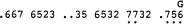

*   **basic mérong**: 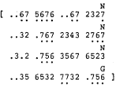

*   **mérong ngelik**: 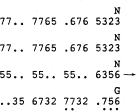

*   **umpak inggah**: 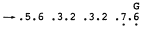

*   **inggah**: 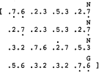

### 4. Gendhing `Méga Mendhung`，kethuk 2 次稀疏，minggah `Èsèk-èsèk`，kethuk 4，laras pélog pathet nem。此 gendhing 中的结构有：buka, mérong 和 inggah。

*   **buka**: 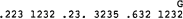

*   **mérong**: 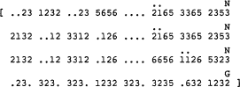

*   **inggah**: 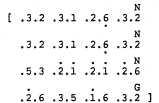

### 5. Ladrang `Wilajeng`, ketawang `Puspa`, laras pélog pathet nem。

*   **buka**: 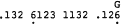

*   **basic mérong**: 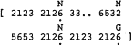

*   **mérong ngelik**: 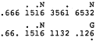

*   **umpak inggah**: 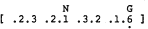

*   **umpak-umpakan**: 

图 4. Gamelan Pélog 中的 embat，音程测量 [以分值为单位]


现在我们必须了解什么是所谓的“天然 embat”（natural embat）。为了解释天然 embat，我们必须区分 laras sléndro 和 laras pélog，因为这两种调式（laras）各具特性。

### Laras Sléndro

在一个 laras sléndro gembyangan 中有五个音，可以认为它们之间的音距是相等的。当这些音形成琴键时，它们按照以下顺序排列。

图 5. [Laras Sléndro 中的音阶]


如果我们从低到高（或反之）顺序读出（唱）sléndro 的音，并仔细听，我们会发现它们之间既有大音距也有音距。小音距位于较大的音距之间。这在图表中的形式如下：

图 6. [Sléndro 音程序列]


这就是我们所说的“天然 embat”（*embat alam*），或者更强调地说是“embat kodrat”（天生的）【‘基于宇宙规律、自然法则的 embat’]。这种 embat 是甘兰乐器中所 embat 的祖先，尽管我们并不确定究竟是谁首次在甘兰乐器中制定了天然 embat。事实上，我们已经不知道最初是谁创造了今天所示的甘兰乐器排列方式了。因为不仅是乐器的排列方式，甘兰的演奏风格也完全基于传统，而传统必须代代相传。

过去出现过几次创新；这些创新并没有代表本质的区别，而仅仅是改进。例如，在十三键 gendèr 上增加了一个额外的键，即音高 。增加了两个 kempul，总共五个。但是，最核心的首要元素（如我们上面指出的那些元素）并没有改变。例如，sléndro rebab 必须始终调至  和 ，而 sléndro kethuk 必须始终调至音高 2 (gulu)。同样，当我们向 sléndro 甘兰中引入天然 embat 时，我们必须能够在[三种现有的可能性]之间选择：


我们可以自由选择其中一种或另一种天然 embat 应用于甘兰。但“自由选择”并不意味着选择是容易的；要理解这一点，我们必须首先讨论 pathet（调式/段）。当我们把上述一种 embat 应用特定的 pathet 时，另一个相对于该 embat 关系而演奏的 pathet 可能不会产生令人悦的结果。

通常在选择 embat 之前，我们心中已经有一个特定的 pathet。然后我们就可以考虑所选 embat 对其他 pathet 的影响。如果证明我们的选择不适用于另一个 pathet，那么第一个 pathet 的[embat] 必须进行调整——必须减小 embat 的影响，使得另一个 pathet [听起来可以接受]。这个过程极其困难，需要专家的参与。让我们考虑图 7 甘兰乐器中实现的天然 embat。

# Pathet

什么是 pathet？这个问题一直困扰着我。我认为还没有一个对 pathet 满意的定义，因为“pathet”这个词有许多用法，每种用法都满足特定的需求。所以，如果对 pathet 提供解释，这种解释必须与当前的需求有关。例如，我曾问过一个铁匠：“什么是刀？”他回答说：“是一种小型的砍刀。”他的定义显然与物体形状有关，因为作为工具制造者，他假设提问者是想要价格的顾客。然而，当我问一个面摊同样的问题时，我得到了完全不同的答案。他说刀是用来切洋葱、菜之类的工具，而砍刀是用来劈木头的工具。他想让顾客认为他是一个爱讲卫生、不混用工具的人。

图 7. 十音 sléndro 甘兰 embat 的比较，以分值为单位的大小（数字参见[图 3)]]


我还没有见过像上述那样的 gendèr（这种琴）。我所熟悉的 gendèr 有十二、十三、有时是十四个琴键，如 图 9 所示。对于大多数精通演奏 gendèr 的音乐家来说，一个十三键键的 gendèr 就足够执行所有最美的 cèngkok（装饰音）了。因此，即使有人主动增加另一个琴键，对专业人士来说也用处无几；事实上，可以说这样一个琴键几乎从不被使用。发明者的意图可能仅仅是为了美化 gendèr 的外观，或者为了使其对称（即使得每组支撑销都侧邻两个琴键）。

图 9。

十二键键的 gendèr


十三键键的 gendèr


十四键键的 gendèr


## cèngkok 与演奏实践的关系

当我们听到一整个甘美兰乐队演奏 gendhing 时，我们听到每件乐器都是根据其特有的演奏技巧进行演奏的。在所有乐器中，没有两种乐器的技巧完全相同。虽然 slenthem、saron barung 和 demung 本质上演奏相同的部分，但有时使用的技术有所不同（例如在演奏 `pinjalan` 时）。如果我们对所有乐器的演奏实践类型或处理方式 `garap` 进行区分，共有三种基本类型。

1. `gumathok` [‘固定”，“‘设定’]: 一种非旋性的演奏技巧，不取决于 balungan（主旋律）的旋律运动，而是取决于曲子的形式 [gong 结构] 。使用这种技术的乐器用于指示 irama（节奏）。

2. `sekaran` [来自 `sekar`‘花’]: 一种演奏，涉及将其他旋律（lagu）插入到基础旋律（lagu `pokok`）中。这种技术是 kendhang ciblon 的特征，当 bonang barung 和 bonang panerus 使用被称为“imbal”的技巧时，也是它们的特征。

3. `cèngkok`: 一种由 balungan 模式引导并依赖于 balungan 旋律进程的演奏技巧。所有的旋律（lagu）乐器都使用这种演奏风格。

## gendèr gedhé 中的 gembyang 和 kempyung

如果我们听中爪哇大师音乐家——特别是来自泗卡塔和雅加达的大师——演奏 gendèr，并且密切他们左右手的动作（这些动作似乎几乎是独立移动），我们会发现几乎在每次 cèngkok 的结束（即在 `sèlèh`，或终止式处），两手都会击出一个 `gembyang` 或 `kempyung` 间程。什么是 gembyang？它是通过击两个侧邻另外四个琴键的琴键而产生的间程[如下所示]:


kempyung 是通过击两个侧邻另外两个琴键的琴键而产生的间程。[因此:]


## sèlèh 的范围

我们上面提到，一个十三键的 gendèr 足够演奏各种 cèngkok。而这些 cèngkok 根据定义，必须有一个终止音（`sèlèh`）。sèlèh 被限于 gendèr 上指定的范围，也就是说，一个 cèngkok 在达到 sèlèh 时必须落在规定的范围内。这个范围在 图 10 中所示。

图 10。 [十三键 gendèr 中的] sèlèh 范围


让我们检查一下图中所示的 sèlèh 范围内我们发现了什么。

a. sèlèh 范围内有八个音调。

b. 音调为 ,,(html/images/51_5.png),(html/images/51_6.png), 1, 2, 3, 5。

c. 有两个 2 (gulu)，两个 3 (dhadha) 和两个 5 (lima)；只有一个 1 (panunggul) 和一个 6 (nem)。

在左右手持的两个 gendèr 槌中，左手持的那个指示 sèlèh。右手的任务是击击左手击中琴键上方的 kempyung 或 gembyang。因此，每个 cèngkok 只有一个 sèlèh 音。

根据传统，slaras sléndro（调式）中只有三种 pathet（调式）—— sanga，nem 和 manyura。如何将终止音（sèlèh）分配到这三个 pathet 之间呢？

## pathet 与 gendèr 上的 sèlèh 范围

现在可能已经清楚，一个 pathet 有一个主音，或 `tonika` [来自荷兰语“tonica”]。在 sléndro 调式系统中，有五个音调，它们之间的间隔大致相等。因此，所有五个音调都可以充当 tonika 或 `dhong`，并且在理论上可以成一个圈连接起来，如 图 11 所示。

图 11。 [dhong 音圆环]


图 11 清楚地显示 `sléndro` 调式系统实际上可以有五个 `pathet`：

a. 一个 `dhong` 音为 5 (`lima`) 的 `pathet`
b. 一个 `dhong` 音为 2 (`gulu`) 的 `pathet`
c. 一个 `dhong` 音为 6 (`nem`) 的 `pathet`
d. 一个 `dhong` 音为 3 (`dhadha`) 的 `pathet`
e. 一个 `dhong` 音为 1 (`barang/panunggul`) 的 `pathet`

基于这些 `dhong` 音，我们可以根据它们的功能排列音调。

图 12。


图 12 中的三个 `pathet` 被祖先命名为：`dhong` 音为 5 [I] 的 `pathet` 称为 `sanga`；`dhong` 音为 2 [II] 的 `pathet` 称为 `nem`；`dhong` 音为 6 [III] 的 `pathet` 称为 `manyura`。`dhong` 音为 3 [IV] 和 `dhong` 音为 1 [V] 的 `pathet` 未被使用。为了我们自己的目的，我们将它们称为 `X` 和 `Y`。这引起了一个问题：“为什么 `dhong` 音 3 和 1 需要自己的 `pathet`？”为了回答这个问题，我们必须继续解释。让我们重新排列图 13 中的音调。

图 13。


图 12 和图 13 清楚地显示一个 `pathet` 的间程是一个 `kempyung`。当我们把 `kempyung` 的间程应用到 `gendèr` 的琴键上，图 14 所示的画面就会出现。

图 14。


考虑到图 14 代表的情况，我们不应该尝试建立五个 `pathet`，因为即使是 `pathet sanga`，其中一个音 6 在 `sèlèh` 范围之外。让我们先看 `pathet manyura`，因为它远离 `sèlèh` 范围。让我们尝试移动这个 `pathet` 使其落在 `sèlèh` 范围内。我们可以像图 15 那样将 `pathet manyura` 降低一个 `gembyangan`。

图 15。


这导致两个音调仍在 `sèlèh` 范围之外（见图 15）。我们应该在努力中采取第二步（见图 16）。

图 16。


在我们的第二步中，我们降低了音 6 和  一个 `gembyangan`。完成这两步后，`pathet manyura` 的所有音调都在 `sèlèh` 范围内。音调的顺序现在如图 17 所示。

图 17。


我们已经成功将 `pathet manyura` 移动到 `sèlèh` 的范围内。我们现在应该处理 `pathet nem`，但因为 `pathet sanga` 的许多音调已经落在 `sèlèh` 的范围内，如果我们在移动 `pathet sanga` 之前移动 `pathet nem`，我们就将不得不移动那些已经处于 `sèlèh` 范围内的 `pathet sanga` 音调。出于这个原因，我们将先处理 `pathet sanga`。

我们将 `pathet sanga` 的两个高音音调降低一个 `gembyangan`（参见图 18）。为什么呢？如果只有 `pathet` 的 `pitch 6` 落在 `sèlèh` 范围之外，我们为什么要移动 `pitch 5` 呢？我们这样做是因为，如果我们只移动 `pitch 6`，那么 `pathet sanga` 和 `pathet manyura` 之间将没有区别。

图 18。


如果我们根据调式实践安排 `pathet sanga` 的音调，结果如图 19 所示。

图 19。


现在 `pathet sanga` 在 `sèlèh` 的范围内，其区域已经清晰了。让我们比较一下 `pathet manyura` 和 `sanga` 在原始位置的图表（参见图 14）。这两个 `pathet` 之前隔了两个 `kempyung`，但现在只隔了一个音调（参见图 20）。

图 20。


我们现在必须安排 `pathet nem`，使其落在 `sèlèh` 的范围内。`pathet nem` 的大部分音调都在范围之外（例如，`pitches 6`,,）。只有 `pitch 5` 在 `sèlèh` 范围内。如果我们观察 `sèlèh` 范围内未被 `pathet sanga` 和 `pathet manyura` 占据的音调，我们发现只有 `pitches`  和  是可用的。出于这个原因，有必要将 `pathet nem` 的 `pitches`  和  降低到 `sèlèh` 范围内。没有必要移动 `pitches 6` 和 。这些音调已经是 `pathet sanga` 和 `pathet manyura` 的属性，而且即使它们被移动，也不会与其他已移动的音调连续（, , , 和 1）。图 21 显示了 `sèlèh` 范围内的三个 `pathet`。

图 21。


这是 `pathet nem` 在 `sèlèh` 范围内的位置。它是如何演奏的？我稍后会讨论。现在我将解释 `gendèr gedhé` 上的 `gembyang` 和 `kempyung`。

## gendèr 上的 Gembyang 和 Kempyung 范围

在 `gendèr` 演奏中，`cèngkok` 必须有 `sèlèh` [终止式]，而且这些 `sèlèh` 必须落在 `sèlèh` 的范围内。`sèlèh` 只有两种可能——`sèlèh gembyang` 和 `sèlèh kempyung`。`gembyang` 和 `kempyung` 在 `gendèr` 上也有特定的发生范围。让我们看看图 22 中这些 `sèlèh gembyang` 和 `sèlèh kempyung` 的范围。

图 22。


我们在图 22 中注意到：

a. `Pitch 1` 可以用作 `sèlèh gembyang` 或 `sèlèh kempyung`。（在 `pathet manyura` 中，`pitch 1` 被用作 `sèlèh gembyang`，在 `pathet sanga` 中被用作 `sèlèh kempyung`。）

b. `Pathet nem` 有两个 `gembyang` 和一个 `kempyung` [在其范围内]，而另外两个 `pathet` 有两个 `gembyang` 例如，`manyura`: 和 1；`sanga`: 和 ] 以及两个 `kempyung` [`manyura`: 2; `sanga`: 1 和 2]。

## III. 低层 kempyung (Lower Kempyung)

如果这个音调落在 `sèlèh`，这种感觉是坚定的，但没有 `dhong` 调那么强。正因如此，低层 `kempyung` 也起到加强 `dhong` 调地位的作用。也就是说，如果没有低层 `kempyung`，`dhong` 调的强度将显得不那么明显。让我们从 `nem` 型（`pathet nem`）中举一个例子：低层 `kempyung` 是 ，但因为它没有与 `nem` 中的其他 `sèlèh` 调连续出现（见图 23），所以所使用的 `cèngkok` 将取自 `pathet sanga`（其中  是 `dhong` 调）或 `manyura`（其中  是 `dhing` 调）。

由于原因，`pathet nem` (2) 的 `dhong` 在那个位置上的强度不如 `pathet sanga` 的第 5 音或 `pathet manyura` 的第 6 音强。由于 `pathet nem` 中 `dhong` 调的弱化，`pathet nem` 中 `sèlèh` 调之间的相对强度差异并不明显。

## IV. 高层 kempyung (Upper Kempyung)

这个音调在 `pathet sanga` 中比在 `pathet manyura` 中弱得多，因为 `sanga` 中的高层 `kempyung`（音高 2）与 `manyura` 中的音高 2 需要相同的 `cèngkok`（后者充当低层 `kempyung`）。也就是说，音高 2 所需要的 `gendèr` `cèngkok` 总是结束在 `kempyung` 音程上。如果偶尔听到 `gendèr` 演奏者使用不同的 `cèngkok`（引导音 2），那仅仅是他们试图提供变化；事实上，除了区分 `pathet sanga` 和 `pathet manyura` 中的 `sèlèh` 2 之外，没有必要提供这种变化。

然而，`pathet manyura` 的情况则不同，其高层 `kempyung` 在 `pathet` 内是很强的，尽管比低层 `kempyung` 弱。为什么？因为没有哪个 `pathet` 的音高水平高于 `manyura`，因此 `manyura` 中的高层 `kempyung` 音调 [3] 将需要 `manyura` 特有的 `cèngkok`。

`pathet sanga` 中的高层 `kempyung` 音调 [2] 也可以很强，如果它前后跟着 `pathet sanga` 典型的终止（`kaden`)^(*):

（后有 `sanga` 终止）

（前有 `sanga` 终止）

[注：箭头表示高层 `kempyung` 音高 2 上的 `sèlèh`。]

当这种音调安排出现时，音高 2（`pathet sanga` 的高层 `kempyung`）是很强的。

`pathet nem` 没有高层 `kempyung`（见图 20），因为音高 6 是 `pathet manyura` 和 `pathet sanga` 的一部分。所以，当 `pathet nem` 作品中的 `sèlèh` 是音高 6 时，通常根据前和/后的短句借用 `manyura` 或 `sanga` 的 `cèngkok`。在 `pathet nem` 中，音高 6 的 `sèlèh` 通常需要借用的 `cèngkok`。尽管如此，通过让强 `pathet nem` 音调（如 ）来平衡，可以避免尴尬感。我将在下面的旋律方向（`arah nada`）部分详细解释这一点。

## V. Dhing

`dhing` 是最弱的音调；它通常成为 `pathet` 中的禁忌音。每当 `dhing` 在 `pathet` 中用作 `sèlèh` 音——即使仅作为旋律短句的结束音（更不用说作为最后的 `sèlèh`）——都会导致一种尴尬感。事实上，它可以改变 `pathet` 的氛围.^(*)

`pathet nem` 没有 `dhing` 音，因此也没有禁忌音。尽管 `pathet nem` 只有几个音调，但每一个都是强音。根据 `pathet` 理论，`pathet nem` 有一个 `dhong` 音 2；因此，理论上它的 `dhing` 必须是音高 1。然而，`pathet nem` `gendhing` 中的音高 1 (`dhing`) `sèlèh` 并不显得任何尴尬，因为 `cèngkok` 可以从 `pathet sanga` 或 `pathet manyura` 借用。特定 `pathet` 中的 `dhing` 音不会产生尴尬感，因为在该 `pathet` 中，音高 1 的 `sèlèh` 通常需要借用的 `cèngkok`。尽管如此，通过让强 `pathet nem` 音调（如 ），例如  来平衡，可以避免尴尬感。我将在下面的旋律方向（`arah nada`）部分详细解释这一点。

### 调式混合 (Mixing Pathet)

在一个 `pathet` 中，每当 `dhong` 音调作为 `sèlèh`，就会变成禁忌调。

`pathet nem` 没有 `dhing` 音，因此也不存在禁忌音。尽管 `pathet nem` 只有几个音调，但每一个音调都是强音。根据 `pathet` 理论，`pathet nem` 有一个 `dhong` 音 2；因此，理论上它的 `dhing` 必须是音高 1。然而，`pathet nem` `gendhing` 中的音高 1 (`dhing`) `sèlèh` 并不显得任何尴尬，因为 `cèngkok` 可以从 `pathet sanga` 或 `pathet manyura` 借用。特定 `pathet` 中的 `dhing` 音不会产生尴尬感，因为在该 `pathet` 中，音高 1 的 `sèlèh` 通常需要借用的 `cèngkok`。

从图 26 我们可以看到，`pathet manyura` 是所有 `pathet` 中最大的一个，因为它可以从另外两个 `pathet` 借用，而其他主要的 `pathet` 只能从另外一个 `pathet` 借用。因此，当作曲家谱写一段 `pathet` 尚未确定的、或尚未由甘兰伴奏的旋律时，作曲家通常会以 `pathet manyura` 谱记该旋律。

## 与 Pathet 相关的问题

### Padhang-ulihan

`Padhang-ulihan` 存在于许多领域——舞蹈、雕刻、论说、行为等。简而言之，一切事物都有 `padhang-ulihan`。`Padhang` [‘明亮’‘光亮’‘清晰’] 是某种清晰的东西，但其最终目的仍然为人未知。而使最终目的变得清晰的是 `ulihan` [‘返回’‘归家’]。例如，让我们想象看到一个男人正朝浴缸走去，而我们不知道他的意图。他是要去洗澡、洗脸，还是仅仅检查一下浴水的情况？换句话说，我们知道 `padhang`，但不知道 `ulihan`。

显然，每个 `padhang` 可能有 1001 种不同的 `ulihan`。但 `padhang` 和 `ulihan` 之间存在和谐的匹配是必要的。如果我们看到一个人进入浴室后，立刻躺下午睡，我们一定会大笑，因为他的意图与其动作的最初表现不符。

必须记住，存在不同层次的 `padhang-ulihan`。例如，如果一个男人去浴室的意图是洗脸，那么这组 `padhang-ulihan` [即动作、最终意图] 本身就可以变成 `padhang` [然后由一个更大的 `ulihan` 所平衡]。例如，`dhandhang gula` 的方案，[`laras`] `sléndro`：


这个例子足以[展示关于爪哇语声乐音乐中 `padhang-ulihan` 的层次]。至于器乐音乐，有两种类型的 `padhang-ulihan`：作为 `cèngkok` 的一部分，以及作为 `gendhing` 的一部分。

### 作为 Cèngkok 部分的 Padhang-ulihan

两个 `cèngkok` 中的第一个将作为 `padhang`，第二个将作为 `ulihan`。每个 `cèngkok` 都有固定的长度。`gendèr` 部分最清晰地展示了 `padhang` 和 `ulihan` 的边界。图 27 显示了按 `gatra` 排列的 `gendèr cèngkok` 边界，它们与每一层级的 `irama` 相关联。

图 27。


参考图 27，我必须插入一段关于 `cèngkok` 中 `irama` 与 `padhang-ulihan` 之间的解释。在 `karawitan` 世界中，“`rangkep`” [‘重叠’] 一词有两个用法：用于 `cèngkok` 的 `rangkep`（即 `cèngkok rangkep`），以及用于 `irama` 的 `rangkep`（即 `irama rangkep`）。例如，在 `gendhing` Ladrang *Mugi Rahayu* 以及进入 Gendhing *Mudhatama* 的 `inggah` 中，其中通常使用的 `irama` 是 `irama dados` 配合 `kendhangan ciblon`，如果 `irama` 被加倍 *(dirangkepkan)*，那么 `gendhing` 仍然是 `irama wilet`（而不是 `irama rangkep`）。然而，`gendèr` 和 `kendhang` 的 `cèngkok` 将是 `cèngkok rangkep`。`padhang` 和 `ulihan` 也与 `irama dados` 相同，尽管根据图 27，`irama wilet` 中的 `padhang-ulihan` 通常只有 `irama dados` 的一半长。


# 作为 Gendhing 部分的 Padhang-ulihan

在这里指的是为`gendhing`排列成旋律句的`padhang-ulihan`。因此，“padhang”的意思是一个未解决的旋律，而“ulihan”是一个已解决的旋律 *(lagu sumèlè)*。这组`padhang-ulihan` [即动作、最终意图] 在`gendhing`中未解决的`padhang`取决每一个`irama`层次。

在 sampak 中的`padhang-ulihan`形式：


解释，`padhang`是一个未解决的旋律，`ulihan`是一个已解决的旋律 *(lagu sumèlè)*。换句话说，我们知道`padhang`，但不知道`ulihan`。

在`gendhing` Ladrang *Mugi Rahayu* 的情况下，其中通常使用的`irama`是`irama dados`配合`kendhangan ciblon`，如果`irama`被加倍 *(dirangkepkan)*，那么`gendhing`仍然是`irama wilet`（而不是`irama rangkep`）。然而，`gendèr`和`kendhang`的`cèngkok`将是`cèngkok rangkep`。`padhang`和`ulihan`也与`irama dados`相同，尽管根据图 27，`irama wilet`中的`padhang-ulihan`通常只有`irama dados`的一半长。

在我个人看来，如果`irama`的层次及其与`padhang-ulihan`划分之间的关系（如图 27 所示）不是从祖先那里继承的传统，我会对它们提出意见，因为它们倾向于引起混乱。尽管如此，如果我们要改变它们，将会遇到巨大的困难，因为这些规则已经成了我们的习惯。如果我建议修改这些规则，我会将`irama`分为两部分：平滑的 *(luwes)* `irama`将被称为 *“sabetan,”*，而我将用“重叠技术” *(tehnik rangkep)* 或“重叠处理” *(garap rangkep)* 来替代现在所谓的“irama rangkep”。

在这里指的是为`gendhing`排列成旋律句的`padhang-ulihan`。因此，“padhang”的意思是一个未解决的旋律，而“ulihan”是一个已解决的旋律 *(lagu sumèlè)*。这组`padhang-ulihan` [即动作、最终意图] 本身就可以变成`padhang` [然后由一个更大的`ulihan`所平衡]。在`gendhing`中未解决的`padhang`取决于每一个`irama`层次。

显然，每个`padhang`可能有 1001 种不同的`ulihan`。但`padhang`和`ulihan`之间存在和谐的匹配是必要的。如果我们看到一个人进入浴室后，立刻躺下午睡，我们一定会大笑，因为他的意图与其动作的最初表现不符。

必须记住的是，存在不同层次的`padhang-ulihan`。例如，如果一个男人去浴室的意图是洗脸，那么这组`padhang-ulihan` [即动作、最终意图] 本身就可以变成`padhang` [然后由一个更大的`ulihan`所平衡]。例如，`dhandhang gula`的方案，[laras] sléndro：


这个例子足以[展示关于爪哇语声乐音乐中`padhang-ulihan`的层次]。至于器乐音乐，有两种类型的`padhang-ulihan`：作为`cèngkok`的一部分，以及作为`gendhing`的一部分。

两个`cèngkok`中的第一个将作为`padhang`，第二个将作为`ulihan`。每个`cèngkok`都有固定的长度。`gendèr`部分最清晰地展示了`padhang`和`ulihan`的边界。图 27 显示了按`gatra`排列的`gendèr cèngkok`边界，它们与每一层级的`irama`相关联。

图 27。


参考图 27，我必须插入一段关于`cèngkok`中`irama`与`padhang-ulihan`之间的解释。在 karawitan 世界中，“rangkep” [‘重叠’] 一词有两个用法：用于`cèngkok`的`rangkep`（即`cèngkok rangkep`），以及用于`irama`的`rangkep`（即`irama rangkep`）。例如，在`gendhing` Ladrang *Mugi Rahayu* 以及进入 Gendhing *Mudhatama* 的`inggah`中，其中通常使用的`irama`是`irama dados`配合`kendhangan ciblon`，如果`irama`被加倍 *(dirangkepkan)*，那么`gendhing`仍然是`irama wilet`（而不是`irama rangkep`）。然而，`gendèr`和`kendhang`的`cèngkok`将是`cèngkok rangkep`。`padhang`和`ulihan`也与`irama dados`相同，尽管根据图 27，`irama wilet`中的`padhang-ulihan`通常只有`irama dados`的一半长。

在我个人看来，如果`irama`的层次及其与`padhang-ulihan`划分之间的关系（如图 27 所示）不是从祖先那里继承的传统，我会对它们提出意见，因为它们倾向于引起混乱。尽管如此，如果我们要改变它们，将会遇到巨大的困难，因为这些规则已经成了我们的习惯。如果我建议修改这些规则，我会将`irama`分为两部分：平滑的 *(luwes)* `irama`将被称为 *“sabetan,”*，而我将用“重叠技术” *(tehnik rangkep)* 或“重叠处理” *(garap rangkep)* 来替代现在所谓的“irama rangkep”。

在这里指的是为`gendhing`排列成旋律句的`padhang-ulihan`。因此，“padhang”的意思是一个未解决的旋律，而“ulihan”是一个已解决的旋律 *(lagu sumèlè)*。这组`padhang-ulihan` [即动作、最终意图] 本身就可以变成`padhang` [然后由一个更大的`ulihan`所平衡]。在`gendhing`中未解决的`padhang`取决于每一个`irama`层次。

在 sampak 中的`padhang-ulihan`形式：


解释，`padhang`是一个未解决的旋律，`ulihan`是一个已解决的旋律 *(lagu sumèlè)*。换句话说，我们知道`padhang`，但不知道`ulihan`。

显然，每个`padhang`可能有 1001 种不同的`ulihan`。但`padhang`和`ulihan`之间存在和谐的匹配是必要的。如果我们看到一个人进入浴室后，立刻躺下午睡，我们一定会大笑，因为他的意图与其动作的最初表现不符。

必须记住的是，存在不同层次的`padhang-ulihan`。例如，如果一个男人去浴室的意图是洗脸，那么这组`padhang-ulihan` [即动作、最终意图] 本身就可以变成`padhang` [然后由一个更大的`ulihan`所平衡]。例如，`dhandhang gula`的方案，[laras] sléndro：


这个例子足以[展示关于爪哇语声乐音乐中`padhang-ulihan`的层次]。至于器乐音乐，有两种类型的`padhang-ulihan`：作为`cèngkok`的一部分，以及作为`gendhing`的一部分。

两个`cèngkok`中的第一个将作为`padhang`，第二个将作为`ulihan`。每个`cèngkok`都有固定的长度。`gendèr`部分最清晰地展示了`padhang`和`ulihan`的边界。图 27 显示了按`gatra`排列的`gendèr cèngkok`边界，它们与每一层级的`irama`相关联。

图 27。


参考图 27，我必须插入一段关于`cèngkok`中`irama`与`padhang-ulihan`之间的解释。在 karawitan 世界中，“rangkep” [‘重叠’] 一词有两个用法：用于`cèngkok`的`rangkep`（即`cèngkok rangkep`），以及用于`irama`的`rangkep`（即`irama rangkep`）。例如，在`gendhing` Ladrang *Mugi Rahayu* 以及进入 Gendhing *Mudhatama* 的`inggah`中，其中通常使用的`irama`是`irama dados`配合`kendhangan ciblon`，如果`irama`被加倍 *(dirangkepkan)*，那么`gendhing`仍然是`irama wilet`（而不是`irama rangkep`）。然而，`gendèr`和`kendhang`的`cèngkok`将是`cèngkok rangkep`。`padhang`和`ulihan`也与`irama dados`相同，尽管根据图 27，`irama wilet`中的`padhang-ulihan`通常只有`irama dados`的一半长。

在我个人看来，如果`irama`的层次及其与`padhang-ulihan`划分之间的关系（如图 27 所示）不是从祖先那里继承的传统，我会对它们提出意见，因为它们倾向于引起混乱。尽管如此，如果我们要改变它们，将会遇到巨大的困难，因为这些规则已经成了我们的习惯。如果我建议修改这些规则，我会将`irama`分为两部分：平滑的 *(luwes)* `irama`将被称为 *“sabetan,”*，而我将用“重叠技术” *(tehnik rangkep)* 或“重叠处理” *(garap rangkep)* 来替代现在所谓的“irama rangkep”。

在这里指的是为`gendhing`排列成旋律句的`padhang-ulihan`。因此，“padhang”的意思是一个未解决的旋律，而“ulihan”是一个已解决的旋律 *(lagu sumèlè)*。这组`padhang-ulihan` [即动作、最终意图] 本身就可以变成`padhang` [然后由一个更大的`ulihan`所平衡]。在`gendhing`中未解决的`padhang`取决于每一个`irama`层次。

在 sampak 中的`padhang-ulihan`形式：


解释，`padhang`是一个未解决的旋律，`ulihan`是一个已解决的旋律 *(lagu sumèlè)*。换句话说，我们知道`padhang`，但不知道`ulihan`。

显然，每个`padhang`可能有 1001 种不同的`ulihan`。但`padhang`和`ulihan`之间存在和谐的匹配是必要的。如果我们看到一个人进入浴室后，立刻躺下午睡，我们一定会大笑，因为他的意图与其动作的最初表现不符。

必须记住的是，存在不同层次的`padhang-ulihan`。例如，如果一个男人去浴室的意图是洗脸，那么这组`padhang-ulihan` [即动作、最终意图] 本身就可以变成`padhang` [然后由一个更大的`ulihan`所平衡]。例如，`dhandhang gula`的方案，[laras] sléndro：


这个例子足以[展示关于爪哇语声乐音乐中`padhang-ulihan`的层次]。至于器乐音乐，有两种类型的`padhang-ulihan`：作为`cèngkok`的一部分，以及作为`gendhing`的一部分。

两个`cèngkok`中的第一个将作为`padhang`，第二个将作为`ulihan`。每个`cèngkok`都有固定的长度。`gendèr`部分最清晰地展示了`padhang`和`ulihan`的边界。图 27 显示了按`gatra`排列的`gendèr cèngkok`边界，它们与每一层级的`irama`相关联。

图 27。


参考图 27，我必须插入一段关于 `cèngkok` 中 `irama` 与 `padhang-ulihan` 之间的解释。在 karawitan 世界中，“rangkep” [‘重叠’] 一词有两个用法：用于 `cèngkok` 的 `rangkep`（即 `cèngkok rangkep`），以及用于 `irama` 的 `rangkep`（即 `irama rangkep`）。例如，在 `gendhing` Ladrang *Mugi Rahayu* 以及进入 Gendhing *Mudhatama* 的 `inggah` 中，其中通常使用的 `irama` 是 `irama dados` 配合 `kendhangan ciblon`，如果 `irama` 被加倍 *(dirangkepkan)*，那么 `gendhing` 仍然是 `irama wilet`（而不是 `irama rangkep`）。然而，`gendèr` 和 `kendhang` 的 `cèngkok` 将是 `cèngkok rangkep`。`padhang` 和 `ulihan` 也与 `irama dados` 相同，尽管根据图 27，`irama wilet` 中的 `padhang-ulihan` 通常只有 `irama dados` 的一半长。

在我个人看来，如果 `irama` 的层次及其与 `padhang-ulihan` 划分之间的关系（如图 27 所示）不是从祖先那里继承的传统，我会对它们提出意见，因为它们倾向于引起混乱。尽管如此，如果我们要改变它们，将会遇到巨大的困难，因为这些规则已经成了我们的习惯。如果我建议修改这些规则，我会将 `irama` 分为两部分：平滑的 *(luwes)* `irama` 将被称为 *“sabetan,”*，而我将用“重叠技术” *(tehnik rangkep)* 或“重叠处理” *(garap rangkep)* 来替代现在所谓的“irama rangkep”。

在这里指的是为 `gendhing` 排列成旋律句的 `padhang-ulihan`。因此，“padhang”的意思是一个未解决的旋律，而“ulihan”是一个已解决的旋律 *(lagu sumèlè)*。这组 `padhang-ulihan` [即动作、最终意图] 本身就可以变成 `padhang` [然后由一个更大的 `ulihan` 所平衡]。在 `gendhing` 中未解决的 `padhang` 取决于每一个 `irama` 层次。

在 sampak 中的 `padhang-ulihan` 形式：


解释，`padhang` 是一个未解决的旋律，`ulihan` 是一个已解决的旋律 *(lagu sumèlè)*。换句话说，我们知道 `padhang`，但不知道 `ulihan`。

显然，每个 `padhang` 可能有 1001 种不同的 `ulihan`。但 `padhang` 和 `ulihan` 之间存在和谐的匹配是必要的。如果我们看到一个人进入浴室后，立刻躺下午睡，我们一定会大笑，因为他的意图与其动作的最初表现不符。

必须记住的是，存在不同层次的 `padhang-ulihan`。例如，如果一个男人去浴室的意图是洗脸，那么这组 `padhang-ulihan` [即动作、最终意图] 本身就可以变成 `padhang` [然后由一个更大的 `ulihan` 所平衡]。例如，`dhandhang gula` 的方案，[laras] sléndro：


这个例子足以[展示关于爪哇语声乐音乐中 `padhang-ulihan` 的层次]。至于器乐音乐，有两种类型的 `padhang-ulihan`：作为 `cèngkok` 的一部分，以及作为 `gendhing` 的一部分。

两个 `cèngkok` 中的第一个将作为 `padhang`，第二个将作为 `ulihan`。每个 `cèngkok` 都有固定的长度。`gendèr` 部分最清晰地展示了 `padhang` 和 `ulihan` 的边界。图 27 显示了按 `gatra` 排列的 `gendèr cèngkok` 边界，它们与每一层级的 `irama` 相关联。

图 27。


参考图 27，我必须插入一段关于 `cèngkok` 中 `irama` 与 `padhang-ulihan` 之间的解释。在 karawitan 世界中，“rangkep” [‘重叠’] 一词有两个用法：用于 `cèngkok` 的 `rangkep`（即 `cèngkok rangkep`），以及用于 `irama` 的 `rangkep`（即 `irama rangkep`）。例如，在 `gendhing` Ladrang *Mugi Rahayu* 以及进入 Gendhing *Mudhatama* 的 `inggah` 中，其中通常使用的 `irama` 是 `irama dados` 配合 `kendhangan ciblon`，如果 `irama` 被加倍 *(dirangkepkan)*，那么 `gendhing` 仍然是 `irama wilet`（而不是 `irama rangkep`）。然而，`gendèr` 和 `kendhang` 的 `cèngkok` 将是 `cèngkok rangkep`。`padhang` 和 `ulihan` 也与 `irama dados` 相同，尽管根据图 27，`irama wilet` 中的 `padhang-ulihan` 通常只有 `irama dados` 的一半长。

在我个人看来，如果 `irama` 的层次及其与 `padhang-ulihan` 划分之间的关系（如图 27 所示）不是从祖先那里继承的传统，我会对它们提出意见，因为它们倾向于引起混乱。尽管如此，如果我们要改变它们，将会遇到巨大的困难，因为这些规则已经成了我们的习惯。如果我建议修改这些规则，我会将 `irama` 分为两部分：平滑的 *(luwes)* `irama` 将被称为 *“sabetan,”*，而我将用“重叠技术” *(tehnik rangkep)* 或“重叠处理” *(garap rangkep)* 来替代现在所谓的“irama rangkep”。

在这里指的是为 `gendhing` 排列成旋律句的 `padhang-ulihan`。因此，“padhang”的意思是一个未解决的旋律，而“ulihan”是一个已解决的旋律 *(lagu sumèlè)*。这组 `padhang-ulihan` [即动作、最终意图] 本身就可以变成 `padhang` [然后由一个更大的 `ulihan` 所平衡]。在 `gendhing` 中未解决的 `padhang` 取决于每一个 `irama` 层次。

在 sampak 中的 `padhang-ulihan` 形式：


解释，`padhang` 是一个未解决的旋律，`ulihan` 是一个已解决的旋律 *(lagu sumèlè)*。换句话说，我们知道 `padhang`，但不知道 `ulihan`。

显然，每个 `padhang` 可能有 1001 种不同的 `ulihan`。但 `padhang` 和 `ulihan` 之间存在和谐的匹配是必要的。如果我们看到一个人进入浴室后，立刻躺下午睡，我们一定会大笑，因为他的意图与其动作的最初表现不符。

必须记住的是，存在不同层次的 `padhang-ulihan`。例如，如果一个男人去浴室的意图是洗脸，那么这组 `padhang-ulihan` [即动作、最终意图] 本身就可以变成 `padhang` [然后由一个更大的 `ulihan` 所平衡]。例如，`dhandhang gula` 的方案，[laras] sléndro：


这个例子足以[展示关于爪哇语声乐音乐中 `padhang-ulihan` 的层次]。至于器乐音乐，有两种类型的 `padhang-ulihan`：作为 `cèngkok` 的一部分，以及作为 `gendhing` 的一部分。

两个 `cèngkok` 中的第一个将作为 `padhang`，第二个将作为 `ulihan`。每个 `cèngkok` 都有固定的长度。`gendèr` 部分最清晰地展示了 `padhang` 和 `ulihan` 的边界。图 27 显示了按 `gatra` 排列的 `gendèr cèngkok` 边界，它们与每一层级的 `irama` 相关联。

图 27。


参考图 27，我必须插入一段关于 `cèngkok` 中 `irama` 与 `padhang-ulihan` 之间的解释。在 karawitan 世界中，“rangkep” [‘重叠’] 一词有两个用法：用于 `cèngkok` 的 `rangkep`（即 `cèngkok rangkep`），以及用于 `irama` 的 `rangkep`（即 `irama rangkep`）。例如，在 `gendhing` Ladrang *Mugi Rahayu* 以及进入 Gendhing *Mudhatama* 的 `inggah` 中，其中通常使用的 `irama` 是 `irama dados` 配合 `kendhangan ciblon`，如果 `irama` 被加倍 *(dirangkepkan)*，那么 `gendhing` 仍然是 `irama wilet`（而不是 `irama rangkep`）。然而，`gendèr` 和 `kendhang` 的 `cèngkok` 将是 `cèngkok rangkep`。`padhang` 和 `ulihan` 也与 `irama dados` 相同，尽管根据图 27，`irama wilet` 中的 `padhang-ulihan` 通常只有 `irama dados` 的一半长。

在我个人看来，如果 `irama` 的层次及其与 `padhang-ulihan` 划分之间的关系（如图 27 所示）不是从祖先那里继承的传统，我会对它们提出意见，因为它们倾向于引起混乱。尽管如此，如果我们要改变它们，将会遇到巨大的困难，因为这些规则已经成了我们的习惯。如果我建议修改这些规则，我会将 `irama` 分为两部分：平滑的 *(luwes)* `irama` 将被称为 *“sabetan,”*，而我将用“重叠技术” *(tehnik rangkep)* 或“重叠处理” *(garap rangkep)* 来替代现在所谓的“irama rangkep”。

在这里指的是为 `gendhing` 排列成旋律句的 `padhang-ulihan`。因此，“padhang”的意思是一个未解决的旋律，而“ulihan”是一个已解决的旋律 *(lagu sumèlè)*。这组 `padhang-ulihan` [即动作、最终意图] 本身就可以变成 `padhang` [然后由一个更大的 `ulihan` 所平衡]。在 `gendhing` 中未解决的 `padhang` 取决于每一个 `irama` 层次。

在 sampak 中的 `padhang-ulihan` 形式：


解释，`padhang` 是一个未解决的旋律，`ulihan` 是一个已解决的旋律 *(lagu sumèlè)*。换句话说，我们知道 `padhang`，但不知道 `ulihan`。

显然，每个 `padhang` 可能有 1001 种不同的 `ulihan`。但 `padhang` 和 `ulihan` 之间存在和谐的匹配是必要的。如果我们看到一个人进入浴室后，立刻躺下午睡，我们一定会大笑，因为他的意图与其动作的最初表现不符。

必须记住的是，存在不同层次的 `padhang-ulihan`。例如，如果一个男人去浴室的意图是洗脸，那么这组 `padhang-ulihan` [即动作、最终意图] 本身就可以变成 `padhang` [然后由一个更大的 `ulihan` 所平衡]。例如，`dhandhang gula` 的方案，[laras] sléndro：


这个例子足以[展示关于爪哇语声乐音乐中 `padhang-ulihan` 的层次]。至于器乐音乐，有两种类型的 `padhang-ulihan`：作为 `cèngkok` 的一部分，以及作为 `gendhing` 的一部分。

两个 `cèngkok` 中的第一个将作为 `padhang`，第二个将作为 `ulihan`。每个 `cèngkok` 都有固定的长度。`gendèr` 部分最清晰地展示了 `padhang` 和 `ulihan` 的边界。图 27 显示了按 `gatra` 排列的 `gendèr cèngkok` 边界，它们与每一层级的 `irama` 相关联。

图 27。


参考图 27，我必须插入一段关于 `cèngkok` 中 `irama` 与 `padhang-ulihan` 之间的解释。在 karawitan 世界中，“rangkep” [‘重叠’] 一词有两个用法：用于 `cèngkok` 的 `rangkep`（即 `cèngkok rangkep`），以及用于 `irama` 的 `rangkep`（即 `irama rangkep`）。例如，在 `gendhing` Ladrang *Mugi Rahayu* 以及进入 Gendhing *Mudhatama* 的 `inggah` 中，其中通常使用的 `irama` 是 `irama dados` 配合 `kendhangan ciblon`，如果 `irama` 被加倍 *(dirangkepkan)*，那么 `gendhing` 仍然是 `irama wilet`（而不是 `irama rangkep`）。然而，`gendèr` 和 `kendhang` 的 `cèngkok` 将是 `cèngkok rangkep`。`padhang` 和 `ulihan` 也与 `irama dados` 相同，尽管根据图 27，`irama wilet` 中的 `padhang-ulihan` 通常只有 `irama dados` 的一半长。

在我个人看来，如果 `irama` 的层次及其与 `padhang-ulihan` 划分之间的关系（如图 27 所示）不是从祖先那里继承的传统，我会对它们提出意见，因为它们倾向于引起混乱。尽管如此，如果我们要改变它们，将会遇到巨大的困难，因为这些规则已经成了我们的习惯。如果我建议修改这些规则，我会将 `irama` 分为两部分：平滑的 *(luwes)* `irama` 将被称为 *“sabetan,”*，而我将用“重叠技术” *(tehnik rangkep)* 或“重叠处理” *(garap rangkep)* 来替代现在所谓的“irama rangkep”。

在这里指的是为 `gendhing` 排列成旋律句的 `padhang-ulihan`。因此，“padhang”的意思是一个未解决的旋律，而“ulihan”是一个已解决的旋律 *(lagu sumèlè)*。这组 `padhang-ulihan` [即动作、最终意图] 本身就可以变成 `padhang` [然后由一个更大的 `ulihan` 所平衡]。在 `gendhing` 中未解决的 `padhang` 取决于每一个 `irama` 层次。

在 sampak 中的 `padhang-ulihan` 形式：


解释，`padhang` 是一个未解决的旋律，`ulihan` 是一个已解决的旋律 *(lagu sumèlè)*。换句话说，我们知道 `padhang`，但不知道 `ulihan`。

显然，每个 `padhang` 可能有 1001 种不同的 `ulihan`。但 `padhang` 和 `ulihan` 之间存在和谐的匹配是必要的。如果我们看到一个人进入浴室后，立刻躺下午睡，我们一定会大笑，因为他的意图与其动作的最初表现不符。

必须记住的是，存在不同层次的 `padhang-ulihan`。例如，如果一个男人去浴室的意图是洗脸，那么这组 `padhang-ulihan` [即动作、最终意图] 本身就可以变成 `padhang` [然后由一个更大的 `ulihan` 所平衡]。例如，`dhandhang gula` 的方案，[laras] sléndro：


这个例子足以[展示关于爪哇语声乐音乐中 `padhang-ulihan` 的层次]。至于器乐音乐，有两种类型的 `padhang-ulihan`：作为 `cèngkok` 的一部分，以及作为 `gendhing` 的一部分。

两个 `cèngkok` 中的第一个将作为 `padhang`，第二个将作为 `ulihan`。每个 `cèngkok` 都有固定的长度。`gendèr` 部分最清晰地展示了 `padhang` 和 `ulihan` 的边界。图 27 显示了按 `gatra` 排列的 `gendèr cèngkok` 边界，它们与每一层级的 `irama` 相关联。

图 27。


参考图 27，我必须插入一段关于 `cèngkok` 中 `irama` 与 `padhang-ulihan` 之间的解释。在 karawitan 世界中，“rangkep” [‘重叠’] 一词有两个用法：用于 `cèngkok` 的 `rangkep`（即 `cèngkok rangkep`），以及用于 `irama` 的 `rangkep`（即 `irama rangkep`）。例如，在 `gendhing` Ladrang *Mugi Rahayu* 以及进入 Gendhing *Mudhatama* 的 `inggah` 中，其中通常使用的 `irama` 是 `irama dados` 配合 `kendhangan ciblon`，如果 `irama` 被加倍 *(dirangkepkan)*，那么 `gendhing` 仍然是 `irama wilet`（而不是 `irama rangkep`）。然而，`gendèr` 和 `kendhang` 的 `cèngkok` 将是 `cèngkok rangkep`。`padhang` 和 `ulihan` 也与 `irama dados` 相同，尽管根据图 27，`irama wilet` 中的 `padhang-ulihan` 通常只有 `irama dados` 的一半长。

在我个人看来，如果 `irama` 的层次及其与 `padhang-ulihan` 划分之间的关系（如图 27 所示）不是从祖先那里继承的传统，我会对它们提出意见，因为它们倾向于引起混乱。尽管如此，如果我们要改变它们，将会遇到巨大的困难，因为这些规则已经成了我们的习惯。如果我建议修改这些规则，我会将 `irama` 分为两部分：平滑的 *(luwes)* `irama` 将被称为 *“sabetan,”*，而我将用“重叠技术” *(tehnik rangkep)* 或“重叠处理” *(garap rangkep)* 来替代现在所谓的“irama rangkep”。

在这里指的是为 `gendhing` 排列成旋律句的 `padhang-ulihan`。因此，“padhang”的意思是一个未解决的旋律，而“ulihan”是一个已解决的旋律 *(lagu sumèlè)*。这组 `padhang-ulihan` [即动作、最终意图] 本身就可以变成 `padhang` [然后由一个更大的 `ulihan` 所平衡]。在 `gendhing` 中未解决的 `padhang` 取决于每一个 `irama` 层次。

在 sampak 中的 `padhang-ulihan` 形式：


解释，`padhang` 是一个未解决的旋律，`ulihan` 是一个已解决的旋律 *(lagu sumèlè)*。换句话说，我们知道 `padhang`，但不知道 `ulihan`。

显然，每个 `padhang` 可能有 1001 种不同的 `ulihan`。但 `padhang` 和 `ulihan` 之间存在和谐的匹配是必要的。如果我们看到一个人进入浴室后，立刻躺下午睡，我们一定会大笑，因为他的意图与其动作的最初表现不符。

必须记住的是，存在不同层次的 `padhang-ulihan`。例如，如果一个男人去浴室的意图是洗脸，那么这组 `padhang-ulihan` [即动作、最终意图] 本身就可以变成 `padhang` [然后由一个更大的 `ulihan` 所平衡]。例如，`dhandhang gula` 的方案，[laras] sléndro：


这个例子足以[展示关于爪哇语声乐音乐中 `padhang-ulihan` 的层次]。至于器乐音乐，有两种类型的 `padhang-ulihan`：作为 `cèngkok` 的一部分，以及作为 `gendhing` 的一部分。

两个 `cèngkok` 中的第一个将作为 `padhang`，第二个将作为 `ulihan`。每个 `cèngkok` 都有固定的长度。`gendèr` 部分最清晰地展示了 `padhang` 和 `ulihan` 的边界。图 27 显示了按 `gatra` 排列的 `gendèr cèngkok` 边界，它们与每一层级的 `irama` 相关联。

图 27。


参考图 27，我必须插入一段关于 `cèngkok` 中 `irama` 与 `padhang-ulihan` 之间的解释。在 karawitan 世界中，“rangkep” [‘重叠’] 一词有两个用法：用于 `cèngkok` 的 `rangkep`（即 `cèngkok rangkep`），以及用于 `irama` 的 `rangkep`（即 `irama rangkep`）。例如，在 `gendhing` Ladrang *Mugi Rahayu* 以及进入 Gendhing *Mudhatama* 的 `inggah` 中，其中通常使用的 `irama` 是 `irama dados` 配合 `kendhangan ciblon`，如果 `irama` 被加倍 *(dirangkepkan)*，那么 `gendhing` 仍然是 `irama wilet`（而不是 `irama rangkep`）。然而，`gendèr` 和 `kendhang` 的 `cèngkok` 将是 `cèngkok rangkep`。`padhang` 和 `ulihan` 也与 `irama dados` 相同，尽管根据图 27，`irama wilet` 中的 `padhang-ulihan` 通常只有 `irama dados` 的一半长。

在我个人看来，如果 `irama` 的层次及其与 `padhang-ulihan` 划分之间的关系（如图 27 所示）不是从祖先那里继承的传统，我会对它们提出意见，因为它们倾向于引起混乱。尽管如此，如果我们要改变它们，将会遇到巨大的困难，因为这些规则已经成了我们的习惯。如果我建议修改这些规则，我会将 `irama` 分为两部分：平滑的 *(luwes)* `irama` 将被称为 *“sabetan,”*，而我将用“重叠技术” *(tehnik rangkep)* 或“重叠处理” *(garap rangkep)* 来替代现在所谓的“irama rangkep”。

在这里指的是为 `gendhing` 排列成旋律句的 `padhang-ulihan`。因此，“padhang”的意思是一个未解决的旋律，而“ulihan”是一个已解决的旋律 *(lagu sumèlè)*。这组 `padhang-ulihan` [即动作、最终意图] 本身就可以变成 `padhang` [然后由一个更大的 `ulihan` 所平衡]。在 `gendhing` 中未解决的 `padhang` 取决于每一个 `irama` 层次。

在 sampak 中的 `padhang-ulihan` 形式：


解释，`padhang` 是一个未解决的旋律，`ulihan` 是一个已解决的旋律 *(lagu sumèlè)*。换句话说，我们知道 `padhang`，但不知道 `ulihan`。

显然，每个 `padhang` 可能有 1001 种不同的 `ulihan`。但 `padhang` 和 `ulihan` 之间存在和谐的匹配是必要的。如果我们看到一个人进入浴室后，立刻躺下午睡，我们一定会大笑，因为他的意图与其动作的最初表现不符。

必须记住的是，存在不同层次的 `padhang-ulihan`。例如，如果一个男人去浴室的意图是洗脸，那么这组 `padhang-ulihan` [即动作、最终意图] 本身就可以变成 `padhang` [然后由一个更大的 `ulihan` 所平衡]。例如，`dhandhang gula` 的方案，[laras] sléndro：


这个例子足以[展示关于爪哇语声乐音乐中 `padhang-ulihan` 的层次]。至于器乐音乐，有两种类型的 `padhang-ulihan`：作为 `cèngkok` 的一部分，以及作为 `gendhing` 的一部分。

两个 `cèngkok` 中的第一个将作为 `padhang`，第二个将作为 `ulihan`。每个 `cèngkok` 都有固定的长度。`gendèr` 部分最清晰地展示了 `padhang` 和 `ulihan` 的边界。图 27 显示了按 `gatra` 排列的 `gendèr cèngkok` 边界，它们与每一层级的 `irama` 相关联。

图 27。


参考图 27，我必须插入一段关于 `cèngkok` 中 `irama` 与 `padhang-ulihan` 之间的解释。在 karawitan 世界中，“rangkep” [‘重叠’] 一词有两个用法：用于 `cèngkok` 的 `rangkep`（即 `cèngkok rangkep`），以及用于 `irama` 的 `rangkep`（即 `irama rangkep`）。例如，在 `gendhing` Ladrang *Mugi Rahayu* 以及进入 Gendhing *Mudhatama* 的 `inggah` 中，其中通常使用的 `irama` 是 `irama dados` 配合 `kendhangan ciblon`，如果 `irama` 被加倍 *(dirangkepkan)*，那么 `gendhing` 仍然是 `irama wilet`（而不是 `irama rangkep`）。然而，`gendèr` 和 `kendhang` 的 `cèngkok` 将是 `cèngkok rangkep`。`padhang` 和 `ulihan` 也与 `irama dados` 相同，尽管根据图 27，`irama wilet` 中的 `padhang-ulihan` 通常只有 `irama dados` 的一半长。

在我个人看来，如果 `irama` 的层次及其与 `padhang-ulihan` 划分之间的关系（如图 27 所示）不是从祖先那里继承的传统，我会对它们提出意见，因为它们倾向于引起混乱。尽管如此，如果我们要改变它们，将会遇到巨大的困难，因为这些规则已经成了我们的习惯。如果我建议修改这些规则，我会将 `irama` 分为两部分：平滑的 *(luwes)* `irama` 将被称为 *“sabetan,”*，而我将用“重叠技术” *(tehnik rangkep)* 或“重叠处理” *(garap rangkep)* 来替代现在所谓的“irama rangkep”。

在这里指的是为 `gendhing` 排列成旋律句的 `padhang-ulihan`。因此，“padhang”的意思是一个未解决的旋律，而“ulihan”是一个已解决的旋律 *(lagu sumèlè)*。这组 `padhang-ulihan` [即动作、最终意图] 本身就可以变成 `padhang` [然后由一个更大的 `ulihan` 所平衡]。在 `gendhing` 中未解决的 `padhang` 取决于每一个 `irama` 层次。

在 sampak 中的 `padhang-ulihan` 形式：


解释，`padhang` 是一个未解决的旋律，`ulihan` 是一个已解决的旋律 *(lagu sumèlè)*。换句话说，我们知道 `padhang`，但不知道 `ulihan`。

显然，每个 `padhang` 可能有 1001 种不同的 `ulihan`。但 `padhang` 和 `ulihan` 之间存在和谐的匹配是必要的。如果我们看到一个人进入浴室后，立刻躺下午睡，我们一定会大笑，因为他的意图与其动作的最初表现不符。

必须记住的是，存在不同层次的 `padhang-ulihan`。例如，如果一个男人去浴室的意图是洗脸，那么这组 `padhang-ulihan` [即动作、最终意图] 本身就可以变成 `padhang` [然后由一个更大的 `ulihan` 所平衡]。例如，`dhandhang gula` 的方案，[laras] sléndro：


这个例子足以[展示关于爪哇语声乐音乐中 `padhang-ulihan` 的层次]。至于器乐音乐，有两种类型的 `padhang-ulihan`：作为 `cèngkok` 的一部分，以及作为 `gendhing` 的一部分。

两个 `cèngkok` 中的第一个将作为 `padhang`，第二个将作为 `ulihan`。每个 `cèngkok` 都有固定的长度。`gendèr` 部分最清晰地展示了 `padhang` 和 `ulihan` 的边界。图 27 显示了按 `gatra` 排列的 `gendèr cèngkok` 边界，它们与每一层级的 `irama` 相关联。

图 27。


参考图 27，我必须插入一段关于 `cèngkok` 中 `irama` 与 `padhang-ulihan` 之间的解释。在 karawitan 世界中，“rangkep” [‘重叠’] 一词有两个用法：用于 `cèngkok` 的 `rangkep`（即 `cèngkok rangkep`），以及用于 `irama` 的 `rangkep`（即 `irama rangkep`）。例如，在 `gendhing` Ladrang *Mugi Rahayu* 以及进入 Gendhing *Mudhatama* 的 `inggah` 中，其中通常使用的 `irama` 是 `irama dados` 配合 `kendhangan ciblon`，如果 `irama` 被加倍 *(dirangkepkan)*，那么 `gendhing` 仍然是 `irama wilet`（而不是 `irama rangkep`）。然而，`gendèr` 和 `kendhang` 的 `cèngkok` 将是 `cèngkok rangkep`。`padhang` 和 `ulihan` 也与 `irama dados` 相同，尽管根据图 27，`irama wilet` 中的 `padhang-ulihan` 通常只有 `irama dados` 的一半长。

在我个人看来，如果 `irama` 的层次及其与 `padhang-ulihan` 划分之间的关系（如图 27 所示）不是从祖先那里继承的传统，我会对它们提出意见，因为它们倾向于引起混乱。尽管如此，如果我们要改变它们，将会遇到巨大的困难，因为这些规则已经成了我们的习惯。如果我建议修改这些规则，我会将 `irama` 分为两部分：平滑的 *(luwes)* `irama` 将被称为 *“sabetan,”*，而我将用“重叠技术” *(tehnik rangkep)* 或“重叠处理” *(garap rangkep)* 来替代现在所谓的“irama rangkep”。

在这里指的是为 `gendhing` 排列成旋律句的 `padhang-ulihan`。因此，“padhang”的意思是一个未解决的旋律，而“ulihan”是一个已解决的旋律 *(lagu sumèlè)*。这组 `padhang-ulihan` [即动作、最终意图] 本身就可以变成 `padhang` [然后由一个更大的 `ulihan` 所平衡]。在 `gendhing` 中未解决的 `padhang` 取决于每一个 `irama` 层次。

在 sampak 中的 `padhang-ulihan` 形式：


解释，`padhang` 是一个未解决的旋律，`ulihan` 是一个已解决的旋律 *(lagu sumèlè)*。换句话说，我们知道 `padhang`，但不知道 `ulihan`。

显然，每个 `padhang` 可能有 1001 种不同的 `ulihan`。但 `padhang` 和 `ulihan` 之间存在和谐的匹配是必要的。如果我们看到一个人进入浴室后，立刻躺下午睡，我们一定会大笑，因为他的意图与其动作的最初表现不符。

必须记住的是，存在不同层次的 `padhang-ulihan`。例如，如果一个男人去浴室的意图是洗脸，那么这组 `padhang-ulihan` [即动作、最终意图] 本身就可以变成 `padhang` [然后由一个更大的 `ulihan` 所平衡]。例如，`dhandhang gula` 的方案，[laras] sléndro：


这个例子足以[展示关于爪哇语声乐音乐中 `padhang-ulihan` 的层次]。至于器乐音乐，有两种类型的 `padhang-ulihan`：作为 `cèngkok` 的一部分，以及作为 `gendhing` 的一部分。

两个 `cèngkok` 中的第一个将作为 `padhang`，第二个将作为 `ulihan`。每个 `cèngkok` 都有固定的长度。`gendèr` 部分最清晰地展示了 `padhang` 和 `ulihan` 的边界。图 27 显示了按 `gatra` 排列的 `gendèr cèngkok` 边界，它们与每一层级的 `irama` 相关联。

从图 26 我们可以看到，pathet manyura 是所有 pathet 中最大的一个，因为它可以从另外两个 pathet 借用，而其他主要的 pathet 只能从另外一个 pathet 借用。因此，当作曲家谱写一段 pathet 尚未确定的、或尚未由甘兰伴奏的旋律时，作曲家通常会以 pathet manyura 谱记该旋律。

## 与 Pathet 相关的问题

### Padhang-ulihan

`Padhang-ulihan` 存在于许多领域——舞蹈、雕刻、论说、行为等。简而言之，一切事物都有 `padhang-ulihan`。`Padhang` [‘明亮’‘光亮’‘清晰’] 是某种清晰的东西，但其最终目的仍然为人未知。而使最终目的变得清晰的是 `ulihan` [‘返回’‘归家’]。例如，让我们看到一个男人正朝浴缸走去，而我们不知道他的意图。他是要去洗澡、洗脸，还是仅仅检查一下浴水的情况？换句话说，我们知道 `padhang`，但不知道 `ulihan`。

显然，每个 `padhang` 可能有 1001 种不同的 `ulihan`。但 `padhang` 和 `ulihan` 之间存在和谐的匹配是必要的。如果我们看到一个人进入浴室后，立刻躺下午睡，我们一定会大笑，因为他的意图与其动作的最初表现不符。

必须记住的是，存在不同层次的 `padhang-ulihan`。例如，如果一个男人去浴室的意图是洗脸，那么这组 `padhang-ulihan` [即动作、最终意图] 本身就可以变成 `padhang` [然后由一个更大的 `ulihan` 所平衡]。例如，`dhandhang gula` 的方案，[laras] sléndro：


这个例子足以[展示关于爪哇语声乐音乐中 `padhang-ulihan` 的层次]。至于器乐音乐，有两种类型的 `padhang-ulihan`：作为 `cèngkok` 的一部分，以及作为 `gendhing` 的一部分。

### 作为 Cèngkok 部分的 Padhang-ulihan

两个 `cèngkok` 中的第一个将作为 `padhang`，第二个将作为 `ulihan`。每个 `cèngkok` 都有固定的长度。`gendèr` 部分最清晰地展示了 `padhang` 和 `ulihan` 的边界。图 27 显示了按 `gatra` 排列的 `gendèr cèngkok` 边界，它们与每一层级的 `irama` 相关联。

图 27。


参考图 27，我必须插入一段关于 `cèngkok` 中 `irama` 与 `padhang-ulihan` 之间的解释。在 karawitan 世界中，“rangkep” [‘重叠’] 一词有两个用法：用于 `cèngkok` 的 `rangkep`（即 `cèngkok rangkep`），以及用于 `irama` 的 `rangkep`（即 `irama rangkep`）。例如，在 `gendhing` Ladrang *Mugi Rahayu* 以及进入 Gendhing *Mudhatama* 的 `inggah` 中，其中通常使用的 `irama` 是 `irama dados` 配合 `kendhangan ciblon`，如果 `irama` 被加倍 *(dirangkepkan)*，那么 `gendhing` 仍然是 `irama wilet`（而不是 `irama rangkep`）。然而，`gendèr` 和 `kendhang` 的 `cèngkok` 将是 `cèngkok rangkep`。`padhang` 和 `ulihan` 也与 `irama dados` 相同，尽管根据图 27，`irama wilet` 中的 `padhang-ulihan` 通常只有 `irama dados` 的一半长。

在我个人看来，如果 `irama` 的层次及其与 `padhang-ulihan` 划分之间的关系（如图 27 所示）不是从祖先那里继承的传统，我会对它们提出意见，因为它们倾向于引起混乱。尽管如此，如果我们要改变它们，将会遇到巨大的困难，因为这些规则已经成了我们的习惯。如果我建议修改这些规则，我会将 `irama` 分为两部分：平滑的 *(luwes)* `irama` 将被称为 *“sabetan,”*，而我将用“重叠技术” *(tehnik rangkep)* 或“重叠处理” *(garap rangkep)* 来替代现在所谓的“irama rangkep”。

### 作为 Gendhing 部分的 Padhang-ulihan

在这里指的是为 `gendhing` 排列成旋律句的 `padhang-ulihan`。因此，“padhang”的意思是一个未解决的旋律，而“ulihan”是一个已解决的旋律 *(lagu sumèlè)*。这组 `padhang-ulihan` [即动作、最终意图] 本身就可以变成 `padhang` [然后由一个更大的 `ulihan` 所平衡]。在 `gendhing` 中未解决的 `padhang` 取决于每一个 `irama` 层次。

在 sampak 中的 `padhang-ulihan` 形式：


示例 (e): `[Lancaran Witing Klapa, sléndro pathet manyura]`:


另一个示例，带有 balungan mlaku（骨干旋律）：


使用 ketawang 旋律句的 Lancaran 并没有引起讨论，因为大多数听者对[音乐]的情感欣赏不受影响。人们仅仅乐于享受这些“类 ketawang 的 lancaran”。但在对 karawitan（爪哇传统音乐）规则的正式研究中，必须对各种 gendhing（乐曲）形式中旋律句的结构化有特殊的理解。

出现了另一种类型的 lancaran，它包含人声部分，且其旋律句更加混乱，因为人声部分显然是先写的，而 balungan（骨干旋律）则是随后被随意地添加的。在这些作品中，balungan 的作用不是作为参考点，而仅仅是伴奏人声。这种创作过程是遗憾的，因为它没有考虑在创作 gendhing 时必须使用的旋律句形式。它还往往违反了传统的乐器用法。这里是此类创作的一个示例。


在示例中，人声部分 (a) 先创作，然后才固定 balungan (b) 并使其与人声旋律一致。接着，作曲者在作品开头添加了一个 buka 和所谓的 umpak，并将人声部分命名为“ngelik”。umpak 部分的 irama（节奏）应该是 irama tanggung，而从 irama dados 过渡到 ngelik 之前，鼓手必须在鼓上给出一个决定性的信号——“tung bleb”。[balungan 的]旋律句如下。


[umpak:]


[ngelik:]


我上面提到过，我认为这种创作是遗憾的，因为它严重违反了正确的乐器用法。让我们更仔细地检查：

(1) 从行 (a) 的第四 gatra 到行 (b) 的第一个 gatra 给 gendèr 演奏者带来了技术问题，感觉很生硬。

(2) 行 (c) 给 bonang 演奏者带来了技术问题。

(3) 旋律句是 ketawang 的[而不是 lancaran 的]，lancaran 的唯一特征元素是每个 gong 的拍数[anan] 和 gong 结构。

(4) 从行 (d) 的第二个到第三个 gatra 给 gendèr 演奏者带来了技术问题，感觉很生硬。

### Ketawang 和 Ladrang 形式中的 Padhang-ulihan 旋律句

ketawang 和 ladrang 中的 padhang-ulihan 原则是相同的，但最终的 sèlèh [终止音] 是相同而又不相同的。例如，


如果我们检查 ketawang 和 ladrang 的旋律句，就会发现所有的 gendhing 形式都有自己的旋律句规则和 padhang-ulihan 规则。不应该仅仅通过填充正确的拍数来作曲。我们必须考虑现有的[审美]标准，并且必须知道、感受并区分轻 sèlèh（句中的的）和重 sèlèh（句末的）。

我曾尝试在不注意正确旋律句的情况下创作一首 ladrang，只观察[每行]正确的拍数。结果证明，这首曲子被听过它的人拒绝了；许多人认为它很可笑，尽管那些笑的人中，有些人也是在不遵守正确旋律句规则的情况下创作 gendhing 的。作为一个忽略旋律句结构的创作示例，请考虑下面记谱的 gendhing：


### mérong 形式中的 Padhang-ulihan 旋律句

Mérong kethuk 2 kerep [Gendhing Gambir Sawit, sléndro pathet sanga]:


由于 mérong kethuk 2 arang（稀疏的两次 kethuk）形式的 gendhing 在 sléndro 中非常罕见（大多数是混合形式，例如 Gendhing Laler Mengeng），下面的示例取自一个 pélog gendhing。

Mérong kethuk 2 arang [Gendhing Laranjala, pélog pathet lima]:


这个示例证明了在创作 kethuk arang 旋律时存在一定的余地（即 padhang 和 ulihan 句并不一定等长）。kenongan（乐节）中 kethuk 拍数的标记（例如“kethuk 2” 等等）也用于指示每个 kenongan 中旋律句的数量。因此，kethuk 2 kerep 和 kethuk 2 arang 在一个 kenongan 中都有两个句，区别在于[一个句中]gatra 的数量和 kethuk 击点的位置。

Mérong kethuk 2 kerep [Gendhing Damar Klli, sléndro pathet manyura]:


Mérong kethuk 2 arang [Gendhing Ronghon, sléndro pathet sanga]:


Mérong kethuk 2 kerep [Gendhing Pangrawit, pélog pathet lima]:


Mérong kethuk 2 arang [Gendhing Klentung, pélog pathet lima]:


我们将使用 `gendèr` 作为解释本节材料的手段。为了将 `gendèr` 的音调从大[即，低音]到小[即，高音]排序，我们从左到右进行[即从左侧较大、音调较低的键到右侧较小的键]；反之，要将音调从高到低排序，我们则从右到左进行。例如，在旋律 `2 3 5 6` 中，我们有一个从 `2` 到 `6` 的运动，经过音高 `3` 和 `5`，这有助于明确旋律从左到右的方向。另一方面，尽管在旋律 `2 1 2` 中运动是从 `2` 到 `6`，但其旋律的方向是从右到左的。

让我尝试进一步澄清这个问题。有一种名为 `“thinthingan"` 的 `gendèr` 技巧非常简单——几乎任何人都能学会演奏——但它具有巨大的实践价值。因为它让听者清楚地知道即将演奏的是哪种调式（pathet）。`Thinthingan` 由特定调式的四个音调组成（不包括 `dhing` 音），从右到左演奏。

图 28。


在 `gendèr` 上演奏的 `Thinthingan` 也起到指示旋律方向的作用。

图 29。


注意，由于 `pathet nem` 只有两个连续的音（`2 - 3`）[在 `sèlèh` 范围内]，`pathet nem` 的旋律方向必须包含这两个音，或者至少包含其中之一。例如，如果有一个旋律 `6 . 6 5`（即从音高 `6` 到音高 `5`，或从右到左），那么该调式是 `sanga`，而不是 `nem`。但如果剩余部分[用点表示]被音高 `3` 填充（即 `6 3 6 5`），从而添加了特征性的 `pathet nem` 音，那么该调式就是 `nem`。这通过在 `gendèr` 上演奏这些旋律短句可以进一步证明，因为演奏上述示例所需的 `gendèr` [`cèngkok`] 始终会处于 `pathet nem` 范围内。而且，如果有一个 `balungan` 短句 `3 . 3 2`，虽然音高 `3` 和 `2` 在 `pathet nem` 的范围内，但它们也在 `pathet manyura` 的范围内，特别是因为它们处于中音区。（低音区的音高 `3` 和 `2` 即  无疑在 `pathet nem` 范围内。）因此，如果上述短句 [`3 . 3 2`] 要演变成 `pathet nem`，它必须包含音 `6` 或音 `5`，或两者兼有。例如，`3 6 3 2` 和 `3 5 3 2` 包含了这些音中的一个；或  `6 3 2` 和  `5 3 2` 包含了两者，被清楚地识别为 `pathet nem`。这通过在演奏这些短句时将使用的 `pathet nem` `gendèr` `cèngkok` 得到了强化。

### Cèngkok Mati [‘固定 Cèngkok’]

在讨论了基于旋律方向概念的旋律短句结构之后，我们可以开始考虑 `cèngkok mati`。这些旋律短句的调式（`pathet`）是预先确定的，而不是基于旋律方向。这主要是一个直觉问题，很难从理论上解释。以下是 `laras sléndro` 中三种调式中的 `cèngkok mati`：

1. `cèngkok mati`, `pathet sanga`:


2. `cèngkok mati`, `pathet nem`:


3. `cèngkok mati`, `pathet manyura`:


### 音调位置的相对强度

每个 `gatra` 由四个 `balungan` 拍拍（或 `sabetan`）组成。这四个 `sabetan` 的命名是根据 `rebab` 的上弓 [`maju`] 和下弓 [`mundur`] 的。名称如下：

- 第一 `sabetan` = `sabetan maju` [即，‘向前’]
- 第二 `sabetan` = `sabetan mundur` [即，‘向后’]
- 第三 `sabetan` = `sabetan maju`
- 第四 `sabetan` = `sabetan sèlèh` [即，‘落下’，或‘终止性’]

或者，如果用图谱记法写作：

```
1  2  3  4
•   •  •
•
maju mundur maju sèlèh
```

单个 `gatra` 中的音根据其位置相对强弱。例如，音调 `6 5 2 1` 的排列被称为“nyiji”[‘一个接一个’]，意味着没有两个音重复。落在 `maju` 拍上[即第一和第三拍]的音相对较弱（轻/细/不实质）。落在 `mundur` 拍上[即第二和第四拍]的音相对强且有力。由于落在 `sèlèh` 拍上的音强调最大，因此 `gendèr` 的 `cèngkok` 将由那些 `sèlèh` 音决定。这可以通过注意上述 `balungan` [`6 5 2 1`] 所使用的 `gendèr` 模式来证明；使用的 `cèngkok` 指向最终的 `sèlèh` 拍。

另一方面，`balungan` `6 3 6 5` 有一种名为 `maju kembar`[‘重复的 `maju`’]的模式。这种 `balungan` 倾向于对 `mundur` 拍上的音[即第二拍]增加强调。由于这个原因，`gendèr` `cèngkok` 不仅指向 `sèlèh` 拍，还会利用 `maju kembar` 类型的 `gendèr` 演奏上述 `balungan` 指向 `maju` 拍：

```

```

`sèlèh` 拍上的音是强调最强的，但如果 `maju` 拍上的音是重复的，那么其强度可能会被削弱。例如，如果 `sèlèh` 音 `3` 后面紧跟一个其高或低一个音度的重复音（即  或 ），那么 `sèlèh` 音的强度会被随后的重复音所削弱。这在演奏上述 `balungan` 的 `gendèr` 模式中是显而易见的。`sèlèh` 拍上的音是 `3` 是 `sanga`，`1` 是 `nem`，而 `5` 是 `manyura`。为了更清楚地说明这一点，我列出了可以插入 `dhing` 音的 `balungan` 列表：

| Balungan | Pathet | 添加音 | 结果调式 |
| :--- | :--- | :--- | :--- |
| a. | `3 3 2` | manyura | 5 |
| b. | `3 3 2` | nem | 1 |
| c. | `3 3 2` | sanga | 6 |
| d. | `3 3 2` | nem | 3 |
| e. | `3 3 2` | sanga | 5 |
| f. | `3 3 2` | manyura | 3 |
| g. | `3 3 2` | nem | 6 |
| h. | `3 3 2` | sanga | 5 |

落在 `sèlèh` 拍上的音强调最强，但有时如果紧跟在 `sèlèh` 音后面的是其高或低一个音度的重复音，其强度就会被降低。这在 `sléndro` `pathet sanga` 的第三 `kenongan` [`mérong`] 中明显：

```

```

```
 等
```

`pathet sanga` 中 `kenong` 位置的音 `3` 实际上相当尴尬，但因为紧随其的是重复音，音 `3` 的感觉自然会被重复的 `2` 削弱。`Gamir` 的 的家确实是大师，不仅在于他使用了重复的 `2`，更在于这些重复音自然地引导了 `pathet sanga` 的 `cèngkok mati` [从而消除了由音 `3` 在终止位置引起的调式歧义]。

另一个例子是声乐 `gendhing` `Ketawang *Sinom Parijatha,*` `laras sléndro` `pathet sanga`，其最后的 `sèlèh` 音是音 `1`。由于接下来的 `gongan`（所谓的 `umpak` [参见上方对该术语的误用]）开头是一个重复音 ，`gongan` 的结束感减弱了。因此，一些 `pesindhen` 按照以下方式唱唱：

```

```

```

```

```

```

```

```

```

```

```

```

`sèlèh` 调的强度也可以被削弱，如果 `gendèr` 的 `padhang cèngkok` 中落在 `sèlèh` 拍上的音调（即两个 `cèngkok` 中的第一个）也紧邻着下一个音调。一个例子是  ，其中音高  不仅作为 `padhang cèngkok` 的 `sèlèh`，而且与下一个 `gatra` 的第二拍音高相同，因此紧邻了音高  [即 `gatra` 的第一拍]。或者，在 `balungan` 旋律 `2 3 5 6 5 3 2` 中，第一个 `gatra` 的 `sèlèh` 拍上音高 `5` 的强度被第二个 `gatra` 第一拍紧邻的音高 `6` 所削弱。

# 分析 Gendhing

上述对 `karawitan` 内部与外部的讨论，虽然不完全且仅参考了 `laras sléndro`，但应该让我们对我们这个主题的复杂性有一个初步了解。因此，我们感激祖先，他们为我们留下了 `karawitan` 的遗产——甘兰（`gamelan`）、`gendhing` 等。我认为，不必要的创新，即在传统中增加或删除某些内容，是不恰当的。事实上，虽然我们都希望取得进步，但最好记住不要在不考虑后果的情况下为了进步而追求进步。例如，如果我们想演奏一首 `ketawang gendhing`，我们只需要找一个我们喜欢的[现有的] 即可。我们不应该随意选择一个 `gendhing kethuk 2` 来作为 `ketawang gendhing` 演奏，因为其旋律句法可能并不合适。或者，如果我们坚持要由一个 `gendhing kethuk 2` 创作出一首 `ketawang gendhing`，我们至少应该选择一个倾向于 `ketawang` 这种句法的 `gendhing`——例如，`Ketawang Gendhing Sumedhang`，它可以在人声部分的帮助下作为 `ketawang` 演奏。相比之下，作为 `ketawang` 演奏的 `Gendhing Renyep` 听起来会很生硬且牵强。

还有其他违规行为，例如一个 `gendhing ladrang` 的 `gérongan` 人声旋律具有 `ketawang` 的旋律句法。这也非常生兀，例如，在 `Ladrang Clunthang` 的 `laras sléndro pathet sanga` 的一个 `kenongan` 中：


如果我们仔细观察这个例子，它的生兀将显而易见。`gendhing` 的旋律刚刚到达[第二个] `kenong`，但 `gérong` 旋律已经唤起了通向 `gong` 的终止格的终结感。那些乐于创作新 `gendhing` 或重新排列旧曲目的人应该记住不要粗率。像 `Mijil Lagu Dhempel`、`Mijil Ludira` 和 `Ketawang Kesatriyan` 这样的人声 `gendhing` 永远不应该被修改。虽然没有禁止此类做法，但它们确实并不妥恰当。为了更好地了解 `gendhing` 编曲中究竟什么是正确或错误的，让我们对一个特定的 `gendhing` 进行分析。第一步，我们将学习 `balungan` 的类型。

## Balungan 的类型

### 1. Balungan Mlaku [‘行走的 Balungan’]


每一拍 `(sabetan)` 都由一个 `balungan` 音或 `maju` 拍上的单个休止符[即第一拍或第三拍]填充。对于旋律乐器而言，休止将被视为由前一个音填充。也就是说，在上面的例子中，音高 `1` [结束了第一个 `gatra`，将通过通过第二个 `gatra` 第一拍的后续休止符持续]。

### 2. Balungan Nibani

在 `balungan nibani` 中，每个 `maju` 拍[即第一拍和第三拍]都由一个休止符填充。很清楚，对于旋律乐器而言，这种 `balungan` 直接源自同一段旋律的[理想化] `balungan mlaku` 版本[即来自一个填充完整的版本]。[尽管这个版本是隐含的而未明说的，]旋律乐器的演奏者将根据隐含的 `balungan mlaku` 旋律演奏他们的部分（见上面的“Inggah”部分）。

### 3. Balungan Pin Mundur


这种 `balungan` [在强拍上出现休止符] 特别强调，要求旋律乐器紧密跟随音调。这种 `balungan` [在强拍上出现休止符] 特别强调，要求旋律乐器紧密跟随音调。（由于这种类型的 `balungan` 旋律非常罕见，我们本应该在上面处理过这个问题的。）

### 4. Balungan Ngadhal


这种 `balungan` 中每拍有两个或多个音调。这有时会产生改变音符的效果。

### 5. Balungan Plès [‘滑动的 Balungan’]

有五种 `balungan` 变体适用于 `Plès`：

#### a. Plèsbesut


`sèlèh` 拍上有一个在其高或低一个音阶的重复音。

#### b. Plèscèng


`sèlèh` 拍上有一个在其低或高一个音阶的重复音。

#### c. Plèstukan


在重复音之前有一个在该音调的范围内的音。

#### d. Plèsjujugan


`sèlèh` 拍上有一个在其远离 `sèlèh` 调的音。

#### e. Plèswilet


`sèlèh` 拍上有一个与 `padhang` 长度相同的句法（例如，`padhang gatra` 在最后一拍有一个休止符）。另一个例子是


其中 `sèlèh` 拍上有一个 `padhang gatra`。

现在让我们对一个特定的 `gendhing` 开始分析，使用上述术语（即 `balungan` 的类型）。

# 旋律句法

如果我们分析旋律句法，我们注意到这些句法符合 `ladrang` 形式，并且没有问题。

# Pathet

如果我们看上面的 `Ladrang Pangkur`，我们可以立刻猜出这首曲是 `pathet manyura`，因为这是我们的本能反应，表演者面对这种记谱通常会使用 `manyura` 处理。但是为什么，基于什么？`padhang` 和 `ulihan sèlèh` 可以适用于 `pathet sanga`，因为它们都没有落在 `pathet sanga` 的 `dhing` 上。让我们通过实验尝试回答这个问题。如果我们用 `pathet sanga` 演奏上述旋律会怎样？如果我们这样做遇到了听起来不悦耳的部分，我们可能就能找到问题的答案。[下面的记谱使用了相同的 `balungan`——即 `pathet manyura`——但人声部分是按照 `pathet sanga` 编写的]。


当与上述 `balungan` 演奏时，听起来最不舒服的 `gérongan` 部分是行 (A) 的第一个 `gatra`。其原因在于我们之前提到的音调与其位置相关的强度。

根据音调的位置，上述 `Ladrang Pangkur` 的 `pathet` 确实应该是 `manyura`。它可以被作为 `pathet sanga` 处理，但这将是一种违规，而且完全不悦耳。

有人可能会认为，是行 (A) 的第一个 `gatra` 阻止了 `Pangkur` 变成 `pathet sanga`，因为两个 `maju` 拍都有 `sanga dhing` 音。如果确实是这样，那么我们将 `gatra` `3 2 3 1` 替换为 `2 3 2 1`，问题就能解决。因此，


如果我们对上述 `balungan`（骨干）应用 `pathet sanga gérongan`，效果会悦耳一些。然而，我们在行 (C) 的第一个 `gatra`（句）中仍然存在问题。我们应该意识到，尽管我们改变了旋律，但尚未明确确立 `pathet` 是属于 `pathet sanga` 还是 `manyura`。我们无法通过旋律的变化来进一步澄清这一点。大师音乐家和作曲家现在必须自行选择，并在 `gendhing` 的 `buka`（开头）中明确他们的选择。上述记谱的 `Ladrang *Pangkur` [假设版本] 的[假设] `buka` 听起来可能如下：

`buka pathet sanga`:


`buka pathet nem`:


`buka pathet manyura`:


为了使选择更加坚定，表演者将在 `buka` 之前以所需的 `pathet` 进行 `pathetan`。

# 音调的走向与表演技巧

## [分析 Ladrang *Pangkur*]

在检查了 `Ladrang *Pangkur*` 的旋律句和 `pathet` 后，我们转向与表演技巧相关的音调旋律走向问题。行 (A) 是假设的 ；`2 3 2 1` 可以是 `pathet sanga` 或 `manyura`。然而，如果我们将这个 `gatra` 与后续句结合形成一个乐句，此行的 `sèlèh`（落拍音）音，即音 ，在 `pathet manyura` 中仍然是一个非常强的音。因此，如果我们想以 `pathet sanga` 演奏这一行，我们必须在其前后辅以明确且无歧义的 `pathet sanga` 旋律。例如，或是：


其中特征 `sanga` 旋律[示例中下划线]位于句 (A) 之前；或是：


其中 `sanga` 旋律[下划线]位于句 (A) 之后。


行 (B) 写为 ``；该 `gatra`（`html/images/94_4.png`）可以 `pathet sanga` 或 `manyura`。当这个 `gatra` 与下一个 `gatra` 连接形成一个单一乐句时，整个行在 `pathet sanga` 中变得更强，因为它结束在音高 `1` 上，即 `pathet sanga` 中较低的 `kempyung`。在 `pathet manyura` 中，这个音仅仅是 `pelengkap`（装饰音）（参见“根据位置判断音的强度”章节）。因此相反，如果我们想让这个乐句听起来更像 `pathet manyura`，我们必须在句之前或之后拥有明确的 `pathet manyura` 旋律；例如，

``

其中特征 `manyura` 旋律[示例中下划线]位于句 (B) 之前；或是：

``

其中 `manyura` 旋律[下划线]位于句 (B) 之后。

行 (C) 可以写为 `3 5 3 2 3 5 3 2`，显然属于 `pathet nem`（参见“音调的走向”和“根据位置判断音的强度”章节）。行 (C) 在 `Ladrang *Pangkur` 的 `pathet manyura` 版本中——`3 5 3 2 6 5 3 2`——也是 `pathet nem`。尽管根据表演习惯，`pathet sanga` 和 `pathet manyura` 都使用了来自 `pathet nem` 的乐句，但作曲家的意愿是保持作品在 `pathet manyura` 中。在行 (B)（``）中，如果 `gendèr` 演奏者将 `sèlèh 1` 视为 `gembyang`（即 `pathet manyura`），然后将接下来的 `6 5 3 2` 视为 `pathet nem`，结果将非常尴尬。这是因为 `gatra` 的中点落在音高 `5` 上，这是 `pathet manyura` 的避讳音 (`dhing`)。然而，如果将 `sèlèh 1` 在 `gendèr` 部分被视为 `kempyung`（即 `pathet sanga`），那么过渡到下一个 `gatra` 中点的过程将平滑得多。极有可能，作曲家已经意识到，一旦 `gendèr` 演奏者到达行 (B)——`3 5 3 2 6 5 3 2`——他就被迫将该行视为 `. 3. 2 . 3. 2`，因为事实上它在 `irama wilet` 中确实是这样的。

`irama dados` 和 `irama wilet` 中的 `Ladrang *Pangkur*` 逐行：

``

``

``

``

如果我们考虑 `Ladrang *Pangkur*`——`pathet sanga` 或 `pathet manyura` 中的 `gendèr` 部分——我们可以清楚地看到它的 `pathet` 是明确的，结构是精妙的。因此，这部作品深受人们喜爱并不意外。但任何事物都有其缺陷，`Ladrang *Pangkur` 也不例外。考虑 `irama dados` 中行 (B) 的第二个 `gatra`：

``

注意到 `irama dados` 等于 `irama wilet`。对于 `cengkok sanga`，`sèlèh 1` 被视为 `kempyung`，`sèlèh 6` 被视为 `kempyung`。但 `cengkok manyura` 在那里无法使用。

在 `Ladrang *Magi Rahayu*` 曲中，最困难的技术问题出现在 `gendèr` 部分，从 (B) 行的第二个 `gatra` 到 (C) 行的第一个 `gatra`。在这一点上，有一个 `Plèsèdan` [‘滑音’] 动作到重复音调 `3` [实际上是 `3 5 2 3`，但具有重复 `3` 的效果]，从音高 `2` 开始，然后是一个在音高 `5` 处结束的 `ulhan` `gatra`。这个动作在[`gendèr` 上]执行起来非常困难，实际上，最佳解决方案是滑向 `(mlèsèd)` 低音高 ``，而不是滑向中音 `3`。`gendèr` 唯一可以滑向低音高 `` 的音调是来自 ``、`` 和 ``。从音高 `1` 和中音区 `2`，`gendèr` 只能舒适地滑向中音 `3`，正如图 30 所示。

图 30。

``

``

^*这是一个 `pathet manyura` 调式中的 `cèngkok mati`。

## 关于 Gendèr Cèngkok 模式的说明

关于 `gendèr` `cèngkok` 的模式有许多术语。例如：`“kembang tiba”` [‘落花’]、`“ukel pancaran”` [‘旋转辐射’]、`“rangkep”` [‘双倍’]、`“lamba”` [‘单一、不连接’] 以及 `“laku 1/ 2/ 4/ 8/ 16`。在我看来，所有这些术语的意义都是模糊的。事实上，我希望自己也能理解[这些术语之间的区别]，但每当有人试图解释它们时，他们通常会提供极其复杂的解释，完全没有说明问题。因此，为了避免进一步的混惑，我将不再参考上述术语来解释[`gendèr`] `cèngkok`。相反，我将尝试参考 `irama` 的概念来解释它们。我将示例限制在 `irama tanggung`、`irama dados` 和 `irama wilet`。`irama lancar` 和 `irama rangkep` 将仅以图的形式出现，因为 `irama lancar` 没有固定 `cèngkok` `(cèngkok gumathok)`，也就是说，`cèngkok` 取决于演奏者的创造；而 `irama rangkep` 显然只是将 `irama wilet` 的 `cèngkok` 加倍（尽管遗憾的是，加倍的方法并没有固定，每个演奏者都有自己特定的 `irama rangkep` 玩法）。

`cèngkok` 的形式是什么？一个 `cèngkok` 的长度是多少？为了最简单地回答这些问题，我们将首先提供声旋律的形式，然后将其调整为 `gendèr gedhé` [在每种 `irama` 中] 的 `cèngkok` 长度。

图 31。`Cèngkok` 的示意表示

``

``

``

从阅读图 31 并演唱每种 `irama` 中的旋律可以发现，声旋律在 `irama wilet` (1/8) 中不好听，在 `irama rangkep` (1/16) 中完全是不可能的。旋律在 `irama dados` (1/4) 中演唱时最为悦耳。在 `karawitan` 中，这被称为“固定旋律” `(lagu mati)`，区别于 `irama dados` 中的“固定 `cèngkok`” `(cèngkok mati)`。尽管在 `irama wilet` (1/8) 中演唱这种旋律仍然可能的，但效果会非常尴尬。那些以密集的风格进行填充的乐器，即那些利用加倍技术 `(garap rangkep)` 的乐器，只有在[`irama` 从 `dados` 变为 `wilet` 时] 听起来才合适。同样的原因，那些可以在 `irama rangkep` 中演奏的 `gendhing`——这确实要求乐器技巧上的 `garap rangkep`——通常不提供 `gérong` 旋律，因为效果会不好听。

为了澄清这一点，我画了一张图 32] 的 `irama lancar` 中的固定旋律 `(lagu mati)`，它只能通过加倍技术进入 `irama tanggung`。

图 32。

``

``

图 32 是 `irama lancar` (1/1) 旋律的一个示例，它只能在另一种 `irama` 中演奏——`irama tanggung` (1/2)。

这种 `cèngkok` 可以向上移调从 `` 到 ``，然后到 `` 等，最高可达音高 `1`。`sèlèh` 音调始终被视为 `gembyang`。

`saron panerus`: `. . . . . . . . . . . . . . . .`

`vocal melody`: ``

`balungan`: ``

`gendèr`: ``

`Cèngkok` “`éla-élo`”也可以用于从一个 `sèlèh` `kempyung` 到另一个相同音高的 `sèlèh` `kempyung` 的运动（例如，从 `sèlèh 1` `kempyung` 到 `sèlèh 1` `kempyung`）。通过将旋律分别提高一个或两个音阶，这种 `cèngkok` 可以向上移调到音高 `2` `kempyung` 或音高 `3` `kempyung`。例如：

`saron panerus`: `. . . . . . . . . . . . . . . . . . . . . . .`

`vocal melody`: ``

`balungan`: `(1) 2 3 2 1`

`gendèr`: `(html/images/104_2.png)`

#### 2. Cèngkok “Dua Lolo”

`vocal melody`: `(2) `

这种 `gendèr` `cèngkok` 用于向上运动一个音阶。例如，从 `sèlèh` 音高 `` 到 `sèlèh` 音高 ``:

```

```

它可以向上移调，可能性如下：从 `` 到 ``;从 `` 到 ``;从 `` 到 ``;从 `` 到 `1`。最后的音程总是 `gembyang`。

`saron panerus`: `. . . . . . . . . . . . . . . .`

`vocal melody`: ``

`balungan`:

`(irama dados)` ``

`(irama wilet)` ``

`gendèr`: `(html/images/104_17.png)`

### 2a. Cèngkok “Jarit [Kawung]”

`vocal melody`: ``

这种 `cèngkok` 用于从 `sèlèh 6` `gembyang` 到 `sèlèh 1` `kempyung` [sanga] 的运动，或者通过移调从 `sèlèh 1` `gembyang` 到 `sèlèh 2` `kempyung` [manyura]。

`saron panerus`: `. . . . . . . . . . . . . . . .`

`vocal melody`: `html/images/105_1.png)`

`balungan`:

`(irama dados)` ``

`(irama wilet)` ``

`gendèr`: `(html/images/105_4.png)`

## 3. Cèngkok “Gendhuk Kuning [or, “Kuthuk Kuning”] Adangul”

`vocal melody`: ``

这种 `cèngkok` 用于两个音阶的向上运动。例如，从 `sèlèh` `` 到 `sèlèh` ``:

```

```

它可以连续向上移调音阶，可能性如下：从 `` 到 ``;从 `` 到 ``;从 `` 到 `1`。最后的音程是 `gembyang`。

`saron panerus`: `. . . . . . . . . . . . . . . .`

`vocal melody`: ``

`balungan`:

`(irama dados)` ``

`(irama wilet)` ``

`gendèr`: `(html/images/105_17.png)`

这种 `cèngkok` 也可以用于向上运动两个音阶，并以 `kempyung` 音程结束。这两种可能性：从 `` 到 `1` [sanga] 和 `` 到 `2` [manyura]。在这种情况下，`gendèr` `cèngkok` 将是：

`saron panerus`: `. . . . . . . . . . . . . . .`

`vocal melody`: ``

`balungan`:

`(irama dados)` ``

`(irama wilet)` ``

`gendèr`: `(html/images/106_6.png)`

#### 4. Cèngkok “Ayo Yok-oyokan”

`vocal melody`: `(2) `

这种 `cèngkok` 用于向上跨越三个音的运动。例如，`` 到 ``:

```

```

这种 `cèngkok` 可以向上移调一个音阶——因此，从 `sèlèh` `` 到 `sèlèh` `1` [gembyang]。

`saron panerus`: `. . . . . . . . . . . . . . .`

`vocal melody`: ``

`balungan`:

`(irama dados)` ``

`(irama wilet)` ``

`gendèr`: `(html/images/106_15.png)`

这种 `cèngkok` 也可以用于跨越三个音的运动，并以 `kempyung` 音程结束。这两种可能性：从 `` 到 `2` [kempyung]:

`saron panerus`: `. . . . . . . . . . . . . . .`

`vocal melody`: ``

`balungan`:

`(irama dados)` ``

`(irama wilet)` ``

`gendèr`: `(html/images/107_5.png)`

#### 5. Cèngkok “Tumur”

`vocal melody`: `(3) `

这种 `cèngkok` 用于向下一个步骤的运动。例如，从 `sèlèh 3` `kempyung` 到 `sèlèh 2` `kempyung`:

`balungan`:

`(irama dados)` `(3) `

`(irama wilet)` `(3) `

`gendèr`: ``

这种 `cèngkok` 向下移调一个步骤；因此，从 `sèlèh 2` `kempyung` 到 `sèlèh 1` `kempyung`。如果运动是从 `sèlèh` `gembyang` 到低一个 `sèlèh` `gembyang`（例如，从 `sèlèh 1` `gembyang` 到 `sèlèh 6` `gembyang`），则 `cèngkok` 如下：

`balungan`:

`(irama dados)` `(1) `

`(irama wilet)` `(1) `

`gendèr`: ``

最后一个例子可以连续向下移调，可能性如下：`1` 到 ``; `` 到 ``; `` 到 ``; `` 到 ``。

#### 6. Cèngkok “?”

这种 `cèngkok` 尚未命名，因为没有关联的旋律。它的运动是从一个 `sèlèh` 到两个音阶。例如，从 `sèlèh 3` 到 `1`，`sèlèh 2` 等。这种 `cèngkok` 没有名字的原因之一是人们倾向于给它命名。例如，`sèlèh 3` 到 `1` 被称为“ji”，`sèlèh 6` 到 `2` 被称为“nero”，等等。

`balungan`:

`(irama dados)` `(3) `

`(irama wilet)` `(3) `

`gendèr`: ``

从 `sèlèh 3` `kempyung` 到 `sèlèh 1` `html/images/108_15.png)` 如下。从 `sèlèh 2` `kempyung` 到 `1` `kempyung`：

`balungan`:

`(irama dados)` `(2) `

`(irama wilet)` `(2) `

`gendèr`: ``

从 `sèlèh 2` `kempyung` 到 `1` `html/images/108_19.png)` 如下。


# 人声旋律

(3) 

这种 `cèngkok` 用于两个音阶的下跳式旋律运动，例如，从 `sèlèh 3 kempyung` 到 `sèlèh` 。

## balungan（骨干）

(irama dados) 

(irama wilet) 

## gendèr（中琴）


这种 `cèngkok` 可以连续向下移调音阶：`2 kempyung` 到 ；`1 kempyung` 到  [gembyang]； 到  [gembyang]。`sèlèh`  到 `sèlèh`  [gembyang] 的情况下，`cèngkok` 如下：

### balungan

(irama dados) 

(irama wilet) 

### gendèr


# 8. Cèngkok “Plèsèdan”


这种 `cèngkok` 没有对应的特定的人声旋律。它用于一种旋律运动，即从 `sèlèh` 音突然移动到一个新的音高水平。例如，在上面的插图中，`sèlèh`  可以突然移动或“滑动”（`mlèsèd`）到音高 、、 或 `1`。`gendèr cèngkok` 如下：

`balungan`: (2) .....3 .....3

`gendèr`: 

对于 `plèsèdan` 到  `gembyang` 和 `1 gembyang`，上面的 `cèngkok` 可以分别向上移动一个、两个或三个音高级。

对于从  `gembyang` 到 `kempyung` 的 `plèsèdan`，`gendèr cèngkok` 如下：

`balungan`: (2) 

`gendèr`: 

上面的第一个例子是 `Plèsèdan` 到 `sèlèh gembyang`；第二个例子是 `Plèsèdan` 到 `sèlèh kempyung`。（人们应该始终记住 `gembyang` 和 `kempyung` 的范围。）但并不是每一个 `sèlèh` 音都能滑动到任何其他 `sèlèh` 音；每个 `sèlèh` 音都有 `Plèsèdan` 音的限制。

a. `sèlèh`  可以滑动到音高  和 `3`。滑动到 `5` 和 `6` 需要与滑动到音高  和  相同的 `gendèr cèngkok`。

b. `sèlèh`  可以滑动到音高  和 `2`。

c. `sèlèh`  可以滑动到音高  和 `2`。

d. `sèlèh`  可以滑动到音高  和 `2`。

e. `sèlèh 1` 可以滑动到音高  和 `3`。

f. `sèlèh 2` 可以滑动到音高  和 `5`。

g. `sèlèh 3` 可以滑动到音 `1` 和 `2`。

h. `sèlèh 5` 可以滑动到音高 `2` 和 `3`。

一个例外是从 `1` [gembyang 或 kempyung] 到  的滑动，在这种情况下 `gendèr cèngkok` 是：

```

```

这最后一个例子可以向上移调，用于从 `2` [kempyung] 到 ，或从 `3` [kempyung] 到 `1` [gembyang]，分别将音高提高一个或两个级。

# 9. Cèngkok “Gantungan” [“悬挂” Cèngkok]

这种 `cèngkok` 用于 `balungan gantungan` [“悬挂” `balungan`]，即在 `balungan` 中，在 `mundur` 拍（第二个拍）之后，有一个以上的休符。`cèngkok` “悬挂”的音高可以是  到 `1 gembyang` 任何音，根据需要将 `cèngkok` 向上或向下移调。

`balungan`: 

`gendèr`: 

同样的原理适用于悬挂的 `cèngkok` 从 `kempyung` 开始的情况，即从 `1 kempyung` 到 `5 kempyung` 的任何 `sèlèh kempyung`。

`balungan`: (1) 

`gendèr`: 

这种 `cèngkok` 可以向上或向下移调所需的音高级。`gendèran gantungan` 的方案可以分为两个 `gatra`，其中有连续的休符：(a) 当休符出现在 `sèlèh` 拍（第四拍）之后，此时上面的 `gendèr cèngkok` 用于 `gatra` 的前半部分（例如，(5) ...）；(b) 当休符出现在 `mundur` 拍（第二拍）之后，此时上面的 `gendèr cèngkok` 用于 `gatra` 的后半部分 [三、四拍]。

上述内容足以解释长度为一个 `padhang` 或 `ulihan` 的 `gendèr cèngkok`。还有长度为完整 `padhang` 的 `cèngkok`。这些 `cèngkok` 通常可以向上或向下移调。这些 `cèngkok` 大多数源自相关的人声旋律。

# 10. Cèngkok “Ayu Kuning”

人声旋律  

(irama wilet) 

这种 `cèngkok` 可以通过移调一个音高级来适应 `pathet sanga`。此外，这种 [双拍长] `cèngkok` 可用于 `sèlèh kempyung` 到 `1` [gembyang] 的 `pathet manyura`，或者 `pathet sanga`。

# 11. Cèngkok “Ya Suraka” (“Dudukan”)

人声旋律  

`gendèr` 

或者

人声旋律  

`gendèr` 来自 

或者

人声旋律  

`gendèr` 来自  到 `sèlèh kempyung`

# 12. Cèngkok “Ora Butuh”

这种 `cèngkok` 用于 `pathet manyura` 或 `pathet nem`，来自 `sèlèh` 音 、 或  [指向 `sèlèh 3 gembyang`]。从 `sèlèh`  或 ，旋律如下：

人声旋律 

`balungan`: (irama dados) (5/6) 

(irama wilet) (5/6) 

`gendèr`: 3 

从 `sèlèh` ，旋律如下：

`balungan`: (irama dados) (!) 

(irama dados) (!) 

`gendèr`: 

在我看来，“ora butuh” `cèngkok` 可以向下移调一个音高级以变为 `pathet sanga`，但几乎没有 `gendèr` 玩家这样做。在 `pathet sanga` 的 `irama wilet` 中，当 `balungan` 为 `.3. 2` 时，大多数演奏者在中范围内使用 `2` (gulu)(例如在 `Bondhèt` 或 `Menyan Kobar` 的 `inggah` 中)。

# 13. Cèngkok “Puthut Gelut”

这种 `cèngkok` 的名称并非源于人声旋律。“puthut gelut” 只能用于 `pathet sanga` 或 `manyura`，而且仅用于 `gendèran laku 8` [即每个 `balungan` 拍有八个细微的划分]。在 `gendèran laku 4` 中，可以根据旋律乐句使用不同的 `gendèr cèngkok`。正因如此，这些 `cèngkok` 不能被正确地称为“puthut gelut”；因此，我们可以得出 `laku 4` 没有“puthut gelut” 的结论。在 `irama wilet` 中，这种 `cèngkok` 只用于 `pathet manyura` 中音高 `6` 或 `1` 的 `sèlèh`，或者用于 `pathet sanga` 中音高 `5` 或 `6` 的 `sèlèh`。如果 `balungan` 是 `mlaku` [即填充的]，`puthut gelut` 可以从 `pathet manyura` 中的 `sèlèh 2` 开始，或者从 `pathet sanga` 中的 `1` [kempyung] 开始。

`[短语]` (I) 上述遵循音高 `6` 的 `sèlèh` 而 `[短语]` (II) 遵循音高 `1` 的 `sèlèh`。如果 `balungan`（主旋律）未处于 `mlaku` 状态，且 `cèngkok`（节奏句型）遵循音高 `2` 的 `sèlèh` [kempyung]，则可以使用上述 `cèngkok` (I)。“puthut gelut”的 `ulihan`（变奏句）可以独立存在，在这种情况下被称为“puthut semèdi”，用于伴随 `pathet manyura` 中从音高 `6` 的 `sèlèh` 到音高 `2` 的 `sèlèh` [kempyung] 的乐句。

以下列出了需要 `cèngkok` “puthut gelut”的 `balungan` 句型类型。

 `pathet manyura`（满亚拉调）

 `pathet sanga`（桑加调）

# 14. Cèngkok “Deyang-debyung，” 或 “Nya Tali Nya Emping”

这种 `cèngkok` 的名称源于一段唱旋律。“Debyang-debyung”仅用于 `pathet manyura` 和 `sanga`，且只能在 `laku 8` 中使用。这种 `cèngkok` 仅用于 `pathet manyura` 中音高 `2` 的 `sèlèh` [kempyung]，或 `pathet sanga` 中音高 `1` 的 `sèlèh` [kempyung]。对于 `pathet sanga`，上述记谱的 `gendèr cèngkok` 降低了一个音程度数。

唱旋律：

nya ta-li nya em-ping nya ta-li nya em-ping nya ta-li nya em-ping ja-luk ta-li jo-blang ja-bling


`gendèr`：

上述记谱的 `gendèr cèngkok` 仅是整个模式的一半——`padhang`（亮）。`ulihan` 如下：


[用于 `ulihan cèngkok` 的 `gendèr` 是“puthut semèdi”。替代方案 (d) 的 `balungan` 是 `irama wilet`。]

上述列出的 `gendèr` 模式目前足够了，因为我此处的目的只是介绍 `cèngkok` 与 `irama`（节奏）之间的关系。用于 `irama dados` 和 `irama wilet` 的 `gendèr cèngkok` 基本上相同；这些 `cèngkok` 在具体 `gatra`（乐句）中的应用有所不同。

梭卡塔，1969 年 11 月 17 日

Martopangrawit

# 注释

1. *Catatan-Catatan Pengetahuan Karawitan* 第一卷是对原始爪哇语手稿的印尼语译本的再次译译。印尼语的翻译是在作者的监督下完成的。没有出版爪哇语原文。第二卷以爪哇语出版。“来自[原始爪哇语]译者的译记”是由爪哇语文本的匿名译者撰写的。

2. 应当注意的是，不规则的来源是 *Laler Mengeng* 的原始 `inggah`，它是 `kethuk 8`（见第 3 卷“Gendhing Appendix”）。由于 `kethuk arang` 或 `kerep` 的 `mérong` 不能跟随超过 `kethuk 4` 的 `inggah`，这种 `inggah` 可被违反了上述规则，因此根据作者的，它在实践中被另一种 `inggah` 所代。

3. 此处括号中的 `gendèr` 记谱在原文中留白，仅用名称指示所需的 `gendèr` 部分：例如，“cèngkok mlèsèd 3 separoh”或“cèngkok pipa landa”。此处提供的记谱取自 `Martopangrawit` 的 `gendèr` 手册（Martopangrawit 1973:8, 59-60）。

* 这将在“Gendhing”章节第 8a 节中进一步解释。

* “Mandheg”[或“andhegan”]是一种技术，所有乐器停止演奏（尽管乐曲尚未结束），乐曲从人声引入重新开始。

* 即，在 `gong` 结构与 `lancaran` 等或更作品中。见“Gendhing”章节第 5 节及后续。

** 见“Gendhing 形式名称”章节第 1-3 点。

* 见下文“Gendhing 中发现结构”章节第 3 节。

** 见下文“Gendhing 中发现结构”章节第 1 节。

* 见“Gendhing 中发现结构”章节第 7 节。

* 这种不规则的来源是 *Laler Mengeng* 的原始 `inggah`，它是 `kethuk 8`（见第 3 卷“Gendhing Appendix”）。由于 `kethuk arang` 或 `kerep` 的 `mérong` 不能跟随超过 `kethuk 4` 的 `inggah`，这种 `inggah` 可被视为违反了上述规则，因此根据作者的，它在实践中被另一种 `inggah` 所代。

* “Mandheg”[或“andhegan”] 是一种技术，所有乐器停止演奏（尽管乐曲尚未结束），乐曲从人声引入重新开始。

* 即，在 `gong` 结构与 `lancaran` 等或更长的作品中。见“Gendhing”章节第 5 节及后续。

* 这种不规则的来源...

* 这种不规则的来源是 *Laler Mengeng* 的原始 `inggah`，它是 `kethuk 8`（见第 3 卷“Gendhing Appendix”）。由于 `kethuk arang` 或 `kerep` 的 `mérong` 不能跟随超过 `kethuk 4` 的 `inggah`，这种 `inggah` 可被视为违反了上述规则，因此根据作者的，它在实践中被另一种 `inggah` 所代。

* 这种不规则的来源...

* 这种不规则的来源...

* 这种不规则的来源...

* 这种不规则的来源...

* 这种不规则的来源...

* 这种不规则的来源...

* 这种不规则的来源...

* 这种不规则的来源...

* 这种不规则的来源...


^(1.) *Catatan-Catatan Pengetahuan Karawitan* 第一卷是对原始爪哇语手稿的印尼语译本的再次译译。印尼语的翻译是在作者的监督下完成的。没有出版爪哇语原文。第二卷以爪哇语出版。“来自[原始爪哇语]译者的译记”是由爪哇语文本的匿名译者撰写的。

^(2.) 应当注意的是，不规则的来源是 *Laler Mengeng* 的原始 `inggah`，它是 `kethuk 8`（见第 3 卷“Gendhing Appendix”）。由于 `kethuk arang` 或 `kerep` 的 `mérong` 不能跟随超过 `kethuk 4` 的 `inggah`，这种 `inggah` 可被视为违反了上述规则，因此根据作者的，它在实践中被另一种 `inggah` 所代。

... (and so on)

将 Martopangrawit 的生活与甘兰音乐（`karawitan`）分开是困难的。正如此，很容易理解他保护和维护甘兰音乐的巨大愿望，其方法之一就是展示他的一些权威知识并将其传给学生，将其作为我们文化宝库的重要传承。这种愿望和奉献具有巨大的意义。

因此，在这里我们对我们的同事 Martopangrawit 的意图和不懈努力表示诚心的谢意。

苏卡塔，1972 年 2 月

中爪哇艺术中心

开发项目

S. D. Humardani，主管

# 甘兰音乐知识笔记

## Pélog 调式系统 (The Pélog Tuning System)

现在我想谈谈 `pélog` 调式系统。我已经在上面解释了 `laras pélog` 的一般含义，因此没有必要进一步讨论。

### Laras Pélog 还是 Laras Sléndro 更古老？

因为甘兰音乐中有两种调式系统，人们肯定会问：“两者中哪一个更老？”在我看来，这个问题的意图并不明确。它是指调式系统——音调，还是指甘兰乐——乐器？

1935 年左右，已故备受尊敬的老先生 `[Nga]bèi Mlayadimeja`（《Serat Titi Asri》的作者）告诉我：

> `Sléndro` 甘兰乐是由 `SalÉndra Bawana` 的 `Bathara Indra` [Éndra] 制的，并献给 `Purwa Carita` 国王。“`Sléndro`”的名字源于“`SalÉndra Bawana`”。`pélog` 调式系统是由 `Jenggala Manik` 的 `Radèn Panji Inu Kartapati` 制的，因此 `laras Sléndro` 更古老。

这个解释显然涉及甘兰乐器的相对年龄。他接着告诉我：“人声，从婴儿时的啼哭开始，就处于 `laras Sléndro`，所以 `Sléndro` 是更古老的调式系统。”这一陈述显然指的是调式系统——音调的相对年龄。

关于这两种 `laras` 的年龄，还有许多其他理论——包括文字和口头的。我推测这些理论很多对大多数读者来说是熟悉的，所以我不需要在这里重复。我不想纠结于这些问题，因为我知道自己的知识还不够。我只想传递关于中爪哇音乐（特别是苏卡塔）中表现实践 `garap` 的信息，即关于 `laras Sléndro` 的表现实践和 `laras pélog` 的表现实践哪一个更老的问题。

## 表现实践 (Garap) 与 Gendèr Gedhé 上的 Cènqkok (Cèngkok)

`sléndro` 调式系统中 `gendèr` 乐器的 `cèngkok` 可以被认为是已经是完美的[按其现状而言]；旋律范围已经根据 `gembyang` 和 `kempyung` 的范围进行了定义。落在 `gembyang` 范围内的 `cèngkok` 应该[在 `gembyang` 间距上结束]，落在 `kempyung` 范围内的 `cèngkok` 应该[在 `kempyung` 间距上结束]。这些 `cèngkok` 可以在不任何更改的情况下转移到 `pélog`；也就是说，`sléndro cèngkok` 被用于 `pélog` 调式系统。[问题在于]当在某些 `sléndro kempyung cèngkok` 在 `pélog` 中演奏时，它们并不会产生 `kempyung` 间距。

以下是 `laras Sléndro` [pathet manyura] Ladrang `Wilujeng` 的 `Gendèr` 部分，该部分也可以用于 `pélog` [pathet nem] Ladrang `Sri Kuncara` 的 `Gendèr` 部分。

`balungan`:

```

```

`gendèr`:

```

```

这个 `gendèr cèngkok` 也可以用于 `laras pélog` [pathet nem] Ladrang `Sri Kuncara` 的 `gendèr` 部分，它具有[相同的] `balungan`，`2 1 2 3 2 1 2`。在 `laras sléndro` 中演奏时，`balungan` `2123` 的 `gendèr` 部分结束于 `kempyung`，这产生了真正的 `kemDvuna` 间距[即：五度]：

```

```

当这个 `cèngkok` 在 `pélog` 中复制时，位置原样转移，但 `pélog` 中的音高 1 并不是音高 3 之上的 `kempyung`[即，它不是高五度，而是更接近小六度]。因此，显然这个 `cèngkok` 先在 `sléndro` 中构思的，而 `sléndro cèngkok` 是两者中较老的。

一个更清楚的 `pélog cèngkok` 仅仅复制 `sléndro cèngkok` 的情况发生在 `cèngkok` 落在音高 6 时。在 `laras sléndro` 和 `laras pélog` 中，这个 `sèlèh 6` 都被视为 `gembyang`。然而，如果我们将其与 `sèlèh 3` 的例子进行比较（它被视为 `kempyung`，但在 `pélog` 中实际上并不是 `kempyung`[即五度]），人们可能会问为什么 `sèlèh 6` 不能被视为 `kempyung`。因为在 `laras pélog` 中，音高 6 确实具有音高 3 作为正好高出一个 `kempyung` 的间距即，3 高于 ![]]。

`laras pélog` 中的 `cèngkok` 从 `laras sléndro` 的衍生不仅从 `gendèr cèngkok` 中可见，也可以在 `rebab` 中看到。

## Gendèr Pélog Nem 与 Gendèr Barang

传说 `Radèn Panji Inu Kartapati` 创建了一个使用音高 7 的 `pélog` 调式。

甘兰音乐被称为“*panca nada* [五声调]”。因此，`laras pélog` 有七个音，其音符序列明显包含五个音。`laras pélog` 作为一种音符序列，由一组三个音和一组两个音组成，如图 1 所示。

图 1

```

```

注：“” = 宽间距]

尽管该音程不是 `kempyung` [五度]，但它被视同 `kempyung` 一样处理，就像在 `sléndro` 中其中 ![ 是一个纯五度一样]。因此，应用于 `pélog manyura` 的 `sléndro manyura` 处理有时会显得生硬。为了[正确地]将 `sléndro manyura` 处理应用于 `pélog`，应该改变音程的组合方式，但不需要改变其 `toonaliteit`（调性）。因此，音 `panunggul` (1) 被音 `barang` (7) 取代，如图 4 所示。

图 4。

```

```

这种音排列使得 `pélog` 能够采用与 `sléndro manyura` 相同的表演处理方式。基于这一观察，我得出结论：`pélog nem` (bem) 比 `pélog barang` 更老。

# Laras Pélog 中的调

正如我之前提到的，我们是从祖先那里继承了已经成品的 `karawitan`（传统音乐）。这一观点在谚中得到了体现：“席已经铺好了”或“饭已经煮熟了”。无论喜不喜欢，事实是我们接受了祖先留给我们的传统。因此，当我在这里讨论 `karawitan` 时，我处理的是已经存在的事物。

我们继承的 `laras pélog` 的甘兰乐被分为两部分——`pélog nem` (bem) 和 `pélog barang`。两者都是 `laras pélog`。`pélog barang` 的用法显而易见：无论选择何种表演技巧，无论锣音调是什么，它都被用于 `pathet barang` 的 `gendhing`（乐曲）。只需音阶序列（`modalé` [‘存储”，“‘中心’]）包含音 `barang` (7)，该 `pathet` 就能识别为 `barang`。然而，`pathet nem` (bem) 传统上被两个调式使用：`pathet lima` 和 `pathet nem`。许多人试图理解 `pathet lima` 和 `pathet nem` 之间的区别，并产生了许多理论。我将简要回顾我所熟悉的这些理论。

1. 当我考虑祖先留给我们的 `gendhing` 名称时，我有时会感到惊讶。优美或悦耳的 `gendhing` 似乎被随意地命名，标题诸如 `Budheng-budheng` [‘声音沉闷”，“迟钝’]、`Okrak-okrak` [?]、`Gobet` [?]、`Lompong Kèli` [‘随流漂走的叶茎’], `Cucur Bawuk` [‘经期或产后的女性生殖器’] 等。虽然这些名称没有负面含义，但它们让人感到晦涩。然而，当我回想起与往昔 `karawitan` 大师们的会面时，我记得他们大多数人并不精通文学或语言，事实上，他们许多人甚至是不识字的。这一事实在他们对 `karawitan` 的讨论或解释中也显而易见——他们的说话风格既简单又难以捕捉。因此，听者必须猜测这些专家[当他们畅论 `karawitan` 事务时]在想什么。例如，让我引用一下 `R[adèn] L[urah] Darmapradangga` 在 1933 年关于 `kethuk 4 kerep` 和 `kethuk 2 arang` 区别的解释。“如果；当 `kenong`（大锣）以 `kethuk 4 kerep` 形式敲击时，感觉不愉快，那么这种形式必须是 `kethuk 2 arang`。”几个月来，我一直徒劳地寻找这些词的含义。只有在听过并欣赏了许多甘兰表演后，我才能理解它们。显然，说话者的含义涉及 `kethuk 4 kerep` 或 `kethuk 2 arang` 形式中不同的 `kalimat lagu` [旋律句]。

也就是说，如果该乐曲是 `kethuk 4 kerep` 形式[而非 `kethuk 2 arang`]，那么 `kenong` 的一次敲击在 `balungan`（骨干音）的落点听起来很突兀，因为 `balungan` 的旋律句处理与[`kenong` 敲击所提供的强调点]不匹配。

在我在 Kemlayan 的 `R[adèn] Ng[abèhi] Mlayawiguna` 家偶然听到几位 `karawitan` 资深大师之间的讨论时，也出现了类似的情况。(****) 他们讨论了 `karawitan` 的许多方面。其中包含了 `pathet` 以及区分 `pélog pathet lima` 和 `pélog pathet nem` 曲目的方法。(******) 他们的结论是：“如果一个曲目的乐句落在音 1 上，那么这个 `pathet` 就是 `lima`。”尽管大师们似乎点头表示赞同，在我看来，得出的结论仍然不明确。我记忆最深刻的是那句话：“[`pathet lima`] 落在音 1 上。”

随后我研究了父母留给我的书中的记谱，但我的努力没有得到回报；`pathet nem` 的 `gendhing` 中，以音 1 结尾的乐句与 `pathet lima` 中的一样多。因此，我决定在表演实战（`garap`）中寻找证据，为此，我勤奋地学习演奏。我基于表演实践的研究仅得出了关于 `sléndro pathet` 的发现，正如本书的第一卷所示。唉，我的努力因第二次世界大战的爆发而中断，我的研究仍在继续。([](#08_Volume_2.xhtml_133_n_2))

2. 在“第二次行动”之后，我还没有恢复搜索。([](#08_Volume_2.xhtml_133_n_2)) 有一天，我一些在音乐学院（Konservatori）的朋友向我展示了一个理论，这个理论非常清晰。(***)

3. 大师们所说的“[`pélog lima`] 落在音 1 上”，是否意味着主音或调性 `toonica` 是 `panunggul` (1)？

如果通过直觉来判断这些作品中的情感（`pathet`）感受，那么显而易见，`pathet lima` 的情感源于这些作品将音高 1 作为 `sèlèh` 调或 `dhong` 调。作为长辈们认为 `pathet lima` 将音高 1 作为 `dhong` 调的进一步证明，在 `pathet nem` 中存在某些例子，其 `buka` 的锣落在音高 1 上，或者在 `buka` 的音高 1 上有一个 `dhong` 调——即在 `adangigah`（`buka` 的开头句）中。`pathet nem` 和 `pathet lima` 的 `adangiyah` 是相同的，唯一的区别在于在空弦上弹奏的音部分（在 `pathet nem` 中，这些空弦被调为音高  和 2，而在 `pathet lima` 中则是调为音高  和 1）。

如果确实如此，那么结果与另一种观点一致，即这些 `pathet` 的名称最初是基于计数的。这解释了东爪哇被称为“`pathet 8` [wolu]”（或中爪哇的“`pathet 9` [sanga]”）的原因等因素，它是基于从左到右数十键 `gendèr` 的键位计数，如图 7 所示。[^*

### 图 7. 十键 Sléndro Gendèr 和十键 pélog Gendèr

#### Sléndro

```

```

#### Pélog

```

```

## Garap: 表演实践或处理

从表演实践 `garap` 的角度来看——特别是 `gendèr` 上的表演实践——我那些音乐学院同事们提出的上述理论如果完整采用，更清晰地勾勒了每个 `pathet` 所需要的不同处理方式。

1. `pathet lima` 的处理方式与 `laras sléndro` 中的 `pathet sanga` 相同。

2. `laras pélog` 中的 `pathet nem` 的处理方式与 `laras sléndro` 中的 `pathet manyura` 相同，尽管音高 3 和 1 并没有形成[声学的] `kempyung` 音程。

3. `pathet barang` 的处理方式与 `laras sléndro` 中的 `pathet manyura` 相同，且音高 3 和 7 确实形成了[声学的] `kempyung` 音程。

但注意，祖先留下的 `gendhing` 中，实际的表演实践如下：

1. `pathet lima` 需要混合处理。终音 `vinal` [音高 1] 不出现在 `pathet manyura` 中，而音高 1 上的 `sèlèh` (`panunggul tengah`) 要求在 `gendèr` 上作为 `kempyung` 处理。例如，以下来自 `Gendhing Jalaga`（一种 `gendhing rebab`）`umpak` 的节选代表了 `pathet sanga` 和 `pathet nem` 处理的混合。

```

```

另一个例子来自 `Gendhing Pasang` 的最后一个 `gongan`，代表了 `pathet nem` 和 `manyura` 处理的混合。

```

```

以下示例代表了 `pathet manyura` 和 `pathet sanga` 处理的混合。

```

```

2. `pélog pathet nem` 可以采用混合 `pathet` 的处理，或者完全采用 `pathet sanga` 或 `pathet manyura`。音高 1 上的 `Selèlh` 可以作为 `kempyung` 或 `gembyang` 处理。混合处理的例子包括采用 `pathet sanga` 处理的 `Ladrang Kapi Dhondhong;`、完全采用 `pathet manyura` 处理的 `Ladrang Sri Kretarta;` 以及 `Gendhing Randhu Kentir`（`Ladrang Ayun- ayun` 的 `merong`）。

3. `pathet barang` 的处理也是混合的，但音高 7 上的 `sèlèh` 必须作为 `gembyang` 处理。在下面的示例中，来自 `Gendhing Bandhil Ori` 的 `mérong`，括号内的 `gatra` 代表一个 `pathet sanga` `cèngkok`，它需要作为 `gembyang` 处理。

```

```

一个将 `pathet manyura` `cèngkok` 与 `pathet nem` 中的 `cèngkok` 混合的 `pathet barang` 例子来自 `Gendhing Bèlèk` 的 `mérong`，如下所示。注意示例中括号内的 `gatra` 代表 `pathet barang` 中的第四种模式。（见下文“`pélog` 调律系统中的模式 [Modus]”）。

```

```

另一个 `pathet barang` 的例子，其 `cèngkok` 都在 `pathet manyura` 中，且锣音为 6 (nem)，来自 `Ladrang Wilujeng`。

```

```

一个 `pélog barang` 例子，其 `cèngkok` 完全在 `pathet manyura` 中且锣音为 2 (gulu)，来自 `Ladrang Sasangka`。

```

```


在研究这些示例后，我们可以得出结论：最重要的 `pathet` 是 `pathet barang`，正如前面提到的，`pathet lima` 是 `pathet barang`，正如前面提到的，`pathet lima` 是 `pathet barang`，正如前面提到的，`pathet lima` 是 `pathet barang`，正如前面提到的，`pathet lima` 是 `pathet barang`，正如前面提到的，`pathet lima` 是 `pathet barang`，正如前面提到的，`pathet lima` 是 `pathet barang`，正如前面提到的，`pathet lima` 是 `pathet barang`，正如前面提到的，`pathet lima` 是 `pathet barang`，正如前面提到的，`pathet lima` 是 `pathet barang`，正如前面提到的，`pathet lima` 是 `pathet barang`，正如前面提到的，`pathet lima` 是 `pathet barang`，正如前面提到的，`pathet lima` 是 `pathet barang`，正如前面提到的，`pathet lima` 是 `pathet barang`，正如前面提到的，`pathet lima` 是 `pathet barang`，正如前面提到的，`pathet lima` 是 `pathet barang`，正如前面提到的，`pathet lima` 是 `pathet barang`，正如前面提到的，`pathet lima` 是 `pathet barang`，正如前面提到的，`pathet lima` 是 `pathet barang`，正如前面提到的，`pathet lima` 是 `pathet barang`，正如前面提到的，`pathet lima` 是 `pathet barang`，正如前面提到的，`pathet lima` 是 `pathet barang`，正如前面提到的，`pathet lima` 是 `pathet barang`，正如前面提到的，`pathet lima` 是 `pathet barang`，正如前面提到的，`pathet lima` 是 `pathet barang`，正如前面提到的，`pathet lima` 是 `pathet barang`，正如前面提到的，`pathet lima` 是 `pathet barang`，正如前面提到的，`pathet lima` 是 `pathet barang`，正如前面提到的，`pathet lima` 是 `pathet barang`，正如前面提到的，`pathet lima` 是 `pathet barang`，正如前面提到的，`pathet lima` 是 `pathet barang`，正如前面提到的，`pathet lima` 是 `pathet barang`，正如前面提到的，`pathet lima` 是 `pathet barang`，正如前面提到的，`pathet lima` 是 `pathet barang`，正如前面提到的，`pathet lima` 是 `pathet barang`，正如前面提到的，`pathet lima` 是 `pathet barang`，正如前面提到的，`pathet lima` 是 `pathet barang`，正如前面提到的，`pathet lima` 是 `pathet barang`，正如前面提到的，`pathet lima` 是 `pathet barang`，正如前面提到的，`pathet lima` 是 `pathet barang`，正如前面提到的，`pathet lima` 是 `pathet barang`，正如前面提到的，`pathet lima` 是 `pathet barang`，正如前面提到的，`pathet lima` 是 `pathet barang`，正如前面提到的，`pathet lima` 是 `pathet barang`，正如前面提到的，`pathet lima` 是 `pathet barang`，正如前面提到的，`pathet lima` 是 `pathet barang`，正如前面提到的，`pathet lima` 是 `pathet barang`，正如前面提到的，`pathet lima` 是 `pathet barang`，正如前面提到的，`pathet lima` 是 `pathet barang`，正如前面提到的，`pathet lima` 是 `pathet barang`，正如前面提到的，`pathet lima` 是 `pathet barang`，正如前面提到的，`pathet lima` 是 `pathet barang`，正如前面提到的，`pathet lima` 是 `pathet barang`，正如前面提到的，`pathet lima` 是 `pathet barang`，正如前面提到的，`pathet lima` 是 `pathet barang`，正如前面提到的，`pathet lima` 是 `pathet barang`。

图 10 中所示的指法将在 `laras pélog` 中产生以下音调序列。


^(*) 仅用于延伸、装饰和美化其他音调。

图 11。


图 11 中所示的指法将在 `laras pélog` 中产生以下音调序列。


接下来的图表示了这些指法应用于各种 `pélog` 模式的情况。

图 12。


符号“0”用于指定没有特定指法的 `dhong` 音。这些不定的指法在 `gendhing`（格调）的语文中得到了阐明。当上述指法应用于 `rebab`（二胡琴）的弦上时，它们将如图 13 所示。在图中，我用图表绘制了左侧一根[假设的]单根长弦上的指法，而在右侧，我指出了 `rebab`[两根弦的]上的指法，这样读者就能理解真正的模式体系，以及它们在 `rebab` 上的实现方式。因为，这些理论体系的应用必须根据乐器的乐性进行调整。请同时注意这些指法与与之对应的 `sléndro` 指法及模式体系之间的区别。

图 13。[`pélog` 模式中的指法与模式]


^(*) 我没有画出这个位置在 `rebab` 上的指法，因为它从不使用。我不会在随后的单弦图中画出它。


^(*) 当在此使用指法 `d` 时，产生音调 4 (`pélog`)，作为  的替代形式。此外，仅使用了此模式的[指法位置] 2 号。1 号借用自模式 II 的 2 号；3 号借用自模式 II 的 4 号。


^(*) 此模式中的最高音调从不使用。


^(*) 在此模式中，仅使用 2 号指法位置。此外，最高音从不使用，而只是[带过]触碰一下 `mhesut`，就像模式 I 中的 1 号和 3 号一样。

当你理解了模式应用于 `rebab` 的方法（即指法位置）后，你会清楚地看到模式的数字并不一定对应指法位置的数字。例如，模式 I 并不一定使用或占据 1 号位置。当两个模式通过调式融合在一起时，要确定一个模式的位置是非常困难的。但一旦你掌握了指法位置并完全记住了它们，你就能很容易确定模式和指法位置编号。

现在让我们比较 `pélog` 调律系统的指法和模式与 `sléndro` 调律系统。我必须先解释，这些事情在 `sléndro` 中比 `pélog` 更清晰。因此，`sléndro` 的模式和指法也可以指示 `pathet`（调式）。然而，`pathet nem` 中的 `gendhing` 有特殊的音域。这个范围在 `rebab` 上位于低弦。然而，模式/指法位于高弦上，如图 14 所示。

图 14。`laras sléndro` 的模式与指法


说明：`s` = `sanga`；`n` = `nem`；`m` = `manyura`。

我绘制模式和指法是考虑了在 `sléndro` 中的许多曲目——例如 *Gambir Sawit, Bondhet, Pangkur* 等——也可以用 `pélog` 演奏。出于原因，我们需要知道 `sléndro` 指法是否可以转换到 `pélog`。这在我们逐一检查模式时会清晰。

1. `laras sléndro` 模式 I 的指法可以转换为 `pélog bem` 或 `laras pélog`。

2. `laras sléndro` 模式 II 的指法可以转换为带音 4 的 `bem`。

3. `laras sléndro` 模式 III 的指法可以转换为带音 3 的 `bem`。

4. `laras sléndro` 模式 IV 的指法可以转换为 `pélog bem` 或 `laras pélog`。

5. `laras sléndro` 模式 V 的指法可以转换为带 `dhong` 音 3 的 `bem`。

6. `laras sléndro` 模式 VI 的指法可以转换为 `pélog nem`。

7. `laras sléndro` 模式 VII 的指法可以转换为 `pélog nem`。

图 15。从 `Sléndro` 到 `pélog` 的模式（指法）]


当我们检查 `sléndro` 和 `pélog` 的指法时，可以看到模式的数字并不一定对应指法位置的数字。例如，模式 I 并不一定使用或占据 1 号位置。当两个模式通过调式融合在一起时，确定一个模式的位置是非常困难的。对于 `pathet nem` 中的 `gendhing` 尤其是如此。换句话说，乐句的 `pathet` 取决于前后的终止（`kadens gandhèngane`），*

## 模式与 `gendèr ckok`

现在让我们讨论应用于 `gendèr` 的 `pélog` 模式。我的解释限制在 `pélog bem` 模式上，因为 `pélog barang` 模式没有什么需要解释的。这是任何带音 7 的模式都可以被称为 `pathet`。

我已经解释过某些 `gendèr ckok` 只是 `sléndro ckok` 的模仿。出于原因，为了简化问题，我将它们称为 `sanga` (s) 和/或 `pathet manyura` (m)。我没有提到 `sléndro pathet nem` 的 `ckok`，因为 `pélog` 中的 `sléndro pathet nem ckok` 非常薄（或弱）。

图 16 是模式表，按音高音低排列——因此与 `rebab` 的图不同。


正如 `laras sléndro` 的模式一样，`laras pélog` 的模式也可以被不同的 `pathet` 共享。乐句 `pathet` 的确定取决于它们组成一个 `gendhing` 时前后乐句的终止（`kadens` [源自荷兰语]）。换句话说，乐句的 `pathet` 取决于前后的终止，*

如果我们在每个模式中检查处理（`garap`），我们发现 `pélog bem` 中有两种类型：`pathet sanga` 处理和 `pathet manyura` 处理。`pathet sanga` 处理用于 `pélog pathet lima`，而 `pathet manyura` 处理用于 `pélog pathet nem`。关于这件事没有更多可以讨论的，除非是关于它的相关文献。

然而，尽管在 `gendhing`（那些祖先留给我们的）中，`laras pélog` 中的调式包含在 `[pélog] pathet nem` 中，但许多 `karawitan` 大师（`pangrawit`）认为，完全采用 `manyura` 处理的 `pélog gendhing` 应该是“`pathet manyura pélog`”或“`pathet nyamat`”。换句话说，这样的 `gendhing` 不被视为 `pélog pathet nem`。我们愿意将这些 `gendhing` 称为“`pathet nem`”，仅源于传统，即 `laras pélog` 由三个 `pathet`——`lima`、`nem` 和 `barang`。事实上，有很多 `gendhing` 是完全按照 `manyura` 处理进行演奏的。在演奏这些 `gendhing` 之后，弹出的 `pathetan` 旋律（`lagu pathet`）将取自 `[sléndro] pathet manyura`（[转为 `pélog`]）。然而，在 `laras pélog` 中采用 `sanga` 处理的 `gendhing` 仍被视为 `[pélog] pathet nem`。但是，我的子孙们，请你们知道：过去的大师们并没有随意将这些 `gendhing` 称为“`pélog pathet manyura`”。这种分类是基于这样一个事实：在 `pélog bem` 的 `gendhing` 中采用 `manyura` 处理时，其处理方式与 `sléndro manyura` 完全相同，无论是在 `gendèr` 上还是 `rebab` 上。唯一的例外是，在 `laras sléndro` 中，音高 3 的 `sèlèh`


是一个真正的 `kempyung` [纯五度]，而在 `laras pélog` 中则不是。因为，在 `laras pélog` 中位于音高 3 (`dhadha`) 之上的 `kempyung` 音调是音高 7 (`barang`)。

因此，如果我们假设 `pélog pathet nem` 有一个音高 2 (`gulu`) 的 `dhong`——基础音 [主音]，那么在 `pélog bem` 中以 `manyura` 处理演奏的 `gendhing` 必须被称为 `[pélog] pathet nem`。为了更清楚这一点，请演奏以下 `[pélog]` `gendhing`。

a. 使用 `dhong 2` (`gulu`) 的 `ladrangan`


b. 使用 `dhong 5` (`lima`) 的 `ladrangan`


c. 使用 `dhong 2` (`gulu`) 的 `ladrangan`


d. 使用 `dhong 1` (`panunggul`) 的 `ladrangan`


解释：`Ladrangan` (a) 需要不含音 4 的 `manyura` 处理。`Ladrangan` (b) 需要不含音 4 的 `sanga` 处理。`Ladrangan` (c) 需要不含音 3 的 `manyura` 处理。`Ladrangan` (d) 需要不含音 4 的 `sanga` 处理。现在你们已经演奏了这些示例，请判断四个 `ladrangan` 中哪些属于 `[pélog] pathet nem`——这交由你们决定。

此前已提到，`laras pélog bem` 中的许多调式包含在 `[pélog] pathet nem` 中。如果是这样的话，“`pathet lima`”指的是什么？许多人都尝试回答这个问题，但在我看来，没有一个答案令人满意的。原因源于我上面的分析。由于我对目前为止提出的理论并不满意，我正在继续寻找到底什么是 `pathet lima`，什么是 `pathet nem`。我尚未确定这些问题的答案。

这里有一个理论，是来自 `karawitan` 领域一些同事的研究成果——其中包括 Bapak Puspalalita 先生和 Bapak Warsapangrawit 先生（遗憾的是，两人都在 1949 年左右的“第二次军事行动”期间去世）。最初对 `gendhing` 的分析（我随后称之为“`gendhing` 理论”）揭示了在 `pélog pathet lima` `gendhing` 中发现了以下识别特征，而在 `pélog pathet nem` `gendhing` 中没有，反之亦然。

1. `pélog pathet lima` `gendhing` 的特征，但 `pélog pathet nem` `gendhing` 没有的特征：

a. 音高  (`panunggul gedhé`)

b. 音高  (`pélog gedhé`)

c. 音高 3 (`dhadha tengahan`) 作为强音，经常用作 `sèlèh` 音，但位置不断变化

2. `pélog pathet nem` `gendhing` 的特征，但 `pélog pathet lima` `gendhing` 没有的特征：

a. 音高 1 (`panunggul tengahan`) 被视为 `gembyang`（即像在 `manyura` 的 `cèngkok` 中那样处理）

后来，上述专家对 `pélog pathet lima` 和 `pélog pathet nem` 了以下特征：

1. `pathet lima` `gendhing` 的特征：

a. 使用的最低音是音高  (`panunggul Gedhé`)

b. 音高  (`pélog gedhé`) 的使用

c. 音高 3 (`dhadha tengahan`) 的盛行

d. 音高 1 (`panunggul tengahan`) 的 `sèlèh` 处理为 `kempyung`，即在 `sanga` 中作为 `cèngkok`

2. `pathet nem` `gendhing` 的特征：

a. 使用的最低音是音高  (`gulu gedhé`)

b. 音高  (`pélog gedhé`)

c. 音高 3 (`dhadha tengahan`) 不是 `sèlèh`

d. 音高 1 (`panunggul tengahan`) 的 `sèlèh` 为 `kempyung`


根据`gendhing`理论，`pathet barang`的音高 5 和 2 是`dhong`调性，而且这确实在我们祖先留下的`gendhing`中得到了证实。对祖先留给我们的`pathet barang`中约四十个`gendhing`（不包括`ladrangan`）进行调查表明，只有八个（或 20%）将音高 6 作为宫音（gong）。

音 2（`gulu tengahan`）和音 3（`dhadha tengahan`）上的`Sèlèh`在`pathet barang`中必须视为`kempyung`。音 7（`barang`）上的`Sèlèh`即使在`sanga cèngkok`的背景下也必须视为`gembyang`。

**注。** `gendhing`理论基于对祖先留下的`gendhing`研究。关于`pathet nem`和`pathet barang`的结论可以认为与[所研究的]一致。（读者是否对[这些结论]满意由其决定。）但对于`pathet lima`，即使是那些推导出理论的人也对结果感到不安，因为在中间区域只发现了音 4。然而，事实上，音 3 在中间区域并不罕见，而在这些情况下，音 3 不仅仅是借用音，而是具有强烈的活跃地位（`aktief`）。因此，在上述研究中，`pathet lima`仍然模糊（即在理论与实践的一致性上）。此时的实践音乐家只能说`pathet lima`是`pathet barang`的移调。例如：


从`reb`实践的角度来看，`bem`中的音位和指法与在`barang`中的位置没有区别。如果是如此，为什么还需要移调呢？原因如下：

a. `pélog barang gamelan`中没有音 4。

b. `pélog barang`中任何对音 4 的使用都会借用该音[并用其代替音 5]——(`2 3 4 . 4 3 2`)——会导致产生不同的感觉。

此外，音乐家由于以下证据认为`pathet lima`是`pathet barang`的移调：

a. 在`pathet lima`的`gendèr`处理(`garap`)中，音 1（`panunggul tengahan`）上的每个`sèlèh`必须被视为`kempyung`。这与`pélog barang`处理[下移一个音]一致，其中音 2（`gulu tengahan`）上的每个`sèlèh`必须被视为`kempyung`。

b. `pélog barang`的最低音是音（`gulu gedhé`）。这与`pathet lima`的最低音音 1（`panunggul gedhé`）[下移一个音]一致。

图 18。


注：`html/images/t_5d.png`和![分别是`pélog lima`和`pélog barang`中的空弦。]

### 调音 (Stem[m]ing)

在这里我使用“stem[m]ing”一词[源自西方音乐术语`tuning`]，因为在`karawitan`中没有相同含义的词。我使用这个词是因为我认为它接近预期的含义：即“具有固定`embat`并形成`pathet`的间程”。创建调音的间程是模式 I、II 和 IV，其形状如下：

| 模式 I |  | `pathet bem`的 sanga [处理]调音 |

| :--- | :--- | :--- |

| 模式 II |  | `pathet barang`的调音 |

| 模式 IV |  | `pathet bem`的 manyura [处理]调音 |

可以这样阐明：当演唱模式 I 时，它无疑变成了`embat bem`[带 sanga 处理]。当演唱模式 II 时，它必须变成`embat barang`。当演唱模式 IV 时，。

由于每个产生调音的模式都有自己的`embat`（即三组之间的间程并不相同），而且正如我们记忆的，`.treatment/cèngkok`的调 (`toonaliteit`) 已经建立，那么每个模式的音也必须是固定。

`bem/sanga`调音的音：


`barang`调音的音：


`bem/manyura`调音的音：


### 基于调音分析 Pélog Pathet

如果是如此，为什么还需要移调呢？原因如下：

a. `pélog barang gamelan`中没有音 4。

b. `pélog barang`中任何对音 4 的使用都会借用该音[并用其代替音 5]——(`2 3 4 . 4 3 2`)——会导致产生不同的感觉。

此外，音乐家由于以下证据认为`pathet lima`是`pathet barang`的移调：

a. 在`pathet lima`的`gend`处理(`garap`)中，音 1（`panunggul tengahan`）上的每个`sèlèh`必须被视为`kempyung`。这与`pélog barang`处理[下移一个音]一致，其中音 2（`gulu tengahan`）上的每个`sèlèh`必须被视为`kempyung`。

b. `pélog barang`的最低音是音（`gulu gedhé`）。这与`pathet lima`的最低音音 1（`panunggul gedhé`）[下移一个音]一致。

从`reb`实践的角度来看，`bem`中的音位和指法与在`barang`中的位置没有区别。如果是如此，为什么还需要移调呢？原因如下：

a. `pélog barang gamelan`中没有音 4。

b. `pélog barang`中任何对音 4 的使用都会借用该音[并用其代替音 5]——(`2 3 4 . 4 3 2`)——会导致产生不同的感觉。

上述音调并非源于调律调准（tuning），并使用模式 III。`(garap)`的处理方式如下：对于`pathet lima`，sanga 处理被转调为 pélog；对于`pathet nem`，manyura 处理被转调为 pélog，其中音高 1 被视为音高 3 之上的*kempyung*，尽管该音程在实际上并非如此[即：在声学上并非一个*kempyung*]；对于`pathet barang`，manyura 处理被转调为 pélog。

#### 2. pathet lima

- `pathet lima`

- `pathet nem`

- `pathet barang`

上述音序源于 barang 调律，使用的是模式 II。处理方式如下：对于`pathet lima`，sanga 处理被转调为 pélog；对于`pathet nem`，sanga 处理被转调为 pélog；对于`pathet barang`，manyura 处理被转调为 pélog。

#### 3. pathet lima

- `pathet lima`

- `pathet nem`

- `pathet barang`

根据*gendhing*理论，在上述音序序列中，`pathet lima`使用了 sanga 和 manyura 处理的混合，尽管古老的`(kuna)` gendhing 最后的终止式（pada）需要 sanga 处理，且音高 1 上的*sèlèh* (panunggul)必须被视为*kempyung*。对于`pathet nem`，处理也将是 sanga 和 manyura 的混合，但最后的终止式有时需要 sanga 处理，有时需要 manyura 处理。音高 1 上的*sèlèh* (panunggul) 同样有时被视为*kempyung*（如`pathet sanga`），有时被视为*gembyang*（如`pathet manyura`）。对于`pathet barang`，处理也将是混合的，但音高 7 (barang) 的*séléh*总是被视为*gembyang*。

## 泗卡塔的 Gendhing

根据*Serat Centhini*^(2)，只有 157 首作品（包括*ladrangan*）用于*klenengan*。为了澄清这一点，我将引用由梭罗 Patangpuluhan 地区的 Bapak Jayamlaya 抄写的*Serat Centhini*摘录。遗憾的是，他没有引用这些摘录所属的原始页码或卷册。`Bapak Jayamlaya 的原始笔记`是用爪文书写的；我在这里已将它们转录为拉丁字母。

| Duk samana nèng pondokan lagi, | 然后在他们的住处时 |

| :--- | :--- |

| Ki Amad lingnya Ion, | Ki Amad 轻声说 |

| Mangké ratri kakang dipun sarèh, | “今天晚些时候，哥哥， |

| Pinarak mring wismané kiyai, | 不要急着离开， |

| Bawaraga miji, | 我们去拜访 Kyai |

| Pangrebab puniku. | Bawaraga，一位 rebab 专家 |

| On the rebab. | |

| Nyatahuni putunya pawèstri, | “他正在为他的 |

| Sru winantos-wantos, | 女女逝世一周年举行仪式。 |

| Lalenggahan ing sakaparengé, | |

| Mirengaken kalenèngan tuwin, | 我们正被急切地等待着， |

| Pangliking kang ringgit, | 坐下来尽情享乐， |

| Binarung swara rum. | 聆听一场 klenèngan |

| | 以及舞者高亢清澈的歌声 |

| Accompanied by gentle sounds.” | 伴随着柔和的声音。” |

| Inggih adi saklangkung prayogi, | “是的，弟弟，那是一个 |

| Bakda isya bodhol, | 极佳的好主意。” |

| Ki Tengara kalawan tamuné, | 他们在晚祷后出发。 |

| Praptèng Bawaragan kyai panti, | Ki Tengara 和他的宾客 |

| Gupuh ngacarani, | 到了 Kyai Bawaraga 的家 |

| Pinarnah nggènipun. | 他热烈地迎接了他们， |

| Seating them, | |

| Sinambrama ing wicara manis, | 用流畅的言辞 |

| Lumuntur kang sugoh, | 诚挚地欢迎。 |

| Samya rahab sakèh tatamuné, | 提供了丰盛的食物， |

| Miyarsakken gendhing Gambirsawit, | 许多宾客享用， |

| Jeng ngidung nyindhéni, | 他们在此期间听着 Gendhing |

| Wilet swara arum. | Gambir Sawit。 |

| | 一位女孩唱着 sindhen |

| | With pleasant-sounding wilet. | 婉转悦听的韵。 |

| Mas Cebolang matur mring ki Panti, | Mas Cebolang 然后对主人说， |

| Mboten-mboten ilok, | “我从未听过这个。 |

| Lah, punapi punika gendhingé, | 这首 gendhing 名字叫什么 |

| Teka nyenyos prapténg sanubari, | ？ 它直抵心底， |

| Wèh trenyuh kang myarsi, | 触动了我的内心， |

| Mrinding wulu puhun. | 让所有听者汗毛竖立。 |

| Bawaraga kathah amangsuli, | Bawaraga 活力地回答， |

| Babo mitranong, | “好了，我的朋友， |

| Gambirsawit puniku gendhingé, | 这曲是 Gambir Sawit。” |

| Mas Cebolang matur mring kianti, | Mas Cebolang 向主人 |

| Paringa udani, | 询问这曲的 |

| Gendhing manggipun. | 性质。 |

| Cagak lenggah tinimbang ngosi, | “这比闲 gossip |

| Ingoning uwong, | 更有更有用。” |

| Bawaraga mèsem deling, | Bawaraga 微笑着轻声说道。 |

| Enget kula mangè kang, | “我记得，这里的 gendhing |

| Sendhon pathet nèki, | 共有 26 首。 |

| Samya ngenem likur. | “在 pathet nem 下， |

| Sesendhon nem^(*) Bondhan kinanthi, | 在 pathet nem 下^(*) 有 Bondhan |

| Budheng-budheng Méngok,(**) Kinanthi, | Kinanthi, |

| Layu-layu Sabawa,(***) Pangawé, | Budheng-budheng, Méngok, |

| Semang Rebeng, Lonthang Sambul-(**) gendhing, | Layu-layu, Sabawa, |

| Rangu Kaduk manis, | 这种 endhing,(***) Pangawé, | Semang, Rebeng, Lonthang, Sambul |

| Mundhuk Mega Mendhung. | Rangu, Kaduk Manis, |

| Kapang-kapang ki Tamèngita ki, | Mundhuk, Mendhung, |

| Nèng Paséban Kabor, | “Kapang-kapang, Tamèng Gita, |

| Sarayuda Sambul talèké, | Paséban, Kabor, |

| Gonjanganom Ladrang Mangu tuwin, | Sara Yuda, Sambul Talèdhk, |

| Gandrungmangungkung gring, | Gonjang Anom, Ladrang Mangu, and |

| Myanggong Gobet Rambu. | Gandrung Mangungkung Gring, |

| Pathet sanga Lonthangkmarané, | Wangsaguna Rondhon, Danaraja Bontit Gègrsoré, | Wangsa Guna, Rondhon, |

| Galagothang Ganggong Bawaragi,(*) | Dana Raja, Bontit, Gègèr Soré, |

| Mandhul a Malarsih, | Gala Gothang, Ganggong, |

| Bondhèt Surungdhung.(*) | Bawa Raga,^ |

| Mandhul, Malarsih |

| Bondhèt, Surung Dhung, |

| Onang-onang Mawur Gambirsawit, | “Onang-onang, Mawur, Gambir Sawit |

| Candra Kencèngbarong, | Candra, Kenceng Barong, |

| Garompol myang Gendrèh kemasané, | Grompol, and Gendrèh Kemasan, |

| Ela-ela Gandakusuma di, | Ela-ela, Ganda Kusuma, |

| Gendhung^(**) Sunggèng tuwin, | Gendhung,^(**) Sunggèng, |

| Sumedhang Semèru. | Sumedhang, and Semèru. |

| Sendhon gangsal Muntab Candrasari, | “[The gendhing in] pélog pathet |

| Rarajala Gondrong, | lima are Muntap, Candra Sari, |

| Taliwangsa Jalaga rebabé, | Rara Jala, Gondrong, |

| Semanggita Gendrèh Larasati, | Tali Wangsa, Jalaga--thè gendhing |

| Plajengan^(***) Pangrawit, | rebab, |

| Babarlayar Tlutur. | Semang Gita, Gendrèh, Laras Ati, |

| | Plajengan,^(***) Pangrawit, | Babar Layar and Tlutur. |

| Singa-singa Goyang ing panggalih, | “Singa-singa, Goyanging Panggalih |


| Jalaga bonang ndon, | Jalaga--the gendhing bonang, |

| Kembangmara Gulagul rebabé, | Kembang Mara, Agul-agul--the |

| Kumbangmara Slébrak Duradasih, | gendhing rebab, |

| Gendheng^(*) Kendhung^(**) Slasih , | Kombang Mara, Slébrak, Dara Dasih, |

| Bremara Majemuk. | Gendara Majemuk. |

| Pathet nem | “[pathet nem 中的]gendhing” |

| :--- | :--- |

| Bentarmg kadhaton | 是 Lara Nangis, |

| Karawitan Babat Prihatiné | Kedhaton Bentar, |

| Marasanja Kocak Kadukmanis | Karawitan, Babat, Prihatin, |

| Ramyang Galondhong-pring | Mara Sanja, Kocak, Kaduk Manis, |

| Tunjung-kroban Guntur | Ramyang, Glondhong Pring, |

| | Tunjung Karoban, and Guntur. |

| Maskumambang Godheng Titipati | “Mas Kumambang, Godheng, |

| Glendhèh Lelana njog | Titi Pati, |

| Semukirang Lonthang Udansoré | Glendhèh, Lana, |

| Peksibayan Talwi myang Pujanggi | Semu Kirang, Lonthang, Udan Soré, |

| Menyanséta tuwin | Peksi Bayan, Patalwé, Pujangga, |

| Jamba Semarmantu | Menyan Séta, |

| | Jamba, and Semar Mantu. |

| Sendhon barang Wedhikèngser Siring | “[pélog pathet barang 中的]gendhing |

| Ludirá nDhol-endhol | 是 Wedhi Kèngser, |

| Cacatingrat Maraséba Bondhét | Siring, |

| Semburadas Cangket Pramugari | Ludira, Endhol-endhol, |

| Jenthar ladrang Manis | Cacadingrat, Mara Séba, Bondhèt, |

| Bèlèk Kuwung-kuwung | Sembur Adas, Cangket, Pramugari, |

| | Jenthar, ladrang Manis, |

| | Bèlèk, Kuwung-kuwung, |

| Sangupati Rimong Gandrungmanis | “Sangu Pati, Rimong, Gandrung |

| Badhaya angGondrong | Manis, |

| Pan Ludira madura Gendrèhé | Bedhaya, Gondrong, |

| Ejong mèru Babarlayar nèki | Ludira Madura, Gendrèh, |

| Parigentang tuwin | Jong Mèru, Babar Layar, |

| Tukung Lempunggunung | Pari Gentang, |

| | Tukung, and Lempung Gunung. |

| Nahen pathet manyura amilir | “至于 pathet manyura, |

| Sèdhet Pujangganom | Sèdhet, Pujangga Anom, |

| Talimurda Ramyang Kasmarané | Tali Murda, Ramyang, Kasmaran, |

| Mènjep Gonjang Galéwang Semiring | Mènjep, Gonjang, Gléwang, |

| Randhat Damarkeii | Semiring, |

| Lagu Cucurbawuk | Lagu, and Cucur Bawuk. |

| Dhalangkarahinan Lambangsari | “Dhalang Karahinan, Lambang Sari, |

| Gandrungmangu Boyong | Gandrung Mangu, Boyong, |

| Pujangganom madura Renyepé | Pujangga Anom Madura,Renyep, |

| jangga tawang Capang Mrakkasimpir | Jangga Tawang, Capang, Merak |

| Prénom Gliyung Rindhik | Kasimpir, |

| Lobong Pacarbanyu | Paré Anom, Gliyung, Rindhik, |

| | Lobong, and Pacar Banyu. |

| Ènget kula punika wus titi | “据我记忆，就是这些。” |

| Cebolang nglingnya Ion | Cebolang 轻声说道： |

| Satus sèket pipitu pétangé | “一共一百五十七首， |

| Awit pathet manyura myambaki | 因为 pathet manyura 不同， |

| Alangkung satunggil | 比其他的多了一首， |

| Dados pitu likur | 也就是说，是二十七首。” |

在这里，我将结束对 `Serat Centhini`（文献）的引用，该内容摘自 Bapak Jayamlaya 先生的笔记，这对于让你们了解 Paku Buwana IV 时期使用的 gendhing 总数已经足够了。在书中清楚地解释了每个 pathet 都有二十六首 gendhing——pathet manyura 除外，它有二十七首。因此，任何未包含 `Serat Centhini` 中的 gendhing 都是在 Paku Buwana IV 之后创作的。不过，请注意，用于舞蹈伴奏的 gendhing 未包含书中（在舞蹈章节）。为了让 gendhing 的分类更清晰，我在下方按照 pathet 再次列出了它们的名称。

### pélog pathet nem 中的 Gendhing

| No. | Notes | |
|---|---|---|
| 1 | Bondhan Kinanthi | |
| 2 | Budheng-budheng | |
| 3 | Méngok | 这可能是现在的“Mongkok”。 |
| 4 | Layu-layu | |
| 5 | Sabawa | “Sabawa”现在被[分类为] pathet lima。 |
| 6 | Pangawé | |
| 7 | Semang | |
| 8 | Rebeng | |
| 9 | Lonthang | |
| 10 | Sambul Gendhing | |
| 11 | Rangu | 我从未遇到过这首曲子。 |
| 12 | Kaduk Manis | |
| 13 | Mundhuk | |
| 14 | Mégadhung | |
| 15 | Kapang-kapang | 如今同名的曲子是一首 ladrangan。 |
| 16 | Tamèng Gita | |
| 17 | Paséban | |
| 18 | Kabor | |
| 19 | Sara Yuda | |
| 20 | Sambul Talèdhk | |
| 21 | Gonjang Anom | |
| 22 | Ladrang Mangu | |
| 23 | Gandrung Mangung Kung | |
| 24 | Miyanggong | |
| 25 | Gobet | |
| 26 | Rambu | |

### sléndro pathet sanga 中的 Gendhing

| No. | Notes | |
|---|---|---|
| 1 | Lonthang Kasmaran | |
| 2 | Wangsa Guna | |
| 3 | Rondhon | |
| 4 | Dana Raja | |
| 5 | Bondhèt | |
| 6 | Gegèr Soré | |
| 7 | Gala Gothang | 这可能是现在的“Golo Gothang”。 |
| 8 | Gangga | 这可能是现在的“Ganggong”。 |
| 9 | Bawa Raga | |
| 10 | Mandhul | |
| 11 | Amalarsih | 如今名为“Malarsih”的 gendhing 属于 sléndro pathet manyura。 |
| 12 | Bondhèt | |
| 13 | Surung Dhayung | |
| 14 | Onang-onang | |
| 15 | Mawur | |
| 16 | Gambir Sawit | |
| 17 | Candra | |
| 18 | Kencèng Barong | |
| 19 | Grompol | 如今有很多首名为“Grompol”的 gendhing；这指的是哪首？ |
| 20 | Gendreh | |
| 21 | Ela-ela | 是“[Ela-ela]吗？” |
| 22 | Gendhang | |
| 23 | Kendhung | 这可能是现在的“Kendhung”。 |
| 24 | Lungkeh | 名为“Lungkeh”的 gendhing 现在属于 pathet nem。 |
| 25 | Sumedhang | |
| 26 | Semru | |

### pélog lima 中的 Gendhing

| No. | Notes | |
|---|---|---|
| 1 | Muntab | |
| 2 | Candra | |
| 3 | Jala | |
| 4 | Gondrong | |
| 5 | Wangsa | |
| 6 | Jalaga | |
| 7 | Semang | |
| 8 | Gendreh | 如今名为“Gendreh”的 gendhing 属于 pathet nem。 |
| 9 | Alati | 有一首名为“Alati”的 gendhing。 |
| 10 | Plajengan | |
| 11 | Babar | |
| 12 | Lutur | |
| 13 | Singa | |
| 14 | Goyang | |
| 15 | Jalaga | |
| 16 | Kembang | |
| 17 | Kombang | |
| 18 | Gulagul | |
| 19 | Slebrak | |
| 20 | Dara | |
| 21 | Gendheng | |
| 22 | Kendhung | 这可能是现在的“Kendhung”。 |
| 23 | Slaj | |
| 24 | Bremara | |
| 25 | | | |

### sléndro pathet nem 中的 Gendhing

| No. | Notes | |
|---|---|---|
| 1 | Lara Nangis | |
| 2 | Kenthaton | 可能是现在的“Kedhaton”。 |
| 3 | Karawitan | |
| 4 | Babat | |
| 5 | Prihatin | |
| 6 | Mara Sanja | |
| 7 | Kocak | |
| 8 | Kaduk Manis | |
| 9 | Ramyang | “Ramyang”现在属于 pathet manyura。 |
| 10 | Glondhong Pring | |
| 11 | Tunjung Karoban | |
| 12 | Guntur | |
| 13 | Mas Kumambang | |
| 14 | Godheng | 这可能是现在的“Godheg”。 |
| 15 | Titi Pati | |
| 16 | Glendhèh | 这可能是现在的“Glendhh”。 |
| 17 | Lelana | 可能是现在的“Lana”。 |
| 18 | Semu Kirang | |
| 19 | Lonthang | |
| 20 | Udan Soré | |
| 21 | Peksi Bayan | |
| 22 | Patalwé | |
| 23 | Pujangga | |
| 24 | Menyan Séta | |
| 25 | Jamba | |
| 26 | Semar Mantu | |

| 7. | Bondhèt | |
| 8. | Sembur Adas | |
| 9. | Cangket | |
| 10. | Pramugari | |
| 11. | Jenthar | |
| 12. | Ladrang Manis | |
| 13. | Bèlèk | |
| 14. | Kuwung-kuwung | |
| 15. | Sangu Pati | |
| 16. | Rimong | |
| 17. | Gandrung Manis | |
| 18. | Bedhaya | |
| 19. | Gondrong | |
| 20. | Ludira Madura | 这可能是当的“Ludira Madu”。 |
| 21. | Gendrèh | |
| 22. | Jong Mèru | |
| 23. | Babar Layar | |
| 24. | Pari Gentang | |
| 25. | Tukung | |
| 26. | Lempung Gunung | |

| No. | sléndro pathet manyura 中的 Gendhing | 备注 |
| :--- | :--- | :--- |
| 1. | Sèdhet | |
| 2. | Pujangga Anom | |
| 3. | Tali Murda | |
| 4. | Ramyang | |
| 5. | Kasmaran | 我从未见过这首曲。 |
| 6. | Mènjep | 我从未见过这首曲。 |
| 7. | Gonjang | 这是一种 ladrangan。 |
| 8. | Gléwang | 现在有一种名为“Glewang Gonjing”的 gendhing。 |
| 9. | Sumirang(5 | 现在 sléndro 中有一种名为“Semiring”的 gendhing。 |
| 10. | Randhat | pathet sanga。 |
| 11. | Damar Kèli | |
| 12. | Cucur Bawuk | |
| 13. | Dhalang Karahinan | |
| 14. | Lambang Sari | |
| 15. | Gandrung Mangu | |
| 16. | Boyong | 现在在 pélog barung 中演奏。 |
| 17. | Pujangga Anom Madura | 我从未见过这首曲。 |
| 18. | Renyep | 现在在 sléndro sanga 中演奏。 |
| 19. | Jangga Tawang | 这可能是现在的“Pujangga Tawang”。 |
| 20. | Capang | |
| 21. | Merak Kasimpir | |
| 22. | Paré Anom | |
| 23. | Gléyong | 现在 pélog 中有一种 ladrang “Gleyong”。 |
| 24. | Rindhik | pathet nem。这可能是现在的“Gliyung”。 |
| 25. | Lobong | |
| 26. | Pacar Banyu | 我从未见过这首曲。 |
| 27. | Lagu | |

注：*Serat Centhini* 的摘录在 Bapak Jayamlaya 的笔记中有他用爪哇文撰写的以下注释。

根据我的笔记，此处未包含的 bonang 有：(1) `Sobanlah;` (2) `Kodhokan;` (3) `Kembang Gempol` 属于 Ladrang `Bayern Tur;` 以及 (4) 所有 bonang `Denggung.`。由于 *Centhini* 是他写的，这些 bonang 必须是在 Sinuwun `[Paku Buwana] V` 之后创作的。此外，*Centhini* 中未提到的其他后 Baku Buwana V gendhing 是 Radèn Demang Harjapradangga (Ridder) 的。据说 sléndro bonang 是 Radèn Demang Gunasentika 在 Kangjeng Kleca [Patih Sasradining IV] 时创作的。

列表中首先提到 pathet nem。这表明 pathet nem 先于 pathet lima？接着是 pathet sanga，然后是 pathet nem sléndro。


最后这条注释与`pathet`的时间顺序有关，还是与各种`pathet`的`gendhing`创作顺序有关，我不清楚。如果是指创作顺序，我基本上赞同。因为在我看来，`pathet lima`的创作必须是最后的，正如我上面提到的。

## pélog laras 中的 Sléndro Gendhing

`gendhing`在`Serat Centhini`中根据`pathet`分类。`sléndro`的仅在`sléndro laras`中演奏，`pélog laras`的`gendhing`如此。因此，就`laras`而言，`Serat Centhini`可以作为判断`gendhing`是`pélog`还是`sléndro`的依据。然而，随着时间的推移，许多`sléndro gendhing`开始在`pélog`中演奏。这些`gendhing`的`laras`有多种变化方式。有些在没有额外更改的情况下转调。有些的`balungan`被微调，使其在`pélog laras`中听起来更悦耳。有些与其原始形式仅有微联系。可以在两种`laras`中交替演奏（这在`Serat Centhini`中并未提到）。以下是每种`gendhing`的示例。

### 1. 不变在 pélog laras 中演奏的 sléndro gendhing

`Ladrang Ginonjing`, laras sléndro pathet manyura

buka: 


`Ladrang Ginonjing`, laras pélog pathet nem

buka: 


`Ladrang Ginonjing`, laras pélog pathet nem

buka: 


### 2. 带细微变化在 pélog laras 中演奏的 sléndro gendhing

`Ladrang Ginonjing`, laras sléndro pathet manyura

buka: 


`Ladrang Ginonjing`, laras pélog pathet nem

buka: 


`Ladrang Ginonjing`, laras pélog pathet nem

buka: 


### 3. 可以在两种 laras 中交替演奏的 sléndro gendhing

（此处无具体示例内容）

`Sléndro pathet sanga`可以转调为`pélog pathet nem`；`sléndro pathet manyura`可以转调为`pélog pathet manyura`、`pélog nyamat`或`pélog pathet barang`。然而，`sléndro pathet nem`无法转调为`pélog pathet lima`。如果在`pélog gamelan`上演奏`sléndro pathet nem`的`gendhing`，其`pathet`将保持为`sléndro pathet nem`，只是变成了`pélog`。

1938-39 年间，Bapak R[adèn] T[umenggung] Warsadiningrat（当时被称为`Prajapangrawit`）将一首`sléndro gendhing`转调为`pélog`。这首`gendhing`是`Ladrang Éling-éling Kasmaran`，该曲目是为了配合`wayang orang`剧中`wayang gedhog`剧目的“Keyong Mas”情节，用于 Radèn Panji Inu Kartapati 和 Sarag 的场景。([*]。这首`gendhing`被转调为了`pathet barang`（而非`pathet nem`），这一做法一直延续至今。

几年前，大约 1967 年，调式`sléndro pathet sanga`的`Ladrang Sri Karongron`被转调为`pélog pathet barang`。然而，请注意，尽管这两首`gendhing`（`Ladrang Éling-éling Kasmaran`和`Ladrang Sri Karongron`）最初都是`pathet sanga`且都被转调为`pélog pathet barang`，但转调过程并不完全相同。在`Ladrang Éling-éling Kasmaran`中，锣音调保持不变（`tone 2 [gulu]`），而在`Ladrang Sri Karongron`中，它升高了一个音高——从`sléndro`的第 5 音 (lima) 升到`pélog`的第 6 音 (nem)。

`Ladrang Éling-éling Kasmaran`（`pélog barang`）现在经常被演奏，事实上已经找到了一种适合它的`mérong`。通常选择`gendhing Bandhil Ori`作为`mérong`，而且这种选择确实非常悦耳。但问题随之而来：“当`Ladrang Éling-éling Kasmaran`以`sléndro sanga`演奏时，它的`mérong`必须是`Renyep`，但当曲目转调时，为什么`Renyep`不一起转调呢？”问题的回答通常是：“那样会不好听。”仅如此，并没有考虑到`gendhing`的`mérong`和`unggah`部分都是锣音 2 (gulu) [因此应该同样转调]。实际上，这有其原因。

首先，我们必须检查`pélog gamelan`调。我们的`gamelan`有七个音，排列如下：`1 2 3 4 5 6 7`。这些音被分为两部分，成为`pélog bem`和`pélog barang`，其中`pélog bem`再分为两部分：第一部分是`1 2 3 5 6`，第二部分是`1 2 4 5 6`。每个部分都有两种处理方式，即音 1 作为`kempyung`（sanga 处理）和音 1 作为`gembyang`（manyura 处理）。因此，`pélog bem`的涵盖范围很广，可以容纳任何`pathet`的`sléndro`曲目。`pélog barang` (2 3 5 6 7) 的情况则不同。它只有一个部分，且处理方式 (`garap`) 也是不变的，即音 7 (barang) 必须被视为`gembyang`。

因此，如果我们想将`sléndro`调的曲目转为`pélog bem`调，几乎不需要思考就能完成。如果`sléndro`调中的音 1 被视为`kempyung`，那么在`pélog bem`中我们只需要使用`sanga 处理`；如果`sléndro`调中的音 1 被视为`gembyang`，我们只需要使用`manyura 处理`。如果在`pélog`中使用音 3 不太悦耳，可以用音 4 代替它，反之亦然。但在`pélog barang`中并非如此。如果我们想将一首`sléndro gendhing`转调为`pélog barang`，我们必须选择一首在音 1 上具有`gembyang`的`gendhing`（`pathet manyura gendhing`），或者选择一首在音 1 上没有`sèlèh`的`pathet sanga gendhing`并将其向上升高一个音阶（如`Sri Karongron`的情况，音 5 升高一个音阶变成音 6）。

## Gendhing 骨干（Balungan）的变化

我所说的`gendhing`骨干的变化，并不是指从一种调转到另一种调时发生的变化。例如，如果`sléndro`调中的`balungan` `3 5 6 1`变为`pélog bem`调中的`2 3 2 1`，或者`sléndro`调中的`3 5 3 2 . 1 2 6`变为`pélog barang`调中的`3 5 3 2 . 7 5 6`，并没有发生真正的“变化”。在`karawitan`领域，这些不被视为变化，因为`balungan`的旋律 (motif) 保持不变。

这个版本的`Ladrang Pangkur`传统上的演奏方式如下：在`buka`（开场）之后，乐曲在第一个`kenong`处为`irama 1/2`；然后变为`irama 1/4`，并向`gong`（大锣）减慢，此时变为`irama 1/8`（通常伴有`ciblon`鼓）；在变为`irama 1/8`后，偶尔会变为`1/16`，最终结束于`irama 1/8`。`balungan`（主旋律）全程保持不变。后来，出现了带有`gancaran`节`Pangkur`——可能源于 Ngayogya（雅加达塔）——它在`irama 1/4`和`1/2`下呈现以下形状。


当在`irama 1/2`或`irama 1/4`下用`kendhangan ciblon`演奏这种`Pangkur gancaran`时，会伴有一个被称为“`rujak rujakan`”的女性独唱部分。


当在`irama 1/4`下用`kendhang kalih`演奏`Pangkur gancaran`时，它在`salisir`节拍下具有如下`gerong`（合唱）部分。


随着时间的推移，另一个带有`gancaran`的`Pangkur`出现了，这次是`laras sléndro pathet sanga`体，在`irama 1/4`下演奏，并在`pangkur`节拍中使用`laras madga`旋律作为`gerongan`。([#08_Volume_2.xhtml_199_n_1])


另一种`Pangkur gancaran`演变出来是为了满足特定需求，即作为舞蹈伴奏（什么舞蹈？）。这种`Pangkur gancaran`的`balungan`与`irama 1/2`下的`rujak-rujakan`旋律相似。


这种`Pangkur gancaran balungan`非常深受喜爱。它经常被用于`klenengan`（欣赏音乐会）——而不仅仅是舞蹈伴奏。因为年轻人比长辈具有更大的流动性，这种`Pangkur balungan`迅速传播。由于这个原因，大众将这种`balungan`称为`Ladrang Pangkur`，而原始的`balungan`被遗忘了。

## Laras sléndro 中的 Pélog 曲目

最初没有任何一种属于`pélog`调的索罗（Solonese）`gendhing`是后来转调到`sléndro`的。正如我上面提到的，有些曲目可以在`pélog`和`sléndro`之间交替演奏，但它们的原始`laras`（调式）未知。

还有来自雅佳（Yogya）的`sléndro gendhing`在索罗被认为最初是`pélog`调。例如，雅佳的`Rujak Jeruk` (sléndro) 等同于索罗的`Rujak Senthul` (pélog)；雅佳的`Ladrang Temantèn` (sléndro) 等于索罗的`Ladrang Serang` (pélog)。然而，雅佳和索罗在表现`balungan`的风格不同；因此，尽管这些`gendhing`的基本动机（motiefé）是相同的，但仍存在下文所述的差异。

*   `Rujak Jeruk`: 

*   `Rujak Sentuli`: 

*   `Rujak Jeruki`: 

*   `Rujak Sentuli`: 

*   `Rujak Jeruk`: 

*   `Rujak Sentuli`: 

*   `Rujak Jeruki`: 

*   `Rujak Sentul`: 

*   `Ladrang Temantèm`: 

*   `Ladrang Serang`: 

*   `Ladrang Temantèm`: 

*   `Ladrang Serang`: 

*   `Ladrang Temantèm`: 

*   `Ladrang Serang`: 

*   `Ladrang Temantèm`: 

*   `Ladrang Serang`: 

*   `Ladrang Temantèm`: 

*   `Ladrang Serang`: 

*   `Ladrang Temantèm`: 

*   `Ladrang Serang`: 

*   `Ladrang Temantèm`: 

*   `Ladrang Serang`: 

*   `Ladrang Temantèm`: 

*   `Ladrang Serang`: 

1961 年，我尝试为罗摩衍戏舞剧在`sléndro sanga`下演奏`laras pélog pathet nem`的`Ladrang Tirta Kencana`([#08_Volume_2.xhtml_202_n])。我记录了版本的`balungan`。

```
Ladrang `Tirta Kencana`
pélog nem: 
sléndro sanga: 
pélog nem: 
sléndro sanga: 
ngelik
pélog nem: 
sléndro sanga: 
pélog nem: 
sléndro sanga: 
```

1967 年，我尝试在`sléndro`下演奏`laras pélog barang`的`Gendhing Bandhil Ori`，但我将其放入对应的`pathet`（`pathet manyura`），结果在`sléndro sanga`下反而更悦听。

```
Gendhing `Bandhil Ori`
buka: pélog barang: 
sléndro sanga: 
pélog barang: 
sléndro sanga: 
pélog barang: 
sléndro sanga: 
pélog barang: 
sléndro sanga: 
pélog barang: 
sléndro sanga: 
```

当`Gendhing Bandhil Ori`转调到`sléndro pathet sanga`时，结果非常悦耳，而转调到`pathet manyura`则明显不佳。原因如下：

1. `Bandhil Ori`在音 5 上有许多`sèlèh`，这在`pathet manyura`中是`dhing`（避开）音；此外，在音 5 上有一个`gantungan`（重复音）。`pathet`的`dhing`音可能会出现在曲目的`balungan`中，但它应该由柔化`dhing`效果的音伴随。

2. `dhing`音之后应该紧接一个`sèlèh`音，以抵消`dhing`音的影响。

这两个条件如下所示：

1. 柔化`dhing`效果的音出现在以下`gendhing`中：

   a. `Gendhing Damar Kèli`, sléndro pathet manyura 

   b. `Gendhing Lobong`, sléndro pathet manyura 

2. 抵消`dhing`音的`sèlèh`音出现在以下`gendhing`中：

   a. `Gendhing Genès`, sléndro pathet manyura 

（注：括号表示`pathet manyura`中的“`cèngkok mati`”。）


注。实际上，`Gendhing Bandhil Ori` 中的主题（`motiefé`）在 `sléndro sanga` 下并不清晰，因为在 `pélog barang` 中 `sèlèh` 音 7 是 `gembyang`，而在 `sléndro sanga` 中 `sèlèh` 音 1 变成了 `kempyung`。当然，`kempyung` 和 `gembyang` 之间的感觉有很大差异。`gembyang` 具有柔软和冷静的感觉，而 `kempyung` 具有活力的感觉。这种差异也影响 `pathet`。因此，更改 `laras` 有时可以基于悦耳度，而不是主题。

许多情况下，原本 `laras pélog` 的 `gendhing` 可以转调到 `sléndro`——而不一定对应相应的 `pathet`——而不仅仅是升高或降低音高。一个例子是调 `aras pélog pathet barang` 的 `Gendhing Sinom`。

```
Gendhing Sinom
buka: pélog barang: 
sléndro sanga: 
barang: 
sanga: 
barang: 
sanga: 
barang: 
sanga: 
barang: 
sanga: 
```

将 `gendhing` 从 `pélog` 转调到 `sléndro` 时必须注意以下规则：

1. 必须确定 `gendhing` 在预期的 `pathet` 中是否有 `dhing` 音。

2. 必须检查 `sèlèh` 或 `balungan` 音，通过相互权衡来确定哪些音在特定的 `pathet` 中变为 `kempyung`，使用以下公式。


### 释

如果 `pélog gendhing` 的 `sèlèh` 音调对应于上方标记为“a”的行，那么 `gendhing` 在转调为 `laras sléndro` 时将变为 `pathet sanga`。如果 `sèlèh` 音调对应于上方标记为“b”的行，且在音 5 上有 `sèlèh` 但在音 3 上没有，那么当乐曲转调为 `sléndro` 时，`pathet` 将是 `sanga`。如果在音 3 上有 `sèlèh` 但在音 5 上没有，那么 `pathet` 将是 `manyura`。`sèlèh` 音调对应于上方标记为“c”行的 `gendhing` 在转调为 `sléndro` 时是 `pathet manyura`。

### 示例

一个 `pélog lima` 中的 `gendhing` 如下所示，在音 1 和 3 上有 `sèlèh`，转调为 `sléndro` 时将变为 `pathet manyura`。


一个 `pélog lima` 中的 `gendhing` 如下所示，在音 1 和 5 上有 `sèlèh`，转调为 `sléndro` 时将变为 `pathet sanga`。


一个 `pélog nem` 中的 `gendhing` 如下所示，在音 2 和 5 上有 `sèlèh`，转调为 `sléndro` 时将变为 `pathet sanga`。


这个 `pélog nem` 中的 `gendhing` 在音 2 和 6 上有 `sèlèh`，且重复音为 3，转调为 `sléndro` 时将变为 `pathet manyura`。


一个 `pélog barang` 中的 `gendhing` 如下所示，在音 7 和 5 上有 `sèlèh`，转调为 `sléndro` 时将变为 `pathet sanga`。


一个 `pélog barang` 中的 `gendhing` 如下所示，在音 7 和 3 上有 `sèlèh`，转调为 `sléndro` 时将变为 `pathet manyura`。


### 附录 I

本附录涉及 `bawa`，即人声[`gendhing` 的引言]。尽管 `bawa` 可以作为人声音乐独立存在，但它们与器乐音乐——甘兰也密切相关。因此，`karawitan` 音乐家应该了解它们。

我曾收到 Bapak Jayamlaya 的一张便条，内容如下：^(*)

来自 R[adèn] M[as] Sahir 的建议^(**)

1. `laras madya` 的创作者是 `K[angjeng] P[angéran] Santakusuma`，他是 Paku Buwana V 的孙子。他的歌词取自 `[Serat]` `Wulang Rèh` 书。

2. `bawa` 和 `gerong` 的创作者是 `K[angjeng] P[angéran] Kusumabrata`，`bawa` 的第一个歌手是 `R[adèn] M[as] Hesmubrata` 位于皇家庄邸 Langen Harja。他演唱的 `bawa` 是 `[sekar ageng]` `candra kusuma`，作为 `gendhing Pangkur Parurna` 的引言，为了纪念 Kangjeng Gusti Arya Mangku IV 的访问。这位歌手穿着 `Langen Harjan` 服装。

3. `santi swaran` 的创作者是 Sumaningrat，他将自己的作品献给了 `patih` Sasradrat (`Kléca`)。后来加入了甘兰节 `gendhing` 的旋律。根据 Bapak Jayamlaya 的这张便条，在 Paku Buwana IX (1861-1893) 和 Mangku IV (1853-1881) 时代之前还没有 `bawa`。从那时起，在 `gendhing` 之前加上 `bawa` 已成为惯做法——无论是 `tembang Gedhé`、`tembang macapat` 还是 `tengahan`。

在我看来，在这些 `tembang` 被用作 `bawa` 之前，只有它们的 `laras` 是预定的——它们的 `pathet` 是不定的。此外，作为特定 `gendhing` 的 `bawa` 的 `tembang` 的 `pathet` 将与该 `gendhing` 的 `pathet` 一致。另一方面，不作为 `bawa` 的 `tembang` 有时会根据记谱者认为的 `pathet` 分配一个音高等级。这从以下两个版本的 `tembang` `megati` 中可以看出，它们的旋律相同，但记谱的音高不同。


另一个 `tembang gedhé` 的例子是，相同的旋律在不同的音高等级上记谱：`bremara ngingsep`，lampah 11, pedhotan 4-7（每行十一音节，分为四-七），`laras sléndro`。


这些人声示例足以证明，`sléndro pathet sanga` 的对应形式是 `pélog manyura` 或 `nyamat`——即升高一个音调 [tone]。升高一个音调 [tone] 通常并不局限于 `pathet nyamat`，在 `pélog barang` 中也同样是悦听的。因此，简而言之，基本原则是将旋律升高一个音程。在下面，我给出了 [`tembang gedhé wegang sulanjari`] 的 `barang` 版本。


既然我已经提供了到 `barang` 的转调，我们必须理解到，只要我们使用 `barang` 定调（调律）`1 2 4 5 6`（这与 `2 3 5 6 7` 相同），通常不需要将旋律升高一个音调。为了更清楚地说明，我将以这种形式记上述旋律。


虽然在将旋律转换为 `barang` 时并不有必要将其升高一个音调，但 `karawitan` 社区的歌手和乐器演奏者并不愿意使用像上面那版本，因为当生成的旋律作为 `bawa` 使用时，在 `gendèr` 上演奏的 `thinthingan` 与声部的一个音调不符，即音高 4 [在 sincen 中，`gendèr` 上没有音高 4]。更糟糕的是，这个音高出现了不止一次或两次，所以如果用 `gendèr` 演奏，感觉会很不愉快。然而，如果单独演唱人声部分，印象将是 `barang` 的 `embat`（音色），或至少是 `barang` 的调律。因此，最好直接将其转调为 `barang`，或者如果它是 `pélog bem`，则将其变为 `nyamat` [即 `manyura`]。

当我们理解了这一切之后，可能会出现一个问题。如果[原始] 旋律是 `sléndro manyura`，那么[`pélog barang` 版本]也应该升高一个音调吗？答案是：如果追求一致性，就必须将旋律升高一个音调，音调 6 变成音调 7，等等，如下例所示。

[sléndro] 

[pélog] 

但这种转调从未在 `karawitan` 圈被采用，因为在人声或器乐演奏实践中不用音高 4。因此，必须寻找一种方法来避免将旋律升高一个音程，就像上面的 `tembang wegang sulanjari` 那样。但我们必须记住，每种调律（stem）都有其特定的特征。例如，`nyamat` 调的性格与 `barang` 调不同，尽管旋律动机（`motiefé`）可能是相同的。

例如：

sléndro: 


`nyamat`: 

`barang`: 

事实上，这种情况可以被认为是自然预设的——它不是计划出来的，而是内在的。演奏`rebab`时手指的自然倾向也证明了这种自然状态。手指张开只有三种可能的方式，如图 23 所示。

图 23。


这种方式是不可能的：


`nyamat`和`barang`都利用了上述指法 (2)？然而，按弦（`pathetané`）的方式不同。

| `nyamat`: |  |

| `barang`: |  |

我在上面对人声音乐的评论仅仅是显而易见的事——也就是说，它们并非捏造。因此，根据人声音乐，`sléndro sanga`的对应形式是带有`manyura`处理的`pélog nem`。因为，`sléndro sanga`的`dhong`是音高 5，而`pélog nem` (bem) 的`dhong`是音高 6——因此，它升高了一个音程。

至于`sléndro pathet nem`，它的`dhong`是音高 2，当转为`pélog`时，`dhong`音调必须变成音高 1，从而涉及*下调*一个音程。这将会因此被称为“pathet lima”，因此`sléndro pathet nem`的对应形式是`pélog pathet lima`。这难道不特殊吗？事实是，`sléndro pathet nem`在另一个方面也是特殊的——它的音域（`ambitus`）。因为，`pathet sanga`和`pathet manyura`（从低到高考虑）的范围是一个`gembyang`加上一个`kempyung`，而`pathet nem`的范围是一个`kempyung`加上一个`gembyang`。如下图所示。

| `pathet sanga`: |  |

| `pathet nem`: |  |

| `pathet manyura`: |  |

注意，所示音调上方和下方并不包含在`gendhing`的进程中，因为它们在实践中并不使用。

10. 你必须理解`cèngkok mati` [固定`cèngkok`]，这样无论在`pélog`还是`sléndro`中你都能避免尴尬的`balungan`。

11. 你必须理解`lagu mati` [固定旋律]，因为它们决定了`gendhing`的基本`irama`。

12. 你必须改变`balungan`的密度（`lakuning balungan`），例如从`balungan mlaku`变为`balungan nibani`，或者变为`balungan ngadhal`，反之亦然——这样就可以操控`gendhing`的氛围。

13. 你必须理解每个调式或音律自然的`embat`（`embat alam` [自然音程结构]），以免导致歌手和`rebab`演奏者跑调。

14. 你必须理解调式和音律，因为这对表演者有帮助。

15. 最后，你必须知道如何将一个`sléndro`的`gendhing`转调为`pélog`反之亦然。以下是这样做的方案。

| `pathet sanga` |  |

### 上述方案说明

`Pathet sanga`的`dhong`音位于音高 55。如果一个`sèlèh`位于音高 5 和 1，且`dhong`音位于音高 1 的`gendhing`要转调为`pélog`，那么得到的调式将是 1 2 4 5 6，或者任何具有轮廓 • • • • • 的音高。这被称为`barang`音律。`barang`音律的可能性如下。


然而，如果一个`sèlèh`位于音高 5 和 1，但`dhong`音位于音高 5 的`gendhing`要转调为`pélog`，得到的调式将是 6 1 2 3 5，或者任何具有轮廓 • • • • • 的音高。这种音律被称为`pélog nyamat`。`nyamat`音律的可能性如下。


如果一个`pathet sanga`中`sèlèh`位于音高 5 和 2 [且`dhong`音位于音高 5] 的`gendhing`转调为`pélog`，得到的调式将是 5 6 7 2 3，或者任何具有轮廓 • • • • • 的音高。这种音律被称为`pélog bem`。`bem`音律的可能性如下。


`Pélog bem`音律也可以写成 5 6 1 2 3，或者任何具有轮廓 • • • • • 的音高。这种音律的可能性如下。


然而，如果一个`sèlèh`位于音高 5 和 2，但`dhong`音位于音高 2 的`gendhing`转调为`pélog`，那么调式将是 2 3 5 6 7，或者任何具有轮廓 • • • • • 的音高。这种音律被称为`pélog barang tuning`（参见上面的`barang`音律）。

| `pathet nem sléndro` |  |

| `pathet mayura` |  |

对于上述两个图表（关于从`sléndro pathet nem`和`sléndro pathet manyura`转调至`pélog`），仅需类比地参考前述的`pathet sanga`图表即可。

### 附录 IV：小调

“小调”（源自荷兰语`minuur`）在`karawitan`圈内已经使用了一段时间，尽管很难确定具体多久。这个术语显然源于西方音乐术语。爪哇音乐家并不理解它的原始含义，但该术语被用于或理解为偏离的`miring`音或`laras`。由于`laras sléndro`被认为具有“直”的（`jejeg`）或规则的音程序列 [即大致相等]，因此`sléndro`是唯一可以拥有`miring`音的`laras`。

`sléndro`中有三种小调。


在 1 号小调中，音`dheng`、`dhang`和`dhing`通过向下偏移发生改变。但在这种小调中，`dhong`（主音）本身发生了变化。之前的`dhung`现在变成了`dhong`；如果将此轮廓转调为`pélog`，结果将是：


这样的`sruti`音程序列非常接近巽达（西爪哇）中被称为“degung”的音。


在 2 号小调中，音`dheng`和`dhang`通过向下偏移发生改变，但`dhong`（主音）没有改变。如果将此轮廓转调为`pélog`，结果将是：


这样的音程序列与巽达中被称为“penangis”的大致相同。（我不确定这件事；我只是借用这个术语来区分这两个类型。）


在 3 号小调中，音`dhung`和`dhing`通过向下偏移发生改变，而`dhong`（主音）不改变。然而，在`pélog`中找不到这样的音程序列，因此无法转调为`pélog`。如果强制转调为`pélog`，结果将是只能在`rebab`上或通过歌声实现的某种`degung`。在这种情况下，`laras pélog`中的`embat`将与 3 2 1 的相同，但音高 2（`gulu`）将与 3 2 7 中使用的音高 2 相同，即略高一点。在`laras pélog`中的`embat`将与 3 2 1 的相同，但音高 2（`gulu`）将与 3 2 7 中使用的音高 2 相同，即略高一点。这种音程序列与巽达中被称为“madenda”的音相似。在爪哇普遍，在特定的情况下，这种小调（madenda）形式从未用于器乐。我熟悉它在人声乐中的用法。

1. 它用于`tembang macapat`的旋律中。

2. 它用于摇篮曲和儿童歌曲，`Brambang Bawang`。

这三段旋律如下：

`tembang asmarandana` (`dhong` 6)


摇篮曲的旋律


`Brambang Bawang`的旋律


|  | = `dhong` 1 (`panunggul`) |

|  | = `dhong` 6 (`nem`) |

`umpak`采用`sléndro pathet sanga` [即，没有偏离音调]。

### 附录 V：偏调（BARANG MIRING）

在爪哇中部，小调（minor）有时被称为“laras barang miring”。这个名称引起了几个问题。

1. 什么是“barang miring”？

2. 它是指音高`barang` [sléndro 第 1 调] 被认为是“miring” [偏离] 的吗？

3. 是否存在一个`miring` [偏离] 的物体`(barang)`？

这些问题从未未得到过确切且令人满意的回答，但将“小调”称为“barang miring”的说法一直在使用。

孩子们，这里有一个关于为什么小调被称为“barang miring”的解释。`Barang`的意思是`barang`调（或指法），而`miring`的意思是“尚未明确”（尚未固定）。`miring`的含义通过以下示例得到证明。

父亲：儿子，我让你问问你叔叔他去不去。他是怎么说的？

儿子：他说，如果能借到车，他就去——否则，就不去。

父亲：那么，在这种情况下它还是“miring” [不明确的]。

在上面的例子中，显然“miring”意味着“尚未明确/尚未确定”。“barang miring”也是如此，即“一个尚未明确的`barang` / 或者一个尚未确定的`barang`调式系统”。

哪种`barang`调式系统尚未明确？我的解释如下：中爪哇的小调必须使用`barang`调式或指法：


在`gamelan sekatèn`曲目中，有一个`gendhing Ladrang Barang Hiring`。这个`gendhing`始终是在`pathet barang`中第一个演奏的。这个`gendhing`的记谱如下。


根据记谱，这个`gendhing`实际上完全属于`laras/pathet barang`，而且完全属于`barang`调式（定律），因为指位没有改变。

```
2   3     5 6   7
a   a     b c d
```

然而，你必须理解，当`gamelan sekatèn`的`embat`（音色）和音高与其他`gamelan`进行比较时，`sekatèn gamelan`的间距落在中间位置 

因此，如果将`Ladrang Barang Hiring`按照其`embat` [在`sekatèn`乐器上] 转调到普通的`pélog gamelan`上，其记谱将如下。


即使这样记谱，其调式（定律）[即`rebab`指法] 仍然是`barang`调式；结果将是`bem embat`（标准）下的`barang`调式。正是因如此，`barang miring`才得名，因为它指的是一个“尚未明确的`barang`（调式）”。

## 结语

Marsudi kawruh jroning gendhing,

taberiya ngrasakké irama,

pangolahé lan garapé,

ngrasakna wosing lagu

witing pathet saka ngendi,

rarasen nganti kajiwa,

karya narawang noblerengi,

tatas nembus Bawana.

努力理解`gendhing`中包含的智慧，

勤于感受它的`irama`（节奏），

它的发展与处理；

感受`lagu`（旋律）的本质，

知晓`pathet`（调）的起源在哪里，

寻找`lagu`的意义，

感受直到你的灵魂变得明亮、清晰，视野不再云暗——一种穿透宇宙的澄澈。苏加泗，1970 年 8 月 1 日，爪历 1902 年 Jumadilawal 月 28 日，Martoprawit

## 注释

1. “第二次行动”（作者用爪哇语写为 clas II’，在历史书中通常被称为第二次“警察行动”），指的是荷兰军队于 1948 年 12 月 18 日对新成立的印度尼西亚共和国发起的军事进攻，以废除当年的《仁维尔协议》（Renville truce）停战协议。（参见 Kahin 1952:332.; Dahm 1971:139.; Ricklefs 1981:213-14, 218-9.）

2. `Serat Centhini`被 Pigeaud (1967:228) 描述为一部“游子的浪漫小说”。他接着说道：十九世纪前几十年里，在苏加泗创作了一部极其详尽的文本，由宫廷学者 Yasadipura 和 Rangga Sutna 在皇室王子 Buwana V 的赞助下完成，收集了关于地理、艺术、占卜、情爱的各种信息，还包括宗教思辨和神秘主义。这些卷轴直到十九世纪在 Pigeaud (1967) 描述的时期才变成了`Serat Centhini`。完整的`Centhini`抄稿版本包含十二卷，其中第五卷到九卷是在 Paku Buwana VII（1830-1858）统治期间用金墨抄写的。这些卷轴随后作为苏加泗宫廷赠送给莱顿大学的礼物。（Soebardi 1971:331）这是 1912 年在巴达维出版的罗马化版本。Martoprawit 在此处引用的摘录来自其兄弟 Jayamlaya 的笔记，源自一份完整的`Centhini`多个抄稿版本的第二卷（因此是尚未出版的`Serat Cabalang`），第 112 节，采用`mijil`体拍。

3. 关于`Centhini`的作者和日期，见上文注释 2。

4. `Centhini`摘录中的调式列表似乎需要`Gendhing Sungèng`而不是`Gendhing Lungkèh`。

5. `Centhini`摘录中的调式列表包含了“Semiring”，而不是“Sumirang”。然而，注释列中的评论提到的是“Semiring”，因此“Sumirang”可能是一个拼写错误。

6. 关于`wayang madya`的起源和发展，另见 Pigeaud 1967:247-50 以及 Drewes 1974:199-215。

11. 这也是在 1933 年的事，我不记得当时的具体事务了。

12. 我只是默默地听着。

13. 我不需要在这里展开这个理论，因为它已经广为人知，而且在音乐学院（Konservatori）里存储了许多解释该理论的图表。

14. 然而，这种基于`keys`计数来确定调式（`pathet`）的论点在面对`sléndro pathet manyura`或`pélog pathet barang`的名称时就陷入了死胡同。

15. 在`Gendhing Miyanggong`中，音高 3 出现在各种位置，但从未作为`sèlèh`（终止音）出现。

16. `Ladrang Tirta Kencana`使用了低音 4。然而，这首曲子的作曲者（约 1935-40 年间）`K[angjeng] R[aden] M[as] T[umenggung] Wiryadiningrat`将其分类为`pélog pathet nem`。当时的许多专家拒绝了这首曲子（尽管我们不必担心这个），声称它从`ngelik gongan`回到第一个`gongan`的过渡非常生硬。（第一个`gongan`结束于低音 5 [允许自然地回到开头，开的音区较低]；`ngelik gongan`结束于中音 5，但直接返回第一个`gongan`的低音区，没有任何过渡。）

17. 也就是说，是`pélog pathet nem`。

18. 这可能指的是今天的“Mongkok”。

19. 这可能指的是今天的“Sembawa”。

20. 也就是说，“Bawa Raga”。[为了遵循行末元音性质的规则，将`a`变为了`i`。]

21. 这可能指的是今天的“Klenthung”。

22. 这可能指的是今天的“Playon”。

23. 这可能指的是今天的“Glendheng”。

24. 这可能指的是今天的“Klenthung”。

25. 也就是说，`sléndro pathet nem`。

26. 也就是说，“Kedhaton Bentar”。

27. 这可能演变成了现在的“Godheg”。

28. 也就是说，“Paré Anom”。

29. 《Serat Centhini》是由 Paku Buwana V 在他还是皇储（Pangeran Adipati Anom）时创作的，因此是在 Paku Buwana IV [在位 1788-1820] 期间。

30. 最频繁的转调是`pélog nem`。1959 年左右，我曾为印尼共和国电台（RRI）的音乐学院（KOKAR）教师们尝试过这种`pélog barang`调的`gendhing`。

31. 如果`Kinanthi`在`irama` 1/4 节奏下演奏，调式（`laras`）就不会改变。如果在`irama` 1/8 节奏下伴有`ciblon`演奏，它可以在`laras pélog`和`laras sléndro`之间来回。


32. 根据 Bapak Atendana（后来被称为 Nojowirko），`wayang madya` 是在 `K[angjeng] G[usti] P[angeran] A[dipati] Mangku Negara IV` [在位 1853-1881] 统治期间创作的。伴奏使用的是 pélog 甘美兰，并为此创作了许多新的 gendhing。但当 Paku Buwana X [在位 1893-1939] 在苏卡尔塔宫（Kraton Surakarta）改编 `wayang madya` 形式时，使用的 gendhing 都是转为 pélog 的 sléndro gendhing。之前使用的角色 `Capa` 和 `Capi` 被 `Semar`、`Gareng` 和 `Petruk` 取代（如同 wayang purwa 剧目那样）。

33. 我们这些演员演员都是音乐家。

34. 以下节选自 Bapak Jaya 拥有的的一份《Serat Centhini》副本。未提及卷数和页码。

35. 实际上 `gancaran`--lancaran 是一种形式。

36. 这遵循了 Bapak Jaya 和 Bapak Mlayuteja 的观点。

37. 我认为它是 pélog pathet lima，因为它使用了低音 4。

38. 我还有原件，它是用爪哇文字写的。

39. 他的家在 `kampung` Patang Puluhan。

40. 我对这个名字一无所知，我只选择了 bawa 版本。

# 爪哇甘美兰中的内部旋律

Sumarsam，康涅狄格州米德尔尔顿，卫斯大学，1975

致 Maeny，感谢我们共同的婚姻生活以及艺术上的合作，并致 Tistha 和 Dwi

### 目录

- 第一章：Saron 旋律、Balungan（骨干）与核心主题
- 第二章：甘美兰旋律的范围与运动以及如何在乐器上弹奏
- 第三章：Gendhing 中的形式与旋律乐句
- 结论

## 第一章：SARON 旋律、BALUNGAN 与核心主题

理论家长期以来一直认为爪哇甘美兰中的旋律包含在 `saron` 旋律中。这种旋律最早被外国甘美兰分析者描述为 `gendhing`（甘美兰曲目）的核心主题或“固定旋律”（cantus firmus）（Kunst 1973[1]:167, 247）。Mantle Hood 在《*爪哇音乐中作为调式决定因素的核心主题*》一书中接受了这一观点。根据 Hood 的说法，核心主题或主旋律是甘美兰曲目的的核心。这个核心被用作 ab、gendèr、gambang、bonang 和 celempung 等乐器演绎的基础（Hood 1954:3）。他指出，“……核心主题和受委托演奏主旋律的乐器是甘美兰最重要的元素——这些元素可以为爪哇音乐表达的顺序和逻辑提供线索”（1954:17）。Hood 和 Susilo 后来一直坚持使用另一个术语（“固定旋律”），尽管它的意义与“核心主题”相似。“在音乐形式、调式和调弦系统的框架内，固定旋律为管弦乐团的即兴表演提供了旋律基础”（Hood and Susilo 1964:15）。

“核心主题”、“cantus firmus”、“主旋律”和“固定旋律”这些术语代表了 Kunst 和 Hood 对爪哇术语 `balunganing gendhing` 或 `baungan` 的解释（Kunst 1973[1]:167, 247; Hood 1954:9）。但在 Hood 最近的作品中，他将 balungan 视为 saron 旋律（固定旋律）的抽象，而这种旋律由 bonang 2 panembung 或 slenthem 演奏（1973:17）。

爪哇理论家也对爪哇甘兰中类似的旋律概念提出了见。`Ki Sindoesawarno` 根据功能对甘兰乐器进行分类：(1) 承载旋律的乐器；(2) 承载 `irama` 的乐器。(3) 第一组进一步分为承载 `balungan` 旋律的乐器，以及用 `kembangan` 或装饰音填补 `balungan` 的乐器（Sindoesawarno 1955:2）。尽管 `Sindoesawarno` 并没有明确说明 `balungan` 是否等同于 `saron` 旋律，但 `balungan` 被其他乐器装饰的概念，与核心主题被装饰乐器阐发的概念是相似的。R. L. [Radèn Lurah] Martopangrawit 曾写道：“`saron barung`、`demung` 和 `slenthem` 执行了被称为 `balungan` 的旋律模式”（1972[la]:11）。然而，在 1974 年夏天的一次采访中，他告诉我 `saron` 组的成员是在单个乐器的音域范围内执行 `balungan` 的。换句话说，`balungan` 等同于 `saron` 旋律。我们将在下一章回到这一点。

实际上，爪哇甘兰中的旋律概念包含了音乐家对 `gendhing` 旋律运动的构想与每件乐器的旋律模式之间的关系。从这两个元素中，我们可以找到音乐家自身构思的旋律。这确实是一个复杂的问题，因为我们无法轻易判断音乐家认为一个 `gendhing` 的旋律是什么，因为甘兰乐器的音域范围存在不同的限制（见图 1 和 2）。我们必须分析这些限制的影响、单件乐器的演奏技巧以及音乐家的旋律思想，以便更全面地理解旋律在甘兰中的作用。这些因素对甘兰旋律定义的影响尚未得到深入研究。正因为理论家们未能考虑到上述因素，他们在尝试定义 `balungan` 时，才将其等同于 `saron` 旋律。在某些情况下，`saron` 的旋律方向与其他乐器的旋律相反，如图 3 所示。

### 图 1.Sléndro 调式下乐器与歌手的音域与音高


注：`o` = 乐器和歌手的音调。

`0` = `rebab` 调式。

`•` = 乐器可能缺失的音。

### 图 2.Pélog 调式下乐器与歌手的音域与音高


注：`o` = 乐器和歌手的音调。

`0` = `rebab` 调式（pathet lima 1-5, pathet nem 和 barang 2-6）。

`•` = 乐器可能缺失的音。

### 图 3.Lancaran Tropong Bang, laras pélog nem 节选


注：在现代爪哇，数字记谱法被用作教学工具和分析手段。在 sléndro 调中，音符的排列如下：`barang=“l”`,`gulu=“2”`,`dhadha=“3”`,`lima=“5”`,`nem=“6”`。在 pélog 调中：`penunggul=“l”`,`gulu=“2”`,`dhadha=“3”`,`pélog=“4”`,`lima=“5”`,`nem=“6”`,`barang=“7”`。数字的点表示休止。数字上面的点表示高八度；下方的点表示低八度。数字上方的横线表示音符的时长比例。在 gender 记谱中，线上的音符表示右手演奏的音；线下的音符表示左手演奏的音。

下表（图 4)与同一曲目 `rebab`、`gendèr` 和 `bonang` 部分的基础旋律运动思想的对比分析（ —或者，对于最后四个音，；见图 3 中的虚线）。作者认为，这种旋律运动（（或 ））代表了爪哇音乐家实际感受到的 `balungan`。

### 图 4.Saron、Rebab、Gendèr 和 Bonang 的分析


注：下划线部分表示差异。

# 让我们从拉巴（rebab）开始，它被认为是乐团的领袖。这是一种双弦拉琴，声音明亮、轻盈且清晰。在 `sléndro` 调式中，拉巴的旋律范围为两个八度两个调，而在 `pélog` 调式中为两个八度三个调。拉巴的音域构成了 `gendhing` 中旋律运动的极限。尽管并非所有的 `gendhing` 的旋律范围都相同，但所有 `gendhing` 中的旋律运动都局限于拉巴和 `gambang` 的范围。这两种乐器是甘兰乐中范围最广的。

西方音乐学家将拉巴称为甘兰的领袖（Hood 1970:151; Kunst 1973[1]:223）。爪哇音乐家和理论家将拉巴的功能描述为 `pamurba lagu`，意为“对旋律拥有权威者”（Martopangrawit 1972[la]:10）。在表演中，拉巴演奏 `senggrèngan`，这是一种短旋律，用于指示后续 `gendhing` 的调式（`laras`）和调（`pathet`），然后是引奏（`buka`），决定音乐家们将演奏哪首 `gendhing`。（4)）。然而，我不确定拉巴演奏 `senggrèngan` 和 `buka` 是其成为 `pamurba lagu` 的唯一原因。（5)）。将拉巴视为旋律领袖的一个更有力的解释可能是：在整个 `gendhing` 过程中，拉巴为旋律运动提供了引导。拉巴经常预先出现将出现在下一行中的音符（见图 5）。

但是，不仅拉巴预判旋律的功能暗示了其作为旋律领袖的角色。与其他乐器的打击性声音不同，拉巴具有人声般的音，这使其更适合引导 `gendhing` 的旋律运动。应当指出，“人声特征”并不一定意味着歌手发出的声音。在这里我们指的是一种连续或平滑流动的音质，例如拉巴的旋律，这种音质构成了 `gendhing` 旋律运动的感觉。

尽管拉巴非常重要，但作为 `pamurba lagu` 的拉巴对其他音乐家的影响有多大？在演奏 `gendhing` 的过程中，其他音乐家有多大程度上听拉巴？有时听不清拉巴，例如在舞蹈的甘兰伴奏中。通常，这是因为拉巴、`gendèr`、`gambang` 和 `celempung` 等软乐器的声音被响亮、激动的舞蹈鼓声和交织的 `bonang` 旋律所淹盖了。（6)）。在 `bedhaya` 或 `serimpi` 舞蹈伴奏中，拉巴的声音有时会被大合唱的声音覆盖。此外，拉巴可以不在乐团中，而不会让其他音乐家难以演奏乐器。在 `gendhing bonang` 和 `jineman` 中，从不演奏拉巴。在一些小型乐组中，如 `cokèkan` 和 `siteran`，拉巴不存在。它在村里的甘兰中也经常缺失。（7)）。

图 5。Ladrang *Wilujeng* 节选，lara sléndro pathet manyura


注：箭头指示了拉巴如何通过预判即将接近的音或音符来引导 `gendhing` 的旋律运动。这种拉巴引导既是拉巴自身旋律的方向，也是其他乐器或声唱者的方向。括号部分是拉巴引导其他乐器和 `pesindhèn`（女声独唱者）进入高音区。箭头表示：

→ = 紧时预判

⟶= 早期预判

→→→ = 持续预判

这一切导致了一个结论：拉巴并不一定引导整个乐团的旋律运动。那么，是谁在引导 `gendhing` 的旋律运动呢？如果拉巴可以缺失或有时在乐团中无法听见，为什么还被称为“pamurba lagu”？为了尝试回答第一个问题，让我们简要观察其他乐器或声部，看看它们是否以某种方式负责引导 `gendhing` 的旋律运动。

声部可能因为人声旋律与拉巴旋律之间的相似性而承担领导。然而，`pesindhèn`（女声独唱者）并不是连续唱歌。她通常在旋律句的结束处（`sindhènan baku`）唱歌，或者有时在八音旋律句的开头（`sindhènan isèn-isèn`）唱歌，如图 6 所示。（8)）。

图 6。


`gérong`（男声合唱）在一个旋律句期间几乎连续唱歌，但并不是每个 `gendhing` 或 `gendhing` 的片段都有 `gérongan`（见图 7）。（9)）。

图 7。


也许 `gendèr barung` 和 `bonang barung` 可以被视为旋律领袖。但与拉巴不同，它们的声音并不具有人声特征。它们的音域也没有拉巴那么宽；因此，它们不能总是遵循 `gendhing` 的旋律运动。

也许 `gambang` 可以被认为是领袖。它的音域和拉巴一样宽。然而，`gambang` 强打击性的旋律线条使其不适合引导 `gendhing` 的旋律方向。大部分时候，`gambang` 以快速（在 `MM.320` 到 `MM.240` 之间）以 `gembyangan`（八度演奏）技术演奏。装饰音通过双倍击击、轻微改变节奏、替换 `kempyungan`（两个音符间隔 2 个键）击法或演奏两个间隔六键的音符来完成。由于这些装饰音，`gambang` 的旋律方向没有拉巴那么清晰（见图 8）。

图 8。拉巴与 Gambang 旋律轮廓对比

gambang: • = `MM.320-240`


rebab:


注：Gamb 使用 gembyangan（八度演奏）技术。“x”表示右手音符被双倍处理了，随后的右手音符为休止符。因此，


写为“”。注意，拉巴的运动比 `gambang` 更清晰、更直接。

有证据表明，音乐家会下意识地吟唱一种“内在旋律”。有一次，在 ASKI 一组甘美兰（gamelan）乐团忘记了一段 `gendhing`，那段我们我们很久没有弹奏过了。即使是在场的老师们也很难想起那首曲子。我的 `bonang` 老师起身离开了房间。他坐在建筑的一个角落，试图通过哼唱一段旋律来回忆那首曲子。他哼出的旋律既不是 `bonang` 的旋律，也不是其他任何部分的旋律；相反，它呈现出所有爪哇语声乐的风格。^(10) 我的一位著名鼓手朋友在敲鼓时经常会哼唱旋律。而且，根据我的一位美国学生的说法，当 K. R. T. [Kangjeng Radèn Tumenggung] Wasitodipuro 在 `gendèr` 上弹奏 `gendhing` 示例时，他经常同时哼出另一种旋律。

如果说内在旋律是 `gendhing` 的精髓，基于音乐家的内心感受，我们可以说 `gendhing` 的范围实际上与音乐家的音域范围相当。`sléndro` 调下 `gendhing` 的旋律运动范围涵盖了两个八度和两个音调。


`pélog` 调下 `gendhing` 的旋律运动范围涵盖了两个八度和四个音调。


只有 `sléndro` 中的最低音() 和 `pélog` 中的最低音( 和 ) 位于音乐家的发声范围之外。但在实践中，甘美兰老师仍然会表达这些最低音（尽管不清晰），或者模仿 `rebab` 的部分。^(11) 使用超出人声范围的最低音是为了营造一种 `regu`（“神圣的”）或 `wingit`（“受崇的”）的感觉。

`rebab` 的范围与 `gendhing` 的旋律运动范围相当，且 `rebab` 可以模仿人声平滑的纹。由于它是所有甘美兰乐器中最适合呈现人声旋律的，`rebab` 在呈现内在旋律方面起着重要作用。它提供了 `gendhing` 中旋律运动的正确方向，因此被视为甘美兰的旋律领袖，或称为 `pamurba lagu`。一些甘美兰老师认为 `rebab` 呈现了 `gendhing` 的“灵魂”，他们称其为 `pamurba yatmaka`（“在呈现灵魂方面具有权威的者”）。K. R. T. Wasitodipuro 将 `rebab` 的含义解释为 `karepé bab`（“内容的含义”）。^(12) 讨论这个词源并不重要，因为人们通常认为“rebab”的名字源于 `rabab`，这是一种来自西亚的拉弦琴，其形状与爪哇的 `rebab` 几乎相同。然而，考虑到一位德高望重的音乐家如何表达他的观点——即 `rebab` 在合奏中具有旋律上的主导地位——这是重要的。

我们可以放地说，`rebab` 旋律与 `gendhing` 的内在旋律相似，但传统的 `rebab` 演奏经常需要详尽的处理。这好像 `rebab` 明亮的声音鼓励音乐家对内在旋律进行更详尽的解读（见图 9）。

图 9。 各种声乐和器乐旋律与作者内在旋律假设版本的对比。


可能在过去，`rebab` 旋律非常接近内在旋律。通过演变，今天发现的既定 `rebab` 旋律标准模式出现了。有时，`rebab` 的标准模式由其他乐器或声乐部分的旋律模式名称指示，例如，`puthut gelut` 模式和 `ayu kuning` 模式。`rebab` 的 `puthut gelut` 模式源于 `gendèr` 模式的名称。“Puthut” 意思是“徒弟”，而“gelut” 意思是“战斗”或“嬉闹”。`gendèr` 上的嬉闹徒弟是通过演奏者两只手 `tabuh`（琴槌）靠近的动作来指示的。两个 `tabuh` 的动作就像两个嬉闹的徒弟在互相追逐（见图 10）。

图 10。 `Gendèr` 模式 *Puthut Gelut* 与相关的 Rebab 旋律。


注：圈出的部分显示了 `tabuh` 的动作像两个嬉闹的徒弟，`puthut gelut`。

在 `rebab` 上弹奏的 `ayu kuning` 模式源于 `gérong`（合唱）所唱的同名旋律模式。一段可能适合此的文本是：“`ayu` 意思是“美丽的”，`kuning` 意思是“黄色的”或“金色的”，指的是一个皮肤金色的爪哇女孩（见图 11）。^(13)

图 11。 声 *Ayu Kuning* 与相关的 Rebab 旋律。


注：圈出的部分显示了名称的出处。

应该提到，`rebab` 的模式并没有 `gendèr` 那样标准化。在现代甘美兰教学中，`rebab` 必须写出整个乐谱。`rebab` 的拉弓技术也已经标准化。在旋律句中，`rebab` 的模式并没有 `gendèr` 那样标准化。在现代甘美兰教学中，`rebab` 必须写出整个乐谱。`rebab` 的拉弓技术也已经标准化。在旋律句中有十种拉弓方式（Djumadi 1972:57-63）：

1. `mbalung`（像 *balungan* 一），拉弓的速度与 `balungan` 相同。


2. `milah`（像`wilahan`一样），拉弓的速度和旋律与`balungan`相同。

3. `nduduk`（匆忙），拉弓的速度快一倍，即`mbalung`（见图 11）。

4. `kosok wangsul`（字面意思是“拉弓”和“返回”，因此是“往复拉弓”）以切分节奏往复（见图 12）。

5. `sendhal pancing`（鱼竿猛拉，鱼上钩时）；

6. `nyela`（中断），表示离拍的拉弓；

7. `ngecèk`或`ngecrèk`（发出蟋蟀的声音），`rebab`的两根弦被同时拉奏（见脚注 11）；

8. `ngikik`（笑得抽搐），弓在弦上似乎在颤抖；

9. `nungkak`（踢），表示模式结束时有两次额外的拉弓；以及

10. `ngandhul`（悬挂），拉弓有一种延迟或悬念感。

图 12。`Nduduk`拉弓。


`/` = 正向拉弓，即从右向左移动

`\` = 反向拉弓，即从左向右移动

### Gendèr Barung

`gendèr barung`是一种悬挂在共鸣管上的青铜键的击打击乐器。它用双手演奏，音域涵盖了两个八度和两个音调。然而，由于乐器的范围分配在演奏者的两手之间，在其上弹奏的旋律最大跨度仅为一个八度和三个音调。

我相信`gendèr`的演奏随着时代演变而演变。在我看来，曾经存在许多不同风格的`gendèr`演奏方式。或许过去创作旋律的`gendèr`演奏者可能仅遵循内部旋律（inner melody）。因为`gendèr`的音域仅为一个八度三个半音，演奏者会将自己的声部与内部旋律的流动相协调。经过多年的演变，`gendèr`演奏风格一定已经出现了许多当今`gendèr`演奏者认同的标准模式。(14) 重建这些标准模式的过程非常困难。它们可能由某位著名的`gendèr`演奏者创造，并将其传给学生或其他`gendèr`演奏者。`gendèr`模式的建立涉及到对`gembyang`和`kempyung`的确定，因为`gembyang`和`kempyung`会出现在旋律句的结束处。

大多数`gendèr`模式都有名称。正如我之前在的一篇文章中提到的：

. . . [这些] 名字基于声乐库中的旋律思想、`gendèr`旋律线或其他甘兰技术术语。其中一些名称是：`rujak-rujakan`（“一种辣果盘”）、`aja ngono`（“不要那样”）、`gendhuk kuning`（“黄姑娘”）以及`nduduk`（“匆忙”）。在传统的`gendèr`教学中，老师会按名称向学生点`céngkok`（唱腔法）。这些名称具有与激昂旋律相关的联想意义，因此很容易记住。（Sumarsam 1975:162）

`gendèr`演奏者通常专注于创造精细的旋律流动。然而，每当有机会表达内部旋律的运动时，`gendèr`演奏者就会这样做（见图 13 和 14）。

图 14。Gendhing `Damar Kèli`节选，laras sléndro pathet manyura


注：在这里，`gendèr`演奏者可以同时表达内部旋律的流动和他自己声部的精细旋律流动。

图 15。`Ayak-Ayakan`节选，laras sléndro patheta nem


注：`gendèr`演奏者专注于一种精细的旋律流动，在此时他无法遵循内部旋律的运动。下划线部分的内部旋律流动是上升的，但`gendèr`演奏的是级进下行运动，专注于连接旋律模式。

有时`gendèr`演奏者在选择实现方式上可能存在分歧，是强调`gendèr`模式之间的平滑连接，还是强调严格遵循内部旋律的运动。为了对比，请见图 16。

图 16。Ladrang Mugi Rahayu 节选的两种不同`gendèr`实现方式的对比，laras sléndro pathet manyura


注：在版本 (I) 中，句 (B) 的`gendèr`旋律运动与内部旋律的运动相反。然而，另一位`gendèr`演奏者可能会让 (B) 句与内部旋律的运动并行流动（版本 II）。

## Saron 与 Balungan

我们在讨论`Saron`时将包含四种乐器。`slenthem`提供了`Saron`组最低的八度，其铜键通过绳索悬挂在管形共鸣器上。`saron demung`、`saron barung`和`saron panerus`（`peking`）具有厚重的琴键，放置在作为槽形共鸣器的木架上。`sléndro saron`通常由六个键组成，`pélog saron`则由七个键组成。`saron`使用`tabuh`（槌子）演奏。

目前，我们对`saron`的讨论将限于`slenthem`、`demung`和`saron barung`，它们经常演奏相同的旋律。`saron panerus`将在下一节讨论，因为它与其他`saron`相比具有独特的旋律。

`Balungan`是音乐家所感受到的内部旋律的抽象化。通常情况下，`saron`在其音域限制内演奏`balungan`；因此，没有任何一个`saron`是完全按照感知或记谱的方式演奏整个`balungan`。音乐家在创作`balungan`时会考虑两个因素：内部旋律的方向和`saron`音域的限制。然而，当这两个因素发生离一时，内部旋律往往占优。结果是，`balungan`中可能存在多种解释空间。`slenthem`演奏者出的线条可能与`demung`或`saron barung`演奏者的略有不同。但随着时间的推移，几乎每个`gendhing`都演化出了标准的`balungan`，尤其是那些已经记谱的曲。音乐家发现内部旋律与`saron`音域的协调以及`saron`旋律的统一性在审美上是美的。对于某些`gendhing`章节的标准`balungan`，音乐家之间甚至存在意见分歧。这些差异是因为一位音乐家可能强调遵循内部旋律的范围，而另一位则强调在一个八度的`saron`音域内精炼旋律。图 17 展示了这样一个案例。

图 17。Gendhing Kabor 节选，laras sléndro pathet nem


注：在下划线部分，`balungan` (I) 密切遵循内部旋律的运动（这也与`rebab`部分接近）。`balungan` (II) 专注于`saron`音域内的平滑线条。

我们还发现某些`gendhing`的通常接受`balungan`版本倾向于与内部旋律相反的方向。只有在旋律句的结尾，`balungan`和内部旋律会在同一个音上重合，尽管处于不同的八度（见图 18）。

等等，让我重读一下文本。`依靠slenthem`指他们试图通过听`slenthem`演奏者或观察他即将弹哪个键来跟随。“依靠”或“漂浮”也意味着音乐家由于不熟悉或忘记了`gendhing`的某些部分，他们“依靠”或“漂浮”于其他乐器的旋律。在甘兰表演中，`slenthem`演奏者通常是最厉害的`saron`演奏者，也是最熟悉曲目的人。`demung`尤其是`saron barung`，通常由不那么熟悉曲目的音乐家演奏。他们经常“依靠”（`nggandhul`）或“漂浮”（`ngambang`）`slenthem`或`bonang barung`。基本上，`balungan`有两种类型：`balungan mlaku`和`balungan nibani`。后者更具抽象性。大多数`gendhing`是这些`balungan`风格之一演奏的。

图 19。Balungan Mlaku（Ladrang `Mugi Rahagu`，laras sléndro pathet manyura）


图 20。Balungan Nibani（Ladrang `Gonanjing`，laras sléndro pathet sanga，节选）


另一种类型的`balungan`是`balungan rangkep`（“双倍”）。`balungan rangkep`的节奏是`balungan mlaku`的两倍，有时是四倍，并且具有多种节奏变化。`balungan rangkep`很少在整个`gendhing`中使用，仅在某些特定段落中使用。有时`balungan rangkep`可以表达内部旋律（参见图 21）。有些`gendhing`结合了`balungan mlaku`和`balungan nibani`、`balungan nibani`和`balungan rangkep`、或者`balungan mlaku`和`balungan rangkep`、或者`balungan mlaku`、`balungan nibani`和`balungan rangkep`。例如 Ketawang `Puspa Warna`，laras sléndro pathet manyura（结合了`balungan nibani`和`balungan mlaku`）；Ladrang `Gonjang Sèrèt`，laras sléndro pathet manyura（结合了`balungan nibani`和`balungan rangkep`）；以及 Gendhing `Ela-ela Kali Beber`或 Ladrang `Sri Karongron`，laras sléndro pathet sanga（结合了`balungan nibani`、`balungan mlaku`和`balungan rangkep`；参见图 22）。

图 21. Balungan Rangkep (Ladrang `Pakumpulan`，laras sléndro pathet sanga, 节选)


注：在此节选中，下划线部分是表达内部旋律的`balungan rangkep`。

图 22. Ladrang Sri Karongron 节选，laras sléndro pathet sanga


### Lancaran 形式中的旋律运动

`lancaran`形式（`gendhing lancaran`）中`srepegan`和`gendhing`的旋律运动可以在我们对`balungan`的研究背景下讨论。尽管这些曲目似乎基于`saron`的范围，但它们的内部旋律实际上超过了`saron`的范围。特别是在`irama tanggung`或`dadi`中，`gendhing lancaran`的内部旋律通过其他部分（如`rebab`、人声律和`gambang`）清晰地暗示。即使在没有`rebab`、歌手或`gambang`的情况下演奏`lancaran`，音乐家里心中也有早先这些乐器演奏时建立的内部旋律。无论如何，`saron`演奏者通常也是其他乐器的精通者。

图 23。Saron 旋律与 Balungan 的对比（内部旋律的抽象）（Lancaran `Maesa Liwung`，laras sléndro pathet sanga, 节选）


注：下划部分表示`saron`旋律无法遵循`balungan`的旋律方向。

很难确定`gendhing lancaran`是否基于内部旋律的人声灵感。显而易见的是，当`lancaran gendhing`在`irama tanggung`或`dadi`中演奏时，`rebab`是旋律的引导，而`gambang`和歌手遵循内部旋律的运动。同样确定的是，如`Maésa Liwung`等`gendhing lancaran`的创作范围比`saron`的范围宽。只有少数`gendhing lancaran`是在`saron`范围内创作的。这类`gendhing lancaran`的有 Lancaran `Manyar Sewu`和 Lancaran `Singa Nebah`，laras sléndro pathet manyura。

### Srepegan 和 Ayak-ayakan

通常`srepegan`在没有`rebab`的`irama lancar`中演奏。每个`pathet`都有自己的`srepegan`。像`gendhing lancaran`一样，`srepegan`的旋律范围也比`saron`范围大（参见图 24）。

图 24. Balungan、pesindhèn 和 Gambang 旋律的对比（`Srepegan`，laras sléndro pathet manyura, 节选）


注：圆圈部分显示了`balungan`——因为`saron`范围的限制——与`gambang`和`pesindhèn`暗示的内部旋律反向运动。每个旋律运动的音高 ，这超出了`saron`的音域。带有  调的`saron sléndro`最近的发展并没有改变`Srepegan`，sléndro pathet manyura 的`saron`旋律。

观察`srepegan`和`ayak-ayakan`的旋律，我们觉得它们是相关的。`srepegan`似乎受到了`ayak-ayakan`内部旋律的启发，或者是它是`ayak-ayakan`内部旋律的抽象和修改。（16）。如果是如此，这就能解释为什么`srepegan`内部旋律的运动大于`saron`的范围。图 25 显示了`ayak-ayakan`如何被抽象并修改变为`srepegan`。

图 25. `Ayak-ayakan`与`Srepegan`对比


### Saron Peking (Saron Peking)

`saron`演奏基于`balungan`。`saron Peking`有两种主要技术：`nacah lamba`和`nacah rangkep`。在`nacah lamba`（意为“单切”）中，`balungan`的每个音演奏两次（参见图 26）。

图 26. Nacah Lamba


在`nacah rangkep`（意为“双切”）中，`nacah lamba`的每个部分演奏两次（参见图 27）。

图 27. Nacah Rangkep


在`balungan mlaku`中，如图 26 和 27 所示，`saron pering`受到`balungan`的清晰引导。但在`balungan nibani`演奏`saron pering`时，演奏者必须在心里将`balungan nibani`变为`balungan mlaku`。他必须填补`balungan nibani`之间的空白。将`balungan nibani`转换为`balungan mlaku`后，根据`gendhing`的`irama`演奏`nacah lamba`或`nacah rangkep`。

图 28。Gendhing Paré Anom 的 Inggah 节选，laras sléndro pathet manyura 在某些情况下，如果`saron pering`严格遵守上述程序，可能会产生生硬的旋律。因此，`saron pering`演奏者可能会改变其部分以完善旋律（参见图 29）。

### 挂音律 (Gantungan Melodies)

另一种类型的变化基于演奏者对内部旋律的感知。这并不是说在图 29 示例中演奏部分的音乐并不感知内部旋律。在示例中，`balungan`作为内部旋律的抽象，为`saron pering`演奏者提供了清晰的方向。

演奏者在演奏`nggantung`或`gantungan`（“悬挂、持续”）旋律时必须感知内部旋律。`gantungan`旋律是一种持续的旋律线，在`balungan mlaku`中通过双音、双音和休符，或者持续前一个音的休符 呈现。`balungan nibani`无法像`balungan mlaku`那样表达`gantungan`旋律。`saron pering`演奏者在听`rebab`、`gendèr`或`bonang`等乐器时，必须感知或知道`gantungan`旋律。如果`saron pering`演奏者内化了`gendhing`的内部旋律，那么`gantungan`旋律就是他内部旋律的一部分。换句话说，他不需要为了确定`gantungan`旋律的位置而听其他乐器（参见图 30）。

图 29. Ladrang `Gonjang Ganjing`，节选，laras sléndro pathet manyura


注：圈出的部分标识了旋律生硬的地方。这种生硬感是由存在过多的双音或旋律流的跳跃引起的（当这种跳跃性运动本可以避免时）。产生变体是为了防止旋律生硬或创造更有趣的旋律。下划线部分显示了变体发生的地方。

有时，`saron panerus`演奏者必须意识到特定旋律句的结束音是重音的。这个重音由其他乐器清晰地呈现出来。正如`gantungan`旋律一样，`saron panerus`演奏者必须将中间音替换为旋律句的结束音。图 31 中的下划线部分说明了这样一个案例。

图 30。Ladrang `Gonjang Ganjing`，laras sléndro pathet sanga


注：圈出的区域表示`saron panerus`演奏者必须注意内旋律（`gantungan` 6）。`saron panerus`必须强调第 6 音（见斜圆），尽管在句子的中间，`balungan nibani`是第 5 音。

图 31。Gendhing `Gambir Sawit`的 Inggah，laras sléndro pathet sanga


注：下划线部分显示了`saron panerus`必须在旋律句中间替换第 5 音（而不是第 6 音）。

## 邦邦 (Bonang Barung)


`bonang`由两行小型水平锣组成，放置在穿过木框的绳弦上。`sléndro bonang`通常覆盖一个八度加四个音的范围。有时会增加两个锣，将范围扩大到两个八度加一个音。`pélog bonang`覆盖一个八度加六个音的范围。`bonang`使用两根槌`tabuh`演奏，但与`gendèr`不同，它的旋律运动覆盖了整个音高范围。

基本上，有两种`bonang`演奏技法：`pipilan`（或`mipil`）和`imbal-imbalan`。“`Pipilan`”字面意思是“一个一个地拨掉”或“一次弹一个单音”。“`Imbal-imbalan`”意味着“互锁”。通常，在`pipilan`技法中，`bonang`充当` saron`乐器的旋律引导者。`bonang`通过预测一对`balungan`音告诉` saron`演奏者后续将出现哪些音。

图 32。`Balungan Mlaku`的`Pipilan`技法


图 33。`Balungan Nibani`的`Pipilan`技法


就像`rebab`、`gendèr`和`balungan`，`bonang`技法似乎也在演变。`pipilan`技法与`balungan`密切相关，似乎与内旋律的流动关系不大。然而，可能曾有一个时期，`bonang`演奏者在表达内旋律时，以许多不同的风格进行演奏，并且比`pipilan`中可能的自由度更高。R. L. Martopangrawit 认为`pipilan`是`bonang`技法的最新发展，并指出了早期在*gamelan sekaten*中使用的`bonang`技法。^(17) 在这种古老的`gamelan`中，`bonang`以更自由、更具旋律性的风格演奏。有时在雅加风格的`bonangan`中也能发现。`pipilan`的产生可能是为了满足需要旋律引导者来引导` saron`的需求。在这种功能上，`bonang`可以是`balungan`的老师。正如我之前提到的，`demung`、`saron barung`和` saron panerus`经常“抓住”或“随”`slenthem`或`bonang`。通常`bonang`演奏者也是高明的`slenthem`演奏者。

在实践中，`bonang`演奏者作为` saron`旋律引导者的责任是的。在`pipilan`技法中，有一些做法提供了内旋律运动的线索。这些技法是`gembyangan`（八度演奏）和`nduduk tunggal`（切分单音）。有不同类型的`gembyangan`，根据它们表达内旋律的特殊用途分类。为了指示内旋律的高音区（`bonang`无法达到的），会演奏不同类型的`gembyangan`。这也为`bonang`自身提供了平滑的旋律连接（参见图 34）。

图 34。用于指示内旋律高音区的`Gembyangan`示例（Ketawang *Sukma Hang,* laras slendro pathet manyura，节）


`Gembyangan`技法也用于指示高八度或中八度的`gantungan`旋律。在图 35 中，演奏了`nduduk gembyang`（切分八度）。

图 35。用于指示高八度或中八度`gantungan`旋律的`Nduduk Gembyang`技法示例（Gendhing *Damar Cucur,* laras sléndro pathet manyura）


`Nduduk tunggal`在表达`gantungan`旋律时演奏。在图 36 中，`bonang`在低八度演奏单音。

图 36。指示低八度`gantungan`旋律的`Nduduk Tunggal`示例（Gendhing Cucuk, laras sléndro pathet manyura）


另一种主要的`bonang`技法`imbal-imbalan`中，`bonang barung`和`bonang panerus`互锁模式。`imbal-imbalan`用于气氛活跃或兴奋的`gendhing`部分。在图 37 中，`bonang`不引导` saron`旋律，也不表达内旋律。然而，内旋律已被`bonang`演奏者内化了。`imbal-imbalan`很大程度上是一种背景功能，创造或增加了作品的兴奋感。在旋律线的重要点，即句末，`bonang`可能会演奏“`sekaran`”（装饰）旋律。技巧丰富的`bonang`演奏者甚至会在旋律句中间演奏`sekaran`（参见图 38）。

互锁模式中的音排列基于旋律句的结束音和`gendhing`的`pathet`。

图 37。`bonang imbal-imbalan`中的锁模式，基于结束音和`pathet`


图 38。`imbal-imbalan bonang`中的`sekaran`


R. L. Martopangrawit 建议`bonang imbalan`是 Paku Buwana V 在 18 世纪末作为*pangéran adipati*（皇太子）时创造的。^(18) 然而，互锁技法可以在`gamelan carabalèn`中找到，被认为是古老的。这种互锁技法被称为`klénangan`。`klénangan`也用于现代全`gamelan`，例如 Ketawang *Suha Kastawa,* laras sléndro pathet sanga、Lancaran *Liwung,* 和 Ketawang *Pisan Bali,* laras pélog pathet barang。

图 39。`imbal-imbalan klénangan`


## gendhing bonang

`gendhing bonang`与普通`gendhing`的区别在于它们总是由`gamelan bonangan`演奏。这种组合中缺少`gendèr`、`rebab`、`gambang`、`celempung`、`suling`和歌手。`buka`（引子）由`bonang barung`演奏。有一个时刻，`inggah`或其`inggah`部分*(sesegan)*必须以`irama tanggung`演奏。^(([19)

`gendhing bonang`似乎完全是器乐曲，缺乏人声旋律。然而，`gendhing bonang`同样基于类似于歌曲的内部旋律。`gendhing bonang`可能是通过以下方式产生的：在甘兰（`gamelan`）排练或演出中，某些音乐家偶尔可能会在乐队开始演奏后到达，导致乐队在乐手未全的情况下就开始了演奏。为了补偿这一点，音乐家可能会演奏原本为全编制（包括歌唱者）设计的曲目，但在精简的甘兰波南（`gamelan bonangan`）编制中进行。也许是这种以`bonangan`风格演奏人声`gendhing`的经历受到了启发，音乐家最终专门为这种精简编制创作了`gendhing bonang`。因此，创作`gendhing bonang`的过程并不排除将内部旋律作为基础的概念。

上述关于`gendhing bonang`起源说说的证据在于，所有的`gendhing bonang`都属于`sléndro pathet nem`、`pélog pathet barang`或`pélog pathet lima`。在白天的甘兰演出中，音乐家习惯以`sléndro pathet manyura`或`pélog pathet barang`的曲目开始。在晚上的甘兰演出中，通常开头演奏`sléndro pathet nem`或`pélog pathet lima`的曲目。因此，`gendhing bonang`可能仅在甘兰演出开始时使用的`pathet`调中创作。

由于创作`gendhing bonang`的过程可能基于受人声启发的内部旋律，因此产生了一个问题：`rebab`是否可以在`gendhing bonang`中进行演奏？在回答这个问题时，R. L. Martopangrawit 和 ASKI 的其他甘兰老师解释说，这是可能的，尽管相当困难。这种困难性是因为`gendhing bonang`的某些部分具有任意的跳跃性运动（`disjunct motion`）。

例如，在[图 40]中，Gendhing `Tukung`的`balungan`（骨干旋律）并不具有标准内部旋律那种流畅、连贯的运动特征。可以进一步看到`bonang`演奏者是如何处理这种任意跳跃性运动问题的。

从 IA 段到 IB 段的内部旋律（在[图 40]中圈出）显示了从  到 6 的跳跃性运动。这种从一个音区到另一个音区的跳跃，如果接受人声处理（例如，），可以被认为是流畅的，但这种概念无法通过`balungan`表达。这一段的`balungan`局限于` saron`音域内对旋律的精炼，而`bonang`则通过`gembyangan`技术解决了这种跳跃性运动。

在[图 40]中标记为 IIA 和 IIB 的圈出部分中，可以看到一个从 5 到 （即从 IIA 的结束到 IIB 的开始）的任意跳跃性运动示例。然而，`bonang`的演奏通过为`gantungan` 5 旋律弹奏`nduduk gembyang`掩盖了这种断裂感；`nduduk gembyang`的音区本质上是模糊的，可以暗示低八度或中八度。

[图 40]。`gendhing bonang balungan`旋律中跳跃运动的示例（Gendhing Bonang `Tukung`，laras pélog pathet barang，节选）


# 第三章：GENDHING 中的形式与旋律乐句

甘兰曲目以等长的节拍单位组成。挂钟（`gong ageng`、`gong suwukan`和`kempul`）和水平锅锣（`kenong`和`kethuk`）的演奏标记了`gendhing`的节拍单位。`gendhing`形式根据`gongan`（一个周期）的长短以及`gong`、`kenong`、`kempul`和`kethuk`在一个`gongan`中的位置分为三类。

I. 在[图 41]的`gendhing`形式中，每个`gongan`由四个`kenongan`组成：`lancaran`、`ladr`、`mérong kethuk 2 kerep`、`mérong kethuk 4 kerep`、`mérong kethuk 2 arang`、`mérong kethuk 8 kerep`和`mérong kethuk 4 arang`。

II. 在[图 42]的`gendhing`形式中，每个`gongan`由两个`kenongan`组成：`ketawang`；`mérong kethuk 2 kerep`、`ketawang gendhing`；`mérong kethuk 4 kerep`、`ketawang gendhing`；以及`mérong kethuk 8 kerep`、`ketawang gendhing`。

III. 在[图 43]的`gendhing`形式中，每个`gongan`的长度是不固定的：`ayak-ayakan`、`srepegan`和`sampak`。第二章已对这些形式的旋律方面进行了简要讨论。`kenong`和`kempul`的位置具有独特性（见[图 42]）。“`ayak-ayakan`”、“`srepegan`”和“`sampak`”指的是`gendhing`的形式。然而，它们也提供了`gendhing`的名称。每个`pathet`都有自己的`ayak-ayakan`、`srepegan`和`sampak`。我上面提到`Sampak`、laras sléndro pathet manyura 可能是最老的`sampak`。`Sampak`、laras sléndro pathet sanga 是新发展；`Sampak`、laras sléndro pathet nem 则更为近期（见[图 43]）。

[图 41]。由四个`kenongan`组成的`gendhing`形式


注：G = gong；N = kenong (nong）；P = kempul (pul）；t = kethuk (thuk）；p = kempyang (pyang)。

[图 42]。由两个`kenongan`组成的`gendhing`形式


[图 43]。长度不固定的`gendhing`形式


注：在这三种`gendhing`形式中，通常使用`gong suwukan`代替`gong ageng`。乐目的`suwuk`（结尾）通常演奏`gong ageng`。在`laras sléndro pathet manyura`的`ayak-ayakan`中，用`gong suwukan`代替`kempul`。尽管如此，音乐家仍然能`gongan`结束时`gong`的终结感。

广义，“`gendhing`”是指“一种甘兰曲”。狭义，“`gendhing`”是指“始终由两部分组成的甘兰曲”。第一部分`mérong`具有庄重、平和或严肃的氛围。第二部分`inggah`气氛活跃。作为`mérong`抽象的`inggah`段称为`inggah kendhang`。鼓 hang 在`inggah`段演奏不同的模式，但`mérong`的旋律延续到了`inggah`，尽管是抽象的形式。与`mérong`没有旋律关系的`inggah`称为`inggah gendhing`。在这里，`inggah`的节奏模式和旋律都于`mérong`。`ladrang`形式可以包含在`inggah`分类中，因为某些`gendhing`使用`ladrang`作为它们的`inggah`。由于`inggah kendhang`是`mérong`的抽象形式，其乐句与`mérong`相同。然而，`kethuk`在新位置演奏并增加了`kempyang`。

在`inggah kendhang`和`inggah gendhing`中，旋律乐句是可以比较的，因为`kethuk`和`kempyang`的位置相同。它们的区别在于`kenongan`或`gongan`的长度，通过每个`kenongan`中`kethuk`的频率来指示。`inggah`有四种：`ladrang`，即`inggah kethuk 2`（每个`kenongan`包含两个`kethuk`）；`inggah kethuk 4`（每个`kenongan`包含四个`kethuk`）；`inggah kethuk 8`（每个`kenongan`包含八个`kethuk`）；以及`inggah kethuk 16`（每个`kenongan`包含 16 个`kethuk`）。

图 44。`gongan`长度的`inggah kethuk 4`


人们指出，`gendhing`（甘丁曲）是由由各种锣器击奏标记的等节拍单位组成的；`gendhing`的内在情感基于内部旋律的流畅性特质，正如第二章讨论的那样。节拍单位（带有锣器标记）与内部旋律的结合体现了爪哇甘兰（`gamelan`）音乐的风格。

在本节中，将讨论内部旋律与标记`gendhing`形式的各种锣器之间的关系。`kenong`和`kempul`的演奏者通常弹奏与`gendhing`内部旋律音合的音符。这种`kenong`或`kempul`技术被称为`kenong mbalung`或`kempul mbalung`，因为`kenong`或`kempul`的击奏也与`balungan`（骨干）的音符重合。然而，有时`kenong`或`kempul`的音符会领先于内部旋律到来的音符。这种技术被称为`kenong plèsèdan`或`kempul plèsèdan`。“`Plèsèdan`”字面意思是“滑滑的地方”。`Plèsèdan`技术表明`kenong`或`kempul`演奏者感受到了内部旋律向下一个音符的流畅吸引（参见图 45 和 46）。

图 45. `Kenong Plèsèdan`示例（Gendhing *Onang-onang,* laras pélog pathet nem, 节选）


注：圆圈部分显示了`rebab`向下一个音符流畅流动并出现`kenong plèsèdan`的地方。

图 46. `Kenong`和`Kempul`的`Plèsèdan`技术示例（*Ayak-ayakan,* laras sléndro pathet sanga, 节选）


注：圆圈部分指示了`kenong`和`kempul`预判内部旋律运动的位置。

一位使用记谱的现代甘兰老师可能会通过指出来解释`kenong plèsèdan`：每当`kenong`击奏后紧跟着重复的`balungan`音符（*balungan nggantung*）时，就应该演奏。但这种解释仅适用于音乐家根据记谱演奏的情况。传统上，甘兰的表演或排练并不使用记谱。因此，`kenong`演奏者必须自己感受内部旋律的流动，因为`kenong plèsèdan`音符必须在下一个`balungan`音符响起正之前弹奏。

另一种`kenong`和`kempul`技术被称为`kenong kempyungan`或`kempul kempyungan`。当`balungan`的音高`1`或  落在`kenong`或`kempul`拍子上时，所弹出的`kenong/kempul`比`balungan`音符高一个`kempyung`音程，即音高`5`。这通常发生在`sléndro pathet sanga`或`pélog pathet lima`的作品中。

有些甘兰拥有一不完整的`kenong`，只包含三个音（`sléndro`中的`5`、`6`和`1`；`pélog`中的`5`、`6`和`7`）。这套组合被认为代表了更老的甘兰乐器配置。(26)。在使用不完整的`kenong`时，表演实践如图 47 和 48 所示。

图 47. 数量`Kenong`音数的`Kenong`技术（`Sléndro`）


图 48. 数量`Kenong`音数的`Kenong`技术（`pélog`）


这种演奏不完整`kenong`的方法，特别是`kenong kempyungan`和`salah gumun`，为乐队赋予了独特的声音。然而，现在更倾向于使用完整的`kenong`。有了完整的`kenong`，`kenong`演奏者有更多责任使他的部分与内部旋律对应。(27)


其他的 `kenong` 技术被称为 `kenong monggangan` 和 `kenong goyang sungsun`。唯一使用 `monggangan` 技术的 gendhing 是 Ketawang *Suba Kastawa,* laras sléndro pathet sanga 的第一个 gongan。事实上，这第一个 gongan 是模仿 *Mong* 旋律（来自名为 *gamelan monggang* 的古老乐队）发展而来的。`kenong` 与 `balungan` 旋律同步演奏，模仿 Gendhing *Monggang* 旋律。


显而易见，`gendhing`（格）的形式越大，旋律句法的变化就越丰富。在 `gendhing` 形式中，`mérong kethuk 2 arang`、`mérong kethuk 8 kerep` 和 `mérong kethuk 4 arang` 的旋律以几种不同的方式构句，并不一定遵循对称的旋律句法。`mérong kethuk 2 arang` gendhing 中旋律句法的一个示例见图 54。

图 53。Mérong Kethuk 2 Kerep 中的不规则旋律句法示例（Gendhing `Onang-onang`，laras pélog pathet nem）


注：下线部分的旋律运动不能被视为 `ulhan`（变奏）。

图 54。Mérong Kethuk 2 Arang 中的旋律句法（Gendhing `Mega Mendhung`，laras pélog pathet nem，节选）


图 55。Mérong Kethuk 2 Arang 中的非对称句法（Gendhing `Budheng-budheng`，laras pélog pathet nem，节选）


注：`kenongan` 的前半部分是 `mérong kethuk 4 kerep` 旋律句法。后半部分是真正的 `mérong kethuk 2 arang` 旋律句法。

然而，`gendhing` `mérong kethuk 2 arang` 并不总是具有这种对称的旋律句。在图 55 中，`mérong kethuk 2 arang` gendhing 具有对称的旋律句法，并结合了 `mérong kethuk 4 kerep` 的旋律句法。`gendhing` `mérong kethuk 2 arang` 旋律句法的其他可能性见图 56。

图 56。Gendhing `Laranjala` 中的旋律句法（Mérong Kethuk 2 Arang），laras pélog pathet lima


有些 `gendhing` 被称为 `gendhing pamijèn`（意为“特别的”、“异常的”）。根据 `gong`（锣）、`kenong`（锣）、`kempul` 和 `kethuk` 的位置，`gendhing pamijèn` 可以属于第一组或第二组 `gendhing` 形式（见第 291 页）。然而，这些 `gendhing` 中的一个 `gongan` 或一个 `kenongan` 将具有异常长度。例如，在 Gendhing `Majemuk` laras sléndro pathet nem 的 `mérong` 和 `inggah` 中（`mérong kethuk 2 kerep`、`minggah kethuk 4`），一个 `gongan` 由五个 `kenongan` 组成。在 Ladrang `Srundèng Gosong` laras pélog pathet nem 中，一个 `gongan` 由四个半 `kenongan` 组成。在 Gendhing `Laler Mengeng` laras sléndro pathet sanga 中（`mérong kethuk 2 arang`），一个 `gongan` 由三个半 `kenongan` 组成。在 Gendhing `Miyanggong` laras pélog pathet nem 中，结合了两种 `gendhing` 形式：第一和第二个 `kenongan` 是 `kethuk 2 arang`，第三和第四 `kenongan` 是 `kethuk 2 kerep`。Gendhing bonang `Gondrong` laras pélog pathet barang（`mérong kethuk 4 arang`）的第二个 `kenongan` 仅为一个 `kenongan` 的七之八。还有其他 `gendhing pamijèn`。

图 57。Gendhing `Laler Mengeng` 的 Balungan（Mérong Kethuk 2 Arang），laras sléndro pathet sanga


`gendhing pamijèn` 是流畅的内部旋律与对称组织的 `gendhing` 形式结合的产物。流畅的内部旋律承载了 `gendhing` 的感觉，这使得 `gendhing` 的旋律句法具有不规则性。这也导致了 `kenongan` 或 `gongan` 的异常长度。

### 结论

从上述讨论可以看出，乐队中乐器演奏的旋律之间的关系是确定爪哇甘米兰旋律的重要方面。这种关系有助于理解音乐家如何直觉地将 `gendhing` 的旋律视为他们内在创造力的结果。

在甘米兰练习或表演中，每位音乐家都将自己演奏的部分与其他乐器演奏的旋律联系起来。这种做法在学习期间经常采用。同时，它也让音乐家逐渐吸收由整个乐队旋律启发的 `gendhing` 底层感受。这种 `gendhing` 的底层感受是爪哇甘米兰旋律的本质——音乐家感受到的内部旋律。

基本上，内部旋律是一种连续的、流畅的旋律运动。内部旋律的整体旋律运动超过了一个八度^(303)，并可以达到两个半八度。每位音乐家必须将他的旋律构思与音域相协调。过去，出现了一些标准的旋律模式，因此，爪哇音乐家在提到它时明智地使用了 `garap`（意为“处理”、“加工”或“塑造”）。这意味着音乐家必须通过他的乐器来处理、塑造或建模。

在某些情况下，`rebab` 演奏的是最接近旋律的部分。这是由于其声音流畅的特质。然而，`rebab` 经常演奏更复杂的演绎。内部旋律并非由任何单一乐器演奏，但所有乐器都受其启发。内部旋律是 `gendhing` 的灵魂。由 `rebab`、`gendèr` 或 `gambang` 演奏的内部旋律是 `gendhing` 的灵魂。内部旋律是爪哇甘米兰的核心。

#### 注

1. `saron` 旋律由 `saron barung`、`demung` 和 `slenthem` 演奏。

2. 这种做法在雅加风格中很常见。

3. `Irama` 指节奏的拉伸或压缩以及旋律句法的长度。`Irama` 有五：`lancar`、`tanggung`、`dadi`、`wilet` 和 `rangkep`。

4. 由 `rebab` 演奏的 `buka` 有时被称为 `gendhing rebab`，但并非所有的 `gendhing` 都是 `gendhing rebab`。也有来自 `gendèr`、`bonang` 或 `gambang` 的 `buka`。当音乐家使用术语 `gendhing rebab`、`gendhing gendèr` 或 `gendhing bonang` 时，指的是比 `kethuk 2 kerep`（由 `gongan` 长度决定的 `gendhing` 形式）更长的 `gendhing`。`Ladrang`、`ketawang`、`lancaran`、`ayak-ayakan`、`srepegan` 和 `sampak` 从未被归类为 `gendhing rebab`、`gendèr` 或 `bonang`。

5. R. L. [Radèn Lurah] Martoprangit 为 `rebab` 增加了一项基础任务，即发出进入 `ngelik` 部分的信号（1972[la]:13）。`Nelik` 是 `gendhing` 从高音区开始。

6. 有时我们从 `rebab`、`gendèr` 或 `gambang` 演奏者那里得到印象，在伴舞时他们并没有太在意，好像“反正没有人会听”。

7. 人们可能认为乡村甘米兰是宫廷风格的拙劣。然而，尚未专门研究乡村与宫廷甘米兰风格的关系。乡村甘米兰风格可能是一种更老的形式，两者都密切相关。

8. 有些作品是基于 `pesindhèn` 旋律的，例如 `Jineman Uler Kambang`、`Jineman Glathik Glindhing` 和 `srepegan` `rambangan/uran-uran`。

### 9. 某些 `gendhing` 的节

某些 `gendhing` 的节，例如 `ngelik` 节，其灵感可能源于 `gérongan` 唱唱旋律，例如 Ladrang `Wilujeng,` laras sléndro pathet manyura，Ketawang `Laras Maya,` laras pélog pathet barang，Ketawang `Subawa,` laras sléndro pathet sanga，以及 Ketawang `Ibu Pertiwi,` laras pélog pathet nem。R. L. Martopangrawit 指出，在 Mangku Negara IV 的许多作品中，`ngelik` 节（始终有一个 `gérongan` 部分）是识别 `gendhing` 的基础。这在 Ketawang `Wala Gita,` laras pélog pathet nem、Ladrang `Ganda Mastuti,` laras pélog pathet nem、Ketawang `Raja Swala,` laras sléndro pathet sanga 以及 Ketawang `Sinom Parijatha,` laras sléndro pathet sanga (1972[la]:24)。某些 `gendhing` 受到 `macapat` 歌曲的启发，例如 Ketawang `Pucung,` laras sléndro pathet manyura，Ketawang `Gambuh,` laras sléndro pathet nem 以及 Ketawang `Mas Kumambang,` laras pélog pathet lima。

### 10. 我清楚地记得这次事件，因为那次排练是为了 1971 年 3 月 12 日在 Taman Ismail Marzuki 为雅加达的年轻一代做的爪哇甘米兰讲座做准备。当时的 `gendhing` 是 Ladrang `Semang,` laras pélog pathet nem。

### 11. 低音区的 `rebab` 同时弹奏两根弦。音乐家经常会使用诸如 `engrèk`、`ngrek,` 或 `ngek,` 的声音来表达 `kempyung` 音程的声音。在表达 `` 时，`gamelan` 老师会唱 ``；而在表达 `` 时，`gamelan` 老师会唱 ``。在这里，`rebab` 的运弓技巧被称为 `ngecrèk` 或 `ngecek`，因为 `rebab` 的声音像蟋蟀的声音。在下面的示例中，括号部分是 `ngecek` 运弓。

```

```

```

```

### 12. 个人通信，1975 年 10 月。

### 13. 通常，模式的名称具有与旋律相关的有趣含义。

### 14. 我之前曾深入讨论过这一点（Sumarsam 1975:161-71，以及 Sumarsam 1971）。另请参考 Martopangrawit 1973。

### 15. 在 `balungan` `mlaku`（`mlaku` 为“行走”）中，`balungan` 旋律表达了内部旋律的抽象化。在 `balungan` `nibani`（`nibani` 为“落在”）中，`balungan` 音符只在重音处奏响，因此代表了内部旋律更抽象的实现。

### 16. 唯一的例外是 `Ayak-ayakan` 和 `Srepegan`，laras sléndro pathet nem。关于 `ayak-ayakan` 和 `srepegan` 的更多讨论可以在第三章找到。

### 17. R. L. Martopangrawit 的信，于 1975 年 10 月 17 日。

### 18. 讲座笔记，R. L. Martopangrawit，1967 年 ASKI 讲座。

### 19. 在较大的 `gendhing` 形式中，一个 `gendhing` 由两个部分组成。第一部分是 `merong`，第二部分是 `inggah`（见第三章）。

### 20. 即使在今天的 `gamelan` 排练或表演中也会发生。在这些情况下，典型的 `gendhing` 有 Ladrang `Suwignya,` laras pélog pathet barang；Ladrang `Éling-eling Badranaya,` laras sléndro pathet manyura；Ladrang `Singa-singa,` laras pélog pathet barang；Gendhing `Bolang-bolang,` `minggah` Ladrang `Agun-agun,` laras sléndro pathet manyura；Gendhing `Okrak-okrak,` laras sléndro, pathet manyura；Ladrang `Semar Muntu,` laras pélog pathet nem；以及 Ladrang `Gégér Sakutha,` laras sléndro pathet sanga。

### 21. 然而，在 sléndro pathet manyura 中没有 `bonang` gendhing。

### 22. I. M. Harjito，个人通信，1975 年。

### 23. `gongan` 是两个 `gong ageng` 之间的间隔。


# 9. 某些 gendhing 的节

某些 gendhing 的节，例如 ngelik 节，其灵感可能源于 gérongan 唱唱旋律，例如 Ladrang `Wilujeng,` laras sléndro pathet manyura，Ketawang `Laras Maya,` laras pélog pathet barang，Ketawang `Subawa,` laras sléndro pathet sanga，以及 Ketawang `Ibu Pertiwi,` laras pélog pathet nem。R. L. Martopangrawit 指出，在 Mangku Negara IV 的许多作品中，ngelik 节（始终有一个 gérongan 部分）是识别 gendhing 的基础。这在 Ketawang `Wala Gita,` laras pélog pathet nem、Ladrang `Ganda Mastuti,` laras pélog pathet nem、Ketawang `Raja Swala,` laras sléndro pathet sanga 以及 Ketawang `Sinom Parijatha,` laras sléndro pathet sanga (1972[la]:24)。某些 gendhing 受到 macapat 歌曲的启发，例如 Ketawang `Pucung,` laras sléndro pathet manyura，Ketawang `Gambuh,` laras sléndro pathet nem 以及 Ketawang `Mas Kumambang,` laras pélog pathet lima。

# 10. 我清楚地记得这次事件，因为那次排练是为了 1971 年 3 月 12 日在 Taman Ismail Marzuki 为雅加达的年轻一代做的爪爪哇 gamelan 讲座做准备。当时的 gendhing 是 Ladrang `Semang,` laras pélog pathet nem。

# 11. 低音区的 rebab 同时弹奏两根弦。音乐家经常会使用诸如 `engrèk`、`ngrek,` 或 `ngek,` 的声音来表达 kempyung 音程的声音。在表达 `` 时，gamelan 老师会唱 ``，而在表达 `` 时，gamelan 老师会唱 ``。在这里，rebab 的运弓技巧被称为 `“ngecrèk”` 或 `“ngecek”`，因为 rebab 的声音像蟋蟀的声音。在下面的示例中，括号部分是 ngecek 运弓。

```

```

```

```

# 12. 个人通信，1975 年 10 月。

# 13. 通常，模式的名称具有与旋律相关的有趣含义。

# 14. 我之前曾深入讨论过这一点（Sumarsam 1975:161-71，以及 Sumarsam 1971）。另请参考 Martopangrawit 1973。

# 15. 在 balungan `mlaku`（`mlaku` 为“行走”）中，balungan 旋律表达了内部旋律的抽象化。在 balungan `nibani`（`nibani` 为“落在”）中，balungan 音符只在重音处奏响，因此代表了内部旋律更抽象的实现。

# 16. 唯一的例外是 `Ayak-ayakan` 和 `Srepegan`，laras sléndro pathet nem。关于 ayak-ayakan 和 srepegan 的更多讨论可以在第三章找到。

# 17. R. L. Martopangrawit 的信，于 1975 年 10 月 17 日。

# 18. 讲座笔记，R. L. Martopangrawit，1967 年 ASKI 讲座。

# 19. 在较大的 gendhing 形式中，一个 gendhing 由两个部分组成。第一部分是 `merong`，第二部分是 `inggah`（见第三章）。

# 20. 即使在今天的 gamelan 排练或表演中也会发生。在这些情况下，典型的 gendhing 有 Ladrang `Suwignya,` laras pélog pathet barang；Ladrang `Éling-eling Badranaya,` laras sléndro pathet manyura；Ladrang `Singa-singa,` laras pélog pathet barang；Gendhing `Bolang-bolang,` `minggah` Ladrang `Agun-agun,` laras sléndro pathet manyura；Gendhing `Okrak-okrak,` laras sléndro, pathet manyura；Ladrang `Semar Muntu,` laras pélog pathet nem；以及 Ladrang `Gégér Sakutha,` laras sléndro pathet sanga。

# 21. 然而，在 sléndro pathet manyura 中没有 `bonang` gendhing。

# 22. I. M. Harjito，个人通信，1975 年。


某些`gendhing`的节，例如`ngelik`节，其灵感可能源于`gérongan`唱唱旋律，例如`Ladrang Wilujeng`，`laras sléndro pathet manyura`，`Ketawang Laras Maya`，`laras pélog pathet barang`，`Ketawang Subawa`，`laras sléndro pathet sanga`，以及`Ketawang Ibu Pertiwi`，`laras pélog pathet nem`。R. L. Martopangrawit指出，在Mangku Negara IV的许多作品中，`ngelik`节（始终有一个`gérongan`部分）是识别`gendhing`的基础。这在`Ketawang Wala Gita`，`laras pélog pathet nem`、`Ladrang Ganda Mastuti`，`laras pélog pathet nem`、`Ketawang Raja Swala`，`laras sléndro pathet sanga`以及`Ketawang Sinom Parijatha`，`laras sléndro pathet sanga`（1972[la]:24）中有所体现。某些`gendhing`受到`macapat`歌曲的启发，例如`Ketawang Pucung`，`laras sléndro pathet manyura`，`Ketawang Gambuh`，`laras sléndro pathet nem`以及`Ketawang Mas Kumambang`，`laras pélog pathet lima`。

## 10. 我清楚地记得这次事件，因为那次排练是为了1971年3月12日在Taman Ismail Marzuki为雅加达的年轻一代做的爪哇gamelan讲座做准备。当时的`gendhing`是`Ladrang Semang`，`laras pélog pathet nem`。

## 11. 低音区的`rebab`同时弹奏两根弦。音乐家经常会使用诸如`engrèk`、`ngrek`或`ngek`的声音来表达`kempyung`音程的声音。在表达``时，gamelan老师会唱``，而在表达``时，gamelan老师会唱``。在这里，`rebab`的运弓技巧被称为`ngecrèk`或`ngecek`，因为`rebab`的声音像蟋蟀的声音。在下面的示例中，括号部分是`ngecek`运弓。

```

```

```

```

## 12. 个人通信，1975年10月。

## 13. 通常，模式的名称具有与旋律相关的有趣含义。

## 14. 我之前曾深入讨论过这一点（Sumarsam 1975:161-71，以及Sumarsam 1971）。另请参考Martopangrawit 1973。

## 15. 在`balungan mlaku`（`mlaku`为“行走”）中，`balungan`旋律表达了内部旋律的抽象化。在`balungan nibani`（`nibani`为“落在”）中，`balungan`音符只在重音处奏响，因此代表了内部旋律更抽象的实现。

## 16. 唯一的例外是`Ayak-ayakan`和`Srepegan`，`laras sléndro pathet nem`。关于`ayak-ayakan`和`srepegan`的更多讨论可以在第三章找到。

## 17. R. L. Martopangrawit的信，于1975年10月17日。

## 18. 讲座笔记，R. L. Martopangrawit，1967年ASKI讲座。

## 19. 在较大的`gendhing`形式中，一个`gendhing`由两个部分组成。第一部分是`merong`，第二部分是`inggah`（见第三章）。

## 20. 即使在今天的gamelan排练或表演中也会发生。在这些情况下，典型的`gendhing`有`Ladrang Suwignya`，`laras pélog pathet barang`；`Ladrang Éling-eling Badranaya`，`laras sléndro pathet manyura`；`Ladrang Singa-singa`，`laras pélog pathet barang`；`Gendhing Bolang-bolang`，`minggah` `Ladrang Agun-agun`，`laras sléndro pathet manyura`；`Gendhing Okrak-okrak`，`laras sléndro`，`pathet manyura`；`Ladrang Semar Muntu`，`laras pélog pathet nem`；以及`Ladrang Gégér Sakutha`，`laras sléndro pathet sanga`。

## 21. 然而，在`sléndro pathet manyura`中没有`bonang` gendhing。

## 22. I. M. Harjito，个人通信，1975年。

# PANCA BRAHMANA NGESTHI SEMEDI [五位婆罗门人的冥想]

[5]z [8] 8��8] [1]

Benedictus Yusuf Harjamulya Sastrapustaka

## 秘之文学 (Sastra Sinandi)

### 隐藏在甘美兰音调之中

在谈论`karawitan`（爪哇传统音乐）科学之前，我想先介绍一下`wayang kulit` [皮影戏]传统，它与`karawitan`相辅相成，并为我们的研究提供了对比参考。`karawitan`和`wayang`的内容和意义都与教育有关。(3)

爪哇人对`wayang purwa`（皮影戏）的情感是如此根深蒂固以至于无法改变。事实上，这种情感不仅限于老一代；即使是很小的孩子也能理解皮影偶和故事。例如，当他们看到木偶`Radèn Gathutkaca`^(4)出现时，他们会欢跃，因为他们知道他是一位出色的战士。当他们看到`Pétruk`^(5)时，即使在他开口之前也会大喊大笑，因为他们知道`Pétruk`很有趣。当他们看到`Patih Sangkuni`^(6)时，他们会移开目光并抱怨，因为Sangkuni满心恶毒。老一代也是如此；他们的观点是一样的。

此外，对许多人来说，`wayang`传统提供了人类性格特质的形象：善良、耐心、美德、直率和其他值得的品质。而`wayang`中表现的邪恶特征则更多。

如果我们现在将讨论提升到哲学知识的高度，据说`wayang`可以象征人类。一个形象的例子是五位`Pandhawa`兄弟，他们通常被代表五种感官。在描述一个人的性格时，可以参考`wayang`。例如，一个性格高雅、顺从、直率且超脱的人被认为像`Darma Kusuma`（Ngamarta的一位国王）。一个充满决心的人被认为像`Wrekudara`。^(7)

由于人们对`wayang`的情感，以及由于将真人比作`wayang`角色，这种类型的准确描述对听众来说是显而易见的。但，如果我们采取更理性的立场，我们会发现人体可以被比作存放皮影偶的箱子。因此，我们必须理解，有时出来的是`Durna`，有时是巨魔，有时是`Krendha Wahana`中的恶灵。^(8)我们不应期望只有好角色才会出现。

这就是每个人诠释`wayang`传统的方式。这与我们将诠释`karawitan`科学的方式没有区别，我将其命名为“隐藏在甘美兰音调中的秘之文学”。喜欢对应词汇的人当然能够很好地理解下面解释的甘美兰音调词汇。但，如果我们真的花时间思考一下，一个想要追溯词汇含义的人不仅仅是在对应词汇，而实际上是在诠释语言。如果这种诠释不导致误解，人必须首先对被诠释的内容有感觉，并具备逻辑思维的能力。通过这种方式，人们可以评估诠释的真伪。

我想让你们知道，当过去的老一辈人谈论`wayang`传统时，就好像`wayang`角色和故事是真实的——事实确实如此。现在，比以前更多，文学、神秘主义、`wayang`和教育领域的专家对`wayang`产生了浓厚的兴趣。参与检查和诠释`wayang`的人会同意，`wayang`传统的现状——在不改变规范、规定或原则的情况下——是有用的。

为什么用数字“5”和“6”来书写音调名称被认为是不正确的？因为在这些情况下，数字`5`和`6`是被借用音调的标签或名称的。正确的写法是使用字母（`lima`和`enem`），因为它们是名词——甘美兰（gamelan）音调的名字——而不是数量词。

为什么要从计数词中借用单词呢？这个问题在上面提到过。以前的绅士们在命名时是隐秘且含蓄的。他们使用的词汇包含了典故和内涵，其意图在于教育。例如，如果用数字`5`和`6`来写甘美兰音调的名称，人们会问：“那是什么音？”^(10)显然，用数字标记是不正确的。此外，音调`lima`和`enem`在高爪哇语中不可避免地会被称为`gangsal`和`enem`，但那是另一回事了。

让我们继续调查，寻找甘美兰音调名称的意义和内涵——这些名称非常寻常，是借用了人体部位的名称（`gulu`和`dhadha`）以及计数词（`lima`和`enem`）。我们在寻找过程中将遵循的路线名为“隐藏在甘美兰音调中的神秘文学”。这将包含对甘美兰音调的解释，基于它们的名称、意义和组织，这些解释可以以`gendhing`的形式呈现有序的形状。

### A. 音调`barang` [‘物’]暗示形状`(wujud)`。一个东西在形成形状之前不能被称为“物”。为了弄清楚我所指的物体和形状，我们可以参考这个例子。当两个人在街上相遇时，最初并不是关注对方的臂、腿部和身体其他部分，而是关注脸或头。因此，音调`barang`就变成了人的头部形状。音调`barang`暗示[以下视觉图像]。

图1


### B. 音调`gulu` [‘脖子’]暗示“路”、“通道”或“道路”`(dalan)`，因为脖子是通往头部的通道。

### C. 音调`dhadha` [‘胸部’]暗示“生命”或“生活”`(urip)`。人类生命的来源大部分位于胸部。

图2


### D. 音调`lima` [‘五’]暗示“爱”、“狂热的吸引”`(sengsem)`。这种吸引并非指性爱，而是对自然和艺术美的追求，源于五感`(panca driya)`：

1. `眼睛`被美丽、可爱、悦人等事物或形状所吸引`(sengsem)`。

2. `鼻子`被好闻、宜人、芳香等气味所吸引。

3. `耳朵`被悦耳的等声音所吸引。

4. `舌头的感觉`被美味的食物味道所吸引。

5. `全身的感觉`被健康状态下的感受所吸引。

### E. 音调`enem` [‘六’]暗示感觉/感受`(rasa)`。为什么`enem`暗示感觉？因为感觉有六个方面。在书籍`Serat Niti Sastra`和`Serat Dharma Sunya`中^(11)，以及古爪哇语（Kawi）和梵语中，“sadrasa”的意思是“六种感觉”`[sad = ‘六’; rasa = ‘感觉’]`。事实上，正是这“六种感觉”导致感觉有了六个方面。因此，`enem`暗示了来自五感的力量和持续运作的感觉，如果一个人感受和体验某些事物，这些是必要的。

图3


1. 视觉感觉：`眼睛`体验光、暗、亮等。

2. 嗅觉：`鼻子`体验芬芳、宜人、腐臭、辛辣、霉味、像尿液一样的臭味等。

3. 听觉：`耳朵`体验震耳欲聋的噪音、悦耳的声音等。

4. 味觉：`舌头`体验甜、美味、苦等。

5. 触觉：`身体`体验粗糙、光滑、瘙痒等。

6. 内在：情绪，如快乐、悲伤、孤独、哀伤、同情、痛苦等。

这完成了在“隐藏在甘美兰音调中的神秘文学”标题下对内涵的阐述。现在我想解释这种“神秘文学”，以便用简短且完整的句子来阅读和体验。

a. `barang`音调：形状`(wujud)`

b. `gulu`音调：路`(dalan)`

c. `dhadha`音调：生命`(urip)`

d. `lima`音调：爱`(sengsem)`

e. `enem`音调：感觉`(rasa)`

我们可以这样阅读：

`a b c d e`：道路的形状赋予感觉生命（`wujuding dalan nguripi sengseming rasa`）。

`e d c b a`：感觉之爱赋予道路生命（`rasa sengsem nguripi dalaning wujud`）。

`b c d e a`：生命之路喜爱形状的感觉（`dalaning urip nengsemi rasaning wujud`）。

`c d e a b`：生命之爱体验形状的路（`uriping sengsem ngrasakake wujuding dalan`）。

`d e a b c`：爱的感觉拥有生命之路的形式（`sengseming rasa awujud dalaning urip`）。

`e a b c d`：体验道路的形式赋予了爱的生命（`ngrasakake wujuding dalan nguripi sengsem`）。

由此清楚地看到，在卡拉维坦（`karawitan`）艺术中，处理和研究的内容无非上述“神秘文学”中所包含的内涵。

现在，`rebab`的调音是`gulu—enem`：感觉的通道`(dalaning rasa)`。因此，`rebab`持续的声音展示了感觉的通道。

`pathet barang`中的`gendhing`具有慈悲、忧郁、清脆、明亮或快乐的性格。

上述陈述引发了一个问题。起初，如何定义`gendhing`的性格呢？在给出答案之前，我必须解释，对`karawitan`/`gendhing`艺术的真正研究和奉献可以影响并提炼人的敏感性，并锐化人的认知。一旦人们经历并理解了上述情感，它们就会转化为良好的行为、魅力和美。

我想引用公元前古代杰出哲学家的话作为示例，这些话语引用自F.Atmodarsono的`Mardawa Swara` [1957:52]。

* **亚里士多德 (384-322 B.C.)**：“对于人类灵魂而言，音乐就像是给患病身体的医生。”

* **柏拉图 (427-347 B.C.)**：“在学习的背景下，体育应当通过音乐来平衡。”

* **孔子 (551-479 B.C.)**：“若想了解一个国家的政风和民俗，只需听其音乐即可。”

Jaap Kunst在`Music in Java` [1973(1):131]中写了西班牙吉他手Andrés Segovia，他曾在1933年访问过爪哇：

当这位音乐家还是个男孩时，他经常听到老师描绘天堂的荣耀，其中幸福灵魂的吟唱是一个重要元素。他过去所想象的方式是，每个灵魂都会随着内心的触动歌唱，而不顾及其他灵魂的歌声。但是，由于天堂一切都是完美的，所有这些独立的声音仿佛在不经意间汇聚成了一首奇妙而辉煌的赞美歌。这正是Segovia第一次听到`[Paku Alam[an]`^(12)甘美兰乐（伴有`sindhèn`和`gérongan`）时想到的事情：在他听来，似乎没有任何一个部分在干扰其他声音，然而一切都以最高形式的和谐统一流淌在一起，形成一个迷人的整体：这是真正的“人间天堂”。

这些伟大人士的意见是敏锐而深刻的。为什么他们的意见如此深刻？他们是如何能够区分具有不同性格的`gendhing`的呢？事实上，这是通过他们拥有的许多品质实现的，例如内心的敬畏、敏感的敏锐提炼、认知的敏捷、耐心与纯洁的心、高水平的思想、深度的理解以及内在的勤奋与智慧。尽管上述列出的品质各不相同，但当它们结合并共同作用时，它们就能成为一种强大的力量，形成智慧的容器。正是凭借这种智慧，人们才能真正体验[感受]到他们所听到的`gendhing`的性格。

我想让你知道，甘美兰的音调运作方式也是如此。虽然甘美兰只有五个音，但当这些音调被布局并排列成一个`gendhing`，受`pathet`规则的限制和支配，并根据原则良好演奏时——因为演奏这些部分的人都是精通`karawitan/gendhing`演奏艺术的专家——结果就是一个具有巨大影响力的`gendhing`。一个`gendhing`的影响，[一旦表演，就像一支箭，不再受箭手弓的驱动，而是]^(13)向目标飞去。（[在射箭和演奏`gendhing`中，]存在同样的来回、动作与反应以及能量的流动。）

### 释义

我将提供一个例子，说明一种艺术如何将其影响延伸到表演者之外。这意味着一种艺术可以影响其他艺术，并被其他艺术影响；存在来回、往复的流动。

例如，在某个地方有一个非正式的甘美兰表演（`uyon-uyon`）。所有要表演的人聚集在一起，气氛变得越来越活跃。他们有些人很高兴能再次相聚，因为他们很久没见面了。

当所有的甘美兰演奏者以及男女歌手都在场时，他们开始演奏一段`gendhing`。所有表演者和听者的喜悦声音真的是非同凡响。这时，就在这种享受的中心——当大家都在听着甘美兰优美的音色、`pesindhèn`柔和悦耳的声音以及恰当的`wangsalan` [短诗形式]，以及`gérong`强有力而持续的声音时——碰巧，在`uyon-uyon`地点不远处，有一支葬礼队伍经过。（过去，伴随遗体的人用阿拉伯语合唱`kidung`。现在这些旋律在被听到和感受到时，听起来动人、忧郁、悲伤、痛苦且不安。）`kidung`歌声的回响仿佛它们也加入了哀悼之中，仿佛它们本身也能提供慰问。

当在`uyon-uyon`中享受的人看到并听到葬礼队伍的`kidung`歌声时，他们突然变得忧郁。他们的快乐消减了，悲伤感增长了。相反，合唱`kidung`的人们听到了`uyon-uyon`——歌声和`gendhing`的喜悦声音——他们突然亮了起来。他们的悲伤忧郁感减少了，喜悦的感觉增长了。


艺术领域的影响力就是如此。同样，在社交互动领域；如果我们成为一个强大而坚定的民族，我们在地球上的共同生活中必须有同样的来回、往复的流动。下面的简短道德教训（`sari basa^(14)`）清楚地阐述了带来良好的、持久的社交互动的手段，免于刻薄和敌意。

## 同乐与同哀共共

当一个人对一个痛苦的人感到怜悯时，仍然有一种快乐的感觉——尽管很微小——因为你看到那个人正在受苦。至少，你庆幸受苦的人不是自己。与快乐的人同乐，与忧伤的人同悲。有许多人能感受到别人的悲伤，但只有少数人能为另一个人的幸福而感到高兴。完全理解他人的好运是一种美德。我小指的痛，尽管可能是被针扎了，也足以让我不开心。然而，数百人的痛苦或死亡可能无法影响我。

## 关于 Pathet

听我说我的孙子孙孙辈们，如果你们想实现高远的志向，首先所有的欲望都必须被克制（`dipathet`）。你们必须保持身体强健；否则它的状况将会虚弱和恶化，随之而来的，灵魂的状况也会如此。每天每天会有各种欲望。我来举个例子：欲望像河流中的水一样不断流动，必须被大坝拦截住（被克制、停止；即 `dipathet`）。当水（欲望）积聚时，集中你的思想，寻找你真正渴望的东西。当你确定已经找到了，就打开大坝，水（欲望）就会倾涌而出，迅速将你带向你想要实现的志向。

这是他的道德教训。显明显看出，“pathet”一词的使用与甘美兰（`gendhing`）没有联系。因为，如果欲望被克制（`dipathet`），它的含义是它被阻挡或抑制。

让我们来看与甘美兰研究有关的“pathet”一词的用法。当一个人学习演奏甘美兰（例如，演奏 `saron`）时，他会学到击键时必须被消音（`dipathet`）。只有在已经击了旋律中的下一个键时才进行消音，这样按键的声音就不会重叠模糊，而是产生悦耳的共鸣或嗡嗡声。如果 `saron` 的击击立即被消音，声音就会沉闷，没有共鸣，听起来并不悦耳。“pathet”一词，无论在非音乐还是音乐用法中，上面都是作为动词使用的。动词表达动作或行为的词。例如，如果将“pathet”变为主动动词，它就变成了 `mathet`。现在，这个动词可以根据 `tanggap tri purusa` [第一、第二、第三人称被动] 的规则进行变位。这些被动结构的使用意味着句子的主语不执行动作的人，也不是涉及动词所指情况的人。某个动作的对象也可以是句子的主语。用于这种 `tanggap tri purusa`（谓语主语——即动作执行者）的前缀有三种。

### I. “……被我克制/消音。” 第一人称被动。

| `dak (= tak) pathet` | [低级爪哇语] |
| :--- | :--- |
| `kula pathet` | [高级爪哇语] |
| `kawula pathet` | [高级爪哇语：对地位较高的人说话] |
| `menira pathet` | [宫廷爪哇语] |
| `ingsun pathet` | [高级爪哇语：国王自称自己] |

### II. “……被你克制/消音。” 第二人称被动。

| `kok pathet` | [低级爪哇语] |
| :--- | :--- |
| `dika pathet` | [中级爪哇语] |
| `ijengandika pathet` | [高级爪哇语：用于皮影戏] [高级爪哇语：略微 |
| `sampéyan pathet` | [高级爪哇语：略微尊称] |
| `panjenengan pathet` | [高级爪哇语：对地位较高的人说话] |
| `pekenira pathet` | [宫廷爪哇语：用于皮影戏] |

### III. “……被克制/消音。” 第三人称被动，

| `di pathet` | [低级爪哇语] |
| :--- | :--- |
| `dipun pathet` | [高级爪哇语] |
| `dèn pathet` | [古爪哇语：文学性] |

（尚不知道是谁执行了动作。）

在解释与 `gendhing` 相关的 pathet 之前，我想提供 karawitan 专家的意见供参考。在这些各种意见中，哪一个能最好地服务 karawitan 科学，作为理解定义 pathet 的原则和规则的基础？我把这留给读者的智慧。这些意见见于 R. M. [Radèn Mas] Wasisto Surjodiningrat 著作 `Gending Beksan Mataram` (1976:iii) 的引文。

在 `sléndro` 调式中有三种 pathet，即 `pathet nem`、`sanga` 和 `manyura`；在 `pélog` 调式也有三个 pathet，根据传统它们是 `pathet lima`、`nem` 和 `barang`，但在书中它们被重新排列为 `pathet nem`、`lima` 和 `barang`。经验丰富的甘美兰音乐家或许能区分不同的 pathet，但理解 pathet 是一件困难的事。有几种关于 pathet 的定义并没有提供太大帮助；pathet 甚至成为了美国甘美兰学者 Mantle Hood 博士论文的主题，他在阿姆斯特丹大学获得学位。

根据 Djojodipoera [1921] 的观点，“Pathet 是旋律的沙发或床。”根据 Djakoeb 和 Wignjaroemeksa [1913] 的观点，“Pathet 的作用是让 `gendhing` 坐下来。”Mantle Hood 博士 [1954:248] 给出一个超过半页的 pathet 定义：“Pathet 是一个应用于两个不等间距且不同的音阶系统的调性概念，即五音阶 `sléndro` 和七音阶 `pélog, . .* .` 这两个音阶系统中的三个 pathet 都与 `wayang` 的三个时段之一以及以下对应对中的特定昼夜时间相关：slédro pathet lima……”

Ki Hadjar Dewantara 在他的书 `Swara` [1964] 中能够提供更多关于 pathet 的信息：“Pathet 是旋律的沙发或床。”（等等，文本写的是 `Swara`，让我们重读一遍）。……Ki Hadjar Dewantara 在他的书 `Swara` [1964] 中能够提供更多关于 pathet 的信息：“Pathet 是旋律的沙发或床。”（实际上，提供的文本是：“Ki Hadjar Dewantara 在他的书 `Swara` [1964] 中能够提供更多关于 pathet 的信息：Pathet 是旋律的沙发或床。”）（等等，提供的文本有点碎片化/混乱，让我遵循源文本）。

文本说：“……slédro pathet lima, pélog nem, and barang, but slédro pathet lima, pélog nem, and……”（等等，提供的文本有些重复，让我仔细处理源文本）。

“她/他学习甘兰（gamelan）多久了？”

“她/他学习甘兰六（nem）天了。”^(16)

因此，建议写完整的“pathet enem”。

现在我想介绍一下关于 `pathet` 一词与 `enem`、`sanga` 和 `manyura` 词之间的关系。`pathet enem`、`pathet sanga` 和 `pathet manyura` 是复合词。复合词是由两个不同的词组合成一个词，分为两种：(a)由完整的单词组成的复合词，以及(b)由词的一部分组成的复合词（缩略词）。我们可以根据其含义将其分为三类。

### 1. 源自名词

- `nagasari` [一种花的名称，也是一种流行的小吃；源自 `naga`‘神话中的蛇’和 `sari`‘精华’‘花蜜’]
- `gala bata` [‘结晶糖’；源自 `gala`‘糖’和 `bata`‘岩石’]
- `gandasali` [一种蜡染图案的名称；源自 `ganda`‘气味’和 `sail`，一种树的名字]
- `kwèlem` [两种芒果的混合物；源自 `kwèni`，一种长条、多纤维芒果的名称，和 `pelem`‘芒果’]

### 2. 源自形容词和副词

- `silih-asih` [爪哇族短刀鞘上两种对比金属的相互交织的名称（该词暗指性行为）；源自 `silih`‘交换’，‘交替’，‘借用’和 `asih`‘爱’]
- `undha-usuk` [‘具有不同的高度’；源自 `undha`‘放飞’和 `usuk`‘露台’‘肋骨’，‘梁’]
- `lunglit` [‘消瘦的’，‘皮包骨’；源自 `balung`‘骨头’和 `kulit`‘皮肤’]

### 3. 源自动词

- `suduk-jiwa` [‘自刺’；源自 `suduk`‘短刀’，‘刺’和 `jiwa`‘灵魂’]
- `gotong-royong` [‘互相合作’；源自 `gotong`‘肩肩一起扛’和 `royong`‘大声地一起举起’]
- `dhokkur` [‘背对着尊贵者蹲下’；源自 `dhodhok`‘蹲下’和 `mungkur`‘转过身’]

再次，所有这些形式的复合词可以根据其含义（即它们的含义与组成根词含义之间的关系）被区分或分为两类：

I. 那些舍弃了组成根词的含义并将这两个词结合起来以产生新含义的词，例如 `nagasari`（一种食物和花的名称）。

II. 那些保留组成根词独立含义的词。在表达 `pager-bata` [‘砖墙’] 中，`pager` 的含义仍然是“pager”【‘篱’，‘外墙’】，而 `bata` 的含义仍然是“bata”【砖】。在表达 `iwak-kebo` [‘水牛肉’] 中，`iwak` 的含义仍然是“iwak”【肉】，而 `kebo` 的含义仍然是“kebo”【水牛】。在表达 `pathet enem` 中中，`pathet` 的含义仍然是“pathet”，而 `enem` 的含义仍然是“enem”。

### 释

A. 舍弃组成根词含义以产生新含义的复合词可以恰地称为“联合复合词（joined compound words）”。如果它们被加上[属格或话题标记]后缀 `-é`，则由两个词中的后者接收该后缀：`nagasariné` [‘这个、他的、她的、他们的或它的 nagasari’]，而不是 `nagané sari`。

B. 保留组成根词含义的复合词可以恰地称为“非联合复合词（unjoined compound words）”。如果它们被加上后缀 `-é`，则是两个词中的前者接收该后缀：`patheté enem` [‘这个、它的或它们的 pathet 是 enem’]，而不是 `pathet enemé`。

有几个与 `pathet` 几乎同义的词，它们的末音节都是 `-et`，例如 `singget` [‘分开’，‘划分’，‘分割’]、`pepet` [‘阻塞’，‘阻隔’]、`buntet` [‘封闭’]、`sandhet` [‘抑制’，‘约束’] 和 `gethet` [‘用缺口或线标记’，‘确定’，‘固定’]。例如，想象有一栋要改为三个房间的长房子。它被划分（`dipun singget`）成三个，并阻塞（`dipun pepet`）或封闭（`dipun bunteti`），可能是用爪哇竹墙板。现在一个房间和另一个房间之间有一个边界。同样，当欲望被抑制（`dipun sandhet`）时，它们被赋予一个边界以至于不会过度，即它们被约束了。要锯的木头会被刻痕（`dipun gethet`）——即它被标记或界定——这样长度就会均匀。上述词的含义几乎相同（同义词）。但是，所描述或解释特定特定决定了如何最恰当地使用这些词。

# 对 Pathet 的解释

纯 pathet enem 的 gendhing 音阶（grambyangan）简单来说就是 `6 - 5 - 3 - 2`。虽然这些音调可以重新排列，但仅使用了这四个音调。被排除的音调是 `barang` (1)。为什么呢？如果 `barang` (1) 在 pathet enem 的领域被频繁使用，就会失去 pathet enem gendhing 的感觉。然而，如果 `barang` (1) 仅在 pathet enem 中偶尔出现，且出现在正确的位置，这会让人感到愉悦并增添美感。

纯 pathet sanga 的 gendhing 音阶简单来说就是 `2 - 1 - 6 - 5`。虽然这些音调可以重新排列，但仅使用了这四个音调。被排除的音调是 `dhadha` (3)。为什么呢？如果 `dhadha` (3) 在 pathet sanga 的领域被频繁使用，就会失去 pathet sanga gendhing 的感觉。然而，如果 `dhadha` (3) 仅在 pathet sanga 中偶尔出现，且出现在正确的位置，这会让人感到愉悦并增添美感。

纯 pathet manyura 的 gendhing 音阶简单来说就是 `3 - 2 - 1 - 6`。虽然这些音调可以重新排列，但仅使用了这四个音调。被排除的音调是 `lima` (5)。为什么呢？如果 `lima` (5) 在 pathet manyura 的领域被过于频繁使用，就会失去 pathet manyura gendhing 的感觉。然而，如果 `lima` (5) 仅在 pathet manyura 中偶尔出现，且出现在正确的位置，这会让人感到愉悦并增添美感。

已经提到过，karawitan/gendhing 的艺术实际上是处理和研究声音的艺术。我们通过听觉来感知声音。一旦我们听到了声音（甘兰琴的声音），它就会通过我们的感受被感知。听觉和感受共同接收被制成 gendhing 的甘兰声音，然后产生一种可能愉悦也可能不愉悦的情感。上述源自音阶的方法足以寻找所有 pathet 为 enem、sanga 或 manyura 的 gendhing。

## 甘兰琴（Gamelan）与皮影戏（Wayang Kulit）

关于与皮影戏相关的 pathet enem、pathet sanga 和 pathet manyura 的 gendhing，有两个基础且核心的问题：

1. `wayang kulit` (purwa) 的问题
2. `gamelan/gendhing` 的问题

`gamelan/gendhing` 需要来伴奏皮影戏的表演。当然，甘兰琴/gendhing 是由皮影戏者控制的。尽管如此，尽管一个主导另一个跟随，它们仍然结合在一起——通过来回互动和能量的往复流动——这对于呈现皮影戏所描绘的清晰真理形式是必要的。现在，正是在这种结合中，pathet 成长并找到了它的位置，使其能够与皮影故事（`lakon`）的动作融为，并作为至今的基本原则。

过去皮影戏通常在晚上表演，从 7:30 开始，留半小时进行 `talu`（`talu` 意为“开始”）。然后播放介绍第一场开始的 gendhing。从第一场开始（晚上八点）到午夜，gendhing 属于 pathet enem。从午夜到凌晨三点，gendhing 属于 pathet sanga，从凌晨三点到六六点，它们属于 pathet manyura。

**注**。我想让你们知道，如果我们去研究伴皮影戏的 gendhing（在 wayang lakon 中），我们必须首先回溯并记住上述“隐藏在甘兰琴音调中的神秘文学”。它将被用于调查 gendhing 的序列及其 pathet。这一切将源于 `barang`、`gulu`、`dhadha`、`lima` 和 `enem` 音调，这些调暗示了形式、方式、生命、爱和情感。首先源自神秘文学，然后在在想象中变得更加清晰，人们在通宵皮影戏表演中发现的真实真理便随之展开来。

## 为什么 gendhing 及其 pathet 能够如此完美地按顺序排列？

原因将在下文解释中得到完全清楚。pathet enem 的 gendhing 音阶（上文已解释过）是 `6 - 5 - 3 - 2`，`enem, lima, dhadha, gulu`（`rasa sengsem nguripi dalan` [“爱的感觉赋予了道路生命”]）。如果这些音调被揉杂和重新排列，它们不会超出该句的范围；例如，`dalaning urip nengsemi rasa` [“生命之路喜爱情感”]，等等其他形式的重新排列。

现在，被排除的音调是什么？被排除的音调是 `barang` (1)：“形式”。gendhing 和 wayang lakon 之间如何会有往回的流动呢？皮影表演的第一场在晚上 8:00 开始，持续到午夜。这一部分的基本内容以及它提出的问题主要与之后将发生的事情有关。这些问题也出现在 pathet enem 的 gendhing 中。音阶是 `6 - 5 - 3 - 2`（`rasa sengsem nguripi dalan` [“爱的感觉赋予了道路生命”]；`dalaning urip nengsemi rasa` [“生命之路喜爱情感”]）。在皮影戏的这一阶段，没有形式，因为皮影的形式尚未显现。（如果音阶缩短，取 `6 - 5 - 3 - 2` 的首尾音调，得到 `6 - 2`（`rasa - dalan` [“感觉 - 道路”]）。在皮影戏的这一阶段，我们只是在考虑故事将如何进行，因为它尚未成型。

第一阶段（晚上 8:00 到午夜）已经结束。在第二阶段（午夜到凌晨三点），我们转到 pathet sanga 的 gendhing。故事的内容和核心问题，以及将讨论的材料出现在 pathet sanga 的音阶中：`2 - 1 - 6 - 5`（`dalané awujud rasa sengsem` [“道路呈现出爱的感觉的形式”]；`sengseming rasa dadi wujiding dalan` [“爱的感觉变成了道路的形式”]；`wujuding rasa sengsem ambuka dalan` [“爱的感觉的形式开启了道路”]；taste `sengsem dadi dalaning wujud` [“爱的感觉变成了形式之路”]）。如果我们以摘要的形式描述伴有 pathet sanga gendhing 的皮影时期，我们会发现我们正在描述和描绘爱、爱的形式和情感。如果音阶缩短，取 `2 - 1 - 6 - 5` 的首尾音调，得到 `2 - 5`（`dalaning - sengsem` [“爱的之路”]）。通往爱的道路显然是 pathet sanga gendhing 的主题。为了强化这一事实，故事伴随着自然界的动荡，引发了最初闪烁随后爆发、不受控的热热激情。


因此，音调`dhadha`（3）：“生命”缺失了。在这里，生命被爱和激情阻隔，以使人们意识不到自己的死亡。这就是`pathet sanga gendhing`中激情炽热的力量。

在午夜到凌晨 3:00 的章节结束后，3:00 到 6:00 的章节开始，我们转入`pathet manyura`调的音乐（`gendhing`）。表演的内容、核心问题以及要讨论的材料可以在`pathet manyura`的谱（`grambyangan`）中找到：`3 - 2 - 1 - 6`（*uriping dalan awujud rasa*）[‘道的生活以情感的形式呈现’]；`rasa mujudaké dalaning urip` [‘情感赋予了道路/生命以形式’]；`dalané awujud rasaning urip` [‘道路以生活的感受的形式呈现’]；`wujuding rasa nguripi dalan` [‘情感的形式赋予了道路生命’]。如果我们用总结的形式来描述伴有`pathet manyura`音乐的皮影（`wayang`）表演，我们发现的是情感的生活、感受的方式以及情感的形式。

假设将谱目缩短，通过取`3 - 2 - 1 - 6`的第一个音调和最后一个音调，这让我们得到了`3 - 6`（*uriping rasa* [‘情感的生活’]；*rasaning urip* [‘生命的感受’]）；事情变得越来越清晰。在伴有`pathet manyura`音乐的剧段中，基本问题是理解此前在`pathet enem`和`pathet sanga`音乐中已经发生的内容。在这种情况下，音调`lima`（`5`）缺失了（代表爱/热情的吸引）。爱/热激情的问题被留在了`pathet sanga`音乐中。因此，唯一需要做的就是体验生活。什么样的生活？我将在下文解释。

皮影表演到此为止就结束了吗？这个问题可以非常简短地回答：还没有。`pathet manyura`音乐还没有完全结束。有一个延伸部分，它对于消除所有阻碍和干扰剧情进展的因素非常重要。这些障碍和干扰由被称为`Sampak Galong` [一种音乐的名称] 的部分处理。在皮影剧中，这可能由一个战士来代表，他的职责是消除局面中的麻烦，并清除所有阻塞通往目的地道路的障碍。

现在`Sampak Galong`可以通过“加密文学”（Cryptic Literature）简写为`2 - 3`（`gulu - dhadha`）：`dalaning urip` [‘通往生命之路’]。

注：`Sampak Galong`起于音调`2`（“道”），于音调`3`（“生命”）。在伴有`Sampak Galong`的影子表演部分，许多人物在战斗中倒下。他们根据自己在世上履行职责时表现出的忠诚程度，在[死后]占据自己的位置。

## 译者注

1. 译者感谢 Mukidi Adisunarto 博士在翻译早期阶段提供的帮助。

2. “sangkala”是一种用词语或图像表示日期的加密方式。自 14 世纪以来，爪哇诗人一直使用它作为一种在不包含文中实际数字的情况下为诗歌标注日期的手段。`sangk`中使用的每个词既作为一个普通单词（具有其词汇意义），又作为`0`到`9`数字其中一个的符号。从左到右读，`skala`呈现出一个语言短语或句子；从右到左读，它逐位给出日期。如今，`skala`不仅出现在新创作的诗中，还出现在散文的引言和序言中。它们为散文增添了诗意，使其与爪哇文学的长久传统联系起来。

3. 这是一种更广意义上的教育，而非正式学校教育：文化化，或学习礼仪和社会价值观。此处暗示并在下文明确陈述的是对外、公共自我（*lair*）和内在、私人自我（*batin*）的教育概念。

4. Radèn Gathutkaca 是 Bima 拥有魔法力量的儿子之一，是《摩婆婆罗》史诗中五位潘达瓦（Pandhawa）兄弟中的次子。

5. Pétruk 是*panakawan*（小丑仆人）之一，负责帮助潘达瓦兄弟，特别是第三老大的阿尔朱那（Arjuna）。在基于《摩婆婆罗》的剧集中，他总是和他所有的兄弟以及父亲一起出现，他们都是`panakawan`，并深受爪哇观众的喜爱。

6. Patih Sangkuni 是库罗瓦（Korawa）兄弟的狡诈首相，他们是《摩婆婆罗》中潘达瓦兄弟的对手。

7. Wrekudara 是 Bima 的另一个名字，是五位潘达瓦兄弟中的次子。

8. Durna 是《摩婆婆罗》史诗中库罗瓦和潘达瓦兄弟的老师。在爪哇皮影剧中，特别是在雅加加达（作者所在地），Durna 被认为是极其邪恶的。Krendha Wahana 是湿婆/Śiwa 神强大的女魔伴侣 Bathari Durga 统治的王国。

9. pélog 调式包含两个额外的音（*bem* 和 *pélog*）。作者列出了 sléndro 和 pélog 调式系统中通用的五个名称。他在对话中告诉我，这种方案既适用于 pélog 调，也适用于 sléndro 调，因为音调`bem`替换了`barang`，而音调`pélog`则根据上下文替换了`dhadha`或`lima`。

10. 这种论证对爪哇语比对英语更有效。尽管我们可以问“那支笔多少钱？”，但我们也可以正确地问“那支笔的价格是多少？”在爪哇语中，涉及数量的问题我们不能使用疑问词“apa”（什么/哪个），而必须使用“pira”（多少）。

11. （*Serat*）*Nīti Śstra* 是一部比正式学校教育更广泛的教育：它是“用古爪哇语韵律编写的印度道德格言集”（Pigeaud 1967-1970:104）。（*Serat*）*Dharma Śuny* 部被认为属于 15 世纪早期的教学诗（Poerbatjaraka 1952:55）。

12. Paku Alam 是雅加加达一个小宫廷（Pakulaman）的王子。

13. 这种类比是在与作者讨论时提出的，在译者看来，它有助于澄清原文中仅暗示的含义。弓不再被拉开；它的力量被释放并转移到了箭上，射远了射箭手所在的地方。

14. *“Sari basa”* 是道德教训的术语，由直白的建议以及这些建议的理由组成。与寓言不同，它们不是叙事性的，而是通过语言（*basa*）直接给出核心信息（*sari* ‘精华’）。

15. 作者使用了 *“barès”*（直白的、简单的），我将其翻译为“字面的”（即指称性的）；以及 *“éntar”*，我将其翻译为“比喻的”（即内涵性的）。作者在私人采访中解释说，他所谓的“借用”是指比喻使用的词从词的字面意义中分离（借用），并以隐喻的方式，仅利用词更广泛的内涵和推论，而不是其字面意义。

# 10. Wedha_Pradangga.xhtml_323tn_2

在爪哇语中，某些数字词会呈现出不同的形式，取决于它们是否用作修饰语。根据爪哇语语法，以元音结尾的数字词，例如“lima”（5），当作为修饰语放在前面的词语时，会变成鼻化形式`limang`。在这种情况下，作者似乎在钻牛角尖，因为`enem`和`nem`并不以元音结尾；但他认为`enem`是该词的基础形式，而`nem`是其衍生形式，正如`lima`是“五”这个词的基础形式，而`limang`是其衍生形式一样。作者引用《Dwijaséwaya》(1923[2]:110-11) 来支持这一观点，该书中解释了`enem`和`nem`之间的区别。同样注意，在古爪哇语中，存在单词`nem`的鼻化形式（`nemang`）。

# 10. Wedha_Pradangga.xhtml_326tn_1

我将其解释为“在倾听`gendhing`时，能够辨别听到的是哪种调式”；“在听觉感知和记忆方面很有天赋”，但不一定写下听到的内容。

# ICHTISAR TÉORI KARAWITAN DAN TEKNIK MENABUH GAMELAN

## Karawitan 理论与甘美兰演奏技巧摘要

编选：Sulaiman Gitosaprodjo Malang：马兰巷 RRI Karawitan 家族 (1970)

翻译：Judith Becker（由印尼语译为英语）

### 目录

* [前言]

* [致谢]

* [第 I 章 甘美兰]

* [第 II 章 Laras]

* [第 III 章 Pathet]

* [第 IV 章 Titilaras]

* [第 V 章 Irama]

* [第 VI 章 Gendhing]

* [第 VII 章 Karawitan 的四大原则 (Catur Prinsip Karawitan)：伦理、美学、规范与理想]

## 前言

每当我们听到甘美兰的声音，无论远近，我们都会受到它的声音影响。有时，这种声音带给我们力量，有时，它让我们感到忧伤。有时，声音让我们感到紧张，随后我们又因听到它而快乐。甘美兰影响着我们的灵魂。这是我们高贵的祖先努力的结果。听到带有`pesindhèn`和`gerong`的`Ladrang Gonjang Ganjing`时，谁不感到被带入了梦境呢？“它（听甘美兰音乐）就像被带到一个充满美仙的天堂”（引用自一位 1933 年访问印尼的西班牙吉他手）。听到`Pangkur`时，谁不欢喜雀跃？听到`Sendhon Tlutur`时，谁不感到忧伤？听到`Renyep`时，谁又不会想起浪漫？简而言之，`karawitan`是高雅、精致、美丽且能影响人类灵魂的艺术结晶。

Karawitan 是爪哇艺术的一个分支。艺术的分支相互促进。甘美兰音乐并非孤立存在，而是与其他爪哇艺术紧密相连。


因此，Karawitan 并不孤立，而是与其他艺术分支相互联系。甘美兰演奏艺术是深奥而广博的。很少音乐家能精通所有的甘美兰乐器。

## 致谢

书中的材料汇编自以下来源。

I. 以下人士的讲义笔记：

* R. L. [Radèn Lurah] Wignjosusastro，泗宝打印尼爪哇艺术保护学院教师，泗宝打印尼爪哇音乐艺术学院讲师

* R. M. P. [Radèn Mas Panji] Sutopinilih，泗宝打印尼爪哇艺术保护学院教师

* R. Ng. [Radèn Ngabèhi] Prajapangrawit，泗宝打印尼爪哇音乐艺术学院讲师

* R. L. [Radèn Lurah] Martopangrawit，泗宝打印尼爪哇音乐艺术学院讲师

* R. M. [Radèn Mas] Soekanto [Sastrodarsono]，泗宝打印尼爪哇艺术保护学院教师

II. 在泗宝打、泗水和马兰的多个甘美兰乐团的表演

III. 参考文献 [完整参考文献见本卷末尾的通用参考文献。]

Atmodarsono (1956), Hadjar Dewantara (1935-1936), Kodiron (1964), Najawirangka (1936), Probohardjono (1961, 1963, 1966), Ranggawarsita (1957), Ronggosworo (1951), Soekanto (1954), Tedjosumarto (1958), 以及 Tiknopranoto (1963)。

## 第一章：甘美兰

### 甘美兰乐器

`rebab`：对于一组甘美兰乐器——两套`prangkat`（sléndro 和 pélog）——最好准备两个`rebab`，一个用于 sléndro、pélog bem 和 pélog barang，另一个用于 pélog lima。

`kendhang`：`kendhang`有五种。

1. `kendhang gedhé/kendhang gendhing`（长约 45 厘米）

2. `kendhang wayangan`（长 40 厘米）

3. `kendhang batangan/kendhang ciblon`（长 33 厘米）

4. `kendhang ketip`（长 25 厘米）

5. `kendhang penthung`（长 20 厘米）

`gènder barung`：对于 sléndro、pélog bem 和 pélog barang，拥有三个`gènder barung`。

`gènder panerus`：与`gènder barung`相同。

`bonang barung`：对于 sléndro 和 pélog，拥有两个`bonang barung`。

`bonang panerus`：与`bonang barung`相同。

`slenthem`：与`bonang barung`相同。

`saron demung`：与`bonang barung`相同。

`saron barung`：与`bonang barung`相同。

`saron panerus`：与`bonang barung`相同。

`kenong`：一套甘美兰包含十`kenong`。

`kempul`：一套甘美兰包含六到十个`kempul`。

`gong`：一套甘美兰包含三个`gong`。

`kethuk`和`kempyang`：

a. `kethuk`：对于 sléndro，调式级级为 2；对于 pélog，调式级为 6。

b. `kempyang`：一套甘美兰包含两个`kempyang`。

`celempung`：对于 sléndro 和 pélog，拥有两个`celempung`。

`siter`：`siter`与`celempung`相同，只是更小且更便携。

`siter panerus`：`siter panerus`与`siter`相同，但速度快一倍且音高一个八度。

`gambang`：一套甘美兰包含两个`gambang`。

`suling`：一套甘美兰包含两个`suling`。

## 定义

`gamelan seprangkat`：一套完整的甘美兰乐器，sléndro 式或 pélog 式。两套`prangkat`意味着一套 sléndro 加上一套 pélog。

`gangsa`：也称为`prunggu`。青铜是铜和锡的合金。大多数甘美兰乐器都是青铜制成的。然而，有时用铁或黄铜制成。

`gamelan gedhé`：包含许多钮类乐器的甘美兰套装，由青铜制成，例如印尼共和国广播电（RRI）录音室里的。

`gamelan sengganèn`：一组小型甘美兰乐器，不是钮类而是板类，由青铜制成。

`gamelan cilik`：一组小型铁制板类甘美兰。

`wilahan`：甘美兰乐器的板状部分，由青铜、黄铜或铁制成。

`plangkan`：甘美兰乐器中木制的部分（如框架）。不同类型的`plangkan`有：

a. `rancakan`：`bonang barung`、`bonang panerus`、`kempyang`、`kethuk`和`kenong`的木框。

b. `pangkon`：`saron demung`、`saron barung`和`saron panerus`的木框。

c. `grobogan`：`gènder barung`、`gènder panerus`和`slenthem`的木框。

d. `gayor`：悬挂`kempul`、`gong suwukan`和`gong gedhé`的架子。

`pluntur`：用于支撑`gènder barung`、`gènder panerus`、`bonang barung`和`bonang panerus`铜键或罐的绳索。

`klanthe`：用于支撑`kethuk`、`kempyang`、`kenong`、`kempul`、`gong suwukan`和`gong gedhé`罐或锣的绳索。

# 著名的甘美兰（Gamelan）

## 十泗（Surakarta）：

a. 在皇宫（Kraton）：

1. `sekatèn gamelan`：*Naga Jénggot*、*Jimat*

2. `sléndro gamelan`：*Laras Ati*、*Guntur Madu*、*Kaduk Manis*

3. `pélog gamelan`：*Pengasih*、*Kancil Belik*、*Manis Rengga*

b. 在 Mangku Negaran 庙（Pura Mangku Negaran）：

1. `sléndro`和`pélog gamelan`：*Kangut Mèsem*

2. `sléndro gamelan`：*Udan Asih*、*Udan Riris*

3. `pélog gamelan`：*Udan Arum*、*Lipur Tamba Oneng*

### 雅加达（Yogyakarta）：

a. 在皇宫（Kraton）：

1. `sekatèn gamelan`：*Naga Wilaga*、*Guntur Sari*

2. `sléndro gamelan`：*Harja Negara*、*Madu Kentir*、*Medharsih*

3. `pélog gamelan`：*Harja Mulga*、*Sirat Madu*、*Megatsih*

b. 在 Paku Alaman 庙（Pura Paku Alaman）：

1. `sléndro gamelan`：*Pangawé Sari*

2. `pélog gamelan`：*Telaga Muncar*

## 不同类型甘美兰的乐配置

| 乐器 | gamelan ageng | gamelan klenéngan | gamelan gadhon | 备注 |

| :--- | :--- | :--- | :--- | :--- |

| `rebab` | x | x | x | 2 件乐器 |

| `kendhang` | x | x | x | 5 件乐器 |

| `gendèr barung` | x | x | x | 3 件乐器 |

| `gendèr panerus` | x | x | x | 3 件乐器 |

| `bonang barung` | x | | | | 2 件乐器 |

| `bonang panerus` | x | | | | 2 件乐器 |

| `slenthem` | x | x | x | 2 件乐器 |

| `saron demung` | x | | | | 2 件乐器 |

| `saron barung` | x | x | | | 4 件乐器 |

| `saron panerus` | x | | | | 2 件乐器 |


| `gambang` | x | x | x | 3 件乐器 |

| `siter/celempung` | x | x | | | 2 件乐器 |

| `siter panerus` | x | x | | | 2 件乐器 |

| `kenong` | x | x | | 至少 6 件，最多 10 件 |

| `kempul` | x | x | | 至少 6 件，最多 10 件 |

| `gong kemodhong` | | x | x | 音级 ,  |

| `gong kemodhong` | x | | | 2 件锣 (sléndro manyura: 音级 ; sléndro sanga: 音级 ) |

| `gong ageng` | x | | | 2 件锣 (sléndro manyura: 音级 ; sléndro sanga: 音级 ) |

| `kethuk and kempyang (engkuk and kemong)` | x | x | x | sléndro: 音级  (kempyang), 2 (kethuk) pélog: 音级 6 (kempyang),  (kethuk |

| `suling` | x | x | x | 2 件乐器 |

| `keprak/kepyak` | x | | | | `gamelan ageng` 和 `gamelan klenèngan` 的配置是固定的，而 `gamelan gadhon` 则不是

## 第二章：LARAS

“Laras”是指从最低音到最高音的连续音排列，音符的清晰振动及其相对位置被称为“laras”。

西方音乐使用固定音高。因此，世界上各地的钢琴都以相同的方式调音。马兰的钢琴‘C’音与泗水的钢琴‘C’音相同。

爪哇甘美兰没有固定音高。例如，十泗甘美兰的 `sléndro` 音级 6 与雅加达甘美兰的 `sléndro` 音级 6 如果相同，那就是巧合。

有两种甘美兰调式：`sléndro` 和 `pélog`。根据 A. J. Ellis (1814-1890) 的系统，一个八度（例如 [6 - 6]）相当于 1200 分。五个 `sléndro` 音程是等距的（每个音程 240 分）。七个 `pélog` 音程是不等的 

### 音程（Swarantara）

甘美兰音程如下：

a. `gembyanq`: 在 `sléndro` 中此音程有四个间隔键 

b. `kempyunq/adu manis`: 此音程有两个间隔键 

c. `gembyunq/salah qumun`: 此音程有一个间隔键 

d. `kempyanq`: 这是八度本身，没有间隔键 

## 音组（Nada-nada Kelompok）

由于 `sléndro` 音符之间的音程相同，因此 `sléndro` 没有音组。由于 `pélog` 音程是不均匀的，`pélog` 系统有音组：

- 组 1：6 和 7

- 组 2：1、2 和 3

- 组 3：5 和 6

音组在 `rebab` 研究中非常重要。在 `pélog pathet lima` 和 `pélog pathet nem` 的作品中，不演奏音 7，使得 6 和 1 之间的音程最大（156 + 210 = 366 分）。在 `pélog pathet barang` 的作品中，不演奏音 1，使得 7 和 2 之间的音程最大（210 + 156 = 366 分）。

## Embat

“Embat”是指甘美兰音高的升高或降低。

`sléndro` 等距调音（每个音程 240 分）和 `pélog` 每个音程 156 分仅作为指南。

“Tumbuk”意味着 `sléndro` 和 `pélog` 的音级 6 是相同的。尽管 `sléndro` 音级 2 和 `pélog` 音级 4 通常不相同，但有时会被调为相同，例如在雅加达的 `Paku Buwana X` 中。

`pélog` 甘美兰通过以下方式缩小 `sléndro` 调式的音程衍生自 `sléndro` 甘美兰：音级 5 升高靠近音级 6，音级 3 降低靠近音级 2。音级 5 和 3 听起来“刺耳”（dipélokan），产生 `pélog` 调式系统。音级 4 位于音级 5 和 3 之间，音 7 和 1 位于  和 2 之间。

### Sléndro 和 pélog 的历史

尚不清楚 `sléndro` 甘美兰何时起源。有些人认为它始于室散王朝（中爪哇，八、九世纪）。室散王朝的遗迹位于普兰巴南（Prambanan）附近。然而，很清楚，`sléndro` 甘美兰比 `pélog` 更老。由于这个原因，`sléndro` 甘美兰用于伴奏 *wayang purwa*。起源于 12 世纪吉里（Kedhiri）的 `pélog` 甘美兰用于伴奏 *wayang gedhog*。

## Baran Miring

“Barang miring”是一种调式的名称，基本上是 `sléndro`，但混合了 `pélog` 人声音高。例如，在 Gendhing *Renyep*（`sléndro` [pathet] sanga）中，使用了 `sléndro` 甘美兰键盘上找不到的音符。在 `sléndro` 调式中演唱时，在某些固定点会借用 `pélog` 调式的音符。`rebab` 虽然是乐器而不是歌手，也能演奏 `baran miring`，因为它像歌手一样产生所有音高。在具有 `tumbuk` 6 的甘美兰上`baran miring` 的记法如下：

| sléndro | barang miring 音符 | 记法 |

| :--- | :--- | :--- |

| 1 | 1 pélog |  |

| 2 | 3 pélog | |

| 3 | 4 pélog | |

| 5 | 5 pélog | |

| 6 | 7 pélog | |

`barang miring` 通过缩小 `sléndro` 音程的间距，唤起出一种悲伤和哀悼的情绪。

示例：Gendhing Renyep, laras sléndro pathet sanga

骨干（balungan）：

人声与二胡（rebab）：

## 定义

- `suara pleng`: 两个音符同时响起，完美和谐。

- `suara berombak`: 两个音符略微跑调。

- `suara nyliring`: 两个音符相当跑调。

- `suara blero`: 两个音符严重偏差。

## 第三章：调式 (PATHET)

`Pathet` 指明了作品的音域（register）。例如，在 `sléndro pathet sanga` 中，听起来悦耳的最低音高是 5，而悦耳的最高音高是 2。在 `sléndro pathet manyura` 中，听起来悦耳的最低音高是 3，而听起来悦耳的最高音高也是 3。

sléndro 调律系统三种模式（pathet），具有以下音域：

### sléndro pathet nem [‘六’]，低音域：


### sléndro pathet sanga [‘九’]，中音域：


### sléndro pathet manyura [‘孔’]，高音域：


pélog 调律系统有模式（pathet），具有以下音域：

### pélog pathet lima [‘五’]，低音域：


### pélog pathet nem [‘六’];中音域：


### pélog pathet barang，高音域：


在作品序列中，可能直接从 `sléndro pathet nem` 作品切换到 `sléndro pathet manyura` 作品，因为在实践中，`sléndro pathet nem` 的旋律模式是 `sléndro pathet sanga` 和 `sléndro pathet manyura` 旋律模式的混合，尽管大部分是 manyura。

在作品序列中，可能直接从 `sléndro pathet sanga` 作品切换到 `pélog pathet nem` 作品。

音高 7 在 `pélog pathet lima` 和 `pélog pathet nem` 中很少出现。音高 1 在 `pélog pathet barang` 中很少出现。如果音高 1 出现在 `pélog pathet barang` 中，它是一个借用音，仅用于增加作品的美感。（音高 7 出现在 Ladrang `Sembawa`、`pélog pathet lima` 中，也出现在 Ladrang `Gléyong`、`pélog pathet nem` 中。）

`pélog manyura` 或 `pélog nyamat` 等同于 `pélog nem`，范围为 3 - 3。例如，Ladrang `Pangkur Nyamat` 意味着 Ladrang `Pangkur`, `pélog nem`。记谱与 Ladrang `Pangkur`, `sléndro manyura` 相同。

`pélog sanga` 等于 `pélog nem`，但范围为 5-2。Gendhing `Bondhèt`, `pélog pathet nem` 和 Gendhing `Onang-onang`, `pélog pathet nem` 原本都是用 `sléndro sanga` 演奏的。

`Pathetan` `sléndro manyura` 和 `pathetan` `sléndro sanga` 可以用 `pélog pathet nem` 。因此，记谱是 `sléndro manyura` 或 `sléndro sanga`，但调律是 `pélog` 模式是 `nem`。例如，在 `wayang kulit`（皮影戏）中，影师 dhalang 有时用 `pélog` 唱 `sulukan`，尽管 `wayang kulit` 的伴基本上是 `sléndro`。在这种情况下，甘兰（gamelan）必须遵循影师的调律系统。

## 不同调式下的作品示例

### sléndro pathet nem

- Gendhing `Karawitan`

- Gendhing `Kabor`

- Gendhing `Kawit`

如果作品处于低音域，它不使用人声引言（`bawa`）或合唱（gerong）。如果现在有些 `sléndro pathet nem` 作品使用了人声引言或合唱，它们已经改变了原始形式，使得人声部分远离 `balungan` [记谱 saron 部分]。此类作品的示例包括 Gendhing `Titi Pati`, `sléndro pathet nem` 和 Ladrang `Remeng`, `sléndro pathet nem`。

### sléndro pathet sanga

- Gendhing `Gambir Sawit`

- Gendhing `Bondhèt`

- Gendhing `Onang-onang`

- Gendhing `Renyep`

由于这些作品处于中音域，它们可能有 `bawa` 和 gérong。上述作品非常受欢迎，可以归类为欢快的作品。

### sléndro pathet manyura

- Gendhing `Wida Sari`

- Gendhing `Montro`

- Gendhing `Perkutut Manggung`

- Gendhing `Lobong`

这些作品处于高音域。`pathet manyura` 中的许多作品可以归类为欢快的作品。

### pélog pathet lima

- Gendhing `Candra`

- Gendhing `Sida`

- Gendhing `Wajeng`

在 `sléndro pathet nem` 的情况下，这些作品处于低音域，不使用人声引言（`bawa`）或合唱。如果 `pélog pathet lima` 作品使用了人声引言或合唱，它们已经改变了原始形式，使得人声部分远离 `balungan`。

### pélog pathet nem

- Gendhing `Bondhèt`

- Gendhing `Onang-onang`

- Gendhing `Loro`

在 `sléndro pathet sanga` 的情况下，这些作品处于中音域，可能有 `bawa` 和 gérong。如果 `pélog pathet nem` 作品使用了人声引言或合唱，它们已经改变了原始形式，使得人声部分远离 `balungan`。

### pélog pathet barang

- Gendhing `Wajeng`

- Gendhing `Sida`

- Gendhing `Jung`

在 `sléndro pathet manyura` 的情况下，这些作品处于高音域，可能有 `bawa` 和 gérong。如果 `pélog pathet barang` 作品使用了人声引言或合唱，它们已经改变了原始形式，使得人声部分远离 `balungan`。

sléndro pathet manyura: 凌晨 3:00 - 上午 8:00

下午 3:00 - 晚上 8:00

pélog pathet lima: 上午 8:00 - 中午 12:00

晚上 8:00 - 午夜 12:00

pélog pathet nem: 中午 12:00 - 下午 3:00

午夜 12:00 - 凌晨 3:00

pélog pathet barang: 下午 3:00 - 晚上 8:00

凌晨 3:00 - 上午 8:00

# 第四章

## 标题（术语）

### [符号]

### sléndro

| 旧体系 | Kepatihan 体系 |

| :--- | :--- |

| B = barang | 1 = ji (siji) |

| G = gulu | 2 = ro (loro) |

| D = dhadha (中间) | 3 = lu (telu) |

| L = lima | 5 = ma (lima) |

| N = nem | 6 = nem |

### pélog:

| 旧体系 | Kepatihan 体系 |

| :--- | :--- |

| P = panunggul (bem) | 1 = j i (siji) |

| G = gulu | 2 = ro (loro) |

| D - dhadha | 3 = lu (telu) |

| PI = pélog | 4 = pat (papat) |

| L = lima | 5 = ma (lima) |

| N = nem | 6 = nem |

| Br = barang | 7 = pi (pitu) |

上述旧符号体系已不再流行，因为与 `Kepatihan` 符号相比，它显得过时且复杂。Kepatihan 符号是由苏拉卡塔的 1910 年的 Patih Wreksadiningrat I 创建的，是今天爪哇岛最常用的符号体系。它被用于 gendhing（乐曲）以及 sekar（器乐及人声音乐）的记谱。

### sléndro 音阶：


### pélog 音阶：


音高级 1 是 sléndro 或 pélog 中的最低音，是人声域的下限。音高级 3 是 sléndro 和 pélog 中的最高音，是人声域的上限。上述音符范围可以在 rebab（二弦琴）和 gènder（扬琴）上演奏。因此，真正的记谱是基于 rebab 和 gènder 的。八度标记非常重要，pesindhèn（女歌手）、gérong（合唱）、rebab、gènder、gambang（梆琴）和 siter 必须遵守。

根据 Chevé [Galin-Paris-Chevé 1884] (1804-1864) 符号体系，特殊的符号符号如下：

a. 八度点：   (高音区)

   (低音区)

b. 持续点：1 1 . .

c. 乐句弧：

d. 竖线标记：3 3 . . | 6 5 3 2

e. 小节奏线表示线下方的音符其时值仅为未标记音符的一半。


节奏记谱对于器乐作品以及有乐器伴奏的人声部分是必要的。（然而，对于 `sekar ageng, tengahan 和 macapat` 等没有乐器伴奏的歌曲，则不需要节奏记谱。相反，它们更有表现力，因为歌手在速度和节奏上被允许自由。）

苏拉卡塔印度尼西亚传统音乐学院（Konservatori Karawitan Indonesia）的特殊符号如下：

gong（锣） = 

kenong（筐锣） = 

kempul（小锣） = 

kempyang（坥） = ‘ 或 

kethuk（叮） = ^

重复单元的包围 = [ ]


作品由`gatra`（句）组成，而`gatra`又由四个`saron`击音`(balungan/骨干)`组成。

|  | = 1 gatra (4 balungan) |

|  | = 1 gatra (4 balungan)。第一个和三个`balungan`被分为两部分。 |

|  | = 1 gatra (4 balungan)。第一个`balungan`被分为两个四分符和一个二分。第二个`balungan`被分为四个四分符。 |

## 记谱示例

Ladrang Wilujeng, sléndro pathet manyura


在实践中，竖线符号和`kethuk`、`kempyang`符号经常省略，因为音乐家可以此推断。

## 人声记谱

一段 sekar ageng `madayanti,` lampah 9, pedhot 4, pélog pathet manyura：


与西方记谱相比，甘兰记谱是简单的。记谱提供的少量符号足以让音乐家和歌手填充内容。演奏质量取决于表演者以及他们对乐器规则的理解。大多数规则并没有写出来，而是音乐界的常识。甘兰演奏的表现将

# 第五章](#11_Ichtisar_Teori.xhtml_ch5)

## 节奏 Irama

`irama`有以下含义：

a. 速度：快慢

b. 节奏：长度

c. 休止：`dhong`之间的间隙

节奏等级安排如下：

a. `Irama 1/2`，即 lancaran：每秒出现两个`balungan`击音。`saron panerus`与`balungan`同时击击。

| balungan: 3 | 1 | 3 | 2 |

| saron panerus: 3 | 1 | 3 | 2 |

`Irama lancaran`用于快曲的开头以及快曲的演奏。

b. `Irama tanggung`，即 I：每秒出现一次`balungan`击音。`saron panerus`每个`balungan`击音击两次。

| balungan: 3 | 1 | 3 | 2 |

| saron panerus: 3 3 1 1 | 3 3 2 2 |

`Irama tanggung`用于除快曲以外的所有开头；用于非快曲开头之后；以及所有曲目中的`sesegan`部分。

c. `Irama dados`，即 II：每两秒出现一次`balungan`击音。`saron panerus`每个`balungan`击音击四次。

| balungan: 3 | 1 | 3 | 2 |

| saron panerus: 3 3 1 1 | 3 3 1 1 | 3 3 2 2 | 3 3 2 2 |

`Irama dados`用于所有速度变得足够稳定直到`pesindhèn`和`gérong`可以演唱的曲目。

d. `Irama wilet`，即 III：`balungan`/`saron panerus`的示例与 II 相同。区别在于`balungan`的总数翻倍；速度翻倍，而`kenong`的数量不变。

`Irama wilet`用于：(a) gendhing ladrangan，每个`gong`共有六十四个`balungan`、四个`kenong`和三个`kempul`；(b) gendhing kethuk 2 kerep, minggah 4；以及 (c) 其他 gendhing 的`minggah`部分。

`Irama rangkep`，或称 irama IV：每四秒出现一次`balungan`（骨干音）。`saron panerus`为每个`balungan`击打八次。

| balungan: | 3 | 1 | 3 | 2 |

| :--- | :--- | :--- | :--- | :--- |

| saron panerus: | 22332233 | 66116611 | 22332233 | 11221122 |

`Irama rangkep`通常在 gendhing ketawang、ladrang 以及其他 gendhing 的`minggah`部分演奏，此时鼓手敲击`ciblon`鼓。

甘美兰音乐中`irama`的变化意味着从一种节奏层次到另一种层次的转换。节奏层次的界限并不是固定的，而是取决于直觉。对于鼓手来说，理解节奏层次是最重要的，因为他们必须精确控制节奏层次。受控的`irama`不应该像快没油的汽车那样杂乱地`grag-greg`。节奏一旦稳定下来，鼓手必须能够感觉到`irama`像节拍器一样规律且稳定。其他特定的甘美兰乐器对`irama`水平格外敏感，因为它们有影响或破坏`irama`的力量。这些乐器是`siter`、`saron panerus`、`gambang`和`gènder panerus`。

在甘美兰音乐中，根据鼓手的指示，单一作品可以包含多种节奏层次——例如从`irama 1/2`到`irama IV`。鼓手技巧高且仔细时，在一个`kenong`部分内往往会出现超过一种节奏层次。例如，在`Gambir Sawit`的`mérong`部分，第一个`gongan`的第一个`kenong`包含了`irama 1/2`和`irama I`。与西方音乐不同，`irama`的变化不能突然发生。

# 第六章 GENDHING（乐曲形式）

`Gendhing`有两种含义：

1. “任何甘美兰乐曲”。例如，“Gendhing Pangkur”意味着`Pangkur`这一曲。

2. “一种特定的形式结构”。被称为“gendhing”的正式结构由两部分组成：

    a. `mérong`：有时会有`ngelik`且不用`kempyang`。

    b. `minggah`：有时包含`umpak`有时包含`ngelik`并使用`kempyang`。

不是 gendhing 形式的乐曲使用`kempul`，而 gendhing 形式的乐曲不使用`kempul`。

## Gendhing 的形式结构

### 1. Lancaran, irama lancaran (1/2), balungan nibani

公式：

- 每个`gong`16 个`balungan`

- 每个`gong`3 个`kempul`

- 每个`gong`4 个`kenong`

- 每个`gong`8 个`kethuk`

- 每个`gong`16 个`kempyang`(`irama II`)

架构 

示例：Lancaran `Béndrong`, pélog pathet nem/sléndro pathet manyura [见附录 1]

这些乐曲通常伴随舞蹈（例如`kiprah`舞蹈）。在实践中，`irama lancaran`的乐曲往往会变为`irama I`或`irama II`。鼓手根据舞蹈动作调整`irama`。

### 2. Lancaran, irama tanggung (I), balungan mlaku

公式：

- 每个`gong`16 个`balungan`

- 每个`gong`3 个`kempul`

- 每个`gong`4 个`kenong`

- 每个`gong`8 个`kethuk`

- 每个`gong`16 个`kempyang`(`irama II`)

架构 

示例：Lancaran `Tropong Bang`, pélog pathet nem [见附录 1]

除了伴随`wayang purwa`外，`irama tanggung`的 gendhing lancaran 也可以为`klenèngan`演奏。

#### 3. Ketawang

公式：

- 每个`gong`16 个`balungan`

- 每个`gong`1 个`kempul`

- 每个`gong`2 个`kenong`

- 每个`gong`4 个`kethuk`

- 每个`gong`8 个`kempyang`

架构 

示例：Ketawang `Suba Kastawa`, sléndro pathet sanga [见附录 1]

这些乐曲通常由以下部分组成：一个只有`pesindhèn`演唱的`umpak`，以及一个`pesindhèn`和`gérong`共同演唱的`ngelik`。这里的`umpak`和`ngelik`都可以作为`inggah-gahan`。通常，ketawang 在`irama dados`中演奏，`irama 1/2`和`irama I`作为过渡。此外，用于`klenèngan`的 gendhing 通常是`irama dados`配合`kendhangan kalih`或`kendhangan satunggal`。在`buka`之后，乐曲进入`irama seseg`（快速）。一个`gongan`后，乐曲进入`irama dados, kendhangan kalih`。如果乐曲要`suwuk`结束，在倒数第二个`gongan` `irama`会再次变为`seseg`。除了`irama II`之外，ketawang 根据需要可能会进入`irama IV` (rangkep)，带有`kendhangan ciblon`。这通常出现在`kethoprak`剧场形式中。

#### 4. Ladrangan

公式：

| | irama II | irama III |

| :--- | :--- | :--- |

| kendhan kalih | kendhan ciblon |

| balungan | 32 | 64 |

| kempul | 3 | 3 |

| kenong | 4 | 4 |

| kethuk | 8 | 8 |

| kempyang | 16 | 16 |

架构：irama II  irama III 

示例：Ladrang `Pangkur`, sléndro pathet sanga [见附录 1]

Ladrangan 可能具有`inggah-gahan`形式，由一个`umpak`、`irama II`和`III`，以及`pesindhèn`、`gérong`和`kendhangan ciblon`组成。排列 ladrang 有多种方法。在`buka`或`bawa`之后，节奏是快速的`irama seseg`。紧接着节奏变为`irama dados, irama II`。如果乐曲进入`irama III` (wilet) `kendhangan ciblon`，节奏会加速，通过`angkatan ciblon`进入`irama III`。`Irama III`根据鼓手的技巧进入`irama IV`。如果乐曲要`suwuk`结束，必须返回`irama III`。

### 5. Gendhing kethuk 2 kerep, minggah 4

公式：

| méronq | minqqah |

| :--- | :--- | :--- |

| irama II | irama III |

| balungan | 64 | 128 |

| kenong | 4 | 4 |

| kethuk | 8 | 16 |

| kempyang | - | 32 |

架构：mérong (irama II)  mérong (irama III) 

示例：Gendhing `Gambir Sawit`, sléndro pathet sanga [见附录 1]

这些乐曲的形式结构是完整的，意味着它们由：(a) 一个带有`pesindhèn`、有时带有`gérong`和`kendhangan satunggal`的`irama II` `mérong`；以及(b) 一个`irama III`的`minggah`，带有`pesindhèn`、`gérong`和`kendhangan ciblon`。在`mérong`和`minggah` [`irama III`] 之间，可能有一个`irama II`的`minghang`，`pesindhèn`、`gérong`和`kendhangan satunggal`。过渡性的`angkatan ciblon`从`minghang`引导至 [`irama III` 的`minggah`]。并非所有 gendhing 都使用`minghang`；示例包括`Gambir Sawit`、`Lobong`、`Cucur Bawuk`等。

### 6. Gendhing kethuk 2 kerep (kenong 2), ketawang gendhing

公式：

- 每个`gong`32 个`balungan`

- 每个`gong`2 个`kenong`

- 每个`gong`4 个`kethuk`

架构 

示例：Gendhing `Kawit`, sléndro pathet nem [见附录 1]

这些乐曲的形式结构属于`gendhing kethuk 2 kerep`类，但每个`gongan`只包含两个`kenongan`。这些乐曲的`minggah`采用`ladrang`形式。因此，`mérong`是 gendhing 形式，而`minggah`不是。一样，在`buka`之后或乐曲结束时，节奏必须加快。从`mérong`到`minggah`的过渡必须与`minggah`具有相同的锣音。

### 7. Gendhing kethuk 4 kerep, minggah 8

公式：

| méronq | minqqah |

| :--- | :--- |

| irama II | irama III |

| balungan | 128 | 256 |

| kenong | 4 | 4 |

| kethuk | 16 | 32 |

| kempyang | - | 64 |

架构：mérong (irama II)  minggah (irama III), `kendhangan ciblon` or `kosèk alus` 

示例：Gendhing `Bontit`, kethuk 4 kerep, minggah 8, pélog pathet nem [见附录 1]

这些乐曲的形式结构是完整的，意味着它们由：(a) `irama II`的`mérong`, `kendhangan satunggal`；以及(b) `irama III`的`minggah`，`kendhangan kosèk alus`或`kendhangan ciblon`组成。

### 8. Gendíd kethuk 2 awis/arang, minggah 4

公式：

| méronq | minqqah |

| :--- | :--- |

| irama II | irama III |

| balungan | 128 | 128 |

| kenong | 4 | 4 |

| kethuk | 8 | 16 |

| kempyang | - | 32 |

# 架构

mérong


minqqah


示例：Gendhing Laranjala, pélog pathet lima [参见附录 1]

这些作品的正式结构由一个`mérong`和任何`minggah kethuk 4`组成，只要`gong`音与`mérong`相同（参见`Gambir Sawit` [附录 1]）。

## 9. Gendhing kethuk 4 awis, minggah 8

### 公式

| | méronq | minqqah |

| :--- | :--- | :--- |

| balungan | 每`gong`256 次 | 每`gong`256 次 |

| kenong | 每`gong`4 次 | 每`gong`4 次 |

| kethuk | 每`gong`16 次 | 每`gong`32 次 |

| kempyang | 每`gong`- | 每`gong`64 次 |

### 架构

mérong


minggah

同上文 (7)

示例：Gendhing Rondhon, sléndro pathet sanga [参见附录 1]

这些作品的正式结构是完整的，这意味着它们既有`mérong`也有`minggah`。`inggah-inggahan kethuk 8`与上述 (7) 相同。

#### 10. Gendhing pamijèn

“pamijèn”一词源于“一”（`siji`）；因此每个`pamijèn`都是不同的，每个`pamijèn`都是单数的。此外，gendhing pamijèn 的公式与普通 gendhing 的公式不兼容。

示例：Gendhing Majemuk, sléndro pathet nem, kethuk 2 kerep, kenong 5, minggah kethuk 4 [参见附录 1]

## 11. Ayak-ayakan, Srepegan 和 Sampak

这些作品没有像前面那样具有规则的正式结构。

### Ayak-ayakan:


除非在最后，否则不演奏大`gong`。在`Ayak-ayakan` sléndro nem 和 sanga 中，除了最后的`gong`外，用`kempul`代替`gong`。在`Ayak-ayakan` sléndro manyura 中，使用`gong suwukan`代替`kempul`。

在 irama II 之前，每个`kenong`一个`kethuk`；在 irama II，每个`kenong`两个`kethuk`。

示例：`Ayak-ayakan`, sléndro manyura [参见附录 1]

### Srepegan

只演奏`gong suwukan`。

示例：`Srepegan`, sléndro manyura [参见附录 1]

### Sampak

示例：`Sampak`, sléndro manyura [参见附录 1]

#### 12. Jineman/dolanan

与`ayak-ayakan`、`srepegan`和`sampak`一样，这些作品没有固定的正式结构。`Jineman`通常插入`bawa`中。例如，`jineman` `Jamuran`可以插入到`bawa dhandhang gula Padasih` sléndro sanga 中。只有 gamelan gadhon 乐器演奏`jineman`。`Rebab`、`bonang`、所有`saron`、`kethuk`和`kempyang`都省略。对于`dolanan`，除了`rebab`外所有乐器都演奏。当`dolanan`配合`érong`演唱时，编制与`jineman`相同。然而，这些作品的编制并非固定，取决于作曲家或音乐家。

## 关于 Gendhing 的通用指南

“minggah”意味着“来自`mérong`”。“kalajeng”意味着“来自`minggah-inggahan`”。

示例：Gendhing Randhu Kéntir, pélog pathet nem, minggah Ladrang Ayu-ayun, pélog pathet nem, kalajeng Ketawang Swala Gita, pélog pathet nem。

后续 gendhing（`gendhing lajengan`）级别必须比之前的低。

示例：

1. `gendhing kethuk 2 kerep, minggah 4, kalajeng`

2. `ladrangan`

3. `ketawang`（顺序不应反转。）

后续 gendhing 必须与之前相同的`gong`音。

示例：Gendhing Randhu Kéntir, Ladrang Ayu-ayun 和 Ketawang Swala 共享相同的`gong`音。

`gendhing lajengan`的形式不是预先定的；`minggah-inggahan`如此。`gendhing kethuk 2 kerep`可以“上升”（`minggah`）到`ladrangan`，例如 Gendhing Randhu Kéntir, minggah Ayu-ayun, pélog pathet nem。`Randhu Kéntir`是一个`gendhing kethuk 2 kerep`，而`Ayun-ayun`是一个`ladrang`（不是`minggah-inggahan kethuk 4`）。

`klenèngan`作品顺序通常如下：

1. `senggrèngan`（在`rebab`上演奏`sengèngan`后，所有人安静。）

2. `pathetan`

3. `bawa`或`buka`

4. `gendhing`

5. `pathetan`

作为`klenèngan`的作品速度通常比之前的慢。

## 特定乐器在 Gendhing 中的种类

#### 1. Rebab

`rebab`在创作中起主作用。

示例：Gendhing Karitan, sléndro nem; Gendhing Gamhir, sléndro sanga; Gendhing Titi, sléndro pathet nem; Gendhing Renep, sléndro sanga; Gendhing Onang, sléndro pathet nem。

#### 2. Gender

`gender`在创作中起主作用。`gender`必须演奏`buka`。

示例：Gendhing Kawit, sléndro pathet nem; Ladrang Dirata, sléndro pathet nem。

#### 3. Bonang

`bonang`在创作中起主作用。`bonang`必须`buka`。

示例：Gendhing Layar, pélog lima; Gendhing Tukung, pélog pathet nem; Gendhing Singa, sléndro pathet nem。`rebab`、`gender`、所有`hangang`、`suling`不演奏`bonang`。

#### 4. Kendhang

`kendhang`起主作用。

示例：Gendhing Gangsaran; Pisan Bali; Ayakan-ayakan; Sampak。

### Gambang

`gambang`在创作中起主作用。`gambang`必须演奏`buka`。

示例：Ladrang Sekar Gadhung, pathang nem。

## 定义

- **ngelik**：作品中基础或基本的部分。`ngelik`可以出现在任何形式的作品中，但并非所有作品都有`ngelik`。

- **umpak minggah**：`mérong`的过渡部分，指示后续`minggah`的形式。参见 Gambit, sléndro pathet sanga。

- **suwukan**：作品的特殊结尾。参见 Ayak-ayakan, sléndro manyura。

- **kalajeng**：意味着接另一种形式的作品（`lajengan`），`lajengan`可以附在任何`mérong`之后（必须是`minggah`）——例如，Ladrang Pangkur `kalajeng` Ketawang Sulastri。对于`gendhing kethuk 2 kerep`，可以进入`ladrangan`而不是`minggah kethuk 4`（Gendhing Randhu Kéntir, minggah Ayu-ayun, pélog pathet nem）。

- **dados**：意味着接另一个相同形式的作品——例如，Ladrang Sembawa, `dados` Playon, pélog lima。

- **dhawah**：意味着接`buka`——例如，Bawa retna asmara, pélog pathet nem, `dhawah` Gendhing Randhu Kéntir。

- **kaseling**：另一种形式插入到给定形式的作品中——例如，Ladrang Ayu-ayun, `kaseling` Dolanan Ilir-ilir。

- **gendhing gérongan**：多人合唱的形式——例如，Ladrang Wilujeng。（另一方面，Ladrang Pucung 不是。）

- **gendhing sindhèn**：由`pesindhèn`演唱开头部分的形式——例如，Ketawang Sinom Parijata 和 Jineman Uler Kambang。

Ketawang `Laras Maga,` pélog pathet barang

Ketawang `Bogong Basuki,` pélog pathet barang

Ketawang `Suba Kastawa,` sléndro pathet sanga

Ladrang `Sri Wibawa,` sléndro pathet sanga

## 皮影戏（Wayang Kulit）乐曲

## 用于开场宫廷场景（jejer）

1. 用于 Kahyangan [神之国] 的开场宫廷场景以及 Ngamarta 王国的场景：

   Gendhing `Kawit` [‘开始’], 进阶 Ladrang `Kawit,` sléndro pathet nem

2. 用于 Ngastina 王国的开场宫廷场景：

   Gendhing `Kabor,` 进阶 Ladrang `Karawitan,` sléndro pathet nem

3. 用于所有其他王国的开场场景（例如，Dwarawati 王国）：

   Gendhing `Karawitan,` 进阶 Ladrang `Karawitan,` sléndro pathet nem

### 氛围渲染

* **营造和平氛围：** `Agak-agakan,` sléndro pathet nem, sanga, or manyura

* **营造紧张氛围：** `Srepegan,` sléndro pathet nem, sanga, or manyura

* **营造最紧张的氛围：** `Sampak,` sléndro pathet nem, sanga, or manyura

* **营造忧伤但平静的氛围：** `Agak-agakan Tlutur,` sléndro pathet sanga

* **营造忧伤但紧张的氛围：** `Srepegan Tlutur,` sléndro pathet sanga

### 入场与伴奏

**用于开场场景中客人的入场：**

Ladrang `Remeng,` sléndro pathet nem

Ladrang `Dirata Meta,` sléndro pathet nem

Ladrang `Léré-léré,` sléndro pathet manyura

Ladrang `Kembang Pépé,` sléndro pathet manyura

**用于骑兵（kapalan）的伴奏：**

Lancaran `Wrahat Bala,` sléndro pathet nem

Lancaran `Manyar Séwu,` sléndro pathet nem

Lancaran `Tropong Bang,` pélog pathet nem

Lancaran `Kebo Giro Kedhu,` sléndro pathet sanga

Lancaran `Kebo Giro Gambir Sawit,` sléndro pathet sanga

Lancaran `Buharan Nyutra,` sléndro pathet sanga

Lancaran `Slébrak,` pélog pathet nem

Lancaran Singa `Nebak,` sléndro pathet manyura

**用于公主卧室场景的伴奏：**

Gendhing `Titi Pati,` sléndro pathet nem

Gendhing `Puspa Wedhar,` sléndro pathet nem

Gendhing `Gantal Wedhar,` sléndro pathet nem

Gendhing `Mas Kumambang,` sléndro pathet nem

Gendhing `Lara Nangis,` sléndro pathet nem

Gendhing `Lonthang,` sléndro pathet nem

Gendhing `Kanyut,` sléndro pathet nem

Ladrang `Gonjang Ganjing,` sléndro pathet sanga

Gendhing `Renyep,` sléndro pathet sanga

Gendhing `Gandrung Mangu,` sléndro pathet manyura

Gendhing `Gandrung Manis,` sléndro pathet manyura

Gendhing `Montro,` sléndro pathet manyura

Gendhing `Damar Kèli,` sléndro pathet manyura

Gendhing `Perkutut Manggung,` sléndro pathet manyura

Ladrang `Pangkur,` sléndro pathet manyura

Ladrang `Asmarandana,` sléndro pathet manyura

Ketawang `Puspa Warna,` sléndro pathet manyura

**用于宫廷外院（paséban njawi）场景的伴奏：**

Gendhing `Kedhaton Bentar,` sléndro pathet nem

Gendhing `Semu Kirang,` sléndro pathet nem

Gendhing `Kembang Tiba,` sléndro pathet nem

Gendhing `Prihatin,` sléndro pathet nem

Gendhing `Turi Rawa,` sléndro pathet nem

Gendhing `Capang,` sléndro pathet manyura

Gendhing `Tali Murda,` sléndro pathet manyura

Ladrang `Moneer,` sléndro pathet manyura

Ladrang `Gègèr Sakuta,` sléndro pathet manyura

### 特定场景与角色

* **用于 Wrekudara 登基的场景：**

Ladrang `Liwung,` sléndro pathet manyura

* **用于 Wrekudara 和 Gathutkaca 戏的场景：**

Gendhing `Gendhu,` sléndro pathet nem

Gendhing `Dhandhun,` sléndro pathet nem

Gendhing `Kagok Madura,` sléndro pathet sanga

* **用于贵族外国人的场景：**

Gendhing `Udan Soré,` sléndro pathet nem

Gendhing `Sunggèng,` sléndro pathet sanga

Ladrang `Kandha Mangura,` sléndro pathet manyura

* **用于海外王国场景：**

Gendhing `Lana,` sléndro pathet nem

Ladrang `Wani-wani,` sléndro pathet sanga

Ladrang `Babat Kenceng,` sléndro pathet sanga

* **用于国王陷入恋情的魔王场景：**

Gendhing `Majemuk,` sléndro pathet nem

* **用于国王未恋情的魔王场景：**

Gendhing `Guntur,` sléndro pathet nem

* **用于 Durga 场景的伴奏：**

Gendhing `Menyan Séta,` sléndro pathet nem

Gendhing `Lokan,` sléndro pathet nem

Gendhing `Menyan Kobar,` sléndro pathet sanga

* **用于魔物角色的伴奏：**

Lancaran `Dolo-dolo,` sléndro pathet nem

Ketawang `Dendha Gedhé,` sléndro pathet sanga

* **用于森林中魔物与巨人的伴奏：**

Ladrang `Jangkrik Géngong,` sléndro pathet sanga

Lancaran `Bindri,` sléndro pathet sanga

Ladrang `Embat-embat,` sléndro pathet sanga

* **用于魔物的简短伴奏：**

Lancaran `Béndrong,` sléndro pathet manyura

Lancaran `Picik-ricik,` sléndro pathet manyura

* **用于隐士与年轻贵族场景的伴奏：**

Gendhing `Gambir Sawit,` sléndro pathet nem

Gendhing `Onang-onang,` sléndro pathet sanga

Gendhing `Bondhèt,` sléndro pathet sanga

Gendhing `Génjong,` sléndro pathet sanga

Gendhing `Sumedhang,` sléndro pathet sanga

Gendhing `Ganda Kusuma,` sléndro pathet sanga

Gendhing `Lara-jara,` sléndro pathet sanga

Ketawang `Langen Gita,` sléndro pathet sanga

Ketawang `Raja Swala,` sléndro pathet sanga

Ketawang `Puspa Warna,` sléndro pathet manyura

Ketawang `Puspa Giwang,` sléndro pathet manyura

* **用于年轻贵族前往战场/花丛的伴奏：**

Ketawang `Suba Kastawa,` sléndro pathet sanga

Ketawang `Langen Gita,` sléndro pathet sanga

Ladrang `Lompong Kèli,` sléndro pathet sanga

Ladrang `Clunthang,` sléndro pathet sanga


### 用于 Ngastina 开场以外的场景

- Ladrang `Uga-uga,` sléndro pathet sanga
- Ladrang `Kencèng Barong,` sléndro pathet sanga
- Gendhing `Gligung,` sléndro pathet manyura

### 用于 Ngamarta 或 Cempala [Radya] 开场以外的场景

- Gendhing `Candra,` sléndro pathet sanga
- Gendhing `Pujangga Anom,` sléndro pathet manyura

### 用于 Janaka 成为祭司的场景

- Gendhing `Jongkang,` sléndro pathet sanga

### 用于涉及忧伤国王的场景

- Gendhing `Tlutur,` sléndro pathet sanga
- Gendhing `Laler Mengeng,` sléndro pathet sanga

### 用于 Bathara Naradha 或其他神的场景

- Gendhing `Gègèr Soré,` sléndro pathet sanga

### 用于 Madukara 场景或性格祥和的场景

- Gendhing `Bontit,` sléndro pathet sanga
- Ladrang `Wilujeng,` sléndro pathet manyura

### 用于 Dwarawati 王国开场场景以外的场景

- Gendhing `Rondhon,` sléndro pathet sanga
- Gendhing `Ramyang,` sléndro pathet manyura

### 用于杂乱王国场景的伴奏

- Gendhing `Bang-bang Wetan,` sléndro pathet manyura
- Gendhing `Pucung,` sléndro pathet manyura
- Ketawang `Pucung,` sléndro pathet manyura
- Ladrang `Kandha Manyura,` sléndro pathet manyura

### 用于性格开朗或浪漫的年轻战士场景

- Ladrang `Sekar Gadhung,` sléndro pathet manyura
- Ladrang `Jong Kèri,` sléndro pathet manyura
- Ladrang `Sumirat,` sléndro pathet manyura

### 用于 Gathutkaca 恋爱场景的伴奏

- Ketawang `Pawukir,` sléndro pathet manyura

## 结束与引言

**当 kayon（树）竖立在屏幕中间时播放的结束曲：**

- Gendhing `Lobong,` sléndro pathet manyura
- Ladrang `Manis,` sléndro pathet manyura
- Ladrang `Ginonjing,` sléndro pathet manyura
- Ladrang `Mugi Rahayu,` sléndro pathet manyura

**在剧目第一场之前播放的引导曲（talu）：**

- Gendhing `Cucur Bawuk,` 进阶 Gendhing `Pare Anom,` sléndro pathet manyura
- Ladrang `Sri Katon,` sléndro pathet manyura
- Ketawang `Sukma Hang,` sléndro pathet manyura
- `Ayak-ayakan,` sléndro pathet manyura
- `Srepegan,` sléndro pathet manyura
- `Sampak,` sléndro pathet manyura
- Gendhing `Lambang Sari,` 进阶 Ladrang `Lipur Sari,` sléndro pathet manyura
- Gendhing `Wida Sari,` 进阶 Ladrang `Gonjang,` sléndro pathet manyura

作者设立具有上述标题的独立章节，其目的在于从理想和纯粹追求（在知识之后）的角度来看，这些事项至关重要。希望读者能意识到上述四个原则的重要性。因此，在我们从理论角度理解、领会并掌握 `karawitan` 之后，必须能够准确地应用它。

## 术语解释

“伦理”（Ethics）指的是正确的行为 `kesusilaan.`。“美学”（Esthetics）指的是美 `keindahan.`。“规范”（Norms）指的是所有未成文但习惯性遵循的规定。“理想”（Ideals）指的是所有基于 `Pancasila` [印尼国家五项原则] 哲学、旨在身体和精神提升的所有积极向往。

`karawitan` 的四项原则并非孤立存在，而是互为补充。如果一位艺术家 `seniman/seniwati` 偏离了上述任何一个原则，他/她将成为一个并不真正了解 `karawitan` 意义和目标的艺术家。因此，本应受到崇高的 `karawitan` 之名会被贬低。

## 伦理

甘兰乐团的所有成员都必须维护团体的声誉。例如，在与其他艺术家或团体外的人的所有关系中，必须避免产生不好的后果。必须避免支持一种普遍观点，即参与甘兰演奏意味着想成为“yaga”（源自 `niyaga`，意为“甘兰演奏者”，但带有低地位的内涵）或“tlèdhèk”（“舞女”）。如果违反了伦理规则，乐团将获得恶名并迅速解散。艺术家团体的失败通常是由该团体内部成员的错误造成的，无论是经理、导师还是成员本人违反了上述伦理原则。

## 美学

`karawitan` 与所有艺术一样，必须是美的，无论是从精神 `zochaniyah` 还是身体 `jasmaniah` 的角度。

从精神美的角度来看，以下元素至关重要：

1. 甘兰团的演奏必须流畅且和谐 `hazmonis, zempeg.`。必须避免那种一个人为了展示自己的技艺而损害他人利益的情况，否则演奏将不再和谐。必须记住，甘兰演奏是一项集体活动。

2. 为了达到最高水平的美感，每位演奏者必须控制自己的自我。`karawitan` 的理论和实践方面必须保持平衡。

从身体美的角度来看，以下元素同样重要：

1. 存放甘兰的地方必须整洁，配有席子、甘兰平台、谱架、烟灰缸以及用于学习的黑板。

2. 甘兰演奏者 `pzadangga` 和歌手（无论是男性 `wizaswaza` 还是女性 `swazawati`）在排练以及正式场合 `pesta` 应穿着得体整洁的衣服。

3. 在甘兰室的坐、立、进出、拿着和放下甘兰槌 `tabuh` 的方式必须井井有序。所有的身体动作都应该是美的。

## 规范

每位甘兰演奏者必须了解甘兰演奏的规范或习俗，以确保排练或表演的流利。否则，演奏将会导致混乱无序。除其他外，以下是应当理解的各种规则：

1. 节奏（irama）的领导者是 `kendhang`。

2. 乐曲（gendhing，包括演唱部分）的领导者是 `rebab`。

3. 在皮影（wayang kulit）中，`dhalang` 负责一切。`kendhang`、`rebab` 和 `gènder` 的演奏者必须遵循 `dhalang` 的信号。为了调节节奏，`dhalang` 可以使用 `cempala` 和或 `keprak`。为了引导乐曲，`dhalang` 可以唱一段导入（buka celuk），提供声音提示 `sasmita`，或通过某个皮影角色要求特定的曲目。

## 理想

`karawitan` 的理想可以用以下方式表述：

1. 人应该教育自己成为一个既有技巧又有智慧（berbudi Jubur）的艺术家。

2. 人应该教学生——从幼儿园儿童到大学生。

3. 人应该向整个社会普及 `karawitan`——在政府办公室、村庄、社区社区 `kampung` 和私人团体。

4. 教学材料可以从我们受尊敬的祖先的遗产中汲取，只要不与 `Pancasila` 哲学冲突。为了给 `karawitan` 领域增加新鲜感，可以增加新的甘兰 `kreasi baru`，只要它们也基于 `Pancasila` 哲学。

总之，所有甘兰音乐家必须培养这些理想，以实现 `karawitan` 艺术的光荣和高度。

## 译者注

[1]. 译者汇编了手稿的两个版本：手抄本（1969 年）和油印本（1971 年）。章节在作者的批准下进行了重新组织。

[2]. “Embat”通常被理解为特定甘兰乐团的音程结构。参见本书中的 Martopangrawit, *Catatan Pengetahuan Karawitan,*。另见 Hood 1966。

[3]. “Peio”指口吃。将“pélog”源于 `di‘pelo’` 是流行的词源学。

[4]. Ketawang Gendhing `Kawit` 通常被指定为 pathet manyura。参见皮影中 nem 部分中的 *Serat Sulukan sléndro*。

[5]. 根据 Gericke 和 Roorde (1901[1]:316-17),pampamij”源于词根 “piji”，其动词形式 “miji”意为“选择”、“挑选”。因此，“pamijèn”意味着“特别的”、“被选中的”，因此“卓越”、“非凡的”。

从心理学中产生这样一个概念：审美体验是主观的。同样，快乐、悲伤、愤怒、爱、忧愁、后悔、恐惧等体验在本质上都是主观的。但是，对美的感知感受是一种与其他情感截然不同的感受。只是，[感知美]的情绪可能会伴随着一种或多种其他情感。无论何种情况，感知美的情绪都是一种主观体验，而美也是一种主观存在。这是显而易见的。如果存在某种能够证明美之客观性的解释，那么这种解释的真实性无疑是令人的。

艺术评论家向我们解释某个事物是美的，它美的原因，以及为什么美等。我们倾听、讨论，并表现得好像我们共享了评论家所体验的这种美感。实际上，我们无法完全体验到评论家所感知到的美，因为传达这种感受是不可能的。我们所说的“对他人感受的体验”实际上并不是在体验，而是理解——理解他人体验了美。在心理学上，这种理解是指通过类比而非通过直接的个人经验来认知把握。

上述解释可能阐明了本文的目的。我的意图并不是让读者获得审美体验，而是为了为理解开辟道路。审美体验本身必须存在读者心中。也许，在这些解释的帮助下，读者可能更容易获得这种体验，并更容易理解为什么人们可以享受一整晚的甘兰（gamelan）音乐，或者无厌地聆听熟悉的歌曲，或者观看我们已经听过或看过多次的表演。这些解释也将有助于人们对卡拉维丹（karawitan）的新型创新形成意见，无论他们是表演者还是观众。

在讨论了卡拉维丹的术语和事实之后，我们将转向近创新和结论。

## Lagu（旋律）

“Karawitan”是指音乐——包括人声、器乐或两者的结合。在卡拉维丹中，一系列音 `(nada)`（无论是人声还是器乐）被称为 `lagu` 或 `lelagon`。

人声 lagu 通常被称为 `gendhèng`。现在经常使用的 `tembang` 一词是一个常见的错误。“Tembang”是一个文学术语，原指诗或不同形式的诗。我们都知道这些形式之间的区别。由于 tembang 诗 `(macapat, kidung, kakawin, etc.)` 总是被唱出来的，因此“tembang”一词现在被不准确地泛指人声 lagu。Tembang 通常在没有伴奏的情况下演唱。伴随甘兰乐演唱的人声 lagu 类型包括：gérong, sindhèn, sendhon, suluk, ada-ada, bawa, celuk 等。这里没有必要解释这些术语。

在甘兰的语境下，lagu 在泛义上被称为 `gendhing`。因此，“gendhing”和“gendhèng”均指人声和器乐曲目。在更窄的意义上，“gendhing”指的是甘兰乐曲特定的音乐结构。有时，“gendhing”被松散地用作形容词修饰 lagu 的名称，表示该曲目是适合欣赏的（如 `klenèngan` 和 `uyon-uyon`）作品，而不是为了舞蹈的（如 `bedhaya` 或 `srimpi`）。关于人声和器乐部分的关系，应该理解 gendhèng 和 gendhing 处于同一水平，即其中一个都不从属于另一个。

在创作 lagu 时，可能性是无限的；然而，只有三个可以采取的方向。这些是：从低音到高音，从高音到低音，以及持续或重复一个音。第四种可能性是上述三者的混合，通常情况下，lagu 是这样创作的。

与印度、阿拉伯和中国旋律一样，卡拉维丹中的 lagu 总是围绕着单一的情绪或由 lagu 表现的某种理念展开。通过其对 lagu 进行填充、添加、改变、修饰或阐明的方式，演奏者或歌手可能会影响并扩展 lagu，直到其内在的氛围和情感显现出来。如果演奏者或歌手是一个真实且有才能的艺术家，他/她可以引起灵魂的震颤，将听众带入一个从未梦过的世界。因此，音乐家必须了解每个 lagu 的特征和性质，以及它属于哪一类情感。误用特定性质的 lagu 在卡拉维丹中是一个巨大的错误。

另一方面，欧洲旋律 `(lagu)` 的情绪不断变化；对比的使用并不罕见。情绪的变化被用来加强思想的阐述。演奏者和歌手遵循这些变化，并努力确定并符合作曲者的情绪。在某种程度上，音乐家必须了解作曲者的灵魂。正如此，必须知道特定曲目 `(lagu)` 作曲者的名字。这在卡拉维丹中是没有必要的。

卡拉维丹的演奏者和歌手填充、扩展、修饰和阐明 lagu。给予这种处理就是利用了 `cèngkok`。

## Cèngkok（装饰句/变型）

lagu 的最小意义单位被称为“gatra”。一个 gatra 由四个 `balungan`（骨干音）音组成，即 `slenthem` 的四个拍子，或定型旋律（cantus firmus）的四个音。两个 gatra（八个 balungan 音）构成一个 lagu 的乐句（phrase）。在这样的乐句中，第一个 gatra 是前件 `(padhang)`，第二个是后件 `(ulihan)`。在另一个层面上，作品的第一句乐句是第二句的前件。此外，第三句和第四句之间也有类似的关系。前两个句共同组成一个前件，随后是一个由后两个句组成的后件，依此类推。

当每个乐句被演奏或演唱时，它会被填充、扩展、修饰等。以这种方式使用的音序列和音程 `(sruti)` 被称为“cèngkok”。原则上，一个乐句包含一个 cèngkok。一个前件-后件也构成一个 cèngkok。因此，一个 gongan（周期）也可以称为一个 cèngkok。“cèngkok”可以被定义为：在填充和修饰 lagu 的过程中被演奏或演唱的给定 lagu 乐句的排列。cèngkok 的本质既不是它的形式也不是它的形状，而是它的运动轨迹。cèngkok 的功能是澄清并确认 lagu 的意义，赋予它运动和力量。cèngkok 是赋予 lagu 灵魂和意义的东西。

事实上，cèngkok 的特征是个人的，因此具有局限性。由于此，理论上 cèngkok 的数量是无限的。但很容易看出，cèngkok 受乐器技术能力、调音、调式规则，当然还有对美的考虑的限制。显然，cèngkok 受 lagu balungan 走向的束缚。因此，cèngkok 总是考虑到每个 gatra 的第四个音，或者至少强调每个乐句的第八个音。

记录所有可能的 cèngkok 的想法并不稀奇。gatra 的可能排列虽然很大，但确实是有限的，如果只选择美丽的 cèngkok，就可以编制一套用于所有实际用途 cèngkok 编码。印度卡拉维丹学院（Konservatori Karawitan Indonesia）学习演奏 rebab 和 gènder 方法是基于这种推测，以及音乐家常用的 cèngkok 名称的。考虑到 cèngkok 的功能是装饰和增强 lagu，这种编码的危险在于可能会破坏音乐家的创造力。

最后，需要注意的是，`gérong` 的 `cèngkok` 是具有节律的，而 `sindhèn`、`suluk` 等的则具有更自由的节奏感。

## Luk 和 Gregel

在声乐中，存在某些音符必须持续很长时间的情况。这样的音符只要不是出现在乐句的末尾，就必须被填充和扩展。在声乐中，用于扩展长音的音符和音程序列被称为 `luk.`。一个 `luk` 总是移动到一个比第一个音更高的音，然后返回，接着往复运动，最后引向下一个音。例如：

在 `pélog` 中，从一个持续的  到 3：^*


就像 `cèngkok` 一样，`luk` 为所应用的音符赋予了动作和风格。`macapat`、`tembang gedhé`、`suluk`、`sendhon` 等中的 `luk` 在构成上各不相同。

一个通过快速往复运动到另一个音的音符可以被称为 `gregel.`。向高音的 `gregel` 呈现“降-升-升”的形状。例如：

从  到  的 `gregel` 是：

向低音的 `gregel` 呈现“降-升-降”的形状。例如：

从  到  的 `gregel` 是：

`Gregel` 是音符的运动，为 `cèngkok` 和 `luk` 增色；它既能激发也能平复情绪。`luk` 和 `gregel` 之于 `cèngkok` 就像香气之于食物或饮料。

## Wilet


`cèngkok` 可以用已经约定的记谱符号编写，`luk` 和 `gregel` 也是如此。虽然节性的 `cèngkok` 是简单的，但自由节奏的 `cèngkok`，如 `tembang`（`macapat` 和 `gedhé`）、`sindhèn`、`suluk` 等，若要按节记谱需要花费大量的精力。即使这样记谱，记谱所示的音符相对时长也将音乐家根据自己的感受进行改变。他们可以（并且）拉伸和压缩音符值，直到产生一种变体，即 `wilet`。此类变体的特征极具个性化，是每个演奏者或歌唱者的特征。因此，`wilet` 是通过对 `cèngkok` 中音符时长进行减法和加法，直到产生生动的律和表现风格。

刚刚对 `wilet` 的定义似乎意味着 `wilet` 依赖于 `cèngkok`。这显然不是事实，因为 `wilet` 的层次远高于 `cèngkok`。通过下面的对比，这一点可能会更加清晰：`cèngkok` 像是一个句子，而 `wilet` 是说这个句子的风格和方式；或者，`cèngkok` 像是一张护照照片，而 `wilet` 是本人。也可以得出类似的类比。

但是，由于 `cèngkok` 和 `wilet` 不在同一个水平上，上述的比较并不完全准确。`wilet` 内部包含了 `cèngkok`；`wilet` 是一个大于部分整合的整体；`wilet` 是一种一旦分割就会停止的运动，是一个一旦逐部分分析就会死去的生命体。用文字描述 `wilet` 就像把鱼离了水。

`wilet` 的生命力和运动被音乐家和听众真诚地感受到。正如此，`wilet` 总是个性的。`wilet` 的本质特征是它能让听众的灵魂颤抖，并为 `lagu` 赋予魅力和优雅。`wilet` 和 `cèngkok` 关系密切；因此，它们的意义和应用在使用中经常混淆。

既然我们确定了上述术语的定义，我们将继续观察它们在日常音乐实践动态中的应用。

# 歌曲、演奏者与听众

在 `karawitan` 中，如上所述，`lagu` 围绕其所描绘的单一思想展开。人们根据自己的感受和技巧在 `lagu` 中执行 `cèngkok`，并用自己的 `wilet` 进行详述。

许多 `lagu` 已经记谱。有些已出版在书籍中，另一些仅存在于手稿、博物馆或公共或私人图书馆中，还有一些是由音乐家和业余爱好者写下的。所有这些记谱只包含 `balungan`，即只包含 `slenthem` 部分或定旋律（cantus firmus）。少数像欧洲音乐那样以总谱形式存在，但这些总谱仅用于民族学或民族音乐学目的。对于 `karawitan` 而言，这种总谱是不必要的，并且被认为不适合教学。

如果我们意识到只记谱 `balungan` 的原因，就能理解在音乐家看来，记谱 `cèngkok` 或 `wilet` 既不是必要的也不是可能的。这并不意味着 `cèngkok` 和 `wilet` 不重要；相反，它们非常重要。但它们必须具有个人特征。一旦记谱，`cèngkok` 和 `wilet` 就像是成品一样，个性就消失了。因此，音乐家认为只记谱 `balungan` 就足够了，而他们继续创作 `cèngkok` 和 `wilet`。

`lagu` 根据形式结构、调律系统、调式、终点，通常按打击风格进行分类。在这个框架内，音乐家根据心情进一步划分作品。音乐家必须理解乐曲的情绪或思想，以及哪些乐曲适用于目的。例如，在 `wayang` 中，某些乐曲用于 `Ngastina`，另一些用于 `Dwarawati`，或者用于魔物、圣者等。舞蹈伴奏也有类似的按类型划分。如果将这种分类系统视为一种协调 `lagu` 与意义的方式，就能理解这种分类的目的。因此，`cèngkok` 和 `wilet` 在表达特定情感方面起着重要作用。

乐器演奏和歌手都认为 `cèngkok` 和 `wilet` 是 `karawitan` 中的核心要素。稍加夸张地说，`lagu` 像是一块未经雕琢的原石，而 `wilet` 则像是一颗珍贵的钻石。

结合 `lagu` 与表演，我们可以观察到 `tembang macapat` 和 `tembang gedhé` 相对生命力的差异。今日，`tembang macapat` 仍然是一门真正的民间艺术：没有任何一首旋律拥有已知的作曲家，所有人们都在吟唱它们、润饰它们、改变它们，并为它们创造 `cèngkok` 和 `wilet`。此外，`tembang macapat` 可以被改编成器乐曲，同时仍保持其作为 `tembang macapat` 的身份。目前，`tembang gedhé` 的情况就完全不同。很少有人能演唱它们，而且没有人敢改动它们的 `cèngkok`。如果歌词被改变，人们会发现它们难以学习和演唱；而且一旦它们的 `wilet` 被改动，就会被认为是错误的。这种局面很可能取决于语言的发展；也就是说，`tembang macapat` 使用的是现代语言，而 `tembang gedhé` 是以古风创作的，这阻碍了它们的发展。但音乐审美上的动机并不缺失：`tembang macapat` 赋予歌手很大的自由去创造 `cèngkok` 和 `wilet`，而 `tembang gedhé` 则限制歌手只能使用固定 `cèngkok`。对 `tembang gedhé` 最多能做的就是将其发展为一种 `bawa`（甘兰乐曲的声乐导入），其 `cèngkok` 在很大程度上受到器乐语言的影响。但是，将完整 `tembang` 转换为 `bawa` 并不限于 `tembang gedhé`，`tembang macapat` 也可以这样安排。因此，如果我们说 `tembang macapat` 的流行是因为它为歌手提供了创造 `wilet` 和 `cèngkok` 的机会，那么我们并不离真相。

`lagu` 的生命力也取决于创造 `cèngkok` 和 `wilet` 的自由。我们再次看到 `cèngkok` 和 `wilet` 是 `karawitan` 中特定且本质的因素。`karawitan` 的听众也有自己的标准。即使 `karawitan` 的创作者拥有丰富的素材作为起点，尽管在创造 `cèngkok` 和 `wilet` 时具有自由度，他们也会向观众呈现出最好的部分。听众冷静地等待着惊喜 *verrassingen*，这些惊喜可能由音乐家和歌手随时带来。无疑，许多听众对涉及的过程具有某些技术知识或理论理解。从直觉或意识上来说，他们倾向于擅长 `cèngkok` 和 `wilet` 的歌手，而不是那些忠实演绎基础旋律的歌手；同样，他们也倾向于 `wilet` 的幽默和亲切感，而不是既定陈规的约束。

显然我们可以得出结论，`wilet` 是 `karawitan` 中一个特定且本质的因素。提供创造 `cèngkok` 和 `wilet` 机会的 `lagu` 显然具有强大的生命力。演奏者自己感到，当他们增加 `cèngkok` 和 `wilet` 的能力时，他们就进步了，而听众对 `wilet` 生命力的反应也比对枯燥陈规的反应更多。

`wilet` 一直是一个重要因素吗？什么时候 `wilet` 变得特定且本质？这些问题还无法回答，因为关于音乐和美学的听觉遗迹不足，图书馆和考古遗址的资料也不足。我们只能观察当今的 `karawitan`，这个系统的历史和发展仅在过去五十年是清晰的。也许我们的视野可以向前追溯一两个世纪，因为 *Serat Centhini* 以及更老的 *Serat Panji Semirang* 在描述 `karawitan` 表演时使用的术语似乎指向了 `wilet` 的存在。考虑到印度、阿拉伯、中国等国的音乐也拥有 `wilet` 这一本质因素，这一视角可能还可以追溯十世纪甚至更久。这是一个需要进一步研究的问题。

## 创作 Cengkok 和 Wilet 的原因

尚未提到但但对我的观点非常重要的一点是 `irama`。“Irama”原意是“停止”，即“停止的持续时间”。在 `karawitan` 的语境下，“irama” 指的是 `balungan` 音符停止的长度，即两个 `balungan` 音符之间的时间间隔。衡量 `irama` 的单位是两个 `balungan` 音符之间的时间。

演奏得较快、使得两个 `balungan` 音符之间的时间等于两个 `gambang` 的时间单位（每两个 `gambang` 音符的演奏时间对应一个 `balungan` 音符）的乐曲，被称为处于“极快的 *lancar* `irama`”（`irama amat lancar`）。如果两个 `balungan` 音符之间的时间等于四个时间单位（[对于 `gambang` 而言]），则被称为 `irama tanggung`；如果是八个单位，则是 `irama dados`；同样地，如果是十六个单位，则是 `irama wilet`；如果是三十二个单位，则是 `irama rangkep`。因此，原则上，`irama` 可以被加倍并改变其名称。`irama` 的名称基于 `gambang` 的拍数（时间单位），而不是任何绝对的时间长度。这意味着给定的 `irama` 可以演奏得快也可以演奏得慢，取决于 `gambang` 的绝对值。这通常被称为慢的 *kendho* `irama` 或紧凑的 *kentjeng* `irama`。“mlaya”或“malaya”意为“行走”，可能最初与这种对慢紧 `irama` 的理解有关。

通过上述解释我们理解 `karawitan` 乐曲的 `irama` 都可以被拉伸。这种对 `irama` 的拉伸是 `karawitan` 特有的。在其他音乐 *seni-swara* 中没有这种现象。

如果乐曲的 `irama` 被加倍[字面意思是“折叠”]，其名称保持不变，但 `balungan` 的音符听起来 *mengumhang*（字面意思是“嗡嗡声”）持续更长。在这种情况下，演奏者和歌手被迫进行装饰音 *(fioritur)* 和即兴，以确保没有长音是无意义地持续。如果有四个或八个长音，演奏或吟唱的装饰就成了被称为“cèngkok”的即兴。如上所述，`cèngkok` 赋予了乐曲独特的性格 *(cachet)*。假设通常节拍儿童歌曲的 `irama` 被拉伸，使得演奏者和歌手可以（或者说）表演 `cèngkok`。事实上，当儿童歌曲被改编为 `klenèngan` 或 `uyon-uyon` 曲目时，正是如此。由于个人和地方风格对 `cèngkok` 的影响，人们往往很难识别出一首 `macapat` 歌曲的扩展详尽版本，尽管其诗歌规则 *(pathokan)* 是相同的。

`wilet` 的未来将如何？`wilet` 会消失吗？我们目前只能在现代创新的可见迹象中摸索线索。

## 创新

以下列出的 `lagu` 的组成部分每个经历着创新：

1. 调律系统 *(laras)*
2. `pathet`
3. `cèngkok`
4. `irama` [节拍]
5. 乐器
6. 演奏风格

我们将根据上述的 `karawitan` 结构来研究这些创新，并试图调查这些创新背后的动机。

### 调律系统

在 `sléndro` 和 `pélog` 中，每个八度都只有五个基本音。在完整的七音 `pélog` 中，有五个基本音和两个辅助音。然而，由于七音 `pélog` 中有两个音程的跨度几乎是其他音程的两倍，因此有空间插入两个新音，使每个八度的音符总数达到九个，从而产生了九音 `pélog`。这种九音 `pélog` 对于 `rebab` 演奏者（更不用说巽答 `rebab` 演奏者了！）来说并不陌生，因为他们在创作 `wilet` 时有时会改变 `dhadha` 和 `barang` 音。但在新作品中，尤其是 `C. Hardjosubrata` 的作品，九个音被有意识地使用，结果是 `pélog` 不再是一个带有四个辅助音的五音体系，而是一个可以向其他种类的 `pathet` 调式转换的五音体系。在这个系统中，有九种可能的调式以及这些调式的四十五种排列或安排，尽管实际上只有正常音域内的调式是实行的。这种九音 `pélog` 由 `J. Kunst` 和 `R. [Radèn] Machjar Angga Kusumadinata` 在 1934 年构建，并再次（独立于上述影响）由 `R. [Radèn] C. Hardjosubrata` 在 1952 年构建。`Hardjosubrata` 的作品随后于 1954 年问世。

此类作品目前尚未获得公众的回响，仍然局限于理论家的圈子。原因可能在于九音 `gamelan` 的稀缺，或者也可能是因为公众认为美在于其他领域（例如 `wilet` 的自由性）。尽管如此，这些实验显然先于大众口味的发展。晚期已故的 `K. R. T. [Kangjeng Radèn Tumenggung] Wreksadiningrat` 于 1914 年尝试将 `sléndro`、`pélog` 和欧洲自然大调阶统一在 `“gamelan gentha”` 中，这种尝试在 1948 年马格朗的文化大会上重复，并于 1952 年在万隆再次进行。这些尝试没有获得持久的认可，可能是因为乐器质量的缺陷。

### Pathet（调式）

事实上，`Hardjosubrata` 的新作品在调性意义上增加了新的 `pathet`。因此，五音 `pélog`（带有或不带借音）可以在频率上被升高或降低。那些不直接影响 `pathet` 但改变 `pathet` 内部功能音位置的实验，已由 `Saudara Nartosabdo` 在他的幽默作品 *(lagu gecul)*, `Gambang Suling` 中完成。在每个 `pélog` `pathet` 中，功能音的分布如下：`dhong, dhung, dhang, dhing, dheng`。也就是说，有一个主音 *(baku swara)*；一个主属音和一个下属音（均称为 *daga swara*）；两个普通音（称为 *warga swara*）；一个借音；最后，是一个避让音 *(nada sirikan)*。在上述作品中，`Saudara Nartosabdo` 大胆地使用避让音作为替代音 *(lintasan)*，导致乐曲听起来有些生硬。但这种生硬是刻意的，目的是为了增加作品的张力。此类作品显然因其生硬感而具有吸引力，并可以在听众要求的广播节目中作为 `klenèngan` 的装饰出现。

### Cèngkok（骨干）

`cèngkok` 的本性是自由且个性的。当音乐家被迫遵循作曲家固定的 `cèngkok` 时，结果就是欧洲音乐中所谓的“旋律” *(mélodi)*。旋律也表现情感，但它是作曲家的个人情感。通过这些旋律，作曲家可以自由地表达内心的想法。这是最常见的新作品类型，包括以下内容：在学校唱的童歌（由学校教师 `Hadisukatno`、`Hardjosubrata`、`Machjar A. Kusumadinata` 等人编写）；满足各种需求的歌曲——宣传、讽刺、娱乐、喜剧段子等（在这方面，`Mang Koko` 非常精通）；用于宗教仪式的庄重歌曲（主要由 `Atmodarsono` 和 `Hardjosubrata` 创作）；以及使用伪（pseudo）`sléndro` 和伪 `pélog` 的西方音乐（由 `Koesbini`、`Kamsidi` 等创作）。总的来说，很难评估理性和情感各自起了多大作用。这些作品因为旋律优美或在学校和广播中被频繁使用而在民众中迅速传播。在 `gamelan` 中演奏时，很难为它们创作 `cèngkok` 或 `wilet`；相反，人们被迫以纯粹的音节风格演奏，正如已经进入 `gamelan` 剧目的童歌一样。随着欧洲音乐的发展，这些作品的作曲家希望进行创新和组织，编写卡农和异质复调，向复调和和声的方向发展。

### Irama，或 Matra [节拍]

`karawitan` 的基本节拍 *(matra)* 是四拍子。如果将三拍子叠加在四拍子上，被称为 `“salah,”`，指的是故意的节奏偏离 *(mengalahi irama)*。这种偏离目的是吸引其他音乐家的注意力；它通常被用于信号作品的结束 *(suwuk)*（例如在 `keprak` 或鼓中）。事实上，所有四拍子的作品都可以以三拍子执行。这在 `Hardjosubrata` 的作品（例如 `Langen Sekar` 等）以及巽答童歌（尤其是 `Machjar A. Kusumadinata` 的作品）中得到了证明，所有这些都是三拍子。这里可以注意到，三拍子确实变得更加常见，它将产生具有新风格和特征的新舞蹈形式。

### 乐器

乐器方面的创新并不是指 `gamelan` 中“民主化”导致的结构性变化——例如新的乐器携带方式或新的乐器保养方法。相反，它指的是新音色或音色的引入。在爪哇中部和巽答已进行过对西方鼓、铜管和弦乐器的实验，但显然它们的成功程度不如引入玻璃打击乐器的尝试。此类实验没有重复。然而，使用钢琴的愿望偶尔会产生，也许是因为它的音色，也许是出于实际考虑。此类尝试总是因为调音问题而告失败。也许，如果将钢琴调成通用的 `sléndro`，或者开发出一种通用的九音 `pélog` 且其音色确实理想，这些实验就可以进行下去。

### 演奏风格

# 风格创新


风格上的创新涉及新的乐器演奏方式，以融入其他地区音乐的风格特征。例如：(a) 乐器的变化，例如在乐曲过程中使用独奏`gènder`、`solo rebab`、`solo gambang`、`solo suling` (i) 或独奏`drum` (ii)；(b) 编曲的变化，例如在`irama seseg (lancaran)`中演奏`mérong`；在`irama ciblon`中使用`gérong milah` [音节化的`gérongan`]；像听众点播电台广播那样将“特殊”曲目串联起来，如在`irama rangkep`中播放的`lagu gecul`等；(c) 动态变化，例如在`sirepan`中使用力度变化；以及 (d) 器乐技巧，例如以巴厘岛的方式演奏`gènder`和`bonang`等。这些尝试由 Saudara Cokrowasito [K. R. T. Wasitodipuro] 及其随者巧妙且大胆地完成。此类实验通常在乐曲过程中自发产生，增加了幽默感和亲切感，但尚未系统地使用。除了这些新创作之外，传统形式的曲创作（带有自由的`cèngkok`和`wilet`）仍在继续。有些结果良好，另一些不佳。与此相关的人有，例如已故 K. R. M. H. [Kangjeng Radèn Mas Harya] Wiryadiningrat、已故 R. Ng. [Radèn Ngabèhi] Wirawiyaga、已故 R. T. [Radèn Tumenggung] Wiraguna、已故 R. T. [Radèn Tumenggung] Danusuganda、已故 Ki Demang Warsapradangga、已故 Ki Demang Gandasentika 等；以及目前的 G. P. H. [Gusti Pangeran Harya] Prabuwinoto、R. T. [Radèn Tumenggung] Warsodiningrat、R. Ng. [Radèn Ngabèhi] Prawirapangrawit、R. Ng. [Radèn Ngabèhi] Cokrowasito、R. T. A. [Radèn Tumenggung Arya] Sunarya，以及活跃在当前音乐协会的各种其他新锐艺术家。

上述创新仅在过去的四世纪里被引入。实际上，真正的创新只有当新事物成为一个民族或扩展社会的财产时才会发生，无论是取代旧事物，还是与它们并存。为了让这些新事物成为人民的财产，创新过程需要更多。在我看来，上述创新仅仅是实验性的。大多数人对本文开头描述的音乐结构非常熟悉，他们仍然以传统方式歌唱、演奏、跳舞和表演皮影戏，无论是否有意识，总是基于`cèngkok`和`wilet`的自由度进行谈论、思考和创作[音乐]。来自其他音乐的、来自新思维方式的、来自社会、政治和经济结构的外部影响确实显而易见。然而，如果我们把`karawitan`的本质解释为个体的自由，这种自由体现在他选择和创造`cèngkok`和`wilet`的自由`(bercèngkok dan berwilet)`，那么这些外部影响可以被仅仅是边缘的。`karawitan`本身源自一个悠久民族的灵魂，纯洁地盛行。

## 译者注

1. 此译文是两个出版版本的结合，包含了 1959 年版本中未在 1956 年版本打印的内容。（见下文注释 3。）

2. `Naradha Parana`是一份不明的手稿。

3. 标题为“制作`cèngkok`和 Wilet 的理由”的章节仅出现在 Sindoesawarno 文章的第二版中（重印于`Udan Mas` (1959)），未发表在`Sana-Budaja` (1956) 的原版中。该章节仅以“wilet 的未来如何？ . . ., 等”开头的最后一段出现在 1956 年的版本中。

4. “Saudara”这一称号字面意思是“兄弟”，在革命后的一段时间内使用，旨在缩小地位差异。

5. ^*“Nada”源自梵语“nadanada，”意为“声音”或“音调”。音调有两种：`ahata` [‘引起震动’] 和`anahata` [‘未引起震动’]。一个`ahata`音调由音高和品质组成。`anahata`音调是神的话。`ahata`音调带来快乐，`anahata`音调带来解放”`(Naradha Purana)`。²

6. ^*“Sruti”源自梵语“sruti，”意味着一种可听的距离：音程距离、音调之间的空间、音与音之间的空间或音程。在印度音乐中，“sruti” 也用于一个单位的名称。

7. ^*这个定义与此处的定义一样，是本文所特有的。在变化的情况下，它应该是可以接受的。

8. ^*由于使用记谱的实际考虑，它被使用了。如果设备足够，视觉上会更清晰。

9. ^*在现代印尼语中，`irama`一词意味着`（节奏）`，来自`irama`的概念，术语本身。

10. ^*根据音乐学家的说法，这些插入的音符可以通过五度圈获得。这两个音符之间也相隔一个五度。

11. ^*Saudara Cokrowasito [K. R. T. Wasitodipuro] 将新音符命名为`“pamiring”`和`“panang.”`。

## 爪哇 G

（爪哇语 Gamelan）

译自爪哇语

Mas Kodrat Purbapoit

由 Samoed Sastrowojo 协助

（雅加达：1955 年）

书中介绍的大部分信息来源于 R. T. [Radèn Tumenggung] Warsadiningrat，苏卡加达 gamelan 音乐总监。本书编者在此诚挚地谢意。

## GAMELAN 乐器

| sléndro | pélog |

| :--- | :--- |

| gènder | gènder (barang and nem) |

| gènder penerus | (barang and nem) |

| saron | saron |

| saron pener | saron penerus |

| demung | demung |

| slenthem | slenthem |

| gambang | gambang (barang and nem) |

| bonang | bonang |

| bonang penerus | bonang penerus |

| celempung | celempung |

| suling | rebab |

| kendhang gedhé | kendhang gedhé |

| kendhang ciblon | kendhang ciblon |

| kendhang cilik | kendhang cilik |

| kendhang ketipung | kendhang ketipung |

| teteg (small bedhug) | teteg (small bedhug) |

| gong kemodhong | gong kemodhong |

| gong gedhé | gong gedhé |

| gong suwukan | gong suwukan |

| kempul, lima | kempul, lima |

| kempul, nem | kempul, nem |

| kempul, tengah [dhadha] | kempul, barang |

| kempul, barang | |

| engkuk | |

| kemong | |

| kethuk | kethuk |

| kempyang | kempyang |

| kenong, lima | kenong, lima |

| kenong, nem | kenong nem [equals sléndro kenong nem, when tumbuk is nem] |

| kenong, barang | kenong, barang |

| kenong, dhadha | kenong, panunggul |

| kenong, gulu | kenong, gulu |

| kemanak | |

| kecèr | |

2. `laras,` 即音调从大到小、或从小到大的排列；或者，在国际术语中，即从低到高、或从高到低的排列；

3. `irama`（或`wirama,`），即脉冲的节奏`(keteg);`

4. `pathet,` 即对一系列音高的音域范围——高音或低音——的限制；以及

5. `gendhing,` 即具有 irama 的旋律 [即具有节拍的旋律]。

## II. Laras [调式/定弦]

音调有两种排列方式，它们被被称为`“laras”`：`laras sléndro`和`laras pélog`。`Laras sléndro`包含五个音。从大到小，音调的排列如下。


[注：在本图及随后的图中，使用了以下缩写：`n` = enem；`b` = barang? `g` = gulu? `d` = dhadha, 或 tengah? `1` = lima? `pn` = panunggul? `pi` = pélog。]

`Laras pélog`包含七个音。从大到小，音调的排列如下。


七个`pélog`音中，只有五个被用于`laras pélog`中的[乐目]。因此，如果使用了以下音调 [即如果避开了阴影键]，


该[乐目]被认为属于`laras pélog pathet lima`。如果使用了以下音调，


该[乐目]被认为属于`laras pélog [pathet] nem`（或 bem）。如果使用了以下音调，


该[乐目]被认为属于`pélog [pathet] barang`。

`[laras] sléndro`和`[laras] pélog`中音调的名称可以指代`wilahan` [乐器的键]；例如，“wilahan panunggul”，“wilahan gulu”，“wilahan dhadha”等。这些键中的每一个都可以用加密符号表示；这些符号被称为“titilaras”。

在`[laras] sléndro`中，`wilahan`的符号如下。

| barang | 1 |

| :--- | :--- |

| gulu | 2 |

| dhadha (tengah) | 3 |

| lima | 5 |

| nenem | 6 |

在`laras pélog`中，`wilahan`的符号如下。

| panunggul | 1 |

| :--- | :--- |

| gulu | 2 |

| dhadha (tengah) | 4 |

| pélog | 4 |

| lima | 5 |

| nenem | 6 |

| barang | 7 |

在`sléndro`和`pélog`的音调之间有一个共同音，被称为“tumbuk”。因此，“tumbuk 6”表示`sléndro`和`pélog`中的音高`6` [nenem] 是相同的；而“tumbuk 5”表示`sléndro`和`pélog`中的音高`5` [lima] 是相同的。

## III. Irama [节奏]

在`gendhing`的语境下，“irama”指的是脉冲`(keteg)`的均匀节奏。如果节奏快，被称为`seseg`；如果节奏慢，则被称为`tamban`。`irama`从`seseg`到`tamban`或从`tamban`到`seseg`的变化必须是均匀的，不能突兀`(grag-reg)`。不均匀的`irama`被“irama rusak” [损坏的节奏]。`irama`有六种种类：

1. `irama lancar (a)`

2. `irama lancar (b)`

3. `irama siji` [‘一’]

4. `irama loro` [‘二’]

5. `irama telu` [‘三’]

6. `irama papat` [‘四’]，或`irama rangkep`

如果用这些`irama`的节奏以秒来衡量，结果大致如下：

1. 在`irama (a)`中，脉冲每八分之一发生一次。

2. 在`irama lancar (b)`中，脉冲每四分之一发生一次。

3. 在`irama siji`中，脉冲每半秒发生一次。

4. 在`irama loro`中，脉冲每秒发生一次。

5. 在`irama telu`中，脉冲每两秒发生一次。

6. 在`irama papat`中，脉冲每三秒发生一次。

上述对`irama`节奏的测量是指骨干律`(balaning gendhing, 或 balungan)`。`balungan`由`slenthem, demung 和/或 saron`演奏。这种旋律的相对节奏由`kendhang`演奏者或`bonang`演奏者决定。

## IV. Pathet [调式限制]

`Pathet`在上文中定义为“对音高序列范围的限制”。音高序列范围的最终限制限制了音高序列范围的(rasa)。在国际音乐中，do-re-mi-fa-sol-la-ti 可以升高或降低，以适应(rasa)。在爪哇音乐中，`sléndro`的`pathet`有三种：

1. `pathet nem`

2. `pathet sanga`

3. `pathet manura`

`pélog`的`pathet`有四种：

1. `pathet lima`

2. `pathet nem`

3. `pathet manura`

4. `pathet barang`

（注：由于原文在 IV 部分似乎存在大量重复和乱码，上述译文已根据逻辑进行了清理和整合，确保了术语的准确性。）

c. 大乐曲 *(gendhing gedhé):* 这些是由男女声歌手共同演唱的声乐乐曲。由独唱女唱者用一段名为“celuk”（字面意思是“呼唤”）的引子开始这段乐曲，之所以这样命名是因为`celuk`通常包含后续曲目的名称。乐曲的伴奏乐器有一个`kendhang gedhé[f]`、一个`ketipung`、一对 kemanak、一组`kethuk`、`kenong`以及一个`gong gedhé`。这些乐器的作用是保持`irama`（节奏）稳定，标记乐曲的节段，并增加声音的美感。

## 2. 器乐曲 (Gendhing Thuthuk)

器乐曲被称为“gendhing thuthuk”（“击打乐曲”），因为除了`rebab`和`suling`之外，所有使用的乐器都是通过击打产生声音。旋律 *(lelagone)* 由乐器产生，可以分为以下几类：

(a) `balungan` [“骨干”或“框架”]

(b) `rerenggan` [“装饰性]

(c) `wiletan` [(公式化的)旋律]

(d) `singgetan` [节段标记]

(e) `kembang` [“花”，一种装饰]

(f) `jejeging wirama` [节奏的调节]

`gendhing`的`balungan`由`slenthem`、`demung`和`saron`的演奏者提供。`gendhing`的`rerenggan`由`gènder [barung]`、`gambang`、`gènder panerus`、`celempung`和`bonang`的演奏者提供。`bonang [barung]`也用于引导`balungan`，并且在没有`kendhang`的情况下保持节奏稳定。`gendhing`的`singgetan`由`kempyang`、`kethuk`、`kempul`、`kenong`和`gong`的演奏者提供。`gong`标记了最长的乐句。`gendhing`的`kembang`由`suling`演奏者和女声独唱 [pesindhèn] 提供。`irama`的节奏由`kendhang`和`ketipung`的演奏者保持稳定。


`gendhing thuthuk` 还可以细分为 (a) 小、(b) 中和 (c) 大。乐曲的大小取决于乐曲中最长节段 *(singgetan kang dawa dhéwé)* 的长度，即单次 `gongan` 的长度。

## 3. 带有声乐部分的器乐曲 (Gendhinq Gamelan lan Lésan)

带有声乐部分的器乐曲被称为 `gendhing gérongan`，意为“带有 gérong 部分的乐曲”。`gérong` 或声乐部分由多名男歌手演唱。`gérong` 部分的文本可能取自现有的 `kinanthi` 或 `salisir` 节拍文本，也可能是新创作的（即不使用 macapat 节拍），例如 `gendhing [ketawang]` `Puspa Warna`、`[ketawang]` `Langen Gita`、`[ketawang]` `Tarupala` 等等的 `gérong`。用于伴奏 `bedhaya` 和 `srimpi` 舞蹈的 `gendhing thuthuk` 的 `gérong` 其文本同样[不一定]源自 macapat 诗歌。

## 4. 带有器乐伴奏的花曲

在此类 `gendhing` 中，声乐部分占主导，例如伴奏 bedhaya 和 srimpi 舞蹈的 `Gendhing Mijil` 或 `Kinanthi`。

## VI. 关于 Laras [调式] 的更多信息

由于爪哇甘米兰尚未使用标准的调式系统，任何甘米兰的调式仅仅反映了甘米兰制者的偏好。因此，甘米兰有所谓的大调 [低音调] *(laras gedhé)*、中调 *(laras sedhen)* 和小调 [高音调] `(laras cilik)`。在苏卡加达（Surakarta）的中调甘米兰中，`pélog` 的音五 (5) 对应国际标准中的 A [440 次/秒]。一个具有 `tumbuk 6` 的 `sléndro` 甘米兰，其平行 `pélog` 甘米兰的音五对应于 A [440 cps]，也会被视为中调。因此，`pélog` 和 `sléndro` 都是中调，既不高也不低。然而，当 `tumbuk` 音调为音五时，如果 `pélog` 处于中调，那么相应的 `sléndro` 将是相当高/小；反之，如果一组 `tumbuk` 为音五的套组中的 `sléndro` 处于中调，那么相应的 `pélog` 将是相当低/大。

在 `tumbuk` 为音六的双联套组中，`sléndro` 音五等同于 `pélog` 音四。实际上，存在两个等效音：`sléndro` 音五等同于 `pélog` 音四，而 `sléndro` 音六等同于 `pélog` 音六。在 `tumbuk` 为音五的双联套组中，`sléndro` 音六几乎等同于 `pélog` 音七 (barang)，而 `sléndro` 音一 (barang) 几乎等同于 `pélog` 音一 (panunggul)。

`pélog` 的七音序列近似于西方唱名法的 do-re-mi-fa-sol-la-ti 序列。然而，全音阶并不等同于 `pélog` 调式。`pélog` 调式仅包含七音中的五个。尽管 `pélog` 和 `sléndro` 都由五个音组成，但它们可以通过音程的大小 *(godhagan)* 区分开。`sléndro` 的音程是相等的 (ajeg)，而 `pélog` 的音程则不相等。下面大致说明如下。

| sléndro | 6 | | 1 | | 2 | 3 | | 5 | | |

| :--- | :--- | :--- | :--- | :--- | :--- | :--- | :--- | :--- | :--- |

| pélog lima | | 1 | 2 | | 4 | 5 | | | |

| pélog enem | | | | 1 | 2 | | 4 | |

| pélog barang | | | | | | 3 | 5 | |

`pélog` 的七音序列近似于[西方唱名法的] do-re-mi-fa-sol-la-ti 序列。然而，全音阶并不等同于 `pélog` 调式。`pélog` 调式仅包含七音中的五个。尽管 `pélog` 和 `sléndro` 都由五个音组成，但它们可以通过音程的大小 *(godhagan)* 区分开。`sléndro` 的音程是相等的 (ajeg)，而 `pélog` 的音程则不相等。下面大致说明如下。

*(注：由于原文表格内容在输入中似乎不完整或存在错位，此处已根据逻辑保留表格结构并翻译表头)*

| sléndro | 6 | | 1 | | 2 | 3 | | 5 | | |

| :--- | :--- | :--- | :--- | :--- | :--- | :--- | :--- | :--- | :--- |

上述差异通过 `suling` 的音孔也可以演示。音三 (3) 稍微向左移动[即降低其音调]，因此，声音[间距]是逐渐收紧的 *(mingkup)。* 如果音三 (3) 向右移动[即升高其音调]，声音[或间距]也会收紧（即更靠近邻近音）。

`laras ati`。音三 (3) 向左[即降低音调]的音程是张开的 *(megar)。 同样，音三向右[即升高音调]的音程也是张开的（增加了与邻近音程的距离）。然而，据我所知，`sléndro` 和 `pélog` 的间距从未经过精确测量，是通过耳朵完成的[字面意思是“通过嘴巴”]。因此，`sléndro` 和 `pélog` 出现了低、中、高调。

仅使用五个音是不够的。为了完整，必须补充高音和低音区。

低音区位于 `slenthem` 上。中音区位于 `demung` 上。高音区位于 `saron [barung]` 上。极高音区位于 `saron panerus` 或 `saron peking`。上述乐器的音数量是相同的。唯一的区别在于音域范围。`slenthem` 的音被称为 `gembangan` 或 `octaaf`（低音区；`demung` 的音被称为 `gembyangan`（中音区），此类推。因此，甘米兰的总范围涵盖了四个 `gembyangan`。

三种 `embat`：

1. `embat nyendari`。中音区的音三 (3) 稍微向左移动[即降低其音调]。因此，这种声音[间距]是逐渐收紧的 *(mingkup)。* 如果音三 (3) 向右移动[即升高其音调]，声音[或间距]也会收紧（即更靠近邻近音）。

2. `embat laras ati`。音三 (3) 向左[即降低音调]的音程是张开的 *(megar)。 同样，音三向右[即升高音调]的音程也是张开的（增加了与邻近音程的距离）。然而，音程的张开或收窄非常细微，只有甘米兰调音专家才能感知到。

3. `embat colongan`。一个音会根据调音者的意愿，移动到更靠近或远离其邻近音。

因此，`embat` 的这些差异仅适用于甘兰（gamelan）的调式（`laras`）。也存在没有 `embat` 的甘兰，即其调式完全遵循人声音准，而这些音准[本身]并不是不准的。（因为不准的人声音准是没有 `embat` 的。）

另一方面，当歌手或雷巴琴（rebab）演奏者的音调被实现为 gendhing 的旋律（`lelagoning gendhing`）时，其中某些音调会接近 `laras pélog` 的音调，尽管所演奏的甘兰是 `laras sléndro`。这些音调被称为 `sléndro miring` 或 `barang miring`。后者指的是 `barang miring` 的音调与 `laras pélog pathet barang` 音调的相似性。事实上，人声音准的调律偏差（`miringing swara`）有时完全接近 `laras pélog`，尽管甘兰乐器的调优是 `sléndro`。例如，被称为 `mas kumambang` 和 `sinom logondhang` 的 `tembang macapat` 旋律是纯 `pélog` 的，但经常由 `sléndro gamelan` 伴奏。这种伴奏通常是 `sampak` 或 `srepegan`。

然而，`pélog gamelan` 从未用于伴奏 `laras sléndro` 人声。尽管如此，有一种名为 `Kodhok Ngorèk` 的曲子，它在 `pélog gamelan` 上演奏，但由调至 `laras sléndro` 的 `gènder` 和 `gambang gangsa` 伴奏。

## VII. 关于 Irama（节奏）更多

上文已解释（见第三节，“irama”），`kendhang` 演奏者决定了 [balungan] 旋律的相对节奏。有时，`kendhang` 演奏者需要执行 `irama` 的变化，这被称为 `mlumpat` [`‘跳跃’] 或 `ditugel` [`‘切断’]。解释如下。

如前所述，未被“切断”（`ditugel`）的 `irama` 正常进程需要（例如从 `irama lancar` (a) 到 `irama papat` [`‘四’]）必须经过中间的 `irama` 等级——`irama lancar` (b)、`irama siji` [`‘一’]、`irama loro` [`‘二’]、`irama telu` [`‘三’]。而被切断的 `irama` 则可以从 `irama lancar` (a) 直接跳跃到 `irama siji`；或者从 `irama siji` 跳跃到 `irama telu`。或者，从 `irama telu` 跳跃回 `irama lancar` (b)。尽管如此，即使 `irama` 要跳跃或被切断，过程也不得是突兀的（`grag-greg`）。情感质量（`lakuning rasa`）必须保持平稳。

`irama` 的跳跃由 `kendhang` 演奏者控制。然而，这并不是 `kendhang` 演奏者的个人喜好，而是取决于所演奏曲目的相应风格。许多曲目不能在 `irama` 等级上跳跃。另一方面，也有许多曲目可以这样演奏，或者实际上必须这样演奏。

## VIII. 关于 Pathet（调式）更多

每个 `sléndro pathet`（nem, sanga, 和 manyura）和 `pélog pathet`（lima, nem, barang）都有它们自己的旋律（`lelagon`）。这些旋律属于三类别之一：`pathet`、`sendhon` 和 `ada-ada`（或 `gregei saut`）。

[图 1. 六种 sléndro 和 pélog Pathet 的 Lelagon]

### a. Sléndro Pathet 6 [Enem]

| Pathet | Sendhon | Ada-ada |

| :--- | :--- | :--- |

| 6 [Enem] Gedhé | Pananggalan | Gurisa |

| 6 [Enem] Wantah | Tloloran | Hasta Kuswala Cilik |

| 6 [Enem] Jugag | Tlutur | Hasta Kuswala Gedhe |

| Lasem | | Mataraman |

| Kedhu | | Budhalan |

| Lindur | | |

### b. Sléndro Pathet 9 [Sanga]

| Pathet | Sendhon | Ada-ada |

| :--- | :--- | :--- |

| 9 [Sanga] Wantah | Rencasih | Sanga Wantah |

| 9 [Sanga] Jugag | Tlutur | Manggalan |

| 9 [Sanga] Ngelik | | [Sanga] Jugag |

| Jengking | | Palaran |

| Bimanyu | | Bima |

### c. sléndro Pathet Manyura

| Pathet | Sendhon | Ada-ada |

| :--- | :--- | :--- |

| Manyura Wantah | Sastra Datan | Manyura Wantah |

| Manyura Jugag | Tlutur | Jugag |

| Manyura Ngelik | | Bima |

| Manyura Gedhe | | |

### d. pélog Pathet Lima

| Pathet | Sendhon | Ada-9 |

| :--- | :--- | :--- |

| 5 [Lima] Jugag | Sastra Tlutur | Pangkur |

| 5 [Lima] Wantah | | Durma |

| 5 [Lima] Entek | | Tawang |

### e. pélog Pathet 6 [Enem]

| Pathet | Sendhon | Ada-ada |

| :--- | :--- | :--- |

| 6 [Enem] Gedhé | | Wantah |

| 6 [Enem] Wantah | | Jugag |

| 6 [Enem] Jugag | | |

| 6 [Enem] Manyura | | |

### f. pélog Pathet Barang

| Pathet | Sendhon | Ada-ada |

| :--- | :--- | :--- |

| Pathet | | |

| Barang Entek | | Wantah |

| Barang Wantah | | Jugag |

| Pélog Pathet | | |

（注：原文最后部分存在文本混乱，此处已根据术语逻辑进行对齐）

具有一个或多个 `cèngkok` 的 gendhing 经常会添加其他旋律，或者替换其部分的某部分。一个或多个 `gongan` 可以以这种方式被替换或添加。乐曲的添加有两种类型：(a) `ngelik` 和 (b) `umpak`。`ngelik` 通常涉及较高的音区。有些 `umpak` 非常短，有些则很长。

`umpak` 可以出现在乐曲的开头、中间或结尾。如果它在开头，它会在引奏的锣（`huka`）之后立即开始。如果它在乐曲中间，它将出现在锣之前或紧跟在 `kenong` 之后。如果它在乐曲结尾，它将紧邻乐曲的最后一个锣（`suwuking gendhing`）之前。乐曲开头和中间的 `umpak` 除了替换主旋律的其他部分外，绝不能重复。然而，如果 `umpak` 与 `ngelik` 一起出现在结尾，它可以重复多次。

几乎所有中型和大型 gendhing 都可以分为两部分：(a) `mérong` 和 (b) `munggah`（或 `unggah`）。具有 `mérong` 和 `munggah` 部分的 gendhing 各由一个或多个 `cèngkok` 组成。此外，`mérong` 的旋律（`lelagon`）可能与 `munggah` 不同。`mérong` 和 `munggah` 旋律相同的 gendhing 被 `munggah gendhing`，而旋律不同的被称为 `munggah unggahé dhéwé` 【‘有自己的 unggah’】，或“munggah gendhing（某某）”。因此，拥有自己 `ungah` 的 gendhing 其 `mérong` 和 `munggah` 部分具有相同的标题，尽管旋律可能不同。然而，如果 `munggah` 取自另一个 gendhing，它将带有该 gendhing 的标题。例如，在 Gendhing `Muntap` 中，在播放 `umpak` 之后，乐曲进入 `munggah`（`mangkat munggah`）；在 Gendhing `Gambir Sawit` 中，在播放 `ngelik` 之后，乐曲进入 `munggah`；Gendhing `Damar Kèli` 拥有自己的 `ungah` [但其旋律与 `mérong` 不同]；Gendhing `Ludira Madu` 使用被称为 Gendhing `Kinanthi` 的 `munggah`。

大多数在乐曲中间有 `umpak` 或在 `mérong` 中有 `ngelik` 的中大型乐曲，在 `umpak` 或 `ngelik` 之后直接进入 `munggah`。

[我们现在再次引用] 上“gendhing”章节中提到的第三类 gendhing [V:3]——带有声乐部分的器乐曲。伴随 `badhaya` 和 `srimpi` 舞蹈的 gendhing `gérong` 部分被称为“sindhènan badhaya”，而不是“gérongan”。因此，用于 `badhaya` 和 `srimpi` 舞蹈伴奏的声乐旋律被称为“sindhènan badhaya”。

包含 `gérongan` 声部分的甘兰乐曲也可以分为三个子类：小型、中型和大型。小型类包括如 gendhing [ketawang] `Puspa Warna`、[ketawang] `Suba Kastawa`、[ladrang] `Clunthang`、[ladrang] `Sri Katon`、[ladrang] `Pangkur Paripurna`（现在使用 `kinanthi` 节奏的歌词）、[ladrang] `Sri Widada`、[ladrang] `Ayun-ayun`、[ladrang] `Loro-loro` 等。中型类包括如 gendhing [kethuk loro kerep] `Gambir Sawit`、`Bondhèt`、`Montro`、`Wida Sari`、`Onang-onang` 等。大型类包括用于伴奏 `badhaya` 和 `srimpi` 舞蹈的乐曲，如 gendhing `Sinom`、`Kabor`、`Migang Gong`、`Téja Nata` 等。


上述所有器乐 `gendhing`（`gendhing thuthuk`）可以根据[最重要的]乐器进一步区分。因此，有“`gendhing rebab`”、“`gendhing bonang`”、“`gendhing gènder`”、“`gendhing gambang`”和“`gendhing kendhang`”。这些类别可能包括分类为小型、中型或大型的乐曲。该类别来源于演奏引奏（`buka`）的乐器——如果是 `gendhing rebab`，则是 `rebab`；如果是 `gendhing bonang`，则是 `bonang` [`barung]`，等等。在某些类别中，所有乐器都演奏；在另一些类别中只有部分乐器演奏。例如，对于 `gendhing rebab`、`gendhing gènder` 或 `gendhing gambang`，所有乐器都演奏。对于 `gendhing bonang`，`rebab`、`gènder`、`gènder panerus`、`gambang` 和 `suling` 不演奏，且没有声乐部分。有些 `hang`hang` 使用 `gendhing rebab` 的编制演奏，有些使用 `gendhing bonang` 的编制演奏。所有使用 `bonang` 的器乐曲都不演奏 `celempung` 和 `engkuk kemong`。对于 `sléndro` `gendhing`，如果不播放 `bonang`，`engkuk kemong` 就会取代 `kempyang`（在 `pélog` 中使用）。

### A. Balungan [骨架或框架]

`gendhing` 的主体部分（`bakuning gendhing`）由 `slenthem`、`demung` 和 `saron` 携带……

3. `kenongan salah gumun` [‘稳定但出乎意料’]，在其中，当 `balungan` 落在第 3 音时，`kenong` 奏出第 6 音。

4. `kenongan plesedan` [‘仿佛滑动’]，在其中，当 `balungan` 落在第 6 音时，[例如，]但旋律走向突然转移到另一个音——例如第 3 音（`tengah`）——那么 `kenong` 将奏出第 3 音。如果旋律从第 6 音转移到第 1 音，则 `kenong` 将在 `balungan` 音 6 处奏出第 1 音，以此类推。

5. `kenongan sungsun` [‘一个接一个’]、`kenongan nitir` [‘持续’] 以及 `kenongan nibani` [‘落在]，在这三种模式中，`kenong` 都将 `gongan` 分为二分之一或四分之一。`Kenongan nitir` 指在 `gendhing sampak` 中使用的技术，`Kenongan nibani` 指在 `gendhing ayak-ayakan, srepegan,` 以及如 `[lancaran] Kebo Giro` 等曲中使用的技术。对于如 `[ketawang] Puspa Kama,` `[ladrang] Sri Katon` 等 `gendhing`，直到大型的 `gendhing gedhé` [即 `kethuk loro` (2) `kerep` 及更长]，`kenong` 也将 `gongan` 分为四分之一或二分之一，但这并不被称为 `nitir` 或 `nibani`。`Kenongan sungsun` 指在以下 `gendhing` 中使用的技术：`[ladrang] Surung Dhayung,` `[ladrang] Sobrang,` `[pélog pathet]` `barang,` `[ladrang] Lengker` 等。该技术的使用限于旋律适当的部分；因此，并不是每一个 `kenong` 击法都需要 `sungsun` [重复] 技术。`sungsun` 技术涉及在基础击法上增加两个额外的 `kenong` 击。也就是说，[其中“`tho`”代表一个 `kenong` 击，“`gung`”代表一个 `gong` 击，]

```
tho . . tho . . tho . gong
```

所有每个 `gongan` 有两个 `kenong` 击的 `gendhing` 都称为 `ketawang`。每个 `kenongan` 包含八个 `balungan` 拍，且每个 `gongan` 有四个 `kenongan` 的 `gendhing` 称为 `ladrangan`。

## C. Kethukan [击 kethuk]

`kethuk` 有六种奏法。

1. `kethuk ngganter` [‘稳定击打’]，在其中，`kethuk` 在 `balungan` 的每一个奇数拍上（1, 3, 5, 7, 9 等）被击响，或在 `balungan` 的每一拍之间击。

2. `kethuk kerepan` [‘间距密集’]，在其中每一个 `eluk` [即八个 `balungan` 拍] 有两个 `kethuk` 击，分别落在第二拍和第十二拍上。

3. `kethuk kerep,`，在其中每两个 `eluk` [即十六个 `balungan` 拍] 有两个 `kethuk` 击，分别落在第四拍和第十二拍上。

4. `kethuk arang` [‘间距稀疏’]，在其中每四个 `eluk` [即三十二个 `balungan` 拍] 有两个 `kethuk` 击，分别落在第八拍和第二十四拍上。

5. `kethuk banggen` [‘抵抗’] 发生在 `gendhing` 的 `unggah [munggah/ minggah]` 部分，距离 `gong` 拍两个 `eluk` [即十六个 `balungan` 拍]。也就是说，[如果我们假设“`pyang`”代表 `kempyang` 的声，“`thuk`”代表 `kethuk` 的声，“`eng`”代表那些 `kethuk` 或 `kempyang` 不响的 `balungan` 拍,] 如下：

| thuk | eng | pyang | thuk | pyang | eng | thuk | eng |
| :--- | :--- | :--- | :--- | :--- | :--- | :--- | :--- |
| pyang | thuk | pyang | eng | pyang | thuk | pyang | gong |

6. `kethuk salahan,`，这是一种专门用于 `[ketawang] Puspa Warna,` `[ladrang] Sri Katon,` `[ladrang] Gonjang Ganjing,` 等 `gendhing` 的技术。`kethuk` 击落在 `balungan` 拍之间，侧最后的 `kempul` 拍。

`gendhing` 中 `kethuk` 击的位置可以作为分类不同类型 `gendhing` 的手段。例如，

1. `gendhing kethuk ngganter: sampak, srepegan, ayak-ayakan, [lancaran] Kebo Giro, [lancaran] Béndrong.`

2. `gendhing kethuk loro` [‘两个’] `kerepam` `[ketawang] Puspa Warna,` `[ladrang] Clunthang,` `[ladrang] Gonjong Ganjing,` `[ladrang] Sri Katon,`

3. `gendhing kethuk patat` [‘我们的’] `kerepam` `gendhing Sawit` 的 `unggah` 部分

4. `gendhing kethuk wolu` [‘八’] `kerep` `gendhing Laga` 的 `mérong` 部分

5. `gendhing kethuk nemelas` [‘十六’] `kerepam` `gendhing Agul` 的 `unggah` 部分

6. `gendhing kethuk loro` [‘两个’] `kerep` `gendhing Lambang Sari` 的 `mérong` 部分

7. `gendhing kethuk patat` [‘我们的’] `kerep` `gendhing Semang` 的 `mérong` 部分

8. `gendhing kethuk wolu` [‘八’] `kerep` `gendhing Agul` 的 `mérong` 部分

9. `gendhing kethuk loro` [‘两个’] `arang` `gendhing Laler` 的 `mérong` 部分

10. `gendhing kethuk patat` [‘我们的’] `arang` `gendhing Sangu` 的 `mérong` 部分

## D. Kempulan [击 kempul]

`kempul` 的奏法有两个功能：(1) 替代 `gong`；(2) 将 `kenongan` [即以 `gong` 拍结束] 分为二分之一。

`kempul` 在 `sampak, srepegan,` 和 `ayak-ayakan` 等 `gendhing` 中替代 `gong`。`kempul` 将以下 `kenongan` 分为二：(a) `[lancaran] Kebo Giro,` `[lancaran] Béndrong,` 以及 (b) `[ketawang] Puspa Warna,` `[ladrang] Gonjang Ganjing,` 在所有这些曲目中，`kenongan` 紧跟 `gong` 拍的第一个 `kenongan` 除外（即该拍必须休息）。因为，在如 `[ladrang] Ginonjing,` 或 `[ladrang] Elingeling` 等快速节奏（`iramane lancar/sesegan`）的曲目中，`kempul` 应在第一个 `kenongan` 处击。事实上，击法是重复的*(`disungsun`* [‘一个接一个’])，使得每一个 `kempul` 击都有两个声响起。

## E. [击 kempyang]

`kempyang` 奏于所有具有 `kethuk kerepan` 的 `gendhing`；它不用于任何其他类型的 `gendhing`。`kempyang` 在奇数 `balungan` 拍上击响。

`engkuk` 作为 `kempyang` 的替代，奏法相同。`kemong` 替代 `kethuk`。`engkuk` 和 `kemong` 均用于没有 `bonang` 和 `demung` 的 `sléndro` `gamelan`，即 *`gamelan klenèngan`*。

## F. Gong-gongan

某些 `gendhing`（乐曲）需要演奏 `suwukan` `gong`，而另一些则需要演奏 `gong gedhé`。第一类包括 `sampak`、`srepegan`、`ayak-ayakan`、`[lancaran]` `Kebo Giro`、`[lancaran]` `Béndrong` 等。然而，这些乐曲最后的 `gong` 必须是 `gong gedhé`。全程都需要 `gong gedhé` 的 `gendhing` 有如 `[ketawang]` `Puspa Warna`、`[ladrang]` `Sri Katon` 等，以及所有的 `gendhing gedhé`（即 `kethuk loro` (2) `kerep` 和更长的 `gendhing`）。尽管如此，有时在这些乐曲旋律的某些并非严格要求 `gong suwukan` 的地方，会演奏一个非要求的 `gong suwukan`。这种技术被称为 `gong salahan`【‘看似错误的锣击’；‘具有节奏感的的击’】，它仅用于装饰和增强声音的美感。乐曲的“血肉”由 `rebab`、`gènder`、`bonang` 和其他乐器提供。

## X. 部分 Gendhing 的记谱

`Balungan`（使用 `slenthem`, `demung`, `saron`）：

| |  | `pathet` 9 [`sanga`]: (5) - 6 - 1 2 |
| `sléndro`: | `pathet manyura`: (6) - 1 - 2 3 |
| | `pathet` 6 [`nem`]: (2) - 3 - 5 6 |
| |  | |
| `pélog`: | `pathet` 5 [`lima`]: (1) - 2 - 4 5 |
| `laras` 5 [`lima`] | | |
| |  | | |
| `laras` 6 | `pathet` 6 [`nem`]: (5) - 6 - 1 2 |
| [`nem`] | | |
| |  | | |
| `laras barang` | `pathet barang`: (6) - 7 - 2 3 |

`pélog pathet lima` 是 `sléndro pathet` 6 [`nem`] 的对应调，`pélog pathet nem` 是 `sléndro pathet` 9 [`sanga`] 的对应调。`pélog pathet barang` 是 `sléndro pathet manyura` 的对应调。括号中的数字是终音，可比国际音乐中的 `do`。

## 小 Gendhing [Gendhing Cilik]

此处包含了 `Ladrang` `Éling-eling`、`kethuk` 2 `kerepan`、`pélog pathet nem`、`balungan mlaku` 以及 `Ladrang` `Sri Katon`、`sléndro pathet manyura`、`kethuk` 2 `kerepan`、`balungan nibani` 的记谱。见附录 1 第 3 卷。在附录 1 中，`Ladrang` `Éling-éling` 被指定为 `pélog pathet lima`，尽管其记谱相同。）

### 小 Gendhing, Lancaran Kethuk Ngganter

[此处包含了 `Lancaran` `Kebo` `Giro`、`pélog pathet barang` 以及 `Lancaran` `Singa Nebah`、`pélog pathet barang/sléndro manyura` 的记谱。见附录 1 第 3 卷。）

## 中型 Gendhing (Gendhing Sedheng)

[此处包含了 `Gendhing` `Montro`、`kethuk` 2 `kerep`、`minggah kethuk` 4 `kerepan`、`sléndro pathet manyura` 以及 `Gendhing` `Gandrung`、`kethuk` 2 `kerep`、`minggah kethuk` 4 `kerepan`、`pélog pathet nem/sléndro pathet sanga` 的记谱。见附录 1 第 3 卷。）

## 大型 Gendhing (Gendhing gedhé)

[此处包含了 `Gendhing` `Godheg`、`sléndro pathet nem`、`kethuk` 4 `arang`、`minggah kethuk` 8 `kerepan` 以及 `Gendhing` `Gobet`、`pélog pathet nem`、`kethuk` 4 `kerep`、`minggah` 8 `kerepan` 的记谱。见附录 1 第 3 卷。）

## 注释

1. 在随后的段落中，对列出的术语除“`wiletan`”之外的每一个都提供了解释。作者可能是想将 `rebab` 或男声合唱（`gérong`）的旋律包含在此类中，因为它们没有包含在任何其他类别中。

2. ([#13_Gendhing_Jawa.xhtml_432n_1)。在 `kenong sungsun`（一个接一个）技术中，`kenong` 的击法会在第一拍和第二拍之间，以及在常规 `kenong` 击法之后的 `gatra` 的第三拍上重复。下文的 `Ladrang` `Surung Dhagnng`、`laras pélog pathet nem` 记谱说明所示。（注意在通向 `gong` 的最后一行也使用了 `kethuk salahan` 技术。）

```
![```（图：p = kempyang, t = kethuk, N = kenong, P = kempul, G = gong。）
```

3. (#13_Gendhing_Jawa.xhtml_432n_2)。`Kethuk banggèn` 可以如下图示所示：

```
![```每个下划线部分代表一个 gatra；两个 gatra 代表作者中的一个 eluk。
```

```

```


4. ([#13_Gendhing_Jawa.xhtml_432n_3])。

5. ([#13_Gendhing_Jawa.xhtml_433n_1])。根据 `Probohardono` (1964, 25) 和 `Djakoeb` (1919:29)，laras `sléndro` 下的 `Gendhing Manis` 是 `kethuk 4 kerep patuk 4`。

6. ([#13_Gendhing_Jawa.xhtml_433n_2])。根据 `Martopara` (1976:116)，有两个版本的 `Gendhing Sanga` [其为] `pedhalangan` 107。`prang gagal` [戏剧 `pathet nem` 部分结束时的未决胜战斗]。`panakawan` 章节[理论上]应该在 `pathet sanga`，但传统上使用的是 `pathet manyura`。

本书中所使用的 `sulukan` 学习法涉及将记谱符号与 `sléndro gènder` 的调式相对应。音符下方的点表示低音区；音符上方的点表示高音区。音符之间的点表示休止[或持续音]。

总之，在此，我向您呈献第七版的 *Sulukan Sléndro*。感谢（`Nuwun`）。

苏卡塔，1966 年 11 月 20 日

`S. Probohardjono`

# 引言

## 影戏（`Dhalang`）学生口试与笔试测试选自

### 问题：

1. “`sulukan`”是什么意思？

2. (a) `pathet`，(b) `sendhon`，和 (c) `ada-ada` 分什么？尝试解释它们的区别、在皮影戏（`wayang`）中的作用以及各自相关的乐器伴奏。

3. 在一场整夜或一整天的皮影戏中，根据 `pathet` 的变化分为多少个部分？`pathet` 在何时、在白天或夜晚的什么时候发生变化？

4. 在第一场中，通常听到哪些 `gendhing`？对于第一场中的每个 `gendhing`，请说明其 `laras`、该 `gendhing` 所属王国以及使用该 `gendhing` 的原因。

5. (a) `janturan`，(b) `carita`，(c) `pocapan`，和 (d) `antawacana` 分什么？

6. 影戏师通过什么手段向甘美兰（`gamelan`）乐师传递信号？有多少种类型的信号？又是如何执行的？

7. 区分以下类型的故事：(a) `pakem`，(b) `carangan`，和 (c) `carangan dhinapur`。

8. 根据标准做法，`gunungan` 或 `kagon` [山/树形木偶]应该如何放置在香干中：(a) 皮影戏开始之前，(b) `pathet nem`、`pathet sanga` 和 `pathet manyura` 期间，(c) 演出结束后？尝试描述 `gunungan` 放入树干时的位置和姿态。根据木偶技术和哲学的规则，`gunungan` 以这些特定方式放入树干的目的是什么？

9. 在潘达瓦（`Pandhawa`）时期，以下人物的名称是：(a) 国王，(b) 他们的妻子，(c) 他们的孩子，(d) (i) `Ngastina`、(ii) `Ngamarta`、(iii) `Mandura`、(iv) `Dwarawati`、(v) `Pancalareja`、(vi) `Mandraka`、(vii) `Wiratha` 和 (viii) `Ngawangga` 王国的宰？

10. `dhalang` 有多少种等级和类别？这些类别之间的区别是什么？

11. 一个 `dhalang` 执行皮影戏必须具备哪些个人特征和技能？尝试清晰地区分并定义它们。

12. 根据古代信仰，`dhalang` 必须精通祈祷和咒语知识。根据你的理解，尝试列出 `dhalang` 在表演皮影戏时使用的咒语。

这些问题的答案见第 489 页。

`Gendhing Krawitan` 中，laras `sléndro pathet nem`，`kethuk 4 kerep`，`minggah ladrangan`² 中 `dhalang` 的 `dhodhogan` 和 `kombangan` 示例。


## 过到 `minggah` - - - -

### Minggah Ladrang *Krawitan*


[*Krawitan* 的标记表示 "B" 到 "E" 的 `gongan` 重复。这种重复是可选的。当没有该部分的重复，并且在 `gongan` 最后播放直到 `suwuk`（在 `gongan` [D]）时，`dhodhogan` 如下。]


### 键值 (Key)

- `d` = 敲击木盒（`dhodhogan`）
- `P` = `kempul`
- `py` = `kempyang`
- `t` = `kethuk`
- `N` = `kenong`
- `G` = `kenong` 和 `gong` 同时
- `[ ]` = 返回符号 `[ ]` 和重复部分

[注：上标符号 "N" 和 "G" 表示 `kenong` 的音高。]

### Gendhing Krawitan 解释

`Gendhing Krawitan` 是一种 `rebab`，其形式为每个 `kenong` 四个 `kethuk kerep`。在第二个 `kenong` 上，`gong` 响起。随后是 `minggah ladrangan`，形式为每个 `kenong` 两个 `kethuk kerep`。在第四个 `kenong` 上，`gong` 响起。该曲子属于 `laras sléndro pathet nem`。`Gendhing Krawitan` 用于第一场[在皮影戏中]，但不是用于神界（`Kahyangan`）、`Ngamarta` 或 `Ngastina` 的场景。通常 `gendhing` 由 `Ayak-ayakan`，[`sléndro pathet`] `manyura` 引入，没有 `ngelik` 部分。

`Sendhon Kloloran` 是在 *kedhatonan* [宫殿内殿场景] 结束时移除木偶时唱的。它以音高 `dhadha` [3] 开始。歌词取自 [Serat] *Brata Yuda, kawi miring*[⁵]，作者为 [R. Ng.] `Yasadipura` [I]，第七章，[第 3,3 节 `sekar ageng` *bremara wilasita*]。


### 8. Ada-ada Hasta Kuswala [Alit]

这种 `ada-ada` 是在首相或其他官员向军队下达命令时唱的。它以音高 `nem` [6] 开始。[它采用 `sekar ageng` *hasta kuswala* 节律。]


### 9. Ada-ada Hasta Kuswala Ageng

这种 `ada-ada` 是在首相或其他官员从向军队下达命令回来时演奏的。它以音高 `dhadha` [3] 开始。[它采用 `sekar ageng` `naga bandha` 节律。]


### 10. Ada-ada Budhalan Mataraman

`Ada-ada Budhalan Mataraman` 是在所有准备工作完成后，首相或其他官员准备命令部队出发时唱的。它以音高 `nem` [6] 开始。歌词取自 [Serat] *Brata Yuda, [kawi miring,]* 作者为 [R. Ng.] `Yasadipura` [I]，[第 XIV 章，第 2 节,] `sekar ageng` *wisalya harini*。


### 11. Ada-ada [Greget Saut] Mataraman [Wantah]

这种 `sulukan` 用于强调 `pathet nem` 期间任何情况下的剧烈情感。它以音高 `nem` [6] 开始，歌词取自 [Serat] *Arjuna Sasra Bahu,*，作者为 [R. Ng.] `Sindusastra`，[第 II 章，第 3 节][⁶] `sekar macapat` *durma*。


### 11a. Ada-ada [Greget Saut] Mataraman

这个版本的 `Ada-ada Mataraman` 是上述形式的替代方案，用于加强 `prang aropyak` [行军之战] 中的情感强度，或强调任何情况下的剧烈情感。它以音高 `nem` [6] 开始。歌词取自 [Serat] *Brata Yuda, kawi miring,*，作者为 [R. Ng.] `Yasadipura` [I]， `sekar ageng` *prit anjala*。[⁷]


### 12. Ada-ada [Greget Saut] Mataraman Jugag

这是 [Ada-ada Greget Saut Mataraman] 的简写形式，用于强调任何情况下的剧烈情感。它以音高 `nem` [6] 开始。歌词取自 [Serat] *Brata Yuda, kawi miring,*，作者为 [R. Ng.] `Yasadipura` [I]，第 XVIII 章，`sekar ageng` *sikarini*。


### 13. Pathet Kedhu

`Pathet Kedhu` 用于 `prang ampyak` 之后。它以音高 `nem` [6] 开始。歌词采用 `sekar ageng` *sulanjaii* 节律。


### 14. Pathet Lasem

这种 `sulukan` 用于 `laras sléndro pathet nem` 期间、`gendhing` 结束（`suwuk`）之后，出现在外雅的外国国王或其他人的场景中。它以音高 `nem` [6] 开始，歌词取自 [Serat] *Aji Pamasa,* [第 V 章，第 23 节,]，作者为 [R. Ng.] `Ranggawarsita` 1896(2):36，采用 `sekar tengahan` *girisa* 节律。


### 15. Pathet Lindur

`Pathet Lindur` 在 *prang gagal* [未决出的战斗] 之后唱。它也被用作 `pathet nem` 变为 `pathet sanga` 的信号。它以音高 `gulu` [2] 开始。歌词采用 `sekar ageng` *kilagu nedheng* 节律。


### 16. Sendhon Tlutur Wetah

这种 `sendhon` 用于 `pathet nem` 期间的哀悼、悲伤和怜悯场景。它以高音高 `gulu` [2] 开始。歌词取自 [Serat] *Brata Yuda, [macapat,]* 作者为 `Yasadipura` [I]，`sekar macapat` *dhandhang gula*。


### 17. Ada-ada Girisa Yaksa

这种旋律与 `Ada-ada Girisa Wantah` [上述第 3 号]相同。它用于 `pathet nem` 期间 `gendhing` 结束（`suwuk`）后的魔王国王场景。它以音高 `gulu` [2] 开始，歌词取自 [Serat] *Rama, kawi miring,* 作者为 R. Ng. `Yasadipura`。

## B. Sulukan in Laras Sléndro Pathet Sanga

### 1. Pathet Sanga Wantah

`Pathet Sanga Wantah` 用于从 `pathet nem` 转换到 `pathet sanga`，也用于 `pathet sanga` 期间情绪平静的 `gendhing`。它以音高 `nem` 开始。歌词取自 *Rama, kawi miring,* 作者为 `Yasadipura` [I]，第 IX 章，`sekar ageng` *prawira*。


### 2. Pathet Sanga Jugag

这种 `sulukan` 用于 `pathet sanga` 期间具有平静心情的过渡。它以低音高 `nem` 开始。歌词取自 *Bhārata, kakaw,* 作者为 `Mpu Seduluh`，第 XXXI 章，*tilaka*。


### 3. Pathet Sanga Ngelik

`Pathet Sanga Ngelik` 用于 `gendhing` 结束（`suwuk`）后、在 `pathet sanga` 期间的战士（`satriya`）场景。它以高音高 `panunggul` 开始。歌词采用 `sekar ageng` *pamular* 节律。


### 4. Sendhon Rencasih

这种 `sulukan` 的旋律与 `Sendhon Panangalan` 相同。它用于 `pathet sanga` 期间、`gendhing` 结束（`suwuk`）后的国王国王场景。它以高音高 `gulu` 开始。歌词取自 [Serat] *Brata Yuda, kawi miring,* 作者为 R. Ng. `Yasadipura` [I]，第 IV 章，`sekar ageng` *sikarini*。


### 5. Sendhon Tlutur Wetah

`Sendhon Tlutur` 用于表达哀悼、怜悯、悲伤等深情感。它以高音高 `panunggul` 开始。旋律与 `Sendhon Tlutur` 相同，但在 `pathet nem` 期间降调。歌词取自 [Serat] *Brata Yuda, kawi miring,* 第 XLV 章，第 1 节，`sekar ageng` *patra suratma bangsa*。


### 6. Sendhon Tlutur Wantah

`Sendhon Tlutur Wantah` 用于表达哀悼、悲伤、怜悯等情感。它以高音高 `panunggul` 开始。文本是上述 `Sendhon Tlutur Wetah` 的简短版本。


### 7. Ada-ada Greget Saut Sanga Jugag

这种 `ada-ada` 用于 `pathet sanga` 期间的剧烈情感。它以音高 `panunggul` [1] 开始。歌词取自 [Serat] *Rama, kawi miring,* 第 XXIV 章，`sekar ageng` *hasonta*。


### 8. Ada-ada Greget Saut Wanawasa

这种 `sulukan` 也称为 `Ada-ada Greget Saut Sanga Wetah`、`Sanga Jangkep` 或 `Sanga Ageng`。用于 `satriya` 进入森林或其他类似场景。它以高音高 `gulu` 开始。歌词取自 [Serat] *Rama, kawi miring,* 第 XXIV 章，第 1 和 2 节，`sekar ageng` *hasonta*。


### 9. Ada-ada Greget Saut Sanga Wantah

这种 `ada-ada` 用于 `pathet sanga` 期间任何情况的剧烈情感。它以高音高 `gulu` 开始。歌词取自 [Serat] *Brata Yuda, kawi miring,* 第 VI 章，第 9 节，`sekar ageng` *kilayu*。


### 10. Ada-ada Greget Saut Palaran

`Ada-ada Greget Saut Palaran` 用于 *prang sekar* [英雄与森林魔的战斗] 期间魔王首领和士兵被击败时。它以高音 `panunggul` 开始。


### 11. Ada-ada Hasta Kuswala Sanga

这种 `ada-ada` 用于描述武士（`satriya`）在战斗场景（`prang sekar`）中准备射箭的时刻。其后是快节奏的 `Srepegan` `Sri Martana`。它以音调 pitch `lima` [5] 开始。


随后是快节奏的 `Srepegan` Sri `Martana`，进入 `Srepegan`，`pathet sanga`。

### 12 Pathet Sendhon Abimanyu[14_Serat_Sulukan.xhtml_467_n_1]

这首调式（`sulukan`）是在战斗场景结束后移除武士木偶时演唱的。它以音调 `panunggul` [1] 开始。文本取自 `Mpu Kanwa` 创作的 **Arjuna Wiwāha, kakawin,** 第四章，[第四节，]`sekar ageng` [调式] `basonta tilaka`。


在这首调式的结束处，皮影（`dhalang`）缓慢地敲击五次木箱，示意 `Ayak-ayakan`，`pathet sanga`。

### 13 Pathet Jingking[14_Serat_Sulukan.xhtml_468_n_1]

`Pathet Jingking` 在战斗场景结束后移除武士木偶时演唱。它以音调 pitch `lima` [5] 开始。


（按节律节奏节奏：）


随后是 `Dhodhogan`，进入 `Ayak-ayakan` (`pathet sanga`]

### 14 Ada-ada Greget Saut Gathutkaca

这种 `ada-ada` 用于描述加图特卡卡（`Gathutkaca`）准备飞行的激动场景。它以高音调 `gulu` ![] 开始。文本取自 `Mpu Sedhah` 和 `Mpu Panuluh` 创作的 **Bhārata Yuddha, kakawin,** 第十八章，[第一、三节 调式] `rajani,* 或 `sekar ageng` [调式] `kawitana`。


### 15 Ada-ada Greget Saut Wrekudara Mlumpat

这种 `ada-ada` 用于雷库达拉（`Wrekudara` [Bima]）准备跳跃时。它以音调 `gulu` [2] 开始。文本取自 *Ruci* 故事 [Serat *Bima Suci, kawi miring,* 第九章，第 1 和第 2 节；`Prijohoetomo` 1934:164。韵律是 `sekar ageng` `wisalya harini`]。


随后是 `Dhodhogan`，立即进入 `Sampak Tanggung`。

### 16 Ada-ada Greget Saut Manggalan

这首调式是在伴随魔王场景的格调（`gendhing`）结束后（例如 *Kxesna Txiwikxama* [化身为魔王的奎师那] 或其他类似场景）演唱的。它以音调 `panunggul` [1] 开始。[它是 `Ada-ada Girisa`, `laras sléndro pathet nem` 向下调一个音程的变体。]文本取自 [Serat] *Rama,* [*kawi mixing,*] `sekar ageng` `sikarini`15


### 17 Ada-ada Greget Saut Tlutur

这首调式用于描述激烈且同时哀伤、感人、悲伤或可怜的情况。它以高音调 `panunggul` ![] 开始，文本取自 [Serat] *Bxata Yuda, [macapat,* 由 [R. Ng.] `Yasadipura` I, [第四十五章，第七节,] `sekar macapat` `dhandhang gula`。


## 补充：Panakawan 在 Pathet Sanga 中演唱的歌曲

#### 1. Dhandhang Gula, cèngkok Macapat

`Pétruk` 在离开陪伴主人前往天堂神国时，用一种粗犷的方式演唱的歌曲。


#### 2. Gérong Rinanthi, Retawang Suba Kastawa

这是一个 *buka celuk*[f] 或人声开场，是 `Pétruk` 在离开陪伴主人前往天堂时演唱的。`Pétruk` 只介绍乐曲[在 `buka celuk` 之后] 由女唱（`pesindhèn`）和合唱（`penggérong`）接管。


#### 3. Gambuh, Cèngkok Palaran

这首歌包含了 `Togog` 在战斗场景中对一位武士的提问。


#### 4. Cèngkok [Ketawang] Langen Gita

`Semar` 在他的主人即将在战斗场景中遇到魔王恰奇（`Cakil`）时以自由节奏节奏这首歌曲。


#### 5. Ketawang Puspa Giwang

`Garèng` 在他在战斗场景中即将遇到魔王恰奇（`Cakil`）时，以自由节奏演唱这首歌曲。


#### 6. Lagu Canthing Glégong

`Pétruk` 在他在战斗场景中面对魔王恰奇（`Cakil`）时演唱这首引导（`bawa`）。这种引导 之后是 `Surahagan`。


相同的旋律，但不同的文本：`Canthing jali, man paman, paman, wong bedhang kepalang, putung woté, putung woté, dak sengguh atine`。

#### 7. Cèngkok Kuswala

`Semar` 在为主人提供箭时演唱这首歌。


## C. Laras Sléndro Pathet Manyura 中的 Sulukan

#### 1 Manyura Wantah

这种调式用于从 `pathet sanga` 到 `manyura` 的过渡，以及在缺少自身 `pathet` 的 `manyura` 格调 之后。它以 `dhadha` [3] 开始。文本取自 *Bhārata Yuddha, kakawin,* 由 `Mpu Sedhah` 和 `Mpu Panuluh` 创作，第六章，[第一节，]`sekar ageng` `asadara wekas,*` 也称为 `wisarjita` 或 `widara gumulung`。


#### 2 Many Jugag

`Pathet Manyura Jugag` 用于 `manyura` 期间任何平静情况的过渡。它以 `panunggul` [1] 开始。文本取自 *Ramagana, kakawin,* 第十六章，第 31 节，`sekar ageng` `bremara wilasita`。


#### 3 Many Ageng

这种调式用于 `Ngastina` 王宫 `Banowati` 女王场景期间 `Damar Kèli` 格调的结束后。它以 `panunggul` [1] 开始，文本取自 *Bhārata Yuddha, kakawin,* 由 `Mpu Sedhah` 和 `Mpu Panuluh` 创作，第五章，[第 2、3 节 调式] `sardula wikhita`。


#### 4 Manyura Ngelik

这种 `pathet` 用于在 `manyura` 期间伴随圣哲者（`pandhita`）场景的格调结束后。它以高音调 `gulu` ![] 开始。文本源自 *Arjuna Wiwāha, kakawin,* 第二十八章，第 2 节，`sekar ageng` `sudira draka` 或 `rucira` (见 `Poerbatjak` 1926:232)#x05D;。


#### 5 Sastradatan

`Sastradatan` 在 `manyura` 期间伴随 `Ngamarta` 及类似地点的格调结束后演唱。它以高音调 `panunggul` ![] 开始。文本开始 文本取自 *Bhàrata Yuddha, kakawin,* 由 `Mpu Sedhah` 和 `Mpu Panuluh` 创作，第十三章，[第一节，]`sekar ageng` `wohing rat,` 也称为 `wawirat,` 或 `raga kusuma`。


#### 6 Lutur Wetah

这首歌曲是为了表达强烈的情感、悲伤、怜悯、哀悼等。文本取自 [Serat] *Manuhara,* 由 `Kangjeng Gusti Pangeran` [Adipati] `Arya Mangku Negara IV` [第一章，第一节？见 `Mangku Negara IV` 1953:29-42]，韵律是 `sekar macapat` `dhandhang gula`。


#### 7 Lutur Wantah

这种调式与上面的 *Sendhon Tlutur Wetah* 相同，但是缩减版。


#### 8 Greget Saut Manyura Wantah

这种 `ada-ada` 用于 `manyura` 期间任何情况的强烈情感。它以高音调 `panunggul` ![] 开始。文本取自 [Serat] *Brata Yuda, kawi miring,* 第 XLIII 章，[第一节，]`sekar ageng` `sulanjari`。


#### 9 Greget Saut Manyura Wantah

这个版本的 `Ada-ada Greget Saut Manyura Wantah` 使用不同的 `cèngkok` [即，与第 8 个不同]。它用于强调任何情况下的强烈情感。它以高音调 `panunggul` ![] 开始。文本取自 [Serat] *Bxata Yuda, kawi mixing,* 第 XXXVI 章，并是 `sekar ageng` `sikaxini` 韵律。


#### 10 Greget Saut Manyura Jugag

这种 `ada-ada` 用于 `manyura` 期间任何情况的强烈情感。它以高音调 `gulu` [2] 开始。文本取自 *Bhārata YudcLha, kakawin,* 由 `Mpu Sedhah` 和 `Mpu Mpu Panuluh` 创作，第 XII 章，[第 12、3 节 调式] `girisa`。


# 11. Ada-ada Greget Saut Wrekudara Mlumpat

这种 `ada-ada` 调子在 `Wrekudara` 准备跳跃时演唱。它开始于音调 `dhadha` [3]。


# 12. Ada-ada Greget Saut Tlutur

这种 `sulukan`（调子）用于激烈场合，用以表达怜悯、深情和哀哀。它开始于高音 `gulu` ![]。文本出自 Kyai *R. Ng.* `Yasadipura` I 创作的 *Serat Brata Yuda*，*macapat,*，第 XXXV 章，第 25 节；`Cohen Stuart` 1860:95，`sekar macapat` *durma*。


# 13. Sendhon Kagok Ketanon

这是 `Semar` 的歌曲之一，在在 `prang sekar`（战斗歌）之前的 `gara-gara`（混乱场面）场景中演唱。它开始于音调 `nem` [6]。


## 13a. Sendhon Kagok Ketanon

这个版本的 `Sendhon Kagok Ketanon` 使用不同的文本 [与上述第 13 不同]。


# SULUKAN 的补充文本

## I. Laras Sléndro Pathet Nem

### 1. Pathet Nem Ageng

`Dwan sembah-nirèng hulun, kapurba ring sang Murbèng rat, o . . . , ing sahananingkang, o . . . , yeka kang asung mring wadu, mawéh boga sawegung, masih ring delahan, o . . . , dwan kanang amujwènga, o . . . , (ompak) . . . , ring jeng Nataningrat, o . . . , o . . . , duteng rat kotama, manggiha nugraha, o . . . , tarlen siswa sagotra, kang huwus minulya, o ... , kang huwus minulya, o ... , (ompak) . .` [文本出自 *Serat Paniti Sastra, kawi miring,* 第一章，第 1 节；韵律为 `sekar ageng` *swandana*。]

### 2. Pathèt Nem Wantah

`Kontap kotamaning katong, dènya kretarteng budaya, o ... , tétéla malèbdeng kayun, o ... , Narèndra mbeg martotama, bebisik Sri Padmanaba, Dwarawati prajanira, o ... , mangkana ta sira prabu, o ... , (ompak) .`

### 3. Pathet Nem Jugag

a. `Ramya wwang padha tusta anggarjita, tekapira nir mala mangayun ring, o ... , trus hunggyaning, sang Sri Supadniwara, o ... , tarlèn dwi lembana samya mangagnya, o ... , (ompak) . . .`
[此文本采用 `sekar ageng` *bremara wilasita* 韵律。]

b. `Mudra mwang kutha sametri wimala, nahan puspanjalinira, o ... , sasampunyan, mangkana mastuti, o . . . , ta sira rengen ucaranira, 0 . . . , (ompak) .`

### 4. Ada-ada Girisa Wantah

a. `Raras kang alenggah, nèng dhampar kancana, sumorot prabanya, lir Bathara Indra, gumelar angèbegi, kang samya suméwa, tinon kadi samodra pasang, kang samya trapsila, nganti wijil ingkang, sabda pangandika, sang Natadewa, ya . . . . .` [“根据 `dhalang` 的说法，R. `Sutrisno`，这段文本由 Ki `Susiloat`（卒于 1973 年）编写，Mas `Ngabèhi Wignyos`（`Schumacher` 1980:84，翻译）。”]

b. `Ana yaksa juga kagiri-giri, gengnyarga magalak, ahangkara ambegnya, godha tandya, mamangsa, tinampèl muka kaparsat, kabarubuh, piyak pokah, swuh kapupuh` [此文本大致来源于 *Ramāyana, kakawin,* 第 XV 章，第 64 节；见 `Uhlenbeck` and `Soegiarto` 1960:54-55。]

### 5. Ada-ada Mataraman Wantah

a. `Tandya kang bala bareng ngebyuki, gumregut umangsah, aliru papan, o . . , caruk ruket silih ungkih, wus samya wuru ludira, o . . .`

b. `harsa ambidhalaken wadya, minggah panggungan, o . . . , nembang tengara, gumrudug kang wadya prapti, samapta siyaga, o . . .`

c. `Muntap dukanireng panggalih, dhoso wedaling kang pangandika, netrandik angatirah, o . . . , kumejot padoning lathi, kadi ge yun mangrang, lir kruraning sardulu,`

### 6. Pathet Kedhu

`Kacaryan tumingal, putra myang santana, o . . , wadya samoha, déra siniwi, sih amenuhi, o . . , meleg lumintu, o . . , gusti sang prabu, o . . , (ompak) . . . , sanguryury, (ompak)`

### 7. Sendhon Tlutur

`o . . . , katatangi tangising aweng, anemasi, o . . . , kasoring naya, nihanta yantiku, kadurus tam-tamaku`

### 8. Pathet Lasern

`o . . . , Dhuh sang prabu ningrat, sumbaga prawirèng prang, o . . . , dibya sekti myang pekik warnane, o . . . , Bathara Asmara, o . . . , kagunan myang kaluwihan, dewadi tan kang tumimbanga, o . . . , (ompak)`

### 9. Pathet Lindur

`Riris harda palwa nut wari, o . . . , dresing karsanun, manising lingira gusti, o . . . , wohkam mirahahun, o . . . , esem ing nguni, (ompak)` [sidhat agung narmada，见 `Schumacher` 1980:54], `sajroning aguling, pangucaping janma néndra, teka tansah dadi`。此文本为 `sekar tengahan` *lindur*。

## II. Laras Sléndro Pathet Sanga

### 1. Pathet Sanga Wantah

a. `Kagagas ing tyas dahat kéwran ing karyira, datanpa antuk samya, rengganing prabata, o . . . , lwir Pangawéning dwija, lunging gadhung malengkung, o . . .`

b. `Mangkana lamphe wus prapta, jawining kitha pangiriding rata, o . . . , swandana apindha kangagaraja, nagri katingal saking mandrawa`

c. `Tan samar pamoring suksma sinukaya, winahya ing asepi sinimpen telbu, o . . . , pambukan warana tarlèn, o . . . , liyep layaping alup, pindha supena` 如果此文本用于 `manyura`，在结尾添加一行：“`sumusuping rasa jati, o . . .`”

### 2. Pathet Sanga Ngelik

a. `Mawéh ascarya langen isining wanadri, o . . , o . . . , mulat salwiring tuwuh kang arebut mangsa, o . . . , mawantu tumuruning riris, mekaring sarwa puspita, o . . . , mamrihira sang bremara ring sari, o . . . , munggwing mandera raras rinungu`

b. `Bremara rèh manguswa umung, o . . . , o . . . , ambrangengeng kadi karunaning kaswasih, anèng marga malat kung, sang Gondowastratmaja, o . . . , lengleng lalu angulati, surya mangrangsang wayah, umyus amaranta` 此文本出自 *Serat Bima Suci, kawi miring,* 第三章，第 5 节（`Prijohoetomo` 1934:153）。采用 `sekar ageng` *wisalya harini* 韵律。

c. `Yéka caritanira, o . . . , o . . . , risang Pandhusiwi, o . . . , duka dewi nalika mesu brata, nèng Indrakilardi, pra jawata ngayubagya, marang sang Pamadi, dadya sru ngeningken cipta, kontap Suranadi` `Schumacher` (1980:59n) 提到这段文本可能出自 *Serat Arjuna Wiwha, kawi miring,* 属于 `Paku Buwana III`。

### 3. Pathet Sanga Jugag

a. `Mulat mara sang Arjuna semu kamanungsan, o . . . , kasrepan ri tingkah mungsuhn padha taya` 此文本出自 *Bhārata Yuddha, kakawin,* 第十章，第 12 节，采用 *prethitala* 韵律。

b. `Lenglenging driya mangu-mangu mangunkung, o . . . , kandhuhan rimang lir lena tanpa kanin`

### 4. Pathet Sendhon Abimanyu

a. `Élayana mati-mati wruha met wilasa, o . . . , o . . . , manglana mangapitira, o . . . , o . . . , gendhing Marionèng tambané si jaka lara, lir thathit ing mandrakini, o . . . , ya nontona jaka layar, mbang sri gadhing melathi lan kemuning, o . . . .` 此文本来源于 *Arjuna Wiwāha, kakawin,* 第四章，第 4 节（`Poerbatjaraka` 1926:19），采用 *basonta tilaka* 韵律。

b. `Sigra lajeng lampahira, o . . . , o . . . , anglalembut alus ngayem-ayem ing driya, o . . , o . . . , sabarang pratingkah kang wus, waray-warni, o . .`（`dhodhogan` leading *Ayak-ayakan,* `sléndro pathet sanga`）。

### 5. Ada-ada Greget Saut Sanga

a. `Buta Pandhawa tata gati wisaya, indri yaksa sara maruta, o . . . , pawana bana margana, samirana warayang, panca bayu wisikan gulingan lima, is gulingan lima, o . . . .`

[此文本源自 *Serat Candra Sangkala, kawi miring,* 第一章，第 5 节 (`Bratakésawa` 1928:69-72)。韵律为 `sekar ageng` `kusuma wicitra`。]

b. 所有的君王都在忙碌，准备着战斗，o ... , 巨人（恶魔）群结在一起，与敌人交锋搏击，吞噬着如同大地般扩张的事物，o . . . .

c. 恶灵贪婪地掠夺，像狮子一样吼着进攻，o ... , 它们咆哮着，雷鸣般欢呼，发出剧烈的震动声，声音如雷雷般滚滚，o . . . .

d. 正如山崩地裂，大地剧烈地震，`Kèri` 大地在轰鸣，o ... . 军队的终结，血液四处流淌，横流溢，已有许多士兵阵亡并被杀戮，o . . . .

## III. Sléndro Pathet Manyura 调

### Pathet Manyura 调

展现了森林内部奇妙的景象，注视着争夺季节的生命，o ... , 伴随着细雨的落下，o ... , 万花齐放，在花蕊间点缀着色彩，o . . . , 还有那在优美旋律中回响的孔雀声，o . . . .

[参见上文 `Pathet Sanga Ngelik` 的补充文本。]

### 2. Pathet Manyura Jugag 调

a. 看着那带着凡人气息的阿 `juna`，他在战斗中的举止显得从容，o . . . , 有时无懈可击，o . . . .

[参见上文 `Pathet Sanga Jugag` 的补充文本。]

b. 勇士们注视着舞女，她们身着华丽的姿态，o ... , 心中疑虑着观察着天宫的美丽，o . . . .

### 3. Ada-ada Greget Saut Manyura 调

a. 变得愈发狂暴地咆哮，爆发出的怒火令人胆寒，o . . . , 如利剑如箭，策划着残暴，发出凄厉的哀鸣，o . . . .

b. 雅利·库姆巴卡纳被猴族们争夺，他们像在推山石一样，挥舞着大锤击打大地，o . . . .

### 4. Ada-ada Greget Saut Manyura Jugag 调

a. 罗柯瓦人正欢喜地一同准备吞噬，潘达罗瓦军团固然坚持，但死者无数，o . . . .

b. 罗柯瓦军队因维拉塔军队的回归而陷入混乱，许多人愤怒地冲上捕获了战象，o . . . .

c. 迈着步履掠过，尘土震得大地颤抖，雷声隆隆，由于变故而轰鸣，o . . . .

[此文本与上文 `Ada-ada Greget Saut Girisa Jugag` 调相同，调律为 `sléndro pathet nem`，见编号 A.4。]

d. 那个注视着孩子、香气在深夜夜晚的空气中徘徊，父亲正凑近，嘴唇低声私语，o . . . .

### 5. Sendhon Kagok Katanon 调

a. o . . . , 这里的雅纳，林中的番荔树，为何如此动荡，如此，如此，啊雅纳，后悔了不再与不守义的人为友。

b. 啊，啊，啊，啊，雅纳我正在唱着，新的篇章，男子已经结婚，女子尚未结婚，啊雅纳，正临近，岳岳母在中间指责。

此外，还有其他取自各种文学来源的类似文本。人们也可以利用新材料编写自己的文本，只要它们符合情境。

## 学生皮匠的口头与书面测试选段^16

### 答案：

1. “`Suluk`”或“`sulukan`”可以定义为皮匠在表演影戏（`wayang`）时唱的`tetembangan`[诗]。

皮匠的 `sulukan` 创造了统一的装饰效果，并唤起故事的形象和情绪。

“`suluk`”一词包含了教育、在追求完美与完善中的引导、受尊敬长者的智慧以及神秘主义的概念。这是因为皮匠歌曲中使用的文本通常包含许多关于神秘主义指导、长者智慧以及追求完美与完善之引导的词汇。

还有学者使用 `jarwa dhosok`[民间词源]来解释“`suluk`”一词。他们将词分成`su`和`luk`。因此，“`suluk`”意味着旋律的`lak-luk,`或变化，其美感令人震撼[`su` 意为“好”]。

2. `sulukan` 有三种类型：(a) `pathet`，(b) `sendhon`，c) `ada-ada`。

a. `pathet`。`pathet` 表示表演的情绪和时间。

b. `sendhon`。`sendhon` 表示表演的章节。
c. `ada-ada`。`ada-ada` 表示情感的强度。

a. `pathet`。`pathet` 表示表演的情绪和时间。
b. `sendhon`。`sendhon` 表示表演的章节。
c. `ada-ada`。`ada-ada` 表示情感的强度。

a. `pathet`。`pathet` 表示表演的情绪和时间。
b. `sendhon`。`sendhon` 表示表演的章节。
c. `ada-ada`。`ada-ada` 表示情感的强度。

a. `pathet`。`pathet` 表示表演的情绪和时间。
b. `sendhon`。`sendhon` 表示表演的章节。
c. `ada-ada`。`ada-ada` 表示情感的强度。

a. `pathet`。`pathet` 表示表演的情绪和时间。
b. `sendhon`。`sendhon` 表示表演的章节。
c. `ada-ada`。`ada-ada` 表示情感的强度。

a. `pathet`。`pathet` 表示表演的情绪和时间。
b. `sendhon`。`sendhon` 表示表演的章节。
c. `ada-ada`。`ada-ada` 表示情感的强度。

a. `pathet`。`pathet` 表示表演的情绪和时间。
b. `sendhon`。`sendhon` 表示表演的章节。
c. `ada-ada`。`ada-ada` 表示情感的强度。

a. `pathet`。`pathet` 表示表演的情绪和时间。
b. `sendhon`。`sendhon` 表示表演的章节。
c. `ada-ada`。`ada-ada` 表示情感的强度。

a. `pathet`。`pathet` 表示表演的情绪和时间。
b. `sendhon`。`sendhon` 表示表演的章节。
c. `ada-ada`。`ada-ada` 表示情感的强度。

a. `pathet`。`pathet` 表示表演的情绪和时间。
b. `sendhon`。`sendhon` 表示表演的章节。
c. `ada-ada`。`ada-ada` 表示情感的强度。

a. `pathet`。`pathet` 表示表演的情绪和时间。
b. `sendhon`。`sendhon` 表示表演的章节。
c. `ada-ada`。`ada-ada` 表示情感的强度。

a. `pathet`。`pathet` 表示表演的情绪和时间。
b. `sendhon`。`sendhon` 表示表演的章节。
c. `ada-ada`。`ada-ada` 表示情感的强度。

a. `pathet`。`pathet` 表示表演的情绪和时间。
b. `sendhon`。`sendhon` 表示表演的章节。
c. `ada-ada`。`ada-ada` 表示情感的强度。

a. `pathet`。`pathet` 表示表演的情绪和时间。
b. `sendhon`。`sendhon` 表示表演的章节。
c. `ada-ada`。`ada-ada` 表示情感的强度。

a. `pathet`。`pathet` 表示表演的情绪和时间。
b. `sendhon`。`sendhon` 表示表演的章节。
c. `ada-ada`。`ada-ada` 表示情感的强度。

a. `pathet`。`pathet` 表示表演的情绪和时间。
b. `sendhon`。`sendhon` 表示表演的章节。
c. `ada-ada`。`ada-ada` 表示情感的强度。

a. `pathet`。`pathet` 表示表演的情绪和时间。
b. `sendhon`。`sendhon` 表示表演的章节。
c. `ada-ada`。`ada-ada` 表示情感的强度。

a. `pathet`。`pathet` 表示表演的情绪和时间。
b. `sendhon`。`sendhon` 表示表演的章节。
c. `ada-ada`。`ada-ada` 表示情感的强度。

a. `pathet`。`pathet` 表示表演的情绪和时间。
b. `sendhon`。`sendhon` 表示表演的章节。
c. `ada-ada`。`ada-ada` 表示情感的强度。

a. `pathet`。`pathet` 表示表演的情绪和时间。
b. `sendhon`。`sendhon` 表示表演的章节。
c. `ada-ada`。`ada-ada` 表示情感的强度。

a. `pathet`。`pathet` 表示表演的情绪和时间。
b. `sendhon`。`sendhon` 表示表演的章节。
c. `ada-ada`。`ada-ada` 表示情感的强度。

a. `pathet`。`pathet` 表示表演的情绪和时间。
b. `sendhon`。`sendhon` 表示表演的章节。
c. `ada-ada`。`ada-ada` 表示情感的强度。

a. `pathet`。`pathet` 表示表演的情绪和时间。

## c. `Krawitan` Gendhing、`Krawitan` Ladrang，伴随 `sléndro pathet nem` 调，在第一场戏（first `jejer`）中听到，除了神界、`Ngamarta` 王国或 `Suyudana` 王统治期间的 `Ngastina` 王国以外的地方。

`Krawitan` Gendhing 传达了一种精致、忧郁、美丽和宁静的情绪。因此，当它在第一场中播放时，适用于 `Dwarawati`、`Mandura`、`Mandraka`、`Ngastina`（非 `Suyudana` 王统治时期时）、`Kumbina`、`Pancalaradya` 等国家。

在古代皮影戏（`wayang kulit purwa`）中，被视为外族的魔王或王国不能出现在第一场戏中，因为这些国王和王国不被视为良好行为榜榜或宗教领袖。

## 5. 讲述师（`dhalang`）的说话技巧可以分为三类：

(a) `janturan`，(b) `carita` 或 `pocapan`，以及 (c) `antawacana`。

### a. `Janturan`
`Janturan` 是伴随甘乐 `sirepan` [轻柔演奏] 的动作叙述。因此，`janturan` 的声音必须与甘乐的 `laras`、`lagu` 和 `wilet` 一致。每当叙述主题改变时，语言的 `lagu` 也随之改变，以符合该叙述主题。

### b. `Carita`
`Carita` 指讲述师在没有甘乐伴奏下的叙述。然而，如果叙述描述的是非常有情感的场景，可以伴随着皮影箱上有力而清晰的 `dhodhogan` 声音，以及以 `ada-ada` 风格演奏的 `gènder` `grimingan` 声。`Pocapan` 或 `kocapan` 与 `carita` 相同。

### c. `Antawacana`
`Antawacana` 指与每个影偶相关的特定说话风格。讲述师除了为每个角色匹配适当的高、低音、重或轻的声音外，还必须使他的声音与 `gènder` 调和谐。这样，当他想要唱 `suluk` 时，他的歌声就不会跑调或在调性不协调。

根据惯例，`antawacana` 必须与角色不同的情绪、心情和面部特征相符。

*   当 `Kresna` 国王出现在第一场戏时，他的声音很低，经常听起来是 6 音。但当 `Kresna` 国王出现在 `pathet sanga` 和 `pathet manyura` 时，他的声音是高音，像 `Samba` 的声音。
*   `Arjuna`、`Kamajaya` 等其他人的声音像 `Kresna` 国王在第一场戏中的声音，但更轻、更慢、更顺、更冷静。
*   `Abimanyu` 和其他脸色黑色 `bambangan` [出生在山骑士] 的声音类似于 `Arjuna` 的声音，但更轻、更高。
*   `Irawan` 和其他脸色白色的 `bambangan` 的声音像 `Abimanyu` 的声音，但更更具浮动感。
*   `Yudhistira` 国王的声音像 `Arjuna` 的声音，但也有浮动感。
*   `Salya` 国王、`Abiyasa` 国王、`Drupada`、`Matswapati`、`Bismaka`、`Basudéwa`、`Dasarata`、`Bathara Indra` 等人的声音处于中音区，对应 `gènder` 的 2 音。他们的谈话缓慢且发音清晰，词句听起来缓慢而沉重，频繁停顿。然而，在快乐、惊讶或愤怒的心情下，这些角色的说话更快且音调更高。
*   `Wrekudara` 的说话低沉、稳重、直接且生硬，没有任何上扬语调。他的声音对应 `gènder` 的音高。
*   `Gathutkaca`、`Antareja`、`Antasena` 等人的声音像 `Wrekudara` 的声音，但没有那么生硬和稳定。
*   `Satyaki` 的说话像 `Gathutkaca`，但更顺滑且有些啰唆。
*   `Patih` [宰相] `Udawa`、`Prabowo`、`Tuhayata`、`Jayatilaras`、`Kartamarma`、`Jayadrata`、`Séta`、`Uttar`、`Wirasangka` [Wratsangka]、`Ugrasena`、`Sangasanga`、`Wisatha`、`Jaladara`、`Durgandana` 等这类人的声音像 `Satyaki` 的声音，但不那么重。所有这些声音都对应 `gènder` 的音高。
*   `Duryudana` 国王的声音像 `Gathutkaca` 的声音，但其特点是长而紧张的尖叫。如果 `Duryudana` 国王感到惊讶、兴奋或愤怒，他的音调更高。
*   `Baladéwa` 国王的声音对应 `gènder` 的音高。他的说话可能变得严厉且断续，但也具有温柔放松的特质。如果 `Baladewa` 感到惊讶、兴奋或愤怒，他会不停地说话，频繁结巴。
*   `Boma` 国王、`Kangsa`、`Kéncakarupa`、`Rupakénca`、`Supala` 等人的声音像 `Baladéwa`。但他们的声音更严厉、响亮、刺耳、冷酷且咆哮。如果惊讶或愤怒，这些角色的声音比 `Baladéwa` 大，但他们不会结巴。
*   `Dasamuka` 国王的声音像 `Boma` 的声音，但更粗哑，有更大、更长的爆发。
*   `Samba`、`Satyaka`、`Satyaka`、`Rukmar`、`Rukmar` 等人的声音像 `Samba`。
*   `Bagong` 在 `wanda` 时的声音似乎是从喉咙深处发出的深沉声音。

`Cangik` 的声音高亢且冗长。由于年龄大，她有语言缺陷。她的头部向上扬起，依然充满性活力。

`Limbuk` 的声音低沉，从鼓胀的脸颊中发出，嘴巴扭曲且尖锐。她的说话方式令人厌烦地缓慢，而且难以取悦、要求苛刻。

`Bathara Yamadipati` 的声音像巨魔 `Pragalba`，但更慢、更清晰、更带鼻腔且奇特。

总而言之，这描述了最重要木偶的 `antawacana`（对白）。其他木偶可以根据上述身体和人声特征归入上述提到的类型。

当 `antawacana` 相同或几乎相同的木偶在对话时，年长或地位较高的木偶会被赋予较低的声音，以弄明是哪一个木偶在说话。例如，`Wrekudara` 的声音比 `Gathutkaca` 或 `Antareja` 低。`Arjuna` 的声音比 `Abimanyu` 或与其同类的人低。`Dèwi Srikandhi` 的声音比 `Dèwi Mustakawèni` 低，以此此类推。

### 6. dhalang（皮匠）给甘兰乐师的信号有三种：(a) `dhodhogan` 或 `kepyakan`，(b) 木偶的动作，以及(c) 口令。

#### a. `dhodhogan` 或 `kepyakan` 有六类：
(i) `Jamba` [‘单音’];
(ii) `rangkep` [‘双音’];
(iii) `ambanyu tùmètès` [‘滴水声’];
(iv) `geter` [‘颤抖’], `angganter` [‘发出响亮且稳定的声音’], 或 `nitir` [‘不断敲击空木或竹筒作为信号’]？
(v) `singgetan` [‘边界’或‘划分’]; 以及 (vi) `tungkakan` [‘用脚跟踢’]。

i. `Dhodhogan lamba` 营造一种平和、缓慢且舒缓的氛围或 `wirama`（节奏）。

ii. `Dhodhogan rangkep` 营造一种能量、兴奋、匆忙和慌乱的氛围。

iii. `Dhodhogan ambanyu tùmètès` 像小雨声，缓慢但持续，营造出一种情绪[即将发生]的感觉。

iv. `Dhodhogan geter` 营造一种能量、嘈杂、激情、愤怒和急促的氛围。

v. `Dhodhogan singgetan` 同时是 `dhodhogan` “dherudhug”声[通过对木偶盒敲击三次产生]和 `kepyakan` “cereceg”声[通过对 `pyyak` 敲击三次产生]的名字。它用于将一种情绪隔离开。

vi. `Dhodhogan tungkakan` 指中断或推进 `wirama` 的 `dhodhogan` 或 `kepyakan`，用于加速或减慢甘兰的 `wirama`，并信号乐曲的 `suwuk` [结句]。

`Dhodhogan` 可以由 `dhalang` 的手或脚执行。`cempala`（木槌）由脚握住[或握在手里]。不盖过 `dhalang` 叙述的轻柔 `dhodhogan` 称为“tetegan”。

`Kepyakan` 通常与 `dhodhogan` 用法，但 `dhodhogan` 更适合作为甘兰乐师的信号，因为 `kepyakan` 产生的声音更大、更具破碎感。

#### b. dhalang 通过各种方式移动木偶来提示乐师。例如：

i. 在 `kapalan` 场景之后，当 `satriya`（骑士）上马前往另一个国家时，`satriya` 后面跟着 `prampogan` [描绘行军军队的木偶]，它会从右向左移动几次。在左侧较高的香蕉木上放置 `gunungan`（山形叶）是给乐师在演奏 `srepegan` 时突然加快速度的信号。然后，`prampogan` 被放在右侧的高处香蕉木上。`Dhodhogan` 和 `kepyakan` 以 `suwuk gropak` [加速结尾] 或 `sesegan` 结束 `srepegan`。

该信号表示由 `prampogan` 木偶代表的军队进展停止了，受到阻碍无法继续，被迫突然停止。因此，`srepegan` 以 `suwuk gropak` 结束。

ii. 在 `prang ampyak`（战斗）期间，由 `prampogan` 木偶代表的军队士兵合作在森林中开辟道路。`prampogan` 进入 `gunungan` [象征森林] 是乐师突然加快 `srepegan` 速度迹象之一。该信号也表示 `prampogan` 的任务已完成——森林屏障已被突破。

iii. 在 `prang ampyak` 之后，`gunungan` 在屏幕上飘动，从右向左大范围移动几次。当 `gunungan` 被举起并放在屏幕中间，略微向右倾斜时，这是 `srepegan` `suwuk` 的信号。这一信号（`gunungan` 被举起并向 `dhalang` 的右侧倾斜，就像放在木筒时一样）表示 `prang ampyak` 结束了，`srepegan` 应该结束。

事实上，`srepegan` 必须这样结束，因为 `gunungan` 的顶部被举起，中断或推进 `wirama` 的 `dhodhogan` 或 `kepyakan` 用于加速或减慢甘兰的 `wirama`，并信号乐曲的 `suwuk` [结句]。

iv. `gunungan` [象征森林] 的进入是乐师突然加快 `srepegan` 速度迹象之一。该信号也表示 `prampogan` 的任务已完成——森林屏障已被突破。

#### c. dhalang 的口令有几种类型：

i. `Kombangan`，长音，针对“o”或“e”演唱，遵循甘兰演奏的旋律和 `wirama`。在 `dhalang` 完成 `janturan` [带有背景音乐的重要场景叙述] 后，可以听到 `kombangan`。这是给乐师的信号，表示 `janturan` 已结束，因此他们不再轻奏。

ii. 如果在乐曲、`ayakan`、`srepegan` 或 `sampak` 途中，`dhalang` 的手都在工作无法给出清晰信号，或者乐师没有听到信号，`dhalang` 通常会说“wau ta”，作为请求乐师轻奏（`sirep`）、停止等要求的信号。

iii. 为了请求乐曲，`dhalang` 可以唱 `buka celuk` 或人声 `buka`。

例如：


[骑士出发]

随后是 `laras sléndro pathet manyura` 的乐曲。或者，


[如雷般离开国家]

跟着 `Lancaran Tropong Bang`，`laras pélog pathet nem`。

iv. 除了 `buka celuk`，`wangsalan` [谜语] 也经常用于请求特定的乐曲。

例如：

“*Wus nitèni konduring Nata*” [‘国王的回归已被注意到’] 指 `Gendhing Titi Pati` [*nitèni* ‘观察’源自 `titi`；同样 `titi` ‘时间’；*pati* ‘死亡’或‘王’]，`laras sléndro pathet nem`。

“`Lir surya kalingan mega`” [‘太阳被云层遮挡’] 对应 `Ladrang Remeng` [‘多云’], `laras sléndro pathet nem`。

“`Kawentar yèn mengku karya`” [‘已知他们正在执行重要任务’] 对应 `Gendhing Kedhaton Bentar` [*kedhaton* ‘宫殿’；*bentar* ‘分为二’（与 `kawentar` 押韵）], `laras sléndro pathet nem`。

“`Pindha riris wanci sonten`” [‘如傍晚的细雨’] 对应 `Gendhing Udan Soré` [*udan* ‘雨’；*Soré* ‘傍晚’], `laras sléndro pathet nem`。

“`Pindha peksi kineplokan`” [‘如被拍手惊惊的鸟’] 对应 `Ladrang Peksi Kuwung` [‘孔雀’], `laras sléndro pathet nem`。

“`Pindha liman nèng madyaning paprangan`” [‘如战场中的大象’] 对应 `Ladrang Dirata Met` [*dirata/dirada* ‘大象’；*meta* ‘愤怒的’], `laras sléndro pathet nem`。

“`Pindha kinembong bojaning temantyè`” [‘如受邀参加婚礼宴’] 对应 `Gendhing Majemuk` [‘许多人一起吃祭祀餐’], `laras sléndro pathet nem`。

“`Gora swaraning akasa`” [‘来自天空的响声’] 对应 `Gendhing Guntur` [‘雷声’], `laras sléndro pathet nem`。

“`Netepake jamang’e kaya jebol-jebola`” [‘他用力调整他的头巾，绳带快要断了’] 对应 `Ladrang Bedhat` [‘绳带、丝线的断裂’], `laras sléndro pathet nem`。

“`Pindha manyar sasra bareng aneba`” [‘如成千上万锦鸟聚集在一起’] 对应 `Lancaran Manyar Séwu` [*manyar* ‘一种鸟’；`sèwu` ‘一千’], `laras sléndro pathet nem`。

“`Pindha maésa binereg`” [‘如成群的水牛’] 对应 `Lancaran Kebo Giro` [*kebo* ‘水牛’；*giro* ‘愤怒的’], `laras sléndro pathet sanga`。

“`Pindha sekar menur dadu`” / “`Pindha sekar gambir mangambar`” [‘如粉色茉莉花’ / ‘如芬香的甘迭花’] 对应 `Gendhing Gambir Sawit` [*gambir* ‘用于婚礼的花’；*sawit* ‘新婚双方穿着的一种植物蜡染图案’], `laras sléndro pathet sanga`。

“`Ngambar gandaning kusuma`” [‘花香在处处弥漫’] 对应 `Gendhing Ganda Kusuma` [*ganda* ‘芬香的’；*kusuma* ‘花’], `laras sléndro pathet sanga`。

“`Ngencengi busanane`” [‘整理或收紧衣物’] 对应 `Ladrang Babat Kenceng` [*babat* ‘膜’；*kenceng* ‘紧紧的’], `laras sléndro pathet sanga`。

“`Kadya pandam Kéntir ing warih`” [‘如漂浮在水面上的光’] 对应 `Gendhing Damar Kèli` [*damar* ‘光’；*kèli* ‘漂浮的’], `laras sléndro pathet manyura`。

“`Lir sabdaning kukila`” [‘如鸟鸣’] 对应 `Ladrang Kandha Manyura` [*kandha* ‘声音’,‘说话’；*manyura* ‘孔雀’], `laras sléndro pathet manyura`。

“`Pindha peksi munggwing gantangan`” [‘如挂在高笼里的鸟’] 对应 `Gendhing Perkutut Manggung` [*perkutut* ‘孔雀/綷’；*manggung* ‘不断鸣叫的’], `laras sléndro pathet manyura`。

“`Pindha kenya tinari krama`” [‘如被提婚的女孩’] 对应 `Gendhing Montro` [‘黄瓜花’；或 *montro-montro,* ‘皱眉’], `laras sléndro pathet manyura`.¹⁸

“`Ing tyas kadya ginonjing`” [‘内心在颤抖’] 对应 `Ladrang Ginonjing` [‘摇晃的’], `laras sléndro pathet manyura`。

“`Katon mamanising praja/wadana`” [‘她的容颜美而易见’] 对应 `Ladrang Manis` [‘甜的’或‘美的’], `laras sléndro pathet manyura`。

“`Pating kendharah kuncane`” / “`Pating kadhedher kuncane`” [‘衣服拖在地上’ /‘他的仪式围裙褶皱开了且凌乱’] 对应 `Ladrang Manis` [‘甜的’或‘美的’], `laras sléndro pathet manyura`。

如上所述，规范 `gunungan`（山峰道具）各种位置的惯例具有以下目标：(1) 使皮影技巧易于执行、美观且实用；(2) 使 `gunungan` 的位置代表宇宙事件；以及(3) 用象征的方式阐述深邃的哲学。下文将对此详细说明。

### 初始位置
在 `wayang kulit`（皮影戏）开始之前，`gunungan` 直立放置在上方木桩上，位于屏幕中央。除了让“舞台”更美观、更令人悦目之外，`gunungan` 还让它显得并不空旷，而是经过装饰的。`gunungan` 的位置也象征着事实：在世界生物被创造之前、在欲望领域存在之前，宇宙是空虚的，如同天空。但尽管如此空虚，在空虚的世界和天空的最深处，实际上存在着活动的中心。这个中心直立且公正，位于一切之上，永恒地按照命运的法则运行。这就是在 `wayang` 演出开始前，`gunungan` 直立放置在上方木桩上、位于屏幕中央的意义，而那里原本是静止、空虚且虚无的。

### 演出期间的移动
`wayang kulit` 开始——即出现活动和运动时——`gunungan` 被放置在下方木桩上，位于屏幕中央：在 `pathet nem` 阶段向右倾斜，在 `pathet sanga` 阶段直立，在 `pathet manyura` 阶段向左倾斜。`gunungan` 的这些位置象征着太阳的运行——从东部升起，向西移动，最后落在西方地平线——以及昼夜永恒不中断的更替。时间由此产生，所有受时间支配的运动和活动也是如此。

一张地图说明了太阳从右到左的移动。例如，在 `Java`（爪哇岛）地图上，`Surabaya`（泗水）被放在右侧代表东方，`Jakarta`（雅加达）放在左侧代表西方。太阳源于 `Surabaya` 方向并向西向 `Jakarta` 推进，即从东向西，或从右向左。类似地，在 `wayang kulit` 演出期间，`gunungan` 首先向右倾斜；随着时间的推移，它又向左倾斜。在中间时段，`gunungan` 直立，如同正午位于天空中央的太阳。然后它向左移动，在左侧落下——即在西方地平线。

### 哲学象征
此外，`wayang kulit` 期间 `gunungan` 的位置也象征着一种存在哲学。有三个领域被称为“`Triloka`”（三界）或“`Tribuwana`”（三重世界）：(1) 先于创造和所有生物的领域被称为“`Guruloka`”（`Guru` 或 `Śiwa` [湿婆] 之地]；(2) 创造领域、生物与声音的领域，欲望领域，即地球 `arcapada`，被称为 `Janaloka` [人类之地]；(3) 随所有创造之后的领域，当所有生物死亡并消失于尘世时——即灵界或神界——被称为 `Indraloka` [`Indra` 天神之地]。

此外，`gunungan` 的三次放置还提醒我们，有三种巨大的力量（或驱动力）交织为一，被称为“`Trimurti`”（三位一体）：(1) `Sang Hyang Brahma`（梵天），他的力量是赋予所有生物和万物生命；(2) `Sang Hyang Wisnu`（毗湿奴），他被赋予保护、照顾和维护万物的权力；(3) `Sang Hyang Śiwa`（湿婆），他的力量是毁灭一切创造。逐渐，这种信仰在某些人的脑中发生了变化，使得 `Śiwa` 变成了创造者，`Wisnu` 变成了保护者，而 `Brahma` 变成了破坏者。

### 划分
因此，为了象征这三位神，`wayang` 演出中以三个为单位进行阶段或划分。例如：(1) `gunungan` 的初始放置，先在上方木桩到下方木桩，最后再次回到上方木桩，覆盖最后一幕的木偶；(2) 将 `wayang` 剧本分为三个部分：`pathet nem`、`pathet sanga` 和 `pathet manyura`；以及(3) 移除 `gunungan` 的做法。

### Pathet Nem
在皮影戏开始前，`gunungan` 首先放在上方木桩上，然后是下方木桩，最后再次回到上方木桩，覆盖最后一幕的木偶。将 `wayang` 剧本分为三个部分：`pathet nem`、`pathet sanga` 和 `pathet manyura`。移除 `gunungan` 的做法。

在 `pathet nem` 期间，`gunungan` 放置在下方木桩上，位于屏幕中央，向右倾斜。

### 初始位置
在 `wayang kulit` 开始之前，`gunungan` 直立放置在上方木桩上，位于屏幕中央。除了让“舞台”更美观、更令人悦目之外，`gunungan` 还让它显得并不空旷，而是经过装饰的。`gunungan` 的位置也象征着事实：在世界生物被创造之前、在欲望领域存在之前，宇宙是空虚的，如同天空。但尽管如此空虚，在空虚的世界和天空的最深处，实际上存在着活动的中心。这个中心直立且公正，位于一切之上，永恒地按照命运的法则运行。这就是在 `wayang` 演出开始前，`gunungan` 直立放置在上方木桩上、位于屏幕中央的意义，而那里原本是静止、空虚且虚无的。

### 演出期间的移动
`wayang kulit` 开始——即出现活动和运动时——`gunungan` 被放置在下方木桩上，位于屏幕中央：在 `pathet nem` 阶段向右倾斜，在 `pathet sanga` 阶段直立，在 `pathet manyura` 阶段向左倾斜。`gunungan` 的这些位置象征着太阳的运行——从东部升起，向西移动，最后落在西方地平线——以及昼夜永恒不中断的更替。时间由此产生，所有受时间支配的运动和活动也是如此。

一张地图说明了太阳从右到左的移动。例如，在 `Java` 地图上，`Surabaya` 被放在右侧代表东方，`Jakarta` 放在左侧代表西方。太阳源于 `Surabaya` 方向并向向 `Jakarta` 推进，即从东向西，或从右向左。类似地，在 `wayang kulit` 演出期间，`gunungan` 首先向右倾斜；随着时间的推移，它又向左倾斜。在中间时段，`gunungan` 直立，如同正午位于天空中央的太阳。然后它向左移动，在左侧落下——即在西方地平线。

### 哲学象征
此外，`wayang kulit` 期间 `gunungan` 的位置也象征着一种存在哲学。有三个领域被称为“`Triloka`”或“`Tribuwana`”：(1) 先于创造和所有生物的领域被称为“`Guruloka`”（[`Guru` 或 `Śiwa` 之地]；(2) 创造领域、生物与声音的领域，欲望领域，即地球 `arcapada`，被称为 `Janaloka` [人类之地]；(3) 随所有创造之后的领域，当所有生物死亡并消失于尘世时——即灵界或神界——被称为 `Indraloka` [`Indra` 天神之地]。

此外，`gunungan` 的三次放置还提醒我们，有三种巨大的力量（或驱动力）交织为一，被称为“`Trimurti`”：(1) `Sang Hyang Brahma`，他的力量是赋予所有生物和万物生命；(2) `Sang Hyang Wisnu`，他被赋予保护、照顾和维护万物的权力；以及(3) `Sang Hyang Śiwa`，他的力量是毁灭一切创造。逐渐，这种信仰在某些人的脑中发生了变化，使得 `Śiwa` 变成了创造者，`Wisnu` 变成了保护者，而 `Brahma` 变成了破坏者。

### 划分
因此，为了象征这三位神，`wayang` 演出中以三个为单位进行阶段或划分。例如：(1) `gunungan` 的初始放置，先在上方木桩到下方木桩，最后再次回到上方木桩，覆盖最后一幕的木偶；(2) 将 `wayang` 剧本分为三个部分：`pathet nem`、`pathet sanga` 和 `pathet manyura`；以及(3) 移除 `gunungan` 的做法。

9. 达兰刚（`dhalang`）必须精通每个王国国王、其妻子、贵族家族、首相、官员及其下属的名字。他还必须熟悉古籍中记载的关于[皮影（`wayang`）]的规则以及既定的 `pakem`（范式）。此事不应轻率，以免损害所有达兰刚的声誉以及皮影（`wayang kulit`）艺术本身。

以下列出了潘达婆（`Pandhawa`）和库罗瓦（`Korawa`）时期部分国王、妻子、亲属、首相、官员等人的名字。

a. 在 `Ngastina` 国（`Hastina/Gajah Oya`），国王被称为 `Prabu Suyudana`（`Duryudana/Jayapitana/Anggendarisuta/ Kurupati`）。他爱的皇后是 `Dèwi Banowati`，她在宫中的花园被称为 `Kadi Lengeng`。

他们有两个孩子：(1) `Radèn Laksmana Mandrakumara`，`Ngastina` 的皇储，住在 `Saròja Binangun` 的 `kasatriyan` [贵族宅邸]；以及 (2) 公主，`Dèwi Laksmanawati`。

`Suyudana` 的 `patih` [首相]是他的叔叔 `Patih Harya Suman`（`Patih Sangkuni/Sakuni/Sangka-uni`），他是甘达拉 `Dèwi Anggendari` 的弟弟。他是 `Gandhara` 的 `Adipati`，住在 `Plasa Jenar` 的 `kepatihan` [首相宅邸]。

`Prabu Suyudana` 是库罗瓦家族百孩子中的长子。最小的是女儿 `Dèwi Drusilawati`（`Dèwi Drusilah/Dusalah`）。她嫁给了 `Sindura` 的王（`Sindu/Sindu Kalangan/Bana Kèling`）。`Bana Kèling` 的王是 `Prabu Jayadrata`（`Prabu Sindupati/Sinduraja/ Sindukalangan/Semaniputra/Sapwaniatmaja`）。在 `Ngastina` 国，`Prabu Jayadrata` 只使用 `Radèn` 或 `Harya` 的头衔。

屏幕上经常被提到或展示的库罗瓦兄弟包括：
(i) `Radèn Dursasana`，来自 `Banjar Jungut` 的 `kasatriyan`，是国王的大弟弟；
(ii) `Radèn Durmuka`，来自 `Sekar cindhé` 的 `kasatriyan`；
(iii) `Radèn Durmagati`，来自 `Sobrah Lambangan` 的 `kasatriyan`；
(iv) `Radèn Kartamarma`，来自 `Tirta Tinalang` 的 `kasatriyan`；
(v) `Radèn Citraksa`，来自 `cindhé Dadu` 的 `kasatriyan`；以及 (vi) `Radèn Citraksi`，来自 `cindhé Biru` 的 `kasatriyan`。

`Ngastina` 的亲亲关系（`paripéan`）总将军是 `Prabu Kama`（`Suryaputra/Suryatmaja/Basusena`），`Angga`（`Ngawangga`）之王。然而，在 `Ngastina` 国，他只使用 `Adipati` 头衔。

国王的灵魂顾问是 `Pandhita Durna`（`Dhang Hyang Kumbayana`），来自 `Soka Lima` 的神庙或隐居。`Pandhita Durna` 有一个孩子，儿子名为 `Bambang Haswatama`，来自 `Padhanyangan` 的贵族。他也在 `Ngastina` 国担任军队领之一。

b. 在 `Ngamarta` 国（`Cintaka Pura/Indra Prastha/Batana Kawarsa`），国王是 `Prabu Puntadéwa`（`Yudhistira/Dwijakangka/ Darmaraja/Darmakusuma/Darmatanaya/Darmawangsa/Darmaputra/ Gunatalikrama/Sang Ajatasatru`）。他的皇后是 `Dèwi Kresna`（`Dèwi Drupadi`）。他们有一个孩子，儿子名为 `Radèn Pancawala`。在《摩诃婆罗史》（`MahaBhārata`）中，据说 `Prabu Yudhisira` 也娶过来自 `Sibi` 国的 `Retna Dèwika`，她为他生了一个儿子，`Radèn Yodéya`。国王的 `patih` 是 `Patih Handakasumilir`（`Patih Tambakgangeng`）。

`Prabu Puntadéwa` 是五潘达婆兄弟中的首者：
1. `Prabu Puntadéwa`；
2. `Radèn Wrekudara`（`Séna/ Bimaséna/Bratasena/Kusumayuda/Kusumadilaga/Wayuninda/ Bayutanaya/Judhipati/Gandawastratmaja`），来自 `Munggul Pawenang` 的 `kasatriyan`；
3. `Radèn Arjuna`（`Janaka/Pamadi/Margana/ Parta/Palguna/Dananjaya/Indratanaya/Kandhi Wrehatnala/Kirithi/ Kuntadi/Kumbalyali/Kunthiyatmaja/Pandhuputra`），来自 `Madukara` 的 `kasatriyan` 和名为 `Madéganda` 的花园避暑地；
4. `Radèn Pinten`（`Radèn Nakula`），来自 `Bumi Retawu` 的 `kasatriyan`；以及 (5) `Radèn Tangsen`（`Radèn Sadewa`），来自 `Sawo Jajar` 的 `kasatriyan`。

c. 在 `Madura` 国，国王是 `Prabu Baladéwa`（`Balarama/Kakrasana/Sangkarsana/Jaladara/Halayuda/Basaniyana/ Kusumawalik`）。他的皇后是 `Dèwi Satyawati`。

d. 在 `Dwarawati` 国（`Dwaraka`），国王是 `Prabu Jayadrata`（`Satyana/Sapwaniatmaja`）。

h. 在 `Ngawangga` 的 `Kadipatèn`（即 `Angga` 王国）中，`Prabu Kama`（`Suryaputra/Suryatmaja/Jaka Radeya/Basusena`）统治。他在 `Ngastina` 王国担任总司令官，头衔为 `Adipati`。他的王后是 `Dèwi Surtikanthi`。他们有两个孩子，一儿一女：`Radèn Warsakusuma`（`Warsasena/Karnasuta/Karnatmaja`）和 `Dèwi Karnawati`。在名为“Dewa Kusuma”的插曲故事（`carangan` story）中，`Dèwi Karnawati` 嫁给了 `Radèn Arjuna` 的儿子 `Bambang Déwa Kusuma`。`Prabu Kama` 的首相是 `Patih Hadimanggala`，他是 `Demang Pralebda` 之子，`Widara Kandhang` 的 `Demang Antagopa` 的弟弟。

## 10. “Dhalang”的词源

“`dhalang`”一词源于音节 `dhang` 和 `lang`。可以解释如下：“`Dhang`”或“`dhah`”（如 `dhang hyang` 或 `dhahyang`，祭司的头衔），与尊称“sang”相似，例如“sang raja”【受尊崇的王】、“sang pandhita”【受尊崇的祭司】、“`Dhang Hyang Durna`”【受尊崇的杜尔纳】等等。“`Lang`”意味着“离开”或“离去”，如“ilang”，表示在没有明确方向或目标的情况下游荡；“balang”意味着“被快速且用力地抛出，像被扔出的石头一样”；或者“kalangan”，意味着“圆周移动”。

因此，“`dhalang`”一词的意思是指为了帮助任何有需要的人而不断移动[从一个地方到另一个地方]的受尊者。它也意味着一个救星，一个能够通过驱邪仪式治愈疾病、悲伤或其他干扰的人。他还是能够召唤那些不再生活在世上的灵魂、神灵和其他高贵生物的幻象或 `ayang-ayang`【‘影子’】的人。事实上，皮影表演（`wayang` performance）正起源于这些活动。

其他人则通过民俗词源（`jarwa dhosok`）将“`dhalang`”一词源于“ngudhal-udhal piwulang”【传播知识】，或源于“ngudhal-udhal wayang lulang”【传播皮影戏艺术】。

## 11. Dhalang 的类型

随着 `dhalang` 艺术的发展，逐渐出现了五种类型的 `dhalang`：

a. `dhalang sejati`【‘纯正 `dhalang`’】负责守护和平，执行驱除干扰、苦难和痛苦的仪式，并教授神秘主义、获得福祉和内心平静的技巧。他不贪图其服务的物质报酬，但在古代通过供品等方式获得报酬。

b. `dhalang guna`【‘强大的 `dhalang`’】负责传播知识、教义、神秘灵知和文化知识，旨在建立社区的和平、福祉、高贵和荣耀。

c. `dhalang wasesa`【‘权威 `dhalang`’】负责传播信息、教义和正确生活的法则，旨在根据社会或政府的权威确保宁静、高贵和荣耀。

d. `dhalang purba`【‘古代 `dhalang`’】负责通过他的艺术提供[良好行为]范范。通过表演，他可以唤起人们的和谐感，使他们的行为变得道德并走向和平、宁静和荣誉。

e. `dhalang wikalpa`【‘犹豫/疑惑/混乱 `dhalang`’】仅为了个人的物质利益而表演艺术。

## 12. Dhalang 的特征

在表演皮影（`wayang`）时，`dhalang` 必须表现某些个人性格、特征和技能，即以下五点：

(a) `gendhung`，(b) `gendhèng`，(c) `gendhing`，(d) `gandhang`，(e) `gendhèng`。区别如下。

a。“`Gendhung`”意味着“勇敢”或“大胆”。在表演皮影时，无论现场有谁，`dhalang` 都必须勇敢且自信。他不能在观众面前感到恐惧或畏缩。因此，他在物质和精神事务方面的理解、作为 `dhalang` 的技巧上，以及对神秘主义、伦理、法律、精神力量等方面的知识必须是丰富的。如果 `dhalang` 在这些事情上没有经验和透彻的理解，他会感到害怕、尴尬和困惑。结果，他的表演将违背操偶戏的规则，导致一种缺乏活力的拙劣表演。运气不好，他甚至可能成为诉讼的受害者或面临其他重大困难。

b。“`gendhèng`”意味着考虑自己的需求而忽视他人的需求。一个 `gendhèng` 人并不是疯了，而是大量地思考自己的感受。如果在表演过程中，`dhalang` 突然开始想其他事情——正在进行的皮影表演以外的事情——他一定会疏忽并分心。

c。“`Gendhing`”指的是甘兰（`gamelan`）音乐的 `lagu`、`irama` 和 `wilet`。`dhalang` 必须在甘兰音乐方面经过高度的训练。他必须控制并引导音乐家，并且使音乐适应皮影戏的元素：`sulukan`、`kepyakan`、`dhodhogan`、木偶动作和舞台。这些元素赋予了皮影戏尊严、和谐、美和内在意义。

d。“`Gandhang`”意味着“清晰而响亮的声音”，但不宜过大。`dhalang` 的话必须清晰、明确、易懂，并能够触动观看和听众的感情。

e。“`gendhèng`”意味着“保护性的屋顶”。`dhalang` 必须能够庇护并保护观众及所有人的福祉与宁静，让他们感到神清、安全、健康和完整。希望 `dhalang` 能为生活各个方面的荣誉、品格高贵和宁静做出贡献。

## 13. 祈祷文与咒语

在古代，`dhalang` 在表演皮影时会念祷词。因此，他必须背诵祈求文、崇拜文和 `mantra`【神圣公式】，祈求自己、有需要的人、赞助皮影戏的家庭以及观众的和平好运。他为世界的和谐、福祉和宁静祈祷。

此外，`dhalang` 必须在修行冥想上非常努力，因为咒语的效力和强度取决于他修行冥想的深浅。

古代，`dhalang` 的祈求文、崇拜文和咒语是用梵语或古爪哇语念的。逐渐它们演变为受伊斯兰影响的现代爪哇语。来自 `dhalang` `primbon`【文书】的祈祷文和咒语示例列举如下：

a. 对于每场皮影表演，从 `dhalang` 出门到表演开始，在表演过程的不同主题之间，直到表演结束，`dhalang` 重复念咒：`Aum awignam astu nama Siddem`。`A` 是对神灵/神的尊称。`A` 意味着“不”。`Wigna` 意味着“障碍、困难、干扰、悲伤”。`Astu` 是“崇拜”和“尊重”。`Nama Siddem` 意味着“完美的神”。因此，这句话的意思是：“噢，尊崇且伟大的神，愿我对您的虔诚奉献遭遇障碍、困难或其他麻烦。请为我铺平道路。愿愿望实现。阿门。”

上述句子的梵语已逐渐变为 `Hong wilahéng mangastawa Siddhem`，或 `Hong wilaheng sekaring bawana langgeng`。

b. `Serat Kramaleya` 提到了 `dhalang` 从坐在油灯下到第一幕时念的各种咒语。他按压肚脐，凭记忆背诵一句爪哇佛教咒语：`Hong awigenam pranawa, sameh mamohya mandel sri, syuh syuh ruwat kala suha ripwa hy pasung pangasih`。这个咒语的意图是请求万物之主的慈悲和观众的仁爱。

念完咒语后，`dhalang`（皮影戏）用镊子夹住油灯灯芯，使火焰燃烧得更亮，并朗诵以下咒语：“`Hong Nurrada, Hyong ri Hyang Nurrada hagni`，”意思是“愿 `Hyang` 以光之形象照亮世界，照亮我的心”。

念完咒语后，`dhalang` 敲击木偶箱示意甘兰乐队开始。`dhalang` 从木桩上取下 `kayon`（或称为 `gunungan`，山峰），将其放下并使其缓慢而优雅地震动，停止三次，直到 `gunungan` 达到下方木桩的高度。他向 `gunungan` 的尖端吹三次，用左手手指按住尖端，将 `gunungan` 放在木偶箱的顶部边缘，同时念诵吉祥的咒语：“`Rep sidhem pramanem padha, korup racut racut dadi, nè aku tunggal kahanan, tunggal sir rasa sejati, tetep madhep mring mami. La 11a ha llallohu Allohu, muga-muga paringa idi sejati, niyatingsun ambuka gancaring carita`.” [‘愿万物寂静。愿分离之物合而为一，与我纯净的*rasa*（意念）一致；愿（我的意愿）永远坚定。天只有一个，`Allah` 是他的名字。愿我被允许开启这段故事之路。’]

c. 在古代 `dhalang` 传下来的许多 *primbon*（传统占书）中，提到了 `wayang` 表演的咒语如下：

1. 准备出门时，`dhalang` 念诵咒语：“`Hong lelembut padhanyangan sira sing ana . . .`（指 `dhalang` 的家、院子、村庄或地区），`kang asmara désa, kang asmara bumi, bapa biyang babo kabuyutan, rèwang-rèwangana aku, katekana sasedyaku, katurutana sakarepku, titah lanang, titah wadon kang andudulu marang aku, teka dhemen teka welas, teka asih, awit saka idining Hyang, Hyang kang Murbeng Dumadi`.” [‘`Hong`，守护灵，你们居住在……，村庄的保护者，土地的保护者，父亲、母亲和祖先，来帮助我，增强我的决心，实现我的愿望。愿所有看着我的男女都感到愉悦、慈悲和充满爱，顺主宰万物的 `Hyang` 之意。’]

`dhalang` 屏住呼吸，然后在地上跺三次。上述引用的咒语也适用于即将出发工作的人，例如即将出海的商人。当 `dhalang` 到达目的地后，他再次念诵咒语，但会将家名替换为新地点名。

2. 当甘兰乐队开始演奏 `talu` 时，`dhalang` 念诵以下咒语：“`Sang Basuki Naga Bumi, Dhanyang perayangan ing omah kene, désa kéné, rewang- réwangana aku, katona becik banget anggonku andhalang, aja pati-pati bubar kang padha nonton, yèn durung rampung anggonku andhalang`.” [‘`Sang Basuki`，大地蛇，居住在这个房子和村庄的守护灵，愿你们来帮助我，愿我的表演被认为是卓越的。愿观众留到直到表演结束。’]

`dhalang` 坐着念诵这段咒语时，屏住呼吸并在铺有草席的地上跺了三次。

3. 当 `dhalang` 第一次调整油灯火焰使其燃烧得更亮时，他念诵以下咒语：“`Hong sang Hyang Purba Sukma jatining Tunggal, sang Hyang Nurcahya urubé mrabani sabawana, kang padha andulu marang saliraku, teka kèdhep, teka lerep, teka welas, teka asih, atas saka karsane Hyang Purba Sejati`.” [‘`Hong`，神圣强大之灵，统一之本质，光辉之神，愿这簇火焰照亮整个世界。愿来看我的人保持尊重、专注、慈悲和充满爱，顺从强大真理的神之意。’]

4. 在表演的第一场戏之前，`dhalang` 用 `cempala`（木槌）敲击木偶箱示意甘兰乐队开始，同时念诵咒语：“`Gunung agung palinggihanku, petak gelap lindhu prabawaku`。” [‘高山是我的座席，我的力量是雷鸣和剧烈震动。’] 在念诵此咒语时，`dhalang` 用脚或右手在铺有草席的地上敲击三次。

5. 第一次从木桩上取下 `gunungan` 时，在抓住它的尖端后，他念诵以下咒语：“`Hu mangun kung awakku kaya gunung, kul kul dhingkul, rep rep sirep teka kèdhep, teka lerep, teka welas, teka asih, saha karsaning Allah`.” [‘赐我山的力量，让观众能向我俯拜，让他们保持安静，保持尊重和爱，顺从 `Allah` 之意。’]

d. 《Mantra》一书提到了各种 `dhalang`，包括：

1. 当 `dhalang` 第一次坐在木桩下，按住其尖端念诵咒语：“`Hong lelembut padhanyangan sira sing ana . . .`（指 `dhalang` 的家、院子、村庄或地区）， `kang asmara désa, kang asmara bumi, bapa biyang babo kabuyutan, rèwang-rèwangana aku, katekana sasedyaku, katurutana sakarepku, titah lanang, titah wadon kang andudulu marang aku, teka dhemen teka welas, teka asih, awit saka idining Hyang, Hyang kang Murbeng Dumadi`.” [‘`Hong`，守护灵，你们居住在……，村庄的保护者，土地的保护者，父亲、母亲和祖先，来帮助我，增强我的决心，实现我的愿望。愿所有看着我的男女都感到愉悦、慈悲和充满爱，顺主宰万物的 `Hyang` 之意。’]

2. 当 `dhalang` 第一次点燃油灯灯芯时，他念诵咒语：“`Hong sang Hyang Purba Sukma jatining Tunggal, sang Hyang Nurcahya urubé mrabani sabawana, kang padha andulu marang saliraku, teka kèdhep, teka lerep, teka welas, teka asih, atas saka karsane Hyang Purba Sejati`.” [‘`Hong`，神圣强大之灵，统一之本质，光辉之神，愿这簇火焰照亮整个世界。愿来看我的人保持尊重、专注、慈悲和充满爱，顺从强大真理的神之意。’]

3. 当 `dhalang` 第一次从木桩上取下 `gunungan` 时，在抓住它的尖端后，他念诵咒语：“`Hu mangun kung awakku kaya gunung, kul kul dhingkul, rep rep sirep teka kèdhep, teka lerep, teka welas, teka asih, saha karsaning Allah`.” [‘赐我山的力量，让观众能向我俯拜，让他们保持安静，保持尊重和爱，顺从 `Allah` 之意。’]

根据 `Pigeaud` (1967[1]:179-81, 237-40) 的分类，`Korawa` 与 `Pandhawa` 兄弟之间“大战”故事的不同版本——最初源于印度 `MahaBhārata`——将作区分如下：

a. `Bhārata Yuddha, kakawin,` 指 12 世纪的古爪哇语版本，用源自梵语的 `kakawin` 韵律编写。这首诗由 `Poerbatjaraka` 和 `Hooykaas` (1939) 以及 `Sutjipto Wirjosuparto` (1968) 编辑和翻译。

b. `Serat Brata Yuda, kawi miring,` 指 18 世纪和 19 世纪的版本，用现代爪哇语（尽管是古风风格）以 `sekar ageng` 韵律写成。这些版本从未出版过，只能以手稿形式找到（位于印度尼西亚和荷兰的图书馆中）。

c. `Serat Brata Ynda, macapat,` 指用 `sekar macapat` 韵律写成的现代爪哇语版本，由“……`Yasadipura` I 编写，当时处于 `Paku Buwana III` [统治时期 1749-1789] 的统治期间，并可能由他的儿子 [Yasadipura II] 重新编辑过……”[后者的版本]由 A. B. `Cohen Stuart` 于 1860 年出版，并附带了与古爪哇语文本的校对。可能 `kawi miring` 文本[见注释 5] 也是 `Yasadipura` I 的作品”（`Pigeaud` 1967[1]:240）。

与此类似，印度史诗 `Ramāyana` 的爪哇语版本被分为：`Ramāyana, kakawin`（`Kern` 于 1900 年编辑并出版）；`Serat Rama, kawi miring`（未出版）；以及 `Yasadipura` I 的 `Serat Rama, macapat,`（由 C. F. `Winter` 于 1846 年编辑；另见 `Jasadipura` 1925）。

### 文学术语

被称为“`kawi miring`”（字面意思是“倾斜的 `kawi`”）的文学术语是由古爪哇语 `kakawin` 文学的现代爪哇语改译组成的。“这些改译是简化后的版本；用普通的、通常易懂的表达取代了复杂的古爪哇语和梵语词汇”（`Pigeaud` 1967[1]:237）。编写这些改译的韵律是现代爪哇语的 `sekar ageng` 韵律，它与古爪哇语 `kakawin` 韵律一样，特点是双行或四行一节，且每行音节数固定，但不区分长短元音。（这种区分通常被认为对 `kakawin` 韵律是有效的。）

`Probohardjono` 通常将 `kakawin` 韵律称为“lagu”，将 `kawi miring` 韵律称为“`sekar ageng`”。当他写道“`sekar ageng`”且显然暗示是 `kakawin` 版本时，编辑者在括号中添加了“lagu”。例如第 469 页和第 475 页。

### 文本分析

原始版本作为“第二章，第三节”的出处见于 `Sutrisno` 1977:13。然而，这一节并不对应出版版本中的第二章第三节（`Sindoesastra` 1868:4）。我们未能能在该出版版中找到这段文本。

`Schumacher` (1980:94) 根据诗节边界和用词，将该文本的韵律确定为 `sardula wikridhita`。

由于 `Probohardjono` 说这段文本来自“**`sekar ageng` 韵律中的某处”，他可能指的是 `kawi miring` 版本。根据 `Uhlenbeck` 和 `Soegiarto` (1960:63)，该文本的第一行可以追溯到 `Serat Rama Jarwa [kawi miring],` 的第一行，而其他的 `sulukan`（唱词）则无法追溯。

根据 `Sutrisno` (1977:16)，这段文本与 `Bhārata Yuddha, kakawin,` 第五章第八节有关，后者使用的是 `sardula wikridhita` 韵律。`Probohardjono` 在其他地方重复了他的主张，认为 `prawira lalita` 是正确的（`Probohardjono` 1961:40；no. 83，附录 1，第 2 卷中的 `Sekar`）。

`Uhlenbeck` 和 `Soegiarto` (1960:61) 引用原句为第三章第一节。

由于 `Probohardjono` 说这段文本来自“**`sekar ageng` 韵律中的 *Brata Yuda* 故事”，可以推断他指的是 `kawi miring` 版本（`Yasadipura` I 的）。`Tjan Tjoe Siem` (1938:25) 指出 `sulukan` 文本与 *Yuda* 的 `kawi miring` 版本或 `macapat` 版本均不相同，而是代表了两者的“结合”。两个版本的来源是：`kawi miring`，第 58 章第一节；`macapat`，第 45 章第一节（`macapat` 文本请见 `Cohen Stuart` 1860:119）。`Soetrisno` (1977:20) 确定 `sekar ageng` 韵律为 `basa patra`。`Tjan Tjoe Siem` (1938:168) 将 `macapat` 韵律称为为 `maesa bayangan`。`Sutrisno` (1977:21) 将 `sekar ageng` 韵律确定为 `dhandhang`。见 `Schumacher` 1980:100。这段 `sulukan` 有时被称为“`Sendhon Abimanyu`”或“(`Pathet`) `Elayana`。”这种 `sulukan` 也被称为“`Pathet Jengking`”，源于 `jeng`（右侧）和 `king`（后方），因为它的开始和结束都是这样。见 `Schumacher` 1980:62；以及未出版的版本。

# [27] 我们无法识别这段文本。

# [28] `Semar` 是爱与慈悲之神。根据 `Sastroamidjojo` 1962:35 的观点，`kuning`（黄色）象征着欲望与享受。

# [29] 根据 A. L. `Becker`（私下交流），木偶的香味是木偶已被角色灵魂附身的迹象。此外，在准备皮影戏（`wayang kulit`）时，木偶会穿过燃烧线香的烟雾。
