# Kids学习 Java：像玩游戏一样学编程

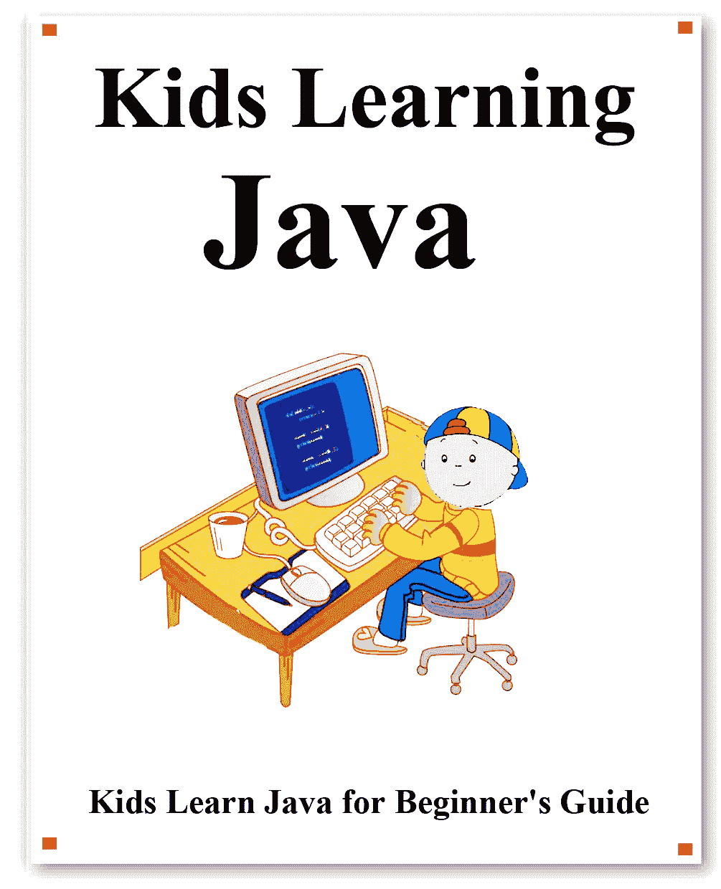

Java 是一种强大的编程语言，简单易学且有趣！孩子们学习 Java 就像玩游戏一样，这本书为 10 岁以上的儿童教授 Java 核心技能，并逐步引导他们了解编码。在书结束时，孩子们可以创建自己的应用程序和游戏。

[`en.verejava.com`](http://en.verejava.com)

1. Java JDK 安装
2. 创建第一个 Java 代码，然后点击菜单 -> Run As Java Application

## 2. Java 基础概念

1. 在 Eclipse 中创建文件：`HelloWorld.java`

```
public class HelloWorld {
    public static void main(String[] args) {
        System.out.println("Hello World");
        System.out.print("Good beginning \t");
        System.out.print("is the half of success");
    }
}
```

`System.out.println()`：将消息打印到控制台并换行

`System.out.print()`：将消息打印到控制台但不换行

`\t`：制表符

`main(String[] args)`：程序开始执行的入口

### 2.1 HelloWorld 详解

1. 创建文件：`Variable.java`

`Variable`：系统分配用于存储数据的内存区域。

`String`：字符序列，如 `"Apple"`

```
public class Variable {
    public static void main(String[] args) {
        String basket = "Apple";
        System.out.println(basket);
    }
}
```

结果：Apple

### 2.2 变量

2. 将变量 `basket` 的值从 `"Apple"` 改为 `"Orange"`

```
public class Variable {
    public static void main(String[] args) {
        String basket = "Apple";
        System.out.println(basket);
        basket = "Orange";
        System.out.println(basket);
    }
}
```

结果：Apple Orange

## 3. 算术运算符

1. 在 Eclipse 中创建文件：`ArithmeticOperator.java`

`int`：整数类型，可以存储正负的非小数数字。

算术运算：`+`, `-`, `*`, `/`

```
public class ArithmeticOperator {
    public static void main(String[] args) {
        int a = 1;
        int b = 2;
        int c = 3;
        System.out.println(a + b);
        System.out.println(a - b);
        System.out.println(a * b);
        System.out.println(a / b);
        System.out.println(c % b); // a / b 后的余数
    }
}
```

结果：3 -121

### 3.1 算术运算符

### 3.2 方法

1. 添加 3 个更多关于 `-`、`*`、`/` 的方法

```java
public class ArithmeticOperator {
    public static int add(int a, int b){
        return a + b;
    }
    public static int sub(int a, int b){
        return a - b;
    }
    public static int multiply(int a, int b){
        return a * b;
    }
    public static int divide(int a, int b){
        return a / b;
    }
    public static void main(String[] args) {
        int result = add(4, 2); // 调用 add 方法
        System.out.println(result); // 6
        result = sub(4, 2);
        System.out.println(result); // 2
        result = multiply(4, 2);
        System.out.println(result); // 8
        result = divide(4, 2);
        System.out.println(result); // 2
    }
}
```

结果：6282

### 3.3 类

`class`：是用户定义的蓝图或原型，根据它创建对象。

```
class {
    public static int add(int a, int b){
        return a + b;
    }
    public static int sub(int a, int b){
        return a - b;
    }
    public static int multiply(int a, int b){
        return a * b;
    }
    public static int divide(int a, int b){
        return a / b;
    }
    public static void main(String[] args) {
        int result = add(4, 2); // 调用 add 方法
        System.out.println(result); // 6
        result = sub(4, 2);
        System.out.println(result); // 2
        result = multiply(4, 2);
        System.out.println(result); // 8
        result = divide(4, 2);
        System.out.println(result); // 2
    }
}
```

（注：此处示例原文代码结构略有混乱，翻译已按逻辑保留代码块内容）

```java
import javax.swing.*;
public class FirstGUIApplication {
    public static void main(String[] args) {
        JFrame frame = new JFrame("Java GUI Application" );
        frame.setSize(300,200);
        frame.setVisible(true );
    }
}
```

运行打开窗口：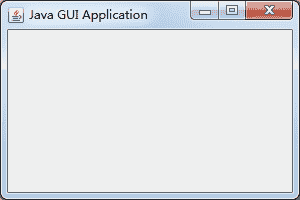

### JLabel

`JLabel`：是一种标准的 Swing 组件，用于在窗口上显示文本或图像。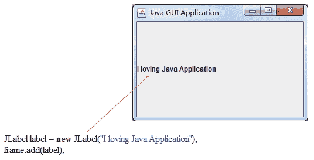

1. 在 Eclipse 中创建一个文件：`JLabelApplication.java`

```java
import javax.swing.*;
public class JLabelApplication {
    public static void main(String[] args) {
        JFrame frame = new JFrame("Java GUI Application" );
        JLabel label = new JLabel("I loving Java Application" );
        frame.add(label); // 将 JLabel 添加到 frame
        frame.setSize(300,200);
        frame.setVisible(true );
    }
}
```

### BorderLayout

`BorderLayout`：是一种容器，将组件排列在五个区域：北（north）、南（south）、东（east）、西（west）和中心（center）。`setHorizontalAlignment(JLabel.CENTER)`：将 JLabel 的水平对齐设置为居中。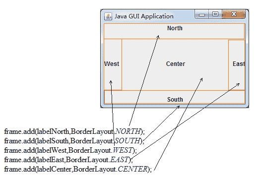

1. 在 Eclipse 中创建一个文件：`BorderLayoutApplication.java`

```java
import java.awt.BorderLayout;
import javax.swing.*;
public class BorderLayoutApplication {
    public static void main(String[] args) {
        JFrame frame = new JFrame("Java GUI Application" );
        JLabel labelNorth = new JLabel("North" );
        labelNorth.setHorizontalAlignment(JLabel.CENTER );
        JLabel labelSouth = new JLabel("South" );
        labelSouth.setHorizontalAlignment(JLabel.CENTER );
        JLabel labelWest = new JLabel("West" );
        JLabel labelEast = new JLabel("East" );
        JLabel labelCenter= new JLabel("Center" );
        labelCenter.setHorizontalAlignment(JLabel.CENTER );
        frame.add(labelNorth,BorderLayout.NORTH );
        frame.add(labelSouth,BorderLayout.SOUTH );
        frame.add(labelWest,BorderLayout.WEST );
        frame.add(labelEast,BorderLayout.EAST );
        frame.add(labelCenter,BorderLayout.CENTER );
        frame.setSize(300,200);
        frame.setVisible(true );
    }
}
```

### JTextField

`JTextField`：是一种文本组件，允许编辑单行文本...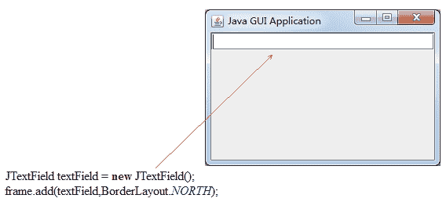

1. 在 Eclipse 中创建一个文件：`JTextFieldApplication.java`

```java
import java.awt.BorderLayout;
import javax.swing.*;
public class JTextFieldApplication {
    public static void main(String[] args) {
        JFrame frame = new JFrame("Java GUI Application" );
        JTextField textField = new JTextField();
        frame.add(textField,BorderLayout. NORTH );
        frame.setSize(300,200);
        frame.setVisible(true );
    }
}
```

### JButton

`JButton`：用于在应用程序中添加按钮。你可以为按钮附加一个函数或方法，该方法会在点击按钮时自动调用。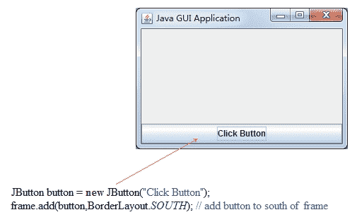

1. 在 Eclipse 中创建一个文件：`JButtonApplication.java`

```java
import java.awt.BorderLayout;
import javax.swing.*;
public class JButtonApplication {
    public static void main(String[] args) {
        JFrame frame = new JFrame("Java GUI Application" );
        JButton button = new JButton("Click Button" );
        frame.add(button,BorderLayout.SOUTH );
        frame.setSize(300,200);
        frame.setVisible(true );
    }
}
```

### JButton 点击事件

`button.addActionListener()`：为按钮添加点击事件，方法 `actionPerformed(ActionEvent e)` 将被自动调用。

`label.setText(String str)`：设置标签显示的文本为字符串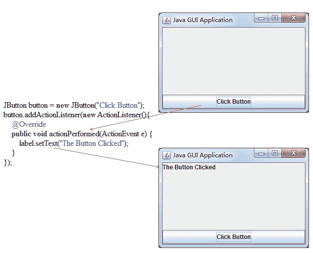

1. 在 Eclipse 中创建一个文件：`JButtonEventApplication.java`

```java
import java.awt.BorderLayout;
import java.awt.event.*;
import javax.swing.*;
public class JButtonEventApplication {
    public static void main(String[] args) {
        JFrame frame = new JFrame("Java GUI Application" );
        final JLabel label = new JLabel();
        JButton button = new JButton("Click Button" );
        button.addActionListener(new ActionListener(){
            @Override
            public void actionPerformed(ActionEvent e) {
                label.setText("The Button Clicked" );
            }
        });
        frame.add(label,BorderLayout.NORTH );
        frame.add(button,BorderLayout.SOUTH );
        frame.setSize(300,200);
        frame.setVisible(true );
    }
}
```

### GridLayout

`GridLayout(rows, cols)`：创建一个具有指定行数和列数的网格布局...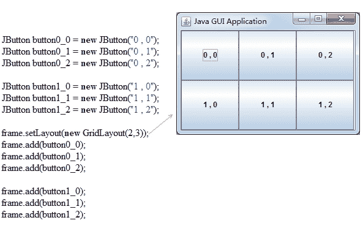

1. 在 Eclipse 中创建一个文件：`GridLayoutApplication.java`


```java
import java.awt.*;
import javax.swing.*;
public class GridLayoutApplication {
    public static void main(String[] args) {
        JFrame frame = new JFrame("Java GUI Application" );
        JButton button0_0 = new JButton("0 , 0" );
        JButton button0_1 = new JButton("0 , 1" );
        JButton button0_2 = new JButton("0 , 2" );
        JButton button1_0 = new JButton("1 , 0" );
        JButton button1_1 = new JButton("1 , 1" );
        JButton button1_2 = new JButton("1 , 2" );
        frame.setLayout(new GridLayout(2,3));
        frame.add(button0_0);
        frame.add(button0_1);
        frame.add(button0_2);
        frame.add(button1_0);
        frame.add(button1_1);
        frame.add(button1_2);
        frame.setSize(300,200);
        frame.setVisible(true );
    }
}
```

## GUI 计算器

`Integer.parseInt()`：这是 Java 的默认方法，可以将 `String` 转换为 `integer`。

`Integer.toString()`：这是 Java 的默认方法，可以将整数转换为 `String`。

`JTextField.getText()`：获取 `JTextField` 的文本。

1. 在 Eclipse 中创建一个文件：`GUICaculator.java`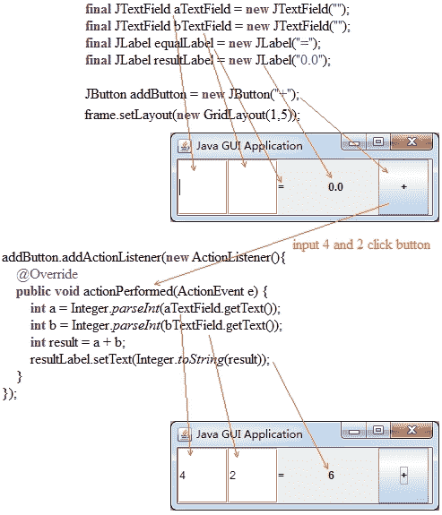

```java
import java.awt.GridLayout;
import java.awt.event.*;
import javax.swing.*;
public class GUICaculator {
    public static void main(String[] args) {
        JFrame frame = new JFrame("Java GUI Application" );
        final JTextField textField1 = new JTextField();
        final JTextField textField2 = new JTextField();
        final JLabel label = new JLabel("0");
        final JButton addButton = new JButton("+");
        final JButton subButton = new JButton("-");
        final JButton multiplyButton = new JButton("*");
        final JButton divideButton = new JButton("/");
        final JButton equalButton = new JButton("=");

        addButton.addActionListener(new ActionListener() {
            @Override
            public void actionPerformed(ActionEvent e) {
                int a = Integer.parseInt(textField1.getText());
                int b = Integer.parseInt(textField2.getText());
                int result = a + b;
                label.setText(Integer.toString(result));
            }
        });
        subButton.addActionListener(new ActionListener() {
            @Override
            public void actionPerformed(ActionEvent e) {
                int a = Integer.parseInt(textField1.getText());
                int b = Integer.parseInt(textField2.getText());
                int result = a - b;
                label.setText(Integer.toString(result));
            }
        });
        multiplyButton.addActionListener(new ActionListener() {
            @Override
            public void actionPerformed(ActionEvent e) {
                int a = Integer.parseInt(textField1.getText());
                int b = Integer.parseInt(textField2.getText());
                int result = a * b;
                label.setText(Integer.toString(result));
            }
        });
        divideButton.addActionListener(new ActionListener() {
            @Override
            public void actionPerformed(ActionEvent e) {
                int a = Integer.parseInt(textField1.getText());
                int b = Integer.parseInt(textField2.getText());
                int result = a / b;
                label.setText(Integer.toString(result));
            }
        });

        frame.setLayout(new GridLayout(2, 4));
        frame.add(textField1);
        frame.add(textField2);
        frame.add(label);
        frame.add(equalButton);
        frame.add(addButton);
        frame.add(subButton);
        frame.add(multiplyButton);
        frame.add(divideButton);
        frame.setSize(300, 200);
        frame.setVisible(true);
    }
}
```

## 赋值运算符

1. 创建一个 `AssignmentOperator.java`

```java
public class AssignmentOperator {
    public static void main(String[] args) {
        int d = 4;
        System.out .println(d++); // = 4 打印 d 后增 1
        d = 4;
        System.out .println(++d); // = 5 先增 1 后打印 d
        d = 4;
        System.out .println(d--); // = 4 打印 d 后减 1
        d = 4;
        System.out .println(--d); // = 3 减 1 后打印 d
        int result = 10;
        result = result + 1;
        System.out .println(result); // = 11
        result = 10;
        result++;
        System.out .println(result); // = 11
        result = 10;
        result += 1;
        System.out .println(result); // = 11
    }
}
```

## 创建数量加法器和减法器

`QuantityApplication.java` 点击 `+` 按钮将数量增加 1，点击 `-` 按钮将数量减少 1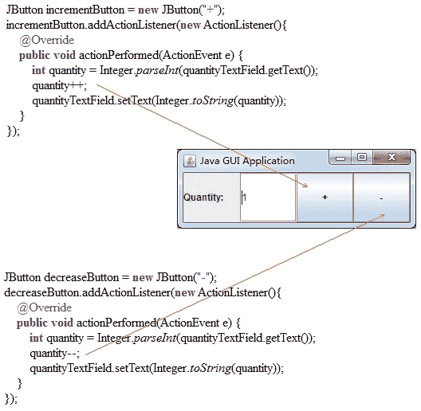

```java
import java.awt.GridLayout;
import java.awt.event.*;
import javax.swing.*;
public class QuantityApplication {
    public static void main(String[] args) {
        JFrame frame = new JFrame("Java GUI Application" );
        final JLabel quantityLabel = new JLabel("Quantity:" );
        final JTextField quantityTextField = new JTextField();
        quantityTextField.setText("1" );
        JButton incrementButton = new JButton("+" );
        incrementButton.addActionListener(new ActionListener(){
            @Override
            public void actionPerformed(ActionEvent e) {
                int quantity = Integer.parseInt (quantityTextField.getText());
                quantity++;
                quantityTextField.setText(Integer.toString (quantity));
            }
        });
        JButton decreaseButton = new JButton("-" );
        decreaseButton.addActionListener(new ActionListener(){
            @Override
            public void actionPerformed(ActionEvent e) {
                int quantity = Integer.parseInt (quantityTextField.getText());
                quantity--;
                quantityTextField.setText(Integer.toString (quantity));
            }
        });
        frame.setLayout(new GridLayout(1,4));
        frame.add(quantityLabel);
        frame.add(quantityTextField);
        frame.add(incrementButton);
        frame.add(decreaseButton);
        frame.setSize(300,100);
        frame.setVisible(true );
    }
}
```

## 关系运算符

关系运算符：只有两种结果：`true` 或 `false`

### 创建文件：`RelationalOperator.java`

```java
public class RelationalOperator {
    public static void main(String[] args) {
        System.out .println(100 > 200);
        System.out .println(100 >= 100);
        System.out .println(100 < 200);
        System.out .println(100 <= 200);
        System.out .println(100 == 100);
        System.out .println(100 != 200);
    }
}
```

结果：`false`, `true`, `true`, `true`, `true`, `true`

## If 条件语句

If 语句：

1. `if (expression){statement}`

2. `if (expression) { statement } else { statement }`

3. `if (expression) {statement } else if { statement }`

评分示例：

```
if score == 5 :  优秀
else if score == 4 :   良好
else : 需要努力追赶
```

### 创建一个 `IfStatement.java`

```java
public class IfStatement {
    public static void main(String[] args) {
        int score = 5;
        if (score == 5){
            System.out .println("Excellent" );
        }else if (score == 4){
            System.out .println("Good" );
        }else {
            System.out .println("Need to catch up" );
        }
    }
}
```

结果：`Excellent`

修改 `score = 4`：`Good`

### 创建一个 `IfStatementGUI.java`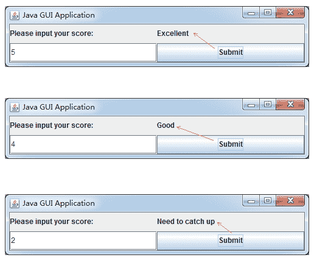


```java
import java.awt.GridLayout;
import java.awt.event.*;
import javax.swing.*;
public class IfStatementGUI {
    public static void main(String[] args) {
        JFrame frame = new JFrame("Java GUI Application" );
        final JLabel scoreLabel = new JLabel("Please input your score:" );
        final JTextField scoreTextField = new JTextField();
        final JLabel resultLabel = new JLabel("" );
        JButton submitButton = new JButton("Submit" );
        submitButton.addActionListener(new ActionListener(){
            @Override
            public void actionPerformed(ActionEvent e) {
                int score = Integer.parseInt (scoreTextField.getText());
                if (score == 5){
                    resultLabel.setText("Excellent" );
                }else if (score == 4){
                    resultLabel.setText("Good" );
                }else {
                    resultLabel.setText("Need to catch up" );
                }
            }
        });
        frame.setLayout(new GridLayout(2,2));
        frame.add(scoreLabel);
        frame.add(resultLabel);
        frame.add(scoreTextField);
        frame.add(submitButton);
        frame.setSize(500,100);
        frame.setVisible(true );
    }
}
```

# 逻辑运算符

逻辑运算符：`与`（`&&`），`或`（`||`），`非`（`!`）

1. `&&` 如果操作的两边都为 `true` 则返回 `true`，否则返回 `false`
2. `||` 当操作的两边都为 `false` 时结果为 `false`，否则为 `true`
3. `!` 如果返回 `true`，结果为 `false`，否则为 `true`

## 1. 创建 `LogicalOperator.java`

```java
public class LogicalOperator {
    public static void main(String[] args) {
        System.out .println(true && false ); // = false
        System.out .println(false && true ); // = false
        System.out .println(false && false ); // = false
        System.out .println(true && true ); // = true
        System.out .println("---------------");
        System.out .println(true || false ); // = true
        System.out .println(false || true ); // = true
    }
}
```

## 2. 创建 `LogicalOperator2.java`

```java
public class LogicalOperator2 {
    public static void main(String[] args) {
        System.out .println(true && false ); // = false
        System.out .println(false && true ); // = false
        System.out .println(false && false ); // = false
        System.out .println(true && true ); // = true
        System.out .println("---------------");
        System.out .println(true || false ); // = true
        System.out .println(false || true ); // = true
    }
}
```

## 3. 创建 `PocketMoneyGUI.java`

输入分数：

`if score == 5`: 优秀

`else if score == 4`: 良好

`else`: 需要努力追赶

```java
import java.awt.GridLayout;
import java.awt.event.*;
import javax.swing.*;
public class PocketMoneyGUI {
    public static void main(String[] args) {
        JFrame frame = new JFrame("Java GUI Application" );
        final JLabel scoreLabel = new JLabel("Please input your score:" );
        final JTextField scoreTextField = new JTextField();
        final JLabel resultLabel = new JLabel("" );
        JButton submitButton = new JButton("Submit" );
        submitButton.addActionListener(new ActionListener(){
            @Override
            public void actionPerformed(ActionEvent e) {
                int score = Integer.parseInt (scoreTextField.getText());
                if (score == 5){
                    resultLabel.setText("Excellent" );
                }else if (score == 4){
                    resultLabel.setText("Good" );
                }else {
                    resultLabel.setText("Need to catch up" );
                }
            }
        });
        frame.setLayout(new GridLayout(2,2));
        frame.add(scoreLabel);
        frame.add(resultLabel);
        frame.add(scoreTextField);
        frame.add(submitButton);
        frame.setSize(500,100);
        frame.setVisible(true );
    }
}
```

# while 循环语句

`while (expression){}` 如果 `expression` 继续执行，否则退出循环。

## 1. 创建文件：`WhileLoop.java`

```java
public class WhileLoop {
    public static void main(String[] args) {
        int i = 0;
        while (i < 10) { //如果 (i<10) 真执行循环，否则终止
            System.out .println(i);
            i = i + 1;
        }
    }
}
```

结果：`0123456789`

# while 循环游戏

模拟游戏：

`while ( num != 0 )`

`if num 等 1`: 西瓜

`else if num 等 2`: 香蕉

`else if num 等 3`: 桃子

`else if num 等 0`: 游戏结束

## 1. 创建 `WhileLoopGames.java`

```java
import java.util.Scanner;
public class WhileLoopGames {
    public static void main(String[] args) {
        System.out .println("键盘输入 1: 西瓜, 2: 香蕉, 3: 桃子, 0: 雷电" );
        Scanner in = new Scanner(System.in );
        int num = 0;
        while (num != -1) { //如果你输入 -1 则终止游戏
            num = in.nextInt();
            if (num == 1) {
                System.out .println("You cut the watermelon" );
            } else if (num == 2) {
                System.out .println("You cut the banana" );
            } else if (num == 3) {
                System.out .println("You cut the peach" );
            } else if (num == 0) {
                System.out .println("You cut the thunder game termination" );
            }
        }
    }
}
```

结果：`0, 1, 2, 3, 4, 5, 6, 7, 8, 9`,一维数组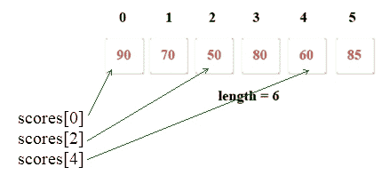

### 1. 创建 `OneArray.java`

```java
public class OneArray {
    public static void main(String[] args) {
        int [] scores = { 90, 70, 50, 80, 60, 85 }; // 定义一个一维数组
        System.out.println(scores[0]);
        System.out.println(scores[2]);
        System.out.println(scores[4]);
    }
}
```

结果：`905060`

### 2. 创建 `OneArray2.java`

```java
public class OneArray2 {
    public static void main(String[] args) {
        // 定义一个一维数组
        int [] scores = { 90, 70, 50, 80, 60, 85 };
        // 打印 scores 的所有数据
        for (int i = 0; i < scores.length ; i++) {
            System.out.print(scores[i] + "," );
        }
    }
}
```

结果：`90,70,50,80,60,85`

---

## 二维数组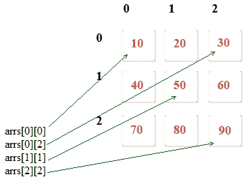

### 1. 创建 `BinaryArray.java`

```java
public class BinaryArray {
    public static void main(String[] args) {
        // 二维数组的定义和初始化
        int [][] arrs = {{ 10, 20, 30 },{ 40, 50, 60 },{ 70, 80, 90 } };
        System.out.println(arrs[0][0]);
        System.out.println(arrs[0][2]);
        System.out.println(arrs[1][1]);
        System.out.println(arrs[2][2]);
    }
}
```

结果：`10305090`

### 2. 创建一个 `TwoArray2.html` 打印二维数组的所有元素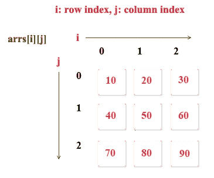

```java
public class BinaryArray2 {
    public static void main(String[] args) {
        int [][] arrs = {{ 10, 20, 30 },{ 40, 50, 60 },{ 70, 80, 90 } };
        // i: 行索引, j: 列索引
        for (int i = 0; i < arrs.length ; i++) {
            for (int j = 0; j < arrs[i].length ; j++) {
                System.out.print(arrs[i][j] + " " );
            }
            System.out.println("");
        }
    }
}
```

结果：`10 20 3040 50 6070 80 90`

---

## 找狗游戏

### 1. 根据二维数组映射创建按钮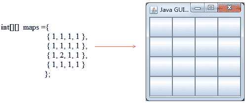

### 1. 创建文件：`FindDogGame.java`

```java
import java.awt.GridLayout;
import java.awt.event.*;
import javax.swing.*;
public class FindDogGame {
    public static void main(String[] args) {
        JFrame frame = new JFrame("Java GUI Application" );
        int [][]  maps ={{ 1, 1, 1, 1 },{ 1, 1, 1, 1 },{ 1, 2, 1, 1 },{ 1, 1, 1, 1 }};
        frame.setLayout(new GridLayout(4,4));
        for (int i = 0; i < maps.length ; i++) {
            for (int j = 0; j < maps[i].length ; j++) {
                JButton button = new JButton();
                button.setName(Integer.toString (maps[i][j]));
                frame.add(button);
            }
        }
        frame.setSize(200,200);
        frame.setVisible(true );
    }
}
```

### 2. 将数组名称填入按钮中，并添加按钮点击事件，如果按钮名称为 1 则变为 `*`，如果按钮名称为 2 则变为 `Dog`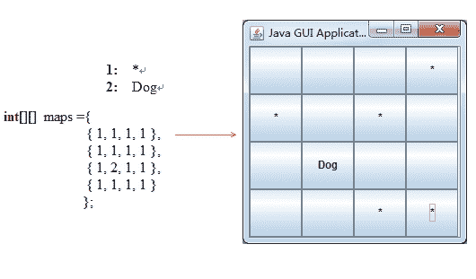

1: `*`

2: `Dog`

`String.equals(String str)`：根据字符串的内容比较两个两个字符串


```java
import java.awt.GridLayout;
import java.awt.event.*;
import javax.swing.*;

public class FindDogGame {
    public static void main(String[] args) {
        JFrame frame = new JFrame("Java GUI Application");
        final int[][] maps = {{1, 1, 1, 1}, {1, 1, 1, 1}, {1, 2, 1, 1}, {1, 1, 1, 1}};
        frame.setLayout(new GridLayout(4, 4));
        for (int i = 0; i < maps.length; i++) {
            for (int j = 0; j < maps[i].length; j++) {
                final JButton button = new JButton();
                button.setName(Integer.toString(maps[i][j]));
                frame.add(button);
                button.addActionListener(new ActionListener() {
                    @Override
                    public void actionPerformed(ActionEvent e) {
                        if (button.getName().equals("1")) {
                            button.setText("*");
                        } else if (button.getName().equals("2")) {
                            button.setText("Dog");
                        }
                    }
                });
            }
        }
        frame.setSize(200, 200);
        frame.setVisible(true);
    }
}
```

### 3. 打印随机数 0-9

`Random`：`random.nextInt(n)`：返回一个 0 到 n-1 之间的随机数。

创建文件：`RandomNumber.java`

```java
import java.util.Random;

public class RandomNumber {
    public static void main(String[] args) {
        Random rn = new Random();
        for (int i = 0; i < 10; i++) {
            int num = rn.nextInt(10);
            System.out.println(num + ", ");
        }
    }
}
```

结果：`9, 3, 9, 0, 4, 1, 0, 3, 4, 5`

### 4. 随机生成 1-2 初始化二维数组，将数组名称填入按钮中，并添加按钮点击事件，如果按钮名称为 1 则变为 `*`，如果按钮名称为 2 则变为 `Dog`

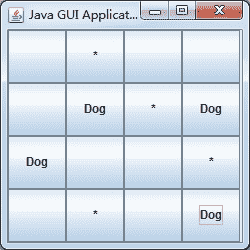

1: `*`

2: `Dog`

# 方法重载

```java
class Caculator {
    public double add(double a, double b) {
        return a + b;
    }

    public int add(int a, int b) {
        return a + b;
    }
}

public class TestOverLoad {
    public static void main(String[] args) {
        Caculator c = new Caculator();
        int result = c.add(10, 20);
        System.out.println(result);
        // 使用不同参数类型调用重载方法
        double result2 = c.add(30.5, 40.2);
        System.out.println(result2);
    }
}
```

结果：`30` `70.7`

# 继承

主题：`Student` 继承 `Person`

步骤：

1. 类：`Student`, `Person`
2. 关系：`Student` 扩展 `Person`
3. 属性：`Person` 的属性（`name`, `age`）
4. 方法：`Person` 的动作（`say`）

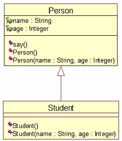

1. 创建文件：`TestInheritence.java`

```java
class Person {
    protected String name;
    protected int age;

    public Person() {
        System.out.println("Parent Person() instantiation");
    }

    public Person(String name, int age) {
        System.out.println("Parent Person(String name, int age) instantiated");
    }

    public void say() {
        System.out.println("Person can speaking");
    }
}

/**
 * Person 被称为父类或超类
 * Student 被称为 Person 的子类
 */
class Student extends Person {
    public Student() {
        super();
        System.out.println("Subclass Student() Instantiation");
    }

    public Student(String name, int age) {
        super(name, age);
        System.out.println("Subclass Student(String name, age) " + name + " instantiated");
    }
}

public class TestInheritence {
    public static void main(String[] args) {
        Student s = new Student();
        s.name = "Sumi";
        s.age = 22;
        System.out.println("-----------------------------------------");
        Student s2 = new Student("Isacc", 23);
        s2.say();
    }
}
```

```java
/**
 * 1. 子类无法访问父类的私有属性和方法
 * 2. 子类可以访问父类的保护、公有属性和方法
 */
```

结果：

```
Parent Person() instantiation
Subclass Student() Instantiation
Parent Person(String name, age) instantiated
Subclass Student(String name, age) Isacc instantiated
Person can speaking
```

# 方法重写

重写：子类重写了父类的方法，子类的实例将调用子类的方法，而不是调用父类的方法。

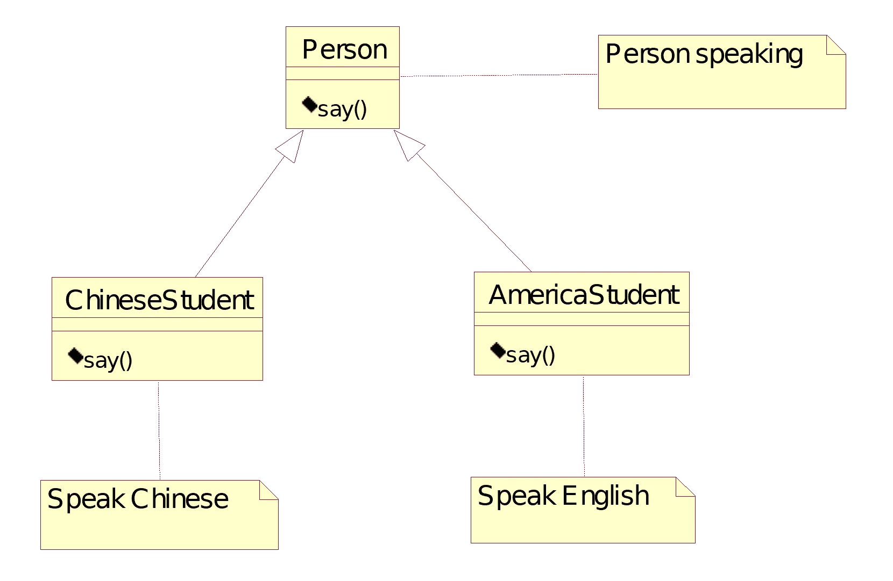

1. 创建文件：`TestOverride.java`

```java
class Person {
    public void say() {
        System.out.println("Person speaking");
    }
}

class ChineseStudent extends Person {
    public void say() {
        System.out.println("Speak Chinese");
    }
}

class AmericaStudent extends Person {
    public void say() {
        System.out.println("Speak English");
    }
}

public class TestOverride {
    public static void main(String[] args) {
        ChineseStudent s = new ChineseStudent();
        s.say();
        AmericaStudent as = new AmericaStudent();
        as.say();
    }
}
```

结果：

```
Speak Chinese
Speak English
```

# Java 线程

线程：是程序内部单一的顺序控制流。CPU 会为每个线程分配一段时间时间来执行。汽车和火车同时运行。

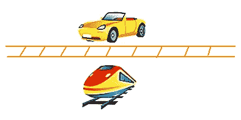

1. 创建文件：`TestThread.java`
创建 2 个线程类：`CarThread` 扩展 `Thread`，`TrainThread` 扩展 `Thread`
`start()`：启动一个线程，然后会自动调用 `run()`。

```java
class CarThread extends Thread {
    @Override
    public void run() {
        for (int i = 0; i < 5; i++) {
            System.out.println("Car Thread Run " + i);
            try {
                Thread.sleep(200);
            } catch (InterruptedException e) {
                e.printStackTrace();
            }
        }
    }
}

class TrainThread extends Thread {
    @Override
    public void run() {
        for (int i = 0; i < 5; i++) {
            System.out.println("Train Thread Run " + i);
            try {
                Thread.sleep(200);
            } catch (InterruptedException e) {
                e.printStackTrace();
            }
        }
    }
}

public class TestThread {
    public static void main(String[] args) {
        CarThread carThread = new CarThread();
        carThread.start();
        TrainThread trainThread = new TrainThread();
        trainThread.start();
    }
}
```

输出结果：

```
Car Thread Run 0
Train Thread Run 0
Car Thread Run 1
Train Thread Run 1
Car Thread Run 2
Train Thread Run 2
Car Thread Run 3
Train Thread Run 3
Car Thread Run 4
Train Thread Run 4
```

从结果可以看出，两个线程是交替执行的。

# Canvas 进度条

`Canvas`：用于在屏幕上绘制图形，我们可以继承 `JPanel`。

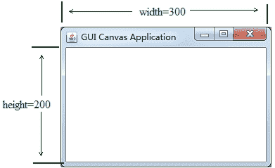

1. 创建 `ProgressBar.java`
`Canvas` 扩展 `JPanel`：`Canvas` 继承自 `JPanel`
`this.setLayout(null)`：必须设置布局为 `null`
`this.setBackground(Color c)`：在 `JPanel` 中设置背景颜色

```java
import java.awt.*;
import javax.swing.*;

class Canvas extends JPanel {
    public Canvas() {
        this.setLayout(null);
        this.setBackground(Color.WHITE);
    }

    protected void paintComponent(Graphics g) {
        super.paintComponent(g);
    }
}

public class ProgressBar {
    public static void main(String[] args) {
        JFrame frame = new JFrame("GUI Canvas Application");
        Canvas canvas = new Canvas();
        frame.add(canvas);
        frame.setSize(300, 200);
    }
}
```

2. 在 `Canvas` 上画一条线

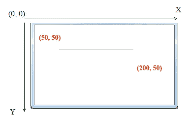

`g.drawLine(x1, y1, x2, y2)`：接收四个整数表示起点 `x1, y1` 和终点 `x2, y2` 的坐标。

```java
import java.awt.*;
import javax.swing.*;

class Canvas extends JPanel {
    public Canvas() {
        this.setLayout(null);
        this.setBackground(Color.WHITE);
    }

    protected void paintComponent(Graphics g) {
        super.paintComponent(g);
        g.drawLine(50, 50, 200, 50);
    }
}
```

3. 在 `Canvas` 上画一个矩形

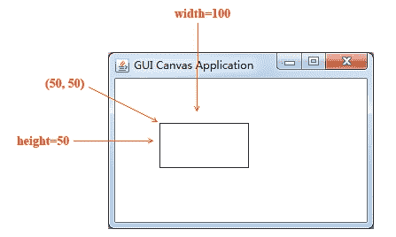

`g.drawRect(x, y, width, height)`：在画布上绘制矩形。

```java
import java.awt.*;
import javax.swing.*;

class Canvas extends JPanel {
    public Canvas() {
        this.setLayout(null);
        this.setBackground(Color.WHITE);
    }

    protected void paintComponent(Graphics g) {
        super.paintComponent(g);
        g.drawRect(50, 50, 150, 50);
    }
}
```

4. 在 `Canvas` 上填充一个矩形

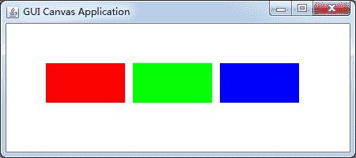

`g.fillRect(x, y, width, height)`：填充画布上的矩形。
`g.setColor(Color c)`：设置颜色（`Color.RED`、`Color.GREEN`、`Color.BLUE`）。

```java
import java.awt.*;
import javax.swing.*;

class Canvas extends JPanel {
    public Canvas() {
        this.setLayout(null);
        this.setBackground(Color.WHITE);
    }

    protected void paintComponent(Graphics g) {
        super.paintComponent(g);
    }
}
```

```java
import java.awt.*;
import javax.swing.*;

class Canvas extends JPanel {
```


# 画布小球碰撞

## 1. 在画布上画一个圆 `(x, y) = (80, 80)`，`width = 100`，`height = 100`。

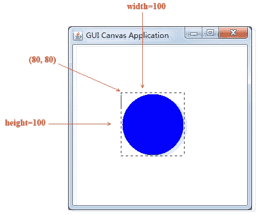

创建一个`BallGame.java`。

`fillOval(int x, int y, int width, int height)`：用当前颜色填充指定矩形边界内的椭圆。

```java
import java.awt.*;
import javax.swing.*;

class Canvas extends JPanel {

    public Canvas() {
        this.setLayout(null);
        this.setBackground(Color.WHITE);
    }

    protected void paintComponent(Graphics g) {
        super.paintComponent(g);
        g.setColor(Color.BLUE);
        g.fillOval(80, 80, 100, 100);
    }
}

public class BallGame {

    public static void main(String[] args) {
        JFrame frame = new JFrame("GUI Canvas Application");
        Canvas canvas = new Canvas();
        frame.add(canvas);
        frame.setSize(300, 300);
        frame.setVisible(true);
    }
}
```

## 2. 创建一个类`Ball`，然后创建方法`draw(Graphics g, int x, int y, int r, Color c)`在画布上画 3 个圆。

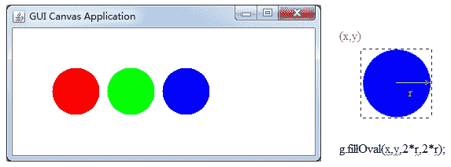

```java
import java.awt.*;
import javax.swing.*;

class Ball {

    public void draw(Graphics g, int x, int y, int r, Color c) {
        g.setColor(c);
        g.fillOval(x, y, 2 * r, 2 * r);
    }
}

class Canvas extends JPanel {

    public Canvas() {
        this.setLayout(null);
        this.setBackground(Color.WHITE);
    }

    protected void paintComponent(Graphics g) {
        super.paintComponent(g);
        Ball ball = new Ball();
        ball.draw(g, 50, 50, 30, Color.RED);
        ball.draw(g, 120, 50, 30, Color.GREEN);
        ball.draw(g, 190, 50, 30, Color.BLUE);
    }
}

public class BallGame {

    public static void main(String[] args) {
        JFrame frame = new JFrame("GUI Canvas Application");
        Canvas canvas = new Canvas();
        frame.add(canvas);
        frame.setSize(400, 200);
        frame.setVisible(true);
    }
}
```

## 3. 创建一个类`Ball`，通过构造方法传递`x, y, r, color`，然后创建一个方法`draw(Graphics g)`在画布上画 1 个圆。

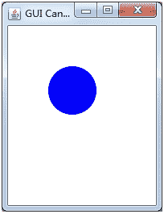

`g2.setRenderingHint(RenderingHints.KEY_ANTIALIASING, RenderingHints.VALUE_ANTIALIAS_ON)`：开启`ANTIALIASING`以绘制出良好的圆。

```java
import java.awt.*;
import javax.swing.*;

class Ball {

    private int x;
    private int y;
    private int r;
    private Color color;

    public Ball(int x, int y, int r, Color color) {
        this.x = x;
        this.y = y;
        this.r = r;
        this.color = color;
    }

    public void draw(Graphics g) {
        Graphics2D g2 = (Graphics2D) g;
        g2.setRenderingHint(RenderingHints.KEY_ANTIALIASING, RenderingHints.VALUE_ANTIALIAS_ON);
        g2.setColor(this.color);
        g2.fillOval(this.x, this.y, 2 * this.r, 2 * this.r);
    }
}

class Canvas extends JPanel {

    public Canvas() {
        this.setLayout(null);
        this.setBackground(Color.WHITE);
    }

    protected void paintComponent(Graphics g) {
        super.paintComponent(g);
        Ball ball = new Ball(50, 50, 30, Color.BLUE);
        ball.draw(g);
    }
}

public class BallGame {

    public static void main(String[] args) {
        JFrame frame = new JFrame("GUI Canvas Application");
        Canvas canvas = new Canvas();
        frame.add(canvas);
        frame.setSize(200, 300);
        frame.setVisible(true);
    }
}
```

## 4. 绘制进度条动画

### 4.1. 先画一个空矩形

### 4.2. 填充一个实矩形，开启一个线程`ProgressBarThread`，宽度每 200 毫秒增加 10，直到`width = 150`

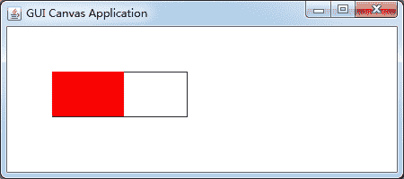

`repaint()`：持有重绘此组件的指令，`paintComponent(Graphics g)`将自动调用以重绘。

```java
import java.awt.*;
import javax.swing.*;

class Canvas extends JPanel {

    int width = 0;

    public Canvas() {
        this.setLayout(null);
        this.setBackground(Color.WHITE);
        new ProgressBarThread().start();
    }

    protected void paintComponent(Graphics g) {
        super.paintComponent(g);
        g.drawRect(50, 50, 150, 50);
        g.setColor(Color.RED);
        g.fillRect(50, 50, width, 50);
    }
}

class ProgressBarThread extends Thread {

    @Override
    public void run() {
        while (width < 150) {
            width = width + 10;
            try {
                Thread.sleep(200);
                Canvas.this.repaint();
            } catch (InterruptedException e) {
                e.printStackTrace();
            }
        }
    }
}
```

## 5. 创建一个`Ball`并打开一个`Canvas`。让小球向下移动

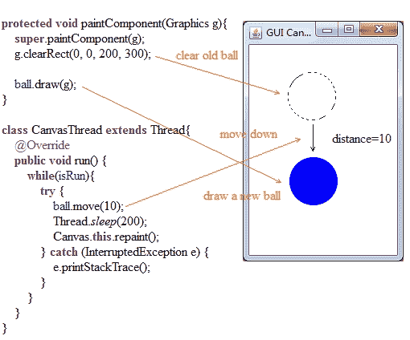

```java
import java.awt.*;
import javax.swing.*;

class Ball {

    private int x;
    private int y;
    private int r;
    private Color color;

    public Ball(int x, int y, int r, Color color) {
        this.x = x;
        this.y = y;
        this.r = r;
        this.color = color;
    }

    public void draw(Graphics g) {
        Graphics2D g2 = (Graphics2D) g;
        g2.setRenderingHint(RenderingHints.KEY_ANTIALIASING, RenderingHints.VALUE_ANTIALIAS_ON);
        g2.setColor(this.color);
        g2.fillOval(this.x, this.y, 2 * this.r, 2 * this.r);
    }

    public void move(int distance) {
        this.y = this.y + distance;
    }
}

class Canvas extends JPanel {

    private Ball ball;

    public Canvas() {
        this.setLayout(null);
        this.setBackground(Color.WHITE);
        ball = new Ball(80, 50, 30, Color.BLUE);
        new BallThread().start();
    }

    protected void paintComponent(Graphics g) {
        super.paintComponent(g);
        ball.draw(g);
    }

    class BallThread extends Thread {

        @Override
        public void run() {
            while (true) {
                ball.move(10);
                Canvas.this.repaint();
                try {
                    Thread.sleep(100);
                } catch (InterruptedException e) {
                    e.printStackTrace();
                }
            }
        }
    }
}

public class BallGame {

    public static void main(String[] args) {
        JFrame frame = new JFrame("GUI Canvas Application");
        Canvas canvas = new Canvas();
        frame.add(canvas);
        frame.setSize(200, 300);
        frame.setVisible(true);
    }
}
```

## 6. 小球向上和向下


```java
import java.awt.*;
import javax.swing.*;
class Ball{
    private int x ;
    private int y ;
    private int r ;
    private Color color ;
    public Ball( int x, int y, int r, Color color){
        this .x = x;
        this .y = y;
        this .r = r;
        this .color = color;
    }
    public void draw(Graphics g){
        Graphics2D g2=(Graphics2D)g;
        g2.setRenderingHint(RenderingHints.KEY_ANTIALIASING , RenderingHints.VALUE_ANTIALIAS_ON );
        g2.setColor(this .color );
        g2.fillOval(this .x ,this .y ,2*this .r ,2*this .r );
    }
    public void move(int distance){
        this .y = this .y + distance;
    }
}
class Canvas extends JPanel{
    protected Ball ball ;
    private boolean isRun = true ;
    private int canvasWidth = 200;
    private int canvasHeight = 300;
    CanvasThread CanvasThread ;
    public Canvas(){
        this .setLayout(null );
        this .setBackground(Color.WHITE );
        ball =new Ball(50,50,30,Color.BLUE );
        CanvasThread =new CanvasThread();
        CanvasThread .start();
    }
    protected void paintComponent(Graphics g){
        canvasWidth = this.getWidth();
        canvasHeight = this.getHeight();
        super .paintComponent(g);
        g.clearRect(0, 0, canvasWidth, canvasHeight);
        ball .draw(g);
    }
}
 class CanvasThread extends Thread{
    @Override
    public void run() {
        String direction = "down";
        while (isRun ){
            try {
                if (ball.getY() <= canvasHeight && direction.equals("down")){
                    ball.move(10);
                } else {
                    direction = "up";
                }
                if (ball.getY() >= 0 && direction.equals("up")){
                    ball.move(-10);
                } else {
                    direction = "down";
                }
                Canvas.this .repaint();
                Thread.sleep (200);
            } catch (InterruptedException e) {
                e.printStackTrace();
            }
        }
    }
}
public class BallGame {
    public static void main(String[] args) {
        JFrame frame = new JFrame("GUI Canvas Application" );
        Canvas canvas = new Canvas();
        frame.add(canvas);
        frame.setSize(200,300);
        frame.setVisible(true );
    }
}
```

## 创建类

Java 是一种面向对象的编程语言。Java 中的几乎一切都是对象，拥有自己的属性和方法。类就像对象的构造器。在游戏中，飞机、子弹、炸弹和敌机被称为 `Sprite`。

### 1. 创建文件 `TestSprite.java`

```java
// 定义一个 Sprite 类
class Sprite {
    // 定义类的属性
    String name = "" ;
    String color = "" ;
    // 定义必须包含 self 的方法
    public void draw() {
        String text = this .color + " " + this .name + "�is drawn on canvas" ;
        System.out .println(text);
    }
}
public class TestSprite {
    public static void main(String[] args) {
        // 实例化名称为 sprite 的对象
        Sprite sprite = new Sprite();
        // 使用 sprite 访问属性和方法
        sprite.name = "Airplane" ;
        sprite.color = "Blue" ;
        sprite.draw();
        sprite.name = "Airplane" ;
        sprite.color = "Red" ;
        sprite.draw();
        sprite.name = "Bullet" ;
        sprite.color = "Blue" ;
        sprite.draw();
        sprite.name = "Bullet" ;
        sprite.color = "Red" ;
        sprite.draw();
    }
}
```

**输出：**

Blue Airplane is drawn on canvas

Red Airplane is drawn on canvas

Blue Bullet is drawn on canvas

Red Bullet is drawn on canvas

### 构造方法

构造方法：创建对象时会被自动调用。

### 2. 创建文件 `TestConstructor.java`

```java
class Sprite {
    String name = "" ;
    String color = "" ;
    public Sprite(String name, String color) {
        this .name = name;
        this .color = color;
    }
    public void draw() {
        String text = this .color + " " + this .name + " is drawn on canvas" ;
        System.out .println(text);
    }
}
public class TestConstructor {
    public static void main(String[] args) {
        // 实例化对象构造会被自动调用
        Sprite blueSprite = new Sprite("Airplane", "Blue");
        blueSprite.draw();
        Sprite redSprite = new Sprite("Bullet", "Red");
        redSprite.draw();
    }
}
```

# 结果

结果：`Blue Airplane` 画在画布上。

结果：`Blue Bullet` 画在画布上。

# 继承

所有类 `EnemyPlane`、`BluePane`、`RedPlane`、`Bullet` 都继承自 `Sprite1`。`Sprite` 被称为父类。`EnemyPlane`、`BluePane`、`RedPlane`、`Bullet` 被称为子类。子类可以调用父类的属性和方法。


## 1. 创建文件：`TestInheritance.java`

```java
class Sprite {
    private String name = "" ;
    private String color = "" ;
    public Sprite(String name, String color){
        this .name = name;
        this .color = color;
    }
    public void draw() {
        String text = this .color + " " + this .name + "  is drawn on canvas" ;
        System.out .println(text);
    }
}
class BluePlane extends Sprite{
    public BluePlane(String name, String color) {
        super (name, color);
    }
}
class RedPlane extends Sprite{
    public RedPlane(String name, String color) {
        super (name, color);
    }
}
class Bullet extends Sprite{
    public Bullet(String name, String color) {
        super (name, color);
    }
}
public class TestInheritance{
    public static void main(String[] args) {
        BluePlane bluePlane = new BluePlane("Airplane" ,"Blue" );
        bluePlane.draw();
        RedPlane redPlane = new RedPlane("Airplane" ,"Red" );
        redPlane.draw();
        Bullet redBullet= new Bullet("Bullet" ,"Red" );
        redBullet.draw();
    }
}
```

# 结果

结果：`Blue Airplane` 画在画布上。

结果：`Red Airplane` 画在画布上。

结果：`Red Bullet` 画在画布上。

# 重写

重写：子类重写父类的方法，子类实例将调用被重写的方法。

`Sprite` 可以发射子弹，但 `BluePlane` 可以发射蓝色子弹，而 `RedPlane` 可以发射红色子弹。


## 1. 创建文件：`TestOverride.java`

```java
class Sprite{
    public void shoot(){
        System.out .println("fire bullet" );
    }
}
// BluePlane 继承 Sprite
class BluePlane extends Sprite{
    public void  shoot(){
        System.out .println("BluePlane fire blue bullet" );
    }
}
// RedPlane 继承 Sprite
class RedPlane extends Sprite{
    public void  shoot(){
        System.out .println("RedPlane fire red bullet" );
    }
}
public class TestOverride{
    public static void main(String[] args) {
        BluePlane bluePlane = new BluePlane();
        bluePlane.shoot();
        RedPlane redPlane = new RedPlane();
        redPlane.shoot();
    }
}
```

# 结果

结果：`BluePlane fire blue bullet`

结果：`RedPlane fire red bullet`

# 飞机游戏

## 1. 在画布上绘制图片。

### 1.1 将两张飞机图片放入目录 `images/blue_plane.png` 和 `images/red_plane.png`

 

### 1.2 在画布上绘制 `images/blue_plane.png` 和 `images/red_plane.png`。


`KidsLearningJavascript.zip` 中的所有图片请通过此链接下载：[http://en.verejava.com/download.jsp?id=1]

## 2. 创建 `AirplaneGame.java`

- `new File(imagePath)`：通过图片路径创建文件对象。

- `ImageIO.read(file)`：读取图片文件并保存到 `BufferedImage`。

- `g.drawImage(image, x, y, null)`：将图片绘制到画布上。


## 3. 创建 `Airplane` 类并在画布上绘制图片


```java
import java.awt.image.BufferedImage;
import java.awt.*;
import java.io.*;
import javax.imageio.ImageIO;
import javax.swing.*;
class Canvas extends JPanel {
    public Canvas() {
        this .setLayout(null );
        this .setBackground(Color.WHITE );
    }
    protected void paintComponent(Graphics g) {
        super .paintComponent(g);
        BufferedImage blueImage=loadImage("images/blue_plane.png" );
        g.drawImage(blueImage, 50, 200, null );
        BufferedImage redImage=loadImage("images/red_plane.png" );
        g.drawImage(redImage, 150, 200, null );
    }
    public BufferedImage loadImage(String imagePath) {
        File file = new File(imagePath);
        BufferedImage bufferedImage = null ;
        try {
            bufferedImage = ImageIO.read (file);
        } catch (IOException e) {
            e.printStackTrace();
        }
        return bufferedImage;
    }
}
public class AirplaneGame {
    public static void main(String[] args) {
        JFrame frame = new JFrame("GUI Canvas Application" );
        Canvas canvas = new Canvas();
        frame.add(canvas, BorderLayout.CENTER );
        frame.setSize(300, 300);
        frame.setVisible(true );
    }
}
```

```java
import java.awt.image.BufferedImage;
import java.awt.*;
import java.io.*;
import javax.imageio.ImageIO;
import javax.swing.*;
class Airplane{
    protected int x ;
    protected int y ;
    protected BufferedImage image ;
    public Airplane(int x, int y, BufferedImage image){
        this .x = x;
        this .y = y;
        this .image = image;
    }
    public void draw(Graphics g){
        g.drawImage(image , x , y , null );
    }
}
class Canvas extends JPanel {
    public Canvas() {
        this .setLayout(null );
        this .setBackground(Color.WHITE );
    }
    protected void paintComponent(Graphics g) {
        super .paintComponent(g);
        BufferedImage blueImage=loadImage("images/blue_plane.png" );
        g.drawImage(blueImage, 50, 200, null );
        BufferedImage redImage=loadImage("images/red_plane.png" );
        g.drawImage(redImage, 150, 200, null );
    }
    public BufferedImage loadImage(String imagePath) {
        File file = new File(imagePath);
        BufferedImage bufferedImage = null ;
        try {
            bufferedImage = ImageIO.read (file);
        } catch (IOException e) {
            e.printStackTrace();
        }
        return bufferedImage;
    }
}
public class AirplaneGame {
    public static void main(String[] args) {
        JFrame frame = new JFrame("GUI Canvas Application" );
        Canvas canvas = new Canvas();
        frame.add(canvas, BorderLayout.CENTER );
        frame.setSize(300, 300);
        frame.setVisible(true );
    }
}
```

## 4. 按键事件

### 4.1 在 `Canvas` 中添加 `KeyListener` 监听

点击上、下、左、右键时 `keyPressed(KeyEvent e)` 方法将被调用。

- `static Canvas canvas`：如果 `keyPressed` 事件生效，它需要是 `static`。
- `canvas.requestFocus()`：如果 `keyPressed` 事件生效，需要获取焦点。


```java
import java.awt.*;
import java.awt.event.*;
import java.io.*;
import javax.imageio.ImageIO;
import javax.swing.*;
class Canvas extends JPanel {
    public Canvas() {
        this .setLayout(null );
        this .setBackground(Color.WHITE );
        this . requestFocus();
        this .addKeyListener(new KeyAdapter() {
            public void keyPressed(KeyEvent e) {
                int keyCode = e.getKeyCode();
                if (keyCode == KeyEvent.VK_UP){
                    System.out .println("up" );
                } else if (keyCode == KeyEvent.VK_DOWN){
                    System.out .println("down" );
                } else if (keyCode == KeyEvent.VK_RIGHT){
                    System.out .println("right" );
                } else if (keyCode == KeyEvent.VK_LEFT){
                    System.out .println("left" );
                }
            }
        });
    }
    protected void paintComponent(Graphics g) {
        super .paintComponent(g);
    }
}
public class AirplaneGame {
    private static Canvas canvas ;
    public static void main(String[] args) {
        JFrame frame = new JFrame("GUI Canvas Application" );
        canvas = new Canvas();
        frame.add(canvas , BorderLayout.CENTER );
        frame.setSize(300, 300);
        frame.setVisible(true );
        canvas .requestFocus();
    }
}
```

```java
import java.awt.BorderLayout;
import java.awt.Color;
import java.awt.Graphics;
import java.awt.event.KeyAdapter;
import java.awt.event.KeyEvent;
import java.awt.image.BufferedImage;
import java.io.File;
import java.io.IOException;
import javax.imageio.ImageIO;
import javax.swing.JFrame;
import javax.swing.JPanel;

class Airplane {
    protected int x;
    protected int y;
    protected BufferedImage image;

    public Airplane(int x, int y, BufferedImage image) {
        this.x = x;
        this.y = y;
        this.image = image;
    }

    public void draw(Graphics g) {
        g.drawImage(image, this.x, this.y, null);
    }

    public void move(int distanceX, int distanceY) {
        this.x = this.x + distanceX;
        this.y = this.y + distanceY;
    }
}

class Canvas extends JPanel {
    private BufferedImage blueImage;
    private Airplane bluePlane;

    public Canvas() {
        this.setLayout(null);
        this.setBackground(Color.WHITE);
        this.requestFocus();
        blueImage = loadImage("images/blue_plane.png");
        bluePlane = new Airplane(100, 200, blueImage);
        this.addKeyListener(new KeyAdapter() {
            public void keyPressed(KeyEvent e) {
                int keyCode = e.getKeyCode();
                if (keyCode == KeyEvent.VK_UP) {
                    bluePlane.move(0, -10);
                } else if (keyCode == KeyEvent.VK_DOWN) {
                    bluePlane.move(0, 10);
                } else if (keyCode == KeyEvent.VK_RIGHT) {
                    bluePlane.move(10, 0);
                } else if (keyCode == KeyEvent.VK_LEFT) {
                    bluePlane.move(-10, 0);
                }
                Canvas.this.repaint();
            }
        });
    }

    protected void paintComponent(Graphics g) {
        super.paintComponent(g);
        bluePlane.draw(g);
    }

    public BufferedImage loadImage(String imagePath) {
        File file = new File(imagePath);
        BufferedImage bufferedImage = null;
        try {
            bufferedImage = ImageIO.read(file);
        } catch (IOException e) {
            e.printStackTrace();
        }
        return bufferedImage;
    }
}

public class AirplaneGame {
    private static Canvas canvas;

    public static void main(String[] args) {
        JFrame frame = new JFrame("GUI Canvas Application");
        canvas = new Canvas();
        frame.add(canvas, BorderLayout.CENTER);
        frame.setSize(300, 300);
        frame.setVisible(true);
        canvas.requestFocus();
    }
}
```

## 5. 飞机发射蓝色子弹

### 5.1 子弹从飞机的顶部中心位置射出

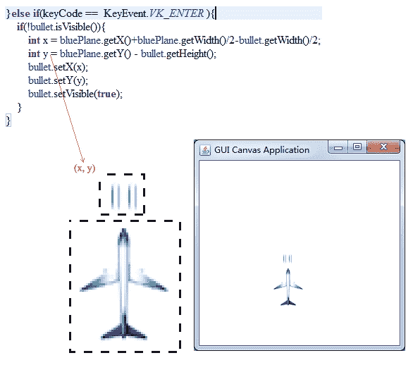

### 5.2 启动一个 `CanvasThread` 让子弹向上移动

当子弹移出画布范围时，需要通过设置 `visible = false` 将子弹销毁，子弹可以重新发射。

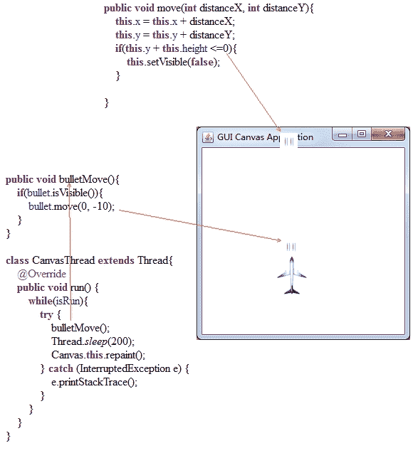

### 5.3 飞机和子弹继承自 `Sprite` 以实现复用

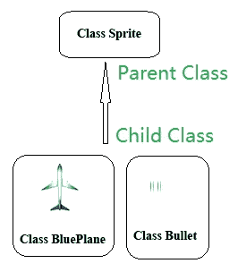

## 6. 敌机持续向下移动

### 6.1 敌机随机从画布顶部开始并向下移动

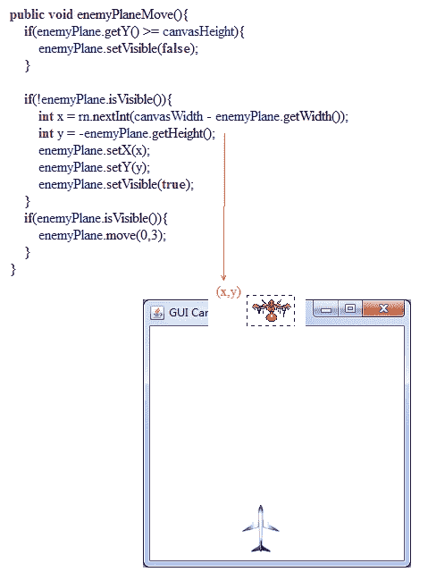

### 6.2 保持敌机持续向下移动

当敌机移出画布范围时，需要通过设置 `visible = False` 将敌机销毁，敌机可以重新生成。

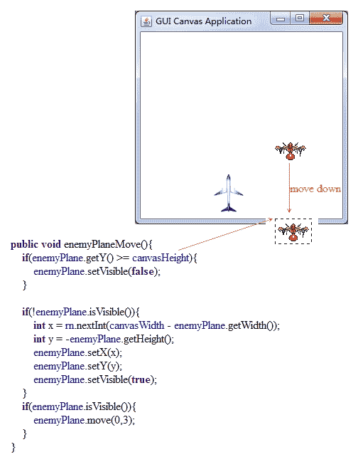

### 6.3 飞机、子弹和敌机继承自 `Sprite` 以实现复用

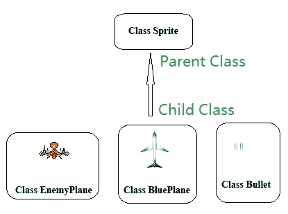

## 7. 子弹与敌机碰撞并爆炸

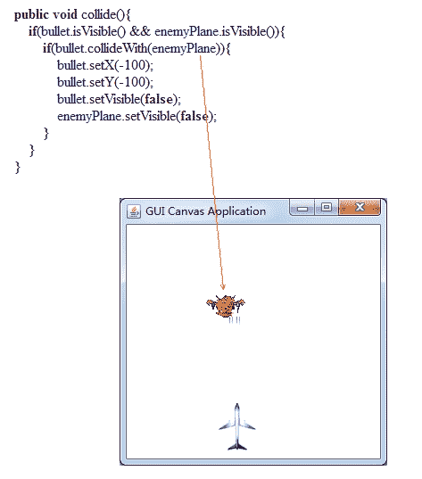

### 7.1 子弹与敌机碰撞

当两张图片中心坐标之差的绝对值小于它们宽度和高度一半之和时，我们认为它们发生了交集并产生了碰撞。

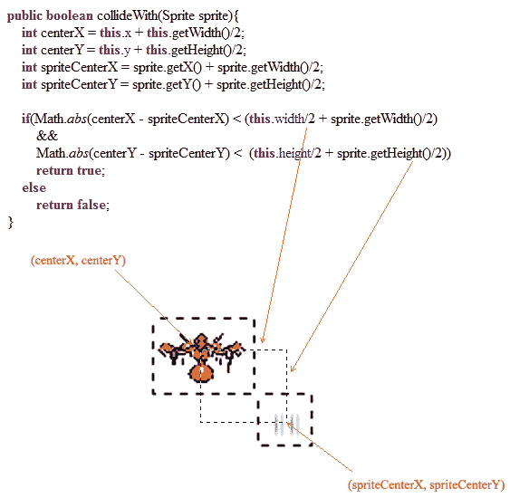


```java
import java.awt.*;
import java.awt.event.*;
import java.awt.image.BufferedImage;
import java.io.*;
import java.util.Random;
import javax.imageio.ImageIO;
import javax.swing.*;

class Sprite {
    protected int x;
    protected int y;
    protected BufferedImage image;
    protected boolean visible;
    protected int width;
    protected int height;

    public Sprite(int x, int y, BufferedImage image) {
        this.x = x;
        this.y = y;
        this.image = image;
        this.width = this.image.getWidth();
        this.height = this.image.getHeight();
    }

    public void draw(Graphics g) {
        g.drawImage(image, this.x, this.y, null);
    }

    public boolean collideWith(Sprite sprite) {
        int centerX = this.x + this.getWidth() / 2;
        int centerY = this.y + this.getHeight() / 2;
        int spriteCenterX = sprite.getX() + sprite.getWidth() / 2;
        int spriteCenterY = sprite.getY() + sprite.getHeight() / 2;
        if (Math.abs(centerX - spriteCenterX) < (this.width / 2 + sprite.getWidth() / 2) && Math.abs(centerY - spriteCenterY) < (this.height / 2 + sprite.getHeight() / 2))
            return true;
        else
            return false;
    }

    public void move(int distanceX, int distanceY) {
        this.x = this.x + distanceX;
        this.y = this.y + distanceY;
    }

    public int getX() {
        return x;
    }

    public void setX(int x) {
        this.x = x;
    }

    public int getY() {
        return y;
    }

    public void setY(int y) {
        this.y = y;
    }

    public boolean isVisible() {
        return visible;
    }

    public void setVisible(boolean visible) {
        this.visible = visible;
    }

    public int getWidth() {
        return width;
    }

    public int getHeight() {
        return height;
    }
}

class BluePlane extends Sprite {
    public BluePlane(int x, int y, BufferedImage image) {
        super(x, y, image);
    }
}

class Bullet extends Sprite {
    public Bullet(int x, int y, BufferedImage image) {
        super(x, y, image);
    }

    public void move(int distanceX, int distanceY) {
        this.x = this.x + distanceX;
        this.y = this.y + distanceY;
        if (this.y + this.height <= 0) {
            this.setVisible(false);
        }
    }
}

class EnemyPlane extends Sprite {
    public EnemyPlane(int x, int y, BufferedImage image) {
        super(x, y, image);
    }
}

class Canvas extends JPanel {
    private boolean isRun = true;
    private BufferedImage blueImage;
    private BluePlane bluePlane;
    private BufferedImage bulletImage;
    private Bullet bullet;
    private BufferedImage enemyPlaneImage;
    private EnemyPlane enemyPlane;
    private CanvasThread canvasThread;
    private int canvasWidth = 300;
    private int canvasHeight = 300;
    private Random rn = new Random();

    public Canvas() {
        this.setLayout(null);
        this.setBackground(Color.WHITE);
        this.requestFocus();
        blueImage = loadImage("images/blue_plane.png");
        bluePlane = new BluePlane(100, 200, blueImage);
        bulletImage = loadImage("images/blue_bullet.png");
        bullet = new Bullet(-100, -100, bulletImage);
        bullet.setVisible(false);
        enemyPlaneImage = loadImage("images/enemy.png");
        enemyPlane = new EnemyPlane(-100, -100, enemyPlaneImage);
        canvasThread = new CanvasThread();
        canvasThread.start();
        this.addKeyListener(new KeyAdapter() {
            public void keyPressed(KeyEvent e) {
                int keyCode = e.getKeyCode();
                if (keyCode == KeyEvent.VK_UP) {
                    bluePlane.move(0, -10);
                } else if (keyCode == KeyEvent.VK_DOWN) {
                    bluePlane.move(0, 10);
                } else if (keyCode == KeyEvent.VK_RIGHT) {
                    bluePlane.move(10, 0);
                } else if (keyCode == KeyEvent.VK_LEFT) {
                    bluePlane.move(-10, 0);
                } else if (keyCode == KeyEvent.VK_ENTER) {
                    if (!bullet.isVisible()) {
                        int x = bluePlane.getX() + bluePlane.getWidth() / 2 - bullet.getWidth() / 2;
                        int y = bluePlane.getY() - bullet.getHeight();
                        bullet.setX(x);
                        bullet.setY(y);
                        bullet.setVisible(true);
                    }
                }
            }
        });
    }

    protected void paintComponent(Graphics g) {
        this.canvasWidth = this.getWidth();
        this.canvasHeight = this.getHeight();
        super.paintComponent(g);
        bluePlane.draw(g);
        bullet.draw(g);
        enemyPlane.draw(g);
    }

    public BufferedImage loadImage(String imagePath) {
        File file = new File(imagePath);
        BufferedImage bufferedImage = null;
        try {
            bufferedImage = ImageIO.read(file);
        } catch (IOException e) {
            e.printStackTrace();
        }
        return bufferedImage;
    }

    public void bulletMove() {
        if (bullet.isVisible()) {
            bullet.move(0, -10);
        }
    }

    public void enemyPlaneMove() {
        if (enemyPlane.getY() >= canvasHeight) {
            enemyPlane.setVisible(false);
        }
        if (!enemyPlane.isVisible()) {
            int x = rn.nextInt(canvasWidth - enemyPlane.getWidth());
            int y = -enemyPlane.getHeight();
            enemyPlane.setX(x);
            enemyPlane.setY(y);
            enemyPlane.setVisible(true);
        }
        if (enemyPlane.isVisible()) {
            enemyPlane.move(0, 3);
        }
    }

    public void collide() {
        if (bullet.isVisible() && enemyPlane.isVisible()) {
            if (bullet.collideWith(enemyPlane)) {
                bullet.setX(-100);
                bullet.setY(-100);
                bullet.setVisible(false);
                enemyPlane.setVisible(false);
            }
        }
    }
}

class CanvasThread extends Thread {
    @Override
    public void run() {
        while (isRun) {
            try {
                bulletMove();
                enemyPlaneMove();
                collide();
                Thread.sleep(200);
                Canvas.this.repaint();
            } catch (InterruptedException e) {
                e.printStackTrace();
            }
        }
    }
}

public class AirplaneGame {
    private static Canvas canvas;

    public static void main(String[] args) {
        JFrame frame = new JFrame("GUI Canvas Application");
        canvas = new Canvas();
        frame.add(canvas, BorderLayout.CENTER);
        frame.setSize(300, 300);
        frame.setVisible(true);
        canvas.requestFocus();
    }
}
```

感谢学习，如果你想学习网页编码，请学习我们的书籍[`en.verejava.com`](http://en.verejava.com/)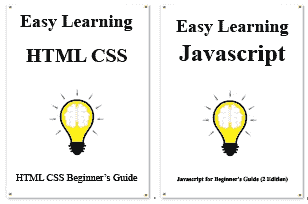VereMVC: Java Web MVC Framework[`en.verejava.com/?section_id=1697715673191`](http://en.verejava.com/?section_id=1697715673191)
