# 知识管理与 Web 3.0：下一代业务模型

## 编辑者

- **Dr. Sandeep Kautish**  
  LBEF 校园，Maitidevi 庙对面，加德满都，尼泊尔  
  dr.skautish@gmail.com

- **Dr. Alka Mayura**  
  AMITY 大学，Sector 125 Amity Rd，诺伊达 201301，印度  
  alkamya@gmail.com

- **Asst. Prof. Deepamala Singh**  
  LBEF 校园，Maitidevi 庙对面，加德满都，尼泊尔  
  d2udeepmala@gmail.com

- **Dr. Mary Jayanthi**  
  商业智能与人工智能学院，管理与技术学院  
  SH 248 35 公里处，Katol 路，马哈拉施特拉 441502，印度  
  dr.maryprem@gmail.com

- **Dr. Zdzislaw Polkowski**  
  波罗斯拉夫经济商业大学，Komandorska 118/120，53-345 Wrocław，波兰  
  dzisislaw.polkowski@ue.wroc.pl

## 作者列表

- **Dr. Deepmala Singh**  
  助理教授，亚太大学（加德满都校区），马来西亚  
  2udeepmala@gmail.com

- **Seema Garg**  
  阿米蒂大学，诺伊达，北方普拉什邦，印度  
  seemagarg1@gmail.com

- **Odiroye Tomide Hakeem**  
  Chi Limited，拉各斯，尼日利亚  
  oridymero@yaho.com

- **Dr. Anurag Singh**  
  助理教授，商学院，石油能源研究大学 (UPES)，德拉敦，印度  
  anurag110@gmail.com

- **Pradeep Beni**  
  Lingayas Vidyayepeth，法里达巴德，印度

- **Sagar Karki**  
  学生（MBA），亚太大学（加德满都校区），马来西亚  
  sagar.karki@study.ibef.edu

- **S. B. Goyal**  
  城市大学，八灵再，马来西亚  
  drsgoyal@gmail.com

- **Afreen Niaz**  
  研究学者，家庭科学学院，克什米尔大学，Hazratbal

- **Dr. Zdzislaw Polkowski**  
  波罗斯拉夫经济商业大学，Komandorska 118/120，53-345 Wrocław，波兰  
  dzisislaw.polkowski@ue.wroc.pl

---

## 1 知识管理概述

知识管理（KM）是对业务网络的一种关注。尽管“管理”一词可能暗示了一个相当直接的定义，但对于它究竟是什么以及应该如何利用，还存在许多假设。尽管如此，由于业务发展速度的不断加快，为组织选拔成功且严肃的执行人员已变得至关重要，而 KM 只要得到正确的理解和实现，将成为像竞争优势一样的、助力业务变革的有力工具。

Davenport 和 Prusak [28] 将知识视为一种不断发展的混合体，由描述性的洞察力、相关数据和专家理解组成，它为评估和整合新经验及数据提供了框架。他们发现，在组织中，信息通常被植入档案或数据库计划、流程、实践和标准中。他们还表示，为了让信息具有价值，必须增强人类的背景、经验和理解因素。Nonaka [22] 扩展了这一观点，认为信息与重要性是紧密相连的，因为它取决于特定的背景。这意味着知识的使用者应该理解并经验信息产生和使用的独特情境，或涵盖的环境和影响，从而使其对他们具有意义。这同样推断出，为了使信息库有用，它还应该存储产生知识的背景。这种知识是特定背景的，并反驳了知识可以随处通用的观点；尽管如此，它并不反对层级信息的观点 [6]。这部分认为层级信息是权威人士记忆和使用的重要组成部分，意味着知识是有价值的。

KM 是在组织内部识别、描述、组织和分享代表人员信息和经验的意识过程 [5]，它将信息描述为五种特定结构：封装、插入、嵌入、覆盖和编码。它将典型知识描述为通过身体准备以执行某项任务获得的知识 [17]，将 KM 描述为将过去动态经验中获得的信息专门应用于当前和未来活动的行为，其明确动机是提高组织的生存能力。

随着计算技术的进步、互联网（特别是 Web）的出现，KM 工具已经得到了发展。这已不再仅仅是处理文档的问题，而是是一组内部和外部数据，以便未来可以被重复使用。

### 1.1 知识管理工具示例

- **论坛或即时消息工具**：简化不同参与者之间的通信；
- **Word、Excel、视频等**：建立书面或口头操作程序；
- **内网平台**：分享新闻和通用文档；
- **目录**：不同专业知识的所在位置；
- **工作组**：建立协作系统并在同一组织的成员之间进行共享；
- **电子学习培训**：优化新人的学习过程并提升员工水平。

### 1.2 知识管理实践的关键特征

- 一种管理性和/或管理方法（意愿、设备、措施等），反对随心所欲的想法；
- 目标：做得更好（比以前或比别人），为了获胜；
- 集体方法：从管理个人知识的个体转向知识的集体动员，以迈向集体知识；
- 时间和记忆中的印记（可持续性、资本化等）：从具有短期“爆发力”的行动主义转向深思熟虑的构建，确保基于对过去最佳（及失败）的开发的未来；
- 一个需要动员的关键资源，即知识，或者归根结底是头脑、他们的知识和经验。

### 1.3 知识管理的意义

KM 之所以重要，是因为它支持组织动态能力的有效性。通过确保所有代表都能接触组织内部拥有的通用知识，汇聚了一种更强大的力量，他们更有可能做出快速、明智且有利于组织的决策。KM 的意义逐年增长。随着商业中心变得瞬息万变，或许保持领先的理想方法是以明智、灵活的方式构建你的组织。你需要能够以良好的方式发现问题，并对新数据和新进展做出反应。

真正的挑战不仅限于知识的获取，而在于它的精通。因为识别和管理现有知识、了解其真实性、其内部或外部的关键性、以及实施收集、分类、传播、评估或发现它的最佳方法是非常关键的。KM 无疑是公司中的关键角色。

公司除了资本之外增值通过三个基本领域实现，这些领域必须多元以应对有效的全球化：

- 对客户和市场的了解
- 对过去、当前或最新 IT 技术的了解
- 使他们能够应用于工业化目标的方法论

KM 让每位员工无论其所在地和原始培训如何，都能了解并分享自己的知识和技能。例如，通过网络工具携带的虚拟技能允许建立一个共享客户技术和方法论知识的人员社区。

这些技能的内部组织需要跨职能部门的协同，这使得知识管理者从尘封的房间中出来，发挥驱动作用：它要求从基于知识力量的工作方式转向协作共享知识的方式。

KM 的目标是客户提供日益的服务，同时保持对客户知识的亲度和服务的透明度。因此，KM 不再局限于公司，而是与客户建立新关系的共同服务，基于共同的信息基础和企业内容管理（ECM）工具。这种集体知识除了监控服务外，还为服务的持续改进提供了重要支持，并将客户/供应商关系转化为伙伴关系，带有扩展企业的概念，终端用户的满意度处于中心。此外，对知识和技能的掌握是公司增值的保证，在一个通信模式和信息共享模式正在改变 IT 行业格局的背景下。如果我们的世纪被否定了知识，那么我们的行业只能通过持续的无形资本进行估值。尽管这一点现在被所有人认可，但在市场中估值仍然困难。

### 1.4 知识管理工具：一种组织工具

将知识管理方法论调整为组织技术的需求被认为是实现知识管理的基础 [12, 23]。组织的知识管理技术应该对机构的知识资产及其所在地有理解；阐明知识在价值创造中的作用，并包含在某些阶段之后安排的、包括短期成功和长期利益的各种协调活动或练习 [9]。机构的知识管理方法并非偶然，而是取决于组织服务客户的方式、业务的财务状况以及聘用的人员。问题不再是知识是否是关键的组织资源，而是知识管理与企业战略的对齐、知识管理的影响衡量以及业务结果的推动。

### 1.5 知识积累

知识积累包括从组织内部或外部来源获取知识 [15]。协会在创造知识和学习时也经常遗忘。在这方面，对组织记忆的知识进行保护、关联和组织，建立了一个重要且成功的权威信息部分。聚合记忆或权威记忆被描述为过去的信息、经验和事件。层级记忆包含了存在各种结构中的信息，包括记录的报告、存储在电子数据集中的组织化数据、存储在记录权威技术和周期的主框架中的编码人员信息，以及学习了信息的人和人的组织 [14]。权威记忆被分为语义记忆或情节记忆。语义记忆指的是通用的、明确的具有表达力的信息，而情节记忆指的是具体的语境和设定。将信息转换为语义记忆并不能确保信息的有效传播，也无法确保熟练的能力。

### 1.6 知识传递

知识传递存在于多个层面：人与人之间、从个人到群体、在小组之间、跨小组之间、从小组到协会之间的知识交换 [4]。考虑到权威共识的恰当概念，层级环境中知识管理的一个重要循环是将信息交换到它需要的地方和所在地。在任何情况下，这都不是一个简单的循环，因为组织并不知道自己知道什么，而且没有卓越的框架来发现和检索存储在组织的信息。信息传递由五个要素组成，具体来说是感知源个人对信息的估计、源头的动机倾向、对应通道的存在和推进、获取者的动机倾向，以及接收者的吸收能力 [26]。

### 1.7 知识内涵

企业的优势来自于对信息的使用，而非信息本身。这意味着信息本身无法提供优势。仅仅通过使用信息并应用信息的部分就可以带来要创造的企业的利益。产生权威能力的知识协调系统是指导、协助和自由团队。标记指的是通过明确信息转换而形成的特定准则、原则、方法和方向，并包含了非专业人士通过专业非言说知识充分表达的信息。权威事务指的是任务执行和协作的类型、直觉传统和准备细节，这些细节允许应用和协调个人信息，而无需与他人讨论他们的见解。拥有基本信息和技能的小组负责处理问题，当任务的脆弱性和复杂性阻止了指导和组织传递细节时。

知识管理的挑战是在两个方面成为创新的引擎：

- 通过专利提交和技术或方法创新实现技术创新的财务增强。
- 对其知识和技巧的掌握，使得跨技术和方法的共享比以前更重要。

技术的进步带来了新的愿景。互联网的进步带来了新的愿景。Web 1.0 的出现带来了新的愿景，允许用户访问网站并阅读。这种技术是组织的服务，比以前更重要。

## 2 知识管理问题

知识管理的挑战是对组织的挑战性问题是结果。

## 3 知识管理的未来

知识管理通过对技能的持续改进创造了一个环境。这种时间的节约、技能的提高和知识的提升具有许多积极影响：

- 加速新人的学习能力
- 促进决策
- 团队生产力
- 更容易地适应（市场变化、员工离开等）
- 激励团队

因此，知识的共享直接影响工作生产力。一个高效、响应迅速且创新的组织将更有价值。

## 4 Web 1.0

技术在许多领域得到了极大改进，互联网行业也发生了同样的情况。Web 1.0 的发布消息并不久远，因为它最早在 1990 年发布，并在 1991 年，第一个网站在互联网世界发布。Web 1.0 也被称为一个新信息的时代，人们可以在那里阅读并获取信息。Web 1.0 也被称为一种只读网络服务，用户可以访问网站并阅读，而不进行任何交互。这种系统纯粹是为网站所有者设计的，因为他们是那些随时可以控制想要提供的信息的人。这种系统主要基于 `XML`、`HTTP` 和 `HTML` 程序 [25]。

## 5 Web 2.0

技术在每个领域都在不断变化，互联网世界也发生了同样的情况。人们现在意识到他们在网站世界也需要更先进的技术和设施。在理解了这一基本需求后，Web 2.0 进入了技术领域。这项 Web 系统的第二代技术于 2004 年 10 月在互联网市场正式推出。Web 2.0 最好的特点是，在这个系统中，网站具有了额外的交互功能，并作为“读写网络”而广受欢迎。有很多流行的 Web 2.0 网站示例，我们每个人在日常生活中仍在使用它们，如不同的博客网站、社交媒体以及 `Facebook` 和 `YouTube` 等热门网站 [20]。它帮助用户管理和规范他们的信息共享习惯，并连接到与世界网平台相关的不同 Web 应用程序。最显著的例子是它们平台的繁荣，因为越来越多的人开始在日常网络浏览中使用它们的网站。Web 2.0 是 Web 1.0 的绝对继任者，因为它提供了更符合用户习惯的交互平台，这对于协作内容的创建和灵活的 Web 设计非常有用。这有助于引入新的服务，如聊天、玩游戏、在线学习、博客、通信以及对任何可以与大家共享的内容进行自由标记和评论。与 Web 1.0 相比，Web 2.0 是基于交互且加载了更多 Web 应用程序，而后者仅基于静态单向内容形式的信息共享 [1]。

## 6 Web 3.0

现在让我们聊聊 Web 3.0，每个人都需要理解 3.0 是什么以及它能做什么。当用户在 Web 1.0 和 Web 2.0 上搜索信息时，系统通过用户搜索的关键词来搜索并呈现信息。然而，在这一新技术推出后，这种概述发生了变化，机器学习也被包含在 Web 3.0 中，它作为人工智能（AI）广受欢迎。Web 3.0 是语义网，它结合了用户对信息的“读-写-执行”，其中计算机和服务器可以通过 AI 和机器学习方法像人类一样理解搜索信息。在这个系统中，程序算法经过专门设计，以创建机器与机器之间的通信。这是万网领域的第三代技术，于 2006 年通过语义数据集成创建了这项技术。Web 3.0 使用元数据技术，它将仅显示的内容转换为有意义的信息，帮助用户评估他们的搜索结果。语义 Web 3.0 是由智能应用程序开发的“读写智能网络”特性，在用户搜索内容时，提供具有下一代浏览和信息搜索能力的高度可移植性且面向个人化的数据。该系统是基于语义的可执行性系统。

它使用 AI 和多用户虚拟环境来为用户提供更好的体验，这与仅基于在线社交网络平台读写程序的 Web 2.0 相比有了进步。这一特性使程序帮助该系统进行自我反思并生成结果，而不是依靠人类 [7]。

在 Web 3.0 发布后，由于其应用服务迅速引起了热潮，这些服务帮助搜索引擎生成并展示用户在搜索中想要看到的更完整、更可靠且更具针对性的信息。不仅如此，它还帮助人们与其个人和职业生活紧密联系，并帮助他们同时管理业务和朋友圈。此外，Web 3.0 还帮助用户提供一个安全维护的记录和存储信息的安全场所，使用户可以随时随地访问。与 Web 2.0 用户只能连接社交网络并分享观点不同，现在用户可以链接他们的情感、想法和创意，这是 AI 为用户针对搜索引擎搜索术语提供的演进扩展 [2]。

更准确地说，每种技术都有其优缺点。在我的研究中，我发现了 Web 3.0 的一些优缺点，这可以帮助任何用户理解这项技术的优劣。让我们先从优势开始，首先是信息链接的增加。该程序是基于语义的程序，搜索引擎的搜索功能连接了跨网络的数据点。在网络浏览方面，Web 3.0 通过使用社交网络网站使通信更加顺畅。人与之间的互动也增加了，并在更快的互联网连接的引领下，与之前的 Web 2.0 或 Web 1.0 版本不同。这种 Web 3.0 让在线交互比离线更简单。让我们转向 Web 3.0 的主要缺点，我想说的第一个是设备先进不足。Web 3.0 改进了很多功能，但如果不同的个人没有相应的设备，他们就无法处理和使用此类 Web 3.0 功能。用户之间的复杂性增加，对于新手来说，理解和适应 Web 3.0 的实施挑战可能非常复杂。Web 3.0 在巨大的互联网上消除数十亿页面中所有数以亿计的重复项 [21]。用户的查询并不具体，有时极其难以理解。Web 3.0 还必须处理大量不确定价值，并决定提供的数据，这可能导致逻辑问题。为了改进这些问题，语义区块链技术可以通过智能合约在安全地互连和存储数据来提供帮助。通过去中心化应用（dApps）形式的去中心化账本，用户可以独立运行，而没有服务器的单点故障。它有助于跟踪特定信息并将其连接到负责其他信息的其他应用。这项发展最有趣的部分是，没有人知道需要多长时间才能达到功能完备的 Web 3.0。有一点可以肯定，Web 3.0 的未来如果它进一步改进并结合 AI 来产生并提供更准确的结果，改变在线生活将是令人惊叹且有趣的。

在 Web 3.0 之后，有人认为 Web 4.0 将推出，然而，对于个人来说讨论或期待 Web 4.0 还为时过早，因为其背后的想法仍在进行中。目前还没有发现重大信息或定义。然而，主要的计算机科学家认为，升级版本的 AI 将很快推出，因为许多公司正在将 AI 和机器学习响应整合到应用程序中。计算机专家还认为，通过更精确的方式升级 AI 后，人类和机器可以顺畅地交互通信并做出决策 [22]。

### 6.1 Web 3.0 的四个关键属性

1. **语义网**——它是 Web 3.0 的关键，使数据易于处理。它有助于理解词义以生成、共享和连接内容。它利用所有在线信息将用户体验提升到另一个水平。
2. **AI**——是 Web 3.0 流行的主要因素之一。使机器通过海量网络数据变得更智能以满足用户需求。AI 允许网站进行过滤并展示最好的数据。
3. **3D 图形**——Web 3.0 通过其维度技术超越了前身，提供了一个比 2D 更真实的三维在线世界。3D 是用户虚拟身份的基础，提供了比 Web 1.0 和 2.0 更好的体验。
4. **无处不在**——同时存在于各个地方的理念。设备的崛起日益增长，越来越多的人可以随时随地访问互联网。这种互联网访问使 Web 3.0 无处不在且用户友好。

## 7 Web 3.0 的未来


# Web 3.0 是面向区块链的

Web 3.0 是面向区块链的，这意味着没有中心控制点、完整的数据所有权、无许可网络中的服务中断减少。有许多理由证明了 Web 3.0 在市场上的流行，主要原因是它们构建在更好的应用系统之上，这将其创造并产生更具针对性的结果 [10]。

## 8 结论

我们现在知道，知识和信息代表了公司的一种基础无形资产。随着 Web 的出现，对其进行定期更新成为可能。因此，知识管理（KM）变成了一个持续改进的过程。公司的绩效不再仅仅根据生产来衡量。它更多地取决于其在问题出现时的反应能力，以及展示其绩效的竞争性发展能力。工人不再被视为仅仅是执行者。他们掌握着构成组织真正价值的知识和窍门。除了知识管理之外，谈论互联网的未来，Web 3.0 比讨论近年的具体技术创新要有意义得多。在许多研究人员提供与网络和互联网相关的创新应用之际，试图将所有这些内容归类在一个旗帜下似乎是不可能的。如果说 Web 2.0 最终成功将大家的想法和识别用途整合在一起，那么 Web 3.0 并非如此。过去 15 年的技术竞赛带来了非凡的创新，涵盖了在线以及我们的软件和硬件领域。一个问题随之产生：这些用途都与互联网（Internet）相关，但并非与 Web（Web）相关。

### 参考文献

- [9] Du Plessis, M. (2007). 知识管理以及是什么导致了复杂的实施。
- [11] El, L.E. (2009). 互联网简史。Computer Communication Review, 39(5), 22–31.

---

# 知识管理与 Web 3.0 在教育领域的影响与作用：对克什米尔大学的实证研究

**作者：** Afreen Niyaz

**摘要：** 知识创建、共享和使用的过程被称为知识管理（KM），它关乎改变每个人工作的方式。知识管理被认为是组织维持以及价值维护的重要因素。多年来，人们对知识管理的重要性进行了深入讨论。我们意识到，技术随着时间的推移而演变，缩短了传播知识的时间，并允许学生自主学习、加强协作。这些应用蓬勃发展，与此同时，社交媒体也引起了不同领域学生的关注。此类技术的流行影响了图书馆和其他文化遗产组织运作的方式。创新互联网的持续演进为网络教育开启了无法想象的机会。本研究旨在调查位于克什米尔的克什米尔大学研究生（PG）对 Web 2.0 工具的使用情况以及对 Web 3.0 技术的认知水平。本研究采用了描述性调查法。通过自设计的问卷从 200 名受访者处收集所需信息。结果显示，克什米尔大学的研究生已经熟悉大多数 Web 2.0 工具（如即时通讯、社交网络、维基），但对播客、社交书签或 RSS 馈并不熟悉。研究还发现，最常用的工具包括 WhatsApp、Facebook、YouTube 以及维基。受访者指出，与朋友和家人互动、分享生活想法以及与许多建立建立是使用社交网站的原因。发现研究生对最新的 Web 3.0 技术并不了解，在该领域需要更多指导。建议学术机构将与 Web 2.0 相关的单元以及 Web 3.0 工具整合到课程中，通过提高专业能力来培养未来的人才，使其能够胜任未来的挑战。

## 1 引言

近期，我们观察到许多大学和教育机构提供了大量的在线服务，其中包括在线录取程序、虚拟（在线）学习环境以及在线缴费缴纳，旨在促进和加强各种背景学生的终身学习，并使其与其他教育管理活动相兼容 [5]。此外，教师现在通常会创建一个基于 Web 的交付系统，其中包含与学生表现和活动相关的在线讲义，以及供参考的各种不同资源列表。我们意识到，Web 3.0 不仅仅是一组有效且实用的新技术或服务。它提供了广泛的服务，以让真正的在线教室成为现实。这些服务对整个教学学习过程产生了非常积极且真实的影响。这些益处已经与在线教育中现有的最佳实践保持一致。此外，预计该系统的优势将与在线教育中现行的最佳实践相接轨，并构建一个进一步经过认证且资源丰富的教育环境。信息和通信技术（ICTs）的不断演进是通往技术教育领域新颖机会、改革或改进的大门 [3]。当前的 Web 3.0 版本包含了一个更具互动性和动态性的界面，具有极高水平的功能，使机器不仅能够执行任务，还能提供分析和解释能力，以适应这些用户的需求 [16]。因此，研究和理解教育技术随 Web 3.0 增强而演进的过程是非常重要且富有成效的，包括它如何以先进的方式促进教学学习过程，以及需要考虑的局限性和待解决的问题。

## 2 文献综述

自从万维网发展以来，技术取得了稳健的进步，所有的文档网络已演变为各种数据库。这种进步是互联网革命三个阶段的结果 [7]。第一阶段被称为 Web 1.0，涉及用户与网站之间的单向通信。另一个阶段被称为 Web 2.0，始于 2003 年初 [6]。它提供了写作的能力，或者说涉及了双向通信 [39]。Web 的第三阶段，即 Web 3.0，是一个“智能网”的概念，它允许用户不仅可以阅读，还能在阅读的同时执行 Web 操作 [40]。这一代涉及一种连贯的体验。互联网在进步中确实发挥了动态作用 [14]。它允许了巨大的自主性、提高了教学效率并增强了协作能力 [26]。这些应用增长得非常迅速，因此，社交媒体平台引起了来自不同专业的学生的广泛关注 [13]。由于它们如此普及，这些平台已主导了全球许多用户的日常职业和个人生活 [12]。另一项研究回顾了与 Web 相关的广泛工具应用，包括博客、播客、社交共享服务、民俗经济学（folksomics）等 [19]。研究发现这些技术非常重要，因为图书馆可以使用此类应用找到非常有吸引力的设施，而无需为在线存储花费额外预算 [38]。

第三代简化了全球数据仓库，各种格式的信息在此处被收集甚至被共享 [4]。Web 3.0 还包括三维（3D）组件，这是其关键特征 [37]。Web 3.0 被称为一种应用，其中网站中的数据可以与其他人的相关信息进行相互关联 [10]。另一项研究指出，Web 3.0 是计算机产生人类新信息的地方 [46]。然而，人们已经认识到机器可以在内容创作过程中与用户进行互动。各种研究解释了与 Web 3.0 相关的特征、应用和技术 [35]。此外，所提到的引擎将根据用户的偏好关注特定习惯 [9]。通过这样做，它将生成更具针对性和更复杂的信息，这些信息将具有巨大的价值 [34]。随后用于推荐引擎的信息将以一种对智能体具有层次结构的方式进行收集和存储 [41]。同时，这些成就使 Web 3.0 具有不仅能收集和分析，还能进一步分发数据的能力，这些最终可以转化为巨大的知识、有用的信息和巨大的智慧 [18]。

### 关键要素

- 新编程语言对数据进行分类和处理的能力，以便机器能够解释数据以及描述数据的短语 [2]。
- 从更广泛来源收集信息的能力 [48]。
- 以层次方式从网络搜索中存储和获取上下文信息的能力 [20]。
- 通过所有类型的设备生成并共享所有类型数据的能力 [28]。

Web 3.0 和 Web 2.0 工具越来越多被全球不同的高等教育机构采用，以支持学习实践和促进 [17]。这种实用的语义网的发布，导致了数字原生代利用各种个人学习环境、教育软件甚至个人虚拟环境方面的一个巨大转折点 [43]。这类环境让数字原生住民获得了获得意义数据的概率。

## 3 目标

- 识别克什米尔大学（Kashmir University）研究生（PG students）对 Web 2.0 工具的认知水平。
- 识别克什米尔大学研究生对 Web 2.0 工具的使用程度。
- 发现研究生对 Web 3.0 技术的认知水平。
- 探讨研究生加入社交媒体平台的原因。
- 讨论知识管理（KM）在教育领域的作用。

## 4 方法论

本研究旨在调查克什米尔大学（斯林纳格）各系研究生对 Web 2.0 和 Web 3.0 工具的认知水平和使用情况。研究使用的采样技术是简单随机抽样，样本量为 200 人。设计了一份自制问卷以收集来自大学不同系学生的数据。随后，利用频率计数和百分比对描述性统计进行分析。结果以表格和图的形式展示。

## 5 结果与讨论

### 5.1 学生对 Web 2.0 工具的认知

本研究涉及 200 名参与者，其中包括一半的受访者（即 50%）为女性，50% 为男性。受访者被要求展示对 Web 2.0 工具的了解程度（见图 1）。尽管如此，学生明确表示他们并不熟悉 Web 2.0 工具，其比例很低，其中包括 RSS 馈、播客和社交书签。结果显示，克什米尔大学的研究生习惯即时消息、社交网络网站、维基和博客，但对 RSS 馈、社交书签和播客等工具并不熟悉。

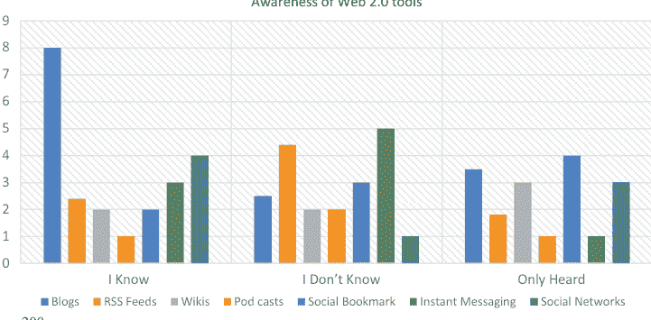

### 5.2 使用程度

受访者还被要求指定使用 Web 2.0 工具的范围（见图 2），发现大多数受访者（57%）花费最多时间使用社交媒体应用，而 37% 的受访者被发现频繁使用即时消息，12% 的受访者专注于 YouTube 平台，并比其他应用程序看更多视频。在利用维基方面，总参与者中的 20% 过度使用，而 14% 的人花费更多时间听播客。Web 2.0 的 RSS 馈和标签工具被较少受访者使用，且使用时间非常短，因为他们并不熟悉这些工具。

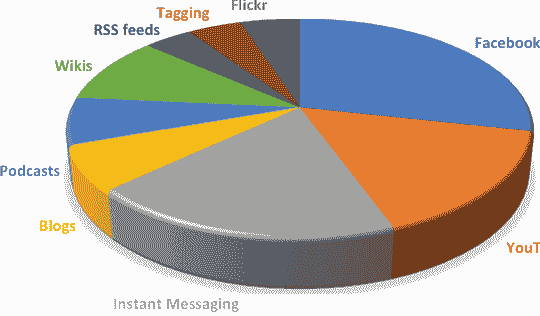

### 5.3 使用这些工具的原因

下一个问题探讨了大学研究生（PG students）加入社交平台的原因（见图 3）。对于大多数受访者来说，与朋友家人联系、交流个人生活观点或结识新朋友是他们社交网络的首要原因。此外，大多数人还用它来保持信息更新。研究发现，只有极少数学生利用社交网络（SNS）分享学习知识，并对了解新事物产生兴趣，比例分别为 25.5% 和 30%。研究结果表明，研究生使用 Web 2.0 工具并不局限于理论性的驱动。

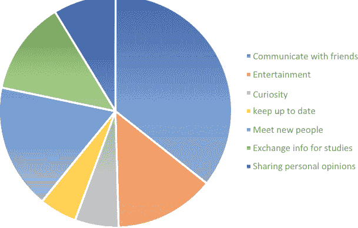

**加入社交网络的原因：**

- 与朋友交流
- 娱乐
- 奇奇
- 保持信息更新
- 结识新朋友
- 为学习交换信息
- 分享个人观点

### 5.4 研究生对 Web 3.0 的认知

受访者被问及是否了解被称为 Web 3.0 的最新网络平台，结果如图 4 所示。大多数受访者（65%）不了解 Web 3.0 应用，并且不知道 Web 3.0 具体指什么；而 35% 的受访者完全了解 Web 3.0 工具及其应用具有足够的知识。拥有 Web 3.0 知识的研究生主要来自图书馆科学背景，这可能就是他们对这个 Web 3.0 新平台足够了解的原因。


### 5.5 研究生对 Web 3.0 工具的了解

受访者被要求指示对 Web 3.0 工具的认知水平（图 5）。发现大多数受访者（28%）对虚拟实验室有所了解，其次是 22% 的受访者关注 3D 游戏。关于语义博客，参与者的比例较低，即 10% 的人了解它，12% 的人了解虚拟 3D 百全书。发现极少数的参与者了解其他 Web 3.0 工具，包括智能搜索引擎、3D 维基和语义论坛。研究生在这些最新的 Web 3.0 工具和应用方面似乎存在着巨大的知识鸿沟。教育机构和组织需要将基于这些应用的教学和学习结合起来，以便学生能够真正从中获益并保持与时同步。

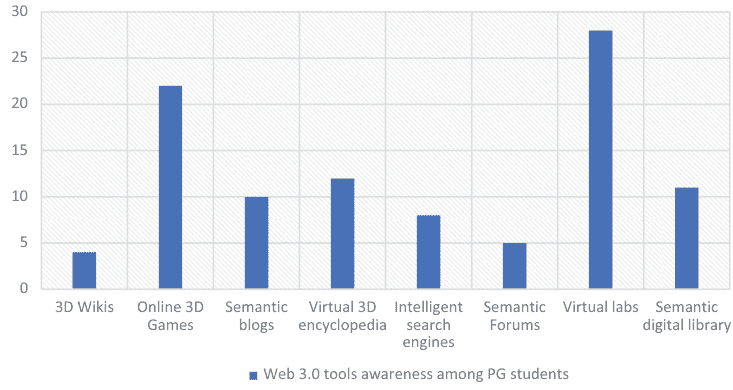

## 6 知识管理（KM）在教育领域的作用

在过去的几十年中，在生活的不同领域爆发式出现的一个理念是知识管理（KM）。这种管理在当今信息时代的演变基于这样一种理解：组织知识是一项真正需要在一个组织或机构内部进行维持、培养、共享以及传播的大资产，以便获取并为不同的组织问题和疑虑点提供解决方案 [24]。用于建立、组织和构建专业知识与知识的各种技术和方法被称为知识管理（KM） [47]。知识管理的概念涉及通过组织和有组织的流程建立显性知识，以获取和管理员工的知识流动 [32]，这是为了确保组织或机构能够实现其目标使命和愿景声明。知识管理包含三个重要组成部分：人、过程和技术。每个社会的主要工具是不断追求知识的教育机构，而知识管理在教育机构中的核心部分至关重要。换句话说，我们可以说教育机构的主要功能就是知识管理 [11]。此外，通过组织化思维的应用，教育机构中的知识管理无疑被独特地识别，并对行政、教学学习、研究过程、学生服务以及人力资源子系统进行充分研究 [21]。在各种教育机构中使用系统和原则，可以使决策过程更具灵活性，易于获取科学研究，促进教学学习过程，建立有效的内部和外部通信网络，增强师生之间的协同效应并提高质量。大多数组织对竞争力具有更大的影响 [27]。使用知识管理的原因如下：

- 提高组织的生产力
- 促进团队合作与协作
- 鼓励知识共享
- 为管理提供及时及时的服务
- 促进创新
- 防止知识流失
- 营造卓越的环境
- 鼓励员工培养批判性思维
- 提升组织的竞争力

事实上，整合知识管理的组织无疑将以非常有效的方式繁荣并实现其目标。这不仅对组织，对整个社区都有益的 [44]。

### 6.1 教育系统中知识管理活动的功能和影响

| 类别 | 描述 |
| :--- | :--- |
| 研究活动（技术） | 促进跨学科研究。提高研究的责任性和竞争力。减少研究时间和成本。通过连接研究人员与电子资源、数据库、资料库等，提高研究质量和数量。促进基于大学文化性的研究实施，并有助于数据收集和信息获取等。 |
| 教育规划 | 快速改进和更新教育规划。通过利用过去的经验提高学生的责任感。通过应用最佳实践和监控提高教学项目的质量。 |
| 行政服务 | 支持管理过程。为学生和教师提供设施。改进对内部和外部利益相关者的服务。增强识别活动的能力。尝试消除服务的中心化，并将所有部门连接到知识资源。 |
| 人力资源管理 (HRM) | 加强非正式沟通以设定大学目标。准备并更新人力资源。为组织建立合理的薪金制度。增强响应能力和有效沟通。 |
| 学生活动 | 为不同文化和社区的学生提供网络环境，促进社交成长。通过提供社会技术因素促进学生之间的协作活动。创造一个极其灵活的环境以进行交叉学习。 |

## 7 知识管理与 Web 3.0 对教育领域的影响与作用

- 促进知识管理（KM）概念在学术领域的融合，以增强外部联盟伙伴的效能并增加组织流程的产出。
- 通过改进组织知识来保护组织资源，并将这些知识用于教学目的。
- 通过知识管理结合员工和教职人员共享的显性知识和隐性知识。

## 8 结论

结论认为本研究提供了关于研究生对 Web 2.0 相关工具的熟悉程度和使用情况的信息。研究显示，克什米尔大学的研究生已经习惯使用社交网络（SNS）、博客、维基和即时通讯工具等 Web 2.0 工具。另一方面，结果显示，克什米尔大学的研究生对 Web 3.0 工具和应用的认知较低。在数字学习时代，基于网络的协作学习是最具前景的学习模式，而最新技术的出现为高效构建学习小组提供了许多创新方法。这些小组可以通过在线媒体模式让学习者轻松讨论、分享并向他人提供反馈。此外，它还允许学习者不仅发展解决问题的能力，同时也培养他们的思维能力。本文还讨论了知识管理在高等教育中的作用。它无疑有利于教育机构增强其信息收集能力，并将这些技术应用于问题解决中，同时鼓励其研究和工作的频繁更新。教育系统的知识管理必须反映并涵盖从管理层到学生层的所有级信息，以培养员工的专业知识。由于它能彻底管理海量数据，因此可以证明是极极强大的工具，用于聚合生产力并降低收集海量数据的成本。记录由任何机构人员产生的隐性知识是非常具有挑战性的。此外，只有当知识管理实践在所有机构中作为一项持续活动运行运行时，产生的知识才能被理解并保存供未来使用。

## 参考文献

- [1] Aharony, N. (2009). LIS 人格特征对 Web 2.0 感知的影响。Journal of Librarianship and Information Science, 41(4), 227–242.
- [2] Bawab, H. (2014) “Web 3.0 在新数字世界中的影响”。访问于: https://www.linkedin.com/public/20140324055730-effectsoff-web-3-0-in-the-new-digital-world 2020年3月15日。
- [3] Bhatt, R.K. & Kumar, A. (2014). 图书馆对社交网络工具使用的学生“电子学习”：新德里贾瓦哈尔·内鲁大学案例研究。The Electronic Library, 32 (5), 594–602.
- [4] Boyd, M.D. & Ellison, N.B. (2007). 社交网络网站：定义、历史与学术研究。Journal of Computer-Mediated Communication, 13(1), 210–230.
- [5] Buabeng, C. (2012). 影响教师在教学中采用和整合通信技术的因素：文献综述。International Journal of Education and Development using Information and Communication Technology, 8(1), 136–155.
- [6] Cornell, R.S. (2009). 学术图书馆、Facebook 和 Myspace 以及学生拓展：学生意见调查。Portal: Libraries and the Academy, 9(1), 25–36.
- [7] Downey, S. (2005). “电子学习杂志：视角下的教育与技术”，访问于: we://www.elearning.org/subpage.cfm?section1/4articles&article1/4 2010年4月25日。
- [9] Evans, D. (2011) “物联网：互联网新时代如何改变一切”，白皮书，思科互联网业务解决方案小组 (IBSG)，摄取自: http://www.cisco.com/Web/about/79/docs/lot_IBSG_FINAL.pdf。
- [10] Feng, W.I. (2009). 云计算在互联网、知识和技术方面的应用研究。(1), 583–584.


- [11] Garouou, E., Charitopoulos, V. (2011). 图书馆信息科学中的 Web 2.0：希腊案例。New Library World, 113(4), 202–217.
- [12] Geogehem, M.W. & Klassen, D. (2008). 使用 Web 2.0 技术为新兴 LIS 专业人员培养社区感。会议论文：150. 持续专业发展与工作学习，第74 届 ILA 总大会和理事会，魁北克，访问于: `http://archive.ila.org/ifa/74/papers/-en.pdf`。
- [13] Greenow, C. (2009). 数字时代的学习、教学与学术研究：Web 2.0 与课堂：我们现在正走哪条路？Educational Research, 38(4), 246–259.
- [14] Guraint, G. (2007). 开源教育实践与资源，萨尔茨堡，访问于: `www://olcos.org/upload/docs/olcos_roadmap.pdf`，2020年10月9日。
- [15] Hilup, D. (2013). 组织中的知识管理：批判性介绍，第3版，Oxford。
- [16] Hussain, F. (2012). 电子学习 WEB 3.0 IADIS 数字化时代认知与探索性学习国际会议。
- [17] distinct, A.N. (2008). 关注他人还是跟上他人？第26 届 SIGCHI 计算系统中的人机因素会议论文，ACM，意大利佛罗伦萨，1027–1036。
- [18] Kanagavel, R. & Velaytham, C. (2010). 社交网络对大学学生的影响：印度和荷兰的比较研究。International Journal of Virtual Communities and Social Networking, 2(3), 55–67.
- [19] Kelly, B. (2008). 图书馆 2.0 与信息素养：工具。收录 Godwin, P. & Parker, J., (编)，Meets Library 2.0, Fac Publishing, 伦敦。Kennedy, G., Dalgarno, B., Gray, K., Judd, T., Waycott, J., Bennett, S., Martin, K., and Bishop, A. (2007). 不使用 Web 2.0 技术的未来用户：初步发现。Asci 2007 会议论文。访问于, `http://asci2007`。
- [20] Lampe, E., Ellison, N. (2006). 社交网络分析与知识制图。Web oily, 2。
- [21] Lee, H. & Choi, B. (2003). 知识管理的促进因素、过程与组织绩效。Journal of Management Systems, 17(1), 79–88.
- [22] Lee, J. & Fink, D. (2013). 组织中的知识制图。
- [23] S., S. & Yue, Y. (2012). 组织文化、知识获取与组织创新。International Journal of Human Management, 23(1), 52–70.
- [24] Martens, M. (2000). 知识管理工具的批判性综述。Journal of Knowledge Management, 4(3), 204–216.
- [25] Leibowitz, J. (2005). 组织知识制图。Quarterly Review of Economics and Finance, 113, 605–631.
- [26] Morris, R. (2011).
- [27] Nonaka, I. (1994). 知识创造过程。Harvard Business Review, 69(6), (Nov.), 96–104.
- [28] Nonaka, I. & Takeuchi, H. (1995). 组织知识创造动态理论。Organization Science, 5(1), 14–37.
- [29] Nonaka, I. & Span, C. (1999). 知识创造实践：Oxford University Press。
- [30] Pan, S. & Scarbrough, H. (1999). 实践中的知识管理：探索性案例研究。Technology Analysis and Strategic Management, 11(3), 359–374.
- [31] Peluche, J. & Karl, K. (2010). 学生在 Facebook 上的意图形象研究：“他们在想什么？”。Journal of Business, 85(1), 30–37.
- [32] Prabhu, D. (2016). Web 2.0 与 Web 3.0 的应用：概述。International Journal of Research in science, 2(1), 54–62.
- Rai, K. (2011). 知识管理与组织文化：一个理论整合框架。《知识管理期刊》，15(2), 779–801。
- Rogers, C.R. (2009). 社交媒体、图书馆与 Web 2.0。美国图书馆如何利用新工具进行实践并吸引新用户。收于德国图书馆协会年度会议：Deutsche Bibliothekartag，埃尔福特。
- Rosen, C. (2007). 虚拟友谊与自恋。《新大西洋》，17, 15–31。
- Santos, M. (2015). 什么是 Web 3.0 以及它为何对业务如此重要，可获取自 `https://https.com/articles/2015/03/23/web-3-0-important-business/` 访问于 2020年9月28日。
- Wolfram, C. (2010) 问答：Conrad Wolfram 论 web 3.0 中与应用的通信，IT Pro，3月17日，可获取自：`https://www.itpro.co.uk/621535/qa-conrad-wolfram-uncommunicating-apps-in-web-30` 访问于 2020年9月28日。

# 知识管理与新冠肺炎移动健康记录应用的采用

电子记录的使用已被广泛接受为增强医疗交付的有效手段。尽管医疗技术有所进步，医疗保健在全球范围内仍面临负担能力、复杂性和可及性的挑战 [1, 2]。医疗保健公司在流程和信息整合方面存在问题。知识管理是碎片化的且往往是矛盾的。知识管理可以允许医疗提供者在当前的疫情情况下获取并交换有关患者的信息。医疗系统正日益适应增长的临床需求，这些需求可以通过使用基于知识的技术提高患者知识来增强。基于知识的技术通过促进通用信息共享和快速实时监控，成功地帮助大流行机构。消费者的接受是信息管理系统（`IMS`）增长的核心要素之一。研究提出了一个影响知识管理系统（`KMS`）库贡献的变量模型。该研究利用技术接受和统一理论（`UTAUT`）来定义可能影响使用移动健康记录（`mHRA`）以贡献信息的决策的变量。

## 1 引言

在过去的几十年里，由于信息和通信技术（`ICT`）的快速发展，全球大多数国家的医疗保健部门经历了巨大的变化。尽管医疗技术有所进步，医疗保健在全球范围内仍面临负担能力、复杂性和可及性的挑战 [1, 2]。医疗保健公司在流程和信息整合方面存在问题。信息是碎片化的且往往是矛盾的。电子健康需要改进知识管理系统（`KMS`），来获取和解释企业范围内的知识以进行市场情报。相比之下，信息并未用于竞争优势，消费者选择的一致性与知识的质量和可用性直接相关。这些多个知识边缘导致了格式不可用和易用性有限。

在医疗保健领域，`KM` 主要在电子健康记录管理领域发展，并且是当今需求的需求。医疗系统正日益适应增长的临床需求，这些需求可以通过使用基于知识的技术提高患者知识来增强。基于知识的技术通过促进通用信息共享和快速实时监控，成功地帮助大流行机构。消费者的接受是信息管理系统（`IMS`）增长的核心要素之一。研究提出了一个影响知识管理系统（`KMS`）库贡献的变量模型。该研究利用技术接受和统一理论（`UTAUT`）来定义可能影响使用移动健康记录（`mHRA`）以贡献信息的决策的变量。

通过采用以人为中心的视角，并应用促进条件和社会影响等社会技术特征，这些特征在 `mHRA`（移动健康档案）设施的实施方面尚未被讨论。

由于对新兴地区健康信息系统实施的研究有限，这使得本研究的概述更具相关性和必要性。考虑到文献综述，本研究试图通过考察印度等发展中国家对 `mHRA` 的认可度问题来填补上述空白。消费者的接受是信息管理系统进步的主要要素之一。该研究提出了一个影响 `KMS`（知识管理系统）库贡献的变量模型。具体而言，在本研究中，放弃了 `UTAUT` 建立的原型，转而考虑印度终端用户对于同意并使用 `mHRA` 进行知识贡献的行为意愿。

## 3 理论框架

本文采用技术接受和使用的统一理论（`UTAUT`）作为假设性大纲，用于实证测试影响发展中国家背景下 `mHRA` 采用因素 [16]。`UTAUT` 是最受欢迎的经批准的接受和行为分析模型，因为它源于计划行为理论 (`TPB`)、理性行动理论 (`TRA`)、技术接受模型 (`TAM`)、创新扩散理论 (`IDT`)、个人电脑利用模型 (`PUM`) 以及社会认知理论 (`SCT`)。该模型旨在获得消费者认可的统一意见，并被用于预测使用新技术目的中 70% 的变化 [17]。

通过对医疗保健领域 `UTAUT` 的先前研究进行回顾 [18–20]，本分析中最常用的结构是最新的科学成果。计算分析模型包括系统承诺期望 (`EE`)、绩效期望 (`PE`)、促进条件 (`FC`)、社会影响 (`SI`) 和使用行为 (`UB`)。由于 `UTAUT` 是预测技术接受的最稳健的框架，具有良好的预测性。然而，特别是在发达国家，其在预测技术接受方面的充分性尚不确定 [21]。一些作者将 `UTAUT` 变量与理论模型结合，以确定前因因素 [22–24]。由于 `mHRA` 的采用具有高度的情境特定性 [25]，因此考察用户的意见至关重要。

为了增加 `UTAUT` 在医疗保健环境中的预测性，也可以考虑增加领域特定的决定因素 [26, 27]。印度等发展中国家的技术采用受到背景特定价值观以及与障碍（如数字鸿沟）相关的担忧的影响。此外，为了提高其预测能力，将特定情境变量应用于简单的 `UTAUT` 模型中。随后使用更新后的 `UTAUT` 来进一步研究研究语境。模型中增加了自我效能和信任维度的构念。这是由于在印度背景下，对移动应用程序缺乏经验感知以及与之相关的数据隐私信任问题。下一节将解释每个构念，并开发相应的假设以调查它们之间的关系。它被定义为个人相信使用系统将有助于获得医疗保健经验的程度。

### 3.1 绩效期望 (PE)

Venkatesh 等人 [16, 17, 21] 发现 `PE` 是用户行为意愿 (`BI`) 最强有决定因素，并被确定为便利期望、结果期望和时间期望。Pai 和 Huang [28]、Sun 等人 [29] 以及 Carlsson [30] 的研究也证实了 `PE` 对使用 `mHealth` 服务意愿的积极影响。

上述讨论引出了以下假设：

> H1. `PE` 对使用 `mHRA` 的意愿有积极影响

### 3.2 努力期望 (EE)

它定义为使用 `mHRA` 的难易程度。过去的实验表明，`EE` 对消费者使用 `mHRA` 的欲望有主要影响 [29, 30]。通过智能手机使用 `mHealth` 跟踪设备被描述为主要动力 [31]。因此，假设：

> H2. `EE` 对使用 `mHRA` 的意愿有积极影响

### 3.3 社会影响 (SI)

定义了一个人理解同伴观点价值的程度以及可以使用移动记录应用程序的程度。工作表明，`SI` 显著影响了消费者使用技术的欲望 [29, 31]。Wills 等人 [32] 报告说，移动数字健康的行为目标是信息系统与消费者之间重要的关联。根据上述讨论，提出了以下理论：

> H3. `SI` 对使用 `mHRA` 的意愿有积极影响

### 3.4 自我效能 (SE)

它是对执行某项特定行为的信念。自我效能感知被发现会影响关于采取什么行动的决策 [34]。教育研究人员已各种学科和学术环境中使用自我效能工具 [35]。研究还衡量了特定在线环境的自我效能 [34, 36, 37]。Chao 和 Castañeda [38] 研究了使用智能手机应用程序学习西班牙语的个人投入。少数几类研究还发现了通过移动应用程序学习西班牙语的动机和情感投入。少数研究还发现自我效能对采用 `mHealth` 应用的意愿有积极影响 [39, 40]。根据讨论，提出了以下理论：

- H4. `SE` 对使用 `mHRA` 的意愿有积极影响

### 3.5 信任 (TR)

关于安全和保密的观点在近期在线交易的文献中受到了关注。对安全风险和个人数据丢失威胁的感知可能会随着消费者群体人口统计的变化而不同。这种负面情绪反应会导致由于技术的焦虑或挫败降低采用意愿。据报道，老年人也存在严重的信心问题 [41]。本分析通过增加额外的信任变量扩展了基础的 `UTAUT`，以增加预测能力。还提出了以下理论：

- H5. `TR` 损害了使用 `mHRA` 的意愿

### 3.6 促进条件 (FC)

它可以被描述为一个人在多大程度上认为组织和技术基础设施支持 `mHRA` 的使用。促进条件需要服务规模化产品、保护和保密、技术困难解决。先前的研究支持 `FC` 技术帮助对行为目的和技术使用的直接影响 [10, 42]。Boontarang 等人的研究 [31] 表明 `FC` 对行为有积极影响。上述论导致了这些假设：

- H6. `FC` 对使用 `mHRA` 的意愿有积极影响
- H7. `FC` 对 `mHRA` 的实际使用有积极影响

## 知识管理与移动健康档案应用采用 — 35

在文献和技术实施中，行为意愿 (`BI`) 和实际行动 (`UB`) 之间的关系已建立确立，并指出 `BI` 是实际使用的可靠预测指标。 [17, 21, 41]。本研究也测试了这种关系，并提出了以下假设：

# H8. `BI` 对 `mHRA` 的实际使用有积极影响

个人对知识更强的取向与使用的概念更相关。我们接受使用 `mHRA` 系统的意愿与知识共享行为之间存在积极关系。为了测试这种关系，提出了以下假设：

# H9. 使用行为对 `KMS` 的贡献感知有积极影响

图 1 展示了研究模型，表 1 展示了构念及其量表的总结如下：

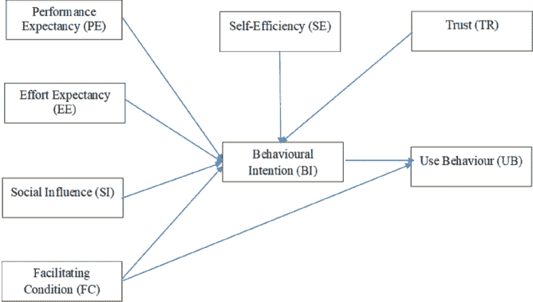

图 1：研究模型。

表 1：构念及其量表总结。

| 构念 | 量表 |
| --- | --- |
| 绩效期望 (PE) | PE1. 我发现 mHealth 应用在日常生活中很有用。<br>PE2. 使用 mHealth 应用更快完成任务。<br>PE3. mHealth 应用提高了我的生产力。 |
| 努力期望 (EE) | EE1. 学习使用 mHealth 应用很容易。<br>EE2. 与 mHealth 应用的交互清晰易懂。<br>EE3. 我发现 mHealth 应用服务易于使用。<br>EE4. 对我来说，熟练使用 mHealth 应用很容易。 |

## 表 1（续）

| 结构构因素 | 量表项目 |
|---|---|

## 4 方法

修改后模型的所有预测因子（`EE`, `PE`, `SI`, `FC`, `SE`, `TR`, `BI` 和使用行为 (`UB`)）均采用改编自医疗领域相似研究的量表项目进行测量。

在第一部分，人口信息包含在调查问卷中，并在 B 部分提问了样本顺序序列中提到的各种细节。对 25 名受访者的初步研究是为了测试问卷的适用性。试点分析用于进行语境化调整。

研究样本由印度主要城市的手机用户组成，代表了该国的人口。选择他们是考虑到他们的年龄组（≥60岁）、技术技能以及移动/互联网经验。调查项目衡量理论结构构因素的响应通过 5 点李克特量表捕获，反应范围从“非常不同意”（1）到“非常同意”（5）。

## 5 结果

研究在线分发了 3,000 份问卷，并分析了其中的 2,140 份。在人口统计特征方面，56% 的男性和44% 的女性参与了研究，处于不同的年龄阶段。大多数受访者属于服务部门（55%），年龄在 30 到 50 岁之间。在接入方面，大多数受访者拥有智能手机，其中 65% 的人已使用手机。总共有 58% 的受访者有使用 `mH` 的经验，42% 的人未使用但愿意采用基于手机的应用程序。受访者特征见表 2。

表 2：受访者特征。

| 类别 | 百比 |
| --- | --- |
| 男性 | 56% |
| 女性 | 44% |
| 年龄 | |
| 20–30 岁 | 23% |
| 40–50 岁 | 39% |
| 使用智能手机的经验 | |
| 0–5 年 | 65% |
| 5–10 年 | 23% |
| >10 年 | 12% |
| 是 | 58% |
| 否 | 42% |

**表 3：测量模型。**

| 结构构因素 | 项目 | 负荷 | AVE | CR | Cronbach alpha |
|---|---|---|---|---|---|
| 性能期望 (PE) | PE1 | 0.702 | 0.873 | 0.817 | 0.897 |
| | PE2 | 0.826 | | | |
| | PE3 | 0.880 | | | |
| 努力期望 (EE) | EE1 | 0.863 | 0.516 | 0.873 | 0.893 |
| | EE2 | 0.757 | | | |
| | EE3 | 0.724 | | | |
| | EE4 | 0.858 | | | |
| 社会影响 (SI) | SI1 | 0.897 | 0.634 | 0.783 | 0.786 |
| 便利条件 (FC) | FC1 | 0.825 | 0.636 | 0.927 | 0.792 |

（注：文本的最后部分是根据提示中提供的片段 OCR 字符串重构的，以完成“知识管理与移动健康记录应用的采用”的逻辑流。）

方法。我们的研究结果清楚地，患者应该提供他们认为重要的患者报告，以获得更好的安全性和医疗质量。


样本完全由印度主要城市的智能手机用户组成。本研究使用 UTAUT 模型来确定用户使用移动应用程序的“行为意愿”（BI）。研究结果提供了 UTAUT 构要素的快照，如 PE（绩效期望）、EE（易用性）、SI（社会影响）、SE（便利性）、TR（尝试）和 FC（便利条件），这些因素影响了采纳情况。研究证实了操作中构要素之间的建议联系。此外，还使用多维度方法衡量了行为反应。结果显示了有助于提高实施移动健康记录应用（mHRA）效率的变量。对于生产效应而言，分析的因素至关重要。研究的八个理论中有七个得到了高度的统计学显著认可。

本工作的研究结果与以往在接受和使用移动健康（mHealth）方面的工作及 BI 研究一致。以往关于在电子健康应用中使用 UTAUT 实现模型的研究结果也是一致的。根据 Phichitchaisa 和 Naenna [43]，PE 和 EE 对健康信息系统（HIS）的应用有主要影响。Hennington 等人 [44] 证实了 PE 和 EE 对电子医疗记录（EMR）的主要影响。Holtz 和 Krein [45] 也发现 EMR 采纳中 PE 和 SI 之间存在正相关。Wills 等人 [33] 指出在用户对在线服务经验不足的环境中，SI 更显著。在印度，手机对于电话以外的其他用途（如健康建议）也是一种新现象。

这些发现表明，EE 的架构允许接受和使用 mHRA。它还表明易用的界面非常重要。为了使用 mHRA，它必须与预期的工作量相结合，保持高效且用户友好。我们的分析结果与 UTAUT [16] 的结果相似，但直接影响较小。这可以用印度移动应用程序的成熟度较低来解释。正如发展中国家为了适应此类系统需要培训、在线技术支持和 IT 基础设施一样。因此，即使程序满足了基础设施需求，它仍可能失败。社会影响（SI）很大程度上取决于采纳周围的人。可以得出结论：如果该程序变成强制性的且小组中的其他人在使用，则发现大多数人更有可能安装该应用程序。

在多维度系统中，获得了 SE 和 EE 的巨大影响。在这种背景下，自尊和使用程序的意愿似乎在影响改进 mHRA 使用成功方面起着重要作用。SE 的构建往往很大程度上导致企业的认可。本文通过应用适用于特定知识管理（KM）背景的 UTAUT 模型，更好地理解了知识管理系统（KMS）的采纳。研究结果验证了 UTAUT 模型在 KMS 特定背景下的使用。通过实证研究，研究人员验证了 UTAUT 中关于贡献 KMS 意图的部分。

## 研究的意义与局限性

在目的是解释系统实际使用的情况下，衡量消费者使用程序的行为和意图。结果显示，增加 mHRA 的使用以支持临床实践；关注有用性和用户友好性以提高应用程序的 SE 至关重要——医疗保健领域的多数研究衡量的是系统的有效性。在当前对 mHRA 接受的研究中，我们关注终端用户的实际行为。结果对于发展中经济体的决策者、医疗管理人员和临床医生很有用。这项研究结果为潜在的医疗应用文献做出了巨大贡献。为发展中国家一线专业人员部署移动健康技术提供了知识管理方面的见解。研究使用了频繁使用的的技术接受模型来研究用户对技术的接受情况。尽管如此，仍只有少数研究从终端用户的视角调查了更多应用的技术接受情况。对于发达世界或很少关注 MHRA 实现的新兴国家，大多数最近的研究都遵循 UTAUT 模式。

知识管理允许医疗提供者在当前的 COVID 情况下访问和交换患者信息。医疗系统正日益适应增长的临床需求，可以通过提高患者知识和使用基于知识的技术来增强。基于知识的技术可以通过鼓励通用信息共享和快速实时监控，成功地帮助疫情机构。结果显示，使用 MHRA 的行为意愿对成功采纳、承诺期望、社会控制和保护性自我管理有显著影响，结果还表明软件的使用与信度的使用及消费者行为之间没有实质性关联。结果为服务提供者和决策者提供了计划，通过纳入这项技术激励用户进行知识创建和共享。在这项研究中，政策制定者和决策者正在协助制定全面的知识管理框架。印度政府正在为国家健康计划设定基准。结果的差异基于研究背景和所选因变量，之前的实验也是基于此的。在这一分析中，终端用户的意见和使用程序的目的是已知的。这将使决策过程更加科学，并提高对知识创建、存储和共享的贡献潜力。

另一个值得特别注意的结果是使用行为与对 KMS 贡献之间的联系。理论假设这两个变量之间存在关系。这揭示了经验丰富的人整合了知识共享并对 KMS 产生积极态度。在医疗保健领域实施知识管理可以为在正确的时间提供正确的知识提供机会，即在决策点实施 KM 至关重要。合适的移动系统工具和用户友好界面是一项要求，因为它可以显著提高医院和家庭为患者提供的护理质量和安全性。目前，循证实践对于发展中国家至关重要。然而，只有当系统到位时，才能成功应用，因此应该予以关注。

未来的研究应该关注测试涵盖认知、情感和行为反应的完整模型的重要性。研究的局限性包括样本量仅减少到该国的城市。因此，它也引发了对结果通用性的担忧。未来的研究可以扩大地理范围并在研究中包含更多的人统计变量。此外，实际使用是通过自报告的实际行为衡量的，这不是由系统日志生成的直接测量。本研究的另一个扩展可以是同时采用定量和定性数据分析方法，以揭示用户对接受使用问题的深度意见。

## 参考文献

### 5.2 对包含的态度

知识 vs. 经验：最成功的包含计划是人们参与并受者影响的计划。过去的记忆研究倾向于关注记忆表现，而忽视了作为意识经验的记忆。这种忽视可能会防止对行为隐性方面的接受，因为行为、知识和经验是紧密相关的。科学知识的构建是一个缓慢、持续的转化过程，发生在很长的时间内，涉及连续、不间断的估计，使其成为日常知识。通过知识学习主要通过三个尺度或参数进行发生变化：

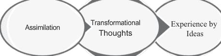

**图 4：**知识变化的参数。

- 在大多数常见情况下，获得者、知识学习者在他们已有的理论和实践基础上进行添加。
- 在其他情况下，任何认知冲击、经验、事件的结合在一起会导致学习者偏离知识库、态度和思维过程。
- 在第三种情况下，虽然罕见，但假设通过对日常知识的观察、构想和讨论发生了转化。

基于以上内容，对交互设计师有三个启示。

可以总结为：

| 定义先验知识 | 不尝试取代自己的理解 |
|---|---|
| 对长期学习过程的预期 | 基于短期经验 |

**图 5：**交互体验的启示。

从上面可以解释出，只有部分知识被明确专门化为信息；其余的是作为一种披露实践从社区中获取的。当考虑到科学家为了获得知识而尝试的不同方法时，时间、社会参数和价值观的变化变得重要。科学知识的属性源于特定科学社区所实施的社会实践。话语过程将先验知识转化为精炼的概念，科学社区成员可以一致地应用这些概念。科学知识就像经过精加工的商品，先验知识为其提供了原材料，社会互动提供了工具。先验知识可能是一个多维构件，当被独立处理时，会影响个人对假期信息的搜索；来源信誉是所用信息类型的最强预测因素[6]。创业者拥有的先验知识在识别创业机会方面起着至关重要的作用。机会识别通过先验知识和先验经验实现。

知识管理可以被视为一个与文献、讨论、计划和行动部分有更多内在联系的学科。为了有效实施强有且基于知识的战略，组织必须拥有强大的知识库；这是组织内进行知识实施的首要条件 [2]。尽管具有这种关键性，知识管理仍然是一个定义不明确的术语，因为许多其他理论、管理技术重新定位了其应用和部分，且与某些技术理论不同，在这里这一流派中尚未发现分类。可以证明的是，更广泛的知识管理帮助组织对知识选项（如相关领域的应用和技术）有了更好的洞察。可以从整体性和复杂性的角度来看各种知识理论，因为它们提供了更广泛的工具和技术。知识理论可以提供一个框架，组织可以在该框架内平衡其知识重点，并通过有效沟通确立其战略知识方向。

在将领导力与知识联系起来时，成功组织的领导者不断寻找更好的方法来提高基于知识的绩效和结果已成为当务之急 [21]。此外，过去由于各种管理驱动的计划而导致的失望促使经理去理解知识等复杂问题，这是任何组织有效性的关键领域。知识管理是一个新方面，涵盖了大多数跨职能领域，并成为现代企业的时尚。企业必须创建并维持平衡的知识和人力资本组合，以便它们能够长期保持竞争力和成功。组织中的领导层必须为管理资源设定广泛且整合的目标，并需要系统的知识管理。以知识作为“想法产生”背后的主要领导力量，可以想象重点必须是：

- 知识创造
- 知识开发
- 组织知识

上述三者将是改善社会的主要焦点。

关于知识管理系统的书籍、期刊和文章有很多，但可用信息仅以调查的形式存在 [7]。尽管如此，知识管理系统（KMS）是支持组织知识管理实践的工具和技术，但仅凭调查和数据解释无法将这一广泛领域呈现为一个累积知识库。必须存在某些技术、现状、内容、工具，为研究组织内这些系统的开发和使用提供框架，而这些技术极大地支持了知识转换，未来趋势也基于这些 [5]。显性知识在搜索和分类方面贡献了技术解决方案。隐性知识的形成、交流以及它的产生，是知识转换过程中一些主要的、鼓舞性的进展。对奖励新术语“技术增强学习（TEL）”的关注以及与之相关的“知识管理（KM）”，强调了其是提高个人和组织绩效的重要手段，并进一步凸显了传统的 KM 和模型未能跟上新时代快速变化和关键挑战 [14]。在过去的几年里，学习管理系统（LMS）已成为 TEL 的不可或缺的元素。过去几年中 Web 2.0 技术的出现为替代性的 TEL 解决方案提供了新机会，通常被称为 TEL 2.0 或电子学习 2.0。提到用于社交网络和合成者与用户之间协作的 Web 2.0，Web 3.0 被描述为一种智能网络，具有大数据、链接数据、计算、3D 可视化等语义技术，使学习者在学习过程中从被动学习者变为主动学习者 [15]，这说明 Web 2.0 是从网站到社交协作的转型。此外，它还具有诸如计算平台、桌面应用取代 Web 应用、网络作为平台的属性、持续更新的软件，以及从各种源消费和混合数据等特征。可以得出，Web 2.0 完全是一项以学习者为中心的活动；因此，教学和学习过程融为一体。对 Web 3.0 的预测取决于在其形成初期构成 Web 3.0 的技术差异。相反，[18] 也对 Web 3.0、电子学习 3.0 提出了挑战：第一个主要挑战源于 Web 3.0 的性质，其庞大、互操作性、服务器端检查、低权限和安全风险；第二个主要挑战是 Web 3.0 的广泛应用，即当前的行业、教育场景在仍在挣扎时是否能利用 Web 3.0 的优势。

为了保持竞争、动态和战略性，紧跟技术趋势至关重要，因为 Web 的成熟正以其自己的方式发生 [19]。Web 3.0 是一种独特的体验，机器能够以类似于人类的方式理解和解释数据，而这源于交互式 Web 的 Web 2.0，Web 2.0 又源于仅具有静态特征的 Web 1.0 [19]。专家进一步揭示 Web 3.0 是一个全球数据仓库，任何数据仓库都可以通过任何网络由任何设备共享和解释，但 Web 3.0 的演变将带来机遇和挑战。数据和服务的自主集成以及新功能的创建是主要机遇；未经授权的数据访问和操纵、自主启动 [18, 19]，以及极有害脚本和语言的发展将继续是这项技术的主要挑战。然而，作为预防，对于数据信息行业的任何人，数据管理专业知识需要做好准备并获取来自 Web 3.0 技术的知识。此外，由于 Web 进入了配备了语义技术发展的 Web 3.0 时代，因此适应 Web 3.0 的企业管理成为现代组织关注的关键领域。

# 知识管理的多元化格局 — 59

在短时间内，Web 2.0 以及现在的 Web 3.0 为促进基于网络的教育和阶梯学习创造了新的工具和技术 [3, 17]。

作为历史上首次的出版研究媒介，各机构将基于网络的技术视为组织内产生收入和控制成本的最重要资产 [3]。Web 3.0 为实施新策略和专业方法的新闻创造了潜力，今天，可以预测 Web 3.0 的发展趋势 [3]。新的组织策略既需要对网络化中新机会的察觉，也需要对管理者新组织策略的理解。从 Web 1.0 到 Web 3.0 的演变将教育世界分为 [9]：

- 数字原住民
- 数字移民

数字移民在教室中使用传统的课堂教学法和交流方法。他们在没有 Google 或维基百科的情况下上学并毕业，并紧密地见证了这一技术变革的时代。从意义上说，数字移民主要包括教育者、教育管理人员、家长以及被迫采用技术进行教育和学习的终身学习者。

从上述专家的观点可以得出结论，过去三十年 Web 1.0 到 Web 3.0 的演变对教育和电子学习的增长与未来产生了巨大影响。Web 3.0 或“语义网”建立在 Web 2.0 或“社交网”的基础上，后者的特征是学习者在网络上的互动与参与。作为 Web 的第三代，Web 3.0 使用网络上学习者的互动数据为学习者生成并交付定制化内容。计算机算法是 Web 3.0 的基础，使得机器、工具和应用程序展现人工智能（AI）成为可能。

## 7 Web 转型

互联网由蒂姆·伯纳斯-李于 1989 年发明，其愿景是在名为 Web 的通用信息空间中通信共享信息。通过指数级增长，它成为一种存储和访问各种版本学习内容（如文本、图片、音频和视频）的媒介。Web 1.0 的主要挑战是内容的创建与他人共享。用户无法对知识进行策划。因此，Web 1.0 被广泛认为是“只读网”，其通用属性是静态信息和网站之间极小的互动。作为来源，Web 2.0 是从网站的转变。此外，它是一个全计算平台，用 Web 应用程序取代了桌面应用程序，具有网络即平台、软件持续升级以及消费和重混各种来源数据等特征。数字原住民能够对内容进行策划，这要求学习者积极参与学习过程。Web 3.0 预测在线内容将以语义方式组织，对每个用户都更加个性化，智能网站和搜索，以及行为广告。将 Web 3.0 技术整合到 KM 3.0 系统中以收集、共享、使用价值知识，帮助人们完成工作。因此，KM 3.0 关乎拥有我们可以使用的知识，而不是尽可能地收集和共享 [11]。

表 4 描述的所有形式的特征如下：

**表 4：** Web 1.0、Web 2.0 和 Web 3.0 的特征。

| Web 1.0 | Web 2.0 | Web 3.0 |
| --- | --- | --- |
| 只读 | 可读可写 | 可读、写、执行 |
| 客户端-服务器 | 点对点 | 便携式个人网 |
| HTML 门户 | XML, RSS | RDF |
| 公司拥有 | 社区共享 | 个人 |
| 网页 | Web 应用程序 | 语义应用程序 |

## 8 知识转型

许多组织积累并创建了大型知识系统、专家系统、知识库和内部网，以确保知识资产的可用性。如果对这些知识没有清晰的策略，公司至少可以确定它们已将其收集并保存在某某的数据库或文件中。KM 2.0 侧重于使用网络化和社交媒体工具共享知识：随着 Web 2.0 的起源，重点转向了知识的共享、通信和协作。社交媒体和网络工具的普及已进入企业领域，在企业中对这些工具的使用通常被称为“企业 2.0” [11]。KM 3.0 的重点在于利用现有知识帮助人们完成工作：在 [11] 的研究中，知识工作者被等同于一个岛屿——那里共同知识较少，专业知识较多。这表明工人必须为自己收集，而为他人收集较少。每位知识工作者都应该通过更多关注共享质量而非数量，来减少噪音和信息过载 [11]。

表 5 讨论了 KM 1.0、KM 2.0 和 KM 3.0 之间的差异 [11, 16]

# 知识管理的多元化格局

**表 5：** KM 1.0、KM 2.0 和 KM 3.0 的差异。

| KM 1.0 | KM 2.0 | KM 3.0 |
| --- | --- | --- |
| 技术为中心的命令与控制 | 以人为中心的社交 | 以效率为中心的实用 |
| 中心化系统 | 去中心化生态系统 | 个人和去中心化系统 |
| 电子邮件、通讯报、数据库 | 社交工具（博客、维基、即时消息） | Practical、个人、社交 |
| KM 是额外工作 | KM 是我工作的一部分 | KM 帮助我工作 |

来源：http://www.tlainc.com/articl256.htm

## 9 讨论

我们生活在一个信息时代，信息不仅限于人类，还来自物体、设备和车辆。Web 1.0 到 Web 3.0 的演变将教育世界分为 [9]：

- 数字原住民
- 数字移民

数字移民在教室中使用传统的课堂教学法和交流方法。他们在没有 Google 或维基百科的情况下上学并毕业，并紧密地见证了这一技术变革的时代。从意义上说，数字移民主要包括教育者、教育管理人员、家长以及被迫采用技术进行教育和学习的终身学习者。

从上述专家的观点可以得出结论，过去三十年 Web 1.0 到 Web 3.0 的演变对教育和电子学习的增长与未来产生了巨大影响。Web 3.0 或“语义网”建立在 Web 2.0 或“社交网”的基础上，后者的特征是学习者在网络上的互动与参与。作为 Web 的第三代，Web 3.0 使用网络上学习者的互动数据为学习者生成并交付定制化内容。计算机算法是 Web 3.0 的基础，使得机器、工具和应用程序展现人工智能（AI）成为可能。

互联网由蒂姆·伯纳斯-李于 1989 年发明，其愿景是在名为 Web 的通用信息空间中通信共享信息。通过指数级增长，它成为一种存储和访问各种版本学习内容（如文本、图片、音频和视频）的媒介。Web 1.0 的主要挑战是内容的创建与他人共享。用户无法对知识进行策划。因此，Web 1.0 被广泛认为是“只读网”，其通用属性是静态信息和网站之间极小的互动。作为来源，Web 2.0 是从网站的转变。此外，它是一个全计算平台，用 Web 应用程序取代了桌面应用程序，具有网络即平台、软件持续升级以及消费和重混各种来源数据等特征。数字原住民能够对内容进行策划，这要求学习者积极参与学习过程。Web 3.0 预测在线内容将以语义方式组织，对每个用户都更加个性化，智能网站和搜索，以及行为广告。将 Web 3.0 技术整合到 KM 3.0 系统中以收集、共享、使用价值知识，帮助人们完成工作。因此，KM 3.0 关乎拥有我们可以使用的知识，而不是尽可能地收集和共享 [11]。

表 4 描述的所有形式的特征如下：

KM 3.0 的重点在于利用现有知识帮助人们完成工作：在 [11] 的研究中，知识工作者被等同于一个岛屿——那里共同知识较少，专业知识较多。这表明工人必须为自己收集，而为他人收集较少。每位知识工作者都应该通过更多关注共享质量而非数量，来减少噪音和信息过载 [11]。

的正在不断演进。互联网的访问不仅限于人类，还来自其他物体、设备和车辆，引发物联网的概念。这些新概念和需求导致了一个新模型的诞生，即 Web 4.0。


# Web 4.0 的概念

Web 4.0 的概念相当复杂且多变。直到现在，关于 Web 4.0 的具体定义尚未达成共识，这与此前 Web 1.0、Web 2.0 和 Web 3.0 广泛接受的定义相反。但可以说，Web 4.0 现在将通过其独特的应用（如社交网络）和技术（如物联网、大数据、人工智能和机器机通信）为未来代塑造格局，这些技术将发挥关键作用。

# 研究启示

可以看出为了获得竞争力并改进业务流程，许多组织已将 KM 作为业务战略。还注意到，成功的 KM 实施报告带来了财务节约、收入增加和用户接受度的提高。研究人员发现，共享隐性知识是导师制成功的关键，并对在 COVID-19 肺炎期间日益常见的远程学习可能不是一种有效的知识传递手段，例如隐性知识。此外，模型还帮助我们以一种方式将分散的拼图碎片组合在一起，从而对碎片及其构成的整体产生更深层次的理解。知识管理（KM）模型在知识管理的实践或业务中仍然很新颖，但它们代表了未来的发展方向。这需要对什么是知识管理以及 KM 循环如何运作有坚实的理解，以及它们如何融入一个模型中，该模型使我们能够解释、确定因果并成功实施管理解决方案。互联网开始为其用户带来更多的知识和行动能力，导致了生活的几个方面发生了巨大变化。Web 3.0 正在快速向一个更动态、变化更快的环境发展，行动和知识的民主化可以加速几乎所有领域的业务发展。现在，应该有某些使用 Web 3.0 或 Web 4.0 传递隐性知识的解决方案。现在 Web 4.0 将是物联网，或者我们可以将其命名为数字智能连接网络。

## 参考文献

- [1] Abar, S., Abe, T. and Kinoshita, T. (2004). 下一代代知识管理系统架构。191–195, 2. doi: 10.1109/AINA.2004.1283784. Abar, S, Abe T, Kinoshita T, 下一代代知识管理系统架构。第 18 届高级信息网络与应用国际会议，2004。AINA 2004 (Vol. 2, pp. 191-195). IEEE.
- [2] Kinney, D. (2001, Mar). 知识管理——理解 KM 格局。知识管理期刊, 1,
- [3] Bruwer, R. (Hendrik, J.) & Rudman, R. (2015). Web 3.0: 治理、风险与保障。应用业务研究期刊 (JABR), 31(3), 1037–1056. doi: https://doi.org/10.1930/jabr.v31i3.9214
- [4] Craig, E.M. (2007). 范式转移：管理学习环境与 Web 2.0 全校系统, 24(3), 152–161. doi: https://doi.org/10.1108/1065074070672168
- [5] Marwick, D. (2001). 知识管理技术。IBM 系统杂志, 40(4), 814–830. doi:10.1147/jsj.0400814
- [6] Krstein, D. & Mo, H. (2004). 先验知识、信誉与信息搜索。旅游研究纪报, 31(4), 961–985. doi: https://doi.org/10.1016/j.annals.2004.04.002
- [7] Galluppe, B. (2001, Mar). 知识管理：格局调查。国际管理评论期刊, 31, 61–77.
- [8] Grant, K.A.J & Grantant, C.T. (2008, Jan). 开发下一代知识管理模型。信息科学与技术问题, 5.
- [9] Guo, R.X., Dobson, T. & Petra, S. (2008, Apr). 数字土著，数字移民：教师教育中年龄与 ICT 胜能力的分析。教育计算研究杂志, 38(3), 235–254.
- [10] Hasan, A. (2011). 经典基础主义与 Bergmann 对内部主义的困境。哲学研究杂志, 36, 391–410.
- [11] Iversen, A. (2009) 3KM 第四部分：实用的 KM 系统，（于 2020 年 12 月 6 日访问 `http://www.pcsoft.com/blog/km-3-4.asp`）。
- [12] Jakubik, M. (2011). “趋而知。转移知识创造范式”。知识管理期刊, 15(3), 374–402. doi: https://doi.org/10.1108/13673271111133794.
- [13] Lee, C. & Cushing, J.F. (2015, Sep). PERSIVE: 老年人对技术的采用：识别决定因素和障碍的综合方法。产品创新管理杂志, 32(5), 747–759.
- [14] Chatti, M.A., Schroeder, U. & Jarke, M. (2012年4-6月). LaN: 知识管理与技术增强学习的融合。IEEE 学习技术交易, 5(2), 177–189. doi: 10.1109/TLT.2011.33.
- [15] Blog, M. & Meichel, F., Qu’est-ce la cognition – 科学中的参考点。检索于 2012 年 3 月 20 日。
- [16] Galluppe, B. (2001, Mar). 知识管理：格局调查。国际管理评论期刊, 31, 61–77.
- [17] Grant, K.A.J & Grantant, C.T. (2008, Jan). 开发下一代知识管理模型。信息科学与技术问题, 5.
- [18] Krstein, D. & Mo, H. (2004). 先验知识、信誉与信息搜索。旅游研究纪报, 31(4), 961–985.
- [19] Bruwer, R. (Hendrik, J.) & Rudman, R. (2015). Web 3.0: 治理、风险与保障。应用业务研究期刊 (JABR), 31(3), 1037–1056.
- [20] Craig, E.M. (2007). 范式转移：管理学习环境与 Web 2.0 全校系统, 24(3), 152–161.
- [21] Marwick, D. (2001). 知识管理技术。IBM 系统杂志, 40(4), 814–830.


# 知识管理的多元化格局

## 摘要

在现实世界中取得成功两点至关重要：第一是创新，第二是性能；为了在全球市场长期生存。为此，必须比以往任何时候都更努力地满足客户的满意度，从而提高生产力和竞争力。遵循技术领域的变化也是必要的，以保持每种工具和技术的适当贡献，以及信息的获取性 [6]。这种知识是多样化的、去中心化的且难以管理的，导致了控制信息系统的多种方法，以便尽快利用它。这种信息目前在处理和操作时会考虑其语境和语义。

## 引言

另一个重要的工具是人工智能（AI）或机器学习，它可以应用于人力资源（HRM）。本章讨论了使用 AI 或机器学习进行知识管理（KM）的不同方法。存在大量的异构 AI 技术可以处理特定的任务，如产品改进、智能员工选择、智能招聘流程和员工评估。这些贡献为 AI 技术在探索任务方面的潜力提供了广泛的见解。因此，本章探讨了 Web 3.0 的概念及其在 KM 中的应用，以及人工智能和云计算等技术在资源管理中的应用。第 2 节 KM 概述，第 3 节讨论了增强信息管理（IM）以理解 IM 问题及其增强。第 4 节描述了 Web 3.0 的概述及其需求和目标。第 5 节描述了 Web 3.0 在 HRM 中的应用。第 6 节讨论了 KM 及其集成。第 7、8 节在分析现有系统的缺点后，提出了一个集成机器学习方法和云计算的 HRM 框架。最后，第 9 节描述了本章的结论和未来研究范围。

关键词：知识管理、人力资源、决策系统

# 知识管理与 Web 3.0 在人力资源管理中的整合

为了提高组织的技能并增加其利润，不同的公司采取了不同的策略。所有策略的设计都是为了在市场中保持适当的位置或排名。方法可能有所不同，但它们最终都将为组织带来利润。然而，在设计这些策略时，知识管理（KM）是相当必要的，它能使利润相对于投资成本指数级增长。因此，知识管理可以被自由且动态地探索。知识管理将有助于处理如资本化、团队协调、招聘、退休、绩效评估和项目管理等长期挑战。这可以通过从过去的学习中获取并部署到当前的语境中来实现，以实现组织的特定使命和愿景。在当今竞争激烈的世界中，信息管理（IM）保证了公司的生存 [8]。

由于当今业务环境的快速变化，对 IM 的需求日益增加。其次，定制化系统需要对不同消费者需求和期望的了解。其次，涉及编码化、个性化和信息处理控制的知识管理需要大量的终端用户技术以及技术变革的加速。随着价值链外包和解构的使用增加，信息来源日益多样化，这要求对这些增加的来源进行控制。近期，IM 获得了广泛的关注。在当前的竞争环境中，信息的价值在每个领域（无论是工业还是教育领域）都是最高优先的。研究人员在探索知识管理优势以理解组织价值的方面做出了巨大贡献。因此，为了进一步探索知识管理的优势，首先理解在探索组织知识时知识管理的需求、目标和工具是相当必要的。在本节中，总结了知识管理（KM）的定义和原则 [9]。

关于信息和知识管理存在多种解释和含义。在继续之前，识别这些含义至关重要：

- 一种通过知识的开发、传播、实施、刷新和修改以实现组织目标的机制。

理解知识管理的定义需要两个主要方面，例如：

- 将公司运营的信息方面视为一个显性的市场问题，该问题反映在企业所有层面的战略、实践和政策中。

- 在实体的知识能力（包括显性和隐性的）与发展之间建立清晰的关联。在现实中，知识管理还根据这两个因素定义并映射企业内部的知识产权，为战略优势在组织内部创造新的专业知识，使大量的组织信息可用，交换最佳实践，以及实现上述所有点的技术。

除非规定知识管理的功能，否则无法观察到它的效用。为了理解知识管理的运作，需要理解其价值以便在这一竞争局势中生存。这些价值讨论如下：

- 知识管理最重要的价值是需要连接起来的意识。在感知和洞察中，它是集体知识，其价值源于其内容周围的关系性和特质。

- 知识管理与这个不断变化世界的兼容性也是另一个需要实现的重要价值。这可以通过整合关于信息、市场竞争以及发展的整合意识来解决。

- 它被称为催化剂，可以改进组织的活动或行动。对于这种价值，意识也很重要，因为它跟踪了环境状况并跟踪市场的动态发展。

- 知识管理的解决方案也将有助于信息共享。概念上的变化将告知组织市场和竞争变化的活动。

除了这些价值之外，不同的分析师已经建立了理论，以建立知识管理与信息管理之间的关系 [10]。

## 3 增强型信息管理

为了研究知识管理的增强，首先需要理解 IM 和 KM 之间的关系。作为一个组织，正在以电子邮件、手册、调查问卷等形式执行若干信息，以改进并使专业知识更具分析性。由于受到时间和地理位置限制等各种原因，单独分享知识是一项相当困难且繁琐的任务，因此对于组织中的所有工作人员，需要一个集体自动化平台。因此，为了行使知识管理的专业知识，与 IM 整合是相当必要的。

这些信息引导员工找到合适的专业来源；无论它是文本还是摘录都行。组织信息的地图或目录识别了一类知识类别、知识的位置，在某些情况下还有它的状态和价值。它作为一个实体存在，以履行各种独特的任务和目标。随着信息系统的改进或增强，专业知识可以成功执行信息的使用和重用。

## 4 Web 3.0 概述

在理解 Web 1.0 到 Web 2.0 特性的同时，Web 3.0 被整合进 Web 2.0。Web 3.0 是互联网的第三次浪潮。Web 3.0 是被整合进 Web 2.0 的第三代。

### 4.1 Web 3.0 的需求

在 Web 1.0 或 2.0 中，任何东西在互联网上被搜索后可能都不被个人接受的。在这种情况下，必须输入关键词来访问信息。因此，搜索取决于关键词。这种实现需要很长的时间。所以，需要改进网页搜索能力。Web 3.0 当它让用户获得答案时克服了这一挑战。网络 3.0 是解决上述问题的方法。网络 3.0 被整合到系统中。人工智能时代可以被称为 Web 2.0 的第三代。Web 3.0 是被整合进 Web 2.0 的第三代。

### 4.2 Web 3.0 的基础知识

某些分析师说，Web 3.0 明智地拥有关于远程的几乎所有信息。这就是为什么它经常被称为“巨大的档案馆”。Web 2.0 利用互联网连接人们，而 Web 3.0 用于知识共享 Web 2.0。以下示例将有助于说明这一点。你需要使用最新的应用程序查看这些地方，以获取所需的旅游和景点等信息，如果你想获得一次预算约为 3000 美元的假期。通过访问多个网站，可以比较各种旅行社的价格。这无疑是一项耗时且枯燥的方法。但通过 Web 3.0 可以减少浏览多个网站的时间，互联网这样做通过彻底定义的搜索参数实现的。网页浏览器可以汇总、解释并显示数据，使其易于进行比较。这是因为网页上的可用信息是可以被 Web 3.0 理解的。

也就是说，半有机体是对符号过程和信号的研究（符号学），它们既独立存在，又组织成符号或语境以及通信结构。语义可以很好地造福消费者，因为它让他能够获得正确的答案。

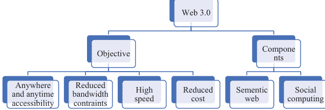

图 2：Web 3.0 的目标和组成部分。

### 4.4 Web 3.0 的优势

- **数据管理**：互联网管理是一项复杂的活动，因为需要解释许多程序来汇聚各种系统的数据，而这些数据在某些情况下可能被或无法被计算机解释。在这些情况下，数据与相应输入之间的关系非常困难。通过使用语义网可以解决这一困境，如果它能够告知各种数据集之间的相互理解，将使系统更容易理解并高效地将连接与所需的输出相结合。

- **移动访问性**：总体而言，预计到 2008 年，移动设备将超过 40 亿台。同时，全球智能手机渗透率预计将超过 50%。随着 3G 技术的推出，这一数字预计将达到 60%，使得在手持设备上访问互联网变得更容易。因此，Web 3.0 市场因其卓越性能而增长。通过移动设备访问互联网预计将发挥重要作用。通过 CSS 的应用，Web 3.0 的网页规模 [22–24] 可以缩小。

- **创意工具**：独立数据库之间的多个链接是平台 3.0 的主要特征。结构和个人将相同的方式使用数据和信息数据集，从而提高他们的效率。这促进了创新过程，进而导致了用于研发新模型的发展。

- **全球化**：网络 3.0 使用一种名为资源描述框架（RDF）的通用编程语言，试图构建和标准化各种数据结构。这是该网络的底层数据交换模型。

`RDF` 使用 `XML` 编写，使得不同的程序可以轻松地交换细节。这打破了延迟、移动设备上网页查看不佳等限制。

- **增强客户满意度**：网络 3.0 为企业提供了“人工智能”，以提高客户服务满意度（CSS）。通过这种方式，消费者可以在他们的网页上查看完整的产品信息。这提升了公司在市场上的声誉，从而吸引了更多客户。Web 3.0 中采用的一些技术如图 3 所示。

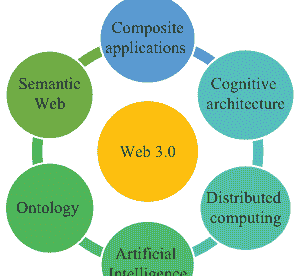

图 3：Web 3.0 的技术。

## 5 Web 3.0 与 HRM

每个领域正在通过启动一个随时间推移而改进的更好计划。物联网（IoT）增强了特定系统的约定。IoT 前端应用的一个例子是可以使用其特征自适应传感器智能设备。定期，具有异构十亿级容量的 IoT 设备存在实现和约束服务质量（QoS）的需求。2020 年，HRM 已发展到管理所有物品移动、业务能力、异构数据支持、绘制实用性、数据集成和高可靠性 [25]。

人力资源专业人员将访问网络基础设施和互联网提供的工具和服务。Web 1.0、Web 2.0 和 Web 3.0 的概念通常已经在许多阶段完成。Jason Calancanis 在 2007 年计划通过专家使用 Web 2.0 技术作为可行平台，开发高质量商品和服务。技术和软件设备的真实实现始于 2010 年。在 web 3.0 实例的有效解释方面没有竞争。因此，许多移动或智能应用程序使用了 web 3.0 的概念来提供更好的视频质量、机器控制工具和许多包括增强现实在内的 3D 效果 [26]。

人力资源管理的知识管理与 Web 3.0 集成

在当前的互联网场景下，很难区分 Web 2.0 和 Web 3.0。在人力资源管理系统（HRMS）中引入 Web 3.0 或 Web 2.0 已广泛应用于人力资本管理、劳动力管理、人才开发系统、业务学习系统、电子招聘等。

在 HRM 应用中应用 Web 2.0 或 Web 3.0 技术，将激励用户参与与信息交互，并为人力资源专业人员增强服务。为了支持这一点，已经有很多 HRMS 可用 [27]。

目前，许多智能应用程序也作为独立的在线 HR 支持可用。在人力资源管理中，开发集成 Web 3.0 的工具和技术存在研究机会。

## 6 知识管理与集成 (KMI)

在过去的二十年里，知识管理（KM）为了在这个竞争激烈的世界中生存已获得了大量关注。这增强了组织关注和嵌入专业知识以改进其成果的能力。知识管理和创新技术在利润和满意度方面显示了组织的熟练程度 [28]。在研究了 HRM 领域研究人员之前的贡献后，KM 被认为是信息提取及其管理过程最重要的支柱，即知识的获取、共享、传递和整合。HRM 过程创建了一个通用的社会场景，这些过程朝着高效知识整合的方向移动。在理解 HRM 和 KI 的关系之前，了解目标很重要（图 4）。

最近的研究 [29–33] 探索了 HRM 与 KM 过程之间的关系及其结果。因此，这些研究改进了对 KM 在每个领域作用的理解。也已知 HRM 如何受到外包公司等其他公司的影响。这显示了过去二十年来 KM 重要性的提高，有助于为新产品和流程创建知识库，并持续增加生产力和利润（图 5）。

## 7 使用 AI 进行知识管理的上下文化

Suriyan Yomthanachai 等 [34] 展示了橡胶木工厂的人力资源管理应用，将其工业转换为工业 4.0。转换的主要目标是大量难以手动处理的生产数据。

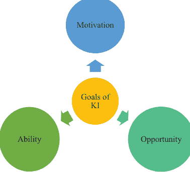

图 4：KI 的目标。

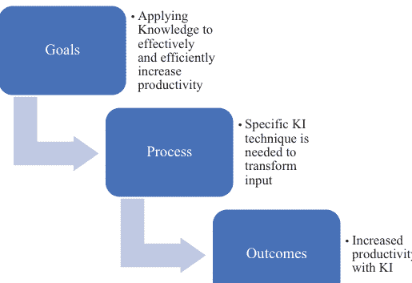

图 5：KI 的系统。

人力资源管理的知识管理与 Web 3.0 集成

软件工厂，其中通常的公式化需要妥善监督的各种类型的复杂性。

C. Rosa Yeh 等人 [41] 讨论了技术已经改变了获取技能的过程。开展这项工作的目的是帮助创业者更好地理解不同的技术及其对社会的影响。从连接性来看，这项工作旨在整合先进的学习方法。联结主义包含了社交互动技术和知识管理（KM）的实施。问卷被分发给覆盖台湾的 301 家计算机公司，共收到了 80 份真实的反馈。该研究提出了一个假设，并证明了企业文化对组织学习的直接影响。新建立的行业对创新、学习及其对现代技术的采用表现出相对的热情。

Tsang-Kai Chang 等人 [42] 展示了在互联网上预测和理解行动以及行为的假设。电子学习领域就是一个很好的例子。在这项工作中，通过了实验性分析以提取用户或参赛者对提高电子学习平台使用水平的影响。实验针对 176 名教育管理人员进行。进行了一项小规模意见调查以了解“优越效应”、“同伴效应”和“监管”。结果分析显示了“同伴效应”的益处。它还证明了规则没有太大影响。对这些效应进行了相关性分析，结果显示几乎所有参赛者都受到使用电子学习的同伴的影响。

Luis Andre Rodriguez Rodriguez 等人 [43] 讨论了健康旅游是许多国家的热门部门，工业化国家正在提供更好、更廉的医疗保健。上述模型被用于专家知识的管理，并关注医疗旅游领域的信息与通信技术（ICT）。该模型提供了一个实现业务决策过程的工具，因为它对专家的知识、价值和生产力做出了贡献。这种管理模型通过开发工具为这些目标提供了路线图。

Suaila Samur 等人 [44] 讨论了获取准确知识以创建一个安全的电子医疗记录（EMR）系统，用于共享信息的分析。此前，对选定的医院信息系统（HIS）开发人员小组进行了初步访谈调查。结果分析显示，设计用于医院信息系统（HIS）的隐私保护框架需要考虑四个因素。这些因素是：法律、伦理、技术和文化。通过知识管理的应用，可以检索更系统化的规则以实现信息的安全。此外，它为设计更安全的 HIS 展望了前景。

Anna Závodská 等人 [45] 分析了知识管理（KM）的作用及其过程与绩效的关系。这项工作中设计的架构展示了每个层级知识信息的重要性。还讨论了不同公司之间的知识比较。文中提供了营销活动信息。该方法涉及三个案例研究，用于收集和分析事实。研究表明，增值机制的框架可以作为许多阶段价值分析的估算方法，且不同的业务管理方法是适当的。根据讨论的问题提出了建议的修改方案。蓝海策略原则是这些建议的基础。蓝海技术被认为是知识处理和组织进步的更优方法。

Fernando J. Jarrigos-Simon 等人 [46] 考虑了在当代经济和社会环境中，ICT 在社交网络发展和 Web 3.0 技术方面所面临的转型，这是由于近期创新对企业效率的影响。调查说明了社交网络的使用以及与之相关的数字业务模式的增长，这凸显了群体经理和众包平台的重要性。鉴于近期进展，报告探索了企业获得竞争优势的可能来源，并描述了它们应该带来的改进，以提高决策并利用现状。论文分析了社会工作管理和平台 3.0 技术推广的影响，并讨论了加强竞争优势的方法。

Muhammad Waseem Muhammad Zia 等人 [47] 讨论了第三代互联网 Web 3.0。它用于创建外部数据存储设施，允许任何数据在任何网络中进行交换。这涵盖了一个假设，即在第三世纪位置和计算机科学与图书馆相关。现代 Web 技术的各种优势、Web 3.0 被包含了其中。

# 人力资源管理知识管理与 Web 3.0 的集成

服务与产品、合理价格以及客户满意度。选择了 Mell Bank 组织市场的精通且专家的人，并为统计协会选拔了 210 名在伊朗保险公司工作的精通人员。

Diana Elena Ranf 在 [57] 处证明了在项目管理中，通过结构化框架来聚类和缓解信息复用以及产生新知识的必要性和要求。这些必要性通过知识管理（KM）得到了满足，并为增强项目管理实践铺了道路。本文涵盖了开发人员通过实施和接受项目管理策略所获得的利润和奖励。本文的一大作用是建立了一种一种在项目管理中使用知识管理的方法。这从同样应用于项目管理的 KM 循环四个阶段开始。

## 8 拟议框架

人力资源管理（HRM）是所有组织中的一个部门，负责查看和处理员工的所有需求和方面。HRM 处理多项工作，如员工招聘、工作绩效分析和福利评估。HRM 部门致力于组织内员工的福利。现有的 HRM 方法存在以下问题：

- 组织知识管理与 Web 3.0 的兼容性。

- 组与个人之间的通信开销。

- 员工之间文档记录效率低下且信息共享不当。

在考虑这些因素的情况下，拟议的框架旨在全球协调整个 HRM 系统。拟议框架设计用于在云端使用机器学习方法。该框架设计如下方的分布式架构所示（图 6）。

针对拟议架构执行了以下步骤：


- 1. 数据收集单元收集有关员工投诉、绩效、评估、奖金分配等等方面的数据。
2. 随后，将收集的数据存储在云服务器上，其他单元可以访问这些数据。
3. 接着，集成了机器学习的分析单元将根据需求执行绩效分析。
4. 分析结果也存储在云服务器上。
5. 最后，决策单元集成了如模糊逻辑等机器学习方法，用以对员工做出决定，并通过云服务器对其进行协调。

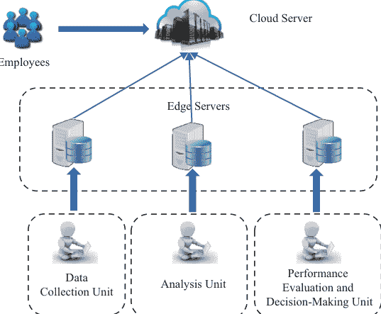

**图 6：** 集成云端机器学习的 HRM 拟议架构。

拟议架构的关键特征为：

- 1. 在本研究中，机器学习/AI 用于对员工进行收集、分析和决策制定。这展示了 Web 3.0 特性（AI 和云计算）的集成，以促进 HRM 程序的进步。
2. 使用 KM 或数据挖掘方法用于分析目的。
3. 该模型对于寻找组织中存在问题的最佳解决方案非常高效。
4. 该决策支持系统在时间上也是高效的。
5. 该模型在不带任何偏见的情况下做出决策，并间接有助于组织的发展。

## 9 结论

在本章中，讨论了 KM 评估结合 Web 3.0 可用性对组织知识生成、共享、组织的影响及其在 HRM 中的利用。在本章中，通过利用 Web 3.0 工具和技术（如 AI 和云计算）的优势，设计了拟议框架以构建支持组织内员工协作学习的智能 HRM 系统。拟议框架将证明 KM 关于组织增长的可行性。作为这项工作延续的一部分，需要对智能 HRM 进行实验性实施以提高其效率。

## 参考文献

- [1] Helmke, S., Dangelmeier, W. & Uebel, M.F. (2002). CRM-systems as technology enabler for a customer-oriented knowledge management. 249. https://doi.org/10.1109/picmet.2001.
- [2] Kong, F. & Cai, L. (2008). Customer knowledge management and research in E-commerce environment. Proceedings – 2008 International Symposium on Knowledge Acquisition and Modeling, KAM 231–235. https://doi.org/10.1109/KAM.2008.149
- [3] Lian, G.G. & Hu, L. (2008). The research on knowledge management based on supply chain. 2008 IEEE International Symposium on Knowledge Acquisition and Modeling Workshop Proceedings, Kam, 117–119. https://doi.org/10.1109/KAMW.2008.481078
- [4] Gunawan, A. & Kurnia, S.G. (2019). Knowledge management to enhance the human resource quality case study at PT. Gai. Proceedings of 2019 International Conference on Information Management and Technology, ICMTech 2019, 482–485. https://doi.org/10.1109/ICMTech.2019.884315
- [5] Carter, L., Joyce, V. & Flores, M. (2020). Enhancing human resource management in improvement projects. In: Organizational Dynamics, Elsevier Ltd, 100776. https://doi.org/10.1016/j.org.2020.100776
- [6] Oehlhorn, C.E., Maier, C., Laumer, S. & Weitzel, T. (2020). Human resource management and its strategic-IT alignment: A literature review and avenues for future. Journal of Strategic Information, 29(4), 1016. https://doi.org/10.1016/j.jis.2020.09166
- [7] Czarnowski, I. & Półkowski, P. (2020). A novel framework for decision support system in human resource management. Procedia Computer Science, 176, 1548–1556. https://doi.org/10.1016/j.procs.2020.09166
- [8] Jantan, H., Hamman, A. & Othan, Z. (2010). Intelligent techniques for decision support system in human resource management. In: Devlin, G. (Ed), Advances in Decision Systems, 342.
- [9] Jouga, W., Rebai, L. & Almayani, W. (2019). Towards an ontology-based approach for human resource management. Procedia Computer Science, 151, 417–424. https://doi.org/10.1016/j.procs.2019.04057
- [10] Ahamad, M., Glaister, K. & Gomes, E. (2020). Strategic agility and human resource management. Human Resource Management Review, 30(1), 1007. https://doi.org/10.1109/hrm.2019.1007
- [11] Davenport, T. & Marchand, D. (2000). KM is just good information management. In: Financial Times Mastering Information Management, Great Britain, Pearson Education Limited.
- [12] Davenport, T. & Prusak, L. (2000). Working Knowledge: How Organisations Manage, United States of America, Harvard Business School.
- [13] Koulopoulos, T. & Frappaolo, C. (1999). Smart Things To Know About Management, United Kingdom, Capstone Publishing.
- [14] Nonaka, I. & Takeuchi, H. (1995). The Knowledge Creating Company, New York, Oxford Press.
- [15] Stewart, T.A. (1999). Intellectual Capital: The New World of Organisations, London, Nicholas Brealey Publishing.
- [16] (PDF) Overview on Knowledge Management. (n.d.). Retrieved December 30, 2020, from https://www.researchgate.net/publication/32460314_Overview_on_Knowledge_Management
- [17] Ammar-Khoadja, S. & Bernard, A. (2008). An overview on knowledge management. In: Methods and Tools for Evaluation Life-Cycle-Management, Berlin, Springer. https://doi.org/10.1007/978-3-540-78431-9
- [18] Kurilovas, E., Kubinskiane, S. & Dagiene, V. (2014). 3.0 – Based personalisation of learning objects in virtual learning environments. Computers in Human Behavior, 30, 654–662. https://doi.org/10.1016/j.chb.2013.0639
- [19] Newman, R., Chang, V., Walters, R.J. & Wills, G. (2016) 2.0 – The past and future. International Journal of Information Management, 36(4), 591–598. https://doi.org/10.1016/j.ijinf.2015.0607
- [20] Cheng, H.K., Kip, Y.T., Townsend, J.P. & Scott, M. (2008) 2.0/3.0: Health care and life sciences data using Web 2.0. Journal of Biomedical Informatics, 41(5), 694–705. Academic Press. https://doi.org/10.1016/j.jbi.2008.04001
- [21] Nath, K., Dhar, S. & Basistha, S. (2014) Web 1.0 to 3.0 – Evolution of the web and its various choices. ICROIT – Proceedings of the 2014 International Conference on Reliability, Optimization and Information Technology, 86–89. https://doi.org/10.1109/ICROIT.2014.6798297
- [22] AlAbdulwajah, F.A. (2018, August 20) Web 3.0: The decentralized blockchain network and protocol innovation. 17st International Conference on Computer Applications and Information Security, ICCAIS 2018. https://doi.org/10.1109/ICAIS.2018.8841990
- [23] Fenthal, D. (2013), Introduction to Web 3.0 changing knowledge learning and instruction? In: Advances in Cognitive and Educational Psychology, New York, Springer. https://doi.org/10.1007/978-1-641-1538
- [24] Azeem, M.F. & Yasmin, R. (2016) HR 2.0: linking Web 2.0 and HRM functions. Journal of Organizational Change, 29(5), 666–712. https://doi.org/10.1108/JCM-09-2015-0152
- [25] Web 3.0. (2014). Encyclopedia of Social Network Analysis and Mining, W. York, Springer, 2337–2337. https://doi.org/10.1007/978-3-641-1068
- [26] Dmitriy, C. What Mode of access: article: [Available at]: http://therunet.com/articles/1552-cto-take-over-web-3-0-version-i-otsenki
- [27] Human Resources in Russia in 2013 HR. Short version of the analytical report. [Available at] –: http://www.daviser.ru/index.php/HRM
- [28] Salacanis, J. Web 3.0, the "official" / Jason Salacanis – [Available at]: http://calacnis.com/2007/03/web-3-0-the-official-definition
- [29] Applebaum, A., Bailey, T., Perk, & Kelleberg, A.L. (2000). Manufacturing Advantage: Why High-Performance Work Pays Off, Ithaca, NY, Cornell University Press.
- [30] Barney, J.B.(1991). Firms resources and sustainable competitive advantage. Journal of Management, 17, 99–120.
- [31] Berggen, C., Bergek, A., Holdbay, M. & Söderlund, J. (2013). Knowledge Integration and Innovation: Critical Challenges Facing International Technology-Based Firms, UK, Oxford University Press.
- [32] Rupietta, C. & Backes-Geller, U. (2017). Combining knowledge stock and flow to generate superior incremental innovation performance – From Swiss manufacturing. Journal of Business Research.

# 知识管理与 Web 3.0 在人力资源管理中的整合

- [33] Malik, A., Froese, F.J. & Sharma, P. (2020). 人力管理在知识整合中的作用：概念框架构建。Journal of Business Research, 109, 524-535. https://doi.org/10.1016/j.busres.2019.01.029.
- [34] Tomchanachai, S., Rattanamamee, W., Synthavai, R. & Wong, W.P. (2020). 遗传算法与数据分析在企业级总资源管理中的应用。Resources, Conservation and Recycling, 161, 104985. https://doi.org/10.1016/j.rescon.2020.104985.
- [35] Soltysk-Pierunkiewicz, A. (2015). 信息技术 Web 2.0/3 对知识管理的影响：知识管理系统中软件技术可用性案例研究。AI Conference Proceedings, 1644(1), 219–227. https://doi.org/10.1067/1497.07840.
- [36] Dominic, M., Francisis, S. & Promenajar, A. (2014). Web 3.0 下的电子学习。International Journal of Modern Education and Computer Science, 6(2), 8–14. https://doi.org/10.5815/ij-mce.2014.02.02.
- [37] El, H.M. & Amer, A.M. (2015). 基于 Web 3.0 技术的教育知识管理模型。Computer (The Egyptian Journal), 14(16), 5–11. https://doi.org/10.12816/00025679.
- [38] Sheth, S. & Thirnarayan, K. (2012). 增强 Web 3.0：面向应用的企业、社交、传感器和云端数据及管理。Synthesis Lectures on Data Management, 1–175. https://doi.org/10.2200/00433d01y2012033.tom
- [39] Morris, R.D. (2011). 对在线学习的启示。TechTrends, 55(1), 42–46. https://doi.org/10.1007/s11568-011-0269-9.


# 知识管理与 Web 3.0 在人力资源管理中的整合

[33] Malik, A., Froese, F.J. & Sharma, P. (2020). 人力管理在知识整合中的作用：向概念框架构建。Journal of Business Research, 109, 524-535. https://doi.org/10.1016/j.busres.2019.01.029.

[34] Tomchanachai, S., Rattanamamee, W., Synthavai, R. & Wong, W.P. (2020). 遗传算法与数据分析在企业级总资源管理中的应用。Resources, Conservation and Recycling, 161, 104985. https://doi.org/10.1016/j.rescon.2020.104985.

[35] Soltysk-Pierunkiewicz, A. (2015). 信息技术 Web 2.0/3 对知识管理的影响：知识管理系统中软件技术可用性案例研究。AI Conference Proceedings, 1644(1), 219–227. https://doi.org/10.1067/1497.07840.

[36] Dominic, M., Francisis, S. & Promenajar, A. (2014). Web 3.0 下的电子学习。International Journal of Modern Education and Computer Science, 6(2), 8–14. https://doi.org/10.5815/ij-mce.2014.02.02.

[37] El, H.M. & Amer, A.M. (2015). 基于 Web 3.0 技术的教育知识管理模型。Computer (The Egyptian Journal), 14(16), 5–11. https://doi.org/10.12816/00025679.

[38] Sheth, S. & Thirnarayan, K. (2012). 增强 Web 3.0：面向应用的企业、社交、传感器和云端数据及管理。Synthesis Lectures on Data Management, 1–175. https://doi.org/10.2200/00433d01y2012033.tom

[39] Morris, R.D. (2011). 对在线学习的启示。TechTrends, 55(1), 42–46. https://doi.org/10.1007/s11568-011-0269-9.

[40] Garcia, V.H., Martin, C., & Castillo, S.J.B. (2013). 应用于复杂系统的知识管理模型：软件工厂的开发。Advances in Intelligent Systems and Computing, 372, AISC, 185–195. https://doi.org/10.1007/978-3-642-30867-3_17.

[41] Rosa, Y.C., Singhat, H.F. & Chang, S.M. (2013). 联结主义实践对台湾工业界组织学习的影响。Advances in Intelligent Systems and Computing, 172, AISC, 219–229. https://doi.org/10.1007/978-3-642-30867-3_20.

[42] Chang, T.K., Huang, H.F. & Chang, S.M. (2013). 教育管理者对在线学习的需求。Advances in Intelligent Systems and Computing, 172, AISC, 267–273. https://doi.org/10.1007/978-3-642-30867-3_24.

[43] Rojas, L.A., Bermudez, G.M. & Morales, A.O. (2013). 应用于哥伦比亚健康旅游的知识管理模型。Advances in Intelligent Systems and Computing, 172, 537–546. https://doi.org/10.1007/978-3-642-30867-3_48.

[44] Samsuri, S., Ismail, Z. & Ahmed, R. (2013). 采用知识管理概念来保障电子记录系统的隐私安全。Advances in Intelligent Systems and Computing, 172, AISC, 547–558. https://doi.org/10.1007/978-3-642-30867-3_55.

[45] Závovská, A., Šramová, V. & Aho, A. (2012). 知识在价值创造过程中的作用及其对营销策略的影响。Advances in Intelligent Systems and Computing, 172, 589–600. https://doi.org/10.1007/978-3-642-30867-3_49.

[46] Garrigos-Simón, F.J., Alcami, L. & Rivera, T. (2012). 社会网络与 Web 3.0：其对组织管理的影响。Management Decision, 50(10), 1880–1890.

[47] Waseem Zia, M. & Ahmed, F. (2019). Web 3.0 在巴基斯坦学术机构网站中的可能用途。https://digitalcommons.edu/libphil

[48] Pawełosz, I. (2015). 企业中的 Web 3.0 应用。Studium Economiczne., 24, 129–139.

[49] Lal, M. (2011). 教育中的 Web 3.0。BVICAM's International Journal of Information Technology (2)。

[50] Kang, J.-Y. & K.P. (2013). Web 3.0 的应用：移动位置定位购物服务的正面口碑。国际纺织与服装年度会议论文， 70(1)。https://iastatedigpress.com/itaa/article/21985/

[51] Barpute, P. (2012) [此处原文内容重复，按要求翻译]

# 教育 4.0 与 Web 3.0 在增强学习管理中的应用：后疫情分析

## 摘要

教育 4.0 是一种学习愿景，使教育者和学生能够通过技术研究来发现新的可能性。互联网、人工智能和虚拟教室的进步已经彻底改变了教育行业。新型病毒的爆发迫使全球进入封锁，学校和大学转向数字平台。疫情影响了全球 90% 的学生，迫使教育机构考虑非传统的教学方法。对系统进行的修改依赖于教育 4.0 的资源，这些资源可能是永久性的。许多修改是对模式的升级，关注学生的发展和早期学习，并有更具差异化和包容性的计划。然而，目前或未来的变化将是长期的，需要周密的规划。Web 3.0 资产通过个性化、知识管理改进了学习机会，并为课程开发、记录保存和教学支持提供了增强协助。首先，本研究调查了正在应用的哪些新工具和技术。本章旨在探讨教育 4.0 所引入的实践对后疫情时期学生和教师学习的影响。由于缺乏意识，本研究重点强调了教育 4.0 的更新。

通过调查，研究人员可以回答一个迫在眉睫的问题：在疫情期间启动教育 4.0 是否能够彻底改变新冠后的教育系统，并赋予学生在 21 世纪生存所需的技能？组织和学校系统需要从未来的角度来理解这些调整对学习社区所有成员的影响。在后疫情时代，研究人员可以研究如何更好地实施本章中讨论的特定工具，并评估它们在不同线下课堂环境中的有效性。向电子学习的转变可能是全球教育结构亟需的改变，以建立一个更具包容性且以学生为中心的学习环境。

**关键词：** 教育 4.0、COVID-19、电子学习、技术、Web 3.0、后疫情时代、教育系统

## 1 引言

目前，我们所熟知的物理世界很大程度上已经通过巨大的进步和不同行业的发展而演变，推动着人类以更高效、更快速的方式工作。过去几十年的技术变革将我们推入了数字化时代，虚拟助手让我们的生活变得更加简单，3D 环境提供了前所未有的体验，网民在全球范围内相互联系。一切好与坏的发生，都得益于人类通过工业革命来证明自己是优越种族的信念。

在工业 4.0 开发和引入之前，曾有三次不同的改革改变了人类对工作环境的体验，并为未来几年更大的技术转型铺平了道路。第一次工业革命侧重于通过动物和基础机器辅助的人工劳动。接着是 20 世纪 20 年初的第二次工业革命，引入了钢铁和电力驱动工厂，极大地提高了生产力。随着电子设备的出现，第三次工业革命由在工作场所采用更好数字技术和软件的制造商开创。工业 3.0 中互联网和计算机技术的增长为第四次革命中发起的通信与协作奠定了基础。通过访问实时数据、物理系统和人工智能，工业已经开启了高级别的连接性，使企业能够比以往任何时候都更好地理解和控制其运营，从而提高其效率 [1]。

工业革命 4.0 的特点是生物、物理和数字世界的融合，以及机器人技术、大数据、3D 打印、人工智能和物联网（IoT）等新技术的日益广泛的应用。这些进步启动了不仅是商业领域，包括消费者、教育、旅游、健康和经济的数字化进程，特别是在 COVID-19 疫情期间。源自工业 4.0 的第四次医疗革命引入了新的数字工具来自动化医疗系统并优先考虑患者护理。例如，AI 系统协助医院跟踪电子患者数据和医疗物资，减轻了员工的工作量，而大数据模型提供了有关疫情期间不同国家患者和医院的趋势和信息图 [2]。同样，工业 4.0 也启动了教育领域的数字化革命，被称为“教育 4.0”，其具有以学习者为中心的目标，并为每个利益相关者（学生、教师和管理层）提供技术支持。

教育 1.0 是一个非常需要记忆和经验的系统，学习者被视为知识的容器。随后，革命来临，学生打破了传统，将知识用于日常生活中，这被称为教育 2.0。在这里，学徒被认为在进行交流、协作和共同创造。从那里开始，技术开始了更快速的移动。学生开始尝试新类型的技术。报告表明，学习应该通过协作来体验，学生通过团队工作来产生良好的学习成果，这一系统被称为教育 3.0。学习者学会了成为连接者、创造者和建构者。

下一次革命性的方法是教育 4.0，它与工业革命 4.0 相。这种模型反驳了之前的观点，因为知识不仅仅是为了消费和生产，而是通过智能技术、人工智能和机器人技术来创新多样化的想法，所有这些都影响着我们的日常生活。教育 4.0 可以被视为一种总体的上升趋势，通过融合新旧工具来增强教育系统，并为学生进入工业 4.0 的未来劳动力市场做准备 [3]。这种学习系统结合了不同的技术和方法，使高等教育机构调整其系统和课程大纲，为新的先进开始做好准备。

当人类迎接未来时，我们在教育系统中如何教学以及教什么必须经过重塑，以使系统调整并跟上 21 世纪的技术。理解和教学的未来已经从传统方法向新方法跨出了大跃，因为学生利用教育者提供的资源在课堂表现上投入了更多创造力，对指导的需求在减少。教师教满屋听从并回应指令的学生的概念早已成为教育的过去。虽然这不是一种完全的方法，但由数字资源驱动的学习空间将取代如今的典型教室，为学生创造更具个性化的体验 [4]，帮助学生成为自己教育的伙伴或共同创造者（如图 1 所示）。

在教室外，也需要加强并强烈考虑允许学生进行协作、沟通和团队合作的体验。

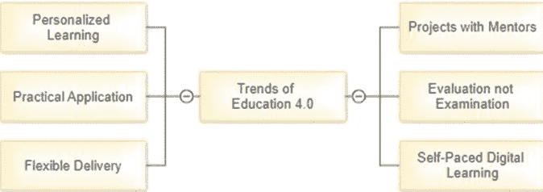

**图 1**：教育 4.0 的趋势。


应该允许学生在与其不同规模的小组完成自己的独特学习项目时，他们之间进行连贯的互动。教室将作为物理空间和虚拟环境共存，而“翻转学习”的概念将被稳步地考虑，这样学生可以在家里理解理论，而在课堂上花时间通过小组工作，将知识应用于现实生活的问题和讨论中。由于目前的状况，随时随地学习的理念变得至关重要，并应被视为疫情带来的“新常态”，在这种情况下社交距离是必要的，学校/大学是虚拟的。在全球范围内提供免费数字资源和虚拟学习环境一直是教育 4.0 的重要目标。教育 4.0 新的技术驱动教育系统也为教师提供了见解，帮助他们根据学生的进度制作个性化课程，并提供对他们最有益的互动内容。这让学习者能够变得更具创新、更好的数据收集者，并抓住任何分享的机会 [5]。

# 物联网 (IoT)

物联网（IoT）简单来说就是连接任何收集、共享和处理周围信息的设备的概念。它涵盖了从家庭到办公室应用的广泛用途，包括智能设备和可穿戴设备，以及几乎所有连接到互联网并使用通用语言通信的设备；这些物体内置了传感器，形状大小各异，能够接收来自环境的信息并连接到物联网平台。这些平台整合并分析数据。

全球人口持续增长并老龄化，人们的寿命在延长。这需要创新的想法来为每个人提供地球资源和各项。随着人们向城市迁移，管理交通、污染和能源的挑战日益增加。在这种背景下，个人可以获得日益增长的信息产品和服务和服务，并期望这些服务能够根据其个人需求进行定制。技术被认为可以满足这些需求，并为我们每个人增强生活的愿景做出贡献。不同的技能开发出解决方案，让世界变得智能、连接更紧密。提到物联网，它简单就是连接任何收集、共享和处理周围信息的设备的概念。它涵盖了从家庭到办公室应用的广泛用途，包括智能设备和可穿戴设备，以及几乎所有连接到互联网并使用通用语言通信的设备 [6]。

无线技术作为嵌入式传感器和执行器节点的最新发展，为物联网提供了将互联网转变为完全集成未来网络的机会，使其接收来自环境的信息并连接到物联网平台。这些平台整合并分析数据，并帮助提供关于我们周围世界的各种信息。

物联网是指非传统计算设备的术语，这些设备连接到互联网以便在没有人工干预的情况下发送和指令。无线传感器网络（WSN）技术实现的通用识别跨越了我们现代生活的各个方面。这有助于我们进行测量并得出推论，同时也让我们有机会理解从精细生态系统、自然资源到城市环境的各种环境指标 [7]。这些高科技设备在通信网络激活中的传播创建了物联网。它影响着我们的日常生活和生活方式；例如在家里，这些智能技术允许我们管理灯光、采暖或任何嵌入了智能系统的家电，基本上给了我们一个使用智能家居系统的机会，我们可以远程监控和控制家。基于物联网的技术的类似示例还包括跟踪日常活动（步数、心率等）的智能手表、智能汽车和智能手机。

## 2.1 5G技术与物联网

第五代无线技术或我们目前所说的（5G）是技术的最新迭代，旨在增加全球网络的速度和响应能力。5G是一项发明，由于更宽的带宽和先进的天线技术，它使得无线系统传输的数据量大幅增加。根据各种报告，5G的速率是LTE网络的数倍。这种超越性速度的巨大飞跃将允许物联网设备更快地通信和共享数据。5G网络系统与物联网的发展（物联网被认为适用于各种极具前景的领域和应用）正随着各种蜂窝网络技术的演进，创造了在物联网框架内组织海量传感器的可能性，并通过挑战所有其他通信或数据挖掘技术来帮助处理数据 [9]。

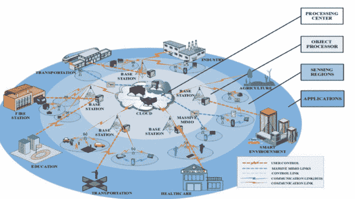

图 2：5G与物联网的发展。

# 教育 4.0与Web 3.0在增强学习管理系统中的应用

图 2显示了物联网与5G网络的扩展与结合，提供了一个互联网、智能和万物的完美范例。5G用户不再仅仅是普通的智能手机使用者，他们还是车载网络的用户，在这种情况下，用户将这些“车辆”与其他相互连接。此外，由于与物联网等技术的互操作性，用户数量的增加和用户类型的多样化导致了新型应用的多种形式，以及在理解和满足体验质量（称为 QoE，关注全方位的体验）方面面临各种主观需求和挑战。此外，还提出了许多其他潜在方法和技术，例如毫米波（mm Wave）、大规模多输入输出（MIMO）和机器间通信（M2M），5G网络可以很好地适应物联网。建立这些智能技术有助于世界与海量设备连接，并为人类的便利提供先进且智能的服务做出巨大贡献 [10]。

### 2.2 物联网在教育中的作用

从教育的角度来看，教室不仅局限于讲堂。如下如图所示，特别是在大疫情期间，物联网已经遍布全球的校园和学校。有数千个站点提供不同的课程，你可以从世界的任何地方访问它们。对于数百万有特殊需要的学生来说，物联网可以从教室环境中可能无法提供的教育资源中获益。一些例子包括有移动应用程序帮助有阅读障碍的学生阅读和理解材料，有帮助有写作困难学生的语音识别应用程序等。物联网在教育领域的兴起正在物理或在线上为教室增加更多资源或工具。计算机提供了交互式视听媒体和其他软件，以有效且有趣的方式呈现信息 [11]。通过“随时随地学习”是世界各地人们接受的新形式，你只需要有互联网连接和数字设备，整个知识世界就会向你开启。学习新技能或新科目是非常可能的。新时代让人们最大限度地利用这些机会。创建物联网产品可以为学生提供一个便利的环境提供巨大帮助，如图3 所示 [12]：

- 数字荧光笔可以扫描任何打印文本并传输到你的设备，使笔记过程变得极其快速简单。
- 射频识别（RFID）芯片可用于跟踪任何物体，例如植物和动物，以便获取信息并存储在云端供以后分析和推论。
- 嵌入书籍的二维码可以访问任何额外资源，学生也可以将其嵌入离线工作中并链接到项目的在线作品。
- 智能教室——物联网将使未来的教室成为老师的乐园。增强现实（AR）帮助学生获取他们正在学习的对象的详细信息。例如，课程可以使用带有AR可能性的教科书。这些技术能够让学生沉浸在全新的环境中。学生能够近距离探索从重型机械到人体，再到水下生态系统的一切 [13]。

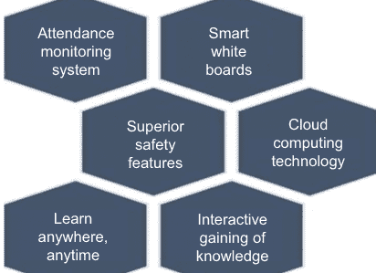

图 3：物联网教育应用。

# 教育 4.0 与 Web 3.0 在增强学习管理系统中的应用 — 93

了应用程序托管、内容存储和交付的成本。不同的云计算模型对于充分利用 5G 智能教室教育系统所提供的服务至关重要。超可靠高速的 5G 等延迟是该服务应用的催化剂 [14]。

同样，可穿戴设备通过监测学生的运动和出入帮助解决学生的问题。这些设备连接到管理层的中央数字平台。通过这些自动化，甚至不需要对学生进行点名，因为这些设备会自动检测学生是否到场或缺。如果家长担心孩子的行踪，这些技术还可以通过发送消息帮助他们检查学生的位置和活动 [15]。结合物联网（IoT）传感器，这些设备仅允许授权人员进入大大门，当未经授权的人员到达时，访问将被拒绝。

同样，另一个例子是报告自动化，这是一种连接设备，使学校管理员能够利用 AI 生成各种问题的周报、月报或年，包括学生进步报告、财务计划报告以及学校董事会报告等。

### 2.3 IoT 的未来

IoT 行业的未来被视为一个巨大的成功。根据 Business Insider 的情报估计，到 2020 年将有 240 亿遵循 IoT 路径的设备安装，IoT 收入在未来几年将达到约 3570 亿，为 IT 行业带来了大量的就业机会。随着我们从 www（静态网页）转向 web2（社交网络网页）再到 web3（无处不在计算），使用复杂的直观查询进行按需数据的需求显著增加。随着云技术以及数据挖掘和大数据分析的兴起，IoT 的未来看起来充满前景，随之，应用将提供更多 [16]。

IoT（图 4）将以非常快的速度扩展，随之的是，每个领域都将取得巨大的进展。我们可以利用 IoT 的力量实现智能学习环境，促进更好的学习和更高的留存率。教育教育的这种进步可以在技能和知识方面培养更优秀的人。

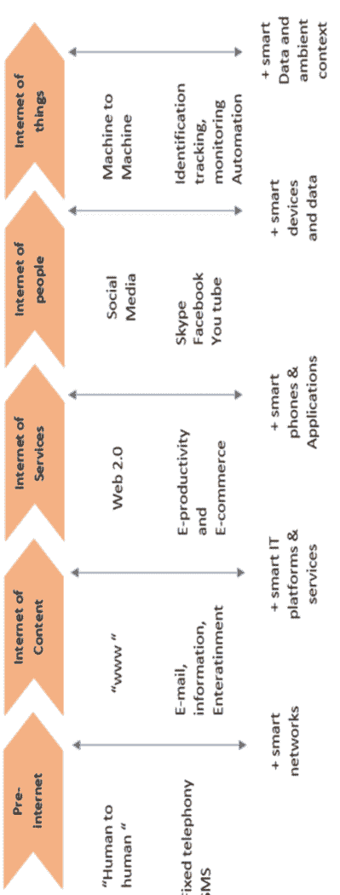

# 人工智能

第四次革命的技术和创新已经迅速蓬勃发展并改变了这个星球的过程。人工智能，或 AI，是工业 4.0 背后的驱动力。AI 是通过算法和计算环境开发对人类智能的复制。AI 由计算机科学家设计，以机器学习的形式增强并模拟人类能力，并执行与我们相似的功能：规划、推理、学习和解决问题。围绕 AI 的研究致力于开发机器和代码来自动执行需要某些智能的日常任务，并为现实问题提供解决方案。AI 系统正在不断开发，并应用于商业、军事、医学和工业的不同领域 [17]。

在日常家庭应用中，AI 通过 Siri 和 Alexa 以数字助手的形式应用于我们的手机和智能家居设备中，这些程序运行在流行的机器学习软件上。人们在聊天中的大部分交互由 AI 软件驱动，该软件可以识别客户的查询并根据其知识做出回答。Bing、Google 等搜索引擎通过通过 AI 创建的算法运行；这些例子展示了人类与 AI 交互的深度，这种交互在过去几年中大幅增加。许多制造和业务流程也依赖于 AI 的平滑及其对用户界面的理解 [18]。

自然语言处理（NLP）和机器学习是应用最广泛的 AI 形式，用于图像识别、深度学习和规划、内容提取和文本生成。AI 的语音组件被高度用于机器翻译和语音转文本/文本转语音识别。大型组织将这些 AI 系统部署在不同的工作领域，最高的是外部通信（71%），其次是客户互动（66%），以及劳动力管理和安全（60%）。预计 AI 驱动的行业每年比非 AI 竞争对手增长 30% [19]。

### 3.1 AI 当前趋势

专家建议 AI 将主导未来，特别是考虑到发达和发展中国家机器学习软件和 AI 技能日益增长的趋势。Forbes 的 AI 技能在未来 10 年的发展将渗透美国 100%、中国 92% 和印度 84%（如图 5 所示）。同样，全球科技公司的领导者认为，由于数据传输和隐私的监管，未来五年对增强流程而创建的机器学习/人工智能模型产生巨大影响 [20]。最新研究还报告，86% 运行在 AI 模型上的企业由于对某些人类需求的更好理解而获得了增强的客户体验，25% 采用 AI 的企业预计未来几年用户群和收入将增加 [21]。

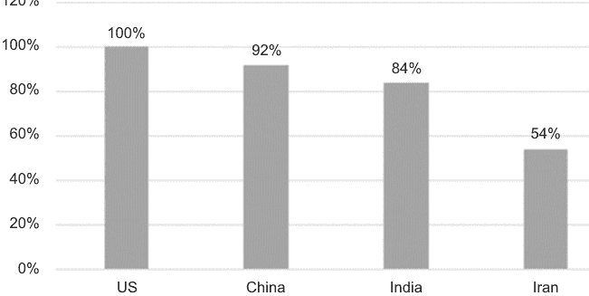

**图 5：** 人工智能技能预测。

2020 年的疫情对 AI 行业特别重要，因为这段期间的变化通过增强劳动力规划、客户留存和模拟建模揭示了 ML 软件的真实价值。2020 年 AI 在增强和自动化业务流程方面的应用增长趋势将继续下去，因为技术采用者报告了现有服务和产品的改进。

与工业 4.0 的转型相一致，许多公司在疫情期间被迫采用基于 AI 的解决方案 [22]。教育部门受到封锁的剧烈变化影响深远；学校/大学的所有利益相关者采用了具有 AI 功能的 Zoom 和 Microsoft Teams 以继续学习。同样，疫情引发了对能够理解情感和认知状态的 AI 软件的需求 [23]。

## 3.2 AI 在教育行业中的作用

人工智能和机器学习早已开始改变教育行业，技术的最新进展使得增加访问和个性化学习成为可能。AI 系统的各种应用正在改变学生学习和理解的方式，通过计算机和智能设备让所有学生（特别是无法上课的学生）轻松获得教育。这种技术正在影响从幼儿园到高等教育的学习过程，通过自适应教学功能和个性化工具提供机会 [24]。

与学习者不同，AI 模型正在帮助教师管理繁杂的任务，并协助教育管理机构自动化行政职责。通过 ML 和 AI 设计的特定软件已显著改善了室内外的学生学习。数字内容现在由 AI 机器人在教室创建；AI 驱动的应用“Cram101”压缩了各种教材的内容，并通过学习指南、闪卡和练习题提供更多材料。像 Carnegie Learning 这样的公司正在为特殊需求和学习障碍学生开发辅导系统，通过提供的数据识别知识缺口并创建特定材料提供课程和即时反馈。此类应用处于早期测试阶段，但很快就可以作为完全知学的数字教授工作 [25]。机器学习和预测分析正被用于创建和更新教材、课程和提供学生的材料，以提供最新的信息并筛选内容。

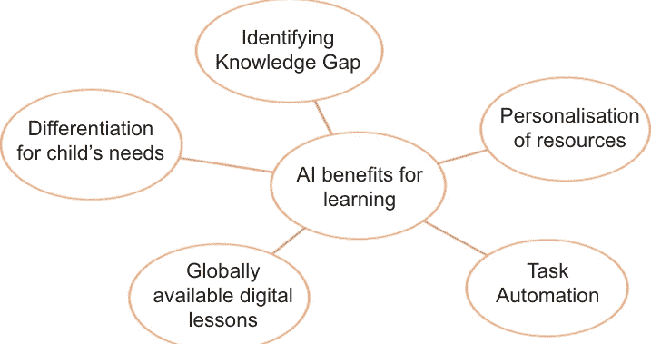

图 6：AI 对教育的益处。

为了适应不同的学习曲线，诸如 Grammarly、Turnitin 和 Kahoot 等 AI 应用可以评估共享信息并为学习者提供即时反馈。提供改进学生知识的即时反馈可以增加他们的学习兴趣和动力 [26]。

虚拟现实和增强现实技术可以与 AI 结合，为学生创建包含故事、角色和 3D 游戏的现代化数字学习环境，带来真正独特的体验。工具和在线应用程序可以为有能力/身体残障的学生或使用不同语言的学生创建公开开放的全球教室。这为世界偏远地区或在流行流行期间无法上课的孩子开辟了学习机会 [27]。AI 还可以弥合学习者与课堂可及性之间的差距。

对于教育工作者来说，AI 为减轻工作量、改进课程和教学设计开启了无限可能。教师最重要的工作之一是批改和评估作业，同时为学生提供宝贵的反馈以供改进。AI 应用将多选题的阅分过程计算机化，使教师可以将更多时间投入到学生的个性化服务中 [28]。人员还在致力于对论文和书面作答进行评分，这可以为课堂上提供适应性和理解留出更多时间。

教育者和学习者必须为学生设计具有差异化的课程和资源，内容应适应 21 世纪网民的能力。诸如 Netex Learning 等平台允许教师通过在线 AI 助手，利用视频、音频和其他为不同需求学生设计的资源来创建数字课程和内容 [29]。在流行病期间，教师们能够使用许多虚拟 AI 平台提高学生的学习积极性，并通过定制化培训提高他们的数字知识。通过结合教师与技术的优势，可以实现教育 4.0 的目标，获得最佳的学生成果。

除了学生和教师外，学校和大学的管理层还承担着责任和行政任务，这些任务可以通过 AI 驱动的 IT 和虚拟助手更高效地完成。通过使用机器学习 (ML) 对以前的数据进行建模，管理人员可以跟踪部门运营并获得预测，以进行更好的未来规划。这些预测可用于记录和维护学生学校用品数据库以及食堂的食品储备，以避免未来的浪费。AI 通过自动化文件分类和学生入学流程，显著造福了学生的录取过程。这还有助于消除与录取过程相关的人为偏见，从而公平、信誉地选择未来的学习者。AI 系统可以显著提高教育机构的生产力，同时降低运营成本并增加其社会影响力 [30]。

研究人员和科学家正在探索 AI 技术，为教育 4.0 下的学生创建智能虚拟环境和数字平台。报告

# 教育 4.0 和 Web 3.0 在增强学习管理系统中的应用 — 99

表明，南加州大学正在开发扮演教师或虚拟教育者的机器人，通过识别学生的面部线索和手势，并用定制的语言或非语言信号做出回应。数字学习和模拟相关的应用预计将成为未来几年收益最高的市场之一。全球 AI 研究分析师表示，教育行业的 AI 技术将从 2018 年到 2023 年经历 45% 的增长，美国教育市场预计到 2023 年达到 36.8 亿美元（如图 7 所示）。标记还表明，到 2025 年，约 47% 的教育工具将使用 AI 系统开发 [31]。

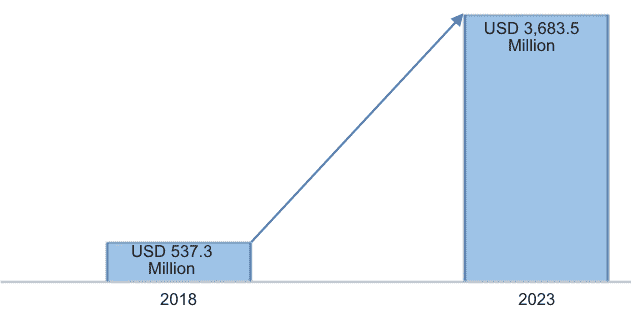

人工智能能够熟练地推动教育的个性化、效率和全球化，不仅针对学生，也针对教师和教育机构的管理。当世界见证教育及全球其他行业 AI 的指数级增长时，利益相关者理解其益处并投资采用 AI 技术以为学生、教师和管理层创造更好的学习环境至关重要。

图 7：教育市场 AI 的预期增长。

## 4 方法论

研究方法论是用于识别问题、选择和分析从参与者处收集的数据以完成论文中讨论的目标的过程 [32]。数据是通过问卷调查法收集的。这有助于我们更好地了解学生对教育 4.0 技术的体验。数据样本由 315 名学生（125 名学校阶段和 190 名大学阶段）组成，来自印度和中东，性别混合。样本根据偏好属性使用便利抽样法选出。与受访者建立了良好关系，并在表格中清楚地说明了有关调查的指示。开发了一份关于学生的教育 4.0 及其技术的在线问卷，并附有识别其当前教育水平的一般问题。完全维护了主体信息的机密性。通过问卷收集的数据经过分析，并以图表形式呈现。

## 5 发现

开发了一项关于流行病期间电子学习教育 4.0 工具和技术应用的研究调查，并将其分发以收集学生视角的信息。对来自 310 名学校和大学参与者的数据分析表明，学生对将这些数字工具引入其学习环境表现出积极兴趣。流行病可能影响了传统的学习形式，但技术的适当应用增强了学生的体验。

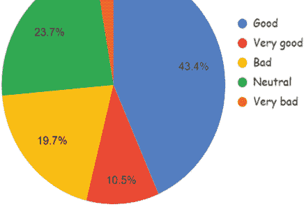

图 1：“你会如何描述流行病期间的在线学习体验？”

在研究中，首先询问受访者在流行病期间对数字教室的一般体验。如图 1 所示，43.4% 的人体验良好，23.7% 的人感到中立，10.5% 的人对教育转型体验非常好。大多数学生认为教育者在封锁期间使用的各种在线工具和技术非常有价值并增强了他们的体验。

# 教育 4.0 和 Web 3.0 在增强学习管理系统中的应用 — 101

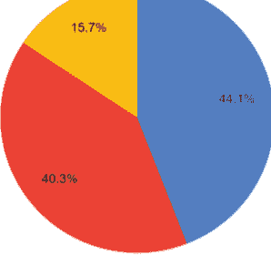

图 2：“你认为学校和大学在流行病期间共享的资源和工具让数字教室变成了更好的学习体验吗？”

参考图 2，我们可以分析出 44.1% 的样本认为学校和大学共享的资源让在线教育变成了增强的学习体验。15.7% 的样本声称教育 4.0 的工具和资源没有用，或没有帮助他们在流行病期间为数字教室创造更好的学习体验。然而，有 40.3% 的人对资源的有效性持中立态度。

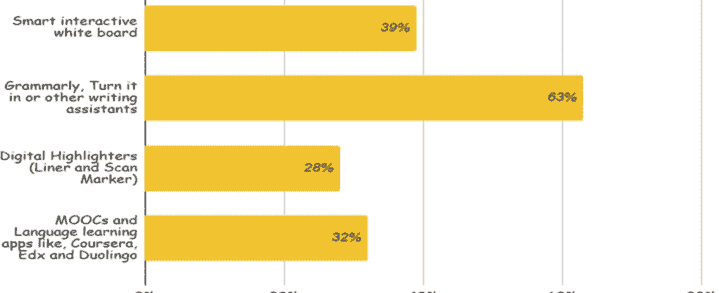

图 3：“你是否利用过这些教育 4.0 工具进行数字学习？”

根据本章的研究，某些 AI 和 IoT 技术在学校和大学中的应用最为突出，哪些特定的教育 4.0 开发工具被给出受访者选项，以了解哪些工具对他们的教育有用。结果显示，63% 的学生使用 Turnitin、Grammarly 等此类 AI 写作助手进行学习，39% 的学生使用智能交互白板进行教学或学习，32% 的学生使用 AI 驱动的 MOOC 和语言应用程序来提高技能，28% 使用了数字和智能高亮笔来使学习材料更易于理解（如图3所示）。这表明许多为教育领域开发的物联网（IoT）和人工智能（AI）工具正被学生用于增强他们的数字学习。

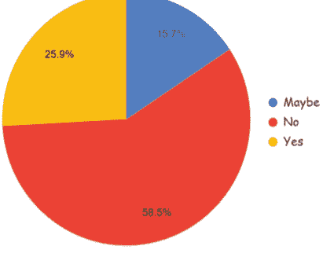

图4：“Web 3.0的应用（如Alexa


参考图4，阐述了 Web 3.0 及其在在线课程或教育过程中的便利性。所示，58.5%的人口表示“他们没有”发现 Web 3.0 的工具有用，15.76%对 Web 3.0 及其应用的实用性持中立态度。尽管有25.9%的人认为 Web 3.0 已应用于他们的学习环境并辅助了他们的在线教育。这解释了大部分人口对 Web 3.0 及其应用并不了解，或者这些工具尚未被恰当地应用于学生的教育中。

在询问学生他们在课堂里使用的电子学习数字工具的经验时，了解他们的建议以提高他们的体验是至关重要的。大多数回答（如图3所示）集中在让课程“与3D/虚拟环境更具互动性”以及提供“具有各种动画和多媒体的可视化内容”。建议的“在教室中启动混合式学习”以及“课程的个性化和改进工作反馈”。本章讨论的 AI 和 IoT 系统可以通过不同的媒介适当应用，以取得积极成果。

在分析样本数据后，结果显示，由于样本群体对上述应用缺乏了解，新技术仍然未被考虑。大多数学生使用了最新的教育 4.0 工具，以最大限度地参与和改进他们的数字学习体验。从回答中，我们了解到，在疫情期间对电子学习资源的妥善实施增强了学生的课堂环境，因为虚拟教室和课程数字资源的增加被赋予了更高的偏好，

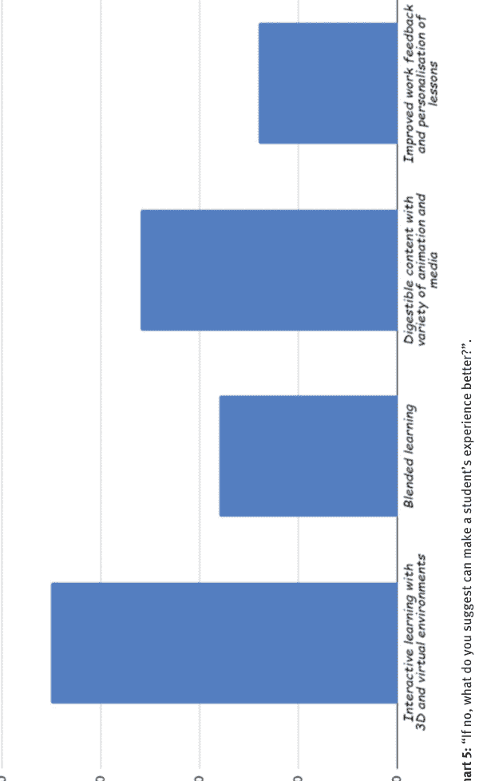

疫情后的情况。本研究给出的建议应该被教育工作者和学校/大学管理层充分考虑，以提高提供给学生的学习质量。

## 6 Web 3.0

基于 Web 的教育和学习通过互联网的演变开启了一个广阔的世界，并给了我们接触惊人前景的机会。如图8所示，基于 Web 的技术的演变从过时的 Web 版本开始，该版本被命名为 Web 1.0，并确立为“只读”媒介。这是互联网的诞生。它是一个中心化的网络，主服务器托管网站，不同的服务器访问该网站。这种技术的主要缺点是，如果一个服务器的所有离线，整个 Web 就会离线。下一代是 Web 2.0，被认为是一种“读/写”媒介。这是增强型互联网服务的创造，目前服务目前全球范围内的人在使用，例如 Facebook、Netflix 和 Google。Web 2.0 可以解释为分布式逻辑系统，服务器无处不在，并由多个数据中心控制，每个数据中心都维护一份数据的副本，其优势是，如果其中一个数据中心离线，其余团队将继续运行，应用程序的可用性不会中断 [33]。

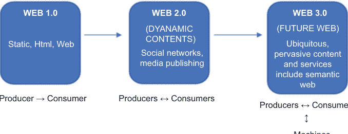

**图 8**：Web 3.0 的发展。

当前最更新的 Web 版本被称为 Web 3.0。这个新的、先进的版本没有所有权，并有助于重建互联网，这意味着自由、抗审查，任何人都可以参与并生成，并降低门槛。

教育 4.0 和 Web 3.0 在增强学习管理系统的应用 —— 105

去中心化系统，每个节点都维护一份数据的副本 [34]。其中最好的例子是比特币，这种技术是一种自动化的时代，允许用户不仅可以读，还可以执行和创新自己的想法。这种机制允许机器进行推理和解决问题，这是人类所预期的。在短时间内，Web 2.0 和新型 Web 3.0 技术正在创造新的工具来促进教育和学习 [35]。

Web 经历了广泛的发展，并且无疑在快速增长。宽网（www）已用于改进我们的协作和沟通，使资源交换变得更容易。我们正处于互联网的第三代，特定的创新帮助我们更好地搜索和分析数据。Google、Facebook、微软和其他其他科技公司已经采用了自适应 Web 技术来改进他们的数据库。Web 3.0 的另一个增强功能是虚拟化三维应用，创建虚拟世界，如第二人生。

### 6.1 Web 3.0 技术在教育中的应用

在过去的几年里，不同的教育机构通过网络提供招生、活动管理和数字学习环境的在线服务，将学生与优质资源连接起来，为了更好的

106 Sandhya 等

3.0 的服务和工具有助于培养开放的学习方法 [38]。技术的特征可以被仔细地应用于教育部门，造福学生、教师和大学管理。优质学习资产可以通过无处不在的设备和平台变得先进，还可以跟踪学生在学习环境中的位置和进度。语义网的使用对教育具有巨大的潜力，因为我们通过喜欢的渠道访问各种兴趣和活动是开放的。教育工作者可以使用语义博客和智能搜索引擎通过各种多媒体和动画来改进他们的教育内容 [39]。

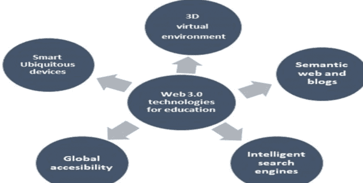

**图 9：**用于教育的 Web 3.0 技术。

### 7 结论

本章探讨了从工业革命（IR） 4.0 提取的各种教育 4.0 趋势。回顾了关于物联网的现有文献中的系统和模型。

# 教育 4.0 与 Web 3.0 在增强学习管理系统中的应用

人工智能让我们对在教育领域的应用有了更深入的理解。人工智能模型驱动的智能虚拟学生和学校管理系统可以提高提供的教育质量。此外，数字高亮和白板等应用也增强了学习资源和教学方法。通过 Web 3.0 的先进工具，一种开放、个性化的学习方法已经开启。针对 315 名学生关于教育 4.0 体验的问卷调查结果带给了我们整体的认知。学生对疫情期间的数字学习体验表示满意，并对互动和混合教育提出了建议。尽管学习者倾向于继续在传统课堂进行知识发展，但他们技术的体验培养了教育者和管理层在学习中融入数字资源的更迫切需求。

本章为探索教育 4.0 的其他新技术提供了坚实的基础，这些技术需要针对其在当前教育行业的应用进行审查和研究。通过这项研究，我们希望强调为学生提供人工智能和物联网技术及资源，以实现灵活、提升技能。未来对研究人员和开发者的建议将仔细考虑技术在教育中的应用，特别是针对后疫情时代或未来场景。为学生和教师提供便捷的多种资源可以创造更好的学习体验。应该与 Web 3.0 工具协作开发适当的人智能和物联网方法，以探索第四次教育革命的机会和可能性。先进技术准确应用于学习可以为学习者和教育者开启广阔的前。

## 参考文献

- [1] Crnjac, Veža, I. & Banduka, N. (2017). From concept to the introduction of industry 4.0. International Journal of Industrial Engineering and Management (IJEM), 8(1), 21–30.

- [2] Jayaraman, P.F., Forkan, A.R., Morshed, A., Haghighhi, P.D. & Kang, Y. (2019, Dec.). Healthcare 4.0: a review of frontiers in digital health. WIREs Data and Knowledge Discovery, 10(2), doi: 10.1002/wiid.1350.

- [3] Bonfield, C.A., Salter, M., Longmuir, A., Benson, M. & Adachi, C. (2020, Jan.). Transformation or evolution? Education 4.0, teaching and learning in the digital age. Higher Education Pedagogy, 5(1), 223–246. doi: 10.1080/23752696.2020.1816847.

- [4] Keser, H. & Semerci, A. (2019). Technology trends. Education 4.0 and beyond. Contemporary Educational Research, 9(3), 39–49. doi: 10.18844/cer.v9i3.4269.

- [5] Bonfield, C.A., Salter, M., Longmuir, A., Benson, M. & Adachi, C. (2020, Jan.). Transformation or evolution? Education 4.0, teaching and learning in the digital age. Higher Education Pedagogy, 5(1), 223–246. doi: 10.1080/23752696.2020.1816847.

- [6] Gaur, B., Shukla, V. & Verma, A., Strengthening people analytics through wearable IoT device for real-time data collection 2019 International Conference on Automation, Computational and Technology Management (ICACTM), London, United Kingdom, 2019, 555–560, doi:10.1109/ICACTM.2019.8776776.

- [7] Alam, Z. & Dhummy, Z. (Jun.). On big data, artificial intelligence and smart cities. Cities, 89–91, doi:10.1019/j.cites.2019.01.032.

- [8] Shukla, V. & Singh, B., Conceptual framework of smart device for smart home management based on RFID and IoT 2019 Amplify International Conference on Artificial Intelligence (AICAI), Dubai, United Arab Emirates, 2019, 787–799, doi:10.1109/AICAI.2019.8701301.

- [9] "Unlocking IoT with Smart and AI", Jun (2016). From IoT to Smart IoT-IoT: The next generation of IoT-based intelligent agents and their security. IEEE Communications Magazine, 56(6),114–120, doi:10.1109/MCOM.2018.1710310.

- [10] Wang, D., Chen, S., Bong, G., Guizan, N., Wu, X. & Du, J. (2016, Oct.). Internet of Things and its applications in E-learning. [Online]. Available: https://fardaper.internet/movahua/uploads/2017/Internet-of-Things-and-applications-in-E-learning.

- [11] Alam, T. & Benida, M. (2020, May). Blackwell. Artificial intelligence and thought of things in higher education. Universal Journal of Educational Research, 8(6), 2164–2174. doi:10.1319/ujer.2020.08056.

- [12] Bai, H. & Zhang, G. (2020). English smart classroom based on network and internet of things. Microprocessors and Microsystems, 1032. doi:10.1016/j.micropro.2020.

- [13] Basu, J., Refaty, R., Suganya, M. & Merlin, N. (2020, Jan.). IoT based Cloud Integrated Smart for smart and campus. Procedia Computer Science, 172, 77–88. doi:10.1016/j.procs.2020.0512.

- [14] Ciolac, M.L., & Kopp, H. (2019). Enabling IoT in education with biosensors from wearables and artificial intelligence. IEEE Xplore, https://explore.ieee.org/ab/8990673.

- [15] Zantais, F., Koulouras, G., Karabetos, S. & Sandris, D. (2020, Apr.). A review of machine learning and IoT in Future Internet, 11(4), 94. doi:10.3390/fi1104094.

- [16] Vinusea, R. et al. (2020, Jan.). The role of artificial intelligence in achieving Sustainable Development Goals. Nature Communications, 11(1), 94. doi:10.1038/s41467-019-1410-y.

- [17] Marr, B. (2019, Dec.). 10 best examples of how ai is used in our life. Forbes.

- [18] Cockburn, I., Henderson, E. & Stern, S., Working Paper the Impact of Artificial Intelligence, N18. [Online]. Available: https://www.nber.org/system/files/w2449/w2449.

- [19] Wang, J. & Dafoe, A. (2019). Artificial intelligence: American attitudes and trends. SSR Journal, doi:10.2139/ssr.3112874.

- [20] Borana, J.. (2016). Applications of Artificial Intelligence & Associated Technologies., https://www.semantics.org/paper/Applications-of-Intelligence-Borana/d50616c5a2b40d5629e28.

- [21] Bullock, J., Luccioni, A., Pham, K., Sin, C. & Luengo-Ros, M. (2020). The Landscape of Artificial Intelligence against COVID-19. arXiv.org, https://arxiv.org/abs/2003.1136.

- [22] Chassignol, M., Khoroshavin, A., Klimova, A. & Bilyatinova, A. (2018). Artificial intelligence trends in education: a narrative overview. Procedia Computer Science, 136, 16–24. doi:10.1016/j.procs.2018.08233.

- [23] Deep learning for school: toward a relational understanding of AI in education, Media and Technology, 2020, https://www.tandline.com/abs/10.1080/17439884.2020.168617.

- [24] Ciocau, M., Tehani, A.F., Beer, R. & Popp, H. (2017). Education 4.0 – students’ performance with machine learning methods 2017 IEEE 23rd International Symposium for Design and Technology Computing (SITime), Oct. 2017, doi:10.1109/siltime.2017.8259941.

- [25] Ciocau, M., Tehani, A.F., Binder, L. & Svasta, P.M. (2018). Education 4.0 – artificial intelligence assisted education: recognition system with machine learning to support students’ success 2018 IEEE 24th International Symposium for Design and Technology Computing (SITime), Oct. 2018, doi:10.1109/siltime.2018.8999203.

- [26] Yusof, A., Adnan, A., Mustafa, N. & Ahmi, M. (2019). Education 4.0 Immersive learning with spherical videos (360°) and Virtual Reality (VR) experiences. ResearchGate, https://www.researchgate.net/publication/33716653_Education_40_Immersive_Learning_with_Spherical_Videos_360_and_Virtual_Reality_VR_Experiences.


- [27] Azhar, M., Abdullah, N. & Abd Rahman, H. (Jul. 2020). Towards electronic learning features in education 4.0: literature review. Indonesian Journal of Electrical Engineering and Computer Science, 19(1), 442. doi:10.11591/ijeecs.v19.i1.pp442-450.

- [28] Shen, L. & Su, A. (2020). The changing roles of teachers with AI. Revolutionizing Education in the Age of AI and Machine, 1–25. doi:10.1018/978-1-5225-7793-5.ch001.

- [29] Vazhayil, A., Shetty, R., Bhavani, R.R. & Akshay, N. (2019). Focusing on teacher education to introduce ai in schools: perspectives 2019 IEEE International Symposium for Design and Technology Computing (SITime), Oct. 2019, doi:10.1109/siltime.2019.0021.

# Tapash Rudra, S. B. Goyal

医疗实践中的人工智能（AI）辅助算法，特别关注遗传性疾病诊断

**摘要：** 随着最新技术的改进，现代医疗实践每天都在不断新高度。随着先进工具和技术的出现，医学界现在已经能够对抗致命的疾病。然而，医学界的某些领域在诊断、预后和治疗方面仍然模糊。其中，遗传性疾病或罕见疾病是至关重要的。与常见疾病不同，遗传性疾病具有相当的特性，这主要是因为它们与人类基因组的关联。此外，真实数据的匮乏、全球边缘地区患者数量有限以及缺乏足够的诊断措施，也同样导致了围绕此类疾病的隐为人知。因此，迫切需要新的改进改进方案，以发现与它们相关的未开发的事实。人工智能和机器学习算法极大地启明了罕见疾病的多个领域，包括诊断。然而，若要让这项新技术成为强大的武器，需要在现代数据方面付出巨大努力，传统方法无法成为改善遗传性疾病研究和管理的唯一出路。

**关键词：** 人工智能、算法、机器学习、遗传性疾病、诊断

## 1 概述

人类自地球上的第一天起就与人类文明本身同步演化。人类的生存在过山车般的进程中持续前进。我们的祖先曾被贪婪的肉食动物和周期性的自然灾害所恐吓，直到他们偶然地通过从石头的锐边缘产生摩擦点燃了火。这是技术的开始，毫无疑问，这是我们人类在储备中拥有的最大的飞跃。

随着这台巨兽向前移动，我们发现自己正趋向技术驱动的时代。正在进行的全球 COVID-19 大流行到目前为止，相对于全球完整性的全面崩溃而言，影响是巨大的。为了彻底此类重大事件的结果，我们必须提出那些迄今为止未被考虑过的想法。

随着新型先进技术的出现，医学科学正向一个新轨道飞驰。然而，在过去的几十年里，人工智能（AI）的影响为其增加了一个全新的维度。各种人工智能方法的影响引发了一个困境，即自然智能还是人工智能才是通往全球医疗系统的潜在路线图。坦率地说，通往成功的疾病诊断是不可替代的，但这种现代技术热潮可以极大地促进医疗专业人员确定疾病的结论。同时，现代的人工智能驱动分析开启了一个新窗口，可以将大量的临床数据分解为相对更容易理解的形式。这使得医疗专业人员和临床医生在决策方面的任务变得更加从容 [1–5]。

### 1.1 医学研究中的人工智能：当前现状说明

人工智能的圣杯是将人类解释为机器。为了实现这一目标，基于人工智能的机器是身定制的，以使智能体中的通用理论具体化。人类和动物等生物实体在更广泛的视角下被超越限制地对待，以最大化可能的结果。人工智能的概念极具进取性；同时，它是一股不容忽视的力量，解决了那些存在了一千多年的哲学怀疑。

我们正日益向工业 4.0 迈进，这是一种通过确保数字化供应链而非传统供应链来获得更高效能的快速创新型发展的叙事。在工业 4.0 的应用方面，医学科学是一个潜在的威胁领域。改进的植入物、技术和现代设备是一些重要特征。此外，物联网（IoT）和服务互联网确保了现代医疗保健领域的整体进展 [6]。工业 4.0 的另一个引人注目的方面是利用量子计算或云计算取代传统计算，将效率提高数倍。这在当今的医学世界非常值得注意，量子计算的影响在很大程度上降低了成本。此外，先进 AI 传感器的使用也提高了各种机器的生产力和效率。上述概念在制定临床实践策略方面尤为得手 [7, 8]。

#### 1.1.1 工业 4.0 在医学界中的意义

工业 4.0 使其与前三个阶段有显著区别的主要特征是多学科方法、自动化和灵活性。与现代化的方面相结合，工业革命 4.0 似乎是全球医疗从业者储备中应该拥有的确切武器，考虑到持续大流行之后的未来的日子 [8–11]。

#### 1.1.2 使工业 4.0 在医学科学中极具相关性的关键要素：

- 优化效率和生产力 [12, 13]
- 以最低成本解释大部分比例的患者数据 [14, 15]
- 以最高的准确率分析数据 [16]
- 提供最佳质量 [6, 7]
- 改进材料和工具管理 [17, 18]
- 在复杂的计算机辅助设计 (CAD) 文件中维护临床数据，而不是保存在库存中 [19, 20]
- 通过开发智能 AI 传感器，根据患者需求生产定制化植入物 [21, 22]
- 实施适当的辅助以锐化手术干预 [23, 24]
- 随着数字技术和传感器机器出现，新疾病可以被自主检测 [25, 26]
- 组织中心化信息 [27–29]
- 描述与相关信息相关的患者数据 [30, 31]

## 2 近期基于 AI 的/发表：简要展望

随后与医学科学相关的出版物是几年来的一个新兴领域之一。全球数据库如 Scopus 和 Web of Science 索引了 2013 年以来的 70 篇文章。值得提到的是，在持续全球危机的背景下，它变得更加重要。

它始于 2013 年在该主题上的单一发表，2014 年和 2015 年没有进一步增加。然而，之后数量有所增加；2016 年有六篇，2017 年增加了十四篇。到 2020 年，这一趋势继续保持正确的方向，基于 AI 的研究具有显著贡献（表 1）。

**表 1：** 2013 年至 2020 年全球数据库中医学实践中基于 AI 的研究频率

| 序号 | 贡献领域 | 发表频率 (%) |
| :--- | :--- | :--- |
| 1 | 工程科学 | 25 |
| 2 | 决策科学 | 11 |
| 3 | 数学 | 11 |
| 4 | 商业管理和会计 | 06 |
| 5 | 材料科学 | 04 |
| 6 | 生物化学、化学和分子生物学 | 02 |
| 7 | 其他（药理学、毒学和药剂学、物理学和天文学、心理学和社会科学） | 10 |

来源：检索自 2020 年 1 月

### 2.1 Web 2.0 与当今的医学世界：新时代的开启

Web 2.0 的概念并非完全令人信服。它在全球网络专家中引发了巨大的困境。然而，在医学思想交流方面，该概念仍然是一个巅峰 [32]。根据医学图书馆管理员的说法，Web 2.0 在先进医学世界中脱颖而出 [33]。Web 2.0 的影响在持续全球大流行的背景下变得非常突出，在那里，工作需要不断的完善和创造性思维以适应新常态。确实，医学研究在 Web 2.0 出现后的几十年里获得了了丰厚回报，特别是从 Web 1.0 到 Web 2.0 的转型期间 [34, 35]。

## 3 遗传诊断中的人工智能（AI）辅助算法

**表 2：** Web 2.0 在医学领域的应用

| 应用 | 指定的门户网站 | 重要性 |
| :--- | :--- | :--- |
| Bloglines | Bloglines | RSS 阅读器 |
| Citizendium | Citizendium | www.citizendium.org |
| Conotea | Conotea | 在线参考整理器 |
| Del.icio.us | http://del.icio.us | 网站标签 |
| Flickr | www.flickr.com | 照片共享 |
| Ganfyd | www.ganfyd.org | 医学维基 |
| Google blogsearch | http://blogsearch.com | 博客搜索 |
| Google health | http://www.google.com/coop/topics/Health | 创建您自己的搜索工具 |
| MedWorm | http://medworm.com | RSS 聚合器 |
| SlideShare | http://slideshare.net | 幻灯片共享 |
| Wikipedia | http://en.wikipedia.org/wiki | 通维基 |
| YouTube | www.youtube.com | 视频剪辑 |

Web 2.0 在过去的几十年中重新调整了平民健康生活方式的实践。此外，它在疾病的预防、诊断以及多种病毒疾病的治疗方面也表现得积极 [45]。值得一提，在当前全球大流行的冲击以及未来期间，Web 2.0 在医学界的应用比以往任何时候都至关重要。自 COVID-19 疫情爆发以来，人们的整体心态受到一系列不可避免情况的严重困扰。创新的社交媒体结合 Web 2.0 可能是艰难时期的一丝曙光。得益于跨越所有年龄段的用户友好型社交援助，人们在向亲友分享信息时感到舒适。同时，他们对数字平台的进展也表现出更强的表达欲和参与度 [46]。相比之下，传统的医疗专业人员有时未能传达充分的信息，导致对患者产生怀疑。现代化的数字应用通过提供有关疾病的详细信息，在减少此类悖论方面提供了支持。因此，个人有了进行交叉核对、验证甚至挑战传统处方的选择 [46, 47]。

尽管随着数字创新的出现，医疗和保健领域发生了范式转移，但优势与劣势仍然并存。热门的社交平台在使用方式上可能是一把双刃剑。鉴于当前的全球危机，在将疾病与 Web 2.0 关联之前，拥有足够的相关疾病知识和专业知识尤为重要。医疗保健人员和患者都应该承担责任，充分利用这项数字技术，并尽力减少与其相关的危害范围。

## 4 医学实践相关领域的人工智能辅助研究

现代医疗保健实践中存在大量的基于 AI 的文献；然而，三种主要疾病占据了其中的大部分：癌症、神经系统疾病和心血管功能障碍。近期基于 AI 的研究进行的另一个极其关键方面是遗传疾病的不同方面。事实上，通过改进的概念和技术，基于 AI 的研究可能是遗传研究未来的路线图（图 1）。

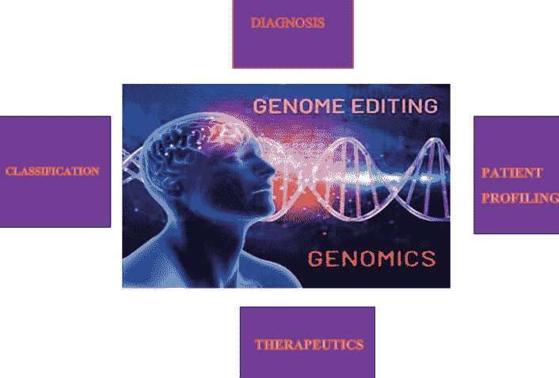

**图 1：** 遗传疾病研究主要设置中的 AI 介导算法

### 4.1 遗传疾病：基础

世界卫生组织（WHO）将遗传病分类为孤儿病或罕见病（RDs）。罕见病影响人口的一小部分；然而，由于全球范围内超过 7,000 种类型的总体流行，遗传疾病正随着基因组畸变（80%以上）成为常态，尽管环境因素（包括经常暴露于宇宙射线等有害物质）会加速此类疾病的进展 [48, 49]。同时，妊娠期间摄入可通过胎盘屏障的某些化学以及感染感染主要因素 [49]。在过去的几十年里，罕见病的发病率不断上升。根据最近的数据，估计全球有约 3.5 亿人受此类不同类型疾病的影响 [50, 51]。

### 4.2 遗传/罕见病研究局限性的洞察

尽管遗传疾病在全球人口中层出不穷，但在整体研究产出方面，其代表性仍然不足。以下是主要特征：

- 由于意识观念不当、诊断方案不足以及对相关罕见病或遗传疾病缺乏明确的临床指南，导致缺乏对疾病频率的适当认同 [52, 53]。
- 探索此类疾病隐藏层面的资源/资金有限 [53]。
- 关于患者可用性的地理范围相对狭窄或受限，导致缺乏志愿者，一直阻碍着临床试验的进行。此外，编码系统也会影响患者招募过程 [53, 54]。
- 影响遗传疾病研究的关键因素是缺乏集体知识，以及相关疾病病生理学数据的稀缺。疾病特异性生物标志物与其他标记物的缺失是其他障碍 [53]。
- 缺乏理想的治疗方法、现有疗法的商业化不足以及市场化程度低是其他值得关注的因素因素 [54]（表 3）。

**表 3：** 各为减少罕见病（RD）实施的政策

| 战略规划 | 现状 | 国家 |
| :--- | :--- | :--- |
| 政策/计划 | 落实特定规划 | 印度尼西亚、新加坡、与相关利益相关者会议 | 泰国、马来西亚 |
| 国家层面存在稳健且良好的政府政策 | 韩国 |
| 在全国范围内实施的战略 | 法国、台湾 |

来源：检索自世界卫生组织（WHO）门户网站，截至 2019 年 8 月的国家罕见病统计数据

### 4.3 近期遗传疾病研究的视角

尽管面临上述挑战，随着二代测序和组学技术的出现，罕见病研究领域取得了显著进展。这两项技术对分子机制的诊断和解释做出了贡献 [55, 56]。此外，它们都提供了有关现有罕见病的大量信息，以分析未来的进展 [56]。“大数据时代”包含了与遗传/罕见疾病各个领域相关的巨大数据；然而，强大的管理能力和正确的伦理准则对于实现目标至关重要。

#### 4.3.1 近期人工智能对遗传疾病研究的影响

人工智能与机器学习（ML）相结合，通过各种算法子集分析和解释数据开启了新的机遇。在过去的十年里，现代医学实践的几个领域已受益于深度学习算法的应用，罕见病研究也不例外。基于 AI 的技术最初由美国食品药品管理局（FDA）引入医学研究的，以系统化……

## 5 遗传学诊断中的人工智能（AI）辅助算法

食品行业 [57]。基于机器的算法旨在通过以下方式分析复杂数据 [58]：

- 通过施加监督学习
- 通过施加独立学习
- 通过强化学习

在上述第一类中，分配的算法通过将输入的数据与相邻的参考数据进行比较来确定参考结果。此后，结果通过对各自数据集之间相关性的解释来获得。各种数据类型之间的分类和回归分析是监督学习的典型应用领域 [59, 60]。监督学习如今已常用于医学领域。红细胞比容缺铁性贫血的应用就是其中一个典型例子。另一方面，在第二类不依赖于监督的类别中，信息在不设定预设目标或任务的情况下被输入。所设计的算法自主运行，将对象数据集转换为聚类 [61, 62]。该技术被用于阿尔茨海默病的评估以及遗传性偏头痛频率的预测。在强化学习方法算法中，算法直接指向实现最佳结果的精确行动 [63, 64]。对某些类型癫痫的预测是这种先进方法的主要成果。

## 6 遗传性疾病研究各方面的人工智能（AI）引导算法：深度场景

近期，人工智能算法的应用将生物医学推向了一个新的高度。人工智能算法的各种属性已在疾病病原测序、分子建模和药物设计中得到体现，导致了合理的解释 [65]。以下是人工智能算法已实现的遗传性/罕见病研究方面关注的主要领域（图 1）：

- A. 诊断与预后
- B. 分类、识别/表型特征分析
- C. 疾病治疗
- D. 患者特征分析与健康信息学

### 6.1 罕见病（RDs）诊断中的人工智能算法

罕见病诊断的关键要素（紧随其后的疾病治疗和预防）是对与之相关的精确基因和突变的评估 [66]。全基因组测序（WES）和基因组测序（WGS）是大多数先进遗传学实验室开发该技术的主要体外方法 [67, 68]。深度学习随各种算法的引入使得流程更加用户友好且具有成本效益 [67]（图 2）。


**图 2：** 人工智能辅助罕见病诊断的示意流程

#### 6.1.1 单核苷酸变异（SNVs）的识别

单核苷酸多态性（SNP）是大多数罕见病的主要原因。因此，对这类产生致病畸变的变态进行评估和后续分析对于基因组测序的最佳利用关重要，特别是在精准医学中 [67–69]。然而，在最近，一些 AI 生成的技术让事情变得更容易。单核苷酸变异是主要因素，因为它们具有改变氨基酸序列导致异常基因产物的能力。相关方法如变异评分工具（VEST）结合随机森林（RF）被精确评估导致蛋白质活性变化的错义突变 [67]。Miller 和 弗里曼综合征是一个典型的例子，该方法被用于专门修复与孟德尔遗传疾病相关的导致异常的基因。VEST 非常安全，因为它在没有控制因素的情况下运行。另一方面，如 CliniPred 等创新技术使用多种机器学习算法来高效交付高数据性能。任何 SNV 预测工具都是基于结构、基于序列的或两者的结合。这已通过应用 Weka 证明，它专门开发用于从整个蛋白质数据库中修复罕见病数据集 [70]。同样，精确生成的监督学习方法也被用于描述与甲戊酮酸激酶蛋白（ORPHA: 309025）相关的有害突变体所产生的影响程度 [71]。特定算法已成功用于分析常见变异性免疫不全（CVID）中的 SNP 数量 [72]。

#### 6.1.2 多基因突变体的识别

内含子负责了人类约 90% 的罕见病。这表明非编码突变体是罕见病的主要特征 [73]。为了评估这种剪接状况，剪接 AI 和深度残差神经网络（NN）被用于用于确定与肥厚性心肌病（ORPHA: 217569）相关的 MYBC3 非编码序列中的有害隐性剪接突变体 [73]。这种新方法在应对隐性剪接突变体的诊断和解释方面开了眼界。罕见病与基因组本身一样复杂。考虑到遗传疾病在性质上主要是多基因的，因此制定了变异致病性（VarCoPP）。这是一种专门设计的机器学习方法，用于计算致病基因的数量。VarCoPP 是迄为止临床环境中非常准确的工具；在致病评分方面，它提供了 95% 到 99% 的特异准确率 [74]。

#### 6.1.3 异常拷贝数变异的评估

人类拷贝数变异（CNVs）是罕见病诊断中的有效标记之一。尽管存在多个可用数据库，但已开发了 DNorm（专门指定的通过机器学习方法的人工智能辅助数据处理工具）。它生成命名实体识别，从而为 CNVs 产生显著结果。该方法已成功应用于乔治斯综合征（ORPHA: 567） [75]。

#### 6.1.4 通过表型驱动的方法进行诊断

排名靠前的经典方法之一是针对罕见病的异质性关联。该系统已经交付了显著的结果 [76]。相反，Phen-Gen 的产生是为了从患者那里培养数据。它为外子和内含子提供了真实数据。


### 4.1.5 罕见病诊断中基于人工智能的成像

形态功能障碍通常是罕见病的特征。人工智能引导的成像是评估表型数据的重要工具之一 [78, 79]。方法之一是 `DeepGestalt`，它与 `FaceGene` 配合使用识别遗传疾病 [80]。科内莉·德兰综合征（ORPHA: 199）、埃曼纽综合征（ORPHA: 96170）和帕利斯特-基林综合征（ORPHA: 884）是应用 `DeepGestalt` 的例子 [81–83]。同样，人工智能算法结合成像技术旨在为肥大症（ORPHA: 963）和皮克病（ORPHA: 282）实现显著图像 [84, 85]。

### 4.1.6 其他相关辅助

随着先进方法的引入，遗传疾病的诊断变得越来越容易。然而，像遗传性毛细血管扩张（HHT, ORPHA: 774）之类的疾病仍然面临高昂成本。近期，神经网络已与红外光谱（IR）结合，以降低 HHT 的检测成本 [86]。同样，一种深度学习预测算法已应用于滑膜肉瘤（SS, ORPHA: 3273）患者。与传统的诊断方法相比，它获得了更好的结果 [86, 87]。总而言，创新的机器学习技术为轻松理解和描述罕见病开启了一个新窗口 [87]。

## 5 讨论与结论

与从轻微咳嗽到致命疾病的大多数传统疾病不同，遗传疾病在病程、病理生理学以及当然诊断方面是独特的。基因测序方法和遗传咨询是主要的诊断属性。人工智能辅助程序的引入结合患者表型驱动数据，显著提升了罕见病诊断的最佳结果 [88]。

# 遗传诊断中的人工智能 (AI) 算法 — 123

不仅能对罕见病（Rds）进行准确诊断，还能推断出精确的治疗方案。重要的是，这种新方法显著地开启了此前未被诊断出的特征 [89, 90]。此外，可以理解基因组数据并不能简单地解决遗传性疾病的唯一途径。而且，全球范围内大多数罕见病的数据仍然并不充分。因此，在现代遗传性疾病研究中，使用人工智能和机器学习算法至关重要，以发现导致罕见疾病的隐藏机制，并开发出新型疗法。总而言之，生物医学是一个巨大的领域，在实践中引入新的计算机辅助技术时，有几点需要记住。从以后，应该充分关注并考虑包括社会、伦理以及法律在内的相关问题，使基于人工智能的医疗实践成为强大的武器。

## 参考文献

- [1] Murdoch, T.B. & Detsky, A.S. (2013). 大数据在医疗领域的不可避免的应用。JAMA, 309, 1351–1352.
- [2] Kolker, E., Özdemir, W. & Kolker, E. (2016). 医疗保健如何通过亚马逊、Uber 和 Watson 的经验来恢复其“超级客户”（患者，n=1）和客户（医生和护士）。OMICS, 20, 329–339.
- [3] Dilsizan, S.E. & Siegel, E.L. (2014). 医学和心脏成像中的人工智能：利用大数据和高级计算来提供个性化的医疗诊断和治疗。Current Cardiology Reports, 16, 441.
- [4] Patel, L.V., Shortlifter, E.H., Stefanelli, M. et al. (2009). 人工智能的时代。Artificial Intelligence in Medicine, 46, 5–17.
- [5] Jha, S. & Topol, E. (2016). 适应人工智能：放射科医生和病学家作为信息专家。JAMA, 316, 2353–2354.
- [6] Aceto, G., Persico, V. & Pesquale, A. (2018). 信息通信技术在医疗保健中的作用：视角与挑战。Journal of Network and Computer Applications, https://doi.org/10.1016/j.jca.2018.02.008.
- [7] Pereira, T., Barretto, L. & Amaral, A. (2017). 工业 4.0 范式下的网络和信息安全挑战。Procedia Manufacturing, 13, 1253–1260.
- [8] Luthra, S. & Mangla, S.K. (2018). 评估新兴经济供应链可持续性的工业 4.0 倡议面临的挑战。Saf Environ Predict, https://doi.org/10.1016/j.jpe.2018.04.018.
- [9] Quezada, I.E., Da Costa, S.G. & Tan, K.H. (2017). 通过工业 4.0 向可持续发展目标。International Journal of Production Economics, 190, 1–2.
- [10] Haleem, A., Javaid, M. & Vaisha, R. (2019). 工业 4.0 在骨科中的应用。Journal of Clinical Orthopaedics and Trauma, 10(3), 615–616.
- [11] Manogaran, G., Thota, C., Lopez, D. & Sundarasekar, R. (2017). 医疗保健工业 4.0 的大数据安全。Cybersecurity for Industry 4.0, 715, 103–126.
- [12] Wollschlager, M., Sauter, T. & Jaspeinite, J. (2017). 工业通信的未来：物联网时代的自动化网络。IEEE Industrial Electronics Magazine, 11(1), 17–27.
- [13] Basl, J. (2017). 捷克公司实施工业 4.0 原则的试点研究。Management and Production Review, 8(2), 3–8.
- [14] Bahga, A. & Madisetti, V.K. (2013). 基于云的互操作电子健康记录 (EHRs)。IEEE Journal of Biomedical and Health Informatics, 17(5), 894–906.
- [15] Wang, Z.G., Zhang, L. & Wen-Jun Zhao, W.J. (2017, Oct). 数字医学的进展。Chinese Journal of Toxicology, 20(5), 297–298.
- [16] Sommer, L. (2015). 工业革命4.0：德国中小企业是这场革命的第一批受害者吗？Journal of Industrial Engineering and Management, 8(5), 1512–1552.
- [17] Lobo, F.A. (2017). 工业 4.0：重新定义未来设备的制造。E, https://www.ecn.com/article/2017/10/industry-40-redefining-medical-devices.
- [18] Ramananayake, R.P., Ranasinge, S. & Lakmini, S. (2014). 全科医学中的急诊管理：全科医生的角色。International Journal of Family Medicine and Primary Care, 3(4), 305–308.
- [19] Wang, S., Wan, J., Li, D. & Zhang, C. (2016). 通向工业 4.0 的智能工厂：基于数据的自组织多智能体系统。Computer Networks, 101, 158–168.
- [20] Kic, T. (2010). 数字医院：一个实践案例。Journal of Health Services Research & Policy, 1(2), 52–58.
- [21] Jee, K. & Kim, G.H (2013). 医疗领域的数字化潜力：如何重塑系统。Healthcare Informatics, 19(2), 79–85.
- [22] Liu, Y. K. X. S. (2017). 工业 4.0 与云制造：对比分析。Journal of Manufacturing Science & Engineering, 139(3), 1–8.
- [23] Zhong, T., Xu, K., Klotz, E. & Newman, S. (2017). 工业 4.0 背景下的智能制造：综述。Engineering, 616–630.
- [24] Javaid, M. & Haleem, A. (2018). 医疗案例中的增材制造：基于文献的综述。Alexandria Journal, 54(4), 411–422.
- [25] Kamble, S., Gunasekaran, A. & Gawankar, S. (2018). 可持续工业 4.0 框架：识别当前趋势和未来展望的系统综述。Safety and Environmental Protection, 117, 408–425.
- [26] Mishra, S. (2017). 从星星到临床成像的医学未来全景。Indian Journal, 69(4), 566–567.
- [27] Brettel, M., Friedrichsen, N., Keller, M. & Rosenberg, M. (2014). 虚拟化、去中心化和网络如何构建制造格局：工业 4.0 视角。Scientific Journal of Mechanical and Industrial Engineering, 8(1), 37–44.
- [28] Theorin, A., Bengtsson, K., Provost, J. et al. (2017). 工业 4.0 的事件驱动制造信息系统架构。International Journal of Production Research, 55(5), 1297–1311.
- [29] Bahrin, M.A.K., Oldham, M.F., Nor, N.H. & Arif, M.F. (2017). 工业 4.0：工业自动化与机器人综述。Journal, 78, 137–143.
- [30] Javaid, M. & Haleem, A. (2018). 医疗领域的 4D 打印应用：简要述。Clinical Epidemiology and Global Health, https://doi.org/10.1016/j.cegh.2018.09.007.
- [31] Kotevski, A., Koces, N. & Kocesi, S. (2016) 电子健康监控系统。应用互联网技术国际会议。https://doi.org/10.20544/AIT2016.32.
- [32] O'Reilly, T. (2005). 软件生成的 Web 设计和商业模式。O'Reilly Media, www.oreilly.com/pub/a/oreilly/tim/news/2005/09/30/what-is-web-20.html.
- [33] Barsky, E. (2006). 引入 Web 2.0：健康馆员的博客和播客。Journal of the Canadian Library Association, 27, 33–34.
- [34] Shneiderman, B. (2008, Mar). 计算机科学。Science 2.0, 319(5868), 1349–1350.
- [35] Whitmire, A. (2013). 关于“研究”的思考：科学视角。JESLIB, 2(2), 68–72.
- [36] Giustini, D. (2006, Dec). Web 2.0 改变医学。BMC, 333(7582), 1283–1284.
- [37] Boudry, C. (2012). 生物/医学 2.0：综述。Medicine Sciences: M/S, 28(6–7), 653–658.
- [38] Van Deelt, T., Hingen, L., Bergen, S. A. & Schoenhoven, L. (2010). 生物/医学 2.0：综述。Journal of Medical Research, 12(2), e18.
- [39] Wang, S., Wan, J., Li, D. & Zhang, C. (2016). 通向工业 4.0 的智能工厂：基于数据的自组织多智能体系统。Computer Networks, 101, 158–168.
- [40] Kic, T. (2010). 数字医院：一个实践案例。Journal of Health Services Research & Policy, 1(2), 52–58.
- [41] Jee, K. & Kim, G.H. (2013). 医疗领域的数字化：如何重塑系统。Healthcare Informatics, 19(2), 79–85.
- [42] Liu, Y. K. X. S. (2017). 工业 4.0 与云制造：对比分析。Journal of Manufacturing Science & Engineering, 139(3), 1–8.
- [43] Zhong, T., Xu, K., Klotz, E. & Newman, S. (2017). 工业 4.0 背景下的智能制造：综述。Engineering, 616–630.
- [44] Javaid, M. & Haleem, A. (2018). 医疗案例中的增材制造：基于文献的综述。Alexandria Journal, 54(4), 411–422.
- [45] Kamble, S., Gunasekaran, A. & Gawankar, S. (2018). 可持续工业 4.0 框架：识别当前趋势和未来展望的系统综述。Safety and Environmental Protection, 117, 408–425.
- [46] Mishra, S. (2017). 从星星到临床成像的医学未来全景。Indian Journal, 69(4), 566–567.
- [47] Brettel, M., Friedrichsen, N., Keller, M. & Rosenberg, M. (2014). 虚拟化、去中心化和网络如何构建制造格局：工业 4.0 视角。Scientific Journal of Mechanical and Industrial Engineering, 8(1), 37–44.
- [48] Theorin, A., Bengtsson, K., Provost, J. et al. (2017). 工业 4.0 的事件驱动制造信息系统架构。International Journal of Production Research, 55(5), 1297–1311.
- [49] Bahrin, M.A.K., Oldham, M.F., Nor, N.H. & Arif, M.F. (2017). 工业 4.0：工业自动化与机器人综述。Journal, 78, 137–143.
- [50] Javaid, M. & Haleem, A. (2018). 医疗领域的 4D 打印应用：简要述。Clinical Epidemiology and Global Health, https://doi.org/10.1016/j.cegh.2018.09.007.
- [51] Kotevski, A., Koces, N. & Kocesi, S. (2016) 电子健康监控系统。应用互联网技术国际会议。https://doi.org/10.20544/AIT2016.32.
- [52] O'Reilly, T. (2005). 软件生成的 Web 设计和商业模式。O'Reilly Media, www.oreilly.com/pub/a/oreilly/tim/news/2005/09/30/what-is-web-20.html.
- [53] Barsky, E. (2006). 引入 Web 2.0：健康馆员的博客和播客。Journal of the Canadian Library Association, 27, 33–34.
- [54] Shneiderman, B. (2008, Mar). 计算机科学。Science 2.0, 319(5868), 1349–1350.
- [55] Whitmire, A. (2013). 关于“研究”的思考：科学视角。JESLIB, 2(2), 68–72.
- [56] Giustini, D. (2006, Dec). Web 2.0 改变医学。BMC, 333(7582), 1283–1284.
- [57] Boudry, C. (2012). 生物/医学 2.0：综述。Medicine Sciences: M/S, 28(6–7), 653–658.
- [58] Van Deelt, T., Hingen, L., Bergen, S. A. & Schoenhoven, L. (2010). 生物/医学 2.0：综述。Journal of Medical Research, 12(2), e18.
- [59] Wang, S., Wan, J., Li, D. & Zhang, C. (2016). 通向工业 4.0 的智能工厂：基于数据的自组织多智能体系统。Computer Networks, 101, 158–168.
- [60] Kic, T. (2010). 数字医院：一个实践案例。Journal of Health Services Research & Policy, 1(2), 52–58.
- [61] Jee, K. & Kim, G.H. (2013). 医疗领域的数字化潜力：如何重塑系统。Healthcare Informatics, 19(2), 79–85.
- [62] Liu, Y. K. X. S. (2017). 工业 4.0 与云制造：对比分析。Journal of Manufacturing Science & Engineering, 139(3), 1–8.


## 参考文献

- [63] Zhong, T., Xu, K., Klotz, E. & Newman, S. (2017). 工业 4.0 背景下的智能制造：综述。Engineering, 616–630.
- [64] Javaid, M. & Haleem, A. (2018). 医疗案例中的增材制造：基于文献的综述。Alexandria Journal, 54(4), 411–422.
- [65] Kamble, S., Gunasekaran, A. & Gawankar, S. (2018). 可持续工业 4.0 框架：识别当前趋势和未来展望的系统综述。Safety and Environmental Protection, 117, 408–425.
- [66] Mishra, S. (2017). 从星星到临床成像的医学未来全景。Indian Journal, 69(4), 566–567.
- [67] Brettel, M., Friedrichsen, N., Keller, M. & Rosenberg, M. (2014). 虚拟化、去中心化和网络如何构建制造格局：工业 4.0 视角。Scientific Journal of Mechanical and Industrial Engineering, 8(1), 37–44.
- [68] Theorin, A., Bengtsson, K., Provost, J. et al. (2017). 工业 4.0 的事件驱动制造信息系统架构。International Journal of Production Research, 55(5), 1297–1311.
- [69] Bahrin, M.A.K., Oldham, M.F., Nor, N.H. & Arif, M.F. (2017). 工业 4.0：工业自动化与机器人综述。Journal, 78, 137–143.
- [70] Javaid, M. & Haleem, A. (2018). 医疗领域的 4D 打印应用：简要述。Clinical Epidemiology and Global Health, https://doi.org/10.1016/j.cegh.2018.09.007.
- [71] Kotevski, A., Koces, N. & Kocesi, S. (2016) 电子健康监控系统。应用互联网技术国际会议。https://doi.org/10.20544/AIT2016.32.
- [72] O'Reilly, T. (2005). 软件生成的 Web 设计和商业模式。O'Reilly Media, www.oreilly.com/pub/a/oreilly/tim/news/2005/09/30/what-is-web-20.html.
- [73] Barsky, E. (2006). 引入 Web 2.0：健康馆员的博客和播客。Journal of the Canadian Library Association, 27, 33–34.
- [74] Shneiderman, B. (2008, Mar). 计算机科学。Science 2.0, 319(5868), 1349–1350.
- [75] Whitmire, A. (2013). 关于“研究”的思考：科学视角。JESLIB, 2(2), 68–72.
- [76] Giustini, D. (2006, Dec). Web 2.0 改变医学。BMC, 333(7582), 1283–1284.
- [77] Boudry, C. (2012). 生物/医学 2.0：综述。Medicine Sciences: M/S, 28(6–7), 653–658.
- [78] Van Deelt, T., Hingen, L., Bergen, S. A. & Schoenhoven, L. (2010). 生物/医学 2.0：综述。Journal of Medical Research, 12(2), e18.
- [79] Wang, S., Wan, J., Li, D. & Zhang, C. (2016). 通向工业 4.0 的智能工厂：基于数据的自组织多智能体系统。Computer Networks, 101, 158–168.
- [80] Kic, T. (2010). 数字医院：一个实践案例。Journal of Health Services Research & Policy, 1(2), 52–58.
- [81] Jee, K. & Kim, G.H. (2013). 医疗领域的数字化潜力：如何重塑系统。Healthcare Informatics, 19(2), 79–85.
- [82] Liu, Y. K. X. S. (2017). 工业 4.0 与云制造：对比分析。Journal of Manufacturing Science & Engineering, 139(3), 1–8.
- [83] Zhong, T., Xu, K., Klotz, E. & Newman, S. (2017). 工业 4.0 背景下的智能制造：综述。Engineering, 616–630.
- [84] Javaid, M. & Haleem, A. (2018). 医疗案例中的增材制造：基于文献的综述。Alexandria Journal, 54(4), 411–422.
- [85] Kamble, S., Gunasekaran, A. & Gawankar, S. (2018). 可持续工业 4.0 框架：识别当前趋势和未来展望的系统综述。Safety and Environmental Protection, 117, 408–425.
- [86] Mishra, S. (2017). 从星星到临床成像的医学未来全景。Indian Journal, 69(4), 566–567.
- [87] Brettel, M., Friedrichsen, N., Keller, M. & Rosenberg, M. (2014). 虚拟化、去中心化和网络如何构建制造格局：工业 4.0 视角。Scientific Journal of Mechanical and Industrial Engineering, 8(1), 37–44.
- [88] Theorin, A., Bengtsson, K., Provost, J. et al. (2017). 工业 4.0 的事件驱动制造信息系统架构。International Journal of Production Research, 55(5), 1297–1311.
- [89] Bahrin, M.A.K., Oldham, M.F., Nor, N.H. & Arif, M.F. (2017). 工业 4.0：工业自动化与机器人综述。Journal, 78, 137–143.
- [90] Javaid, M. & Haleem, A. (2018). 医疗领域的 4D 打印应用：简要述。Clinical Epidemiology and Global Health, https://doi.org/10.1016/j.cegh.2018.09.07.
- [91] Kotevski, A., Koces, N. & Kocesi, S. (2016) 电子健康监控系统。应用互联网技术国际会议。https://doi.org/10.20544/AIT2016.32.
- [92] O'Reilly, T. (2005). 软件生成的 Web 设计和商业模式。O'Reilly Media, www.oreilly.com/pub/a/oreilly/tim/news/2005/09/30/what-is-web-20.html.
- [93] Barsky, E. (2006). 引入 Web 2.0：健康馆员的博客和播客。Journal of the Canadian Library Association, 27, 33–34.
- [94] Shneiderman, B. (2008, Mar). 计算机科学。Science 2.0, 319(5868), 1349–1350.
- [95] Whitmire, A. (2013). 关于“研究”的思考：科学视角。JESLIB, 2(2), 68–72.
- [96] Giustini, D. (2006, Dec). Web 2.0 改变医学。BMC, 333(7582), 1283–1284.
- [97] Boudry, C. (2012). 生物/医学 2.0：综述。Medicine Sciences: M/S, 28(6–7), 653–658.
- [98] Van Deelt, T., Hingen, L., Bergen, S. A. & Schoenhoven, L. (2010). 生物/医学 2.0：综述。Journal of Medical Research, 12(2), e18.
- [99] Wang, S., Wan, J., Li, D. & Zhang, C. (2016). 通向工业 4.0 的智能工厂：基于数据的自组织多智能体系统。Computer Networks, 101, 158–168.
- [100] Kic, T. (2010). 数字医院：一个实践案例。Journal of Health Services Research & Policy, 1(2), 52–58.
- [101] Jee, K. & Kim, G.H. (2013). 医疗领域的数字化潜力：如何重塑系统。Healthcare Informatics, 19(2), 79–85.
- [102] Liu, Y. K. X. S. (2017). 工业 4.0 与云制造：对比分析。Journal of Manufacturing Science & Engineering, 139(3), 1–8.
- [103] Zhong, T., Xu, K., Klotz, E. & Newman, S. (2017). 工业 4.0 背景下的智能制造：综述。Engineering, 616–630.
- [104] Javaid, M. & Haleem, A. (2018). 医疗案例中的增材制造：基于文献的综述。Alexandria Journal, 54(4), 411–422.
- [105] Kamble, S., Gunasekaran, A. & Gawankar, S. (2018). 可持续工业 4.0 框架：识别当前趋势和未来展望的系统综述。Safety and Environmental Protection, 117, 408–425.
- [106] Mishra, S. (2017). 从星星到临床成像的医学未来全景。Indian Journal, 69(4), 566–567.
- [107] Brettel, M., Friedrichsen, N., Keller, M. & Rosenberg, M. (2014). 虚拟化、去中心化和网络如何构建制造格局：工业 4.0 视角。Scientific Journal of Mechanical and Industrial Engineering, 8(1), 37–44.
- [108] Theorin, A., Bengtsson, K., Provost, J. et al. (2017). 工业 4.0 的事件驱动制造信息系统架构。International Journal of Production Research, 55(5), 1297–1311.
- [109] Bahrin, M.A.K., Oldham, M.F., Nor, N.H. & Arif, M.F. (2017). 工业 4.0：工业自动化与机器人综述。Journal, 78, 137–143.
- [110] Javaid, M. & Haleem, A. (2018). 医疗领域的 4D 打印应用：简要述。Clinical Epidemiology and Global Health, https://doi.org/10.1016/j.cegh.2018.09.007.
- [111] Kotevski, A., Koces, N. & Kocesi, S. (2016) 电子健康监控系统。应用互联网技术国际会议。https://doi.org/10.20544/AIT2016.32.
- [112] O'Reilly, T. (2005). 软件生成的 Web 设计和商业模式。O'Reilly Media, www.oreilly.com/pub/a/oreilly/tim/news/2005/09/30/what-is-web-20.html.
- [113] Barsky, E. (2006). 引入 Web 2.0：健康馆员的博客和播客。Journal of the Canadian Library Association, 27, 33–34.
- [114] Shneiderman, B. (2008, Mar). 计算机科学。Science 2.0, 319(5868), 1349–1350.
- [115] Whitmire, A. (2013). 关于“研究”的思考：科学视角。JESLIB, 2(2), 68–72.
- [116] Giustini, D. (2006, Dec). Web 2.0 改变医学。BMC, 333(7582), 1283–1284.
- [117] Boudry, C. (2012). 生物/医学 2.0：综述。Medicine Sciences: M/S, 28(6–7), 653–658.
- [118] Van Deelt, T., Hingen, L., Bergen, S. A. & Schoenhoven, L. (2010). 生物/医学 2.0：综述。Journal of Medical Research, 12(2), e18.
- [119] Wang, S., Wan, J., Li, D. & Zhang, C. (2016). 通向工业 4.0 的智能工厂：基于数据的自组织多智能体系统。Computer Networks, 101, 158–168.
- [120] Kic, T. (2010). 数字医院：一个实践案例。Journal of Health Services Research & Policy, 1(2), 52–58.
- [121] Jee, K. & Kim, G.H. (2013). 医疗领域的数字化潜力：如何重塑系统。Healthcare Informatics, 19(2), 79–85.
- [122] Liu, Y. K. X. S. (2017). 工业 4.0 与云制造：对比分析。Journal of Manufacturing Science & Engineering, 139(3), 1–8.
- [123] Zhong, T., Xu, K., Klotz, E. & Newman, S. (2017). 工业 4.0 背景下的智能制造：综述。Engineering, 616–630.
- [124] Javaid, M. & Haleem, A. (2018). 医疗案例中的增材制造：基于文献的综述。Alexandria Journal, 54(4), 411–422.
- [125] Kamble, S., Gunasekaran, A. & Gawankar, S. (2018). 可持续工业 4.0 框架：识别当前趋势和未来展望的系统综述。Safety and Environmental Protection, 117, 408–425.
- [126] Mishra, S. (2017). 从星星到临床成像的医学未来全景。Indian Journal, 69(4), 566–567.
- [127] Brettel, M., Friedrichsen, N., Keller, M. & Rosenberg, M. (2014). 虚拟化、去中心化和网络如何构建制造格局：工业 4.0 视角。Scientific Journal of Mechanical and Industrial Engineering, 8(1), 37–44.
- [128] Theorin, A., Bengtsson, K., Provost, J. et al. (2017). 工业 4.0 的事件驱动制造信息系统架构。International Journal of Production Research, 55(5), 1297–1311.
- [129] Bahrin, M.A.K., Oldham, M.F., Nor, N.H. & Arif, M.F. (2017). 工业 4.0：工业自动化与机器人综述。Journal, 78, 137–143.
- [130] Javaid, M. & Haleem, A. (2018). 医疗领域的 4D 打印应用：简要述。Clinical Epidemiology and Global Health, https://doi.org/10.1016/j.cegh.2018.09.007.
- [131] Kotevski, A., Koces, N. & Kocesi, S. (2016) 电子健康监控系统。应用互联网技术国际会议。https://doi.org/10.20544/AIT2016.32.

罕见病技术评估：ISPOR罕见病特殊利益小组报告。Value Health, 21, 493–500.

- [52] Stoller, J.K. (2018). 罕见病的挑战。Chest, 153, 1309–1314.
- [53] Ahmed, M.A., Okour, M., Brundage, R. & Kartha, R.V. (2019). 孤儿药开发：临床药理学日益增长的角色。Journal of Pharmacokinetics and Pharmacodynamics, 46, 395–409.


- [54] Kaufmann, P., Pariser, R. A. & Austin, C. (2018). 从科学发现到罕见病治疗——国家转化科学进展中心的视角——罕见病研究案例。Orphan Journal of Rare Diseases, 13, 196.

- [55] Schee Gennant, F., Mählm, L., Leyens, L., Reimann, M. & Brandt, A. (2017). 个性化医疗：对罕见病意味着什么？In Posada La Da, M., Taruscio, Switzerland, Springer International Publishing, 2018, 387–404. ISBN 978-3-319-67142-0.

- [56] Toh, T., Delsinger, W. (2016). 超越热潮的规模：转化医学中的应用人工智能和机器学习。EBioMedicine, 47, 607–615.

- [57] Bishop, C. (2006). 模式识别与机器学习，信息科学与统计学，纽约，NY, Springer, ISBN 978-0-387-31073-2.

- [58] Pasa, F., Golkov, V., Pfeifer, F., Cremers, D. & Pfeiffer, D. (2019). 用于胸部X光结核序列测序与可视化的高效深度网络架构。Scientific Reports, 9, 6268.

- [59] Portnoi, Y., Alam, A., Schuster, T., Dontchos, B., Lamb, L. & Lehman, C. (2019). 深度学习基于乳腺MRI图像评估风险。The American Journal of Neurology, 213, 227–233.

- [60] Alwashaf, H., El Bally, M., Crouch, J., Abdalla, A. & Mostafa, A. (2019). 无监督聚类方法在阿尔茨海默病中的应用。Frontiers in Computational Neuroscience, 13, 31.

- [61] Yang, M.-H., Yang, F.-Y. & Oyang, Y.-j. (2013). 密度估计算法在分析糖尿病并发症中的应用。New Model Anal Health Bio Inform, 2, 95–107.

- [62] Lunceford, J.K., Dowville, C., & Tiatis, A.A. (2002). 临床试验中两阶段随机设计下治疗方案生存率的估计。Biometrics, 58, 48–57.

- [63] Panucio, G., Geuar, A., Vincent, R., Avoli, M. & Pineau, J. (2013). 体外癫痫模型中癫电样活动的自适应控制。Experimental Neurology, 241, 179–183.

- [64] Topol, E.J. (2019). 高性能医学：人类与人工智能的征。Nature, 575, 44–56.

- [65] Carter, H., Dowville, C., Peterson, P. D., Cooper, D. N. & Karchin, R. (2013). 使用EVC变异评分工具识别孟德遗传病。BMC Genomics, 14, 53.

- [66] Alirezaei, N., Kerhan, K.D., Hartley, T., Majewewski, J. & Hocking, T.D. (2018). ClinPred: 用于识别疾病相关非同义单核苷酸变变的预测工具。American Journal of Genetics, 103, 474–483.

- [67] Bosio, M., Drechsel, O., Rahman, M., Fariibon, R., Bebaz, D., Domeneach Salgado, L, H., Schott, J., Munkell, F. et al. (2018). EDVA – 用于临床诊断的致病变异分类与优先级排序。Human Mutation, 40, 865–878.

- [68] Sundaram, G., Lao, F., Sriram, R., McRae, J.F., Li, Y., Komicski, J.A., Fritzlas, N. Hakenberg, G., Dutta, A., Schon, J. et al. (2018). 用深度神经网络预测人类基因突变的临床影响。Nature Genetics, 50, 1161–1170.

- [69] Dehiya, V., Thomas, J. & Sael, L. (2018). 结构先验知识对预测的影响：迈向罕见病的因果变异发现。PLOS ONE, 13, e020411.

- [70] Browne, C. & Dixon, D. (2011). 计算机预测甲羟酸激酶缺乏：人类MVK基因突变的预测框架。Annals of Human Genetics, 79, 451–459.

- [71] Orange, J., Glessner, J., Resnick, E., Lucas, M., Ferry, B., Kim, C., Hou, C., et al. (2011). 全基因组关联识别多种常见免疫缺陷。The Journal of Allergy and Clinical Immunology, 127, 1360–1367–e26.

- [72] Jaganathan, K., Kyriakopopoulos Panagiotoulou, S., Mac, J. et al. (2019). 深度学习预测序列。Cell, 176, 535–548–e24.

- [73] Papadimitriou, S., Gazzo, A., Vaberserg, N., Kotte, C., Sivadan, K., Moreau, Y., Caerts, A., Smits, S., Genaerts, T. (2019). 导致疾病的变异组合。Proceedings of the National Academy of Sciences, 116, 8878–8887.

- [74] Yang, S., Zeng, Y., Wu, C., Wang, L., Lu, K. (2018). 构建人类与遗传疾病之间关系的数据库。BMC Bioinformatics, 19, 528.

- [75] Ao, V., Smith, Z., Toke, N. & Srinivasan, N. (2018). 使用卷积神经网络对罕见病进行表型驱动的排序。BMC Medical Genetics, 17, 1.

- [76] Javed, A., Agarwal, S. & Ng, P. (2014). 结合表型和基因型分析遗传疾病。Methods in Genetics, 11, 935–937.

- [77] Smukowski, P., Larkin, B. & Rosenbaum, K. (2015). 代谢疾病初步评估的重要考量。Neonatal Care, 15, 248–252.

- [78] Smith, K., Piccinini, F., Ballassa, R., Tonka, D., Aizizour, H., & Horvath, P. (2018). 基于成本的数据筛选：用于学分析工具。Cell Systems, 6, 636–643.

- [79] Guruchi, Y., Hanimal, Y., Bar, O., Nadav, F., Gierschel, D., Babel-Salmon, L., Krawitz, M., Kamphasen, S., Zimmer, M., et al. (2019). 使用深度学习识别遗传性表型。Nat, 25, 60–64.

- [80] Zarate, Y., Smith-Hicks, C., Green, E., Abbott, M.-A., Miu, W.M., Calhoun, A.R., Pandya, A., Sellars, E.A., Taylor, J., et al. (2018). SBAT2相关病的自然史与基因型-表型相关。Medical Genetics, 176, 925–935.

- [81] Basel-Vannagale, L., Wolf, L., Morin, M., Larizza, L., Gervaisi, C., Krantz, I.D. & Deard, M.A. (2016). DNA形态分析识别Cornelia Lange综合征。Clinical Genetics, 89, 557–563.

- [82] Liehr, A., Noyle, P., Kotte, K., St-Pierre, R., Rinhol, M., Bar, O., Wilhelm, K., & Schreyer, (2018). 使用计算机辅助系统发育分析预测Pallister-Kindrill综合症。LIEHR et al. Clinical Genetics, 93, 378–381.

- [83] Learned-Miller, E., Lu, Q., Paisley, A., Trainer, P., Blanz, V., Dedden, K. & Miller, R. (2006). 模型模型筛选疾病。In: Larsen, R; Nielsen, M. & Springer, J., Medical Imaging and Computer-Assisted Intervention MICCA, Heidelberg, Germany, Vol. 491, 495–503. ISBN 978-3-540-4427-6.

- [84] Spinelli, E., Mandelli, M., Wilson, S., Santos-Santos, M.A., Agosta, F., Glinberg, L., Trojanowski, J., Meyer, M., et al. (2017). PPA变异中的典型与非典型病理。Annals of Neurology, 8, 430–443.

- [85] Lux, A., Müller, R., Tulk, M., Olivieri, C., Salonikios, T. (2013). 中红外光谱和人工神经网络诊断HHT。Orphanet Journal of Rare Diseases, 8, 94.

- [86] Han, I., Kim, J.H., Park, H., Kim, H.-S. & Seo, S.W. (2018). 用于滑膜肉瘤患者生存预测的深度学习方法。Tumor Biology, 40, 10104238179926.

- [87] Van ljzendorden, D.G.P., Suzhuai, C., Briaire-de Bruijn, I.H., Kostline, M., Kuijjer, M.L. & Bové, J.V.M.G. (2019). 基因表达数据的机器学习分析揭示软组织肉瘤的新型诊断和预后标志物。PLoS Computational Biology, 15, e010662.

- [88] Wang, F. & Preininger, A. (2019). 健康：现状、挑战与未来方向。Yearbook of Medical Informatics, 28, 016–026.

- [89] Conejaraj, R.J. & Kim, H.-K. (2016). 用于泛不在医疗诊断系统的决策支持系统（DSS）。International Journal of Software Engineering & Applications, 8, 8.

- [90] Junmeister, P., Scholz, A., Arnold, A., Klauschen, F., Lenze, D., Hummel, M., Schweizer, L., Bläker, H., Pfeiffer, B.M., Mamlouk, S. et al. (2019). DNA甲基化图谱可靠区分肺部肠道腺癌与转移性结直肠癌。Modern Pathology, 32, 855–865.

# Purvi Pujari, Priyeta Priadarshini

# 知识管理：提升知识资本的驱动力

**摘要：** 未来属于基于知识的经济体。一个国家的增长潜力将日益取决于其知识潜力以及对知识过程的管理。随着全球向循环经济转型，可持续性与创新的各个已变得至关重要。当前的当务之急是关注知识资本（IC），这一知识驱动型经济的关键驱动力。在经济体中，重点应放在创造和开发知识密集型产业上。其方法是优先考虑提升知识资本并增强经济中的价值创造。在经济中对知识管理（KM）的正确强调可以通过提升知识资本来实现。这将引导国家在向循环经济迈进的过程中更具可持续性和创新性。对于任何组织要确保可持续的竞争优势而言，将知识管理织入其人力资源计划中是必须的。投资知识管理是一项长期战略。技术在这个过程中起着至关重要的作用。KM技术是用于促进知识管理的信息技术。本章的目的是识别价值创造过程，同时为组织员工、供应商、客户和其他利益相关者之间建立丰实的关系提供战略干预建议。这一过程需要技术与人力资源过程的交织。本章分为三个部分。第一部分侧重于定义和解释知识管理的类型，并详细介绍了知识管理系统的重要性。第二部分描述知识资本及其意义和基本组成部分。第三也是最重要的部分涉及知识管理与知识资本之间的关系以及提升知识资本的策略。随着第三产业变得越来越重要，技术4.0成为各项增长活动的关键驱动力，知识获取和知识管理将成为游戏规则改变者。

**关键词：** 知识管理、知识资本、技术4.0、战略

## 1 引言

从传统经济向基于信息的经济的转变要求社会对知识管理（KM）保持持续关注。任何社会中的组织都通过推动知识资本（IC）的动力来强调价值创造。知识管理是一个刻意的过程，旨在识别、结构化、维护和交换组织内部员工的知识和经验。它是从知识潜力中创造价值的复杂过程。

它涉及人力资源实践、技术、文化和组织结构等多个要素。目前已有许多定义知识管理的尝试。知识管理被定义为“创建、共享、使用和管理组织的知识和信息的过程[5]”。它指的是一种多学科方法，通过充分利用知识来实现组织目标。”知识管理是一个概念，企业有意识且全面地从资源、文档和人员技能方面收集、组织、共享和分析其知识。知识管理利用了贵组织可能已经拥有的资源——良好的信息系统管理、组织变革管理和人力资源管理实践。

知识资本被定义为“‘知识’是指使公司能够运行的组合无形资产的术语。”知识资本是企业的无形价值，涵盖了其人员的能力（人力资本）、与其关系相关的价值（关系资本）以及员工回家后留下的所有东西[2]。本章的重点是探索知识管理在提升知识资本方面的作用。

知识管理是增强组织可持续竞争价值的关键功能。它指的是公司或客户的学习与发展。它由信息形成、共享、结构化和审计的循环组成，以优化组织的效率。

## 知识管理具有以下关注知识的活动：

1. 产生新的知识或信息
2. 从外部来源获取重要信息
3. 在智能决策中利用现有知识和信息
4. 将知识植入产品和服务中
5. 在数据库和相应的软件中构建知识和信息
6. 通过文化和动力促进知识的增长
7. 将当前组织的信息传递到组织的其他部分
8. 知识管理的影响

知识管理的重要性在于它对任何国家及整体的发展做出了最大贡献。目前，世界正经历着信息爆炸。知识允许创造能力，这种能力决定了有效方式处理事务的能力。知识允许做出决策、预测和关联。

知识是决策、计划、设计和评估的主要来源。知识也是对个人、员工群体和组织产生差异的重要专业知识。产生、传授和传播知识或信息是关键的，应该被谨慎处理。

# 知识管理：提升知识资本的驱动力 — 133

![img/67e19c3171a87d33c56e2d4a6fb17274_138.png]

图1：知识管理过程。（作者编写）

## 知识管理有七个层次：

1. 客户知识
2. 员工知识
3. 产品和服务的知识
4. 流程知识
5. 组织数据库
6. 关系知识
7. 劳动力知识

## KM过程的步骤：

知识管理过程包含三个领域：

1. **知识积累**——已有许多模型用于积累。许多时候，员工对变化产生抵触。知识积累是一个渐进的过程，必须分阶段进行。组织内的资源必须确保知识。
2. **信息存储**——任何知识系统必须具备设备和其他技术参数。知识的捕获是一个重要步骤，在这里定义组织的记忆。
3. **知识共享**——这是一个专门处理分发的领域。在这个过程中，员工之间与其他利益者之间的互动起着非常重要的作用。组织的内在文化对于确保知识传递也非常重要。

知识管理的主要目标是启动学习文化并赋能组织学习。鼓励员工之间共享知识。在我们讨论时，主要有三种知识：

## 知识类型：

1. **隐性知识**——这种知识是内在且自然的。不易编码，共享困难。此类知识的例子是创造性思维、分析思维。
2. **显性知识**——这种知识易于共享、理解、教学和表达。例子包括解数学方程、如何下载安卓。
3. **隐含知识**——它无非显性知识的应用。可以在不同工作之间转移的技能是隐含知识的例子。

![img/67e19c3171a87d33c56e2d4a6fb17274_140.png]

## 2 知识管理的类型

基本上有四种知识管理类型：

- **内部KM**——这是一种员工获取信息的方法，以帮助他们更好地管理职责或提高整体信息。这包括各种工具和方法——内网、工具箱、探索或练习的学习、培训网络、信息共享活动。
- **信息传播**——这是一个创建信息并使层级信息对外界（特别是利益相关者）公开的过程。对于在研究或实践经验方面拥有坚实基础的协会，需要传播广泛获取、开放并根据情况使用的信息。
- **信息促进**——这是一个将利益相关者与重要信息和专业知识联系起来的过程。在这里，工作是帮助界面开发伙伴和合作伙伴获取他们所需的信息，无论这些信息来自内部还是外部来源。


d) 构建信息边界 – 这是一个构建组织客户边界的过程，使其能够有效地创建、获取、提供和使用信息。这可能是将信息置于发展管理范围内最具挑战性但也最重要的方法。

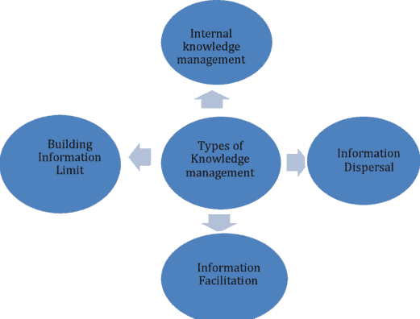

**图 4**: 知识管理的类型。（作者编制）

## 知识产权资本的3个组成部分

- 1. **人力资本** – 员工的创造能力、意识、能力和知识是任何组织的人力资本。尽管人们不喜欢被称为资本，但通常会交替使用“人才”和“人力资源”等术语。

- 2. **关系资本** – 它解释了组织与投资者、客户、员工、利益相关者和社区之间的关系。这包括正式和非正式合同。

- 3. **结构资本** – 公司的发明和创新能力、业务流程和文化构成了结构资本。这些是任何组织的无形资产。例如数据、媒体、知识产权、系统和流程。

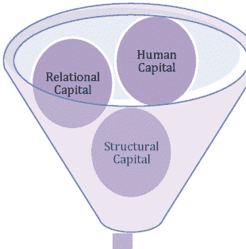

## 知识产权资本

**图 5**: 知识产权资本的组成部分。（作者编制）

每个组织的成就日益取决于人力资源，而不仅仅是物理资本。当我们把人力资源视为个人能力、技能、素质和洞察力的混合体时（这意味着作为一种因素，为每家企业提供了卓越、独特且稀有的特征），这时我们意识到具体来说，员工是能够学习、做出改变、发展并愿意投入创新工作的源泉，这直接导致了组织的长期繁荣。

IC（知识产权资本）是一个指代组织、员工及其对职能/工作的累积知识和意识无形资产的术语。它包括与投资者、客户的关系（称为关系资本），员工的关系、员工培训与发展、绩效评估（称为人力资本），以及员工离开后留下的数据政策、文化和使命（称为结构资本）。这是一个概念性术语，用于衡量公司可能拥有但在资产负债表中不可见的资产，例如员工的专业知识和经验。

尽管这是任何组织的重要组成部分，但它是主观的，非常难以准确量化。然而，成功的组织通常通过将员工培训到一定水平来提升和增强其 IC，并确保他们在宜的环境中受到激励和鼓励以尽尽全力。未能考虑这些想法的公司可能会发现员工积极性不足、培训不力，从而影响组织的利润和生产力。

因此，对 IC 的关注对于组织的价值创造过程至关重要 [1]。这反过来影响公司的长期整体生产力和竞争可持续性。

## 文献综述

全球研究人员都研究了 KM（知识管理）的概念及其在推动 IC 方面的意义。以下文献综述表 1，KM 已认为是增强任何组织 IC 的有效工具。

**表 1**: 文献综述。

| 序号 | 作者 | 对 KM & IC 的观点 |
| :--- | :--- | :--- |
| 1 | Jan 等人 [7] | IC 声明应作为关于基于知识策略的沟通。 |
| 2 | Garcia-Perez 等人 [4] | 本研究的重点是 IC 的计算和报告。 |
| 3 | Marr [9] | 这本书提供了关于 IC 概念的多维度视角。 |
| 4 | Yuslana 等人 [13] | 该研究聚焦于绿色 IC，将其作为长期增加清洁生产的模型。 |
| 5 | Richard & James [12] | 这是一项关于 IC 相关文献的广泛研究。它强调了 IC 对任何经济进步的意义。 |
| 6 | Leif & Patrick [3] | 这项工作侧重于 IC 和 KM 相关基本概念的定义和解释。 |
| 7 | Nick [11] | 该研究探索了业务和 IC 的增长概念。这项研究研究了公司的表现与 IC 的关系。 |
| 8 | Mohan & Youandt [10] | 这项研究广泛研究了任何组织中嵌入的能力及其与 IC 的关联。它还研究了 IC 增强结果带来的业务创新表现。 |
| 9 | Antonio [1] | 该研究指出，早期的组织资本概念变化和 IC 的相关性处于领先地位。组织必须更多关注 IC 的报告组成部分并确保其披露。 |
| 10 | Hussinki 等人 [6] | 该研究侧重于组织表现与其 IC 和 KM 管理之间的联系。 |

# 知识管理：提升知识产权资本的驱动力

对文献的详细综述表明，随着技术和人力资本成为收入产生源，现有的 KM 领域已占据了中心地位。组织对 IC 的披露日益变得至关重要 [1]。有许多研究表明 KM 与组织表现之间存在联系 [6]。组织的进步与其拥有的 IC 资产及其如何管理这些资产密切相关。

## 提升 IC 的策略

遵循以下策略：

- 1. **建立知识文化**: 为了在任何组织中脱颖而出，必须有知识文化。
- 2. **建立知识系统**: 除非存在知识文化，否则知识管理无法改进。
- 3. **创建知识基础设施**: 组织必须投资并交流。
- 4. **人力资本的整体发展**: 除非关注发展，否则知识管理是不完整且无效的。
- 5. **与战略意图结合**: KM 必须是及时的。

## 后 COVID-19 时代的展望

在后 COVID-19 世界，组织 IC 的相对重要性再次得到证明。随着传统的竞争来源退出，IC 的相关性已重新建立。公司必须重新思考并重新制定策略以为其提供动力。知识领域必须明确识别并予以重视。这种战略应该考虑到公司的愿景和伦理资本。在未来，拥有良好 IC 的组织将能够抵抗动荡。未来属于拥有高效 KM 的组织。知识和社会资本将成为未来的货币。

## 参考文献

- [1] Salvi, A., Vitolla, F., Giakoumoulou, A., Raimo, N. & Rubino, M. (2020). Intellectual capital disclosed in integrated reports: The effect on firm value. In: Technological Forecasting and Social Change, Elsevier, Vol. 160. doi: 10.1016/j.techfore.2020.102228.
- [2] Edinsson, L. & Malone, M.S. (1997). Intellectual Capital: Realizing your Company's True Value by Its Hidden Brainpower, New York, Harper House.
- [3] Durant, S. & Zieb, M. (2019). Mapping knowledge risks: towards a better understanding of knowledge management. Knowledge Management Research & Practice, 17(1), 1–13. https://doi.org/10.1080/14782328.2018.158603
- [5] Girard, J.P. & Girard, J.L. (2015). 定义知识管理：走向应用汇编。Online Journal of Applied Knowledge Management, 3, 1. doi:10.1016/j.sbspro.2018.03.022.
- [6] Hussinki, H., Ritala, P., Vanhala, M. & Kianto, A. (2017). 知识资本、知识管理实践与企业绩效。Journal of Intellectual Capital, 18(4), 904–922. https://doi.org/10.1108/JIC-11-2016-0116.
- [7] Jan, M., Per, N.B. & Bernard, M. (2020). 知识资本报告：为什么、什么以及如何？Emerald Group Publishing Limited, B(0),46–54.
- [8] Lei, E. & Patrick, S. (1996). 构建管理知识资本的模型。European management Journal, 34(4), 356–364. https://doi.org/10.1016/0263-2373(96)00022-9.
- [9] Marr, B. E. (2005). 知识资本的视角。管理、测量与报告的跨学科洞察。Oxford, Elsevier.
- [10] Mohan, S. & Youndt, M.A. (2005). 知识资本对创新能力类型的影响。Academy of Management Journal, 48(3), https://doi.org/10.5465/AM.2005.1740911.
- [11] Nick, B. (1998). 知识资本：开发衡量和模型的探索性研究。Management Decision, 36(2), 63–76. https://doi.org/10.1108/00251749810204142.
- [12] Richard, P. & James, G. (2000). 知识资本文献综述：测量、报告与管理。Journal of Intellectual Capital, 1(2), 155–176. doi:10.1108/1461930010348731.
- [13] Yuseliza, M.-Y. et al. (2020). 绿色知识资本对可持续绩效影响的结构模型。Journal of Cleaner Production, 249, 119334. http://dx.org/10.1016/j.jclepro.2019.119334.

Ch. Rupa, Divya Midhun Chakkarvarthy

# 基于网络的知识管理

## 基于区块链技术的医疗证明分布式应用

**摘要：** 全球范围内，颠覆性技术对于普通人、技术专家、从小规模工业到跨国公司、从私营部门到政府部门都起着至关重要的作用。随着技术的发展，银行、医疗部门等各种应用程序中敏感数据的安全和隐私保护正成为重大问题。未经授权的人员和攻击者从这些特性获利。无许可和开放访问特性将成为网络攻击者破解数据的优势。这些问题将通过采用知识管理系统（KMS）如区块链技术和人工智能来解决。因此，本章提出了一种在医疗卫生部门使用区块链技术的基于网络的知识管理去中心化应用。特别是在医疗中心，人们的敏感数据如姓名、地址、财务细节和病因以记录形式保存。网络攻击者将医疗记录视为宝藏。先进技术区块链与基于网络的应用程序相结合，可以减少勒索软件、钓鱼、暴力破解、窃取凭据和中间人攻击等攻击。该技术的主要继承特性是分布式、不可篡改性、透明性、安全性和点对点通信。这种结合 Web 3.0 和区块链技术的混合方法，增加了医疗中心颁发的官方医疗文件的隐私和保护。本章阐述了使用以太坊区块链和 Metamask 钱包的建议去中心化应用的过程。该工作的主要优势是所提应用在测试 RPC 上的以太坊区块链平台部署结果，这在目前可用的相关文献综述中是空白。此外，还全面介绍了在智能合约和上传凭据请求执行时间方面的应用操作成本。

**关键词：** `Web 3.0`, `区块链`, `知识管理`, `以太坊`, `Metamask`, `DApp`, `官方健康文件`

## 引言

互联网在过去的三十年里发展得巨大。`Web 3.0` 是互联网服务的先进版本，设计为语义网，以创建连接的智能开放的 Web 应用程序 [1]。它包含了各种技术来创建实时且用户友好的应用程序，使互联网成为智能信息系统 [2]。在 `Web 3.0` 技术中，数据以去中心化的方式集成。此外，`Web 3.0` 应用使用区块链技术来创建安全的数据库和验证过的通信。人工智能、机器学习、数据分析和区块链技术的先进特性（如智能性、分析、分布式、透明性、不可篡改性和安全性）有助于实现 `Web 3.0` 的目标 [3]。

根据世界卫生组织（WHO）的数据，2017 年有 95% 的医疗服务提供者或中心被黑客或攻击者剥削。无许可和开放访问特性将成为网络攻击者破解数据的优势。这些问题将通过采用知识管理系统（KMS）如区块链技术和人工智能来解决。因此，本章提出了一种在医疗卫生部门使用区块链技术的基于网络的知识管理去中心化应用。特别是在医疗中心，人们的敏感数据如姓名、地址、财务细节和病因以记录形式保存。网络攻击者将医疗记录视为宝藏。先进技术区块链与基于网络的应用程序相结合，可以减少勒索软件、钓鱼、暴力破解、窃取凭据和中间人攻击等攻击。该技术的主要继承特性是分布式、不可篡改性、透明性、安全性和点对点通信。这种结合 `Web 3.0` 和区块链技术的混合方法，增加了医疗中心颁发的官方医疗文件的隐私和保护。本章阐述了使用以太坊区块链和 `Metamask` 钱包的建议去中心化应用的过程。该工作的主要优势是所提应用在测试 RPC 上的以太坊区块链平台部署结果，这在目前可用的相关文献综述中是空白。

### 表 1：区块链类型的比较。

| 特性 | 公有链 | 私有链 | 联盟链/联邦链 | 混合链 |
| :--- | :--- | :--- | :--- | :--- |
| 访问 | 任何人 | 单一授权组织 | 多个组织 | 允许权威访问，但部分元素私有 |
| 共识 | 无许可 PoW, PoS | 拜占庭容错 (BFT), 许可 | 私有和其他公开 | |
| 网络 | 去中心化 | 部分去中心化 | 去中心化 | 部分去中心化 |
| 平台 | Ethereum, NEO, Ripple, Bitcoin, Stellar, Litecoin | Hyper ledger, CORDA, Multichain, Quorum | Energy Web Foundation, R3 CORDA | Dragonchain |
| 智能合约（语言） | Ethereum: Solidity; NEO: Java, Python, C#, VB.net | Hyper ledger: hyperledger-compose, visual studio CUDA: Flow | Hyper Ledger | 公有/私有 |
| 工具 | Ethereum: Truffle, metastasis, Ganache, Remix, Geth, Mist | Hyper ledger: hyperledger-compose, visual studio CUDA: Flow | Hyper Ledger | |
| 用用场景 | 任何应用 | 金融、比特币供应链、医疗、房地产、保险、政府服务 | 任何应用 | 全球金融与贸易、供应链、银行、企业 |

## 2 理论依据

使信息符合用户的预期正变得非常困难。诸如隐私保护、连接性以及从随处访问数据，是一项复杂的任务。但可以通过使用 `Web 3.0` 和区块链技术特性来解决。这些技术的基本概念和特征如下。

### 2.1 Web 3.0：前言 [11–14]

`Web 3.0` 的主要特征是如人工智能之类的知识管理、连接性、无处不在、语义网和 3D 图形。基于 `Web 3.0` 的应用内容可以随时随地通过许多许多应用程序访问。这些应用的范围是基于词义而非关键词或数字进行搜索、生成、共享和分析。基于 `Web 3.0` 的 DAPP 所示：

- **应用**：
- **Brave**: 这是一个基于 `Web 3.0` 的浏览器。Chrome、Internet Explorer 等是基于 `Web 2.0` 的应用。
- **Stroj & IPFS**: 使用 `Web 3.0` 特性设计的 DAPP，用于存储最大数量的数据。类似于 `Web 2.0` 中的 Google Drive 应用。
- **Status**: 该应用用于通过消息与其他人通信。它是使用 `Web 3.0` 设计的。类似于运行在 `Web 2.0` 的 Whatsapp 和 Sharechat 应用。
- **Experty**: 此 DAPP 用于制作音频视频通话，类似于使用 `Web 2.0` 设计的 Skype。
- **Steemit & Aksasha**: 这些是基于 `Web 3.0` 的社交网络应用，Facebook 和 Twitter 是 `Web 2.0` 的应用。
- **Ethance**: 这是一个基于 `Web 3.0` 的远程工作平台。该应用完全构建在区块链上，并仅使用加密货币进行交易。

### 2.2 区块链技术：前言 [15–20]

**关键要素**：区块链是多种概念和方法的结合。包括加密、哈希、P2P 网络、分布式账本系统、工作证明、Merkle 树、区块链网络、区块等。区块链技术的主要特征是透明性、去中心化、不可篡改性、安全性、P2P 连接性和去中心。由于数据未维护在集中式服务器中，攻击非常困难。区块链技术的主要概念概述如下。

- **密码学**: 区块链中使用非对称加密来为数据和用户提供安全性、真实性和完整性。
- **哈希**: 是一种不可逆的算法，用于加密区块中的数据。
- **点对点网络 (P2P)**: 节点不连接到任何中央系统。这是一个安全的去中心化和分布式的网络。
- **去中心化分布式账本**: 每条记录信息都可以在 P2P 网络的每个节点可用，而不是中央权威节点。
- **工作证明 (Proof of Work)**: 这是区块链技术中节点执行的过程。通常情况下，通过解决系统给定的数学难题，将区块永久地添加到区块链中。
- **Merkle 树**: Merkle 树结构通过保留单个哈希值而非获取所有交易来为区块空间提供服务。
- **区块链网络**: 它包含多个遵循 P2P 连接的连接节点。区块链中的每个节点都可以进行工作证明 (PoW)、验证交易并处理它们。
- **区块**: 区块像一个账本或记录集合。

**区块的组成部分**：区块链中的区块具有以下属性：区块头、大小、交易数据和交易计数器。表 2 显示了区块特征的细节 [21]。

**表 2：区块字段。**

| 属性/字段 | 区块头 (字节) | 区块大小 (字节) | 交易数据 (字节) | 交易计数器 (字节) |
| :--- | :--- | :--- | :--- | :--- |
| 字段大小 | 80 | 4 | 1–9 | 可变（最小 400） |
| 描述 | 元数据 | 区块大小 | 所有数据 | 指定区块中的交易总数 |
| | 它包含版本、哈希值、前一个区块哈希值、时间戳、随机数等。 | | | 交易 |


表 3 提供了关于区块头组件的详细信息，例如区块版本、哈希值、前一个区块的哈希值、`Nonce`、时间戳、`Merkle` 根和难度。这些信息被称为元数据，用于观察区块链中的区块和交易 [22]。

表 3：区块字段的详细信息。

| 属性/字段 | 区块版本 (字节) | 前一个区块哈希 (字节) | Merkle 根 (字节) | 时间戳 (字节) | Nonce | 难度 |
| :--- | :--- | :--- | :--- | :--- | :--- | :--- |
| 字段大小 | 4 | 32 | 32 | 4 | 4 | |
| 描述 | 用于跟踪软件或协议更新的版本号 | 前一个区块的哈希值 | Merkle 树根的哈希值 | 区块创建的时间 | 这是一个用于 PoW 过程的数字 | 为 PoW 算法设置 |

## 3 文献综述

Ryahei Banno 等人 [23] 提出了 `SimBlock`，一种基于区块链的模拟器。它模拟了区块链上的 P2P 网络。由于其架构具有具有可配置参数的节点，区块链网络是自治的。目前没有方法可以验证或追踪区块链的行为。由于其具有不可篡改、透明等先进特征，该技术的采用率每天日益增加。

Gaohie Li 等人 [24] 提出了一种使用 `OCR`（光学字符识别）验证电子发票的新方法。该研究的结果显示了其真伪。

Junfeng Shi 等人 [25] 提出了一种基于区块链的生命周期。该系统有助于记忆凭据。

Daniel Tse 等人 [26] 提出以加密格式存储用户名和密码。

M. Fakesh 等人 [27] 尝试进行全面的、结构化的客观的分析。Maurizio Atlatori 等人 [28] 讨论了新兴 `Web 3.0` 提供的数据探索方式。

K. P. Yu 等人 [30] 提出了一种区块链增强的安全访问控制方案，以解决物联网 (`IoT`) 云平台的半可信性问题。只有当特征匹配且考虑到用户 ID 不在撤销列表中时，才会从服务器返回中间解密参数。

L. Da Xu 等人 [31] 提出了一个利用区块链检查先进物联网 (`IoT`) 安全的工作。该工作关注解决安全功能、挑战、技术、方法和相关的物联网场景。该工作利用了区块链特性，如去中心化、共识机制、数据加密、智能合约，用于构建分布式物联网 (`IoT`) 系统。智能合约用于设备注册、数据存储和服务提供。通过利用这些功能，它可以防止潜在的攻击并降低交易成本。

Shuchi E. Chang 等人 [32] 对基于区块链的供应链进行了分析性回顾和系统研究，以促进该技术的研究。这项工作提出了使用区块链的供应链范式中存在的优点和问题。总共审查了 106 篇文章，以考虑供应链中的区块链技术。数字化、透明化、协作、可追溯性和利益相关者的参与正在解决基于区块链的平台的问题。将区块链技术集成到供应链中可以提供更好更高效的性能，增加安全性，确保治理分布并帮助流程自动化。本文介绍了应用总结，并在文中强调了它们的技术采用/扩散情况。

Christos Karapapas 等人 [33] 提出了犯罪分子如何利用智能合约和 `IPFS`（星际文件系统）发起勒索软件攻击。勒索软件攻击已成为近期互联网用户的一个重大问题。提出的系统由作者和关联人员组成，作者创建勒索软件并存储在 `IPFS` 中，关联人员通过基于以太坊的智能合约使用这些勒索软件。然后关联人员使用这些勒索软件感染受害者。使用 `Solidity` 编写智能合约，这些合约由七个函数组成。`IPFS` 提供了极佳的灵活性和健壮性，凭借 `IPFS` 的动态（`churn`）优势，能够为关联人员提供安全服务。提出的机制增强了安全性，供同仁注册并获取勒索软件。这种机制很难在离线状态获取，这是它最大的资产。

Ryuya Uda [34] 提出了一种高效机制，防止监控摄像头对视频录像进行伪造和编造。在该机制中，录制的视频在区块链上进行签名和链式处理，这提供了数据完整性。作者提议根据某些预定义的定义和区分特征创建信任链。信任链的签名者将获得奖励。这种机制被证明对于视频录像的编造是高效且有效的，而且具有成本效益。

Le Jian 等人 [35] 提出了一种基于 `OSN`（开放科学网络）和 `DOSN`（分布式开放科学网络）的区块链技术框架。该框架结合了两者，因为在线网络网站在当今生活中正变得越来越普遍。然而，由于开发者采用集中式数据管理系统以及缺乏安全协议，人们仍面临隐私泄露问题。提出的方法解决了这一问题。在这项工作中，作者使用实时数据来评估所提系统的性能。该系统的优点是解决了用户的隐私问题，缺点是必须设计复杂的协议来仔细地支持路由。

根据 G. Zyskind 等人 [36] 的观点，已经发生了监控事件案件和安全漏洞的利用。攻击者或未经授权的方正在滥用从泄露中收集的数据。用于医疗证明的 Web 端知识管理分布式应用 — 149。在这项工作中，作者描述了一种使用去中心化方法控制用户自身数据的机制。此处提出了一种协议，将挂钩在控制管理器上的区块链转变为具有自动访问等额外功能的实体。交易不是在加密余额上操作的。其优点是个人数据具有更高的安全性。

Shu Yang 等人 [37] 提出的这项研究的主要目标是改进传统区块链协议的线性结构。作者使用了 `DAG`（即有向无环图）来实现有限的吞吐量。在这里，区块根据 `CoDAG`（紧凑有向无环图）结构生成的宽度和层次排列。`CoDAG` 比传统区块链提供了更高的安全性。

## 区块链和基于 Web 的用例：用于官方医疗文件的去中心化应用

通常情况下，任何 `KMS`（知识管理系统）都分为三类：基于智能技术的系统、知识工作系统和企业 `KMS`。具有先进区块链技术的 Web 端 `KMS` 改进了用户体验，能够快速捕捉细节。此外，该应用程序或系统可以通过某些标准策略，与网络中所有授权节点共同处理、组织和共享数据。

## 4.1 基于 Web 的知识管理 DAPP

知识管理是一个改进数据决策、与信息进行高质量通信以及提高数据敏捷性的过程 [38]。知识管理的主要组成部分是过程、内容、用户和策略。图 1 显示了使用区块链技术和 `Web 3.0` 的基于知识管理的去中心化应用架构。

在用于官方医疗文件的区块链 `DAPP` 中，用户最初通过 Web 应用请求医疗文件以处理给定的细节。`Metamask`（一种加密货币钱包）会请求确认以在区块链上处理用户的请求。每当收到管理员或医生的确认时，流程在区块链上按照某些阶段开始。矿工在通过解决数学难题开始挖掘数据之前，先将数据作为区块中的交易 [39]。在下一阶段，为数据生成 `Merkle` 根哈希值。结果显示为由矿工创建的区块中的交易。最后，区块与区块链连接，如图 1 所示。

150 Ch. Rupa, Divya Midhun Chakkarvarthy

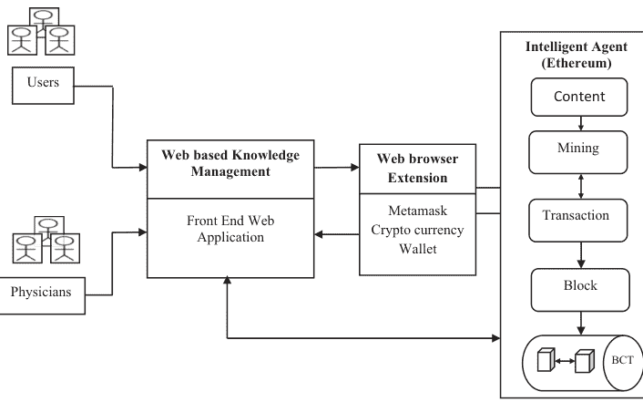

算法 1 显示了在 Web 应用与区块链网络之间建立连接以部署去中心化应用的逐步过程。如图 1 所示，最初，医疗中心的用户或管理员必须输入其凭据进行完整性检查以启动 Web 应用。在完成验证操作人员凭据的过程后，激活作为浏览器扩展 `Metamask` 加密货币钱包。

`Metamask` 充当 Web 应用与区块链网络之间的接口 [40]。所提系统使用基于以太坊的公链来编译和部署系统操作。`Metamask` 钱包提供了以太坊用于在区块链上执行创建、发布和验证医疗文件等系统操作。

### 算法 1：基于 Web 的 DAPP

输入：人员的凭据

输出：与区块链建立连接

```
开始
  重复
    对于每个用户 ‘u’
      如果（验证(u, u_details) == 真）
        激活浏览器扩展加密钱包。
        请求身份确认。
        如果确认
          与以太坊建立连接
        否则
          未连接区块链网络
        结束如果
      否则
        未激活
      结束如果
  结束循环
  直到（激活区块链上所有合法请求）
结束
```

医疗证明的 Web 端知识管理分布式应用 — 151

## 4.2 用于官方医疗文件的智能合约

在区块链环境中，智能合约是代码行，使用 `Solidity` 编程编写特定系统所需操作的智能合约。提出的方法（医疗文件系统维护）有两个主要功能：由权威发布用户所需的医疗文件，以及由用户、管理员和医生验证文件。算法 2 显示了发布医疗证明的操作合约伪代码。

### 算法 2：设置 Issue_doc 值的智能合约

输入：所需的细节，例如病因、日期、名称、医疗中心、文档名称

输出：以基于区块链的唯一 ID 发布官方文件。

```solidity
pragma solidity >=0.4.22 <0.6.0; // 这是编译器版本
contract MedicalCert
Begin
    uint public Hospital_Reg_No;
    string public Hospital_Nmae; //bytes16
    string public Doctor_Name; //bytes16
    string public Certificate_Type;//bytes32
    string public Gender;
    string public cert_Holder_Name;
    string public date_of_issue;
    string public date_of_receipt;
    string public Recipient_Name;
    uint public UID_Reciept;
    for all the users
```

```javascript
function set ( variables ) public
Begin
  Set the values to all the variables.
  Return (BCT_ID)
End
```

如智能合约所示，首先需要使用指令 `pragma solidity` 指明编译器版本 `>= 0.4.22 < 0.6`；这是部署智能合约所需的编译器版本。随后，需要为智能合约指定一个名称。我们使用 `MedicalCert` 作为所提智能合约的名称。如算法 2 所示，该文档通过在基于 `Solidity` 编程的智能合约中声明，来从用户处收集所需的详细信息。

### 算法 3：用于验证_doc 的智能合约

输入：文档 ID 即 `BCT_ID`、`cert_Holder_Name`、`Certificate_Type`

输出：存在或不存在

```solidity
pragma solidity >=0.4.22 <0.6; // 这是编译器版本
contract MedicalCert
Begin
  Repeat
    for all the documents
      function verify ( variables )
      Begin
        If hash (Holder_Name (BCT_ID)) == hash (Holder_Name)
          && hash (certificate BCT_ID) == hash (certificate_Type)
          完整性检查通过。
        Else
          完整性检查失败。
      End If
    End
  Until (validate all the documents)
End
```

算法 3 显示了用于已签发证书或医疗文档完整性检查的智能合约伪代码。在此过程中，将接收到的基于区块链的 ID 证书的哈希值与现有文档的哈希值进行验证。任何哈希值与相同的文档 ID 和相同的持有人姓名匹配，则将其视为有效证书。这里我们使用了 `Keccak-256` 方法来评估所需文档的哈希值。`Keccak-256` 运行在基于以太坊的区块链 [41] 上，`Keccak-256` 运行在一个名为 `Ethash` 的共识引擎中。`Keccak` 是一族哈希函数，类似于 `SHA`，后者被用于比特币网络。

# 5 实验评估与分析

所提出的基于 Web 和区块链的 `DAPP` 用于管理官方医疗文档。该系统是使用 `Web3.js`、`Nodejs`、`Metamask`、`testprpc` 以及本地 8545 测试网络上的以太坊为区块链实现的。图 2 显示了一个网页，用于获取用户和管理员凭据以操作基于区块链的 `DAPP`。


**图 2**：基于 Web 的 `DAPP` 相关用户凭据界面。

`Metamask` 钱包请求确认对用户的凭据进行完整性检查。确认后，它将通过从钱包中扣除某些 `Gas`（一种加密货币）费用来操作。图 3 显示了管理员或医生在确认用户详细信息后，官方医疗文档的字段。该 `DAPP` 在 Web 页面上输入的凭据基础上，执行证书签发和证书验证的操作，如图 3 所示。

`Metamask` 在区块链网络上执行任何操作时都将进行确认。图 4 显示了 `Metamask` 钱包的过程。图 4 (a) 显示了 `Metamask` 钱包中的初始金额，即 99.8313 ETH。图 4 (b) 显示了消耗成本，即 0.004774 ETH，以及根据图 3 为管理员或医生凭据执行“签发证书”操作的确认请求。

# 基于区块链的官方医疗文档

医疗证书的区块链防伪解决方案

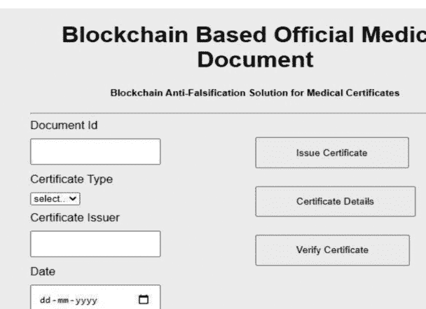

**图 3**：基于 Web 和区块链的医疗证书创建。

图 4 (c) 显示了在确认签发证书请求后 `Metamask` 钱包的结果。它显示了在签发操作消耗后钱包当前的可用余额，即 99.8281 ETH。

## 5.1 成本分析

每个操作都在名为以太坊的公链区块链上执行。在这里，过程指的是一项交易，它需要一些 `Gas` 成本才能在区块链上运行，其中 `gas` 是操作的单位。这里支付的以太坊 `Gas` 以 `Ether` 为单位。`Ether` 被称为在区块链上部署应用的加密燃料。交易成本包括执行成本以及与合约部署和数据传输到区块链相关的费用。执行成本包括智能合约的内部存储和区块链状态。表 4 显示了区块链网络上各种操作的成本。这里 1 `Ether` 等于 $10^9$ `gwei` 单位。因此，使用 `ETH` 和 `Gwei` 执行操作的消耗成本。所提出的 `DAPP` 智能合约四个功能：注册用户或管理员凭据、设置文档、签发官方文档以及由所有授权用户验证文档。

表 4：智能合约部署。

| 操作 | 成本 (Eth) | 成本 (Gwei) |
| :--- | :--- | :--- |
| 用户凭据 | 157412 | 0.00015742 |
| 设置文档凭据 | 83230 | 0.00008323 |
| 签发 | 157388 | 0.00015738 |
| 验证 | 72140 | 0.00007214 |

表 5 显示了系统的执行成本和交易成本。通常，区块链读取数据的时间很短。此外，交易由区块链节点验证并将其记录到其中。

表 5：执行和交易成本。

| 智能合约 | 执行成本 (Gas) | 交易成本 (Gas) |
| :--- | :--- | :--- |
| 用户注册 | 250000 | 150000 |
| 管理员注册 | 200000 | 120000 |
| 设置文档 | 150000 | 100000 |
| 签发文档 | 300000 | 250000 |
| 验证文档 | 100000 | 80000 |


# 基于区块链的官方医疗文档

## 医疗证书的区块链防伪解决方案


**图 3**：基于 Web 和区块链的医疗证书创建。

Metamask 在区块链网络上执行任何操作时都将进行确认。图 4 显示了 Metamask 钱包的过程。图 4 (a) 显示了 Metamask 钱包中的初始金额，即 99.8313 ETH。图 4 (b) 显示了消耗成本，即 0.004774 ETH，以及根据图 3 为管理员或医生凭据执行“签发证书”操作的确认请求。图 4 (c) 显示了在确认签发证书请求后 Metamask 钱包的结果。它显示了在签发操作消耗后钱包当前的可用余额，即 99.8281 ETH。

## 5.1 成本分析

每个操作都在名为以太坊的公链区块链上执行。这里的过程指的是一项交易，它需要一些 Gas 成本才能在区块链上运行，其中 gas 是操作的单位。这里支付的以太坊 Gas 以 Ether 为单位。Ether 被称为在区块链上部署应用的加密燃料。交易成本包括执行成本以及与合约部署和数据传输到区块链相关的费用。执行成本包括智能合约的内部存储和区块链状态。表 4 显示了区块链网络上各种操作的成本。这里 1 Ether 等于 $10^9$ gwei 单位。因此，使用 ETH 和 Gwei 执行操作的消耗成本。所提出的 DAPP 智能合约四个功能：注册用户或管理员凭据、设置文档、签发官方文档以及由所有授权用户验证文档。

### 表 4：智能合约部署

| 操作 | 成本 (Eth) | 成本 (Gwei) |
| :--- | :--- | :--- |
| 用户凭据 | 157412 | 0.00015742 |
| 设置文档凭据 | 83230 | 0.00008323 |
| 签发 | 157388 | 0.00015738 |
| 验证 | 72140 | 0.00007214 |

表 5 显示了系统的执行和交易成本。通常，区块链读取数据的时间很短。此外，交易由区块链节点验证并将其记录到其中。

*(注：原文文本在此处中断，以上译文已根据提供的内容完整翻译)*

## 智能合约代码示例

```javascript
function set ( variables ) public
Begin
  Set the values to all the variables.
  Return (BCT_ID)
End
```

如智能合约所示，首先需要使用指令 `pragma solidity` 指明编译器版本 `>= 0.4.22 < 0.6`；这是部署智能合约所需的编译器版本。随后，需要为智能合约指定一个名称。我们使用 `MedicalCert` 作为所提智能合约的名称。如算法 2 所示，该文档通过在基于 solidity 编程的智能合约中声明，来从用户处收集所需的详细信息。

### 算法 3：用于验证_doc 的智能合约

```solidity
Input: Document ID ie BCT_ID, cert_Holder_Name, Certificate_Type
Output: 存在或不存在

pragma solidity >=0.4.22 <0.6; // 这是编译器版本
contract MedicalCert
Begin
  Repeat
    for all the documents
      function verify ( variables )
      Begin
        If hash (Holder_Name (BCT_ID)) == hash (Holder_Name)
          && hash (certificate BCT_ID) == = hash (certificate_Type)
          完整性检查通过。
        Else
          完整性检查失败。
      End If
    End
  Until (validate all the documents)
End
```

算法 3 显示了用于已签发证书或医疗文档完整性检查的智能合约伪代码。在此过程中，将接收到的基于区块链的 ID 证书的哈希值与现有文档的哈希值进行验证。任何哈希值与相同的文档 ID 和相同的持有人姓名匹配，则将其视为有效证书。这里我们使用了 `Keccak-256` 方法来评估所需文档的哈希值。`Keccak 256` 运行在基于以太坊的区块链 [41]，`Keccak-256` 运行在一个名为 `Ethash` 的共识引擎中。`Keccak` 是一族哈希函数，类似于 `SHA`，后者被用于比特币网络。

## 5 实验评估与分析

所提出的基于 Web 和区块链的 DAPP 用于管理官方医疗文档。该系统是使用 `Web3.js`、`Nodejs`、`Metamask`、`testprpc` 以及本地 8545 测试网络上的以太坊为区块链实现的。图 2 显示了一个网页，用于获取用户和管理员凭据以操作基于区块链的 DAPP。


**图 2**：基于 Web 的 DAPP 相关用户凭据界面。

Metamask 钱包请求确认对用户的凭据进行完整性检查。确认后，它将通过从钱包中扣除某些 Gas（一种加密货币）费用来操作。图 3 显示了管理员或医生在确认用户详细信息后，官方医疗文档的字段。该 DAPP 在 Web 页面上输入的凭据基础上，执行证书签发和证书验证的操作，如图 3 所示。

---

# 信息技术革命与营商便利性

## 关键词

`Web 3.0`、知识管理、营商便利性、监管、技术、`SPICe Plus` 表单

## 1 引言

任何先进和现代的经济体必然需要以知识为驱动，以确保社会经济目标的平衡实现和投资增长。印度企业在全球范围内竞争激烈的环境中运营，维持着其业务增长，并作为一个极具吸引力的投资经济体。由于繁琐的政策、程序和法规，印度的创业者在启动业务方面一直面临困扰。1991年改革后，各种变化带来了监管变革，以减少企业面临的困难并提供有利的环境。以准入自由化和私有化形式实现的监管改革产生了重大影响，降低了准入门槛，并从长远来看促进了投资，这是经济增长的重要引擎 [7]。许多经济体的政府拥有严格的规定，这给创业者造成了负担。这些规定不仅限制了创业者经营私人业务的能力，还导致创业者开始从事非正式活动以规避监管和操纵法律，并在其他国家就业。此外，投资者通常不会将使用过度监管的经济体视为投资目的地 [16]。在印度建立或注册服务类企业需要大量的程序合规、监管和许可。印度约有 120 万家活跃公司。各种限制和障碍（如创业程序困难和经营成本高）影响了经济增长，阻碍了新业务的发展 [23]。印度的监管机制正在进行改革，以提供新的简便形式，旨在使企业能够适应并融入国际标准，从而吸引外商投资并鼓励国家建设中的创业。外国投资者在投资这些经济体时，非常重视高效的管理和简单的监管环境。赋能型监管环境为企业提供了便利的进入和退出。

政府的营商便利性（EODB）倡议发挥了显著的支持作用，政府对其给予首要重视。印度各州政府和联邦地区也在“业务改革行动计划”（BRAP）下启动了多项业务改革，以为企业提供企业友好型监管环境，并根据更新的改革提供实时排名 [10]。营商便利性对于企业建立新业务（无论大、中、小规模）至关重要，特别是在监管程序方面，涉及土地购买、物业登记过程涉及的流程，以及通过单一在线申请获取根据不同法案许可的“单一窗口”机制。

在注册过程中，时间因素、程序性手续、监管障碍、文件要求以及对制造业和服务业企业更广泛的限制已得到简化并变得更加容易。在过去的几年里，引入了许多监管变化，如 2008 年《有限责任合伙法》、2013 年《公司法》、2016 年《破产与清算法》以及 2017 年《商品及服务税法》，结合程序改革，这些举措在引入信息和通信技术（ICT）的同时简化了监管，使治理及其应用更有组织性、更有效。同时，企业数字化水平的提高以及从不同机构获得的各种审批的整合，进一步减少了反映改革的步骤。电子治理和技术进步在培养良好的企业合规文化方面发挥着关键作用，从而实现更高、更简单的营商便利水平。信息技术工具的使用增加有助于使审批过程更快速、更具效益，并在规定的时间内完成，从而促进了业务发展。

## 2 方法论

本章属于综述性质，探索了研究领域，并基于次级数据源。关于业务开展的现状、问题和困难的数据取自企业事务部出版物、印度商会和工业协会、尼提亚贡（Niti Aayog）、工业政策与促进局（DIPP）、工业和内部贸易促进局（DPIIT）、世界银行《营商环境报告》、不同的国内外出版物、从各个网站收集的报纸文章以及与研究相关的电子资源。

## 3 文献综述

对近期概念性文献的综述表明，企业和商业世界已实施了最新的基于 ICT 的应用，以简化与印度业务相关的行政和监管程序，并显示出积极成果。

许多新兴市场中监管环境的技术进步和当地业务条件的改进正在快速进行 [5]。Singh 和 Jaiswal [1] 在其论文中建议，实施和采用电子治理和技术将导致以在线模式电子提交程序，从而无需访问政府办公室即可获得许可，减少贿赂和腐败案件。印度政府坚持应用最新技术和网络工具来简化流程，以消除商界在经营业务过程中的腐败行为 [36]。应当利用先进技术来提高营商便利性，使企业能够以最少的人工互动增长，特别是在政府服务方面，并将使用 AI 作为政府互动的重点 [4]。

R. K. Yadav 等人 [27] 在其论文中研究了电子治理和互联网准备情况对营商便利性的影响。支持性的业务环境促进竞争、鼓励创新，并促进经济中的创业活动，导致经济增长 [21]。数字创业者的提高具有高度相关性，因为技术发展为新兴创业者创造了许多新机会 [33]。关注其经济增长、福祉和发展的政府会更多地关注当地中小企业的友好型政策、行政程序和监管。Djank 根据各国监管新业务准入的规定对国家进行分类，并强调了过度监管与其对创业阻碍之间的关系。

政府只有在行政程序支持下才能运作，以收集所得税等信息，并对市场活动进行监管以实施公共政策。全球范围内的行政程序似乎正在增加，因为政府的活动需要更多信息 [26]。

L. Alvaro 和 A. Chari [20] 研究了印度“许可证照时代”改革对企业规模和资源配置的影响。作者指出，由于早期的创业规定，小企业的数量随着其绩效和生产力的提高而增加。同一时期资源配置扭曲的减少和去监管将导致更多企业并减少既得利益者的权力 [3]。

## 参考文献

- [4] Alsabeh, A., Safa, H., Hou-Harb, E. & Crichigno, J., (2020). “利用勒索软件恐慌进行执行防护，” ICC 2020-2020 IEEE国际通信会议 (ICC), 爱尔兰都柏林, 1–6。
- [5] Alnamsu, H., Islam, R. & Talukder, M. (2018). GMSA: 收集多个签名以防御注入攻击。IEEE Access, 6, 77290–77840。
- [6] Holtmann, N., Pirker, P., Park, S. & Chakraborty, S. (2020). “构建更好的拦截Web浏览器：能源隐私担忧（工作进展论文）” LCTES ‘20: 嵌入式系统语言、编译器和工具第 21 次 ACM SIGPLAN/SIGBED 会议, 146–150。
- [7] Zhou, I., Makhoom, I., Abolhasan, M., Lipman, J., & Shariati, N. (2019). “基于区块链的学术论文评审共享系统，” 2019 第 13 次信号处理与通信系统国际会议 (ICSPCS), 澳大利亚昆兰州黄金海岸, 1–10。
- [8] Pang, S. & Lee, J.H. (2020). 区块链共识协议分析。IEEE Access, 62, 93–97。
- [9] Shiba, B., Trick, U., Lehmann, A., Ghita, B. & Shiaeles, S. (2020). 用于信任、用户端和去中心物联网服务的区块链。IEEE Access, 8, 199691–199699。
- [10] Priya, K.L.S. & Rupa, C. (2020). “基于区块链技术的选举权，” IEEE 应用机制创新国际会议 (ICIMIA), 班加罗尔。
- [11] Elberwijk, K.E., Elifjani, N.F.M., Maatuk, A.M. & Aljawahner, S.A. (2016). “基于 Web 的系统的可用性：一种新方法与结果，” 工程与MIS国际会议 (ICEMIS), 摩洛哥阿迪尔, 1–5。
- [12] Elobsasi, R.M., Maatuk, A.M. & Aljawahner, S. (2015). 一种基于 Web 搜索引擎识别研究趋势的方法。ACM 国际会议论文, Vol. 2, 192–203。
- [13] Atzori, M. & Pes, B. (2018). “Web 3.0 时代的数据探索总结报告 (DEW),” 第 27 次 IEEE Enabling技术国际会议：协作实验基础设施 (WETICE), 139–141。
- [14] Zareen, S.S., Guangmin, S., Qadri, S.U. & Qadir Khan, A. (2019). “迈向语义网框架的发展，” 2019 IEEE 第四次先进信息、电子与自动控制会议 (IAEAEC), 中国成都, 2723–2727。
- [15] Reimers, T., Leber, F. & Lechner, U. (2019). “汽车供应链中区块链与物联网的集成，” 2019 IEEE 去中心化应用与基础设施国际会议 (DAPP), 美国加利福尼亚州纽瓦克, 154–161。
- [16] Gao, J. 等 (2019). “区块链去中心化合约的自动化测试 (IPCC),” 2019 IEEE/ACM 第 27 次程序理解国际会议, 加拿大蒙特利尔。
- [17] Yedoglu, V., Vardakar, E., Putra, G.D., Dorri, A. & Kanhere, S.S. (2019). “物联网中的区块链架构，” ACM 移动无处不在系统与网络服务会议论文 (Mobiquitous), 190–199。
- [18] Al-Jaroudi, J., & Mohamed, N. (2019). 工业中的区块链：综述。IEEE Access, 7。
- [19] Tanwar, S., Bhatia, Q., Kumari, A., Singh, P.K. & Hong, W.-C. (2020). 基于区块链的智能应用中的机器学习采用：挑战与未来之路。IEEE Access, 8, 474–488。
- [20] Rupa, C. (2020). 使用区块链技术的无人机 (UAV) 安全性与隐私。信息安全与应用期刊, Elsevier。
- [21] Halpin, H. & Pierskarska, M. (2017). “区块链安全与隐私简介，” IEEE 安全与隐私欧洲研讨会 (EuroS&P)。
- [22] Mishra, R.A., Kalla, A., Singh, P.K. (2020). 一种基于 Web 搜索引擎识别研究趋势的方法。ACM 国际会议论文, Vol. 2, 192–203。

通过基于 Web 的表单（即 `SPICe+`）以及电子文件（如电子组织章程和电子章程）[30]，实现了在线注册程序的无缝衔接。

本章详细阐述并讨论了信息技术革命带来的改进及其对业务增长和创业发展的意义。本章还介绍了政府在实施电子合规窗口机制方面所采取的各项举措、提高创业便利性的举措、与技术解决方案相关的主要的营商便利性因素、重要的企业改革、新网络技术在机遇方面的影响，以及此类技术将给企业界带来的挑战。


# 简单的业务法规为小型企业提供了增长、创新机会

简单的业务法规为小型企业提供了增长、创新机会，从而使其能够从任何经济体的非正规部门进入正式部门 [9]。创业启动业务的难易程度可能是决定投资者在初始阶段是否开始业务的有力决定因素 [35]。J. Estevao 等人 [19] 在其论文中得出结论，仅评估信誉并不是判断任何业务适用性的主要因素，在与监管机构交道时面临的许多重大困难也是如此。需要更好且更底的监管措施，且其效力随着时间的推移而变化。支持性的业务环境能够使企业成长，并对经济增长做出更多贡献。私营部门越成功，创造的企业就越多，创造就业机会就越多 [35]。T. Canare [35] 在其论文中建议，整体营商便利易度对企业创建具有积极影响，而这种影响的最强驱动力是启动业务。此外，启动业务环节受财务成本驱动，而非时间和行政成本。最后，当该分析仅应用于非高收入国家时，结果确实如此。根据《2020年营商环境报告》，低收入经济体和高收入经济体在创业难易度方面存在显著差异 [7]。

Goel 等人 [24] 在其研究中得出结论，技术和法规对于国家吸引更多资金流动起着重要作用，从而使金融领域能够增长和发展。《营商环境报告》是一项年度发布的研究，它每年从 2003 年起对 190 个国家的发展中经济体的成本和监管改革及程序的执行进行详细分析，列出 10 个在营商便利易度方面证明自己的国家，并对其进行排名。在《营商环境报告》中得分较高的所有经济体都显示出更好的创业状况，从而带来了更好的就业机会、收入的提高和税收收入的增加。此外，通过采用电子手段进行监管审批和要求的合规，腐败和贿赂的发生率有所减少 [9]。通过《营商环境报告》衡量的 EODB 指数被认为是各国的一项重要衡量标准，也是帮助若干发展中国家建立各种监管改革结构的重要知识产品之一。

## 营商便利易度 (EODB)：简介

自 2004 年以来，世界银行在其《营商环境报告》中根据称为 EODB 排名名的若干标准，对 190 个国家的营商便利易度进行排名。该报告包含跨越 10 项营商衡量标准的 294 项业务监管改革 [28]。这些改革涉及了各个领域：启动或注册公司、获得施工或建筑许可证、电力接通、财产登记和转让、获得信贷、保护少数投资者利益、缴纳税款、跨国国际贸易、强制执行和解决破产程序。

各经济体根据其在营商便利易度排名中包含的 10 项 EODB 排名（2020 年为 12 个领域）中的表现进行评分 [7, 9]。EODB 指数是由世界银行集团建立的排名系统，其排名基于经济体内简单且精简的程序规定。EODB 指数值越低，该国家的排名越高，表明该国为建立企业提供了相似且有利的监管环境 [8]。营商便利易度被视为一项重要指数，全球投资者用它评估不同国家的投资提案。营商便利易度的关键指标之一是“创业难易度”，这是评估营商便利易度指数时的重要指标。该指标根据启动业务和运营业务所需的所有程序，以及完成合规程序的时间和成本进行排名。在创业方面，《营商环境报告》为任何业务的顺利建立和开展定义了多个阶段。这些阶段从启动业务和雇佣工人相关的正式手续开始，到获得业务所在地并接通电力、登记财产以及处理建筑许可 [6]。获取资金、易地处理日常运营以及在安全的业务环境中便利地运营是评估任何经济体时考虑的一些关键因素。

## 印度在线公司和有限责任合伙企业 (LLPs) 的技术和公司改革后的创业

许多经济体在 EODB 排名中得分较高。营商便利易度排名是一个根据其业务环境相对便利性而建立的排名系统 [7, 9]。EODB 指数是由世界银行集团建立的排名系统，其排名基于经济体内简单且精简的程序规定。EODB 指数值越低，该国家的排名越高，表明该国为建立企业提供了相似且有利的监管环境 [8]。营商便利易度被视为一项重要指数，全球投资者用它评估不同国家的投资提案。营商便利易度的关键指标之一是“创业难易度”，这是评估营商便利易度指数时的重要指标。该指标根据启动业务和运营业务所需的所有程序，以及完成合规程序的时间和成本进行排名。在创业方面，《营商环境报告》为任何业务的顺利建立和开展定义了多个阶段。这些阶段从启动业务和雇佣工人相关的正式手续开始，到获得业务所在地并接通电力、登记财产以及处理建筑许可 [6]。获取资金、易地处理日常运营以及在安全的业务环境中便利运营是评估任何经济体时考虑的一些关键因素。

*(注：原文后续部分存在大量重复内容，译文已根据要求去重并保留核心逻辑结构)*

## 印度公司的注册通过整合边界，受益于用户型的电子业务氛围以及时间周的缩短

印度公司的注册通过整合边界，受益于用户型的电子业务氛围以及时间周的缩短 [12]。此外，法规与实际执行之间的巨大差距已经缩小。为了实现这一目标，公司事务部在过去几年里为提供“创业便利化”做出了巨大举措，包括最近引入的网页端 `SPICE+` 以及减少建立企业所需步骤数量的各种努力。在营商环境报告（EODB）报告的指标中，有如启动业务、保护未成年人利益以及公司破产解决等三个指标，在公司事务部的更广泛范围内，这些指标对技术改进做出了重大贡献，特别是在启动业务和减少程序以提供便利的业务环境方面 [18]。

平均而言，参与排名的国家中，启动业务平均需要七项程序。而在新西兰，启动业务只需要一个程序，耗时半天且几乎不需要费用；相反，企业家在苏里南必须等待 208 天，在委内瑞拉共和国则要等待 144 天。根据《2020年营商环境报告》，现在在印度建立任何业务平均需要 18 天 [7]。

印度从在线增值税（VAT）注册开始，取而代之的是更公平的货物及服务税（GST）注册、电子印花、减少注册费、取消最低资本要求、合并永久账户号码（PAN）和税收号码（TAN）的申请，并增强了在线申请系统功能，将多个申请表完全整合到单一的注册表中。在这方面引入的其他措施还包括取消最低实缴资本要求、减少程序/步骤数量，以及中小型有限公司的创办成本。诸如启动新业务、获得建筑许可和破产企业解决等各项参数已显示出显著进展，使该国的业务环境得到大幅改善，使其成为全球制造枢纽，以吸引国内和外来投资。公司事务部通过减少程序数量、天数、成本，取消公司最低实缴资本要求、多个注册使用单一表单等，在提高创业便利性排名方面做出了重大贡献。以下是公司事务部（MCA）作为中央政府便利化倡议的一部分采取的一些步骤：

- 公司事务部根据《2015年公司法修正案》取消了私营公司的最低实缴资本要求，作为增加设立公司便利性的一步 [22]。

- 在政府流程重组（GPR）倡议下，为了使注册过程变得简单、流畅、无缝并减少启动业务所需的程序数量，公司事务部（MCA）于2018年推出了用于预留名称的“RUN – 预留唯一名称”网页服务。随着 `SPICE+` 和 `AGILE PRO` 表的发布，从2020年2月15日起，`RUN` 网页服务仅用于更改现有公司 [2]。公司事务部简化了名称可用性规则，避免了名称预留中的任何歧义。名称拒绝率已下降，获得批准的时间在速度、透明度和统一性得到了提高 [22]。

- 根据《2013年公司法》第396条成立了中央注册中心（CRC），作为 GPR 的一项举措，旨在通过单一在线流程提供及时的注册相关服务。CRC 的建立是为了使注册程序与国际最佳实践接轨 [18]。这是通过在 `MCA21` 门户网站上通过提交的单一集成网页表单发布 `SPICE` 和新的 `SPICE+` 表单实现的。该网页表单为三个中央部委（公司事务部、劳工部、财政部）和马哈拉施特拉邦政府提供的十项注册或服务提供单一窗口，从而减轻了公司从不同部委获取证书的负担。`SPICE+` 尝试实现屏幕申报和实时数据验证。`SPICE+` 为所有 `SPICE+` 及其他相关表单的申请引入了新的用户友好仪表板，并访问与 `SPICE+` 相关的已保存信息。它分为两部分：A部分和B部分。A部分仅包含新公司的名称预留 [2],[22]。

### 表2：SPICE+ 的B部分在单一窗口下提供九项服务 [29,34]

| 序号 | 涵盖的服务 |
| :--- | :--- |
| 1 | 公司注册 |
| 2 | 分配董事识别码 |
| 3 | 颁发 PAN（永久账户号码） |
| 4 | 颁发 TAN（税收扣缴和缴纳账户号码） |
| 5 | EPFO（员工公金组织） |
| 6 | ESIC（员工国家保险公司注册） |
| 7 | 职业税注册（马哈拉施特拉邦），自2020年2月23日起 |
| 8 | 开立银行账户 |
| 9 | GSTIN（货物及服务税纳税人识别码） |

通过 `SPICE+` 表注册的公司必须使用关联表单 `AGILE-PRO` 提交银行账户申请。在填写 `SPICE+` 后，将启用 `AGILE-PRO` 的链接。在所有情况下，`AGILE-PRO` 网页表单都是强制性的。没有此表单无法提交 `SPICE+` 申请。许多银行如旁遮普国家银行、印度银行、巴罗达银行、ICICI银行、Kotak Mahindra 和 HDFC 银行已与 `SPICE+` 集成。`AGILE-PRO`（取代旧的 `AGILE`）是 `SPICE+` 的一部分，通过该表单可以申请货物及服务税识别码（GSTIN）、员工国家保险公司（ESIC）注册、员工公金（EPF）注册、职业税注册（马哈拉施特拉邦）以及开立银行账户 [14]。

通过 `SPICE+` 表注册的公司无需为首次任职的董事单独申请分配董事识别码（DIN）。银行账户在注册后立即即可获得，从而节省了启动业务的天数。在公司注册表中整合 GST、EPFO、ESIC 和职业税（针对马哈拉施特拉邦）注册是另一项取得的里程碑。在引入 `SPICE+` 表之前，GST注册、员工国家保险（ESI）和EPF注册在公司注册表中是可选的。但现在所有注册对于公司来说都是强制性的 [22,29]。`Shram Suvidha` 为劳工就业部下的各种利益相关者提供了在线单一窗口注册和许可。公司在 EPF 和 ESIC 的注册仅在注册时通过 MCA 门户网站上的 `Spice+` 和 `AGILE-PRO` 电子表单完成，而无需任何纸质文件和实地访问即可在劳动门户网站（`Shram Suvidha Portal`）上完成。这一新步骤的发展将需要对相应的 EPF 法和 ESIC 法进行修订。

《2016年破产与清算法》作为首部企业资不抵立法，还引入了“企业破产解决程序”（CIRP），旨在提供一种限时的破产解决方案，使破产解决变得更加便利[18]。IBC 或称现代破产制度为公司制定全面战略提供了手段，使其能够通过有效工具重建财务能力，并让债权人拥有更好的工具进行谈判并实现资金收回。债权人的整体回收率有所提高，根据 OODB 指数中的这一指标，印度成为南亚地区表现最好的国家。

根据《2013年公司法》，制作公司公章或公司橡章不再是法律要求[22]。

## 有限责任合伙企业在线注册的便利性

有限责任合伙企业（LLP）已成为印度创业的重要企业实体，它将专业知识与创业精神结合在一起。选择 LLP 是因为其组建流程简单、法律手续较少。企业事务部（MCA）引入了另一项通用网关服务（GPR），取代了 `RUN-LLP` 服务（预留唯一名称——有限责任合伙企业，用于预留/更改名称的表 1）以及集成的 `FiLLIP` 表格（有限责任合伙企业注册表，取代表 2），该流程已实现集中化，使 LLP 的注册成为一个完全的在线过程。`FiLLIP` 是用于名称预留、注册以及/或申请 DIN/DPIN（指定合伙人识别码）的单一集成申请平台[22]。

随着这些改革和技术进步的引入，创业者将发现现在印度创业变得更加容易，这也是“营商便利”的一部分。

## 印度通过业务改革行动计划在州层面对业务和技术改革的承诺

为了提高监管体系的竞争性、效率和透明度，多年来，印度政府采取了行动改善业务运营的监管环境。为了在各邦和联邦领地实施业务改革提供正确的动力和推动，已启动了中央政府与州政府之间的全面努力和伙伴关系措施，这为企业营造了有利且鼓励性的业务监管环境，从而促进了工业增长并创造了更好的创业机会。

州政府在农村业务改革中的作用增强了投资者的信心。类似于世界银行《营商环境》指数的分数，印度投资和贸易促进局（DIPP）的倡议是将范围扩大到德里和孟买之外（这两个城市被视为业务评估的对象）。根据世界银行的要求，需要扩大这两个分数的基数。印度政府商务和工业部推出了“业务改革行动计划”（BRAP）。基于 BRAP 执行情况的州排名从 2014 年开始。在 BRAP 下，印度所有邦和联邦领地都根据一组与《营商环境报告》类似的选定参数，对其开展的业务改革进行全独立排名。印度是少数拥有特定州排名的国家之一，这有助于国家提高其排名。这项排名的目的是通过减少监管规定来创造、增强和赋能监管业务环境，并根据营商便利性（EODB）的各项衡量对州进行分级。印度工业和贸易促进局（DPIIT）负责在宏观经济目标内工业部门的发展和增长。所采取的措施包括简化和数字化监管程序/审批、尽可能减少与政府官员的实体接触、消除自由裁量流程，并加速 BRAP 建议中提到的限时流程和其他程序。“营商便利州”的排名反映了各州在鼓励竞争以及削减交易和合规成本方面的努力。BRAP 帮助各州提高了行政流程的速度和透明度，并合理化了监管框架[17]。

DPIIT 州改革行动计划涵盖了多个领域，遵循特定行业的方法以确保覆盖所有行业，从而为各行业在州内设立和运营业务创造有利的业务环境。广而言之，特定行业的改革涉及：通过标准作业程序（SOP）向公众提供信息；通过政府订单、委员会等不同部门进行法律和规则修订相关的政策和程序修改；通过不同部门提供最少物理界面的在线系统服务；以及通过单一窗口门户整合服务。这些排名代表了各州的营商便利性，涵盖了显示更好的透明度、提高效率、为企业设立（侧重于低成本快速桌面审批）提供有效的监管功能、在线系统的开发，以及涵盖业务各方面的监管检查[31]。根据印度政府工业政策和促进局的说法，“2019年州改革行动计划”，安得拉普拉德什邦、北方邦、特伦甘纳邦、中央邦、普拉德什邦、锡金邦和贾坎德邦是可以顺利启动和开展业务的前五大州。而在阿鲁纳恰尔邦、梅加拉亚邦、特里普拉邦、那加兰邦、奥里萨邦和曼尼普尔邦等邦，创业者和企业在启动和运营业务方面面临困难。截至2021年3月，印度已有20个州成功开展了所有主要的营商便利改革，使其获得了额外获得州国内生产总值0.25% 贷款的资格。这20个州有权根据支出部的许可，从开放市场募集3952.1 亿卢比。各州在 EODB 改革下的进展将导致各州和经济的快速增长[39]。

## 单一电子合规窗口

为了减少企业重复提交数据，企业事务部（MCA）、DPIIT、印度证券交易委员会（SEBI）和印度储备银行（RBI）正共同考虑合作开发一个单一的电子合规窗口。作为一个在线平台，对于共享公共数据资源的申请表，无需实地访问多个部门。该提议方案的主要目标是整合企业必须注册的所有部门数据库，并减轻合规负担。通过该平台，所有公司只需在一个门户上传申请，所有监管机构都将从该单一数据库访问数据。该系统预想的功能包括：在线提交、缴纳申请费、跟踪申请状态、下载证书以及第三方验证。这种单一数据库可以满足几乎80-90%的需求，任何其他额外需求可以通过要求的额外信息单独获取。许可证的注册和续期，根据各项法律的审批，例如：`1948年《工厂法》`、`1923年《锅炉法》`、`1970年《合同工（监管和废除）法》`、《商店和场所法》、《1996年《建筑和其他建筑工人（就业和工作条件监管）法》》、《1977年《跨州迁移工人（就业和服务条件）法》`、`1981年《空气污染防治和控制法》`与`1974年《水污染防治和控制法》`下的许可、`2016年《危险和其他废物（管理和跨境转移）规则》`下的授权、`2011年《塑料废物（管理和处理）规则》`下的注册/续期、电子废物（管理和处理）。

## 使用集成——177 规则 2011 等进行的印度公司注册

仪表板定期更新，突出注册和续期的数量，以及获得必要批准的平均时间。

BRAP 2020 的 301 项改革中提到的其他其他改革领域或投资促进因素如下：

- 设计并实施在线向导程序/系统，用户可以在其中输入行业类型、员工人数、地点等详细信息，并获取适用于管理部门在建立前和开业前运营的批准信息。该在线向导程序还应能够访问各种许可证/无意见书（NOC）及相关的在线申请表和通知。它将提供有关所需 NOC 或注册的费用、时间、所需文件、涉及部门等细节，从而提高可访问性并确保信息的透明化。

- 法律措施确保能够及时交付给州内企业，若未能做到，违规者将面临惩罚性行动。

- 州投资便利中心或投资促进机构，重点强调工作程序、服务时间表，在线发布用于处理的申诉，并定期更新处理结果 [31]。

## 9 结论与面临的挑战

本章概述了信息技术革命带来的变化，以及政府通过引入技术支持的改革进行鼓励和适应，这种变革对业务增长和创业发展的意义。这些变化包括修订和立法改革、税收改革、银行改革，以及放宽的经济和贸易政策，有助于经济增长。印度企业已利用技术革命的资源，通过人力资本促进创新和创业，升级了自身版图，并更贴近国际实践。

印度也正在向数字化迈进，越来越多的政府部门正在部署电子平台用于公共与政府的互动、备案等。对于印度而言，由于我们寻求更多投资以提高数亿人的生活水平，营商环境的便利化进展是一项至关重要的成就。正如世界银行报告观察到的，采用电子手段遵守监管要求（如获取许可证和缴纳税款）的经济体，其贿赂行为、监管效率低下和官僚主义的发生率较低。

监管格局正在不断演变。多年，企业事务部为了“创业便利化”采取了多项举措，以造广大利益者受益。最新技术为企业机构提供了多种网络应用程序和数字工具，其中之一是为了方便公司注册的 `SPICE+` 网络表格。通过敏捷且稳健的信息网络平台创建此公司注册表格，将带来更智能的用户体验，节省时间和精力的。人工智能、物联网、机器学习和 5G 等各种新兴技术将进一步增强营商环境的便利性。

法规与全球基准的协调一致减少了监管程序，从而减少了合规要求。规则、监管流程及其执行应当是简单、及时、有效、真实，并强调到使印度在全球监管环境中具有竞争优势。技术进步的支持将增加注册的敏捷性，并进一步推动立法者和执法机构带来变革，同时应对工作场所采用技术和人工智能带来的挑战。为了进一步便利营商环境，还必须考虑先进技术的影响，以及此类技术将为企业、商业和法律生态系统带来的挑战和选择 [25]。

过去需要许多天的各种程序，现在可以在 IT 和技术解决方案的帮助下轻松完成。通过物联网（IoT）、Web 3.0、人工智能、机器学习和 5G，服务器程序将在互联网上更方便地连接并完成；使应用程序能够借助可以自动配置、通过自主设备收集和处理数据、监控使用情况、自我诊断和自我纠正故障的设备进行处理和操作。印度物联网为基于智能和自导向设备的通信开启了新可能，并桥接了完全基于数据的工业革命 [13]。


印度经济的增长和发展推动器，如有利的人口结构、才华的人力资本、强大的创业文化、生产率的提高、支持性的政府政策倡议以及外国投资者的理想投资目的地，有助于建立积极的增长动力。政策倡议提供了动力和助力，能够营造友好的业务环境，并在许多关键领域产生显著差异。增长一直专注于通过 2014 年启动的“制造印度”项目增强国内制造业，该计划旨在将印度转型为全球制造中心，并成为全球供应链的重要部分。所有努力将使印度初创企业的业务变得简单，并建立一个促进初创企业增长的生态系统，同时为接收外国投资创造可行框架，简化并消除繁琐的文书/文件和报告程序，使印度对投资者友好。

信息技术和营商便利带来了透明的业务流程和增长。但技术的采用可能会引发有关实时性能、信息隐私、由于敏感机密信息引起的安全挑战、内部安全、健康危害、环境可持续性的问题，这些也需要被考虑。此外，在许多领域仍有巨大的改进空间。事实上，已经取得了巨大进展，但仍有许多工作要做。尽管政府在推动，行政系统的接受能力和效率才是成功的关键。当技术收益通过知识产品和资源妥善整合到经济增长的综合体系中时，技术可以带来增长和改善。

## References

- [1] Singh, A. & Jaiswal, K. (2018). Ease of doing India: a vision for make India. Economic Affairs, 63(1), 129–135.

- [2] All About New Filing SPICE (SPICE Plus for Company Registration.) https://sagastech.com/spice-plus

- [3] Alesina, A., Nicoletti, G. & Schiantarelli, F. (2005). Regulation and investment. Journal of the European Association. 3(4), 791–825.

- [4] Digital India: Ease of doing business, be focus areas for Digital India: Nandan Nilekani - The Economic Times. https://economictimes.indiatimes.com/internet/ease-of-doing-business-should-be-focus-areas-for-digital-india/articles/76309313

- [5] Doing Business 2015: Making a Difference for Entrepreneurs. https://www.worldbank.org/en/news/press-release/2015/11/03/doing-business-2015-making-entrepreneurs

- [6] Doing Business 2016. https://www.worldbank.org/en/reports/global-reports/doing-business-2016

- [7] Doing Business 2020: Comparing Business Regulation in 190 Economies. Washington, DC: World Bank, pp. 1–149.

- [8] Doing Business 2019: Reforms Boost India’s Climate Ranking; Among Top Ten Improvers for Third Straight Year. https://www.worldbank.org/en/news/press-release/2019/10/24/doing-business-india-top-10-improver-business-climate

- [9] Doing Business. (2019): Training for Reform, Comparing Business Regulation for Domestic Firms in 190 Economies, pp 1–311.

- [10] “中小微企业的营商环境。”[在线]. 可访问：https://www.mercedcom.com. (访问于2020年12月18日)

- [11] “印度营商环境：神话与现实 | 印度报。”https://www.deccanherald.com/opinion/panorama/ease-of-doing-business-in-india-myths-and-realities-793919.html (访问于2020年12月18日)。

- [12] “2020-21年度经济调查。”https://www.indiabudget.gov.in/economicsurvey/doc/echapervol2.pdf。

- [13] Sinnis, E., Sallullah, A., Han, S., Jennehag, U. & Gidund, M. (2018). 工业互联网：挑战、机遇与方向。工业互联网：挑战、机遇与方向., doi:10.1109/3018.2852491。

- [14] “用于公司注册的 SPICE+（SPICE Plus）表格。”https://taxguru.in/company-law/form-spice-plus-company-incorporation.html (访问于2020年11月9日)。

- [15] Kefela, G. T. (2010). 知识经济和社会对国家具有至关重要的商品。国际非政府组织期刊，57(4), 165. 访问：2020年11月11日。[在线]. 可访问：https://www.academicjournals.org/ngo/

- [16] Assad, H., Celaiya, A., Huishnak, S. & E. For, J. (2021). “投资未来：新兴市场私募股权机会，”https://avanzcapital.com/resources/em_pe_2011.pdf (访问于2020年12月26日)。

- [17] “中小微企业的营商环境：印度州级计划回顾。” 访问于：2020年12月26日。[在线]. 可访问：https://ficci.in/spdocument/20765/Knowledge-Paper-Improving-EODB.pdf。

- [18] “改善印度营商环境：印度的近期举措，”https://www.researchgate.net/publication/33876588_The_Ease_of_Doing_Business_in_India_India27s_Recent_Initiatives。

- [19] Estevao, I., Lopez, J., Pereira, D. & Soares, J. M. 营商环境排名与GDP。商业研究的一项定性研究，115, 435–442. 2020年7月; doi: 10.1016/j.busres.2020.11.067。

- [20] Alofaro, L. & Rzofica, A. (2014). 去监管、动机与来自印度的证据：法律与经济杂志，57(4), 897–936. doi: 10.1086/608930。

- [21] Balcerowicz, J. & Rzofica, A. “经济公共部门增长的谜题。”访问于：2020年12月12日。[在线], doi:10.1059/9781-6648-0325-3。

- [22] “企业事务部 - 改革与举措。”https://www.mca.gov.in/Minisrv2/forums.html (访问于2020年12月22日)。

- [23] “迈向知识型经济：亚洲经验。”https://www.adb.org/sites-files-publication/29689/knowledge-based-economies.pdf. 访问于：2020年12月14日。

- [24] Go, N. & Singh, G. (2018). 技术与监管对资本流入印度的作用。会计、商业与金融杂志，12(2), 87–103. doi:10.14453/aabjf.v12i2。

- [25] Aiti，“营商环境：2017年印度企业研究。”访问于：2020年12月15日。[在线]. 可访问：https://www.jlfinstitute.org/site/assets/files/12781/doingbusiness_report.pdf。

- [26] “减少投资的行政障碍：2006年教训。”https://yreform.com/report/reducing-administrative-barriers-investment-lessons-learned-2006/ (访问于2020年12月11日)。

- [27] Yadav, R.K., Bagga, T., Sinha, A. & Kaul, S. A. 电子治理意识及其对开展业务的研究。国际先进科学与技术杂志，29(9), 4306–4315. 2020年5月。访问于：2020年12月21日。[在线]. 可访问：https://sersc.org/journals/index.php/IAJAST/article/view/1608。

- [28] Mendoza, R., Canare, T. & Ang, J. “开展业务：文献综述及其在APEC 2015中的作用，”阿提延大学政府出版部，2015年7月，访问于2020年12月16日。[在线]. 可访问：https://archiv.ateneo.edu/og-pubs/

- [29] LegalWiz现在的SPICE https://www.legalwiz.in/blog/spice-form-company-registration-with (访问于：11月21日)。

- [30] SPICE+ Web表格流程。”https://explt.com/ic/26022/SPICE_plus_key_features (访问于12月9日)。

- [31] “州级改革行动计划2020年，”第1–37页。https://edbb.in/Public/Download/30336

- [32] Djankov, S., La Porta, R., Lopez, F. & Sheifer, A. “经济季度杂志：监管，”第1卷，第1–37页。访问于2020年12月12日。[在线]. 可访问：https://scholar.harvard.edu/files/sheifer/reg_entry.pdf。

- [33] Kraus, V., Palmer, C., Kaiser, N., Kallinger, F. & Spitzer, J. “数字创业：新世纪业务模式的研究议程。”创业行为与研究国际杂志，25(2)，Emerald出版集团，第305–375页，2019年2月; doi:10.1108/IJER-06-2018。

- [34] Maheshwari, S. “公司注册 - SPICE+，”访问于2020年11月9日。[在线]。

- [35] Canare, T. “开展业务的影响，”第555–584页，2018。访问于2020年12月5日。[在线]. 可访问：https://ideas.repec.org/a/cuf/journl/y2018y12canare.html。

- [36] “专业人士营商环境-印度对改革的承诺，”第1–176页，2020年。[在线]. 可访问：http://support.icsl.edu

- [37] “印度监管改革的道路。”https://www.phcdci.in/wp-content/uploads/2020/10/EEDB-Report-by-PHDCI-and-KPMG.pdf (访问于2020年11月29日)。

- [38] “什么是Web 3.0互联网的演变 -https://blockgeeks.com/guide/web3/ (访问于2020年12月14日)。

- [39] “20州营商环境改革，符合额外贷款 – 经济时代，”https://economictimes.com/news/economy/policy/20-states-complete-ease-of-doing-business-reforms-eligible-for-additional-borrowing/article/81604739.com

# Tarakeshwar Gupta, Anuradha R. Tiwari

# 外包服务行业知识工作者视角有效培训方法研究

**摘要：** 本书章节深入探讨了由`BPO`（业务流程外包）和`KPO`（知识流程外包）组成的外包服务行业中实际使用的各种培训方法。开展或被建议开展这些培训计划的员工是知识工作者（作为培训师、学习发展专业人员和经理）。这些知识工作者在各自的外包服务行业中发挥着至关重要的作用，经常帮助、培训、装备和指导执行特定任务所需的员工。外包服务行业的知识工作者扮演着最重要的角色，因为他们必须执行政策并在高级和级经理之间担任沟通点。然而，在涉及自身发展时，这一群体往往被忽视。中级经理缺乏计划/财务管理技能，这对于政策的实施至关重要。许多时候，他们拥有技巧，但在人员管理、问题解决、人际关系等方面严重短缺，而这些已成为他们很大责任领域（`KRA`）。因此，让他们具备相关技能变得至关重要。中级经理或经理是知识工作者的一部分，因此培训这些知识工作者所需的技能变得非常重要。培训方法包括用于实施培训或研讨会并传递新知识的方法、技术和资源。本书的主要目标是从印度知识工作者的视角探索外包服务行业的最新趋势。本文还将探讨这些培训方法在实现针对培训需求的培训目标/目标方面的有效性。外包服务行业确定的这些培训需求包括：获取新知识或技能、属性改变、问题解决技能、人际关系技能增强以及知识保持。为了应对这些培训需求，采用了培训法、角色扮演法、商业游戏法、敏感性培训法、电影法、会议（讨论）法和讲座法。对于这项探索性研究，数据是从负责外包服务行业构建或提升知识资本的知识工作者处以问卷形式收集的。问卷发送给知识工作者，有76份回收，即

https://doi.org/10.1515/9783110722879-011

回收率为 78.94%。研究采用了滚雪球法进行样本收集。研究结果广泛使用了有效的培训方法，如角色扮演培训法、后续程序化教学法以及案例研究培训法。由于 `Web 3.0` 作为一种技术先进的媒介出现，使机器能够执行以前认为只有人类才能完成的任务；它在未来知识工人培训中具有发挥巨大作用的潜力。本章还关注 `Web 3.0` 在外包服务领域知识工人培训中的应用，这可以进一步增强能力建设或提升知识资本。

**关键词：** 培训方法、有效的 `Web 3.0`、`ITEs`、外包、知识工作者 (`KWs`)

## 1 引言

在外包服务行业中，担任培训师、学习与发展专业人员以及管理者的知识工人（`KWs`）发挥着至关重要的作用。这些知识工人还帮助缺乏执行任务所需技能的员工提升技能。他们还需要频繁执行政策，并作为高级与初级经理之间的关键联系点。然而，在涉及他们自身的发展时，这一群体往往被忽视。中层经理也缺乏计划/项目/财务管理技能，而这些技能对于政策的实施非常重要。他们通常拥有工作知识（技术方面），但完全缺乏人员管理、解决问题能力和人际技巧等技能，而这些现在已成为其关键责任领域（`KRAs`）的大部分。因此，赋予他们适当的技能至关重要。中层管理或经理本质上是知识工人的一部分。

培训是创造高绩效文化的重要元素 [1]。培训用于弥补知识、技能和态度方面的不足。根据 `Mandakini` [2] 的观点，培训方法论包括用于实施培训或工作坊并向参与者传递新知识、技能和态度的方法、材料、技术和资源。在选择培训方法之前，需要进行培训需求识别（`TNI`），以解决知识、技能和态度方面的不足。

## 2 研究目标

本研究型书籍章节的主要目标是从印度知识工作者的视角，探索外包服务行业中培训方法的最新趋势。该章节还将探讨这些培训方法在实现其针对培训需求的培训目标方面的有效性。这些培训需求是通过知识工作者视角问卷调查确定的。此外，还将探讨 `Web 3.0` 在知识工人培训中的应用。

## 3 文献综述

大多数公司决定将客户服务、人力资源、支付服务、保险理赔、行政等运营活动外包给在这些领域具有核心竞争能力的其他组织；这些组织即外包服务公司。在此类组织工作的个人都是知识工人，因为他们在执行任务时表现出一定程度的知识。

文献综述摘要如表1 所示。

表 1：文献综述摘要表。

| 术语 | 来源 |
|---|---|
| 获取新知识或技能 | Skinner [12–14] |
| 成人学习 | Maria & Elena [5] |
| 商业游戏法 | Garris et al. [67]; Faria et al. [66]; Lopes et al. [64]; Faria [65]; Faria et al. [66] |
| 态度转变 | Janis & King [22]; King & James [21]; Culbertson [21]; Festinger & Carsmith [19]; Harvey & Berry [20]; Janis & Mann [24]; Petty, R. E.; & Brinol, P. [18] |
| 会议（讨论）法 | Johnson & Smith [83]; Costin [81] |
| 增强人际技巧/人员管理技能 | Maier [33]; Van Schack [32]; Maier & Maier [36]; Bolda & Lawshe [31]; Campbell & Dunnette [30]; Maier & Hoffman [34, 35] |
| 知识工人 | Drucker [33]; Alvesson [4] |
| 学习 | Logan et al. [7] |
| 讲座法 | Carroll et al. [10]; Reith [45]; Mazur [42] |


# 电影法

Pavio et al. [78]; Richardson & Kite [73]; LeFevre [70]; Seago [74]; Sherin [75]; Wang & Hartley [76]; Brophy [69]; Moreno & Valdez [71]; Borko & Pitman [68]; Pryor & Bitter [72]

# 解决问题/故障排除技能

Farnes & Meadow [27]; Cohen et al. [28]; Fox [26]

# 程序化教学法

Mahoney et al. [49]; Weiss & Green [47]; Carroll et al. [10]; Skinner [11, 14–16]; Ayuthha & Koomsak [46]

# 知识保持

VanderMeer [41]; Dietrick [38]; Sodovich & Pophorn [40]; Werner & Dickson [39]; Bennett & Rebello [37]

# 角色扮演法

Buchan [55]; Harris [56]; Hershey [57]; Ments [60]; Hughes et. al. [61]; Johnson & Johnson [54]; Sogunru [53]; Cranton [58, 59]

# 敏感训练法

Seashore [52]; Hinrichs [51]

# 间隔性学习

Sutton et al. [9]

# 电视学习

Sherry [85]

# 培训方法

Goguel & Lockee [86]

# 培训方法论

Heathfield [17]

# 技能迁移

[6]

# 培训目标

[3]

## 4 概念框架

不同的培训方法论被用于外包行业知识工人的学习教学。这些培训方法针对特定的培训目标或培训需求。培训方法是决定一个培训计划有效性的因素之一。用于增强外包组织中知识工人学习的一些方法包括：演示、讨论、辩论、讲座、报告、角色扮演、游戏活动、案例研究、电子媒体使用（电视、视频和电影）等。

## 5 培训目标

培训的主要目标是培训生或学习者在完成培训后预期的衡量结果。根据文献综述，我们在研究范围内确定的某些培训目标如表 2 所示。

**表 2：根据文献综述确定的培训目标。**

| 序号 | 培训目标 |
|---|---|
| 1 | 获取新知识或技能 |
| 2 | 态度转变 |
| 3 | 增强人际技巧/人员管理技能 |
| 4 | 解决问题技能/故障排除技能 |
| 5 | 知识保持 |

# Tarakeshwar Gupta, Anuradha R. Tiwari

这些培训目标与外包组织中使用的技能相似，根据通过问卷收集的数据，关键知识员工（KWs）也认可了这一点。

## 5.1 获取新知识或技能

获取新知识或技能是在记忆中处理和存储新信息的过程，其有效性通常通过后期从记忆中提取这些信息的良好程度来衡量。获取新知识或技能是外包组织主要的培训目标之一。获取知识最有效的培训方法是程序化教学法，而最无效的是讲授法 [10]。在程序化教学法中，培训者控制学员与教学环境中特定特征的互动。程序化教学法是通过 B. F. 斯金纳 [12–14] 的开发的。斯金纳的主要重点是强调自我教育应在强化理论的框架内通过程序化手段进行。培训是一种创造冲动以将学员所学的知识投入组织的方法，在激励、动力的同时，确保使用所学知识的手段和意愿。而教学局限于根据给定数量的明确思想提供知识 [17]。一些著名的古代和现代研究人员制定了许多与培训相关的理论，老牌研究人员包括：威廉·詹姆斯、J. F. 赫尔伯、威廉·洪德特。现代研究人员包括：E. L. 索尔迪克、E. R. 古斯里、C. L. 哈尔、B. F. 斯金纳、W. 科勒以及 E. C. 托尔曼。

## 5.2 态度转变

“态度”一词用于表示一个人对个人、物体和问题的整体评估。因此，一个人的态度是指对个人、物体和问题一般的正面、否定、有利或不利 [18]。与态度相关的培训计划在各个领域开展，与外包行业密切相关。敏感性训练法是改变态度最有效的培训方法；然而，角色扮演、会议法和案例研究在改变态度方面也是有效的。针对学生的许多研究表明，角色扮演法在解决态度变化方面有效 [19, 20]。如果要求角色扮演活动的参与者采取与自己相反的观点并向他人口述这种相反观点，则角色扮演是有效的 [21–24]。

## 5.3 解决问题/故障排除技能

解决问题的技能是问题识别、问题分析、策略制定、信息管理、资源分配、跟踪和问题学习的结合。人们可以反复进行这些步骤，需要时更改顺序，或在认为合适时跳过步骤 [25]。最有效的培训方法是案例法，其次是商业游戏和角色扮演。Fox (1963 [26]) 让一些学生接触了案例分析，结果是：三分之一的学生在处理案例方面表现出中等改进，其余三分之一在处理案例方面没有改进。脑力风暴培训也能提高解决问题的技能 [27, 28]。脑力风暴可以通过角色扮演来教授。

## 5.4 增强人际技能/人员管理技能

人际技能是在面对面交流中为了实现预期目标而的目标目标行为 [29]。人际技能也被称为人技巧、面对面技巧、社交技巧和人际能力。敏感性训练对增强人际技能最有效，其次是角色扮演。而会议（讨论）法和案例研究法也被认为是有效的 [30]。角色扮演在提高对员工动机的敏感性方面有效 [31]。角色扮演在提高面试技巧方面同样有效 [32]。角色扮演改善了小组领导技能，这是一种人际技能 [33–36]。

## 5.5 知识留存

所学知识的留存是从长期记忆中检索存储的信息 [37]。程序化教学最有效，其次是案例法和敏感性训练法。角色扮演、会议（讨论）法和商业游戏是显著有效的培训方法 [38–41]。研究认为，留存材料的数量通常与学习的数量成正比 [38, 39]。

## 6 培训方法

根据文献综述纳入研究范围的培训方法列于表 3 中。

**表 3：根据文献综述本研究范围内的培训方法。**

| 序号 | 培训方法 | 定义 | 来源 |
|---|---|---|---|
| 1 | 讲授法 | 讲授法是说明信息的传统方法。它包括由合格人员对某一主题进行口头报告。 | Reith [45], Golafrouz & Khaghanizadeh [43] |
| 2 | 程序化教学法 | 程序化教学是一种为培训者或学生提供分级指南的方法。这些学员按照自己的节奏独立学习材料，并通过回答问题或填写图表来测试自己在每一步后的理解情况。 | Ayutha & Koomsap [46]; Skinner [11, 14, 16] |
| 3 | 案例法 | 在案例研究中，要求学员独立从特定的案例研究中阅读并记忆信息；案例研究在性质上是交互性的。 | Martin et al. [48]; Shivakumar [50] |
| 4 | 敏感性训练法 | 敏感训练是一种无计划的群体聚会，讨论“此时此刻”的话，既代表一种独特的培训方法，也代表特定的内容领域。 | Hinricks [51]; Seashore [52] |
| 5 | 角色扮演法 | 敏感性训练是一种无计划的群体聚会，讨论“此时此刻”话题，既代表一种独特的培训方法，也代表特定的内容领域。 | Hinricks [51]; Seashore [52] |
| 6 | 商业游戏法 | 商业游戏是一种使用体验式技术培养领导者的方法。 | Lopes et al. [64]; Faria [65] |
| 7 | 电影 | 许多研究表明，嵌入培训和教育的视频对心理学、咨询、管理领域的学习有巨大影响。 | Borko and Pittman [68]; Brophy [69]; LeFevre [72]; Moreno & Valdez [71]; Pryor & Bitter [72]; Richardson & Kite [73]; Sega [74]; Sherin [75]; Wang & Hartley [76] |
| 8 | 会议（讨论）法 | 在会议（讨论）法中，思想得到了交流和磨炼。 | Smith & Foley [82]; Costin [81] |
| 9 | 电视讲授法 | 电视是一种强互动性，在信息传递、娱乐和教育方面具有巨大潜力。先进的通信技术为教师提供了教学学习的领域。 | Jayakumar (84); Mcisaac & Guanardena [86] |

# 知识员工目前实践的有效培训方法研究

## 192 Tarakeshwar Gupta, Anuradha R. Tiwari

一个图表。教学，无论是旨在培养智力障碍儿童学术能力；增加普通儿童的常识；还是提高资优青少年的数学素养，都可以被视为一个过程，其中教师系统地且有效地安排和重新组织环境，以实现预期的行为变化。在此基础上的教学（全部或部分）被被称为程序化教学 [15, 47]。程序化教学是一项基于行为实验分析的技术 [11, 14, 16]。

**案例研究法：** 在案例研究中，受训者需要从特定的案例研究中独立阅读并记忆信息；案例研究具有互动性 [48]。案例研究法是提高解决问题的最佳方法 [49]。案例研究法有助于增强沟通和人际技巧，并加强分析能力。这种培训方法对于学习者具有先备知识并能从培训的应用性本质中获益的情况是理想的。这是一种低风险、低成本的培训方法，可以同时培训大量的学习者，因此它是法律、医学和咨询专业学生培训的热选方案 [50]。Carroll等人（1972年）[10] 对行业性培训师进行了调查，发现案例研究法是获取知识的第二佳方法；最佳方法是程序化教学。此外，根据文献记载，对于知识保持，案例研究法是程序化教学法之后的最佳培训方法。

**敏感性培训法：** 敏感性培训法是一种无计划的小组聚集，用于讨论与小组过程“此时此刻”相关的话 [51]；它既代表一种独特的培训方法，也代表一个特定的内容领域。敏感性培训的目标分为三类：个人观点、小组观点和组织观点。个人观点：受训者可以清楚地了解自己在任何给定行为下是如何被他人感知的。不同的人对行为有不同的看法。例如，了解某项行为对任何人的影响是支持性的还是反对的，是有意义的、无色的还是模糊的。小组的所有组成部分对任何个人或事件具有相同观点的情况并不多见 [52]。

**角色扮演法：** 在角色扮演中，个人通过观察、尊重、纠正或改进获得的信息，并参与对整个活动的总体评估来学习 [53]。角色扮演越真实，实践越成功，你感到情感投入就越多，理解得也越深 [54]。作为一种培训方法，角色扮演涉及扮演某种角色，这用于个人和小组环境，如咨询、面试、客户服务和销售、私下互动、谈判、政府会议、团队委员会、研究以及涉及参与者大量实际参与的变革程序，在工作中

# 从知识工作者的视角看当前实践有效培训方法研究 193

[55–60]。角色扮演的优点是让受训者实际上练习相关技能，因此比关于领导力的抽象讨论的教条式讲座具有更强的职场迁移性 [61]。角色扮演特别适用于为受训者提供练习机会并共同关注如何处理工作中的重要责任，或用于敏感性培训和其他包括态度培训的目的 [62]。此外，一项探索在遗传咨询学生教育中使用角色扮演法的研究发现，参与者认为这种方法在教育他们遗传咨询系统和后果方面很有用，这种经历将帮助他们有效地与患者互动 [63]。

**商业模式法：** 商业游戏是一个利用经验技术来开发领导者的过程 [64]。商业游戏在管理教育或培训中被广泛接受。约90%的AACSB（美国高等商学院协会）学院正在使用商业游戏作为管理教育的模拟 [65]。对304篇商业模拟教育和学习文章的回顾显示，通过商业游戏获得的方面是策略、决策、团队合作、经验以及学习成果和目标 [66]。作为一种培训方法的商业游戏优先考虑经验学习 [67]。商业游戏是一种通过经验学习进行优先考虑的方法。

**视频教学法：** 许多研究表明，嵌入视频的教学对心理学、医学和政治科学领域具有巨大影响 [68–76]。相比于语言信息，视觉信息是更优的教学方法。视频是更先进的视觉刺激工具 [77]。为了强化概念和思想，视频以视觉形式存储信息。电影视频可以帮助学生召回长期记忆 [79]。约94%的成年人通过电视获取了知识。

**讨论法：** 在讨论法中，学习者和培训师就传授或教授的主题进行讨论。这种方法对于听力能力较低的学生来说这种方法是有益的。相比于讲授教学法，这种方法可能更有效 [81]。此外，对于讨论，听力能力是一项重要技能 [82]。根据Johnson和Smith（1953年）的研究 [83]，在讨论法中，思想得到了交流、批判和磨炼。

**电视教学法：** 电视教学法的独特之处在于，它包含了两个或多个地点之间的沟通（同时发生的教学）。电视是一种强大的工具，在告知和娱乐方面具有巨大潜力。先进的大众传播技术为教师在科学领域提供了可能性 [84]。研究人员不断发现，电视能够激励学习者并激发他们的兴趣 [85]。交互式距离学习是增长最快的媒介之一 [86]。距离学习并不是新概念，录像教学已经在大学和专业课程中使用了几十年 [87]。

# 知识工作者视角下的当前有效培训方法研究 —— 195

在那个时代，数据和知识是静态的，且用户与有限的内容创作者之间没有交互，被称为只读式 Web [90]。Web 2.0 基本上是 Web 1.0 初始目标、价值观和底层技术的扩展 [91]。Web 2.0 具有许多优势，特别是它通过允许用户参与网络基础设施本身，创建具有许多用途的海量数据，为复杂知识网络的发展做出了贡献。它还促进了以用户为中心的灵活应用程序的增长 [92]。

基于语义网教育（SWBE）是一个用于执行教学、学习、协作、评估和其他教育操作的平台。教学代表者通过让学习者和教师在互动学习氛围中工作来促进学习，从而实现内容和信息的流动。在 SWBE 中，面向 Web 的教育材料通过学习对象进行描述。学习对象是数字实体，可以作为电子文本、交互内容、动画和图片等学习资源被供重复使用 [93]。

教育与研究中的 Web 3.0：Web 2.0 学习强调互联网用户的积极参与，以及通过博客、维基、社交书签和社交网络等社交工具或应用程序将虚拟社区连接起来。Web 3.0 技术的资源和服务将促进一种更开放的学习方法。Web 3.0 是高功率图形和文本数据的结合。正如美国培训与开发协会（ASTD）总裁兼首席执行官 Tony Bingham 所说，你是在语义网上发现它而不是主动追求它。你的行为和偏好将决定你发现什么，而它将根据你的选择机会和你的喜好呈现给你 [89]。目前有如 MOODLE、Web 2.0、Web 3.0 和 Blackboard 等在线学习资源可用于高等教育。在线学习工具可以为许多来自不同背景、高等教育程度不一的学生提供准备和高等教育机会。在线学习 3.0 是使用 Web 3.0 工具进行社交学习的主要趋势之一。在互联网上，将新服务快速集成到现有软件也是简单的，例如将 Wiki 与 Web 3.0 集成。Web 3.0 平铺了在线学习的演进，与传统学习相比它降低了成本，并被认为更高效，促进了新流程和技术的扩散，减少了地理挑战 [94]。个性化根据学习者的兴趣、当前技能和知识状况概述、对学习风格的期望以及持续的过程跟踪，为参与者提供定制教育计划 [95]。基于 RDF、XML 和本体论的 Web 3.0 方法是个性化学习目标的理想选择 [96]。

组织中的学习与培训中的 Web 3.0：Web 3.0 在组织学习方面有很大的空间，但尚未发挥其最大潜力。

3.0 创新提供了更智能的搜索、更好且更集中的性能，以及在更短时间内获取更高质量的知识。虽然 Web 3.0 的沉浸式交互元素多年已在企业培训和开发领域的学习领域通过虚拟环境和模拟应用，但其他沉浸式技术仍未得到充分利用。关注 Web 3.0 在学习功能和 IT 相关领域角色的个人有利于良好的学习功能和高市场效率 [97]。影响今天及未来高性能组织的 Web 3.0 技术包括：

- 高性能组织需要设有学习和培训部门，并开放使用新技术来解决业务问题。
- 预计未来几年内，在组织中使用虚拟环境、模拟、增强现实和多人游戏技术进行培训的情况将大幅增长。
- 对于学习和培训从业者来说，是时候采取战略并准备好应对 Web 2.0 到 Web 3.0 的剧性转型了。

## 9 发现与分析

设计并向从事外包行业的知识工作者发放了问卷。这些工人包括培训师、经理、高级经理以及学习与开发专业人员，他们对这些方法及其结果有相当的了解。对于每个培训目标，向受访者提供了三种培训方法，并让他们针对特定的培训目标对这三种方法进行排名。这三种培训方法源自文献综述，被认为最适用于特定的培训目标。

对于“获取新知识或技能”这一培训目标，程序教学法通过案例法和会议（讨论）法排名第一。根据受访者的意见，态度转变等培训目标可以通过敏感性培训以及后的角色扮演和会议（讨论）法来解决。针对问题解决技能/故障排除技能的培训方法，游戏法和角色扮演法排名第一。为了加强人际关系/人员管理技能的培训，敏感性培训法排名第一，而角色扮演和会议（讨论）法分别排名第二和第三。根据受访者的意见，最终的培训目标知识留存可以通过程序教学法法解决，其次是案例法和敏感性培训法（表 4）。

# 知识工作者视角下的当前有效培训方法研究 —— 197

**表 4：根据受访者排名的培训方法。**

| 培训目标 | 培训方法 | 排名 |
|---|---|---|
| 获取新知识或技能 | 程序教学法 | 1 |
| | 案例法 | 2 |
| | 会议（讨论） | 3 |
| 改变态度 | 敏感性培训 | 1 |
| | 角色扮演 | 2 |
| | 会议（讨论） | 3 |
| 问题解决技能/故障排除技能 | 案例法 | 1 |
| | 商业游戏 | 2 |
| | 角色扮演 | 3 |
| 人际关系/人员管理技能加强 | 敏感性培训 | 1 |
| | 角色扮演 | 2 |
| | 会议（讨论） | 3 |
| 知识留存 | 程序教学法 | 1 |
| | 案例法 | 2 |
| | 敏感性培训 | 3 |


## 受访者人口统计特征

属于 25-34 岁年龄组的受访者占 55.93%；35-44 岁占 37.29%，45-54 岁占 3.39%，25 岁以下的受访者占 3.39%。受访职称分类及百分比分别为：培训师 25%，培训经理 20%，助理经理 16.67%，组长 10%，质量经理 6.67%，总经理 5%，副总经理 5%，运营经理 5%，执行官 5%，副副总裁 1.67%。主要角色为培训的受访者占 58.33%，质量占 18.33%，运营占 23.33%。从学历来看，大多数受访者为本科生 60%，研究生占 36.67%，专科生占 3.33%。工作经验 10 年以上的受访者占 61.67%，6 至 10 年的占 21.67%，工作经验小于 5 年的受访者占 16.67%。

## 培训计划严谨度与需求识别

受访者被问：“你们组织的培训计划有多严谨？”回答为：大量的 33.33%，很多 38.33%，适量的 18.33%，少量的 8.33%，以及完全没有 1.67%。受访者被要求“列出外包组织识别出的某些培训需求”。该问题的回答为：获取新知识或技能 81.67%；态度转变 43.33%；问题解决技能 75.00%；人际关系 53.33%；知识留存 53.33%，其他占 10.00%。“其他”根据受访者认为此类培训包括领导力培训、客户互动和业务沟通，以及韧性和以客户为中心的能力。受访者认为，获取新知识或技能、解决问题的能力是关键的培训需求，其次是人际技巧和知识留存。

## 培训方法适用性评价

共有 48.33% 的受访者“非常同意”使用了适当的培训方法来解决已识别的培训；45% 的受访者“同意”使用了适当的培训方法来解决已识别的培训；共有 5% 的受访者“不同意”使用了适当的培训方法来解决已识别的需求；而只有 1.67% 的受访者“既不同同意不同意”。角色扮演法和程序化教学法在外包服务行业被广泛用培训方法，其使用率分别为 78.33% 和 76.67%；其次是案例研究法（71.67%）、会议（讨论）法（66.67%）、讲座法（60%）、商务游戏（55%）、敏感性训练法（53.33%）、电视讲座法（45%）、电影法（45%），而其他（在线门户）仅占 1.67%。

## 10 结论

当前外包服务行业在从知识工人（KW）视角解决特定培训需求方面使用的培训方法，与 Carroll 等人 1972年的发现 [10] 有为相似。根据 Carroll 等人 1972 [10] 的观点，“知识获取”可以通过程序化教学法得到最好的解决，我们在外包服务行业的发现也描述了这一点；即“获取新知识或技能”可以通过程序化培训法得到最好的解决。根据 Carroll 等人 [10] 的观点，“态度转变”可以通过敏感性训练法得到最好的解决，这与我们的发现相似。培训需求“解决问题的技能”最能通过案例研究法解决，其次是商务游戏和角色扮演法。“知识留存”最能通过程序化教学法解决，其次是案例研究法和敏感性训练法。

我们的发现表明，角色扮演培训法是外包服务行业中最常用的培训方法。它被广泛接受，用于解决与“态度转变”和“人际技巧”相关的培训需求。程序化教学培训法是外包服务行业第二受欢迎的培训方法。案例研究培训法是外包服务行业第三受欢迎的培训方法。发现案例研究作为一种培训方法是解决“解决问题技能”培训需求的最佳方法。程序化教学作为培训方法被认为是解决“获取新知识或知识留存”培训需求的最佳方法。

## 进一步研究空间

进一步的研究可以针对角色扮演和商务游戏培训法开展。与其他培训方法相比，相关文献非常有限。此外，根据文献综述，角色扮演已成为解决“态度转变”和“人际技巧”培训需求的第二佳培训方法。此外，其他人将角色扮演培训列为解决“解决问题技能”的第三佳方法，以及解决“人际技巧”的第二佳方法。商务游戏作为一种培训方法用于管理培训中的模拟练习，在学术培训中也有应用。因此，进一步的研究将无疑扩大关于这两种培训方法的知识体系。

本研究未收到来自公共、商业或非营利部门任何资金机构的特定资助。

## 参考文献

- [1] Heathfield, S. (2008). "Twelve tips for team building: how to build successful work teams", available: `http://humanresources.about.com/od/involvementteams/a/twelve_tip_team_3.htm` (accessed 20th April 2019).

- [2] (Mandakini, 2002) `http://alin.unesco.org/paldin/pdf/course01/unit_10.pdf`.

- [3] Drucker, P.F. (1994). The age of social formation. The Atlantic Monthly, 274(5), 53–80.

- [4] Alverson, M. (1995). Management of Knowledge-Intensive Companies, New York, Walter de Gruyter & Co.

- [5] Maria, P.K. & Elena, G. (2008). Development of personalized learning objects for training adult educators of special groups. Journal of Knowledge Management, 12(6), 89–101.

- [6] Arthur, J.R. (1996). Analysis of the high transfer Training Methodology with soft skills Task.

- [7] Logan, J.M., Castel, A.D., Haber, S. & Vieman, E. (2012). Metacognition and the spacing effect: of role-playing, feedback, and instruction on judgements of learning for massed and spaced reversals. Metacognition and Learning, 7(3), 175–195.

- [8] Kolb, A.Y., & Kolb, D.A. (2005). Learning styles and learning spaces: Enhancing learning in higher education. Academy of management learning & education, 4(2), 193–212.

- [9] Sutton, M.A., Ide, J., Masters, S.E. & Carey, T.J. (2002). Interaction between amount and pattern of training in the induction of intermediate- and long-term memory for sensitization in Apslia. Memory and 9, 29–40.

- [10] Carroli, S.J., Paine, 10. (1972).

- [11] Skinner, B.F. (1953).

- [12] Skinner, B.F. (1954).

- [13] Skinner, B.F. (1958).

- [14] Skinner, B.F. (1961).

- [15] Skinner, B.F. (1963).

- [16] Skinner, B.F. (1964).

- [17] Goguel, P. (1960).

- [18] Campbell, J. & Dunnette, M.D. (1968).

- [19] Hayes, J. (2002).

- [20] Verner, C. & Dickson, G. (1967).

# 知识工作者视角下的当前有效方法研究 — 201

- [40] Sodnovitch, J.M., & Pophorn, W.J. (1961). 录像科学课程的保留价值，堪萨斯州立大学皮兹堡堡。

- [41] VanderMeer, A.W. (1948). 专门性教学课程、电影研究与教学方法的相对效果。进展报告 #10。宾夕法尼亚州立大学，州立学院，教学电影计划。

- [42] Mazur, E. (2009). 告别，讲授科学，323(5910), 50–51。

- [43] Golafrou, S.H. & Khaganizadeh, M. (2010). 口头报告教学法介绍。

- [44] Nowrozzi, H.M., Mohsenizadeh, S.M., Safari, S.H. & Ebrahimizadeh, S. (2011). 结合协作学习与精通学习模式教学对生命体征学习的影响：马什哈德医科大学护理科和手术室的实验。

- [45] Reich, R. (1995). 组：会议、会议、工作讨会、研讨会。见：Craig, R.L. (编 培训与发展手册)，第24章，纽约，麦格劳。

- [46] Ayutthha, D.H. & Koopmans, P. (2019). 基于爱的教学与学习分类。将在 INTED2019 会议论文集上发表，3月11日。

- [47] Weiss, R.J. & Green, E.J. (1962). 医学院课程中程序化教学的准确性。学术医学，37(8), 760–766。

- [48] Martin, B.O., Kolomitro, K. & Lam, T.C. (2014). 培训方法：回顾与分析。人力资源开发评论，13(1), 11–35。

- [49] Mahoney, T.A., Turkey, T.H. & Karam, A. (1960). 管理“发展”的实验性评估。个人心理学，31(1), 81–98。

- [50] Shivakumar, K. (2012). 培训与管理教育中的案例研究法。JIP 技能期刊，VI, 55–64。

- [51] Hinrichs, J.R. (1976). 人员培训。见：Dunnette, M.D. (编 工业与组织心理学手册)，芝加哥，马里兰州，新泽西，829–960。

- [52] Spears, C. (1968). 什么是敏感训练？NTL 行为科学新闻与报告，2(2), 1–12。

- [53] Sogunru, O.A. (2004). 角色扮演教学法在领导力培训中的效力：反思。管理发展杂志。

- [54] Johnson, D.W. & Johnson, P.F. (1997). 共同进步：群体理论与群体技能，第6版，波士顿，马萨诸州，Allen Bacon。

- [55] Buchan, L.G. (1972). 角色扮演与智力障碍者，加州贝尔蒙特，Fearon。

- [56] Harris, B.M. (1985). 教育中的监督行为，第3版，新泽西州恩格伍德悬崖，Prentice-Hall。

- [57] Hershey, G.L. (1985). 办公室系统监督：自动化办公室管理策略，新泽西州恩格伍德悬崖，Prentice Hall。

- [58] Cranton, P. (1989). 成人教学计划，多伦多，Wallace & Emerson。

- [59] Cranton, P. (1992). 与成年学习者合作，多伦多，Wallace & Emerson。

- [60] M, M.V. (1993). 角色扮演的有效利用：教师和培训师手册，修订版，伦敦，Kappa Page。

- [61] Hughes, R.L., Ginnett, R.C. & Curry, G.J. (1993). 领导力：提升经验水平，伊利诺伊州霍瑟。

- [62] Barone, D.F., Hutchches, P.S., Kimmel, H., Traub, H.L., Cooper, J.T. & Marshall, C.M. (2005). 在临床访谈课程中通过练习和反馈提高准确性。社会与临床心理学杂志，24(2), 156–171。

- [63] McIlvrie, D.E., Prucka, S.H., Herbst, M., Barger, C. & Robin, N.H. (2008). 利用角色扮演增强医学生对遗传咨询的理解。遗传医学，10, 739–744。

# 202 Tarakeshwar Gupta, Fialho, Anuradha R. Tiwari

- [64] Lopes, M.C., Fialho, A.F., Cunha, C.J. & Neiros, S.I. (2013). 用于发展的业务游戏：系统性回顾。模拟与游戏，44(4), 523–543。

- [65] Faria, A.J. (1998). 业务模拟游戏：当前使用水平——更新。模拟与游戏，29, 295–308。

- [66] Faria, A.J., Drutchon, D., Wellington, W.J. & Gold, S. (2009). 业务游戏的发展：过去40年的回顾。模拟与游戏，40(4), 464–487。

- [67] Garris, R., Ahlers, R. & Driscoll, J.E. (2002). 游戏、动机与学习：一种研究与实践模型。模拟与游戏：跨学科期刊，33(4), 441–467。

- [68] Boko,man, M.E. (2008). 视频作为促进数学专业发展中生产性讨论的工具。教学与教师教育，24(2), 417–436。

- [69] Brody, J.E. (Ed.). (2004). 教师教育中使用视频，英国，牛津。

- [70] Lefebvre, D.M. (2003). 课堂设计的视频示例。教学与学习，10, 235–258。

- [71] Moreno, J., & Mayer, A. (2007). 使用视频的即时和延迟效应。心理学杂志，99(1), 194–206。

- [72] Pryor, C. & Valder, G. (2008). 多媒体教学的应用。人类行为，24(6), 11–35。

- [73] Richardson, V. & Kile, R.S. (1999). 教学中的视频使用。见：Lunde, M., & Harrington, H. (编)，，121–136。

- [74] Seago, N. (2003). 作为教学对象的视频。教育与研究杂志，37, 407。

- [75] Sherin, R. (2016). 教师对视频的看法。教育科学，1, 45–52。

- [76] Wang, J. (1996). 远程教育中的视频。国际远程教育杂志，1, 337–365。

- [77] Nelson, D. (1996). 距离教育。见：Jonassen, D. (编 教育与技术手册)，纽约，麦克林，403–437。

- [78] Moore, D.R. & Lockee, B.B. (1998). 带宽分类：实践考虑原则。波特兰州立大学。

- [79] Markoff, J. (2006). 受常识引导的网。《纽约时报》，12页。

- [80] Lal, M. (2011). 教育中的 Web 3.0。BVIC 信息技术期刊，3, 2。

- [81] Rudman, R.J. (2010). Web 2.0 应用的渐进负面影响。电子图书馆，28(2), 210–230。

- [82] Anderson, P. (2007). 并非都是黄金——Web 2.0。

- [83] Miranda, P., Isaias, P. & Costa, J. (2014). 面向 Web 3.0 和 E-Learning 3.0。经济发展与研究国际会议，81, 92。

- [84] Develdic, V. (2006). 语义网与教育（信息系统整合系列），第一版，纽约，Springer。

- [85] Alijneh, S.A. (2020). 高等教育中无处不在的学习工具回顾。高等教育计算，32(1), 57–73。

- [86] Sampson, D. (2002). 电子学习当前与未来研究技术发展。工业与高等教育杂志，16, 4。

- [87] Kurilovas, E., Kubilinskiene, S. & Dagiene, V. (2014). 虚拟学习环境中基于 Web 3.0 的学习对象个性化。人类行为，30, 654–662。

- [97] Green, M. (2011). 更好、更聪明、更快：Web 3.0 与学习的未来。组织发展与学习：国际期刊。

# 知识工作者视角下的当前有效方法研究 — 203

# 索引

- 接受 30, 32

- 积累 131, 137

- 获取 131

- 可负担得的 30

- 算法 118–120, 122

- AMOS 39

- 赋能 135

- 人工智能 (AI) 11

- 人工智能 112, 184, 144

- 平均向量提取 38

- ETH 153–154

- 以太 154

- 伦理 137

- Ethlance 144

- 促进条件 36, 38

- 促进条件 34, 40

- 反馈 31

- 框架 66, 70, 77, 79–80

- 行为意图 30, 38

- 块 145–146

- 区块链技术 142–146, 148–149, 157–158

- Brave 144

- Gas 153–154, 156–157

- 世代 9

- 遗传性疾病 111, 122–123

- 全球化 49

- 资本 129, 131–138

- 案例研究法 189, 192, 198

- CGWEI 156

- CoDAG 149

- 承诺去中心化 32

- 竞争力 130, 137

- 竞争力 48–49, 61–62

- 组合信度 37

- 综合知识管理框架 41

- 会议（讨论）法 189, 193, 196, 198

- 哈希算法 144–145

- 健康信息系统 32

- 健康服务 30–31, 33

- 医疗保健 29–30

- 人 130, 134–135, 137–138

- 人力资源管理 65–66, 77

- 混合 Chrom1 142

- 共识协议 142


# 索引

## A
- **联盟链** 142

## C
- **加密学** 144–145
- **创新** 147

## D
- **DAG** 149
- **数据分析** 142, 147
- **分布式的** 142–146, 148, 158
- **分布式应用 (DAPP)** 132
- **分发** 132

## E
- **教育 4.0** 86–88, 97–101, 106–107
- **努力期望** 35–36, 38, 40

## F
- **服务互联网** 112

## G
- **工业革命 4.0** 112–113
- **工业 4.0** 112–113, 147

## H
- **互联网** 15

## I
- **IPFS** 148
- **IoT** 147
- **Iof** 147
- **信息** 29–30, 129–130, 132
- **信息通信技术** 29, 165
- **信息技术** 165, 177, 179

## K
- **Keckck 256** 153
- **知识** 48–62
- **知识管理** 1, 2–3, 7, 15, 22, 25, 67–80, 144, 149, 164
- **知识管理系统** 29, 142, 149
- **知识共享** 1
- **知识共享行为** 35
- **知识储备** 1, 5
- **知识转移** 1, 6
- **知识工作者** 184, 194

## M
- **Merkle 树** 15
- **MetaMask 钱包** 150, 153
- **mhra** 29, 31, 35, 37
- **机器学习** 111, 142

## N
- **Nodejs** 153

## O
- **OSN** 148

## P
- **PC 利用模型** 32
- **点对点 (P2P)** 142
- **点对点网络** 145
- **私有链** 142

## R
- **Ripple** 142–143
- **RIVIMS** 147
- **角色扮演法** 188, 196, 198

## S
- **SHA** 153
- **SPICE** 164, 173
- **SPICE Plus** 164, 172
- **Steemit & Aksaha** 144
- **Stroj & IPFS** 144
- **社会资本** 138
- **社会认知理论** 32
- **社会影响** 32, 33, 38
- **社会网络** 32
- **手机** 31, 34, 37–39–40
- **数字化** 137
- **数据** 142, 147
- **分布式** 142–146, 148, 158
- **分布式应用** 132
- **分发** 132
- **服务互联网** 112
- **物联网** 112
- **IoT** 147
- **IPFS** 148
- **教育 4.0** 86–88, 97–101, 106–107
- **努力期望** 35–36, 38, 40
- **电子学习** 86
- **情感的** 65, 77
- **增强** 137
- **Keckck 256** 153
- **知识** 48–62
- **知识管理** 1, 2–3, 7, 15, 22, 25, 67–80, 144, 149, 164
- **知识管理系统** 29, 142, 149
- **知识共享** 1
- **知识共享行为** 35
- **知识储备** 1, 5
- **知识转移** 1, 6
- **知识工作者** 184, 194
- **Ripple** 142–143
- **RIVIMS** 147
- **角色扮演法** 188, 196, 198
- **安全** 142, 144, 147–149, 158
- **安全与保密性** 34
- **自我效能** 34, 36, 38
- **敏感性训练法** 189, 196, 198
- **情感的** 65
- **学习文化** 132
- **讲授法** 188, 191, 193–198
- **SHA** 153
- **智能手机** 31, 34, 37–39–40
- **社会资本** 138
- **社会认知理论** 32
- **社会影响** 32, 33, 38
- **社会网络** 32
- **机器学习** 111, 142
- **医疗记录** 142, 158
- **医疗技术**
- **Merkle 树** 15
- **MetaMask 钱包** 150, 153
- **mhra** 29, 31, 35, 37
- **移动应用** 30
- **移动健康追踪** 32
- **基于移动的健康系统** 31, 42
- **SPICE** 164, 173
- **SPICE Plus** 164, 172
- **Steemit & Aksaha** 144
- **策略** 66, 77
- **Stroj & IPFS** 144
- **质量** 32
- **国家健康** 31
- **国家信息中心** 142
- **Nodejs** 153
- **技术实施** 35
- **技术基础设施** 137
- **技术** 4, 7
- **技术** 30, 32, 41, 130, 132, 137
- **技术接受模型** 32
- **testpc** 153
- **组织** 51, 53, 55
- **OSN** 148
- **计划行为** 32
- **理性行为** 32
- **透明度** 142, 144, 148
- **truffle Suite** 142
- **大流行** 86–88, 91, 96, 98, 100–102, 104, 106–107
- **以患者为中心的态度** 31
- **PC 利用模型** 32
- **点对点 (P2P)** 142
- **点对点网络** 145
- **感知** 34–35
- **性能期望** 33, 35, 36, 38
- **私有链** 142
- **程序化教学** 188, 191–192, 196, 198
- **使用行为** 32, 36, 38
- **UTAUT** 32, 34–39
- **促进情境** 32
- **权益证明 (PoS)** 142
- **工作量证明 (PoW)** 142
- **价值** 129–130, 136–137
- **Web 1.0** 8
- **Web 2.0** 9, 12, 16–20, 25, 57–60, 62, 115–116
- **Web 3.0** 1, 16, 20, 47, 57–58, 59, 61, 62, 65–66, 69–71, 75, 80, 86, 101–107
- **勒索软件攻击** 142
- **实时监控** 41
- **监管** 164, 176
- **留存** 138
- **Web3.js** 15
- **WHO** 142
