# 知识管理与 Web 3.0：下一代商业模式

## 作者列表

**Dr. Deepmala Singh**，助理教授，太平洋大学（喀斯曼杜校区），邮箱：`deepmala@gmail.com`

**Dr. Anurag Singh**，助理教授，商学院，石油能源大学（University of Petroleum and Energy (UPES)），德哈拉敦，印度，邮箱：`anuragonmail10@gmail.com`

**Sagar Karki**，学生（MBA），太平洋大学（喀斯曼杜校区），邮箱：`sagar.karki@study.lbef.edu`

**Afreen Niyaz**，研究生，喀米尔大学家庭科学学院，斯利林纳格尔，印度，邮箱：`afreeeniaz@gmail.com`

**Dr. Vineet Chouhan**，助理教授，管理学院，辛汉尼亚大学（乌台浦），印度，邮箱：`vineet.chouhan@spsu.ac.in`

**Dr. Shubham Goswami**，助理教授，管理学院，辛汉尼亚大学（乌台浦），印度，邮箱：`shubham.goswami@spsu.ac.in`

**Dr. Pranav Saraswat**，助理教授，尼玛大学，艾哈迈德，印度，邮箱：`pranav.saraswat@nirmauni.ac.in`

**Navita Mahajan**，阿米提大学，诺伊拉，北方邦邦，印度，邮箱：`navitamahajan07@gmail.com`

**Seema Garg**，阿米提大学，诺伊拉，北方邦邦，印度，邮箱：`seemagarg1@gmail.com`

**Oridoye Tomide Hakeem**，Chi Limited，拉各斯，尼日利亚，邮箱：`oridoymero@yahoo.com`

**Pradeep Bedi**，Lingayas Vidyapeeth，法里达巴德，印度

**S. B. Goyal**，城市大学，灵镇，马来西亚，邮箱：`drsbgoyal@gmail.com`

**Jugnesh Kumar**，圣安德技术管理学院，古尔加姆，印度

**Ritika**，圣安德技术管理学院，古尔加姆，印度

**Sandhya Java**，人文艺术与应用科学系，阿米提大学迪拜，阿拉伯联合酋，邮箱：`sandhyaj@amitydubai.ae`

**Hiba Mohammed**，人文艺术与应用科学系，阿米提大学迪拜，阿拉伯联合酋，邮箱：`hibam@amitydubai.ae`

**Aradhana Balodi Bhardwaj**，人文艺术与应用科学系，阿米提大学迪拜，阿拉伯联合酋，邮箱：`abhardwaj@amityuniversity.ae`

**Vinod Kumar Shukla**，工程与建筑系，阿米提大学迪拜，阿拉伯联合酋，邮箱：`vshukla@amityuniversity.ae`

**Tapash Rudra**，城市大学，马来西亚

**Dr. Purvi Pujari**，学习与研究所，巴拉蒂维德，邮箱：`purvipujari@bvimsr.com`

**Prof. Priyeta Priyadarshini**，学习与研究所，巴拉蒂维德，邮箱：`priyeta.priyadarshini@bvimsr.com`

**Ch. Rupa**，计算机科学与工程，林肯大学学院，马来西亚，邮箱：`rupamtech@gmail.com`

### 摘要

如今人们意识到，数据比以往任何时候都从更多源涌入组织。但对于组织来说，仅仅收集和存储数据是不够的，重要的是将其转化为可以在需要时访问的形式。信息的过载产生了许多形式的新技术。在这些新技术中，知识管理和`Web 3.0`也被用作提高组织生产力的工具。本章将讨论将新兴技术（即`Web 3.0`）集成到知识管理中如何影响组织的运作，同时本章还将阐述知识管理和`Web 3.0`的演变与概述、未来、挑战及其意义。

关键词：知识管理、知识共享、知识储备、知识传递、`Web 1.0`、`Web 2.0`、`Web 3.0`、

## 1 知识管理简介

随着互联网的快速发展，知识逐年剧增。到 2004 年，由于`Web`的出现，知识大约每 18 个月就会翻一倍（美国培训与文档协会 (ASTD)）。

互联网的便利性与易用性以及计算机的普及，对人们使用信息的热和方式产生了巨大变化。计算机的普及使得网络从传统的网页`Web 1.0`向一种全新的互联网模式发生了巨大的转型，这种基于丰富内容和协作的模式被称为`Web 3.0`。在不借助搜索引擎和信息检索的情况下，通过理解机器和人类的语言来对收集的知识进行组织，是`Web 2.0`的主要特征。今天我们处于信息社会时代，这个时代不仅基于信息，而且拥有产生和传播新知识的广泛机会。在当今竞争激烈的商业环境中，知识是每个企业成功的核心因素，这就是为什么设计适应互联网演变趋势的知识管理（`KM`）是所有类型企业的重要课题之一。

今天，无论企业大小，都被海量信息所困扰，导致难以从大量信息中筛选出有用信息。重要的是分享更好且相关的信息，而不是收集和分享更多信息。许多文献表明，在`Web 3.0`的帮助下，`KM 3.0`将成为利用知识的价值工具，而非仅仅是收集和聚集信息 [16]。

已有许多研究针对`KM`和`Web 3.0`在不同领域的应用进行了探讨，本文旨在讨论`KM`与`Web 3.0`的结合如何影响并有效构建`HRM 2.0`。本章将讨论新新兴技术（即`Web 3.0`）在`KM`中的整合如何影响组织的运作。

`KM`是业务网络中一个引人入胜的话题。尽管“知识管理”一词可能给出一个相当直接的定义，但关于它究竟是什么以及应该如何利用，仍存在许多假设。尽管如此，由于业务发展速度的不断加快，协会成功且严谨的管理者的任务变得至关重要，而`KM`只要得到正确的理解和实施，就可能成为业务变革的有用工具，正如竞争优势一样。

Davenport 和 Prusak [8] 将知识视为概述的见解、价值观、相关数据和专家理解的不断发展的混合体，它为评估和整合新经验与数据提供了结构。他们发现，在组织中，信息通常被储存在档案、库以及权威性的计划、流程、实践和标准中。他们还表示，为了使信息具有价值，它应该包含背景、经验和理解的人类增强。Nonaka [22] 扩展了这一观点，认为信息与重要性是密不可分的，因为它设定了特定的背景。这意味着知识的使用者应该理解并经验特定的情境，或所涵盖的环境和影响，信息是在这些环境中产生和使用的，其目标是使其对他们产生意义。这同样意味着，为了使一个信息库有用，它还应该存储知识产生的背景。这种知识是特定背景的，这反驳了知识可以随处应用的观点；然而，它并不反对分级信息的观点 [6]。这一部分认为分级信息是权威人士记忆和使用的知识的重要组成部分，意味着知识是有价值的。`KM`是在组织内部对表征、组织、保持和共享代表的信息和经验的意识过程 [5]，它将信息描述为五种特定的结构：封装、嵌入、内化、文化化和编码。他将典型知识描述为通过训练身体以执行某任务而获得的知识 [17]，并将`KM`描述为将过去动态经验中的信息专门地应用于当前和未来动态活动的行为，其明确动机是提高组织的生存能力。

随着计算的进步、互联网（特别是 Web）的出现，`KM`工具已经得到了发展。这不再仅仅是处理文档的问题，而是是一组内部和外部数据，以便在未来可以被重用。以下是一些工具的示例：

* `论坛或即时消息工具`：简化不同参与者之间的通信；

* `Word, Excel, 视频等`：建立书面或口头程序；

* `内网平台`：分享新闻和通用文档；

* `目录`：不同专业知识的所在位置；

* `工作组`：开发协作系统并在同组织成员间进行共享；

* `电子学习培训`：优化新人的学习并提升员工水平。

### 1.1 知识管理的意义

`KM`意义重大，因为它支持了组织动态能力的有效性。通过确保所有成员都能接触组织内部拥有的通用知识，汇聚了一批更精明的劳动力，他们更有准备做出有利于组织的快速、明智的决策。`KM`的重要性逐年增长。随着商业中心变得永恒严肃，或许保持领先的最理想方法是以一种明智、灵活的方式构建你的组织。你需要能够以良好的方式发现问题，并对新数据和发展做出快速反应。如果你认为 KM 类似于一个被落满灰尘的书包围绕的老牌档案员的愿景，那么这几行就是为你准备的。

几个特征或关键词可以帮助识别 KM 的实践：

* `一种管理性和/或管理方法（手段、设备等）`，这与让事情随其随机想法形成对比；

* `一个目标`：做得更好（比以前或比别人），为了获胜；

* `一种集体方法`：从管理个人知识的个体转向集体知识；

* `一种在时间上的刻痕（记忆、可持续性等）`：从具有短期“冲击”的行动主义转向基于过去最佳（和失败教训）的深思熟虑的；

* `一种需要调动的关键资源，知识，或者最终是人的头脑、他们的知识和经验。`

除了资本之外，公司的增值通过三个基本领域实现，这些领域为了应对有效的全球化而具有跨文化性：

* `对客户和市场的知识`

* `对过去、现在或最新的 IT 技术的知识`

* `使这些技术应用于工业化目标的方法论`

知识管理（KM）允许每位员工无论其所在地和原始培训，都能了解并分享自己的知识和技能。例如，通过网络工具建立的虚拟技能中心，允许通过一组通用的协作工具创建一个共享客户技术知识和方法论知识的人员社区。

这些技能中心的内部组织要求公司内部跨部门职能之间的协同效应，这使得知识经理远离尘封的办公室，并更接近于驱动变革：它要求从一种基于知识权力的工作方式转变为协作式的知识共享方式。

知识管理的目标是为客户提供日益工业化的服务，同时保持与客户知识点的紧密接触以及对提供给客户服务的透明度。因此，知识管理不再局限于公司内部，而是一项共同服务，它在信息基础和公司内容管理（ECM）工具的基础上，与客户建立了新的伙伴关系。这种对集体知识的掌握，除了监控服务之外，还能对服务的持续改进过程提供重要支持，并将客户/提供者关系转化为伙伴关系，体现了“扩展企业”的概念，以最终用户的满意度为中心。此外，在通信模式和信息共享正在改变 IT 公司格局的背景下，对知识和技能的掌握是确保公司附加值掌控的保障。如果说这个世纪确实是知识的世纪，那么我们的行业只能通过对其无形资产的持续且可见的掌握来体现。尽管这一点现在已得到所有人的认可，但在市场上对其进行估值仍然困难。

知识管理是这种估值的主要轴线。事实上，对自身知识的掌握开启了知识领域。知识推断和知识表达是知识管理含义内涵盖的两类主要知识 [3]。隐含信息更具本能性，较难被捆绑并传递给他人。推断知识的实例是创造性推理和对非语言交流的理解。明确的信息将是易于安排和指示的数据，例如如何更换打印机墨粉盒以及数值条件。它将确保代表人员的特定信息不会随他们离开，或未被可能从该信息中获益的不同员工所利用。它更好地考虑了情境正意识，就像为发现既定程序开启入口，以及通常意义的层级改进。

来源：作者汇编

图 1：知识管理的三个关键领域。

### 1.2 知识管理：一种组织工具

将知识管理方法调整为组织技术的需求被认为是实现知识管理的基础 [12, 23]。组织的知识管理技术应该使人们对机构的知识资产及其所在地产生理解；阐明知识在价值创造中的作用；并包含在某些时间安排的各种协调工作或练习，包括短期成功和长期利益 [9]。机构的知识管理方法不是随意的，而是取决于组织服务客户的方式、业务的财务状况以及其雇佣的个人。问题不再是知识是否是关键的组织资源，而是知识管理与企业战略的对齐、知识管理的影响衡量以及对业务结果的推动。

### 1.3 知识储备

知识储备包括从组织内部或外部源获取个人知识 [15]。协会在创造知识和学习时也往往无法记忆。沿着这一路线，对组织记忆的知识进行保护、关联和组织，建立了一个重要且成功的权威信息。聚合或权威记忆的特征是过去的信息、经验和机会。层级记忆包含了存在各种结构中的信息，包括记录的报告、存储在电子数据集中的组织化数据、存储在记录权威技术和循环的主主框架中的编码人员信息，以及学习隐含信息的人员和组织 [14]。权威记忆分为语义或情节。语义记忆指的是通用的、明确的和有表达力的信息，而情节记忆指的是显性设置和环境中的信息。将信息转换为语义记忆并不能确保信息的有效传播，也不能确保胜任能力。

### 1.4 知识传递

知识传递存在于各个水平。人与人之间、个人到小组、小组与小组之间、跨小组之间、从小组到协会之间的知识交换 [4]。考虑到所采用的权威协议，在层级环境中，知识管理的一个重要循环是将信息传递到需要和使用的地方。无论如何，这不是一个简单的循环，因为组织并不知道自己知道，也没有强大的框架来发现存储在组织中的信息。信息传递包含五个要素，具体来说是：对源人员信息的估计、源的动机倾向、通信渠道的存在和发展、获取者的动机倾向以及接收者的吸收能力 [26]。

### 1.5 知识意义

知识意义源于对信息的使用而非信息本身。这暗示信息本身无法提供优势。仅仅通过使用和应用信息部分就可以创造事业的利益。

创新的基础之一是将技术应用于其原始领域的其他领域。启蒙运动的通用科学趋向于专业化，这种趋势一直持续到上世纪末。互联网的出现和许多科学的发展带来了一种全新的愿景，这种愿景将孤岛化的知识观念带回过去，并提出了一种启发式的“网络”愿景，允许进行必须遵循和支持的创新性衔接。专利申请是只有通过对公司内部知识进行持续掌握和监控才能得出的逻辑结论。

知识管理（KM）是公司中的核心参与者，其程度并非表面看起来那样老旧。这种管理形式正处于一个十字路口：一方面是追求创新的技术热爱好者、精明的 ECM 工具使用者、IT 市场及所属公司的民族学家；另一方是为提供最高效客户服务服务的不断变化的企业文化历史学家。

## 2 知识管理问题

日益激烈的竞争和对不可预测事件的管理正推动着组织提高响应能力。为了做到这一点，他们必须通过人类及其知识的介入来补充自动化系统。如果说知识管理的直接挑战是控制组织内部知识，那么它也源于其他的战略问题。

## 3 知识管理的未来

KM 通过不断提高技能创造了一个有利于创新的环境。它是对组织进行细致结构以及对程序进行严格执行的结果，以提高工作的质量和速度。

节省时间、员工技能的提高以及知识的传递具有许多积极影响：

* 加速新人的学习能力

* 通过减少主观性促进决策制定

* 提高团队生产力

* 提高客户满意度

* 更容易地适应变化（市场变化、员工离职等）

* 投入并激励工作团队

因此，工作场所专业知识的共享直接影响公司的生产力。一个高产、响应迅速且创新的组织将变得更具竞争力和价值。

## 4 Web 1.0 简介

技术在人类生活的许多领域都得到了极大改进，互联网行业也发生了同样的改进。Web 1.0 发布的消息并不新鲜，因为它最早于 1990 年首次发布，并在 1991 年，世界上第一个网站在互联网领域诞生。Web 1.0 俗称为网站世界的第一阶段。Web 1.0 也被称为新信息世界的时代，人们可以通过访问源头直接阅读和获取信息。Web 1.0 还被称为“只读型”网络服务，用户可以访问网站并阅读信息，而不对提供的内容进行任何交互或评论。在这个时代，网站只是简单地编码和设计，仅为用户提供阅读目的的信息，如果任何用户想发表评论或提供反应，他们无法做到。此外，这个系统的设计纯粹是有利于网站所有者的，因为他们是那些可以随时控制想要向用户提供的信息的人[13]。当万维网启动时，为用户创建的网站非常基础且简单。这一阶段被认为是网站的第一阶段，用户只能阅读静态网站。人们无法获得全部内容的详细信息，他们对网站的首要需求是最低的，但这对用户来说已经足够了。1.0 期间的网站为用户提供了常见的信息共享空间，帮助用户理解说明书详情，帮助他们随时在线为所有人查找电话号码、电子邮件、传真详情和地址。该系统主要基于`XML`、`HTTP`和`HTML`程序的协议[25]。

## 5 Web 2.0


每个领域的技术都在频繁变化，互联网世界也发生了同样的情况。人们现在意识到，在网站世界也需要更先进的技术和设施。用户们不仅满足于只读功能，他们还想过在发现任何必要变更时更新信息。在理解了这一基本需求后，`Web 2.0` 被引入了技术领域。这项网络系统中的第二代技术于 2004 年 10 月正式在互联网市场推出。`Web 2.0` 最优异的特点是，在这个系统中，网站具有额外的交互能力功能，并作为“读写型”网络而广受欢迎。有许多流行的 `Web 2.0` 网站范例，我们每个人在日常生活中仍在使用它们，例如不同的博客网站、社交媒体以及像 `Facebook` 和 `YouTube` 这样的热门网站[20]。它帮助用户管理和整合他们的信息共享习惯，并连接到与万维网平台不同的网络应用程序。随着越来越多的人在日常生活中开始使用这些网站，平台得到了爆炸式增长。`Web 2.0` 是 `Web 1.0` 的绝对继承者，因为它提供了更符合用户标准的交互平台，这些平台对于协作内容的创建、更新以及创建灵活的网页设计非常有用。这有助于引入新服务，如聊天、玩游戏、在线学习、博客、通信，以及对可以与所有人共享的任何内容进行标记和评论的自由。`Web 2.0` 更加基于交互，加载了更多的网络应用程序，而不像 `Web 1.0` 仅基于静态单向内容网页表单的信息共享[1]。

现在让我们聊聊 `Web 3.0`，每个人都需要理解 `3.0` 是什么以及它具备什么功能。当用户在 `Web 1.0` 和 `Web 2.0` 上搜索信息时，系统是通过用户搜索的关键词来搜索和呈现信息的。然而，这一轮廓在 `Web 3.0` 发布后发生了变化。随着这项技术的发布，机器学习也被包含在 `Web 3.0` 中，并被广称为人工智能（`AI`）。`Web 3.0` 是语义网，它将用户信息的“读-写-执行”功能相结合，使得计算机和服务器可以通过 `AI` 和机器学习方法像人类一样解释搜索到的信息。在这个系统中，程序的算法经过专门设计，用于创建机器与机器之间的通信。这是万维网领域的第三代技术，于 2006 年通过创建语义网数据集成技术而发布。`Web 3.0` 使用元数据技术，它将仅用于显示的数据转换为有意义的信息，帮助用户评估其搜索结果。语义 `Web 3.0` 是一种读写智能 `Web` 特性，由智能应用程序开发，在用户搜索内容时，为用户提供高度便携且个人化的数据，并具备下一代浏览和信息搜索能力。该系统是基于语义的可执行系统，利用 `AI` 和多用户虚拟环境，与仅基于在线社交网络平台进行读写程序的 `Web 2.0` 相比，它为用户提供了更好的体验。这一功能使得互联网程序能够帮助该系统进行反思并生成结果，而不是依靠人类 [7]。

`Web 3.0` 发布后，由于其应用服务迅速受到了热捧，这些服务帮助搜索引擎生成并展示更完整、更可靠且更有针对性的信息，让用户在搜索中看到他们想要的内容。不仅如此，它还帮助人们与其个人和职业生活紧密联系，并帮助他们同时管理业务和社交圈子。此外，`Web 3.0` 还帮助用户提供安全的维护记录和安全的数字信息存储空间，以便用户可以随时随地访问。与 `Web 2.0` 不同（用户只能连接社交网络并分享自己的观点），现在用户可以链接他们的情感、想法和主意，这是 `AI` 为用户在搜索引擎搜索词条方面提供的演进扩展 [2]。

更准确地说，每项技术都有其优缺点。在我的研究中，我发现了 `Web 3.0` 的一些优缺点，这将帮助任何用户理解这项技术的优劣。让我们先从优势开始，首先是信息互联的增加。该程序是基于语义的程序，搜索引擎的搜索功能有助于连接跨越整个网的数据点。在网页浏览方面，`Web 3.0` 更加高效，因为它在使用社交网络网站时让通信变得轻而易举。人之间的互动也增加了，并由更快的互联网连接所引领，这与之前的 `Web 2.0` 或 `Web 1.0` 版本不同。`Web 3.0` 使得在线交互比线下更简单。让我们来看看 `Web 3.0` 的主要缺点，我想要说明的第一点是设备不够先进。`Web 3.0` 改进了许多功能，但除非不同的个体拥有相应的设备，否则就无法处理和使用 `Web 3.0` 的功能。用户之间的复杂性增加了，对于新来者来说理解并适应 `Web 3.0` 的实施挑战可能非常复杂。`Web 3.0` 的庞杂性需要从巨大的互联网上的数十亿页面中消除所有语义重复的术语 [21]。用户的查询并不具体，有时可能非常难以理解。`Web 3.0` 还必须处理大量不确定价值的虚假数据，这可能会导致逻辑问题。为了改进这些问题，语义区块链技术可以通过智能合约帮助安全地互连和存储数据。通过去中心化应用（`dApps`）的形式使用去中心化账本，不同的应用程序可以独立运行，而没有服务器农的单点故障。它可以跟踪特定信息并将其与负责其他信息的应用连接起来。这项发展最有趣的部分是，没有人知道需要多久才能达到一个功能完全的 `Web 3.0`。`Web 3.0` 中有一点是肯定的：如果它能进一步改进并结合 `AI` 为用户产生和提供更准确的结果，`Web 3.0` 将改变我们的在线生活。`Web 3.0` 的未来无疑是令人震撼且兴奋的。

在 `Web 3.0` 之后，有人认为 `Web 4.0` 将发布，但对于个人在互联网市场上讨论或期待 `Web 4.0` 来说还太早了，因为其背后的想法仍在进行中且处于地下阶段。最大的问题是尚未发现任何重大信息或定义。然而，主要的计算机科学专家认为升级版的 `AI` 将很快推出，因为许多公司正致力于增强它们的 `AI` 和机器学习响应。计算机专家还认为，通过更精确的方式升级 `AI` 后，人类和机器可以更顺畅地互动通信，进行思考并做出决策 [22]。

### 6.1 Web 3.0 的四个关键属性

**语义网**：它是 `Web 3.0` 的关键，使得数据易于处理。它有助于理解词汇的含义，以生成、共享和连接内容。它通过利用所有在线信息将用户体验提升到另一个水平。

**人工智能 (AI)**：`AI` 是 `Web 3.0` 普及的主要关键因素之一。它使机器能够更智能地利用海量数据满足用户需求。`AI` 允许网站过滤并向用户展示最好的数据。

**3D 图形**：`3.0` 因其三维技术超越了前代，因为它提供了一个比 `2D` 更真实的三维在线世界。`3D` 是用户虚拟身份的基础，提供了比 `Web 1.0` 和 `Web 2.0` 好得多的体验。

**无处不在**：同时存在或无处不在的想法。移动设备的崛起日益增长，许多个人可以随时随地访问互联网。这种互联网访问使得 `Web 3.0` 更加强大且用户友好。

## 7 Web 3.0 的未来

`Web 3.0` 是面向区块链的，这意味着没有中心控制点、完整的数据所有权、无许可网络中的服务中断减少。`Web 3.0` 在市场上流行有许多原因，主要原因是它们构建在更好的应用系统之上，该系统将创建并产生更具针对性的结果 [10]。

## 8 结论

我们现在知道，知识和信息代表了公司的一项基础无形资本。随着 `Web` 的出现，我们能够对它们进行定期更新。`KM` 此时便成为持续改进过程的一部分。公司的绩效不再仅仅根据生产力来衡量，更多地体现在其在遇到问题、变化或竞争发展时的反应能力。工人不再被仅仅视为执行者。他们掌握着构成组织真正财富的知识和诀窍。除了 `KM` 之外，`Web 3.0` 是一个更多被用来讨论互联网未来的术语，而非近几年具体的技术创新的术语。在这一时代，当许多研究领域都提供与网络和互联网相关的创新应用时，试图将它们全部归入一个旗帜下似乎是不可能的。如果说 `Web 2.0` 终于成功将所有人的想法和识别出的用途整合在一起，那么 `Web 3.0` 则如此。过去 15 年的技术竞赛带来了在线以及我们软件硬件领域的非凡创新。一个问题随之产生：这些用途都与互联网相关，但并不总是与 `Web` 相关。

## 参考文献

[1]Dwivedi, A. & Kumar, S. (2011). 可信语义网问题与挑战的当前安全考量。International Journal Advanced Networking and Applications, 3(1), 978–983. →

[2]Aghaei, S. & Nematbakhsh, M. (2012). 维维网的演变：从 `Web 1.0` 到 `Web 4.0`。International Journal of Web & Semantic Technology, 3(1), 1–10. →

[3]Bezzina, F., Baldacchino, D. & Cassar, V. (2020). 知识管理促进因素、知识管理过程与组织效能的关系。International Journal of Knowledge Management, 16(4), 109–124. doi: [https://doi.org/10.4018/IJKM.2020100106]. →

[4]Bloodgood, J.M. & Salisbury, W.D. (2001). 了解组织变革策略对信息技术和知识管理策略的影响。Decision Support Systems, 31(1), 55–69. doi: [https://doi.org/10.1016/S0167-9236(00)00119-6]. →

[5]Blackler, F. (1995). 知识、知识工作与组织：概述与解读。Organisation Studies, 16(6), 1021–1046. →

[6]Courtney, J.F. (2001). 探索型组织中的决策与知识管理：迈向 `DSS` 的新决策范式。Decision support systems, 31(1), 17–38. →

[7]Cohen-Almagor, R. (2011). 互联网历史。International Journal of Technoethics, 2(2), 45–64. →

[8]Davenport, T.H. & Prusak, L. (1998). 《工作知识》，Boston, MA, Harvard Business School Press. →

[9]Du Plessis, M. (2007). 知识管理以及导致复杂实施的因素。→

[10]Dwivedi, A., Kumar, S., Dwivedi, A. & Sing, D.M. (2011). 可信语义网问题与挑战的当前安全考量。International Journal Advanced Networking and Applications, 3(1), 978–983. →

[11]El, L. (2009). 互联网简史。Computer Communication Review, 39(5), 22–31.

[12]Gao, F., Li, M. & Clarke, S. (2008). 商业中的知识、管理与知识管理。Journal of Knowledge Management, 12(2), 3–17. doi: [http://10.1108/136732708108594]. →

[13]Hiremath, B.K. & Kenchakkan, A.Y. (2016). `Web 1.0`、`Web 2.0` 与 `Web 3.0` 的演变。Imperial Journal of Interdisciplinary Research (`IJIR`), 2(4), 705–710. →

[14]Ha, T.M., Kühling, I. & Trautz, D. (2020). 生计的系统方法：泰国的一个案例研究。Heliyon, 6, 11. doi: [https://doi.org/10.1016/j.heliyon.2020.e05541]. →

[15]Holsapple, C.W. (2001). 决策支持支持。Decision Support Systems, 31(1), 1–3. doi: [https://doi.org/10.1016/S0167-9236(00)00115-9]. →

[16]Organisation Studies 16(6),1021–1046. →

[17]Iversen, A. (2009), `KM 3.0` 第四部分：实用的 `KM` 系统，http://www.ppcsoft.com/blog/km-3-4.asp. →

[18]Jennex, M.E. (2005). 什么是 `KM`？International Journal of Knowledge Management, 1(4), i–iv.

[19]Knowledge Management, 16(6), 862–878, doi: 10.1108/13673271211276164

[20]Singh, K.P. & Gulati, D. (2011). 从 `Web 1.0` 到 `Web 3.0` 的技术演进。Library Herald, 49(2), 146–157. →

[21]Lal, R. & Lal, M. (2011). 教育与研究中的 `Web 3.0`。BIJIT – BVICAM’s International Journal of Information Technology, 3(2). →

[22]Nath, K. & Iswary, R. (2015). `web 3.0` 之后是什么？`Web 4.0` 与未来。International Conference on Computing and Communication Systems. a, b

[23]Nonaka, I. (1994). 组织知识创造的动态理论。Organization Science, 5(1), 14–37. →

[24]Oluikpe, P. (2012). 开发企业知识管理策略。Journal of Knowledge Management, 16(6), 862–878. doi: 10.1108/13673271211276164

[25]Patel, K. (2013). 维维网的增量式历程：从 `Web 1.0` 到近期的 `Web 5.0`——述论文。International Journal of Advanced Research in Computer Science and Software Engineering, 3(10), 410–417.

[26]Rubenstin- Montano, B., Liebowitz, J., Buchwalter, J., McCaw, D., Newman, B. & Rebeck, K. (2001). 知识管理的系统思考框架。Decision Support System, 31(1), 5–16. doi: [http://www.ppcsoft.com/blog/km-3-4.asp]. →

知识的创造、共享和使用过程被称为知识管理（`KM`），它核心在于改变每个人的工作方式。知识管理被认为是组织持续发展以及维持有价值优势的重要因素。多年来，人们对知识管理在我们社会中的重要性进行了深入讨论。众所周知，不同的技术随着时间的推移不断演进，缩短了知识传播所需的时间，并赋予了学生更大的自主性、更强的协作性以及更高的学术效率。这些应用呈爆炸式增长，同时，社交媒体也吸引了不同领域学生的极大关注。此类技术的普及影响着不同图书馆和其他文化遗产机构的运作方式。创新互联网的不断演进为基于网络的教育开启了难以想象的机遇。本研究旨在调查克什米尔地区斯尼加尔县克什米尔大学研究生（`PG`）对 `Web 2.0` 工具的使用情况，以及对 `Web 3.0` 认知水平。本研究采用了描述性调查法，通过自设计的问卷从 200 名受访者处收集了所需信息。结果显示，克什米尔大学的研究生熟悉大多数 `Web 2.0` 工具，如即时通讯、`SNS`、维基和博客，但他们对播客、社交书签或 `RSS feeds` 并不熟悉。研究还发现，最常用的工具包括 `WhatsApp`、`Facebook`、`YouTube` 以及维基。受访者指出，与亲友互动、分享生活想法以及结识新朋友是他们社交网络网站的首要原因。研究发现，研究生尚未完全了解最新的 `Web 3.0` 技术，在该领域需要更多指导。建议学术机构应将与 `Web 2.0` 及 `Web 3.0` 工具相关的单元整合到课程中，通过提高他们的技能来培养未来的专业人才，使其胜任未来使用这些工具的挑战。

**关键词：**互联网、学习者、技术、知识管理、克什米尔大学、社交网络

## 1 引言

近期，我们观察到许多大学和教育机构提供了大量的在线服务，包括在线入学程序、虚拟（在线）学习环境以及在线缴费缴纳，旨在促进和增强各种学生的终身学习，并使其与其他教育管理活动相兼容[5]。此外，教师现在通常会创建一个纯基于网络的交付系统，其中包括关于学生表现和活动的在线讲义，以及供参考的各种资源列表。我们知道，`Web 3.0` 不仅仅是一系列有效实用的新技术或服务的集合。它提供了广泛的服务，使真正的在线教室成为现实。这些服务对整体教学学习过程产生了非常积极且真实的影响。这些益处可以直接对应于在线教育中现有的最佳实践。此外，预计该系统的优势无疑将与在线教育中现有的最佳实践接轨，并创建一个更具真实性和资源丰富的教育环境。信息通信技术（`ICTs`）的不断演进是通往技术教育领域新创新机遇、改革或改进的大门[3]。被称为 `Web 3.0` 的当前版本由更具交互性和动态性的界面组成，具有极高的高级功能，使机器不仅能够思考，还能执行任务，同时为它们提供分析和解释能力，以适应这些用户的需求[16]。因此，研究和理解教育技术的演变，以及 `Web 3.0` 应具备的增强（包括它如何以先进的方式促进教学过程），以及必须考虑的局限性和需要解决的问题是非常重要且富有意义的。

## 2 文献综述


自从万维网发展以来，技术取得了巨大的进展，所有的文档网络已演变为各种数据库。这种进步是互联网革命三个阶段的结果[7]。第一阶段被称为 `Web 1.0`，涉及用户与网站之间的单向通信。另一个阶段被称为 `Web 2.0`，始于 2003 年初[6]。它提供了写作的能力，或者说涉及了双向通信[39]。网页的第三阶段，即 `Web 3.0`，是一种智能网的概念，允许用户不仅可以阅读，还可以编写和执行[40]。这一代涉及了一种凝聚性的体验。互联网确实在进步中发挥了动态作用[14]。它赋予了学生巨大的自主性、提高了教学效率并增强了协作性[26]。这些应用增长非常迅速，因此社交媒体平台吸引了不同领域学生的极大关注[13]。这些技术现在主导了全球许多用户的日常职业和个人生活，因为它们如此普及[12]。另一项研究发现，与网页相关的最广泛的工具应用领域包括博客、视频播客、社交共享服务、标签等[19]。发现这些技术非常重要，因为图书馆可以使用此类应用程序规划非常有吸引力的设施，而无需为在线存储花费额外预算[38]。

第三代技术简化了全球数据仓库，各种格式的信息在此被汇集甚至可以进行共享 [4]。`Web 3.0` 还包含了三维（3D）组件，这是其关键特征 [37]。`Web 3.0` 被称为一种网站中的数据可以与其他网站的相关信息相互关联的的应用 [10]。另一项研究表明，`Web 3.0` 是计算机产生新信息而非人类产生的地方 [46]。然而，人们已经意识到机器可以在内容创作过程中与用户共同完成任务。各种研究解释了与 `Web 3.0` 相关的特征、应用和技术 [35]。此外，引用的引擎将关注用户的特定习惯和偏好 [9]。通过这种方式，它将生成更有针对性和更复杂的信息，具有巨大的价值 [34]。随后，这些在推荐引擎上的信息将被智能代理收集，并以一种层级化的方式进行存储 [41]。同时，这些成就使得 `Web 3.0` 不仅具有收集和分析数据的能力，还能进一步分发数据，这些数据最终可以转化为巨大的知识、有用的信息和丰富的智慧 [18]。

## 关键要素包括：

*   新编程语言对数据进行分类和处理的能力，以便机器能够解释数据以及描述数据的短语 [2]。
*   从更广泛来源收集信息的能力 [48]。
*   以层级化的方式从网络搜索中存储和获取上下文信息的能力 [20]。
*   通过所有类型的设备生成并共享所有类型数据的能力 [28]。

`Web 3.0` 和 `Web 2.0` 工具日益被全球高等教育机构采用，以支持学习实践和促进教学 [17]。这种实用的语义网的推出确实导致了一个巨大的转折点，改变了数字原住民如何利用各种个人学习环境、教育软件，甚至是个人虚拟环境 [43]。这些环境让数字原住民获得了获取意义数据、数据过滤和协作的可能性，以满足他们的特定需求和要求 [36]。

受访者被问及是否了解被称为 `Web 3.0` 的最新网络平台，结果如图 4。

图 4：研究生对 `Web 3.0` 的认知情况。

### 5.5 研究生对 `Web 3.0` 工具的了解

受访者被要求指示对 `Web 3.0` 工具的认知水平（参见图 5）。发现发现大多数受访者（28%）了解虚拟实验室，其次是 22% 的受访者关注在线 3D 游戏。关于语义博客，参与者的百分比较低，即 10% 的人了解，12% 的人了解虚拟 3D 百科全书。极少数参与者了解其余的 `Web 3.0` 工具，包括智能搜索引擎、3D 基基和语义论坛。研究生在这些最新的 `Web 3.0` 工具和应用方面似乎存在巨大的知识鸿沟。教育机构和组织需要纳入基于这些应用的教学和学习内容，以便学生能够真正从中获益并与时代接轨。

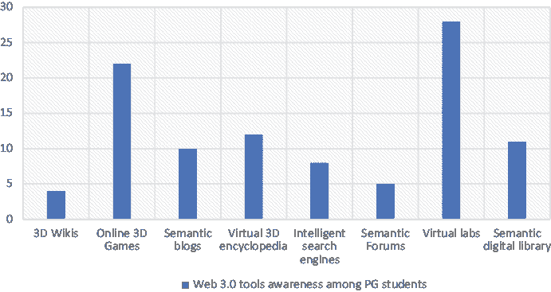

图 5：学生对 `Web 3.0` 工具的认知情况。

## 6 知识管理在教育部门中的角色

过去几十年，生活中不同领域爆发式出现的一个理念是 `KM`。这种 `KM` 在当前信息时代的演变源于一种理解：组织知识是一项巨大的资产，确实需要在整个组织或机构内部进行持续的、培养、共享和传播，以获取并为不同的组织问题和关注点提供解决方案 [24]。专门用于建立、组织和构建业务专业知识及知识的各种技术和手段被称为 `KM` [47]。`KM` 的概念涉及通过组织化的流程建立显性知识，以获取和管理员工的知识流动 [32]，这确实是为了确保组织或机构能够实现其目标使命和愿景声明。`KM` 有三个重要组成部分，包括：人、过程和技术。社会的主要工具是不断追求知识的教育机构，而 `KM` 在教育机构中的核心非常重要。换句话说，我们可以说教育机构的主要功能就是 `KM` [11]。此外，通过组织化思维的应用，教育机构中的 `KM` 然可以被独特地识别并在各种行政、教学学习、研究过程、学生服务以及最后的人力资源子系统中进行研究 [21]。在各种教育机构中使用此类系统和原则，可以使决策过程更具活性、易于获取科学资源、促进教学学习过程、建立有效的内部和外部通信网络、实现学生与教职工知识的协同，并提高不同教育机构之间研究活动的质量 [25]。`KM` 的一个重要且内在的特征是以有效的方式创造和开发知识 [30, 8, 33]，这种知识创造对于任何组织或机构（尤其是教育机构）的生存和维持至关重要。我们知道，知识创造是一种贯穿于日常活动的活动，无论是在工作场所还是社交场合。然而，它以不同的形式出现，可以通过人文手段（如与人交谈或其他正式培训），甚至通过技术机制（例如数据挖掘）来实现 [22]。它本质上是一个人类过程，技术或许可以促进知识的创造，但它无法替代人类 [23]。大多数组织对其创新、创造知识以及利用新知识产生价值的能力具有更大的影响力，正是这些知识导致了个人和职业改进的创新方法，包括战略决策能力 [27]。此外，对于任何组织而言，具备创造知识的能力并保持可持续性也是至关重要的 [15]。使用 `KM` 的原因如下：

* 为了提高组织生产力
* 为了促进团队合作与协作
* 为了鼓励并改进知识共享
* 为了提供管理提供有效且及时的服务
* 开发并推动创新
* 保护重要知识不流失
* 营造积极的工作环境
* 培养员工的批判性思维
* 提升组织的竞争力

确实，整合了 `KM` 的组织将以以非常有效高效的方式繁荣发展并实现其目标。这不仅对组织有利，对整个社区也有有益 [44]。

### 6.1 KM 活动在教育系统中的功能和影响

#### 研究活动（技术子系统）

* 促进跨学科研究。
* 增加研究的责任感和竞争力。
* 减少研究时间和成本。
* 通过将研究人员连接到电子资源、数据库、数据库等，提高研究的数量和质量。
* 促进大学内基于跨文化动态的研究的实施，并帮助收集数据和信息采集等。

#### 教育规划与课程开发

* 快速改进和更新教育规划。
* 利用过去的经验，改进并消除学生和教师的责任孤岛。
* 通过应用最佳实践和监控输出，提高不同教育计划的质量。
* 扩展与教育过程相关的行政服务。

#### 行政服务（行政子系统）

* 支持管理过程。
* 改善学生和教职工的设施。
* 改进对内部及外部利益相关者的服务。
* 增强识别活动的能力。
* 尝试消除服务的集中化，并将所有部门连接到知识资源。
* 提高所提供服务的效率和有效性。

#### HRM（人力资源子系统）

* 加强非正式的沟通，以实现既定的大学目标。
* 准备并更新人力资源。
* 在整个组织范围内建立合理的薪资和奖金体系。
* 促进响应能力和有效沟通。

#### 学生活动

* 通过为他们的话语提供网络环境，为来自不同文化和社区的学生创造社交成长背景。
* 通过提供分享经验和知识的社会技术因素，改善学生之间的协作活动。
* 为重叠学习创造一个极其灵活的环境。

#### 结构子系统

* 引导知识管理（`KM`）概念在学术领域的整合，以增强外部联盟伙伴关系的效能并增加组织流程的产出。
* 通过改进组织内部知识并将这些知识用于教学目的来保护组织资源。
* 通过知识管理结合员工和教职工共享的显性知识和隐性知识。

## 7 结论

结论最后指出，本研究提供了关于研究生（PG students）对 `Web 2.0` 相关工具的熟悉程度及其使用情况的信息。研究显示，克什米大学的研究生已熟悉社交网络（SNS）、博客、维基和即时通讯等 `Web 2.0` 工具。另一方面，结果也显示克什米尔大学的研究生对 `Web 3.0` 工具和应用的意识较低。基于 Web 的协作学习是这个数字学习时代最有前景的学习模型，而且，这些最新技术的出现为高效构建学习小组提供了许多创新方法。现在，这些小组可以轻松地让学习者通过在线媒介与他人进行讨论、分享和提供反馈。此外，它还允许学习者在提高问题能力的同时提高批判性思维能力。本文还讨论了知识管理在高等教育中的作用。这无疑有利于教育机构增强其信息收集能力，并应用于问题解决技术，甚至鼓励其研究工作的频繁更新。教育系统的知识管理必须反映并涵盖从管理层到学生层的所有级信息，以培养员工的专业知识。由于它可以彻底管理大量数据，因此可以证明它是增加生产力和降低海量数据收集成本的有力工具。此外，记录机构员工创造的隐性知识是非常困难的。因此，只有当知识管理实践作为一项持续活动在所有机构中运行时，产生的知识才能被理解并保留供未来使用。

## 参考文献

[1] Aharony, N. (2009). The influence of LIS students’ personality characteristics on their perceptions towards Web 2.0 use. Journal of Librarianship and Information Science, 41(4), 227–242.

[2] Bawab, H. (2014) “Effects of Web 3.0 in the New Digital World”. Accessed from: `https://www.linkedin.com/pulse/20140324055730-14091619-effectsof-web-3-0-in-the-new-digitalworld` on 15 March 2020.

[3] Bhatt, R.K. & Kumar, A. (2014). Students’ opinion on the use of social networking tools by libraries: A case study of Jawaharlal Nehru University, New Delhi. The Electronic Library, 32(5), 594–602.

[4] Boyd, M.D. & Ellison, N.B. (2007). Social networking sites: definition, history and scholarship. Journal of Computer-Mediated Communication, 13(1), 210–230.

[5] Buabeng, C. (2012). Factors influencing teachers’ adoption and integration of information and communication technology into teaching: A review of the literature. International Journal of Education and Development using Information and Communication Technology, 8(1), 136–155.

[6] Connell, R.S. (2009). Academic libraries, Facebook and Myspace, and student outreach: a survey of student opinion. Portal: Libraries and the Academy, 9(1), 25–36.

[7] Downes, S. (2005). “e-Learning 2.0, eLearn Magazine: Education and Technology in Perspective”, available at: `www.elearning.org/subpage.cfm?section1/4&article1/4` on 25 April, 2020.

[8] Dul, J., Ceylan, C. & Jaspers, F. (2011). Knowledge workers’ creativity and the role of the physical environment. Human Resource Management, 50(6), 715–734.

[9] Evans, D. (2011) “The Internet of Things: How the Next Evolution of the Internet Is Changing Everything, white paper, Cisco Internet Business Solutions (IBSG)”. Retrieved from: `http://www.cisco.com/Web/about/ac79/docs/innov/IBSG_0411.pdf` accessed on 25 April 2020.

[10] Feng, W.E. (2009). Research on the application of cloud computing on the internet, computer knowledge and technology. (1), 583–584, 670.

[11] Garoufallou, E. & Charitoulou, V. (2011). Web 2.0 in library and information science: the Greek case. New Library World, 113(4), 202–217.

[12] Geoghegan, M.W. & Klass, D. (2005). Podcast: The Complete Guide to Podcasting, Friends of ED, Berkley, CA. Glass, B. (2008), “Using Web 2.0 technologies to develop a sense of community for emerging LIS professionals”, Proceedings of Meeting: 150. Continuing Professional Development and Workplace Learning, 74th IFLA General Conference and Council, Quebec, Canada, available at: `http://archive.ifla.org/IV/ifla74/papers/150-Glass.pdf` (accessed 9 November, 2019).

[13] Greenhow, C. (2009). Learning, teaching, and scholarship in a digital age: Web 2.0 and classroom research: what path should we take?. Educational Researcher, 38(4), 246–259.

[14] Guntram, G. (2007) “Open educational practices and resources, OLCOS Roadmap 2012, Salzburg Research EduMedia Group, Salzburg,” available at: `www.olcos.org/cms/upload/docs/olcos_roadmap.pdf`, accessed on 9 October, 2020.

[15] Hislop, D. (2013). Knowledge management in organizations: A critical introduction, 3rd Ed, UK, Oxford University Press.

[16] Hussain, F. (2012) E-learning 3.0 = E-learning 2.0 + WEB 3.0? IADIS International Conference on Cognition and Exploratory Learning in Digital Age (CELDA 2012).

[17] Joinson, A.N. (2008) “Looking at, looking up or keeping up with people? Motives and use of Facebook”, Proceedings of the 26th Annual SIGCHI Conference on Human Factors in Computing Systems, ACM, Florence, Italy, 1027–1036.

[18] Kanagavel, R. & Velayutham, C. (2010). 社交网络对大学生的影响：印度与荷兰的比较研究。《国际虚拟社区与社交网络期刊》，2(3), 55–67.


[19] Kelly, B. (2008). 图书馆 2.0 与信息素养：工具。收录 Godwin, P. & Parker, J., (编），《素养遇上图书馆 2.0》，Facet Publishing, 伦敦。Kennedy, G., Dalgarno, B., Gray, K. Judd, T., Waycott, J. Bennett, S., Maton, K. Krause, K. and Bishop, A. (2007). 下一代并非 Web 2.0 技术的大型用户：初步发现。Asci lite Singapore 2007 会议集。访问于：[`ascilite.org.au/conferences/singapore07/procs/kennedy.pdf`](http://ascilite.org.au/conferences/singapore07/procs/kennedy.pdf) (2020 年 10 月 25 日访问)。 →

[20] Lampe, C., Ellison, N. & Steinfeld, C. (2006). “人群中的 Facebook：社交搜索对比社交浏览”，ACM 计算机支持协作工作特别小组，ACM Press, 班夫。 →

[21] Lee, H. & Choi, B. (2003). 知识管理赋能因素、流程与组织绩效：一种整合视角与实证检验。《管理信息系统期刊》，20(1), 179–228. →

[22] Lee, J. & Fink, D. (2013). 知识图谱：采纳的动力与障碍。《知识管理期刊》，17(1), 16–28. →

[23] Liao, S.H., Chang, W.J., Hu, D.C. & Yueh, Y.L. (2012). 台湾银和保险业组织文化、知识获取、组织学习与组织创新的关系。《国际人力资源管理期刊》，23(1), 52–70. →

[24] Liebowitz, J. (2005). 将社交网络分析与层次分析法结合以用于组织知识图谱。《知识管理期刊》，9(1), 76–86. →

[25] Luan, J. & Serban, A.M. (2002). 知识管理概述：机构研究的新方向。《经济与金融季度评论报》，113, 605–631. →

[26] Maness, J.M. (2006). 图书馆 2.0 理论：Web 2.0 及其对图书馆的影响。《Web ology》，2，访问于：[www.webology.ir/2006v3n2.html?g¼link.webology.ir/](http://www.webology.ir/2006v3n2.html?g%C2%BClink.webology.ir/) (2020 年 4 月 25 日访问)。 →

[27] Martensson, M. (2000). 作为管理工具的知识管理的批判性回顾。《知识管理期刊》，4(3), 204–216. →

[28] Morris, R.D. (2011). Web 3.0：对在线学习的影响。《技术趋势》，55(1), 42–46. →

[29] National School Boards Association (2007), “创建与连接：在线社交——教育的研究与指南”，访问于：[`nsba.org/site/docs/41400/41340.pdf`](http://nsba.org/site/docs/41400/41340.pdf) (2020 年 9 月 2 日访问)。

[30] Nonaka, I. (1991). 知识创造公司。《哈佛商业评论》，69(6), (11.), 96–104.

[31] Nonaka, I. (1994). 组织创造动态理论。《组织科学》，5(1), 14–37.

[32] Nonaka, I. & Takeuchi, H. (1995). 知识创造公司，牛津大学出版社。→

[33] Pan, S. & Scarbrough, H. (1999). 实践中的知识管理：一项探索性研究。《技术分析与战略管理》，11(3), 359–374.

[34] Peluchette, J. & Karl, K. (2010). 考察学生对 Facebook 的预期：他们在想什么？《商业教育期刊》，85(1), 30–37. →

[35] Prabhu, D. (2016). Web 2.0 与 Web 3.0 的应用：概述。《图书馆科学国际期刊》，2(1), 54–62. →

[36] Rai, K. (2011). 知识管理与组织文化：一个理论框架。《知识管理期刊》，15(2), 779–801. →

[37] Redecker, C. (2009). 学习 2.0 回顾：网络创新对教育和培训的影响。《JRC 科技报告》，23664, 1–122. →

[38] Rehman, A.U. & Shafique, F. (2011) “Web 2.0 的使用及其图书馆的影响：巴基斯坦信息专业人员的观点”，“图书馆哲学与实践》，访问于：[www.webpages.uidaho.edu,mbolin/rehman-shafique.pdf](http://www.webpages.uidaho.edu,mbolin/rehman-shafique.pdf) (2020 年 10 月 5 日访问)。 →

[39] Rogers, C.R. (2009). 社交媒体、图书馆与 Web 2.0。美国图书馆如何利用新工具进行公共关系并吸引新用户。收录于德国图书馆协会年度会议：德国图书馆日 (Deutscher Bibliothekartag)，德国 Erfurt。 →

[40] Rosen, C. (2007). 虚拟友谊与新自恋。《新亚特兰斯》(The New Atlantis)，17, 15–31. →

[41] Santos, M. (2015). 什么是 Web 3.0 以及它为何对业务如此重要，访问于：[`aquare.la/articles/2015/03/23/web-3-0-important-business/`](https://aquare.la/articles/2015/03/23/web-3-0-important-business/) (2020 年 9 月 28 日访问)。 →

[42] Serenko, A., Bontis, N., Booker, L., Sadeddin, K. & Hardie, T. (2010). 知识管理与知识资本文献的科学计量学分析 (1994–2008)。《知识管理期刊》，14(1), 3–23. →

[43] Spender, J.C. (2008). 组织学习与知识管理：何处。《管理学习》，39(2), 158–176. →

[44] Strati, A. (2007). 感性知识与实践学习。《管理学习》，38(1), 61–77. →

[45] Virkus, S. & Bamigbola, A. (2011). 学生对 Web 2.0 工具的认知。《新图书馆世界》，112(12), 479–489.

[46] Wolfram, C. (2010) 问答：Conrad Wolfram 论 Web 3.0 中的应用通信，《IT Pro》，3 月 17 日，访问于：[`www.itpro.co.uk/621535/qa-conrad-wolfram-oncommunicating-with-apps-in-web-30`](https://www.itpro.co.uk/621535/qa-conrad-wolfram-oncommunicating-with-apps-in-web-30) (2020 年 9 月 28 日访问)。 →

[47] Yakhlef, A. (2010). 实践学习的具身性。《组织科学》，31(4), 409–430. →

[48] Zack, M.H. (2003). 重新思考知识型组织。《斯隆管理评论》，44(4), 67–71. →

### 摘要

电子记录的使用已被广泛认为是增强医疗服务交付的有效手段。尽管医疗技术有所进步，但医疗保健在全球范围内仍面临着负担能力、复杂性和获取性方面的挑战 [1, 2]。医疗公司在流程和信息整合方面存在问题。信息是碎片化的且往往相互矛盾。知识管理可以允许医疗提供者在当前的 COVID 疫情下访问并交换有关患者的信息。医疗系统日益适应不断增长的临床需求，这些需求可以通过提高患者知识和使用基于知识的技术来增强。基于知识的技术通过促进通用信息共享和快速实时监控，成功为疫情机构提供了帮助。消费者的接受是信息管理系统（IMS）增长的核心要素之一。研究提出了一个影响知识管理系统（KMS）库贡献的变量模型。该研究利用技术接受与使用理论（UTAUT）定义了可能影响使用移动健康记录（mHRA）对信息做出贡献的变量。

关键词：移动端健康记录应用（mHRA）、知识管理、COVID 疫情，

## 1. 引言

在过去的几十年里，由于信息通信技术（ICT）的快速发展，全球大多数国家的医疗部门都经历了巨大的变化。尽管医疗技术有所进步，但医疗保健在全球范围内仍面临着负担能力、复杂性和获取性方面的挑战 [1, 2]。医疗公司在流程和信息整合方面存在问题。信息是碎片化的且往往相互矛盾。电子健康需要改进的知识管理系统（KMS），以便为市场情报提供访问并解释企业范围的知识。相比之下，信息尚未被用于竞争优势，因为消费者选择的一致性直接与知识的质量和可用性相关。这些多个知识库导致了格式上的不兼容且易用性有限。此外，许多 KMS 遭受着未使用或使用不足的问题，主要是因为对系统的贡献不足。这就是为什么理解 KMS 采纳驱动因素是知识管理（KM）研究的优先事项。

在医疗保健领域，知识管理主要在电子健康记录管理领域发展，而且现代医学对知识处理的需求是巨大的。在目前的疫情时期，促进临床信息采集和分发的 IT 工具变得至关重要。移动应用程序可以支持知识的创建、存储、检索、传输和应用，包括数据管理和学习工具。这些知识管理技术是 KMS 的重要组成部分，已成为医疗保健的核心 [3, 4]。所有医疗合作伙伴创建的知识量是巨大的。一个合作伙伴产生的信息对于其他所有伙伴提供优质治疗至关重要。最新研究表明，mHealth（移动健康）可能是 ICT 带来的福音，无疑是对医疗领域知识管理增长具有重大影响的最受欢迎的项目之一。

在这方面，mHealth 技术促进了知识管理，并有增强像印度等发展中经济体公共卫生系统的能力。健康记录中对移动设备的接受可以创造一种意识，作为一个信号着高质量医疗服务的平台，并为公共卫生服务提供良好的形象 [5]。技术允许信息的创建和采集。架构促进了信息的编码和知识的，以标准化患者护理水平。EHR 系统及相关技术的主要目标应该是促进知识管理，以改善个人和社区健康。此外，有人认为 EHR 系统是公共卫生官员改进治疗、护理、预防及诊断 COVID 的必备工具。

信息管理可以通过为临床医生提供决策辅助，从而帮助减少医疗错误及其成本。医疗保健是一个动态领域，各种医疗提供者之间的协作对于提供优质护理至关重要。因此，医疗参与者可以通过实施 KMS 实现协作诊断。过去的研究提供了有力证据，在医疗保健中实施知识管理是令人鼓励的，可以影响决策。可以说，在医疗保健中实施知识管理（例如医疗通信技术和移动技术的进步）可以是提高患者护理质量的前进之路，这也是医疗保健的终极目标 [3, 4]。

## 2. 文献综述

软件和设备允许我们记录操作、提供指导并在某些情况下提高我们的效率 [6]。自由健康是我们警觉自我管理健康的一种负担得起且灵活的方式，从 App 推送提醒到提供感官反馈的可穿戴设备 [7]。健康领域的设备丰富性现在体现在设备和可穿戴设备中，以更好地应对安全、健康和各种治疗问题。即便如此，它们还提供更新和提醒以让我们坚持下去。不同技术和 mHealth 应用的使用通常解决了若干其他（高）风险行为。在印度，尽管有许多专注于智能手机的应用程序正在创建。国家健康门户识别了 74 个可以用于健康信息的应用程序。此外，卫生部在 COVID 期间和之后建立了新的 `My Health Record` 和 `Aarogya Setu` 应用程序。它可能允许早期诊断许多医疗疾病，包括某些可能随 COVID 伤害人类生命的疾病。随着智能手机和便携式应用程序的普及，其使用进一步鼓励了更加以患者为中心的态度。先进的数字健康基础设施访问通过提供跟踪和治疗疾病的新方法正在改变医疗治疗，使护理变得更加实用和全面 [8]。

移动健康（mHealth）应用被印度等需要医疗保健的人群视为一种改善医疗服务获取的简单且廉廉的方式。该国智能手机用户的增加也为开发基于移动的健康记录系统以改进医疗保健提供了机会。过去的研究也表明，`mHRA` 的能力可以将医疗保健从简单的监测自我健康转变为监督和辅助的医疗保健服务。尽管 `mHRA` 系统具有潜在优势，但最近的发现表明，批准此类提案似乎是一项挑战。Ahmed 等人 [9] 提到，许多人虽然很少使用 `mHRA`，但他们意识到了并认为其具有潜在用途。研究中仅有 5% 的参与者使用了手机上的移动设施，而 73% 的受访者知道其潜力但无法做到。Yi 等人 [10] 的研究发现了影响 `mHealth` 服务接受的因素，如感知易用性、程序一致性、主观规范性、感知价值、设备性能和技术焦虑。在孟加拉，Akter 等人 [11] 研究了 `mHealth` 采用的标准。发现它会直接和间接地影响 `mHealth` 系统。上述所有研究都考察了 `mHRA` 的接受度，但在采纳方面提供了不同的结果。然而，这些研究清楚地表明，印度大多数人已经意识到这项技术并参与其中。尽管具有潜在优势并已开展各项 `mHealth` 计划，但最近的研究显示该服务的采用仍然微不足道。

关于从端用户角度支持 `KMS` 的 `mHRA` 实施和使用的报告工作较少。迄为止，大多数研究继续集中在 `mHRA` 的生活方式、用户体验和安全接受上 [3, 12, 13, 14]、阻力与技术焦虑以及态度。此外，之前的文献主要专注于实施的医学专业视角 [15]。很少有研究关注端用户对健康应用的认可以贡献 `KMS`。然而，本研究主要强调通过以人为本的视角并应用便利条件和社会影响的社会技术特征，来识别采纳 `mHRA` 的障碍，这些特征在 `mHRA` 设施的实施尚未尚未讨论。

由于对新兴共和国信息系统实施的研究有限，使得本研究大纲更具相关性和必要性。考虑到文献综述，本研究试图通过考察印度等发展中国家消费者对 `mHRA` 的认可问题来填补上述空白。消费者接受是信息管理系统进步的主要要素之一。研究建议了一个影响 `KMS` 库贡献的变量模型。具体而言，在本研究中，考虑到印度端用户接受并使用 `mHRA` 进行知识贡献的行为意图。

## 3. 理论框架

技术接受与使用统一理论 (`UTAUT`) 被用作假设性大纲，用于实证测试影响发展中国背景下 `mHRA` 采纳的因素 [16]。`UTAUT` 是最受用户认可的行为分析模型，因为它源于计划理论 (`TPB`)；理性行动理论 (`TRA`)；技术接受模型 (`TAM`)；创新扩散理论 (`IDT`)；PC 利用模型 (`PUM`) 以及社会认知理论 (`SCT`)。该模型旨在获得对消费者认可的统一意见，并能预测 70% 的使用新技术的目的变化 [17]。通过对医疗保健领域 `UTAUT` 先期研究的综述 [18, 19, 20]，`UTAUT` 中最常用的结构是 `EE`、`PE`、`FC` 和 `SI`。`UTAUT` 是最受用户认可的行为分析模型，因为它源于计划理论 (`TPB`)；理性行动理论 (`TRA`)；技术接受模型 (`TAM`)；创新扩散理论 (`IDT`)；PC 利用模型 (`PUM`) 以及社会认知理论 (`SCT`)。该模型旨在获得对消费者认可的统一意见，并能预测 70% 的使用新技术的目的变化 [17]。

*(注：原文后续存在大量重复段落，此处已按要求不再重复输出)*

它被定义为 `mHRA` 的易用程度。过去的实验表明，`EE` 对消费者使用 `mHRA` 的欲望有主要影响 [29, 30]。通过智能手机使用移动健康跟踪设备被认为是一种主要的动力 [31]。因此，假设：

## H2. EE 对使用 mHRA 的意图有积极影响

### 3.3 社会影响 (SI)

定义了一个人对同伴观点价值的理解程度以及使用移动医疗记录应用的能力。研究表明，`SI` 显著影响消费者使用技术的欲望 [29, 31]。Wills 等人 [31, 32] 报告称，移动数字健康的行为目标是信息系统（IS）与消费者之间的重要联系。结合上述讨论，提出了以下理论：

## H3. SI 对使用 mHRA 的意图有积极影响

### 3.4 自我效能 (SE)

它是对执行特定行为的信念。自我效能感知被发现会影响采取何行动的决策 [34]。教育研究人员已各个学科和学术环境中使用自我效能工具 [35]。研究还测量了特定于在线环境的自我效能 [34, 36, 37]。Cho 和 Castañeda [38] 研究了使用智能手机应用程序学习西班牙语的个人投入度。也有极少数类型的研究研究了通过移动应用程序学习西班牙语的动机和情感投入。少数研究还发现自我效能对采用移动健康应用的意图有积极影响 [39, 40]。根据讨论，提出了以下理论：

## H4. SE 对使用 mHRA 的意图有积极影响

### 3.5 信任 (TR)

关于安全和隐私的观点在最近的在线交易文献中引起了关注。对安全风险和个人数据丢失威胁的感知可能会随着消费者群体人口统计特征的变化而不同。这种负面情绪反应，采用意图会因为对技术的焦虑或挫败而减少。据报道，老年人也存在严重的信心问题 [41]。因此，该分析通过增加额外变量扩展了基础的 UTAUT 以提高预测能力。提出了以下理论：

## H5. TR 损害使用 mHRA 的意图

### 3.6 便利条件 (FC)

可以描述为一个人在多大程度上假设组织和技术基础设施支持 `mHRA` 的使用。便利条件需要服务产品、保护和机密性。`FC` 对行为目的技术使用的直接影响得到了以往研究的支持 [10, 42]。Boontig 等 [31] 研究表明 `FC` 对行为有积极影响。上述论点导致了这些假设：

## H6. FC 对使用 mHRA 的意图有积极影响

## H7. FC 对 mHRA 的实际使用有积极影响

在技术实施的文献中，行为意图 (`BI`) 与实际行动 (`UB`) 之间的关系已经建立，并指出 `BI` 是实际使用的可靠预测指标 [17, 21, 41]。本研究也测试了这种关系，并提出了以下假设：


## H8. BI 对 mHRA 的实际使用有积极影响

个人对知识更强的取向与使用概念相关。我们接受使用`mHRA`系统的意图与知识共享行为之间的积极关系。为了测试这种关系，提出了以下假设：

## H9. 使用行为对 KMS 的贡献感知有积极影响

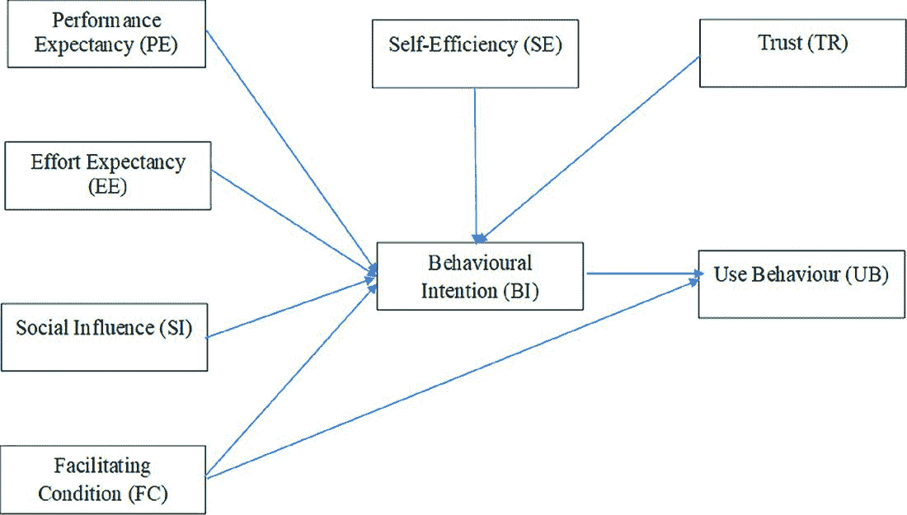

图 1：研究模型。

| 构维度 | 量表项目 |
| :--- | --- |
| 绩效期望 (PE) | `PE1`. 我发现移动健康应用在生活中有用。 |
| | `PE2`. 使用移动健康应用有助于完成任务。 |
| | `PE3`. 移动健康应用提高了我的效率。 |
| 努力期望 (EE) | `EE1`. 学习如何使用移动健康应用很容易。 |
| | `EE2`. 与移动健康应用的交互清晰易懂。 |
| | `EE3`. 我发现移动健康服务易于使用。 |
| | `EE4`.对我来说，熟练使用移动健康应用很容易。 |
| 社会影响 (SI) | `SI1`. 对我重要的人建议我开始使用移动健康应用。 |
| | `SI2`. 影响我行为的人认为可以使用移动健康应用。 |
| | `SI3`. 我尊重观点的人倾向于使用移动健康应用。 |
| 便利条件 (FC) | `FC1`. 我有允许使用移动健康应用的工具。 |
| | `FC2`. 我有使用移动健康所需的知识。 |
| | `FC3`. 移动健康应用和我使用的其他技术兼容。 |
| 自我效能 (SE) | `SE1`. 我可以在没有人指导的情况下使用移动健康应用。 |
| | `SE2`. 我相信使用移动健康应用的大多数问题都能得到解决。 |
| | `SE3`. 当遇到系统困难时我并不紧张。 |
| 信任 (TR) | `TR1`. 移动健康应用具有足够的安全功能。 |
| | `TR2`. 在与移动健康应用的交易中感到安全。 |
| | `TR3`. 我信任移动健康应用提供的建议。 |
| | `TR4`. 我信任移动健康应用的数据隐私。 |
| 行为意图 (BI) | `BI1`. 我期望使用移动健康应用。 |
| | `BI2`. 我会在日常生活中不断尝试使用移动健康应用。 |
| | `BI3`. 我计划频繁使用移动健康服务。 |
| 使用行为 (UB) | `UB1`. 使用移动健康应用是一种愉快的体验。 |
| | `UB2`. 我目前正在使用移动健康应用。 |
| | `UB3`. 我在移动健康应用上花费大量时间。 |
| 对 KMS 的贡献 (KMS) | `KM1`. 我愿意将我的健康信息共享到知识库。 |
| | `KM2`. 我准备好学习知识共享所需的技能。 |
| | `KM3`. 我喜欢为集成知识库的发展贡献我的知识。 |

## 4 方法

修改模型中的所有预测变量（`EE`、`PE`、`SI`、`FC`、`SE`、`TR`、`BI` 和使用行为 `UB`）均根据类似的医疗保健研究的量表项目进行测量。

在第一部分，调查问卷中包含了人口统计信息，并在`B`部分中对样本序列中提到的各种建筑进行了提问。对 25 名受访者进行了试点研究，以测试问卷的适用性。试点分析用于根据语境进行调整。

研究样本由印度选定主要城市的智能手机用户组成，代表了该国的人口。选择他们是因为他们的年龄组（`≥60`）、技术技能以及移动设备/`internet`使用经验。调查项目用于衡量理论构念的响应通过 5 点李克特量表（Likert scale）捕获，反应范围从“非常不同意”（1）到“非常同意”（5）。

## 5 结果

该研究在线分发了 3,000 份问卷，其中 2,140 份接受了分析。在人口统计特征方面，参与研究的男性占 56%，女性占 44%，处于不同的年龄阶段。大多数受访者属于服务行业（55%），年龄在 30 至 50 岁之间。在接入方面，大多数受访者拥有智能手机，其中 65% 的人已使用五年。共有 58% 的受访者具有使用`mHRA`的经验，42% 未使用但愿意采用基于智能手机的应用程序。受访者特征见表 2。

表 2：受访者特征。

| 类别 | 百分比 |
| --- | --- |
| 性别 | |
| 男性 | 56% |
| 女性 | 44% |
| 年龄 | |
| 20–30 岁 | 23% |
| 30–40 岁 | 38% |
| 40–50 岁 | 39% |
| 职业 | |
| 服务业 | 55% |
| 商业业 | 32% |
| 学生 | 13% |
| 使用智能手机的经验 | |
| 0–5 年 | 65% |
| 5–10 年 | 23% |
| >10 年 | 12% |
| 使用`mHRA`的经验 | |
| 是 | 58% |
| 否 | 42% |

第一阶段分析测试了测量模型的效度。所有因素的因子加载（Item Loadings）均高于 0.5 的阈值。这意味着这些变量收敛于潜变量的共同点。这证明了房屋的完整性。所有观测变量的复合信度（`CR`）高于 0.7，表明因子结构具有极佳的稳定性。考虑到 Cronbach alpha 评估了内部信度。因素的 Alpha Cronbach 值超过 0.7，因此变量可以被进一步准确评估。为了评估每个房屋的区分效度，计算了平均方差提取（AVE）。用于衡量数据性能的模型拟合指数（表 3）。

表 3：测量模型。

| 构念 | 项目 | 载荷 | AVE | CR | Cronbach alpha |
| --- | --- | --- | --- | --- | --- |
| 绩效期望 (`PE`) | `PE1` | 0.702 | 0.873 | 0.817 | 0.897 |
| | `PE2` | 0.826 | | | |
| | `PE3` | 0.880 | | | |
| 努力期望 (`EE`) | `EE1` | 0.863 | 0.516 | 0.873 | 0.893 |
| | `EE2` | 0.757 | | | |
| | `EE3` | 0.724 | | | |
| | `EE4` | 0.858 | | | |
| 社会影响 (`SI`) | `SI1` | 0.897 | 0.634 | 0.783 | 0.786 |
| | `SI2` | 0.812 | | | |
| | `SI3` | 0.730 | | | |
| 便利条件 (`FC`) | `FC1` | 0.825 | 0.636 | 0.927 | 0.792 |
| | `FC2` | 0.714 | | | |
| | `FC3` | 0.820 | | | |
| 自效能 (`SE`) | `SE1` | 0.743 | 0.685 | 0.813 | 0.816 |
| | `SE2` | 0.734 | | | |
| | `SE3` | 0.967 | | | |
| 信任 (`TR`) | `TR1` | 0.850 | 0.772 | 0.842 | 0.845 |
| | `TR2` | 0.682 | | | |
| | `TR3` | 0.750 | | | |
| | `TR4` | 0.751 | | | |
| 行为意向 (`BI`) | `BI1` | 0.901 | 0.678 | 0.741 | 0.833 |
| | `BI2` | 0.501 | | | |
| | `BI3` | 0.732 | | | |
| 使用行为 (`UB`) | `UB1` | 0.863 | 0.622 | 0.743 | 0.811 |
| | `UB2` | 0.795 | | | |
| | `UB3` | 0.575 | | | |
| 知识共享 (`KMS`) | `KM1` | 0.743 | 0.764 | 0.832 | 0.888 |
| | `KM2` | 0.790 | | | |
| | `KM3` | 0.696 | | | |

第一阶段分析测试了测量模型的效度。所有因素的因子加载均高于 0.5 的阈值。这意味着这些变量收敛于潜变量的共同点。这证明了房屋的完整性。所有观测变量的复合信度（`CR`）高于 0.7，表明因子结构具有极佳的稳定性。考虑到 Cronbach alpha 评估了内部信度。因素的 Alpha Cronbach 值超过 0.7，因此变量可以被进一步准确评估。为了评估每个房屋的区分效度，计算了平均方差提取（AVE）。用于衡量数据性能的模型拟合指数（表 3）。

第一阶段分析测试了测量模型的效度。所有因素的因子加载均高于 0.5 的阈值。这意味着这些变量收敛于潜变量的共同点。这证明了房屋的完整性。所有观测变量的复合信度（`CR`）高于 0.7，表明因子结构具有极佳的稳定性。考虑到 Cronbach alpha 评估了内部信度。因素的 Alpha Cronbach 值超过 0.7，因此变量可以被进一步准确评估。为了评估每个房屋的区分效度，计算了平均方差提取（AVE）。用于衡量数据性能的模型拟合指数（表 3）。

第一阶段分析测试了测量模型的效度。所有因素的因子加载均高于 0.5 的阈值。这意味着这些变量收敛于潜变量的共同点。这证明了房屋的完整性。所有观测变量的复合信度（`CR`）高于 0.7，表明因子结构具有极佳的稳定性。考虑到 Cronbach alpha 评估了内部信度。因素的 Alpha Cronbach 值超过 0.7，因此变量可以被进一步准确评估。为了评估每个房屋的区分效度，计算了平均方差提取（AVE）。用于衡量数据性能的模型拟合指数（表 3）。

第一阶段分析测试了测量模型的效度。所有因素的因子加载均高于 0.5 的阈值。这意味着这些变量收敛于潜变量的共同点。……（此处省略）

表 4：结构模型结果及模型拟合指数。

| 路径 | 估计值 | C.R. | P | 假设 |
| --- | --- | --- | --- | --- |
| `PE` →`BI` | 0.297 | 5.752 | *** | H1 (支持) |
| `EE` →`BI` | 0.252 | 6.069 | *** | H2 (支持) |
| `SI` →`BI` | 0.358 | 5.296 | 0.022 | H3 (支持) |
| `SE` →`BI` | 0.412 | 4.845 | *** | H4 (支持) |
| `TR` →`BI` | -0.078 | 3.982 | 0.113 | H5 (不支持) |
| `FC` →`BI` | 0.213 | 6.769 | *** | H6 (支持) |
| `FC` →`UB` | 0.374 | 5.877 | *** | H7 (支持) |
| `BI` →`UB` | 0.381 | 5.983 | *** | H8 (支持) |
| `UB` →`KMS` | 0.256 | 4.615 | 0.031 | H9 (支持) |
| 模型拟合指数 | | | | |
| `χ ² /df = 2.614`;`GFI = 0.922`;`CFI = 0.932`;`NFI = 0.935`;`AGFI = 0.931` 和 `RMSEA = 0.042` | | | | |

^(***)在 *p < 0.001* 水平上显著。

## 结论与讨论

研究通过评估 UTAUT 模型分析了`mHRA`使用和实施的因果因素。用户接受对于任何手机应用程序的成功至关重要。考虑到这些程序在特定语境下的使用和操作，信任和自我效能变量也被用于接受研究。文献综述显示，在发达国家开展的接受试验很少，特别是使用 UTAUT 的试验。发达国家关于 UTAUT 在移动健康领域适用性的信息尚较少。

这项工作的发现与以往在接受和使用移动健康（mHealth）方面的工作及 BI 研究是一致的。以往在电子健康应用中使用`UTAUT`实现模型的研究结果也一致。根据`Phichitchaisopa`和`Naenna`的观点，`PE`和`EE`对健康信息系统(`HIS`)的应用有主要影响。`Hennington et al.`证实了`PE`和`EE`对电子病历(`EMR`)采纳的主要影响。`Holtz`和`Krein`还发现在`EMR`系统采纳中`PE`与`SI`之间存在正相关。`Wills et al.`指明，在用户对在线服务经验不足的环境中，`SI`更为显著。在印度，手机对于通话以外的其他领域（如健康建议）也是一种新现象。

这些发现表明，`EE`的架构允许接受和使用移动健康记录应用（mHRA）。它也说明易用的界面至关重要。为了使用`mHRA`，它应该结合所需的工作量保持高效且用户友好。我们的分析结果与`UTAUT`的结果相似，但直接影响较小。这可以用印度移动应用的成熟度较低来解释。在发展中国家，适应此类系统需要如培训、在线技术支持和 IT 基础设施等`FC`。因此，在计划满足基础设施需求之前，此类计划可能会失败。社会影响 (`SI`) 在采纳过程中很大程度上取决于消费者周围的人。可以得出结论，如果应用是强制性的，且组中的其他人在使用，他们发现大多数人更有可能安装该应用。

在一个多维系统中，获得了`SE`和`EE`的巨大影响。在这种背景下，自尊和使用该程序的意愿似乎在影响改进`mHRA`使用成功方面发挥着重要作用。`SE`的构建往往极大促进了对企业的认可。本文通过应用适用于知识管理（KM）特定背景的`UTAUT`模型，更好地理解了知识管理系统（KMS）的采纳。因此，研究结果验证了在`KMS`特定背景下使用`UTAUT`模型的有效性。研究人员通过实证研究验证了`UTAUT`中与贡献`KMS`意图相关的部分。

## 7 研究的意义与局限性

当目的是寻求系统实际使用的解释时，衡量消费者使用该程序的行为和意图。结果显示，为了增加`mHRA`以支持临床实践，必须关注有用性和用户友好性，以提高应用的`SE` —— 尽管大多数医疗保健领域的研究衡量的是系统的有效性。但根据目前对`mHRA`接受度的研究，我们关注的是终端用户的实际行为。结果对于发展中经济体的决策者、医疗管理人员和临床医生很有用。这项研究的发现极大地丰富了医疗应用领域的文献。为发展中经济体一线医疗专业人员部署移动健康技术提供了`KM`见解。研究使用了频繁应用的技术接受模型来研究用户对该技术的接受情况。尽管如此，只有少数研究从终端用户的角度调查了更多应用的技术接受情况。对于发达国家或对实施`MHRA`关注较少的新兴国家，大多数最近的研究都遵循`UTAUT`模式。

`KM`可以让医疗服务提供者在当前的 COVID 情况下获取和交换有关患者的信息。医疗系统日益适应增长的临床需求，这些需求可以通过提高患者知识和使用基于知识的技术来增强。基于知识的技术可以通过鼓励通用信息共享和快速实时监控，成功帮助流行病机构。研究表明，使用`mHRA`的行为意愿对成功预期、承诺期望、社会控制和生产性自我管理具有显著影响，而且结果还表明软件的使用与信心的使用以及消费者行为之间没有实质性关联。发现为服务提供者和决策者提供了有用的知识，以设计计划纳入该技术，激励用户进行知识创造和共享。在研究中，政策制定者和决策者计划在该国引入移动健康应用，也为建立全面的`KM`框架做出了重大贡献。印度政府正在为实施国家健康计划奠基础。结果的差异基于研究背景和选择的变量，之前的实验也基于这些变量。在本次分析中，终端用户的意见和使用程序的目的是已知的。这将使决策过程更具理理性，并提高对知识创造、存储和共享的贡献潜力。

实证研究为印度等发展中国家关于成功的`mHRA`采纳和知识共享态度提供了务实的建议。对于扩展的消费者意识——基于移动健康记录应用服务，开发者和应用提供者可以理解`mHRA`设计方面的挑战。这项研究还强调，为了在发展中国家的背景下增强`UTAUT`的解释模式能力，研究人员应该使用特定背景的维度对其进行修改。调查可以为开发者提供一个框架，在该框架可以影响关注年龄人口的`BI`和实际使用。由于采用了通用方法，这项研究可以很容易地修改以帮助其他发展中国家实施类似的健康应用。

另一个值得特别关注的结果是使用行为与对`KMS`贡献之间的联系。理论假设支持这两个变量之间存在关系。这揭示了经验丰富的人会整合知识共享，并能对贡献`KMS`产生积极态度。在医疗保健中实施`KM`可以为在正确的时间提供正确的知识提供机会，即在医疗保健决策点上实施`KM`至关重要。适当的工具如基于移动系统和易用的界面是一项要求，因为它可以显著提高医院和家庭环境中为患者提供的护理质量和安全性。目前循证医学实践对发展中国家至关重要。然而，只有当建立了`KM`的正确系统时，才能成功应用，因此应予以相应关注。允许利用现有移动设备和决策支持系统、电子健康记录系统是非常重要的。

未来的研究应该关注测试涵盖认知、情感和行为响应完整模型的重要性。本研究的局限性包括样本量较小，且仅来自该国家的城市。因此，这也引发了对研究结果通用性的担忧。未来的研究可以扩大地理范围，并在研究中纳入更多的人统计学变量。响应结果也受到有限理性的影响，因为用户可能处于采用移动健康记录系统的早期阶段。此外，实际使用情况是通过自我报告的实际行为来衡量的，这并非系统日志生成的直接测量方法。本研究的另一个扩展可以是同时采用定量和定性数据分析方法，以揭示用户对接受和使用问题的深度意见。

## 参考文献

[1]Panesar, A. & Panesar, H. (2020). 全球医疗保健中的人工智能与机器学习。《全球健康手册》, 1(1), 1–39. a, b

[2]Barzotto, M., Corradini, C., Fai, F.M., Labory, S. & Tomlinson, P.R., 编辑. (2020). 重振落后地区：智能专业化与工业 4.0，Routledge. a, b

[3]Shahmoradi, L., Safadari, R. & Jimma, W. (2017). 医疗保健中循证决策的知识管理实施及利用工具：系统综述。《埃塞俄比亚健康科学期刊》， 275, 541–558. a, b, c

[4]Jimma, W. (2017). 医疗保健中循证决策的知识管理实施及利用工具。《埃塞俄比亚健康科学期刊》，27,(5), 541–548. a, b


[5]Fletcher-Brown, J., Carter, D., Pereira, V. & Chandwani, R. (2020). 在新兴经济体背景下通过移动技术为社区护士提供基于资源的知识管理优势。《知识管理期刊》，提前打印版。doi: [`doi.org/10.1108/JKM-01-2020-0018`](https://doi.org/10.1108/JKM-01-2020-0018)。 →

[6]Schoonveld, E. (2020). 全球健康的价格：平衡患者获取与创新资助的药物定价策略，Routledge. →

[7]Noori, N., Hoppe, T. & De Jong, M. (2020). 智慧城市发展的路径分类：比较阿姆斯特丹、巴塞罗那、迪拜和阿布扎比的设计、治理与实施。《可持续性》，12(10), 4030–4054. →

[8]Wójtowicz, A. & Chmielewski, J. (2020). 泛在商业中通过人脸图像流提高被动用户识别准确性的因素分析。收录《人机交互国际会议》，Springer, Cham. →

[9]Bloom, A.G., Iqbal, M., Lucas, H., Rasheed, S., Waldman, L. & Bhuiya, A. (2014). 孟加拉国的电子健康与移动健康：机遇与挑战。 →

[10]Yi, M.Y., Jackson, J.D., Park, J.S. & Probst, J.C. (2006). 个人对信息技术的理解：整合视角。《信息与管理》，43, 350–363. a, b

[11]Akter, S., D’Ambra, J. & Ray, P. (2010). mHealth 平台的服务质量：使用 PLS 的层级模型验证。20, 209–227. →

[12]Lin, C.P. & Anol, B. (2008). 学习在线支持：基于 UTAUT 的网络技术研究。《网络心理学》，11, 268–272. →

[13]Pai, F.Y. & Huang, K.I. (2011). 将技术接受模型应用于医疗系统的引入。《技术预测与社会变革》，78, 650–660. →

[14]Nuq, P. & Aubert, A.B. (2013). 医疗专业人员使用电子服务的意图：发展中国家的案例。《国际医疗管理期刊》，64, 217–236. →

[15]Carlsson, B. (2006). 创新的系统国际化：文献综述。《研究政策》，35, 56–67. →

[16]Venkatesh, V., Morris, M.G., Davis, G.B. & Davis, F.D. (2003)信息技术的接受：统一视角。《MIS Q》，27(3). a, b, c

[17]Martín, H.S. & Herrero, Á. (2012). 用户心理因素对农村旅游在线购买意图的影响：将创新性整合 UTAUT 框架。《旅游管理》，33(2), 341–350. a, b, c

[18]Cheng, D., Liu, G. & Qian, C. (2008). 互联网银行用户接受的决定因素：理论框架和实证研究，2008 IEEE 全球化企业高级信息管理研讨会 AMIGE. →

[19]Hoque, R. & Sorwar, G. (2017). 理解影响老年人采用移动健康的因素：UTAUT 模型的扩展。《国际医疗信息学》，101, 75–84. →

[20]Venkatesh, V., Sykes, T.A. & Zhang, X. (2011). “正如医生所嘱”：用于 EMR 系统采用和使用的修订版 UTA，第 44 次夏威夷国际系统会议。 →

[21]Kim, S., 等. (2015). 统一技术接受和使用理论 (UTAUT) 分析三级医院医疗人员采用移动电子病历 (EMR) 的因素。《BMC 医学信息与决策》，16(12), 1–12. a, b, c

[22]Weeger, A. & Gewald, H. (2015). 电子病历的接受与使用：医生对 HIT 系统的关键信念探索性研究。《健康系统》，41, 64–81. →

[23]Gagnon, M.P., Jose, A. & Emparanza, J. (2012). 使用改进的技术接受模型评估医疗人员对新型远程监控系统的采用，远程医疗与电子健康。Mary Ann Liebert, Inc, 54–59. →

[24]Andargoli, E., 等. (2017). 健康信息系统评估框架：系统综述。《国际医疗信息学》，9(7), 195–209. →

[25]Succi, M.J. & Walter, Z.D. (1999). 用户对信息技术的接受理论：医疗保健人员的考察，系统科学，1999, HICSS-32. 第 32 次夏威夷国际系统会议论文集，IEEE. →

[26] Ahlan, A.B.D. & Rahman Ahmad, B.I.E. (2014). 发展中国家对健康信息技术 HIT 的接受度：一个概念模型。Procedia Technology, 16,, 1287–1296. →

[27] Pai, F.Y. & Huang, K.I. (2011). 将技术接受模型应用于医疗信息系统的引入。Technological Forecasting and Social Change, 78, 650–660. →

[28] Sun, N., Wang, X., Guo, X. & Peng, Z. (2013). 理解移动健康服务的接受度：替代模型的比较与整合。Journal of Electronic Commerce Research, 14(2), 183–200. →

[29] Carlsson, B. (2006). 创新系统的国际化：文献综述。Reserach Policy, 35, 56–67. a, b, c

[30] Boontarig, W., Chutimaskul, W., Chongsuphajaisiddhi, V. & Papasratorn, B. (2012). 影响泰国老年人使用智能手机进行 e-Health 服务意愿的因素，IEEE 人文科学与工程研究会议 SHUSER, 479–483. a, b

[31] Lu, J., Yao, J.E. & Yu, C.S. (2005). 个人创新性：社会影响以及通过移动技术对无线互联网服务的采用。Journal of Strategic Information Systems, 14, 245–268. a, b, c, d

[32] Wills, M.J., El-Gayar, O.F. & Bennett, D. (2008). 使用 UTAUT 考察医疗保健人员对电子病历的接受情况。Information Systems, 9, 396–401. →

[33] DeTure, M. (2004). 认知风格与自我效能：预测学生在在线距离教育中的成功。American Journal of Distance Education, 18(1), 21–38. →

[34] Hayashi, A., Chen, C., Ryan, T. & Wu, J. (2020). 社会存在感以及计算机自我效能的调节作用在预测电子学习系统持续使用中的作用。Journal of Information Systems Education, 15(2), 1–5. a, b

[35] Artino, J.A.R. & McCoach, D.B. (2008). 在线学习价值与自我效能的开发与初步验证。Journal of Educational Computing Research, 383, 279–303. →

[36] Tsai, M.J., Wang, C.Y. & Hsu, P.F. (2019). 用于计算机素养教育的计算机自我效能表。Journal of Educational Computing Research, 568, 1345–1360. →

[37] Cho, M.H. & Castañeda, D.A. (2019). 使用移动应用程序进行学习的动机性与情感投入。System, 81, 90–99. →

[38] Balapour, A., Reychav, I., Sabherwal, R. & Azuri, J. (2019). 移动技术身份与自我效能：对采用临床支持的健康 App 的启示。International Journal of Information Management, 49, 58–68. →

[39] Reychav, I., Beeri, R., Balapour, A., Raban, D., Sabherwal, R. & Azuri, J. (2019). 在医疗保健中使用移动技术进行自我评估有多大可靠？技术身份与自我效能的影响。Computers in Human Behavior, 91, 52–61. →

[40] Hoque, R. & Sorwar, G. (2017). 理解影响老年人采用移动健康（mHealth）的因素：UTAUT 模型的扩展。International Journal of Medical Informatics, 101.

[41] Bhattacherjee, A. & Hikmet, N. (2008). 组织支持对信息使用的影响：来自医疗部门的证据。Computing and Information Systems, 48. a, b

[42] Phichitchaisopa, N. & Naenna, T. (2013). 影响医疗保健技术采用的因素。EXCLI Journal, 12, 413–436. →

[43] Hennington, A. & Janz, B.D. (2007). 信息系统与医疗保健：应用 UTAUT 模型。Communications of the Association for Information Systems, 19(5). →

[44] Holtz, B. & Krein, S. (2011). 护士对新实施电子病历系统的感知。Journal of Technology in Human Services, 29, 247–262. →

# 知识管理的多元化景观：组织可持续性的视角

Navita Mahajan, Seema Garg, Oridoye Tomide Hakeem

## 学习目标

* 知识与知识基础企业视角
* 组织可持续性视角下的知识管理洞察
* 从 Web 1.0 到 Web 3.0 的知识转型转型

**摘要：** 现代社会不断变化的景观、全球经济的多样化、知识基础模型以及多维企业理论需要全球性的视角。企业必须为未来做好准备，并审查其在某些方面的优势。企业的竞争环境正在迅速变化，因此知识基础管理及其转型实践对于任何企业的可持续性和自性至关重要。传统的知识来源需要新的范式、技术变革、高度先进的现代实践、无形特征以及相关信息，这些都是企业长期可持续性的重点。提高效率的 `Web 3.0` 先进平台创造了激励，促使创业者在动态变化中寻找机会并适应这些转型。

为了深入了解知识的本质和内容，本章从知识基础企业视角的不断变化的维度出发，追踪了知识管理的转型基础，并通过多学科视角对接受的文献进行了概念性审查。

本章涵盖了企业的基于知识的观点，其中在不断变化的背景下，从经济学和组织理论的理论方法出发，重点讨论了企业理论。随后，描述了在技术、创新、科学、认知描述、显性与隐性界面方面的知识变异，以及构建科学知识的范式。接着，研究探讨了在新经济和社会环境视角下，知识创新的影响如何结合 `Web 3.0` 技术的进步来增强组织的竞争力。本章分析了在组织内部用于共享、开发和形式化知识的不同方法，以实现可持续的新型路径。

关键词：知识、图景、模型、可持续性、知识管理、Web、创新。

## 1. 引言

知识是大多数企业竞争优势的首要和终极要素。这既包括编码的知识（如书面文件和蓝图），也包括隐性知识（如惯用程序）。此外，研究表明，那些能更好地保护其独特知识免受滥用、被窃、被观察和模仿的企业，将始终比不具备这些特征的企业具有优势。可以认为，更加关注企业的战略资源及其管理方式至关重要，在全球化和全球外包时代，那些能够为公司提供经济价值和竞争力的资源更为重要。考虑到这一事实，可以得出结论：人力资源和知识资源是组织最有价值的资产，有效管理这些资产可以利用员工的知识和技能组合来促进公司发展。大型集团企业正通过收购、合作伙伴关系、结盟以及研发合作等各种动态企业战略构建相应的技能组合。例如，`Microsoft`、`Cisco` 和 `Nokia` 通过收购具有互联网、软件、人力资源、知识管理、外包、技术和内容能力的初创公司，实现了其业务图景的多样化。

几十年来，基于技术的知识性变革导致了通信系统的变化、知识管理的转型、内容的数字化以及知识的社交网络化。现在，世界正向全球性的知识管理系统平台发展，例如共生网络（symbiotic web），人类与机器可以在其中共生互动。

## 2. 企业的知识观点

知识被视为最特殊的战略来源，它不会像经济或其他生产要素那样减少；相反，它通过战略规划呈指数级增长，并最终导致企业营业额的提高。大多数基于知识的资源框架是无形的、动态的，并通过路径依赖导致独特的开发，这为经济租金的创造和企业的基于知识观点奠定了基础。基于知识观点的核心要素可以总结如下：

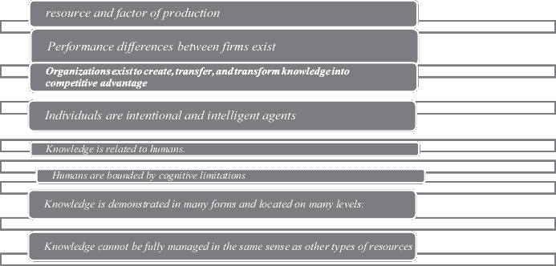

图 1：企业的基于知识观点（KBW）。

## 3. 知识管理与网络

在全球化时代，管理知识的能力变得越来越关键。知识的创造和传播被认为是竞争力的重要因素。因此，知识被视为一种有价值的商品，嵌入在产品和高流动性员工的隐性知识中。尽管知识是一种有价值的商品或知识资产，但它具有一些不同于其他有价值商品的独特悖论特征。知识不能被视为单一的整体，而应被视为一系列多样化的主题，这些主题在某些情况下对某些人有用。公司正在就知识管理的范围和问题做出选择。一个用于分类不同类型知识管理（KM）倡议的三部分框架可以总结为：

1. 外部结构倡议（例如：从客户处获取知识、为客户提供额外知识）。
2. 内部结构倡议（例如：建立知识共享文化、利用现有知识创造新收入、捕捉个人的隐性知识并进行存储、传播和重复利用，以及衡量知识创造过程和产生的无形资产）。
3. 能力倡议（例如：基于知识管理建立职业、为知识传递创建微环境）。

`KM 3.0` 的哲学不仅关注个人，而是侧重于知识的使用。互联网和万维网的出现为我们所有人提供了无尽的知识源。随着技术范围的扩大，网络上的信息量不断增长，但这些信息有时无法被识别、不被认为是完整的，且经常被发现是不准确的，导致访问、接受和使用失去了价值。

因此，为了适应这一知识管理框架，这种链接了知识的识别、再生、处理、传播和应用以提高组织效率、增长和盈利能力方向，似乎预示着 `Web`、`Web 3.0` 的到来。知识管理的主要应用领域见表 1。

表 1：知识管理的应用领域。

| 1 业务全球化 |
| 2 精益化组织 |
| 3 企业遗忘症 |
| 4 技术进步 |

## 4. 知识管理的图景

由于基于先验知识、经验、天赋思想、感知、归纳的知识，在经验主义和理性主义方面存在不同的流派，该概念在人类行为、欲望、态度、信任和解释的应用中更具理性和实用性。来自不同流派的思想过程已用于知识框架，以以逻辑上严密的方式对其进行分析。

当我们谈论为组织、学校或教室构建知识创造时，任何教学或学习科学的平台都需要考虑所教知识的性质。近期研究强调，科学知识实践可能并非以简单的单一方式区分；也就是说，科学没有单一的方面，而且与科学实践和知识相关的存在一些硬性的承诺实践。认识论者通常很少关注程序性知识或认知知识，而是倾向于关注`命题`知识。

不同流派在知识类型上可能存在差异，因此命题性知识可能主张拥有不同的内容和变体。


图 2：命题知识。

认识论者涉及若干项任务，这些任务可以分为两类：

1. 首先，我们必须确定知识的本质，即能够判断某人理解知识是成功还是失败。
2. 其次，我们必须确定知识的范围，即我们能知道多少、如何知道、能多远。该概念还强调了我们对他人的证言、感官、理由以及获取知识的原因和资源。

即使限制在主动范围内，知识也存在多种意义，区分它们可能是至关重要的。个人知识与集体知识之间的区别也可以做出。社会认识论是研究群体、机构或其他集体体如何获取知识的认识论领域。

**知识与创新：** 创新始于企业内部新型知识的构建；这意味着业务的重组/重新定位是创新的先决条件。知识管理在识别和前端市场管理中发挥着重要作用。组织任命首席知识官（CKO）来管理公司知识，这就像 CFO 管理资本一样。如果没有正式的系统和良好的层次结构，就不可能管理这一过程。如今，创新和知识是组织的两项关键活动。创新是知识经济中最重要的组成部分之一。创新和知识同时进行，以创造客户需求和新的市场领域。

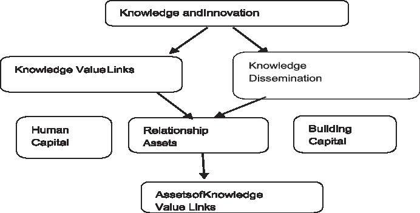

图 3：知识与创新。

## 5 熟悉知识与描述知识

在明确区分“熟悉知识”（knowledge by acquaintance）和“描述知识”（knowledge by description）时，前者具有认知关系，即我们对对象本身的感知；而后者则构成了一种判断关系。熟悉知识与描述知识之间的区别，可以认为是现实意义上基础主义经典或传统版本中的一个关键组成部分。这非常重要，因为这可能阐明熟悉知识在确保知识方面所起的作用，无论何种，这都需要经过证明的信念，而且当我们缺乏知识时，这可能是最强有支持的角色。

表 2：熟悉 vs 描述。

| 熟悉知识 | 描述知识 |
| --- | --- |
| 直接感知的关系 | 模糊、不利 |
| 无任何推理过程 | 涉及推理过程、描述 |
| 非判断性的、非性的 | 仅具描述性 |
| 性质上是表性的 | 概念的应用 |
| 真实关系的创造者 | 判断性描述的创造者 |

许多专家讨论认为，经验是即时“熟悉知识”的真正提供者，“关于知识”是系统过程的结果，它消除了经验中独立和偶然的偶然，并提取了“熟悉知识”背后的原理。

### 5.1 显性与隐性知识管理


显性知识由事实、关系、规则和政策组成，这些内容可以很容易地以电子形式编码并在无需讨论的情况下共享；然而，隐性知识难以记录。它涵盖了个人技能，其传递需要面对面的接触甚至是学徒制。其特征如表 3 所示。

表 3：显性与隐性知识管理比较。

| 特征 | 显性 | 隐性 |
| --- | --- | --- |
| 组织结果 | 大多数问题的高质量、统一解决方案 | 适当的、创造性的解决方案，未来机会开发 |
| 风险和成本 | 当前风险和成本 | 未来的成本和风险 |
| 知识管理 | 显性知识的复用编码、分类 | 识别相关和有用的员工 |
| 目标专业人士 | 团队合作、创新者 | 团队形成高薪创新者、创意解决方案提供者、一对一导师培训 |
| 工具和技术 | 数据分析、政策文件、指南、风险评估工具 | 电子邮件、会议、研讨会、视频会议、路演、咖啡休息区、案例会议 |
| 知识来源 | 专业分析师 | 创意性工作者 |
| IT 知识水平 | 多重知识投资复用 | 中低水平投资 |
| 员工激励 | 员工遵守政策的认可、奖励 | 强调专家和原始解决方案 |
| 组织 | 主要是服务业、定制化商品供应商 | 咨询公司、产品团队 |

显性与隐性之间的联系是演化的，因为个人所做的选择根据在特定历史和经济现实中的效用被确定或排除，并最终嵌入组织惯例中，从而塑造并限制了进一步的个人选择。

### 5.2 对包含的态度

知识与经验：最成功的包含计划是那些人们参与并受提供者影响的。过去的记忆研究倾向于关注记忆表现，而忽视了作为意识体验的记忆。这种忽视可能反映了对隐性方面的接受，即行为、知识和经验密切相关。科学知识的构建是一个缓慢、持续的转化过程，发生在长时间内，涉及通过连续、不中断的估计使其成为日常知识。通过知识进行学习主要通过三个尺度或参数发生变化：

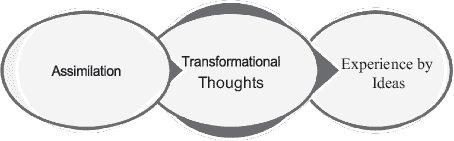

图 4：知识变化的参数。

- 在大多数常见情况下，获得者（知识学习者）在已有的理论和实践基础上进行添加。
- 在其他情况下，任何认知冲击、经验、事件的结合会导致学习者偏离知识库、态度和思维过程。
- 在第三种情况下，虽然罕见，但假设通过对日常知识的观察、构想和讨论发生了转化。

基于以上内容，对交互设计师有三个启示。

同样可以总结为：

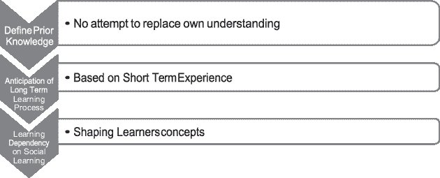

图 5：交互体验的启示。

从上述可以推断出，只有专业知识可以作为信息显性地存在；其余部分是从社区中作为一种揭示实践提取的。当考虑到科学家为了获得知识而尝试的不同方法时，时间、社会参数和价值观的重要性发生了变化。科学知识的属性产生特定科学社区实施的社会实践。话语过程将先知识转化为精炼的概念，科学社区成员可以一致地应用这些概念。科学知识像是一种经过抛光的商品，先知识提供了原材料，社会互动提供了工具。先知识可能是一个多维结构，当被独立处理时，会影响个人对假期信息的搜索；来源的可信度是所用信息来源的最强预测指标。企业家所拥有的先知识在识别创业机会方面起着至关重要的作用。机会识别是通过先知识和先经验实现的。

技术必须理解目标用户群体相关的先验知识，以促进其采用。先验知识是成功的最常见因素，也是最有效的用法；技术近期开始探索应对人口老龄化挑战的方法 [13]。显性知识与隐性知识之间的边界既是渗透的又是灵活的，因此这些领域之间存在着流动。企业提供了一个特殊的背景，使得显性和隐性知识体都能通过与外部经济现实的相互作用被选中，然后存储在未来员工可以使用的日常规程中。随着时间的推移，涉及显性知识和不断演变的隐性知识的互动质量可能会进一步提升，从而获得更卓越的企业绩效。

### 5.3 构建科学知识

另一种观点认为，知识是无法传递的，而必须由学习者在心理健康的视角下通过心理活动来构建。在正式设定中呈现科学学习时，个人和和社会视角的学习观，以及对所学科学知识本质的视角也至关重要。组织心理学是跨国组织及专业社区国际合作与项目发展的最大贡献者之一。高引科学产出仅发生在社区内部，以及相似知识领域和跨社区的凝聚协作中。组织心理学有助于在社会身份预见下实施，使管理者坚持专业认同、知识创造并适应专业规范和价值观，从而塑造一个知识驱动型社会。最终，管理层也致力于开发一种基于知识的身份，其中创造力和专业知识占据着重要地位。

## 6 文献综述

20 世纪 90 年代中期，随着知识管理在 IT 行业、计算机服务应用和 IT 系统的发展，它作为一种可见的管理话题日益多样化。在过去的十年里，尽管它获得了高度关注和知名度，但随着新技术的新程序的出现，该领域受到了广泛审查，因为人们对许多应用、尝试，特别是来自纯 IT 领域的尝试的成功存在疑问 [8]。然而，与这一观点相反，许多管理专家描绘了新版本的知识管理，认为它是随着新一代不断演化的领域，它既解决了上一代产品的局限性，又通过对所有人都有益的新特征带来了更多变化。

全球范围内在线平台和 IT 应用虚拟区域呈指数级增长，这使得 IT 组织鼓励通过协作方法来共享和利用其知识资产变得更加困难 [1]。人工智能管理、物联网（IoT）和云计算等时代技术已引起了组织的兴趣，以开发与下一代接轨并关注时代技术的知识管理对接技术。知识管理仍然是一门年轻学科，可以从四种新兴且互补的方式来看待：本体论、认识论、商品化和社区方面 [7]。由于知识管理是一个新兴、多样化且不断演变的流派，随着每一代的出现而改变其应用、平台和特征，因此，在不同方面出现矛盾也是非常自然的。进一步增加的是这些观点，即知识管理的挑战可以被纳入知识的`参与、探索、体验、涌现、赋能和演进`等层面的框架中 [12]。

知识管理可以被视为一个与文献、讨论、计划和行动部分有更紧密联系的学科。为了有效实施强有且基于知识的战略，组织必须拥有强大的知识库；这是组织内知识实施的首要成功条件 [2]。尽管如此关键性，知识管理仍然是一个定义模糊的术语，因为许多其他理论、管理技术重新导向了它的应用和组成部分，而这里的一些技术理论由于没有分类，被强行归入这一流派。从实证角度提到，更广泛的知识管理帮助组织对知识选择有了更好的洞察，例如相关领域的应用和技术。各种知识理论可以从整体性和复杂性进行观察，因为它提供了更广泛的工具和技术。知识理论可以提供一个框架，组织可以在该框架内平衡其知识重点，并通过有效沟通建立其战略知识方向。

在将领导力与知识联系时，成功组织的领导者不断寻找更好的方法来提高基于知识的绩效和结果，已成为当务之急 [21]。此外，过去由于各种管理驱动的倡议而导致的失望促使经理们去理解知识等复杂问题，知识是任何组织效能的关键治理领域。知识管理是一个如此新的领域，以至于涵盖了大多数跨职领域，并已成为现代企业的时尚。企业必须创造并维持平衡的知识和人力资本资源组合，以便其长期保持竞争力和成功。组织的领导层必须为管理知识资源设定广泛且整合的目标，这需要系统性的知识管理。随着知识作为“创意产生”背后的主要领导力力量，可以想象重点必须放在：

- `知识创造`
- `知识开发`
- `组织知识`

上述三者将继续是改善社会的主要焦点。

关于知识管理系统已经有很多书籍、期刊和文章，但所有可用信息仅以调查的形式存在 [7]。尽管如此，知识管理系统（KMS）是支持组织知识管理实践的工具和技术，但仅凭调查和数据解释无法将这一广泛领域呈现为一个累积的知识库。必须存在某些技术、现状、内容和工具，为研究组织中这些系统的开发和使用提供框架，而这些技术极大地支持了知识转化，未来的趋势也仅基于此 [5]。显性知识结合搜索和分类，对技术解决方案做出了巨大贡献。隐性知识的形成、交流以及将其显性化，是知识转化过程中一些主要的令人鼓舞的进展。对新术语`技术增强学习`（TEL）的关注及其与知识管理（KM）的联系，强调了它是提高个人和组织绩效的重要手段，并进一步凸显了传统的 KM 和 TEL 模型未能应对新知识时代快速变化和关键挑战 [14]。在过去的几年里，学习管理系统（LMS）已成为 TEL 的不可或缺的元素。过去几年 Web 2.0 技术的出现为替代性的 TEL 解决方案提供了新机会，通常被称为 TEL 2.0 或电子学习 2.0。Web 2.0 指的是合成者与用户之间的社交网络和协作，而 Web 3.0 则是一种智能网或语义网，利用大数据、链接数据、云计算、3D 可视化等技术，力求使学习过程中的被动学习者转变为主动学习者 [15]，Web 2.0 是从网站到社交网络的转变。此外，它还具有诸如计算平台、Web 应用替代桌面应用、如“网络作为平台”的属性、持续更新的软件，以及对各种来源数据的消费和重混。可以结论，Web 2.0 完全是一项以学习者为中心的活动；因此，教学和学习过程得到了融合。由于构成 Web 3.0 的技术存在差异，对 Web 3.0 的预测也不相同。相反，[18] 电子学习 3.0 挑战了 Web 3.0：第一个主要挑战源于 Web 3.0 的性质——其庞大、互操作性、缺乏服务器端检查、权限控制较少以及隐私和安全风险的增加；第二个主要挑战是 Web 3.0 的更广泛应用，在与前代技术的斗争仍在进行时，当前的行业和教育场景是否能够利用 Web 3.0 的优势。

为了保持竞争、动态和战略性，随着时间的推移，关注技术趋势至关重要，网页的成熟也以其独特的方式发生 [19]。Web 3.0 是一种独特的网页体验，机器将能够类似于人类的方式理解和解释数据，它起源于 Web 2.0（交互式 Web），而 Web 2.0 又起源于仅具有静态信息化特征的 Web 1.0 [19]。专家进一步揭示，Web 3.0 是一个全球数据仓库，任何格式的数据仓库都可以通过任何网络上的任何设备共享和解释，但 Web 3.0 的演进将带来新的机遇和挑战。数据和服务的自主集成在创建新功能之外，增加了 Web 服务的现有能力，这是主要的机遇；而对数据的未经授权访问和操纵、动作的自主发起 [18, 19] 以及有害脚本和语言的发展将继续是该技术的主要挑战。然而，作为预防，对于数据信息行业的任何人来说，数据管理需要做好准备。此外，由于 Web 3.0 装备了相关技术，Web 3.0 被认为是智能网。在这个动态环境中，新兴的 Web 2.0 代允许用户创建、发布和重新分发内容。这种环境需要创新的解决方案，重新思考底层架构。

从上述专家的观点可以得出，过去三十十年`Web 1.0`到`Web 3.0`的演变对教育和电子学习的增长与未来产生了巨大影响。`Web 3.0`或“语义网”建立在`Web 2.0`或“社交网”的基础上，其特征是学习者在网络上的互动与参与。作为第三代网络，`Web 3.0`利用学习者在网络上的互动数据为学习者生成并交付定制化内容。计算机算法构成了`Web 3.0`的基础，使得机器、工具和应用程序能够展现出人工智能（AI）。

## 7 Web 转型

互联网由蒂姆·伯纳斯-李（Tim Berners-Lee）于 1989 年发明，愿景是在名为 Web 的公共信息空间内通信或共享信息。随着指数级增长，它已成为存储和访问各种版本学习内容（如文本、图片、音频和视频）的媒介。`Web 1.0`的主要挑战在于内容的创建和与他共享。用户无法对知识进行策划。因此，`Web 1.0`被广泛认为是只读网络，其通用属性如静态信息和网站之间极少的互动。根据资料显示，`Web 2.0`是网站的转型。此外，它是一个完整的计算平台，用 Web 应用程序取代了桌面应用程序，具有网络即平台、软件持续升级以及消费和混合各种来源数据等特征。数字原生代能够策划内容，这要求学习者积极参与学习过程。`Web 3.0`预测在线内容将以语义方式组织，对每个用户都更加个性化，实现智能网站和应用程序，以及搜索和行为广告。将`Web 3.0`技术集成到`KM 3.0`系统中，以收集、共享和使用有价值知识来帮助人们完成工作。因此，`KM 3.0`关于拥有我们可以使用的知识，而不是尽可能地收集和共享 [11。

表 4 中描述的所有形式的特征如下：

表 4：`Web 1.0`、`Web 2.0`和`Web 3.0`的特征。

| `Web 1.0` | `Web 2.0` | `Web 3.0` |
| --- | --- | --- |
| 只读 | 可读可写 | 读、写、执行 |
| 客户端/服务器 | 点对点 | 便携式个人网络 |
| HTML 门户 | XML, RSS | RDF |
| 公司拥有 | 社区共享 | 个人 |
| 网页 | Web 应用程序 | 语义应用程序 |

## 8 知识转型

许多组织积累并创建了大型知识系统、专家系统、知识库和内部网，以确保其知识资产的可用性。在没有明确知识知识策略的情况下，公司至少确保了收集了它们并保存在某处的数据库或文件中。`KM 2.0`侧重于使用 Web 和社交媒体工具共享知识：随着`Web 2.0`的起源，重点转向了知识的共享、通信和协作。社交媒体和 Web 工具的普及开始进入企业，在企业环境中使用这些工具通常被称为“企业 2.0” [11]。`KM 3.0`的重点在于利用现有知识帮助人们完成工作：这简单意味着在需要时随时访问有用的知识。在[11]的研究中，知识工作者被等同于岛——那里共同知识较少，专业知识较多。这表明工人必须为自己收集更多，为他人收集更少。每个知识工作者还应该负责通过更多关注共享质量而非数量来减少噪音和信息过载 [11]

表 5 讨论了`KM 1.0`、`KM 2.0`和`KM 3.0`之间的差异 [11, 16]

表 5：`KM 1.0`、`KM 2.0`和`KM 3.0`的差异。

| `KM 1.0` | `KM 2.0` | `KM 3.0` |
| --- | --- | --- |
| 以技术为中心 | 以人为中心 | 以生产力为中心 |
| 集中式控制 | 去中心化生态系统 | 实用 |
| 电子邮件、通讯、数据库 | 社交工具（博客、维基） | 实用 |
| KM 是额外工作 | KM 是工作的一部分 | KM 帮助我完成工作 |

来源：[`www.tlainc.com/articl256.htm`](http://www.tlainc.com/articl256.htm) [11, 16]

## 9 讨论

我们生活在一个信息社会时代，这个时代基于信息机会，其目标不仅仅是知识，而是获取、产生和传播新知识的可能性，用户可以通过连接互联网的网页在全球媒体上进行共享、阅读和编写。部分或专门关注人员、技术、方法和系统可能无法让企业实现可持续发展，但技术、方法和人之间的互动使组织能够管理知识。“在做中学”和“基于应用的管理”环境维持了组织的竞争力。由于这些目标，过去几年知识管理扩展到采用技术、基于的进步、多传感器系统以及计算机而非人类生成和思考新信息的语义网。然而，`Web 1.0`到`Web 3.0`的转型过程也伴随着一些挑战，例如缺乏控制元数据和数据隐私的标准，资源描述框架（RDF）、Web 本体语言（OWL）使用统一资源标识符（URI）来表示数据，这些数据存储在数据库中而没有指定任何访问策略或信任边界。这些挑战可能会使`Web 3.0`变得脆弱，攻击者也可能在全球范围内伪造数据，并可能发生错误的代码、虚假的服务和意外的解读。数据隐私是`Web 3.0`中最重要的关键问题之一。

利用 Web 3.0 技术进行情感分享，创造并处理思想与观点，而不仅仅是链接文档。社交网络被认为是一种连接全球范围内的高效且迷人的方式。该平台还允许人们根据搜索词的含义及其使用的上下文，在更深、更广泛的范围内寻找信息。Web 3.0 以机器可以读取并理解的方式实现信息，其程度可以媲美人类且没有歧义。当今世代生活在虚拟世界，参与小组活动。Web 3.0 提供了碎片化整合、位于云端并可以在任何设备上快速运行、高度可定制且病毒式传播的应用。事实证明，在 Web 2.0 中体现的 Web 3.0 是知识管理的巨大扩展，是一种真正的社群媒介，专业人士、半专业人士和消费者之间的界限变得模糊，创造了业务和应用的网络效应。

未来的 Web 正在为 Web 的下一个伟大阶段做准备，届时连接的不仅是人类（Web 1.0 和 Web 2.0）或机器（Web 3.0），还有诸如烤面包机、汽车、钥匙、手机、书籍、热水器、灯和风扇等物体，名单无穷无尽，这一术语被称为 Web 4.0。它提供了一种全新的用户交互模型，具有最全面和个性化的特征，不仅限于显示信息，而是像一面智能镜子一样，对用户的需求提供具体的解决方案。

Web 正在不断进化。对互联网的访问不仅来自人类，还来自其他物体、设备和车辆，产生了物联网的概念。这些新概念和需求导致了名为 Web 4.0 的新型 Web 模型诞生。

Web 4.0 的概念非常复杂且多变。为止，关于 Web 4.0 的具体定义尚未达成共识，这与之前广泛接受的 Web 1.0、Web 2.0 和 Web 3.0 定义相反。然而可以说，Web 4.0 将通过其独特的应用（如社交网络、物联网、大数据、人工智能和机器机通信）为后代塑造格局，这些技术将在 Web 4.0 的采用和实施中发挥关键作用，这种新 Web 为该领域的进一步研究培养了专家。

## 10 研究启示

可以看出，为了获得竞争力并改进业务流程，许多组织已将知识管理（KM）纳入业务战略。同样注意到，成功的 KM 实施报告导致了财务节省、收入增加和用户接受程度提高。研究人员发现，分享隐性知识是导师制成功的关键，并对在 COVID-19 流行期间变得越来越常见的远程学习可能不是传输隐性知识等知识的有效手段表示担忧。此外，模型帮助我们将分散的拼图碎片组合在一起，从而对这些碎片以及它们构成的整体有更深层次的理解。KM 模型在知识管理的实践或业务中仍然很新颖，但它们确实代表了未来的发展方向。这需要对什么是 KM 以及关键的 KM 循环过程是什么有坚实的理解，以及这些过程如何融入一个模型中，使我们能够解释、建立因果关系并成功实施知识管理解决方案。Web 开始为其用户带来更多知识和行动能力，导致日常生活多个方面发生巨大变化。Web 3.0 正在快速向一个更具动态、变化更快的环境迈进，在那里行动能力和知识的民主化可以加速几乎所有领域的业务发展。因此，应该有一些利用 Web 3.0 或 Web 4.0 传输隐性知识的解决方案。现在 Web 4.0 将是物联网，或者我们可以将其命名为数字智能连接网络。

## 参考文献


[1]Abar, S., Abe, T. & Kinoshita, T. (2004). A next generation knowledge management system architecture. 191–195, 2. doi: 10.1109/AINA.2004.1283784. Abar S, Abe T, Kinoshita T. A next generation knowledge management system architecture. In18th International Conference on Advanced Information Networking and Applications, 2004. AINA 2004. 2004 Mar 29 (Vol. 2, pp. 191-195). IEEE. →

[2]Binney, D. (2001, Mar). The knowledge management spectrum–understanding the KM landscape. Journal of knowledge management, 1. →

[3]Bruwer, R. (Hendrik J., & Rudman, R. (2015). Web 3.0: Governance, risks and safeguards. Journal of Applied Business Research (JABR), 31(3), 1037–1056. doi: https://doi.org/10.19030/jabr.v31i3.9241. a, b, c

[4]Craig, E.M. (2007). Changing paradigms: managed learning environments and Web 2.0. Campus-Wide Information Systems, 24(3), 152–161. doi: https://doi.org/10.1108/106507401076215. a, b

[5]Marwick, D. (2001). Knowledge management. IBM Systems, 40(4), 814–830. doi: 10.1147/sj.404.0814. →

[6]Kerstetter, D. & Cho, M.-H. (2004). Prior knowledge, credibility and information search. Annals of Tourism, 31(4), 961–985. ISSN 0160-7383, doi: https://doi.org/10.1016/j.annals.2004.04.002. →

[7]Gallupe, B. (2001, Mar). Knowledge management systems: surveying the landscape. International Journal of Management, 31, 61–77. a, b

[8]Grant, K.A. & Grant, C.T. (2008, Jan). Developing a model of next generation knowledge management. Issues in Information Science & Technology, 5. →

[9]Guo, R.X., Dobson, T. & Petrina, S. (2008, Apr). Digital natives, digital immigrants: An analysis of age and ICT competency in teacher education. Journal of educational computing, 38(3), 235–254. →

[10]Hasan, A. (2011). Classical foundationalism and Bergmann’s dilemma for internalism. Journal of Philosophical Research, 36, 391–410. →

[11]Iversen, A. (2009), KM 3.0 Part IV: a practical KM system, (Accessed on December 6,2020 at http://www.ppcsoft.com/blog/km-3-4.asp). a, b, c, d, e, f

[12]Jakubik, M. (2011). “Becoming to know. Shifting the knowledge creation paradigm”. Journal of Knowledge Management, 15(3), 374–402. doi: https://doi.org/10.1108/13673271111137394. →

[13]Lee, C. & Coughlin, J.F. (2015, Sep). PERSPECTIVE: Older adults’ adoption of technology: an integrated approach to identifying determinants and barriers. Journal of Product Innovation Management, 32(5), 747–759. →

[14]Chatti, M.A., Schroeder, U. & Jarke, M. (April-June 2012). LaaN: convergence of knowledge management and technology-enhanced learning. IEEE Transactions on Learning Technologies, 5(2), 177–189. doi: 10.1109/TLT.2011.33. →

- [15]Blog, M. & Meichel, F., Qu’est-ce que la cognition – points de repères en sciences cognitives Qu’est- ce que la cognition – points de repères en sciences cognitive. 检索于 2012 年 3 月 20 日，[`florencemeichel.blogspot.com/2009/05/quest-ceque-la-cogntion-points-de.html`](http://florencemeichel.blogspot.com/2009/05/quest-ceque-la-cogntion-points-de.html). →

- [16]Mixotricha, Z. (2008), `KM 1.0` `KM 2.0` `KM 3.0`, [`zyxo.wordpress.com/2008/12/28/km-10-km-20-km-30/`](http://zyxo.wordpress.com/2008/12/28/km-10-km-20-km-30/) a, b

- [17]Rajiv, & Lal, M. (2011). BVICAM’s International Journal of Information Technology, 3(2), 16–22. a, b

- [18]Ron, C. (2009). Web 4.0, Trip Down the Rabbit Hole or Brave New World? (访问于 2020 年 12 月 05 日，[`www.zmogo.com/web/web-40trip-down-therabbit-hole-or-brave-new-world/`](http://www.zmogo.com/web/web-40trip-down-therabbit-hole-or-brave-new-world/).) a, b

- [19]Rudman, R. & Bruwer, R. (2016). Defining Web 3.0: opportunities and challenges. The Electronic Library, 34(1), 132–154. doi: https://doi.org/10.1108/EL-08-2014-0140. a, b, c

- [20]Russell, B. Knowledge by acquaintance and knowledge by description. 收于 Proceedings of the Aristotelian Society 1910 Jan 1 (Vol.11, pp. 108–128). Aristotelian Society, Wiley. →

- [21]Wiig, K.M. (1997). Journal of Knowledge Management, 1(1), 6–14. →

# 知识管理与 Web 3.0 在人力资源管理中的整合

Pradeep BediS. B. GoyalJugneshKumarRitika

### 摘要

知识管理（`KM`）是一种在当前基础经济资源竞争背景下，用于开发和管理组织绩效的技术。本文旨在分析与人力资源管理决策支持系统相关的 `KM`，以证明组织中知识的相关性。随着 Web 3.0 的发展，`KM` 的实施迅速增加。因此，组织的管理信息系统（`MIS`）必须升级，其中存储的信息可以更方便地获取。

**关键词：** 知识管理， 知识管理

## 1. 引言

在组织中，人力资源被认为是至关重要的。因此，人力资源管理（`HRM`）包含了招聘、绩效和薪酬。人力资源管理（`HRM`）被认为是至关重要的。因此，这是使用 Web 3.0 的信息之一 1, 2, 3, 4, 5。

另一个重要的工具是人工智能（`AI`）或机器学习，它们可以应用于人力资源管理（`HRM`）。本文中讨论了用于知识管理（`KM`）的各种 `AI` 方法。有一系列 `AI` 技术可以处理特定的 `HRM` 问题。因此，本文探讨了 Web 3.0 的概念及其应用，以及 `AI` 和云计算等技术。

第 2 节讨论了 `KM` 的概述。第 3 节讨论了增强的信息管理（`IM`），以理解 `IM` 问题及其改进。第 4 节描述了 Web 3.0 的概述及其需求、目标和工具。第 5 节描述了在当前环境下 Web 3.0 在 `HRM` 中的应用。第 6 节讨论了 `KM` 及其整合。第 7 节讨论了 `AI` 在 `KM` 中的应用。第 8 节在分析现有系统的缺点后，提出了一种集成机器学习方法和云计算的 `HRM` 框架。最后，第 9 节描述了本文的结论和未来的研究方向。

在现实世界中取得成功，对公司而言两点至关重要：第一是创新，其次是性能；以便在全球市场中长期立足。为此，必须比以往任何时候都更坚定地满足客户需求，从而提高生产力和竞争力。此外，还需要跟进技术领域的变化，以确保每种工具、技术以及信息的可访问性都能做出充分贡献 [6]。这些知识呈现出多样化、去本地化且不易管理的特征，导致了多种控制信息系统方法的产生，以便尽快利用它们。目前，这些信息是在考虑其语境和语义的情况下进行处理和操作的，这意味着我们在处理意识问题。如今，信息被视为一种战略资源和稳定性因素，赋予了它决定性的竞争优势。要在产品、流程、服务和组织方面进行创新，`KM` 对企业至关重要。它允许同时最小化设计、开发、交付等成本。管理理解力并不是一个新问题。与过去不同的是，企业现在根据一种自觉的、规范的且自愿的方法来应对这一课题 [7]。在过去，这是在没有思考的情况下完成的。`KM` 作为一个学科出现，是为了应对因退休导致的记忆丢失、技术增长和创新引发的一系列问题。为了提高设计和开发方法的价值，它被视为一种需要特殊方法的实践。为了改进技能并增加组织的利润，不同的公司采取不同的策略。所有策略都旨在市场中保持一个适当的位置或地位。方法可以有所不同，但它们最终都会为组织带来利润。然而，在设计这些策略时，`KM` 是非常必要的，它能带来投资成本相关利润的指数级增长。因此，`KM` 可以以不同且动态的方式进行探索。`KM` 将有助于处理资本化、团队协作、招聘、退休、绩效评估和项目管理等长期挑战。这可以通过对过去的学习及其在当前情况下的部署来实现，以实现组织的特定使命和愿景。在当今竞争激烈的世界中，`IM` 保证了公司的生存 [8]。

由于今天业务环境的快速变化，对 `IM` 的需求增加了。其次，定制化系统需要对不同消费者需求和期望的了解。其次，`KM` 涉及编码、个性化和信息处理控制，需要大量的终端技术实施和技术变革的加速。第三，随着价值链外包和解构的使用增加，信息来源的多样性不断增加，要求对这些增加来源进行控制。近年来，`IM` 引起了广泛关注。在目前的竞争环境中，信息的价值在每个领域（无论是工业领域还是教育领域）都是最高优先的。研究人员在探索 `KM` 理解组织信息价值的优势方面做出了巨大贡献。因此，为了进一步探索 `KM` 的优势，首先需要理解在探索组织知识时 `KM` 的需求、目标和工具。在本节中，总结了知识管理（`KM`）的定义和原则 [9]。

关于信息和 `KM` 存在多种解释和含义。在进一步进行之前，识别它们非常重要：

*   知识是与客户相关的直觉、逻辑、观察、互动、商品、程序、经济、竞争力等元素的整体集合，这些要素构成了成功的行动。

*   知识管理是一种结构化的、协调的、清晰的且有意的机制，通过这种机制知识进行开发、传播、实施、刷新和修改，以实现组织目标。

理解 `KM` 的定义需要两个主要方面，例如：

*   将公司运营中的信息方面视为一个显性的市场问题，并将其反映在企业各个层面的战略、实践和政策中。

*   在实体的智力（包括显性和隐性）与发展之间建立清晰的关联。在现实中，`KM` 还包括根据这这两个因素在企业内部定义和映射知识产权，在组织内部创建新的专业知识以获得战略优势，使大量的组织信息可用，交换最佳实践以及实现上述所有点的技术。

除非规定了 `KM` 的功能，否则无法观察到它的效用。要理解 `KM` 的运作，需要理解其价值，以便在这种竞争局面中生存。这些价值讨论如下：

*   `KM` 最重要的价值是需要连接的意识。在感知和洞察中，它是集体知识，其价值源于其内容周围的关联关系和特质。

*   `KM` 与这个不断变化世界的兼容性也是另一个需要实现的重要价值。这可以通过整合关于新信息、市场竞争以及发展的意识来解决。

*   它被称为催化剂，可以改进组织的活动或行动。对于这种价值，意识也因此，因为它追踪了环境状况并追踪了市场的动态发展。

*   `KM` 的解决方案也将有助于信息共享。这一概念的变化将告知组织市场和竞争的活动变化。

除了这些价值，不同的分析师还建立了自己的理论来建立 `KM` 与 `IM` 之间的关系 [10]。

## 3 增强的信息管理

为了研究 `KM` 的增强，首先需要理解 `IM` 与 `KM` 之间的关系。在组织中，正以电子邮件、手册、调查等形式执行许多项信息工作，以改进并使专业知识更具分析性。由于时间和地理位置限制等各种原因，单独分享知识是一项相当困难且繁忙的任务，因此组织中的所有人员需要一个集体自动化平台。因此，为了实现 `KM` 的专业分析，与 `IM` 集成是非常必要的。

这些信息将员工引导至相应的专家来源；无论它是文本还是摘录都无所谓。这些组织信息地图或专家目录识别了一类知识类别、知识的位置，以及在某些情况下，其状态和价值。它作为一种实体存在，以完成各种独特的任务和目标。随着信息系统的改进或增强，专家可以成功执行信息的使用和重用，这受到了知识管理（KM）的鼓励。知识管理（KM）与信息管理（IM）之间这种复杂的区别侧重于相关信息作为关键的区分属性 [14, 15, 16, 17, 18]。

## 4 Web 3.0 概述

在理解 Web 3.0 特性的同时，有必要理解从 Web 1.0 到 Web 2.0 以及从 Web 2.0 到 Web 3.0 的转变。这是因为 Web 1.0 的所有特征都整合到了 Web 2.0 中，Web 2.0 的所有特征也贡献给了 Web 3.0 (图 1)。在信息方面，Web 2.0 时代创建了如 Blogger、Twitter 或 Facebook 等几个网络平台，多个用户之间的数据共享发生了变化。新的网站更新被称为 Web 3.0，它结合了两个阶段的特征并包含了一些更多特性 (图 1)。我们所说的 Web 3.0 是所谓的互联网第三波浪实现，它们共同成了所谓的“智能网网”，包括语义网用户、微格式、自然语言分析、数据存储、计算机学习、AI 技术。维基百科说：“Web 3.0 是基于互联网的第三代网络服务，它强调机器辅助的信息知识，以提供更具效率且更直观的用户体验。”Radar Networks 的 CEO Nova Spivack (2010–2020) 指出，Web 3.0 是数字时代的领先技术之一 [19, 20]。

换句话之，通过不同新技术的混合实现的互联网第三波浪潮可以解释如下 [21]：

*   将网站转变为具有多样化应用程序和内容库的透明且互操作的网络。

*   通用网络化、电缆网络渗透以及智能手机互联网的使用。

*   网络计算、SaaS 业务模型、在线服务互操作性、远程计算、云计算和雾计算。

*   开放技术和框架，以及 API 和协议。

*   开放身份识别、开放信誉、智能手机身份漫游和个人详情。

*   智能移动、Web 语义技术。

*   “世界数据库”分布式数据库。

*   智能软件、自然语言、人工学习、机器思考和自动化代理。

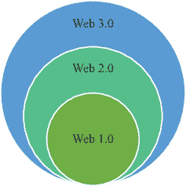

图 1：Web 的演变。

### 4.1 Web 3.0 的需求


在 Web 1.0 或 2.0 中，当在互联网上搜索任何内容时，它会显示一些个人可能接受也可能不接受的网站链接。在这种情况下，他必须输入不同的关键词来获取适当的信息。因此，这种网页搜索依赖于关键词。这种实现需要很长时间才能获得适当的结果。因此，需要改进 Web 的搜索能力，以便更短的时间提供更好的解决方案。Web 3.0 在允许用户获取所需的答案时克服了这一挑战。网络 3.0 是解决上述问题的一种方法。随着平台 3.0 集成到系统中，整个检索机制可以转移。这将有助于从互联网上轻松地收集信息。通过搜索、整理并仅展示相关信息，系统可以更好地装备为用户提供所需的信息。“人工智能时代”可以被称为 Web 3.0 时代。

### 4.2 Web 3.0 的基础

某些分析师说，Web 3.0 几乎拥有关于一个遥远巫师的所有信息。这就是为什么它经常被称为“巨型档案”。Web 2.0 使用互联网连接人们，而 Web 3.0 用于 Web 2.0 的知识共享。接下来的示例将有助于说明这一点。如果你想去过一个预算约为 3000 美元的假期，你需要使用在线最新的应用程序查看这些地方，以获取有关旅行和网站、游客目的地等信息。通过访问许多网站可以比较不同旅行社的价格。这无疑是一个耗时且无聊的方法。但通过 Web 3.0 可以减少浏览多个网站的时间，因此网页浏览器可以汇总、解释并以易于比较的方式显示数据。这是因为 Web 3.0 上的信息是可理解的。Web 3.0 搜索引擎不仅搜索给定的关键词，还解释它们的含义。它还可以包括相关的发现和更多的建议。“服务互联网”通常被称为网络 3.0。除了人类可读的 Web 部分外，开放的机器资源可以合并到更高的标准。

### 4.3 Web 3.0 的结构

与以前的互联网 IT 相比，平台 3.0 拥有新的 GUI。符号学和语义描述了基础框架。语义指的是通信含义，而符号有机是对符号过程和信号的研究（符号学），两者独立地组织成符号或语境和通信结构。它需要分析意义是如何形成和理解的。语义可以极大地有利于消费者，因为它让他获得正确的答案。

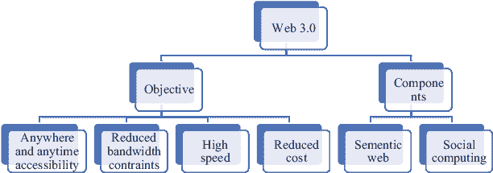

图 2：Web 3.0 的目标和组件。

### 4.4 Web 3.0 的优势

改进数据管理：互联网上的数据管理是一项复杂的活动，因为它需要对各种系统的汇总数据进行解释，而这些数据在某些情况下可能或可能被计算机解释。在这种情况下，数据与适当输入的关系非常困难。这种困境可以通过使用语义网在很大程度上解决，因为它告诉了不同数据集之间的相互理解，使系统更容易理解并有效地将连接与所需的输出相结合。

移动访问性：总体而言，到 2008 年底，预计将有 40 亿移动设备用户。同时，全球智能手机渗透率预计将超过 50%。但随着 3G 技术的推出，这一数字预计将达到 60%，使得手持设备上的互联网访问变得更容易。结果，Web 3.0 市场预计由于其卓越性能而增长。移动设备接入互联网应该扮演重要角色。Web 3.0 中的网页页面大小 [22–24] 可以通过应用 `CSS` 来缩小。

创造力工具：独立数据库之间的多个链接是平台 3.0 的主要特征。结构和个人将以相同的方式使用数据和信息数据集，从而提高其效率。这促进了创新流程，进而导致了思想和研发新模式的产生。

全球化：网络 3.0 使用一种名为资源定义框架（`RDF`）的通用编程语言，正试图构建和标准化各种数据结构。这是该网络的底层数据交换模型。`RDF` 使用 `XML` 编写，使得不同的程序可以轻松地交换详细信息。这打破了延迟限制、移动设备上 Web 视图效果不佳等问题。

提升客户满意度：网络 3.0 为企业提供了“人工智能”能力，以提高客户服务满意度（`CSS`）。通过这种方式，消费者可以在网页上查看完整的产品信息。这提升了公司在市场上的声誉，吸引了更多客户。Web 3.0 中采用的一些技术在图 3 中有所说明。

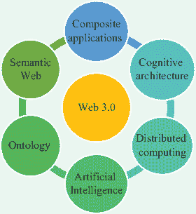

图 3：Web 3.0 技术。

## 5 Web 3.0 与人力资源管理

每个领域正在通过启动随时间推移而改进的更好计划发生变化。特定系统的传统通过物联网（`IoT`）得到了增强。`IoT` 前端应用的示例是利用其功能具有适应传感器的智能设备。定期，具有异构数十亿个电容的 `IoT` 设备在实施中存在对服务质量（`QoS`）质量的需求。2020 年，人力资源管理已发展到推进所有万物连接、业务能力、异构数据支持、绘制实用性、数据集成和高相关性[25]。

人力资源专业人员将访问网络基础设施和互联网提供的工具和服务。在互联网软件的推进过程中，`Web 1.0`、`Web 2.0` 和 `Web 3.0` 的概念通常已经在许多阶段得以实现。Jason Calacanis 在 2007 年将使用 `Web 2.0` 技术作为可行平台，由专家规划为高质量商品和服务的开发。技术和软件设备的真实实现始于 2010 年。在 Web 3.0 实例的有效解释中尚无竞争。因此，许多移动或智能应用使用了 `web 3.0` 概念来提供更好的视频质量、机器控制工具以及包括增强现实在内的许多 3D 效果[26]。

在当前的互联网场景下，要区分 `Web 2.0` 和 `Web 3.0` 非常困难。在人力资源管理（`HRMS`）中引入 `Web 2.0` 或 `Web 3.0` 已广泛应用于人力资本管理、劳动力管理、人才培养、业务学习系统、电子招聘等。通过在 HRM 中应用 `Web 2.0` 或 `Web 3.0` 技术，这将激励用户参与与信息交互并增强服务。为了支持这一点，已经有许多 `HRMS` 应用程序可用[27]。目前，许多智能应用也作为独立的人力资源支持而存在。在人力资源管理中，对于集成 `Web 3.0` 的工具和技术的研究机会很大。

## 6 知识管理与整合

在过去的二十年里，知识管理（KM）引起了广泛关注。这增强了组织专注于并嵌入专业知识以改进其成果的能力。知识管理和创新技术已在利润和满意度方面显示了组织的熟练程度[28]。在研究了 HRM 领域研究人员之前的贡献后，KM 被认为是信息提取及其管理过程（如知识获取、共享、传递和整合）最重要的支柱。HRM 实践创造了一个朝着熟练知识整合方向移动的通用社会场景。在理解 HRM 与知识整合 `KI` 之间的关系之前，了解目标是重要的（图 4）。

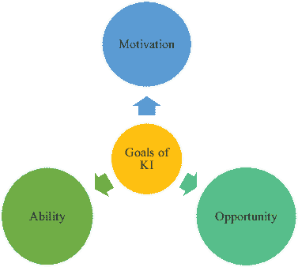

图 4：`KI` 的目标。

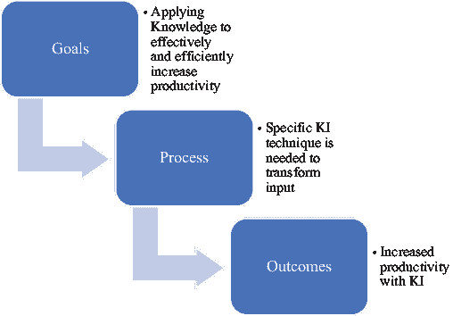

图 5：`KI` 系统。

在最近的研究[29][30][31][32][33] 中，探索了 HRM 与 KM 过程之间的关系及其性能结果。因此，这些研究改进了 KM 在每个领域的作用。它还显示了过去十年中 KM 对其他公司的影响，有助于为新产品创建创建知识库（图 5）。

## 7 使用 AI 进行知识管理背景

Suriyan Jomthanachai 等[34] 展示了橡胶木工厂的人力资源管理应用，将其转变为工业 4.0。转换的主要目标是难以处理的大量生产数据。这导致了数据编制错误和服务延迟。公司面临的这一严重问题也影响了库存管理以及员工工资发放。随后，为了解决这些问题，使用了机器学习（遗传算法 `GA`）。`GA` 的应用检查了原材料的利用情况，并执行了数据分析任务。还开发了一个基于 Web 的应用程序来管理此类生产数据和分析，以及时提高整个系统的生产力。

Anna Sołtysik-Piorunkiewicz 等[35] 研究了 Web 技术及其支持系统在组织数据管理方面的用途。这项工作还研究了 KM 的应用。在该研究中，详细讨论了 KM 的阶段，如用于新时代 Web 技术的信息或知识的生成、收集、分析和评估。

Mohamed M. El Hadi 教授等人 [37] 讨论了 Web 3.0 的特征，如语义网、大数据、云计算和人工智能。作者讨论了人工智能和语义网对实现成功且高效知识管理的贡献。在这项工作中，以教育知识管理（KM）为领域，展示了 Web 3.0 在语义网和人工智能特征方面的卓越能力。这使得学习过程与教学中通常使用的传统过程有很大不同。这项工作展示了利用 Web 3.0 技术在教育机构中的知识管理系统原型。

Amit Sheth 等人 [38] 讨论了利用所有类型现代网络资源的方法，其核心原则是能够通过概念或领域模型以及包含注释的语义细节，将意义与数据联系起来，并通过先进的语义技术进行搜索、集成和分析。这项工作谈到了语义网标准和方法的利用，但也支持在更方便的情况下利用更轻量、便捷且具扩展性的选择。

Robin D. Morris 等人 [39] 讨论了 Web 3.0、语义网对在线学习平台发展的影响。据介绍，在线用户为了在线学习领域的未来进步，必须掌握 Web 3.0 技术的知识。这项工作对语义网及其特征提供了直观的理解，因为语义网的基础是数据的统一。在 Web 3.0 中，通过利用元数据，可以将数据转换为可以访问和分析的重要细节。这项工作为诸进行在线学习的在线用户（如导师）在课程评估和学习方面提供了帮助。

Víctor Hugo Medina García 等人 [40] 讨论了复杂理论与知识管理之间的关联与互连。研究制定了计划以寻找有效交换或共享知识的过程，以提升像软件工厂评估等复杂组织中的知识管理。结果，它提供了一个知识管理原型，该原型考虑了应用于系统软件工厂构建的复杂性理论概念，其中通常的构建需要经过妥善监督的各种类型的复杂因素。

C. Rosa Yeh 等人 [41] 讨论了技术如何改变技能获取过程。开展这项工作的目的是帮助企业家更好地理解不同的技术及其对社会的影响。从联结主义的角度来看，这项工作旨在整合先进的学习方法。联结主义研究包括社交互动技术和知识管理的实施。实证概述问卷被分发到了覆盖台湾的 301 家工业公司（涵盖计算机公司），其中收到了 80 份真实的反馈。提出的假设证明了企业文化对组织学习的直接影响。新建立的行业在创新、学习及其对现代技术的采用方面表现出相对较高的热情。

Tsang-Kai Chang 等人 [42] 展示了在互联网上预测和理解行动及行为的假设。以在线学习领域为例。在这项工作中，通过实验性分析来提取用户或参赛者对提高在线学习平台使用质量的影响。实验针对 176 名教育管理人员进行。进行了一项小规模意见调查，以理解“优越效应”、“同伴效应”和“规则”。结果分析显示了“同伴效应”的益处。因此，它也证明了规则的影响并不大。还对这些效应进行了相关性分析，结果显示几乎所有参赛者在利用在线学习时都受到了同伴的影响。

Luz Andrea Rodríguez Rojas 等人 [43] 讨论了健康旅游是许多国家的热门部门，工业化国家正在提供更好、更廉价的医疗服务。上述模型用于专业知识管理，并关注医疗旅游领域的信息与通信技术（ICT）。该模型提供了一个实现业务决策过程升级的工具，因为它有助于专业人才的知识、价值和生产力。这种管理模型通过开发执行工具，为这些目标提供了了路线图。

Suhaila Samsur 等人 [44] 讨论了获取准确知识以创建一个安全的电子健康记录（EMR）系统，用于共享信息的安全分析。此前，对一组选定的 HIS 开发人员进行了初步调查。结果分析显示，设计隐私保护医院信息系统（HIS）需要考虑四个因素。这些因素是法律、伦理、技术和文化。通过知识的应用，可以获取更系统化的规则。此外，它为设计更安全的 HIS 提供了愿景。

Anna Závská 等人 [45] 分析了知识管理的作用及其对性能的影响。这项工作中设计的架构显示了知识每个层级的重要性。还讨论了不同公司的知识对比。提供了营销活动信息。该方法涉及三个案例研究，收集并分析事实。研究表明，增值机制可以作为许多阶段价值分析的估计方法，适用于业务管理方法。根据讨论的问题提出了建议。蓝海策略原则是这些建议的基础。蓝海技术被认为是知识处理和组织发展的更好方法。

Fernando J. Garrigos-Simon 等人 [46] 了 ICT 在当代经济和社会环境下社交网络和 Web 3.0 技术发展所面临的发展与变革，这是由于近期创新对企业效率的影响。调查说明了社交网络的使用及其相关的数字业务模式的发展，这强调了群体经理的重要性。鉴于近期进展，报告探索了企业可能的竞争优势来源，并描述了它们为改进决策带来的提升。论文分析了社交网络管理和平台 3.0 技术推广的影响，并讨论了加强竞争的方法。

Muhammad Waseem Muhammad Zia 等人 [47] 讨论了第三代互联网 Web 3.0。用于创建外部数据存储设施，允许任何数据在任何网络上交换。这涵盖了第三世纪地点与计算机科学与图书馆相关的假设。

大量的科学家、研究人员等参与了网络 3.0。语义平台系统允许将来自不同领域的一致性知识相结合，以实现特殊的解决方案。目前，语义网应用还没有其他类型的企业服务那样流行，因此可以通过定义其消费能力来鼓励其早期采用者。Ilona Pawełoszek 等人 [48] 引入了语义网软件的特征。关于语义化医药和电子商务应用的战略地位已经提供了一些迹象。

Rajiv 等人 [49] 讨论了 Web 3.0 如何辅助基于 Web 的学习，帮助人们进行读写。Web 2.0 和 Web 3.0 在更短的时间内创造了创新，使得简单的基于 Web 的学校教育和学习成为可能。这些论文定义了 Web 3.0 的发展和功能。文中还有关于可能的未来创新、趋势、应用等的讨论。

Ju-Young M. Kang 等人 [50] 重点关注 (1) (a) 经济敏感性、(b) 与 m-Internet 设备的兼容性以及 (c) 闲闲模式是否会导致条件奖励、社会自我概念收益、情感优势和功能性利益。

Pranita Barpute 等人 [51] 讨论了电子商务是目前最流行的行业之一。在在线购物中，我们添加、删除、更改和更新项目以适应商户和终端客户的需求。如果计算机具有正确的用户界面，访问在线购物结构的用户运行搜索文章将变得更容易。这将帮助各种分销商增长并将他们与其在线品牌绑定。对于所提的平台，语义网和 Web 3.0 甚至可以帮助用户以及分销商。图中展示了买双方和双方的接口。

Daisy Wadhwa 等人 [52] 讨论了技术完全改变了生活水平。在当今世界，Web 技术的可用性为我们建立协作学习提供了径。协作学习在所有类型的学习中都是一种趋势。这项研究发现了在线协作学习的优势和目标。该研究提供了从 Web 1.0 到 Web 3.0 的实施大纲。该研究指出了在线协作学习的目标和收益。该研究还讨论了从 Web 1.0 到 Web 3.0 的实施大纲。该研究还提供了关于 Web 3.0 工具的见解，使学习者之间能够相互协作并同时进行学习和教学。随后还对作为协作学习平台的“维基学习”（Wiki-Learning）进行了回顾。

许多组织正提供安装已非常流行的知识管理（KM），以提高其组织的绩效。Hayfa. Y. Abuaddous 等人 [53] 检查了相关文献，展示了知识管理及其某些实践对组织绩效的影响。根据观察，知识管理的效率被认为与组织绩效存在直接或间接的关系。

测试是提高产品质量和原始信息支持的一项主导活动。与测试过程相关的知识管理提升了识别和消除缺陷的能力，Darío Enrique Soto Duran 等人 [54] 讨论了在实施过程中耦合领域信息和技术。对于任何寻求竞争优势的组织来说，主导因素是有效的知识管理。这项研究描述了知识管理是组织绩效的主要特征，也是组织良好运行的主导工具。因此，组织必须充分利用知识价值，以有效地管理、创建、应用和共享知识。有效地管理知识需要三个三个组成部分——流程、技术和人。因此，Funmilola Olubunmi Omotay 讨论了有效地创建、管理、共享和利用知识对于组织利用知识管理优势是非常重要的。

Bahman Aghamirian 等人 [56] 研究了组织行为与电子商务中客户知识管理之间的关系，并预想了 8 个因素，例如：面向客户的知识、来自客户的知识、关于客户的知识、服务和产品质量、合理的价格以及客户满意度。Diana Elena Ran 等人 [57] 展示了了结构化框架进行聚类和缓解信息生产的需求。本文涵盖了通过使用知识进行项目管理所获得的利润和奖励。这从安装在项目管理的四个阶段开始。

## 提议框架

人力资源管理（HRM）是组织中的一个部门，负责查看和处理员工的所有需求。HRM 处理的工作包括招聘、工作绩效和福利评估。HRM 部门致力于员工福利。现有的 HRM 方法存在以下问题：

*   组织知识与 Web 3.0 的兼容性。

*   小组和个人之间的通信开销。

*   信息共享的效率低效。

在考虑这些因素的情况下，提议框架旨在全球协调整个 HRM 系统。提议框架设计用于在云端使用机器学习方法。该框架的设计如下所示（图 6）。

该架构执行以下步骤：

1. 数据收集单元收集员工有关投诉、绩效、考核、奖金发放等的数据。

2. 然后将收集的数据存储在云服务器上，其他单元可以访问这些数据。

3. 集成了机器学习的分析单元将根据需求进行分析。

4. 分析结果也存储在云服务器上。

5. 最后，决策单元集成了如模糊逻辑等机器学习方法，用于对员工做出决策并通过云服务器与他们进行协调。

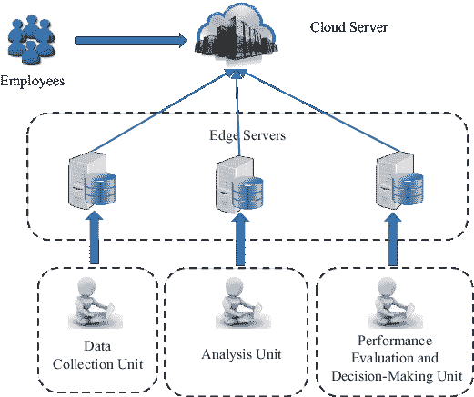

图 6：在云端集成机器学习的 HRM 提议架构。

提议架构的关键特征是：

1. 在这项研究工作中，机器学习/人工智能 用于对员工进行收集、分析和决策。这将展示 Web 3.0 特性在推进人力资源管理流程方面的集成。

2. `KM`（知识管理）或数据挖掘方法用于分析目的。

3. 该模型对于寻找组织中存在问题的最佳解决方案非常高效。

4. 该决策支持系统在时间上也是高效的。

5. 该模型提供的决策没有任何偏见，并间接有助于组织的发展。

## 9 结论

在本章中，讨论了 `KM` 评估结合 `Web 3.0` 可用性对组织知识生成、共享、组织以及其在人力资源管理（HRM）中杠作用的影响。在本章中，通过利用 `Web 3.0` 工具和技术（如 `AI` 和云计算）的优势，提出的框架旨在构建智能 HRM 系统，支持员工在组织成长中的协作学习。所提出的框架将证明 `KM` 对于组织增长的可行性。作为这项工作的延续，计划对智能 HRM 进行实验性实施，以提高其效率水平。

## 参考文献


[1]Helmke, S., Dangelmaier, W. & Uebel, M.F. (2002). 作为客户导向型知识管理技术赋能者的 CRM 系统。249\. [`doi.org/10.1109/picmet.2001.952143`](https://doi.org/10.1109/picmet.2001.952143) →

[2]Kong, F. & Cai, L. (2008). 电子商务环境下的客户知识管理与研究。论文集 – 2008 年知识获取与建模国际研讨会，KAM 2008, 231–235\. [`doi.org/10.1109/KAM.2008.149`](https://doi.org/10.1109/KAM.2008.149) →

[3]Lian, G.G. & Hu, L. (2008). 基于供应链的知识管理研究。2008 IEEE 国际知识获取与建模研讨会会议论文集，KAM 2008, 1187–1190\. [`doi.org/10.1109/KAMW.2008.4810708`](https://doi.org/10.1109/KAMW.2008.4810708) →

[4]Gunawan, A. & Kurnia, S.G. (2019). 通过知识管理提高人力资源质量：PT. GAI 案例研究。2019 年信息管理与技术国际会议论文集，ICIMTech 2019, 482–485\. [`doi.org/10.1109/ICIMTech.2019.8843815`](https://doi.org/10.1109/ICIMTech.2019.8843815) →

[5]Carden, L., Kovach, J.V. & Flores, M. (2020). 流程改进项目中的人力资源管理。收于：组织动力，Elsevier Ltd, 100776\. [`doi.org/10.1016/j.orgdyn.2020.100776`](https://doi.org/10.1016/j.orgdyn.2020.100776). →

[6]Oehlhorn, C., Maier, C., Laumer, S. & Weitzel, T. (2020). 人力资源管理及其对战略业务-IT 对齐的影响：文献综述与未来研究方向。《战略信息系统杂志》，29(4), 101641. [`doi.org/10.1016/j.jsis.2020.101641`](https://doi.org/10.1016/j.jsis.2020.101641).

[7]Czarnowski, I. & Pszczkowski, P. (2020). 人力资源管理决策支持系统的新颖框架。《计算机科学》，176, 1548–1556\. [`doi.org/10.1016/j.procs.2020.09166`](https://doi.org/10.1016/j.procs.2020.09166). →

[8]Jantan, H., Hamdan, A. & Othman, Z. (2010). 人力资源管理中的智能决策支持技术。收于：Devlin, G (编)，决策支持系统，342. →

[9]Zaouga, W., Rabai, L. & Alalyani, W. (2019). 一种基于本体的人力资源管理。《计算机科学》，151, 417–424. [`doi.org/10.1016/j.procs.2019.04057`](https://doi.org/10.1016/j.procs.2019.04057). →

[10]Hammad, M.F., Glaister, K. & Gomes, E. (2020). 战略敏捷与人力资源管理。《人力资源评论》，30(1), 100700. [`doi.org/10.1016/j.hrmr.2019.100700`](https://doi.org/10.1016/j.hrmr.2019.100700). →

[11]Davenport, T. & Marchand, D. (2000). `KM` 只是信息管理？收于：金融时报信息管理：MBA Companion，英国，Pearson Education.

[12]Davenport, T. & Prusak, L. (2000). 《工作知识：组织如何管理知识》，美国，哈佛大学出版社。

[13]Koulopoulos, T. & Frappaolo, C. (1999). 关于知识管理的明智，英国，Capstone Publishing Limited.

[14]Nonaka, I, & Takeuchi, H. (1995). 《知识创造公司》，纽约，Oxford Press. →

[15]Stewart, T.A. (1999). 《知识资本：组织的新财富》，伦敦，Nicholas Brealey Publishing. →

16 知识管理概览。(n.d.) 2020 年 12 月 30 日检索自 [`www.researchgate.net/publication/324603140_Overview_on_Knowledge_Management`](https://www.researchgate.net/publication/324603140_Overview_on_Knowledge_Management) →

[17]Ammar-Khodja, S. & Bernard, A. (2008). 知识管理概述。收于：有效知识生命周期管理方法与工具，柏林海德堡，Springer. [`doi.org/10.1007/978-3-540-78431_1`](https://doi.org/10.1007/978-3-540-78431_1). →

[18]Kurilovas, E., Kubilinskiene, S. & Dagiene, V. (2014). `Web 3.0` – 虚拟学习环境中的学习对象个性化。《人类行为计算机》，30, 654–662. [`doi.org/10.1016/j.chb.2013.07.039`](https://doi.org/10.1016/j.chb.2013.07.039). →

[19]Newman, R., Chang, V., Wills, R. (2016). `Web 2.0` – 过去与未来。《国际信息管理杂志》，36(4), 591–598. [`doi.org/10.1016/j.infinf.2016.03`](https://doi.org/10.1016/j.infinf.2016.03). →

[20]Cheung, K., Yip, K., Townsend, J. & Scotch, M. (2008). `Web 2.0/3.0`: 医疗与生命科学数据融合。《生物医学信息杂志》，31(5), 694–705. [`doi.org/10.1016/j.jbi.2008.04`](https://doi.org/10.1016/j.jbi.2008.04). →

[21]Nath, K., Dhar, S. & Basishtha, S. (2014). `Web 1.0` 到 `Web 3.0` – 网页的演变。2014 年可靠性、优化与信息技术国际会议论文集，86–89. [`doi.org/10.1109/ICROIT.2014.679829`](https://doi.org/10.1109/ICROIT.2014.679829) →

[22]Alabdulwahhab, F.A. (2018),8 月 20. `Web 3.0`: 去中心化网页区块链网络与协议创新。第一届计算机应用与信息安全国际会议，ICAIS 2018.

[23]Ifenthaler, D. (2013). 引言：`Web 3.0` 正在改变学习与教学。收于：迈向 Web 3.0 的学习与教学：认知与教育心理学进展，纽约，Springer.

- [25]Web 3.0. (2014). 《社交网络分析与挖掘全书》，纽约，Springer, 2337–2337. [`doi.org/10.1007/978-1-4614-6170-8_110068`](https://doi.org/10.1007/978-1-4614-6170-8_110068). →

- [26]Dmitriy, C. 什么是 Web 3.0。版本与评估。/ D. Christophe – [获取自]:[`therunet.com/articles/1552-chto-takoe-web-3-0-versii-i-otsenki`](http://therunet.com/articles/1552-chto-takoe-web-3-0-versii-i-otsenki) →

- [27]2013 年俄罗斯的人力资源系统 HRM。分析报告简版。[获取自]:– 访问模式：[`www.tadviser.ru/index.php/HRM`](http://www.tadviser.ru/index.php/HRM) →

- [28]Salacanis, J. Web 3.0，“官方”的定义。/ Jason Salacanis – [获取自]:[`calacanis.com/2007/10/03/web-3-0-the-official-definition`](http://calacanis.com/2007/10/03/web-3-0-the-official-definition) →

- [29]Applebaum, E., Bailey, T., Berg, P. & Kalleberg, A.L. (2000). 《制造优势：为什么高性能工作系统会有回报》，伊萨诸加，纽约州，康奈尔大学出版社。→

- [30]Barney, J.B. (1991). 企业资源与持续竞争优势。《管理学杂志》，17, 99–120。→

- [31]Berggren, C., Bergek, A., Bengtsson, L., Hobday, M. & Söderlund, J. (2013). 《知识整合与创新：国际技术型企业面临的严峻挑战》，英国，牛津大学出版社。→

- [32]Rupietta, C. & Backes-Gellner, U. (2017). 结合知识储备与知识流产生卓越的增量创新绩效——来自瑞士制造业的证据。《工商研究期刊》。→

- [33]Malik, A., Froese, F.J. & Sharma, P. (2020). 人力资源管理在知识整合中的作用：迈向概念框架。《工商研究期刊》，109, 524–535。[`doi.org/10.1016/j.jbusres.2019.01.029`](https://doi.org/10.1016/j.jbusres.2019.01.029)。 →

- [34]Jomthanachai, S., Rattanamanee, W., Sinthavalai, R. & Wong, W.P. (2020). 遗传算法与数据分析在企业级资源管理中的应用。《资源、保护与回收》，161, 104985。[`doi.org/10.1016/j.resconrec.2020.104985`](https://doi.org/10.1016/j.resconrec.2020.104985)。 →

- [35]Sołysik-Piorunkiewicz, A. (2015). 信息技术 Web 2.0/3.0 对知识管理的影响：知识管理系统的可用性研究。《AIP 会议论文集》，1644(1), 219–227。[`doi.org/10.1063/490784`](https://doi.org/10.1063/490784)。 →

- [36]Dominic, M., Francis, S. & Pomerraj, A. (2014). Web 3.0 电子学习。《现代教育与计算机科学国际》，6(2), 8–14。[`doi.org/10.5815/ijmec.2014.02.02`](https://doi.org/10.5815/ijmec.2014.02.02)。 →

- [37]El Hadi, M.M. & Amer, A.M. (2015). 基于 Web 3.0 技术的教育知识系统。《Compunet（信息期刊）》，14(16), 3–11。[`doi.org/10.12816/025769`](https://doi.org/10.12816/025769)。 →

- [38]Sheth, A. & Thirunarayan, K. (2012). 语义赋能 Web 3.0：用于高级应用的企业、社交、传感器及云数据和服务。《数据管理综合论文》，4(6), 1–175。[`doi.org/10.2200/s0043edv01y201207dt031`](https://doi.org/10.2200/s0043edv01y201207dt031)。 →

- [39]Morris, R.D. (2011). Web 3.0：对在线学习的影响。《TechTrends》，55(1), 42–46。[`doi.org/10.1007/s11528-011-0469-9`](https://doi.org/10.1007/s11528-011-0469-9)。 →

- [40]García, V.H.M., Carrillo, T.L. & Castro, S.J.B. (2013). 知识管理模型在复杂系统应用：软件工厂的发展。《智能系统与计算》，172, AISC, 185–195。[`doi.org/10.1007/978-3-642-30867-3_17`](https://doi.org/10.1007/978-3-642-30867-3_17)。 →

- [41]Rosa Yeh, C. & Singhateh, B. (2013). 联结主义实践对台湾计算机行业组织学习的影响。《智能系统与计算》，172, AISC, 219–229。[`doi.org/10.1007/978-3-642-30867-3_20`](https://doi.org/10.1007/978-3-642-30867-3_20)。 →

- [42]Chang, T.K., Huang, H.F. & Chang, S.M. (2013). 理解教育管理者对在线学习使用意图的主观规范。《智能系统与计算》，172, AISC, 267–273。[`doi.org/10.1007/978-3-642-30867-3_24`](https://doi.org/10.1007/978-3-642-30867-3_24)。 →

- [43]Rojas, L.A., Bermudez, G. & Morales, O. (2013). 应用于健康领域的知识管理模型。《智能系统与计算》，172, 537–546。[`doi.org/10.1007/978-3-642-30867-3`](https://doi.org/10.1007/978-3-642-30867-3)。 →

- [44]Samsuri, S., Ismail, Z. & Ahmad, R. (2013). 采纳 Web 3.0 电子记录。《智能系统与计算》，172, 1049–1058。[`doi.org/10.1016/j.resconrec.2020.104985`](https://doi.org/10.1016/j.resconrec.2020.104985)。 →

- [45]Závodská, A., Šramová, V. & Aho, A. (2013). Web 3.0 在价值创造中的作用。《智能系统与计算》，172, 589–600。[`doi.org/10.1007/978-3-642-30867-3`](https://doi.org/10.1007/978-3-642-30867-3)。 →

- [46]Garrigos-Simon, F., Alcamí, R.L. & Ribera, T.B. (2012). 社交网络与 Web 3.0：对组织管理的影响。《管理决策》，50(10), 1880–1890。[`doi.org/10.1108/00251741212957`](https://doi.org/10.1108/00251741212957)。 →

- [47]Waseem Muhammad Zia, M. & Ahmed, F. (2019). Web 3.0 在巴基斯坦学术网站中的可能用途。[`digitalcommons.unl.edu/libphilprac`](https://digitalcommons.unl.edu/libphilprac) →

- [48]Pawełoszek, I. (2015). Web 3.0 在企业战略中的应用。《经济研究》，234, 129–139。[→

- [49]Lal, M. (2011). 教育与研究中的 Web 3.0。《BVICAM 国际信息期刊》，3(2)。→

- [50]Kang, J.-Y.M. & Johnson, K.K.P. (2013). Web 3.0 的一种应用：移动位置定位服装购物服务的服务的正面口碑。《国际纺织与服装协会年度会议论文集》，70(1)。[`iastatedigitalpress.com/itaa/article/id/2185/`](https://iastatedigitalpress.com/itaa/article/id/2185/) →

- [51]Barpute, P., Solankar, D., Hanwate, R., Kurwade, P. & Avhad, K. (2016). IJARCCE building ecommerce framework for online shopping using semantic web and web 3.0. International Journal of Advanced Research in Computer and Communication Engineering, 5, [`doi.org/10.17148/IJARCCE.2016.53242`](https://doi.org/10.17148/IJARCCE.2016.53242). →


- [52] Wadhwa, D. (2015). A study of web 3.0 technologies for collaborative learning. *International Journal of Engineering Technology, Management and Applied Sciences*, 3, 92–97. →

- [53] Payal, R., Ahmed, S. & Debnath, R.M. (2019). Impact of knowledge management on organizational performance: An application of structural equation modeling. *VINE Journal of Information and Knowledge Management Systems*, 49(4), 510–530. [`doi.org/10.1108/VJIKMS-07-2018-0063`](https://doi.org/10.1108/VJIKMS-07-2018-0063). →

- [54] Dario Enrique Soto, D., Jovani Alberto Jiménez, B. & Adriana Xiomara Reyes, G. (n.d.). Application of Knowledge Management to the software testing process Aplicación de la gestión del conocimiento al proceso de pruebas de 软件 (Vol. 38). →

- [55] Omotayo, F. (2015). Knowledge management as an important tool in organisational management: a review of literature. *Library Philosophy and Practice (e-Journal)*. [`digitalcommons.unl.edu/libphilprac/1238`](https://digitalcommons.unl.edu/libphilprac/1238).

- [56] Aghamirian, B., Dorri, B. & Aghamirian, B. (2015). Customer knowledge management application in gaining organization’s competitive advantage in electronic commerce. *Journal of Theoretical and Applied Electronic Commerce Research*, 10(1), 63–78. [`doi.org/10.4067/S0718-18762015000100006`](https://doi.org/10.4067/S0718-1876201500010006). →

- [57] Ranf, D.E. & Herman, R. (2019). Knowledge management contributions in project management. *Land Forces Academy Review*, 23(4), 288–293. [`doi.org/10.2478/raft-2018-0036`](https://doi.org/10.2478/raft-2018-0036). →

# 教育 4.0 与 Web 3.0 在增强学习管理系统中的应用：新冠疫情后封锁后的分析

Sandhya Java Hiba Mohammed Aradhana Balodi Bhardwaj Vinod Kumar Shukla

## 摘要

教育 4.0 是一种全新的学习愿景，使教育者和学徒能够将技术与研究相结合，以发现新的可能性。通过人工智能和虚拟教室所取得的进步彻底改变了教育行业。新型冠病毒的出现迫使全球立即进入封锁，学校和大学转向数字平台以维持学习过程。这场疫情影响了全球约 90% 的学生群体，并迫使教育机构考虑非传统的教学方法。针对疫情对现有系统进行的修改依赖于来自教育 4.0 的资源，而这些资源可能是永久性的。其中许多是对当前模式的设备升级，更侧重于学生从初始阶段开始的发展和学习，并制定了更具差异化和包容性的课程计划。然而，目前或未来所发生的变化将是长期的，可能会带来挑战和优势，并需要通过研究进行广泛规划以顺利实施。源自数据集成的 `Web 3.0` 资产通过个性化、知识管理和增强的信息传递改进了学生的在线学习机会，同时为讲师提供了帮助。本章旨在探讨这些变化对学习社区所有成员的影响。

本章仔细分析了关于教育 4.0 趋势的现有文献。首先，进行了综述以理解 `Education 4.0` 与 `Web 3.0` 实践之间的关联。对样本就其`在线学习`的体验进行了提问。

**关键词：** 教育 4.0、新冠肺炎、在线学习、技术、Web 3.0、疫情后、教育系统

## 1. 引言

目前，我们所知的物理世界通过巨大的进步和不同行业的发展发生了演变，推动人类工作得更多、更好、更快。过去几十年的技术变革将我们推入了数字化时代，虚拟助手让我们的生活变得更容易，3D 环境提供了前所未有的体验，网民在全球范围内联系。所有的好处和坏处都归功于人类通过工业革命证明自己是优越种族的信念。

在工业 4.0 开发和引入之前，有三次不同的工业改革改变了人类对工作环境的体验，并为未来更大的技术转型铺平了道路。第一次工业革命侧重于通过动物和基础机工具的人力劳动。下一次飞跃是 20 世纪初的第二次工业革命，引入了钢铁和电力驱动工厂，极大地提高了生产力。随着电子设备的出现，第三次工业革命被开启，制造商在工作场所采用了更好的数字技术和软件。工业 3.0 中互联网和计算机技术的增长为第四次工业革命发起的通信与协作奠定了基础。通过访问实时数据、信息物理系统和人工智能，工业释放了高级互联性，使企业能够比以往任何时候都更好地理解和控制其运营 [1]。

工业 4.0 的特征是生物世界、物理世界和数字世界的融合，并随着机器人技术、大数据、3D 打印、人工智能和物联网（IoT）等新技术的日益应用。这些进步不仅启动了商业界的数字化进程，还涵盖了消费者、教育、旅游、健康和经济，特别是在 COVID-19 大流行病期间。源自工业 4.0 的第四次医疗革命引入了新的数字工具来使医疗系统自动化并将患者护理置于优先位置。例如，人工智能系统协助医院跟踪电子患者数据和医疗物资，减轻了员工的工作量；而大数据模型则提供了有关疫情期间不同国家患者和医院的趋势和图表 [2]。同样，工业 4.0 还启动了教育领域的数字革命，即被称为“教育 4.0”，其目标是以学习者为中心，并为每一位利益相关者（学生、教师和管理层）提供技术支持。

### 教育的演变

教育 1.0 是一个需要大量记忆和丰富经验的系统，学习者被视为知识的容器。随后，互联网的带来了一场革命，学生打破了传统，为了日常生活的应用而吸收知识，这被称为教育 2.0。在这里，学徒被认为是在进行交流、协作和共同创造。从那里开始，技术开始了更快速移动。学生开始尝试新类型的技术。报告表明，学习应该通过协作来体验，学生应该在团队中工作以产生良好的学习成果，这种系统被命名为教育 3.0。学习者被认为是连接者、创造者和建构者。

紧随其后的最近方法是教育 4.0，它与工业革命 4.0 保持一致。这种模型反驳了之前的观点，因为知识不仅用于消费和生产，还通过智能技术、人工智能和机器人技术来创新多样化的想法，而这些技术现在已深远地影响着我们的日常生活。教育 4.0 可以被视为一种总体的上升趋势，通过融合新旧工具来增强教育系统，并为学生进入工业 4.0 的未来劳动力市场做好准备 [3]。这种学习体系结合了不同的技术和方法，使高等教育机构能够调整其服务和课程，为未来的毕业生迎接一个新的先进开端做好准备。

### 教育的未来

随着人类拥抱技术未来，我们在教育系统中如何教学以及教什么将经历重塑，使系统与 21 世纪的技术保持同步。理解和教学的未来已经从传统方法向新方法发生了巨大的飞跃，因为学生在使用教育者提供的资源投入了更多时间和创造力到课堂表现中，同时需要的指导更少。教师教导满屋听从并回应指令的学生的概念早已成为教育的过去。虽然不是一种完全的方法，但由数字资源驱动的学生学习空间将取代如今的典型教室，为学生创造更个性化的学习体验 [4]，从而帮助学生成为自己教育的伙伴或共同创造者（如图 1 所示）。

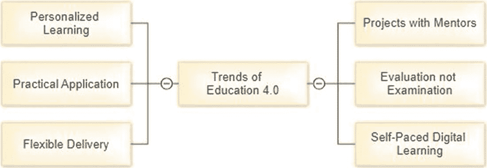

图 1：教育 4.0 的趋势。

促进学生进行协作、沟通和团队工作的体验即使在教室外也需要得到加强并被强烈考虑。学生在大小不一的小组中自己独特的学习项目时，应被允许进行连贯的互动。教室将以物理空间和虚拟环境的形式共存，而翻转学习的概念将被强烈考虑，以便学生可以在家里理解理论，而在课堂上以团队形式工作，将知识应用于现实生活的问题和讨论中。由于当前的情况，随时随地学习的理念已变得至关重要，并应被视为疫情期间的“新常态”，在这种情况下社交距离是必不可少的，学校/大学是虚拟的。在全球范围内提供免费的数字资源和虚拟学习环境是教育 4.0 的重要目标。新的技术驱动型教育系统`Education 4.0`也为老师提供了洞察，帮助他们根据学生的进度制作个性化课程，并提供对他们最有益的互动内容。这让学习者变得更具创新性、成为更好的数据收集者，并抓住任何分享给他们的机会 [5]。

当我们乘着数字时代的浪潮时，没有任何障碍地与全球范围内的人建立联系变得至关重要。信息世界就在我们的指尖，只需点击按钮或发出语音命令。当涉及到数字化时，为学生提供新的、更新的教育系统以应对网络世界是至关重要的。技术可以增强学习，并应该被接受和操纵以造福人类。本章详细介绍了某些革新教育行业的技术，以及它们如何应用于学校或大学各种利益相关者的利益。此外，还采用了定性研究设计以更好地了解学生对疫情期间教育 4.0 工具和技术的观点。

## 2 物联网 (IoT)

物联网简单来说就是连接任何在互联网上收集、共享和处理信息的设备的概念。它涵盖了从家庭到办公室应用的广泛用途，包括智能和可穿戴设备以及其他任何连接到互联网并使用通用语言通信的设备。随着寿命延长，全球人口持续增长并老龄化。这需要创新来管理星球资源并向所有人提供服务。随着人们向城市迁移，交通、污染和能源管理的挑战日益增加。在这一切背景下，个人可以获得信息产品和全球服务，这些服务日益增长，他们期望这些服务能根据个人需求进行定制。技术被认为可以满足这些需求，并为我们增强生活的愿景做出贡献。不同的技能开发的解决方案使世界变得更智能、更紧密。提到物联网，它简单就是连接任何在互联网周围收集、共享和处理信息的设备的概念 [6]。

最近的无线技术（如嵌入式传感器和执行器节点）为物联网（IoT）将互联网转换为完全集成的未来网络提供了机会，接收来自环境的信息并连接到物联网平台。这些平台整合并分析数据，帮助提供有关我们周围世界的各种信息。

物联网是指非传统计算设备的术语，这些设备连接到互联网上，以便在没有人工干预的情况下发送数据并接收指令。由无线传感器网络（WSN）技术实现的通用认可跨越了我们现代生活的各个方面。这帮助我们进行测量并得出推断，同时也让我们有机会理解从精细生态系统、自然资源到城市环境的各种环境指标 [7]。这些高科技设备在通信网络激活中的传播产生了物联网。它影响了我们的日常活动和生活方式；例如在家里，这些智能技术允许我们管理灯光、暖气或任何嵌入智能系统的家用电器，基本上为我们提供了使用智能家居系统的机会，我们可以远程监控和控制家园。基于物联网的技术的类似示例还有追踪你日常活动（步数、心率等）的智能手表、智能汽车和智能手机。数据安全和安全通信确保了你的个人信息始终安全。数据从各种传感器发射，物联网平台接收并整合来自各种来源的收集数据；对数据进行进一步分析并根据需要提取有价值的信息。最后，结果与其他设备共享，以实现更好的用户体验自动化并提高效率。通过这些智能技术，物联网帮助重新定义我们的生活方式，并改变我们与技术互动的方式 [8]。

### 2.1 5G 与物联网

第五代无线技术或我们目前所说的 (`5G`) 是技术的最新迭代，旨在提高全球网络的速度和响应能力。`5G` 是一项发明，由于拥有更丰富的可用带宽和先进的天线技术，它有助于实现无线系统传输数据量的剧增。根据各种报告，`5G` 的速度是 `LTE` 网络的十倍。这种传输速度的巨大增长将允许物联网设备更快地通信和共享数据。`5G` 网络系统与 `IOT`（被认为适用于各种极具前景的领域和应用）的发展，有助于各种蜂窝网络技术的演进，这为在物联网框架中组织大量传感器提供了可能，并通过挑战所有其他通信或数据挖掘技术来帮助处理数据 [9]。

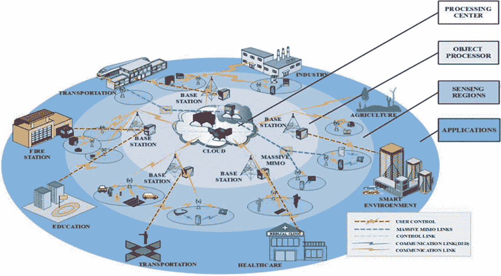

图 2：5G 与物联网的发展。

图 2 显示了物联网与 5G 网络的扩展与融合，这为互联网、智能和万物提供了完美示例。`5G` 用户不再仅仅是普通的智能手机操作者，他们还是车载网络的用户，在这种情况下，用户将这些“车辆”与其他车辆连接。此外，由于与物联网等技术的互操作性，用户数量的增加和用户类型的多样化导致了新型应用的多样形式、各种主观需求，并对理解和满足体验质量（术称为 `QoE`）带来了挑战，QoE 关注全方位的服务体验。此外，还提出了许多其他潜在方法和技术，例如毫米波 (`mm Wave`)、大规模多输入多输出 (`MIMO`) 和机器机器 (`M2M`) 通信，以便 `5G` 网络能够很好适应物联网。总之，这些智能技术帮助世界连接海量设备，并为人类的便利性提供先进且智能的服务做出了巨大贡献 [10]。

### 2.2 物联网在教育中的作用

从教育的角度来看，教室不仅限于讲堂。如如下所示，特别是在大疫情期间，物联网已经遍布全球的校园和学校。有成千上万处提供不同的课程，你可以从世界的任何地方访问它们。对于数百万有特殊需要的学生，`IOT` 可以从课堂环境中可能无法获得的教育资源中获益。一些例子包括：有移动应用程序帮助有阅读障碍的学生阅读和理解材料，有语音识别应用程序帮助有写作困难的学生等。物联网在教育领域的蓬勃发展正在物理或在线课堂中增加更多资源或工具。计算机提供了交互式视听媒体和其他软件，以有效且有趣的方式呈现信息 [11]。

通过在线平台，“随时随地学习”已成为全球人们接受的新形式。无论你在世界的哪个角落，只要有互联网连接和数字设备，整个知识世界就会为你开启。在线学习新技能或学科是非常可能的。新冠疫情让人们最大限度地利用了这些机会。

创建物联网产品对于为学生提供便利的环境非常有帮助，正如图 3 所示 [12]：

*   数字荧光笔可以扫描打印文本并传输到你的设备，使记笔记的过程极其快速方便。

*   射频识别 (`RFID`) 芯片可用于追踪任何物体，例如植物和动物，以获取信息并将其存储在云端供后续分析和推断。

*   `QR 码` 可以嵌入书籍以访问任何额外资源，学生也可以将其嵌入离线工作中，链接到项目的在线作品集中。

*   智能教室——物联网将使未来的教室成为老师和学生的技术天堂。增强现实 (`AR`) 帮助学生获取他们正在学习的物体的详细信息。例如，课程将可以使用带有 AR 概率性的教科书。这类技术能够让学生沉浸在完全全新的环境中。学生有能力近距离探索任何事物，从重型机械到人体，一直到水下生态系统 [13]。

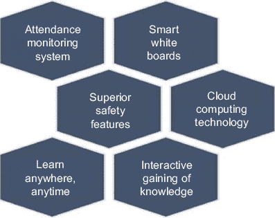

图 3：物联网教育应用。

通过多媒体和网络系统创建智能教室和其他各种新技术，以提供教育和学习机会，这有助于教师和管理部门对学生进行个人或小组的互动和跟踪，特别是在封锁期间，因为在没有合适的传统教室的情况下很难接触到学生。智能教室中呈现的学习资源优化、交互和便利性内容是一项先进的技术概念。

云计算技术是一种基于互联网的计算类型。服务器存储和应用程序是通过互联网交付给组织计算机和设备的各种服务。相应地，5G 为管理提供了无数益处，通过提供云端工作和娱乐的机会来充分利用云计算技术。这种技能（技术）允许降低计算应用托管、内容存储和传输的成本。不同的云计算模型对于最大化利用 5G 智能教室教育系统所提供的服务至关重要。超可靠高速的 5G 等待时间是该应用的催化剂 [14]。

同样，可穿戴设备通过监控学生的进出移动来帮助解决学生的问题。这些设备连接到管理层的中央数字平台。通过这些自动化，甚至不需要对学生进行点名，因为这些设备会自动检测学生是否到场。如果父母对孩子的行踪担心，这些技术也可能通过发送消息帮助他们检查学生的位置和行为 [15]。与 IoT 传感器结合，这些设备仅允许授权人员进入建筑大门，因此当未经许可的人员到达时，访问将被拒绝。

同样，另一个例子是报告自动化，这是一种连接设备，使学校管理员能够利用 AI 产生关于广泛问题的周报、月报或年报，包括学生进度报告、财务规划报告以及学校董事会报告等。

### 2.3 IoT 的未来

IoT 行业的未来被视为一个巨大的成功。根据 *Business Insider* 的情报估计，到 2020 年，将安装 240 亿遵循 IoT 路径的设备，IoT 收入在未来几年将达到约 3570 亿，这为 IT 行业带来了大量工作机会。随着我们从 `www`（静态页面网）移动到 `web2`（社交网络网）再到 `web3`（无处计算网），使用复杂的直观查询进行按需数据的需求显著增加。随着云技术以及数据挖掘和大数据分析的兴起，IoT 的未来看起来充满前景，而且它将提供的应用亦是如此 [16]。

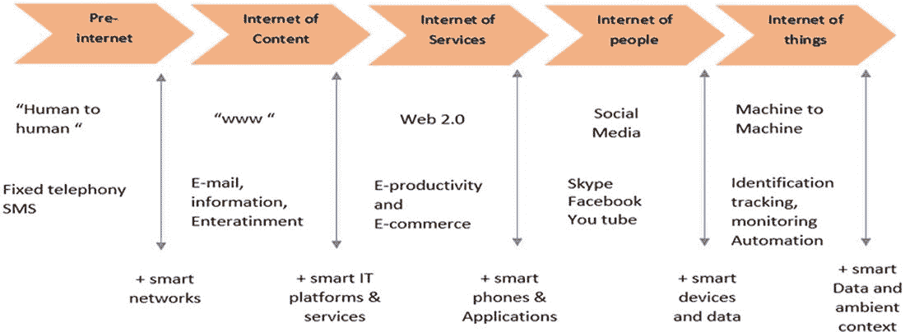

图 4：IoT 的发展。

IoT (图 4) 将以非常快的速度扩展，随之而来的是每个领域领域的巨大进展。我们可以利用 IoT 的力量来实现智能学习环境，促进更好的学习和更高的留存率。教育领域的这一进步可以在技能和知识方面培养更优秀的人才。

## 3 人工智能

第四次工业革命的技术和创新迅速蓬勃发展并改变了这个星球的过程。人工智能，或 AI，是工业 4.0 背后的驱动力。AI 是通过算法的应用和计算环境的发展的人类智能复制。AI 由计算机科学家设计，以机器学习的形式增强并模仿人类能力，并执行与我们相似的功能，如规划、推理、学习和解决问题。围绕 AI 的研究涉及开发机器和代码来自动化需要某些智能的日常任务，并为现实问题提供解决方案。AI 系统不断在商业、军事、医学等不同领域被开发和使用 [17]。


在日常家庭应用中，AI 通过`Siri`和`Alexa`作为数字助手应用于我们的手机和智能家居设备，它们运行在流行的机器学习软件上。人们在线在聊天框中的大部分互动由 AI 软件驱动，该软件可以识别客户查询并根据其知识做出回答。`Bing`、`Google`等搜索引擎是通过 AI 系统创建的算法运行的；这些例子展示了人类与 AI 机器互动的深度，这种互动在过去几年中大幅增加。大部分制造和业务流程也依赖于 AI 的顺利运行及其对用户界面的理解 [18]。

自然语言处理 (NLP) 和机器学习是应用常用的 AI 形式，用于图像识别、深度学习和规划、内容提取和文本生成。AI 的语音组件被高度用于机器翻译和语音转文本/文本转语音。大型组织在不同领域部署这些 AI 系统，主要是外部通信 (71%)，其次是客户互动 (66%) 以及员工管理和安全 (60%)。AI 驱动的行业预计比非 AI 竞争对手每年增长 30% [19]。

## 3.1 AI 的现状趋势

专家认为 AI 将主导未来，特别是考虑到发达和发展中国家机器学习软件和 AI 技能的增长趋势。*Forbes* 报告称，AI 技能将在未来 10 年内渗透美国 (100%)、中国 (92%) 和印度 (84%)（如图 5 所示）。同样，全球科技公司的 AI 领袖认为，未来五年对由于数据传输和隐私监管而创建的机器学习/人工智能模型产生巨大影响 [20]。最新研究还报告说，86% 运行 AI 模型的企业通过对人类需求的更好理解受益，25% 采用 AI 的企业预计在未来几年用户群和收入将会增加 [21]。

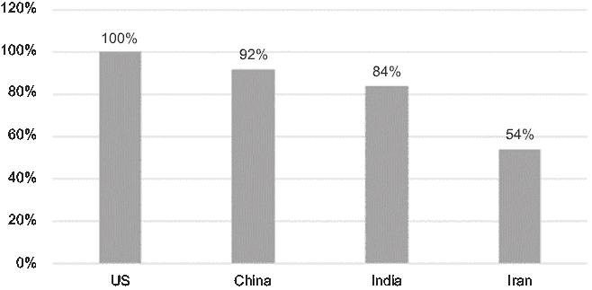

图 5：人工智能技能的预测。

2020 年疫情对 AI 行业尤为重要，因为这段期间的变化揭示了机器学习软件在增强员工规划、客户留存和模拟建模方面的真实价值。2020 年在增强和自动化业务流程方面的应用增长趋势将继续，因为此类技术的采用者报告了现有服务和产品的改进。

顺应工业 4.0 的转型，许多公司在疫情期间也被迫采用基于 AI 的解决方案，以满足其业务需求，并通过高级分析和机器学习获取灵活的解决方案[22]。教育领域受到全球突然封锁带来的地震性转变的深远影响；学校/大学/学院的所有利益相关者都采用了带有 AI 功能的应用程序（如`Zoom`和`Microsoft teams`）来继续学生的学习过程。同样，疫情也带来了对情感 AI 软件的需求，这类软件能够通过识别用户的语音和面部表情来理解复杂的人类情感和认知状态[23]。

## 3.2 AI 在教育行业中的角色

人工智能和机器学习早已开始改变教育行业，而技术的最新进展使得增加学生的学习机会和实现个性化学习成为可能。AI 系统的各种应用正在改变学生的学习和理解方式，同时让所有学生都能通过计算机和智能设备轻松获得教育，特别是对于那些无法参加实体课程的学生。这种技术正在影响从幼儿园到高等教育的整个学习过程，通过提供自适应教学功能和个性化工具，提供了更多机会来增强学生体验[24]。除了学习者之外，AI 模型还支持教师管理繁琐的任务，并帮助教育管理机构通过自动处理行政职责。

在教育 4.0 革命期间，通过 ML 和 AI 建模设计了特定的软件，这些软件显著改善了学生在教室内外的学习。AI 机器人现在可以为教室创建数字内容；可以使用此类机器人开发虚拟界面，为学生提供定制化学习。由 AI 系统驱动的应用程序`Cram101`浓缩了各种教科书的内容，并通过学习指南、闪卡和练习测试为学生提供更易消化的材料。AI 技术现在允许教师通过提供课堂差异化工具来优先考虑个性化学习。像 Carnegie Learning 这样的公司正在为有特殊需求和学习障碍的学生开发辅导系统，通过使用学生提供的数据识别知识漏洞并创建特定材料，提供课程、测试和即时反馈。此类应用仍处于早期测试阶段，但很快就可以作为完全知情的数字教授工作，拥有广泛的学习风格来帮助学生[25]（如图 6）。

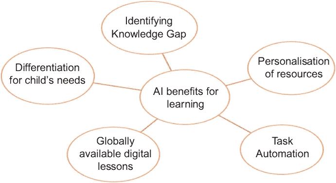

图 6：AI 对教育的好处。

虚拟现实和增强现实技术可以与 AI 结合，为学生创建现代化的数字学习环境，通过故事、角色和 3D 游戏让理解成为一种真正独特的体验。工具和在线应用程序可以为残障/身体受损的学生或说不同语言的学生创建开放的全球化教室。这为世界偏远地区的儿童或像疫情期间因疾病无法上课的学生开启了学习机会[27]。AI 本质上可以弥合学习与课堂可及性之间的差距。

对于教育工作者来说，AI 开启了无限可能，从减轻负担到改进课程和教学。教师最大的工作之一是批改和评估作业，同时为学生提供宝贵的反馈以进行改进。AI 应用已将多选题的评分过程计算机化，让教师能够花更多时间与学生进行个性化交流[28]。开发者还在编写用于论文和书面答案的软件，这可以为教育者提供更多时间在课堂上提供适应性和理解。

教育者和讲师必须为学生设计具有差异化的课程和资源，内容应适应 21 世纪网民的能力。像`Netex Learning`这样的平台允许教师通过在线 AI 助手通过视频、音频和其他资源创建数字课程和内容，这些资源是专门为不同需求的学生设计的[29]。在疫情期间，教师能够使用许多虚拟 AI 平台增加学生的学习动力并通过定制培训提高知识。通过结合教师和技术的优势，可以实现教育 4.0 的目标。

除了学生和教师，学校和大学的管理还承担着重要职责，通过 IT 流程和虚拟助手可以更高效地完成。通过 ML 对历史数据建模，管理层可以跟踪部门运营并获得未来预测。预测可用于记录和维护学校供应和食堂食品库存，以避免未来的浪费。AI 通过自动化文件处理和学生录取流程使录取流程受益。这有助于消除录取过程中的人为偏见，公平选择未来的学习者。AI 系统可以显著提高教育机构的生产力，同时降低运营成本并增加其社会可见度[30]。

研究人员和科学家正在探索 AI 技术，为教育 4.0 下的学生创建智能虚拟环境和数字平台。报告显示，南加州大学正在开发能够识别学生面部线索和手势并以定制的语言或非语言线索做出回应的机器人。与数字学习和模拟相关的应用预计是未来几年收益最大的市场之一。全球 AI 分析师表示，教育行业的 AI 技术在 2018 年到 2023 年间将增长 45%，美国教育市场预计到 2023 年将达到 36.8 亿美元（如图 7）。

人工智能不仅能够胜任教育的个性化、效率化和全球化，也适用于教师和教育机构的管理部门。当世界见证人工智能在教育及全球其他行业中呈指数级增长时，利益相关者理解其益处并投资采用人工智能技术至关重要，这将为学生、教师和管理层创造更好的学习环境。

## 4. 方法论

研究方法论是指识别问题、选择并分析从参与者处收集的数据以完成论文中所述目标的过程 [32]。数据是通过问卷调查收集方法获取的。这帮助我们更好地了解学生对“教育 4.0”技术的体验。数据收集样本由 315 名来自印度和中东的男女混合学生（125 名中学生和 190 名大学学生）组成。样本采用便利抽样技术根据偏好属性进行选择。我们与受访者建立了良好的关系，并在表单中明确说明了有关调查的指示。开发了一份针对学生的关于教育 4.0 及其技术的在线问卷，并包含有关识别其当前教育水平的通用问题。对象的机密性得到了完全维护。通过问卷收集的数据经过分析，并以图表的形式呈现。

## 5. 发现

我们开展了一项关于疫情期间电子学习应用教育 4.0 工具和技术的研究调查，并将其分发出去以收集有关学生视角的信息。对 310 名学校和大学参与者的数据分析表明，学生对将这些数字工具引入其学习环境表现出积极兴趣。疫情确实影响了传统的学习形式，但技术的恰当应用增强了学生的体验。

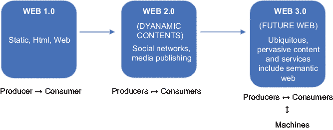

图 8：Web 3.0 的发展。

在研究中，首先询问受访者他们在疫情期间对数字教室的总体体验。如表 1 所示，43.4% 的受访者体验良好，23.7% 持中立态度，10.5% 的人对教育转向数字平台的体验非常好。大多数学生认为教育者在封锁期间使用的各种在线工具和技术非常有价值，并增强了他们的体验。

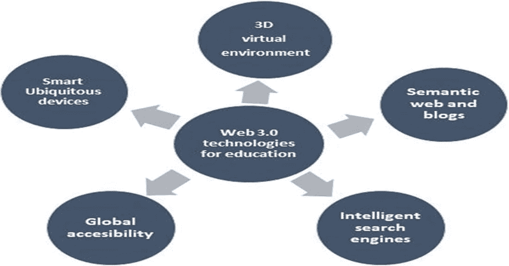

图 9：用于教育的 Web 3.0 技术。

参考表 2，我们可以分析出 44.1% 的样本人群同意学校和大学共享的资源使在线教育变成了更丰富的学习体验。15.7% 的样本声称教育 4.0 的工具和资源没有用，或者没有帮助他们在疫情期间为其数字教室创造更好的学习体验。然而，有 40.3% 的人对资源的有效性持中立立场。

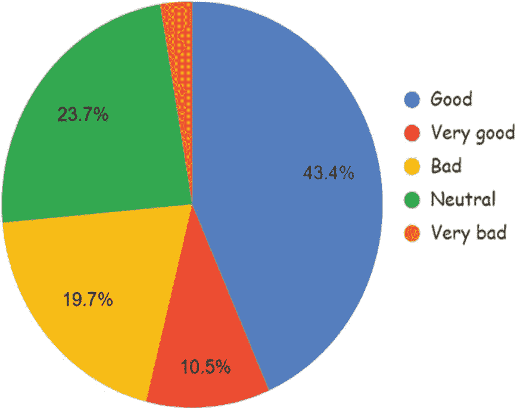

表 1：“你会如何描述你在疫情期间的在线学习体验？”

根据本章进行的研究，某些人工智能（AI）和物联网（IoT）技术在学校和大学的使用被最为突出，例如，将特定的教育 4.0 开发工具作为选项提供给受访者，以了解其中哪些对他们的教育有用。结果显示，63% 的学生使用过`Turnitin`、`Grammarly`以及其他此类 AI 写作助手进行学习；39% 的学生接受过或使用智能互动白板进行学习；32% 的学生使用了 AI 驱动的 MOOC 和语言应用程序来提高技能；28% 的学生使用了数字智能荧光笔使学习材料更易理解（如表 3 所示）。这表明，许多为教育部门开发的物联网和人工智能工具正在被学生利用以增强他们的数字学习。

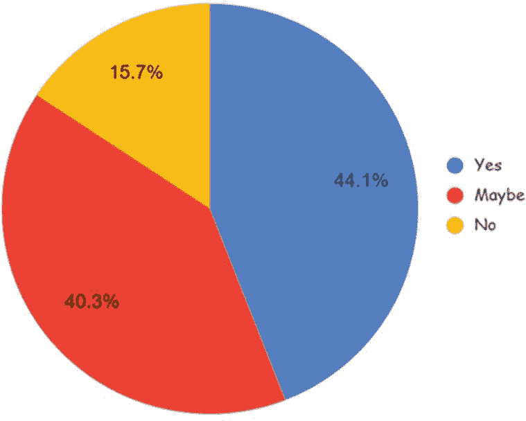

表 2：“你认为疫情期间学校和大学共享的资源和工具是否让智能数字教室成为了更好的学习体验？”

参考表 4，详述了 Web 3.0 及其在在线课程或教育过程中的应用便捷性。所示，58.5% 的人口表示“他们没有”发现 Web 3.0 的工具之用，15.7% 的人对 Web 3.0 及其应用的用用持中立立场。尽管有 25.9% 的人同意 Web 3.0 已应用于他们的学习环境并辅助了他们的在线教育。这说明很大一部分人口并不了解 Web 3.0 及其应用，或者这些工具没有被恰当地应用于学生的教育中。

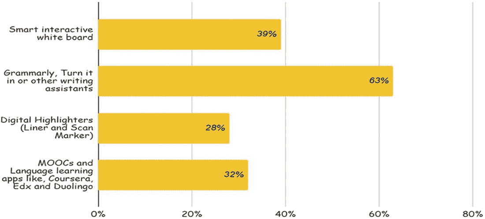

表 3：“你是否利用过这些教育 4.0 工具进行数字学习？”

在询问学生有关在教室中使用的电子学习数字工具的体验时，了解他们为了改进体验而给出的建议也至关重要。大多数回答（如表 3 所示）集中在让课堂“与 3D/虚拟环境更具互动性”以及提供“具有多种动画和媒体的、易于吸收的内容”。其他人则建议“在教室中开展混合式学习”以及“课程个性化并改进工作反馈”，以提高他们在学校和大学的学习体验。本章讨论的 AI 和 IoT 系统可以通过不同的媒介适当应用，以获得积极的学生成果。

分析样本数据后，结果显示，由于样本人群对上述应用缺乏了解，新技术仍未被考虑。大多数学生使用了最新的教育 4.0 工具来最大限度地参与和改进他们的数字学习体验。从回答中，我们了解到，疫情期间电子学习资源的恰当实施增强了学生的课堂环境，因为虚拟教室和课程数字资源的增加在疫情后情况下得到了更高的偏好。本研究给出的建议应被教育者和学校/大学管理层强烈考虑，以提高提供给学生的整体学习质量。

## 6. Web 3.0

基于网络的教育和学习通过互联网的演进开启了一个广阔的世界，并给了我们接触惊人前景的机会。如图 8 所示，基于网络技术的演进始于被称为`web 1.0`的过时版本，它确立了作为“只读”媒介的角色。这是互联网的诞生。它就像一个中心化网络，其中主服务器托管网站，不同的服务器访问该网站。这种技术的主要缺点是，如果任何一个服务器离线，整个网站就会离线。下一代是`Web 2.0`，据说是它是“读/写”媒介。这是全球范围内人们正在使用的增强互联网服务的产物，例如 Facebook、Netflix 和 Google。`Web 2.0`可以解释为分布式技术系统，服务器无处不在并由多个数据中心控制，每个数据中心都维护一份数据副本，因此其优势是，即使其中一个数据中心离线，其他团队仍然可以正常工作，应用程序的可用性也不会中断 [33]。

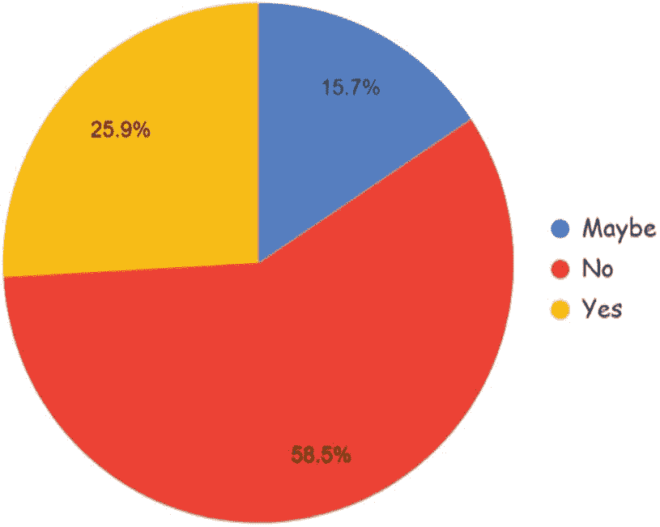

图表 4：“Web 3.0 的应用（如 Alexa、Siri、虚拟现实和 3D 图形）是否辅助过你的课堂教学或教育过程？”

目前网络最新的更新版本被称为`Web 3.0`。这个更新、更先进的版本没有所有权，有助于按照互联网最初创造者的意图重构互联网，这意味着自由、抗审查、任何人都可以参与并产生可持续收入、更激烈的竞争以及更低的门槛，在目前的情况下，它进入市场变得更容易。`Web 3.0`由去中心化系统组成，服务器的每个节点都能维护一份数据副本，而且每个节点都能验证所有数据，这意味着对任何人之前添加到实现中的内容可以进行更快的验证 [34]。

一个最好的例子将是比特币，通过应用程序处理的所有数据都将被标记时间戳。这项技术是一个非常规自动化时代，允许用户不仅可以读和写，还可以执行和创新自己的想法。这种机制允许机器实现推理和解决问题，而这以前只被认为是人类大脑的。在短时间内，`Web 2.0`和新颖的`Web 3.0`技术处于创造新工具的边缘，以简化工作并帮助每个个体促进基于网络的教育和学习 [35]。

互联网经历了广泛的发展，并且无可否认增长得更快。万维网（`www`）已用于改进我们的协作和通信，同时让资源交换和交付优质内容变得更容易。世界处于互联网的第三代，特定的创新帮助我们更好地定义对我们最有用的功能。语义网增强了我们搜索和分析单词及数据真实含义的能力，帮助全球范围内生成、连接和共享内容。Google、Facebook、微软和其他大型科技巨头已采用语义网技术来改进它们的数据库结构和搜索引擎响应。`Web 3.0`的另一个增强功能是通过 3D 图形和高速连接带宽实现的虚拟化 [36]。这种趋势引领了三维应用程序来创建用于探索的虚拟世界/环境，例如`Second Life`这样的应用程序。

随着`Web 3.0`，我们的在线搜索选项和结果也取得了卓越进步。搜索引擎不再局限于文本输入，还允许使用各种媒体对象作为搜索输入。例如，Google 允许我们为设备添加图像，以便检索与输入中对象具有相似特征的其他图像；类似的技术也被开发出来，允许使用视频和音频。在互联网的这一阶段，开发者和研究人员在无线网络和通信技术取得了显著进展。无处不在的设备和平台现在允许我们随时随地访问和操作大量数据，即使在移动中也是如此，例如 Apple 智能手表，允许我们控制家电并充当我们的个人助手。这种技术提高了我们的生活质量和世界经济；随着不断的发展，我们可能在虚拟上实现更大的可能性 [37]。

### 6.1 Web 3.0 技术在教育中的应用

在过去的几年里，不同的教育机构一直在通过网络提供招生、活动管理和数字学习环境的服务，将学生与优质资源以及彼此连接起来以便更好地理解。Web 3.0 的服务和工具帮助培养了开放的学习方法 [38]。技术的特征可以仔细地应用于教育领域，使学生、教师和学校/大学的管理受益。优质的学习资产可以通过无处不在的设备和平台变得先进，这些设备还可以跟踪学生在学习环境中的位置和进度。语义网的使用具有巨大的教育潜力，因为我们通过首选通道对各种兴趣和活动的访问是完全开放的。教育工作者可以利用语义博客和智能通过各种媒体和动画改进他们的教育内容 [39]。

同样，学生的数字教室可以通过 3D 技术和增强现实来改进，创建虚拟学习环境，如实验室、博物馆和动物园，使理解和协作成为一种愉快的体验。像`Google Virtual Tour`这样的应用程序为学生提供了探索可能无法访问的世界其他的机会。其他此类技术进一步结合`AI`和`IoT`工具，可以为学生创造更好的机会和环境。

## 7. 结论

本章探讨了从工业革命 4.0（`IR`）中提取的教育 4.0 的各种趋势。通过对关于`IoT`和人工智能现有文献的系统和模型的审查，我们对它们在教育领域的应用有了更深入的理解。由`AI`模型驱动的智能虚拟助手和学校管理系统可以提高提供的教育质量。此外，数字高笔和智能白板等应用将增强学习资源和教学方法。通过`Web 3.0`的先进工具，一种开放、个性化的学习方法已经开启。针对 315 名学生样本设计的关于对`Education4.0`工具体验的问卷收集到的结果显示，我们的整体感知是积极的。学生对疫情期间的数字化学习体验表示满意，并对互动和混合教育提出了建议。尽管学习者倾向于回到传统教室继续知识发展，但他们对技术的经历促使教育者和管理层产生了需求，为他们的学习植入数字资源。

本章为探索`Education4.0`的其他新技术奠定了坚实的基础，这些技术需要对其在当前教育行业中的应用进行审查和研究。通过这项研究，我们希望强调为网民学生提供关于正确使用`AI`和`IoT`技术及资源的教育，以培养灵活的即兴技能。对研究人员和开发者的未来建议是仔细考虑技术在教育中的应用，特别是针对后疫情或未来的场景。为学生和教师提供多种资源的便捷访问和安全技术可以创造改进的学习体验。应该与`Web 3.0`工具协作开发适当的`AI`和`IoT`技术模型，以探索第四次教育革命的机会和。

## References

[1]Crnjac, M., Veža, I. & Banduka, N. (2017). From concept to the introduction of industry 4.0. International Journal of Industrial Engineering and Management (`IJIEM`), 8(1), 21–30. →

[2]Jayaraman, P.P., Forkan, A.R.M., Morshed, A., Haghighi, P.D. & Kang, Y. (2019, Dec.). Healthcare 4.0: a review of frontiers in digital health. WIREs Data Mining and Knowledge Discovery, 10(2). doi: 10.1002/widm.1350. →


[3]Bonfield, C.A., Salter, M., Longmuir, A., Benson, M. & Adachi, C. (2020, Jan.). Transformation or evolution?: Education 4.0, teaching and learning in the digital age. Higher Education Pedagogies, 5(1), 223–246. doi: 10.1080/23752696.2020.1816847. →

[4]Keser, H. & Semerci, A. (2019, Aug.). Technology trends, Education 4.0 and beyond. Contemporary Educational Researches Journal, 9(3), 39–49. doi: 10.18844/cerj.v9i3.4269. →

[5]Bonfield, C.A., Salter, M., Longmuir, A., Benson, M. & Adachi, C. (2020, Jan.). Transformation or evolution?: Education 4.0, teaching and learning in the digital age. Higher Education Pedagogies, 5(1), 223–246. doi: 10.1080/23752696.2020.1816847. →

[6]Gaur, B., Shukla, V.K. & Verma, A., Strengthening people analytics through wearable `IOT` device for real-time data collection 2019 International Conference on Automation, Computational and Technology Management (`ICACTM`), London, United Kingdom, 2019, 555–560, doi:10.1109/ICACTM.2019.8776776. →

[7]Allam, Z. & Dhunny, Z.A. (2019, Jun.). On big data, artificial intelligence and smart cities. Cities, 89, 80–91. doi: 10.1016/j.cities.2019.01.032. →

[8]Shukla, V.K. & Singh, B., Conceptual framework of smart device for smart home management based on RFID and `IoT` 2019 Amity International Conference on Artificial Intelligence (`AICAI`), Dubai, United Arab Emirates, 2019, 787–791, doi:10.1109/AICAI.2019.870131. →

[9]Unlocking `IoT` Data with 5G and `AI`, Innovate, Jun. 26, 2019. →

[10]Wang, D., Chen, D., Song, B., Guizani, N., Yu, X. (2018, Oct.). From `IoT` to 5G `IoT`: The next generation `IoT`-Based algorithms and 5G technologies. IEEE Communications Magazine, 56(10), 114–120. doi: 10.1109/mcom.2018.170130. →

[11]Ajazmoharkan, Z., Choudhury, T., Gupta, S., "Internet of Things and its applications in E-learning," 2017. [Online]. Available: https://fardapaper.ir/mohavaha/uploads/2017/10/Internet-of-Things-in-E-learning.pdf →

[12]Alam, T. & Benaida, M. (2020, May). Blockchain and internet of things in higher education. Universal Journal of Educational Research, 8(5), 2164–2174. doi: 10.13189/ujer.2020.08556. →

[13]Bai, H. & Zhang, Q. (2020). English classroom teaching system based on 5 network and internet of things. Microprocessors and Microsystems, 10342. doi: 10.1016/j.micpro.2020.10342. →

[14]Banu, J., Revathi, R., Suganya, M. & Merlin, N. (2020, Jan.). `IoT` based Cloud Integrated Smart Classroom for smart and sustainable. Procedia Computer Science, 172, 77–81. doi: 10.1016/j.procs.2020.05.012. →

[15]Ciolacu, M., Binder, L. & Popp, H. (2019). Enabling `IoT` in education 4.0 with biosensors and artificial intelligence. IEEE Xplore, Oct. 01, https://ieeexplore.ieee.org/abstract/8990763 accessed Jan. 07, 2021. →

[16]Zantalis, F., Koulouras, G., Karabetsos, S. & Kandris, D. (2019, Apr.). A review of machine learning and `IoT` in smart transportation. Future Internet, 11(4), 94. doi: 10.3390/fi11040094. →

[17]Vinuesa, R. et al. (2020, Jan.). The role of artificial intelligence in achieving the Sustainable Development Goals. Nature Communications, 11(1). doi: 10.1038/s41467-019-14108-y.

[18]Marr, B. (2019, Dec. 16). The 10 best examples of how ai is already used in our everyday life. Forbes. →

[19]Cockburn, I., Henderson, R. & Stern, S., "Nber Working Series the Impact of Artificial Intelligence," 2018. [Online]. Available: https://www.nber.org/system/files/working_papers/w24449/w24449.pdf →

[20]Zhang, B. & Dafoe, A. (2019). Artificial intelligence: American attitudes and trends. SSRN Electronic Journal, doi: 10.2139/ssrn.3312874. →

[21]Borana, J. "Applications of Artificial Intelligence & Associated Technologies," 2016. https://www.semanticscholar.org/paper/Applications-of-Artificial-Intelligence-%26-Borana/d5b061e6565ce421b4b0b7d56296e882085dc308?p2df (accessed Jan. 08, 2021). →

[22]Bullock, J., Luccioni, A., Pham, K.H., Sin, C. & Luengo-Oroz, M. (2020). 应对 COVID-19 的人工智能应用领域图谱。arXiv.org, [`arxiv.org/abs/2003.11336`](https://arxiv.org/abs/2003.11336), 2021 年 1 月 8 日 访问。 →

[23]Chassignol, M., Khoroshavin, A., Klimova, A. & Bilyatdinova, A. (2018). 教育中的人工智能趋势：一种叙述性概述。Procedia Computer Science, 136, 16–24. doi: 10.1016/j.procs.2018.08.233. →

[24]深度学习进入校园：迈向教育中 AI 的关联理解。Learning, Media and Technology, 2020, [`www.tandfonline.com/doi/abs/10.1080/17439884.2020.1686017`](https://www.tandfonline.com/doi/abs/10.1080/17439884.2020.1686017) 2021 年 1 月 8 日 访问。 →

[25]Ciolacu, M., Tehrani, A.F., Beer, R. & Popp, H., 教育 4.0 – 利用机器学习方法提升学生表现 2017 IEEE 第 23 届电子封装设计与技术国际研讨会 (SIITME),2017 年 10 月, doi:10.1109/siitme.2017.8259941 →

[26]Ciolacu, M., Tehrani, A.F., Binder, L. & Svasta, P.M., 教育 4.0 – 人工智能辅助高等教育：机器学习支持学生成功的早期识别系统 2018 IEEE 第 24 届电子封装设计与技术国际研讨会 (SIITME),2018 年 10 月, doi:10.1109/siitme.2018.8599203. →

[27]Yusof, A., Adnan, A., Mustafa, N. & Ahmad, M. (2019). 教育 4.0 基于球形视频（360°）和虚拟现实（VR）体验的沉浸式学习。ResearchGate,2011 年 11 月 5, [`www.researchgate.net/publication/337146653_Education_40_Immersive_Learning_with_Spherical_Videos_360_and_Virtual_Reality_VR_Experiences`](https://www.researchgate.net/publication/337146653_Education_40_Immersive_Learning_with_Spherical_Videos_360_and_Virtual_Reality_VR_Experiences) 2021 年 1 月 8 日 访问。 →

[28]Azah Mansor, N., Abdullah, N. & Abd Rahman, H. (2020 年 7 月). 迈向教育 4.0 环境中的电子学习特征：文献研究。Indonesian Journal of Electrical Engineering and Computer Science, 19(1), 442. doi: 10.11591/ijeecs.v19.i1.pp442-450. →

[29]Shen, L. & Su, A. (2020). AI 时代教师角色的变化。AI 与机器学习时代的教育变革, 1–25. doi: 10.4018/978-1-5225-7793-5.ch001. →

[30]Vazhayil, A., Shetty, R., Bhavani, R.R. & Akshay, N., 关注教师教育以在学校引入 AI：观点与说明性发现 2019 IEEE 第 10 届教育技术会议 (T4E),2019 年 12 月, doi:10.1109/t4e.2019.00021. →

[31]Williamson, B. & Eynon, R. (2020). 教育中 AI 的趋势、缺失链接与未来方向。Learning Media and Technology,2020 年 7 月, doi: 10.1080/17439884.2020.179895. →

[32] 教育 4.0 – 利用机器学习方法提升学生表现 2017 IEEE 第 23 届电子封装设计与技术国际研讨会 (SIITME),2017 年 10 月, doi:10.1109/siitme.2017.825994 →

[33] 教育 4.0 – 人工智能辅助高等教育：机器学习支持学生成功的早期识别系统 2018 IEEE 第 24 届电子封装设计与技术国际研讨会 (SIITME),2018 年 10 月, doi:10.1109/siitme.2018.8599203. →

[34] 教育 4.0 基于球形视频（360°）和虚拟现实（VR）的沉浸式学习。ResearchGate,2019 年 11 月 5, [`www.researchgate.net/publication/337146653_Education_40_Immersive_Learning_with_Spherical_Videos_360_and_Virtual_Reality_VR_Experiences`](https://www.researchgate.net/publication/337146653_Education_40_Immersive_Learning_with_Spherical_Videos_360_and_Virtual_Reality_VR_Experiences) 2021 年 1 月 8 日 访问。 →

[35] 迈向教育 4.0 环境中的电子学习特征：文献研究。Indonesian Journal of Electrical Engineering and Computer Science, 19(1), 442. doi:10.11591/ijeecs.v19.i1.pp442-450. →

[36] AI 教师角色的变化。AI 与机器学习时代的教育变革,1–25. doi:10.4018/978-1-5225-7793-5.ch001. →

[37] 关注教师教育以在学校引入 AI：观点与说明性发现 2019 IEEE 第 10 届教育技术会议 (T4E),2019 年 12 月, doi:10.1109/t4e.2019.00021. →

[38] 教育中 AI 的趋势、缺失链接与未来方向。Learning Media and Technology,2020 年 7 月, doi:10.1080/17439884.2020.1798995. →

[39] 2018 社会科学及相关学科定性研究，Mohajan, H.2018 社会科学及相关学科定性研究，Uni-muenchen.de: https://mpra.ub.muenchen.de/85654/1

[40] 教育中的 Web 3.0 ResearchGate, Rajiv, & Lal, M. 教育中的 Web 3.0, [`www.researchgate.net/publication/2841117_Web_30_in_Education`](https://www.researchgate.net/publication/2841117_Web_30_in_Education), 2021 年 1 月 8 日 访问。 →

[41] 定义 Web 3.0：机遇与挑战。Emerald Insight, Barassi, V. & Isaias, C., doi:10.1108/EL.

[42] Web 3.0 在 2.0 之后吗？Miranda, P., Francis, S. & Pilomen, A. 现代教育与计算机科学, 2, 57–73. doi:10.1177/14614458

[43] Web 3.0 中的电子学习，jawarneh, S. 2019 年 2 月. 教育计算期刊, 32(1), 10.1007/12520. →

[44] Web 3.0 与 2.0 技术：一种框架概念，Ohei, K. & Brink, R., 2019. →

---

# 医疗实践中的人工智能（AI）辅助算法，对遗传性疾病的关注

Tapash RudraS. Goyal

### 摘要

现代医疗实践随着不断改进达到了新的高度。医学界现在能够利用尖端工具对抗致命疾病。然而，某些领域仍然模糊，遗传性疾病是其中的关键。由于与基因组相关，遗传性疾病具有独特性。此外，真实数据的稀缺、全球范围内患者数量有限以及诊断手段的不足共同导致了这些疾病的隐藏性。因此，迫切需要新的方案来发现与其相关的的事实。关键词：人工智能、算法、机器学习、遗传性疾病、


随着新型和复杂技术的出现，医学科学正向一个新的轨道飞速发展。然而，在过去的几十年里，人工智能（`AI`）的应用为其增加了一个全新的维度。各种`AI`方法的影响引发了一个困境，即自然智能还是人工智能才是全球医疗保健系统的潜在路线图。坦率地说，通往后续继治疗的疾病诊断是不可替代的，但这种现代技术的热潮可以极大地促进医疗专业人员确定疾病的结论。同时，现代`AI`驱动的分析开启了一扇新窗户——能够将海量的临床数据解析为相对易懂的形式。这使得医疗专业人员和临床医生在决策方面变得更有依据 [1, 2, 3, 4, 5]。

### 1.1 医学研究中的人工智能：现状说明

`AI`的终极目标是将人类解释为机器。此外，基于`AI`的机器是量身定制的，旨在使智能体中的通用智能理论具体化。人类和动物等生物实体在更广泛的视角下被超越其局限地处理，以实现可能结果的最大范围。`AI`的概念极具进取性；同时，它是一股可以解决自千年来存在的哲学疑虑的力量。

我们正向工业革命 4.0 迈进，这是关于通过确保数字化供应链而非传统供应链来获得更高效率，从而实现快速创新的发展的叙事。在工业 4.0 的应用方面，医学科学是一个潜在的发力领域。改良的植入物、技术和现代设备是其中的一些重要属性。此外，物联网（`IoT`）和服务互联网提升了现代与医疗保健部门相关的整体进展 [6]。工业 4.0 的另一个引人注目的方面是通过量子计算或云计算取代传统计算，以提高数倍效率。这非常值得注意，因为在当今的医学世界，量子计算的应用在很大程度上降低了成本。此外，复杂的`AI`传感器的使用也提高了各种机器的生产力和效率。上述概念对于临床实践的策略制定非常有帮助 [7, 8]。

#### 1.1.1 工业 4.0 在医学界的意义

工业 4.0 与以往显著不同的主要特征是多学科方法、自动化和活性。这些现代化的工业革命 4.0 似乎是全球医学从业者在考虑到大流行之后之后的精确武器 [8, 9, 10, 11]。

#### 1.1.2 使工业 4.0 在医学科学极其关键元素

- 优化效率和生产力 [12, 13]
- 以极低的成本解释大量的患者数据 [14, 15]
- 以最大的准确性分析数据 [16]
- 交付最优的质量 [6, 7]
- 改进材料和工具管理 [17, 18]
- 以复杂的计算机辅助设计（`CAD`）文件维护临床数据，而不是在库存中 [19]
- 通过开发智能`AI`传感器根据患者情况生产定制化植入物 [20, 21]
- 实施适当的辅助以强化干预 [22, 23]
- 随着基于`AI`技术的出现，新疾病可以轻松地自动检测 [24, 25]
- 组织医院中的中心化信息 [26, 27]
- 描绘医学数据 [28, 29]

## 2 近期医学科学领域基于人工智能的研究/出版概况

近年来，与医学科学各分领域相关的基于人工智能的研究及后续出版一直是新兴领域之一。全球数据库如`Scopus`和`Web of Science`已经索引了从 2013 到 2020 年的 70 学术文章。值得注意的是，在持续的危机背景下，医学方面的人工智能变得更加重要，因为它展示了实质性的逻辑。

它从 2013 年发表的关于该主题的文章开始，2014 和 2015 年没有进一步增加。然而，之后数量显著增加：2016 年有 6 篇文章，随后 2017 年在`Scopus`和`Web of Science`增加了 14 篇。2018 年的数据库显示相关领域有 34 篇研究论文，看起来更有前景。2020 年的趋势继续向正确的方向发展，来自当代医学问题的人工智能研究了重大贡献（表 1）。

表 1：2013 年至 2020 年全球数据库中与医学实践相关的人工智能研究出版频率。

| 序号 | 贡献领域 | 出版频率 (%) |
| --- | --- | --- |
| 1. | 工程科学 | 25 |
| 2. | 决策科学 | 11 |
| 3. | 数学 | 11 |
| 4. | 商业管理与会计 | 6 |
| 5. | 材料科学 | 4 |
| 6. | 生物化学、遗传学和分子生物学 | 2 |
| 7. | 其他（药学、毒理学药剂学、物理和天文学、心理学和社会科学） | 10 |

来源：检索自 Scopus 和 Web of Science，截至 2020 年 1 月

### 2.1 Web 2.0 与当今医学世界：新时代的开启

Web 2.0 的概念并非完全具有说服力。它在全球范围内网络专家中引发了巨大的困局。然而，在医学思想交流方面，这一概念仍然是一个巅峰[32]。根据医学图书馆员的说法，Web 2.0 是先进医学世界各个领域的突出特色[33]。在持续的全球流行病背景下，Web 2.0 的影响变得为为，因为工作流需要不断完善和创造性思维，以适应“新常态”的规范。事实上，随着 Web 2.0 的出现，医学研究在过去的几十年里获得了丰厚的回，特别是在从 Web 1.0 到 Web 2.0 的转型期间[34, 35]。自从“数字叙事”引入以来，Web 2.0 在生物科学领域的发展呈指数级增长[36, 37, 38, 39, 40, 41, 42, 43, 44] (表 2)。

表 2：Web 2.0 在医学界的应用。

| 应用 | 指定的网络门户 | 意义 |
| --- | --- | --- |
| Bloglines | Bloglines | RSS 阅读器 |
| Citizendium | Citizendium | [www.citizendium.org](http://www.citizendium.org) |
| Connotea | Connotea | 在线参考文献组织器 |
| Del.icio.us | [`del.icio.us`](http://del.icio.us) | 网站标签 |
| Flickr | [www.flickr.com](http://www.flickr.com) | 照片共享 |
| Ganfyd | [www.ganfyd.org](http://www.ganfyd.org) | 医学维基 |
| Google blogsearch | [`blogsearch.google.ca`](http://blogsearch.google.ca) | 博客搜索 |
| Google health | [www.google.com/coop/topics/Health](http://www.google.com/coop/topics/Health) | 创建自己的搜索工具 |
| MedWorm | [`medworm.com`](http://medworm.com) | RSS 聚合器 |
| SlideShare | [`slideshare.net`](http://slideshare.net) | 幻灯片共享 |
| Wikipedia | [`en.wikipedia.org/wiki`](http://en.wikipedia.org/wiki) | 通用维基 |
| YouTube | [www.youtube.com](http://www.youtube.com) | 视频片段 |

Web 2.0 在过去的几十年里在改善健康的生活方式方面取得了进展。此外，它在疾病预防、诊断和多种疾病的治疗方面一直是积极的[45]。在当前的疫情期间，Web 2.0 在医学社区的应用比以往任何时候都关键。自 COVID-19 流行病爆发以来，人们的整体心态由于不可避免的情况而严重放缓。创新的社交媒体可能是一把双刃剑，在所有年龄段的人中提供了友好的支持以共享信息。与此同时，传统的医疗人员有时会传递出令人存疑的信息。现代化的数字应用通过提供有关疾病的详细信息，减少了这种悖论。尽管在医疗和保健领域出现了数字技术，但它们既有优点也有缺点。因此，医疗人员和患者都应该具备足够的疾病知识和专业知识，以便与 Web 2.0 关联，并充分利用这项数字技术来减少有害影响。

## 3 医学相关领域的人工智能研究

在现代医疗实践中，基于 AI 的文献比例很大；然而，三种主要疾病占据了大部分：癌症、神经系统疾病和心血管功能障碍。另一个处于 AI 研究的极关键方面是遗传疾病的不同领域。事实上，基于 AI 研究可能是改进概念和技术的遗传研究的未来（图 1）。

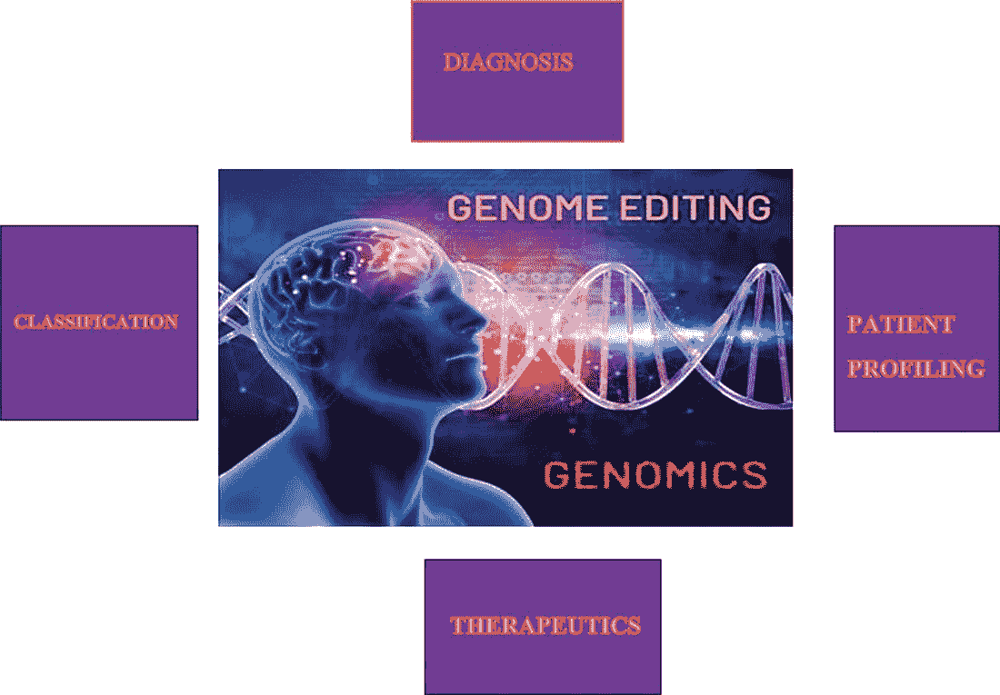

图 1：遗传疾病研究主要设置中的 AI 算法。

### 3.1 遗传疾病：基础

世界卫生组织（WHO）将遗传疾病归类为孤儿病或罕见病（RDs）。由于全球范围内患病种类有超过 7000 种，遗传疾病现在不断成为人们关注的原因[48]。遗传疾病主要与基因组异常（超过 80%）有关，尽管环境因素（包括经常接触宇宙射线等有害物质）会加速此类疾病的进展[48, 49]。同时，在妊娠期可能通过胎盘屏障的某些化学品的摄入以及感染也是主要因素[49]。过去几十年来，罕见病的患病率不断上升。根据最新数据，估计全球有约 3.5 亿人受此类不同种类疾病的影响[50, 51]。

### 3.2 对遗传/罕见疾病研究局限性的洞解

尽管遗传疾病在全球人口中层出不穷，但从研究的整体输出来看，它仍然代表不足。以下是主要特征：

- 缺乏与错误认知水平相符的疾病频率准确识别、诊断方案不足，以及针对相关罕见病或遗传性疾病缺乏定义的临床指南 [52, 53]。
- 探索此类疾病隐藏层面的资源/资金有限 [53]。
- 关于患者获取，地理范围的相对限制或局限，导致志愿者匮乏，一直是开展临床试验的障碍。此外，不适当的编码系统也影响了患者的招募过程 [53, 54]。
- 对遗传性疾病研究产生不利影响的关键因素是缺乏集体知识以及相关疾病病理生理学数据的匮乏。疾病特异性生物标志物的缺失以及效能不足的临床试验是其他障碍 [53]。
- 缺乏理想治疗法、现有疗法商业化程度不足以及市场化程度低也是值得关注的其他影响因素 [54]（表 3）。

**表 3：各国为减少罕见病（RD）所实施的政策。**

| 战略规划 | 现状 | 国家 |
| --- | --- | --- |
| 政策/计划 | 落实特定规划的决策 | 印度尼西亚、新加坡、越南 |
| 与相关利益者召开的会议极少 | 泰国、马来西亚 |
| 提交给相关部会的关于遏制罕见病的政策 | 菲律宾、澳大利亚和加拿大 |
| 在国家层面已存在稳健且制定良好的政府政策 | 韩国 |
| 在全国范围内完全实施的策略 | 法国、台湾 |

*来源：检索自世界卫生组织（WHO）门户网站，关于各国罕见病的统计数据，截至 2019 年 8 月*

### 3.3 近期遗传性疾病研究的视角

尽管面临上述挑战，随着二代测序和组学技术的出现，罕见病研究领域取得了显著进展。这两项技术都对底层分子机制的诊断和解释做出了贡献 [55, 56]。此外，它们都代表了关于现有罕见病的少量信息，以供未来进展分析 [56]。“大数据时代”包含了与遗传性/罕见病各个领域相关的海量数据；然而，稳健的管理技能以及适当的伦理指南是实现目标的关键。

#### 3.3.1 AI 对后期遗传性疾病研究的影响

人工智能（AI）与机器学习（ML）相结合，通过各种算法子集为剖析和解释数据开启了新的机会之窗。在过去的十年里，医学实践的几个领域受益于深度学习算法的实施，罕见病研究领域也不例外。基于 AI 的技术最初由美国食品药品管理局引入医学研究，用以系统化食品行业的清晰度 [57]。基于机器的算法设计用于以下方式分析复杂数据 [58]：

- 通过实施监督学习
- 通过实施独立程序
- 通过强化学习

在上述第一类中，`supervised learning` 通过比较数据确定结果。因此，`independent procedure` 用于大多数遗传研究 [59, 60]。`supervised learning` 也被用于大多数遗传研究 [61, 62]。`reinforcement` 用于疾病的频率 [63, 64]。

## 4 人工智能（AI）引导的遗传性疾病各算法：深度场景

近期，`AI`的应用将生物医学推向新的水平。`AI`的各种属性已应用于疾病测序、分子建模和药物设计 [65]。以下是遗传性/罕见病方面`AI`算法关注的主要领域（图 1):

1. 诊断与预后
2. 分类、识别/特征分析
3. 疾病治疗
4. 患者画像与健康信息

### 4.1 罕见病诊断中的 AI 算法

罕见病诊断及治疗治疗的关键要素是评估相关的精确基因和突变。全显子组测序（`WES`）和全基因组测序（`WGS`）是大多数先进遗传研究中主要的体外方法 [66, 67, 68]。`deep learning`结合各种算法的引入使得程序更加用户友好且具有成本效益 [67]（图 2）。

```
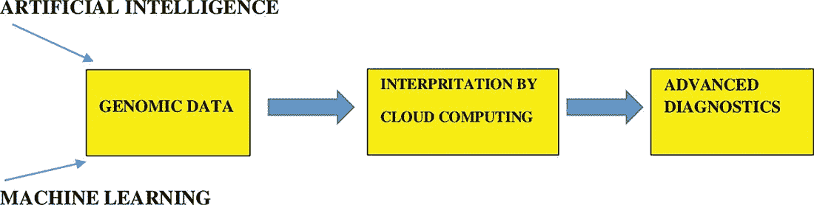
```

图 2：罕见病 AI 辅助诊断流程图。

#### 4.1.1 单个核苷酸变异（SNVs）的识别

单核苷酸多态性（`SNPs`）是大多数罕见病（RDs）的主要原因。因此，对这类致病变化的变异进行评估和后续分析，对于核基因组测序的最优利用至关重要，特别是在精准医学领域 [67, 68, 69]。然而，最近一些 AI 生成的技术使得这些事情变得更容易。`SNVs` 是主要因素，因为它们能够改变氨基酸序列，导致异常的基因产物。相关方法如变异效应评分工具（`VEST`）结合随机森林（`RF`）已用于精确评估导致蛋白质活性改变的错义突变 [67]。米勒和弗里曼-谢尔登综合征是一个典型的例子，该方法被认为可以针对孟德尔基因特异地修复导致异常的基因。`VEST` 非常安全，因为它在没有控制因素的情况下运行。另一方面，如 `CliniPred` 等创新技术使用了多个标记有医疗数据的 `ML` 算法，以更高效的方式提供高性能。同样，`SNV` 预测工具是基于结构、基于序列的或两者的结合。这通过 `Weka` 的应用得到了证明，该工具专门开发用于从整个蛋白质数据库中修复 RD 数据集 [70)。同样，精确生成的监督学习方法也被用于描绘甲羟戊酸激酶蛋白（`ORPHA: 309025`）中有害突变体产生的效应程度 [71]。特定算法已用于分析常见变异性免疫不全（`CVID`）中 `SNPs` 的数量并取得了巨大成功 [72]。

#### 4.1.2 多基因突变者的识别

内含子负责了人类约 90% 的罕见病。这表明非编码突变是罕见病的主要特征 [73]。为了评估这些情况，结合了 `splice AI` 和深度残差神经网络（`NN`）来确定与肥厚型心肌病（`ORPHA:217569`）相关的 `MYBPC3` 非编码序列中的有害隐匿剪接突变 [73]。这种新方法对于响应隐匿剪接突变的诊断和阐释开辟了新视野。罕见病像人类基因组一样复杂。考虑到遗传疾病本质上主要是多基因的，制定了变异组合致病性预测器（`VarCoPP`）。它是一种专门设计用于计算致病基因对数量的 `ML` 方法。`VarCoPP` 是目前临床环境中非常准确的工具；在致病评分方面，它提供了 95% 到 99% 的特异准确率 [74]。

#### 4.1.3 异常拷贝数变异的评估

人类拷贝数变异（`CNVs`）是罕见病诊断中的有效标记之一。尽管存在多个现可用数据库，但开发了 `DNorm`（专门指定的由 `ML` 方法控制的 AI 介导数据处理工具）。它生成命名实体识别，从而产生包含 1,582 个 `CNVs` 和 2425 种疾病的 `CNV` 摘要。该方法已成功应用于乔治综合征（`ORPHA: 567`）中，并取得了审慎的结果 [75]。

#### 4.1.4 通过表型引导的诊断

通过表型引导的诊断是针对罕见病的与表型相关的基因的 `CNV` 网络，该系统已经从患者中交付了更好的性能 [76]。相反，表型对于患者的精确生成数据超过了传统方法的 95% 准确率 [77]。

#### 4.1.5 罕见病的 AI

基于 AI 的成像是诊断罕见病的有效工具之一 [78, 79]。基于 AI 驱动框架的 `DeepGestalt` 已成功用于识别诸如 `DeepGestalt` 综合征（`ORPHA: 199`）、埃曼纽尔综合征（`ORPHA: 367`）和帕利斯特-基利安 综合征（`ORPHA: 884`） [81, 82, 83]。同样，`AI` 算法结合成像技术被设计用于大瘤症（`ORPHA: 963`）和皮氏病（`ORPHA: 282`） [84, 85]。

#### 4.1.6 其他辅助手段

随着先进方法的引入，遗传疾病的诊断变得越来越容易。然而，遗传性毛血管扩张症（`HHT`, `ORPHA: 774`）等疾病的诊断仍然成本很高。最近，神经网络被标记了红外光谱法（`IR`）以降低 `HHT` 的检测成本 [86]。同样，一种深度学习预测算法已应用于滑膜瘤（`SS`, `ORPHA: 3273`）患者。与传统的诊断方法相比，它获得了更大的结果 [86, 87]。总体而言，各种创新的 `ML` 技术为轻松理解和描绘罕见病开辟了新窗口 [87]。

与大多数从轻微咳嗽到致命性疾病的传统疾病不同，遗传性疾病在病程、病理生理学以及诊断方面都是独特的。在`AI` 和`ML` 算法出现之前，医学实践一直依赖传统的基因测序和遗传咨询作为主要的诊断手段。然而，由`AI` 介导的程序结合患者表型驱动的数据，已显著提升了`RD`（罕见病）诊断的最优结果 [88]。为了进一步说明，基于`AI` 的医学诊断不仅能对`RDs` 进行准确诊断，还能推断出精确的治疗方案。更重要的是，这种新方法显著地揭示了以前未被诊断出的特征 [89, 90]。此外，完全可以理解的是基因组数据并不能是解决遗传性疾病的唯一途径。而且，全球范围内大多数`RDs`的现有数据并不充足。因此，在现代遗传性疾病研究中引入`AI` 和`ML` 算法是至关重要的，以发现与`RDs` 相关的隐藏机制，从而开发出新的疗法。总而言之，生物医学是一个巨大的领域，在将新的计算机辅助技术引入实践时，有几点需要记忆。从此以后，应该充分关注并考虑包括社会、伦理以及法律限制在内的所有相关问题，以使基于`AI` 的医学实践成为强大的武器。

## 参考文献

[1] Murdoch, T.B. & Detsky, A.S. (2013). 大数据在医疗保健中不可避免的应用。JAMA, 309, 1351–1352. →


[2] Kolker, E., Özdemir, V. & Kolker, E. (2016). 医疗保健如何通过从 Amazon、Uber 和 Watson 中汲取经验，重新关注其超级客户（患者，n=1）和客户（医生和护士）。OMICS, 20, 329–333. →

[3] Dilsizian, S.E. & Siegel, E.L. (2014). 医学和心脏成像中的人工智能：利用大数据和先进计算提供个性化的医学诊断和治疗。Current Cardiology Reports, 16, 441. →

[4] Patel, V.L., Shortliffe, E.H., Stefanelli, M. et al. (2009). 人工智能医学的到来。Artificial Intelligence in Medicine, 46, 5–17. →

[5] Jha, S. & Topol, E.J. (2016). 适应人工智能：作为信息专家的放射科和病理学家。JAMA, 316, 2353–2354. →

[6] Aceto, G., Persico, V. & Pescape, A. (2018). 信息通信技术在医疗保健中的作用：分类、观点和挑战。Journal of Network and Computer Applications, [`doi.org/10.1016/j.jnca.2018.02.008`](https://doi.org/10.1016/j.jnca.2018.02.008). a, b

[7] Pereira, T., Barreto, L. & Amaral, A. (2017). 工业 4.0 范式下的网络和信息安全挑战。Procedia Manufacturing, 13, 1253–1260. a, b

[8] Luthra, S. & Mangla, S. (2018). 新兴经济体供应链工业 4.0 倡议的评估。Process Saf. Environ., [`doi.org/10.1016/j.psep.2018.04.018`](https://doi.org/10.1016/j.psep.2018.04.018). a, b

[9] Quezada, L., Da Costa, S.E. & Tan, K. (2017). 工业 4.0 的卓越运营。International Journal of Production Economics, 190, 2. →

[10] Haleem, A., Javaid, M. & Vaishya, R. (2019). 工业 4.0 及其在骨科的应用。Journal of Clinical Orthopedics and Trauma, 10(3), 615–616. →

[11] Manogaran, G., Thota, C., Lopez, D. & Sundarasekar, R. (2017). 医疗保健大数据智能。工业 4.0 网络安全。715, 103–126. →

[12] Wollschlaeger, M., Sauter, T. & Jasperneite, J. (2017). 工业通信的未来：物联网和工业 4.0 时代的自动化。IEEE Electronics Magazine, 11(1), 17–27. →

[13] Basl, J. (2017). 捷克公司实施工业 4.0 原的试点研究。Management and Production Engineering Review, 8(2), 3–8. →

[14] Bahga, A. & Madisetti, V.K. (2013). 基于云的互操作电子健康记录（EHRs）。IEEE Journal of Biomedical and Health Informatics, 17(5), 894–906. →

[15] Wang, Z.G., Zhang, L. & Wen-Jun Zhao, W.J. (2017, Oct). 数字医学进展。Chinese Journal of Traumatology, 20(5), 297–298. →

[16] Sommer, L. (2015). 工业革命-工业 4.0：德国中小企业是这场革命的受害者吗？Journal of Industrial Engineering and Management, 8(5), 1512–1532. →

[17] Lobo, F.A. (2017). 工业 4.0：重新定义未来医疗设备的制造。ECN, [`www.ecnmag.com/article/2017/10/industry-40-redefiningmanufacturing-future-medical-devices`](https://www.ecnmag.com/article/2017/10/industry-40-redefiningmanufacturing-future-medical-devices). →

[18] Ramanayake, R.P.J.C., Ranasinghe, S. & Lakmini, S. (2014). 全科中的急诊管理：全科医生的作用。International Journal of Family Medicine and Primary Care, 3(4), 305–308. →

[19] Wang, S., Wan, J., Zhang, D. & Li, C. (2016). 迈向工业 4.0 的智能工厂：基于大数据反馈和协调的自组织多智能系统。Computer Networks, 101, 158–168. →

[20] Kilic, T. (2016). 数字医院；最佳实践示例。Journal of Health Services & Policy, 1(1), 52–58. →

[21] Jee, K. & Kim, G.H. (2013). 大数据在医学领域的潜力：关注如何重塑医疗系统。Healthcare Informatics Research, 19(2), 79–85. →

[22] Liu, Y.K. & X., X. (2017). 工业 4.0 与云制造：对比分析。Journal of Manufacturing Science & Engineering, 139(3), 1–8. →

[23] Zhong, T.Y., Xu, X., Klotz, E. & Newman, S.T. (2017). 工业 4.0 背景下的智能制造：综述。Engineering, 3, 616–630. →

[24] Javaid, M. & Haleem, A. (2018). 增材制造在医学病例的应用：基于文献的综述。Alexandria Journal of Medicine, 54(4), 411–422. →

[25] Kamble, S.S., Gunasekaran, A. & Gawankar, S.A. (2018). 可持续工业 4.0 框架：一种识别当前趋势和未来展望的系统性文献综述。《过程安全与环境保护》，117, 408–425. →

[26] Mishra, S. (2017). 全息图：医学的未来——从《星球大战》到临床成像。《印度心脏杂志》，69(4), 566–567. →

[27] Brettel, M., Friederichsen, N., Keller, M. & Rosenberg, M. (2014). 虚拟化、去中心化和网络构建如何改变制造格局：工业 4.0 视角。《机械与工业工程科学杂志》，8(1), 37–44. →

[28] Thein, A., Bengtsson, K., Provost, J. 等 al. (2017). 一种用于工业 4.0 的事件驱动制造信息系统架构。《国际生产研究杂志》，55(5), 1297–1311. →

[29] Bahrin, M.A.K., Othman, M.F., Nor, N.H. & Azli, M.F.T. (2016). 工业 4.0：工业自动化与机器人技术综述。《Jurnal Teknologi》，78, 137–143. →

[30] Javaid, M. & Haleem, A. (2018). 4D 打印在医学领域的应用：简要综述。《临床流行病学与全球健康》，`https://doi.org/10.1016/j.cegh.2018.09.007`. →

[31] Kotevski, A., Koceska, N. & Koceski, S. (2016) 电子健康监控系统。位于应用于互联网与信息技术国际会议。`https://doi.org/10.20544/AIIT2016.32`. →

[32] O’Reilly, T. (2005). 什么是 Web2.0？下一代软件的设计模式和商业模式。O’Reilly Media，`www.oreillynet.com/pub/a/oreilly/tim/news/2005/09/30/what-is-web-20.html`. →

[33] Barsky, E. (2006). 引入 Web 2.0：面向健康图书员的网络博客和播客。《加拿大健康图书员协会杂志》，27, 33–34. →

[34] Shneiderman, B. (2008, 3 月 7). 计算机科学。科学 2.0。《科学》，319(5868), 1349–1350. →

[35] Whitmire, A. (2013). 对“电子研究”的思考：科学家的视角。《JESLIB》，2(2), 68–72. →

[36] Giustini, D. (2006, 12 月 23). Web 2.0 如何改变医学。《英国医学杂志》，333(7582), 1283–1284. →

[37] Boudry, C. (2012). 生物学/医学 2.0：概述。《医学科学》，28(6), 653–658. →

[38] Van De Belt, T., Engelen, L., Berben, S. & Schoonhoven, L. (2010). 健康 2.0 与医学 2.0 的定义：一次系统性综述。《医学网络杂志》，12(2), e18. →

[39] Eysenbach, G. (2008). 医学 2.0：社交网络、参与性和开放性。《医学网络杂志》，10(3), e22. →

[40] Oh, H., Rizo, C., Enkin, M. & Jadad, A. (2005). 什么是电子健康？已发布的系统性综述。《世界医院与健康服务》，41(1), 32–40. →

[41] Gardois, P., Colombi, N., Grillo, G. & Villanacci, M.C. (2012). 学术、医学和研究图书馆中 Web 2.0 服务的实施：综述。《健康信息与图书馆》，29(2), 90–109. →

[42] Collins, E. & Hide, B. 研究人员对 Web2.0 资源的利用与相关性。在：网络化世界中出版：传播的本质。Turid Hedlund 和 Yasar Tonta；2010 年 6 月 16–18 日；芬兰赫尔辛基第 14 届电子出版会议。第 271–289。 →

[43] Procter, R., Williams, R., Stewart, J., Poschen, M., Snee, H. & Voss, A. (2010). 学术交流中 Web 2.0 的采用与使用。《英国皇家学会 A 数学与工程科学》，368(1926), 4039–4056. →

[44] Cdcfoundation.org. 什么是公共健康？CDC 基金会。[2018 年 3 月 6 日访问]。[在线] 来源：`https://www.cdcfoundation.org/what-public-health`. →

[45] Lin, W.-Y., Zhang, X., Song, H. & Omori, K. (2016). Web 2.0 时代的健康信息寻求：社交媒体的信任、不确定性的减少和自我披露。《人类行为计算机》，56, 289–294. →

[46] Moorhead, S.A., Hazlett, D.E., Harrison, L., Carroll, J.K., Irwin, A. & Hoving, C. (2013, 4 月). 医疗保健的新维度：社交媒体在健康传播中的用途、益处与局限性系统性综述。《医学网络杂志》。a, b

[47] Sadela, P., González-Castro, L., Van Der Horst, E., Lopes, P., Morel, T., Simoens, S., Gatermann, R. (2017). 链接注册表：通过语义层连接罕见病人。《BioMed Research》，20, 13. →

[48] Ekins, S. (2017). 罕见病疗发现的工业化。《自然-生物技术》，35, 117–118. a, b

[49] 关于罕见病。在线：`https://www.eurord.org/about-rare-diseases`。（2019 年 9 月 18 日访问）。a, b

[50] Ronicke, S., Hirsch, M., Turk, E., Wagner, A. (2019). 决策支持能加速罕见病诊断吗？罕见病杂志》，14, 69. →

[51] Nestler, S., Korchagina, D., Pashos, M., Blanchette, C., Mols, T., Kaló, Z. (2018). 罕见病研究与健康技术评估挑战：ISPOR 特别小组报告。《价值健康》，21, 493–500. →

[52] Stoller, J.K. (2018). 罕见病的挑战。《胸医学》，153, 1309–1314. →

[53] Ahmed, M.A., Okour, M., Brundage, R. & Kartha, R.V. (2019). 孤儿药开发：临床药理学作用日益增大。《药代动力学与动力学杂志》，46, 395–409. a, b, c, d

[54] Kaufmann, P., Pariser, A.R. & Austin, C. (2018). 从科学发现到罕见病治疗——国家转化医学科学中心的视角。《罕见病奥尔特杂志》，13, 196. a, b

[55] Schee Genannt Halfmann, S., Mählmann, L., Leyens, L., Reumann, M. & Brand, A. (2017). 个性化医疗：对罕见病的意义？在：Posada De La Paz, M., Taruscio, D. & Groft, S.C. (编辑), 罕见病流行学：更新与概述，瑞士夏姆，Springer International Publishing, 第 1031 卷, 387–404, ISBN 978-3-319-67142-0. →

[56] Toh, T.S., Dondelinger, F. & Wang, D. (2019). 跨越热潮：转化医学中的应用人工智能和机器学习。EBioMedicine, 47, 607–615. a, b

[57] Bishop, C.M. (2006). 模式识别与机器学习，信息科学与统计，纽约，纽约，Springer, ISBN 978-0-387-31073-2. →

[58] Pasa, F., Golkov, V., Pfei_er, F., Cremers, D. & Pfeiffer, D. (2019). 用于快速胸部 X 光结核病筛查和可视化的高效深度网络架构。Scientific Reports, 9, 6268. →

[59] Portnoi, T., Yala, A., Schuster, T., Barzilay, R., Dontchos, B., Lamb, L. & Lehman, C. (2019). 仅基于乳腺 MRI 图像评估癌症风险的深度学习模型。American Journal of Roentgenology, 213, 227–233. →

[60] Alashwal, H., El Halaby, M., Crouse, J.J., Abdalla, A. & Moustafa, A.A. (2019). 无监督聚类方法在阿尔茨海默病中的应用。Frontiers in Computational Neuroscience, 13, 31. →

[61] Yang, M.-H., Yang, F.-Y. & Oyang, Y.-J. (2013). 密度估计算法在分析偏头痛共病中的应用。Netw Model Anal Health Inform Bioinform, 2, 95–107. →

[62] Lunceford, J.K., Davidian, M. & Tsiatis, A.A. (2002). 临床试验中两阶段随机化设计中治疗策略生存分布的估计。Biometrics, 58, 48–57. →

[63] Panuccio, G., Guez, A., Vincent, R., Avoli, M. & Pineau, J. (2013). 体外边缘系统发作模型中癫痫性兴奋性的自适应控制。Experimental Neurology, 241, 179–183. →

[64] Topol, E.J. (2019). 高性能医学：人类智能与人工智能的汇聚。Nature Medicine, 25, 44–56. →

[65] Carter, H., Douville, C., Stenson, P.D., Cooper, D.N. & Karchin, R. (2013). 用变异评分工具识别孟德遗传病基因。BMC Genomics, 14, S3.

[66] Alireza, N., Kernohan, K., Hartley, T., Majewski, J. & Hocking, T. (2018). `ClinPred`: 用于识别疾病相关单义核酸变异的工具。American Journal of Human Genetics, 103, 474–483.


- [67] Bosio, M., Drechsel, O., Rahman, R., Muyas, F., Rabion, R., Bezdan, D., Domenech Salgado, L., Hor, H., Schott, J., Munell, F. et al. (2019). `eDiVA`：临床致病变异的分类与优先级排序。Human Mutation, 40, 865–878. a, b, c, d

- [68] Sundaram, L., Gao, H., Padigepati, S.R., McRae, J.F., Li, Y., Kosmicki, J.A., Fritzilas, N., Hakenberg, J., Dutta, A., Shon, J. et al. (2018). 使用深度神经网络预测人类突变的影响。Nature Genetics, 50, 1161–1170. a, b

- [69] Dehiya, V., Thomas, J. & Sael, L. (2018). 结构先验知识在 `SNV` 预测中的影响：罕见病变异发现。PLoS ONE, 13, e020401. →

- [70] Browne, C. & Timson, D.J. (2015). 人类甲羟醇酶突变的计算机预测：甲羟醇酶缺乏的预测框架：人类 `MVK` 中的变异。Annals of Human Genetics, 79, 451–459. →

- [71] Orange, J.S., Glessner, J.T., Resnick, E., Sullivan, K.E., Lucas, M., Ferry, B., Kim, C.E., Hou, C., Wang, F., Chiavacci, R. et al. (2011). 基因组范围关联识别常见变性免疫缺陷的多种原因。The Journal of Allergy and Clinical Immunology, 127, 1360–1367.e6. →

- [72] Jaganathan, K., Kyriazopoulou Panagiotopoulou, S., McRae, J.F., Darbandi, S.F., Knowles, D., Li, Y.I., Kosmicki, J.A., Arbelaez, J., Cui, W., Schwartz, G.B. et al. (2019). 利用深度学习从原始序列预测剪接。Cell, 176, 535–548.e24. →

- [73] Papadimitriou, S., Gazzo, A., Versbraegen, N., Nachtegael, C., Aerts, J., Moreau, Y., Van Dooren, S., Nowé, A., Smits, G., & Lenaerts, T. (2019). 预测致病变异组合。Proceedings of the National Academy of Sciences USA, 116, 11878–11887. a, b

- [74] Yang, X., Song, Z., Wu, W., Li, G., Lu, L. (2018). 为 `CNV` 和人类疾病构建数据库。BMC Bioinformatics, 19, 528. →

- [75] Rao, A., Sivadasan, N., Sivasan, R. (2018). 基于图的表型基因优先级排序。BMC Medical, 11, 57. →

- [76] Javed, A., Agrawal, S., Ng, P. (2014). `ClinPred`：用于识别疾病相关单义核酸变异的工具。Nat Methods, 11, 935.

- [77] Smpokou, P., Lanpher, B., Rosenbaum, K. (2015). 新生儿畸形评估的重要考虑。Adv Neonatal Care, 15, 248–252. →

- [78] Smith, K., Piccinin, F., Balassa, T., Koos, K., Danka, T., Horvath, P. (2018). 用于探索细胞实验数据的表型图像分析软件。Cell Systems, 6, 636–653. →

- [79] Gurovich, Y., Hanani, Y., Bar, O., Nadav, G., Fleischer, N., Gelbman, D., Basel-Salmon, L., Krawitz, P., Kamphausen, S., Zenker, M. et al. (2019). 使用深度学习识别遗传疾病的表型。NatMed, 25, 60–64. →

- [80] Zarate, Y.A., Smith-Hicks, C.L., Greene, C., Abbott, M.-A., Siu, V.M., Calhoun, A.R.U.L., Pandya, A., Li, C., Sellars, E.A., Kaylor, J. et al. (2018). `SATB2` 相关综合的自然史和基因型表型相关性。American Journal of Medical Genetics, 176, 925–935. →

- [81] Basel-Vanagaite, L., Wolf, L., Orin, M., Larizza, L., Gervasini, C., Krantz, I.D. & Deard, M.A. (2016). 通过面部畸形识别 Cornelia de Lange 综合征表型的新型分析：使用 FDNA 识别 CdLS 表型。Clinical Genetics, 89, 557–563. →

- [82] Liehr, T., Acquarola, N., Pyle, K., St-Pierre, S., Rinholm, M., Bar, O., Wilhelm, K. & Schreyer, I. (2018). 利用 2D 照片的计算机辅助面部畸形分析对 Emanuel 综合征和 Pallister-Killian 综合征进行下一代表型分析：LIEHR 等人。《临床遗传学》，93, 378–381. →

- [83] Learned-Miller, E., Lu, Q., Paisley, A., Trainer, P., Blanz, V., Dedden, K. & Miller, R. (2006). 检测肢端肥大：使用可变形模型进行疾病筛选。在: Larsen, R., Nielsen, M. & Sporring, J. (Eds.), 医学图像计算与计算机辅助干预 – MICCAI 2006, 德国海德堡, Springer, 第 4191 卷, 495–503, ISBN 978-3-540-44727-6. →

- [84] Spinelli, E.G., Mandelli, M.L., Miller, Z.A., Santos-Santos, M.A., Wilson, S.M., Agosta, F., Grinberg, L.T., Huang, E.J., Trojanowski, J.Q., Meyer, M. 等. (2017). 原发性进行性失语障碍变体的典型与非典型病理学：PPA 变体的病理学。《现代神经病学》，81, 430–443. →

- [85] Lux, A., Müller, R., Tulk, M., Olivieri, C., Zarrabeita, R., Salonikios, T. & Wirnitzer, B. (2013). 通过中红外光谱和人工神经网络分析进行 HHT 诊断。《罕见疾病杂志》，8, 94. →

- [86] Han, I., Kim, J.H., Park, H., Kim, H.-S. & Seo, S.W. (2018). 一种滑膜肉瘤患者生存预测的深度学习方法。《肿瘤生物学》，40, 101042831879926. a, b

- [87] Van Ijzendoorn, D.G.P., Szuhai, K., Briaire-de Bruijn, I.H., Kostine, M., Kuijjer, M.L. & Bovée, J.V.M.G. (2019). 基因表达数据的机器学习分析揭示了新的诊断和预后生物标志物，并确定了软组织肉瘤的治疗目标。《PLOS 计算生物学》，15, e1006826. a, b

- [88] Wang, F. & Preininger, A. (2019). 健康 AI：现状、挑战与未来方向。《医学信息学年鉴》，28, 016–026. →

- [89] Conejar, R.J. & Kim, H.-K. (2014). 用于无处不在医疗诊断系统的医疗决策支持系统 (DSS)。《国际软件工程与应用》，8, 8. →

- [90] Jurmeister, P., Schöler, A., Arnold, A., Klauschen, F., Lenze, D., Hummel, M., Schweizer, L., Bläker, H., Pfitzner, B.M., Mamlouk, S. 等. (2019). DNA 甲基化分析谱可靠地区分肺肠道腺癌与转移性结直肠癌。《现代病理学》，32, 855–865.

# 知识管理：知识资本的驱动力

### 摘要

未来属于知识型经济。从传统经济向信息型经济的转变需要对知识管理（KM）和知识资本（IC）进行持续关注。全球对 KM 和 IC 的需求日益增长。随着社会向创新型经济迈进，KM 和 IC 将成为游戏规则的改变者。社会的重点是通过 KM 关注 IC。KM 系统是可以被利用的技术。本章的目标是通过提升 IC 来实现价值创造。

本章分为三个主要部分：

- 第一部分重点关注定义和解释 KM 的类型。
- 第二部分涉及 IC 及其意义和组成部分。
- 第三部分也是最重要的部分，探讨 KM 与 IC 的关系并提出策略。

**关键词：** 知识管理、知识资本、技术 4.0、策略

## 1. 引言

从传统经济向信息型经济的转变需要对 KM 和 IC 进行持续关注。KM 是企业有意识地识别、结构化、维护和交换知识与经验的过程。这是一个复杂的价值创造过程。

目前已有许多尝试定义 KM。KM 被定义为“企业有意识且全面地收集、组织和分析知识的过程”。它指的是通过最充分利用知识来实现组织目标的跨学科方法。KM 利用了组织可能已经拥有的资源，例如信息系统管理、组织变革管理和人力资源管理。

IC 被定义为“知识资本是指使公司运行的无形资产的术语”。IC 是企业的无形价值，涵盖了员工的能力（人力资本）、与其相关的价值（关系资本）以及员工离开后留下的所有。本章的重点是探讨 KM 在提升 IC 方面的作用。

#### 知识管理的活动：

1. 产生新的知识或信息
2. 从外部源获取重要信息
3. 利用现有的知识和信息进行智能决策
4. 将知识植入到产品和服务中
5. 在数据库和相关软件中构建知识和信息
6. 通过文化和动力促进知识的增长
7. 将当前组织的信息传递到组织的其他部分

## 知识管理的重要性

知识管理（KM）的重要性在于它对任何组织以及整个国家的发展做出了最大贡献。目前，世界正经历着信息爆炸。知识允许创造出决定如何有效处理事务的能力。知识使得决策、预测和关联成为可能。

知识是决策、规划、设计和评估的主要来源。知识也是重要的专业技能，能够为个人、员工群体和组织带来差异。产生、传授和传播知识或信息至关重要，必须谨慎处理。

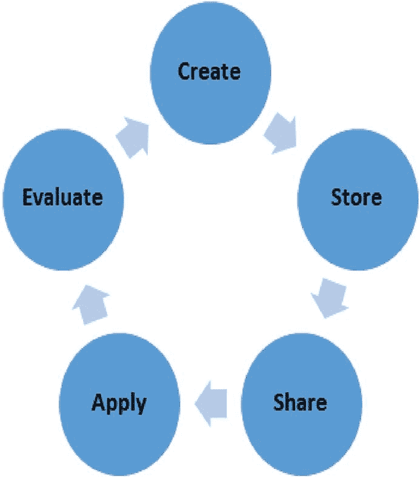

图 1: 知识管理流程。（作者编写）

## 知识管理中有七个知识层次

1. 客户知识
2. 人员/员工知识
3. 产品与服务知识
4. 流程知识
5. 组织数据库
6. 处理客户、供应商和利益相关者关系的知识
7. 关于劳动力内部能力（IC）的知识

## KM 过程的步骤

知识管理过程包含以下三个重要领域：

1. **知识积累** – 已经创建了各种用于知识积累的模型。每个组织在选择模型时，必须确保考虑到员工的配合。很多时候，员工对变化产生抵触，不愿意合作。知识积累是一个渐进的过程，必须分阶段进行。必须对组织内的所有资源进行彻底研究，以确保全面的知识获取。任何组织而言，最重要的方面是优先考虑其需求并选择合适的技术。

2. **信息存储** – 任何 KM 系统都必须对其设备和其他技术参数进行适当选择。知识捕获变成了一个重要步骤，在此定义了组织记忆中的路径和系统。这被称为知识的制度化。

3. **知识共享** – 这是一个专门处理知识分发的领域。在这个过程中，员工之间与其他利益相关者的互动起着非常重要的作用。组织的固有文化对于确保知识的成功涵盖也非常重要。

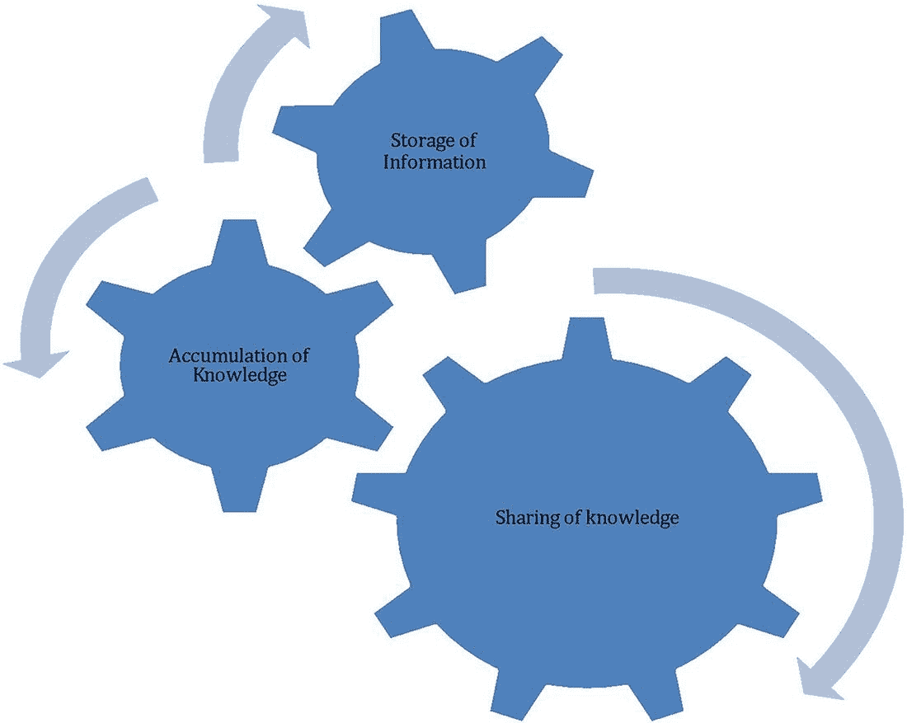

图 2: 知识管理过程的步骤。（作者编写）

KM 的主要目标是启动学习文化并赋能组织学习。同时也鼓励员工之间共享知识。在讨论 KM 时，主要需要考虑三种知识：

### 知识的类型

1. **隐性知识** – 这种知识是天生且自然的。它不容易被编码，难以共享。这种知识的例子是创造性思维、分析性思维。这种知识通常从个人经验中获得，在共享方面被认为是困难的。

2. **显性知识** – 易于共享、理解、教学和表述。例子包括解决数学方程、如何在安卓上下载应用程序。

3. **内隐知识** – 它无非显性知识的应用。可以从一项工作转移到另一项工作的技能是内隐知识的例子。

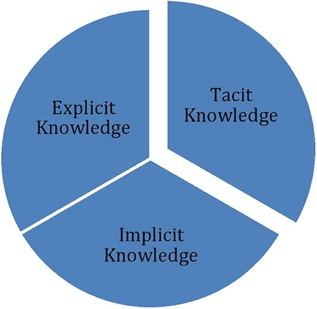

图 3: 知识的类型。（作者编写）

## 2 种知识管理类型

### 基本有四种知识管理类型，如下：

1. **内部 KM** – 这是一种让员工获取信息的方法，以帮助他们更好地管理职责或改进整体信息。这可以包含不同类型的工具和方法 – 内网、工具箱、探索或已学练习的信息库、培训网络、信息共享机会。

2. **信息扩散** – 这是一个创建信息并使分级信息普遍可用，或让外界（特别是利益相关者）知道的过程。对于在研究或实践经验方面拥有坚实基础的协会，需要传播广泛可以获取、开放并根据情况预期被利用的信息。

3. **信息促进** – 这是一个将利益相关者与重要信息和专业知识联系起来的过程。在这里，工作是帮助界面开发伙伴和合作伙伴获得所需的信息，无论这些信息是来自内部还是外部来源。

4. **构建信息边界** – 这是一个构建组织客户边界的过程，以便有效地创建、获取、提供和使用信息。这可能是将信息置于管理范围内最具挑战性但也最重要的方法。

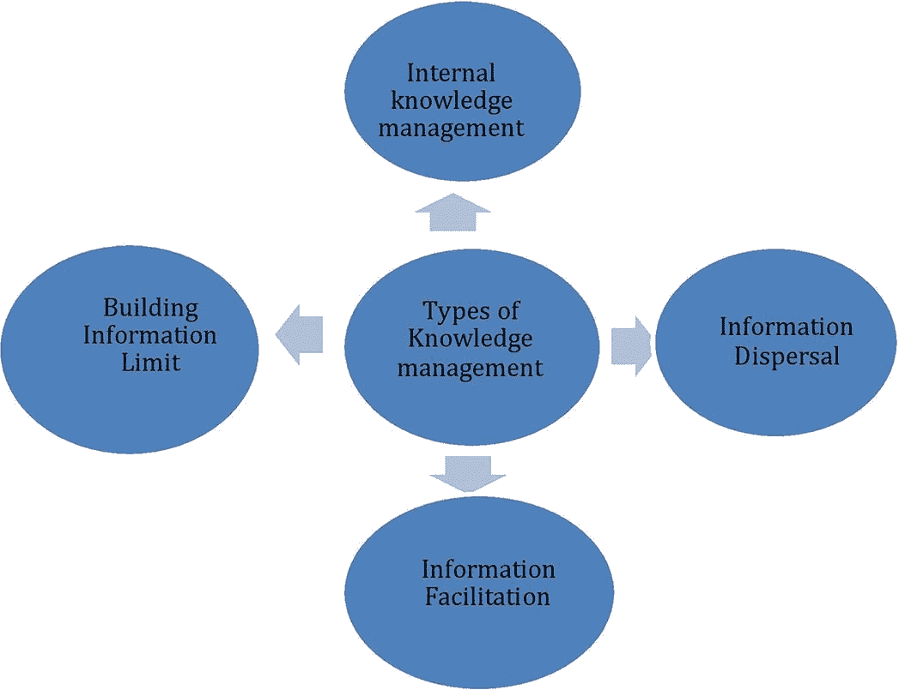

图 4: 知识管理类型。（作者编写）

## 知识资本的 3 个组成部分

1. **人力资本** – 员工的创造能力、意识、能力和知识是任何组织的人力资本。尽管人们不喜欢称为资本，因此通常使用人才和人力资源等术语。

2. **关系资本** – 它解释了组织与投资者、客户、员工、利益相关者和社区之间的关系。这包括正式和非正式合同。

3. **结构资本** – 公司的发明和创新能力、业务流程和文化构成了结构资本。这些是任何组织的无形资产。例子包括数据、媒体、知识产权、系统和流程。

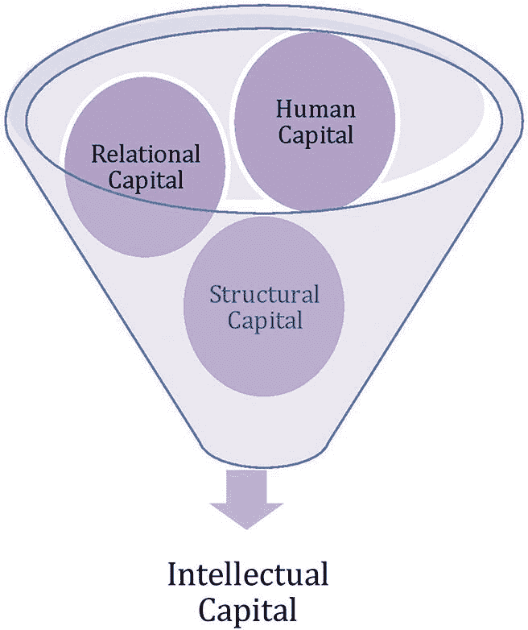

图 5: 知识资本的组成部分。（作者编写）

每个组织的成就越来越多地取决于人力资源，而不仅仅是物理资本。当我们把人力资源视为个人能力、技能、素质和见解的结合，并将其视为为每个企业提供独特非常特征的因素时，我们意识到，员工是能够学习、准备改变、发展并愿意投入创新努力的来源，这直接导致组织的长期繁荣。

IC（知识资本）是一个术语，指的是组织的无形资产、员工及其对功能/工作的累计知识和意识。它包括与投资者、客户的关系（称为关系资本），员工的培训和发展、绩效评估（称为人力资本），以及员工离开后留下的（即数据库、政策、文化和使命，称为结构资本）。这是一个概念性术语，用于衡量公司可能拥有但在资产负债表上不可见的资产，例如员工的专业知识。

尽管这是任何组织的重要组成部分，但它是主观的，很难准确量化。然而，成功的组织通常通过培训员工到一定水平，并确保他们在有利的环境中受到激励并尽全力，来提升增强他们的 IC。未能考虑这些因素的公司可能会发现员工动力不足、培训不足，从而影响组织的利润和生产力。

因此，对 `IC` 的关注对于任何组织的价值创造过程至关重要 [1]。这反过来影响公司长期整体生产力和竞争可持续性。

## 4. 文献综述

全球研究人员已经研究了 `KM` 的概念及其在推动 `IC` 方面的意义。下文献综述表 1 所示，`KM` 已确定为增强任何组织 `IC` 的有效工具。

表 1：文献综述。

| 序号 | 作者 | 对 `KM` & `IC` 的观点 |
| --- | --- | --- |
| 1. | Jan 等人 [7] | `IC` 声明应被作为关于知识战略的沟通手段。 |
| 2. | Garcia-Perez 等人 [4] | 该研究的重点是 `IC` 的计算和报告。 |
| 3. | Marr [9] | 这本书为 `IC` 概念提供了多维度视角。 |
| 4. | Yusliza 等人 [13] | 这项研究侧重于绿色 `IC` 作为长期增加清洁生产的模式。 |
| 5. | Richard & James [12] | 这是一项关于 `IC` 相关文献的广泛研究工作。它强调了 `IC` 对任何经济进步发展的重要性。 |
| 6. | Leif & Patrick [3] | 这项工作侧重于 `IC` 和 `KM` 相关基础概念的定义和解释。 |
| 7. | Nick [11] | 这项研究工作探索了业务增长和 `IC` 的概念。本研究了公司的绩效及其与 `IC` 的关系。 |
| 8. | Mohan & Youndt [10] | 这项研究广泛研究了任何组织中嵌入的能力及其与 `IC` 的关联。它还考察了企业作为 `IC` 增强结果的创新绩效。 |
| 9. | Antonio [1] | 这项研究表明，随着早期组织资本概念的变化，`IC` 的相关性占据了主导。组织必须更加关注 `IC` 的报告组件并确保其披露。 |


| 10. | Hussinki 等人 [6] | 这项研究关注于组织绩效与其 `IC` 和 `KM` 管理之间的联系。 |

对文献的详细综述表明，随着技术和人力资本成为收入来源，现有的 `KM` 领域已处于中心位置。组织对 `IC` 的披露每天都变得至关重要 [1]。有许多研究表明 `IC`、`KM` 与组织绩效之间存在紧密联系 [6]。组织的进展与其持有的 `IC` 资产以及利用领先的 `KM` 技术进行管理的方式密切相关 [11]。为了使这一过程有效，迫切重新定义与 `IC` 和 `KM` 相关的概念 [8]。许多研究人员已经研究了创新与组织业务绩效之间的联系。可持续性是一个全球研究人员日益增加探索的新领域。对升级技术基础设施的重视程度增加。

## 5. 知识管理：提升知识资本的驱动力

提高竞争可持续性的过程在很大程度上依赖于利用 `KM` 作为关键驱动力来提升 `IC`。人们越来越关注隐性知识。人、流程和技术的协同工作是建立可持续战略业务地位的必经之路。为了确保组织内价值创造过程的持续，技术的使用和 `IC` 的存在是必不可少的。

## 6. 提升 IC 的策略

1. 建立知识文化：对于 `IC` 而言，必须优先考虑。

2. 建立伦理体系：除非给予适当重视，否则任何组织的社会资本都无法提高。

3. 创建留存基础设施：每个组织都必须投资并沟通。

4. 人力资本的整体发展：除非关注这一点，否则任何 `IC` 过程都是不完整且无效。

5. 与战略意图对接：`KM` 基础设施必须保持更新并与之一致。

## 7. 结论

在后 COVID-19 时代，组织 `IC` 的相对重要性再次得到证明。随着组织传统的竞争来源退居次，`IC` 的相关性重新确立。企业必须重新思考并重新制定策略以提升其 `IC`。知识领域必须明确识别并予以重视。在未来的日子里，拥有良好 `IC` 的组织能够抵御企业世界的动荡。未来属于拥有高效 `KM` 的组织。将在全球业务格局中产生可持续的竞争优势。知识资本和社会资本将成为未来几天的的新货币。

- [4] Garcia-Perez, A., Ghio, A., Occhipinti, Z. & Verona, R. (2020). Knowledge management and intellectual capital in knowledge-based organisations: a review and theoretical perspectives. Journal of Knowledge Management, 24(7), 1719–1754. [`doi.org/10.1108/JKM-12-2019-0703`](https://doi.org/10.1108/JKM-12-2019-0703). →

- [5] Girard, J.P. & Girard, J.L. (2015). Defining knowledge management: Toward an applied compendium. Online Journal of Applied Knowledge Management, 3, 1. doi: 10.1016/j.sbspro.2018.03.022. →

- [6] Hussinki, H., Ritala, P., Vanhala, M. & Kianto, A. (2017). Intellectual capital, knowledge management practices and firm performance. Journal of Intellectual Capital, 18(4), 904–922. 2., [`doi.org/10.1108/JIC-11-2016-0116`](https://doi.org/10.1108/JIC-11-2016-0116). a, b

- [7] Jan, M., Per, N.B. & Bernard, M. (2020). Reporting on intellectual capital: why, what and how? Emerald Group Publishing Limited, 8(1), 46–54.

- [8] Leif, E. & Patrick, S. (1996). Developing a model for managing intellectual capital. European management Journal, 14(4), 356–364. [`doi.org/10.1016/0263-2373`](https://doi.org/10.1016/0263-2373)(96)00022-9. →

- [9] Marr, B. (Ed). (2005). Perspectives on Intellectual Capital. Multidisciplinary Insights into Management, Measurement and Reporting, Oxford, Elsevier. →

- [10] Mohan, S. & Youndt, M.A. (2005). The Influence of Intellectual Capital on the Types of Innovative Capabilities. Academy of Management Journal, 48(3), [`doi.org/10.5465/AMJ.2005.17407911`](https://doi.org/10.5465/AMJ.2005.17407911). →

- [11] Nick, B. (1998). Intellectual capital: an exploratory study that develops measures and models. Management Decision, 36(2), 63–76. 6., https://doi.org/10.1108/00251749810204142.

- [12] Richard, P. & James, G. (2000). Intellectual capital literature review: Measurement, reporting and management. Journal of Intellectual Capital, 1(2), 155–176. doi: 10.1108/14691930010348731.

- [13] Yusliza, M.-Y. et al. (2020). A structural model of the impact of green intellectual capital on sustainable performance. Journal of Cleaner Production, 249, 119334. http://dx.doi.org/10.1016/j.jclepro.2019.119334.

# 基于区块链技术的医疗证明 Web 远程知识管理分布式应用

Rupa ChDivya Midhun Chakkarvarthy

### 摘要

范围内，颠覆性技术在普通人的生活、技术专家、小型行业以及医疗领域中起着至关重要的作用。（注：原文此处大量重复，已按要求提取核心含义）。

（注：提供的源文本摘要部分包含大量重复句子。已根据指令在保留核心内容的同时优化了格式。）

使用 `Blockchain` 和 `Ethereum` 为医疗证明的管理提供了去中心化的框架。通过利用 `Blockchain` 和 `Ethereum`，我们可以确保医疗领域的数据完整性和隐私。

**关键词：** Web 3.0, Ethereum, Knowledge, Management

## 引言

互联网在过去的三十里一直在发展。`Web 3.0` 是互联网的下一代，它是去中心化的 1。`Web 3.0` 利用去中心化技术提供用户友好 2。`Web 3.0` 结合 `Artificial Intelligence` 和机器学习 3。`Web 3.0` 专注于 `blockchain`、`transparency` 和 `immutability` 以确保数据安全。

根据世界卫生组织（WHO）的说法，医疗领域遭受了勒索软件的利用 4。黑客攻击医疗记录是因为它们比物理资产更有价值。根据 `Trustwave`，目前的医疗目前的价值很高 5。每份医疗记录的价值高达 250 美元。

`Blockchain` 和 `Web 3.0` 都被称为分布式账本技术（DLT）。基于 `Blockchain` 的浏览器（如 `brave`）实现了 `Web 3.0` 的功能 6。这项技术解决了早期版本（如 `Web 2.0` 和 `Web 1.0`）中存在的主要问题。

有多种类型的区块链可用于部署所提的应用。这些包括公共区块链、私有区块链、联盟链和混合型区块链。所有区块链的共同点是每个区块链都拥有运行在 P2P 网络上的节点 [9]。每个节点都维护一个频繁更新的本地账本。此外，每个节点都负责验证、接收和发起交易，并创建区块。不同区块链类型的比较所示在表 1 中。

表 1：区块链类型比较。

| 属性 | 公共链 | 私有链 | 联盟链/联邦 | 混合链 |

| --- | --- | --- | --- | --- |

| 访问权限 | 任何人 | 单一授权组织 | 多个组织 | 允许权威访问，但某些元素是私有的 |

| 共识机制 | 无许可 PoW, PoS | 拜尔福容错 (BFT), 许可 | 许可 | 私有和其他公共 |

| 网络 | 去中心化 | 部分去中心化 | 去中心化 | 部分去中心化 |

| 平台 | Ethereum, NEO, Ripple, Bitcoin, Stellar, Litecoin | Hyper ledger, CORDA, Multichain, Quorum | Energy Web Foundation, R3 CORDA | Dragonchain |

| 智能合约（语言） | Etherum: Solidity NEO: Java, Python, C#, VB.net | Hyper ledger: Go, Chaincode CORDA: Kotlin | 私有 | 公共/私有 |

| 工具 | Ethereum: Truffle, metamask, Ganache, Remix, Geth, Mist | Hyper ledger: Hyper ledger-compose, visual studio CORDA: Flow | Hyper Ledger | 公共/私有 |

| 应用场景 | 任何应用 | 金融、比特币供应链、医疗保健、房地产、保险、政府服务。 | 任何应用 | 全球金融与贸易、供应链、银行、企业。 |

本章包含所提系统的信息，即一种基于区块链的分布式应用（DAPP），用于安全地创建医疗证书并将其存储在基于以的公共区块链上 [10]。为了实现该应用，使用了 ethereum 平台，并带有 Truffle 套件和 metamask 钱包，如表 1 所示。

本章的剩余部分格式如下：第 2 节介绍了关于区块链技术和 Web 3.0 的基本概念信息。所提概念的相关工作已作为文献综述在第 2 节和第 4 节中提到；所提系统的架构以及系统智能合约的分步处理过程以算法的形式所示。所提系统的评估结果和分析描述在第 5 节中。同时，通过考虑某些特性展示了所提工作与现有工作的比较。第 6 节为本章结论和未来展望。

## 2 理论依据

满足用户水平预期的信息可用性变得非常困难。如隐私、连通性以及从随处访问数据等服务是一项复杂的任务。但可以通过使用 Web 3.0 和区块链技术特性来解决。这些技术的基本概念和特性如下。

### 2.1 Web 3.0：前言 [11, 12, 13, 14]

Web 3.0 的主要特性是知识管理（如人工智能）、连通性、无处不在、语义网和 3D 图形。基于 Web 3.0 的应用内容可以在任何时间从任何地方通过许多应用程序访问。这些应用的范围是根据词的含义而不是关键词或数字进行搜索、生成、共享和分析。基于 Web 3.0 的 DAPPs 所示。

**应用：**

*   **Brave:** 这是一个基于 Web 3.0 的浏览器。Chrome、Internet Explorer 等是基于 Web 2.0 应用（Apps）。

*   **Stroj & IPFS：** 使用 Web 3.0 特性设计的 DAPPs，用于存储最大数量的数据。类似于 Web 2.0 中的 Google drive 应用。

*   **Status：** 此应用用于通过消息相互通信。它是使用 Web 3.0 设计的。类似于运行在 Web 2.0 上的 Whatsapp、Sharechat 应用。

*   **Experty：** 这是一个使用 Web 3.0 的 DAPP，类似于运行在 Web 2.0 上的 Skype 视频通话。

*   **Steemit：** 这些是基于 Web 3.0 的社交网络，类似于 Facebook 和 Twitter。

*   **Ethlance：** 这是一个基于 Web 3.0 的平台，完全构建在区块链上。

### 2.2 区块链技术：前言 [15, 16, 17]

**关键元素：** 区块链是不同概念和方法的组合。这些加密、哈希、P2P 网络、分布式账本系统、工作量证明、梅克尔树。区块链技术的主要特性是透明性、分布式、不可篡改性、安全性、去中心化。数据不维护在中心化服务器中。主要特性如下：

*   **加密：** 非对称加密用于区块链为数据和用户提供安全性和认证。

*   **哈希：** 用于加密区块的不可逆过程。

*   **点对点网络 (P2P)：** 这些节点不连接到任何中心系统。它是安全的分布式网络。

*   **分布式账本系统：** 信息位于每个节点而不是中心权威。

*   **工作证明：** 这是区块链节点执行的过程。通常通过解决数学难题将区块永久添加到区块链中。

*   **梅克尔树：** 梅克尔树通过保留单个哈希值而不是获取所有交易来节省区块空间。

*   **区块链网络：** 它包含遵循 P2 连接的节点。区块链中的每个节点都可以执行工作证明（PoW）、验证并处理交易。

*   **区块：** 区块像账本或记录集合。

**区块组成部分：** 区块链中的区块具有以下属性：区块头、区块大小、交易数据和交易计数器。表 2 显示了区块特征的细节。

表 2：区块字段。

| 属性/字段 | 区块头（字节） | 区块大小（字节） | 交易数据（字节） | 交易计数器（字节） |

| --- | --- | --- | --- | --- |

| **字段大小** | 80 | 4 | 1–9 | 可变（最小 400） |

| 描述 | 元数据 | | | |

| | 版本、哈希值、前一个区块哈希、时间戳、随机数等。 | 区块的大小 | 所有交易的数据 | 指定区块中的交易总数 |

Table 3 提供了区块头组件的详细信息，例如区块版本、哈希值、前一个区块的哈希值、Nonce、时间戳、Merkle 根和难度。这些信息被称为元数据，可以更深入地观察区块链中的区块和交易 [22]。

表 3：区块字段的详细信息。

| 属性/字段 | 区块版本（字节） | 前一个区块哈希（字节） | Merkle 根（字节） | 时间戳（字节） | Nonce | 难度 |

| --- | --- | --- | --- | --- | --- | --- |

| `Filed size` | 4 | 32 | 32 | 4 | 4 | 4 |

| `Depiction` | 用于跟踪软件或协议更新的版本号 | 前一个区块的哈希值 | Merkle 树根的哈希值 | 区块创建的时间 | 用于 PoW 过程的数字 | 为 PoW 算法设置的 |

## 3 文献综述

Ryahei Banno 等 [23] 提出了 `SimBlock`，这是一种基于区块链的模拟器。它模拟了区块链上的 P2P 网络。由于其架构具有具有不同配置参数的各种节点，区块链网络具有适应性。目前还没有方法可以验证或追踪区块链的行为。由于其具有不可篡性、透明性并以分布式账本方式维护数据等先进特性，该技术的采用率每天都在增长。

Gaohe Li 等 [24] 提出了一种利用区块链技术验证电子发票身份认证的新方法。它通过处理计算机图像，分析数字发票系统中的风险，解决了税务和财务部门的问题。最初，从图像中提取像素总和和模运算值，以验证电子发票是否被篡改。使用 `OCR`（光学字符识别）技术对发票进行识别和追踪，以检查其真伪。该系统自动识别发票，以防止一张发票被重复使用。

根据 Junfeng Shi 等 [25] 的观点，最新的研究是针对区块链技术进行的。这里提出了一种基于区块链技术的互联网金融产品生命周期模型。它根据电网的状态预测产品的生命周期曲线。在这里，生命周期曲线被划分为三个阶段：从输入期开始，然后是成熟期，最后是衰退期。它具有很参考价值，有助于电力金融的发展。

Daniel Tse 等 [26] 提出使用区块链技术以加密格式存储用户名和密码。用户提供包含用户名和密码的详细信息以验证身份认证系统。有许多信息系统可以访问数据，因此无法记住用户的凭证。大多数人会忘记自己的用户名和密码，并在重新获取它们时面临困难。所提的系统使用区块链技术存储用户的凭证。区块链技术是不可篡的。存储的身份信息不会受到任何网络攻击的影响。

M. Fakhar Manesh 等 [27] 尝试对工业 4.0 时代知识管理文献中的学术研究进行全面、结构化且客观的分析。该研究使用文献计量评估来揭示该领域的布局并确定未来的研究方向。随后，对聚类结果进行了系统性的文献综述。文献综述确定了每个聚类的独特贡献。研究结果显示，质量保证专业人员需要考虑、实现并将其公司中“工业 4.0”进展的所有方面，以减少未来对公司业务的负面影响。观察到的唯一缺点是某些聚类中的关键词存在明显的碎片化现象。

Maurizio Atzori 等 [28] 讨论了新兴 Web 3.0 范式提供的数据探索方法。所提工作重点关注 Web 3.0 如何通过人机交互、语义、模式、数据探索和推荐系统与其前代有所不同。


N. Iqbal 等 [29] 利用机器学习技术和基于区块链的智能合约开发了方法`RIVIMS`。`RIVIMS`指的是一种可靠的智能宠物信息管理系统。该方法包含两个部分：基于区块链的信息管理系统和数据分析模型。使用`Hyperledger`开发信息管理系统。数据分析和预测模型构建在许可链上。这些模型研究患者详情以发现规律并构建强大的预测模型。根据预测结果，宠物诊所可以改进未来的业务计划，例如资源和人员需求。

K. P. Yu 等 [30] 提出了一种增强的安全访问控制方案，以解决`IIoT`（工业物联网）云平台的半信任问题，区块链实现了认证、公钥、用户特征和撤销列表。域管理员负责开发域的安全隐私策略并实施加密功能。只有当考虑到用户 ID 不撤销列表中时，服务器才会返回中间解密参数。

L. Da Xu 等 [31] 提出了一项利用区块链检查先进的`IoT`（物联网）安全工作。该工作重点关注安全功能、挑战、技术、方法和相关的物联网场景。所提工作利用去中心化、共识机制、数据加密和智能合约等区块链特性构建分布式物联网系统。智能合约用于设备注册、数据存储和服务提供。通过利用这些特性，可以防止潜在攻击并降低交易成本。

Shuchih E. Chang 等人 [32] 对基于区块链的供应链进行了分析性回顾和系统性研究，以促进该技术的研究。这项工作介绍了使用区块链的供应链范式中常见的优点和问题。共审查了 106 综述性文章，得出区块链技术在供应链中使用的结论。数字化、透明化、协作、可追溯性和利益相关者的参与是区块链平台解决的重要问题。将区块链技术集成到供应链中可以提供更好更高效的性能，增加安全性，确保治理分布并帮助流程自动化。本文介绍了区块链应用的总结。本文还强调了这些技术应用的社会影响及其技术采纳/扩散。

Christos Karapapas 等人 [33] 展示了犯罪分子如何利用智能合约和`IPFS`（星际文件系统）系统发动勒索软件攻击。近年来，勒索软件一直是一直是用户面临的一个重大问题。所提出的系统由作者和关联人员组成，作者创建勒索软件并将其存储在`IPFS`中，关联人员通过基于`Ethereum`的智能合约购买这些勒索软件。然后，关联人员使用这些勒索软件感染受害者。`Solidity`用于编写智能合约，这些合约由七个函数组成。`IPFS`提供了极灵活性和健壮性，凭借`IPFS`的变动（churn）优势，能够为关联人员提供安全的服务。所提出的机制增强了安全性，并供同仁注册并获取勒索软件。该机制很难被离线获取，这是其最大的资产。

Ryuya Uda [34] 提出了一种高效机制，防止监控摄像头对视频录像进行伪造和制造。在该机制中，录制的视频在区块链上进行签名并链化，从而提供了数据完整性。作者建议基于某些预定义的条件和区分的摄像头创建信任链。信任链的签名者将获得奖励。该机制证明在防止视频录像伪造方面是高效且有效的，而且具有成本效益。

Le Jiang 等人 [35] 提出了一种基于区块链技术的框架，利用了`OSN`（开放科学网络）和`DOSN`（分布式开放科学网络）。它将两者结合，因为在线社交网络网站在当今生活中变得越来越通用。尽管如此，由于开发者采用的方法（如集中式数据管理系统）以及缺乏安全协议，人们仍面临隐私泄露问题。所提出的方法解决了这个问题。在这项工作中，作者使用实时数据集评估了所提系统的性能。该系统的优点是解决了用户的隐私问题，缺点是需要设计复杂的协议来仔细支持路由。

根据 G. Zyskind 等人 [36]，发生了监控事件案件和对安全漏洞的利用。攻击者或未经授权的正在滥用从泄露中收集的数据。在这项工作中，作者描述了一种使用去中心化方法控制用户自己数据的机制。这里提出了一种协议，将挂钩在控制管理器上的区块链转换为具有自动访问等额外功能的系统。在这里，交易不是基于加密余额操作的。优点是个人数据具有更高的安全性。

Shu Yang 等人 [37] 提出的研究的主要目标是改进传统区块链协议的线性结构。作者使用了`DAG`（即有向无环图）来避免吞吐量限制。在这里，区块根据`CoDAG`（紧凑有向无环图）结构生成的宽度和级别进行排列。`CoDAG`比传统的区块链提供了更高的安全性。

## 4 区块链和基于 Web 的案例：官方医疗文档的去中心化应用

通常，任何知识管理系统（KMS）分为三类：基于智能技术的系统、知识工作系统和企业 KMS。带有先进区块链技术的基于 Web 的 KMS 改进了用户体验以便快速捕捉细节。此外，该应用或系统可以通过某些标准策略，高效地与网络中的所有授权节点处理、组织并共享数据。

### 4.1 基于 Web 的知识管理 DAPP

知识管理是一个为了数据决策、与信息高质量通信以及提高数据敏捷性的过程 [38]。知识管理的主要部分是过程、内容、用户和策略。图 1 显示了使用区块链技术和 Web 3.0 的基于知识管理的去中心化应用。

在基于区块链的官方医疗文档 DAPP 中，用户最初通过 Web 应用请求医疗文档。`Metamask`（一个加密货币钱包）要求确认以处理请求。每当从管理员或医生处收到确认时，矿工通过解决数学谜题在区块链上开始挖掘数据 [39]。在后续阶段生成 Merkle 根哈值。结果存储在矿工创建的区块中。最后，区块与区块链连接，如图 1 所示。

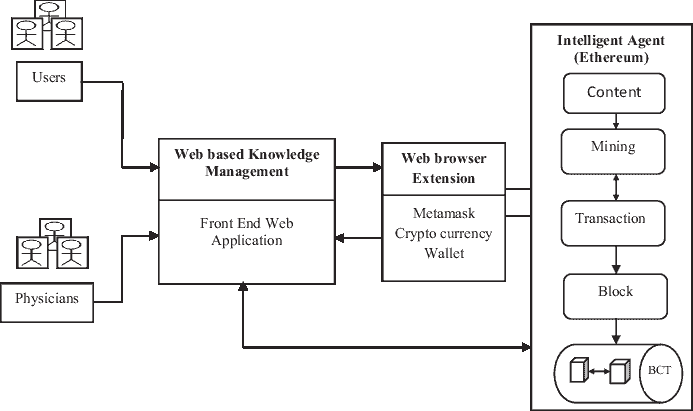

图 1：使用 Web 的 KMS。

在 Web 应用与区块链网络之间建立连接以部署去中心化应用的逐步过程如算法 1 所示。如图 1 所示，最初，医疗中心的用户或管理员必须输入其凭据进行完整性检查以启动 Web 应用。在完成验证操作人员凭据的过程后，激活作为浏览器扩展程序的`Metamask`钱包。

`Metamask`作为 Web 应用与区块链网络之间的接口 [40]。在所提的系统中，使用基于以太坊的公共区块链来编译和部署系统操作。`Metamask`钱包为在区块链上执行所提系统操作（如创建、发布和验证医疗文档）提供`Eth`余额。

#### 算法 1：

```
基于 Web 的应用
输入：用户、医生或管理员的凭据
输出：与区块链建立连接
开始
  重复
    对于每个用户 ‘u’
      如果（验证(u 细节) = 真）
        激活浏览器扩展程序加密货币钱包
        请求确认以处理请求
        如果已确认
          与以太坊建立连接
        否则
          未与区块链连接
      结束如果
      否则
      未激活
    结束对于
  结束重复
```

直到（激活 BCT 上的所有合法请求）

结束

## 4.2 针对官方医疗文档的智能合约

在区块链环境中，智能合约是代码行，使用`solidity`编程用于为特定系统的所需操作编写智能合约。所提的官方医疗文档系统维护方法具有两个主要功能：由权威机构发布用户所需的医疗文档，以及由用户、管理员和医生对文档进行验证。算法 2 显示了发布医疗证明的智能合约伪代码。

### 算法 2:

**用于设置`Issue_doc()`值的智能合约**

**输入：** 所需详情，即原因、日期、名称、`Health_center`名称、文档的`doc_name`

**输出：** 发布一个具有唯一 BCT 基础 ID 的官方文档。

```sol
pragma solidity >=0.4.22 <0.6.0; // 这是一个编译器版本

contract MedicalCert

Begin
    uint public Hospital_Reg_No;
    string public Hospital_Nmae; //bytes16
    string public Doctor_Name; //bytes16
    string public Certificate_Type;//bytes32
    string public Gender;
    string public cert_Holder_Name;
    string public date_of_issue;
    string public date_of_receipt;
    string public Receipent_Name;
    uint public UID_Reciepent;
    for all the users
        function set(variables) public
        Begin
            给所有变量赋值。
        End
        Return (BCT_ID)
    End for
End Contract
```

如智能合约所示，首先需要使用`pragma solidity`指令说明编译器版本，其中`≥ 0.4.22 < 0.6.0`被视为用于部署智能合约的编译器版本。随后需要为智能合约指定一个名称。在这里我们使用`MedicalCert`作为所提智能合约的名称。如算法 2 所示，文档详情通过在基于`solidity`编程的智能合约中声明来从用户处收集。

### 算法 3:

**用于`Verify_doc()`的智能合约**

**输入：** 文档 ID，即`BCT_ID`、`cert_Holder_Name`、`Certifictae_Type`

**输出：** 是否存在

```solidity
pragma solidity >=0.4.22 <0.6.0; // 这是一个编译器版本

contract MedicalCert

Begin
    Repeat
        for all the documents
            function verify(variables)
            Begin
                If hash(Holder_Name(BCT_ID)) == hash(Holder_Name)
                && hash(certificate(BCT_ID)) == hash(certificate_Type)
                完整性检查通过。
                Else
                完整性检查失败。
                End If
            End
        End for
Until（验证所有文档）
End
```

算法 3 显示了已发布证明或医疗文档的功能完整性检查智能合约伪代码。在此过程中，将收到的区块链基础 ID 证明的哈希值与现有文档的哈希值进行验证。任何相同文档 ID 和相同持有人名称的哈希值均被视为有效的证明。在这里我们使用`Keccak-256`方法来评估所需文档的哈希值。`Keccak 256`运行在基于`ethereum`的区块链上。`Keccak-256`在一个名为`Ethash`的共识引擎中运行。`Keccak`是一族哈希函数，类似于`SHA`，用于比特币网络。

## 5 实验评估与分析

所提出的用于管理官方医疗文档的基于 Web 和区块链的 DAPP。它是使用`Web3.js`、`Nodejs`、`Metamask`、`testrpc`以及在`localhost 8545`测试网络上基于以的区块链实现的。图 2 显示了一个获取用户和管理员凭据以操作基于区块链 DAPP 的网页。


图 2：基于 Web 的 DAPP 相关用户凭据界面。

`Metamask`钱包请求确认对用户的凭据进行完整性检查。确认后，它通过从钱包中扣除一些`Gas`（以`Eth`计算的加密货币）运行。图 3 显示了管理员或医生在确认用户详情后官方医疗文档的字段。该 DAPP 在网页上基于凭据执行证书发布和证书验证操作，如图 3 所示。

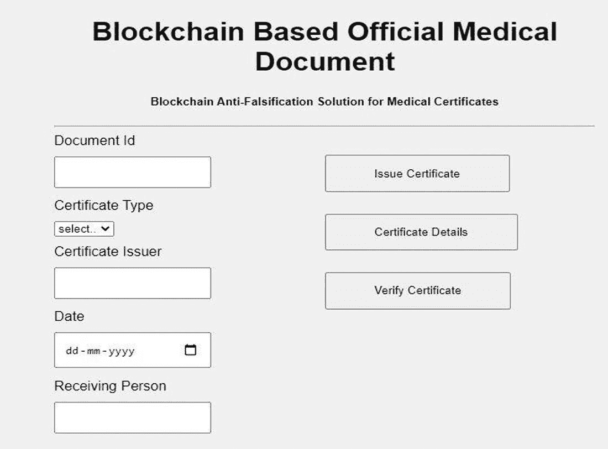

图 3：基于 Web 和区块链的医疗证明。`Metamask`获取确认以在区块链网络上执行任何操作。图 4 显示了`Metamask`钱包的流程。图 4 (a) 显示了`Metamask`钱包的初始金额，即`99.8313 ETH`。图 4 (b) 显示了消耗成本，即`0.004774 ETH`，以及针对管理员或医生凭据执行“发布证书”的确认请求。图 4 (c) 显示了确认发布证书请求后生成的`Metamask`钱包。它显示了发布操作消耗后钱包中当前的可用余额，即`99.8281ETH`。

### 5.1 成本分析

每个操作都在公共区块链上执行。这里的执行指的是在区块链上运行所需的`Gas`（以`Eth`计算的加密货币）。图 3 显示了管理员或医生在确认用户详情后官方医疗文档的字段。该 DAPP 在网页上基于凭据执行证书发布和证书验证操作，如图 3 所示。

每个操作都在公共区块链上执行。这里的执行指的是在区块链上运行所需的`Gas`（以`Eth`计算的加密货币）。`Ether`已知是在区块链上部署应用的燃料。交易成本包括与合约部署和数据传输到区块链相关的费用。执行成本则包括智能合约的内部存储和区块链操作。

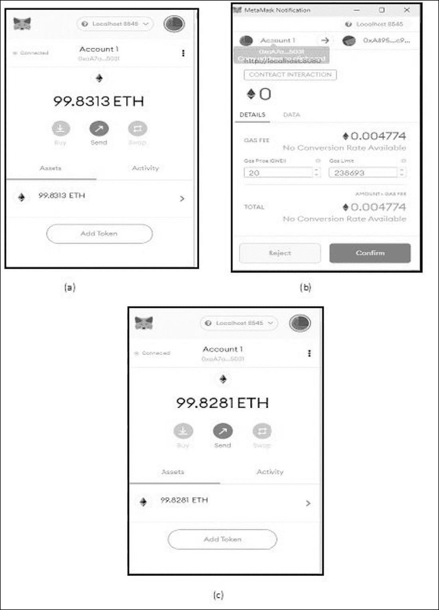

图 4：Metamask 钱包显示操作部署成本。

表 4 显示了区块链上各种操作的成本。在这里，一个`Ether`是`10⁹ gwei`单位。因此，执行操作的消耗使用了`ETH`和`Gwei`。所提出的 DAPP 智能合约四个功能：注册用户或管理员、设置文档凭据、发布官方文档以及由所有授权用户验证文档。

表 4：智能合约部署成本。

| 操作 | 成本 (Eth) | 成本 (Gwei) |
| --- | --- | --- |
| 用户凭据 | 157412 | 0.000157412 |
| 设置文档凭据 | 83230 | 0.000083230 |
| 发布 | 157388 | 0.000157388 |
| 验证 | 72140 | 0.000072140 |

表 5 显示了系统操作执行和交易成本。通常，区块链读取数据的时间很短。此外，交易由区块链节点验证并作为记录存入区块。矿工验证区块并将其添加到区块链。基于`TestRpc`的`localhost 8545`上处理的请求和交易平均时间不是固定的。它取决于系统配置和交易的大小。

表 5：执行和交易成本分析。

| 智能合约 | 执行成本 (Gas) | 交易成本 (Gas) |
| --- | --- | --- |
| 用户 | 682101 | 863212 |
| 管理员/机构 | 1587652 | 2165431 |

图 5 显示了考虑不同“n”值（即：区块链上维护的证书数量）时的成本消耗情况。此处，各种成本因素代表了凭证的成本消耗，例如`Gas limit`、`Gas cost`、以`CGWEI`为单位的`Gas price`以及总`Eth`。

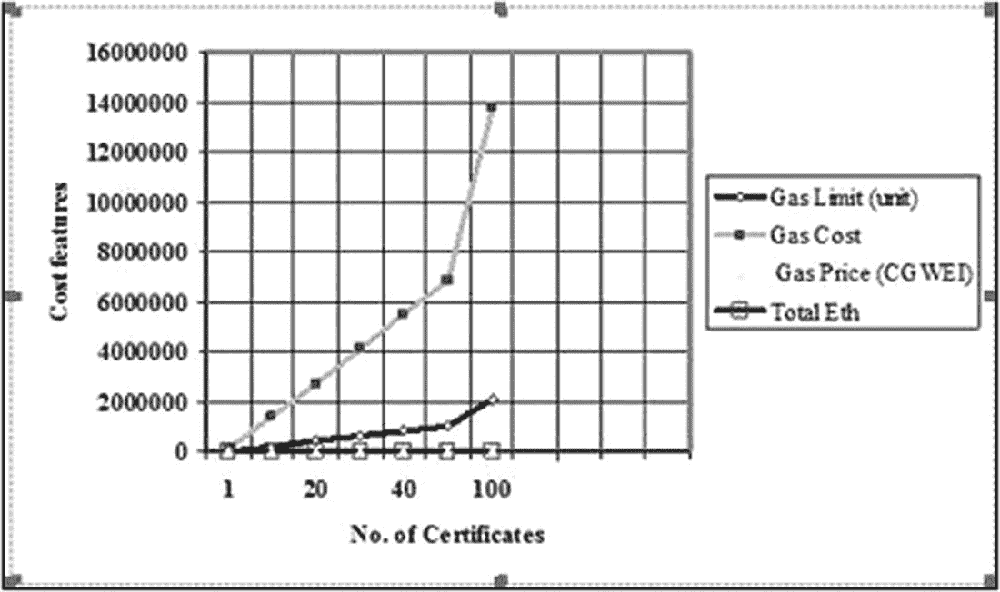

图 5：不同医疗文件的 Gas 消耗。

### 5.2 安全分析

通过考虑两种威胁场景对所提出的基于 Web 和区块链的去中心化应用（DAPP）进行了分析。同时结合技术特性和安全服务与现有系统进行了对比。

**定理 1**：假设任何人都想要非法操纵医疗文档中的数据。

#### 证明：

所提出的应用使用区块链技术为每个医疗文档维护并发布唯一的 ID。区块链的主要特性是不可篡改性。如果数据进入区块链，由于数据与不可逆的哈希方法连接，将无法被追踪或操纵。因此，攻击者想要控制医疗文档凭证极具挑战性。

**定理 2**：假设攻击者试图将错误数据作为交易发送到区块中并在区块链网络上维护。

#### 证明：

要在区块链网络上注册医疗文档数据，所提出的应用使用了智能 Web 系统。因此，在将详细信息纳入区块链环境之前，由权威机构对信息进行验证。除了授权机构外，没有其他人可以注册详细信息。因此，通过所提出的应用程序可以抵抗错误信息或欺诈细节的注册。表 6 显示了所提系统与现有系统的对比。

表 6：所提系统与其他系统的性能对比。

| 特性 作者 | 可用性 | 分布式 | 管理 | 身份验证 | 数据隐私 | 完整性 |
| --- | --- | --- | --- | --- | --- | --- |
| | 否 | 否 | 否 | 是 | 是 | 是 |
| | 否 | 否 | 是 | 是 | 是 | 是 |
| | 否 | 是 | 否 | 是 | 是 | 是 |
| | 否 | 是 | 是 | 是 | 是 | 是 |
| | 是 | 是 | 否 | 否 | 是 | 是 |
| 所提系统 | 是 | 是 | 是 | 是 | 是 | 是 |

## 6 结论与未来展望

根据 fabric ventures 报告，Web 3.0 凭借其开放、无许可、分布式和去信任等目标，每天让超过 30 亿人口获益。Web 3.0 包含了 Web 2.0 的核心层（如社交、移动和云），使其成为一种破坏性技术。这项工作提出了一种使用 Web 和区块链技术的去中心化应用，用于安全地生成和保护官方医疗文档。目前在发布和维护医疗记录方面存在许多关键挑战。每个医疗证书都包含用户的敏感数据，这对于攻击者来说如同珍宝。本章主要关注基于信任的数据访问控制。只有管理员和医生可以操作医疗文档，而不是所有人。在这里，通过考虑成本和安全等因素对所提系统的性能进行了评估。这项工作在未来可以扩展到使用私有区块链。此外，还需要将提出的应用程序集成到实时数据集中。

## 参考文献

[1]Atzori, M. & Pes, B. (2019). “DEW 2019: Data Exploration in the Web 3.0 Age,” 2019 IEEE 28th International Conference on Enabling Technologies: Infrastructure for Collaborative Enterprises (WETICE), Napoli, Italy, 138–139. →


[2] Hatzivasilis, G. et al. (2018). “The Interoperability of Things: Interoperable solutions as an enabler for IoT and Web 3.0,” 2018 IEEE 23rd International Workshop on Computer Aided Modeling and Design of Communication Links and Networks (CAMAD), Barcelona, Spain, 1–7. →

[3] Ohei, K.N. & Brink, R. (2019). Web 3.0 and Web 2.0 technologies in higher educational institute: methodological concept towards a framework development for adoption. International Journal for Infonomics (IJI), 12(1), 1841–1853. →

[4] AlSabeh, A., Safa, H., Bou-Harb, E. & Crichigno, J., (2020). “Exploiting ransomware paranoia for execution prevention,” ICC 2020-2020 IEEE International Conference on Communications (ICC), Dublin, Ireland, 1–6. →

[5] Alnabulsi, H., Islam, R. & Talukder, M. (2018). GMSA: Gathering multiple signatures approach to defend code injection. IEEE Access, 6, 7782–7790. →

[6] Heitmann, N., Pirker, B., Park, S. & Chakraborty, S. (2020). Towards building better web browsers: LCTES’s 21st ACM/SIGBED Conference on Languages, Compilers, and Tools for Embedded Systems, 146–150 →

[7] Zhou, I., Guangmin, S. & Qadir, A. (2019). Towards the development of framework for semantic web, 2019 IEEE 4th Advanced Information Technology, Electronic and Automation Control (IAEAC), Chengdu, China, 2723–2727. →

[8] Zhang, S. & Lee, J. (2020). Analysis of the main protocols. ICT Express, 6(2), 93–97. →

[9] Priya, K.L. & Sharia, S. (2020). Blockchain and trust for end-user-based IEEE Access, 8, 11996–11999. →

[10] Gao, J. et al. (2019). Towards automated testing of blockchain-based decentralized applications, 2019 IEEE/ACM 27th International Conference on Program Comprehension (ICPC), Montreal, QC, Canada. →

[11] Elberawi, E. & Elfirjani, N. (2016). Usability evaluation of web-based systems: A new method International Conference on Engineering (ICEMIS), Agadir, Morocco, 1–5. →

[12] Elkobaisi, M.R., Maatuk, A. (2015). A proposed method to recognize the research trends using web-based search. ACM International Proceeding, 24, 192–203. →

[13] Atzori, M. & Pes, B. (2018). Summary report for the data exploration in the Web 3.0 Age (DEW) track, 27th IEEE International Conference on Enabling Technologies (WETICE), 139–141. →

[14] Reimers, T., Leber, F. & Lechner, U. (2019). Integration of blockchain and internet of things in a car supply chain, 2019 IEEE International Conference on Decentralized Applications and Infrastructures (DAPPCON), Newark, CA, USA, 146–151.

[17] Dedeoglu, V., Jurdak, R., Putra, G.D., Dorri, A. & Kanhere, S.S. (2019). “IoT 中区块链的信任架构”, Proc. ACM Int. Conf. Mobile Ubiquitous Syst. Comput. Netw. Services (MobiQuitous), 190–199. →

[18] Al-Jaroodi, J. & Mohamed, N. (2019). 工业中的区块链：综述。IEEE Access, 7. →

[19] Tanwar, S., Bhatia, Q., Patel, P., Kumari, A., Singh, P.K. & Hong, W.-C. (2020). 基于区块链的智能应用中的机器学习采用：挑战与未来道路。IEEE Access, 8, 474–488. →

[20] Rupa, C. (2020). 使用区块链技术的无人机（UAV）数据安全与隐私。Journal of Information Security and Applications, Elsevier. →

[21] Halpin, H. & Piekarska, M. (2017). “区块链安全与隐私导论”, IEEE 欧洲安全与隐私研讨会 (EuroS&PW). →

[22] Mishra, R.A., Kalla, A., Singh, N.A. & Liyanage, M. (2020). “用于学生凭证安全共享的区块链 dApp 的实现与分析”,2020 年 IEEE 第 17 届年度消费者通信与网络会议 (CCNC), 美国内华达州拉斯维加斯, 1–2. →

[23] RyoheiBanno, K. (2019). “使用 simblock 模拟区块链网络” 2019 年 IEEE 区块链与加密货币国际会议 (ICBC). →

[24] Li, G., Sun, S. & Li, X. (2020). “区块链数字发票系统风险评估与系统开发研究”, 2020 年智能交通、大数据与智慧城市国际会议 (ICITBS), 724–727. →

[25] Shi, J., Zhu, Q. & Jing, N. (2017). “基于区块链因子的电力金融产品生命周期研究”, 2017 年第 4 次工业经济系统与工业安全工程国际会议 (IEIS), 1–5. →

[26] Tse, D., Huang, K., Cai, B. & Liang, K. (2018). “基于区块链技术的稳健密码保存系统”, IEEE 工业工程与工程管理国际会议 (IEEM), 泰国曼谷, 1221–1225. →

[27] Fakhar Manesh, M., Pellegrini, M.M., Marzi, G. & Dabic, M. (2021). 第四次工业革命中的知识管理：文献制谱与未来方向规划。IEEE Transactions on Engineering Management. →

[28] Atzori, M., Koutrika, G., Pes, B. & Tanca, L. (2020). Web 3.0 时代的数据探索，未来世代计算机系统. →

[29] Iqbal, N., Jamil, F., Ahmad, S. & Kim, D. (2021). 一种利用预测分析提供优质健康服务的新型区块链完整性与可靠兽诊所信息管理系统。IEEE Access. →

[30] Yu, K.P., Tan, L., Aloqaily, M., Yang, H. & Jararweh, Y. (2021). 区块增强的可追溯与直接撤销数据共享。IEEE Transactions on Industrial Informatics. →

[31] Da Xu, L., Lu, Y. & Li, L. (2021). 将区块链技术嵌入 IoT：综述。IEEE Internet of Things Journal. →

[32] Chang, S.E. & Chen, Y. (2020). 当区块链遇到供应链：系统性综述。IEEE Access. →

[33] Karapas, C., Pittaras, I., Fotiou, N. & Polyzos, G. (2020). “使用智能合约和 IPFS 的勒索软件服务”区块链国际会议. →

[34] da, R. “通过摄像头的区块链数据保护方法”,2019 年 ACM 第 2 届区块链技术国际会议. →

[35] Jiang, L., Zhang, X., Cui, S., Ming, Z. & Xu, K. (2019). `CoDAG`:基于区块链的社交网络。IEEE Transactions on Computational Social, 9(6). →

[36] Zys, G. & Nathan, O. (2017). “区块链区块链隐私去中心化”,IEEE 欧洲安全与隐私研讨会 (EuroS&PW), pp. 180–184. →

[37] Yang, S., Chen, Z., Cui, L., Ming, Z. & Xu, K. (2019). `CoDAG`:一种高效的 dag 协议。2019 年区块链国际会议, pp. 314–318. →

[38] Fonou-Dombe, J. (2019). “使用 ELECTRE 对语义网本体进行排名”,2019 年大数据、计算与数据系统国际会议 (abcd), 南非温特灵顿, pp. 1–6. →

[39] Faour, N. (2019). “基于波的透明电子投票”,第 16 次“信息与控制系统冗余问题”国际研讨会 (REDUNDANCY), 俄罗斯莫斯科, pp. 219–223. →

[40] Taş, R. & Tanrıöver, Ö. (2019). “在以太坊上构建去中心化应用”,2019 年第 3 次多学科研究与创新技术国际研讨会 (ISMSIT), 土耳其安卡拉, pp. 1–4. →

[41] Khatoon, A. (2020). 用于医疗管理的基于区块链的智能合约系统。工业 4.0 区块链与分布式账本技术（DLT）进展, 9(1). →

# 使用集成网络表单注册印度公司：营商便利环境倡议

Deepa Sahai

## 摘要

印度是国际业务设立的领先表现者，其经济增长和发展使其成为全球投资者的聚集地。随着监管框架的简化和合理化以及信息技术的使用，它正成为全球新兴市场中增长最快、技术进步的知识经济体之一。知识经济已成为生产、储蓄、投资和消费功能的重要部分，其基于创新思想和知识资本等重要资源[15]。知识和知识管理正在成为重要的经济和组织资源。过去十年中，企业通过信息通信技术（ICT）和各种知识产品得到了促进和增长[23]。政府发起的公司、法律、商业和技术改革对简化从注册到公司清算的营商条例产生了积极影响，从而促进了国内投资的流入。

随着智能网络进入第三代，并提供语义网、增强型网页浏览、改进的信息链接、人工智能、机器学习、更好的网络技术以及来自全球数据库的资源搜索功能，互联网世界正在发生范式转移，企业的运营、营销和设立方式正在被重新定义。从 Web 1.0（只读网站）到 Web 2.0（读写网站）再到现在的 Web 3.0（被称为万物网）的演变，允许用户在网页上进行交互，并增加了数据之间的连接性。Web 3.0 让在线应用程序的过程更加简单和用户友好 [38]。利用这一技术革命，已经启动了多项业务改革以简化与创业启动相关的程序。

已开展的重要企业改革之一，是作为改善公司注册商业环境的“营商便利”倡议的一部分，推出了基于网络的电子公司注册简化程表增强版（`SPICe` Plus 表）。通过基于网络的申请文件的人工智能先进功能、电子文件以及各种监管备案，公司这种组织形式的注册已完全实现无纸化，并在企业事务部（`MCA`）门户网站上完全在线。通过使用基于网络的表格（即 `SPICe+`）以及如电子公司章程副本（`e-memorandum of association`）和电子公司章程（`e-articles of association`）等电子文件，创业已变得更加简单和无缝 [30]。

本章详细阐述并讨论了信息技术革命带来的改进及其对业务增长和创业发展的意义。本章还介绍了政府在实施单一电子合规窗口机制、提高创业便利性方面的各项举措、与信息解决方案解决方案主要的营商便利因素、重要的企业改革、新型网络技术在机会方面的影响，以及此类技术将给企业界带来的的挑战。

**关键词：** Web 3.0、知识管理、营商便利、监管、技术、`SPICe Plus form`，

## 1 引言

任何先进和现代的经济体都必然需要知识驱动，以确保社会经济目标和投资增长的平衡实现。印度企业在全球竞争激烈的环境下运营，以维持其业务增长并作为一个具有吸引力的投资经济体。印度的企业家一直以来由于繁琐的政策、程序和法规在创业方面苦苦挣扎。1991 年改革后，各种变化带来了监管变革，减少了企业面临的困难，并提供了有利的环境。以准入自由化和私有化形式体现的监管改革产生了重大影响，降低了准入门槛，从长远来看刺激了投资，这是经济增长的重要引擎 [7]。不同经济体的政府拥有严格的规定，这给企业家带来了负担。此类规定不仅限制了企业家以较少障碍经营私营业务的能力，他们开始从事非正式活动以规避监管并操纵法律，并在其他国家就业。此外，投资者通常不会将使用过度监管的经济体视为投资目的地 [16]。在印度建立或成立制造或服务企业需要大量的程序性合规、法规和许可。印度大约有 120 万家活跃公司。各种准入限制和障碍（如创业程序中的困难和较高的营商成本）影响了经济增长，从而阻碍了新企业的增长 [23]。印度的监管程序机制正在进行改革，以采用新的、更简便的形式，主要为了使企业能够适应并融入国际全球标准，从而吸引外商投资并鼓励国家建设中的创业精神。外国投资者在投资这些经济体时，高效的行政和简单的监管环境是受重视的。一个赋能的监管环境为企业提供了便利的进入和退出。

政府的“营商便利”（`EODB`）倡议发挥了显著作用，政府对其给予了首要。印度州政府和联邦领地在“商业改革行动计划”（`BRAP`）下也启动了多项商业改革，旨在为企业提供赋能的企业友好型监管环境，并根据所采取的改革提供实时排名 [10]。营商便利对于企业家建立新企业（无论是大、中、小规模）至关重要，特别是在监管程序方面，特别是涉及土地购买、物业注册过程，以及获取许可的单一窗口机制，以及根据不同法律获取许可的单一在线申请。

在注册过程中，时间因素、程序性手续、监管障碍、文件要求以及对制造业和和服务业企业更广泛的限制已得到简化并变得更加容易。过去几年引入了许多监管变化，如 2008 年《有限责任合伙企业法》2013 年《公司法》2016 年《破产与清算法》以及 2017 年《商品及服务税法》，以及各种程序变更和改革。这些举措通过引入信息通信技术（`ICT`）简化了现有的法规，使治理及其应用更加组织有序和有效。同时，企业数字化的提高以及从不同机构获得的各种批准的整合进一步减少了企业注册的步骤。开展的各项商业改革开始取得成果。电子治理和技术进步在培养更好的企业合规文化方面发挥着关键作用，从而实现更高、更简单的营商便利水平。

## 2 方法论

本章属于综述性质，探索研究领域并基于二级数据源。关于营商便利指标、现状、问题和困难的数据取自企业事务部、印度商会工业联合会、尼提委员会、`DIPP`（工业政策与促进部）、工业和内部贸易促进局（`DPIIT`）、世界银行《营商环境》报告、不同的国内外出版物、从各种网站收集的报纸文章以及与研究相关的电子资源。

## 3 文献综述

对近期概念文献的综述表明，企业和商业界已实施最新的基于信息通信技术（ICT）的应用，以简化与印度业务相关的行政和监管程序，并取得了积极成果。

在许多新兴市场，监管环境的技术进步和当地商业条件的改善正在以快速速度进行[5]。Singh 和 Jaiswal [1] 在他们的论文中建议，实施和采用电子治理与技术将导致在线模式下的电子化程序办理，从而无需获得许可无需访问政府办公室，进而减少贿赂和腐败案件。印度政府一直应用最新技术和网络工具来简化流程，以消除商界在经营活动中的腐败行为[36]。先进技术应用于便利企业经营，使企业能够在最少的人机交互的情况下增长，特别是在政府服务方面，使用 `AI` 应成为政府交互的重点[4]。


R. K. Yadav 等人 [27] 在其论文中研究了电子治理和互联网准备情况对营商便利程度的影响。良好的商业环境能够促进竞争、鼓励创新，并促进经济中的创业，从而引导经济增长 [21]。数字创业的改善具有高度相关性，因为技术发展为新兴创业者创造了许多新机会[33]。关注其经济增长、福祉和发展的政府会更多地关注对当地中小企业更友好的法律、行政程序和规定。Djankov 等人 [32] 在其论文中根据各国监管新业务准入的方式对国家进行分类，并强调了过度监管与其作为创业障碍的影响之间的关系。

政府只有在行政程序支持下才能运作，例如收集个人所得税等信息，以及对市场活动进行监管以实施公共政策。由于各国政府对其活动需要更多信息，全球范围内的行政程序似乎在增加[26]。

L. Alfaro 和 A. Chari [20] 考察了印度执照制（license raj）改革对企业规模和资源分配的影响。作者指出，随着创业规则变得简易，小型企业的数量随着性能和生产力的提高而增加。同一时期资源配置扭曲的减少和去监管将导致更多企业和更弱的既得权力[3]。

简单的商业规定为小型企业提供了增长和创新的机会，从而从任何经济体的非正式部门进入正式部门[9]。创业者启动业务的难易程度可能是决定投资者是否会在最初开始创业的有力决定因素[35]。J. Estevao 等人 [19] 在其论文中得出结论，仅凭评估信用并不是了解任何业务适用性的主要因素，因为在与监管机构打交道时存在许多困难。需要更好且更少的监管措施，且其效力随时间变化。良好的商业环境使企业能够增长得更多，并对增长做出更多贡献。私营部门越成功，创建的企业就越多，就业机会就越多[35]。T. Canare [35] 在其论文中建议，整体营商便利性对企业创建产生积极影响，这种影响最受受启动业务的驱动。此外，启动业务的影响是由财务成本而非时间和行政成本驱动的。最后，当分析应用于非高收入国家时，结果会发生变化。根据《2020 年营商环境报告》，低收入经济体和高收入经济体在创业便利性方面存在显著差异[7]。

Goel 等人 [24] 在其研究中得出结论，技术和法规对于吸引更多资金流动起着重要作用，从而使金融部门能够增长和发展。《营商环境报告》是一项年度研究，它在自 2003 年以来对 190 个国家发展中经济体的成本以及监管改革和程序的实施进行详细分析后，包含了营商便利性提升进步最大的 10 个国家名称。在《营商环境报告》中得分较高的经济体均显示出更好的创业状况，带来了更好的就业机会、收入增加，从而增加了税收收入。此外，通过采用电子化手段履行监管审批和要求，腐败和贿赂的发生率已有所减少[9]。通过《营商环境报告》衡量的`EODB`指数被认为是国家间的重要衡量标准，也是帮助多个发展中国家构建多种监管改革结构的重要知识产品之一。

## 4 营商环境 (EODB)：引言

自 2004 年以来，世界银行在其《营商环境报告》中根据多项名为`EODB`的标准，对 190 个国家的营商便利度进行排名。该报告涵盖了衡量营商便利度的 10 个领域，包括注册公司、办理建筑许可证、接通供电、登记产权、获得信贷、保护少数投资者利益、纳税、跨境贸易、执行合同以及解决破产程序。

各国经济体根据其在 2020 年营商便利度排名中的表现，对`EODB`10 个领域进行评分，其中包括 7 的环节：注册公司、办理建筑许可证、接通供电、登记产权、获得信贷、保护少数投资者利益、纳税、跨境贸易、执行合同以及解决破产程序。`EODB`索引是由世界银行建立的排名系统，基于启动公司和运营业务（978310722789-010）所需的程序和精简的法规。

营商便利度排名是一项重要的指标，全球投资者利用其来评估一个国家的投资环境。营商便利度指标中的一个关键指标是启动业务的便利性，该指标根据启动公司、雇佣工人、获取业务地点、6 以及解决破产程序所需的程序进行排名。《营商环境报告》定义了启动业务的各个阶段：注册公司、办理建筑许可证、接通供电、登记产权、获得信贷、保护少数投资者利益、纳税、跨境贸易和执行合同。通过改进的在线和电子化纳税申报与缴税系统，使得纳税变得更加容易。

### 表 1：营商便利度指标

| 指标集 | 指标衡量内容 |
| --- | --- |
| 1. 启动公司 | 启动有限责任公司所需的最低资本要求、成本和程序步骤、预注册和注册手续、注册后程序以及改进的在线程序。 |
| 1. 办理建筑许可证 | 办理建筑许可证的时间、成本和精简程序步骤、处理申请的时间、有效的质量控制系统以及与建筑许可相关的安全网、改进的电子平台或在线服务。 |
| 1. 接通供电 | 获取供电的时间、成本和程序步骤、电力供应的一致性、电费透明度、获取供电申请的在线软件、通过数字化流程实现的精简审批以及新连接成本。 |
| 1. 登记产权 | 精简产权登记流程、登记产权的时间、成本和程序步骤、信息透明度以及土地管理系统或行政效率。 |
| 1. 获得信贷 | 通过抵押法、各种信贷信息系统及其深度加强借款人和贷款人的权利。改进信贷信息的共享。 |
| 1. 保护少数投资者 | 通过股东诉讼便利加强少数投资者保护、扩大股东在公司管理中的作用、少数股东权利、增加关联交易的披露要求以及董事责任范围。 |
| 1. 纳税 | 通过增强的在线和电子纳税申报与缴税系统使得纳税更容易、纳税总额、缴金额、涉及的时间以及总税收和申报后流程、改进的税务审计流程。 |
| 1. 跨境贸易 | 通过改进进出口文件的电子提交和处理，使得跨境贸易变得简单、出口和进口所需的时间和成本、进出口所需的文件数量以及加强进出口基础设施。 |
| 1. 执行合同 | 使执行合同变得更加简单、引入民事规则变更、电子案件管理系统、电子备案、解决争议和执行合同涉及的成本和时间、专门法院以及引入的替代性纠纷解决框架。 |
| 1. 解决破产 | 使解决破产变得简单、破产程序的成本、时间和回收率、新的重组程序以及加强债权人权利。 |
| 1. 雇佣工人 | 劳动法规的灵活性。 |
| 1. 与政府签约 | 通过公共采购和公共采购监管框架参与并赢得工程合同的程序和时间。 |

## 公司和有限责任合伙企业（LLPs）在线注册进行技术和企业改革后，印度启动业务的便利性

在`EODB`排名中得分较高的各种经济体具有共同点，例如使用电子系统进行在线程序，使在线注册成为通过单一窗口或单一机构的无缝过程，而不是通过多个机构。根据《营商环境报告》，排名前 20 的经济体都拥有在线注册设施、税务申报电子平台以及产权转让的在线程序。它们还拥有健全透明的业务法规。此外，有 11 个经济体拥有建筑许可相关的在线程序 7。印度已采取了各种数字化努力，使启动业务变得无缝并简化启动新业务的过程。根据 2020 年《营商环境报告》，印度是前 10 名优异者之一，在大多数指标上越来越接近国际最佳实践，并在 2018-19 年实施了所有监管改革的五分之一，显示出其排名取得了令人瞩目的进展。在过去的几十年里，许多被忽视的倡议在技术革命下取得了飞跃。

印度在十项指标中的七项得分有所提高，并日益向国际实践靠拢。根据世界银行《营商环境报告》[11]，印度在 190 个国家的营商环境排名从 2014 年的第 142 位上升到 2019 年的第 63 位。印度在各项指标上均表现出进步——创业、处理建筑许可证、跨境贸易，受益于友好的电子业务环境以及流程时间的缩短[12]。此外，法规与实际执行之间的巨大差距也已缩小。为了实现这一点，公司事务部在过去几年中采取了巨大举措，以提供“创业便利性”，其中包括最近引入的网页表单`SPICe+`以及为减少建立企业所需步骤的各种努力。在营商环境报告的指标中，有如创业、保护少数人利益和解决公司破产等等三项指标，它们属于公司事务部更广泛的规范范围[22]。公司事务部在技术改进方面做出了显著贡献，特别是在创业和减少程序数量方面，从而提供了良好的业务环境[18]。

平均而言，在参与排名的国家中，建立一家公司需要七个程序，花费 25 天。而在新西兰，建立一家公司只需一个程序、半天时间且费用几乎为零；相比之下，企业家在苏里南必须等待 208 天，在委内瑞拉玻利瓦尔共和国则要等待 144 天以上。根据《2020 年营商环境报告》，在印度建立任何企业平均现需要 18 天，将其进一步缩短至 5 天是印度政府的一项议程[7]。

印度从建立在线增值税（VAT）注册开始，随后将其替换为更快的 GST（商品及服务税）注册、电子印花、降低注册费、取消最低资本要求、合并永久账户号码（`PAN`）和税收账户号码（`TAN`）的申请，并增强了在线申请系统功能，将多个申请表单完全整合到单一注册表单中。在这方面引入的其他其他措施还取消最低实缴资本要求、减少涉及的程序/步骤数量，以及中小型有限责任公司的创业成本。诸如新办企业、获得建筑许可证和破产企业解决等各项参数已显示出显著发展，使该国业务环境得到大幅改善，为该国成为吸引国内外投资的全球制造中心铺平了道路。公司事务部在提高创业便利性排名方面做出了巨大贡献，例如减少程序数量、天数、成本，取消公司最低实缴资本要求，实现多个注册的单一表单等。以下是公司事务部作为中央政府营商便利倡议的一部分采取的一些步骤：

*   公司事务部根据《2015 年公司法修正案》取消了私营公司的最低实缴资本要求，作为增加设办公司便利性的一步[22]。
*   在政府流程重组（`GPR`）倡议下，为了使注册过程简单、顺畅、无缝并减少创业所需的程序数量，公司事务部（`MCA`）于 2018 年推出了用于预留名称的`RUN – Reserve Unique Name`网页服务。随着`SPICE+`和`AGILE PRO`表单的发布，从 2020 年 2 月 15 日起，`RUN`网页服务仅用于更改现有公司名称[2]。公司事务部通过简化名称可用性规则，规避了名称预留中的任何歧义。名称拒绝率下降，获得批准所需的时间缩短，从而提高了速度、透明度和统一性[22]。
*   根据《2013 年公司法》第`396`条建立了中央注册中心（`CRC`），这是`GPR`的一项倡议，旨在通过单一在线流程提供快速的注册相关服务。建立`CRC`的目的是让注册程序与国际最佳实践接轨[18]。这是通过在`MCA21 Portal`上提交单一集成网页表单来发布`SPICe`以及现在的`SPICe+`表单实现的。该网页表单为三个中央政府部委（公司事务部、劳动力部和财政部）以及马哈哈施拉特邦政府提供的十种不同注册或服务提供了单一窗口，从而减轻了公司从不同部门获取证书的负担。`SPICe+`尝试实现在线申报和实时数据验证。`SPICe+`表单引入了全新的用户友好仪表板，用于访问所有`SPICe+`及其他关联表单的申请，并访问已保存的与`SPICe+`相关的信息。它包含两个部分：A 部分和 B 部分。A 部分仅包含新公司的名称预留[2],[22]。

表 2：`SPICe+`的 B 部分在单一窗口下提供九项服务[29,34]。

| 序号 | 涵盖的服务 |
| --- | --- |
| 1 | 公司成立 |
| 2 | 分配董事识别号码 |
| 3 | 颁发`PAN` |
| 4 | 颁发`TAN`（税收扣缴及账户号码） |
| 5 | `EPFO`（员工基金管理局） |
| 6 | `ESIC`（员工国家保险公司）注册 |
| 7 | 职业税注册（马哈哈希拉特），自 2020 年 2 月 23 日起 |
| 8 | 开立银行账户 |
| 9 | `GSTIN`（商品及服务税人识别号） |

通过`SPICe+`表单成立的公司必须使用关联表单`AGILE-PRO`提交银行账户申请。在填写 A 部分`SPICe+`后，即可开启`AGILE-PRO`的链接。`AGILE-PRO`网页表单已在所有情况下均成为强制性。没有此表单无法提交`SPICe+`申请。许多银行如旁遮普银行、印度银行、巴罗达银行、ICIC 银行、科塔马哈辛银行和汇丰银行已与`SPICe+`集成。`AGILE-PRO`（取代旧的`AGILE`）是`SPICe+`的一部分，在此申请商品及服务税识别号（`GSTIN`）、员工国家保险公司（`ESIC`）注册、员工基金（`EPF`）注册、职业税注册（马哈哈希拉特）以及开立银行账户[14]。

通过`SPICe+`注册表单，程序数量已进一步减少，并将无疑有助于提高印度未来的营商环境排名。

*   为首次注册的公司另行申请董事身份标识（`DIN`）的要求已取消。公司注册后即可获得银行账号，从而缩短了创业时间。`GST`、`EPFO`、`ESIC`以及专业税（针对马哈拉拉邦）的注册整合是另一项成就。在引入`SPICe+`表格之前，`GST`注册、员工保险（`ESI`）和`EPF`注册是可选的，但现在这些注册对于公司注册都是强制性的。`Shramvidha`门户为劳工部的各利益相关者提供了单一窗口注册和许可。`EPF`和`ESIC`的注册在`MCA`门户通过`Spice+`和`AGILE-PRO`电子表格在注册时完成，无需任何纸质文件和实地访问。随着这一发展，注册程序变得更快。尽管引入这一新步骤需要对`EPF`法和`ESIC`法进行修订。
*   高监管、极高的注册费用以及私营部门承担的成本使得缺乏资金的创业者注册公司变得困难。由于消除了`SPICe+`公司注册表格、电子章程和章程的注册费用，在印度创业变得更加廉价。对于注册资本达到`INR 15,00,000`的公司，只需缴纳`MCA`收取的印花税。根据《2020 年营商环境报告》，印度通过消除注册费用降低了企业创业成本。
*   《2016 年破产与清算法》作为首项破产立法，引入了企业破产解决程序（`CIRP`），以提供破产解决的便利。`IBC`或现代破产制度为公司制定全面战略提供了手段，使债权人能够通过更好的工具协商资金。债权人的整体回收率有所提高，使印度在`EODB`指标上成为南亚表现最好的国家。
*   根据《2013 年公司法》，公司印章或橡章不再是法律要求 [22]。

## 6. 有限合伙企业在线注册的便利性

有限合伙企业（`LLPs`）已成为印度创业的重要企业实体，使专业知识与创业倡议相结合。由于形成流程简单且法律手续较少，`LLP`被广泛采用。`MCA`通过引入网络服务`RUN-LLP`（预留有限合伙企业名称，替换用于预留/更改名称的`Form 1`）引入了另一种治理模式，并推出了整合表格`FiLLiP`（有限合伙企业注册表格，替换`Form 2`），使流程实现了集中，使`LLP`的注册成为完全在线的过程。`FiLLiP`是名称预留、注册和/或`DIN/DPIN`（指定合伙人身份标识）的单一整合申请 [22]。

随着这些改革和技术进步的引入，创业者将发现营商环境的一部分在印度印度变得更加便利。

## 7. 印度通过业务改革行动计划在州级对业务和技术改革的承诺

为了提高监管体系的竞争力、效率和透明度，多年来印度政府一直采取行动改善业务运营环境。为了向各邦和联邦直辖区的改革实施提供正确的动力和推动，已启动中央政府与州政府之间的全面努力与伙伴关系，为业务营造了有利且鼓励性的监管环境，从而促进工业增长并创造更好的创业机会。

州政府在全国业务改革活动中的作用增强了投资者的信心。与世界银行营商环境`EODB`指标的评分和评估类似，`DIPP`的计划是将改革扩展到德里和孟买（被视为业务评估的城市）之外。有必要扩大世界银行评分的这两个城市的基数。印度政府商务工业部工业和贸易促进局（`DPIIT`）引入了`BRAP`。基于`BRAP`实施情况的州排名从 2014 年开始。在`BRAP`下，印度的所有邦和联邦直辖区根据与《营商环境报告》类似的一系列选定参数所开展的业务改革，在全范围内进行排名。印度是少数拥有特定地区排名的国家之一，这有助于国家提高其排名。这项排名的目的是通过减少法规营造支持和有利的监管业务环境，并根据`EODB`的各项措施对州进行分级。`DPIIT`负责制定和实施与更广泛经济目标内有关工业部门发展和增长的各项措施。所采取的各种措施旨在简化和数字化监管程序/审批，尽可能减少与政府官员的物理接触，消除自由裁量程序，并加速`BRAP`建议中提到的限时流程和其他程序。营商环境排名反映了各州鼓励竞争和降低交易及合规成本的努力。`BRAP`帮助各州增强了行政流程的速度和透明度，并合理化了监管框架 [17]。

印度工业和贸易促进局（DPIIT）与各州/联邦地共享了《州改革行动计划》，以改善营商环境（EODB）。这些行动计划涵盖多个改革领域，采取针对特定行业的方法以确保覆盖所有部门，从而为各行业州内企业的设立和运营营造有利的商业环境。广而言之，特定行业的改革包括：通过标准作业程序（SOP）向公众发布信息；通过不同部门的政府命令、通告等对涉及法律和法规的修订进行政策和程序调整；以及通过不同部门提供的在线系统提供服务（以减少物理接触），并通过单一窗口门户实现服务集成。

这些排名代表了各州营商的难易程度，涵盖了提高透明度、增加效率、针对企业设立的有效监管功能（侧重于低成本和快速的单窗口审批）、在线系统的开发，以及涵盖业务全方位的监管检查 [31]。根据印度政府工业政策和促进局的《2019 年州改革行动计划》，安得拉普拉德邦、北方邦、特伦甘纳邦、中央普拉德邦和贾尔坎邦是前五个企业可以顺利启动和开展业务的州。而在阿鲁纳昌普拉德邦、梅格拉邦、锡姆邦、特里普拉、纳加兰邦、奥里萨邦和曼普尔等州，企业家和企业在启动和经营业务方面面临困难。截至 2021 年 3 月，印度已有 20 州成功开展了所有主要的营商改革，使其获得州国内生产总值（GDP）0.25%的额外贷款。根据支出部的许可，这 20 州有权从开放市场融资 395.21 亿卢比。各州营商环境改革带来的发展将导致各州和经济的快速增长 [39]。

## 8. 单一电子合规窗口

为了减少企业重复文件文件，企业事务部（MCA）、DPIIT、印度证券交易委员会（SEBI）和印度储备银行（RBI）正共同考虑合作建议，开发一个单一电子合规窗口。该平台将作为一个在线平台，针对共享共同数据资源的申请表，企业无需实地访问多个部门。此项提议的主要目标是整合企业必须注册的所有部委数据库，并减轻合规负担。通过该平台，所有公司仅需在一个门户提交申请，所有监管机构都将从该单一存储库获取数据。单一在线合规窗口系统是州行动计划中的一个关键改革点 [25]。


该系统设想的功能包括在线提交、缴纳申请费、跟踪申请状态、下载证书以及第三方验证。这种单一存储库可以满足 80–90% 的需求，任何其他额外需求可以通过单独请求额外信息来获取。许可证的注册和续期，各种法律下的许可批准，例如`《1948 年工厂法》`、`《1923 年锅炉法》`、`《1970 合同工（监管与废除）法》`、`《商店营业法》`、`《1996 建筑及其他建筑工人（就业和和服务条件）法》`、`《1979 跨州迁移工人（RE&CS）法》`、`《1981 空气（预防和控制污染）法》`与`《1974 水（预防和控制污染）法》`下的同意、`《2016 危险及其他废物（管理与跨界转移）规则》`下的授权、`《2011 塑料废物（管理与处理）规则》`下的注册/续期、`《2011 电子废物（管理与处理）规则》`等。仪表板会定期更新，突出注册和续期的数量以及获得必要批准的平均时间。

BRAP 2020 的“301 项改革”中提到的其他改革领域或投资赋能因素如下：

- 设计并实施一种在线向导/系统，用户可以在其中输入行业类型、员工人数、地点等详细信息，并获取有关工业单元在设立前和开业前所需的审批信息。该在线向导还应具备各种许可证/无意见书（NOC）及通知的在线申请表链接。它将提供有关所需 NOC 或注册的费用、时间、所需文件、涉及部门等详细信息，从而以透明的方式实现信息获取。
- 通过立法确保在州内向工业部门提供限时交付，否则违规者将面临惩罚措施。
- 州投资促进中心或投资促进机构，重点强调工作程序、服务时限，发布用于处理投诉的在线仪表板，并定期更新解决方案 [31]。

## 9. 结论与未来面临的挑战

本章概述了信息技术革命带来的变化，以及通过政府鼓励和引入技术支持型改革的形式进行适应，这种变革对业务增长和创业发展的意义。这些包括修订和立法改革、税收改革、银行改革，以及放宽的经济和贸易政策，有助于经济增长。印度正处于前所未有的技术和经济进步时期。得益于利用人力资本促进创新和创业的技术革命，印度企业已经利用知识资源升级了其增长曲线，并更加贴近国际实践。

印度也在快速向数字化迈进，越来越多的政府部门正在部署电子平台用于政民互动、文件报送等。对于印度而言，在我们寻求更大的全球投资以提高数亿人生活水平时，营商环境的进展是一项至关重要的成就。正如世界银行报告观察到的，采用电子手段履行监管要求（如获取许可证和缴纳税款）的经济体，其贿赂、监管低效和官僚主义的发生率较低。

监管格局正在不断演变。多年来，企业事务部针对“创业便利”开展了多项倡措，以造福大量利益相关者。最新的网络技术为企业组织提供了多种网页应用程序和数字工具，其中之一是用于简化公司注册的`SPICe+`网页表单。通过敏捷且稳健的信息网络平台创建此类公司注册表单，将带来更智能的用户体验，节省时间和精力。人工智能、物联网、机器学习和 5G 等各种新兴技术将进一步提升营商环境。

法规与全球基准的接轨将减少监管程序，从而减少合规要求。规则、监管流程及其执行应当是简单、及时、有效、真实、友好、高效且明确的，以使印度在全球监管环境中具有竞争力。技术进步的支持将提高公司注册的快捷性，并进一步说服立法者和执法机构进行变革，同时应对工作场所中采用技术和人工智能带来的挑战。为了进一步便利营业务，还必须考虑先进技术的影响，以及此类技术为企业、商业和法律生态系统带来的挑战和选择 [25]。

过去需要许多天的各种程序现在可以在 IT 技术解决方案的帮助下轻松完成。通过物联网（`IoT`）、`Web 3.0`、人工智能、机器学习（`machine-to-machine learning`）和`5G`，许多程序可以在互联网上轻松连接并完成；使数百万应用程序可以通过可以自配置、收集和处理数据、监控使用、自我诊断和自我修复故障的设备进行处理和操作。工业物联网为基于智能和自主设备的通信开启了各种新可能性，并引发了完全基于数据的工业革命 [13]。

印度经济增长和发展的推动因素，如有利的人口状况、才华的人力资本、强大的创业文化、生产率的提高、支持性的政府政策倡议以及作为外国投资者的首选目的地，帮助建立了积极的增长势头。政策倡议为营造良好的业务环境提供了动力和助力，并可以在许多关键领域产生显著差异。政府一直通过 2014 年启动的“印度制造”（Make in India）项目致力于增强国家的制造业水平，旨在将印度转型为全球制造中心，并成为全球供应链的重要部分。所有努力将使印度初创企业的经营变得简单，并将建立一个促进初创企业增长的生态系统，同时为接收外国投资创造支持性框架，简化并消除繁琐的文书/文件和报告程序，使印度对投资者更加友好。

信息技术和营业务便利化带来了透明的业务流程和业务的增长。但技术的应用可能会引发有关实时性能、信息隐私、敏感和机密信息带来的安全挑战、内部安全、健康危害、环境可持续性的各种问题，这些也需要予以考虑。此外，仍有许多领域存在巨大的改进空间。确实，已经取得了巨大进展，但仍有许多工作要做。尽管政府在推动，行政系统的响应和效率将是成功的关键。只有当技术带来的收益通过知识产品和资源正确整合到传统的有效经济治理体系中，技术才能带来投资氛围的增长和改善。

## 参考文献

[1] Singh, A. & Jaiswal, K.K. (2018). Ease of doing business in India: a vision of make in India. Economic Affairs. 63(1), 129–135. doi: 10.30954/0424-2513.2018.00150.16. a, b

[2] “关于公司注册的新 MCA 备案表 SPICe+ (SPICe Plus) 的一切。” [`https://blog.saginfotech.com/spice-plus-form-mca`](https://blog.saginfotech.com/spice-plus-form-mca) (访问于 2020 年 11 月 11 日)。

[3] Alesina, A., Nicoletti, G. & Schiantarelli, F. (2005). Regulation and investment. Journal of the European Economic Association. 3(4), 791–825. doi: 10.1162/1542476054430834.

[4] “数字印度：营业务便利化，AI 应该是数字印度的关注领域：Nandan Nilekani – 经济时报。” [`https://economictimes.indiatimes.com/tech/internet/ease-of-doing-business-ai-should-be-focus-areas-for-digital-india-nandan-nilekani/articleshow/76730193.cms`](https://economictimes.indiatimes.com/tech/internet/ease-of-doing-business-ai-should-be-focus-areas-for-digital-india-nandan-nilekani/articleshow/76730193.cms) a, b

[5] “营商环境 2011：为创业者带来改变。” [`https://www.worldbank.org/en/news/press-release/2010/11/doing-business-2011-entrepreneurs`](https://www.worldbank.org/en/news/press-release/2010/11/doing-business-2011-entrepreneurs) (访问于 2020 年 12 月 23 日)。

[6] “营商环境 2020。” [`https://www.doingbusiness.org/en/reports/doing-business-2020`](https://www.doingbusiness.org/en/reports/doing-business-2020) (访问于 2020 年 12 月 19 日)。a, b

[7] “营商环境 2020：190 个国家的业务监管比较。”华盛顿：世界银行，第 1–149 页，2020 年。[在线]。访问 [`http://documents1.worldbank.org/curated/en/68876157193438/pdf/Doing-Business-2020-Comparing-Business-in-190-Economies.pdf`](http://documents1.worldbank.org/curated/en/68876157193438/pdf/Doing-Business-2020-Comparing-Business-in-190-Economies.pdf) a, b, c

[8] “营商环境 2020：改革改善了印度的商业环境；十大进步者。” [`https://www.worldbank.org/en/news/press-release/2019/10/24/doing-business-india-top-10-improver-ranking`](https://www.worldbank.org/en/news/press-release/2019/10/24/doing-business-india-top-10-improver-ranking) (访问于 2020 年 11 月 11 日)。

[9] “营商环境（2019）：改革培训，190 个国家的企业监管比较”，第 1–311 页，访问于 2020 年 12 月 11 日。[在线]。访问 [`https://www.doingbusiness.org/content/dam/doingBusiness/media/Annual-Reports/English/DB2019-report_web-version.pdf`](https://www.doingbusiness.org/content/dam/doingBusiness/media/Annual-Reports/English/DB2019-report_web-version.pdf) a, b, c

[10] “中小微企业（MSMEs）的营业务便利化。”[在线]。访问 [`www.commercedu.com`](http://www.commercedu.com)。(访问于 2020 年 12 月 18 日)

[11] “印度的营业务便利化：神话与现实 | 德干赫报。” [`https://www.deccanherald.com/opinion/panorama/ease-of-doing-business-in-india-myths-and-realities-793919.html`](https://www.deccanherald.com/opinion/panorama/ease-of-doing-business-in-india-myths-and-realities-793919.html) (访问于 2020 年 12 月 18 日)。

[12] “经济调查（2020–21）。” [`https://www.indiabudget.gov.in/economicsurvey/doc/echapter_vol2.pdf`](https://www.indiabudget.gov.in/economicsurvey/doc/echapter_vol2.pdf).

[13] Sisinni, E., Saifullah, A., Han, S., Jennehag, U. & Gidlund, M. (2018). “工业互联网：挑战、机遇与方向；工业互联网：挑战、机遇与方向”， doi: 10.1109/TII.2018.2852491.

[14] “用于公司注册的 SPICe+(SPICe Plus) 表”。[`taxguru.in/company-law/form-spice-plus-company-incorporation.html`](https://taxguru.in/company-law/form-spice-plus-company-incorporation.html) (访问于 2020 年 11 月 9 日)。

[15] Kefela, G.T. (2010). 知识型经济和社会已成为各国的重要商品。《国际非政府组织期刊》。5(7), 160–166. 访问：2020 年 11 月 11 日。[在线]。获取可用：[`www.academicjournals.org/INGOJ`](http://www.academicjournals.org/INGOJ)。

[16] Assaad, H., Celaya, H., Cruikshank, E. & Foran, J. (2011). “投资未来：新兴市场股权机会”，[`avanzcapital.com/resources/Whitepapers/em_pe_aug_2011.pdf`](http://avanzcapital.com/resources/Whitepapers/em_pe_aug_2011.pdf) (访问于 2020 年 12 月 26 日)。

[17] “提高中小型企业（MSMEs）的营商环境：印度联邦和州级倡议的回顾”。访问：2020 年 12 月 26 日。[在线]。获取可用：[`ficci.in/spdocument/20765/Knowledge-Paper_Improving-EODB.pdf`](http://ficci.in/spdocument/20765/Knowledge-Paper_Improving-EODB.pdf)。

[18] “提高印度营商环境：印度的近期倡议”。[`www.researchgate.net/publication/338736858_Improving_the_Ease_of_Doing_Business_in_India_India%27s_Recent_Initiatives`](https://www.researchgate.net/publication/338736858_Improving_the_Ease_of_Doing_Business_in_India_India%27s_Recent_Initiatives)。

[19] Estevão, J., Lopes, J.D., Penela, D. & Soares, J.M. 营商环境排名与 GDP。一项定性研究。《商业研究杂志》。115, 435–442。2020 年 7 月，doi: 10.1016/j.jbusres.2019.11.067。

[20] Alfaro, L. & Chari, A. (2014). 去监管化、资源错配与规模：印度的证据。《法律与经济杂志》。57(4), 897–936。doi: 10.1086/680930。

[21] Balcerowicz, L. & Rzońca, A. “经济增长与公共部门治理的谜题”。访问：2020 年 12 月 12 日。[在线]，doi:10.1596/978-1-4648-0325-3。

[22] “公司事务部——重大改革与倡议”。[`www.mca.gov.in/MinistryV2/reforms.html`](https://www.mca.gov.in/MinistryV2/reforms.html) (访问于 2020 年 12 月 22 日)。

[23] “迈向知识型经济：亚洲经验”。获取可用：[`www.adb.org/sites/default/files/publication/29699/knowledge-based-economies.pdf`](https://www.adb.org/sites/default/files/publication/29699/knowledge-based-economies.pdf)。访问：2020 年 12 月 14 日。[在线]。

[24] Goel, N. & Singh, G. (2018，7 月). 技术和监管对资本流入印度的作用。《澳澳会计、商业与金融杂志》。12(2), 87–103。doi: 10.14453/aabfj.v12i2.6。

[25] NITI Aayog（印度国家转型局），“营商环境：各州调查”。2017 年。访问：2020 年 12 月 15 日。[在线]。获取可用：[`www.idfcinstitute.org/site/assets/12781/easeofbusiness_report.pdf`](https://www.idfcinstitute.org/site/assets/12781/easeofbusiness_report.pdf)。

[26] “减少投资的行政障碍：经验”。2006 年。[`regulatoryreform.com/report/administrative-barriers-investment-learned-2006/`](http://regulatoryreform.com/report/administrative-barriers-investment-learned-2006/) (访问于 2020 年 12 月 11 日)。

[27] Yadav, R., Bagga, T., Sinha, A. & Kaul, S. 电子治理对营商环境的影响研究。《先进科学技术杂志》。29(9), 4306–4315。2020 年 5 月，访问：2020 年 12 月 21 日。[在线]。获取可用：[`sersc.org/journals/index.php/IJAST/view/1608`](http://sersc.org/journals/index.php/IJAST/view/1608)。

[28] Mendoza, R., Canare, T. & Ang, A. “创业：文献综述及其在 APEC 中的作用”。阿尼欧政府出版物，2015 年 7 月，访问：2020 年 12 月 16 日。[在线]。获取可用：[`archium.ateneo.edu/asog-pubs/31`](https://archium.ateneo.edu/asog-pubs/31)。


[29] “SPICe 现在是包含 10 项服务的 SPICe+。LegalWiz.in”。[`www.legalwiz.in/blog/spice-form-company-registration-with-10-varied-services`](https://www.legalwiz.in/blog/spice-form-company-registration-with-10-varied-services)（访问：2020 年 11 月 21 日）。[在线]。

[30] “SPICe+ 网络提交流程”。[`ecpl.live/icai/2602220/SPICe_plus_Key_features.pdf`](https://ecpl.live/icai/2602220/SPICe_plus_Key_features.pdf)（访问于 2020 年 12 月 9 日）。

[31] “2020 州改革行动计划”，第 1–41 页。[`eodb.dipp.gov.in/PublicDoc/Download/30336`](https://eodb.dipp.gov.in/PublicDoc/Download/30336)（访问于 2021 年 2 月 12 日）。

[32] Djankov, S., La Porta, R., Lopez-De-Silanes, F. & Shleifer, A. 《经济季刊：进入监管》。第 1 卷，第 1–37 页，2002 年。访问：2020 年 12 月 11 日。[在线]。获取可用：[`scholar.harvard.edu/files/shleifer/files/reg_entry.pdf`](https://scholar.harvard.edu/files/shleifer/files/reg_entry.pdf)。

[33] Kraus, S., Palmer, C., Kailer, N., Kallinger, F.L. & Spitzer, J. 数字创业：21 世纪新商业模式的研究议程。《创业行为与研究国际期刊》。25(2), Emerald Group Publishing Ltd., 353–375，2019 年 2 月 21 日，doi: 10.1108/IJEBR-06-2018-0425。

[34] Maheshwari, S. “公司注册——SPICE+ 表”。访问：2020 年 11 月 9 日。[在线]。获取可用：[`taxguru.in/company-law/incorporation-company-form-spice`](https://taxguru.in/company-law/incorporation-company-form-spice)。

[35] Canare, T. “营商环境对企业创建的影响”，第 555–584 页，2018 年。访问：2020 年 12 月 5 日。[在线]。获取可用：[`ideas.repec.org/a/cuf/journl/y2018v19`](https://ideas.repec.org/a/cuf/journl/y2018v19)。

[36] “治理期刊：营商环境——印度”，第 1–176 页，2020 年。[在线]。获取可用：[`support.icsi.edu`](http://support.icsi.edu)。

[37] “通往 50 之路：加速印度的监管改革”。[`www.phdcci.in/wp-content/uploads/2018/10/EoDB-Report-by-PHDCCI-and-KPMG.pdf`](https://www.phdcci.in/wp-content/uploads/2018/10/EoDB-Report-by-PHDCCI-and-KPMG.pdf)（访问于 2020 年 11 月 29 日）。

[38] “什么是 Web 3.0？互联网的演变——Blockgeeks”。[`blockgeeks.com/guides/web-3-0/`](https://blockgeeks.com/guides/web-3-0/)（访问于 2020 年 12 月 14 日）。

[39] “20 个州完成营商环境改革，获得额外贷款资格——《经济时代》”。[`economictimes.indiatimes.com/news/economy/policy/20-states-complete-ease-of-doing-business-reforms-eligible-for-additional-borrowing/articleshow/81604739.cms`](https://economictimes.indiatimes.com/news/economy/policy/20-states-complete-ease-of-doing-business-reforms-eligible-for-additional-borrowing/articleshow/81604739.cms)。

# 外包服务行业视角下当前现行的有效培训方法研究

Tarakeshwar Gupta, Anuradha R. Tiwari

## 摘要

本章节深入探讨了由`BPO`（业务流程外包）和`KPO`（知识流程外包）组成的外包服务行业中，为应对各种培训目标或培训需求所需的实践培训方法。开展或参与这些培训计划的员工是知识工作者（`KWs`），例如培训师、学习与发展人员以及经理。这些`KWs`在各自的组织中起着至关重要的作用，经常帮助、培训、装备和指导缺乏执行特定任务技能的员工。外包服务行业的`KWs`发挥最关键的作用，因为他们经常执行政策，并担任高级与初级经理之间的关键沟通点。然而，在涉及自身发展时，这一群体往往被忽视。中层经理通常缺乏计划/项目/财务管理技能，而这些对于政策的实施至关重要。他们拥有工作技巧（技术方面），但在人员管理、问题解决、人际关系能力等方面极其匮乏，而这些能力最终已成为他们`KRAs`（关键责任领域）的一大部分。因此，为他们配备相关技能变得迫在眉睫。中层管理或经理是`KWs`的一部分，因此根据所需的技能对这些知识工作者进行培训非常重要。培训方法包括用于实施培训或研讨会并向参与者传递新知识、技能和态度的方法、材料、技术和资源。本章节的主要目标是从印度知识工作者（`KW`）的角度探索外包服务行业培训方法的最新趋势。本章还将探讨这些培训方法在实现针对培训需求的培训目标/培训任务方面的有效性。这些培训需求是通过`KW`视角的问卷调查确定的。外包服务行业确定的某些培训目标包括获取新知识或技能、态度转变、问题解决能力、人际关系能力增强以及知识保留；为了满足这些培训需求，培训方法包括讲授法、程序化教学法、案例研究法、敏感性培训法、角色扮演法、商业游戏法、电影法、会议（讨论）法和电视讲座法。对于这项探索性研究，数据是以问卷形式从负责外包服务行业能力建设或提升知识资本的知识工作者处收集的。发送给`KWs`的问卷共有 76 份，回收 60 份，回收率为 78.94%。样本收集采用了雪球抽样法。结果说明了广泛使用的有效培训方法，如角色扮演培训法，其次是程序化教学法和案例研究培训法。由于`Web 3.0`作为一种技术先进的媒介出现，允许用户读取、写入和执行，并使机器能够执行以前预期由人类完成的工作；因此，它在未来知识工作者培训的技术应用具有发挥巨大作用的潜力。本章还关注`Web 3.0`在外包服务行业知识工作者培训中的应用，可以进一步增强能力建设或提升知识资本。

**关键词：** 培训方法、有效的`Web 3.0`、`ITeS`、外包、知识工作者（`KWs`）

## 1 引言

外包服务行业中的知识工作者（`KWs`），如培训师、学习与发展人员和经理发挥着至关重要的作用。这些`KWs`还帮助提升执行特定任务所需技能的员工技能。`KWs`还必须经常执行政策，并作为高级与初级经理之间的关键联系点。然而，在涉及自身发展时，这一群体往往被忽视。中层经理也缺乏计划/项目/财务管理技能，这些技能对于政策实施非常重要。他们通常拥有工作知识（技术方面），但完全缺乏人员管理、问题解决能力和人际关系能力等技能，这些现在是他们`KRAs`（关键责任领域）的一大部分。因此，为他们配备适当的技能至关重要。中层管理或经理本质上是`KWs`的一部分。

培训是创造高绩效工作文化的重要元素 [1]。培训用于弥补知识、技能和态度方面的缺陷。根据 Mandakini [2] 的说法，培训方法包括用于实施培训或研讨会并向参与者传递新知识、技能和态度的方法、材料、技术和资源。在选择培训方法之前，需要进行培训目标或培训需求识别（`TNI`），以解决知识、技能和态度方面的缺陷。

## 2 研究目标

本研究性章节的主要目标是从印度知识工作者（`KW`）的角度探索外包服务行业培训方法的最新趋势。本章节还将探讨这些培训方法在实现针对培训需求的培训目标/培训任务方面的有效性。这些培训需求是通过`KW`视角的问卷调查确定的。此外，还将探讨`Web 3.0`在知识工作者培训中的应用。

## 3 文献综述

大多数公司决定将其运营活动（如客户服务、人力、支付服务、保险理赔、行政等）外包给在这些领域拥有核心能力的组织；这些组织是外包服务。在这些组织工作的个人是`KWs`，因为他们拥有执行任务的知识。文献综述见表 1。

### 表 1：文献综述

| 术语 | 来源 |
| :--- | :--- |
| 获取新知识或技能 | Skinner [12, 13, 14] |
| 成人学习 | Maria & Elena [5] |
| 商业游戏法 | Garris et al. [67], Faria et al. [66], Lopes et al. [64], Faria [65], Faria et al. [66] |

### 研究课题与参考文献总结

| 主题 | 参考文献 |
| :--- | :--- |
| 态度变化 | Janis & King [22], King & Janis [23], Culbertson [21], Festinger & Carlsmith [19], Harvey & Beverly [20], Janis & Mann [24], Petty, R. E., & Brinol, P. [18] |
| 会议（讨论）法 | Johnson & Smith [83], Costin [81] |
| 人际交往技能/人员管理技能提升 | Maier [33], Van Schacck [32], Maier & Maier [36], Bolda & Lawshe [31], Campbell & Dunnette [30], Maier & Hoffman [34], [35] |
| 知识工作者 | Drucker [3], Alvesson [4] |
| 学习 | Logan et al. [7] |
| 讲座法 | Carroll et al. [10], Reith [45], Mazur [42] |
| 电影法 | Paivio et al. [78], Richardson & Kile [73], LeFevre [70], Seago [74], Sherin [75], Wang & Hartley [76], Brophy [69], Moreno & Valdez [71], Borko & Pittman [68], Pryor & Bitter [72] |
| 问题解决/故障排除技能 | Parnes & Meadow [27], Cohen et al. [28], Fox [26] |
| 程序化教学法 | Mahoney et al. [49], Weiss & Green [47], Carroll et al. [10], Skinner [11], [14], [15], [16], Ayutthaya & Koomsap [46] |
| 知识留存 | VanderMeer [41], Dietrick [38], Sodnovitch & Pophorn [40], Verner & Dickinson [39], Bennett & Rebello [37] |
| 角色扮演法 | Buchan [55], Harris [56], Hershey [57], Ments [60], Hughes et al. [61], Johnson & Johnson [54], Sogunro [53], Cranton [58], [59] |
| 敏感训练法 | Seashore [52], Hinrichs [51] |
| 分散学习 | Sutton et al. [9], Kolb & Kolb [8] |
| 电视讲座法 | Sherry [85], McIsaac & Guanwardena [86], Moore & Lockee [87] |
| 培训 | Goguelin [17], Heathfield [1] |
| 培训方法 | Mandakini [2] |
| 硬软技能的迁移 | Arthur [6] |

## 分析

知识工作者将专业化。应用知识在专业化时是有效的。这要求具备沟通能力 [3]。早期工业工人需要资本家，但现在组织需要知识工作者 [3]。本研究聚焦于外包服务行业。知识工作者的工作被认为是非常高水平、高要求且具有智力刺激性的 [4]。

培训的设计应当促进学习的发生。如果发生以下情况之一，学习就会发生：(a) 态度应当改变。(b) 知识应当增加。(c) 获得新技能。在外包服务工作的知识工作者是成年人。根据 Maria 和 Elena (2008) 的观点，作为学习者的成年人具有特定特征，例如：(1) 成年人带有特定的意图、目标和期望参与学习过程。(2) 成年人已经拥有某些知识和经验以及固定的观点。(3) 成年人已经形成了自己的个人学习风格。(4) 成年人在一生中受到自我导向活动的影响。(5) 成年人在学习过程中必须应对某些障碍。(6) 分散学习法是一种有效的成年人学习方法。

所采用的培训方法对硬技能和软技能的转化具有显著影响 [6]。各种研究发现，随时间的间隔学习（spaced learning）有助于人们学习得更快、记忆得更牢，而且这种方法在从销售培训、语言学习到医学等各个领域都被证明是非常有效的 [7]。考虑到间隔学习的培训或学习计划会通过概念或学习目标来教育学习者，然后留出一段时间（几天、几周或一个月）让培训人员实践他们所学的内容 [8]。“间隔学习”优于“集中学习”（massed learning）[9]。

## 4 概念框架

外包服务行业采用不同的培训方法来传授对关键知识（`KWs`）的学习。这些培训方法针对所识别的培训目标或培训需求。培训方法是通常决定培训计划有效性的因素之一。用于增强外包组织中关键知识学习的一些培训方法包括：演示、讨论、辩论、讲座、汇报、角色扮演、游戏活动、案例研究、电子媒体使用（电视、视频和电影）等。

## 5 培训目标

培训的主要目标是培训人员或学习者在完成培训后预期达到的可衡量结果。根据文献综述，我们研究范围内确定的某些培训目标如表 2 所示。

表 2：根据文献综述确定的培训目标

| 序号 | 培训目标 |
| --- | --- |
| 1 | 获取新知识或技能 |
| 2 | 态度转变 |
| 3 | 提升人际技巧/人员管理技能 |
| 4 | 解决问题技能/故障排除技能 |
| 5 | 知识留存 |

这些培训目标与外包组织中使用的技能相似，也根据通过问卷收集的数据得到了关键知识（`KWs`）的支持。

### 5.1 获取新知识或技能

获取新知识或技能是在记忆中处理和存储新信息的过程，其有效性通常通过以后阶段从记忆中提取信息的优劣程度来衡量。获取新知识或技能是外包组织中常见的培训目标之一。获取知识方面最有效的培训方法是程序化教学法，而最无效的是讲座法 [10]。在程序化教学法中，培训师控制培训人员行为与教学设置特定特征之间的交互。这是通过 B. F. Skinner 的 [12, 13, 14] 工作建立了程序化教学法。Skinner 的重点是指出，自教育应该在强化理论的框架内通过程序化手段进行。培训是一种创造应用培训人员所学内容的动力的方法，在激励、鼓励的同时，确保使用所学知识的方法和欲望。而教学被限于根据对给定数量明确思想的推理来提供知识 [17]。制定了若干相关培训理论的著名老旧研究者包括：老研究者：威廉·詹姆斯、J. F. 赫尔巴特、威廉·冯德特。现代研究者：E. L. 桑登克、E. R. 古斯里、C. L. Hull、B. F. Skinner、W. Kohler 和 E. C. 托尔泽曼。

### 5.2 态度转变

“态度”一词用于表示一个人对个人、物体和问题的总体评价。因此，一个人的态度是指对个人、物体和问题的积极、消极、好感或不好的看法 [18]。涉及态度的培训在各个行业开展，并与外包行业密切相关。敏感培训是改变态度最有效的方法；然而，角色扮演和案例研究也是有效的。许多针对学生的研究显示角色扮演法在处理态度方面是有效的 [19, 20]。如果要求角色扮演的参与者采取相反观点并向他人陈述这种观点，角色扮演就是有效的 [21, 22, 23, 24]。

### 5.3 解决问题/故障排除技能

解决问题技能是问题识别、问题分析、策略制定、资源分配、跟踪和问题评估的结合。人们也可以根据需要反复这些步骤，或在合适时跳过步骤 [25]。最有效的培训方法是案例研究法，其次是商业游戏和角色扮演。Fox, 1963 [26] 让一些学生接触案例研究分析，结果是：三分之一的学生在处理案例方面显著提高，三分之一的学生表现出中等进步，剩下的三分之一没有提高。头脑风暴培训也可以提高解决问题的技能 [27, 28]。头脑风暴可以通过角色扮演来教学。

### 5.4 人际技巧/人员管理技能的提升


人际技巧是为实现目标而在面对面交流中使用的目标导向行为[29]。人际技巧也被称为人际、面对面技巧、社交技巧和人际能力。敏感培训在提升人际技巧方面最有效，其次是角色扮演。虽然会议（讨论）法和案例研究法也被认为是有效的[30]。角色扮演在提高对员工动机的敏感性方面有效[31]。角色扮演在提高面试技巧方面也是有效的[32]。角色扮演提升了团队领导力技能，这是人际技巧的一种形式[33, 34, 35, 36]。

所学知识的留存是对存储在长期记忆中的信息的检索[37]。程序化教学最为有效，其次是案例研究法和敏感性训练法。角色扮演法、会议（讨论）法和商业游戏是更有效的培训方法[38, 39, 40, 41]。研究认为，留存材料的数量通常与学习的数量成正比[38, 39]。

## 6 培训方法

根据文献综述，纳入我们研究范围的培训方法列在表 3 中。

表 3：根据文献综述的研究范围内的培训方法。

| 序号 | 培训方法 | 定义 | 来源 |
| --- | --- | --- | --- |
| 1 | 讲授法 | 讲授法是一种说明信息的传统方法。它涵盖由合格人员对某一主题进行口头报告。 | Reith [45], Golafrouz & Khaghanizadeh [43] |
| 2 | 程序化教学法 | 程序化教学是一种为培训者或学生提供新主题内容的系列分级引导步骤的方法。这些培训者或学生按照自己的节奏独立通过程序化材料学习，并通过回答问题或填写图表在每一步操作后测试自己的理解程度。 | Ayutthaya & Koomsap [46]; Skinner [11, 14, 16] |
| 3 | 案例研究法 | 在案例研究法中，要求培训者独立阅读并保留特定案例研究中的信息；案例研究本质上是互动性的。 | Martin et al. [48]; Shivakumar [50] |
| 4 | 敏感性训练法 | 敏感性训练模型是一种无计划的聚会，用于讨论与小组程序“此时此刻”相关的的话题。它既指一种独特的培训方法，也指特定的内容领域。 | Hinrichs [51]; Seashore [52] |
| 5 | 角色扮演法 | 在角色扮演中，个人通过观察、内省或通过参与总体评估所获得的信息进行学习。 | Sogun [53], Johnson & Johnson [54] |
| 6 | 商业游戏 | 商业游戏是一种利用经验性技术开发领导者的方法。 | Lopes et al. [64], Faria [[9783110722642_015421.xhtml_b_9783110722789-011_ref_065)] |
| 7 | 电影 | 大量研究表明，嵌入培训的视频在心理学、管理学和科学领域具有巨大影响。 | Borko [68], Pittman [69], Leevre [70], Smith [71], Foley [72], Cost [73], Seago [74], Wang [75], Hartley [76] |
| 8 | 会议（讨论）法 | 在会议（讨论）法中，存在思想交流，这些思想得到了扩展和完善。此外，对于此类讨论，听力是一项重要技能。 | Costin [81], Smith [82] |
| 9 | 电视教学 | 电视是一种强大的互动工具，在告知、娱乐和教育方面具有巨大潜力。先进的大众传播技术为教学和学习领域提供了可能性。 | Jayakumar [84], McIsaac & Guanwardena [86] |

### 讲授法

在工业革命之前，书籍尚未成为大众商品，讲授法是代际传递知识的唯一方式[42]。讲授法是最常见的培训方法之一。讲授法向许多群体展示大量问题的一种简单、快速且廉价的方法[43]。然而，也需要关注讲授法的缺点，例如讲座时间过长、单向沟通会导致问题被遗忘[44]。讲授法是一种说明信息的传统方法。它涵盖由合格人员对某一主题进行口头报告[45]。研究表明，在获取知识方面，讲授法更为有效；但与讲授法相比，程序化教学能提高学习效果 10%。

## 程序化教学法

程序化教学是一种为受训者或学生提供针对新主题的一系列分级引导步骤的方法。这些受训者或学生按照自己的进度独立学习程序化材料，并在每一步之后通过回答问题或填写图表来测试自己的理解情况[46]。新的主题/知识/技能可以通过一系列受控的步骤通过程序化教学法呈现。受训者具有灵活性和空间，按照自己的进度逐步完成程序化材料，并且每一步都通过考试题或填写图表接受测试。教学，无论是旨在培养智力障碍儿童的学术技能、增加普通儿童的常识，还是提高资赋儿童的数学素养，都可以被视为一个过程，即教师系统且有效地安排和重新安排环境，以实现所需的行为变化。在此基础之上的教学，全部或部分被称为程序化教学[15, 47]。程序化教学是一种基于行为实验分析的技术[11, 14, 16]。

## 案例研究法

在案例研究法中，受训者被要求独立从特定的案例研究中阅读并保留信息；案例研究本质上是互动性的[48]。案例研究法是提高问题解决能力的最佳方法[49]。案例研究有助于增强决策能力、提升沟通和人际技巧，并加强分析能力。这种培训方法对于学习者已具备一些基础知识并能从培训的适用本质中受益的情况非常理想。这是一种低风险、低成本的培训方法，可以同时培训大量学习者，因此它是法律、医学和咨询学生培训的热门选择[50]。Carroll 等人 (1972) [10] 对基于工业的培训师进行了调查，发现案例研究法是获取知识的第二佳方法；最好的方法是程序化教学法。此外，根据文献，对于知识留存，案例研究法是最佳培训方法。

## 敏感性培训法

敏感性培训法是一种无计划的群体聚会，用于讨论与小组“此时此刻”相关的题[51]；它既代表一种独特的培训方法，也代表一个特定领域。敏感性培训的目标分为三类：个人视角、群体视角和组织视角。个人视角：受训者可以清晰地了解自己的任何行为是如何被他人感知的。不同个人对同一行为有不同的看法。例如，了解某行为对任何人的影响是支持还是反对，是有意义还是无意义的。小组的所有成员对任何特定事件具有相同观点的情况并不常见[52]。

## 角色扮演法

在角色扮演中，个人通过观察、内省、纠正或即兴所获得的信息，以及通过参与对整个活动的概括评估来学习[53]。角色扮演越真实、练习越成功，你就越会有情感上的投入，理解也越深层[54]。角色扮演作为一种培训方法，涉及扮演某种角色，用于个人和群体环境，如咨询、面试、客户服务与销售、私下互动、谈判、政府会议、团队委员会、研究，以及涉及参与者大量投入工作的程序[55, 56, 57]。角色扮演的优势在于让受训者实际练习相关技能，因此比关于领导力的启发式讨论更具迁移性[61]。角色扮演特别适合为受训者提供共同练习如何处理工作中的重要责任的机会，或用于敏感性培训及其他目的[62]。此外，一项探索遗传咨询教育中使用角色扮演的研究发现，参与者认为这种方法对他们了解遗传咨询系统和后果很有帮助，并能帮助他们与患者互动[63]。

## 经营游戏法

经营游戏法是一种利用体验式技术培养领导者的过程[64]。经营游戏在管理教育或培训中被广泛接受。约 90% 的`AACSB`（美国工商学院协会协会）学校将经营游戏作为管理教育的模拟[65]。对 304 篇业务模拟教育和学习文章的回顾，通过经营游戏获得的五个方面是策略、决策、团队合作、经验以及学习成果和目标[66]。经营游戏作为一种培训方法体现了体验式学习的精髓。经营游戏是一种通过实际应用来测试理论洞察的工具。

## 电影教学法

许多研究表明，嵌入培训或教育模块的视频对心理学、咨询、医学、管理和政治科学领域的学习具有巨大影响[[68], [69], [70], [71], [72], [73], [74], [75], [76]]。与口头（即音频）条件相比，通过图片（即视频和视听）学习是一种更优的学习方式。这与图像优越性有关[[77], [78]]。为了强化重要的概念和思想，视频片段因其能产生视觉刺激而被使用。通常，信息以视觉形式存储，例如电影片段；图片和电影片段对于帮助学生记住关键思想并从长期记忆中提取至关重要[[79]]。马来西亚约 94% 的成年人通过观看电视、视频和电影来获取知识[[80]]。

## 会议（讨论）法

在会议（讨论）法中，学员和培训师针对要传授或教授的主题进行一对一讨论。讨论法对于能力较低的学生的演讲课程有益；也是一种有助于回忆事实的好技巧。与讲授法相比，讨论法可能是更有效的教学方法[[81]]。在会议（讨论）法中，思想进行了交流，并且这些思想得到了扩展、批判和完善。此外，对于此类讨论，倾听能力是一项重要技能[[82]]。根据 Johnson 和 Smith (1953) [[83]] 的研究，基础心理学课程讨论班的学生与通过讲授法学习相同课程的其他学生相比，不仅对课程表达了意见，而且这些通过讨论或会议技术学习的学生对测试和评分程序的开放度更高。

## 电视讲座法

电视演讲的独特之处在于，它包含了两个或多个地点之间的通信，在指定的时刻给出指令（这些指令在同一时刻发生多次）。电视是一种强大的互动工具，在告知、娱乐和教育方面具有巨大潜力。先进的大众传播技术为教师在教学领域提供了可能[[84]]。研究人员不断发现电视具有激励和刺激作用[[85]]。通过互动演讲进行远程学习是增长最快的领域之一[[86]]。远程学习并不是新概念，而视频讲座已经使用了多年[[87]]。

## 方法论

针对特定目标构建了一份关于最新培训方法的问卷。这些培训方法源自文献。

## Web 3.0 的使用

Web 3.0 指的是基于互联网服务的第三次浪潮，它们共同构成了所谓的智能网络[[88]]。简单来说，Web 3.0 确实是一种先进的介质，允许用户读取、写入和执行，此外它使机器能够执行以前预期人类完成的任务[[89]]。不而说，全球数百万人使用互联网或网页来学习。为了更好地理解 Web 3.0 的范围，我们必须理解 Web 1.0 和 Web 2.0。Web 1.0 是一种知识介质，知识在用户与信息之间没有交互的情况下呈现，也被称为只读 Web[[90]]。Web 2.0 基本上是 Web 1.0 初始目标、价值观和底层技术的扩展[[91]]。Web 2.0 有许多优点，特别是它通过允许用户参与网络基础设施，创建具有多种用途的海量数据，促进了复杂知识网络的发展。它还促进了以用户为中心的灵活应用程序的增长[[92]]。

基于语义网的教育 (SWBE) 是一个执行教学、学习、协作、评估和其他教育操作的平台。教学代表通过与学习者和教师互动，并与其他代表合作，使内容和信息流动来促进学习。在 SWBE 中，聚焦于网络的教育材料由学习对象描述。学习对象是可以重复用于学习资源的数字实体，例如电子文本、交互式内容、动画和图片[[93]]。

## 教育与研究中的 Web 3.0

Web 2.0 学习强调互联网用户的积极参与，以及通过社交网络工具或社交应用（如博客、wiki、社交书签和社交网络）建立虚拟社区之间的联系。Web 3.0 技术的资源和服务将有助于促进一种更加开放的学习方式。Web 3.0 是高功率图形和文本数据的结合。根据 ASTD（美国培训与开发协会）总裁兼首席执行官 Tony Bingham 的说法，内容会在语义网上主动找到你，而不是由你主动寻求。你的行为和偏好将决定你发现的内容，它将以你选择的渠道以及你喜欢的方式呈现给你[89]。高等教育可以使用诸如`MOODLE`、`Web 2.0`、`Web 3.0`和`Blackboard`等各种在线学习资源。在线学习工具可以为许多来自不同文化背景且高等教育水平各异的学生提供准备教育和高等教育。在线学习 3.0 是使用`Web 3.0`工具进行社交学习的主要趋势之一。在互联网上，将新服务快速集成到现有软件中也是简单的，例如`Wiki`与`Web 3.0`的集成。Web 3.0 铺平了在线学习的演进，与传统学习相比成本较低，并被视为更高效的学习，因此促进了新流程和技术的扩散，从而减少了地理挑战[94]。个性化根据学习者的兴趣、当前技能和知识状况、对学习风格的期望以及持续的过程跟踪，为参与者提供定制的教育计划[95]。基于`RDF`、`XML`和本体论的`Web 3.0`方法是个性化学习目标的理想选择[96]。

## 组织中的学习与培训中的 Web 3.0

Web 3.0 在组织学习方面有很大的前景，但尚未充分发挥其潜力。Web 3.0 创新提供了更智能的搜索、更好且更集中的性能，以及在更短的时间内获取更高质量的知识。虽然`Web 3.0`的沉浸式互动元素多年来已通过使用虚拟环境和模拟用于企业培训与开发部门的学习领域，但其他沉浸式技术仍未得到充分利用。关注`Web 3.0`在学习功能和 IT 相关领域中角色的个人，与良好的学习功能和高市场效率都相关[97]。Web 3.0 技术今天及未来影响学习（主要在高性能组织中）的方式包括：

*   高性能组织需要建立对新技术开放的学习和培训部门，并利用这些技术来解决业务问题。
*   预计在未来几年内，使用虚拟环境、模拟、增强现实和多人游戏技术进行组织培训的情况将大幅增长。
*   对于学习和培训从业者来说，是时候采取战略并准备好应对从`Web 2.0`到`Web 3.0`的剧烈转变了。

## 9 发现与分析

调查问卷被设计并发放给从事外包行业的知识工作者。这些知识工作者包括培训师、经理、高级经理以及学习开发专业人员，他们对这些方法及其结果有相当的了解。对于每个培训目标，向受访者提供了三种培训方法，并要求他们针对特定的培训目标对这三种培训方法进行排序。这三种培训方法源自文献综述，被认为最适用于该特定的培训目标。

对于“获取新知识或技能”这一培训目标，程序教学排名第一，其次是案例研究法和会议（讨论）法。根据受访者的意见，态度转变等培训目标可以通过敏感培训得到最好的解决，其次是角色扮演和会议（讨论）法。在解决培训方法解决问题能力/故障排除技能问题方面，案例研究法排名第一，其次是商业游戏和角色扮演法。为了解决增强人际关系/人员管理技能的培训目标，敏感培训法排名第一，而角色扮演和会议（讨论）法分别排名第二和第三。根据受访者的意见，最终培训目标知识保留可以通过程序教学法得到最好的解决，其次是案例研究和敏感培训法（表 4）。

表 4：根据受访者对培训方法的排名。

| 培训目标 | 培训方法 | 排名 |
| --- | --- | --- |
| 获取新知识或技能 | 程序教学 | 1 |
| 案例研究 | 2 |
| 会议（讨论） | 3 |
| 态度转变 | 敏感培训 | 1 |
| 角色扮演 | 2 |
| 会议（讨论） | 3 |
| 解决问题能力/故障排除技能 | 案例研究 | 1 |
| 商业游戏 | 2 |
| 角色扮演 | 3 |
| 增强人际关系/人员管理技能 | 敏感培训 | 1 |
| 角色扮演 | 2 |
| 会议（讨论） | 3 |
| 知识保留 | 程序教学 | 1 |
| 案例研究 | 2 |
| 敏感培训 | 3 |

属于 25-34 岁组的受访者占 55.93%；35-44 岁占 37.29%，25 岁以下的受访者占 3.39%。受访者的职称分类及百分比：培训师 25%，经理 20%，助理经理 16.67%，组长 10%，质量经理 6.67%，总经理 5%，副总经理 5%，运营经理 5%，执行人员 5%，副总裁 1.67%。主要角色为培训的受访者占 58.33%，质量占 18.33%，运营占 23.33%。从学历来看，大多数受访者是本科生，占 60%，研究生占 36.67%，专科占 3.33%。工作经验超过 10 年的受访者占 61.67%，6 至 10 年的占 21.67%，工作经验少于 5 年的受访者占 16.67%。

受访者被问及他们组织的培训计划有多严谨？回答为：非常多——33.33%，很多——38.33%，中等——18.33%，很少——8.33%，完全没有——1.67%。受访者被要求“列出外包组织确定的某些培训需求”。该问题的回答为：获取新知识或技能——81.67%，态度转变——43.33%，解决问题能力——75.00%，人际关系——53.33%，知识保留——53.33%，其他为 10.00%。根据受访者的意见，“其他”包括领导力培训、客户互动和业务沟通，以及韧性和以客户为中心。受访者认为，获取新知识或技能、解决问题能力是关键培训需求，其次是人际关系和知识保留。

共有 48.33% 的受访者“强烈同意”使用了适当的培训方法来解决已识别的需求，而 45% 的受访者“同意”使用了适当的培训方法来解决已识别的需求；此外共有 5% 的人“不同意”使用了适当的培训方法来解决已识别的需求。而只有 1.67% 的受访者“既不同同意不同意”。角色扮演法和程序教学法在外包服务行业被广泛用培训方法，其使用率分别为 78.33% 和 76.67%；其次是案例研究法（71.67%）、会议（讨论）法（66.67%）、讲座法（60%）、商业游戏（55%）、敏感性训练（53.33%）、电视讲座（45%）、电影法（45%），其他（在线门户）仅占 1.67%。

## 10 结论

在外包服务行业中，从 KW 的角度解决特定培训需求在实践中使用的培训方法与 Carroll 等人 1972 年的发现相似[10]。根据 Carroll 等人 1972 年的研究[10]，“知识获取”可以通过程序教学培训法得到最好的解决，我们在外包服务行业的研究发现也描述了这一点；即“新知识或技能的获取”可以通过程序教学培训法得到最好的解决。根据 Carroll 等人[10]，“态度的变化”可以通过敏感性训练法得到最好的解决，这与我们的发现相似。“解决问题技能”这一培训需求通过案例研究培训法得到最好的解决，其次是商业游戏和角色扮演法。“知识保留”通过程序教学法得到最好的解决，其次是案例研究法和敏感性训练法。

我们的发现表明，角色扮演培训法是包服务行业中最常用的培训方法。它被广泛接受并用于解决“态度的变化”和“人际技巧”相关的培训需求。程序教学培训法是外包服务行业第二受欢迎的培训方法。案例研究培训法是外包服务行业第三受欢迎的培训方法。发现案例研究作为一种培训方法是解决“解决问题技能”需求的最佳方法。程序教学作为一种培训方法被认为是满足“获取新知识或技能以及知识保留”培训需求的最佳方法。

## 11 进一步研究空间


可以针对角色扮演和商业游戏培训法进行专门的研究。与其他培训方法相比，关于这些方法的文献非常有限。此外，根据文献综述，角色扮演已成为解决“态度的变化”和“人际技巧”培训需求的第二最佳培训方法。此外，我们的发现将角色扮演培训法排在解决“解决问题技能”需求的第三最佳培训方法，以及解决“人际技巧”需求的第二最佳培训方法。商业游戏作为一种培训方法用于管理培训中的模拟练习，在学术培训中也有其用途。因此，进一步研究将无疑扩大关于这两种培训方法的知识体系。

本研究未收到来自公共、商业或非营利部门机构的特定资助。

## 参考文献

[1]Heathfield, S. (2008). “Twelve tips for team building: how to build successful work teams”, available:[`humanresources.about.com/od/involvementteams/a/twelve_tip_team_3.htm`](http://humanresources.about.com/od/involvementteams/a/twelve_tip_team_3.htm) (访问于 2019 年 4 月 20 日). a, b

2 [`aladin.uil.unesco.org/paldin/pdf/course01/unit_10.pdf`](http://aladin.uil.unesco.org/paldin/pdf/course01/unit_10.pdf). a, b

[3]Drucker, P.F. (1994). The age of social transformation. The Atlantic Monthly, 27(4), 53–80. a, b, c

[4]Alvesson, M. (1995). Management of Knowledge-Intensive Companies, New York, Walter Gruyter & Co. a, b

[5]Maria, P.K. & Elena, G. (2008). Development of personalized learning for educators. Journal of Management, 12(6), 89–101. a, b

[6]Arthur, J.R. (1996). An application of the high transfer with soft skills. a, b

[7]Logan, J.M., Castel, A.D., Haber, S. & Viehman, E.J. (2012). Metacognition and the spacing effect: the role of repetition, feedback, and instruction on judgments of learning. Metacognition and Learning, 7(3), 175–195. a, b

[8]Kolb, A.Y. & Kolb, D.A. (2005). Learning styles and learning spaces: Enhancing experiential learning in higher education. Academy of management learning & education, 4(2), 193–212. a, b

[9]Sutton, M.A., Ide, J., Masters, S.E. & Carew, T.J. (2002). Interaction between amount and pattern of training in the induction of intermediate- and long-term memory for sensitization in Aplysia. Learning and Memory, 9, 29–40. a, b

[10]Carroll, S.J., Paine, F.T. & Ivancevich, J.J. (1972). The Relative Effectiveness of Training Methods: Expert Opinion And Research, Personnel Psychology. a, b, c, d, e, f, g

[11]Skinner, B.F. (1953). Science and Human Behavior, New York, Free. a, b, c

[12]Skinner, B.F. (1954). The science of learning and the art of teaching. Harvard Educational Review, 24, 86–97. a, b

[13]Skinner, B.F. (1958). Teaching machines. Science, 128, 969–977. a, b

[14]Skinner, B.F. (1961). Why we need teaching machines. Harvard Educational Review, 31, 377–398. a, b, c, d, e

- [15] Skinner, B.F. (1963). 操性行为. *美国心理学家*, 18(8), 503. a, b

- [16] Skinner, B.F. (1964). 教学中的新方法与新目标. *新科学家*, 122(5), 483–484. a, b, c

- [17] Goguelin, P. (1960). 工业中的心理问题. 在索邦大学的讲座, 29(10). a, b

- [18] Petty, R.E. & Brinol, P. (2010). 态度改变. *高级社会心理学：科学现状*, 217–259. a, b

- [19] Festinger, L. & Carlsmith, J. (1959). 强制服从的认知后果. *异常与社会心理学杂志*, 58, 203–210. a, b

- [20] Harvey, O.J. & Beverly, G. (1961). 通过角色扮演引起概念改变的一些人格相关因素. *异常与社会心理学杂志*, 63, 125–130. a, b

- [21] Culbertson, F. (1957). 通过角色扮演修正情感化的有的态. *异常与社会心理学杂志*, 54, 230–233. a, b

- [22] Janis, I. & King, B. (1954). 角色扮演对观点改变的影响. *异常与社会心理学杂志*, 49, 211–218. a, b

- [23] King, B. & Janis, I. (1956). 即兴与非即兴角色扮演在产生观点改变方面的有效性比较. *人类关系*, 9, 177–186. a, b

- [24] Janis, I. & Mann, L. (1965). 情感角色扮演在修改吸烟习惯和态度方面的有效性. *人格实验研究杂志*, 1, 84–90. a, b

- [25] Davidson, J.E., Sternberg, R.J. & Sternberg, R.J. (Eds.). (2003). *解决问题的心理学*. 剑桥大学出版社.→

- [26] Fox, W.M. (1963). 案例教学在人关系中的有效性衡量. *人事管理*, 26, 53–57. a, b

- [27] Parnes, S.J. & Meadow, A. (1959). 头脑风暴指令对受训练与未受训练受者创造性解决问题的影响. *教育心理学杂志*, 50, 171–176. a, b

- [28] Cohen, D., Whitre, J.W. & Funk, W.H. (1960). 团队凝聚力和训练对创造性思维的影响. *应用心理学杂志*, 44, 319–322. a, b

- [29] Hayes, J. (2002). *职场人际技能*.→

- [30] Camp, J. & Dunnette, M.D. (1968). 管理培训与发展中 T 组经验的有效性. *心理学公报*, 70, 73–104. a, b

- [31] Bolda, R.A. & Lawshe, C.H. (1962). 角色扮演评估. *人事管理*, 25, 40–42. a, b

- [32] Van Schacck, H. Jr. (1957). 自然主义角色扮演：学生管理者的面试培训方法. *论文摘要*, 17, 801. a, b

- [33] Maier, N.R.F. (1953). 训练对讨论领导力影响的实验. *人类关系*, 6, 161–173. a, b

- [34] Maier, N.R.F. & Hoffman, L.R. (1960). 小组问题解决中第一、二方案的质量. *应用心理学杂志*, 44, 278–283. a, b

- [35] Maier, N.R.F. & Hoffman, L.R. (1960). 利用受训练领导者提高小组决策的质量. *应用心理学杂志*, 44, 247–251. a, b

- [36] Maier, N.R.F. & Maier, R.A. (1957). “引导”与“自由”讨论对小组决策影响的实验测试. *应用心理学杂志*, 41, 320–323. a, b

- [37] Bennett, A.G. & Rebello, N.S. (2012). 记忆与学习. In: Seel, N.M. (eds), *学习科学全书*. 波士顿, Springer. a, b

- [38] Dietrick, D. (1960). 影片教学的有效性. In: Hill, J.W., 方法比较研究. *成人教育*, 90–118. a, b

- [39] Verner, C. & Dickinson, G. (1967). 口头报告分析. *成人教育*, 17, 85–100. a, b

- [40] Snovitch, J. & Pop, (1961). 影片计划. 州立学院，宾夕法尼亚州立。

- [41] VanderMeer, A.W. (1948). 影片与典型教学方法的相对有效性. 报告, 州立学院，宾夕法尼亚州立。 a, b

- [42] Mazur, E. (2009). 告别. *科学*, 323(5910), 50–51. a, b

- [43] Golafrouz, S. & Khaghanizadeh, M. (2010). 口头报告方法导论. a, b

- [44] Nowroozi, H.M., Mohsenizadeh, S.M., Jafari, S.H. & Ebrahimzadeh, S. (2011). 混合协作学习模式与精通学习模式教学对生命体征学习的影响：对马什哈德医学大学护理和手术室学生的实验。→

- [45] Reith, J. (1976). 群体方法：会议、聚会、工作坊、研讨会. In: Craig, R.L. (编.), *培训与发展手册*, 第二版第 34 章, 纽约, McGraw-Hill. a, b, c

- [46] Ayutthaya, D.H.N. & Koomsap, P. (2019). 基于 LOVE 的教学学习方法分类。发表于 INTED2019 会议论文集，3 月 11-13 日。a, b, c

- [47] Weiss, R.J. & Green, E.J. (1962). 程序化教学在医学院课程中的适用性。《学术医学》，37(8), 760–766。a, b

- [48] Martin, B.O., Kolomitro, K. & Lam, T.C. (2014). 培训方法：回顾与分析。《人力资源开发评论》，13(1), 11–35。a, b

- [49] Mahoney, T.A., Jerdee, T.H. & Karman, A. (1960). 管理管理开发的实验性评估。《人员心理学》，13(1), 81–98。a, b

- [50] Shivakumar, K. (2012). 培训与管理教育中的案例研究法。《IUP 软技能期刊》，VI(2), 55–64。a, b

- [51] Hinrichs, J.R. (1976). 人员培训。见：Dunnette, M.D. (编)，《工业与组织心理学手册》，芝加哥，Rand McNally，829–860。a, b, c

- [52] Seashore, C. (1968). 什么是敏感性训练？NTL 行为科学研究所新闻与报告，2(2), 1–2。a, b, c

- [53] Sogunro, O.A. (2004). 角色扮演教学法在领导培训中的效能：一些反。《管理发展杂志》。a, b, c

- [54] Johnson, D.W. & Johnson, F.P. (1997). 共同：群体理论与群体技能，第 6 版，波士顿，Allyn & Bacon。a, b, c

- [55] Buchan, L.G. (1972). 角色扮演与智力障碍教育，贝尔蒙特，Fearon。a, b

- [56] Harris, B.M. (1985). 教育中的监督行为，第 3 版，恩格伍德克里夫，Prentice-Hall。a, b

- [57] Hershey, G.L. (1985). 监督系统：专业管理策略，恩格伍德克里夫，Prentice Hall。a, b

- [58] Cronton, P. (1989). 成人学习者规划，多伦多，Wall & Emerson。a, b

- [59] Cronton, P. (1992). 与成人学习者合作，多伦多，Wall & Emerson。a, b

- [60] Ments, M.V. (1989). 角色扮演的有效使用：教师手册，修订版，伦敦，Kogan Page。a, b

- [61] Hughes, R.L., Ginnett, R.C. & Curphy, G.J. (1993). 领导力：增强经验之训，霍姆伍德，IL，Irwin。a, b

- [62] Barone, D.F., Hutchings, P.S., Kimmel, H.J., Traub, H.L. & Marshall, C.M. (2005). 通过临床课程中的实践和反馈增加共情准确性。《社会与临床心理学杂志》，24(2), 156–171。a

- [63] McIlvried, D.E., Prucka, S.K., Herbst, M., Barger, C. & Robin, N.H. (2008). 使用角色扮演增强医科学生对遗传咨询的理解。《遗传医学》，10, 739–744。a

- [64] Lopes, M.C., Fialho, F.A., Cunha, C.J. & Niveiros, S.I. (2013). 用于领导力发展的商业游戏：系统性回顾。《模拟与游戏》，44(4), 523–543。a, b, c

- [65] Faria, A.J. (1998). 商业模拟游戏：现状更新。《模拟与游戏》，29, 295–308。a, b, c

- [66] Faria, A.J., Hutchinson, D., Wellington, W.J. & Gold, S. (2009). 过去 40 年的发展。《模拟与游戏》，40(4), 464–487。a, b, c

- [67] Garris, R., Ahlers, R. & Diskell, J. (2002). 游戏、动机与实践。《模拟与游戏》，33(4), 441–467。a, b

- [68] Borko, J. & Pittman, M. (2008). 使用视频进行职业发展。《教师》，24(2), 417–436。a, b

- [69] Diskell, J.E. (2004). 教师教育中使用视频案例，牛津福。a, b

- [70] Leevre, D.M. (2003). 教师课程设计。《研究进展》，10, 235–258。a, b, c

- [71] Moreno, R. & Valdez, A. (2007). 课堂案例在教师教育中的即时和延迟效应。《教育心理学杂志》，99(1), 194–206。a, b, c

- [72] Pryor, C.R. & Bitter, G.G. (2008). 使用多媒体教学在职教师：对学习、应用和记忆的影响。《人类行为计算机》，24(6), 2668–2681。a, b, c

- [73] Richardson, V. & Kile, R.S. (1999). 教师教育中使用视频案例。见：Lundeberg, M.L., Levin, B. & Harrington, H. (编)，谁从案例中学习以及如何学习？案例教学的研究基础，马瓦，NJ，Erlbaum Associates，121–136。a, b, c

[74]Seago, N. (2003). 将视频作为数学教学学习的探究对象。Advances in Research on Teaching, 10, 259–286. a, b, c

[75]Sherin, M.G. (2003). 视频在教师教育中作用的新新视角。Advances in Research on Teaching, 10, 1–27. a, b, c

[76]Wang, J. & Hartley, K. (2003). 作为教师教育改革的视频技术。Journal of Technology and Teacher Education, 11(1), 105–138. a, b, c

[77]Nelson, D.L., Reed, V.S. & Walling, J.R. (1976). 图像优势效应。Journal of Experimental Psychology. Human Learning and Memory, 2, 523–528. →

[78]Paivio, A., Rogers, T.B. & Smythe, P.C. (1968). 为什么图片比文字更容易被记忆？Psychonomic Science, 11, 137–138. a, b


[79] Sexton, R.L. (2006). 在经济学原理课程中使用短电影和电视剪辑。*The Journal of Economic Education*, 37(4), 406–417. doi: [10.3200/jece.37.4.406-417](http://10.3200/jece.37.4.406-417). →

[80] Kamis, M., Muhamad, M., Junoh, A.M., Asmuni, A. & Idris, K. (2005). 马来西亚的非正式学习。第 46 届年度成人教育研究会议集，乔治亚大学，亚特兰。 →

[81] Costin, F. (1972). 讲座与其他教学方法的对比：研究回顾。*British journal of educational technology*, 3(1), 4–31. a, b, c

[82] Smith, L.A. & Foley, M. (2009). 人类事业的伙伴：历史课堂中的哈克尼斯式教学。*The History Teacher*, 42(4), 477–496. a, b

[83] Johnson, D.M. & Smith, M.C. (1953). 教室中的民主领导力。*Psychological Monographs*, 67(11), 总第 361). a, b

[84] Jayakumar, R. (2016). 大学电视的观点。*American Journal of Education and Learning*, 1(1), 45–52. a, b

[85] Sherry, L. (1996). 远程学习的问题。*International Journal of Educational Telecommunications*, 1, 337–365. a, b

[86] McIsaac, M. & Guanwardena, C. (1996). 远程教育。Jonassen, D (编), 教育通信与技术手册，纽约，Simon & Schuster, 403–437. a, b, c

[87] Moore, D.R. & Lockee, B.B. (1998). 带宽分类法：指导远程教育设计与交付的考虑因素和原则。未出版稿。波特兰州大学。 a, b

[88] Markoff, J. (2006). 企业家看到常识引导的网页。纽约时报，12。 →

[89] Lal, M. (2011). 教育与研究中的 Web 3.0。*BVICAM International Journal of Information Technology*, 3, 2. a, b

[90] Rudman, R.J. (2010). Web 2.0 应用中的增量负面影响。*The Electronic Library*, 28(2), 210–230. →

[91] Anderson, P. (2007). 闪光的者不都是金子——Web 2.0 与管理员。 →

[92] Miranda, P., Isaias, P. & Costa, C.J. (2014). 电子学习与网页代际：迈向 Web 3.0 和电子学习 3.0。经济发展与研究国际论文集，81, 92. →

# 索引

- 接受
- 积累
- 获取
- 负担得起
- 算法
- AMOS
- 天赋
- 人工智能 (AI)
- 人工
- 平均向量
- 行为意图
- 区块
- 区块链技术
- 勇敢
- 资本
- 案例研究
- CGWEI
- CoDAG
- 承诺期望
- 能力
- 竞争力
- 复合可靠性
- 综合知识管理框架
- 会议（讨论）方法
- 共识协议
- 联盟区块链
- 对 KMS 的贡献
- 密码学
- DAG
- 数据分析
- 分布式
- 分布式应用 (DAPP)
- 分发
- DOSN
- 教育 4.0
- 努力期望
- 电子学习
- 情感
- 增强
- ETH
- 以太
- 伦理
- Ethlance
- 促进条件
- 促进因素
- 反馈
- 框架
- Gas
- 代际
- 遗传疾病
- 全球化
- 哈希
- 健康信息系统
- 健康服务
- 医疗
- 人类
- 人力资源管理
- 混合区块链
- IIoT
- 不变
- 工业革命 4.0
- 工业 4.0
- 信息
- 信息通信技术
- 信息技术
- 创新
- 创新扩散理论
- 制度化
- 无形
- 知识力
- 使用意图
- 互联网
- 互联网服务
- 物联网
- IoT
- IPFS
- Keccak 256
- 知识
- 知识管理
- 知识管理系统
- 知识共享
- 知识共享行为
- 知识储备
- 知识转移
- 知识工作者
- 学习文化
- 讲座方法
- 机器学习
- 医疗记录

## 医疗技术

- 梅尔克树
- Metamask 钱包
- mHRA
- 移动应用程序
- 移动健康追踪设备
- 基于移动的健康记录系统

## 国家健康门户

- 国家信息中心
- Nodejs

## 组织

- OSN

## 大流行病

- 以患者为中心的态度
- PC 利用模型
- 点对点 (P2P)
- 点对点网络
- 感知
- 绩效期望
- 私有区块链
- 程序化教学
- 促进情境
- 权益证明 (PoS)
- 工作量证明 (PoW)

## 勒索软件攻击

- 实时监控
- 监管
- 留存
- Ripple
- RIVIMS
- 角色扮演法

## 安全

- 安全与保密性
- `self-efficiency`
- 敏感性训练方法
- 情感的
- SHA
- 智能手机
- 社会资本
- 认知理论
- 社会影响
- 社交网络
- SPICe
- SPICe Plus 表格
- Steemit & Aksasha
- 策略性的
- Stroj & IPFS
- 结构化的
- 成功质量

## 技术实现

- 技术基础设施
- 技术技术
- 技术
- 技术接受模型
- testrpc
- 计划行为理论
- 理性行为理论
- 透明度
- Truffle suit
- 信任
- Trustwave

## 使用行为

- UTAUT

## 价值

## Web 1.0

- Web 2.0
- Web 3.0
- Web3.js
- WHO（世界卫生组织）
