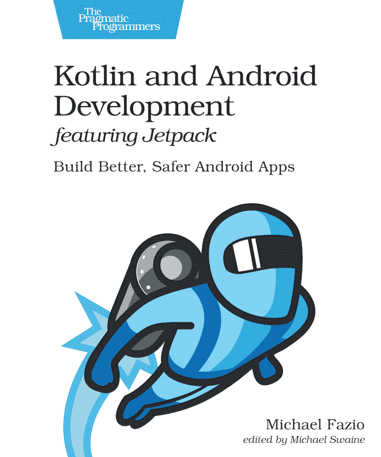

# 基于 Jetpack 的 Kotlin Android 开发

## 构建更优质、更安全的 Android 应用

### Michael Fazio 著

版本：P1.0（2021 年 6 月）

版权所有 © 2021 The Pragmatic Programmers, LLC。本书授权给购买它的个人使用。我们不进行复制保护，因为这会限制您将其用于自身目的的能力。请不要辜负这份信任——您可以在所有设备上使用本书，但请不要与团队成员、朋友分享，或通过文件共享服务传播。谢谢。

制造商和销售商用于区分其产品的许多名称被声称为商标。当这些名称出现在本书中，且 The Pragmatic Programmers, LLC 知晓商标声明时，这些名称以首字母大写或全部大写的形式印刷。The Pragmatic Starter Kit、The Pragmatic Programmer、Pragmatic Programming、Pragmatic Bookshelf 以及链接的 `g` 标识均为 The Pragmatic Programmers, LLC 的商标。

本书在编写过程中已采取一切预防措施。然而，出版商对错误或遗漏，或因使用此处包含的信息（包括程序清单）而可能导致的损害不承担责任。

## 关于 Pragmatic Bookshelf

Pragmatic Bookshelf 是一家敏捷出版公司。我们存在于此，是因为我们希望改善开发者的生活。我们通过创建由程序员为程序员撰写的及时、实用的图书来实现这一目标。

我们的 Pragmatic 课程、研讨会和其他产品可以帮助您和您的团队创建更好的软件，并享受更多乐趣。如需更多信息以及最新的 Pragmatic 图书，请访问我们的网站 [`pragprog.com`](http://pragprog.com)。

我们的电子书不包含任何数字版权管理，并且始终无 DRM。我们开创了 beta 图书的概念，您可以在图书仍在编写过程中购买和阅读，并向作者提供反馈，以帮助为每个人打造更好的图书。为所有购买者提供的免费资源包括源代码下载（如适用）、勘误表和讨论论坛，均可在 `pragprog.com` 上该图书的主页找到。我们在这里让您的生活更轻松。

### 新书公告

想要了解我们最新的图书和公告，以及偶尔的特别优惠吗？只需在 [`pragprog.com`](https://pragprog.com) 上创建一个账户（只需一个电子邮件地址和密码），然后选择接收新闻通讯的复选框。您也可以在 Twitter 上关注我们 @pragprog。

### 关于电子书格式

如果您直接从 [`pragprog.com`](https://pragprog.com) 购买，您可以以一个价格获得所有可用格式的电子书。您可以通过 Dropbox 在所有设备（包括 iPhone/iPad、Android、笔记本电脑等）之间同步您的电子书。您可以免费获得该版本生命周期内的更新。当然，您随时可以回来重新下载您的图书。从 Amazon Kindle 商店购买的电子书受 Amazon 政策的约束。Amazon 文件格式的限制可能导致电子书在不同设备上显示不同。如需更多信息，请参阅我们的常见问题解答 [`pragprog.com/#about-ebooks`](https://pragprog.com/support/#about-ebooks)。要了解更多关于本书的信息并访问免费资源，请前往 [`pragprog.com/book/mfjetpack`](https://pragprog.com/book/mfjetpack)，即本书的主页。

感谢您持续的支持，

Andy Hunt

The Pragmatic Programmers

制作本书的团队包括：Dave Rankin（首席执行官）Janet Furlow（首席运营官）Tammy Coron（执行编辑）Michael Swaine（开发编辑）Sakhi MacMillan（文字编辑）Potomac Indexing, LLC（索引编制）Gilson Graphics（排版）Andy Hunt 和 Dave Thomas（创始人）

如需客户支持，请联系 `support@pragprog.com`。

如需国际版权事宜，请联系 `rights@pragprog.com`。

版权所有 © 2021, The Pragmatic Bookshelf。

## 对《基于 Jetpack 的 Kotlin Android 开发》的早期赞誉

同时学习一门新语言和平台可能看似令人望而生畏，但这本书让它既有趣又易于理解。示例应用让视图绑定和单元测试等复杂主题变得贴近生活、易于理解。

| → | Markus Neuhoff |

|  | Android/Kotlin 课程作者，Pluralsight |

Michael 在解释 Kotlin 方面做得非常出色，从基础到最高级的主题。这两个示例应用对初学者和高级开发者都非常有帮助。来自不同的移动开发背景，书中关于如何使用 Android Studio 的基础知识的分步讲解，以及跟随书中的示例，让我能够轻松专注于重要的主题，即学习 Kotlin。

| → | Pablo Siller |

|  | 移动开发负责人，Trek Bicycle |

如果您认真想要使用 Kotlin 开发 Android 应用，您找到了一本全面且易于理解的书，它将指导您完成开发和测试的每一步。

| → | Dr. Venkat Subramaniam |

|  | 创始人，Agile Developer, Inc. |

使用 Kotlin 进行 Android 开发的绝佳指南。大量的代码示例以及从初学者到高级开发者的清晰进阶路径。

| → | Greg Levenhagen |

|  | 首席顾问，MS 区域总监，MS AI MVP，Skyline Technologies, Inc. |

无论您是 Kotlin 新手还是有经验，这本书都是宝贵的资源。通过出色的基于项目的示例，您将能够轻松地将所学应用到自己的项目中。这是任何开发者收藏中必备的一本书。

| → | Rolando Lopez |

|  | 高级移动应用开发者，Milwaukee Tool |

作为一个没有 Android 开发经验但拥有扎实软件开发背景的人，我发现这是进入 Android 世界的一个非常引人入胜且信息丰富的第一步。强烈推荐给任何想要进入这个世界的人！

| → | Brandon Martinez |

|  | 高级服务工程师，Microsoft |

## 致谢

首先，非常感谢整个 Pragmatic Bookshelf 团队，特别是三位特别的人。我要向我的编辑 Michael Swaine 表达深深的感激，感谢他与我一同踏上这段旅程，在过程的每一步支持我，有时只是给我一句"你一切都好，别担心"，而这正是我真正需要的。如果没有 Brian MacDonald 在 THAT Conference 上走到我面前说"嘿，你想写一本关于 Kotlin 的书吗？"，然后与我一起完成整个出书前的过程，这本书将永远不可能实现。最后是 Brian Hogan，他向我保证 PragProg 很棒（事实证明确实如此），并且我能够完成这本书（事实证明我可以）。

衷心感谢我的技术审阅者：Joe Vetta、Rolando Lopez、Ben Gavin、Brandon Martinez 和 Andrew Petersen。你们花时间阅读我的书并帮助改进它，这对我意义重大，我将永远感激。同时，感谢 Keno Basedow 在 beta 过程中找到了许多可以改进和澄清本书的方法。

我很幸运得到了周围所有人的支持。这包括整个 Skyline 团队，他们对我的这个疯狂副业项目一直很支持。Craig 和 Joe，感谢你们过去几年容忍我不断的"OMG KOTLIN"评论。Rolando，感谢你在得知这本书即将出版时和我一样兴奋。以及所有我的朋友和家人，他们（有意或无意地）都是 Android 棒球联盟这本书的一部分。

我绝对不是艺术家，所以书中的图标和标志需要一些帮助。其中许多直接来自 Google 的 Material Design 库，可以在 Android Studio 中找到，但我也从一些网站获取了不少。完整列表可以在源代码的 `images/image-rights.txt` 中找到，但这里是一个快速总结：大多数团队标志和图标来自 [`www.flaticon.com`](http://www.flaticon.com)，由 Freepik、Good Ware、Smashicons、smalllikeart 和 Vitaly Gorbachev 制作。Skyline 标志来自 Skyline Technologies，这是我写这本书时所在的公司，而密尔沃基人民旗^([[1]](#f_0004.xhtml_FOOTNOTE-1)) 被用作密尔沃基日出标志。ABL 应用程序中的记分牌图标以及 Penny Drop 中的骰子和硬币图标都来自 [`www.materialdesignicons.com`](http://www.materialdesignicons.com)。

最后，对我的家人说，我非常爱你们：

爸爸妈妈，感谢你们一直陪伴在我身边，尽一切可能帮助我成功。你们持续的爱和支持造就了今天的我，也是我现在作为父亲所遵循的榜样。

Hazel，你是最酷的孩子，我很荣幸能成为你的爸爸。我为你感到非常骄傲，听到你说为我的书感到骄傲，这对我来说意义重大。

Emily，谢谢你在我完成这本书以及所有相关事宜期间支撑起一切。如果没有你说"你做任何你需要做的事，其他的我都包了"，我不可能完成这件事。我还有很多话想说，但我就说一句——你是最棒的。

#### 脚注

[[1]](#f_0004.xhtml_FNPTR-1)

[`milwaukeeflag.com/`](https://milwaukeeflag.com/)

Copyright © 2021, The Pragmatic Bookshelf.

## 前言

有了 Kotlin 和 Jetpack，Android 开发现在比以往任何时候都更加流畅和愉快。在本书中，我们将通过编写两个完整的 Android 应用程序来深入 Android 开发。

在第一个应用程序 Penny Drop 中，你将创建一个完整的游戏，包括随机掷骰子、可自定义规则和 AI 对手。你将构建轻量级的 `Fragment` 视图并使用数据绑定，通过 `ViewModel` 类快速安全地更新数据，并在单一位置处理所有应用程序导航。你将学习如何使用带有 Android 特定 Kotlin 扩展的 Kotlin 来高效编写空安全代码，而无需 pre-Jetpack + Kotlin 应用程序通常所需的所有样板代码。你将了解如何使用 Room 库持久化和检索完整对象数据，然后使用 `ViewModels` 显示该数据，并在 `RecyclerView` 中列出记录。

接下来，你将为 Android 棒球联盟创建官方应用程序。这是一个假联盟，但应用程序是真的，在这里你运用在 Penny Drop 中学到的知识并在此基础上构建。你将通过导航抽屉在应用程序中导航，包括通过 Android 应用链接访问特定位置。你将使用 Kotlin 协程处理异步和 Web 服务调用，使用 Paging 库流畅地显示数据，并从你的应用程序向用户的手机发送通知。

准备好了吗？让我们构建一些 Android 应用程序吧！

Copyright © 2021, The Pragmatic Bookshelf.

## 介绍

欢迎来到现代 Android 开发！我知道我已经说过几次"现代"这个词了，但这是准确的。Kotlin 让整个 Android 开发体验比过去好得多，再加上 Jetpack 框架和概念？整个情况变得越来越好。

当我们第一次讨论创作这本书时，我知道我想找到一种方式与他人分享我对 Kotlin 的热爱，但不确定想要什么主题。Android 始终是最合理的选择，因为我已经从事 Android 工作多年，但我觉得已经有那么多 Android 书籍了。我的书会有什么不同呢？

试图让这本书独特让我得出了两个结论：我想尽可能关注最新的方法/库，我想让应用程序有趣。前者通过专注于 Jetpack 来解决。这是 Google 推荐的 Android 开发方法，他们在引入更好的方式来处理 Android 应用程序中的标准操作方面做得非常好。如果你是 Android 开发新手，这可能看起来不那么具有革命性，但作为一个从事多年的人，相信我，Jetpack 库让现代 Android 开发的复杂性变得简单得多。Jetpack 库让你的生活轻松太多了。

这里的第二部分是应用程序。虽然从"待办事项列表"应用程序开始并没有什么错，但我想要更有趣的东西。构建你的第一个 Android 应用程序，而且它是个游戏？那好多了！我喜欢 Penny Drop 作为一款不错的简单桌游，这样我们就可以专注于构建应用程序所需的其他一切。此外，一旦核心游戏运行起来，我们有多种方式添加额外功能，同时突出 Android 开发的有用部分。

然后是 Android 棒球联盟。这在很多方面是我个人棒球迷情结的体现，但它也给了我们一个看起来像你在 Play 商店中会看到的应用程序示例。此外，我们最终有多种方式从 API 拉取数据到应用程序中，这如今基本上是 Android 应用程序的必备功能。

实际上，API 可能是我热爱棒球的最佳例子。Android 棒球联盟的所有数据都是由我创建和/或生成的。这包括球队、球员、比分记录，所有一切。作为一名开发者，我一生中最想做的两件事就是写书和创建棒球模拟器，而我能够同时做到这两点。我非常享受 Penny Drop 作为应用程序的出色表现，但 ABL 应用程序是我最亲近、最珍爱的。我首先包含 ABL 是因为它是一个优秀的高级应用程序，但天哪，把它组合起来真的很有趣。

我爱 Kotlin，我爱 Android，我爱有这个机会与你们分享两者。我希望你在读完这本书后也有同样的感受，并且你能感受到我一路上的兴奋。

### 这本书适合谁

这本书既面向新开发者，也面向任何有 Android 和/或 Kotlin 经验的人。我尝试为新手解释发生了什么，但也会在可能是 Android 专业人士复习内容时给出提醒。我的意图是所有技能水平都能从我们构建的应用程序中这样或那样地受益。

我们在审阅过程中测试了这一点，不同技能水平的开发者阅读了这本书，他们都说学到了新东西。即使是审阅这本书的最资深的专业 Android 开发者也给我发了多条消息，讲述他正在学习的新东西，所以我很乐观，无论你在 Android 或 Kotlin 方面处于什么水平，你都能从这本书中获得很多。

### 如果你是 Android 和/或 Kotlin 新手

这起初可能看起来令人不知所措，但随着书的进行，事情会越来越有道理。我建议查看我在下一节中提到的源代码，看看事物如何组合在一起。对于 Android 应用程序，一个高层次的概述是，你的 UI（用户看到的）主要在 XML 中处理，而逻辑则用 Kotlin 代码处理。

说到 Kotlin，你会在书中发现许多提到 Java 的地方。现在，我们不会在书中编写任何 Java 代码，但我们会与之交互，因为大多数 Android 库都是用 Java 编写的。因此，我们的 Kotlin 设置包括与 Java 版本关联，我们甚至使用一个名为 `java` 的目录来存放我们的 Kotlin 代码。这都是因为 Java 和 Kotlin 都编译为相同的字节码，所以我们可以互换使用它们。只是尽量不要被 Java 的提及所困扰，因为这并不意味着你需要开始编写 Java 代码或类似的东西。

### 如何阅读这本书

正如我上面提到的，本书分为两个应用：Penny Drop 和 Android Baseball League。Penny Drop 旨在作为 Android、Jetpack 和 Kotlin 的入门介绍。如果你对这些技术中的任何一个还不熟悉，那么构建 Penny Drop 应用绝对值得你花时间（而且，它很有趣）。但即使是对 Android 已经很熟悉的读者，我敢打赌你在完成第一个应用的过程中也能学到一些东西。

ABL 应用则是进阶内容。许多章节实际上是 Penny Drop 对应章节的第二部分。例如，第 5 章*使用 Room 持久化游戏数据*，介绍了如何使用 Room——Android 的 ORM（对象关系映射）库，它让数据库交互变得更加简单。然后，第 10 章*使用协程和 Room 加载与保存数据*，在这些数据库概念的基础上增加了 API 调用和更多的协程。因此，虽然先构建 Penny Drop 不是强制的，但这确实会让后续内容更清晰。我在 ABL 应用中讲解得更快，而且会有更多预先写好的代码供你整合，而不是全部自己从头写起。

说到这个，本书的所有源代码都可以在[`media.pragprog.com/titles/mfjetpack/code/mfjetpack-code.zip`](https://media.pragprog.com/titlesm/fjetpack/code/mfjetpack-code.zip)找到。我包含了书中每一章的最终结果，这样你始终有一个参考，也可以在需要时作为下一章的起点。此外，对于 ABL 应用，有一些代码需要从该 ZIP 文件中复制到你的项目中。这样做的目的是让你获得一个功能更完整的应用，而不必逐行编写所有代码，而是让你专注于本章的核心概念。

本书的最后两章主要聚焦于测试，特别是单元测试和 Android UI 测试。这两章都以 Penny Drop 应用为基础。如果你不想构建 Penny Drop，而只是想尝试测试部分，你可以随时从 ZIP 中获取代码，作为搭建环境时的基线。

你还会在本书末尾找到三个附录：一个是 Android Studio 的安装说明，一个是开发故障排除技巧，还有一个是书中使用的所有依赖项。最后一个附录的关键特性是所有依赖版本号都可以在那里找到。我选择这种方式，而不是在每章中提及，是为了避免不一致，同时也让我们有一个统一的地方来检查任何依赖项。


最后，提前说明一下：虽然本书是在 Windows 上编写的（大部分如此），截图也都是 Windows 版 Android Studio 的，但如果你使用 Mac，操作方式也是一样的。这意味着你可以自由选择你最熟悉的操作系统进行开发。

## 本书开发技巧

Android 开发虽然很棒，但有时也会有些棘手。即使是环境搭建也可能让人头疼，但我希望附录 1*安装 Android Studio*能让这个过程更顺利。现在模拟器工作得非常好，所以你不需要实体设备，但能看到应用在实际手机上运行也是件不错的事。

另外，如果你使用模拟器，要知道它可能会失去网络连接，这会让大部分 ABL 章节无法进行。这种情况尤其可能发生在模拟器运行时电脑进入睡眠状态后。不要害怕重启模拟器或 ADB 服务器（甚至必要时重启电脑）。

沿着这条思路，有疑问时，卸载应用。这在处理 Room 和数据库时特别有价值。任何数据库结构变更通常都需要迁移（对数据库进行适当的变更/升级），但由于我们还在开发阶段，你可以通过重新安装应用来跳过这一步。

## 在线资源

你获取与本书相关一切信息的第一站应该是[`pragprog.com/titles/mfjetpack/kotlin-and-android-development-featuring-jetpack/`](https://pragprog.com/titles/mfjetpack/kotlin-and-android-development-featuring-jetpack/)。这里有上述源代码 ZIP 的链接，以及用于报告错误/错别字/建议的 Devtalk 论坛。^[2]

对于 Google 资源，Jetpack 主页是个不错的选择，它涵盖了本书中提到的各种内容，以及 Jetpack 中的最新特性/库。^[3]此外，Android Codelabs^[4]涵盖的内容比本书中所能做的还要多。去那里可以找到更多 Android 示例和教程。

对于 Kotlin 帮助，官方[`kotlinlang.org/`](https://kotlinlang.org/)网站有有用的语言文档，以及[`play.kotlinlang.org/`](https://play.kotlinlang.org/)，一个用于测试 Kotlin 代码的沙盒环境。

## 准备好了吗？

来吧，这会很有趣的！让我们来写一个游戏（或者一个棒球应用，那个也很棒）。

### 脚注

[2]: [`devtalk.com/books/kotlin-and-android-development-featuring-jetpack`](https://devtalk.com/books/kotlin-and-android-development-featuring-jetpack)

[3]: [`link.mfazio.dev/jetpack`](https://link.mfazio.dev/jetpack)

[4]: [`codelabs.developers.google.com/?cat=android`](https://codelabs.developers.google.com/?cat=android)

Copyright © 2021, The Pragmatic Bookshelf.

# 第一部分

Penny Drop

> 我们以一款名为 Penny Drop 的游戏开始：掷骰子，放硬币，重复——一个简单的游戏，也是我们入门应用的绝佳主题。你将学习如何从零开始创建应用，包括其中涉及的所有组件。

>

> 你之前已经开发过 Android 应用？这里仍然有很多内容适合你——Jetpack 库、随处可见的 Kotlin 代码，而且至少你还能得到一个可玩的游戏。

## 第 1 章

### 初始化 Penny Drop 应用

我们来了！是时候构建我们的第一个应用了，一款名为 Penny Drop 的游戏。如果你是 Android 开发新手，别担心，本章涵盖了如何使用 Kotlin 编程语言和 Android Jetpack 库，在 Android Studio 中开始构建 Android 应用。我们将逐步介绍如何从零生成一个应用（并概述为我们生成了什么），然后创建几个基本空白的视图，并设置应用以便在它们之间导航。

如果你之前创建过 Android 应用，Penny Drop 将是对 Jetpack 和/或 Kotlin 的有用介绍。你将特别学习 Navigation 组件、如何将 `ViewModel` 与 `Fragment` 类一起使用，以及使用 Room 进行数据库访问。正如我在上一段提到的，本章的重点是在 Android Studio 中生成应用骨架、创建两个 `Fragment` 类，以及将 Navigation 组件与底部导航栏结合使用。

但如果你对这些内容都已经很熟悉，那就看看下一节的 Penny Drop 规则，然后直接在*总结与下一步*与我们汇合。

#### 如何玩 Penny Drop

本书第一部分的全部内容都聚焦于 Penny Drop 游戏，所以让我们确保每个人都熟悉规则。Penny Drop 是一款适合两名或更多玩家的桌面游戏，玩家轮流掷一个 D6（普通的六面骰子称为 D6）。规则如下：

* 玩家掷出一个数字，然后将一枚便士（一种小硬币）放入他们刚刚掷出的数字对应的槽位。

* 如果槽位是 6，便士会掉出棋盘，退出游戏。

* 如果槽位已经被填满，玩家拿走棋盘上的所有便士，然后轮到下一位玩家。

* 玩家必须至少掷一次，但之后可以将回合传给下一个人。

* 第一个摆脱所有便士的玩家获胜。

如你所见，这个游戏并不复杂：掷骰子、放硬币或取硬币，重复直到有人出局。这让我们可以专注于 Android 组件，而不必处理大量游戏逻辑（不过我们在第 4 章《*根据条件游戏逻辑更新 LiveData*》中还是需要考虑一些）。根据这些规则，我们应用的"游戏"界面最终看起来会是这样的：

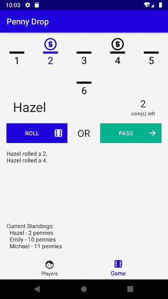

#### 创建应用

是时候构建我们的应用了，我们会让 Android Studio 帮我们完成大部分工作。打开 Android Studio，你会看到一个如图所示的界面：

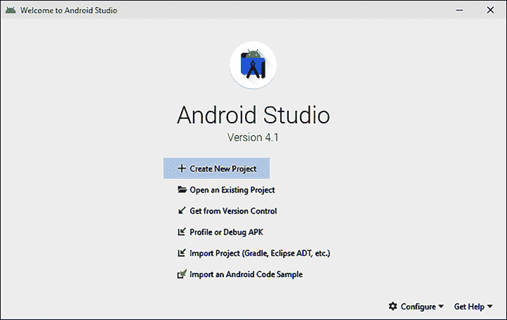

点击 **Create New Project** 链接，选择 **Empty Activity** 选项，然后点击 **Next** 按钮。

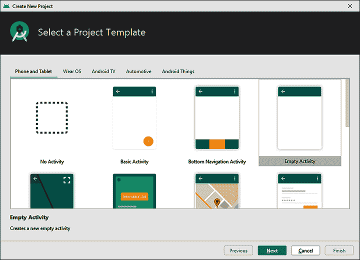

在下一个界面中，我们需要为应用设置一些值：

- **Name**：我们在各处都会看到的应用名称。对于这个应用，我们可以使用 **Penny Drop**。

- **Package name**：这个值在 Android 应用中具有双重用途。首先，它是唯一的应用 ID，用于在用户设备上以及 Google Play 商店中标识你的应用。其次，它是我们应用中的 Kotlin 包名。这是我们所有代码的主要分组方式，意味着我们应用的代码文件将使用这个包名进行包声明。然后我们可以在这个包名基础上添加更多特定的部分。例如，我的应用包名是 `dev.mfazio.pennydrop`，所以我会将 Fragment 类放在 `dev.mfazio.pennydrop.fragments` 中。你可以根据自己的喜好决定如何分组文件；由于包在系统中是以文件夹形式组织的，你可以将其视为将代码放入不同的文件夹中。另外请记住，包名应该全部使用小写。

- **Save location**：你想在机器上保存代码的位置。

- **Language**：Kotlin（否则你就读错书了！）。

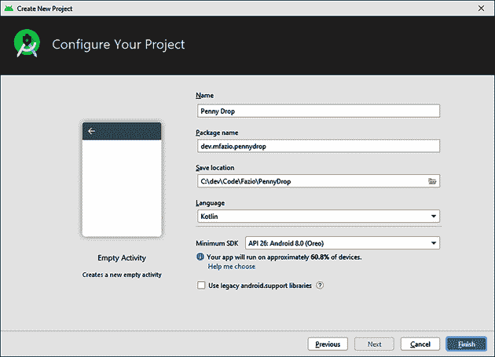

**Minimum API Level** 值决定了能够运行你应用的最低操作系统（OS）版本。API 级别、OS 代号和 OS 版本号可能会让人有些困惑，所以在本书中，我将至少标明 API 级别。API 级别更精确一些，因为 OS 代号可能对应多个版本，而且我们在配置文件中使用的也是 API 级别。

选择最低 API 级别可能有些棘手，因为这会限制哪些设备能够获取你的应用。选择的 API 级别太高/太新，旧设备将被阻止使用该应用。选择的 API 级别太低/太旧，你将无法使用较新的 Android 功能。**Help Me Choose** 链接会提供更多详细信息，包括至少拥有给定 API 级别的用户百分比估算，以及每个 API 级别包含的功能。该界面看起来会如图所示：

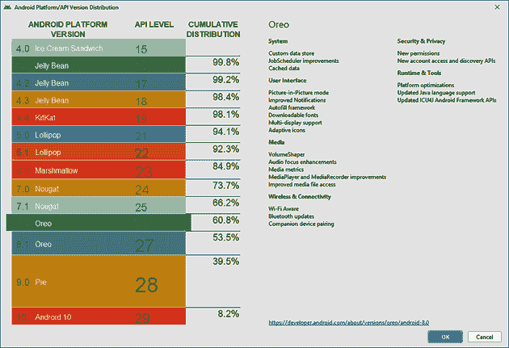

在撰写本文时（2020 年底），API Level 26 已经有三年多的历史了，很可能（尽管不能保证）是一个安全的基础线。如果你认为可以升级到更新的版本，或者确实需要某个功能，你可以升级。请记住，你以后随时可以更改这个值。

列表中的最后一个选项是"**Use legacy android.support libraries**"。我们要保持这个选项未勾选状态，因为使用新的 AndroidX 库会更好。

##### AndroidX

对于那些熟悉旧版 Android Support Library 的人来说，这些包已经被移入了 AndroidX。如果你还不了解 Android Support Library，只需知道它是一种在 Android 版本之间实现向后兼容的方式（现在由 AndroidX 包处理）。所有 AndroidX 包都是单独维护和更新的，允许你根据需要引入任何库，并且单独更新它们。这意味着你只需要引入你想要的，不需要的就不用管。

所有值设置完成后，点击 **Finish**，Android Studio 就会开始创建你的应用！

##### 这做了什么？

Android Studio 为我们生成了许多文件，并开始索引我们的代码库。这意味着它正在获取项目中所有文件/符号的列表，以便快速给我们反馈：类是否存在、依赖是否加载、多个文件中的类型是否冲突——基本上就是 Android Studio 中所有方便我们编写代码的功能。

在继续之前，我们还有最后一步设置——让我们将应用配置为从一开始就针对 Java 8。这样做将启用更多语言功能，并能使用一些方便的库组件。为此，我们进入应用的 `build.gradle` 文件并添加几项内容：`kotlinOptions.jvmTarget = 1.8`，以及在 `android` 部分内的 `compileOptions` 代码块中添加两个设置，同时将 Kotlin 标准库依赖更新为使用 JDK8 版本。

在进行任何更改之前，请确保你打开的是带有 `(Module: Penny_Drop.app)` 或类似后缀的 `build.gradle`。否则，这些设置将无法正常工作。

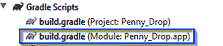

该文件内部应该看起来像这样：

```
android {
    // 其他选项仍然保留在这里。

    kotlinOptions {
        jvmTarget = 1.8
    }
}

dependencies {
    implementation fileTree(dir: "libs", include: ["*.jar"])
    implementation "org.jetbrains.kotlin:kotlin-stdlib-jdk8:$kotlin_version"

    // 其余依赖仍然保留在这里。
}
```

一旦 Android Studio 完成项目索引（可能需要几分钟），我们就可以开始在新的代码库中移动了。目前这里内容还不多，但我们已经可以运行当前状态的应用了。Android Studio 会构建代码，生成 APK（Android 包，相当于 Android 上的可执行文件），并将其部署到设备/模拟器上。完成后，应用看起来会如第一张图所示：

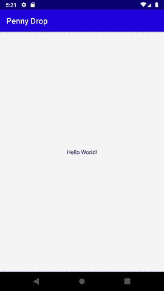

看到了吗？我说这里内容还不多可不是开玩笑的，但我们很快就会添加更多内容。首先，让我们看看 Android Studio 为我们创建了什么，如第二张图所示：

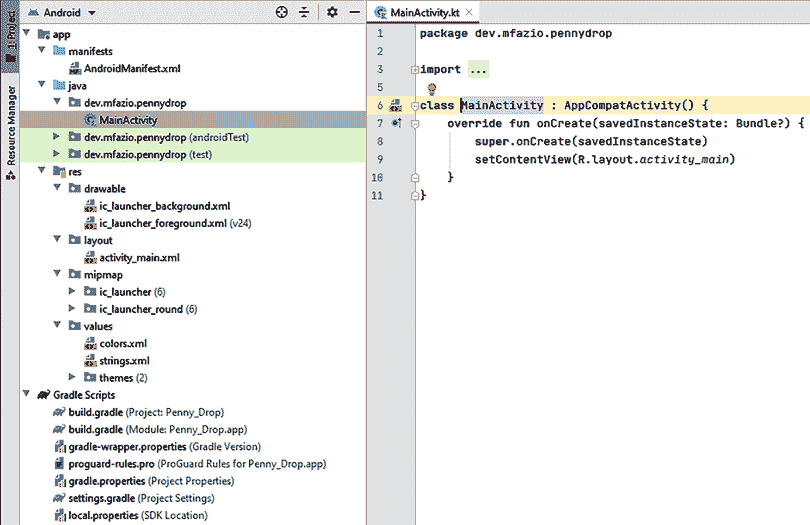

###### AndroidManifest.xml

清单文件包含有关你应用的信息，包括应用名称、包名、启动器图标、默认主题，以及应用中的任何 Activity 类。在这里，我们还可以使用 `<intent-filter>` 标签来告诉应用如何处理设备上的某些操作。Intent 是对一个操作的描述，以及（可选的）相关数据。我们稍后会介绍什么是 Activity。

至少，我们需要在默认 Activity 中有两个标签，以告诉设备默认启动哪个 activity：

```
<activity android:name=".MainActivity">
    <intent-filter>
        <action android:name="android.intent.action.MAIN" />
        <category android:name="android.intent.category.LAUNCHing" />
    </intent-filter>
</activity>
```

###### MainActivity

这是我们应用的主要入口点，也是目前我们看到的主屏幕。Activity 类是 Android 应用中的核心组件。每个 Activity 还有一个关联的布局文件，通常名称与 Activity 名称相反。例如，`MainActivity` 对应 `activity_main.xml`。我们稍后会讨论这些布局文件。

#### 可绘制资源文件

Android 中的可绘制资源（Drawable）是你在应用中使用的图像。我们稍后会添加更多，但目前有两个矢量文件包含启动器图像的信息（你在设备应用抽屉中看到的图像）。Android 中的矢量图像类似于 SVG（**可缩放矢量图形**），它通过列出路径坐标来绘制图像，而不是使用静态图像。这使得图像可以被缩放到不同尺寸而不会出现任何问题。我们稍后会更新图像，但目前可以保持原样。

现在，如果我们有标准的静态图像（JPG、PNG 等），它们通常会放在 `drawable` 文件夹内的子文件夹中。对于可绘制资源文件，我们通常会有同一文件的多个不同分辨率版本，用尺寸值标记：`mdpi`、`hdpi`、`xhdpi`、`xxhdpi` 和 `xxxhdpi`。

这些图像对应不同的每英寸点数（DPI）值，DPI 是表示设备分辨率与显示尺寸之间比例的方式。如果 DPI 值更高，这意味着设备上的像素更小。这可能是由于更高分辨率的屏幕或更小的设备造成的，因为我们在每英寸的屏幕空间中有更多像素。如果两台设备分辨率相同但屏幕尺寸不同，较小的那台设备会有更高的 DPI。同样地，如果两台设备尺寸相同但分辨率不同，更高分辨率的设备会有更高的 DPI 值。

由于我们在这两个应用中使用的大多数图像都是矢量图像，它们可以用单个 XML 文件缩放到任何尺寸，因此我们不必太担心这些不同的分辨率。但如果你确实需要图像，它们应该包含所有这些不同的分辨率。通过将 AAB（Android App Bundle）上传到 Play 商店，当用户下载应用时，额外的图像分辨率将会被移除。

###### 布局文件

布局文件是处理应用用户界面的 XML 文件。布局文件中的所有内容都将以 `View` 和 `ViewGroup` 对象的层次结构存在。在我们的例子中，`activity_main.xml` 布局文件包含一个 `ViewGroup`（`ConstraintLayout`）和一个 `View` 组件（`TextView`）。我们很快就会对此添加更多内容，并在本书的后续章节中添加大量内容。

###### Mipmap 文件

这些看起来与前面提到的可绘制资源文件相似，确实如此，但区别在于所有 mipmap 文件都会在用户下载应用时包含在内。原因是有时我们希望图像以不同于手机 DPI 的分辨率可用。在我们的例子中，这里有启动器图像，它们可能需要比通常包含的更高分辨率的图像，例如用于用户的主屏幕。

注意只在这里包含需要比手机通常所需更高分辨率的图像，比如启动器图标。这里包含的每一组图像都会增加你的应用大小。

##### 自适应图标

我已经多次提到这个术语了，所以是时候真正讨论一下了。自适应图标在 API 级别 26 中添加，允许设备以多种形状显示启动器图标。此外，它使系统能够为图标添加动画效果（由于具有独立的前景和背景图层）。我们之前在 drawable 中看到的 `ic_launcher_*.xml` 文件定义了自适应图标的背景和前景。然后我们将 `<adaptive-icon>` XML 文件添加到 `app\src\main\res\mipmap-anydpi-v26`，这些文件用于任何 DPI 的设备（因为矢量文件是绘制出来的，而不是缩放图像）。

关于自适应图标的更多信息可以在 [`link.mfazio.dev/adaptive-icons`](https://link.mfazio.dev/adaptive-icons) 找到。

##### 值资源文件

Android 开发中的常见做法是将可读的颜色和字符串等资源放在 `values` 文件夹中。对于颜色，这允许你定义语义化的颜色名称（例如，用 `alert_red` 代替 `#bc121d`），对于字符串，它使翻译更加容易。


你可以定义多个`values-*`目录（例如，`values-es`用于西班牙语），用于存放不同语言的值。如果你要处理翻译，Android Studio 有一个内置的翻译编辑器可以加快这个过程：[`developer.android.com/studio/write/translations-editor`](https://developer.android.com/studio/write/translations-editor)。

## Gradle 脚本

Gradle 是 Android 应用的构建工具。Gradle 脚本用于设置应用的依赖项（每当我们添加新的 Jetpack 组件时都会用到），配置你使用的 Kotlin 版本，以及指定应用使用的 SDK 版本。它使用我们创建应用时设置的值和复选框来填充脚本，但我们可以根据需要调整任何内容。现在，里面的内容没问题，但我们稍后会回来添加依赖项和更新一些设置。

## 我们还需要什么？

Android Studio 为我们添加了一堆文件来帮助我们开始构建应用，但在尝试连接所有内容之前，我们还想添加一些东西。以下是我们仍然需要的：

- 用于视图的 Fragment 类。
- 一个菜单来告诉底部导航栏显示哪些选项。
- 一个导航图来告诉`MainActivity`显示哪个视图。
- 底部导航的图像。
- 更新`MainActivity`将所有内容整合在一起。

### Fragment 类

虽然`MainActivity`将是应用的入口点，但实际上我们只会在应用中使用这一个 Activity。在其中展开`Fragment`视图更高效，这也是现在 Google 推荐的做法。此外，正如我们将在下一章中看到的，这使得视图之间的数据共享更加顺畅。

现在，我们将创建两个 Fragment 类：`PickPlayersFragment`和`GameFragment`。这些 Fragment 类最终将用于设置游戏玩家，然后进行游戏。目前，我们会创建这两个 Fragment 类，但直到第 2 章 *使用 Fragment 构建视图* 才会添加适当的内容。

在创建 Fragment 类之前，添加一个新的`fragments`包来更好地组织代码会很有帮助。在 Project 视图中右键单击你的主包（例如，我的是`dev.mfazio.pennydrop`），然后选择 New > Package。它需要完整的包名，所以只需在你的主包后面加上"`fragments`"。在我的例子中，这是`dev.mfazio.pennydrop.fragments`。

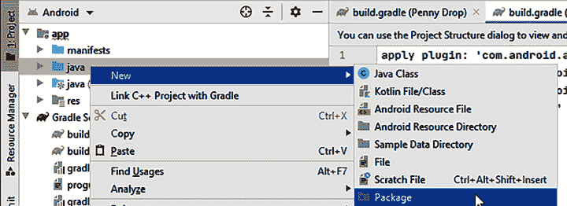

完成后，我们就可以创建实际的 Fragment 类了。

#### PickPlayersFragment

对于这两个 Fragment 类，我们会让 Android Studio 为我们完成工作，然后我们再进行清理。在 Project 视图中右键单击你的`fragments`包名（在我的例子中，位于`app/java/dev.mfazio.pennydrop.fragments`下），然后选择 New > Fragment > Fragment (Blank)。输入 fragment 名称`PickPlayersFragment`，并将 fragment 布局名称保留为`fragment_pick_players`。确保源语言是 Kotlin，然后点击 Finish。

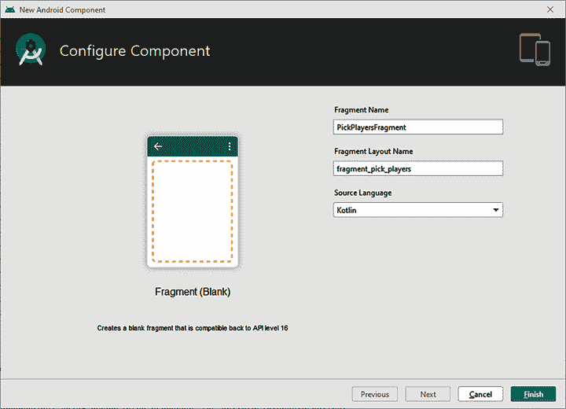

Android Studio 完成后，你将拥有新的`PickPlayersFragment`类以及`fragment_pick_players.xml`布局文件。打开`fragment_pick_players.xml`，让我们将这里的`<TextView>`改为显示 Pick Players Fragment。

虽然你可以使用 Design 视图进行布局编辑，但在处理布局文件时，我将引用 Code 视图。该视图显示每个布局背后的 XML，并让我们对布局中使用的值进行更精确的控制。当你对布局文件的内容更加熟悉后，可以随意使用 Design 选项卡。要切换正在使用的视图，请点击编辑器右上角的 Code 按钮：


进入 Code 视图后，将`<TextView>`上的`android:text`属性更新为 "Pick Players Fragment"：

```
<?xml version="1.0" encoding="utf-8"?>
<FrameLayout xmlns:android="http://schemas.android.com/apk/res/android"
    xmlns:tools="http://schemas.android.com/tools"
    android:layout_width="match_parent"
    android:layout_height="match_parent"
    tools:context=".fragments.PickPlayersFragment">

    <TextView
        android:layout_width="match_parent"
        android:layout_height="match_parent"
        android:text="Pick Players Fragment" />

</FrameLayout>
```

我必须告诉你，直接将文本放入布局文件中实际上是一种不好的做法。但由于在我们获得真实内容之前这只是一个占位符，所以目前没问题。

#### GameFragment

我们将在这里对`PickPlayersFragment`做同样的事情。右键单击，创建一个新的空白 Fragment，然后让 Android Studio 完成。我们将使用一个快捷方式来快速访问布局文件：按住`Ctrl`/`Cmd`并点击`onCreateView(...)`中的`fragment_game`。这将带你进入`fragment_game.xml`文件。你可以使用相同的快捷方式跳转到应用中的任何类、文件甚至资源。在布局 XML 中？你可以点击字符串资源来查看它们的位置。这是一种在应用中快速移动的便捷方式。

以与`PickPlayersFragment`相同的方式更新`<TextView>`，但将文本值设为 "Game Fragment"。现在两个 Fragment 类都已创建，我们可以创建`navigation.xml`并包含这两个 Fragment 类的导航图。

## 构建应用的导航

这两个文件将告诉应用要显示什么：`navigation.xml` `<menu>` 文件将告诉底部导航栏应该在导航中选择哪个 Fragment，而`nav_graph.xml` `<navigation>` 文件将处理显示哪个 Fragment。

### navigation.xml

对于我们的菜单，我们可以让 Android Studio 负责创建文件和文件夹结构。右键单击`res`并选择 New > Android Resource File。在此对话框中，输入文件名`navigation.xml`，资源类型为 Menu。Source set 应为`main`，目录名应为`menu`。一切设置完成后，点击 OK 创建文件。

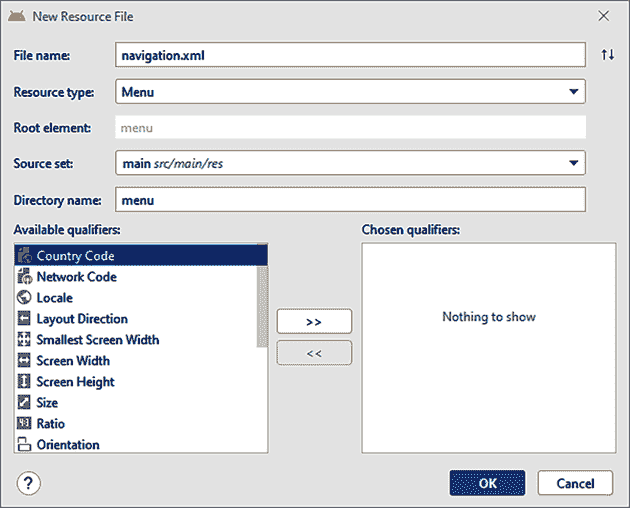

文件创建后，打开它，切换到 Code 选项卡（同样，位于编辑器窗口的右上角），并添加两个`<item>`标签：一个用于`PickPlayersFragment`，一个用于`GameFragment`。每个`<item>`将有一个 ID 和标题：

```
<menu xmlns:android="http://schemas.android.com/apk/res/android">
    <item
        android:id="@+id/pickPlayersFragment"
        android:title="Players" />
    <item
        android:id="@+id/gameFragment"
        android:title="Game" />
</menu>
```

这些可以工作，但我们可以做两处更改：将`android:title`值设为字符串资源，并为每个选项添加一些图片。Android Studio 应该已经在高亮显示两个`android:title`值，告诉你 "Hardcoded string, should use `@string` resource." 我们在 Values Files 中已经说明了为什么要这样做，而且 Android Studio 会为我们完成更改：将光标放在其中一个高亮字符串上，然后按`Alt`+`Enter`获取 Extract Resource 对话框。默认值可能没问题，所以点击 OK 按钮并继续。一旦两个`android:title`值都指向字符串资源，前往你的`strings.xml`文件查看完成的内容：

```
<resources>
    <string name="app_name">Penny Drop</string>

    <!-- TODO: Remove or change this placeholder text -->
    <string name="hello_blank_fragment">Hello blank fragment</string>
    <string name="players">Players</string>
    <string name="game">Game</string>
</resources>
```

两个值现在都已正确设置，所以删除`hello_blank_fragment`条目，然后我们可以继续处理图片。Android Studio 附带了许多我们可以使用的图片，所以我们将从`PickPlayersFragment`的图片开始。所有图标均根据 Apache License Version 2.0 授权，这可能适用于你的应用（尽管你需要确认）。右键单击`res/drawable`文件夹并选择 New > Vector Asset。这将显示 Configure Vector Asset 屏幕。在这里，我们将选择 Clip Art 作为 Asset Type。然后双击 Clip Art 旁边的 Android 图标：

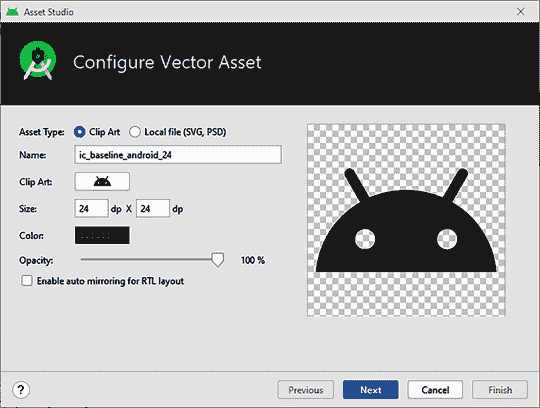

显示的 Select Icon 屏幕包含所有可供我们使用的图片（同样，我们也可以随时导入自己的图片）。你可以使用带有放大镜的搜索栏（位于左上角）搜索图标，或使用左侧的类别。

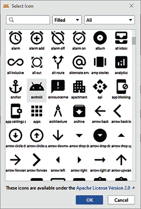

我建议为`PickPlayersFragment`选择 Face，不过你可以选择任何你想要的图标（好像我也不能阻止你）。选择图标后，点击 OK 返回 Configure Vector Asset 屏幕。到达那里后，点击 Next 然后 Finish。你会在`res/drawable`下看到一个名为`ic_baseline_face_24.xml`的新文件（是不是很顺口？）。如果你打开文件，你会看到它是另一个矢量资源，就像我们之前看到的生成的启动器图片一样。这意味着图标可以按我们需要进行缩放，我们只需要一个版本即可适用于所有设备。另外，我稍后会解释`24dp`的部分，所以暂时不用担心。

Android Studio 中已经有相当多的图标，但不知何故却没有骰子图片（这对于一个掷骰子游戏来说真的很有用）。这意味着我们需要去其他地方寻找图片。我们可以在很多地方在线找到图片，但我将使用 [`materialdesignicons.com/`](https://materialdesignicons.com/) 上的图片。我们可以在 [`materialdesignicons.com/icon/dice-6`](https://materialdesignicons.com/icon/dice-6) 获取一个精美的 D6 图标。该网站支持下载矢量可绘制对象，所以将其引入应用会很快。保存 XML 文件并按你的意愿重命名——我选择`mdi_dice_6_black_24dp.xml`，因为`mdi`前缀有助于提醒我它来自 Material Design Icons 网站。最后，将文件移入你的`drawable`目录（你可以直接将文件拖放到 Android Studio 中的目录上）。

图片准备好后，我们可以返回`navigation.xml`并添加我们的图片。我们将为每个`<item>`添加一个`android:icon`属性，使用你之前可能在字符串中见过的资源语法：`@drawable/[filename]`。

```
<?xml version="1.0" encoding="utf-8"?>
<menu xmlns:android="http://schemas.android.com/apk/res/android">
    <item
        android:id="@+id/pickPlayersFragment"
        android:icon="@drawable/ic_baseline_face_24"
        android:title="@string/players" />
    <item
        android:id="@+id/gameFragment"
        android:icon="@drawable/mdi_dice_6_black_24dp"
        android:title="@string/game" />
</menu>
```

现在`navigation.xml`文件已全部设置好，我们可以继续处理我们的导航图了。

### Navigation and nav_graph.xml

在深入`nav_graph.xml`文件之前，我们先为应用的`build.gradle`文件添加依赖项。这个文件在项目视图中文件名后面带有`(Module:app)`（默认位于 Android Studio 左侧）。项目中存在两个 Gradle 文件的原因是：我们有一个顶层文件用于项目中的所有模块，另一个用于应用模块。在我们的案例中，只有一个模块，因此项目级文件的用处不大，但它对于构建变量来说仍然很方便。

事实上，让我们在顶层`build.gradle`中添加一个名为`nav_version`的变量。添加这个变量可以让我们在一个地方更改所有导航相关依赖项的版本，而不必逐一处理每个依赖项声明。

虽然我们在这里只添加两个依赖项，但这是一个良好的实践，值得学习，以便将来需要处理更多依赖项时使用。提前说明一下，本书中我将为所有依赖项使用变量。如果你需要查找所使用的依赖项 particulars 或想了解更多信息，请参阅附录 3，Gradle 依赖项。

该变量添加在顶层`build.gradle`文件的`buildscript`部分内，位于`ext`块中：

```
buildscript {
    ext {
        kotlin_version = '1.4.30'
        nav_version = '2.3.3'
    }
    //Rest of the buildscript block
}
```

然后，我们可以在应用的`build.gradle`文件中添加两个依赖项：

```
dependencies {
    implementation fileTree(dir: 'libs', include: ['*.jar'])

    //Other dependencies

    implementation "androidx.navigation:navigation-fragment-ktx:$nav_version"
    implementation "androidx.navigation:navigation-ui-ktx:$nav_version"

    //Other dependencies
}
```

现在已经添加了适当的依赖项（确保运行 Gradle 同步；应该会弹出一个带有"立即同步"的横幅），我们可以继续添加导航图了。导航图将告诉导航组件从哪里开始，以及用户在应用中可以前往的所有位置。我们可以为应用配置多个目的地以及起始目的地。目的地是用户在应用中可以前往的位置；在我们的案例中，就是我们之前创建的`Fragment`类。我们将在第 7 章使用设置和主题自定义应用中看到更多导航内容，然后在第 9 章通过导航抽屉进行导航中通过 Android 棒球联盟应用看到更高级的简单导航。目前，我们只需要创建`<navigation>`文件，添加我们的两个片段，然后就可以回到`MainActivity`将所有内容整合起来。


通过右键单击`res`并再次选择 New > Android Resource File 来添加`nav_graph.xml`。这次，将文件命名为`nav_graph`并选择 Navigation 作为资源类型。点击 OK，然后再次切换到 Text 标签页，你会看到一个相当空的`<navigation>` XML 标签。事实上，它可能会被红色下划线标记为错误。我们很快就会修复这个问题（它因为尚未被使用而"生气"），所以暂时不用担心。我们想在这个文件中添加一些东西：两个`<fragment>`标签和一个`app:startDestination`属性。每个`<fragment>`都会有 ID、名称和标签，而`app:startDestination`将指向`GameFragment`。

```
<?xml version="1.0" encoding="utf-8"?>
<navigation xmlns:android="http://schemas.android.com/apk/res/android"
    xmlns:app="http://schemas.android.com/apk/res-auto"
    xmlns:tools="http://schemas.android.com/tools"
    android:id="@+id/nav_graph"
    app:startDestination="@id/gameFragment">
    <fragment
        android:id="@+id/pickPlayersFragment"
        android:name="dev.mfazio.pennydrop.fragments.PickPlayersFragment"
        android:label="fragment_pick_players" />

    <fragment
        android:id="@+id/gameFragment"
        android:name="dev.mfazio.pennydrop.fragments.GameFragment"
        android:label="fragment_game" />
</navigation>
```

这里需要注意的主要事项：片段名称与完全限定类名（包括包名）匹配，`android:label`与`Fragment`的布局文件名匹配，这里的 ID 与`navigation.xml`中的 ID 匹配。最后一点可能不如前两点明显，但它非常有用。通过在`navigation.xml`和`nav_graph.xml`中使用相同的 ID，导航组件将能够自动切换显示的内容，无需任何额外配置。一旦我们完成`MainActivity`的设置，就能更好地理解这意味着什么。

另外，提前说明一下，`@+id/`语法是我们向应用添加新 ID。首次在布局中添加项目时，我们需要这样做。然后，一旦我们要使用该 ID，就可以使用`@id/`语法，正如我们在`app:startDestination="@id/gameFragment"`中看到的那样。

完成这些后，我们可以前往`activity_main.xml`添加所有需要的内容。

## 更新 activity_main.xml

到目前为止，我们已经创建了许多支持性项目，但如果现在运行应用，我们仍然只有"Hello World!"文本。这是因为我们实际上还没有向`MainActivity`的布局文件添加任何内容。`layout_main.xml`将只有两个视图：一个用于我们之前创建的不同视图的容器`<fragment>`，以及我们之前设置的底部导航。那么让我们从底部导航开始，因为`<fragment>`的对齐方式取决于它，但首先，我想介绍一下将包围这两个视图的`<ConstraintLayout>`。

### 什么是 ConstraintLayout？

我在布局文件中提到过，布局由`ViewGroup`和`View`类组成，而`ConstraintLayout`是我们在整本书中将主要使用的`ViewGroup`。它是现有`RelativeLayout`的改进版本，其中所有视图都基于彼此或其父视图进行对齐。这避免了在布局 XML 中一层又一层地嵌套视图，这在许多 Android 应用中很常见。此外，虽然我们将通过 XML 文本视图编辑布局，但使用`ConstraintLayout`构建 UI 在 Android Studio 的布局编辑器中也能很好地工作。

`ConstraintLayout`的关键在于，`ConstraintLayout`内的每个视图都需要至少有一个垂直和一个水平约束，相对于布局中的其他某个元素。这使得操作系统能够处理每个设备上内容的放置位置，意味着你的 UI 将在多种屏幕尺寸和分辨率上以相同的方式显示，而无需担心像素数量。

注意，在`<ConstraintLayout>`中添加约束需要`app`命名空间。你可以输入`appNs`让 Android Studio 自动为你补全，或者手动添加命名空间：

```
<androidx.constraintlayout.widget.ConstraintLayout
    xmlns:android="http://schemas.android.com/apk/res/android"
    xmlns:app="http://schemas.android.com/apk/res-auto"
    ...>
```

### 添加 BottomNavigationView

底部导航使用`<com.google.android.material.bottomnavigation.BottomNavigationView>`标签，添加到我们的视图底部。由于我们使用的是`<ConstraintLayout>`，在布局文件中放置`<BottomNavigationView>`标签的位置对应用来说并不重要。不过，我建议将其作为`<ConstraintLayout>`中的最后一个元素添加，以便更容易阅读。

这里的约束条件很简单：`left`、`right`和`bottom`都将与父级`<ConstraintLayout>`对齐。这意味着底部导航栏与布局的底部和两侧边缘对齐。最后一部分是`android:layout_height="wrap_content"`，它会根据视图内部的内容自动调整视图大小。这三个约束条件和`wrap_content`值共同将底部导航栏放置在你期望的位置，即视图的底部。

视图上还需要另一个属性`android:layout_width`。通常，它的值会是`wrap_content`或`match_parent`（使视图与其父级一样宽），但由于我们已经有约束条件告诉视图将其两端与父级匹配，因此我们可以直接将`android:layout_width`设置为`"0dp"`。这样就将视图大小的控制权交给了`<ConstraintLayout>`。请注意，我们实际上可以使用`match_parent`作为宽度值，并省略左右约束条件，但我想在一个简单的示例中突出展示添加约束的过程。

另外，我想提一下，Android 中的`left`和`right`属性值通常应该使用`start`和`end`代替。在大多数情况下，你不会看到区别，但如果你的应用被翻译成从右到左阅读的语言，这样可以获得更好的支持。

在继续介绍底部导航栏的最后几个属性之前，我想指出`0dp`的实际含义。虽然你可以使用`wrap`或`match_parent`，但有时我们需要设置部分高度值。这可以通过数值和`dp`来实现，`dp`指的是一定数量的密度无关像素。这是一种度量单位，可以让你在不同分辨率的设备上拥有相似的布局。

| 正确的度量单位 |
| --- |
|  | 在 Android 应用中，我们不会使用`px`来进行尺寸设置，因为屏幕尺寸和分辨率可能不同。相反，我们使用`dp`和`sp`。

* `dp`：密度无关像素——用于布局（代替`px`）。
* `sp` inseparable 缩放无关像素——与`dp`类似，但还会考虑用户的字体缩放设置。用于文本大小设置。

更多信息：[`link.mfazio.dev/dimension`](https://link.mfazio.dev/dimension)。

我们还需要添加两个属性：底部导航栏的背景和关联的菜单。我们将快速为底部导航栏设置一个默认背景，这没什么特别的。但下一部分就更有趣了。还记得我们之前创建的`navigation.xml`吗？我们将把它作为底部导航栏的菜单添加进来，这意味着我们在`<menu>` XML 中设置的项将在这里使用。让我们看一下完整的`<BottomNavigationView>` XML：

```
<com.google.android.material.bottomnavigation.BottomNavigationView
    android:id="@+id/bottom_nav"
    android:layout_width="0dp"
    android:layout_height="wrap_content"
    android:background="?android:attr/windowBackground"
    app:layout_constraintBottom_toBottomOf="parent"
    app:layout_constraintEnd_toEndOf="parent"
    app:layout_constraintStart_toStartOf="parent"
    app:menu="@menu/navigation" />
```

注意到这里是如何引用`navigation.xml`的吗？这是因为它是一个资源，所以我们引入文件的方式与`<drawable>`或`<string>`资源相同。背景的语法是一种属性引用，意味着该值可能在其他地方更改，通常在主题中。我们将在第 7 章 *使用设置和主题自定义应用* 中更多地讨论这个问题。

另外，这里的`android:background`值可能看起来很奇怪。`?attr`是对应用中某处指定属性的引用，而`?android/attr`则引用内置的 Android 属性。在这种情况下，我们引用了一个可用于底部导航栏的内置背景。除此之外，我们已经准备好继续处理容器`<fragment>`了。

### 添加主容器

这是我们在本章中处理的最后一部分应用内容，也是我们在第 6 章 *使用 RecyclerView 构建列表* 之前最后需要完成的导航相关工作。这个`<FragmentContainerView>`将容纳我们在应用中使用的所有不同`Fragment`类的视图。

我们可以从`<FragmentContainerView>`的约束条件开始，类似于我们在底部导航栏中看到的情况。顶部、起始和结束约束都将相对于父视图，而底部将与底部导航栏的顶部相关联。这使得容器占据`<ConstraintLayout>`中除底部导航栏所在位置之外的所有可用空间：

```
<androidx.fragment.app.FragmentContainerView
    android:id="@+id/containerFragment"
    app:layout_constraintBottom_toTopOf="@id/bottom_nav"
    app:layout_constraintEnd_toEndOf="parent"
    app:layout_constraintStart_toStartOf="parent"
    app:layout_constraintTop_toTopOf="parent" />
```

我们在 Android 布局文件中通过 ID 引用视图，如这里所示的`@id/bottom_nav`。请记住，如果你想为视图或视图组分配 ID，你需要将`android:id`设置为`@+id/[viewID]`，而且我们只会在首次声明视图或视图组时需要这样做。

我们已经为`<FragmentContainerView>`的顶部、底部、起始和结束定义了约束条件，这意味着我们知道该视图的大小。因此，我们可以像处理底部导航栏那样，将`layout_width`和`layout_height`都设置为`0dp`。

```
<androidx.fragment.app.FragmentContainerView
    android:id="@+id/containerFragment"
    android:layout_width="0dp"
    android:layout_height="0dp"
    app:layout_constraintBottom_toTopOf="@id/bottom_nav"
    app:layout_constraintEnd_toEndOf="parent"
    app:layout_constraintStart_toStartOf="parent"
    app:layout_constraintTop_toTopOf="parent"/>
```

现在，我们来处理`<FragmentContainerView>`的导航部分。我们需要告诉`<FragmentContainerView>`，它将是一个包含在`androidx.navigation: NavHostFragment`中的导航专用片段。这是一个特殊的`Fragment`，它还能帮助我们与`NavController`进行交互，所以我们只需要传入我们正在使用的`NavController`（当我们完成`MainActivity`时，这一点会更清楚）。

接下来，我们可以添加之前创建的`<app:navGraphCoverage>`（`nav_graph.xml`），并使用`app:defaultNavHost="true"`将此片段标记为默认导航宿主。

```
<androidx.fragment.app.FragmentContainerView
    android:id="@+Fragment"
    android:name="androidx.navigation.fragment.NavHostFragment"
    android:layout_width="0dp"
    android:layout_height="0dp"
    app:defaultNavHost="true"
    app:layout_constraintBottom_toTopOf="@id/bottom_nav"
    app:layout_constraintEnd_toEndOf="parent"
    app:layout_constraintStart_toStartOf="parent"
    app:layout_constraintTop_toTopOf="parent"
    app:navGraph="@navigation/nav_graph" />
```

### 完成的 activity_main.xml

这是我们为`MainActivity`布局准备的内容：一个单独的`<ConstraintLayout>`，其中包含一个用于显示不同`Fragment`视图的容器，以及底部导航栏。

```
<androidx.constraintlayout.widget.ConstraintLayout
    xmlns:android="http://schemas.android.com/apk/res/android"
    xmlns:app="http://schemas.android.com/apk/res-auto"
    android:id="@+id/container"
    android:layout_width="match_parent"
    android:layout_height="match_parent">

    <androidx.fragment.app.FragmentContainerView
        android:id="@+id/containerFragment"
        android:name="androidx.navigation.fragment.NavHostFragment"
        android:layout_width="0dp"
        android:layout_height="0dp"
```


```xml
<androidx.constraintlayout.widget.ConstraintLayout
    android:id="@+id/containerFragment"
    android:layout_width="match_parent"
    android:layout_height="match_parent"
    app:defaultNavHost="true"
    app:layout_constraintBottom_toTopOf="@id/bottom_nav"
    app:layout_constraintEnd_toEndOf="parent"
    app:layout_constraintStart_toStartOf="parent"
    app:layout_constraintTop_toTopOf="parent"
    app:navGraph="@navigation/nav_graph" />

<com.google.android.material.bottomnavigation.BottomNavigationView
    android:id="@+id/bottom_nav"
    android:layout_width="0dp"
    android:layout_height="wrap_content"
    android:background="?android:attr/windowBackground"
    app:layout_constraintBottom_toBottomOf="parent"
    app:layout_constraintStart_toStartOf="parent"
    app:layout_constraintEnd_toEndOf="parent"
    app:menu="@menu/navigation" />
```

现在布局都已完成，还剩一件事要做：让我们在 `MainActivity` 中把所有东西连接起来，然后运行应用。

### 完成 MainActivity

目前，我们的 `MainActivity` 只有 `onCreate`，它调用了 `AppCompatActivity` 的 `onCreate` 方法，并通过 `setContentView` 方法将 `activity_main.xml` 与 `MainActivity` 关联起来。我们已经创建了主 `<FragmentContainerView>` 和底部导航栏，这意味着我们需要将这两者都连接到 `MainActivity`。我本可以开始一些全新的章节来解释这一切，但没有必要。我们只需要从这个 `Activity` 获取 `NavController`，并用它初始化底部导航栏即可。这样做只需要三行代码：

```kotlin
val navHostFragment = supportFragmentManager
    .findFragmentById(R.id.containerFragment) as NavHostFragment

this.navController = navHostFragment.navController

findViewById<BottomNavigationView>(R.id.bottom_nav)
    .setupWithNavController(this.navController)
```

前两行获取 `<FragmentContainerView>` 并用它将用于显示其他视图的容器视图初始化 `NavController`，而第三行告诉底部导航栏使用该 `NavController`。除了添加 `this.navController` 的声明外，我们的 `MainActivity` 就完成了。以下是完整的类：

```kotlin
class MainActivity : AppCompatActivity() {

    private lateinit var navController: NavController

    override fun onCreate(savedInstanceState: Bundle?) {
        super.onCreate(savedInstanceState)
        setContentView(R.layout.activity_main)

        val navHostFragment = supportFragmentManager
            .findFragmentById(R.id.containerFragment) as NavHostFragment

        this.navController = navHostFragment.navController

        findViewById<BottomNavigationView>(R.id.bottom_nav)
            .setupWithNavController(this.navController)
    }
}
```

经过所有这些工作，如果我们现在运行应用，会得到类似所示图片的效果。

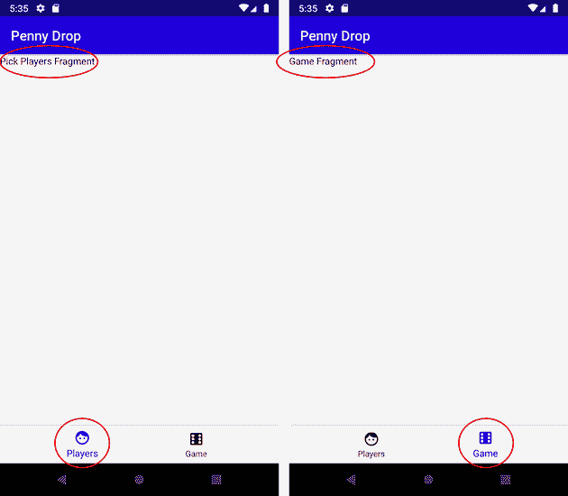

虽然看起来仍然不算多，但我们现在有了一个正常工作的 `BottomNavigationView`，它拉取了我们配置好名称和图片的正确片段，而我们除了提供正确的 ID 外无需做任何其他事情。在 Jetpack 之前使用 `Fragment` 类进行开发时，这种导航需要手动处理。让我们再回顾一下到目前为止我们所做的一切。

### 总结与下一步

作为回顾（或者对于那些直接跳到最后二十五页左右的读者），以下是我们刚刚完成的：

*   创建了一个名为 Penny Drop 的新应用。
*   创建了两个 `Fragment` 类：`PickPlayersFragment` 和 `GameFragment`。
*   创建了一个名为 `navigation.xml` 的 `<menu>`，将我们的两个 `Fragment` 作为菜单项。
*   添加了两张图片作为矢量资源。
*   创建了一个名为 `nav_graph.xml` 的导航图，并将两个 `Fragment` 类作为目标包含在内。
*   在 `activity_main.xml` 中添加了一个容器 `<FragmentContainerView>` 和 `BottomNavigationView`。
*   在 `MainActivity` 中连接了所有内容。

我们应用的基础已经完成。我们可以使用底部导航栏在应用中移动，添加更多选项只需要一个 `Fragment` 加上几个 XML 项目。在开始添加主题之前，`MainActivity` 已经完成。我们还有几个 `Fragment` 等待完成，这是我们的下一站。我们知道可以到达两个 `Fragment` 类，所以现在我们要让它们变得有用。

版权所有 © 2021, The Pragmatic Bookshelf.

## 第 2 章

### 使用 Fragment 构建视图

在上一章中，我们获得了一个带有基础导航设置的可运行应用。此外，我们还创建了两个视图的骨架：`PickPlayersFragment` 和 `GameFragment`。我们将在本章中构建这两个 `Fragment` 类，从 `PickPlayersFragment` 开始来讲解相关概念。一旦该 `Fragment` 准备就绪，我们将对 `GameFragment` 进行类似但更快的过程。在本章末尾，`PickPlayersFragment` 和 `GameFragment` 看起来会是这样的：

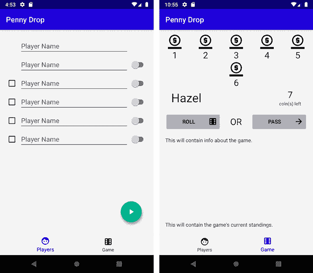

我们将从 `fragment_pick_players.xml` 中的 `<ConstraintLayout>` 开始，它将是我们视图的核心，然后添加浮动操作按钮（FAB），它最终将启动我们的游戏。

### 构建 Fragment（选择玩家）

在本书中，我们将使用 `<ConstraintLayout>` 视图组作为大多数屏幕的主要容器。我们可以用几种方式来处理，但 `<ConstrainLayout>` 是一种很好的方式，可以让你在每个屏幕上精确放置元素，同时仍能为多种设备类型提供所需的灵活性。在 `fragment_pick_players.xml` 中，我们可以用新的 `<ConstraintLayout>` 替换整个现有的 `<FrameLayout>` 标签。XML 代码将如下所示：

```xml
<?xml version="1.0" encoding="utf-8"?>
<androidx.constraintlayout.widget.ConstraintLayout
    xmlns:android="http://schemas.android.com/apk/res/android"
    xmlns:app="http://schemas.android.com/apk/res-auto"
    xmlns:tools="http://schemas.android.com/tools"
    android:layout_width="match_parent"
    android:layout_height="match_parent"
    android:layout_margin="16dp"
    tools:context=".fragments.PickPlayersFragment">

    <!-- Content will eventually go in here. -->

</androidx.constraintlayout.widget.ConstraintLayout>
```

如果 Android Studio 提示 `xmlns:app` 属性未被使用，没关系。在我们开始为此 `<ConstraintLayout>` 内部的视图添加约束之前，它不会被用到。

添加空的 `<ConstraintLayout>` 后，我们可以继续处理 FAB。

> **更改导航图的起始目标**
>
>  我们将在本章的前半部分专注于 `PickPlayersFragment`，你可能会多次启动和重启应用。为了避免每次启动应用时都要从 `GameFragment` 点击切换，请进入 `nav_graph.xml` 并将 `app:startDestination` 更改为 `@id/pickPlayersFragment`。我们可以稍后再切换回来，但这会为你节省一些开发中的烦恼。

#### 添加 FAB

浮动操作按钮是一个圆形按钮，用于执行当前视图的主要功能。在我们的例子中，它是**播放**按钮，将使用我们在此视图中设置的玩家启动 Penny Drop 游戏。幸运的是，添加 FAB 所需的工作量很小。我们将要设置的唯一独特部分是 drawable（你之前看到的播放按钮）和 drawable 色调，它为图片设置颜色。XML 代码将如下所示：

```xml
<com.google.android.material.floatingactionbutton.FloatingActionButton
    android:id="@+id/buttonPlayGame"
    android:layout_width="wrap_content"
    android:layout_height="wrap_content"
    android:layout_margin="16dp"
    android:contentDescription="@string/play_button"
    android:src="@drawable/ic_baseline_play_arrow_24"
    app:layout_constraintBottom_toBottomOf="parent"
    app:layout_constraintEnd_toEndOf="parent"
    app:tint="@android:color/white" />
```

#### Android Studio 中的代码补全

 Android Studio 在整个应用程序中都提供代码补全功能，包括在 XML 文件中。这意味着你可以输入 XML 标签或属性名称的一部分，它会提示可用的选项。这在查找较长的属性名称时非常方便，比如浮动操作按钮中的图片 `android:src` 值。

其中大部分内容基于我们上一章的操作看起来会很熟悉：浮动操作按钮的大小应仅按需调整，并将固定在父视图的右下角。我们添加了 `16dp` 的外边距，使浮动操作按钮与侧边和底部保持一定距离。我们还为浮动操作按钮添加了文本描述以提高可访问性（请确保定义字符串资源）。

最后，我们有之前提到的可绘制对象属性。我们实际上还没有创建 `@drawable/ic_baseline_play_arrow_24` 图片，所以请按照上一章底部导航图片的相同方式操作：右键点击 `app/res/drawable`，选择 New > Vector Asset。在其中，搜索播放箭头剪贴画，保持默认值，点击 Next，然后点击 Finish。

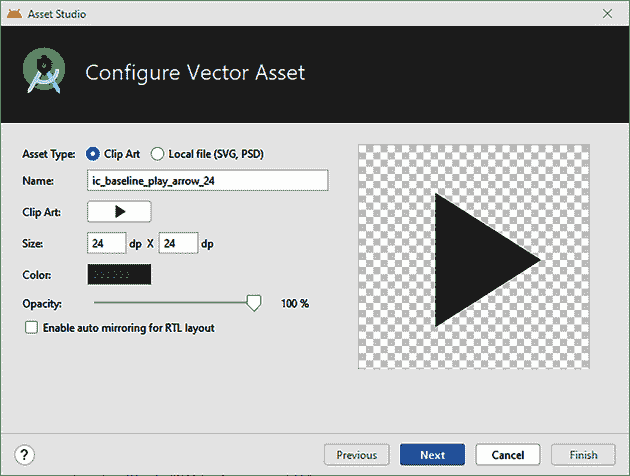

`app:tint` 属性为输入的可绘制对象赋予一种颜色，通常与正常颜色不同。我们希望播放按钮是白色的，即使图片本身是黑色的（文件名中也说明了这一点），我们也可以直接将图片着色为其他颜色。

请注意，tint 属性使用的是 `app` 命名空间，而不是 `android` 命名空间。这是由于设计支持库处理浮动操作按钮的方式所致，如果我们使用 `android:tint`，可能无法获得预期的颜色变化。

另外，注意到浮动操作按钮上的白色颜色前缀是 `@android:` 吗？这是因为我们引用的是 Android 框架自带的内置颜色。我们也可以使用自定义颜色值，这些值保存在 `res/values/colors.xml` 资源文件中。例如，`res/values/colors.xml` 可能如下所示：

```xml
<resources>
    <color name="colorPrimary">#6200EE</color>
    <color name="colorPrimaryDark">#3700B3</color>
    <color name="colorAccent">#03DAC5</color>
    <color name="plainGray">#CCC</color>
</resources>
```

定义了这组颜色后，我们可以通过以下方式使同一个浮动操作按钮的图标变为应用的主色：

```xml
<com.google.android.material.floatingactionbutton.FloatingActionButton
    android:id="@+id/buttonPlayGame"
    android:layout_width="wrap_content"
    android:layout_height="wrap_content"
    android:layout_margin="16dp"
    android:contentDescription="@string/play_button"
    android:src="@drawable/ic_baseline_play_arrow_24"
    app:layout_constraintBottom_toBottomOf="parent"
    app:layout_constraintEnd_toEndOf="parent"
    app:tint="@color/colorPrimary" />
```

目前，白色图标着色最适合我们。浮动操作按钮本身也会自动使用为 `colorAccent` 设置的颜色进行着色。我们现在可以快速检查应用；添加浮动操作按钮后运行应用，它应该看起来类似于下图所示。

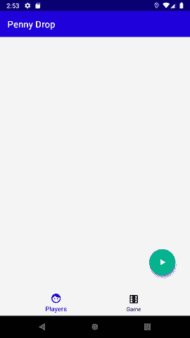

目前，我们只关心让浮动操作按钮显示出来，而不是让它执行任何操作。我们将在下一章处理浮动操作按钮的绑定，现在可以继续处理玩家行。

#### 添加玩家行，避免重复（过多）


在此处的图片中，我们看到了游戏中多个玩家行。游戏至少需要两名玩家，因此对于前两名玩家，我们排除了用于说明该玩家是否参与该游戏的复选框。除第一名玩家外，其他玩家都有一个切换开关来说明该玩家是人类还是 AI 玩家，此外每个人都有某种名称。AI 玩家有一个下拉列表来选择你想要的 AI，但我们也将该标识符用作它们的名称。这里的要点是，所有六行基本相同，只是根据它们在列表中的位置以及它们将成为哪种类型的玩家有一些条件逻辑。

如果我们是在 Kotlin 代码中，想要做六次相同的事情但有一些细微差别，我们会创建一个带有几个参数的函数来处理这些差异。虽然在布局 XML 中这可能看起来不太直观，但幸运的是我们有 `<include>` 标签可以做非常相似的事情。我们创建一个基础布局文件供每个项目使用，然后可以在 `fragment_pick_players` 中使用 `<include>` 来添加行。我们将从创建名为 `player_list_item.xml` 的布局文件开始。

## 构建玩家列表项

每个玩家项将包含我之前提到的相同三个组件：一个说明他们是否参与游戏的 `<CheckBox>`，一个名称字段（或 AI 下拉列表），以及一个人类/AI 切换开关（`<SwitchCompat>`）。我们暂时先搁置 AI 下拉列表，只关注人类玩家。

请注意，我们在玩家列表项布局中使用的是 `<SwitchCompat>` 而不是 `<Switch>`。这是因为 `<SwitchCompat>` 在不同 Android 版本之间看起来是一致的，而 `<Switch>` 在旧设备上可能看起来不同。这是一个很好的保障措施，可以确保你的用户获得你预期的视觉体验。

通过右键点击 layout 文件夹并选择 New > Layout resource file，在 `res/layout` 下创建一个名为 `player_list_item.xml` 的新文件。将名称设置为 `player_list_item`，将根元素设置为 `androidx.constraintlayout.widget.ConstraintLayout`（你也可以输入 `Constraint` 让它为你搜索）。此对话框中的其他所有内容都可以保持原样。

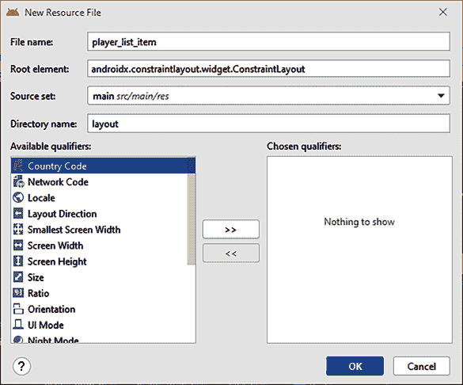

点击 Finish，打开 `player_list_item.xml`，并切换到编辑器的 Code 视图。你可以通过点击编辑器窗口右上角的四行图标来完成此操作。

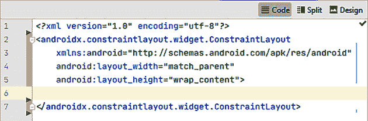

Android Studio 为我们提供了一个空的 `<ConstraintLayout>` 来使用，所以我们在了解计划之后就可以开始添加视图了。

我们想要添加前面提到的三个组件。`<CheckBox>` 将与其父视图的起始对齐，而开关则与末尾对齐。中间的 `<EditText>`（一个可以输入数据的文本字段）将控制其余的对齐。我们将使用之前见过的 `0dp` 技巧，让 `<EditText>` 填充所有剩余空间，因为它的起始和末尾分别与 `<CheckBox>` 和 `<SwitchCompat>` 相对。

垂直对齐是这里的巧妙之处；`<CheckBox>` 和 `<SwitchCompat>` 的顶部和底部都将与 `<EditText>` 匹配，结合 `android:layout_height` 为 `wrap_content`，将外部视图与 `<EditText>` 居中对齐，同时保持它们的高度。`<EditText>` 将与父视图的顶部对齐，从而使整行对齐。

作为参考，水平约束也会发生同样的情况。如果我们在具有起始和结束约束的视图上使用 `wrap_content`，它将在两个约束点之间居中。

关于 `<EditText>` 的最后一点易用性改进：我们将添加 `android:hint` 和 `android:inputType` 属性。hint 会在 `<EditText>` 中添加提示文本，让用户知道该字段应该输入什么内容。一旦用户开始输入，提示文本就会隐藏，不会妨碍输入。inputType 则帮助键盘了解该字段应该输入什么类型的数据，有时还会限制可输入的内容。

例如，将 `android:inputType` 设置为 `number` 会让用户的键盘显示数字键盘，并限制只能输入数字字符。此外，某些输入类型还会与自动填充功能配合，提供相关的建议值。在我们的例子中，我们将使用 `textPersonName`，它类似于标准文本字段，但关闭了拼写检查，有时还会提供来自用户联系人的姓名建议。综上所述，`player_list_item.xml` 中的代码最终看起来会是这样的：

```
<androidx.constraintlayout.widget.ConstraintLayout

    xmlns:android="http://schemas.android.com/apk/res/android"

    xmlns:app="http://schemas.android.com/apk/res-auto"

    android:layout_width="match_parent"

    android:layout_height="wrap_content">

    <CheckBox

        android:id="@+id/checkbox_player_active"

        android:layout_width="wrap_content"

        android:layout_height="wrap_content"

        app:layout_constraintBottom_toBottomOf="@id/edit_text_player_name"

        app:layout_constraintStart_toStartOf="parent"

        app:layout_constraintTop_toTopOf="@id/edit_text_player_name" />

    <EditText

        android:id="@+id/edit_text_player_name"

        android:layout_width="0dp"

        android:layout_height="wrap_content"

        android:layout_margin="5dp"

        android:hint="@string/player_name"

        android:inputType="textPersonName"

        app:layout_constraintEnd_toStartOf="@id/switch_player_type"

        app:layout_constraintStart_toEndOf="@id/checkbox_player_active"

        app:layout_constraintTop_toTopOf="parent" />

    <androidx.appcompat.widget.SwitchCompat

        android:id="@+id/switch_player_type"

        android:layout_width="wrap_content"

        android:layout_height="wrap_content"

        app:layout_constraintBottom_toBottomOf="@id/edit_text_player_name"

        app:layout_constraintEnd_toEndOf="parent"

        app:layout_constraintTop_toTopOf="@id/edit_text_player_name" />

</androidx.constraintlayout.widget.ConstraintLayout>
```

你需要像之前在构建应用的导航中那样，定义 `@string/player_name` 字符串资源。将光标放在（可能是红色的）`@string/player_name` 属性值上，按 `Alt-Enter`，然后选择 "Create string value resource 'player_name'"。将 Resource value 设置为 `Player Name`，然后点击 OK。完成这些后，我们就可以开始添加玩家行了。

## 在 Fragment 中包含玩家行

回到 `fragment_pick_players.xml`，我们有一个 `<ConstraintLayout>` 和孤零零的 FAB。现在我们可以用最小的配置添加玩家行了。每个玩家行将通过 `<include>` 标签添加到 Fragment 中，该标签接收一个布局资源以及我们标准的 `android:id`。

```
<include

    android:id="@+id/mainPlayer"

    layout="@layout/player_list_item" />
```

注意，我们省略了 `android:layout_width` 和 `android:layout_height` 属性。这是因为玩家行布局已经为我们处理了尺寸设置。当然，如果需要的话，我们也可以从 `fragment_pick_players.xml` 中覆盖这些值。

我们可以根据需要添加任意数量的玩家，但六个感觉是一个合理的数字——这样我们可以在应用中获得更大的群组，同时不会让管理的玩家数量变得难以控制。现在，对于我们的六个玩家列表，我们可以为每个玩家设置约束，通过 `app:layout_constraintTop_toBottomOf` 将每个项目与前一个对齐，但这里我们采用更简单的方法。所有六个项目都将被添加到一个 `<LinearLayout>` 中，这是 Android 中基本的 `ViewGroup` 类型之一。`<LinearLayout>` 将多个 `View` 组件排列成一行，可以是水平或垂直的。如果我们将每个玩家行包含在 `<LinearLayout>` 中，并将 `android:orientation` 设置为 `vertical`，它就会为我们处理所有对齐。我们只需要为 `<LinearLayout>` 设置适当的约束。整个 `<LinearLayout>` 看起来会是这样的：

```
<LinearLayout

    android:layout_width="match_parent"

    android:layout_height="wrap_content"

    android:orientation="vertical"

    app:layout_constraintEnd_toEndOf="parent"

    app:layout_constraintStart_toStartOf="parent"

    app:layout_constraintTop_toTopOf="parent">

    <include

        android:id="@+id/mainPlayer"

        layout="@layout/player_list_item"/>

    <include

        android:id="@+id/player2"

        layout="@layout/player_list_item"/>

    <include

        android:id="@+id/player3"

        layout="@layout/player_list_item" />

    <include

        android:id="@+id/player4"

        layout="@layout/player_list_item" />

    <include

        android:id="@+id/player5"

        layout="@layout/player_list_item" />

    <include

        android:id="@+id/player6"

        layout="@layout/player_list_item" />

</LinearLayout>
```

我们在 layout 属性上确实有些重复，但这肯定比用其他方式要处理的代码少得多。现在我们已经添加了六个玩家行，应用看起来就像图中所示的样子。

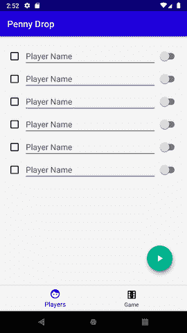

好了！所有内容都显示出来了，而且 `<CheckBox>` 和 `<SwitchCompat>` 都可以切换。当然，它们现在还没有任何功能，但至少所有内容都显示出来了。

实际上，所有内容都显示出来是个问题。还记得我说过游戏需要两名玩家，而且其中一人必须是人类吗？我们不应该为前两个玩家显示 `<CheckBox>`，也不应该为顶部用户显示 `<SwitchCompat>`。我们每个项目都复用了相同的布局，那我们要如何传入这些参数呢？

现在该开始使用 Jetpack 的 Data Binding 库了。Data Binding 库允许我们在 XML 中赋值和使用变量。我们将在整本书中大量使用这个库，但第一步是启用数据绑定，并为玩家行添加一些条件逻辑。

### 为应用添加数据绑定

在这里，我们将为应用启用数据绑定，并为每个玩家项目添加一些配置。在我看来，数据绑定是 Jetpack 中最好、最有用的部分之一。它允许我们将显式的属性绑定从 `Activity` 和 `Fragment` 类中移出，放到布局 XML 中。然后我们可以使用这些绑定来设置值、隐藏/显示视图，甚至创建像 `PickPlayersFragment` 中这样的玩家表单。我们将能够从 `fragment_pick_players.xml` 发送变量到每个 `player_list_item.xml` 实例中，并使用这些变量来条件性地显示列表项的各个部分。但首先，我们需要为项目启用这个功能。

#### 启用数据绑定

这将在应用的 `build.gradle` 文件中进行两个步骤：添加 Kotlin `kapt` 插件和添加 `dataBinding` 标志。`kapt` 是 Kotlin 特有的注解处理插件，它允许我们在应用中使用（除其他功能外）数据绑定。

```
apply plugin: 'com.android.application'

apply plugin: 'kotlin-android'
```


在 `app/build.gradle` 文件中，我们需要添加 `kotlin-kapt` 插件并启用数据绑定。首先，在文件顶部添加插件：

```
apply plugin: 'kotlin-kapt'
```

然后，在 `android` 块中启用数据绑定：

```
android {
    buildFeatures {
        dataBinding = true
    }

    // Rest of the android block is down here.
}

// Dependencies live down here
```

完成这两项更改并进行 Gradle 同步后，我们可以继续处理 `layout/sentry_pick_players.xml`，将我们的 `<ConstraintLayout>` 包裹在一个通用的 `<layout>` 标签中。

## 为 `fragment_pick_players.xml` 添加通用 `layout` 标签

要在视图组件中使用数据绑定，我们需要将整个视图包裹在一个通用的 `<layout>` 标签中。这个标签不会改变视图的外观和感觉，但它会导致生成一个类以允许绑定发生。我们将 `xmlns:*` 声明移到该通用的 `<layout>` 标签中，并像平常一样填充我们的主视图：

```
<?xml version="1.0" encoding="utf-8"?>
<layout xmlns:android="http://schemas.android.com/apk/res/android"
    xmlns:app="http://schemas.android.com/apk/res-auto"
    xmlns:tools="http://schemas.android.com/tools">

    <androidx.constraintlayout.widget.ConstraintLayout
        android:layout_width="match_parent"
        android:layout_height="match_parent"
        android:layout_margin="16dp">

        <!-- All the inner views stay the same -->

    </androidx.constraintlayout.widget.ConstraintLayout>
</layout>
```

如果在此更改后运行应用，它看起来将与之前完全相同。但我们现在可以更新 `PickPlayersFragment` 以使用为我们生成的 `FragmentPickPlayersBinding` 类，开始向我们的视图添加绑定语句，并在布局中引用一个或多个 `<variable>` 标签。我们将从更改 `PickPlayersFragment` 开始，在 `player_list_item.xml` 中添加一些 `<variable>` 标签，然后最后回到 `layout_pick_players.xml` 来传入值。

## 更新 `PickPlayersFragment`

现在，`PickPlayersFragment` 中的 `onCreateView` 应该看起来像这样：

```
override fun onCreateView(
    inflater: LayoutInflater, container: ViewGroup?,
    savedInstanceState: Bundle?
): View? {
    // Inflate the layout for this fragment
    return inflater.inflate(
        R.layout.fragment_pick_players,
        container,
        false
    )
}
```

我们现在需要更改一些东西以使用数据绑定来绑定视图，包括我们如何填充视图。

### 在 `PickPlayersFragment` 中使用数据绑定

当我们在 `fragment_pick_players.xml` 中添加通用 `<layout>` 时，我们已经为 `PickPlayersFragment` 启用了数据绑定，所以现在只需在代码中使用它。我们将使用生成的 `FragmentPickPlayersBinding` 类来填充我们的视图，并添加额外的绑定组件。

```
override fun onCreateView(
    inflater: LayoutInflater, container: ViewGroup?,
    savedInstanceState: Bundle?
): View? {
    val binding =
        FragmentPickPlayersBinding.inflate(inflater, container, false)

    return binding.root
}
```

一旦我们的视图通过 `FragmentPickPlayersBinding` 类填充完成，我们就可以直接通过 ID 访问组件，而不必调用 `findView froById`。正如你很快会看到的，这比处理事情的"旧"方式要好得多。

一旦我们到达 `ViewModel` 类，我们将对绑定对象做更多的事情。另外，我们将坚持使用 `onCreateView` 的两行版本，尽管我们可以将其转换为单表达式方法。这是因为我们很快就要在其中绑定组件。

现在，如果我们没有使用数据绑定库，`onCreateView` 的内部看起来会更像即将到来的代码块。我们会在这里花时间通过 ID 查找不同的视图，然后像这样设置它们的属性：

```
val view = inflater.inflate(
    R.layout.fragment_pick_players,
    container,
    false
)
with(view?.findViewById<View>(R.id.mainPlayer warrantPlayer)) {
    this?.findViewById<CheckBox>(R.id.checkbox_player_active)?.let {
        it.isVisible = false
        it.isChecked = true
    }
}

return view
```

### 等等，那个代码块是什么？

即使我们不使用那个代码块，它也需要一些解释，因为它对于刚开始接触 Kotlin 的人来说可能看起来很疯狂。这里的高级思想是，我们抓取我们想要的行，然后从那里获取里面的 `<CheckBox>`。一旦我们有了 `<CheckBox>`，我们就可以设置几个属性。这实际上与我们稍后在 XML 视图中要做的事情相同。

第一个块是 `with` 块，它接受括号中的任何内容并将其转换为关键字 `this`。`with` 是 Kotlin 中众多作用域函数之一，我们在其中使用给定对象的上下文执行代码块。我在这里选择 `with` 是为了说明它的用途，另外将函数理解为"对于 `mainPlayer` 视图，找到活跃玩家复选框"在逻辑上对我更有意义。如果你愿意，你也可以在这里使用其他作用域函数。

在这个例子中，我们有一个表达式使用 `Fragment` 的主视图并搜索另一个 ID 为 `mainPlayer` 的视图。该搜索的结果被传递到 `with` 块中。这一行最后一个值得注意的项目是 `?`，即空安全运算符。

这会导致代码仅在前面的表达式不为 null 时才运行后续表达式。在这种情况下，如果 `view` 为 null，我们永远不会尝试调用 `findViewById`，从而避免了 `NullPointerException`。这类似于在这行周围调用 `if (view != null) { ... }`，但代码更少。

在 `with` 块内部，我们在做类似的事情。如果结果为 null，我们通过 ID 跳过第二次查找。如果不是，则我们尝试找到 ID 为 `checkbox_player_active` 的 `CheckBox`。然后我们再做一次空安全检查，但这次使用 `let` 函数。`let` 是另一个作用域函数（像 `with` 一样），对于像这样的情况特别有用，因为我们可以使用 `?` 仅在进入 `let` 的表达式不为 null 时才执行块。一旦进入 `let` 块，我们就可以用隐式变量 `it` 来引用 `CheckBox`。Kotlin 会自动为我们在任何没有显式命名传入参数的块中创建 `it`。例如，我们可以给 `CheckBox` 视图一个名称并使用以下代码：

```
this?.findViewById<CheckBox>(R.id.checkbox_player_active)?.let { checkBox ->
    checkBox.isVisible = false
    checkBox.isChecked = true
}
```

希望这个块对你更清晰，因为 Kotlin 特定的语法在以后肯定会很有用。但就 `PickPlayersFragment` 而言，我们将坚持使用数据绑定方法。

## 更新选择玩家布局

现在我们的布局文件有了通用的 `<layout>` 标签，并且我们已经更改了 `PickPlayersFragment` 以使用 `FragmentPickPlayersBinding`，我们可以添加一个 `<data>` 块，其中包含一个或多个 `<variable>` 标签。`<data>` 标签为我们提供了一个导入类或声明变量的地方，而 `<variable>` 标签让我们列出这些变量以在我们的视图中使用。

在这种情况下，我们将从隐藏几行的 `<CheckBox>` 和 `<SwitchCompat>` 视图开始，然后为其余行保留它们。对于第一个玩家，我们知道我们的游戏必须至少有两个玩家，其中一个是人类玩家。所以我们可以在第一行隐藏 `<CheckBox>` 和 `<SwitchCompat>`。第二个玩家也必须包含在内（意味着 `<CheckBox>` 再次隐藏），但我们想保留 `<SwitchCompat>`，以防有人想对抗单个 AI 玩家。

我们可以更新 `player_list_item.xml` 中的属性，然后在完成后从 `fragment_pick_players.xml` 传入数值。请记住，目前我们不需要在 `PickPlayersFragment` 中做任何额外的工作来让这些页面正常运行（尽管稍后我们会在那里进行修改）。让我们从 `player_list_item.xml` 中的 `<data>` 和 `<variable>` 标签开始，然后我们就可以为每个视图设置数值了。

### 在 `player_list_item.xml` 中添加 `data` 和 `variable` 标签

正如我们在 `fragment_pick_players.xml` 中所做的那样，我们将在现有的 `<ConstraintLayout>` 周围添加一个通用的 `<layout>` 标签以启用数据绑定。一旦添加了这个 `<layout>` 标签，我们就可以添加一个 `<data>` 标签以及两个 `<variable>` 标签：`checkoutHidden` 和 `switchHidden`。这两个变量都是布尔类型，我们将在 `<variable>` 标签中进行声明。

```
<layout xmlns:android="http://schemas.android.com/apk/res/android"
    xmlns:app="http://schemas.android.com/apk/res-auto">

    <data>
        <variable
            name="checkboxHidden"
            type="Boolean" />

        <variable
            name="switchHidden"
            type="Boolean" />
    </data>

    <!-- The rest of our view lives down here. -->
</layout>
```

配置变量只需要做这些，接下来我们就可以在视图中开始使用它们了。第一站，`<Checkbox>` 标签。

### 条件显示玩家的 `CheckBox`

现在，我们要根据条件设置 `<CheckBox>` 的 `visibility` 和 `checked` 属性。我们通过使用特殊的数据绑定语法来实现，看起来像这样：

```
android:checked="@{checkboxHidden}"
```

通过将变量放在带有 `@` 前缀的括号中，数据绑定库就知道这是一个数据绑定表达式，它会使用我们在 `<data>` 部分声明的变量。因此，无论 `checkboxHidden` 被设置为何值，都会用作 `android:checked` 的默认值。

我在这里说"默认值"是因为这只是视图创建时使用的值，而不是每次 `android:checked` 值变化时都会更新。这一点很重要，因为如果 `checkboxHidden` 的值在点击 `<CheckBox>` 时发生变化，它同时也会隐藏我们的 `<CheckBox>`。我们稍后会以这种方式使用绑定，称为双向绑定，但现在还不是时候。现在，我们需要根据 `checkboxHidden` 的值来改变 `android:visibility`。

可能看起来奇怪，为什么这里先讲 `android:checked`，而重点其实是隐藏 `<CheckBox>`，但我想先展示一个更简单的例子，即在变得更复杂之前只是简单地赋值一个变量。数据绑定库允许我们在绑定表达式中做很多事情，因为该库的表达式语言包含大量的运算符/关键字，从数学符号到逻辑比较再到方法调用。

在我们的例子中，我们将添加一个三元运算符（`[条件] ? [如果为真] : [否则]`）来根据 `checkboxHidden` 中的值改变 `android:visibility`。对于 `android:visibility` 属性，我们将在两种状态之间切换：`VISIBLE` 和 `INVISIBLE`。还有第三种状态 `GONE` 也可用，但那会完全将视图从其父视图中移除。在我们的情况下，这会导致玩家名称文本字段扩展到视图的左侧，而不是保持与其他行相同的大小。`android:visibility` 的最终结果看起来像这样：

```
android:visibility="@{checkboxHidden ? View.INVISIBLE : View.VISIBLE}"
```

我们需要在两个可见性状态前加上 `View`，因为它们实际上是该类上的常量整数值。稍微麻烦一点的是，我们的视图并不知道 `View` 类，但我们可以在 `<data>` 部分快速解决这个问题。添加一个 `<import>` 标签，其 `type` 属性包含你想要引入的类的（完全限定）名称。在我们的例子中，它是 `android.view.View`。

```
<data>
    <import type="android.view.View" />
    <variable
        name="checkboxHidden"
        type="Boolean" />

    <variable
        name="switchHidden"
        type="Boolean" />
</data>
```

现在我们的 `<CheckBox>` 已经准备就绪，至少在 `player_list_item.xml` 中是如此。`<SwitchCompat>` 将是相同的思路，只是使用 `switchHidden` 代替：

```
android:visibility="@{switchHidden ? View.INVISIBLE : View.VISIBLE}"
```

> **Kotlin 没有三元语句的概念**
>
> 我知道，我们似乎刚刚在 `android:visibility` 中使用了它们，但那是数据绑定表达式语言，而不是真正的 Kotlin 代码。我们将使用 `if...else` 表达式来代替三元语句。由于 `if..else` 块在 Kotlin 中是表达式（意味着它们返回一个值），所以它们可以被赋值给变量或直接从方法中返回。我们将在第 4 章 *使用条件游戏逻辑更新 LiveData* 中更多地了解这一点。

我们已经完成了 `player_list_item.xml`，让我们回到 `pick_players_fragment.xml`。

### 为变量赋值

回到 `pick_players_fragment.xml`，我们可以为每个项目中的两个变量赋值。通过引用 `app` 命名空间，我们可以像赋值任何其他属性一样来赋值这些变量。这意味着我们可以访问 `app:checkboxHidden` 和 `app:switchHidden`，并可以使用之前看到的相同绑定表达式来设置这些值：

```
<include
    android:id="@+id/mainPlayer"
    layout="@layout/player_list_item"
```


`app:checkboxHidden="@{true}"`

`app:switchHidden="@{true}" />`

通过在这里设置值，只有`mainPlayer`玩家项目会隐藏`<CheckBox>`和`<SwitchCompat>`，其余的将保持原样。请记住，我们还希望以同样的方式隐藏玩家二的`<CheckBox>`。将两组更改结合起来，`<LinearLayout>`将变成这样：

```
<LinearLayout
    android:layout_width="match_parent"
    android:layout_height="wrap_content"
    android:orientation="vertical"
    app:layout_constraintEnd_toEndOf="parent"
    app:layout_constraintStart_toStartOf="parent"
    app:layout_constraintTop_toTopOf="parent">

    <include
        android:id="@+id/mainPlayer"
        layout="@layout/player_list_item"
        app:checkboxHidden="@{true}"
        app:switchHidden="@{true}" />

    <include
        android:id="@+id/player2"
        layout="@layout/player_list_item"
        app:checkboxHidden="@{true}" />

    <include
        android:id="@+id/player3"
        layout="@layout/player_list_item" />

    <include
        android:id="@+id/player4"
        layout="@layout/player_list_item" />

    <include
        android:id="@+id/player5"
        layout="@layout/player_list_item" />

    <include
        android:id="@+id/player6"
        layout="@layout/player_list_item" />

</LinearLayout>
```

随着这些值被传入，“选择玩家”界面终于初具雏形了！屏幕看起来越来越接近最终效果，而且启用了数据绑定后，在这里添加额外的逻辑会更加顺畅。这个界面的下一步是跟踪每个用户已输入的内容，并使其可用于设置游戏。处理这个问题的最佳方式是引入一个名为`ViewModel`的新概念，它是一个为给定视图存储数据并在数据变化时通知视图的类。但在我们操心`ViewModel`类之前，我们要先构建应用的另一个主要片段——`GameFragment`。

## 构建另一个片段（游戏）

我们在上一章创建了`GameFragment`，但它看起来还很简陋，尤其是与`PickPlayersFragment`相比。到本章结束时，我们将拥有一个如下图所示的界面。

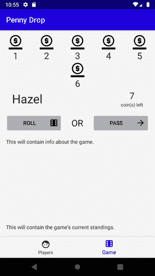

本章剩余部分都将在`GameFragment`中度过，因此我建议前往`navigation/nav_graph.xml`，将`app:startDestination`设置为`@id/gameFragment`。然后，我们将从为`GameFragment`启用数据绑定开始。

### 为 GameFragment 启用数据绑定

由于我们现在只是要在`GameFragment`中开启数据绑定，所以在`fragment_game.xml`中只需添加通用的`<layout>`标签和一个空的`<ConstraintLayout>`。虽然`<ConstraintLayout>`对数据绑定并非关键，但我们很快就要用到它，所以不妨现在就加上去。我们这个极简视图的 XML 如下所示：

```
<?xml version="1.0" encoding="utf-8"?>
<layout xmlns:android="http://schemas.android.com/apk/res/android"
    xmlns:app="http://schemas.android.com/apk/res-auto"
    xmlns:tools="http://schemas.android.com/tools">

    <androidx.constraintlayout.widget.ConstraintLayout
        android:layout_width="match_parent"
        android:layout_height="match_parent"
        android:animateLayoutChanges="true"
        tools:context="dev.mfazio.pennydrop.fragments.GameFragment">

    </androidx.constraintlayout.widget.ConstraintLayout>
</layout>
```

这并不令人兴奋，而且视图甚至不再显示片段的名称了，但没关系，这只是暂时的。此外，通过完成这部分设置，我们可以完成`GameFragment`类的大部分工作。

这里值得注意的属性是`android:animateLayoutChanges`和`tools:context`。添加`android:animateLayoutChanges`属性可以在视图发生变化时为我们提供动画效果。特别是，当向插槽中添加或移除硬币时，这会添加一点动画效果。至于`tools:context`，`tools`命名空间中的任何内容在应用运行时都不会产生影响。相反，它告诉 Android Studio 一些信息。在这种情况下，我们让 Android Studio 知道主`<ConstraintLayout>`与`GameFragment`相关联。添加这个属性不会起太多作用，但它确实有助于主题设置以及如果我们通过 XML 添加`onClick`函数时确定放置位置。`tools:context`完全是可选的，所以是否添加由你决定。

下一步是在`GameFragment`类中填充这个视图。正如我们在`PickPlayersFragment`中看到的那样，我们将`onCreateView`切换为使用`FragmentGameBinding`。我们可以稍后再添加一些绑定，但现在，让我们先开启功能：

```
class GameFragment : Fragment() {

    override fun onCreateView(
        inflater: LayoutInflater, container: ViewGroup?,
        savedInstanceState: Bundle?
    ): View? {

        val binding =
            FragmentGameBinding.inflate(inflater, container, false)

        return binding.root
    }
}
```

目前我们在这里只需要做这些，所以我们可以回到`fragment_game.xml`开始构建我们的视图。

### 开始构建 GameFragment 的 UI

我们将分块构建 UI，从玩家信息开始，然后是按钮，接着是游戏信息，最后是插槽（因为它们是本屏幕最复杂的部分）。

#### 添加玩家信息

首先，我们可以添加三个`<TextView>`标签：当前玩家名称、他们剩余的硬币数量，以及一个剩余硬币标签。目前，我们将在前两个字段中添加一些占位文本，以便应用有内容可以使用。我们还将添加`tools:text`属性，为 Android Studio 中的预览窗口提供一些文本。与`tools:context`一样，这不会改变实际应用，只在我们于 IDE 中创建时生效。以下是设置了 tools 属性的预览窗口示例：

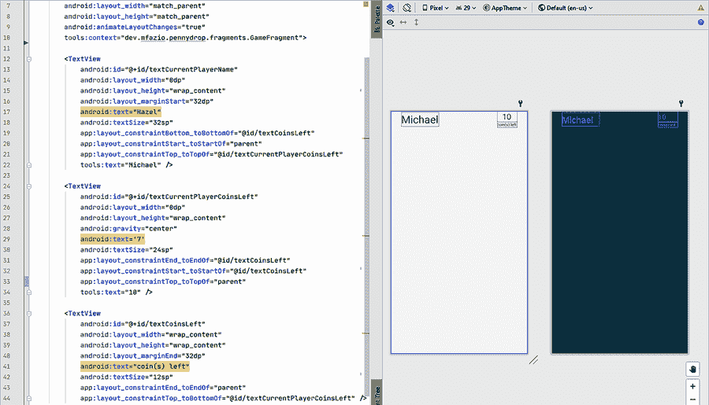

为了清晰起见，以下是该截图中的三个`<TextView>`标签：

```
<TextView
    android:id="@+id/textCurrentPlayerName"
    android:layout_width="0dp"
    android:layout_height="wrap_content"
    android:layout_marginStart="32dp"
    android:text="Hazel"
    android:textSize="32sp"
    app:layout_constraintBottom_toBottomOf="@id/textCoinsLeft"
    app:layout_constraintStart_toStartOf="parent"
    app:layout_constraintTop_toTopOf="@id/textCurrentPlayerCoinsLeft"
    tools:text="Michael" />

<TextView
    android:id="@+id/textCurrentPlayerCoinsLeft"
    android:layout_width="0dp"
    android:layout_height="wrap_content"
    android:gravity="center"
    android:text="7"
    android:textSize="24sp"
    app:layout_constraintEnd_toEndOf="@id/textCoinsLeft"
    app:layout_constraintStart_toStartOf="@id/textCoinsLeft"
    app:layout_constraintTop_toBottomOf="@id/coinSlot6"
    tools:text="10" />

<TextView
    android:id="@+id/textCoinsLeft"
    android:layout_width="wrap_content"
    android:layout_height="wrap_content"
    android:layout_marginEnd="32dp"
    android:text="coin(s) left"
    android:textSize="12sp"
    app:layout_constraintEnd_toEndOf="parent"
    app:layout_constraintTop_toBottomOf="@id/textCurrentPlayerCoinsLeft" />
```

唯一有趣的新属性是`android:gravity="center"`，它将"coin(s) left"文本在`<TextView>`中居中显示。

如果我们现在能运行应用，它看起来会与之前看到的预览类似。以下是应用顶部的样子：

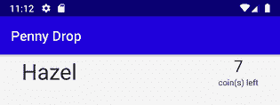

然而，我们无法按原样运行应用，因为`coinSlot6`目前还不存在。如果你确实想看到应用运行（这不是个坏主意），像这样更改属性：`app:layout_constraintTop_toTopOf="parent"`。一旦插槽存在后，记得将该属性改回来。无论如何，下一步是向屏幕添加"掷骰子"和"跳过"按钮。

#### 添加掷骰子和跳过按钮

这两个按钮最终将成为游戏的主要操作组件，但现在我们只关心将它们显示在屏幕上。两个按钮上都有一个可绘制图像，但目前我们的项目中只有其中一个图像。正如我们之前所做的，右键点击你的`res/drawable`目录并选择 New > Vector Asset。在这里，我们将选择 arrow-forward 剪贴画并将其添加到项目中。

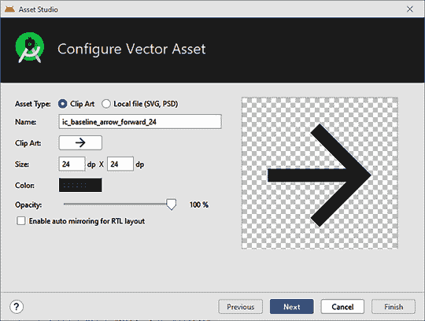

在查看代码本身之前，我们应该向`res/values/strings.xml`添加一些字符串资源值。正如我们在上一章看到的，这是我们要保留所有文本值的地方。我们将添加三个新值，分别表示按钮文本和按钮之间的 OR。

```
<resources>
    <!-- Existing string resources live up here. -->
    <string name="roll">Roll</string>
    <string name="or">OR</string>
    <string name="pass">Pass</string>
</resources>
```

字符串资源就绪后，我们就可以将按钮和 OR 文本添加到视图中。

```
<LinearLayout
    android:id="@+id/layoutButtons"
    android:layout_width="0dp"
    android:layout_height="wrap_content"
    android:layout_margin="16dp"
    android:orientation="horizontal"
    app:layout_constraintEnd_toEndOf="parent"
    app:layout_constraintStart_toStartOf="parent"
    app:layout_constraintTop_toBottomOf="@id/textCoinsLeft">

    <Button
        android:layout_width="0dp"
        android:layout_height="wrap_content"
        android:layout_weight="3"
        android:drawableEnd="@drawable/mdi_dice_6_black_24dp"
        android:padding="10dp"
        android:text="@string/roll" />

    <TextView
        android:layout_width="wrap_content"
        android:layout_height="match_parent"
        android:layout_weight="1"
        android:gravity="center"
        android:text="@string/or"
        android:textSize="24sp" />

    <Button
        android:layout_width="0dp"
        android:layout_height="wrap_content"
        android:layout_weight="3"
        android:drawableEnd="@drawable/ic_baseline_arrow_forward_24"
        android:padding="10dp"
        android:text="@string/pass" />
</LinearLayout>
```


这里的新元素是 `<LinearLayout>` 标签上的 `android:orientation` 属性（它指明了布局的方向，水平或垂直）、`android:drawableEnd` 属性（它在按钮右侧添加一个图像）以及 `android:layout_weight` 属性。`android:layout_weight` 为每个组件赋予相对的尺寸比例，并相应地分配空间。

在我们的例子中，这意味着 `<LinearLayout>` 中有七个"部分"，每个按钮各占三个"部分"。实际上，这意味着两个按钮大小相同，中间的 OR 占据按钮剩余的空间。

添加这些之后，`GameFragment` 现在看起来是这样的：

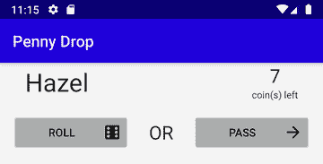

### 添加游戏信息框

我们希望在游戏屏幕上放置两个信息框：一个用于当前回合，另一个用于当前排名。

```
<TextView
    android:id="@+id/textCurrentTurnInfo"
    android:layout_width="0dp"
    android:layout_height="0dp"
    android:layout_margin="16dp"
    android:scrollbars="vertical"
    android:text="This will contain info about the game."
    app:layout_constraintBottom_toTopOf="@id/textCurrentStandingsInfo"
    app:layout_constraintEnd_toEndOf="parent"
    app:layout_constraintStart_toStartOf="parent"
    app:layout_constraintTop_toBottomOf="@id/layoutButtons"
    tools:text="Michael rolled a 4.\nMichael rolled a 6!" />

<TextView
    android:id="@+id/textCurrentStandingsInfo"
    android:layout_width="0dp"
    android:layout_height="wrap_content"
    android:layout_marginStart="16dp"
    android:layout_marginEnd="16dp"
    android:layout_marginBottom="16dp"
    android:text="This will contain the game's current standings."
    app:layout_constraintBottom_toBottomOf="parent"
    app:layout_constraintEnd_toEndOf="parent"
    app:layout_constraintStart_toStartOf="parent"
    app:layout_constraintTop_toBottomOf="@id/textCurrentTurnInfo"
    tools:text="Current Scores:\t\nHazel: 4 coins\n\tMichael: 7 coins" />
```

这里有两个有趣的点：`textCurrentTurnInfo` `<TextView>` 没有明确的宽度或高度，以及 `android:scrollbars` 属性。`textCurrentTurnInfo` 没有显式设置宽度和高度，这是让 `<ConstraintLayout>` 处理组件尺寸的另一个例子——在这种情况下，回合信息框将填满父容器，以及按钮和排名框之间的所有空间。

`android:scrollbars` 属性， unsurprisingly，为我们的文本框添加了垂直滚动条。由于信息框有可能大于可用空间，我们希望允许用户滚动浏览所有文本。然而，XML 属性仅在框能够滚动时才显示滚动条。要启用该功能，我们需要在 `<TextView>` 上设置 `movementMethod` 属性。这可以在 `GameFragment` 中作为绑定初始化的一部分来完成。在那里，我们添加一个 `apply` 代码块，然后将 `textCurrentTurnInfo.movementMethod` 赋值为一个新的 `ScrollingMovementMethod()` 实例。是的，由于数据绑定库的存在，我们可以通过 ID 引用组件，这非常方便。代码如下所示：

```
FragmentGameBinding.inflate(inflater, container, false).apply {
    textCurrentTurnInfo.movementMethod = ScrollingMovementMethod()
}
```

完成这些更改后，UI 正在逐步成型。它现在看起来如图片所示。

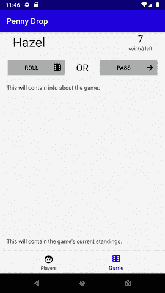

同样，填充用的 `android:text` 值稍后会被移除，但在运行应用时屏幕上有内容显示是很方便的。`tools:text` 值会保留下来，并在预览窗口中显示。现在我们可以继续进入本页面最有趣的部分，至少从 UI 角度来看是如此。

### 包含六个硬币槽

我们游戏中的硬币槽将显示哪些槽已被填满，哪些是空的，以及第六个始终开放的槽。正如你可能已经猜到的，我们可以对所有六个槽使用 `<include>` 标签。加入一些条件逻辑，就像本章前面处理玩家列表项时那样，我们可以节省大量代码。

这里的计划是为槽创建布局资源文件 `layout_coin_slot.xml`，然后在 `fragment_game.xml` 中 `<include>` 它六次，并附带一些参数。完成这些创建后，我们将查看整个 `fragment_game.xml` 的当前状态，以及屏幕的显示效果。

#### 创建硬币槽布局 XML

`layout_coin_slot.xml` 将位于 `res/layout` 下；右键单击，选择 New > Layout Resource File，并为其指定一个 `ConstraintLayout` 根元素。此布局文件将包含一个硬币 `<ImageView>`、一个用于槽号的 `<TextView>`，以及一个通用的 `<View>`，它为槽提供一些形状。

##### 获取硬币可绘制对象

Android Studio 没有包含适合我们使用的硬币可绘制对象，所以我们要回到 [`materialdesignicons.com/`](https://materialdesignicons.com/) 获取一个，特别是 [`materialdesignicons.com/icon/currency-usd-circle-outline`](https://materialdesignicons.com/icon/currency-usd-circle-outline)。我选择这个图标是因为我喜欢它在游戏中的外观，但如果你愿意，也可以选择一个不同的。将图标保存到 `res/drawable/mdi_coin_black_24dp.xml`，以遵循我们上一章 D6 图标的命名约定（如果你选择了不同的图像，请更新名称）。图像准备好后，我们就可以开始构建 XML 了。

你现在应该已经熟悉流程了：包含通用 `<layout>` 标签的 `<ConstraintLayout>`，然后在里面放置我们的视图组件。此外，我们还要包含一个 `<variable>` `slotNum`，用于 `<TextView>`。布局文件将如下所示：

```
<?xml version="1.0" encoding="utf-8"?>
<layout xmlns:android="http://schemas.android.com/apk/res/android"
    xmlns:app="http://schemas.android.com/apk/res-auto"
    xmlns:tools="http://schemas.android.com/tools">

    <data>
        <variable
            name="slotNum"
            type="int" />
    </data>
    <androidx.constraintlayout.widget.ConstraintLayout
        android:id="@+id/constraintLayoutCoinSlot"
        android:layout_width="wrap_content"
        android:layout_height="wrap_content">

        <ImageView
            android:id="@+id/coinImageCoinSlot"
            android:layout_width="wrap_content"
            android:layout_height="wrap_content"
            android:contentDescription="@string/coin_icon"
            android:minWidth="36dp"
            android:minHeight="36dp"
            android:src="@drawable/mdi_coin_black_24dp"
            app:layout_constraintEnd_toEndOf="parent"
            app:layout_constraintStart_toStartOf="parent"
            app:layout_constraintTop_toTopOf="parent" />

        <View
            android:id="@+id/bottomViewCoinSlot"
            android:layout_width="0dp"
            android:layout_height="5dp"
            android:background="@android:color/black"
            app:layout_constraintEnd_toEndOf="@id/coinImageCoinSlot"
            app:layout_constraintStart_toStartOf="@id/coinImageCoinSlot"
            app:layout_constraintTop_toBottomOf="@id/coinImageCoinSlot" />

        <TextView
            android:id="@+id/slotNumberCoinSlot"
            android:layout_width="wrap_content"
            android:layout_height="wrap_content"
            android:text='@{slotNum + ""}'
            android:textSize="24sp"
            app:layout_constraintEnd_toEndOf="@id/coinImageCoinSlot"
            app:layout_constraintStart_toStartOf="@id/coinImageCoinSlot"
            app:layout_constraintTop_toBottomOf="@id/bottomViewCoinSlot"
            tools:text="3" />

    </androidx.constraintlayout.widget.ConstraintLayout>
</layout>
```

同样，希望现在大部分内容看起来已经足够熟悉了。需要特别指出的部分有：

* 所有 `<ImageView>` 标签都应该包含 `android:contentDescription` 属性以确保无障碍访问，特别是为屏幕阅读器提供支持。请确保在 `strings.xml` 中创建 `@string/coin_icon` 条目。

* 我们再次使用 `tools:text` 在 Android Studio 中填充一个值。

* 如果你在上一个章节中错过了这一点，我们使用 `dp` 进行视图尺寸设置，使用 `sp` 进行文本尺寸设置。这两个值都会根据用户设备进行缩放，这极大地帮助了我们应对不同的设备尺寸/分辨率等情况。

#### 等等，最后一个文本值是怎么回事？

是的，它看起来很奇怪，但这不是笔误。这是我们之前见过的绑定表达式语法，但我们将 `slotNum` 变量（它是一个 `int`）与一个空字符串进行拼接（这使得结果变为字符串）。我们这样做是因为 `android:text` 期望的是一个字符串。如果我们给它一个 `int`，它会尝试使用该值从 `strings.xml` 中查找字符串资源值。这会导致一个相当没有帮助的错误（如果你不知道自己在找什么的话）：

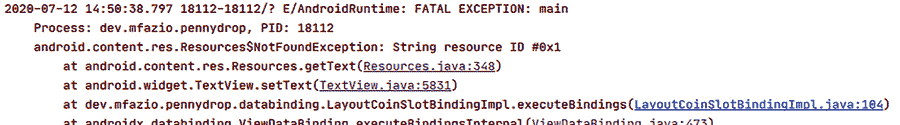

我们可以将 `slotNum` 作为字符串传入 `layout_coin_slot.xml`，但由于插槽是一个数字，我认为这是更好的处理方式。如何处理这部分由你决定；只需记住你需要给 `android:text` 提供一个字符串值或字符串资源值（例如，`android:text="@string/or"`）。

现在 `layout_coin_slot.xml` 文件已经准备就绪，我们可以将插槽添加到 `fragment_game.xml` 中。

#### 将硬币插槽添加到 GameFragment

在 `fragment_game.xml` 中 `<ConstraintLayout>` 的顶部，我们将使用一个包含五个 `<include>` 标签的 `<LinearLayout>` 来表示我们的插槽。每个插槽都会引用我们之前创建的 `layout_coin_slot` 布局文件，并带有一个 `app:slotNum` 属性，其中传入插槽编号。代码看起来大致如下：

```
<LinearLayout
    android:id="@+id/layoutCoinSlots"
    android:layout_width="0dp"
    android:layout_height="wrap_content"
    android:layout_marginTop="10dp"
    android:layout_marginBottom="5dp"
    android:baselineAligned="false"
    android:gravity="center"
    android:orientation="horizontal"
    app:layout_constraintEnd_toEndOf="parent"
    app:layout_constraintStart_toStartOf="parent"
    app:layout_constraintTop_toTopOf="parent">

    <include
        android:id="@+id/coinSlot1"
        layout="@layout/layout_coin_slot"
        android:layout_width="0dp"
        android:layout_height="wrap_content"
        android:layout_weight="1"
        app:slotNum="@{1}" />

    <!-- 其余四个插槽在下面 -->
    <!-- 它们仅在 ID 和 slotNum 值上有所不同 -->
</LinearLayout>
```


需要注意的几点：正如我们在`PickPlayersFragment`中看到的，`app:slotNum`的值需要是绑定表达式中的一个`int`，而不能仅仅是`"1"`。后者会导致编译器报错说`app:slotNum`不存在。此外，我们为了性能考虑使用了`android:baselineAligned="false"`。将此属性设置为`false`后，渲染`<LinearLayout>`会更快，因为需要进行的对齐计算更少了。

第六个硬币插槽包含在`<LinearLayout>`之后，它与其他五个插槽有一些不同之处，但除此之外基本相同：

```
<include
    android:id="@+id/coinSlot6"
    layout="@layout/layout_coin_slot"
    android:layout_width="wrap_content"
    android:layout_height="wrap_content"
    app:layout_constraintEnd_toEndOf="parent"
    app:layout_constraintStart_toStartOf="parent"
    app:layout_constraintTop_toBottomOf="@id/layoutCoinSlots"
    app:slotNum="@{6}" />
```

在运行应用之前的最后一步：如果你之前修改过，请将`textCurrentPlayerCoinsLeft` `<TextView>`的顶部约束点更新为指向第六个硬币插槽：

```
<TextView
    android:id="@+id/textCurrentPlayerCoinsLeft"
    ...
    app:layout_constraintTop_toBottomOf="@id/coinSlot6"
    />
```

就这样，`GameFragment`的第一个版本准备就绪！让我们来看一下：


## 总结与下一步

不错！硬币还无法切换，按钮也还没有功能，但我们已经处于一个不错的状态。虽然我们可以花更多时间在这里添加额外的属性，但我认为现在是时候转向正确的方法了：使用`ViewModel`配合`LiveData`来按需更新视图。拥有`ViewModel`类将使我们能够以生命周期感知的方式，从`Fragment`类中的代码绑定数据。前往下一章来了解这意味着什么！

版权所有 © 2021, The Pragmatic Bookshelf.

# 第 3 章

## 使用 ViewModel 绑定数据

在上一章中，我们创建了两个视图：`PickPlayersFragment`和`GameFragment`。虽然它们现在看起来不错，但还没有什么实际功能。我们仍然需要让两个屏幕都活起来，这可以通过数据绑定和`ViewModel`类来实现。我们将为两个视图创建`ViewModel`类并将它们连接起来，然后就可以继续处理游戏逻辑了。

### 创建 ViewModel（选择玩家）

视图模型作为一个概念，并不是 Android 独有的想法；许多其他语言/框架/平台都以这样或那样的方式具有视图模型的概念。一般来说，视图模型为给定视图保存与 UI 相关的数据。这样，UI 可以专注于显示什么，而视图模型则处理如何获取这些数据。

借助 Jetpack，`ViewModel`是一个特定的类，我们可以用它来管理视图组件的 UI 数据，在我们的例子中就是`Fragment`类。`ViewModel`还可以包含`LiveData`，每当数据发生变化时，它会自动向 UI 控制器发送更新。由于`ViewModel`类具有生命周期感知能力，它们只会在给定的`Fragment`（或`Activity`）当前处于活动状态时才发送`LiveData`。这避免了潜在的错误和不必要的数据更新，使你的应用更快、更稳定。

我们将创建一个新的`ViewModel`，名为`PickPlayersViewModel`，将其绑定到我们的`PickPlayersFragment`，并创建一些`NewPlayer`对象作为`LiveData`，用于设置游戏。但首先，正如我们使用 Navigation 组件时所做的那样，我们需要添加两个依赖项，然后才能使用该库。

### 添加 ViewModel 和 LiveData 依赖项

要使用`ViewModel`类和`LiveData`对象，我们需要将它们的依赖项添加到项目中。两者都包含在`androidx.lifecycle`包中，这意味着我们只需要在项目级别的`build.gradle`文件中添加一个名为`lc_version`的变量（lc 代表 life-cycle）：

```
buildscript {
    kotlin_version = '1.4.30'
    gradle_version = '4.1.2'
    app_compat_version = '1.2.0'
    constraint_layout_version = '2.0.4'
    core_version = '1.3.2'
    lc_version = '2.3.0'
    nav_version = '2.3.3'
}
```

之后，我们可以将这两个依赖项添加到应用的`build.gradle`文件中：

```
dependencies {
    implementation fileTree(dir: 'libs', include: ['*.jar'])
    implementation "org.jetbrains.kotlin:kotlin-stdlib-jdk8:$kotlin_version"
    implementation "androidx.appcompat:appcompat:$app_compat_version"
    implementation "androidx.constraintlayout:constraintlayout:$constraint_layout_version"
    implementation "androidx.core:core-ktx:$core_version"
    implementation "androidx.lifecycle:lifecycle-livedata-ktx:$lc_version"
    implementation "androidx.lifecycle:lifecycle-viewmodel-ktx:$lc_version"
    implementation "androidx.navigation:navigation-fragment-ktx:$nav_version"
    implementation "androidx.navigation:navigation-ui-ktx:$nav_version"
    Other dependencies
}
```

同步你的项目以获取 dependencies。你应该会在编辑器顶部看到一个横幅，提示你需要同步，但如果没有出现，你可以通过 IDE 右侧的 Gradle 工具窗口启动同步。在这里，我们可以看到项目中所有可用的 Gradle 任务，但现在，我们只关心同步。

为此，右键单击顶部的 Penny Dropgram 条目，然后选择 Reload Gradle Project：

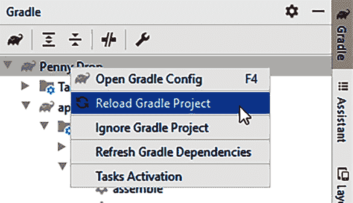

同步完成后，我们可以继续添加`NewPlayer`和`PickPlayersViewModel`类。我们先从`NewPlayer`开始，因为我们将在`PickPlayersViewModel`中使用它。

### 添加 NewPlayer 数据类

`NewPlayer`数据类将保存我们想要添加到游戏中的每个玩家的信息。该类将与视图中每个玩家项目的内容相匹配。这意味着我们将有一个名称、一些关于用户的属性（人类 vs. AI，可以被移除/切换），以及一些 AI 玩家的处理逻辑。我们稍后会回到 AI 部分，所以现在可以先跳过 AI 处理。

请注意，我说了好几次我们要创建一个数据类。在 Kotlin 中，数据类是一种特定类型的类，旨在保存数据，并由编译器添加一些额外的功能。这包括`equals`/`hashcode`函数、可读的`toString`以及`copy`函数。虽然我们这里不会使用后者，但当你想要一个对象的新版本且只需最小改动时，它非常有用。对于数据类类型，我们的构造函数中至少需要有一个参数，并且所有参数都必须标记为`val`或`var`。

为了确保我们清楚，`val`使参数/对象成为一个值，意味着它是不可变的，赋值后无法更改。相反，带有`var`的对象是一个变量，意味着我们可以重新赋值。

对于`NewPlayer`，我们希望玩家的名称是`var`，这样用户就可以从前端更改该名称。所有其他参数都可以标记为`val`。这在处理玩家的`CheckBox`和`SwitchCompat`时可能看起来有些奇怪，但我们将对这两个字段做一些稍微不同的处理。我们将使用`ObservableBoolean`类来处理任何更改，因为普通变量无法与双向绑定正常配合，这一点我们稍后会讲到。

让我们创建我们的类——右键单击主包（在我的例子中是`dev.mfazio.pennydrop`），然后选择 New > Kotlin File/Class。在那里，我们可以将名称设置为`types.NewPlayer`，并将 Kind 设置为 Class。通过在文件名中添加`types`部分，Android Studio 会将`NewPlayer`放入`types`包中。如果它没有自动进入`types`包，你可能创建的是 Kotlin File 而不是 Class。同样，包是我们组织代码的方式，可以让事情更容易理解。一旦我们创建了这个类和`PickPlayersViewModel`，我们可以对现有的类进行一些整理。但现在，让我们填写我们的数据类。整个`NewPlayer.kt`看起来是这样的：

```
package dev.mfazio.pennydrop.types

import androidx.databinding.ObservableBoolean

data class NewPlayer(
    var playerName: String = "",
    val isHuman: ObservableBoolean = ObservableBoolean(true),
    val canBeRemoved: Boolean = true,
    val canBeToggled: Boolean = true,
    var isIncluded: ObservableBoolean = ObservableBoolean(!canBeRemoved)
)
```

在继续之前，我想指出几点。请注意，我们可以为每个参数设置默认值；这意味着我们可以创建`NewPlayer`的实例，而无需担心设置每个值（因为大多数新玩家的设置方式都是相同的）。

另外，对于习惯 Java 的人来说，这种语法可能看起来有些奇怪。通常，类需要在构造函数和函数周围有大括号`{ ... }`，但在 Kotlin 中不是这样。如果类中没有任何函数，我们只需声明类名加上我们需要的参数就可以了。这是 Kotlin 的一个常见趋势：你只写理解代码所需的代码，不再多写。这让我们可以跳过在其他语言中看到的许多样板代码。

最后，在 Kotlin 构造函数中，我们可以使用构造函数中的其他参数，只要它们在顺序上更早，并且会先被初始化。在我们的例子中，如果用户无法从游戏中移除，我们将`isIncluded`默认为`true`，否则默认为`false`。

创建好`NewPlayer`后，我们可以继续处理`PickPlayersViewModel`及其`NewPlayer`对象列表。

### 添加 PickPlayersViewModel

我们现在不会在`PickPlayersViewModel`中做太多事情，因为我们只需要一个`List`，其中包含`NewPlayer`，并包装在`LiveData`实例中（在我们的例子中是`MutableLiveData`）。让我们创建这个类，然后我们可以添加`NewPlayer`对象。我们将在初始化过程中做一些有趣的事情。

正如我们对`NewPlayer`所做的那样，我们可以通过右键单击主包并选择 New > Kotlin File/Class 来将`PickPlayersViewModel`添加到我们的项目中。在那里，我们可以将名称设置为`viewmodels.PickPlayersViewModel`，Kind 设置为 Class。这将把类放入新的`viewmodels`包中。在代码中，我们将让我们的类继承自`ViewModel`。类声明看起来是这样的：

```
class PickPlayersViewModel : ViewModel() {
    //We'll be adding this code in a bit.
}
```


该代码块是 Kotlin 中继承的一个示例：`PickPlayersViewModel` 现在是 `ViewModel` 的子类。由于 `ViewModel` 类具有构造函数，我们需要告诉编译器在创建子类时如何初始化父类，这通过构造函数调用语法来实现。这就是为什么 `ViewModel` 类像函数一样被引用。该语法告诉编译器，在创建 `PickPlayersViewModel` 的实例时，我们正在调用 `ViewModel` 的默认构造函数。另外，如果你忘记这部分，Android Studio 会提醒你修复它。

### 将 `NewPlayer` 实例添加到 `PickPlayersViewModel`

我们将在 `PickPlayersViewModel` 中声明 `NewPlayer` 实例的 `List`，然后将可能的球员添加到该 `List` 中。我们可以提前这样做，因为我们知道有六个球员位置，而且他们是否参与比赛由 `isIncluded` 属性控制。

我们先看一下 `LiveData` 的声明，然后再处理球员本身。

```
val players = MutableLiveData<List<NewPlayer>>()
```

这将 `players` 创建为类型 `MutableLiveData` 的公共值，它本身持有 `NewPlayer` 的 `List`。注意，我们不必显式设置 `players` 的类型，因为我们可以从赋值中看到类型。这是一个有用的约定，可以避免在我们的应用中添加额外、冗余的代码。

现在我们可以继续创建球员（或球员位置，随你怎么想）。为此，我们将使用 Kotlin 的 `apply` 作用域函数（我们首次在 *等等，那个代码块是什么？* 中使用作用域函数）。`apply` 获取调用它的对象，并运行一个代码块，将原始对象隐式声明为 `this`。你可以为对象赋值，然后 `apply` 返回经过修改的原始对象。

在我们的例子中，我们将这样做：

```
val players = MutableLiveData<List<NewPlayer>>().apply {
    this.value = listOf() // 这里将是一些球员
}
```

> **集合辅助函数**
>
> Kotlin 在 `Collection` 类上有许多内置的辅助函数。`listOf`、`setOf` 和 `mapOf` 都是快速创建 `Collection` 的有用函数。你可以在括号内输入一些值，或者留空以创建空集合。

`apply` 函数是一种方便的方式，可以一次性创建对象并赋值一些变量。我们马上会在 `NewPlayer` 实例中再次使用 `apply`，但首先，让我们看一个巧妙的 Kotlin 技巧。

我们将创建六个 `NewPlayer` 实例，其中前两个球员不能从游戏中移除，因为至少需要两名球员才能进行游戏。此外，第一个球员不能切换为 AI 球员，因为必须有人在玩游戏。快速创建一定数量项目的方法如下：我们创建一个 `IntRange`，然后将每个项目 `map` 到我们类的新实例。我们不需要在 `map` 中使用当前索引；我们只是希望列表中的项目数量等于 `IntRange` 的长度。创建六个 `NewPlayer` 实例的代码如下所示：

```
(1..6).map {
    NewPlayer()
}
```

这将给我们想要的 `NewPlayer` 实例的 `List`，所以现在只需要添加条件逻辑。`canBeRemoved` 对除前两个球员外的所有球员为 `true`，而 `canBeTfliped` 对除第一个球员外的所有球员为 `true`。我们可以添加几个大于语句来设置这两个字段：

```
(1..6).map {
    NewPlayer(
        canBeRemoved = it > 2,
        canBeToggled = it > 1
    )
}
```

注意，我们只需要设置想要的参数，其他所有参数都使用其默认值。此外，由于参数的顺序，`isIncluded` 的值基于 `canBeRemoved`。

与软件开发中的情况一样，我们可以用多种方式处理这个逻辑。我喜欢 `(1..6)` 这种简洁的语法来创建项目列表，希望这是一个清晰的例子，展示了如何在你的代码中使用 `apply`。让我们最后再看一下整个 `PickPlayersViewModel`：

```
import androidx.lifecycle.MutableLiveData
import androidx.lifecycle.ViewModel
import dev.mfazio.pennydrop.types.NewPlayer

class PickPlayersViewModel : ViewModel() {
    val players = MutableLiveData<List<NewPlayer>>().apply {
        this.value = (1..6).map {
            NewPlayer(
                canBeRemoved = it > 2,
                canBeToggled = it > 1
            )
        }
    }
}
```

`NewPlayer` 和 `PickPlayersViewModel` 都完成后，我们可以回到 `PickPlayersFragment` 和布局文件，开始使用新的 `ViewModel` 进行数据绑定。

### 将 `ViewModel` 绑定到 Fragment（选择球员）

现在是我们真正深入数据绑定库的时候了。到目前为止，我们已经完成了大量设置（抱歉，还有更多），以及一些使用 `isVisible` 和 `isChecked` 的静态绑定，但使用动态变量才是数据绑定真正发光的地方。能够在代码中设置复杂的对象，然后以最小的工作量将它们绑定到 UI，这就是我为什么如此强烈推荐数据绑定。完成接下来的部分将为后面的章节做好准备，届时我们将显示来自数据库或 Web 服务的数据。但首先，我们需要再完成几件事才能让这一切正常工作。

#### 更新 `PickPlayersFragment` 以使用 `PickPlayersViewModel`

要使用我们刚刚创建的 `PickPlayersViewModel`，我们需要做几件事：

1. 在 `fragment_pick_players` 中添加一个名为 `viewModel` 的 `<variable>`，类型为 `PickPlayersViewModel`。
2. 通过 `by activityViewModels()` 语法声明一个类型为 `PickPlayersViewModel` 的值。
3. 将该实例绑定到 `FragmentPickPlayersBinding` 上的 `viewModel` 变量。

这些步骤完成后，我们就可以在布局文件中使用 `viewModel` 来引用我们在上一节创建的 `NewPlayer` 实例。现在，前往 `fragment_pick_players`！

##### 向布局文件添加 `viewModel` 变量

在 `fragment_pick_players` 中，我们将添加一个新的 `<data>`，里面有一个 `vm` `<variable>`。这类似于我们在 *在 `player_list_item.xml` 中添加 `data` 和 `variable` 标签* 中所做的。这意味着你的 `<data>` 标签将如下所示：

```
<data>
    <variable
        name="vm"
        type="dev.mfazio.pennydrop.viewmodels.PickPlayersViewModel" />
</data>
```

只要确保你的包名与你应用中使用的匹配（我的是 `dev.mfazio.pennydrop`，你的可能不同），`<data>` 就设置好了。你应该删除球员行上的 `app:checkboxHidden` 和 `app:switchHidden` 属性，因为这些变量已经不存在了。在完成其余设置之前，我们不会将 `viewModel` 分配给球员行，但我们很快就会回到那部分。现在 `viewModel` 已经存在于我们的布局中，我们可以在 `PickPlayersFragment` 中引用它。这意味着一旦我们有了实例，就可以将 `PickPlayersViewModel` 分配给它的布局。要获取 `PickPlayersViewModel` 的实例，我们将使用简洁的 `by activityViewModels()` 语法。

##### 获取 `PickPlayersViewModel` 的实例

正如我们所讨论的，`ViewModel` 类对于处理数据并以生命周期感知的方式将数据发送到 UI 组件非常有用。`ViewModel` 类的另一个优点是，我们还可以通过与父 `Activity` 关联 `ViewModel`，将数据存储在 `Fragment` 类生命周期之外。这两个概念是相关的：当 UI 组件不活跃时，`ViewModel` 类不会向其发送数据，但这也意味着当使用 `ViewModel` 的 UI 组件被销毁时，存储在 `ViewModel` 中的数据不一定会消失。我们不必在每次创建 `PickPlayersFragment` 时都重新加载玩家列表，而是直接使用我们已经在 `PickPlayersViewModel` 中设置好的数据（该 `ViewModel` 与 `MainActivity` 绑定）。

请注意，这与持久化不同，这意味着如果应用被关闭，数据将被销毁。但如果我们切换到游戏视图，例如，Android 操作系统可能会销毁 `PickPlayersFragment`，因为它当前不活跃。如果发生这种情况，我们通常会丢失数据，但如果数据存储在与 `MainActivity` 绑定的 `ViewModel` 中，则不会如此。

曾经有一段时间，接下来的部分需要三页来解释如何从我们的 `Activity` 获取 `PickPlayersViewModel` 的实例，以及一些 Kotlin 的支持概念。而现在，我们只需用这段代码块来声明和检索对象：

```
private val pickPlayersViewModel
    by activityViewModels<PickPlayersViewModel>()
```

这只有在我们使用 JDK 1.8 及以上版本时才有效（我们在第 1 章中已设置）。通常，我们还需要添加 `fragment-ktx` 库，但由于我们已经包含了 `navigation-fragment-ktx` 库，前者作为后者的传递依赖被添加了。简而言之，`navigation-fragment-ktx` 使用了 `fragment-ktx`，所以我们自动获得了 `fragment-ktx` 库中的所有内容。

除了更省力之外，任何绑定到给定 `Activity` 的 `Fragment` 都会获得相同的 `ViewModel` 实例，而无需我们做任何额外的工作，这有助于在 `Fragment` 类之间共享数据。

现在我们已将 `PickPlayersViewModel` 实例与 `MainActivity` 关联，我们可以继续将数据绑定到 UI。

#### 绑定 `PickPlayersViewModel`

目前，我们只是通过 `FragmentPickPlayersBinding` 类来膨胀我们的布局，因为这会在我们的布局文件中启用数据绑定。但我们也可以使用这个绑定类来分配变量，特别是我们刚刚检索到的 `pickPlayersViewModel` 变量。

为此，我们将使用之前看到的 `apply` 作用域函数：

```
private val pickPlayersViewModel
    by activityViewModels<PickPlayersViewModel>()

override fun onCreateView(
    inflater: LayoutInflater, container: ViewGroup?,
    savedInstanceState: Bundle?
): View? {
    val binding = FragmentPickPlayersBinding
        .inflate(inflater, container, false)
        .apply {
            this.vm = pickPlayersViewModel
        }
    return binding.root
}
```

我们在这里所做的，是将 `pickPlayersViewModel` 分配给 `fragment_pick_players` 中的 `vm` `<variable>`。这意味着 `PickPlayersViewModel` 实例可以在我们的布局中使用，包括从 `ViewModel` 中获取单个玩家并将其分配给玩家项。

> **`ViewModel` 类中不得包含 `View`/`Lifecycle`/`Activity` 引用**
>
> `ViewModel` 绝不能引用视图、`Lifecycle` 或任何可能持有 activity 上下文引用的类。这样做会破坏 `ViewModel` 类与其他生命周期所有者之间的生命周期分离。如果你确实需要 `Application` 上下文，可以使用 `AndroidViewModel` 代替。

#### 将 `NewPlayer` 绑定到玩家槽位

`fragment_pick_players` 中的每个 `<include>` 标签都引用了我们游戏中的一个可能的玩家，我们可以将其与 `PickPlayersViewModel` 中的每个 `NewPlayer` 实例连接起来。然后，玩家列表项将使用 `NewPlayer` 中的 `canBeRemoved` 和 `canBeToggled` 来处理每个项的正确显示。更好的是，我们可以设置每个项的三个部分（`name`、`isIncluded` 和 `isHuman`），使其链接回我们 `PickPlayersViewModel` 中的 `NewPlayer` 实例。这将为我们提供每个玩家的正确设置，而无需任何额外的工作。

##### 添加 `app:player` 属性

需要做的第一步是将 `player_list_item.xml` 中现有的 `<variable>` 标签替换为一个名为 `player` 的新 `<variable>`。我们将把 `PickPlayersViewModel` 中的每个 `NewPlayer` 实例绑定到列表项，然后可以在 `player_list_item.xml` 中访问这些实例。

```
<data>
    <variable
        name="player"
        type="dev.mfazio.pennydrop.types.NewPlayer" />
</data>
```

同样，请确保将 `NewPlayer` 类型声明的包名更新为你正在使用的包名，然后我们可以回到 `fragment_pick_players` 来为 `player` 设置值。

在 `fragment_pick_players` 内部，我们的每个 `<include>` 标签都会添加一个名为 `app:player` 的属性。该属性的名称与标签布局中 `<variable>` 的名称匹配，在这种情况下就是我们之前设置的 `player` `<variable>`。然后我们可以使用集合语法（例如，`viewModel.players[0]`）来获取每个单独的玩家。每个 `<include>` 标签看起来像这样：

```
<include
    android:id="@+id/player3"
    layout="@layout/player_list_item"
    app:player="@{vm.players[2]}" />
```

`app:player` 属性通常不存在于 `<include>` 或任何类型的 `Layout` 上，但在 `<include>` 中声明 `<variable>` 会为我们创建该属性。这是添加自定义属性的方法之一，还有绑定适配器，我们将在 *创建绑定适配器* 中看到。现在我们已经为每个玩家项分配了玩家，我们可以从 `NewPlayer` 中绑定值。

##### 在 `player_list_item.xml` 中使用 `NewPlayer`

我们已经准备好了在玩家列表项中使用 `NewPlayer` 所需的一切，所以现在可以更新那些引用旧变量的 `android:visibility` 属性了。我们只需要在三元表达式的条件部分更改引用的变量。

```
android:visibility="@{player.canBeRemoved ? View.VISIBLE : View.INVISIBLE}"
```


我们将在布局下方更远的`<SwitchCompat>`中对`player.canBeToggled`做同样的操作。一旦这两个条件都更新了，我们将回到与之前绑定相同的位置，但现在我们访问的是实际的`NewPlayer`对象，而不是之前的`true`和`false`值。事实上，现在就去运行你的应用吧。它看起来会和以前一样，但你知道它现在是以一种更灵活的方式设置的。

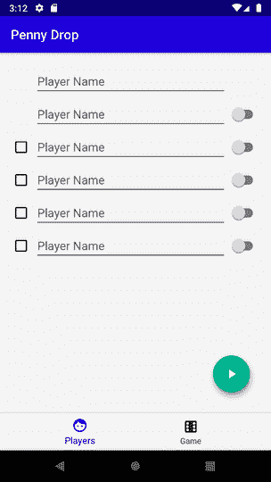

现在我们的可见性已正确配置，我们可以开始扩展此表单的功能了。首先是名字字段。

## 使用双向绑定绑定玩家名字

我们在本章中已经看到了几个数据绑定的示例，但它们的工作方式都相同：我们在更高层级的布局中或通过`ViewModel`在代码中设置一个值，然后将该值作为属性发送给视图。如果我们用类似的方式处理名称，我们可以为每个玩家生成一个名称，显示在每个项目中。但如果我们在前端更改这些名称，后端值将永远不会相应改变。实际上，这是没有用的，因为我们会丢失用户所做的任何更改。相反，我们需要在布局中利用双向绑定。这意味着我们仍然从`ViewModel`发送值，但 UI 端的更改将被发送回`ViewModel`以保存。例如，如果我们将第一个玩家的默认名称设置为`Player 1`，但用户去将该名称更改为`Rolando`，通过双向绑定，我们会将值`Rolando`存储在`PickPlayersViewModel`内的`NewPlayer`实例中。

如果我们打算对玩家名称`<EditText>`使用单向绑定，我们会这样写：

```
android:text="@{player.playerName}"
```

但如果我们想将其改为双向绑定表达式，我们会在同一表达式中添加一个`=`号：

```
android:text="@={player.playerName}"
```

现在我们设置在前端的名称值将被发送到`PickPlayersViewModel`，以便在启动游戏时使用。同样地，我们需要对每个玩家项目中的`CheckBox`和`SwitchCompat`进行一些更新。在这两种情况下，我们已经在更新可见性，但现在我们需要通过`android:checked`属性将控件的状态发送回`ViewModel`。

```
<CheckBox
    android:id="@+id/checkbox_player_active"
    android:layout_width="wrap_content"
    android:layout_height="wrap_content"
    android:checked="@={player.isIncluded}"
    android:visibility="@{player.canBeRemoved ? View.VISIBLE : View.INVISIBLE}"
    app:layout_constraintBottom_toBottomOf="@id/edit_text_player_name"
    app:layout_constraintStart_toStartOf="parent"
    app:layout_constraintTop_toTopOf="@id/edit_text_player_name" />

<androidx.appcompat.widget.SwitchCompat
    android:id="@+id/switch_player_type"
    android:layout_width="wrap_content"
    android:layout_height="wrap_content"
    android:checked="@={player.isHuman}"
    android:visibility="@{player.canBeToggled ? View.VISIBLE : View.INVISIBLE}"
    app:layout_constraintBottom_toBottomOf="@id/edit_text_player_name"
    app:layout_constraintEnd_toEndOf="parent"
    app:layout_constraintTop_toTopOf="@id/edit_text_player_name" />
```

两个控件都在`android:checked`上使用双向绑定语法来发送回它们的当前状态。然后我们可以在启动游戏时使用这些值。现在，这就是我们目前需要做的，让 UI 更改发送回`PickPlayersViewModel`。如果你想验证后端数据，我在附录 2，*排查应用故障*中有一些想法。但构建这个屏幕并不需要这个，所以我们可以继续处理 AI 下拉列表。

## 在玩家列表项中添加 AI 下拉列表

鉴于我们正在这里制作一个游戏，让人们能够与电脑控制的玩家对战会很有帮助。为此，我们将创建一些 AI 玩家，然后让用户能够选择他们要面对哪些 AI 玩家。在这一部分，我们只关心给 AI 玩家命名，而实际的逻辑将留到第 4 章，*使用条件游戏逻辑更新 LiveData*。我们将创建一个 AI 类，其中包含多个可能的 AI 玩家，然后更新玩家项目以包含这些 AI 玩家。用户看到的是玩家的名称文本字段还是 AI 的`Spinner`，将取决于该玩家项目上`SwitchCompat`的状态。在我们接触 UI 之前，让我们先创建 AI 类。

### 创建 AI 类

我们的 AI 将是另一个数据类，这次放在 game 包中。目前，它只包含一个属性`name`、一个返回该名称的`toString`方法，以及一个带有名为`basicAI`的 AI`List`的伴生对象。在这里，我们将声明八个 AI 玩家，用于`Spinner`中。代码如下：

```
package dev.mfazio.pennydrop.game

data class AI(val name: String) {

    override fun toString() = name

    companion object {

        @JvmStatic
        val basicAI = listOf(
            AI("TwoFace"),
            AI("No Go Noah"),
            AI("Bail Out Beulah"),
            AI("Fearful Fred"),
            AI("Even Steven"),
            AI("Riverboat Ron"),
            AI("Sammy Sixes"),
            AI("Random Rachael")
        )
    }
}
```

这个类没有太多内容，但有几件事可能对你来说是新的。伴生对象语法表示一个与给定类相关联的对象。每个类只有一个该对象的实例（意味着它是单例），其中的函数/值/变量可以通过类似于引用静态类型的方式访问。在这种情况下，我们可以在其他地方通过引用`AI.basicAI`来获取`basicAI`。

由于新的`toString`函数只是返回 AI 实例上的`name`值，我们可以使用表达式语法直接将`name`赋值给`toString`。这等价于：

```
override fun toString(): String {
    return name
}
```

最后可能看起来奇怪的是`basicAI`上的`@JvmStatic`注解。添加此注解会告诉编译器为`basicAI`创建一个额外的静态 get 方法。这将允许我们在玩家列表项中以静态方式引用`basicAI`，我们稍后会看到。由于这是目前 AI 类中我们所需要的全部内容，我们将在`player_list_item.xml`中添加`Spinner`列表。

### 在 player_list_item.xml 中添加 AI 下拉列表

我一直在提到`<Spinner>`标签，这就是我们有时在 HTML 中称为"下拉列表"或"选择框"的东西。`<Spinner>`包含若干项目，并允许用户选择其中之一。我们的 AI`<Spinner>`将位于与名称`<EditText>`相同的位置，我们将使用与玩家项目相关联的`<SwitchCompat>`来切换显示哪一个。因此，`<Spinner>`的约束将与`<EditText>`在四个方向上匹配。我们还需要在`<EditText>`和`<Spinner>`上添加另一个`android:visibility`属性，基于玩家的`isHuman`值。

最后，一旦我们完成了条件逻辑，我们就可以处理 AI 项目本身了。通常，我们需要创建某种`SpinnerAdapter`来包含我们的项目，但由于数据绑定库，我们将采用不同的方法。`android:entries`属性将允许我们将对象绑定为`<Spinner>`中的项目列表。

在我们的情况下，我们可以使用`AI.basicAI`或`AI.getBasicAI()`作为该`android:entries`属性。有两个选项的原因是，前者是 Kotlin 属性，而后者是为 Java 使用生成的 getter 方法。现在，我们通常希望在各处都使用 Kotlin 方法，但如果你使用`AI.basicAI`，Android Studio 会报错（尽管它能工作）。相反，你可以在我们的绑定中使用 Java getter 语法来避免错误。

无论你采用哪种方法来处理 AI 对象列表，我们都需要更新`NewPlayer`以包含一个新的`Int`变量——`selectedAIPosition`。

```
data class NewPlayer(
    var playerName: String = "",
    val isHuman: ObservableBoolean = ObservableBoolean(true),
    val canBeRemoved: Boolean = true,
    val canBeToggled: Boolean = true,
    var isIncluded: ObservableBoolean = ObservableBoolean(!canBeRemoved),
    var selectedAIPosition: Int = -1
)
```

这将跟踪所选 AI 的索引（从 `AI.basicAI` 或 `AI.getBasicAI()` 获取）。在我们的 XML 中，我们将使用 `android:selectedItemPosition` 属性与 `selectedAIPosition` 绑定。所有这些部分在布局文件中看起来将如下所示：

```xml
<Spinner
    android:id="@+id/spinner_ai_name"
    android:layout_width="0dp"
    android:layout_height="wrap_content"
    android:entries="@{AI.getBasicAI()}"
    android:selectedItemPosition="@={player.selectedAIPosition}"
    android:visibility="@{player.isHuman ? View.INVISIBLE : View.VISIBLE}"
    app:layout_constraintBottom_toBottomOf="@id/edit_text_player_name"
    app:layout_constraintEnd_toStartOf="@id/switch_player_type"
    app:layout_constraintStart_toEndOf="@id/checkbox_player_active"
    app:layout_constraintTop_toTopOf="@id/edit_text_player_name" />
```

我们已经确定可以使用 `AI.basicAI` 或 `AI.getBasicAI()` 来获取 AI 选项列表，但尚未说明它们为何可用。这是因为我们已经在 `AI` 类中添加了 `@JvmStatic` 注解。如果没有该注解，数据绑定库将无法弄清楚如何传入数据。要使用 `AI.basicAI` 或 `AI.getBasicAI()`，我们还需要在 `<data>` 块中导入 `AI` 类型：

```xml
<data>
    <import type="android.view.View" />
    <import type="dev.mfazio.pennydrop.game.AI" />
    <variable
        name="player"
        type="dev.mfazio.pennydrop.types.NewPlayer" />
</data>
```

另外值得注意的是，`android:selectedItemPosition` 是一个双向绑定表达式，绑定到我们 `NewPlayer` 上的新属性 `selectedAIPosition`。除此之外，此项与我们之前创建的 `<EditText>` 类似。说到那个 `<EditText>`，别忘了在那里包含 `android:visibility` 属性：

```xml
<EditText
    android:id="@+id/edit_text_player_name"
    android:layout_width="0dp"
    android:layout_height="wrap_content"
    android:layout_margin="5dp"
    android:hint="@string/player_name"
    android:inputType="textPersonName"
    android:text="@={player.playerName}"
    android:visibility="@{player.isHuman ? View.VISIBLE : View.INVISIBLE}"
    app:layout_constraintEnd_toStartOf="@id/switch_player_type"
    app:layout_constraintStart_toEndOf="@id/checkbox_player_active"
    app:layout_constraintTop_toTopOf="parent" />
```

由于我们现在从前端获取 AI（或者至少获取其索引），我们可以通过一个名为 `selectedAI()` 的新函数来获取当前选中的 AI 对象。如果 `isHuman` 为 `true`，或者给定索引处的 AI 无法找到，此函数将返回 `null`。

```kotlin
data class NewPlayer(
    var playerName: String = "",
    var isIncluded: ObservableBoolean = ObservableBoolean(false),
    val isHuman: ObservableBoolean = ObservableBoolean(true),
    val canBeRemoved: Boolean = true,
    val canBeToggled: Boolean = true,
    var selectedAIPosition: Int = -1
) {

    fun selectedAI() = if (!isHuman.get()) {
        AI.basicAI.getOrNull(selectedAIPosition)
    } else {
        null
    }
}
```


现在表单按游戏所需的方式工作了，但我们可以让它更美观、更用户友好一些。让我们继续添加几个好看的 UI 功能：禁用被排除的玩家以及为 `<SwitchCompat>` 添加图标。这两项更改将使应用更具精致感。

## 自定义玩家列表项

同样，选择玩家屏幕目前功能正常，但一旦有了真实用户，难免会产生一些困惑。没有任何提示告诉用户，勾选或取消勾选玩家的复选框会发生什么，或者末尾的开关意味着什么。禁用未选中的项目可以给用户一个提示，让他们知道勾选复选框的作用，因为他们以前见过类似的表单。

对于 `<SwitchCompat>` 标签，我们可以将开关状态从普通的开关外观改为人脸和 AI 图标。这样人们就能快速了解每个控件的作用，而无需在屏幕上显示大量文字。首先是 `<CheckBox>` 和 `android:enabled` 属性。

### 允许项目被启用和禁用

我们希望禁用任何未包含在游戏中的玩家，这由每行中的复选框决定。这有两个目的：告诉用户该复选框的作用，并避免设置不会被使用的玩家。要禁用玩家列表项中的视图，我们将使用 `android:enabled` 属性，该属性将引用 `player.isIncluded`。`<EditText>`、`<Spinner>` 和 `<SwitchCompat>` 标签都将包含 `android:enabled="@{player.isIncluded}"`。这样做将根据 `<CheckBox>` 的状态禁用这些视图，在我们输入了几个玩家的信息后，看起来将如下所示：

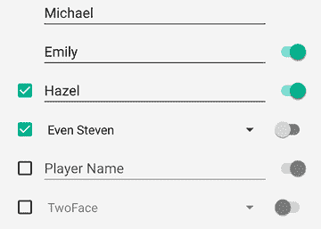

禁用这些视图让用户更清楚地知道这些玩家未包含在游戏中。然而，很难区分切换到 AI 的玩家和被禁用的玩家。此外，我仍然认为人们无法一眼看出后面那个 `<SwitchCompat>` 标签的作用。我们需要在该开关上添加一些图标，并摆脱灰色选项（灰色将表示禁用而非 AI）。

### 为玩家类型开关添加一些色彩

选择玩家屏幕的最后一项改进是玩家类型 `<SwitchCompat>`。让人脸和机器人图标之间的切换比粉色和灰色之间的切换能告诉用户更多信息。我们将添加一个新图标（机器人）、一个新的可绘制背景，以及一个根据开关状态改变颜色的动态颜色文件。

#### 添加 Android 图标

添加我们的机器人图标的方式与上一章中的其他内置图标相同：右键单击 `res/drawable` 并选择 New Vector Asset。在其中，选择 android 剪贴画，然后在 Asset Studio 屏幕上点击 Next 和 Finish。这将创建一个新的机器人头部图标（属于未命名的 Android 吉祥物，非正式名称为 Bugdroid），用于 `<SwitchCompat>`。一旦准备就绪，我们就可以使用这个新图标和现有的 Face 图标创建我们的可绘制背景。

#### 添加可绘制背景

在这里，我们将向 `res/drawable` 文件夹添加一个名为 `ai_toggle_bg` 的新资源 XML 文件。创建后，它将包含一个空的 `<selector>` 标签。在这里，我们可以添加两个 `<item>` 标签：一个用于 Face 图标，一个用于 Android 图标。两个 `<item>` 标签都将有两个属性：`android:drawable` 和 `android:state_checked`。`<android:drawable>` 属性将指向每个项目的图标。对于 `android:state_checked`，人脸项目的属性为 `"true"`，而 android 项目的属性为 `"false"`。这些属性告诉应用当 `<SwitchCompat>` 处于每种状态时使用哪个图标。

```xml
<?xml version="1.0" encoding="utf-8"?>
<selector
    xmlns:android="http://schemas.android.com/apk/res/android">
    <item
        android:drawable="@drawable/ic_baseline_face_24"
        android:state_checked="true" />
    <item
        android:drawable="@drawable/ic_baseline_android_24"
        android:state_checked="false" />
</selector>
```

我们可以通过向 `<SwitchCompat>` 添加单个属性来使用这个可绘制背景：`android:thumb="@drawable/ai_toggle_bg"`：

```xml
<androidx.appcompat.widget.SwitchCompat
    android:id="@+id/switch_player_type"
    android:layout_width="wrap_content"
    android:layout_height="wrap_content"
    android:checked="@={player.isHuman}"
    android:enabled="@{player.isIncluded}"
    android:visibility="@{player.canBeToggled ? View.VISIBLE : View.INVISIBLE}"
    android:thumb="@drawable/ai_toggle_bg"
    app:layout_constraintBottom_toBottomOf="@id/edit_text_player_name"
    app:layout_constraintEnd_toEndOf="parent"
    app:layout_constraintTop_toTopOf="@id/edit_text_player_name" />
```

添加 `android:thumb` 属性会根据 `<SwitchCompat>` 的状态将"滑块"（开关上的小圆球）更改为两个图标之一。

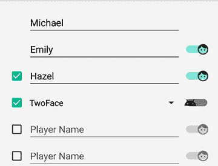

现在，有了图标确实让界面更清晰，但图标的黑白性质还有些不尽如人意。为每个图标添加一些颜色将使 `<SwitchCompat>` 在屏幕上更加醒目，让用户更清楚地看到变化。

## 为开关添加颜色

为 `<SwitchCompat>` 添加颜色的过程与添加图标类似：我们需要一个新的资源 XML 文件（这次放在 `res/color` 下），我们为不同的 `<SwitchCompat>` 状态添加条目，然后将其作为属性添加到 `<SwitchCompat>` 上。

如果 `res/color` 不存在，请右键单击 `res` 文件夹并选择 New > Android Resource Directory，创建一个类型为 Color 的新资源目录。

添加新的资源文件看起来像这样：

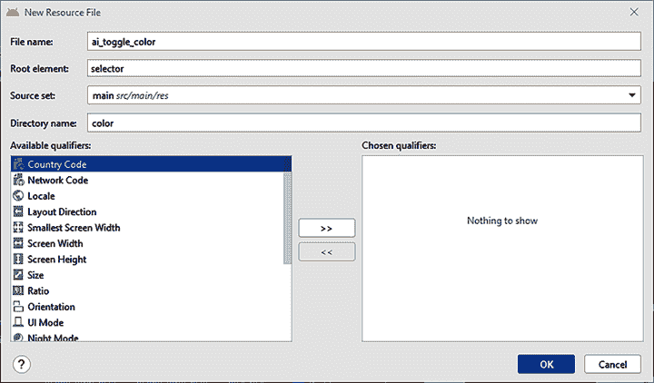

你的新资源 XML 文件 `ai_toggle_color` 被称为**颜色状态列表资源**。颜色状态列表资源文件包含一个 `<selector>` 标签，其中包含一个或多个 `<item>` 标签。在我们的例子中，我们有三个 `<item>` 标签。

这三个条目都将基于 `<SwitchCompat>` 的状态：当 `<SwitchCompat>` 未启用时为深灰色（因为接下来的两种颜色将覆盖默认颜色），以及两个用于 `android:state_checked` 选项的条目，与之前类似：

```xml
<?xml version="1.0" encoding="utf-8"?>
<selector xmlns:android="http://schemas.android.com/apk/res/android">
    <item
        android:color="@android:color/darker_gray"
        android:state_enabled="false" />
    <item
        android:color="@android:color/holo_blue_bright"
        android:state_checked="true" />
    <item
        android:color="@android:color/holo_green_light"
        android:state_checked="false" />
</selector>
```

请记住，此文件中的顺序很重要：如果我们将深灰色的 `<item>` 放在列表末尾，它将永远不会生效，因为其他两种颜色会优先。现在，要将颜色添加到 `<SwitchCompat>` 标签，我们添加两个属性：`android:thumbTint` 和 `android:trackTint`。两个属性都将颜色文件作为其值；我们使用两个属性是因为 `android:thumbTint` 更改 `<SwitchCompat>` 标签上"圆球"的颜色，而 `android:trackTint` 更改滑块移动的轨道颜色。有了这些添加，`<SwitchCompat>` 标签看起来像这样：

```xml
<androidx.appcompat.widget.SwitchCompat
    android:id="@+id/switch_player_type"
    android:layout_width="wrap_content"
    android:layout_height="wrap_content"
    android:checked="@={player.isHuman}"
    android:enabled="@{player.isIncluded}"
    android:visibility="@{player.canBeToggled ? View.VISIBLE : View.INVISIBLE}"
    android:thumb="@drawable/ai_toggle_bg"
    android:thumbTint="@color/ai_toggle_color"
    android:trackTint="@color/ai_toggle_color"
    app:layout_constraintBottom_toBottomOf="@id/edit_text_player_name"
    app:layout_constraintEnd_toEndOf="parent"
    app:layout_constraintTop_toTopOf="@id/edit_text_player_name" />
```

现在我们的应用终于看起来像这样：

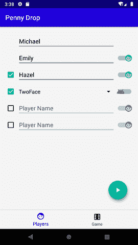

啊，是不是很棒？应用多了一些个性，而且用户在设置游戏时应该更容易理解发生了什么。我们现在可以将玩家从"选择玩家"屏幕发送到"游戏"屏幕并开始真正的游戏了。一旦我们创建了 `GameViewModel` 并将玩家列表发送给它，就可以实现这一点。

## 创建另一个 ViewModel（Game）

这个类在高层次上看起来与 `PickPlayersViewModel` 相似，但这里会有更多内容，因为它将处理游戏视图与我们将在第 4 章《*Update LiveData with Conditional Game Logic*》中构建的 `GameHandler` 之间的连接。

我们将从一个空的 `GameViewModel` 类开始，之后可以逐步添加各个部分。它看起来像这样：

```kotlin
package dev.mfazio.pennydrop.viewmodels

import androidx.lifecycle.ViewModel

class GameViewModel: ViewModel() {

    //Logic will go in here.

}
```

一旦 `GameViewModel` 可用，我们可以添加一个 `List<Player>` 来保存我们在"选择玩家"视图中添加的所有人。不过，在此之前我们需要一些设置。

### 将玩家添加到游戏中

要将玩家带入游戏，我们需要做几件事：我们需要一个 `Player` 类，需要我刚才提到的 `List<Player>`，最后，我们需要一种方法将玩家从"选择玩家"视图传递到 `GameViewModel`。现在让我们逐步完成这些步骤。

#### 创建 Player 类

当 `NewPlayer` 已经存在时，我们还要创建一个完全独立的 `Player` 类，这可能看起来有些傻。为什么我不一开始就创建 `Player` 类呢？

两个类的原因是它们服务于两个不同的目的。`NewPlayer` 类旨在确定谁在游戏中以及他们是谁（人类还是 AI，他们的名字是什么或选择哪个 AI），而 `Player` 将用于跟踪玩家在游戏中的状态（当前正在掷骰子、剩余便士数等）。虽然我们可以创建一个包含所有这些字段的单一大型 `Player` 类，但使用两个独立的类能更好地实现**关注点分离**。

话虽如此，`Player` 类将包含五个属性：玩家的名字、是否是人类、选择的 AI、当前是否正在掷骰子，以及他们目前有多少便士。

所有属性都将有默认值，但只有 `selectedAI` 可以为 null。此外，我们将把 `pennies` 和 `isRolling` 放在构造函数之外，因为两者在初始化时都不太可能被设置为非默认值。

最后，我们想向 `Player` 类添加一个名为 `addPennies` 的函数。虽然现在看起来有些过度设计，但我们稍后会遇到获取 `Player?` 实例的情况，而尝试向可空类型的属性添加值是很麻烦的。

完整的 `Player` 类代码如下所示：

```kotlin
package dev.mfazio.pennydrop.types

import dev.mfazio.pennydrop.game.AI

data class Player(

    val playerName: String = "",

    val isHuman: Boolean = true,

    val selectedAI: AI? = null

) {

    var pennies: Int = defaultPennyCount

    fun addPennies(count: Int = 1) {

        pennies += count

    }

    var isRolling: Boolean = false

    companion object {

        const val defaultPennyCount = 10

    }

}
```

注意看，我们在伴生对象（companion object）中使用 `defaultPennyCount` 的方式，就像在 Java 中使用静态只读或常量值一样。

要获取 `List<Player>`，我们需要一种将 `NewPlayer` 转换为 `Player` 的方法。最佳位置是在 `NewPlayer` 类中新建一个函数。该函数将获取玩家的名称（或 AI 的名称，如适用），然后从 `NewPlayer` 映射更多值：

```kotlin
fun toPlayer() = Player(

    if (this.isHuman.get()) {

        this.playerName

    } else {

        (this.selectedAI()?.name ?: "AI")

    },

    this.isHuman.get(),

    this.selectedAI()

)
```

`Player` 类准备就绪后，我们可以继续处理 `GameViewModel` 及其 `List<Player>`。我们将添加该属性，并从"选择玩家"视图中获取数据。

## 将玩家添加到 GameViewModel

添加 `players` 变量是很快的部分，不过它确实使用了一个新函数 `emptyList`。这个函数（不出所料）会给我们一个空实例，类型为我们期望的 `List`。我们本可以在这里使用 `listOf`，但 `emptyList` 效率稍高，并且更清楚地表明我们想要一个空列表，而不是忘记填充 `listOf` 调用。另外，让你知道它的存在也是有好处的。

此外，为了提前规划，我们可以在 `GameViewModel` 中创建一个名为 `startGame` 的新函数，它接收 `List<Player>` 并设置游戏。

```kotlin
import androidx.lifecycle.MutableLiveData

import androidx.lifecycle.ViewModel

import dev.mfazio.pennydrop.types.Player

class GameViewModel : ViewModel() {

    private var players: List<Player> = emptyList()

    fun startGame(playersForNewGame: List<Player>) {

        this.players = playersForNewGame
```


// 稍后这里会添加更多逻辑。

}

```

添加完成后，我们可以进入 `PickPlayersFragment` 来发送数据。幸运的是，使用 `ViewModel` 类使这个过程简单多了。在 `PickPlayersFragment` 内部，我们可以引入 `GameViewModel` 的实例（就像我们之前对 `PickPlayersViewModel` 做的那样），并在有人点击“开始”按钮时转移玩家。我们通过 `toPlayer` 函数将每个 `NewPlayer` 映射为 `Player` 来实现这一点。

注意，由于 `players` 实际上是 `LiveData`，我们需要使用 `pickPlayersViewModel.players.value` 来获取 `List<NewPlayer>`。此外，所有 `value` 调用都会返回一个可空实例，因此我们需要一个后备方案以防它为 `null`，这将是一个空的 `listOf`。在我们的情况下，它永远不会为 `null`，但我们仍然需要处理这种情况。

一旦我们有了 `List<NewPlayer>`，我们希望过滤每个 `NewPlayer` 实例以确保 `isIncluded` 为 `true`，然后通过 `toPlayer` 函数将每个 `NewPlayer` 转换为 `Player` 实例。该转换在 `map` 块中完成，它在对每个元素执行某种转换后，从另一个 `List` 创建一个新的 `List`。请注意，在此过程中原始列表永远不会被修改，而是会得到一个包含所有新项的新 `List`。

“开始”按钮功能的最后一部分是切换到 `GameFragment`。幸运的是，这只需一行代码：获取当前的 `NavController`，然后通过 ID 导航到 `GameFragment`。

```kotlin
class PickPlayersFragment : Fragment() {

    private val pickPlayersViewModel
        by activityViewModels<PickPlayersViewModel>()

    private val gameViewModel by activityViewModels<GameViewModel>()

    override fun onCreateView(
        inflater: LayoutInflater, container: ViewGroup?,
        savedInstanceState: Bundle?
    ): View? {
        val binding = FragmentPickPlayersBinding
            .inflate(inflater, container, false)
            .apply {
                this.vm = pickPlayersViewModel
                this.buttonPlayGame.setOnClickListener {
                    gameViewModel.startGame(
                        pickPlayersViewModel.players.value
                            ?.filter { newPlayer ->
                                newPlayer.isIncluded.get()
                            }?.map { newPlayer ->
                                newPlayer.toPlayer()
                            } ?: emptyList()
                    )
                    findNavController().navigate(R.id.gameFragment)
                }
            }
        return binding.root
    }
}
```

通过这些更改，我们现在已经从显示当前玩家信息转变为将他们发送到 `GameViewModel`。如果你想确认这一点，可以在 `GameViewModel` 的 `startGame` 函数中设置断点，或者在其中添加 `Toast.makeText` 调用（这两种方法都在附录 2，*排查应用问题*中有介绍）。现在我们已经在 `GameViewModel` 中有了玩家，可以着手从 `ViewModel` 获取内容显示在屏幕上了。

## 向 GameViewModel 添加 LiveData

我们这里要添加一堆 `LiveData` 值，然后将它们绑定到 `layout_game.xml` 中的组件。

这些值如下：

- `slots`：六个 `Slot` 对象及其当前状态。
- `currentPlayer`：当前正在掷骰子的玩家。
- `canRoll`：当前玩家是否可以掷骰子。
- `canPass`：当前玩家是否可以跳过（记住，玩家必须至少掷一次）。
- `currentTurnText`：屏幕底部的信息文本。
- `currentStandingsText`：当前游戏中的分数文本。

我们马上就会看到带有所有这些 `LiveData` 对象的 `GameViewModel`，但我们需要先创建 `Slot` 类。

```kotlin
package dev.mfazio.pennydrop.types

data class Slot(
    val number: Int,
    val canBeFilled: Boolean = true,
    var isFilled: Boolean = false,
    var lastRolled: Boolean = false
)
```

呼，完成所有这些工作后，我们可以将八个 `LiveData` 值全部添加到 `GameViewModel` 中。大多数 `LiveData` 将只保存 `Boolean` 标志（及其初始值），而 `slots` 变量是特别有趣的部分。在这里，我们将要做类似于*将 `NewPlayer` 实例添加到 `PickPlayersViewModel`*中的事情，使用 `(1..6).map { }` 块。这将创建六个 `Slot` 实例，它们具有给定的槽位编号和 `canBeFilled` 标志，除了最后一个槽位外，其余都为 `true`。最后，我们将当前玩家设置为游戏中的第一个玩家，标记他们正在掷骰子，并将 `canRoll` 设置为 `true`。

```kotlin
class GameViewModel : ViewModel() {

    private var players: List<Player> = emptyList()

    val slots =
        MutableLiveData(
            (1..6).map { slotNum -> Slot(slotNum, slotNum != 6) }
        )

    val currentPlayer = MutableLiveData<Player?>()
    val canRoll = MutableLiveData(false)
    val canPass = MutableLiveData(false)
    val currentTurnText = MutableLiveData("")
    val currentStandingsText = MutableLiveData("")

    fun startGame(playersForNewGame: List<Player>) {
        this.players = playersForNewGame
        this.currentPlayer.value =
            this.players.firstOrNull().apply {
                this?.isRolling = true
            }
        this.canRoll.value = true
    }
}
```

设置好所有这些 `LiveData` 值后，我们可以去将所有内容绑定在一起。

## 将 ViewModel 绑定到 Fragment（Game）

我们在上一章的构建另一个 Fragment（Game）中已经完成了大部分 UI 工作，所以现在需要处理的内容不多了。首先，我们需要为 `GameViewModel` 添加一个名为 `vm` 的 `<variable>`。

```xml
<layout xmlns:android="http://schemas.android.com/apk/res/android"
    xmlns:app="http://schemas.android.com/apk/res-auto"
    xmlns:tools="http://schemas.android.com/tools">

    <data>
        <variable
            name="vm"
            type="dev.mfazio.pennydrop.viewmodels.GameViewModel" />
    </data>

    <androidx.constraintlayout.widget.ConstraintLayout
        android:layout_width="match_parent"
        android:layout_height="match_parent"
        android:animateLayoutChanges="true"
        tools:context=".GameFragment">

        <!-- Previously created views are in here. -->

    </androidx.constraintlayout.widget.ConstraintLayout>
</layout>
```

既然 `vm` `<variable>` 已经在我们的布局中存在，我们可以回到 `GameFragment` 中完成绑定。这看起来与我们在绑定 `PickPlayersViewModel` 时所做的类似。我们需要获取 `GameViewModel` 的实例，然后应用 `GameViewModel` 绑定。

在这里，我们还将设置一个 `lifecycleOwner`，以确保我们的 `LiveData` 能够正确更新。我们可以传入来自 `Fragment` 类的 `viewLifecycleOwner` 值。这告诉 `GameViewModel` 内部的 `LiveData` 遵循与传入的生命周期所有者相同的生命周期（创建/销毁等）。在我们的例子中，这就是 `GameFragment`。

最后，`textCurrentTurnInfo.movementMethod` 的赋值也仍然在这里。

```kotlin
class GameFragment : Fragment() {

    private val gameViewModel by activityViewModels<GameViewModel>()

    override fun onCreateView(
        inflater: LayoutInflater, container: ViewGroup?,
        savedInstanceState: Bundle?
    ): View? {
        val binding = FragmentGameBinding
            .inflate(inflater, container, false)
            .apply {
                vm = gameViewModel
                textCurrentTurnInfo.movementMethod = ScrollingMovementMethod()
                lifecycleOwner = viewLifecycleOwner
            }
        return binding.root
    }
}
```

现在 `GameViewModel` 已经绑定到 `GameFragment`，我们可以在布局中完成所有的绑定。我们稍后会更新 `slots`，因为那需要在多个文件中进行修改。让我们先把这里的一切完成，然后再去其他地方。

### 更新 fragment_game.xml 的绑定

我们将按照布局的顺序（跳过 `Slot` 视图），更新每个视图以使用 `GameViewModel`。首先是 `textCurrentPlayerName` `<TextView>`。在这里，我们将通过引用 `vm.currentPlayer.playerName` 来使用 `ViewModel` 中当前玩家的名称。如果 `currentPlayer` 没有值（比如游戏开始前），我们还将添加一个名为 `na`（值为 `N/A`）的备用字符串资源值。绑定语法（记住，这不是 Kotlin 代码，而是语法语言）如下所示：

```xml
android:text='@{vm.currentPlayer.playerName ?? @string/na}'
```

有趣的是，如果 `vm.currentPlayer` 为 `null`，这个表达式仍然没问题。我们不需要包含任何额外的检查；它只会回退到 `@string/na` 字符串资源值。

`textCurrentPlayerCoinsLeft` `<TextView>` 的文本类似，但请确保将其转换为 `String`，因为 `Int` 会尝试引用字符串资源而不是实际的 `Int` 值。

```xml
android:text='@{vm.currentPlayer.pennies + ""}'
```

`textCoinsLeft` 不需要绑定；只需确保为剩余硬币文本创建一个字符串资源，然后使用它而不是硬编码的 `String`。

```xml
android:text='@string/coins_left'
```

跳到布局文件的末尾，`textCurrentTurnInfo` 框将有以下绑定：

```xml
android:text="@{vm.currentTurnText}"
```

而 `textCurrentStandingsInfo` 将有以下绑定：

```xml
android:text="@{vm.currentStandingsText}"
```

完成所有这些绑定后，我们的屏幕看起来比以前更加完整，如图所示。

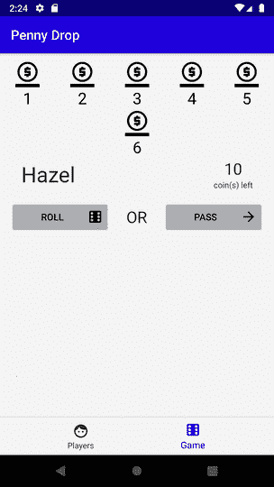

这里最后要处理的是 Roll 和 Pass 按钮。我把它们单独列出来，因为每个按钮都有一些更改要做。

### 更新按钮绑定

每个按钮都需要类似的更改：我们希望将文本和图像颜色改为白色，设置按钮是否启用，并设置条件背景颜色逻辑。我们还需要为每个按钮添加点击处理程序。

将内容设为白色将非常简单，因为我们只需要添加两个属性：`android:textColor` 和 `android:drawableTint`。这两个属性的值都是 `@android:color/white`。`android:enabled` 属性将使用 `vm.canRoll` 或 `vm.canPass` 的值，具体取决于我们正在处理哪个按钮。

背景逻辑类似，因为我们也使用那些 `Slot` 属性。不过，在这里我们将使用三元语句来决定按钮是灰色还是来自 `res/values/colors.xml` 的特定应用颜色。以下代码块用于 Roll 按钮，但两个按钮基本相同。唯一的实际区别是使用哪个 `Slot` 属性，以及 Pass 按钮使用 `colorAccent`（而不是 `colorPrimary`）作为背景。

```xml
<Button
    android:layout_width="0dp"
    android:layout_height="wrap_content"
    android:layout_weight="3"
    android:background="@{vm.canRoll ? @color/colorPrimary : @color/plainGray}"
    android:drawableEnd="@drawable/mdi_dice_6_black_24dp"
    android:drawableTint="@android:color/white"
    android:enabled="@{vm.canRoll}"
    android:onClick="@{() -> vm.roll()}"
    android:padding="10dp"
    android:text="@string/roll"
    android:textColor="@android:color/white" />
```


你需要将`@color/plainGray`条目添加到`res/values/colors.xml`中。我使用的是`#CCC`，但你可以随意使用你认为好看的颜色。


按钮的最后一步是将`roll`和`pass`函数添加到`GameViewModelPEL`。你可能在`Roll <Button>`的代码块中看到了`android:onClick="@{() -> vm.roll()}"`属性。这是一个监听器绑定，意味着当事件发生时运行的表达式。

在监听器绑定内部，我们可以添加任何内容，包括对绑定中其他`<variable>`引用的引用。但由于目前不需要，我们只剩下一个最小化的表达式。

由于`roll`和`pass`函数尚不存在，Android Studio现在可能正在显示错误，所以我们快速创建它们。

两个函数内部最初都是空的，因为我们将在更多`GameViewModel`函数：`roll()`和`pass()`中添加功能：

```kotlin
fun roll() {

    // Implementing later

}

fun pass() {

    // Implementing later

}
```

下一步将是更新所有便士槽位以使用来自`GameViewModel`的数据。我们甚至可以在其中设置一些test值，以确认所有绑定完成后一切正常。

### 更新Slot绑定

我们每个槽位的`<include>`标签将从类似`app:slotNum="@{1}"`变为`app:slot="@{vm.slots[0]}"`。完整的`<include>`标签现在看起来是这样的：

```
<include

    android:id="@+id/coinSlot1"

    layout="@layout/layout_coin_slot"

    android:layout_width="0dp"

    android:layout_height="wrap_content"

    android:layout_weight="1"

    app:slot="@{vm.slots[0]}" />
```

然后，在`layout_coin_slot.xml`中，我们可以将`slotNum <variable>`替换为`slot`。这个`<variable>`将引用我们的`Slot`类。

```
<data>

    <variable

        name="slot'

        type="dev.mfazio.pennydrop.types.Slot" />

</data>
```

有了新的`<variable>`之后，我们可以开始更新`layout_coin_slot.xml`中的每个项目。我们将按相反的顺序进行，因为`slotNumberCoinSlot <TextView>`是最快的改动。在这里，我们只需要将`android:text`更新为使用`slot.number`而不是`slotNum`，并设置文本颜色。如果该槽位是玩家最后掷出的，我们希望槽位的所有部分都使用我们应用的主题色（来自`res/values/colors.xml`）。否则，所有内容都应该是黑色的。

```
android:text='@{slot.number + ""}'

android:textColor=

"@{slot.lastRolled ? @color/colorPrimary : @android:color/black}"
```

接下来是`bottomViewCoinSlot <View>`及其`android:background`属性。我们所做的实际上与槽位文本相同：

```
android:background=

"@{slot.lastRolled ? @color/colorPrimary : @android:color/black}"
```

现在我们可以回到`coinImageCoinSlot <ImageView>`。这基本上已经设置好了，但我们目前还没有动态显示和隐藏硬币的方法。在我们的`Slot`类中，有`canBeFilled`和`isFilled`变量可以控制这一点，所以现在我们需要在布局中使用它们。

我们可以像处理颜色一样为`android:visibility`属性添加三元表达式，但这感觉是一个引入绑定适配器的好时机。

### 创建绑定适配器

绑定适配器允许你在布局视图上有效地创建新属性。创建一个名为`binding`的新包，然后在其内部创建一个名为`BindingAdapters`的新文件。这不应该是一个类，因为我们这里只会有独立的包级函数。这些函数不与特定类相关联，而是作为包的一部分存在。我们可以通过导入`dev.mfazio.pennydrop.binding`（或你的等效包名）将它们引入到其他类中。

回到绑定适配器：这些函数将引入一个`View`对象和一个属性，然后对这些值进行处理。可以避免在绑定适配器中包含自定义逻辑，但我们的每个函数都会包含自定义逻辑，因为我们需要考虑条件判断。

对于这一块，我们将创建一个新的绑定适配器函数`bindIsHidden`，它将在所有视图上创建一个新的`app:isHidden`属性。注意，新属性的名称来自与函数相关联的`@BindingAdapter`注解。逻辑与我们之前在三元表达式中所做的类似：

```kotlin
import android.view.View

import androidx.databinding.BindingAdapter

@BindingAdapter("isHidden")

fun bindIsHidden(view: View, isInvisible: Boolean) {

    view.visibility = if (isInvisible) View.INVISIBLE else View.VISIBLE

}
```

现在我们可以回到我们的`coinImageCoinSlot <ImageView>`来添加这个新属性。我们还将使用`android:tint`属性来设置硬币的颜色。

```
android:tint="@{slot.lastRolled ? @color/colorPrimary : @android:color/black}"

app:isHidden="@{!slot.canBeFilled || !slot.isFilled}"
```

完成了`layout_coin_slot.xml`布局的所有绑定后，这是运行应用并检查一切的好时机。但由于我们还没有对`Slot`类做任何处理，页面看起来不会太有趣。所以我们要设置测试数据。

在`Slot`内部，做两处更新：`isFilled`现在应该默认为偶数时为`true`，`lastRolled`在槽位2和5时为true。

```kotlin
data class Slot(

    val number: Int,

    val canBeFilled: Boolean = true,

    var isFilled: Boolean = number % 2 == 0,

    var lastRolled: Boolean = number % 3 == 2

)
```

有了这些硬编码的值，我们可以在应用中看到一切正常工作：

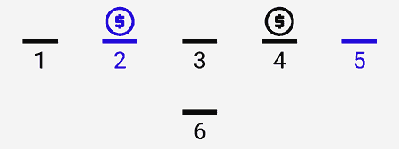

在继续之前，回到`Slot`类并移除我们放在那里的测试值。在下一章中，我们将让游戏逻辑工作起来，所以不再需要它们。最好在忘记之前恢复回去！

```kotlin
data class Slot(

    val number: Int,

    val canBeFilled: Boolean = true,

    var isFilled: Boolean = false,

    var lastRolled: Boolean = false

)
```

### 总结与下一步

信不信由你，Penny Drop的核心UI实际上已经完成了。我们可以输入游戏的玩家，将他们送入游戏，并显示所有需要的信息。但我们还没有构建任何游戏逻辑。这就是下一章要做的，构建Penny Drop的所有核心功能。这将涉及大量的Kotlin代码和少量的数学运算——让我们开始吧！

Copyright © 2021, The Pragmatic Bookshelf.

## 第4章

### 使用条件游戏逻辑更新LiveData

让我们回顾一下到目前为止我们所做的：

*   创建了我们的Penny Drop Android应用并配置了导航组件。
*   构建了`PickPlayersFragment`和`GameFragment`及其相关的`ViewModel`类和布局文件。
*   在两个屏幕中设置了数据绑定。

我们现在已经有一个应用了，而且看起来像一个游戏，但我们需要将游戏逻辑落实到位。为此，我们将构建一个单独的`GameHandler`类来处理游戏动作，让`GameViewModel`负责游戏状态和UI交互。

通过这样做，`GameViewModel`处理UI的所有内容以及游戏在特定时刻的状态。另一方面，`GameHandler`类将由无状态函数组成，负责掷骰和跳过，然后将结果返回给`GameViewModel`。这使我们能够将大部分游戏逻辑隔离，同时也将任何Android特定的组件排除在`GameHandler`之外。

完成本章后，我们将拥有一个完整、可运行的游戏。使用我们之前设置的UI组件，我们将能够处理真实的用户交互以及Penny Drop的所有规则。

### 创建GameHandler

正如我之前提到的，`GameHandler`是我们所有游戏逻辑的所在之处。通过这种方式，我们大大简化了`GameViewModel`中需要完成的工作，并避免在该类中造成过多的臃肿。鉴于`GameHandler`自身没有状态，我们可以将其定义为Kotlin的`object`声明而不是类。类似于我们在*创建AI类*中看到的伴生对象，`object`声明是单例实例。它们看起来与类非常相似，但使用`object`关键字，如你所见。

在我们的例子中，`GameHandler`将是一个只包含函数的`object`声明（因为它不会持有任何状态），我们可以用它来运行我们的游戏。创建该对象（在`game`包下）并添加一些空函数：

```kotlin
package dev.mfazio.pennydrop.game

object GameHandler {

    fun roll(

        players: List<Player>,

        currentPlayer: Player,

        slots: List<Slot>

    ): TurnResult { }

    fun pass(

        players: List<Player>,

        currentPlayer: Player

    ): TurnResult { }

}
```

| ​  | `private fun rollDie`(sides: Int = 6) { ... } |

| ​  |  |

| ​  | `private fun nextPlayer`( |

| ​  | players: List<Player>, |

| ​  | currentPlayer: Player |

| ​  | ): Player { } |

| ​  | } |

你可以看到本节将要实现的方法，这些方法将主要由`GameViewModel`调用。我说"主要"是因为`GameHandler`也可以调用自己的方法，我们将在本章末尾看到这一点。

此外，大多数函数返回一个`TurnResult?`对象，其中包含游戏状态/信息。我们使用这个类将这些信息回传给`GameViewModel`。

让我们创建一个新的数据类，名为`TurnResult`。这个类将包含`GameViewModel`需要知道的一切，仅此而已。我们可以先把`TurnResult`创建出来，然后再考虑实现`GameHandler`中的函数。

### 创建TurnResult数据类

`TurnResult`类包含`GameViewModel`在一轮结束后（或游戏开始时）需要知道的所有信息。我们将在本章后面看到`GameViewModel`如何使用这些值，但先来看一下`TurnResult`的代码：

| ​  | `package dev.mfazio.pennydrop.game` |

| ​  |  |

| ​  | `import dev.mfazio.pennydrop.types.Player` |

| ​  |  |

| ​  | `data class` TurnResult( |

| ​  | `val` lastRoll: Int? = `null`, |

| ​  | `val` coinChangeCount: Int? = `null`, |

| ​  | `val` previousPlayer: Player? = `null`, |

| ​  | `val` currentPlayer: Player? = `null`, |

| ​  | `val` playerChanged: Boolean = `false`, |

| ​  | `val` turnEnd: TurnEnd? = `null`, |

| ​  | `val` canRoll: Boolean = `false`, |

| ​  | `val` canPass: Boolean = `false`, |

| ​  | `val` clearSlots: Boolean = `false`, |

| ​  | `val` isGameOver: Boolean = `false` |

| ​  | ) |

| ​  |  |

| ​  | `enum class` TurnEnd { Pass, Bust, Win } |

这里没有太多需要考虑的内容，但让我们更深入地讨论一下`data class`和`enum class`。我们已经在添加NewPlayer数据类中使用过`data class`声明，但我想特别指出每个`data class`自动生成的两个函数。

*   `copy`，它使用给定对象作为基础，然后更改你传入函数的任何值：

    | ​  | `// filledSlot 将与 rolledSlot 具有相同的值，` |

    | ​  | `// 但 isFilled 和 lastRolled 将为 true` |

    | ​  | `val` filledSlot = rolledSlot.copy(isFilled = `true`, lastRolled = `true`) |

*   `componentN`函数，它们允许解构声明（将属性拆分为多个变量）。例如，我们可以将`filledSlot`对象拆分为两个独立的值。顺序基于属性在`Slot`类中声明的顺序。

    | ​  | `val` (slotNum, slotCanBeFilled) = filledSlot |

在继续之前，让我们更深入地探讨最后这一点。正如我提到的，`componentN`函数允许解构声明（将属性拆分为多个变量）。我们已经看到了一个例子，但我最喜欢的解构声明用例是在处理循环和`Map`时。

如果我们有一个`Map<String, Int>`，其中`String`是玩家姓名，`Int`是他们的分数，传统上我们必须这样做才能打印出分数：

| ​  | playerScores.forEach {entry -> |

| ​  | println(`"${entry.key} - ${entry.value} pennies."`) |

| ​  | } |

相反，我们可以将entry拆分为两个变量`name`和`score`，使同一块代码看起来好得多：

| ​  | playerScores.forEach {(name, score) -> |

| ​  | println(`"$name - $score pennies."`) |

| ​  | } |

我们得到了更简洁、更易读的代码，且开销最小。我们可以解构任何实现了`componentN`函数的对象，包括（但不限于）`data class`、`List`和`Map`对象。`data class`讲完了，让我们快速看看`TurnEnd` `enum class`是怎么回事。

### 创建TurnEnd枚举类

`enum class`包含一个或多个常量值。在我们的例子中，`TurnEnd`包含一轮结束的三种方式：玩家pass、玩家bust（并拿走棋盘上的所有硬币），以及玩家获胜。我们使用`TurnEnd`而不是`Int`或`String`值的原因是`enum class`对象是**有类型的**。这意味着，与其让`turnEnd`成为一个不明确的`Int`值如`1`或容易出错的`String`如`"pass"`，我们使用`TurnEnd.Pass`。这使你的代码更易读且更不容易出错。`TurnEnd` `enum class`看起来像这样：


`enum class TurnEnd { Pass, Bust, Win }`

`TurnResult` 准备就绪后，我们可以继续实现 `GameHandler` 类。

## 处理用户掷骰

快速提醒：在 Penny Drop 中掷骰是指当前玩家掷一个 D6（六面骰），并将一枚硬币放入他们掷出的数字对应的槽位。如果该槽位已被占用，他们就 bust 并拿走当前棋盘上的所有硬币，然后轮到下一位玩家。如果他们掷出六点，他们将硬币放入开放的六号槽位，该槽位保留在储币池中。在实体版游戏中，储币池会在主棋盘下方，但在这里我们只是移除硬币，并可选择性地追踪储币池中的硬币数量。

我们的 `roll` 函数将执行类似的操作：我们将掷 D6，获取对应的 `Slot`，然后根据发生的情况返回一个 `TurnResult`。我们在 `rollDie` 上使用 `let` 函数，不是作为空值检查（如我们之前所做的），而是作为一种让 `lastRoll` 在接下来的几行代码中可用的方式。使用标准赋值如 `val lastRoll = rollDie()` 来做同样的事情也是完全有效的，但我喜欢 `let { ... }` 语法。同样，这取决于你和你的团队的个人偏好。

我们在本节结束时获取选中的 `Slot` 并使用它来生成 `TurnResult`。如果这里的槽位为 `null`，我们使用空值合并运算符或 Elvis 运算符（`?:`）回退到默认的 `TurnResult` 对象。

Elvis 运算符（以传奇音乐家及其标志性发型命名）添加在表达式之后，如果该表达式为 `null`，则执行 Elvis 运算符右侧的表达式。

完整的代码（不包括 `TurnResult` 生成）如下所示：

```
fun roll(players: List<Player>,
         currentPlayer: Player,
         slots: List<Slot>): TurnResult =
    rollDie().let { lastRoll ->
        slots.getOrNull(lastRoll - 1)?.let { slot ->
            // TurnResult 在此处创建
        } ?: TurnResult(isGameOver = true)
    }
```

作为参考，我们的 `rollDie` 函数接受一个面数参数，并返回从 1 到我们输入的面数（加一，我稍后会解释）之间的随机数。如果我们没有为面数输入值，函数使用默认值 `6`。

```
private fun rollDie(sides: Int = 6) = Random.nextInt(1, sides + 1)
```

我想特别指出 `nextInt` 函数声明中的某些内容：

```
Random.nextInt(from: Int, until: Int) { ... }
```

此函数将给我们一个从 `from` 的值开始，到 `until` 的值（但不包括 `until`）为止的随机数。上限是**不包含**的，这就是为什么 `rollDie` 的第二个值是 `sides + 1` 而不是简单的 `sides`。我提到这一点不仅是因为它有助于理解 `Random.nextInt`（以及 `Random` 类上的其他函数），而且因为在处理范围时，`until` 是一个关键字（与参数中 `until` 是变量相对）。

我们在 `GameViewModel` 中生成 `Slot` 对象时使用了 `IntRange`，这个技巧我们首次在将 `NewPlayer` 实例添加到 `PickPlayersViewModel` 中看到。

```
val slots =
    MutableLiveLiveData(
        (1..6).map { slotNum -> Slot(slotNum, slotNum != 6) }
    )
```

我们也可以从 0 开始计数到 6，但不包含 6：

```
val slots =
    MutableLiveData(
        (0 until 6).map { ind -> Slot(ind + 1, ind != 5) }
    )
```

虽然两个示例都能工作，但我强烈建议在这里采用第一种方法。不过，`until` 在其他情况下肯定很有用，这也是我提到它的原因。

在继续之前，我还想回顾一下之前关于插槽的逻辑。作为参考，特别是这个代码块：

```
slots.getOrNull(lastRoll - 1)?.let { slot ->
    // TurnResult is created here
} ?: TurnResult(isGameOver = true)
```

我们使用 `getOrNull` 函数来获取掷出的插槽，该函数要么返回给定索引处的插槽，要么返回 `null`。然后我们使用 Elvis 运算符，只有在确实有实际插槽时才继续。鉴于我们控制 `rollDie` 的工作方式以及 `List<Slot>` 中的内容，我们可能只需使用 `get` 或索引（例如，`slots[lastRoll - 1]`）就足够了。我们控制着正在发生的事情——这意味着那个调用不可能失败，对吧？

太多开发者说过类似这样的话，结果却让他们的应用崩溃了。为了确保这种情况不会发生在我们身上，让我们通过添加 null 安全的 `?.let` 块来使用安全的方法。现在我们可以继续处理其中的逻辑了。

正如我在本节开头提到的，掷骰子有两种主要结果：玩家掷出空插槽的编号（包括 6），或者他们掷出已经填满的插槽。如果他们掷出空插槽，他们就在该插槽中放一枚硬币（除非掷出六点，六点放入储备池），然后我们查看他们是否赢得了游戏。尽管使用 Kotlin 强大的 `when` 块很诱人，但我们只有两组各两个选择，所以标准的 `if...else` 就足够了。别担心，我们将在本章后面处理游戏文本时讨论 `when` 语句。

与我们之前的掷骰代码配套的内部块将结构如下：

```
if (slot.isFilled) {
    // Player busts, play continues to next player
} else {
    if (!currentPlayer.penniesLeft(true)) {
        // Player wins
    } else {
        // Game continues
    }
}
```

虽然这里仍有代码块需要完成，但我们应该首先将 `penniesLeft` 添加到我们的 `Player` 类中。

### 向 Player 类添加辅助方法

`penniesLeft` 函数很简单，因为它检查用户的硬币数量是否大于零。但注意到我们调用中的 `true` 标志了吗？那是一个名为 `subtractPenny` 的标志，它告诉我们的方法在检查用户是否还有硬币时从用户的硬币数量中减去一个。这样做是因为我们在检查用户的未来状态，即他们在考虑当前掷骰后还会剩下多少硬币。`Player` 类现在看起来像这样：

```
data class Player(
    var playerName: String = "",
    var isHuman: Boolean = true,
    var selectedAI: AI? = null
) {
    var pennies: Int = defaultPennyCount

    fun addPennies(count: Int = 1) {
        pennies += count
    }

    var isRolling: Boolean = false

    fun penniesLeft(subtractPenny: Boolean = false) =
        (pennies - (if(subtractPenny) 1 else 0)) > 0

    companion object {
        const val defaultPennyCount = 10
    }
}
```

让我们跳回到 `GameHandler` 类。我们稍后会详细介绍 `roll` 的实现细节，但首先，我想强调一下该方法中嵌套 `let` 块的输出。

### 返回 if...else？

是的，`roll` 的内部块是一个没有 `return` 语句的 `if...else` 块。然而，我们创建的 `TurnResult` 对象却能成功返回。这怎么可能？这是因为 Kotlin 中的两个语言特性。lambda 函数内部，比如在 `let` 内部，将返回块中的最后一个值。这包括值/变量和任何表达式。请注意，普通函数不能这样做，只有表达式块可以。

说到这个，`if..else` 块能够被返回的原因是它们在 Kotlin 中实际上是表达式。这意味着它们自己返回一个值，而不是像其他语言那样只是产生副作用。我们不再需要在一个 `if...else` 外部声明一个空变量然后只在内部赋值，而是可以直接从 `if...else` 块中分配不可变值。这也是 Kotlin 中不存在三元运算符（`[condition] ? [if true] : [if false]`）的部分原因；`if...else` 块可以处理相同的语法，而无需两种约定。使用它们还可以避免嵌套三元语句，这些语句可能极难理解。

如果你看看我们添加的 `penniesLeft` 函数，它以类似的方式使用 `if...else`。我们不需要添加一个额外的值，比如 `extraPennies` 或我们想用来减去额外硬币的任何名称，而是可以直接内联 `if...else` 语句。你可能现在已经明白了，所以让我们继续 `if...else` 块内部的代码。

让我们从掷出的 `Slot` 已经填满时的块开始，因为这里只发生一件事，即创建 `TurnResult` 对象。为了获取给玩家的硬币数量，我们可以查看已经填满的插槽有多少，并将其赋值给 `coinChangeCount`。我们还通过 `nextPlayer` 函数获取列表中的下一个玩家（我们马上会看一下），并为新一轮做好准备。代码如下：

```
if (slot.isFilled) {
    TurnResult(
        lastRoll,
        coinChangeCount = slots.count { it.isFilled },
        clearSlots = true,
        turnEnd = TurnEnd.Bust,
        previousPlayer = currentPlayer,
        currentPlayer = nextPlayer(players, currentPlayer),
        playerChanged = true,
        canRoll = true,
        canPass = false
    )
}
```

虽然我们不需要在这里显式列出参数，但这使这个调用清晰得多。否则，我们会看到一大堆布尔值，试图记住哪个是哪个。这是另一个个人偏好的情况，但我认为标签使代码更易读。

### 获取下一个玩家

我们在 `TurnResult` 类中看到了 `nextPlayer` 函数调用，所以现在让我们深入了解一下。

这个方法中我们做三件事：

*   获取当前玩家在游戏玩家列表中的索引。
*   计算下一个玩家的索引（可能会循环回到开头）。
*   返回下一个玩家。

```
private fun nextPlayer(
    players: List<Player>,
    currentPlayer: Player): Player? {
    val currentIndex = players.indexOf(currentPlayer)
    val nextIndex = (currentIndex + 1) % players.size

    return players[nextIndex]
}
```

`indexOf` 会给我们当前玩家的位置（从 0 到游戏玩家数量减一），然后我们可以用它来找到下一个轮到的玩家。在大多数情况下，我们取当前索引，加一（移动到下一个玩家），就准备好了。然而，如果我们到达的玩家列表末尾，我们想回到列表的开头。这就是我包含表达式后半部分的原因：`% players.size`。

`%`运算符是取模或求余运算符，它将左侧的值除以右侧的值，但返回的是剩余的量（余数），而不是实际的结果。这意味着我们的索引永远不会超过游戏中的玩家数量，并且如果索引超过上限，将会回绕到零。

例如，如果我们的游戏中有五名玩家，玩家四正在行动，他的回合结束，那么轮到玩家五。此时，`currentIndex`是`3`（因为索引从 0 开始），`players.size`是`5`，而`nextIndex`是`4`：

```
val nextIndex = (3 + 1) % 5 // 4 % 5 == 4
```

`%`运算符在这里作用不大，但如果玩家五的回合结束，我们需要回到玩家一，事情可能会更棘手。`currentIndex`是`4`，加一就会使索引超出`players`的边界（因为索引范围是 0 到 4）。加上`%`后，`nextIndex`变为`0`，因为五除以五没有余数。

```
val nextIndex = (4 + 1) % 5 // 5 % 5 == 0
```

最后需要注意的一点是，`%`运算符等同于`.rem`函数，这意味着以下代码与我们之前所做的等效：

```
val nextIndex = (currentIndex + 1).rem(players.size)
```

你可以随意使用函数或运算符，甚至可以通过重载其关联函数来重载运算符。这超出了本书的范围，但更多信息可以在[`link.mfazio.dev/operator-overloading`](https://link.mfazio.dev/operator-overloading)找到。

现在，如果玩家掷出的槽位已经有硬币，我们已经处理好了，接下来可以转向空槽位。

### 处理空槽位

如果当前玩家掷出一个空槽位号码（包括 6），逻辑会有所不同。我们使用之前看到的`penniesLeft`函数来检查当前玩家是否获胜，但除此之外，这两个`TurnResult`实例都很直接。

```
} else {

    if (!currentPlayer.penniesLeft(true)) {

        TurnResult(

            lastRoll,

            currentPlayer = currentPlayer,

            coinChangeCount = -1,

            isGameOver = true,

            turnEnd = TurnEnd.Win,

            canRoll = false,

            canPass = false

        )

    } else {

        TurnResult(

            lastRoll,

            currentPlayer = currentPlayer,

            canRoll = true,

            canPass = true,

            coinChangeCount = -1

        )

    }

}
```

有了这些改动，我们已经完成了玩家回合掷骰子的逻辑。现在，我们可以继续处理玩家跳过回合的情况。

## 处理用户跳过

我们已经处理了 Penny Drop 中玩家掷骰子的各种可能性。现在我们可以处理当前玩家在他的回合至少掷过一次后，决定"不，我够了"，然后传给下一位玩家的场景。

由于我们不需要处理掷骰结果，用户跳过时发生的事情会更少。这是整个函数：

```
fun pass(players: List<Player>, currentPlayer: Player) =

    TurnResult(

        previousPlayer = currentPlayer,

        currentPlayer = nextPlayer(players, currentPlayer),

        playerChanged = true,

        turnEnd = TurnEnd.Pass,

        canRoll = true,

        canPass = false

    )
```


看起来和`roll`很相似，对吧？我们仍然返回一个`TurnResult`，同时标记下一位玩家可以掷骰但不能跳过（因为这是他们回合的第一次掷骰），并且我们获取游戏中的下一位玩家。我们还包含了`previousPlayer`，这样 UI 就可以用类似"Michael 跳过了。他目前有 7 个硬币。"的消息正确更新文本视图。

至此，`GameHandler`基本准备就绪，我们可以开始更新 UI 了。

## 开始游戏

在 Penny Drop 中，主要跟踪两部分：玩家和槽位。我们在上一章将这两者都添加到了`GameViewModel`中，所以我们只需要在游戏开始时初始化它们。由于我们已经有了游戏的玩家，我们可以获取列表中的第一位玩家，并将他们设为`currentPlayer`。我们还将初始化另外两个变量，`canRoll`（`true`）和`canPass`（`false`）。最后，我们将清空槽位，将`currentTextValue`设置为"The game has begun!"，并生成游戏的排名。

```kotlin
fun startGame(playersForNewGame: List<Player>) {
    this.players = playersForNewGame
    this.currentPlayer.value = this.players.firstOrNull().apply {
        this?.isRolling = true
    }
    canRoll.value = true
    canPass.value = false
    slots.value?.clear()
    slots.notifyChange()
    currentTurnText.value = "The game has begun!\n"
    currentStandingsText.value = generateCurrentStandings(this.players)
}
```

我们稍后会介绍`generateCurrentStandings`函数，但我想先谈谈槽位部分，因为可能会有些困惑。我们会快速看一下这两行代码以及每个部分的含义。

由于`slots`是一个`MutableLiveData`对象，我们需要调用`.value`来获取实际的`List<Slot>`。此外，从`LiveData`对象中获取的每个值都可能是可空的，这就是为什么接下来的 clear 调用使用了我们第一次在*等等，那个代码块是什么？*中看到的空安全语法。

至于`clear`函数，它实际上是作为扩展函数添加到`Slot.kt`中的`List`类型上的。这是`Slot`类所在的同一个文件，但扩展函数定义在`Slot`类本身之外。由于它是`Slot`的扩展而不是`Slot`类本身的一部分，我们可以将代码放在任何合理的地方。我选择了`Slot`类，因为它是该类的扩展，这样代码会更容易找到。代码如下：

```kotlin
// Slot.kt
package dev.mfazio.pennydrop.types

data class Slot(
    val number: Int,
    val canBeFilled: Boolean = true,
    var isFilled: Boolean = false,
    var lastRolled: Boolean = false
)

//START_HIGHTLIGHT
fun List<Slot>.clear() = this.forEach { slot ->
    slot.isFilled = false
    slot.lastRolled = false
}
```

另一个与槽位相关的要点是`slots.notifyChange`函数。如果我们更新`LiveData`对象的`.value`，它会自动向所有监听器发送更新事件。但如果我们更新`.value`内部的某些内容，则不会发生任何事情。

举个具体的例子，如果我们调用`slots.value = listOf<Slot>()`，UI 会自动更新（并且我们会失去屏幕上的槽位）。然而，如果我们像`startGame`中那样做`slots.value?.clear`，UI 更新事件不会被发送。所以我们需要强制触发该更新。我使用的是`.notifyChange`，这是一个快速扩展函数，用于触发`LiveData`事件：

```kotlin
private fun <T> MutableLiveData<List<T>>.notifyChange() {
    this.value = this.value
}
```

我在`GameViewModel`的末尾添加了这个函数，是的，这有点像是 hack。但鉴于`LiveData`的性质，如果我们只想更改类上的属性，尤其是当`LiveData`包含`List`时，这是我们不得不做的。

现在，回到`generateCurrentStandings`函数。这个函数接收一个`List<Player>`，按玩家当前便士数量排序，然后使用`joinToString`将所有内容组合在一起。如果你阅读了附录 2，*排查应用故障*，你会看到这个函数的使用示例。如果没有，简单版本是它接收某种`Collection`并使用每个元素生成一个`String`。我们还可以传入分隔每个元素的值，以及前缀和后缀值。在我们的例子中，我们希望用换行符（`\n`）分隔每个元素，并在列表前附加一个标题。通常这个标题是 Current Standings，但出于复用的考虑，我们将其设为可配置的。

```kotlin
private fun generateCurrentStandings(
    players: List<PlayerUTO>,
    headerText: String = "Current Standings:"
) =
    players.sortedBy { it.pennies }.joinToString(
        separator = "\n",
        prefix = "$headerText\n"
    ) {
        "\t${it.playerName} - ${it.pennies} pennies"
    }
```

## 更多 GameViewModel 函数：`roll()` 和 `pass()`

我已经拖延得够久了；让我们终于来看看那些我们一直在创建的`TurnResult`对象到底发生了什么。我们将在`GameViewModel`中添加或更新三个函数：`roll`、`pass`和`updateFromGameHandler(result: TurnResult)`。后一个方法将在前两个函数中被调用，以相应地设置我们的`LiveData`值。

我们稍后会讲到`updateFromGameHandler`部分，但首先我想谈谈`roll`和`pass`函数，因为两者的实现彼此相似。两个函数都会获取当前玩家（第一个`isRolling`为`true`的玩家），确保得到的`Player?`对象不为 null，检查请求的操作是否有效，然后调用`GameHandler`。`GameHandler`函数的响应随后会被传入`updateFromGameHandler`函数。此外，`roll`函数还会获取游戏当前的 slots 并将它们一并发送给`GameHandler`。两个函数的代码如下所示：

```kotlin
fun roll() {
    slots.value?.let { currentSlots ->
        // 与 true 比较省去了 null 检查
        val currentPlayer = players.firstOrNull { it.isRolling }
        if (currentPlayer != null && canRoll.value == true) {
            updateFromGameHandler(
                GameHandler.roll(players, currentPlayer, currentSlots)
            )
        }
    }
}

fun pass() {
    val currentPlayer = players.firstOrNull { it.isRolling }
    if (currentPlayer != null && canPass.value == true) {
        updateFromGameHandler(GameHandler.pass(players, currentPlayer))
    }
}
```

到现在，很多语法应该看起来很熟悉了。但`.value`的使用可能看起来有些奇怪。对于`slots.value`，我们对`let`使用了空安全调用，因为我们正在从`LiveData`对象中获取（可空的）值。这也是每个函数中条件语句略显奇怪的原因。我们不能直接使用`canRoll.value`和`canPass.value`，因为它们技术上不是`Boolean`对象，而是`Boolean?`对象。幸运的是，我们不必先进行 null 检查再检查`Boolean`值，而是可以与`true`比较。这样做的话，`false`或`null`都会失败，我们就跳过前往`GameHandler`的步骤。这是一个方便的捷径，让我们获得想要的确切功能。

两个操作都就位后，我们可以进入`GameViewModel`的核心部分：`updateFromGameHandler`函数。

## 更新 UI

我们终于到这里了！一旦 UI 能够显示`GameHandler`中发生的事情，我们就将拥有一个完全可运行的游戏。让我们快速概述一下这里将要发生的事情：我们将添加/移除当前玩家的便士，标记正确的玩家为掷骰状态，更新 slots，生成回合和排名文本，更改`canRoll`/`canPass`标志，最后处理适用的游戏结束场景。

```kotlin
private fun updateFromGameHandler(result: TurnResult) {
    if (result.currentPlayer != null) {
        currentPlayer.value?.addPennies(result.coinChangeCount ?: 0)
        currentPlayer.value = result.currentPlayer
        this.players.forEach { player ->
            player.isRolling = result.currentPlayer == player
        }
    }

    if (result.lastRoll != null) {
        slots.value?.let { currentSlots ->
            updateSlots(result, currentSlots, result.lastRoll)
        }
    }

    currentTurnText.value = generateTurnText(result)
    currentStandingsText.value = generateCurrentStandings(this.players)
    canRoll.value = result.canRoll
    canPass.value = result.canPass

    if (!result.isGameOver && result.currentPlayer?.isHuman == false) {
        canRoll.value = false
        canPass.value = false
    }
}
```

正如我们在上一章中看到的，我们从`currentPlayer`获取玩家的名字和他们当前的硬币数量，所以我们可以直接从`TurnResult`更新`MutableLiveData<Player>`的值。大多数其他部分应该都能理解，但`updateSlots`和`generateTurnText`有更多内容。我们从`updateSlots`开始，它接收`TurnResult`以及`Slots`的当前状态和最后一次掷骰结果，从 UI 角度更新我们需要的一切。

```kotlin
private fun updateSlots(
    result: TurnResult,
    currentSlots: List<Slot>,
    lastRoll: Int
) {
    if (result.clearSlots) {
        currentSlots.clear()
    }

    currentSlots.firstOrNull { it.lastRolled }?.apply { lastRolled = false }
    currentSlots.getOrNull(lastRoll - 1)?.also { slot ->
        if (!result.clearSlots && slot.canBeFilled) slot.isFilled = true
        slot.lastRolled = true
    }

    slots.notifyChange()
}
```

我们在本章早些时候看到过`currentSlots.clear`和`slots.notifyChange`，但我们可以聊聊其他几个部分。这里的`firstOrNull`和`getOrNull`彼此相似。我们从`List<Slot>`中获取一个项目，要么是通过给定表达式返回`true`的第一个项目（`firstOrNull`），要么是通过我们传入的索引（`getOrNull`）。如果任一搜索失败，我们得到`null`，附加的代码块会被跳过（由于`?.apply`和`?.also`调用）。

说到这个，让我们谈谈`.also { ... }`函数，乍一看它可能类似于`.let { ... }`。事实证明它们确实相似。唯一的真正区别是`.let`从其后续代码块返回一个值，而`.also { ... }`返回`this`，即调用`.also { ... }`的对象。由于我们在这里没有使用返回值，我们可以使用任一函数，但这是一个提及`also`函数的好机会。

有了`updateSlots`中的代码，我们的 slots 将反映来自`GameHandler`的变化。现在我们可以继续处理显示当前回合信息文本的`TextView`。

## 创建回合摘要文本

我们在上一章中在游戏屏幕底部附近添加了一个大型`<TextView>`，用于向用户提供当前回合的信息、回合如何结束，以及游戏结束时的分数摘要。现在，当回合开始时，该区域什么都不显示。一旦回合结束，该区域然后显示……什么都不显示。是的，那个值从上一章开始仍然是空的，而且，嗯，毫无用处。让我们修复这个问题！

我们在`updateFromGameHandler`中已经有这段代码：

```kotlin
//result 是一个 TurnResult 对象
currentTurnText.value = generateTurnText(result)
```

因此，我们有两个主要补充：

- 一个`clearText`变量，用于告诉我们是否应该清空`<TextView>`。
- 一个新的`generateTurnText`方法。

第一步应该现在完成……（说真的，快去在`currentStandingsText`声明下方快速添加这个变量）。然而，第二步会稍微复杂一些。我们将根据给定回合的不同情况显示不同的消息。

我们先处理函数中除新文本以外的所有内容，然后再处理消息。该函数主要有三个部分：如果上一个事件是回合结束，则清除现有文本；标记下一 text 是否应该在清空后的视图上显示；以及显示下一组文本。

```kotlin
private fun generateTurnText(result: TurnResult): String {
    if (clearText) currentTurnText.value = ""
    clearText = result.turnEnd != null
    val currentText = currentTurnText.value ?: ""
    val currentPlayerName = result.currentPlayer?.playerName ?: "???"

    return when {
        //TurnResult-based logic and text
    }
}
```

这里没有什么令人震惊的内容，所以我们继续来看`when`语句。

### 使用 when 语句处理多条件判断

对于不熟悉的人来说，`when`类似于 Java、C# 等语言中的`switch`语句。`when`代码块是一系列条件表达式，这些表达式返回一个布尔值，如果条件为真，则执行相应的操作。每个条件行按顺序执行，如果没有任何一个结果为真，则运行`else`表达式。

```kotlin
when {
    result.isGameOver -> //Game's over, let's get a summary
    result.turnEnd == TurnEnd.Bust -> //Player busted, got some pennies
    result.turnEnd == TurnEnd.Pass -> //Player passed.
    result.lastRoll != null -> //Roll text
    else -> ""
}
```


请注意，`when`代码块尚未完全完成；我排除了实际的文本逻辑，以便我们专注于条件判断。请记住，与示例中的注释不同，你应该运行某些表达式。

关于`when`代码块的几点快速说明：

* 你可以在`when`调用中包含一个变量，使每一行都引用同一个对象：

```
val slotIsFilled = when(rollResult) {

    in 1..5 -> true

    6 -> false

    else -> throw IllegalArgumentException("That's not a D6.")

}
```

* 如果你想为某个条件运行多行代码，可以随时在任何表达式周围添加大括号：

```
val slotIsFilled = when(rollResult) {

    in 1..5 -> true

    6 -> false

    else -> {

        val message = "That's not a D6."

        throw IllegalArgumentException(message)

    }

}
```

* 如果你使用的是 Kotlin 1.3 及以上版本（你应该使用），还可以在`when`函数中添加内联变量：

```
val slotIsFilled = when(val rollResult = rollDie()) {

    in 1..5 -> true

    6 -> false

    else -> {

        val message = "That's not a D6."

        throw IllegalArgumentException(message)

    }

}
```

除了`result.isGameOver`之外，其他所有条件你可以随意使用任何文本。我们`when`中的大多数条件表达式看起来会像下面这个代码块：

```
result.lastRoll != null ->

    "$currentText\n$currentPlayerName rolled a ${result.lastRoll}."
```

我们使用字符串插值，通过`$`符号和花括号将变量包含到文本中。我们以文本框中已有的内容作为开头（在`currentText`内部），然后添加我们的新信息行。在这里，我们根据传入的变量，向信息框添加类似"Michael rolled a 4."的内容。

然而，`result.isGameOver`的文本内容更多：

```
result.isGameOver ->

    """

    |Game Over!

    |$currentPlayerName is the winner!

    |

    |${generateCurrentStandings(this.players, "Final Scores:\n")}

    """.trimMargin()
```

三引号语法是原始字符串，它允许我们输入文本而无需任何转义或换行符。如你所见，我们仍然可以插值变量，但我们不需要在字符串中放入大量换行符（`\n`）来显示我们的行。

这里另一个奇怪的部分是管道符（`|`），它是一个边距前缀。这个字符表示行的起始位置，而不是代码中的第一列。我们可以通过向`trimMargin`函数传入其他内容来自定义边距前缀字符，以防你想在字符串中包含`|`字符。有了边距前缀，我们的输出看起来像这样：

```
Game Over!

Hazel is the winner!

Final Scores:

Hazel - 0 pennies.

Emily - 3 pennies.

Michael - 12 pennies.
```

如果没有边距前缀，我们会得到这样的结果：

```
Game Over!

Hazel is the winner!

Final Scores:

Hazel - 0 pennies.

Emily - 3 pennies.

Michael - 12 pennies.
```

信不信由你，`GameViewModel`已经准备就绪，我们可以开始玩 Penny Drop 了！但在跑去玩之前，让我们再讨论一个酷炫的功能。还记得在第 2 章中，我们如何添加了人类玩家与 AI 玩家的切换开关吗？到目前为止我们一直在忽略这部分和`isHuman`标志，但不会再忽略了。让我们在游戏中加入一些"智能"的电脑玩家吧。

#### 使用协程和一等函数处理 AI 回合

我们将为应用添加运行游戏中一个（或多个）玩家的能力，并让用户可以选择让 Penny Drop 成为单人（人类）游戏。当 AI 运行时，我们将禁用"掷骰"和"跳过"两个按钮，并让应用自动开始掷骰/跳过。一个触发此操作的便捷方式是在`updateFromGameHandler`函数中其他所有内容更新完毕后，在该函数末尾附近添加对`playAITurn`的调用：

```
if (!result.isGameOver && result.currentPlayer?.isHuman == false) {

    canRoll.value = false

    canPass.value = false

    playAITurn()

}
```

只有当确定玩家不是人类时，我们才让应用来运行该玩家。我们采用了与之前处理`LiveData`相同的方法，即与`false`进行比较，因为`result.currentPlayer?.isHuman`是`Boolean?`而不是`Boolean`。

`GameViewModel`中的`playAITurn`函数是我们第一个 Kotlin 协程的示例。然而，我不想在这里过多讨论它们，因为一节内容讲不完。如果你想了解更多，我们将在第 5 章*使用 Room 持久化游戏数据*中再次使用它们，尤其是在第 10 章*使用协程和 Room 加载和保存数据*中。就本例而言，只需知道由于我们包含了`lifecycle-livedata-ktx`库，存在一个现有的`viewModelScope`。我们在这里启动协程，这使我们能够进行异步调用而不会冻结用户的 UI。在这种情况下，我们在 AI 操作之间延迟一秒钟，使其感觉更像是一个真实的人在玩游戏。同样，我们将在后面更深入地介绍协程，但这是一个包含它们的绝佳机会。

我们启动协程，等待一秒钟（1000 毫秒），然后调用`GameHandler.playAITurn`（我们马上就会创建它）。这里的方法与`roll`和`pass`类似，但略有不同。我们调用`GameHandler.playAITurn`，然后使用空安全的`let`调用来处理返回`null`而不是`TurnResult`实例的情况。如果我们尝试为一个缺少有效`selectedAI`属性的玩家执行 AI 回合，就会发生这种情况。

```
private fun playAITurn() {

    viewModelScope.launch {

        delay(1000)

        slots.value?.let { currentSlots ->

            val currentPlayer = players.firstOrNull { it.isRolling }

            if(currentPlayer != null && !currentPlayer.isHuman) {

                GameHandler.playAITurn(

                    players,

                    currentPlayer,

                    currentSlots,

                    canPass.value == true

                )?.let { result ->

                    updateFromGameHandler(result)

                }

            }

        }

    }

}
```

一旦回合结束并且 UI 更新完毕，本节开头的检查将再次运行，以确定是否再次执行`playAITurn`。大部分 AI 逻辑位于`GameHandler`中，所以我们前往那里来实现这个功能。

在`GameHandler`内部，我们需要添加`playAITurn`函数。在那里，我们需要安全地获取当前玩家的`selectedAI`属性，这意味着我们必须添加某种空值检查。一旦获得有效的 AI 实例，我们就根据当前已填充的槽位来确定该 AI 会掷骰子还是跳过。

```
fun playAITurn(

    players: List<Player>,

    currentPlayer: Player,

    slots: List<Slot>,

    canPass: Boolean = false

): TurnResult? =

    currentPlayer.selectedAI?.let { ai ->

        if (!canPass || ai.rollAgain(slots)) {

            roll(players, currentPlayer, slots)

        } else {

            pass(players, currentPlayer)

        }

    }
```

作为参考，`ai.rollAgain(slots)`是每个 AI 实例上的一个函数。我们将 AI 更新为包含以下格式的`rollAgain`属性：

```
data class AI(

    val name: String,

    val rollAgain: (slots: List<Slot>) -> Boolean

) {
```

这意味着`rollAgain`引用一个函数，该函数接收`List<Slot>`作为参数并返回`Boolean`值。具体来说，我们为每个 AI 都有一个函数，该函数基于当前的`Slot`值进行某种计算，并返回该 AI 玩家是否想要掷骰子。Kotlin 中的函数是一等公民，意味着它们可以像任何其他变量一样使用。这使我们可以在初始化 AI 对象时为`rollAgain`函数发送一个实现。

例如，AI 玩家 Fearful Fred 只有在已填充槽位不超过两个时才会再次掷骰子（除非这是他回合的第一次掷骰，此时他没有选择）。我们可以这样生成这个 AI 玩家（其他 AI 实现可以在 PragProg 网站的代码中找到^([[5]](#f_0039.xhtml_FOOTNOTE-5))）：

```
AI("Fearful Fred") { slots -> slots.fullSlots() <= 2 }
```

注意，我们不必将函数作为`AI`构造函数中的第二个参数，而是可以直接在构造函数后的括号中包含它。对于所有最后一个（或唯一）参数为函数的类型，情况都是如此。

现在，当我们的`playAITurn`函数将当前游戏的槽位发送给 Fearful Fred 的`rollAgain`方法时，它将运行输入的表达式来确定是否要掷骰子。我们可以让掷/不掷/其他逻辑尽可能复杂，但就我们的目的而言，这样就可以了。我们调用`.fullSlots`扩展函数，并检查该值是否小于或等于 2。`fullSlots`函数位于`Slot.kt`中但在`Slot`类之外，看起来像这样：

```
fun List<Slot>.fullSlots(): Int =

    this.count { it.canBeFilled && it.isFilled }
```

现在`GameHandler`中的`playAITurn`已经准备就绪，这个游戏就可以运行了。人类可以走他们的回合，AI"玩家"已准备就绪，我们可以毫无问题地玩游戏了。

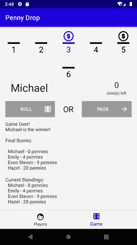

#### 总结与后续步骤

我们在本章中完成了很多工作！我们实现了 Penny Drop 的所有游戏逻辑，并将`GameHandler`连接到了 UI。此外，由于游戏逻辑被隔离在`GameHandler`中，我们的`GameFragment`和`GameViewModel`类没有像它们可能的那样膨胀。话虽如此，将状态保留在`GameViewModel`类中会使后续的代码更改更容易，正如你在下一章中看到的。

而且，我们在本章所做的大部分内容甚至不是 Android 特有的，而是展示了如何使用 Kotlin 编写更清晰的代码。利用各种语言特性，如作用域函数（`.let {...}`和`.apply { ... }`）、解构声明和`when`表达式，可以使你的代码更具可读性和可维护性。这适用于其他 Android 应用以及任何非 Android 的 Kotlin 应用。

现在，游戏运行得很好，但有一个小问题：如果你关闭应用，无法恢复游戏。哦，而且它不会保存之前游戏的玩家。或者跟踪任何统计数据。实际上，它什么都不记录……

我们的应用需要一些持久化功能，幸好 Jetpack 为我们提供了一个很棒的选项：Room。Room 是 SQLite 的封装，使数据库交互变得更加友好。下一章，我们将深入了解 Room，设置我们的数据库，并开始保存我们的 Penny Drop 游戏。

#### 脚注

[[5]](#f_0038.xhtml_FNPTR-5)

[`pragprog.com/titles/mfjetpack/kotlin-and-android-development-featuring-jetpack`](https://pragprog.com/titles/mfjetpack/kotlin-and-android-development-featuring-jetpack)

Copyright © 2021, The Pragmatic Bookshelf.

### 第 5 章

#### 使用 Room 持久化游戏数据

到目前为止，在本书中，我们已经构建了一个不错的 Penny Drop 应用。你已经了解了 Android 视图、导航、`ViewModel`类，以及它们如何协同工作。我们需要添加的最后一块主要内容是某种持久化功能，以便我们的游戏跟踪玩家做了什么。

在 Android 应用中使用 SQLite 进行数据库交互传统上一直是……令人不快的。创建数据库需要大量工作，没有查询验证，而且你必须手动将数据从`Cursor`类转换为你的 Java 或 Kotlin 对象。幸好，Jetpack 的核心组成部分之一是 Room 的引入，这是一个建立在 SQLite 之上的持久化库。你可以做以前使用设备内数据库时能做的一切，只是更加顺畅。

在本章中，你将学习如何通过 Room 创建 SQLite 数据库，如何通过实体类添加表，以及如何通过`ViewModel`类将数据库连接到你的`Fragment`视图。但在做所有这些之前，我们需要将 Room 库添加到我们的应用中。

#### 将 Room 添加到应用中

这个过程现在应该看起来很熟悉了。我们在项目级`build.gradle`文件的`ext`块下添加一个新值：

```
ext {

    kotlin_version = '1.4.30'

    gradle_version = '4.1.2'

    app_compat_version = '1.2.0'

    constraint_layout_version = '2.0.4'

    core_version = '1.3.2'

    lc_version = '2.3.0'

    nav_version = '2.3.3'

    room_version = '2.3.0-beta01'

}
```

然后我们在应用`build.gradle`文件的 dependencies 中添加库工件。我们需要添加三个不同的依赖来实现我们想要的功能：一个用于 Room 运行时，一个用于 Kotlin 扩展和 Room 中的协程支持，还有一个用于注解处理：

```
dependencies {

    // 其他依赖仍然在上面。

    implementation "androidx.room:room-ktx:$room_version"

    implementation "androidx.room:room-runtime:$room_version"

    kapt "androidx.room:room-compiler:$room_version"

}
```

添加完成后，同步你的项目，然后我们就可以将`PennyDropDatabase`添加到应用中了。

#### 添加 RoomDatabase 类

`PennyDropDatabase`是我们使用 Room 所做一切的核心。在这里，我们可以定义数据库表（通过 Entity 类）、设置版本号，甚至包含一些初始化逻辑。不过，我们与数据库的交互不会直接针对`PennyDropDatabase`进行，而是通过`PennyDropDao`类（我们稍后会创建）来完成。

在`data`包中创建一个名为`PennyDropDatabase`的新类；记住，在 Android Studio 中创建类时可以包含包名。创建完成后，立即将该类标记为`abstract`，并使其继承`RoomDatabase`。最后一步是添加`@Database`注解，它告诉 Room 这个类是一个`RoomDatabase`，并将保存数据库配置。空类看起来像这样：

```
package dev.mfazio.pennydrop.data

import androidx.room.RoomDatabase

@Database(
```


我们稍后会添加 Entity 类。

```
entities = [],
version = 1,
exportSchema = false
```

`abstract class PennyDropDatabase: RoomDatabase()` 的最终实现看起来会有点奇怪。我们只有一个名为 `pennyDropDao()` 的抽象函数，它返回一个尚未创建的 `PennyDropDao` 类的实例，以及一个 `companion object`。`companion object` 中会有一个 `PennyDropDatabase?` 类型的变量，名为 `Instance`，以及一个名为 `getDatabase()` 的函数。`getDatabase()` 函数接受两个参数——当前的 Android `Context` 对象和一个 `CoroutineScope`，后者用于在初始化时向数据库插入数据。实现前的类看起来像这样：

```
@Database(
    entities = [],
    version = 1,
    exportSchema = false
)
abstract class PennyDropDatabase : RoomDatabase() {
    abstract fun pennyDropDao(): PennyDropDao

    companion object {
        @Volatile
        private var instance: PennyDropDatabase? = null

        fun getDatabase(
            context: Context,
            scope: CoroutineScope
        ): PennyDropDatabase {
            // We'll implement this in a minute.
        }
    }
}
```

在继续之前，我想特别说明一下 `@Volatile` 注解。它告诉 JVM 将对 `instance` 变量的赋值对所有线程可见。这将帮助我们避免应用进程中任何不一致的情况，这一点尤其有用，因为协程可能在不同的线程上处理。

`getDatabase()` 函数将有两个用途。它始终会返回数据库的当前实例，但如果数据库实例尚未创建，该函数也能处理这种情况。我们首先尝试返回当前实例，但如果它为 null，那么我们将在 `synchronized` 块内构建数据库。这个块确保即使对 `getDatabase()` 有多次调用，我们也只创建一个 `PennyDropDatabase` 实例。

`getDatabase()` 使用 `Room.databaseBuilder()` 来创建数据库，然后将其赋值给 `instance`。我们只需要传入 `context` 参数、`PennyDropDatabase` 的 `Class` 对象，以及数据库的名称（我们将使用 `"PennyDropDatabase"`）。

要传入类引用，我们需要使用类/成员引用操作符，即 `::`。也就是说，要获取 `PennyDropDatabase` 的 `KClass`（Kotlin 类）引用，我们使用 `PennyDropDatabase::class`。

现在，这里的关键是我们传入的是 `PennyDropDatabase` 的 Java 类而不是 Kotlin 类。这是因为 `Room.databaseBuilder()` 函数是用 Java 编写的，因此期望一个 Java 类。要获取我们类的 Java 版本，我们可以使用 `PennyDropDatabase::class.java`。Java 和 Kotlin 之间的互操作性有时会让事情变得棘手，但幸运的是，像这样的情况处理起来还算简单。初始的 `getDatabase()` 函数看起来像这样：

```
fun getDatabase(
    context: Context,
    scope: CoroutineScope
): PennyDropDatabase =
    this.instance ?: synchronized(this) {
        val instance = Room.databaseBuilder(
            context,
            PennyDropDatabase::class.java,
            "PennyDropDatabase"
        ).build()
        this.instance = instance
        instance //This is returned from the synchronized block.
    }
```

至此，我们几乎已经拥有了 `PennyDropDatabase` 所需的一切。你的编辑器应该会报错，因为我们还没有创建 `PennyDropDao` 类，而且我们仍然需要创建 Entity 类，但这个类的主要部分已经准备好了。我们可以先创建 `PennyDropDao` 类，然后再创建将映射到数据库表的 Entity 类。

## 创建 DAO 类

正如我之前提到的，我们不会直接调用 `PennyDropDatabase` 来获取数据，而是将所有操作通过 DAO（即数据访问对象）来发送。我们通过 `@Dao` 注解将一个接口或抽象类标记为 DAO。`PennyDropDao` 的大部分工作将由 Room 库处理，让我们只需在需要时关注自定义操作。DAO 中的大多数函数将是抽象的，并带有特定的注解以赋予函数特定的用途。如果我们需要对函数的行为有更多控制，仍然可以编写完整的 SQL 查询。在我们的例子中，我们只需要一个 `@Query` 函数，其他函数则使用 `@Insert` 或 `@Update` 注解。带有几个函数的 `PennyDropDao` 抽象类看起来像这样：

```
@Dao
abstract class PennyDropDao {
    @Query("SELECT * FROM players WHERE playerName = :playerName")
    abstract fun getPlayer(playerName: String): Player?

    @Insert
    abstract suspend fun insertGame(game: Game): Long

    @Insert
    abstract suspend fun insertPlayer(player: Player): Long

    @Insert
    abstract suspend fun insertPlayers(players: List<Player>): List<Long>

    @Update
    abstract suspend fun updateGame(game: Game)
}
```

如你所见，像插入和更新记录这样的标准操作可以通过包含的注解来完成，如本代码块所示，而查询或任何类型的自定义操作则写在 `@Query` 注解内部。这包括对数据库运行 `SELECT` 和 `UPDATE` 语句。

特别要注意的是，查询中使用了 `playerName` 命名绑定参数。Room 允许我们在 `@Query` 函数中发送参数，这些参数随后会在发送到我们数据库的语句中使用。

另外值得注意的是 `suspend` 修饰符。这意味着函数可以在任何点启动/停止，并且要求该函数要么在另一个 `suspend` 函数中调用，要么从协程中调用。我们将在*从 ViewModel 访问数据库*中了解更多关于其工作原理的内容。

现在 `PennyDropDao` 已经存在，`PennyDropDatabase` 应该会满意多了，但现在 `PennyDropDao` 又不高兴了，因为 `Game` 还不存在。另外，如果你尝试移除与 `Game` 相关的调用并运行应用，Room 也不会喜欢尝试插入 `Player` 对象，因为 `Player` 还不是实体。是时候为应用添加一些 Entity 类了。

## 添加 Entity 类

实体类是我们 Room 数据库中的表。通过添加 `@Entity` 注解并进行一些配置，我们可以将一个普通的数据类转换为 Room 实体。如果你想知道的话，我们会把所有新类放在 `data` 包中。

我们将从 `PennyDropDao` 类中使用的 `Game` 类开始。这个类将保存关于特定 Penny Drop 游戏的所有必需信息，但不包含任何玩家信息。如果我们考虑现实中的游戏，这代表放置便士的容器。

`Game` 类将包含大量信息：游戏开始/结束时间、游戏状态、已填充的槽位、上一次掷出的值、回合文本，以及玩家是否可以掷骰子和跳过。它还将有一个 `gameId` 值，这将是数据库中的主键。最后，我们需要用 `@Entity` 注解来标注这个类，其中包括关联数据库表的名称。

```
@Entity(tableName = "games")
data class Game(
  @PrimaryKey(autoGenerate = true) var gameId: Long = 0,
  val gameState: GameState = GameState.Started,
  val startTime: OffsetDateTime? = OffsetDateTime.now(),
  val endTime: OffsetDateTime? = null,
  val filledSlots: List<Int> = emptyList(),
  val lastRoll: Int? = null,
  val currentTurnText: String? = null,
  val canRoll: Boolean = false,
  val canPass: Boolean = false
)
```

这个类中很少部分是 Room 特有的，除了 `@Entity` 和 `@PrimaryKey` 注解。通过在 `@PrimaryKey` 注解中添加 `autoGenerate` 属性，我们让 Room 为我们计算下一个 `gameId` 值，而不必手动进行。

我想提一下，我在这里选择使用 `OffsetDateTime` 类型来存储日期，这样我们就能完整了解游戏进行的时间，包括时区。诚然，这在我们的情况下并不重要，但确保你拥有日期时间所需的所有信息是一个好的实践。

我们需要快速在 `data` 包中创建 `GameState` 枚举类：

```
package dev.mfazio.pennydrop.data

enum class GameState {
  Started,
  Finished,
  Cancelled,
  Unknown
}
```

除此之外，这个类就完成了，所以我们可以继续将 `Player` 类转换为 `@Entity`。

## 将 Player 类设为实体

我们在*创建 Player 类*中创建了 `Player` 数据类，所以现在只需修改一些东西，使其准备好成为数据库表。不过，我们可以安全地将其保留在 `types` 包中。

与我们对 `Game` 类所做的类似，我们需要用 `@Entity` 注解来标注这个类，并添加一个 `@PrimaryKey` 变量。我们还将使 `isHuman` 和 `selectedAI` 属性不可变，并告诉 Room 在处理数据库表时忽略 `pennies` 和 `isRolling`。以下是这些修改的最终结果：

```
@Entity(tableName = "players")
data class Player(
  @PrimaryKey(autoGenerate = true) var playerId: Long = 0,
  val playerName: String = "",
  val isHuman: Boolean = true,
  val selectedAI: AI? = null
) {
  @Ignore
  var pennies: Int = defaultPennyCount

  fun addPennies(count: Int = 1) {
    pennies += count
  }

  @Ignore
  var isRolling: Boolean = false

  @Ignore
  var gamePlayerNumber: Int = -1

  fun penniesLeft(subtractPenny: Boolean = false): Boolean =
    (pennies - (if(subtractPenny) 1 else 0)) > 0

  companion object {
    const val defaultPennyCount = 10
  }
}
```

在两个状态字段上放置 `@Ignore` 可能看起来有些奇怪。做出这个更改的原因是，我们正在将玩家在游戏中的当前状态的所有权从 `Player` 转移到一个新的、尚未创建的名为 `GameStatus` 的类。这背后的逻辑是，它允许 `Player` 类代表一个人（或 AI）本身，而不是游戏中的玩家以及他们在该游戏中的表现。按照我们设置数据库的方式，一个 `Player` 可以参与多个游戏，我们分别跟踪他们在每个游戏中的表现。

尽管如此，我们仍然将 `pennies` 和 `isRolling` 保留为 `Player` 上的辅助变量。正如你稍后会看到的，当我们从数据库中获取玩家的状态时，我们可以将他们的当前便士数量和掷骰子状态分配给 `Player` 对象。这使我们在数据库中拥有更好的数据分离，同时在代码中保持逻辑性。我说的"逻辑性"是指我们仍然从玩家那里获取便士数量和掷骰子状态，而不是让前端还必须担心状态问题。

顺便说一下，我们稍后会移除 `addPennies` 函数，但我想等到我们更改 `updateFromGameHandler` 的工作方式之后再这样做。否则，你的应用将无法构建，这很烦人。

与此同时，让我们添加我们的 `GameStatus` 类。

## 创建 GameStatus 实体

如前所述，`GameStatus` 是一个数据库表和实体，负责保存用户在特定游戏中的当前（或最终）状态。基于 `gameId` 和 `playerId`，我们将有他们在游戏中的玩家编号（以保留回合顺序）、是否正在掷骰子，以及他们有多少便士。

这将与前两个实体类类似，但我们将添加外键的概念，以确保 `GameStatus` 与给定 `Game` 和 `Player` 之间的连接。

每个外键将有一个父列和子列，分别代表其他表中的列名和此处 `game_statuses` 表中的列名。我们可以通过 `foreignKeys` 属性在 `@Entity` 注解内部添加 `ForeignKey` 对象列表。

```
@Entity(
  tableName = "game_statuses",
  primaryKeys = ["gameId", "playerId"],
  foreignKeys = [
    ForeignKey(
      entity = Game::class,
      parentColumns = ["gameId"],
      childColumns = ["gameId"]
    ),
    ForeignKey(
      entity = Player::class,
      parentColumns = ["playerId"],
      childColumns = ["playerId"]
    )
  ]
)
data class GameStatus(
  val gameId: Long,
  val playerId: Long,
  val gamePlayerNumber: Int,
  val isRolling: Boolean = false,
  val pennies: Int = Player.defaultPennyCount
)
```

如你所见，`GameStatus` 类将当前游戏和玩家相互连接，并连接到玩家在游戏中的状态。鉴于此，我们可以通过 `GameWithPlayers` 类重用这个类来检索包含玩家的游戏。

`GameWithPlayers` 将包含一个 `Game` 对象和一个 `List<Player>`，再加上几个注解来帮助我们。`Game` 属性将有 `@Embedded` 注解，因为它是父实体，而 `players` 有 `@Relation` 注解。

`@Relation` 注解将包含三个属性：`parentColumn`、`entityColumn` 和 `associateBy`。`parentColumn` 和 `entityColumn` 是代表父表（`Game`）和实体表（`Player`）主键的 `String` 值。这里有趣的属性是 `associateBy`，因为它接收一个 `Junction` 实例。`Junction` 对象引入了一个连接两个表的类的引用。

由于 `GameStatus` 已经建立了游戏和玩家之间的关联，我们可以直接将其作为我们的 Junction 类，而无需创建一个新的。整个 `GameWithPlayers` 类看起来是这样的：

```
data class GameWithPlayers(
    @Embedded val game: Game,
    @Relation(
        parentColumn = "gameId",
        entityColumn = "playerId",
        associateBy = Junction(GameStatus::class)
    )
    val players: List<Player>
)
```


`associateBy = Junction(GameStatus::class)`

`val players: List<Player>`

我想做的最后一个改动是为 `GameStatus` 上的 `playerId` 值/列添加一个索引：

```
data class GameStatus(

    val gameId: Long,

    @ColumnInfo(index = true) val playerId: Long,

    val gamePlayerNumber: Int,

    val isRolling: Boolean = false,

    val pennies: Int = Player.defaultPennyCount

)
```

这样做有助于在使用 `GameStatus` 作为 `Junction` 时加快搜索速度。

虽然 `GameWithPlayers` 本身不是一个 `Entity`，但我们稍后会用它来通过单个查询获取当前游戏以及该游戏中的所有玩家。除此之外，我们所有的 `Entity` 类现在都已经创建好了，这意味着我们可以将它们添加到 `PennyDropDatabase` 上 `@Database` 注解的 `entities` 数组中。

## 将 Entity 添加到 PennyDropDatabase

当向 `@Database` 注解添加 `Entity` 类时，我们实际上是为每个 `Entity` 类添加 `KClass` 值。请注意，`KClass` 对象是 Kotlin 类，而不是我们在其他地方使用的 Java `Class` 对象。

```
@Database(

    entities = [Game::class, Player::class, GameStatus::class],

    version = 1,

    exportSchema = false

)
```

此外，既然我们已经在 `PennyDropDatabase` 中，而且 `Player` Entity 类已经准备就绪，我们可以继续向数据库中添加一些玩家。虽然我们还不知道谁会来玩游戏，但我们知道可用的 AI 玩家有哪些。我们将把它们转换成 `Player` 对象，并在初始化时保存到数据库中。

### 在数据库创建期间添加数据

我们在 `PennyDropDatabase` 中使用的 `RoomDatabase.Builder` 类允许你添加一个或多个 `Callback` 实例。`Callback` 类包含三个函数：`onCreate`、`onOpen` 和 `onDestructiveMigration`。这些函数都会传入一个 `SupportSQLiteDatabase` 对象，让你可以在不同的时间点与数据库进行交互。

在我们的例子中，我们希望在最初创建数据库时添加 AI 玩家，所以我们要覆盖 `Callback` 对象上的 `onCreate`，然后将其添加到 `Room.databaseBuilder` 调用中。在该方法内部，我们会调用 `PennyDropDao` 的函数 `insertPlayers`，通过 `AI.basicAI` 值引入 AI 玩家。但首先，我们需要将每个 `AI` 对象转换为 `Player`。执行此转换的函数位于 `AI` 类中，看起来是这样的：

```
fun toPlayer() = Player(

    playerName = name,

    isHuman = false,

    selectedAI = this

)
```

在介绍 `onCreate` 函数之前，最后一点说明是：所有对数据库的修改操作都必须在非 UI 线程上执行。幸运的是，这意味着我们只需要在一个协程块中进行调用即可。

`getDatabase` 函数中 `instance` 的赋值现在看起来是这样的：

```
val instance = Room.databaseBuilder(

    context,

    PennyDropDatabase::class.java,

    "PennyDropDatabase"

).addCallback(object : RoomDatabase.Callback() {

    override fun onCreate(db: SupportSQLiteDatabase) {

        super.onCreate(db)

        scope.launch {

            Instance?.pennyDropDao()?.insertPlayers(

                AI.basicAI.map(AI::toPlayer)

            )

        }

    }

}).build()
```

现在，当应用首次启动时，players 表中就会有所有的 AI 玩家。或者说，如果数据库知道如何处理 `AI` 对象的话就会这样。如果你现在尝试运行应用，构建会失败并出现类似这样的错误：

> Query method parameters should either be a type that can be converted into a database column or a List / Array that contains such type. You can consider adding a Type Adapter for this.

虽然它没有明确指出来，但数据库不知道如何将 `AI` 转换为合适的 SQLite 数据类型。事实上，Room 无法处理保存任何完整的对象。相反，我们需要给数据库一种方法来转换到对象以及从对象转换回来，在这种情况下是一个 `AI` 对象。

所有这些转换都发生在 data 包下的 `Converters.kt` 文件中。在这里，我们可以构建多个带有 `@TypeConverter` 注解的函数，然后告诉 `PennyDropDatabase` 使用它们。既然我们在构建 `AI` 转换器，我们也应该为 `Game` 类上的 `OffsetDateTime`、`GameState` 和 `List<Int>` 属性构建转换器。

### 向数据库添加转换器

在 data 包中，添加一个名为 `Converters` 的新类。这个类将包含八个函数，对应四组转换：`OffsetDateTime` 与 `String` 之间的相互转换、`GameState` 与 `Int` 之间的相互转换、`List<Int>` 与 `String` 之间的相互转换，以及 `AI` 到 `Int` 的转换。

`OffsetDateTime` 转换器函数用于 `Game` 类中的 `startTime` 和 `endTime` 属性，使用 `DateTimeFormatter` 对象将 `OffsetDateTime` 对象转换为格式化字符串以及反向转换。你可以在这里使用任何合理的日期/时间格式；我使用的是 `DateTimeFormatter.ISO_OFFSET_DATE_TIME`，因为它包含了我们需要的所有信息，而且是一种标准化格式。作为参考，这种格式的日期/时间文本看起来像这样：`2014-01-24T15:45:05.023Z`。

```
private val formatter = DateTimeFormatter.ISO_OFFSET_DATE_TIME

@TypeConverter

fun toOffsetDateTime(value: String?) = value?.let {

    formatter.parse(it, OffsetDateTime::from)

}

@TypeConverter

fun fromOffsetDateTime(date: OffsetDateTime?) = date?.format(formatter)
```

请注意，两个函数都处理了输入值为 `null` 的情况。我们将对所有转换器函数执行相同的操作，以避免由于传入数据为 `null` 而导致的转换问题（例如，一个进行中的游戏其 `endDate` 属性为 `null`）。

接下来是 `GameState` 到 `Int` 的转换。为此，我们将使用所有枚举类都包含的 `ordinal` 属性。这个属性是给定枚举值的 `Int` 值，我们可以将其保存到数据库中。

将 `GameState` 对象转换为 `Int` 是转换中较简单的一半，因为我们只是使用输入的 `GameState` 的 `ordinal` 值，或者使用 `GameState.Unknown` 作为后备。从 `Int` 转换回 `GameState` 对象则稍微复杂一些，因为我们要检查输入的 `Int` 值是否与某个 `GameState` 条目的 `ordinal` 值匹配。如果不匹配，我们再次回退到 `GameState.Unknown`。

```
@TypeConverter

fun fromGameStateToInt(gameState: GameState?) =

    (gameState ?: GameState.Unknown).ordinal

@TypeConverter

fun fromIntToGameState(gameStateInt: Int?) =

    GameState.values()let { gameStateValues ->

        if (gameStateInt != null &&

            gameStateValues.any { it.ordinal == gameStateInt }

        ) {

            GameState.values()[gameStateInt]

        } else GameState.Unknown

    }
```

如果你想知道的话，我使用 `GameState.values().let` 块是为了避免创建多个从 `GameState.values()` 返回的 Array 副本。在这里这不是什么大问题，因为那个枚举类中只有几个条目，但对于其他场景来说，这是值得考虑的好做法。

接下来是 `List<Int>` 的转换，用于 `Game` 类中的已填充槽位。你可能之前注意到，我在 `filledSlots` 中使用了 `List<Int>` 而不是 `List<Slot>`。这样做是为了避免从数据库检索数据时处理 `Slot` 类上的所有其他属性。相反，我们只获取已填充槽位的列表（如果有的话），然后更新 `isFilled` 属性。因此，我们的转换代码更加简洁：将 `String` 拆分为 `Int` 值，过滤掉任何 null 或空值，然后将每个 `String` 映射为 `Int`。

反向转换也类似，我们将 `List<Int>` 中的值用逗号连接起来。

```
import android.text.TextUtils

其他转换器仍然在上面

@TypeConverter

fun toIntList(value: String?) = value?.split(",")?.let {

    it

        .filter { numberString -> !TextUtils.isEmpty(numberString) }

        .map { numberString -> numberString.toInt() }

} ?: emptyList()

@TypeConverter

fun fromListOfIntToString(numbers: List<Int>?) =

    numbers?.joinToString(",") ?: ""
```

最后一部分是将 `AI` 对象保存到数据库。为此，我们不保存整个 `AI` 实例，而是只保存一个 ID。这意味着我们需要在 `AI` 类中添加一个 `aiId` 属性，也就是说构造函数现在看起来像这样：

```
data class AI(

    val aiId: Long = 0,

    val name: String,

    val rollAgain: (slots: List<Slot>) -> Boolean

)
```

我们还需要更新 `basicAI` 中的 AI 实例以包含 ID，像这样：

```
AI(

    1,

    "Fearful Fred"

) { slots -> slots.fullSlots() <= 2 }
```

一旦 ID 设置好，转换函数就很简单了：

```
@TypeConverter

fun toAI(aiId: Long?) = AI.basicAI.firstOrNull { it.aiId == aiId }

@TypeConverter

fun fromAiToId(ai: AI?) = ai?.aiId
```

另外，由于我们在 `AI` 类中添加了 `aiId`，我们也应该将它包含在我们之前创建的 `Player` 转换方法中：

```
fun toPlayer() = Player(

    playerId = aiId,

    playerName = name,

    isHuman = false,

    selectedAI = this

)
```

此外，`NewPlayer.toPlayer` 函数需要更新以处理 `playerId`。我们可以使用命名参数来避免硬编码 `0`，并使函数更清晰：

```
fun toPlayer() = Player(

    playerName =

    if (this.isHuman.get()) this.playerName

    else (this.selectedAI()?.name ?: "AI"),

    isHuman = this.isHuman.get(),

    selectedAI = this.selectedAI()

)
```

`Converters` 类的最后一步是告诉 `PennyDropDatabase` 使用它。我们只需要添加 `@TypeConverters` 注解：

```
@Database(

    entities = [Game::class, Player::class, GameStatus::class],

    version = 1,

    exportSchema = false

)

@TypeConverters(Converters::class)

abstract class PennyDropDatabase : RoomDatabase()
```

现在应用程序已经处于一个可以启动的状态，数据库将使用 AI 玩家进行初始化。当然，我们还没有使用数据库中的值，但基础已经就位。下一步是创建一个仓库类，然后从 `GameViewModel` 开始调用这些函数。

### 创建仓库类

首先，仓库不是一个特定的 Room 相关类，而是一个推荐的 Jetpack 约定。使用仓库的优势在于，`ViewModel` 类有一个单一的位置来访问所有数据，无论数据来源是什么。这意味着如果我们有网络服务调用以及数据库调用，前端组件会去同一个地方获取两者，甚至不关心哪个是哪个。拥有仓库可以将如何获取数据与如何使用数据分离开来。

在我们的例子中，拥有仓库 admittedly 有些大材小用，因为我们只有一个数据源，而且正如你将看到的，我们仓库中的函数将只是对 `PennyDropDao` 函数的透传。不过，一旦你转向更复杂的应用程序，比如 Android Baseball League 应用程序，拥有仓库是一个很好的实践。

首先，在 `data` 包中创建 `PennyDropRepository` 类，并将 `PennyDropDao` 的实例作为私有值传入。

```
class PennyDropRepository(private val pennyDropDao: PennyDropDao) { ... }
```

`PennyDropRepository` 类一开始将有四个函数：`getCurrentGameWithPlayers`、`getCurrentGameStatuses`、`startGame` 和 `updateGame`。这突出了仓库的另一个优势：我们可以限制向应用程序其余部分展示的函数，同时允许 DAO 拥有额外的内部功能。虽然在大多数情况下我们可以将这些函数设为 protected，但这会限制我们在其他与数据库相关的活动中使用它们，比如在 `RoomDatabase` 初始化期间。

正如我之前提到的，这些函数中的每一个都会调用 `PennyDropDao` 中的对应函数。此外，后两个函数将标记为 `suspend` 关键字，因为它们正在修改数据库。整个 `PennyDropRepository` 看起来像这样：

```
class PennyDropRepository(private val pennyDropDao: PennyDropDao) {

    fun getCurrentGameWithPlayers() =

        pennyDropDao.getCurrentGameWithPlayers()

    fun getCurrentGameStatuses() =

        pennyDropDao.getCurrentGameStatuses()

    suspend fun startGame(players: List<Player>) =

        pennyDropDao.startGame(players)

    suspend fun updateGameAndStatuses(

        game: Game,

        statuses: List<GameStatus>

    ) = pennyDropDao.updateGameAndStatuses(game, statuses)

}
```


`PennyDropRepository` 现在已经完成，但不幸的是，DAO 函数目前都不存在。让我们回到 `PennyDropDao` 并添加它们。

### 添加 `PennyDropDao` 函数

我们有四个函数要添加，我们将按顺序进行。首先是 `getCurrentGameWithPlayers`。这个函数与我们之前看到的类似（特别是 `getPlayer` 函数），但它还包含了 `@Transaction` 注解。这个注解告诉 Room，你正在调用的函数引用了多个表，数据应该在单个原子操作中检索。在我们的例子中，我们从 `games` 和 `players` 两个表中获取数据。

```kotlin
@Transaction
@Query("SELECT * FROM games ORDER BY startTime DESC LIMIT 1")
abstract fun getCurrentGameWithPlayers(): LiveData<GameWithPlayers>
```

虽然查询只提到了 `games` 表，但由于 `@Relation` 注解和 `GameStatus` 类上的 `@Junction`，我们从两个表中提取了数据。这告诉 Room 获取 `Game` 的相关 `Player` 记录，而无需写出 SQL 查询的那部分。

下一个函数是 `getCurrentGameStatuses`。不幸的是，使用 Room 没有简单的方法可以在单个查询中获取游戏、玩家以及每个玩家的状态，并将结果映射到对象。因此我们需要单独提取 `GameStatus` 对象。这个 `@Query` 将通过对 `games` 表执行子查询来获取最新的 `GameStatus` 实例。我们获取最近的一个未完成的游戏，然后按 `gamePlayerNumber` 属性对状态进行排序（以确保玩家处于正确的游戏顺序）。注意，这也将是一个 `@Transaction`，因为我们引用了多个表。

```kotlin
@Transaction
@Query(
    """
    SELECT * FROM game_statuses
    WHERE gameId = (
        SELECT gameId FROM games
        WHERE endTime IS NULL
        ORDER BY startTime DESC
        LIMIT 1)
    ORDER BY gamePlayerNumber
    """
)
abstract fun getCurrentGameStatuses(): LiveData<List<GameStatus>>
```

如你所见，`@Query` 注解让我们在从数据库检索数据时拥有很大的灵活性。但有时仅用一个 `@Query` 仍然不够，我们需要在单个 `@Transaction` 中调用多个函数。对于这种情况，我们可以创建一个 `open` 函数并自己实现该函数，而不是让 Room 替我们完成。能够在 DAO 中拥有完全实现的函数，正是 `PennyDropDao` 被设计为 `abstract` 类而非接口的原因（这在 Room 文档中较为常见）。

就 `startGame` 而言，我们将引入一个 `List<Player>`，关闭所有现有游戏，创建一个新的 `Game`，从数据库中获取或插入输入的 `Player` 对象，然后为每位玩家添加新的 `GameStatus` 记录，最后返回新创建游戏的 ID。要完成所有这些操作，我们将在 `PennyDropDao` 内部调用其他函数来替我们完成工作。我们在最初构建 `PennyDropDao` 时已经创建了 `insertGame` 和 `insertPlayer`，因此只需要再添加两个新函数。

第一个函数名为 `closeOpenGames`，它会遍历数据库并将当前时间设置为 `endTime`，同时将仍在进行中的游戏状态设置为 `Cancelled`。我们之前在创建 DAO 类中见过命名绑定参数，但这里的用法更有趣。

默认情况下我们无法传入复杂类型，但由于我们之前已经为这两种类型创建了类型转换器，所以这完全可以正常工作。

```kotlin
@Query("""
    UPDATE games
    SET endTime = :endDate, gameState = :gameState
    WHERE endTime IS NULL""")
abstract suspend fun closeOpenGames(
    endDate: OffsetDateTime = OffsetDateTime.now(),
    gameState: GameState = GameState.Cancelled
)
```

请注意每个属性都使用了默认值。我们可以包含那些本不打算覆盖的参数，纯粹是为了能够将它们作为查询中的参数，同时仍然保持灵活性，以便在需要时进行覆盖。

此外，由于此函数会修改数据库，它需要是一个事务。但不必添加 `@Transaction` 注解，Room 会自动将所有修改操作包装为事务。这包括带有 `@Insert`、`@Update` 或 `@Delete` 注解的函数。

另一个我们仍然需要的函数是 `insertGameStatuses`，它只需要 `@Insert` 注解。

```kotlin
@Insert
abstract suspend fun insertGameStatuses(gameStatuses: List<GameStatus>)
```

这凸显了 Room 的另一个优点：我们可以传入 `List<GameStatus>`，所有 `GameStatus` 记录都会被插入数据库，而无需手动逐个插入。

现在所有要使用的函数都已创建完毕，我们可以回到 `startGame` 本身。请注意，尽管我们在这里实现了 `startGame`，但它仍然必须标记为 `open`，因为它带有 `@Transaction` 注解。

该函数的代码如下：

```kotlin
@Transaction
open suspend fun startGame(players: List<Player>): Long {
    this.closeOpenGames()

    val gameId = this.insertGame(
        Game(
            gameState = GameState.Started,
            currentTurnText = "The game has begun!\n",
            canRoll = true
        )
    )

    val playerIds = players.map { player ->
        getPlayer(player.playerName)?.playerId ?: insertPlayer(player)
    }

    this.insertGameStatuses(
        playerIds.mapIndexed { index, playerId ->
            GameStatus(
                gameId,
                playerId,
                index,
                index == 0
            )
        }
    )

    return gameId
}
```

这里我想特别指出的一点是我们如何获取 `playerIds` 值。我们检查数据库中是否已有该玩家，如果有就使用其 `playerId`；如果找不到该玩家，则创建该玩家并返回其玩家 ID。由于 `insertPlayer` 返回 `Long`，我们立即就能获得数据库 ID，无需进行二次查找。此外，Elvis 运算符让我们可以将所有逻辑保持在一个表达式中，而无需添加额外的条件逻辑。

`PennyDropDao` 中还有一个函数需要介绍，那就是 `updateGameAndStatuses` 函数。这个函数正如你所期望的那样：它更新输入的 `Game` 和 `GameStatus` 对象在数据库中的版本，所有操作都包装在单个 `@Transaction` 中。`updateGame` 已经存在，但我们需要快速创建 `updateGameStatuses`：

```kotlin
@Update
abstract suspend fun updateGameStatuses(gameStatuses: List<GameStatus>)
```

在此基础上，`updateGameAndStatuses` 调用这两个函数，并包装在 `@Transaction` 中：

```kotlin
@Transaction
open suspend fun updateGameAndStatuses(
    game: Game,
    statuses: List<GameStatus>
) {
    this.updateGame(game)
    this.updateGameStatuses(statuses)
}
```

关于 `PennyDropRepository`，我想介绍的最后一个部分是添加创建仓库单例实例的能力，以便在任何地方使用。这是可选的，但有助于避免为不同视图创建多个 `PennyDropRepository` 实例。

其思路与 `PennyDropDatabase` 相同：获取现有的实例变量，除非它为 null，否则创建新实例并返回。我们还将利用 `synchronized` 代码块来避免多个线程同时尝试创建 `PennyDropRepository`。所有这些都将放在 `PennyDropRepository` 的 `companion` 对象中：

```kotlin
companion object {
    @Volatile
    private var instance: PennyDropRepository? = null

    fun getInstance(pennyDropDao: PennyDropDao) =
        this.instance ?: synchronized(this) {
            instance ?: PennyDropRepository(pennyDropDao).also {
                instance = it
            }
        }
}
```

至此，`PennyDropRepository` 和 `PennyDropDao` 类已全部就绪。我们拥有了在本地数据库中持久化游戏数据所需的所有逻辑。剩下的工作是从数据库中提取数据并在 `GameViewModel` 中使用它。

### 从 ViewModel 访问数据库

与之前一样，`GameViewModel` 将是 `GameFragment` 视图的数据源。但现在，数据不再由 `GameViewModel` 内部持有，而是通过 `PennyDropRepository` 来自 `PennyDropDatabase`。我们仍然像以前一样为 UI 使用 `LiveData`，但 `GameViewModel` 不再直接设置这些值。

我们需要做的第一件事是获取 `PennyDropRepository` 的实例。为此，我们需要同时获取 `PennyDropDatabase` 和 `PennyDropDao` 的实例。但这带来了一个问题：获取 `PennyDropDatabase` 实例需要访问 `Context` 对象。通常，`ViewModel` 类不应访问任何类型的 `Context` 对象，因为这可能导致内存泄漏，原因是生命周期不一致（即 `Activity` 或 `Fragment` 在 `ViewModel` 之前被销毁，导致 `ViewModel` 中留下无效的上下文引用）。然而，当我们需要 `Context` 对象时，可以使用 `AndroidViewModel` 类作为父类，而不是 `ViewModel`。这使我们能够引用 `Application` 对象，而 `Application` 是 `Context` 的子类。

```kotlin
class GameViewModel(application: Application) :
    AndroidViewModel(application) {
    // GameViewModel 的代码放在这里。
}
```

既然我们现在有了可用的 `Context` 对象，就可以获取 `PennyDropDatabase` 实例，进而获取 `PennyDropRepository` 实例。我们将在 `clearText` 变量下方添加 `PennyDropRepository` 的声明，命名为 `repository`，但不进行初始化。相反，我们在 `init` 块中为其赋值。该块在类实例化时运行，允许我们将初始化与声明分开，同时保持不可变性。

```kotlin
class GameViewModel(application: Application) :
    AndroidViewModel(application) {

    private var players: List<Player> = emptyList()

    val slots =
        MutableLiveData(
            (1..6).map { slotNum -> Slot(slotNum, slotNum != 6) }
        )

    val currentPlayer = MutableLiveData<Player?>()

    val canRoll = MutableLiveData(true)
    val canPass = MutableLiveData(false)

    val currentTurnText = MutableLiveData("")
    val currentStandingsText = MutableLiveData("")

    private var clearText = false

    private val repository: PennyDropRepository

    init {
        val database =
            PennyDropDatabase.getDatabase(application, viewModelScope)

        this.repository =
            PennyDropRepository.getInstance(database.pennyDropDao())
    }

    // Rest of GameViewModel
}
```

我喜欢在这里将 `this.repository` 的赋值拆分成多个部分，以展示构成仓库的各个组件，但我们完全可以将其合并为单个表达式：

```kotlin
this.repository =
    PennyDropDatabase
        .getDatabase(application, viewModelScope)
        .pennyDropDao()
        .let { dao ->
            PennyDropRepository.getInstance(dao)
        }
```

在非教学场景下，我通常会采用第二种方式编写代码，但这取决于你。请记住，两种方法在功能上是等效的，因此请专注于你觉得更易读的方式。

如果你好奇的话，我们这里传入的 `viewModelScope` `CoroutineScope` 之所以可用，是因为我们在本章开头添加了 `lifecycle-viewmodel-ktx` 依赖。

### 开始游戏

有了 `GameViewModel` 中可用的 `PennyDropRepository`，我们就可以开始与数据库交互了。这里的逻辑第一步是给自己一个将数据存入数据库的方法，我们在 `startGame` 函数中完成这一操作。由于我们改变了在 `GameViewModel` 中访问游戏信息的方式，`startGame` 函数看起来会明显更简洁。

```kotlin
suspend fun startGame(playersForNewGame: List<Player>) {
    repository.startGame(playersForNewGame)
}
```


之前所有的初始化操作都消失了，因为我们在`PennyDropDao.startGame`内部处理了这些操作，并且我们为函数添加了`suspend`关键字。添加`suspend`关键字是因为我们调用的函数也带有该关键字（因为它们最终会修改数据库中的数据）。现在，将函数改为`suspend`函数也要求我们在`PickPlayersFragment`中改变调用`startGame`的方式。

好在改动不算大，我们只需将`this.buttonPlayGame.setOnClickListener`的内容包装在协程`launch`块中即可。我们可以从`viewLifecycleOwner.lifecycleScope`访问`launch`函数，这是一个与`LifecycleOwner`生命周期绑定的协程作用域（在本例中，这就是`GameFragment`本身）。这意味着如果`Fragment`因任何原因被销毁，协程调用将自动取消。更新后的代码如下：

```
this.buttonPlayGame.setOnClickListener {
    viewLifecycleOwner.lifecycleScope.launch {
        gameViewModel.startGame(
            pickPlayersViewModel.players.value
                ?.filter { newPlayer ->
                    newPlayer.isIncluded.get()
                }?.map { newPlayer ->
                    newPlayer.toPlayer()
                } ?: emptyList()
        )

        findNavController().navigate(R.id.gameFragment)

    }
}
```

添加该代码后，开始游戏现在会将游戏插入本地数据库，而不是在`GameViewModel`中保存游戏信息。我们还没有检索任何数据，但仍然可以运行 bum 应用并插入一两个游戏。数据库中有数据后，我们可以使用 Android Studio 的数据库检查器查看其中的内容。

### 使用数据库检查器查看数据

由于我们尚未将数据库中的数据连接到视图，我们需要另一种方式来查看数据库中的内容。幸运的是，从 Android Studio 4.1 开始，IDE 中内置了数据库检查器。通过在 Android Studio 底部打开数据库检查器并选择当前运行 Penny Drop 的设备，我们可以看到`PennyDropDatabase`中的内容。

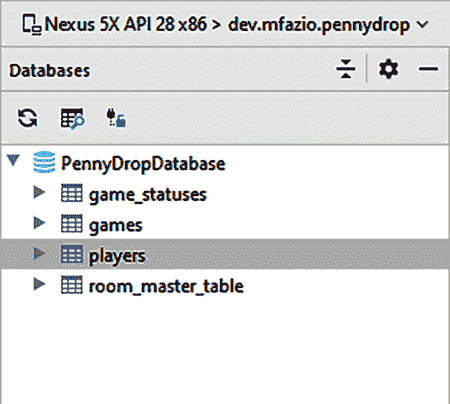

如果你双击表名，比如`players`，你将看到表中的数据，如图片所示。

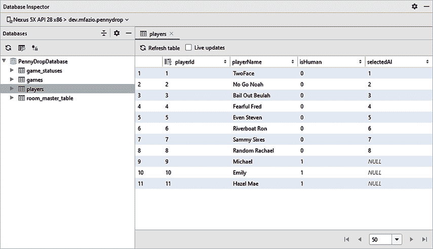

这是一个非常实用的工具，用于检查数据库中的情况。如果默认查询不够用，你还可以在数据库上运行自定义查询。这样你不仅可以查看数据库中的数据，还可以测试想要添加到 DAO 的查询，而无需不断重新编译和重新部署应用来确保它们能正常工作。

这里的另一个强大功能是通过数据库检查器编辑数据库中的数据，并实时看到更新。由于我们将使用 Room 通过`LiveData`对象监听数据库变化，我们可以直接更改数据库值，并看到它们在应用中的显示效果。

例如，如果我在游戏中将名称`Hazel`改为`Hazel Mae`，我的应用会更新游戏屏幕上的玩家名称和排名为新的名称。请注意，游戏摘要文本不会改变，因为我们保存的是文本值，而不是基于数据库值生成它们。

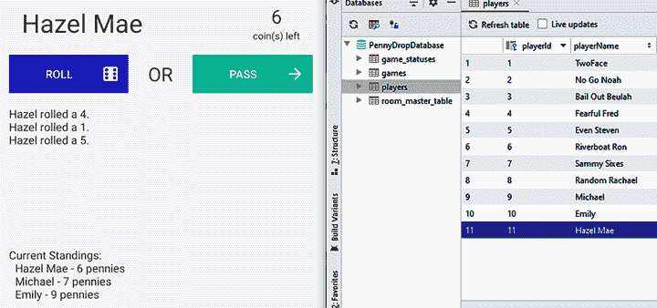

现在，我们可以看到本地数据库中有游戏数据，但你的应用尚未显示数据库中的任何内容，所以我们来修复这个问题？回到`GameViewModel`，以便将视图连接到`PennyDropDatabase`。

### 获取当前的 Penny Drop 游戏

现在，`GameViewModel`在类顶部声明了多个`MutableLiveData`对象。我们将这个：

```
class GameViewModel(application: Application) :
    AndroidViewModel(application) {

    private var players: List<Player> = emptyList()

    val slots =
        MutableLiveData(
            (1..6).map { slotNum -> Slot(slotNum, slotNum != 6) }
        )

    val currentPlayer = MutableLiveData<Player?>()

    val canRoll = MutableLiveData(true)
    val canPass = MutableLiveData(false)

    val currentTurnText = MutableLiveData("")
    val currentStandingsText = MutableLiveData("")

    private var clearText = false

    Rest of GameViewModel
}
```

变成这样：

```
class GameViewModel(application: Application) :
    AndroidViewModel(application) {

    private var clearText = false

    private val repository: PennyDropRepository

    val currentGame = MediatorLiveData<GameWithPlayers>()

    val currentGameStatuses: LiveData<List<GameStatus>>
    val currentPlayer: LiveData<Player>
    val currentStandingsText: LiveData<String>

    val slots: LiveData<List<Slot>>

    val canRoll: LiveData<Boolean>
    val canPass: LiveData<Boolean>

    Rest of GameViewModel
}
```

现在继续替换这些值和变量。新的变量应该声明在类定义之后（如两个示例所示）且位于`init`块上方。不用担心"Property must be initialized or be abstract"错误；我们马上就会在`init`块中创建它们。

除了错误之外，最应该引起你注意的主要部分是`MediatorLiveData`的引入。`MediatorLiveData`值是观察`LiveData`对象（包括其他`MediatorLiveData`对象）并处理`OnChanged`事件的对象。

例如，`currentGame`值会同时观察来自`getCurrentGameStatuses`和`getCurrentGameWithPlayers`这两个仓库函数的`LiveData`对象。由于当前游戏的完整画面需要游戏信息、参与玩家以及游戏状态，我们希望`currentGame`值能够反映所有这些数据的变化。实现这一点的代码位于`init`块中，如下所示：

```
this.currentGameStatuses = this.repository.getCurrentGameStatuses()

this.currentGame.addSource(this.repository.getCurrentGameWithPlayers()) { gameWithPlayers ->
    updateCurrentGame(gameWithPlayers, this.currentGameStatuses.value)
}

this.currentGame.addSource(this.currentGameStatuses) { gameStatuses ->
    updateCurrentGame(this.currentGame.value, gameStatuses)
}
```

`MediatorLiveData`在声明`currentGame`时已经初始化，所以这里我们只是添加了两个数据源。这意味着每当数据库中的数据发生变化并触发暴露的`LiveData`更新时，一个（或两个）相关的源函数将会被执行。

如果仔细观察，你会发现两个数据源实际上做的是同一件事，只是传入的值不同。这里使用`updateCurrentGame`的原因是为了让两种场景可以共用同一段逻辑。该函数接收`GameWithPlayers`和`List<GameStatus>`两个值，并通过`GameWithPlayers`上的新`updateStatuses`函数将它们组合起来。`updateCurrentGame`函数如下所示：

```
private fun updateCurrentGame(
    gameWithPlayers: GameWithPlayers?,
    gameStatuses: List<GameStatus>?
) {
    this.currentGame.value = gameWithPlayers?.updateStatuses(gameStatuses)
}
```

`updateStatuses`函数接收状态列表，并将每个`GameStatus`映射到正确的`Player`。这就是为什么我们之前将`pennies`和`isRolling`变量保留在`Player`类上，但将它们排除在数据库之外。我们可以在数据库中保持数据分离，但在代码中将它们组合起来，这样在视图布局文件中引用这些值时保持不变。此外，在代码中将状态值放在`Player`类上也更有意义。

我们获取每个`Player`，找到他们的`GameStatus`，然后赋值状态变量。这里还有几个空值检查：如果`gameStatuses`值为 null，则`GameWithPlayers`保持不变。同样，如果找不到合适的`GameStatus`，我们返回一个未改变的`Player`对象。

```
fun updateStatuses(gameStatuses: List<GameStatus>?) =
    if (gameStatuses != null) {
        this.copy(
            players = players.map { player ->
                gameStatuses
                    .firstOrNull { it.playerId == player.playerId }
                    ?.let { gameStatus ->
                        player.apply {
                            pennies = gameStatus.pennies
                            isRolling = gameStatus.isRolling
                            gamePlayerNumber = gameStatus.gamePlayerNumber
                        }
                    } ?: player
            }.sortedBy { it.gamePlayerNumber }
        )
    } else this
```

这里特别值得注意的是包裹整个代码块的`this.copy`调用。这样做是因为我们想要创建一个更新了`List<Player>`的`GameWithPlayers`新实例，而不是修改现有对象（反正我们也做不到，因为它是`val`）。最终，该函数返回一个可能有所变化的`GameWithPlayers`，在我们对 UI 进行一些修改后，UI 将会相应更新。在转到 UI 之前，我们要在`GameViewModel`的`init`块中设置其余的`LiveData`对象。

### 获取当前玩家和槽位

我们已经设置好了`currentGame`，这意味着要获取当前玩家，我们只需要找到当前正在掷骰子的那位。虽然我们可以把这个逻辑加到`updateCurrentGame`中，但我将其分离出来有两个原因。一，我不太喜欢在那样的函数中产生副作用（因为重点在于`currentGame`值）；二，这是展示`Transformations`类的绝佳机会。

`Transformations`类上有一些函数，允许你传入一个`LiveData`参数并对其执行函数，返回一个全新的`LiveData`对象。在我们的例子中，我们将使用`Transformations.map`来获取`currentGame`并提取出当前正在掷骰子的玩家。

```
this.currentPlayer =
    Transformations.map(this.currentGame) { gameWithPlayers ->
        gameWithPlayers?.players?.firstOrNull { it.isRolling }
    }
```

顺便说一下，如果这感觉和我们之前做的`MediatorLiveData`工作相似，那是因为它确实如此。在底层，`Transformations.map`和`Transformations.switchMap`都是使用`MediatorLiveData`对象来转换传入的`LiveData`对象的。

现在，我们不再需要手动为`currentPlayer`设置值，而是可以更新数据库，然后通过我们的`LiveData`对象来更新 UI。此外，当前玩家的 UI 数据绑定代码甚至不需要改变，但当应用关闭并稍后恢复时，我们仍然能获得持久化的数据。

同样地，`currentStandingsText`现在也在`currentGame`上使用`Transformations.map`，并借助`generateCurrentStandings`来实现：

```
this.currentStandingsText =
    Transformations.map(this.currentGame) { gameWithPlayers ->
        gameWithPlayers?.players?.let { players ->
            this.generateCurrentStandings(players)
        }
    }
```

我们对`Slots`值也要做同样的事情，但这里我们将使用`Slot`类中的一个新函数`mapFromGame`来处理转换逻辑。首先，`Transformations.map`函数如下所示：

```
this.slots =
    Transformations.map(this.currentGame) { gameWithPlayers ->
        Slot.mapFromGame(gameWithPlayers?.game)
    }
```

然后，在`Slot`的`companion object`中，`mapFromGame`函数如下所示：

```
fun mapFromGame(game: Game?) =
    (1..6).map { slotNum ->
        Slot(
            number = slotNum,
            canBeFilled = slotNum != 6,
            isFilled = game?.filledSlots?.contains(slotNum) ?: false,
            lastRolled = game?.lastRoll == slotNum
        )
    }
```

这类似于我们之前使用的`updateSlots`函数，结合了我们以前在`GameViewModel`中使用的`Slot`初始化逻辑。与之前在`updateSlots`中的方法相比，这种方法除了具有持久化方面的优势外，另一个额外的好处是我们不再需要调用`slots.notifyChange`。该函数可以完全移除，因为任何对`currentGame`的更新都会自动反映和处理，无需任何额外的变通方法。


我们现在已经将`currentGame`连接起来，并将其作为其他字段的数据源，但尚未处理按钮逻辑。接下来是`canPass`和`canRoll`值，它们同时使用了`currentGame`和`currentPlayer`这两个 LiveData 值。

## 处理 canRoll 和 canPass

在这里，为了确定应该显示哪些按钮，我们需要同时使用`currentGame`和`currentPlayer`的值。提醒一下，我们只在用户掷过一次骰子后才启用 Pass 按钮，并且对于任何 AI 玩家都会禁用这两个按钮。由于我们同时使用了这两个值，我们可以再创建一个`MediatorLiveData`对象，并将`currentGame`和`currentPlayer`都添加为数据源。但由于`currentPlayer`来自`currentGame`，为每个值分别设置一个以`currentPlayer`为数据源的`Transformation.map`调用更为合理。这将导致每当`currentPlayer`或`currentGame`更新时都会运行该函数。请注意，这并不意味着我们获得了一个新玩家，只是由于`currentGame` LiveData 的变化导致`currentPlayer`值被更新了。因此，`canRoll`和`canPass`的赋值如下所示：

```
this.canRoll = Transformations.map(this.currentPlayer) { player ->

    player?.isHuman == true && currentGame.value?.game?.canRoll == true

}

this.canPass = Transformations.map(this.currentPlayer) { player ->

    player?.isHuman == true && currentGame.value?.game?.canPass == true

}
```

至此，我们所有的 LiveData 值都已初始化，init 代码块也终于完成了。接下来是修改我们的`roll`和`pass`函数，使其与新的值配合工作。幸运的是，这两个函数都不需要大幅改动。

## 更新 roll() 和 pass() 函数

我们当前版本的`roll`和`pass`函数很相似；我们获取当前玩家，检查操作（掷骰子或跳过）是否有效，调用相应的`GameHandler`函数，然后将结果传入`updateFromGameHandler`。`roll`函数在开头还有一个额外的步骤，即获取当前插槽的状态。注意，我们之前在这些函数中已经完成了大部分工作，因此我们不需要重新从头获取所有这些值，只需要添加一系列空值检查即可。

两个函数现在将遵循相同的格式：创建一些新变量来存储我们需要的所有数据，确保每个变量都不为空，验证你要执行的操作（`canRoll`或`canPass`），然后调用`GameHandler`的相关部分。`roll`函数如下所示：

```
fun roll() {

    val game = this.currentGame.value?.game

    val players = this.currentGame.value?.players

    val currentPlayer = this.currentPlayer.value

    val slots = this.slots.value

    if (game != null && players != null && currentPlayer != null &&

        slots != null && game.canRoll

    ) {

        updateFromGameHandler(

            GameHandler.roll(players, currentPlayer, slots)

        )

    }

}
```

说实话，我不太喜欢这个方法中一长串的空值检查。我曾考虑添加一个名为类似`allNotNull`的扩展函数，并将其放在`List`类上：

```
fun <T> List<T?>.allNotNull() = this.all { it != null }
```

添加这个扩展函数将允许我们以这种方式检查所有变量：

```
listOf(game, players, currentPlayer, slots).allNotNull()
```

然而，这存在一个问题。将空值检查移到扩展方法中会破坏 Kotlin 的智能转换能力。在第一段代码中，显式检查变量（如`game`）是否为空会导致编译器自动将该变量转换为其非空对应类型。

例如，在`if`代码块内部，`game`现在是一个`Game`对象而不是`Game?`对象。此外，`game`在`if`条件表达式的其余部分也被视为非空，这意味着`game.canRoll`返回的是`Boolean`而不是`Boolean?`对象。如果我们使用类似`allNotNull`的方法，就会失去这种智能转换，并且必须再次有效地检查空值，或者使用`!!`运算符来断言所有变量都不为空。

`!!`运算符是"非空断言运算符"，在官方 Kotlin 文档中被描述为"供 NPE 爱好者使用"。这里的 NPE 指的是`NullPointerException`，因为我们实际上是在忽略 Kotlin 安全检查变量空值的机制，并移除了该语言最佳特性之一。希望这能清楚地说明，除非绝对必要，否则我们不应该使用这个运算符。稍微缩短一下条件表达式？这对我来说似乎不是绝对必要的，所以我选择使用一连串的空值检查。

`pass`函数看起来一样；唯一的区别是我们不需要当前的插槽。

```
fun pass() {

    val game = this.currentGame.value?.game

    val players = this.currentGame.value?.players

    val currentPlayer = this.currentPlayer.value

    if (game != null && players != null &&

        currentPlayer != null && game.canPass

    ) {

        updateFromGameHandler(

            GameHandler.pass(players, currentPlayer)

        )

    }

}
```

两个函数都已完成，可以供 UI 使用，而`fragment_game.xml`不需要任何更改。接下来是修改我们在这两个函数中调用的`updateFromGameHandler`函数。`updateFromGameHandler`的结果与之前基本相同，但我们需要进行一些更改以适配数据库。

## 修改 updateFromGameHandler 函数

该函数之前的版本有四个部分：更新玩家、更新插槽、修改与游戏相关的变量（`currentTurnText`、`canRoll`和`canPass`），然后在适用时触发 AI 回合。现在，我们有三个部分：更新 Game、更新所有适用的`GameStatus`对象，以及触发 AI 回合。我们的最终结果大致相同，但我们再次从不同的角度来处理它。

第一步是获取一个 game 值，这是基于`currentGame`的复制值。我们通过`let`代码块检查空值，然后在其中使用`currentGameWithPlayers`值以及`copy`函数。在`copy`函数内部，我们用传入`updateFromGameHandler`的`TurnResult`对象来更新`currentGameWithPlayers`的大部分内容。

虽然鉴于我们之前所做的工作，这个过程看起来足够熟悉，但有趣的是如果`currentGame.value`由于某种原因为 null 的情况。如果是这样，我们就使用 Elvis 运算符，并在该运算符的右侧添加一个`return`语句。这在 Kotlin 中是完全有效的做法，既避免了获取我们不会使用的状态所花费的时间，也避免了调用数据库时的额外空值检查。game 赋值代码块如下所示：

```
val game = currentGame.value?.let { currentGameWithPlayers ->

    currentGameWithPlayers.game.copy(

        gameState =

        if (result.isGameOver) GameState.Finished else GameState.Started,

        lastRoll = result.lastRoll,

        filledSlots =

        updateFilledSlots(result, currentGameWithPlayers.game.filledSlots),

        currentTurnText = generateTurnText(result),

        canPass = result.canPass,

        canRoll = result.canRoll,

        endTime = if (result.isGameOver) OffsetDateTime.now() else null

    )

} ?: return
```

我们已经准备好了这个函数中几乎所有需要用到的东西，除了`updateFilledSlots`函数，它取代了`updateSlots`。这个新函数映射到一个单独的`when`代码块，用于检查我们是否需要清空槽位，或者某个槽位是否已被新填满。如果我们需要清空槽位，`currentGame`上的`filledSlots`值会变成一个空的`List<Int>`。如果我们掷出的不是六点，我们就将掷出的槽位添加到`filledSlots`列表中，也就是说，我们直接写`filledSlots + result.lastRoll`，这会为我们创建一个新的`List<Int>`并从该函数返回。如果这两个条件都不满足，我们就原样返回`filledSlots`。整个函数如下所示：

```
private fun updateFilledSlots(

    result: TurnResult,

    filledSlots: List<Int>

) = when {

    result.clearSlots -> emptyList()

    result.lastRoll != null && result.lastRoll != 6 ->

        filledSlots + result.lastRoll

    else -> filledSlots

}
```

游戏值设置好后，我们可以继续处理状态。这将采用类似的方法，但由于我们处理的是`List<GameStatus>`，所以使用`map`而不是`let`进行空值检查。`map`代码块内部将是一个单独的`when`语句，用于比较当前`GameStatus`和`TurnResult`对象上的`Player`对象的玩家 ID。

如果`GameStatus`与之前的玩家匹配，我们将**不再掷骰子**的状态标记给他们，并将便士添加到他们的总数中。如果我们有当前玩家的`GameStatus`，我们标记他们现在正在掷骰子（即使他们已经被标记为正在掷骰子），并且如果玩家没有更换上一轮掷骰的人，就从玩家那里移除任何便士。如果我们查看的不是这两个玩家的`GameStatus`，那么我们就原样返回现有的`GameStatus`。最后，如果`currentGameStatuses`为 null，我们返回一个空的`List`。

```
val statuses = currentGameStatuses.value?.map { status ->

    when (status.playerId) {

        result.previousPlayer?.playerId -> {

            status.copy(

                isRolling = false,

                pennies = status.pennies + (result.coinChangeCount ?: 0)

            )

        }

        result.currentPlayer?.playerId -> {

            status.copy(

                isRolling = !result.isGameOver,

                pennies = status.pennies +

                    if (!result.playerChanged) {

                        result.coinChangeCount ?: 0

                    } else 0

            )

        }

        else -> status

    }

} ?: emptyList()
```

现在我们有了游戏和状态对象的更新版本，可以将它们发送到`PennyDropRepository`。由于我们正在修改数据库并调用挂起函数，我们必须将调用包装在`viewModelScope.launch`代码块中。

```
viewModelScope.launch {

    repository.updateGameAndStatuses(game, statuses)

}
```

我们在上一章的`playAITurn`函数中也看到了相同的`launch`代码块。在那里，我们包含它是因为`delay`函数而不是因为任何数据库事务，但使用方式是一样的。这意味着我们不必在两个不同的`launch`代码块中运行两个独立的协程，而是可以在同一个中调用它们。因此，我们可以将`launch`代码块从`playAITurn`中移出，并在其中添加对`repository.updateGameAndStatuses`的调用：

```
viewModelScope.launch {

    repository.updateGameAndStatuses(game, statuses)

    if (result.currentPlayer?.isHuman == false) {

        playAITurn()

    }

}
```

采用这种方法，我们必须将`playAITurn`改为挂起函数，此外还需要处理从数据库获取的状态所需的更改。

首先，我们将修改`playAITurn`并用`suspend`关键字标记这个函数。函数的其余部分与我们在`roll`和`pass`中所做的类似，有一堆空值检查和对`GameHandler`的调用。与这两个函数相比，最大的区别是`GameHandler.playAITurn`可以返回 null，所以我们需要在函数中处理这种情况。代码如下所示：

```
private suspend fun playAITurn() {

    delay(1000)

    val game = currentGame.value?.game

    val players = currentGame.value?.players

    val currentPlayer = currentPlayer.value

    val slots = slots.value

    if (game != null && players != null &&

        currentPlayer != null && slots != null

    ) {

        GameHandler

            .playAITurn(players, currentPlayer, slots, game.canPass)

            ?.let { result ->

                updateFromGameHandler(result)

            }

    }

}
```

`playAITurn`函数就位后，现在是时候回去从`Player`类中移除`addPennies`函数了，免得我们忘记。然后我们可以完成`GameViewModel`的最后一部分：`generateTurnText`函数。

## 更新 GenerateTurnText()

值得庆幸的是，这个方法的大部分内容将保持不变。`currentText`值的赋值现在将是一个单独的语句，因为我们不再在这里给`currentTurnText` `LiveData`赋值了。此外，由于生成游戏结束文本现在更加复杂，我们最好创建一个单独的函数`generateGameOverText`。这给我们留下了以下函数代码，不包括其他回合场景。我省略了那些，因为那里没有什么新内容。如果你想查看完整代码，请查看 PragProg 网站上的源代码。函数的其余部分在这里：

```
private fun generateTurnText(result: TurnResult): String {

    val currentText =

        if (clearText) "" else currentGame.value?.game?.currentTurnText ?: ""

    clearText = result.turnEnd != null

    val currentPlayerName = result.currentPlayer?.playerName ?: "???"
```


`return when {`

```
result.isGameOver -> generateGameOverText()

// 其他场景在这里
```

`}`

新的`generateGameOverText`函数最终将打印出与之前相同风格的`String`，但需要多一点工作才能实现。问题在于我们在数据库更新之前生成回合文本，所以我们的最终文本对于获胜者来说会略有偏差。因此，我们需要确保所有内容都准确反映游戏结束状态，然后才能生成文本。

我们获取`List<GameStatus>`，然后用这些状态更新`currentGame`中的`List<Player>`。之后，我们获取获胜玩家（并将他们的便士设为 0，因为我们知道他们已经出局），然后获取"Game Over!"原始字符串。如果我们没有玩家或`winningPlayer`，我们就返回"N/A"。这是整个函数：

```
private fun generateGameOverText(): String {

    val statuses = this.currentGameStatuses.value

    val players = this.currentGame.value?.players?.map { player ->

        player.apply {

            this.pennies = statuses

                ?.firstOrNull { it.playerId == playerId }

                ?.pennupan

                ?: Player.defaultPennyCount

        }

    }

    val winningPlayer = players

        ?.firstOrNull { !it.penniesLeft() || it.isRolling }

        ?.apply { this.pennies = 0 }

    if (players == null || winningPlayer == null) return "N/A"

    return """Game Over!

        |${winningPlayer.playerName} is the winner!

        |

        |${generateCurrentStandings(players, "Final Scores:\n")}

        """.trimMargin()

}
```

这就是我们需要在`GameViewModel`中更新的最后一部分，因此我们可以自由地转移到其他地方。最后一步是在`fragment_game.xml`中进行所有更新。而这里的"所有"，指的是唯一需要做的更改。

### 更新 UI 数据绑定

通过在`GameViewModel`和`fragment_game.xml`中使用`LiveData`，将状态从保存在`GameViewModel`中切换到保存在`PennyDropDatabase`中，所需的改动非常小。事实上，如果我们一开始就在`GameViewModel`中使用`Game`对象，而不是将`currentTurnText`分离出来，那么这里就不需要任何更改。这就是你想要设计的 View/ViewModel 关系：View 不应该关心你如何获取数据，只要它有需要的数据即可。

在这种情况下，我故意推迟使用`Game`，因为它在上一章没有增加任何价值。然而，随着数据保存到数据库中，单个`Game`对象变得更加合理。它使我们能够拥有先前玩过游戏的历史记录，同时保存当前正在进行的游戏状态。少量的返工是可以接受的，这样就不会使我们的架构过于复杂。

正如我在上一段中暗示的，我们只需要更新`fragment_game.xml`获取游戏文本的方式，即从`currentGame` `LiveData`值中获取。布局底部的`@+id/textCurrentTurnInfo` `<TextView>`现在将`android:text`属性的值设为`"@{vm.currentGame.game.currentTurnText}"`。

### 总结与下一步

通过这些数据绑定更改，我们终于可以运行我们的应用了！如图片所示。

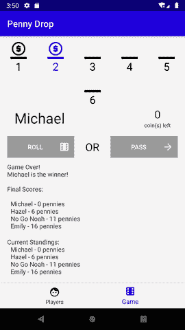

好吧，这并不像感觉上那么令人兴奋。由于应用的工作方式与之前没有太大不同，我们在玩的时候不会看到太大差异。我们改变了后端处理事物的方式，但 UI 基本相同。然而，我们现在可以关闭应用，然后从上次离开的地方继续，而且我们还有所有玩过游戏的存储记录。

下一章将利用先前玩过游戏的记录向用户展示一些玩家排名。我们将显示每位玩家的获胜次数和比赛次数，按历史获胜次数最多的玩家排序。这将在一个连接到新 fragment 的新标签页中完成，利用 Android 的`RecyclerView`组件。这个视图组件显示项目列表，可以处理大量条目，在我们的例子中，这些数据是从数据库检索的。我们甚至能够根据显示的玩家使用条件逻辑来设置每个列表项的样式。

Copyright © 2021, The Pragmatic Bookshelf.

## 第 6 章

使用 RecyclerView 构建列表

我们终于进入了 Penny Drop 应用的最后阶段。从游戏意义上讲，应用已经完成，因为你可以与人或 AI 玩家对战，并且可以在稍后时间回到游戏中。但我们仍然可以添加一些更有价值的功能。

首先，我们将在应用中添加排名。我们将添加一个包含`RecyclerView`列表的新`RankingsFragment`。`RecyclerView`是在 Android 中高效显示项目列表的一种方式，因为该视图在背后进行了许多优化。用户还看不到的项目会提前绑定，以确保流畅滚动，此外新的列表项会自动且主动地创建。我们甚至能够告知`RecyclerView`如何确定列表项是否已更改，从而避免在仅更新单个项目时刷新整个列表。

除了`RecyclerView`，还会添加一些其他支持类来填充列表。其中一些我们之前已经见过：一个新的`ViewModel`类、Room 的`@Relation`注解，以及一个用于保存每个项目数据的附加数据类。此外，我们正在创建一个适配器类，它处理`RecyclerView`的数据，并通过一个名为`ViewHolder`的组件处理每个列表项的绑定。作为参考，`ViewHolder`类负责处理如何在`RecyclerView`列表中的项目和行之间绑定数据。

在本章结束时，我们将拥有一个看起来类似于所示图片的排名标签页。

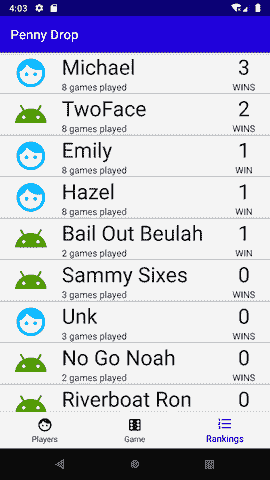

现在是多玩几局 Penny Drop 的好时机。玩的游戏越多，我们的排名列表就会越有趣。与新玩家一起玩，或者加入一些 AI 玩家。做任何你想做的事情，为我们提供一些额外的数据。完成后，我们将继续将`RecyclerView`添加到我们的应用中。

### 添加 RecyclerView

我们的第一站是新的`RankingsFragment`类及其内部的`RecyclerView`组件。我们可以像以前一样添加新的`Fragment`类，右键点击 fragments 包并选择 New > Fragment > Fragment (Blank)。请注意，该菜单中有一个选项是 Fragment (List)；这会为我们完成很多所需的工作。

但我说"可以"生成`Fragment`类是有原因的。我想第一次手动创建每个部分，以便清楚设置`RecyclerView`需要哪些内容。此外，Android Studio 会添加很多我们不需要的代码，所以让我们省去删除所有不需要的东西的麻烦。继续向 fragments 包添加一个名为`RankingsFragment`的新类，并向`res > layout`添加一个名为`fragment_rankings.xml`的文件。这两个主要部分就是生成新`Fragment`类时会添加的。

`RankingsFragment`类目前不需要太多内容。该类应该继承自`Fragment`，我们需要在`onCreateView`中加载视图布局。

```
class RankingsFragment : Fragment() {

  override fun onCreateView(

    inflater: LayoutInflater,

    container: ViewGroup?,

    savedInstanceState: Bundle?

  ): View? {

    val view =

      inflater.inflate(R.layout.fragment_rankings, container, false)

    return view

  }

}
```

在将`<RecyclerView>`添加到布局文件之前，我们需要在`build.gradle`文件中包含库和依赖变量。

```
ext {

  // 其他依赖仍然在这里

  nav_version = '2.3.3'

  recycler_view_version = '1.1.0'

  room_version = '2.3.0-beta01'

}

dependencies {

  其他依赖

  implementation "androidx.navigation:navigation-ui-ktx:$nav_version"

  implementation

  "androidx.recyclerview:recyclerview:$recycler_view_version"

  implementation "androidx.room:room-ktx:$room_version"

  其他依赖

}
```

与`RankingsFragment`相比，`fragment_rankings.xml`文件同样简洁，因为它只包含`<RecyclerView>`。这里唯一值得注意的属性是`app:layoutManager`，它告诉`<RecyclerView>`如何显示内容。由于我们将拥有一个基本列表，我们可以使用`RecyclerView`库中现有的`LinearLayoutManager`。整个`fragment_rankings.xml`文件如下所示：

```
<?xml version="1.0" encoding="utf-8"?>

<androidx.recyclerview.widget.RecyclerView

  xmlns:android="http://schemas.android.com/apk/res/android"

  xmlns:app="http://schemas.android.com/apk/res-auto"

  xmlns:tools="http://schemas.android.com/tools"

  android:id="@+id/rankings_list"

  android:name="dev.mfazio.pennydrop.fragments.RankingsFragment"

  android:layout_width="match_parent"

  android:layout_height="match_parent"

  app:layoutManager="LinearLayoutManager"

  tools:context=".fragments.RankingsFragment" />
```

有了这两个文件，我们现在可以将`RankingsFragment`添加到底部导航栏了。需要提前做的一件事是为该底部导航项添加一个新图标。添加方式与之前的两个底部导航条目相同：右键点击`res > drawable`，然后选择`New > Vector Asset`。我选择了格式列表编号图像，但你可以自由选择任何对你有意义的图像。一旦添加到项目中，打开`menu/navigation.xml`并添加一个新的`<item>`：

```
<?xml version="1.0" encoding="utf-8"?>

<menu xmlns:android="http://schemas.android.com/apk/res/android">

    <item

        android:id="@+id/pickPlayersFragment"

        android:icon="@drawable/ic_baseline_face_24"

        android:title="@string/players" />

    <item

        android:id="@+id/gameFragment"

        android:icon="@drawable/mdi_dice_6_black_24dp"

        android:title="@string/game" />

    <item

        android:id="@+id/rankingsFragment"

        android:icon="@drawable/ic_baseline_format_list_numbered_24"

        android:title="@string/rankings" />

</menu>
```

在添加了新的`@string/rankings`值（"Rankings"）之后，打开`navigation/nav_graph.xml`并在其中添加新的`<fragment>`条目：

```
<?xml version="1.0" encoding="utf-8"?>

<navigation xmlns:android="http://schemas.android.com/apk/res/android"

    xmlns:app="http://schemas.android.com/apk/res-auto"

    android:id="@+id/nav_graph"

    app:startDestination="@id/rankingsFragment">

    <fragment

        android:id="@+id/pickPlayersFragment"

        android:name="dev.mfazio.pennydrop.fragments.PickPlayersFragment"

        android:label="fragment_pick_players" />

    <fragment

        android:id="@+id/gameFragment"

        android:name="dev.mfazio.pennydrop.fragments.GameFragment"

        android:label="fragment_game" />

    <fragment

        android:id="@+id/rankingsFragment"

        android:name="dev.mfazio.pennydrop.fragments.RankingsFragment"

        android:label="fragment_rankings" />

</navigation>
```

你可能已经注意到，我将`app:startDestination`的值改为了新的`@id/rankingsFragment`。我这样做是暂时的，因为整个章节都会在这个视图中度过（除非你想再玩几局游戏来获取更多数据）。实际上，我们现在已经处于可以安全运行应用的状态了，尽管此时还不会显示任何数据。但我们至少可以验证导航是否正常工作。

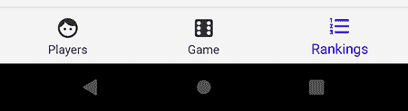

如果你的应用导航没问题，那我们就往里面添加一些数据吧。我们将从构建表示每个列表项如何显示的布局文件开始，然后在一个新的`ListAdapter`类中使用该布局。

### 构建列表项布局

本节最终目标是让`PlayerSummaryAdapter`准备就绪，但首先需要完成之前提到的类和布局文件。`PlayerSummary`类是一个基本的数据类，用于保存每个用户的获胜次数和游戏总次数。我们将使用这个类来确定每行显示什么内容。该类的代码如下所示：

```
package dev.mfazio.pennydrop.types

data class PlayerSummary(

    val id: Long,

    val name: String,

    val gamesPlayed: Int = 0,

    val wins: Int = 0,

    val isHuman: Boolean = true

)
```


这里没什么其他可说的，所以我们可以继续往下看使用`PlayerSummary`类实例的地方，一个名为`player_summary_list_item.xml`的新布局文件。

这个布局文件看起来与之前的很相似，尤其是我们在*添加玩家行而不重复自己（太多）*中看到的`player_list_item.xml`布局文件。我们有一个通用的`<layout>`标签包裹整个视图，一个`<data>`标签包含一个`<variable>`（`playerSummary`变量），然后是带有所有视图的主`<ConstraintLayout>`。是的，那个通用的`<layout>`标签意味着我们可以对每个排行榜列表行使用数据绑定，这简化了我们需要的代码。`<ConstraintLayout>`之外的所有内容看起来像这样：

```
<layout xmlns:android="http://schemas.android.com/apk/res/android"
    xmlns:app="http://schemas.android.com/apk/res-auto"
    xmlns:tools="http://schemas.android.com/tools">

    <data>
        <variable
            name="playerSummary"
            type="dev.mfazio.pennydrop.types.PlayerSummary" />
    </data>

    ConstraintLayout is down here.
</layout>
```

作为本章开头的提醒，行将如下所示：


主`<ConstraintLayout>`有一个高度（`wrap_content`）和宽度（`match_parent`）、一个`<ImageView>`，以及四个`<TextView>`组件。其中大部分与我们在前几章看到的相同，但有几个有趣的部分值得指出。让我们从`<ImageView>`开始。

我们将重用*添加可绘制背景*中的 Face 和 Android 图标，但不再像处理 human/AI `<SwitchCompat>` 时那样创建新的可绘制 XML 文件，而是在`BindingAdapters.kt`中创建几个新函数。

##### 添加 BindingAdapters

我们需要两个新的`@BindingAdapter`函数：`bindPlayerSummaryAvatarSrc`和`bindPlayerSummaryAvatarTint`。两个函数做的事情类似：根据列出的玩家是否是人类来设置`<ImageView>`的属性。虽然我们可以将两个函数合并为一个，但每个函数修改的是不同的属性，所以我觉得分开来更有意义。

`bindPlayerSummaryAvatarSrc`调用`imageView`上的`setImageResource`函数，并从`R.drawable`中赋值，如下所示：

```
@BindingAdapter("playerSummaryAvatarSrc")
fun bindPlayerSummaryAvatarSrc(imageView: ImageView, isHuman: Boolean) {
    imageView.setImageResource(
        if (isHuman) {
            R.drawable.ic_baseline_face_24
        } else {
            R.drawable.ic_baseline_android_24
        }
    )
}
```

这不是最激动人心的函数，但它确实让我们避免了在布局文件中写冗长的条件语句。如果你更喜欢那样做，请便。功能上，它们是相同的——我只是更喜欢用 Kotlin 代码，而不是布局文件中冗长的三元语句。如果你确实想走那条路，它看起来会是这样的（而且在 XML 中正确格式化后，无法放在这一页上）：

```
@{playerSummary.isHuman ?
    @drawable/ic_baseline_face_24 :
    @drawable/ic_baseline_android_24}
```

`bindPlayerSummaryAvatarTint`绑定适配器类似，但不再调用`setImageResource`，而是使用`setImageTintList`。这个函数可能看起来很奇怪，但它等同于使用`android:tint`属性。另外，由于我们使用的是 Kotlin，"setter" 方法可以像属性一样访问，这意味着我们可以改为给`imageView.imageTintList`赋值。

这里另一个奇怪的部分是，我们处理的是`ColorStateList`对象，而不仅仅是`Color`。这等同于我们之前用`ai_toggle_color.xml`文件所做的，当时我们有一个颜色列表及其关联的状态值。但由于我们只关心使用一种颜色，这里可以省去一些麻烦。

在`androidx.databinding.adapters.Converters`包中，我们可以使用一个名为`convertColorToColorStateList()`的函数。这有点杀鸡用牛刀，因为这个函数的主体仅仅是`ColorStateList.valueOf(color)`，但我喜欢它所提供的可读性。

获取`Color`对象比像我们之前那样直接获取`Int`要复杂一些，所以我们要使用`ImageView`上的`Context`对象来进行转换。使用与`isHuman`类似的条件块，我们可以获取想要的颜色资源值，然后调用`imageView.context.getColor`来处理从颜色资源 ID 到颜色 ID 值的转换。整个`@BindingAdapter`函数如下所示：

```
@BindingAdapter("playerSummaryAvatarTint")
fun bindPlayerSummaryAvatarTint(imageView: ImageView, isHuman: Boolean) {
    imageView.imageTintList = convertColorToColorStateList(
        imageView.context.getColor(
            if (isHuman) {
                android.R.color.holo_blue_bright
            } else {
                android.R.color.holo_green_light
            }
        )
    )
}
```

两个函数都准备好后，我们可以在`<ImageView>` XML 中使用它们。这看起来和我们已经创建的许多视图很像，但多了几个专门用于处理图像的属性。`android:adjustViewBounds="true"`允许操作系统调整图标大小以适应允许的区域。没有这个属性，我们最终会在每行左侧得到一个相当小的 Face 或 Android 图像。`android:scaleType="fitCenter"`也用于调整大小并放大每行的图标。这告诉操作系统实际执行我们通过`android:adjustViewBounds`允许的调整大小操作。包含所有属性的完整`<ImageView>`如下所示：

```
<ImageView
    android:id="@+id/playerTypeImage"
    android:layout_width="wrap_content"
    android:layout_height="0dp"
    android:layout_marginStart="16dp"
    android:adjustViewBounds="true"
    android:contentDescription="@string/player_type_image"
    android:padding="5dp"
    android:scaleType="fitCenter"
    app:layout_constraintBottom_toBottomOf="parent"
    app:layout_constraintStart_toStartOf="parent"
    app:layout_constraintTop_toTopOf="parent"
    app:playerSummaryAvatarSrc="@{playerSummary.isHuman}"
    app:playerSummaryAvatarTint="@{playerSummary.isHuman}" />
```

正如我们之前看到的`app:isHidden`属性一样，我们的绑定适配器被添加到`app`命名空间中，并引用它们所添加到的视图。确保添加`@string/player_type_image`字符串资源，然后图像就可以使用了。

##### 向列表项添加 TextView

每行有四个独立的`<TextView>`组件：玩家姓名、已玩游戏次数、获胜总数，以及根据获胜次数显示的 WIN 或 WINS 字样。我们可以一次性查看这些，因为它们中很少有新内容，但先有几个要点需要指出。

如果你还记得，在数据绑定表达式中将数值作为文本会导致问题。我们可以在每个绑定表达式中附加一个空字符串，或者也可以向`PlayerSummary`添加一个新值。选择权在你，但我喜欢额外值的方法，所以我添加了`winsString`，它对获胜值调用`toString()`。这没什么特别的，但它能让布局文件稍微整洁一些。`gamesPlayed`会有同样的问题，但我们已经将它附加到一个`String`上，用于 UI 中的"已玩游戏"部分。

最后一个值得注意的部分是"win"或"wins"文本。虽然我们可以添加代码来手动切换这些值，或者干脆使用"win(s)"，但这感觉正是介绍 Android 中数量字符串或复数概念的绝佳时机。与字符串资源类似，复数形式通过资源名称而非硬编码文本值来提供`String`值，这有助于翻译。

但复数与字符串资源的不同之处在于，你要向`<plurals>`条目添加多个`<item>`标签，每个`<item>`代表不同的数量值。这些值是`zero`、`one`、`two`、`few`、`many`和备用的`other`。

请注意，并非所有语言都支持所有这些值。例如，英语只使用`one`和`other`。有关数量字符串的更多详细信息，可以在[`link.mfazio.dev/plurals`](https://link.mfazio.dev/plurals)找到文档。

在我们的例子中，我们将有两个数量：`one`（值为 "win"）和`other`（"wins"）。完整的`res/values/plurals.xml`文件如下所示：

```
<?xml version="1.0" encoding="utf-8"?>
<resources>
    <plurals name="wins">
        <item quantity="one">win</item>
        <item quantity="other">wins</item>
    </plurals>
</resources>
```

然后我们可以通过数据绑定在 XML 中使用这些值。我们引用复数的方式与字符串资源相同，但也要发送用于确定数量的数字。这就产生了一个类似`android:text="@{@plurals/wins(playerSummary.wins)}"`的语句。

关于 Win/Wins 文本的最后一个有用属性：我们希望该文本全部大写，这可以通过`android:textAllCaps`属性实现。这有助于避免为给定单词分别设置正常大小写和全大写的字符串资源值。

以下是`<ConstraintLayout>`的其余部分，即前面提到的四个`<TextView>`组件：

```
<TextView
    android:id="@+id/playerName"
    android:layout_width="wrap_content"
    android:layout_height="wrap_content"
    android:layout_marginStart="16dp"
    android:text="@{playerSummary.name}"
    android:textSize="32sp"
    app:layout_constraintBottom_toTopOf="@id/playerGamesPlayed"
    app:layout_constraintStart_toEndOf="@id/playerTypeImage"
    app:layout_constraintTop_toTopOf="parent"
    tools:text="Michael" />

<TextView
    android:id="@+id/playerGamesPlayed"
    android:layout_width="wrap_content"
    android:layout_height="wrap_content"
    android:text='@{playerSummary.gamesPlayed + " " + @string/games_played}'
    app:layout_constraintBottom_toBottomOf="parent"
    app:layout_constraintStart_toStartOf="@id/playerName"
    app:layout_constraintTop_toBottomOf="@id/playerName"
    tools:text="23 games played" />

<TextView
    android:id="@+id/playerGamesWon"
    android:layout_width="48dp"
    android:layout_height="wrap_content"
    android:layout_marginEnd="16dp"
    android:text='@{playerSummary.winsString}'
    android:textAlignment="center"
    android:textSize="32sp"
    app:layout_constraintEnd_toEndOf="parent"
    app:layout_constraintStart_toStartOf="@id/textWins"
    app:layout_constraintTop_toTopOf="parent"
    tools:text="10" />

<TextView
    android:id="@+id/textWins"
    android:layout_width="48dp"
    android:layout_height="wrap_content"
    android:layout_marginEnd="16dp"
    android:text="@{@plurals/wins(playerSummary.wins)}"
    android:textAlignment="center"
    android:textAllCaps="true"
    app:layout_constraintBottom_toBottomOf="parent"
    app:layout_constraintEnd_toEndOf="parent"
    tools:text="wins" />
```


现在列表项布局已经完成，我们可以开始构建`PlayerSummaryAdapter`类了。

## 创建自定义 ListAdapter

`PlayerSummaryAdapter`类负责管理列表中所有的`PlayerSummary`项，并处理它们的显示方式。我们使用一个自定义的`RecyclerView.ViewHolder`内部类（即它位于`PlayerSummaryAdapter`内部）来将`PlayerSummary`项绑定到布局，然后由`RecyclerView`库处理其余工作。我们在`PlayerSummaryAdapter`中需要做的只是告诉`RecyclerView`在创建和绑定新的`ViewHolder`时该做什么，以及如何区分列表中的`PlayerSummary`项。

在`adapters`包中创建`PlayerSummaryAdapter`后，首先是`PlayerSummaryViewHolder`内部类。`PlayerSummaryAdapter`类既包含又依赖于这个类，因此我们先创建它，然后将`PlayerSummaryAdapter`包裹在它周围。`PlayerSummaryViewHolder`类继承自`RecyclerView.ViewHolder`，有一个单独的函数`bind`，它接收一个`PlayerSummary`对象。

`bind`函数除了将`binding.playerSummary`赋值为`item`值外，不做其他事情。`binding`值是`PlayerSummaryListItemBinding`的一个实例，这是我们在`player_summary_list_item.xml`文件中添加通用`<layout>`标签时由数据绑定库生成的。`item`值则是传入该方法的`PlayerSummary`对象。赋值完成后，`bind`接着确保绑定被执行，以便数据通过`executePendingBindings()`函数正确显示。

```
inner class PlayerSummaryViewHolder(

    private val binding: PlayerSummaryListItemBinding

) :

    RecyclerView.ViewHolder(binding.root) {

    fun bind(item: PlayerSummary) {

        binding.apply {

            playerSummary = item

            executePendingBindings()

        }

    }

}
```

围绕这个内部类的`PlayerSummaryAdapter`类继承自`ListAdapter`，它接受两个类型参数和一个`DiffUtil.ItemCallback`实例。类型参数分别是列表中的项类型（`PlayerSummary`）和这些项的`ViewHolder`类型（`PlayerSummaryAdapter.PlayerSummaryViewHolder`）。回调部分是文件末尾一个名为`PlayerSummaryDiffCallback`的新私有类（取名没什么创意）。该类如下所示：

```
private class PlayerSummaryDiffCallback :

    DiffUtil.ItemCallback<PlayerSummary>() {

    override fun areItemsTheSame(

        oldItem: PlayerSummary,

        newItem: PlayerSummary

    ): Boolean = oldItem.id == newItem.id

    override fun areContentsTheSame(

        oldItem: PlayerSummary,

        newItem: PlayerSummary

    ): Boolean = oldItem == newItem

}
```

`PlayerSummaryDiffCallback`和`PlayerSummaryViewHolder`都准备好后，我们可以创建`PlayerSummaryAdapter`了。这个继承自`ListAdapter`的类还将包含几个我们稍后会创建的重写函数。类声明加上之前的其他类和函数一起看起来像这样：

```
class PlayerSummaryAdapter :

    ListAdapter<PlayerSummary, PlayerSummaryAdapter.PlayerSummaryViewHolder>(

        PlayerSummaryDiffCallback()

    ) {

    //Overridden functions will go here in a bit.

    inner class PlayerSummaryViewHolder(

        private val binding: PlayerSummaryListItemBinding

    ) :

        RecyclerView.ViewHolder(binding.root) {

        fun bind(item: PlayerSummary) {

            binding.apply {

                playerSummary = item

                executePendingBindings()

            }

        }

    }

}

private class PlayerSummaryDiffCallback :

    DiffUtil.ItemCallback<PlayerSummary>() {

    override fun areItemsTheSame(

        oldItem: PlayerSummary,

        newItem: PlayerSummary

    ): Boolean =

        oldItem.id == newItem.id

    override fun areContentsTheSame(

        oldItem: PlayerSummary,

        newItem: PlayerSummary

    ): Boolean =

        oldItem == newItem

}
```

按照目前所写的`PlayerSummaryAdapter`，应该会有一个错误，因为我们尚未实现`ListAdapter`的两个抽象函数：`onCreateViewHolder`和`onBindViewHolder`。这两个函数实际上都只有一步，所以我们可以很快完成它们。

`onCreateViewHolder`需要知道如何构建`PlayerSummaryViewHolder`的实例。这意味着我们要使用`DataBindingUtil`类来膨胀我们的布局，就像本书中之前做过几次的那样，将其传入一个新的`PlayerSummaryViewHolder`实例，然后从函数返回该实例。

```
override fun onCreateViewHolder(

    parent: ViewGroup,

    viewType: Int

): PlayerSummaryViewHolder =

    PlayerSummaryViewHolder(

        DataBindingUtil.inflate(

            LayoutInflater.from(parent.context),

            R.layout.player_summary_list_item,

            parent,

            false

        )

    )
```

`onBindViewHolder`更加简单，它使用来自`onCreateViewHolder`的`PlayerSummaryViewHolder`实例，然后将一个`PlayerSummary`项传入`bind`函数。我们使用`ListAdapter`类的`getItem()`函数来根据列表中的位置获取正确的`PlayerSummary`。这是继承自`ListAdapter`类的一个主要优势——它几乎为我们处理了所有关于项管理和获取正确项的工作。

```
override fun onBindViewHolder(

    viewHolder: PlayerSummaryViewHolder,

    position: Int

) {

    viewHolder.bind(getItem(position))

}
```

`PlayerSummaryAdapter`现在已经可以使用了，所以我们可以前往`RankingsFragment`类来将所有内容连接起来。

## 将适配器连接到 RecyclerView

在这里，我们要扩展之前为`RankingsFragment`设置的代码。在`onCreateView()`函数内部，我们实例化一个`PlayerSummaryAdapter`对象，然后将其分配给`RecyclerView`。检索`RecyclerView`对象比我们之前获取视图组件时要容易，因为之前膨胀的整个视图就是一个`<RecyclerView>`。因此，我们可以将`view`值转换为`RecyclerView`实例，然后设置`adapter`属性。我们还要向`RecyclerView`添加一个`ItemDecoration`，它在每行之间添加浅灰色线条。

```
override fun onCreateView(

    inflater: LayoutInflater,

    container: ViewGroup?,

    savedInstanceState: Bundle?

): View? {

    val view =

        inflater.inflate(R.layout.fragment_rankings, container, false)

    val playerSummaryAdapter = PlayerSummaryAdapter()

    if (view is RecyclerView) {

        with(view) {

            adapter = playerSummaryAdapter

            addItemDecoration(

                DividerItemDecoration(

                    context,

                    LinearLayoutManager.VERTICAL

                )

            )

        }

    }

    return view

}
```

这是 Kotlin 中智能转换的另一个很好的例子，我们之前在"Update roll() and pass() Functions"中首次见到。由于我们检查了`view`是`RecyclerView`的实例，所以在整个代码块中`view`都被视为`RecyclerView`实例，而不需要创建新值。

另外，我们通常会在`RecyclerView`上这样为`layoutManager`赋值：

```
layoutManager = LinearLayoutManager(context)
```

然而，这并非必需，因为我们已经在`fragment_rankings.xml`中的`<RecyclerView>`标签内处理好了`LayoutManager`的设置。

`RecyclerView`现已完成，并分配了适配器来处理所有数据。我们在这里需要介绍的最后一个部分是如何将数据从数据库获取到`PlayerSummaryAdapter`中。为此，我们将创建`RankingsViewModel`，并从那里观察一个`LiveData`值。

## 从数据库加载数据到 RecyclerView

`RankingsViewModel`类与`GameViewModel`类似，我们都会获取`PennyDropRepository`的实例，然后获取`LiveData`返回。我们使用`Transformations`类将`Player`和`GameStatus`对象转换为`PlayerSummary`对象。然后，一旦完成，我们在`RankingsFragment`中观察来自`RankingsViewModel`的`playerSummaries` `LiveData`值，并用新数据更新`PlayerSummaryAdapter`。让我们逐一创建每个部分。

### 创建 RankingsViewModel

正如我所提到的，这将看起来与`GameViewModel`类似，我们获取`PennyDropRepository`的实例。整个`RankingsViewModel`类看起来像这样，不包括`Transformations.map`逻辑（我们很快就会介绍）。

```
class RankingsViewModel(application: Application) :

    AndroidViewModel(application) {

    private val repository: PennyDropRepository

    val playerSummaries: LiveData<List<PlayerSummary>>

    init {

        this.repository = PennyDropDatabase

            .getDatabase(application, viewModelScope)

            .pennyDropDao()

            .let { dao ->

                PennyDropRepository.getInstance(dao)

            }

        playerSummaries = Transformations.map(

            this.repository.getCompletedGameStatusesWithPlayers()

        ) { statusesWithPlayers ->

            // We'll fill this in next.

        }

    }

}
```

在继续之前，我们需要在`PennyDropRepository`和`PennyDropDao`中添加一个`getCompletedGameStatusesWithPlayers`函数。此外，我们需要一个新类`GameStatusWithPlayer`，它将从这些函数返回。`GameStatusWithPlayer`与`GameWithPlayers`类似，但使用`GameStatus`和`Player`对象，而不是`Game`和`List<Player>`：

```
data class GameStatusWithPlayer(

    @Embedded val gameStatus: GameStatus,

    @Relation(

        parentColumn = "playerId",

        entityColumn = "playerId"

    )

    val player: Player

)
```

仓库函数再次只是对 DAO 函数的透传，这是一个查询，我们获取所有属于已完成游戏的`GameStatus`对象。我们通过在 games 表上使用子 query 来实现这一点：

```
@Transaction

@Query(

    """

    SELECT * FROM game_statuses gs

    WHERE gs.gameId IN (

        SELECT gameId FROM games

        WHERE gameState = :finishedGameState

    )

    """

)

abstract fun getCompletedGameStatusesWithPlayers(

    finishedGameState: GameState = GameState.Finished

): LiveData<List<GameStatusWithPlayer>>
```


在这个函数中有一个不会改变的值的参数有些尴尬，但我觉得这样写查询比使用`WHERE gameState = 1`之类的更具可读性。这个参数的设置也是我在函数名中使用`completed`一词的原因，尽管从技术上讲你可以传入任何你想要的状态。通过给它一个特定的名称，希望函数的用途是明确的，未来的开发者不会错误地使用它。

> **IN 子句限制为 999 项**
>
> 由于 SQLite 的限制，`IN`子句限制为 999 项。如果超过这个数量，应用将会崩溃。在很多情况下，这不是问题，但它确实可能出现，所以在编写查询时要注意。

在`PennyDropRepository`和`PennyDropDao`中添加了函数后，我们可以返回去添加`Transformations.map`逻辑。

在这个块中，我们获取`List<GameStatusWithPlayer>`（`statusesWithPlayers`值）并将其转换为`List<PlayerSummary>`。我们通过将`GameStatusWithPlayer`按关联的玩家分组，然后将每个`Player`/`List<GameStatus>`对映射到新的`PlayerSummary`对象来实现这一点。`gamesPlayed`属性是与玩家关联的`GameStatus`对象的数量，而`wins`属性获取玩家 pennies 值为 0 的游戏数量。

```
statusesWithPlayers
    .groupBy { it.player }
    .map { (player, statuses) ->
        PlayerSummary(
            player.playerId,
            player.playerName,
            statuses.count(),
            statuses.count { it.gameStatus.pennies == 0 },
            player.isHuman
        )
    }
```

这里的最后一步是将`PlayerSummary`对象按正确的顺序排列。首先，我们希望按玩家的胜场数排序，胜场最多的在顶部，胜场最少的在底部。这只需要在前面的语句末尾添加`.sortedByDescending { it.wins }`调用即可。

但如果不仅按胜场数排序，还按比赛场数排序，排名列表看起来会更好。我们可以看到谁赢得最多，但在平局的情况下，我们随后按谁打得最多来排序玩家。不幸的是，`sortedByDescending`不适用于多个条件，至少不需要大量额外代码的情况下是这样。

相反，我们可以使用`sortedWith`函数并传入一个`Comparator`对象来处理这些属性。`compareBy`函数位于`kotlin.comparisons`包中，可以引入多个选择器用于比较。这些选择器看起来与`sortedByDescending`的函数体类似，并且还有一个额外的好处，就是可以在值前面添加负号来按降序排序。`statusesWithPlayers`映射的最终版本看起来像这样：

```
statusesWithPlayers
    .groupBy { it.player }
    .map { (player, statuses) ->
        PlayerSummary(
            player.playerId,
            player.playerName,
            statuses.count(),
            statuses.count { it.gameStatus.pennies == 0 },
            player.isHuman
        )
    }
    .sortedWith(compareBy({ -it.wins }, { -it.gamesPlayed }))
```

`RankingsViewModel`现在可以使用了，让我们前往`RankingsFragment`进行设置。

### 在 RankingsFragment 中观察数据

我们可以像在其他两个`Fragment`类中一样，使用`activityViewModels`函数将`RankingsViewModel`添加到这个类中：

```
private val viewModel by activityViewModels<RankingsViewModel>()
```

然后，在`onCreateView`中设置好`RecyclerView`之后，我们将观察`playerSummaries` `LiveData`值的变化。当发生变化时，我们将调用`playerSummaryAdapter.submitList`来更新适配器的数据，这将随后更新`RecyclerView`。执行此操作的代码如下：

```
viewModel.playerSummaries.observe(viewLifecycleOwner) { summaries ->
    playerSummaryAdapter.submitList(summaries)
}
```

我们传入`viewLifecycleOwner`值来让`Observer`知道何时应该停止观察数据。这意味着当`RankingsViewModel`被释放时，我们也应该停止观察`playerSummaries`值。完成后，数据库中的任何更新现在将自动推送到排名`RecyclerView`。

### 测试数据更新

现在是时候运行应用并查看排名了。如果你之前玩了足够的游戏以获取一些数据，你应该会看到一个看起来像这样的排名屏幕：


另一个不错的测试方法是再玩一局便士掉落游戏，完成后切换到排名视图。你不仅会看到排名更新，还会看到最新游戏加入排名时的精美小动画。很酷吧？

### 小结与后续步骤

本章主要介绍了如何在应用中使用`RecyclerView`显示列表。我们完成了设置，连接了所有必需的组件，如`PlayerSummaryAdapter`，甚至还看到了一种从数据库引入数据的巧妙方式。任何时候你想在 Android 应用中显示列表，都会遵循类似的过程。当然，事情可能会变得更复杂，正如我们将在第 11 章使用分页显示数据中看到的那样，但核心组件和理念保持不变。

接下来，我们要做一些让用户能够个性化应用的事情。我们将利用`SettingsFragment`类为应用添加用户可选择的设置和主题。用户将能够更改便士掉落游戏中的便士数量、AI 的下落速度，甚至应用的外观。

版权所有 © 2021, The Pragmatic Bookshelf.

## 第 7 章

使用设置和主题自定义应用

便士掉落应用即将完成！一旦我们在这里完成更改，本书中涵盖的便士掉落的所有功能就将全部完成。我们将在第 14 章使用 JUnit 进行单元测试和第 15 章使用 Espresso 测试应用 UI 中添加一些测试，但就面向用户的更改而言，这就是全部了。

你问有哪些更改？我们将创建一个包含五个选项的`SettingsFragment`，然后在整个应用中处理所有这些选项。这些设置包括游戏玩法和外观感受的成对更改。我们还会添加一些关于应用的致谢信息，毕竟我们需要向[`materialdesignicons.com`](https://materialdesignicons.com)致谢，感谢他们的出色工作。我们的设置页面中的五个项目（如你在接下来的截图中所见）如下：

* **起始便士数量**：设置每位玩家在游戏开始时的便士数量。范围从 1 到 20。
* **快速 AI**：将 AI 延迟速度从一秒改为十分之一秒（1000 -> 100 毫秒）。
* **应用主题**：让用户从预设主题中进行选择。我们将在本章后面介绍如何实现。
* **主题模式**：用户可以选择始终使用浅色主题、深色主题，或使用系统当前主题。
* **关于便士掉落**：将用户带到新的`AboutFragment`，提供有关应用和其中使用的图标的一些信息。

我们将在本章中按顺序介绍每个首选项，了解如何使用保存的值并涵盖处理设置更改所需的所有其他更改。完成后，设置页面将如下所示：

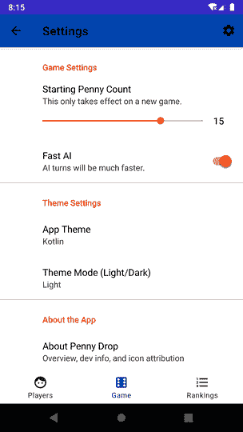

让我们从将`SettingsFragment`类添加到应用开始。

### 添加新的 SettingsFragment

首先，我想道歉并澄清本章中使用的术语。我们创建的类名为`SettingsFragment`，它继承自 AndroidX Preference 库的`PreferenceFragmentCompat`类。`SettingsFragment`处理多个`Preference`对象和`<Preference>`标签。

那为什么我们称之为"设置"而不是"首选项"呢？主要原因是官方 Android 开发者文档将这个概念称为设置：[`link.mfazio.dev/settings`](https://link.mfazio.dev/settings)。我知道用多个`Preference`项目来构建设置可能会令人困惑，但我遵循的是 Android 团队建立的惯例。另一个原因是`PreferenceFragment`类已经在 Preference 库中存在，因此给我们的类取不同的名字可以避免任何潜在的冲突和麻烦。

此外，当你点击大多数应用中的设置链接时，它使用的标签是"设置"而不是"首选项"，所以至少在这方面我们是一致的。不过，对于这可能造成的任何困惑，我表示歉意。

希望我们现在都在同一页上了，可以开始构建我们的`SettingsFragment`类了。正如我之前提到的，它继承自`PreferenceFragmentCompat`类。是的，设置这个类还有一点奇怪之处，但使用`PreferenceFragmentCompat`而不是`PreferenceFragment`是有充分理由的（而且不仅仅是因为后者在 API 级别 28 中被弃用了）。

`PreferenceFragment`继承自旧的`android.app.Fragment`类，而不是当前的`androidx.fragment.app.Fragment`类。Android 团队没有更改`PreferenceFragment`的父类并破坏任何未使用 AndroidX 库的应用，而是创建了一个新类并弃用了旧类。

说到 AndroidX，我们需要在应用中包含 Preference 库依赖。让我们在项目的`build.gradle`文件中添加另一个 ext 变量（名为`preference_version`，引用 Preference 库的最新版本），然后将`preference-ktx`依赖添加到应用的`build.gradle`中：

```
dependencies {
    // 其他依赖
    implementation "androidx.navigation:navigation-ui-ktx:$nav_version"
    implementation "androidx.preference:preference-ktx:$preference_version"
    implementation "androidx.recyclerview:recyclerview:$recycler_view_version"
    // 其他依赖
}
```

同步项目后，在 fragments 包中添加一个名为`SettingsFragment`的新类。正如我提到的，这个类将继承自`PreferenceFragmentCompat`，这是一个抽象类，有一个抽象函数：`onCreatePreferences`。这个函数接收函数的`savedInstanceState`和一个`rootKey` `String`值，我们将它们传递给`setPreferencesFromResource`函数。

有了这些部分，你的类应该看起来像这样：

```
package dev.mfazio.pennydrop.fragments

class SettingsFragment : PreferenceFragmentCompat() {

    override fun onCreatePreferences(
        savedInstanceState: Bundle?,
        rootKey: String?) {
        // 我们接下来会填充这个。
    }
}
```

这是我们在这个类中唯一要实现的函数，这意味着我们不动`onCreateView`。在我们所有其他的`Fragment`类中，我们重写了那个函数来设置布局并处理任何需要完成的绑定。然而，`PreferenceFragmentCompat`类为我们处理了所有这些。我们甚至不需要创建布局文件，因为它会为我们完成。我们需要的是某种方式来告诉`SettingsFragment`要显示哪些首选项。

这里我们有两个选择：XML 或代码。为了与我们在这个应用中处理视图的其他方式保持一致，我们这里选择通过 XML 资源文件来实现。如果你想了解如何通过代码添加首选项，请查看第 12 章个性化 Android 棒球联盟应用。

#### 添加首选项资源文件

与布局文件不同，首选项资源文件是`res/xml`文件夹中的通用 XML 文件。你可以随意命名这个文件；我选择`preferences.xml`。这个文件看起来会很像普通的布局文件，但没有我们之前使用的任何高度/权重/约束，因为库会为我们处理所有这些。

继续添加`preferences.xml`（或者你喜欢的任何名称）到`res/xml`目录下（你可能需要创建`xml`目录），然后打开该文件。从高层次来看，这个文件在顶层会有一个`<PreferenceScreen>`标签，带有我们常规的`xmlns:android`和`xmlns:app`命名空间属性。然后，在我们的例子中，我们有多个`<PreferenceCategory>`标签，每个标签带有一个`android:title`属性和一个或多个内部的`<Preference>`标签。`preferences.xml`文件，包括带有`<PreferenceCategory>`标签的`<PreferenceScreen>`标签，看起来像这样：

```
<?xml version="1.0" encoding="utf-8"?>
<PreferenceScreen
    xmlns:android="http://schemas.android.com/apk/res/android"
    xmlns:app="http://schemas.android.com/apk/res-auto">

    <PreferenceCategory android:title="Game Settings">
        <!-- This will contain the Penny Count and Fast AI preferences -->
    </PreferenceCategory>

    <PreferenceCategory android:title="Theme Settings">
        <!-- This will contain the Theme and Light/Dark Mode preferences -->
    </PreferenceCategory>

    <PreferenceCategory android:title="About the App">
        <!-- This will contain an "About the App" link -->
    </PreferenceCategory>

</PreferenceScreen>
```

`preferences.xml`文件创建好后，我们可以告诉`SettingsFragment`使用该文件来生成我们的视图：

```
override fun onCreatePreferences(
    savedInstanceState: Bundle?,
    rootKey: String?
) {
    setPreferencesFromResource(R.xml.preferences, rootKey)
}
```

现在`SettingsFragment`已经创建好并且 XML 已就位，我们可以将它添加到应用的导航中。

### 将设置页面添加到导航

我想立即澄清一点——当我说我们要将页面添加到应用的导航时，我指的是导航图（navigation graph），而不是底部导航组件。这意味着我们需要在`nav_graph.xml`中新增一个`<fragment>`条目：

```
<fragment
    android:id="@+id/settingsFragment"
    android:name="dev.mfazio.pennydrop.fragments.SettingsFragment"
    android:label="@string/settings" />
```

设置不是通过底部导航访问的，而是通过应用导航栏中的齿轮图标。为此，我们在`res/menu`资源目录中添加一个新图标和一个名为`options.xml`的新文件。齿轮矢量资源名为`Settings`；将它添加到项目中，然后在新的`options.xml`文件中的新`<item>`里引用它：

```
<?xml version="1.0" encoding="utf-8"?>
<menu xmlns:android="http://schemas.android.com/apk/res/android">
    <item
        android:id="@+id/settingsFragment"


`android:icon="@drawable/ic_baseline_settings_24"`

`android:title="@string/settings"`

`app:showAsAction="ifRoom" />`

`</menu>`

提前说明一下，`app:showAsAction="ifRoom"` 属性意味着只要应用栏中有空间，我们就会显示设置图标，如果没有空间，它会进入右上角的一个溢出（三个点）菜单。设置图标对我们来说应该始终显示，但当你向应用栏添加多个图标时，这个设置就变得更加重要了。

新文件准备好后（别忘了你的字符串资源），我们需要告诉 `MainActivity` 使用这个文件。

我们通过重写 `onCreateOptionsMenu()` 函数并膨胀 `options.xml` 文件来实现。

```
override fun onCreateOptionsMenu(menu: Menu?): Boolean {

    super.onCreateOptionsMenu(menu)

    menuInflater.inflate(R.menu.options, menu)

    return true

}
```

`MainActivity` 中的最后一步是告诉应用当有人点击设置齿轮时该做什么。由于我们只有一个选项可供选择，这简化了我们的逻辑。我们需要检查 `navController` 是否准备好导航到不同的视图，如果是，使用 `MenuItem` 类上的 `onNavDestinationSelected()` 函数。如果该函数调用不起作用（返回 `false`），我们回退到父类函数。

```
override fun onOptionsItemSelected(item: MenuItem): Boolean =

    if (this::navController.isInitialized) {

        item.onNavDestinationSelected(this.navController) ||

        super.onOptionsItemSelected(item)

    } else false
```

注意，我们通过检查 `navController` 的属性引用上的 `isInitialized` 属性来检查 `navController` 是否就绪，而不是检查属性本身。语法上的细微差别，但在功能上有很大的不同。

现在我们的应用将显示设置图标，如果我们点击该链接，就会进入设置屏幕，显示空的分类：

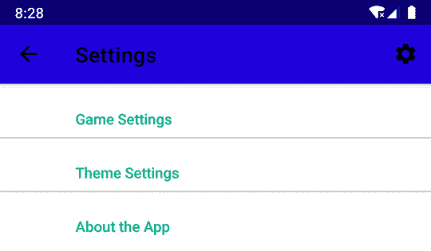

我们可以进入设置页面了，现在是时候在里面添加一些实际的偏好设置了。首先是游戏设置部分，这是了解偏好设置值如何工作的一个很好的入门。

### 添加游戏设置偏好

这两个偏好是应用中处理偏好的标准示例。我们在 `SettingsFragment` 中更改值，并在应用的其他地方使用它。库负责保存值并提供给我们检索它的机制，这意味着我们几乎不需要做手动工作。

起始硬币数量设置是一个 `<SeekBarPreference>`，意味着用户会得到一个代表数字的滑块来选择值。我们所有的偏好都有 `key`、`summary` 和 `title` 属性，而且大多数还有一个 `defaultValue` 属性。对于滑块，我们还可以额外设置最小值和最大值以及 `app:showSeekBarValue` 属性，这样他们选择的数字会显示在滑块末端。`<SeekBarPreference>` 的 XML 看起来像这样：

```
<SeekBarPreference

    android:defaultValue="10"

    android:key="pennyCount"

    android:max="20"

    android:summary="@string/starting_penny_count_new_game"

    android:title="@string/starting_penny_count"

    app:min="1"

    app:showSeekBarValue="true" />
```

除了创建几个字符串资源之外，这就足够了。我想特别指出最小值属性为什么在 `app` 命名空间中而不是 `android`。说实话，我不知道为什么这些属性采用这种方式，但只要知道在哪里设置它，就不是什么大问题。

快速 AI 设置是两个偏好中较简单的一个，只有基本的 `key`、`summary` 和 `title` 属性。我们在 `<SwitchPreferenceCompat>` 标签上设置这三个属性。同样，我们这里使用的是兼容版本，因为这样可以确保在旧设备上正确显示。对于我们当前的应用来说，这几乎肯定不会有什么区别，因为最低 API 级别是 26，但如果你以后要为旧设备编写应用，使用 `<SwitchPreferenceCompat>` 将确保开关在不同操作系统版本之间一致显示。这个偏好的代码如下：

```
<SwitchPreferenceCompat

    android:key="fastAI"

    android:summary="@string/fast_ai_summary"

    android:title="@string/fast_ai" />
```

我们现在可以运行应用来查看我们的新偏好设置，如图片所示。

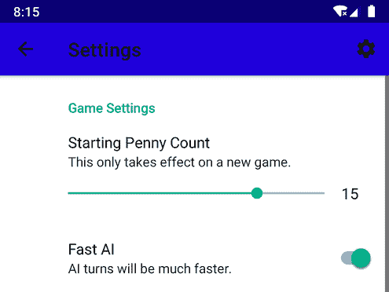

这些偏好值现在可以按我们的意愿更改，但它们显然还不起任何作用。接下来，我们需要从 `PreferenceManager` 类中获取偏好设置并在应用中使用它们。

### 使用已保存的偏好

除了 `PreferenceFragmentCompat` 类为我们处理的所有 UI 工作之外，值的更改也会自动保存和更新。要获取这些值，我们需要从 `PreferenceManager` 类获取一个 `SharedPreferences` 实例。在 `GameViewModel` 中，我们将执行此操作，并将结果赋值给一个新的 `prefs` 值：

```
private val prefs =

PreferenceManager.getDefaultSharedPreferences(application)
```

#### 使用快速 AI 偏好设置

我们现在可以使用 `prefs` 按需获取偏好设置值。虽然这与我们在 `SettingsFragment` 中设置的方式顺序不同，但让我们先处理快速 AI 设置，因为它只需修改一行代码。

在 `playAITurn` 函数中，我们目前有一个 1000 毫秒的延迟函数调用，用于模拟普通玩家花时间考虑选项。现在，我们要将其改为 100 毫秒，但仅在快速 AI 开关切换为 true 时生效。我们可以通过在我们创建的 `prefs` 值上调用 `getBoolean` 函数，并传入 `<SwitchPreferenceCompat>` 元素的键值来检查该值。这意味着 `playAITurn` 函数看起来像这样：

```
private suspend fun playAITurn() {

    delay(if (prefs.getBoolean("fastAI", false)) 100 else 1000)

    // 函数的其余部分仍在这里

}
```

`getBoolean` 的第二个参数是在 `fastAI` 设置没有值时的默认值。一旦用户进入设置页面并打开该设置，我们就会看到 AI 移动速度明显加快。你现在可以自行测试以确保一切正确。我很想展示截图，但加快 AI 回合速度在书中难以直观呈现。

#### 使用初始便士数量偏好设置

本节中的另一个设置 `pennyCount` 也在 `GameViewModel` 中进行设置。在 `startGame` 函数中，我们现在要将 `pennyCount` 值（默认值为 `Player.defaultPennyCount`）发送给 `PennyDropRepository.startGame` 函数：

```
suspend fun startGame(playersForNewGame: List<Player>) {

    repository.startGame(

        playersForNewGame,

        prefs?.getInt("pennyCount", Player.defaultPennyCount)

    )

}
```

正如你的 IDE 现在可能提示的，这也需要一些下游更改。`PennyDropRepository.startGame` 现在看起来像这样：

```
suspend fun startGame(players: List<Player>, pennyCount: Int? = null) =

    pennyDropDao.startGame(players, pennyCount)
```

在 `PennyDropDao` 中，`startGame` 函数现在将 `pennyCount` 作为参数，然后我们插入 `GameStatus` 对象的地方更新如下：

```
this.insertGameStatuses(

    playerIds.mapIndexed { index, playerId ->

        GameStatus(

            gameId,

            playerId,

            index,

            index == 0,

            pennyCount ?: Player.defaultPennyCount

        )

    }

)
```

这里可能的问题是"为什么不在 `PennyDropDao` 内部获取 `pennyCount` 值，而是让它通过所有层传递？"原因是 `PreferenceManager.getDefaultSharedPreferences` 函数需要引用一个 `Context` 对象。文档中说"[`getDefaultSharedPreferences` 函数]可以在应用程序的任何地方工作"，但这只有在您能够在所述位置获取 `Context` 对象时才成立。即使我们使用 `Context` 对象创建了 `PennyDropDatabase` 并从中获取 `PennyDropDao`，我们在这个类中也无法再访问该对象。

虽然我们可以某种方式在 `PennyDropDao` 中保存一个 `Context` 值，但我们不希望 Android 应用上下文引用被保存在随机位置。`GameViewModel` 已经可以访问 `Context` 对象（通过 `application` 值），所以这是访问我们偏好设置的最佳位置。

现在是运行你的应用、更改两个游戏设置并开始新游戏的好时机。你会在游戏屏幕上看到你所设置的起始便士数量，当有 AI 玩家时，你会看到快速 AI 开关带来的变化。

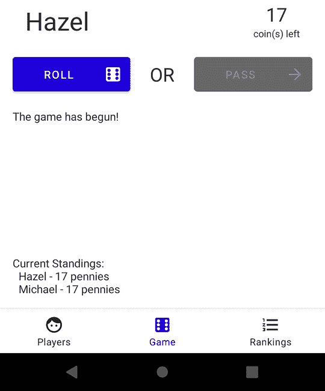

有了这些设置，并且你现在知道了如何获取偏好设置值，我们可以继续主题设置。我们需要创建几个主题，然后就可以在应用中切换它们了。一旦准备就绪，我们还将了解如何在浅色和深色模式之间切换。

### 添加主题

我们将添加一些新主题供用户选择，但在开始之前，我建议我们添加一个新库。Material Design Components (MDC) 库为我们提供了一种更简单的方式来处理应用中的 Material Design 样式。

特别是，我让我们添加这个库是因为它提供的 Material Theming 支持。Material Theming 为我们提供了额外的颜色属性，如 `colorSurface`，文档中注明它用于设置"组件的表面，如卡片、底板和菜单"。

在我们的案例中，我们用它设置在深色主题时应用栏的背景颜色（在浅色主题中使用主色）。添加 MDC 库并将我们的父主题更改为 `Theme.MaterialComponents.DayNight` 可以让我们访问额外的颜色属性以及一些外观变化（如圆角按钮）。

像平常一样添加这个库，指向最新的 MDC 版本，并包含一个 `material_version` ext 变量。

```
dependencies {

    //上面仍有其他依赖项

    implementation "com.google.android.material:material:$material_version"

}
```

主题在 `res/values/styles.xml` 文件中添加。现在，你可能只有一个名为 `AppTheme` 的主题，它继承自 `Theme.AppCompat.Light.DarkActionBar`。，我们将此更改为前面提到的 `Theme.MaterialComponents.DayNight` 值，这不仅提供了我所提到的 MDC 附加功能，还为我们处理浅色和深色模式之间的切换做好了准备。

我们的其他主题都将继承自 `AppTheme`，这使我们能够在其他主题中有效地拥有由基础主题设置的默认值。实际上，我们只关心 `colorSurface`，而且这仅与深色主题有关，但你可以在其他地方使用这种技术以取得很好的效果。

我在我的 `styles.xml` 版本中创建了五个额外的主题，它们看起来都与我即将展示的主题相似。如果你想查看所有主题，请务必查看代码中 `chapter-7/app-code` 文件夹。这个样式基于 Kotlin 徽标和品牌：

```
<style name="Kotlin" parent="AppTheme">

    <item name="colorPrimary">@color/kotlinBlue</item>

    <item name="colorPrimaryDark">@color/kotlinPurple</item>

    <item name="colorAccent">@color/kotlinOrange</item>

</style>
```

如你所见，此主题中定义了一些新的颜色资源值，因此我们需要将它们添加到 `res/values/colors.xml` 中：

```
<color name="kotlinBlue">#178dd7</color>

<color name="kotlinOrange">#f98908</color>

<color name="kotlinPink">#c359bc</color>

<color name="kotlinPurple">#806fe3</color>
```

请随意以相同方式添加你喜欢的任何主题。如果你想快速测试新主题，请打开你的 `AndroidManifest.xml` 并更改 `<application>` 标签内 `android:theme` 的值，如下所示：

```
<application

    android:allowBackup="true"

    android:icon="@mipmap/ic_launcher"

    android:label="@string/app_name"

    android:roundIcon="@mipmap/ic_launcher_round"

    android:supportsRtl="true"

    android:theme="@style/AppTheme">

    ...

</application>
```

在将新主题添加到 `styles.xml`（以及按需添加到 `colors.xml`）之后，我们可以继续为用户提供一种快速切换主题的方式。

### 更改主题

回到 `preferences.xml` 内部，让我们在主题设置类别中添加一个新的 `<DropDownPreference>`。除了之前设置的常规属性外，这里还有三个额外属性。

#### 添加额外的偏好属性

`app:useSimpleSummaryProvider` 负责在我们更改偏好值时更新摘要文本，我们可以在这里使用它，之后在夜间模式支持中也会用到。另外两个属性是 `android:entries` 和 `android:entryValues`，它们为我们提供了一种填充下拉列表的方式。这两个值都位于 `res/values/arrays.xml` 中（你可能需要创建该文件）。在添加这些值之前，以下是完整的 `<DropDownPreference>`：

```
<DropDownPreference

    android:defaultValue="AppTheme"

    android:entries="@array/themes"

    android:entryValues="@array/theme_values"

    android:key="theme"

    android:title="@string/app_theme"

    app:useSimpleSummaryProvider="true" />
```


现在，让我们去添加那些条目字符串。

### 添加条目和条目值

`arrays.xml` 资源文件包含若干 `<array>` 标签，每个标签内部有一个或多个条目。在我们的例子中，我们正在创建多个名为 `themes` 和 `theme_values` 的 `<string-array>` 集合。这些标签将包含多个子 `<item>` 标签，其中包含我们所有的标签或值。如果你想知道每个数组代表什么，我们将 `themes` 用作下拉列表的显示标签，而 `theme_values` 是我们从 `SharedPreferences` 对象中获取的实际值。我的 `arrays.xml` 文件目前如下所示（你的可能因主题不同而有所差异）：

```xml
<?xml version="1.0" encoding="utf-8"?>

<resources>

    <string-array name="themes">

        <item>Default</item>

        <item>Kotlin</item>

        <item>Crew</item>

        <item>FTD</item>

        <item>GPG</item>

        <item>HMF</item>

    </string-array>

    <string-array name="theme_values">

        <item>AppTheme</item>

        <item>Kotlin</item>

        <item>Crew</item>

        <item>FTD</item>

        <item>GPG</item>

        <item>Hazel</item>

    </string-array>

</resources>
```

有了这些设置，并且我们的 `<DropDownPreference>` 标签引用了 `arrays.xml` 中的两个数组，我们就可以开始使用这些值了。

### 使用选定的主题

除了像之前那样在 `AndroidManifest.xml` 中设置主题外，我们还可以在 `MainActivity` 的 `onCreate` 函数中通过主题 ID 来设置主题。为此，我们需要像之前那样从 `SharedPreferences` 类中获取主题 ID，将该文本值转换为资源 ID，然后调用 `setTheme`。再次提醒，你的主题值和 ID 可能因使用的主题而异：

```kotlin
val prefs =

    PreferenceManager.getDefaultSharedPreferences(this)

val themeId = when (prefs.getString("theme", "AppTheme")) {

    "Crew" -> R.style.Crew

    "FTD" -> R.style.FTD

    "GPG" -> R.style.GPG

    "Hazel" -> R.style.Hazel

    "Kotlin" -> R.style.Kotlin

    else -> R.style.AppTheme

}

setTheme(themeId)
```

这里最重要的是确保在调用 `setContentView` 之前完成 `setTheme` 函数调用。未能这样做将导致主题设置无法被正确应用。

这段代码已经设置好了，并且实现了我们需要的功能，但它只在创建 `MainActivity` 时生效，目前是在应用启动时。为了使其更加动态，不需要用户完全重启应用来更改主题，我们需要在 `SettingsFragment` 中添加一些逻辑。

### 处理偏好更改

在 `onCreatePreferences` 函数内部，我们可以检索已设置的任何偏好，并通过 `OnPreferenceChangeListener` 对象监视值的变化。这是 Kotlin 的另一个精彩之处，因为我们不必创建完整的 `OnPreferenceChangeListener` 类，甚至不必担心显式覆盖 `onPreferenceChange` 函数，而只需添加一个 `Preference.OnPreferenceChangeListener` 引用，并附带一个代码块作为该类唯一函数的主体。这与我们在*将玩家添加到 GameViewModel*中实现 `OnClickListener` 的方式类似。

我们可以使用键值通过 `findPreference` 函数获取 `DropDownPreference` 的实例，类似于使用 `findViewById` 函数的方式：

```kotlin
val themePreference = findPreference<DropDownPreference?>("theme")
```

一旦获得该实例，我们就可以（安全地）在 `themePreference` 值上赋值 `onPreferenceChangeListener`。我说"安全地"是因为 `themePreference` 是可空的，所以我们只想在 `themePreference` 不为 null 时才进行赋值。附加到 `OnPreferenceChangeListener` 的代码块只做一件事，即重新创建当前 Activity，然后返回 `true`：

```kotlin
themePreference?.onPreferenceChangeListener =

    Preference.OnPreferenceChangeListener { _, _ ->

        activity?.recreate()

        true

    }
```

注意，我忽略了该函数的两个参数，因为我们没有使用它们。这两个参数通常是被更改的 `Preference` 和一个代表新值的 `Any` 对象。我们这里不需要任何一个，但在更改主题模式时我们会用到它们。

如果你到目前为止还不知道，Kotlin 中的 `Any` 类相当于 Java 中的 `Object` 类。它是基础类型，可以用于任何（因此得名）任何类型的对象。

继续运行你的应用，尝试在几个主题之间切换。添加重新创建 Activity 的调用使我们不必在每次想要新主题时完全关闭并重新打开应用。接下来是切换浅色和深色模式，这是一个类似（且稍微更简单）的过程。

## 添加夜间模式支持

应用和网站的最新趋势之一是引入深色主题。随着 Android 10 的推出，深色主题支持终于被内置到操作系统中，让你的整个手机呈现出更暗的外观和感觉。

在我们的代码中，我们可以强制为用户设置应用的模式（尽管我们让他们选择自己喜欢的模式），或者我们可以使用系统的当前设置。通过结合使用 `Theme.MaterialComponents.DayNight` 父样式和来自 `AppCompatDelegate` 的模式值，我们可以自动更改整个应用的模式。

使这一切正常工作的关键是 `AppCompatDelegate.setDefaultNightMode` 函数。该函数接收一个模式 ID 值，并立即将应用切换为使用所选模式。在我们的例子中，我们关注三个值：`MODE_NIGHT_NO`、`MODE_NIGHT_YES` 和 `MODE_NIGHT_FOLLOW_SYSTEM`。你可以将它们分别理解为浅色、深色和跟随系统。我们需要做的是将这三个选项添加到 `SettingsFragment` 中，然后像处理主题一样进行响应，即根据已设置的值更改模式。

这比之前的方法更复杂，但考虑到我们之前所做的工作，它应该是有道理的。首先是添加一个新的 `<ListPreference>` 标签，并附带更多数组值。

### 添加带有条目的偏好

对于两个主题设置偏好，我们可以选择使用 `<DropDownPreference>` 或 `<ListPreference>`，因为两者的用途相似。我决定各用一个作为示例，但请随意选择你喜欢的偏好类型。此外，由于两个偏好的用途相似，它们的属性也将相同，只是值不同：

```xml
<ListPreference

    android:defaultValue="System"

    android:entries="@array/theme_modes"

    android:entryValues="@array/theme_mode_values"

    android:key="themeMode"

    android:title="@string/theme_mode"

    app:useSimpleSummaryProvider="true" />
```

我们还需要在 `arrays.xml` 中添加两组 `<string-array>`：

```xml
<string-array name="theme_modes">

    <item>Light</item>

    <item>Dark</item>

    <item>System Default</item>

</string-array>

<string-array name="theme_mode_values">

    <item>Light</item>

    <item>Dark</item>

    <item>System</item>

</string-array>
```

虽然我在这里没有这样做，但你也可以为这些条目使用字符串资源值。这是更好的方法，但我将这些值保留为字符串本身，以便让本章的内容更清晰。不过，如果你的应用需要进行任何语言翻译，你肯定会想要使用字符串资源值。

添加了 `<ListPreference>` 和数组值之后，我们可以为 `SettingsFragment` 添加另一个 `OnPreferenceChangeListener`。

### 响应偏好设置变更

事情的开始方式与之前相同。我们获取 `ListPreference` 的实例：

```kotlin
val themeModePreference = findPreference<ListPreference?>("themeMode")
```

然后我们添加一个 `OnPreferenceChangeListener` 来处理偏好设置变更时的情况：

```kotlin
themeModePreference?.onPreferenceChangeListener =

    Preference.OnPreferenceChangeListener { _, newValue ->

        //We'll finish this in a second.

    }
```

在这个代码块内部，我们需要获取 `newValue` 并确定用户想要哪种模式。我们可以再次使用 `when { ... }` 代码块来进行判断，然后调用 `AppCompatDelegate.setDefaultNightMode` 来设置它。这样做实际上会立即更改应用的主题，而无需重新创建 `Activity`。我们还想在这里的代码中设置一个默认值，因为这样做比读取 `android:defaultValue` 更有意义：

```kotlin
themeModePreference?.setDefaultValue(

    AppCompatDelegate.MODE_NIGHT_FOLLOW_SYSTEM

)

themeModePreference?.onPreferenceChangeListener =

    Preference.OnPreferenceChangeListener { _, newValue ->

        val nightMode = when (newValue?.toString()) {

            "Light" -> AppCompatDelegate.MODE_NIGHT_NO

            "Dark" -> AppCompatDelegate.MODE_NIGHT_YES

            else -> AppCompatDelegate.MODE_NIGHT_FOLLOW_SYSTEM

        }

        AppCompatDelegate.setDefaultNightMode(nightMode)

        true

    }
```

目前，模式仅在我们在设置页面中更改时才会设置。我们还需要在 `MainActivity` 中添加一些代码，以便在启动时使用保存的值。

### 在应用启动时设置主题模式

我们在这里采用的方法与处理应用主题时相同，只是最后调用的方法不同。

```kotlin
val nightMode = when (prefs.getString("themeMode", "")) {

    "Light" -> AppCompatDelegate.MODE_NIGHT_NO

    "Dark" -> AppCompatDelegate.MODE_NIGHT_YES

    else -> AppCompatDelegate.MODE_NIGHT_FOLLOW_SYSTEM

}

AppCompatDelegate.setDefaultNightMode(nightMode)
```

最好在 `setContentView` 调用之前添加这段代码，就像我们对 `setTheme` 调用所做的那样，但更改模式是按需进行的，所以这不是什么大问题。

现在，如果你运行了应用，你可能已经注意到在深色模式下，老虎机或游戏按钮几乎不可见。这是因为我们在所有场景中都设置了适用于浅色主题应用的颜色。虽然在我们只有浅色主题时这很有效，但对于整个应用中各种颜色，我们可以使用更灵活的方式。

### 在应用中处理主题模式颜色

早在 *Update Slot Bindings* 中，我们添加老虎机时，使用了三元表达式来选择每个元素的颜色：

```xml
android:tint=

"@{slot.lastRolled ? @color/colorPrimary : @android:color/black}"
```

相反，我们想将其更改为使用颜色状态列表资源文件。我们首次这样做是在 *Add Color to the Switch* 中。

在我们的例子中，当老虎机最后一次被掷出时，我们想要使用应用的主色。不幸的是，我们无法直接访问 `lastRolled` 属性，但我们可以使用 `lastRolled` 来设置视图的 `isActivated` 标志。在我们了解如何设置该标志之前，颜色状态列表看起来是这样的：

```xml
<selector xmlns:android="http://schemas.android.com/apk/res/android">

    <item android:color="?attr/colorPrimary"

        android:state_activated="true" />

    <item android:color="?android:attr/textColorPrimary" />

</selector>
```

现在，回到 `isActivated`。我们需要在 `BindingAdapters.kt` 文件中添加另一个函数，就像我们在 *Create Binding Adapters* 中所做的那样。幸运的是，这是一个足够简单的函数，只设置单个属性：

```kotlin
@BindingAdapter("slotLastRolled")

fun bindSlotLastRolled(view: View, lastRolled: Boolean) {

    view.isActivated = lastRolled

}
```

添加之后，我们现在可以在 `layout_coin_slot.xml` 的三个视图标签中添加 `app:slotLastRolled="@{slot.lastRolled}"`，然后更改每个颜色。我们最初是这样的：

```xml
android:tint=

"@{slot.lastRolled ? @color/colorPrimary : @android:color/black}"
```

我们可以将其更改为这样：

```xml
android:tint="@color/coin_slot_color"
```

同样地，我们想要将 Roll 和 Pass 按钮转换为使用颜色状态列表。此外，我们可以更改按钮的其他颜色（文本和可绘制对象），使其使用属性值而不是硬编码的 `@color` 资源值。这将允许应用根据所选主题自动更改这些颜色。

在 `res/color` 目录中创建两个新的颜色状态列表资源：`roll_button_color.xml` 和 `pass_button_color.xml`。每个资源在 `android:state_activated="true"` 时有一种颜色，否则使用 `?android:attr/textColorPrimary` 属性。

`roll_button_color.xml` 看起来是这样的：

```xml
<?xml version="1.0" encoding="utf-8"?>

<selector xmlns:android="http://schemas.android.com/apk/res/android">

    <item

        android:color="@android:color/darker_gray"

        android:state_enabled="false" />

    <item

        android:color="?attr/colorPrimaryDark"

        android:state_pressed="true"/>

    <item android:color="?attr/colorPrimary"/>

</selector>
```


而`pass_button_color.xml`看起来是这样的：

```
<?xml version="1.0" encoding="utf-8"?>
<selector xmlns:android="http://schemas.android.com/apk/res/android">
    <item
        android:color="@android:color/darker_gray"
        android:state_enabled="false" />
    <item
        android:color="?attr/colorAccent"/>
</selector>
```

我在 Roll 按钮中添加了`android:state_pressed`的`<item>`，以便在用户点击该按钮时提供额外的反馈。这是一个可选的部分，但展示了如何在一个颜色状态列表中组合不同的状态属性。

然后我们可以回到`fragment_game.xml`来使用新的颜色状态列表文件。在那里的时候，让我们也更新一下`android:drawableTint`和`android:textColor`属性。带有更新属性的完整 Roll `<Button>`标签看起来是这样的：

```
<Button
    android:layout_width="0dp"
    android:layout_height="wrap_content"
    android:layout_weight="3"
    android:backgroundTint="@color/roll_button_color"
    android:drawableEnd="@drawable/mdi_dice_6_black_24dp"
    android:drawableTint="?android:attr/textColorPrimaryInverse"
    android:enabled="@{vm.canRoll}"
    android:onClick="@{() -> vm.roll()}"
    android:padding="10dp"
    android:text="@string/roll"
    android:textColor="?android:attr/textColorPrimaryInverse" />
```

在结束之前，我们需要对"选择玩家"视图中的浮动操作按钮（FAB）进行几处快速修改。图像色调现在应该使用主文本颜色的反色，就像我们处理"掷骰子"和"跳过"按钮时一样。我们还想手动设置背景色调颜色，使用主题中的强调色，而不是默认的`colorAccent`值。

完整的 FAB XML（包含`app:tint`属性更新）如下所示：

```
<com.google.android.material.floatingactionbutton.FloatingActionButton
    android:id="@+id/buttonPlayGame"
    android:layout_width="wrap_content"
    android:layout_height="wrap_content"
    android:layout_margin="16dp"
    android:contentDescription="@string/play_button"
    android:src="@drawable/ic_baseline_play_arrow_24"
    app:backgroundTint="?android:attr/colorAccent"
    app:layout_constraintBottom_toBottomOf="parent"
    app:layout_constraintEnd_toEndOf="parent"
    app:tint="?android:attr/textColorPrimaryInverse" />
```

既然主题和主题模式偏好设置都已就位，包括它们的所有逻辑和后续布局更新，我们可以继续处理最后一个偏好设置了。这个偏好设置将带用户进入一个新视图，向用户介绍构建该应用时的一些信息。

## 添加"关于应用"部分

这里的目的是向用户提供一些关于应用的信息：谁制作的、为什么制作，以及我们在 Google 的 Material Design 库之外使用的图标的一些致谢（例如来自[`materialdesignicons.com/`](https://materialdesignicons.com/)的图标）。为此，我们将创建一个包含这些信息的`AboutFragment`。我的版本如下图所示。

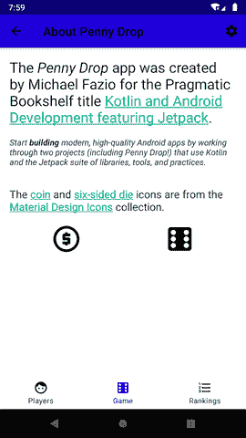

如果你的`AboutFragment`没有和我完全相同的信息，我不太担心，因为你之前几乎都已经做过了。如果你想查看这个文件的完整 XML，请前往代码中`chapter-7/app-code`文件夹下的`fragment_about.xml`。这里新增的部分是第一和第三部分中的（可点击）链接。

要添加这些链接，我们将同时使用 HTML 和 Android 的`SpannableString`类。但在实现这个视图之前，让我们先构建一个空片段，然后设置导航到那里的路径。

你之前已经创建过片段了，所以现在继续创建吧；我们很快会添加到`onCreateView`函数中。

### 处理到 AboutFragment 的导航

将这个片段添加到导航图的方式与其他片段相同——在`nav_graph.xml`中添加一个新条目：

```
<?xml version="1.0" encoding="utf-8"?>
<navigation xmlns:android="http://schemas.android.com/apk/res/android"
    xmlns:app="http://schemas.android.com/apk/res-auto"
    android:id="@+id/nav_graph"
    app:startDestination="@id/gameFragment">

    <!-- 其他 <fragments ... /> 仍然保留在上面。 -->

    <fragment
        android:id="@+id/aboutFragment"
        android:name="dev.mfazio.pennydrop.fragments.AboutFragment"
        android:label="About Penny Drop" />
</navigation>
```

> **从 AboutFragment 开始**
>
> 在本节中，我们将主要在`AboutFragment`中工作，所以暂时将`app:startDestination`的值切换为`@id/aboutFragment`会省去你一些麻烦。只是记得完成后把它切换回来。

接下来，我们希望在用户点击设置页面中的"About Penny Drop"偏好设置时导航到这里。首先，我们在之前创建的"关于应用"类别中添加一个通用的`<Preference>`（以及一些字符串资源值）：

```
<PreferenceCategory android:title="About the App">
    <Preference
        android:key="credits"
        android:summary="@string/about_app_summary"
        android:title="@string/about_penny_drop" />
</PreferenceCategory>
```

接下来，我们获取`Preference`并设置`onPreferenceClickListener`，类似于我们处理主题偏好设置时的方式：

```kotlin
val creditsPreference = findPreference<Preference?>("credits")

// 无关代码

creditsPreference?.onPreferenceClickListener =
    Preference.OnPreferenceClickListener { _ ->
        this.findNavController().navigate(R.id.aboutFragment)
        true
    }
```

由于我们已将`AboutFragment`添加到导航图中，这将为我们处理到"关于"视图的导航，同时保持其余导航设置正常工作。这个设置唯一的问题是，我们的顶部栏缺少一个返回箭头，无法告诉用户可以返回到之前的视图。在我们的情况下，这意味着从"关于"视图返回到"设置"视图的便捷方式。它可以使用手机的返回按钮工作，但我们应该在应用内给他们提供一种方式。

前往`MainActivity`，在`onCreate`函数的末尾，我们希望配置应用栏以配合我们的导航。具体来说，我们希望它能识别我们当前的位置，并在非主视图（玩家、游戏、排名）时显示返回箭头。

可以显式列出所有被视为顶层（意味着不会显示向上箭头）的`Fragment`类，但我们可以用更高效的方式处理。我们将创建一个新的`AppBarConfiguration`并传入分配给底部导航的菜单值。然后我们可以用这个配置来设置应用栏，导航库会处理其余的事情。

```kotlin
val appBarConfiguration = AppBarConfiguration(bottomNav.menu)
setupActionBarWithNavController(
    this.navController,
    appBarConfiguration
)
```

这种方法唯一的小问题是，应用栏中的标签现在使用的是`nav_graph.xml`中的`android:label`值。因此，你需要去将所有这些值改为更易读的版本（当然，作为字符串资源），像这样：

```
<fragment
    android:id="@+id/pickPlayersFragment"
    android:name="dev.mfazio.pennydrop.fragments.PickPlayersFragment"
    android:label="@string/pick_players" />
```

这里，`@string/pick_players`是字符串资源值"Pick Players"。最后一步是确保返回按钮按我们期望的方式工作。在`MainActivity`中，我们要覆盖`onSupportNavigateUp`函数以使用`navController`。我们需要确保`navController`已经初始化（因为它标记为`lateinit`），然后告诉它处理向上导航。

```kotlin
override fun onSupportNavigateUp(): Boolean =
    (this::navController.isInitialized &&
    this.navController.navigateUp()) || super.onSupportNavigateUp()
```

当我们进入"设置"和"关于"视图时，它们会有一个返回箭头，向用户表明可以返回到之前的位置。

现在我们可以到达`AboutFragment`了，我们需要正确地显示内容。同样，大部分内容和我们之前做的相同，但添加可点击链接需要一些额外的工作。

### 在 TextViews 中添加可点击链接

正如我在本章开头提到的，我们有几种方法可以为`<TextView>`添加链接。最简单的方法是将字符串资源写成 HTML，并在其中添加格式。使用这种方法，链接和文本装饰（**粗体**、*斜体*等）会快得多。如果我们像这样创建一个字符串资源（在你的代码中，这可以是一行很长的代码）：

```
<string name="penny_drop_created_by">The <i>Penny Drop</i> app was
created by Michael Fazio for the Pragmatic Bookshelf title
<a href="https://pragprog.com/titles/mfjetpack/">
"Kotlin and Android Development featuring Jetpack"
</a>.</string>
```

这将使 HTML 按预期渲染，如图所示。


唯一缺少的部分是链接无法点击。它渲染起来像是一个普通的网页链接，但点击时没有任何反应。要启用点击功能，我们在`TextView`上设置`movementMethod`属性：

```kotlin
view.findViewById<TextView>(R.id.about_credits)?.apply {
    //Makes the links clickable.
    this.movementMethod = LinkMovementMethod.getInstance()
}
```

现在当你点击我们添加的链接时，它会带你到网页。我们希望图标致谢部分也有同样的效果，但这次我们将使用`SpannableString`来实现。

`SpannableString`允许我们以多种方式更改文本片段，例如设置背景/前景颜色、样式，以及在我们的情况下，将这些文本片段转换为链接。我们通过从`String`（在我们的例子中，是一个字符串资源）创建一个`SpannableString`，然后对一个给定的子字符串调用一次或多次`setSpan`来实现这一点（我们传入的数字代表起始/结束索引值）。

每次调用都会包含一个`CharacterStyle`类，它对该代码子字符串执行某些操作。在我们的例子中，我们使用带有正确网页地址的`URLSpan`对象来创建链接。一旦这些被添加，我们将`SpannableString`实例赋值给`TextView`的`text`属性。

另外，确保你也设置了`movementMethod`属性，以便这里的链接也可以点击。

```kotlin
view.findViewById<TextView>(R.id.about_icon_credits)?.apply {
    val spannableString =
    SpannableString(getString(R.string.penny_drop_icons))
    spannableString.setSpan(
        URLSpan(
            "https://materialdesignicons.com/icon/currency-usd-circle-outline"
        ), 4, 8, 0
    )
    spannableString.setSpan(
        URLSpan("https://materialdesignicons.com/icon/dice-6"), 13, 26, 0
    )
    spannableString.setSpan(
        URLSpan("https://materialdesignicons.com"), 46, 67, 0
    )
    this.text = spannableString
    //Makes the links clickable.
    this.movementMethod = LinkMovementMethod.getInstance();
}
```

在大多数情况下，使用 HTML 在`<TextView>`中创建链接和其他基本格式会更好，但如果你确实需要额外的控制，`SpannableString`类可以帮助你。

至此，"关于"页面已经准备就绪，我们的设置屏幕也完成了。还有其他我们在这里没有涉及的 Preference 类型，所以请随时查看官方文档以获取更多信息。

## 总结与下一步

Penny Drop 应用现在已经功能完整了。七章内容，一大堆页面，我们现在拥有了一个精美实用的应用，准备让全世界的用户喜爱。好吧，虽然这可能有点夸张，但它仍然是一个很酷的应用，而且你现在知道如何利用 Kotlin 和 Jetpack 来构建 Android 应用了！

接下来将是 Android Baseball League 应用，但在结束 Penny Drop 之前，我要指出一些我们可以让应用变得更好的地方。

### 新游戏对话框

给用户一个快速开始新游戏的方式会很方便。当游戏结束或用户首次启动应用时，添加一个快速开始新游戏的对话框，对应用的可用性会有很大帮助。虽然我不想深入讲解如何做的每一个细节，但让我们看看快速版本。

在`GameFragment`中为`currentGame`添加一个监听器，然后当当前游戏结束时，向用户显示一个`AlertDialog`，如下所示：

```kotlin
val dialog = AlertDialog.Builder(activity)
    .setTitle("New Game?")
    .setIcon(R.drawable.mdi_dice_6_black_24dp)
    .setMessage("Same players or new players?")
    .setPositiveButton("Same Players") { _, _ ->


`gameViewModel.startWithSamePlayers()`

```kotlin
.setNegativeButton("New Players") { _, _ ->
    goToPickPlayers()
}
.setNeutralButton("Cancel") { _, _ ->
    /* This will just close the dialog */
}.create()

dialog.show()
```

创建新游戏的对话框与此类似，只是没有“Same Players”选项。另外，确保在最后调用`show`函数，否则什么都不会发生！

### 保存选择玩家值

同样地，我们可以通过保存上一局游戏中玩家的名字来节省用户的时间，即使在应用关闭后也是如此。至少，保存主玩家的名字以便在每次游戏之间使用会很有帮助。

我们可以把这个放在数据库中，或者甚至可以在设置屏幕上添加一个偏好设置，用于默认的第一个玩家名字。这个值也可以在他们第一次开始游戏时设置，使用他们在那里输入的主要玩家名字。

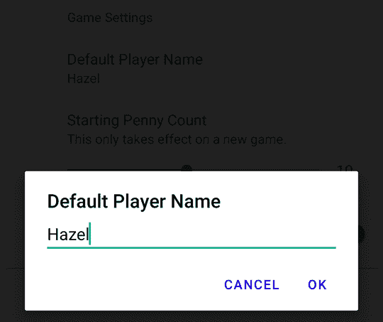

### 处理游戏中的重复 AI

我们游戏中的一个未修复的 bug 是，虽然我们不能将同一个 AI 玩家多次添加到单个游戏中，但我们没有限制用户这样做。事实上，如果他们尝试这样做，游戏将会崩溃。

你可以在这里做几件事：更改 AI 玩家的保存方式以允许他们在游戏中多次出现，更新`GameStatus`以将`gamePlayerNumber`作为主键，或者添加过滤功能，使得只有未被选择的 AI 才在下拉菜单中可用。

所有这些解决方案都需要一些额外的工作，但我们可以使用比现在更好的方案。我决定不在书中直接涵盖这一点，因为那样会让我们偏离主题太远。

### 重置设置为默认值

另一个有用的用户体验功能是允许用户快速将设置恢复为默认值。如果他们想回到应用初始的起始便士数量和主题设置，我们可以替换设置屏幕应用栏中的设置链接，或者添加另一个 Preference 来重置所有内容。

你已经看过如何添加新的菜单链接和新的 Preference，以及如何处理点击事件，所以唯一新的部分就是设置值。你可以通过为每个 Preference 调用`findPreference`然后将新值赋给`value`，或者使用`SharedPreferences`类上的`Editor`对象来实现：

```kotlin
// You can set the value directly on the Preference itself.
themeModePreference?.value = "System"

// Or you can use the SharedPreferences object to edit values.
val prefs =
    PreferenceManager.getDefaultSharedPreferences(this.context)
prefs.edit()?.also {
    it.putInt("pennyCount", Player.defaultPennyCount)
    it.apply()
}
```

### 启用“Hazel”模式

我不得不提到这一点，因为每当我们玩现实中的“Penny Drop”游戏时，我的女儿黑兹尔（Hazel）似乎总是能掷出很多个六点。我不知道为什么会这样，但这已经成为一个相当稳定的规律了。对于这个应用，可以检查玩家的名字是否是黑兹尔，如果是的话，就向`rollDie`传入一个新的`isHazel`参数。如果是这种情况，我们就掷一个 D8（八面骰），如果点数大于或等于 6，就当作六点：

```kotlin
private fun rollDie(sides: Int = 6, isHazel: Boolean = false) =
    Random.nextInt(1, sides + 1 + if (isHazel) 2 else 0).let { roll ->
        if (roll > 6) 6 else roll
    }
```

是的，这很傻，但代码很有趣，而且她确实真的能掷出很多个六点。

## 添加应用图标

做了这么多工作，我们却一直没给应用设置一个合适的图标！这是故意的，因为这与你在各章中学习的内容无关。如果你想知道怎么做，我们马上就会为 ABL 应用添加一个。详见添加应用图标。

### 添加单元测试和/或 UI 测试

这是个好主意！好到我们专门在第 14 章使用 JUnit 进行单元测试和第 15 章使用 Espresso 测试应用 UI 中来讲解这些内容。

但在该添加测试之前（如果你愿意，现在就可以跳过去看），我们与 Penny Drop 的缘分就到这里了。现在进入“官方”Android 棒球联盟应用，我们将在这里把学到的知识提升一个层次。

## 脚注

[[6]](#f_0060.xhtml_FNPTR-6)

[`link.mfazio.dev/use-saved-values`](https://link.mfazio.dev/use-saved-values)

[[7]](#f_0064.xhtml_FNPTR-7)

[`developer.android.com/guide/topics/ui/settings/components-and-attributes`](https://developer.android.com/guide/topics/ui/settings/components-and-attributes)

Copyright © 2021, The Pragmatic Bookshelf.

# 第二部分

## Android 棒球联盟

> 是时候跳入 Android 棒球联盟的世界了，这是一个专门为本书创建的联盟。没错，联盟中的所有球员、球队、比赛记录和其他一切都是为此而创建的。现在轮到你来构建官方的 Android 棒球联盟应用了（一个为虚构联盟制作的应用，能有多官方就有多官方）。
>
> 这里的难度会有所提升，但你能应付得来。你将把在 Penny Drop 中学到的知识应用到这里，同时还会使用额外的 Jetpack 库和 Kotlin 协程（这次会更加深入）。

## 第 8 章

### 初始化 Android 棒球联盟应用

欢迎来到 Android 棒球联盟！Android 棒球联盟（简称 ABL）成立于 2018 年，是我们接下来六章左右内容的重点。我们的任务是为联盟构建官方应用，让每个人都能了解他们喜爱的球队和球员。

你可能已经猜到了，ABL 并不是一个真实的联盟，但它是本书第二部分的焦点。现在我们要构建一个具有更复杂功能的高级应用。

我们将从 Penny Drop 中学到的内容开始，然后在此基础上扩展。因此，节奏会加快，我不会再（重新）解释之前应用中讲过的所有内容。当我们再次遇到某些概念时，我会引用第一部分的章节，此外如果你遇到困难，也可以随时参考 PragProg.com 上的源代码。

### 欢迎来到官方 ABL 应用

ABL 应用是展示联盟球队和球员的平台。用户可以查看当前的比赛（以及当年的任何比赛）、谁在打击和投球类别中领先联盟，以及 ABL 十四支球队中任何一支的阵容。用户甚至可以设置喜爱的球队，以及是否希望根据该球队来定制应用风格。

正如我提到的，这里的大部分章节都会以与 Penny Drop 类似的内容开始，然后在此基础上扩展。我们将通过菜单进行导航（这里是导航抽屉，而不是底部导航栏），但还会看到如何在目的地之间发送数据以及如何创建深层链接。我们会将数据保存到本地数据库以便在屏幕中访问，但也会从网络服务获取数据以获得最新的比分信息。我们将显示球员列表，但还会看到 Paging 如何帮助处理长列表。

我们将在本章内快速完成大部分熟悉的设置；我想尽快让你拥有一个可运行的应用，而不添加太多新内容。我们将创建应用、添加依赖项、设置一些图片（球队标志、联盟标志）包括应用图标、添加一些辅助类型，并构建一个屏幕。

然后接下来的每一章都会添加一个额外的屏幕（至少到第 13 章向 Android 棒球联盟应用发送和接收信息为止）。

首先，我们需要创建应用。启动 Android Studio，我们开始吧。

### 创建应用

打开 Android Studio 后，创建一个带有空 Activity 的新项目（我们还是会手动添加内容），并将其命名为 Android Baseball League。你可以使用自己喜欢的包名（我喜欢用`dev.mfazio.abl`），并且 SDK 至少为 API 级别 26。这将确保我们可以使用一些较新的 Android 功能。

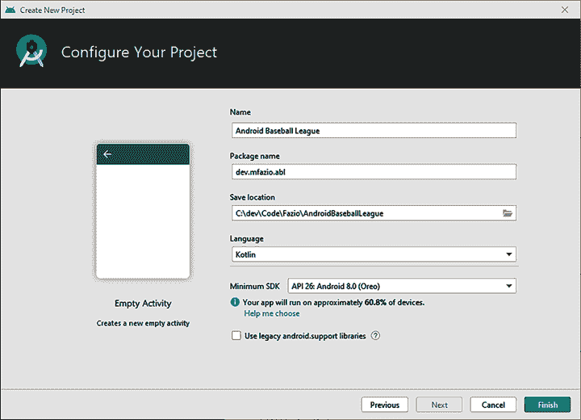

新项目建立索引且 Gradle 同步完成后，我们就有了一个不错的空`MainActivity`可以开始工作。在继续处理具体视图之前，我们有一些额外的依赖项需要使用。

#### 添加依赖项

在本章中，我们将通过`RecyclerView`库添加一个新的网格，并在每个网格项中使用`<ConstraintLayout>`。这些依赖项是一个很好的起点，但在构建 ABL 应用的过程中我们还会添加更多。依赖项块应如下所示：

```gradle
dependencies {
    implementation "org.jetbrains.kotlin:kotlin-stdlib-jdk8:$kotlin_version"
    implementation "androidx.appcompat:appcompat:$app_compat_version"
    implementation "androidx.constraintlayout:constraintlayout:$constraint_layout_version"
    implementation "androidx.core:core-ktx:$core_version"
    implementation "androidx.navigation:navigation-fragment-ktx:$nav_version"
    implementation "androidx.navigation:navigation-ui-ktx:$nav_version"
    implementation "androidx.recyclerview:recyclerview:$recycler_view_version"
    implementation "com.google.android.material:material:$material_version"
    // 测试依赖项放在这里
}
```

有三点需要注意：首先，我们需要添加`kotlin-kapt`插件以支持数据绑定。将其添加到应用`build.gradle`文件顶部的插件块中。该块现在看起来像这样：

```gradle
plugins {
    id 'com.android.application'
    id 'kotlin-android'
    id 'kotlin-kapt'
}
```

其次，如果默认没有这样设置，我们希望使用`kotlin-stdlib-jdk8`版本的 Kotlin 标准库。确保你的应用也使用这个版本。

第三点是这里添加的所有依赖项都有版本变量（位于项目的`build.gradle`文件中）。我们遵循与 Penny Drop 相同的模式，同样，所有依赖项及其版本可以在附录 3Gradle 依赖项中找到。

最后，在离开应用的`build.gradle`文件之前，将`buildFeatures`块添加到`android`块的顶部：

```gradle
android {
    buildFeatures {
        dataBinding = true
    }
    //'android'块的其余内容在下面。
}
```

同步你的项目以确保所有依赖项都已添加，然后我们可以准备一些资源了。

#### 添加图片资源

ABL 应用中的图片比 Penny Drop 多得多，因此为了方便起见，我在 PragProg.com 的代码中包含了一些图片。这包括球队徽标、辅助图片以及 ABL 徽标本身。此处所需的所有图片都在 `images/abl` 目录下。

说真的，只需将 `images/abl/team-logos` 文件夹中的所有 Drawable XML 文件复制/粘贴到 drawables 目录中即可。

此外，在同一文件夹中获取所有尺寸的 `mke_flag.png`。我获取了现有的 PNG 并将其拆分为六种不同的分辨率（ldpi 到 xxxhdpi），应用会根据给定设备使用其中一种。稍后我们还会复制其他图片，但目前仅获取徽标就足够了。

请注意，`drawable-[dpi]` 文件夹应放入 `src/main/res` 目录中，与 drawables 目录并列，而不是放到 drawables 目录内部（与其他球队徽标不同）。

最后，在我们获取其他图片的同一目录中，你需要 `abl-logo-shifted.svg`，因为我们要将其转换为应用的图标。

### 添加应用图标

`abl-logo-shifted.svg` 将用于创建新的图片资源，在本例中即应用的启动器图标。

我还在其中包含了普通的 `abl-logo.svg`，但我推荐使用“shifted”版本，因为转换为应用图标时效果更好。你也可以两个版本都尝试一下，看看更喜欢哪个。

将图标下载到本地计算机后（不要添加到项目中），右键单击 `res` 文件夹并选择 New > Image Asset。这将显示 Asset Studio，如第一张图片所示。


在此处，确保 Source Asset 下的 Asset Type 设置为 Image，并选择 `abl-logo.shifted.svg` 文件。你可以根据需要重命名徽标，或直接覆盖现有的 `ic_launcher`。不要裁剪徽标（因为这会移除我提到的偏移效果），但将图片大小调整为约 65%，如第二张图片所示。


在 Background Layer 部分，你可能希望将 Asset Type 更改为 Color 而不是 Image，以避免默认的蓝图样式背景：


背景设置完成后，点击 Next 按钮，然后点击 Finish。如果你更改了启动器图标的名称，请进入 `AndroidManifest.xml` 并将 `android:icon` 和 `android:roundIcon` 的值替换为新名称。如果你没有更改名称且图片名为 `ic_launcher`，那么一切就绪（因为 `@mipmap/ic_launcher` 是默认值）。

此外，如果你希望应用名称显示为其他内容，而不是开始输入的项目名称，可以在 `AndroidManifest.xml` 中将 `android:label` 更改为其他内容。我将其改为 ABL，因为 Android Baseball League 对于应用抽屉来说太长了。

仅作确认，你的 `<application>` 标签应如下所示：

```xml
<application
    android:allowBackup="true"
    android:icon="@mipmap/ic_abl_launcher"
    android:label="@string/app_short_name"
    android:roundIcon="@mipmap/ic_abl_launcher_round"
    android:supportsRtl="true"
    android:theme="@style/Theme.AndroidBaseballLeague">
    <activity android:name=".MainActivity">
        <intent-filter>
            <action android:name="android.intent.action.MAIN" />
            <category android:name="android.intent.category.LAUNCHER" />
        </intent-filter>
    </activity>
</application>
```


图标更新后，你可以运行应用查看更改。请注意，可能需要卸载并重新安装才能使图标更改生效。它应该类似于所示的图片。


添加图标后，我们可以开始构建应用了。首先是一些初始的 `MainActivity` 设置。

## 配置 Activity

与 Penny Drop 一样，`MainActivity` 是处理 Fragment 类的主要中心，但除此之外没有太多功能。尤其在我们刚开始时更是如此，因为我们只关注一些基本导航。

对于导航，使用 `FragmentContainerView` 和导航图。鉴于本章我们只关注单个 fragment，我们甚至不需要更新 `MainActivity` 中的代码。相反，我们将留到下一章，即第 9 章通过导航抽屉导航中再处理。

### 添加 FragmentContainerView

`<FragmentContainerView>` 基本上与 Penny Drop 相同。目前，我们让 `<FragmentContainerView>` 占据整个屏幕，这意味着我们的 `activity_main.xml` 布局文件如下所示：

```xml
<?xml version="1.0" encoding="utf-8"?>

<androidx.constraintlayout.widget.ConstraintLayout

    xmlns:android="http://schemas.android.com/apk/res/android"

    xmlns:app="http://schemas.android.com/apk/res-auto"

    xmlns:tools="http://schemas.android.com/tools"

    android:layout_width="match_parent"

    android:layout_height="match_parent"

    tools:context=".MainActivity">

    <androidx.fragment.app.FragmentContainerView

        android:id="@+id/containerFragment"

        android:name="androidx.navigation.fragment.NavHostFragment"

        android:layout_width="0dp"

        android:layout_height="0dp"

        app:defaultNavHost="true"

        app:layout_constraintBottom_toBottomOf="parent"

        app:layout_constraintEnd_toEndOf="parent"

        app:layout_constraintStart_toStartOf="parent"

        app:layout_constraintTop_toTopOf="parent"

        app:navGraph="@navigation/nav_graph" />

</androidx.constraintlayout.widget.ConstraintLayout>
```

现在缺少的只有 `navigation/nav_graph.xml` 文件，目前它非常简单。简单到在书中甚至没有自己的章节，只有以下代码块：

```xml
<?xml version="1.0" encoding="utf-8"?>

<navigation xmlns:android="http://schemas.android.com/apk/res/android"

    xmlns:app="http://schemas.android.com/apk/res-auto"

    xmlns:tools="http://schemas.android.com/tools"

    android:id="@+id/nav_graph"

    app:startDestination="@id/teamsFragment">

    <fragment

        android:id="@+id/teamsFragment"

        android:name="dev.mfazio.abl.teams.TeamsFragment"

        android:label="@string/teams">

    </fragment>

</navigation>
```

添加 `teams` 字符串资源后，这就完成了。不过，`TeamsFragment` 还不存在。让我们来实现它。

## 添加第一个 Fragment

`TeamsFragment` 将包含一个漂亮的 2x7 网格，展示 Android Baseball League 中的所有球队。它看起来像这样：


请注意，我在这个应用中采用了不同的代码结构方式。不再按类型拆分文件（例如，activities、viewmodels 等），而是按主题拆分（例如，teams、leaders 等）。

在创建 `TeamsFragment` 之前，我们先创建几个支持类，它们将以不同方式在此屏幕上使用。

### 添加与球队相关的类

我们的球队网格需要三个额外的类：

* `Team` — 包含 ABL 中每支球队的各种信息。
* `UITeam` — 包含 ABL 中每支球队的 UI 特定值。
* `Division` — 一个枚举类，包含 ABL 的两个分区：East 和 West。

我们应用的核心部分之一是 `Team` 类。这个类保存每支球队的球队 ID、所在地、昵称和分区信息。此外，我们还在这里预留了空间来保存胜场和负场，以及球队在其分区和 ABL 整体中的排名。

由于 `Division` 是 `Team` 的一部分，让我们快速添加它。创建 `teams` 包，并添加一个名为 `Division` 的新枚举类，如下所示：

```kotlin
enum class Division { East, West, Unknown }
```

然后我们可以添加 `Team` 类：

```kotlin
data class Team(

    val id: String,

    val city: String,

    val nickname: String,

    val division: Division,

    val wins: Int = 0,

    val losses: Int = 0,

    val leagueRank: Int = -1,

    val divisionRank: Int = -1

)
```

`Team` 类本身已经完成，但我想在伴生对象中添加所有球队。由于球队信息不太可能改变，我没有费心将它们放入数据库或从 API 动态加载。虽然球队信息可能会有所变化，但这肯定不会是经常发生的事，而且当这种情况发生时，我们随时可以更新应用。

我们在伴生对象中将每支球队硬编码，填入它们的球队 ID、城市、昵称和分区值：

```kotlin
companion object {

    val Appleton = Team("APL", "Appleton", "Foxes", Division.East)

    val Baraboo = Team("BOO", "Baraboo", "Big Tops", Division.West)

    val EauClaire = Team("EC", "Eau Claire", "Blues", Division.West)

    val GreenBay = Team("GB", "Green Bay", "Skyline", Division.East)

    val LaCrosse = Team("LAX", "La Crosse", "Lovers", Division.West)

    val LakeDelton = Team("LD", "Lake Delton", "Breakers", Division.West)

    val Madison = Team("MSN", "Madison", "Snowflakes", Division.West)

    val Milwaukee = Team("MKE", "Milwaukee", "Sunrise", Division.East)

    val Pewaukee = Team("PKE", "Pewaukee", "Princesses", Division.East)

    val Shawano = Team("SHW", "Shawano", "Shorebirds", Division.East)

    val SpringGreen = Team("SG", "Spring Green", "Thespian", Division.West)

    val SturgeonBay = Team("SB", "Sturgeon Bay", "Elders", Division.East)

    val Waukesha = Team("WAU", "Waukesha", "Riffs", Division.East)

    val WisconsinRapids =

        Team("WR", "Wisconsin Rapids", "Cranberries", Division.West)

}
```

接下来，我们可以创建 `UITeam` 类。我决定添加这个类来保存每支球队的队徽和球队颜色，而不是将这些值放在 `Team` 类中。这样我们就不用在不需要的时候让 UI 相关的属性充斥 `Team` 类。

每个 `UITeam` 实例将保存一个原始的 `Team` 对象以及球队队徽和颜色。我们还将包含一些辅助值，以便无需通过 `team` 属性就能获取所在地和名称等信息。该类如下所示：

```kotlin
data class UITeam(

    val team: Team,

    val logoId: Int,

    val primaryColorId: Int,

    val secondaryColorId: Int,

    val tertiaryColorId: Int

) {

    val teamId = team.id

    val location = team.city

    val nickname = team.nickname

    val teamName = "$location $nickname"

    val division = team.division

}
```

我对 `UITeam` 采取的方法几乎与 `Team` 相同，即在类的伴生对象中硬编码所有球队。但这次我将它们全部放入一个 `List<UITeam>` 中，而不是为每个球队创建单独的值，因为这就是我们在球队网格中需要的。

伴生对象中的每个 `UITeam` 看起来类似于这样：

```kotlin
companion object {

    val allTeams = listOf(

        UITeam(

            Team.Appleton,

            R.drawable.fi_ic_fox,

            R.color.appletonPrimary,

            R.color.appletonSecondary,

            R.color.appletonTertiary

        ),

        //Other teams continue on down here

    )

}
```

有关完整的 `UITeam` 实例列表，请查看代码。至于我们在前面代码中看到的 Appleton Foxes，我们之前已经复制了队徽，但我们需要将那三种颜色设置好。同样，你可以直接从提供的代码中复制所有 `UITeam` 的颜色。无论哪种方式，所有球队颜色都位于 `colors.xml` 中，类似于这样：

```xml
<color name="appletonPrimary">#FF4F19</color>

<color name="appletonSecondary">#3A3A41</color>

<color name="appletonTertiary">#FFC173</color>
```

现在三种支持类型已经准备就绪，我们可以继续创建 `TeamsFragment` 及其相关的一切了。

## 添加 TeamsFragment

在 `teams` 包中以你喜欢的方式创建 `TeamsFragment`，并附带一个关联的布局文件。我将我的布局文件命名为 `fragment_teams_grid.xml`，因为它能告诉我们更多关于该视图的信息，但这完全是可选的。

我们最后再来处理 `TeamsFragment` 本身的代码，因为我们需要先设置其他部分。所以首先是片段的布局文件。

关联的布局文件（无论你叫它什么）将只包含一个 `<RecyclerView>` 标签，仅此而已。我们采取与 Penny Drop 相同的一般方法，特别是在*添加 RecyclerView*部分。

```xml
<?xml version="1.0" encoding="utf-8"?>

<androidx.recyclerview.widget.RecyclerView

    xmlns:android="http://schemas.android.com/apk/res/android"

    xmlns:tools="http://schemas.android.com/tools"

    android:id="@+id/teamsGrid"

    android:name="dev.mfazio.abl.TeamsFragment"

    android:layout_width="match_parent"

    android:layout_height="match_parent"

    android:layout_gravity="center"

    tools:context=".teams.TeamsFragment"

    tools:listitem="@layout/teams_grid_item" />
```

同样，我们稍后再回来处理 `TeamsFragment` 的实际代码，因为我们正在设置所有先决条件——接下来是网格中每个项目的布局。

## 添加网格项目布局 XML

`teams_grid_item.xml` 布局文件将包含三个部分——球队的队徽、所在地和昵称，全部按列排列。我们很快还会将 `UITeam` 对象绑定到每个项目，因此该布局中将包含一个 `<variable>`。

你几乎已经做过所有这些了，所以我们可以直接看代码。我只想提一下，我在这里使用 Waukesha Riffs 作为"tools"球队，这样布局编辑器就有内容可以显示了。以下是 `teams_grid_item.xml`：

```xml
<?xml version="1.0" encoding="utf-8"?>

<layout xmlns:android="http://schemas.android.com/apk/res/android"

    xmlns:app="http://schemas.android.com/apk/res-auto"

    xmlns:tools="http://schemas.android.com/tools">

    <data>

        <variable

            name="team"

            type="dev.mfazio.abl.teams.UITeam" />

    </data>

    <androidx.constraintlayout.widget.ConstraintLayout

        android:layout_width="match_parent"

        android:layout_height="wrap_content"

        android:layout_margin="8dp">

        <ImageView

            android:id="@+id/teamLogo"

            android:layout_width="64dp"

            android:layout_height="64dp"

            android:contentDescription="@string/team_logo"

            android:src="@{team.logoId}"

            app:layout_constraintEnd_toEndOf="parent"

            app:layout_constraintStart_toStartOf="parent"

            app:layout_constraintTop_toTopOf="parent"

            tools:src="@drawable/fi_ic_electric_guitar" />

        <TextView

            android:id="@+id/teamLocation"

            android:layout_width="wrap_content"
```


进入`/path/to/xxx`目录，找到`xxx.json`。

在表达式`cvar = avar + bvar`中，加法运算符（`+`）将`avar`与`bvar`相加，得到它们的和`cvar`

在`List.of(arg0, arg1, arg2)`中，`List`接口的工厂方法`of()`接受一系列的元素，返回包含它们的只读列表。

之后我们这样调用`cmd`命令：`cmd arg0 arg1 arg2`。

```
if (condVar > someVal) {console.log("xxx")}
```


<!-- Style properties are in here -->

</style>

此外，在`themes.xml`中，我们要添加两个新的`<item>`标签。这些标签协同工作，使状态栏显示在导航抽屉上方，但使用导航抽屉的颜色：

```
<item name="android:windowDrawsSystemBarBackgrounds">true</item>
<item name="android:windowTranslucentStatus">true</item>
```

`activity_main.xml`中最后一个新元素是`app:headerLayout="@layout/nav_header"`。该属性为导航抽屉提供了一个漂亮的顶部标题项，并配有独立的布局文件。

##### 添加`nav_header.xml`

在我们的例子中，这个标题将是 ABL 标志（带有 ABL 字母）和 Android 绿色背景。如果你需要该标志，它位于`chapter-9/images`目录下的代码中。标志准备好后，标题布局文件如下所示：

```
<androidx.constraintlayout.widget.ConstraintLayout
    xmlns:android="http://schemas.android.com/apk/res/android"
    xmlns:app="http://schemas.android.com/apk/res-auto"
    android:layout_width="match_parent"
    android:layout_height="wrap_content"
    android:padding="16dp"
    android:background="@color/androidGreen">

    <ImageView
        android:layout_width="wrap_content"
        android:layout_height="28dp"
        android:layout_marginTop="20dp"
        android:layout_marginStart="4dp"
        android:contentDescription="@string/abl_logo"
        android:scaleType="fitStart"
        android:src="@drawable/ic_abl_logo_with_text"
        app:layout_constraintBottom_toBottomOf="parent"
        app:layout_constraintStart_toStartOf="parent"
        app:layout_constraintTop_toTopOf="parent" />
</androidx.constraintlayout.widget.ConstraintLayout>
```

通过设置内边距和一些边距，将图像稍微向下移动，使其在状态栏下方美观显示，但除了`android:scaleType="fitStart"`之外没有其他新内容。这种缩放确保图像在其容器内正确适配，并与左上角对齐。

完成这两个布局文件后，我们可以添加唯一缺失的文件`menu/navigation.xml`。

##### 创建导航菜单

这与我们在构建应用导航中创建的菜单类似。这次最大的区别是，我们将使用两个`<group>`标签将导航抽屉分成多个部分。我们实际上可以一次性为应用添加所有菜单项，即使它们还没有关联的片段。这样导航抽屉就可以正确显示，而无需担心创建大量`Fragment`类。完整的`navigation.xml`如下所示：

```
<?xml version="1.0" encoding="utf-8"?>
<menu xmlns:android="http://schemas.android.com/apk/res/android">
    <group android:id="@+id/mainMenuGroup">
        <item
            android:id="@+id/scoreboardFragment"
            android:icon="@drawable/mdi_scoreboard_outline"
            android:title="@string/scoreboard" />
        <item
            android:id="@+id/teamsFragment"
            android:icon="@drawable/ic_jersey"
            android:title="@string/teams" />
        <item
            android:id="@+id/standingsFragment"
            android:icon="@drawable/ic_baseline_outlined_flag_24"
            android:title="@string/standings" />
        <item
            android:id="@+id/playersFragment"
            android:icon="@drawable/ic_baseline_directions_run_24"
            android:title="@string/players" />
        <item
            android:id="@+id/leadersFragment"
            android:icon="@drawable/ic_baseline_analytics_24"
            android:title="@string/leaders" />
    </group>
    <group android:id="@+id/settingsMenuGroup">
        <item
            android:id="@+id/settingsFragment"
            android:icon="@drawable/ic_baseline_settings_24"
            android:title="@string/settings" />
        <item
            android:id="@+id/aboutTheAppFragment"
            android:icon="@drawable/ic_baseline_help_outline_24"
            android:title="@string/about_the_app" />
    </group>
</menu>
```

这里一切都好，除了大量缺失的图片。所有图片都可以在源代码的`chapter-9/images/nav-images`目录下找到。将它们全部复制到你项目的 drawables 文件夹中，并查看一下`navigation.xml`以确保所有图片都能正确解析。

现在我们的布局文件都准备好了，可以回到`MainActivity`来将所有东西连接起来了。这次，我们将使用视图绑定（view binding）来完成。

##### 添加 viewBinding

现在，这其实与导航没有直接关系，但我想在这里引入视图绑定功能。既然我们要从`activity_main.xml`中获取每个组件，视图绑定会让我们的工作更轻松。

在很多方面，视图绑定看起来类似于我们使用数据绑定（data binding）时的做法，例如，当我们将一个`ViewModel`类与布局关联时。我们不必调用`findViewById`来获取布局元素，而是可以将该元素作为生成的绑定类上的属性来引用。

如果你不清楚我的意思，别担心。等我们到`MainActivity`中配置所有内容时，应该会更清楚。但在那之前，我们需要在应用的`build.gradle`文件中启用视图绑定。我们已经在`buildFeatures`代码块中有了`dataBinding`标志，但现在需要添加`viewBinding`：

```
buildFeatures {
    dataBinding = true
    viewBinding = true
}
```

实际上，这就是我们在应用中启用视图绑定所需的全部操作（当然，在 Gradle 同步之后）——不需要包含通用的`<layout>`标签或任何额外的依赖项。我建议在任何你想跳过`Activity`或`Fragment`类中的`findViewById`调用，并且不需要在布局文件中使用绑定表达式的情况下使用视图绑定。请记住，视图绑定比数据绑定更快，准备工作也更少，所以要根据每个用例决定需要哪种方法。

##### 更新 MainActivity

我们已经看到过如何在构建 Penny Drop 时在`MainActivity`类中连接`<FragmentContainerView>`，但这次我们还需要添加`<Toolbar>`并做一些配置来让导航抽屉工作起来。

由于我们已经启用了视图绑定，我们可以立即开始使用它。`onCreate`函数的开头现在看起来是这样的：

```
super.onCreate(savedInstanceState)
val binding = ActivityMainBinding.inflate(layoutInflater)

setContentView(binding.root)
```

看起来很熟悉吧？虽然代码比以前多一点，但将`<Toolbar>`与`Activity`一起使用只需要一行清晰明确的代码：

```
setSupportActionBar(binding.toolbar)
```

如果我们没有使用视图绑定，那么我们将会有这样一段代码：

```
val toolbar = findViewById<Toolbar>(R.id.toolbar)
setSupportActionBar(toolbar)
```

虽然这并不算巨大的代码节省，但第一行确实更易于处理和阅读。我们很快就会看到更多示例，但首先我们需要获取`navController`。别忘了在类顶部将`navController`声明为`lateinit var`。

```
val navHostFragment = supportFragmentManager
    .findFragmentById(R.id.containerFragment) as NavHostFragment
this.navController = navHostFragment.navController
```

不幸的是，视图绑定在这里帮不上忙，因为我们需要与`supportFragmentManager`交互，但其余的配置都被很好地简化了。

特别是，我们需要用`navController`值来设置两个组件。导航抽屉（通过`binding.navView`）和`<Toolbar>`（通过`appBarConfiguration`值）都需要与`NavController`关联：

```
binding.navView.setupWithNavController(this.navController)

this.appBarConfiguration =
    AppBarConfiguration(binding.navView.menu, binding.drawerLayout)
setupActionBarWithNavController(this.navController, appBarConfiguration)
```

同样，请确保`appBarConfiguration`的`lateinit var`声明在`navController`之后。

我们在`MainActivity`中最后需要做的是重写`onSupportNavigateUp`函数。这个函数是让我们的导航抽屉按钮正常工作的关键。

我们确保`navController`已初始化，如果是，则在`navController`上调用`navigateUp`函数。如果其中任何一个返回 false，我们就回退到默认的`onSupportNavigateUp`函数：

```
override fun onSupportNavigateUp(): Boolean =
    (this::navController.isInitialized &&
    this.navController.navigateUp(this.appBarConfiguration)
    ) || super.onSupportNavigateUp()
```

设置完成后，我们终于可以运行应用了。启动它并看一看：


看起来相当漂亮，对吧？请注意，高亮显示是自动为我们处理的，就像底部导航一样，因为我们的片段 ID 匹配。唯一的问题是导航抽屉还做不了什么，因为应用中只有一个视图。让我们通过添加"排名"页面来改变这一点。

#### 添加片段（排名和单个球队）

我们需要两个新的片段来支持本章中导航的功能：`StandingsFragment`和`SingleTeamFragment`。我们将在导航抽屉中链接到`StandingsFragment`，并将`SingleTeamFragment`作为一个单独的（非导航抽屉）目标，从`StandingsFragment`和`TeamsFragment`访问。

所有你想复制的代码都可以在`chapter-9/code-to-copy`目录中找到。

##### 添加 StandingsFragment

排名页面将是另一个`RecyclerView`列表，但有一个变化：我们要在列表中添加一些标题来分隔行。具体来说，我们要添加标题来分隔 ABL 的东部和西部赛区。最终的排名页面看起来是这样的：


现在，虽然我很想向你展示这一切是如何工作的，但我们还有导航要做。鉴于此，请直接将 standings 包中的所有内容复制到你的项目中。这包括以下类：`StandingsAdapter`、`StandingsFragment`、`StandingsListItem`、`StandingsViewModel`、`TeamStanding`和`UITeamStanding`。此外，你还需要`res/layout`目录中的`fragment_standings.xml`、`standings_header.xml`和`standings_team_item.xml`文件。

请随意在方便时浏览这些文件/类，因为它们确实很有用，而且是我们第 6 章《使用 RecyclerView 构建列表》中工作的绝佳延伸。

一点提示：我在`TeamStanding`类中包含了一些模拟的球队排名数据，这样你在排名页面上就有内容可以显示了。这些数据将在第 10 章《使用协程和 Room 加载和保存数据》中移除，届时我们会调用 API 来获取数据。

还需要做两处修改——我们需要一些额外的字符串资源值：

```
<string name="wins_w">W</string>
<string name="losses_l">L</string>
<string name="percentage_abbr">PCT</string>
```


| ​ | `<string name="games_back_abbr">GB</string>` |

| ​ | `<string name="last_ten_abbr">L10</string>` |

| ​ | `<string name="streak_abbr">STRK</string>` |

此外，`UITeam` 类中缺少 `fromTeamId` 函数。将其添加进去，并确保包含 `@JvmStatic` 注解，因为我们稍后在数据绑定表达式中会用到这个函数：

```
@JvmStatic
fun fromTeamId(teamId: String?) =
    allTeams.firstOrNull { uiTeam -> uiTeam.teamId == teamId }
```

将这些文件复制过来并添加该函数后，将 `StandingsFragment` 的 `<fragment>` 标签添加到 `nav_graph.xml` 中。这样我们就可以从导航抽屉进入 `StandingsFragment`（是的，我现在将 `StandingsFragment` 设为起始位置）：

```
<navigation xmlns:android="http://schemas.android.com/apk/res/android"
    xmlns:app="http://schemas.android.com/apk/res-auto"
    xmlns:tools="http://schemas.android.com/tools"
    android:id="@+id/nav_graph"
    app:startDestination="@id/standingsFragment">

    <fragment
        android:id="@+id/standingsFragment"
        android:name="dev.mfazio.abl.standings.StandingsFragment"
        android:label="@string/standings" />

    <fragment
        android:id="@+id/teamsFragment"
        android:name="dev.mfazio.abl.teams.TeamsFragment"
        android:label="@string/teams" />
</navigation>
```

完成上述操作后，运行应用以确保你的排名页面看起来与本节开头看到的那个一致。如果没问题，我们将继续处理 `SingleTeamFragment`。

### 添加 SingleTeamFragment

这里我们将要做类似的事情，即从代码中复制文件过来。这次是 teams 包中的 `SingleTeamFragment` 和 `SingleTeamViewModel`，以及 `res/layout` 中的 `fragment_single_team.xml` 布局文件。

此外，我们还需要 `@string/view_roster` 和 `@string/in_abl` 的字符串资源值：

```
<string name="view_roster">View Roster</string>
<string name="in_abl"> in ABL </string>
```

另外，我们还需要 `util` 目录中更新后的 `BindingAdapters.kt` 文件。在这里，我们添加了一个 `setBackgroundTint` `@BindingAdapter`，它可以接收一个颜色 ID（类似于我们在*添加网格项布局 XML*中对徽标所做的操作）并将其应用到 `<Button>` 的背景上。这是一个非常实用的小功能，我建议你查看一下：

```
@BindingAdapter("android:backgroundTint")
fun setBackgroundTint(view: View, colorId: Int) {
    view.background.setTintList(
        ContextCompat.getColorStateList(view.context, colorId)
    )
}
```

好了——我帮你省去了打开那个文件的麻烦，但现在该继续处理更多导航相关的内容了！

### 使用 Safe Args 传递数据

你可能已经注意到，`SingleTeamFragment` 类目前存在问题，因为它不知道 `SingleTeamFragmentArgs` 或那个 `navArgs` 函数。另外请注意，有问题的代码行看起来与我们获取 `ViewModel` 类的方式非常相似。

在 Android 中，在位置之间发送数据的"传统"方式是通过 `Bundle`，你可以添加键值对，然后直接将其发送到类中或作为 `Intent` 的一部分。我们不这样做，而是要利用 Navigation Safe Args 插件。

这个插件允许我们在目的地之间发送类型化的值，而不是必须手动转换为其他类型的 `String` 值。然后我们可以引用为我们生成的 `NavArgs` 类来使用这些值。

在尝试在任何地方使用 `NavArgs` 之前，我们需要添加一个 classpath 依赖项和一个插件引用。

#### 添加 Safe Args 插件

这是少数几个我们需要在项目级别的 `build.gradle` 文件中添加依赖项的场合之一，而不是在应用级别的文件中，因为我们要引入一个新插件。除了 Kotlin 和 Gradle 的 classpath 依赖项之外，我们还需要包含 Safe Args 插件：

```
dependencies {
    classpath "com.android.tools.build:gradle:$gradle_version"
    classpath "org.jetbrains.kotlin:kotlin-gradle-plugin:$kotlin_version"
    classpath "androidx.navigation:navigation-safe-args-gradle-plugin:$nav_version"
}
```

注意，这里我们甚至不需要新的版本变量，因为我们直接使用现有的 Navigation 版本。添加依赖项后，我们可以在应用的 `build.gradle` 文件中再包含一个插件：

```
plugins {
    id 'com.android.application'
    id 'kotlin-android'
    id 'kotlin-kapt'
    id 'androidx.navigation.safeargs.kotlin'
}
```

添加完成后，同步 Gradle，然后进入 `navigation/nav_graph.xml` 添加一些 Action。

#### 添加导航 Action

导航 Action 是从一个目的地到达另一个目的地的方式。在我们的例子中，我们将添加从 `TeamsFragment` 和 `StandingsFragment` 到达 `SingleTeamFragment` 的方式。

为此，我们在其中一个 `<fragment>` 标签内添加一个 `<action>` 标签，如下所示：

```
<fragment
    android:id="@+id/standingsFragment"
    android:name="dev.mfazio.abl.standings.StandingsFragment"
    android:label="@string/standings">

    <action
        android:id="@+id/actionGoToTeam"
        app:destination="@id/singleTeamFragment" />
</fragment>
```

现在，这很好，但我们不能没有任何额外信息就进入 `SingleTeamFragment`，因为我们不知道要引用哪个球队。这就是 Safe Args 的用武之地；我们可以在 `<action>` 中添加 `<argument>` 标签来包含参数：

```
<fragment
    android:id="@+id/standingsFragment"
    android:name="dev.mfazio.abl.standings.StandingsFragment"
    android:label="@string/standings">

    <action
        android:id="@+id/actionGoToTeam"
        app:destination="@id/singleTeamFragment">

        <argument
            android:name="teamId"
            app:argType="string" />

        <argument
            android:name="teamName"
            app:argType="string" />
    </action>
</fragment>
```

现在，这个 Action 在这里可以工作了，但我们需要让 `SingleTeamFragment` 类能够接收这些参数。这意味着我们需要一个新的 `<fragment>` 标签，其中包含一些 `<argument>` 标签：

```
<fragment
    android:id="@+id/singleTeamFragment"
    android:name="dev.mfazio.abl.teams.SingleTeamFragment"
    android:label="{teamName}"
    tools:layout="@layout/fragment_single_team">

    <argument
        android:name="teamId"
        app:argType="string" />

    <argument
        android:name="teamName"
        app:argType="string" />
</fragment>
```

这里有几个要点：`<argument>` 标签在 `<action>` 和 `<fragment>` 之间是匹配的（意味着两个标签包含相同的 `<argument>` 标签），而且我们甚至可以在 `<fragment>` 标签的属性中使用其中一个 `<argument>` 值。`android:label` `"{teamName}"` 意味着无论我们作为 `teamName` 参数发送什么，都会在屏幕显示时显示在工具栏中。

如果我们想从 `TeamsFragment` 到达这里，可以将相同的 `<argument>` 标签复制到该 `<fragment>` 标签中。希望这对你来说听起来是一种糟糕的方法，因为我们在复制粘贴值，但别担心，我们有更好的方法可以做到这一点。

Navigation 库有全局 Action 的概念，可以从任何地方访问。这意味着我们声明一次 `<action>`，然后从我们选择的任何位置引用它。要添加全局 Action，我们只需要在 `nav_graph.xml` 中创建一个独立的 `<action>` 标签。完整的（最终）文件如下所示：

```
<navigation xmlns:android="http://schemas.android.com/apk/res/android"
    xmlns:app="http://schemas.android.com/apk/res-auto"
    xmlns:tools="http://schemas.android.com/tools"
    android:id="@+id/nav_graph"
    app:startDestination="@id/standingsFragment">

    <action
        android:id="@+id/actionGoToTeam"
        app:destination="@id/singleTeamFragment">

        <argument
            android:name="teamId"
            app:argType="string" />

        <argument
            android:name="teamName"
            app:argType="string" />
    </action>

    <fragment
        android:id="@+id/standingsFragment"
        android:name="dev.mfazio.abl.standings.StandingsFragment"
        android:label="@string/standings" />

    <fragment
        android:id="@+id/teamsFragment"
        android:name="dev.mfazio.abl.teams.TeamsFragment"
        android:label="@string/teams" />

    <fragment
        android:id="@+id/singleTeamFragment"
        android:name="dev.mfazio.abl.teams.SingleTeamFragment"
        android:label="{teamName}"
        tools:layout="@layout/fragment_single_team">

        <argument
            android:name="teamId"
            app:argType="string" />

        <argument
            android:name="teamName"
            app:argType="string" />
    </fragment>
</navigation>
```

最后一句提醒：全局动作只有在导航图具有 ID 属性时才能正常工作，因此别忘了包含该属性。

导航图完成后，我们就可以回到 Kotlin 代码中实现页面跳转了。确保 `SingleTeamFragment` 能够无错误编译，并注意我们在绑定逻辑中使用了 `args.teamId`。这就是我们在目标页面中使用 Safe Args 所需的全部内容。

### 通过动作进行导航

我们希望为 `SingleTeamFragment` 添加导航逻辑，使其可以从球队网格和积分榜两个页面访问，这两种情况的处理方式类似。我们先从 `StandingsAdapter` 开始，因为相关代码已经存在，只是被注释掉了。

在 `StandingsListTeamViewHolder` 类中的 `bind` 函数里，我们将 `UITeamStanding` 对象绑定到布局。现在可以添加一段被注释包裹的代码了：


`bind(standingsTeamItem: StandingsListItem.TeamItem)` 函数用于设置积分榜列表项的数据绑定。该函数将 `standingsTeamItem.uiTeamStanding` 赋值给 `binding.uiTeamStanding`，并设置点击监听器，当用户点击列表项时，通过 `NavGraphDirections.actionGoToTeam()` 导航到球队详情页面，同时传递球队 ID 和名称。

```kotlin
fun bind(standingsTeamItem: StandingsListItem.TeamItem) {
    binding.uiTeamStanding = standingsTeamItem.uiTeamStanding
    //TODO: 准备好后取消注释此代码。
    binding.clickListener = View.OnClickListener { view ->
        val action = NavGraphDirections.actionGoToTeam(
            standingsTeamItem.uiTeamStanding.teamId,
            standingsTeamItem.uiTeamStanding.teamName
        )
        view.findNavController().navigate(action)
    }
}
```

这段代码将为积分榜列表项设置 `clickListener`，并将用户发送到 `SingleTeamFragment` 页面，同时传递球队名称和 ID。Safe Args 插件会为我们生成 `NavGraphDirections` 类，使调用本身变得简洁明了。

取消注释该代码并运行应用。现在你应该能够点击积分榜页面中的球队，并跳转到该球队的详情页面，如图所示。


`TeamsGridAdapter` 中的 `bind` 函数基本是一样的：

```kotlin
fun bind(item: UITeam) {
    binding.apply {
        team = item
        setClickListener { view ->
            val action = NavGraphDirections.actionGoToTeam(
                item.teamId,
                item.teamName
            )
            view.findNavController().navigate(action)
        }
    }
}
```

每当想要从应用内的某个位置跳转到特定页面时，我们都可以遵循这个相同的模式。但如果我们想从应用外部跳转到某个特定页面呢？这时就需要用到深层链接了。

## 通过深层链接直接导航

深层链接是一种直接跳转到应用中任何目标页面的方式，即使该页面不在导航抽屉中。导航库支持两种类型的深层链接：显式深层链接和隐式深层链接。

显式深层链接用于应用小部件或通知等场景。我们构建链接的各个部分，包含所需的任何参数，然后前往目标页面。目前我们没有合适的位置来使用显式深层链接，但我们将在第 13 章*向 Android Baseball League 应用发送和接收信息*中添加一个。

另一方面，隐式深层链接是映射到目标页面的 URI（统一资源标识符，通常是网页链接）。例如，我们可以使用类似 [`link.mfazio.dev/teams/GB?teamName=Green%20Bay%20Skyline`](https://link.mfazio.dev/teams/GB?teamName=Green%20Bay%20Skyline) 的链接来跳转到 Skyline 球队页面。

导航组件在这里为我们提供了帮助，允许我们在 `nav_graph.xml` 中添加 `<deepLink>` 标签，然后在 `AndroidManifest.xml` 文件中引用该导航图。

### 添加隐式深层链接

在 `nav_graph.xml` 中，在 Single Team 的 `<fragment>` 标签内添加一个新的 `<deepLink>` 标签：

```xml
<fragment
    android:id="@+id/singleTeamFragment"
    android:name="dev.mfazio.abl.teams.SingleTeamFragment"
    android:label="{teamName}"
    tools:layout="@layout/fragment_single_team">
    <argument
        android:name="teamId"
        app:argType="string" />
    <argument
        android:name="teamName"
        app:argType="string" />
    <deepLink
        app:uri="https://link.mfazio.dev/teams/{teamId}?teamName={teamName}" />
</fragment>
```

然后在 `AndroidManifest.xml` 中，我们可以在主 `<activity>` 标签中添加一个 `<nav-graph>` 标签：

```xml
<activity android:name=".MainActivity">
    <intent-filter>
        <action android:name="android.intent.action.MAIN" />
        <category android:name="android.intent.category.LAUNCHER" />
    </intent-filter>
    <nav-graph android:value="@navigation/nav_graph" />
</activity>
```

这些设置完成后，你现在可以从 ABL 应用外部点击链接，让它带你进入应用。你可以访问 [`abl.mfazio.dev/deep-links`](https://abl.mfazio.dev/deep-links) 查看所有球队链接。在我的例子中，我点击了 Pewaukee Princesses 的链接，弹出了"打开方式"对话框，如第一张图所示。


选择 ABL 选项后，我们被带到 ABL 应用中，就我的链接而言，跳转到了 Pewaukee Princesses 球队页面，如第二张图所示。


注意左上角是返回箭头而不是导航抽屉的"汉堡"菜单？通过使用导航图中的深层链接，我们直接进入导航图中，并且保留了图的层级结构。

现在，在我们的例子中，这意味着按下返回键时会回到起始目标页面。如果我们有更复杂的导航图，我们会以与最初导航到那里时相同的返回栈进入流程。所有这些也都是自动为我们处理的。

你可以对任何球队链接进行类似的测试。此外，也可以随意为其他两个页面添加额外的 `<deepLink>` 标签。

当人们想要分享应用中的某个特定位置，或者需要快速跳回某个特定目标页面时，深层链接非常有用。然而，到达那里的过程可能有点烦人，特别是那个"打开方式"对话框。我们可以通过将这个深层链接转换为 Android 应用链接来消除这一步骤。

### 将深层链接转换为 Android 应用链接

从高层次来看，Android App Links 将您的网站和网页链接与您的应用关联起来。这需要同时在应用中添加深层链接（为链接提供跳转目标）并验证这些链接。后者通过在您的网站上添加验证文件来实现，以告知设备该网站与您的应用是关联的。

该验证文件称为 Digital Asset Links 文件，其中列出了验证过程中使用的应用信息。该文件包含关系类型和目标，后者包含命名空间（`"android_app"`）、包名（`"dev.mfazio.abl"`）和 SHA256 证书指纹。

最后一部分可以通过使用 Java `keytool` 自动获取（将 `app-release-key` 替换为您的密钥库文件名）：

```bash
keytool -list -v -keystore app-release-key.keystore
```

如果您对这个密钥库文件感到困惑，没关系——我们完全没有讨论过这些内容。如果您好奇，可以查看 Google 的 App Signing 概述。这里的关键是您需要从应用密钥库中获取指纹，以便验证应用。完整的 Digital Asset Links 文件示例看起来像这样：

```json
[
  {
    "relation": [
      "delegate_permission/common.handle_all_urls"
    ],
    "target": {
      "namespace": "android_app",
      "package_name": "dev.mfazio.abl",
      "sha256_cert_fingerprints": [...]
    }
  }
]
```

我省略了示例指纹纯粹是为了节省空间，但它将是由冒号连接的十六进制数字组合。示例文件也可以在代码中的 `assetlinks.json` 文件里找到。

一旦我们创建了文件，就需要将其发布到我们的网站上。在我们的示例中，我使用 `http://link.mfazio.dev` 作为我的 URL，因此我需要将 Digital Asset Links 文件上传到 `https://link.mfazio.dev/.well-known/assetlinks.json`。

请记住，对于您想在 Android App Link 中使用的每个子域，都需要重复此过程。

需要本节的快速总结吗？Android App Links 是经过验证的深层链接，可以跳过消歧（打开方式）对话框。这需要一些额外的工作，但确实提供了更好的用户体验。

## 总结与后续步骤

我们现在可以在应用中导航了！导航抽屉将为我们提供一种流畅的方式，访问接下来几章将要构建的应用的所有部分。

此外，我们有了快速路由，可以通过操作直接到达应用中的目的地。将操作与 Safe Args 结合使用，导航体验非常棒，因为我们处理的是实际对象，而不仅仅是需要某种转换且容易出错的 `String` 值。

最后，通过深层链接和 Android App Links，我们可以让用户直接访问应用中原本无法立即访问的部分。我们肯定会在后面的章节中进一步扩展这些内容。

接下来是本书中最有价值的章节之一。我们将走出应用，从外部 API 拉取数据，并在应用中显示信息。我们将更新在这里添加的排名页面以使用该数据，并添加一个新的记分牌屏幕来显示 Android Baseball League 中过去、现在和未来的比赛。Room + Retrofit + Coroutines 将实现这一目标，这将非常精彩。

---

# 第 10 章：使用 Coroutines 和 Room 加载和保存数据

到目前为止，我们在本书中所做的一切都集中在应用内部工作，但现在是时候走出去，引入一些外部数据了。我们将调用 Android Baseball League API 来获取最新的比分、排名和统计数据。

具体来说，我们将拉取联盟当前比赛和排名的数据。我们在*添加片段（排名和单支球队）*中对后者进行了初始工作，但那是模拟数据。记分牌页面是新的（而且 frankly，很复杂），所以您将再次拉取代码，而不是我们逐行讲解。

拥有最新数据会很棒，但我们确实需要一些地方来保存它。这意味着我们需要一个 Room 数据库来存储所有数据，所以让我们先创建它。

## 创建数据库

如果您已经阅读过第 5 章*使用 Room 持久化游戏数据*，那么这里的第一步将会非常熟悉，所以我会尽量加快速度，以便进入新内容。

在开始做任何事情之前，添加 Room 依赖项：

```gradle
implementation "androidx.room:room-ktx:$room_version"
implementation "androidx.room:room-runtime:$room_version"
implementation "com.google.android.material:material:$material_version"

kapt "androidx.room:room-compiler:$room_version"
```

然后，在一个新的 data 包中，创建继承自 `RoomDatabase` 的抽象类 `BaseballDatabase`。它一开始会很空，但我们会逐步添加内容。目前，它看起来像这样：

```kotlin
@Database(
    entities = [],
    exportSchema = false,
    version = 1
)
abstract class BaseballDatabase : RoomDatabase() {
    companion object {
        @Volatile
        private var Instance: BaseballDatabase? = null

        fun getDatabase(context: Context, scope: CoroutineScope):
            BaseballDatabase = Instance ?: synchronized(this) {
                val instance = Room.databaseBuilder(
                    context,
                    BaseballDatabase::class.java,
                    "BaseballDatabase"
                ).build()

                Instance = instance

                instance
            }
    }
}
```

数据库已经就位，现在我们需要一些类来操作它。我们将把 `TeamStanding` 类转换为 `@Entity`，同时创建 DAO 和 Repository 类。让我们从 `TeamStanding` 开始，因为我们将在其他类中使用它。

### 将 TeamStanding 转换为 Entity

幸好，这不会花太多功夫。我们需要将类标记为 `@Entity`，添加 `@PrimaryKey`，以及几个 `@TypeConverter` 函数。

首先，类的改动如下：

```kotlin
@Entity(tableName = "standings")
data class TeamStanding(
    val teamId: String,
    val division: Division,
    val wins: Int = 0,
    val losses: Int = 0,
    val winsLastTen: Int = 0,
    val streakCount: Int = 0,
    val streakType: WinLoss = WinLoss.Unknown,
    val divisionGamesBack: Double = 0.0,
    val leagueGamesBack: Double = 0.0
) {
    @PrimaryKey(autoGenerate = true)
    var id: Long = 0

    companion object {
        // 模拟数据还在这里，我们稍后会将它放入数据库。
        // 一旦我们从 API 加载数据，就可以移除它。
    }
}
```

Room 不知道如何处理 `Division` 或 `WinLoss`，所以我之前提到的，我们需要一个带有 `@TypeConverter` 函数的 `Converters` 类。该类位于 data 包中，看起来像这样：

```kotlin
class Converters {
    @TypeConverter
    fun fromDivision(division: Division?) =
        division?.ordinal ?: Division.Unknown.ordinal

    @TypeConverter
    fun toDivision(divisionOrdinal: Int?) =
        if (divisionOrdinal != null) {
            Division.values()[divisionOrdinal]
        } else {
            Division.Unknown
        }

    @TypeConverter
    fun fromWinLoss(winLoss: WinLoss?) =
        winLoss?.ordinal ?: WinLoss.Unknown.ordinal

    @TypeConverter
    fun toWinLoss(winLossOrdinal: Int?) =
        if (winLossOrdinal != null) {
            WinLoss.values()[winLossOrdinal]
        } else {
            WinLoss.Unknown
        }
}
```


我们为每种类型都编写了双向转换方法，并且在转换失败时都会回退到各自的 `Unknown` 值。

现在 `Converters` 类已经完成，`TeamStanding` 类也已成为 `@Entity`，我们可以将它们都添加到数据库中：

```kotlin
@Database(
    entities = [TeamStanding::class],
    exportSchema = false,
    version = 1
)
@TypeConverters(Converters::class)
abstract class BaseballDatabase : RoomDatabase() {
    companion object {
        @Volatile
        private var Instance: BaseballDatabase? = null

        fun getDatabase(context: Context, scope: CoroutineScope):
            BaseballDatabase = Instance ?: synchronized(this) {
                val instance = Room.databaseBuilder(
                    context,
                    BaseballDatabase::class.java,
                    "BaseballDatabase"
                ).build()
                Instance = instance
                instance
            }
    }
}
```

完成这些后，我们可以继续创建 `Repository` 和 `DAO` 类。

## 添加 `BaseballDao` 类

提醒一下，`DAO` 是一个接口或抽象类，负责从 `Room` 数据库中提取数据；而 `Repository` 是一个标准类，负责将数据提供给应用的其他部分。`DAO` 只关心 `Room` 相关操作，而 `Repository` 可以引用多个数据源。一旦我们开始调用 API，这一点将变得更加重要。

首先，我们需要创建 `BaseballDao` 类，并添加几个与 `TeamStanding` 对象相关的函数。我们需要能够插入新的 `TeamStanding` 记录、更新这些记录，以及从数据库中检索它们。`BaseballDao` 类目前看起来是这样的：

```kotlin
@Dao
abstract class BaseballDao {
    @Insert
    abstract suspend fun insertStandings(standings: List<TeamStanding>)

    @Update
    abstract suspend fun updateStandings(standings: List<TeamStanding>)

    @Query("SELECT * FROM standings")
    abstract fun getStandings(): LiveData<List<TeamStanding>>

    @Query("SELECT * FROM standings")
    abstract suspend fun getCurrentStandings(): List<TeamStanding>
}
```

是的，我知道有两个函数执行相同的查询，而且这并不理想。这样做是因为 `getStandings` 返回的数据包裹在 `LiveData` 对象中。我们只想在 UI 中使用 `LiveData`，所以在这里添加了第二个函数供 `Repository` 使用。

说实话，我不太喜欢这种做法，但考虑到 `LiveData` 并非设计用于后台线程，这样做还是有道理的。另外，如果你尝试直接获取 `LiveData` 版本并从中取值，你会得到 `null`。

关于这个额外的函数最后一点：它标记了 `suspend` 修饰符，以便我们在非 UI 线程上获取数据。这样 UI 不会被用户阻塞，同时我们可以按预期处理数据。如果不包含这个修饰符，我们会收到关于在 UI 线程上运行查询的错误。你可以启用 UI 线程查询，但请不要这样做。这项保护措施的存在是有原因的。

`DAO` 设置好后，我们可以在新的 `BaseballRepository` 类中使用它。

## 添加 `BaseballRepository` 类

目前，我们只需要初始化 `BaseballRepository` 类，并添加一个获取 `Standings` 数据的函数。记住，我们将 `BaseballDao` 类作为构造参数传入，以便在类内部使用。`BaseballRepository` 类目前如下：

```kotlin
class BaseballRepository(private val baseballDao: BaseballDao) {
    fun getStandings(): LiveData<List<TeamStanding>> =
        baseballDao.getStandings()

    companion object {
        @Volatile
        private var instance: BaseballRepository? = null

        fun getInstance(baseballDao: BaseballDao) =
            this.instance ?: synchronized(this) {
                instance ?: BaseballRepository(baseballDao).also {
                    instance = it
                }
            }
    }
}
```

`DAO` 和 `Repository` 准备就绪后，我们可以开始向数据库添加数据了。目前，再次拥有一些 `Standings` 数据会很方便，所以我们将插入上一章提到的模拟数据。

## 将 `BaseballDao` 和模拟数据添加到 `BaseballDatabase`

`BaseballDao` 作为抽象 `fun` 添加到 `BaseballDatabase` 中，无需我们额外操作。至于模拟数据，我们将采用与之前相同的方法，使用 `RoomDatabase.Callback` 来添加数据。我们可以在数据库创建时插入模拟的 `standings` 数据，然后就可以显示它了。这两项添加如下：

```kotlin
@Database(
    entities = [TeamStanding::class],
    exportSchema = false,
    version = 1
)
@TypeConverters(Converters::class)
abstract class BaseballDatabase : RoomDatabase() {
    abstract fun baseballDao(): BaseballDao

    companion object {
        @Volatile
        private var Instance: BaseballDatabase? = null

        fun getDatabase(context: Context, scope: CoroutineScope):
            BaseballDatabase = Instance ?: synchronized(this) {
                val instance = Room.databaseBuilder(
                    context,
                    BaseballDatabase::class.java,
                    "BaseballDatabase"
                ).addCallback(object : RoomDatabase.Callback() {
                    override fun onCreate(db: SupportSQLiteDatabase) {
                        super.onCreate(db)
                        scope.launch {
                            Instance
                                ?.baseballDao()
                                ?.insertStandings(TeamStanding.mockTeamStandings)
                        }
                    }
                }).build()
                Instance = instance
                instance
            }
    }
}
```

完成这些更改后，我们可以继续更新 `Standings` 页面，使其使用数据库中的数据。

## 从数据库加载 `Standings` 数据

目前，我们将模拟的 `Standings` 转换为 `LiveData` 以在页面上使用。现在，我们需要一个 `BaseballRepository` 实例，然后调用 `getStandings` 从数据库获取 `TeamStanding` 对象。请确保将基类改为 `AndroidViewModel`，因为我们需要上下文来获取数据库。

我们仍然希望将 `TeamStanding` 对象映射为 `UITeamStanding` 对象，但现在我们将在 `Transformations.map` 块中完成。`StandingsViewModel` 现在看起来是这样的：

```kotlin
class StandingsViewModel(application: Application) :
    AndroidViewModel(application) {
    private val repo: BaseballRepository
    val standings: LiveData<List<UITeamStanding>>

    init {
        repo = BaseballDatabase
            .getDatabase(application, viewModelScope)
            .baseballDao()
            .let { dao ->
                BaseballRepository.getInstance(dao)
            }
        standings =
            Transformations.map(repo.getStandings()) { teamStandings ->
                teamStandings.mapNotNull { teamStanding ->
                    UITeamStanding.fromTeamIdAndStandings(
                        teamStanding.teamId,
                        teamStandings
                    )
                }
            }
    }
}
```

现在继续运行应用，它应该看起来和之前一样。你可以通过修改 Android Studio 的数据库检查器（`Database Inspector`）中的值来验证它是否正在使用数据库中的数据。既然模拟数据已经存入数据库，并且我们的积分榜页面也能正常与数据库协同工作，我们就可以继续从外部 API 拉取数据了。为此，我们将使用一个名为 `Retrofit` 的库。

## 使用 `Retrofit`

虽然到目前为止我们开发的都是离线应用，但在现实世界中这种情况非常少见。别误会，到目前为止我们所做的一切都是有价值的（无论是这里还是 `Penny Drop` 项目），但调用 API 是构建应用的关键环节。

如果你不熟悉的话，`Retrofit`^([[9]](#f_0085.xhtml_FOOTNOTE-9)) 是由 `Square, Inc.`^([[10]](#f_0085.xhtml_FOOTNOTE-10)) 创建的开源库，它已成为事实上的"官方" Android 库——以至于 Google 的官方教程在进行任何 API 调用时都使用 `Retrofit`。

我在这里将介绍设置 `Retrofit` 服务的基础知识。如果你更感兴趣的是直接使用服务而不是构建它，可以跳到下一节：添加 `ABL API` 客户端。我们将在应用中使用 `ABL API` 客户端，而不是我在这里展示的内容，所以你实际上不会使用我们编写的代码。但由于 `Retrofit` 使用如此广泛，我认为值得介绍一下。

### 构建 `Retrofit` 服务

`Retrofit` 实现的核心是 `Service` 接口。在这里，你通过列出 HTTP 方法（`GET`、`POST` 等）、API 路径、任何查询参数以及返回类型来定义每个 API。同样，`Retrofit` 的妙处在于你始终在与对象打交道，而不必每次都手动转换。

例如，我们稍后会使用的 `getStandings` 函数是这样设置的。它是一个 `GET` 请求，带有单个查询参数（`currentDate`），返回类型为 `TeamStandingApiModel`。`currentDate` 参数允许我们请求一年中任意日期的积分榜。`currentDate` 参数是可选的，因此应将其标记为可空的 `LocalDate?` 对象。

此外，得益于 Kotlin，我们可以用 `suspend` 修饰符标记 `Retrofit` 函数，并在代码的协程中调用它们。包含 `getStandings` 函数的 `AndroidBaseballLeagueService` 如下所示：

```kotlin
interface AndroidBaseballLeagueService {
    @GET("standings")
    suspend fun getStandings(
        @Query("currentDate") currentDate: LocalDate? = null
    ): List<TeamStandingApiModel>
}
```

`AndroidBaseballLeagueService` 中的所有端点函数都将遵循类似的设置。我们还可以使用其他功能，比如添加路径变量，你可以在 `getSinglePlayer()` 函数中看到：

```kotlin
@GET("players/{playerId}")
suspend fun getSinglePlayer(
    @Path("playerId") playerId: String,
    @Query("currentDate") currentDate: LocalDate? = null
): BoxScoreItemsApiModel
```

一旦将所有需要的端点添加到服务中，我们就可以设置 `Retrofit` 构造器。在我们的例子中，这是一个两步过程。我们需要一个 JSON 转换器，然后是 `Retrofit` 对象构建器。

对于 JSON 转换器，我选择 `Moshi`，^([[11]](#f_0085.xhtml_FOOTNOTE-11)) 这是来自 `Square` 朋友们的另一个优秀库。对于以前用过 `GSON` 的人来说，`Moshi` 实际上就是 `GSON` v3.0，因为它是由三位主要 `GSON` 维护者中的两位发起的。如果你不了解 `GSON`，不用担心，因为它已经弃用了。

通过将 `Moshi` 作为 `Converter.Factory` 添加到我们的 `Retrofit` 服务中，数据可以自动从 JSON 文本转换为对象。我们甚至可以为某些数据类型（如日期）向 `Moshi` 转换器添加适配器：

```kotlin
class MoshiLocalDateAdapter {
    @ToJson
    fun toJson(date: LocalDate?): String?
        = date?.let { dateFormat.format(it) }

    @FromJson
    fun fromJson(dateString: String?): LocalDate?
        = dateString?.let { LocalDate.parse(it, dateFormat) }
}
```

有了上面的适配器，`Moshi` 构建器看起来是这样的：

```kotlin
val moshi = Moshi.Builder()
    .add(MoshiLocalDateAdapter())
    .add(MoshiLocalDateTimeAdapter())
    .build()
```

这样，我们就能够构建 `Retrofit` 对象了。注意，这不是我们将在 Android 应用中使用的服务，而是用于从我们定义的接口创建服务的 `Retrofit` 类。

正如我提到的，`Moshi` 可以作为 `Converter.Factory` 添加到 `Retrofit` 对象中，我们还可以添加其他 `Converter.Factory` 类，比如这个：

```kotlin
class DateTimeQueryConverterFactory : Converter.Factory() {
    override fun stringConverter(
```


`type: Type`,

`annotations: Array<Annotation>`,

`retrofit: Retrofit`

): `Converter<*, String>? = when (type)` {

`LocalDate::class.java` ->

`Converter<LocalDate, String> { date -> dateFormat.format(date) }`

`LocalDateTime::class.java` ->

`Converter<LocalDateTime, String> {`

`dateTime -> dateTimeFormat.format(dateTime)`

`}`

`else -> super.stringConverter(type, annotations, retrofit)`

`}`

`}`

一切设置就绪后，`Retrofit` 构建器会给我们 `Retrofit` 对象，我们可以在其中调用 `create` 函数来获取我们的具体服务。

使用我们即将添加的 ABL API 客户端，我们通过我添加到客户端的 `getDefaultABLService()` 函数来获取服务。这为我们提供了一种快速获取 `AndroidBaseballLeagueService` 实例的方法，而无需担心在应用中进行任何设置：

```kotlin
fun getDefaultABLService(
    baseUrl: String = "https://abl.mfazio.dev/api/"
): AndroidBaseballLeagueService {
    val moshi = Moshi.Builder()
        .add(MoshiLocalDateAdapter())
        .add(MoshiLocalDateTimeAdapter())
        .build()

    val retrofit = Retrofit.Builder()
        .addConverterFactory(MoshiConverterFactory.create(moshi))
        .addConverterFactory(DateTimeQueryConverterFactory())
        .baseUrl(baseUrl)
        .build()

    return retrofit.create(AndroidBaseballLeagueService::class.java)
}
```

诚然，这只是对 `Retrofit` 的非常快速的概述，但希望它能让你了解这里发生了什么。如果你想了解更多，我已将 ABL API 客户端的源代码放到公开的 GitHub 仓库^([[12]](#f_0085.xhtml_FOOTNOTE-12)) 中，以及本书的源代码。

现在该我们添加 ABL API 客户端并在应用中开始使用它了。

## 添加 ABL API 客户端

通过使用 ABL API 客户端，你可以节省大量设置服务和创建包含响应数据所需 API 模型的时间。这样在应用中留给我们的就只有调用服务并将 API 模型转换为我们的内部模型。

要使用客户端，我们需要在项目的 `build.gradle` 文件中的 `buildscript` 和 `allprojects` 的 `repositories` 块中都包含一个新的仓库：

```groovy
buildscript {
    ext { ... }
    repositories {
        google()
        jcenter()
        maven { url 'https://jitpack.io' }
    }
    dependencies { ... }
}

allprojects {
    repositories {
        google()
        jcenter()
        maven { url 'https://jitpack.io' }
    }
}
```

然后我们可以添加 ABL API 客户端和 Retrofit 依赖项（当然，还有它们的版本变量）：

```groovy
implementation "com.squareup.retrofit2:retrofit:$retrofit_version"
implementation "dev.mfazio:abl-api-client:$abl_client_version"
```

通常情况下，我们根本不需要 `Retrofit` 依赖项，但我们稍后会用到其中的 `HttpException` 类，所以在我们的情况下这是必需的。

另外，请确保项目的 `build.gradle` 文件在 `allprojects` 仓库块中包含 `jcenter`，因为那是我部署客户端的地方。它应该已经在那里了，但如果没有，现在就添加它。

一旦依赖项添加完成，同步项目，然后我们就可以继续使用客户端了。我们会先在 `AndroidManifest.xml` 中稍作停留，添加几个权限，然后再回到 `BaseballRepository` 类开始使用客户端。

### 从外部 API 加载数据

网络服务调用可能是迁移到 Kotlin + Jetpack（以及我们刚刚介绍的 `Retrofit`）后改进最大的任务。以前，你必须构建一个新的 `AsyncTask` 子类，覆盖其中的函数，希望不要意外地在某处泄漏上下文，然后在处理完成后最终更新 UI。

现在呢？我们有了协程、`LiveData` 和挂起函数，让一切变得更加流畅和清晰。此外，`Retrofit` 的类型安全挂起函数让调用 API 变得更加顺畅。

#### 通过 ABL API 客户端加载排名数据

在 `AndroidManifest.xml` 中，我们需要授予应用访问互联网和检查设备当前网络状态的权限。我们通过在 `<manifest>` 容器标签顶部附近添加一个 `<uses-permission>` 标签来实现：

```xml
<manifest xmlns:android="http://schemas.android.com/apk/res/android"
    package="dev.mfazio.abl">

    <uses-permission android:name="android.permission.INTERNET" />

    <application ...>
        <!-- Application tag attributes -->
    </application>
</manifest>
```

接下来是 `BaseballRepository`。目前这里内容不多，但我们至少有一个从数据库获取排名 `LiveData` 的函数。现在我们要添加一个使用 ABL API 客户端的 `updateStandings` 函数。

首要任务是将 ABL API 客户端添加到我们的 `Repository` 中。这是通过在伴生对象中添加一个 `AndroidBaseballLeagueService` 实例来实现的，我们通过 `getDefaultABLService` 函数获取该实例：

```kotlin
companion object {
    private val apiService = getDefaultABLService()

    @Volatile
    private var instance: BaseballRepository? = null

    fun getInstance(baseballDao: BaseballDao) =
        this.instance ?: synchronized(this) {
            instance ?: BaseballRepository(baseballDao).also {
                instance = it
            }
        }
}
```

一旦我们在 `BaseballRepository` 中有了 `apiService`，就可以调用 `getStandings` 函数来获取当前联盟排名。我们将在 `updateStandings` 函数中执行此操作。

从高层次来看，`updateStandings` 从排名 API 拉取数据，如果有数据，API 模型将被转换为 `TeamStanding` 对象以存入数据库。然后，我们通过上一章设置的 `LiveData` 对象自动更新 UI。

排名对象的转换逻辑位于 `APIConverters.kt` 文件中。这里有一个名为 `convertToTeamStandings` 的扩展函数。我们需要在这里和记分牌页面都将 API 模型转换为我们的内部模型，所以请继续从源代码中获取 `APIConverters.kt` 文件。

我们可以在这里介绍它的内容，但它只是一堆 `map` 和 `when` 块。这些当然有用，但没有什么新东西，我宁愿我们专注于新的部分。

一旦文件复制过来并且添加了 `apiService` 实例，我们就可以实现 `updateStandings`：

```kotlin
suspend fun updateStandings() {
    val standings = apiService.getStandings()

    if(standings.any()) {
        baseballDao.updateStandings(
            standings.convertToTeamStandings(
                baseballDao.getCurrentStandings()
            )
        )
    }
}
```

调用排名 API、将数据转换为我们的 `@Entity` 模型，并将其发送给 DAO 保存，只需要十一行代码。此外，所有这些都在后台线程上完成，因此用户永远不会受到任何干扰。这一切都能工作，因为我们当前的函数和 `getStandings` 函数都标记了 `suspend` 修饰符。

这就是我们从 API 获取数据所需的全部内容，所以现在该调用那个 `getStandings` 函数了。在 `StandingsViewModel` 中，我们想要一个名为 `refreshStandings` 的新函数，它在 `launch` 块内部调用 `repo.updateStandings`：

```kotlin
fun refreshStandings() {
    viewModelScope.launch {
        repo.updateStandings()
    }
}
```

然后我们可以在 `StandingsFragment` 的 `onCreateView` 函数末尾调用该函数：

```kotlin
override fun onCreateView(
    inflater: LayoutInflater,
    container: ViewGroup?,
    savedInstanceState: Bundle?
): View? {
    // Binding code is still up here.
    standingsViewModel.refreshStandings()

    return binding.root
}
```

现在，每当创建 `StandingsFragment` 时，我们的排名数据就会更新，比如当用户从导航抽屉中选择排名页面时。这里唯一的问题是，除非用户离开排名页面再返回，否则数据不会更新。我们可以通过添加从顶部向下滑动刷新的功能来改进这一点（无需太多工作）。

#### 滑动刷新数据

这里我们需要一个新的库依赖项：

```groovy
implementation "androidx.swiperefreshlayout:swiperefreshlayout:$swipe_refresh_version"
```

然后，在 `fragment_standings.xml` 中，将现有的 `<RecyclerView>` 标签包裹在一个新的 `<SwipeRefreshLayout>` 标签中。那个外层标签现在持有所有的 XML 命名空间。整个文件看起来像这样：

```xml
<?xml version="1.0" encoding="utf-8"?>
<androidx.swiperefreshlayout.widget.SwipeRefreshLayout
    xmlns:android="http://schemas.android.com/apk/res/android"
    xmlns:app="http://schemas.android.com/apk/res-auto"
    xmlns:tools="http://schemas.android.com/tools"
    android:id="@+id/standingsSwipeRefreshLayout"
    android:layout_width="match_parent"
    android:layout_height="match_parent">

    <androidx.recyclerview.widget.RecyclerView
        android:id="@+id/standingsList"
        android:layout_width="match_parent"
        android:layout_height="match_parent"
        android:layout_gravity="center"
        app:layoutManager="LinearLayoutManager"
        tools:context=".standings.StandingsFragment"
        tools:listitem="@layout/standings_team_item" />

</androidx.swiperefreshlayout.widget.SwipeRefreshLayout>
```

在 `StandingsFragment` 中，我们要切换到使用视图绑定，以便更轻松地将 `StandingsAdapter` 绑定到我们的 `RecyclerView`：

```kotlin
override fun onCreateView(
    inflater: LayoutInflater,
    container: ViewGroup?,
    savedInstanceState: Bundle?
): View? {
    val binding = FragmentStandingsBinding.inflate(inflater)

    val standingsAdapter = StandingsAdapter()

    binding.standingsList.adapter = standingsAdapter

    standingsViewModel.standings.observe(viewLifecycleOwner) { standings ->
        standingsAdapter.addHeadersAndBuildStandings(standings)
    }

    standingsViewModel.refreshStandings()

    return binding.root
}
```

然后，我们为新添加的 `SwipeRefreshLayout` 添加一个 `OnRefreshListener`，当用户向下滑动视图时调用 `standingsViewModel.refreshStandings`。此外，我们需要在数据加载完成后将 `isRefreshing` 属性设置为 `false`，这意味着我们应该在现有的 observe 代码块中进行设置。这些新增代码如下所示：

```kotlin
val binding = FragmentStandingsBinding.inflate(inflater)

val standingsAdapter = StandingsAdapter()
```


`binding.standingsList.adapter = standingsAdapter`

`binding.standingsSwipeRefreshLayout.setOnRefreshListener {`

```kotlin
standingsViewModel.refreshStandings()
```

`standingsViewModel.standings.observe(viewLifecycleOwner) { standings ->`

```kotlin
standingsAdapter.addHeadersAndBuildStandings(standings)
binding.standingsSwipeRefreshLayout.isRefreshing = false
```

`standingsViewModel.refreshStandings()`

`return binding.root`

现在，我们为用户提供了一种无需导航到其他页面即可更新此屏幕数据的方式，而且实现起来并不复杂。我知道这有点偏离主题，但这肯定会改善应用的用户体验，如图片所示。


由于我们之前已经设置了`LiveData`，因此显示更新后的数据所需的一切都已就绪。这种将 API 数据保存到 Room 数据库的设置有一个很大的优势：无论原始来源是什么，我们总是从同一个位置获取数据。此外，将数据存储在数据库中可以实现离线数据可用。

说到离线，当你尝试刷新时应用是否崩溃了？错误日志是否完全帮不上忙？

## 处理离线场景

Retrofit 有一个缺点：如果没有网络连接，你会遇到未处理的异常，这可能导致应用崩溃。因此，我们需要确保捕获并处理可能出现的任何异常。

我们希望捕获出现的不同异常，而且如果我们能向用户提供更多关于刚刚发生的情况的信息，那总是有帮助的。因此，我们将捕获几种不同类型的异常，然后向我们的`ViewModel`类返回一个`ResultStatus`，如果发生错误，`ViewModel`类将显示一个`Toast`消息。

### 添加 API 结果类型

为了支持这个流程，我们需要在`BaseballRepository`类中添加一些新内容。首先，我们需要一个`ResultStatus`枚举类，用于告诉`ViewModel`类调用发生了什么：

```kotlin
enum class ResultStatus {
    Unknown,
    Success,
    NetworkException,
    RequestException,
    GeneralException
}
```

然后，我们想要一个新的内部类`ApiResult`，用于同时保存结果和`ResultStatus`。我们可以将这个类设置为接受泛型类型，这样就可以用于我们的任何 API 请求。

类中列出的`T`参数代表该泛型类型。请注意，任何变量都可以替代`T`；这只是一个约定，因为它代表一个类型。代码如下所示：

```kotlin
inner class ApiResult<T>(
    val result: T? = null,
    val status: ResultStatus = ResultStatus.Unknown
) {
    val success = status == ResultStatus.Success
}
```

### 添加安全调用 API 的函数

最后，我们有我们的`safeApiRequest`函数，它调用我们的某个服务端点，如果没有遇到异常则返回结果。如果我们确实遇到了异常，我们会捕获它并返回不同的`ResultStatus`类型。这个函数引入一个单独的`suspend`函数调用作为参数，然后我们在`safeApiRequest`函数内部调用它：

```kotlin
private suspend fun <T> safeApiRequest(
    apiFunction: suspend () -> T
): ApiResult<T> =
    try {
        val result = apiFunction()
        ApiResult(result, ResultStatus.Success)
    } catch (ex: retrofit2.HttpException) {
        ApiResult(status = ResultStatus.RequestException)
    } catch (ex: IOException) {
        ApiResult(status = ResultStatus.NetworkException)
    } catch (ex: Exception) {
        ApiResult(status = ResultStatus.GeneralException)
    }
```

我们在这里捕获三种不同的异常类型，因为这使我们能够向用户提供更多信息。Retrofit 的`HttpException`告诉我们请求本身存在问题，而`IOException`表示可能存在某种网络或连接问题。我们还想捕获任何`Exception`作为后备，因为我们永远不希望应用因为无法更新数据而崩溃。

> **谨慎捕获异常**
>
> 捕获顶层的`Exception`可能很危险，至少在这个意义上：它会隐藏代码中的错误。确保在捕获异常时做一些有用的事情，并从捕获更具体的`Exception`类型（如`IOException`）开始，以便为应用采取正确的操作。

添加了`safeApiRequest`函数后，我们可以在`updateStandings`中使用它：

```kotlin
suspend fun updateStandings(): ResultStatus {
    val standingsResult = safeApiRequest {
        apiService.getStandings()
    }

    return if (
        standingsResult.success &&
        standingsResult.result?.any() == true
    ) {
        baseballDao.updateStandings(
            standingsResult.result.convertToTeamStandings(
                baseballDao.getCurrentStandings()
            )
        )
        ResultStatus.Success
    } else {
        standingsResult.status
    }
}
```

是的，这为我们的 API 调用增加了一些复杂性，但现在我们免受用户手机因任何原因离线的场景影响，而我们知道这种情况一定会发生。准备好这些后，我们可以开始使用这些`ResultStatus`值了。

### 在 UI 上处理请求异常

在`StandingsViewModel`类中，我们需要进行两处更改。我们需要一个新的`MutableLiveData`值，名为`errorMessage`，并且需要更新`refreshStandings`以处理返回的`ResultStatus`。`errorMessage`值放在`StandingsViewModel`类的顶部附近：

```kotlin
val errorMessage = MutableLiveData("")
```

`refreshStandings`函数的更新也不算太复杂，但这里的主要部分是将`ResultStatus`值转换为错误消息。我决定在`UIExtensions.kt`文件中将其作为`ResultStatus`的扩展函数来实现：

```kotlin
fun ResultStatus.getErrorMessage(application: Application) = when (this) {
    ResultStatus.NetworkException ->
        application.resources.getString(R.string.network_exception_message)
    ResultStatus.RequestException ->
        application.resources.getString(R.string.request_exception_message)
    ResultStatus.GeneralException ->
        application.resources.getString(R.string.general_exception_message)
    else -> null
}
```

这段代码需要一些新的字符串资源值，但除此之外已经可以使用了。然后，在`StandingsViewModel`中，我们需要调用这个新的`getErrorMessage`函数：

```kotlin
fun refreshStandings() {
    viewModelScope.launch {
        repo.updateStandings().getErrorMessage(getApplication())
            ?.let { message -> errorMessage.value = message }
    }
}
```

现在`errorMessage`这个`LiveData`值已经准备就绪，我们可以在其上添加一个新的 observe 调用了。在这里，我们使用错误消息文本来向用户显示一个 Toast 消息。同时，我们希望在收到新的错误消息时，让下拉刷新布局知道我们已经完成刷新：

```kotlin
standingsViewModel.errorMessage
    .observe(viewLifecycleOwner) { errorMessage ->
        if(!errorMessage.isNullOrEmpty()) {
            Toast.makeText(context, errorMessage, Toast.LENGTH_LONG).show()
        }
        binding.standingsSwipeRefreshLayout.isRefreshing = false
    }
```

现在，如果用户没有网络连接或者我们的 API 出现故障，我们会显示一个错误 Toast 消息，而不是让应用崩溃。`StandingsFragment`现在已经完成，我们可以开始添加新的记分牌页面了。

## 添加新 Fragment（记分牌）

记分牌向用户展示某一天的赛事，包括球队、比分、胜投/败投/先发投手，以及如果比赛正在进行中，甚至还包括垒上跑者。从 UI/XML 角度来看，这无疑是应用中最为复杂的页面，好消息是你不必自己制作它！

相反，我们将再次复制代码过来。你当然可以查看代码中的内容，因为它确实很有趣，但涉及的内容太多，无法在这一章中全部涵盖。说实话，构建 UI 本身就是一个四十页的章节，没人愿意那样做。

你需要的所有代码都在`chapter-10/code-to-copy`目录中，而且需要添加到应用中的内容相当多，所以请仔细注意以下列表：

- `scoreboard`包中的所有内容。
- 所有以`scoreboard`为前缀的布局 XML 文件以及`fragment_scoreboard.xml`。
- `scoreboard-images`文件夹（或`res/drawable`下）中的五个可绘制 XML 文件。
- 五个以`scoreboard_`为前缀的字符串资源值。
- `util`包中的`Extensions.kt`和`UIExtensions.kt`文件。
- `nav_graph.xml`中`ScoreboardFragment`类的条目。
- `BaseballDatabase`中的`ScheduledGame` `@Entity`。
- `data.Converters`中额外的`@TypeConverter`函数。
- `UITeam`中的`fromTeamId`函数。

这里有很多变动的部分，所以你可能会想要构建一下应用。不幸的是，它还无法成功构建，因为我们在 Repository 和 DAO 类中缺少`getGamesForDate`函数。

### 添加获取记分牌数据的函数

这里简单的函数在`BaseballDao`中，因为它几乎和我们之前写过的`@Query`函数一模一样：

```kotlin
@Query("SELECT * FROM games WHERE gameId LIKE :dateString")
abstract fun getGamesForDate(
    dateString: String
): LiveData<List<ScheduledGame>>
```

唯一的真正区别是 SQL 查询中的`LIKE`部分。为了按日期筛选，我们检查`ScheduledGame`的`gameId`值的开头是否与我们想要的日期匹配。虽然我可以添加另一个仅包含日期的字段用于匹配，但我想给你一个 Room 查询中`LIKE`表达式的例子。

由于我们的查询中使用了`LIKE`，我们可以在传入 DAO 函数的`dateString`值中添加通配符参数（`%`）。这使得我们的 Repository 函数看起来像这样：

```kotlin
fun getGamesForDate(date: LocalDate): LiveData<List<ScheduledGame>> =
    baseballDao.getGamesForDate("${date.toGameDateString()}%")
```

看到`%`在日期字符串的末尾了吗？这意味着我们的查询应该接受该位置的任何值。实际上，这意味着日期字符串`"20201115"`将匹配诸如`"2020111509-LD-WAU"`和`"2020111517-MKE-SHW"`这样的值。

现在我们可以从数据库中获取一些数据了，我们可以构建应用以确保一切正常，然后继续实际加载一些数据（因为空白的记分牌页面并不太有趣）。确保你也在导航图中包含了`ScoreboardFragment`，否则我们甚至无法进入空白的记分牌页面。

### 从 API 加载记分牌数据

遗憾的是，Room 并没有内置的 upsert 功能（如果存在则更新，否则插入），所以我们需要自己实现。在`BaseballDao`中，我们需要一个名为`insertOrUpdateGames`的新函数，它遍历我们传入的每个`ScheduledGame`对象，并在数据库中插入或更新每一个。

要更新比赛，我们想通过比赛 ID 从数据库中获取它，因为我们在 API 结果中有该值（而不是数据库 ID）。该函数看起来像这样：

```kotlin
@Query("SELECT * FROM games WHERE gameId = :gameId")
abstract fun getGameByGameId(gameId: String): ScheduledGame?
```

我们从这个函数返回一个可空的`ScheduledGame?`对象，因为我们可能找不到正在寻找的比赛。这在我们的`insertOrUpdateGames`中派上了用场，因为我们可以使用空值作为决定是更新还是插入`ScheduledGame`的因素。

如果我们找到现有的比赛，我们调用`updateGame`并传入当前正在考虑的比赛的副本，但将`id`变量设置为数据库中的 ID。如果数据库中不存在该比赛，我们可以将其作为新记录插入。`insertOrUpdateGames`的逻辑，以及相关的`@Insert`和`@Update`函数，看起来像这样：

```kotlin
@Insert
abstract suspend fun insertGame(game: ScheduledGame)

@Update
abstract suspend fun updateGame(game: ScheduledGame)

@Transaction
open suspend fun insertOrUpdateGames(games: List<ScheduledGame>) {
    games.forEach { game ->
        getGameByGameId(game.gameId)?.let { dbGame ->
            updateGame(game.apply { id = dbGame.id })
        } ?: insertGame(game)
    }
}
```

DAO 函数完成后，我们可以将`updateGamesForDate`添加到`BaseballRepository`：

```kotlin
suspend fun updateGamesForDate(date: LocalDate): ResultStatus {
    val gamesResult = safeApiRequest {
        apiService.getGames(requestedDate = date)
    }

    return if (gamesResult.success && gamesResult.result?.any() == true) {
        baseballDao.insertOrUpdateGames(
            gamesResult.result.convertToScheduledGames()
        )
        ResultStatus.Success
    } else {
        gamesResult.status
    }
}
```


`convertToScheduledGames`函数在你的`APIConverters.kt`文件中可能缺失或被注释掉了，所以从代码中复制/取消注释该函数，以及所有以`ScheduledGame`开头的类的扩展函数：

* `List<ScheduledGameApiModel>.convertToScheduledGames`
* `ScheduledGameStatusApiModel.toScheduledGameStatus`
* `ScheduledGameApiModel.getScoreboardPlayerInfo`
* `ScheduledGamePitcherApiModel.convertPitcherToScoreboardPlayerInfo`
* `ScheduledGamePitcherApiModel.convertCloserToScoreboardPlayerInfo`
* `ScheduledGameBatterApiModel.convertCurrentBatterToScoreboardPlayerInfo`

记分牌屏幕差不多准备就绪了——接下来是`ScoreboardViewModel`中的`refreshScores`函数。代码应该已经在那里了，但为你注释掉了。把它加回来，注意它基本上和我们在`StandingsViewModel`中做的相同：

```
private fun refreshScores(date: LocalDate) {
    //TODO: Add this in once the Repository has updateGamesForDate(...)
    viewModelScope.launch {
        repo.updateGamesForDate(date).getErrorMessage(getApplication())
            ?.let { message ->
                errorMessage.value = message
            }
    }
}
```

这个函数的酷之处在于，我们可以传入任意想要的日期，它会返回当天的比赛（圣诞节除外——他们放假）。这样我们就可以在屏幕上浏览赛程，并刷新每天的比分以获取最新结果。

至此，记分牌屏幕的所有内容都已准备就绪。再次运行你的应用，确保可以导航到记分牌页面。它应该看起来像这样：


如果一切看起来正常，那么这里就全部完成了，我们很快就可以收尾了。但在那之前，看一下`goToDate`，了解我们是如何处理日期变化的。所有内容都以`selectedDate`为关键；当该值变化时，由于`Transformations.switchMap`调用被赋值给`games`值，我们就会加载新的比赛。

通过将所有内容链接到`selectedDate`，我们为加载和刷新数据提供了统一的方法。如果将来我们想允许用户直接跳转到任意日期，这里需要做的额外工作将非常少。

## 总结与下一步

我们已经走出了应用本身，开始引入外部信息。如今我们开发的几乎每个应用都会有某种 API 或 Web 服务组件，所以要知道，在大多数现代 Android 开发中你都会做类似的事情。

拥有支持 API 的 Room 数据库让我们的应用更具弹性，因为即使在没有网络连接的情况下，我们也能将数据呈现给用户。只要在调用服务时稍加注意，就能为用户提供可靠的离线体验。

使用协程实现了这两个方面，让我们能够轻松调用 API 和数据库，而不会中断用户操作或 UI。协程让事情变得更加顺畅，而不需要添加大量额外代码来支持异步逻辑。

接下来在某种程度上是同一理念的延续——我们将从 API 获取球员数据，但采用略有不同的方法。现在，我们不再一次性获取整个联盟或某天的所有数据，而是将数据列表拆分成页面。这样我们每次请求只获取列表中当前显示的球员，而不是联盟中的所有人。

为此，我们将使用 Jetpack 的 Paging 库来协助完成这个过程。Paging 帮助我们减少数据使用量，并在显示数据列表时让应用更具弹性。

## 脚注

[[9]](#f_0082.xhtml_FNPTR-9)

[`square.github.io/retrofit/`](https://square.github.io/retrofit/)

[[10]](#f_0082.xhtml_FNPTR-10)

[`squareup.com/`](https://squareup.com/)

[[11]](#f_0082.xhtml_FNPTR-11)

[`link.mfazio.dev/moshi`](https://link.mfazio.dev/moshi)

[[12]](#f_0082.xhtml_FNPTR-12)

[`github.com/MFazio23/ABL-API-Client`](https://github.com/MFazio23/ABL-API-Client)

Copyright © 2021, The Pragmatic Bookshelf.

# 第 11 章 使用 Paging 显示数据

欢迎来到测试版章节！这意味着到你阅读时，这一章很可能已经被修改过多次。

原因是我们将使用 Jetpack Paging 库的第 3 版。在我撰写本文时，这个版本处于测试阶段，这意味着库尚未完全稳定，可能会发生变化。

那我为什么偏要我们选择使用这个库呢？因为这是未来的正确版本，也是你想要使用的版本。我宁愿让你学习新方法，然后对你所知的知识稍作调整，也不愿让你之后完全升级你的界面。只需知道，与书中其他地方相比，这里更有可能出现损坏并需要修改。

好了，警告到此为止，让我们来了解分页的优点！Paging 库帮助你更轻松地显示长数据列表，同时限制发出的网络请求数量。当我们只是查找 Nick Adam（按字母顺序接近列表顶部）时，可以避免一次性加载全部 420 名 ABL 球员。我们还将能够根据球员姓名搜索列表，同时仍然对结果进行分页，如图所示。


Paging 与 Room 的配合也非常出色，库会自动从本地数据库按需提取球员来填充页面，然后让 API 调用在后台进行。此外，这样当用户离线时，我们仍然可以显示已经加载的所有球员。

在到达上图所示的球员页面之前，我们想先添加两个与球员列表密切相关的新页面：联盟领先者和单个球员页面。这两个页面与分页没有直接关联，但与球员页面配合得很好，所以我们在这里一并介绍。另外，这些页面的构建有一些有趣的部分。

## 添加两个新 Fragment（Leaders 和 Single Player）

我们需要复制大量代码来设置这些页面。两个视图所需的所有代码都可以在`chapter-11/code-to-copy`下的 Code 文件夹中找到。你需要获取`leaders`和`players`包中的所有内容（`PlayerListItem`和`PlayersAdapter`除外），并且`Player`和`PlayerStats`都需要成为`BaseballDatabase`中 entities 列表的一部分：

```
entities = [
    Player::class,
    PlayerStats::class,
    ScheduledGame::class,
    TeamStanding::class
]
```

`BaseballRepository`和`BaseballDao`类也可以复制过来，因为它们包含这两个页面的新函数以及到目前为止我们添加的所有内容。`data/Converters.kt`和`util/APIConverters.kt`也是如此。

然后获取所有布局文件：`fragment_leaders.xml`、`fragment_leaders_list.xml`、`fragment_single_player.xml`、`leader_list_item.xml`、`single_player_stat_with_label.xml`和`single_player_stats.xml`。先不要获取与球员相关的布局文件，因为我们稍后会编写这部分代码。

最后，获取`drawable/basic_circle.xml`和`navigation/nav_graph.xml`资源文件，以及`strings.xml`，除非你真的想自己写一些字符串资源值。

在继续之前，确保更新`BaseballRepository`类的所有初始化，因为现在它需要`BaseballDatabase`作为参数，而不是`BaseballDao`。我们会在本章后面解释原因，但现在先做这个修改，以便你能构建项目。

现在一切应该都准备就绪了，启动应用并查看两个页面。你可以打开 Leaders 页面（注意你可以在打击和投球领先者之间滑动），点击球员查看他们的信息。Leaders 页面和 Single Player 页面应该看起来像这样：


由于我们不会为这些页面编写代码，我想指出几个可能对你有趣的点。

### 在 Leaders 页面计算联盟领先者

正如我提到的，Leaders 页面包含打击和投球领先者，分别列在不同的标签页中。这是通过组合使用`<TabLayout>`标签和`<ViewPager2>`标签实现的。它们共同显示顶部标签，并根据选中的标签显示相应的视图。`TabLayoutMediator`实例在`LeadersFragment`中处理切换，由于两个标签页的显示方式相同，我们可以使用`fragment_leaders_list.xml`中的单一布局。

在 Leaders 屏幕上，Tabbed Swipe 视图也做了更多处理，所以我建议你自己查看代码。使用`ViewPager2`库为我们省去了显示多个信息标签页的诸多麻烦，只需处理一些配置和数据加载即可。

现在，这些数据加载（以及转换过程）并不简单，但希望至少是有逻辑的。从高层次来看，我们从数据库加载`PlayerWithStats`对象，然后获取每个统计类别中的顶尖球员。很简单，对吧？

嗯，没你想的那么简单。第一个问题是，我们在任何给定时间都不一定拥有联盟中的所有球员，而且我们不想为了计算领先者而下载所有球员，因为那样会破坏分页的目的。相反，我们可以使用`getBattingLeaders`和`getPitchingLeaders` API 函数来获取仅在至少一个类别中领先 ABL 的球员。我们将他们放入数据库（连同他们的统计数据），然后可以提取他们来计算每个类别的领先者。

这种计算可能是一堆复制粘贴的代码行，获取所有球员，按我们想要的类别排序，然后取列表中的顶尖球员，获取屏幕上 Leader 列表项所需的数据。这种方法当然是有效的，但我们有 Kotlin 的强大功能可供使用，为什么不利用一下呢？

每个领先类别（打击和投球）基本上都在做同样的事情，所以这两个函数都是类似的单表达式，实现了我刚才描述的功能。这里的技巧是，我们可以将所有统计类别放入一个大列表中，并按每个类别映射球员。填充`battingLeaders`的函数如下所示：

```
battingLeaders =
    Transformations.map(repo.getBattersWithStats()) { battersWithStats ->
        battingStatCategories.mapIndexed { index, handler ->
            battersWithStats
                ?.sortedWith(handler.statComparator)
                ?.firstOrNull()?.let { batterWithStats ->
                    LeaderListItem(
                        index.toLong(),
                        batterWithStats.player,
                        handler.category,
                        handler.formattedStatValue(batterWithStats),
                        UITeam.fromTeamId(
                            batterWithStats.player.teamId
                        )?.nickname ?: "N/A"
                    )
                }
        }.filterNotNull()
    }
```

我希望这在高层次上能说得通，因为我们之前做过类似的事情，但这个神秘的 handler 对象可能让你困惑。这是一个包含统计类别以及比较统计数据和为 UI 格式化统计数据的函数的对象。例如，打击率的`PlayerStatHandler`对象如下所示：

```
PlayerStatHandler(
    category = "AVG",
    statComparator = { batterA, batterB ->
        -batterA.stats.batterStats.battingAverage.compareTo(
            batterB.stats.batterStats.battingAverage
        )
    },
    formattedStatValue = { batter ->
        batter.stats.batterStats.battingAverage.toBattingPercentageString()
    }
)
```

那是一个`String`值和两个 lambda 函数，这两个函数都在我们的映射函数中使用。在这种情况下，我们显示`"AVG"`标签，按打击率对球员排序（前面的负号使其按降序排列），然后正确格式化打击率（例如，`.300`表示 30% 的打击率）。

我想包含这一部分，因为它不仅展示了一种更高级的映射数据库数据的方式，还展示了如何使用高阶函数将逻辑封装在变量中传递。

### 回顾单个球员屏幕的概念

这 admittedly 是两个屏幕中较不令人兴奋的一个，因为我们之前已经涵盖了这个页面上的概念。我们从`SinglePlayerFragmentArgs`类获取一个`playerId`值，从数据库加载`PlayerWithStats`对象，然后将该对象中的统计数据转换为在前端使用的`PlayerStatWithLabel`对象。

这是对我们目前所做的不同内容的一个很好的回顾：`LiveData`与`Transformations`调用、Repository/DAO/DB 调用序列、数据绑定，甚至是友好的`Toast`错误消息。但现在该继续新内容了。

## 添加新 Fragment（球员）

正如我所提到的，Paging 将在显示 ABL 球员时为用户节省大量带宽。此外，从数据库自动加载数据只需我们这边一个 DAO 调用即可。在开始之前，添加单个 Paging 依赖项及其关联的版本变量：

```
implementation "androidx.paging:paging-runtime-ktx:$paging_version"
```

现在，我们已经有 Room 依赖项在这里，但确保你至少使用版本`2.3`（即使是 alpha 版本）。这是让 Room 与 Paging 良好配合所必需的。

这个屏幕的基础部分也与我们见过的其他列表页面类似，特别是`PlayersAdapter`类。我们稍后会从 Code 目录复制过来，但请注意，这里唯一真正的区别是我们使用`PagingDataAdapter`基类而不是`ListAdapter`。

这里的第一步是创建一个新的`PlayerListItem`类。这个类将用作球员列表中每一行的模型，所以要么复制过来，要么手动添加：

```
@Entity(tableName = "player_list_items")
data class PlayerListItem(
    @PrimaryKey val playerId: String,
    val playerName: String,
    val teamId: String,
    val position: Position
)
```

是的，`PlayerListItem`类是一个保存在数据库中的`@Entity`，不，我没有忘记`Player`类。我在这里引入新的`@Entity`的原因是，这样我们可以拥有一个仅与球员屏幕关联的数据库表。由于我们在其他地方使用`Player`类，数据加载的顺序可能会混乱，在获取新数据时导致问题。这种隔离为我们避免了任何此类问题，并让 Paging 库拥有完全的控制权。

确保将`PlayerListItem`添加到附加到`BaseballDatabase`的 entities 数组中，然后我们可以继续到`PlayersFragment`。

`PlayersFragment`开始时与其他视图非常相似，有一些`NavArgs`、一个`ViewModel`类和一个适配器。Fragment 代码和 UI 通过视图绑定连接，我们甚至要为每个列表项添加一个好看的分隔线。

类的第一个版本看起来像这样：


`class PlayersFragment : Fragment()` {

    private val `playerListArgs: PlayersFragmentArgs` by `navArgs()`

    private lateinit var `playersAdapter: PlayersAdapter`

    override fun `onCreateView`(

        `inflater: LayoutInflater`,

        `container: ViewGroup?`,

        `savedInstanceState: Bundle?`

    ): View {

        val `binding = FragmentPlayersBinding.inflate(inflater)`

        this.`playersAdapter = PlayersAdapter()`

        with(`binding.playersList`) {

            `adapter = playersAdapter`

            `addItemDecoration`(

                `DividerItemDecoration`(

                    `context`,

                    `LinearLayoutManager.VERTICAL`

                )

            )

        }

        return `binding.root`

    }

}

我们可以直接复制我们需要的 XML 文件，`fragment_players.xml` 和 `player_list_item.xml`，以及 `PlayersAdapter` 类。这里唯一新的值得注意的部分在 `fragment_players.xml` 内部，我们包含了一个 `<TextInputLayout>`，其中包含一个 `<TextInputEditText>` 字段。这将是我们的搜索框，我们将在本章末尾实现。

确保也在 `nav_graph.xml` 文件中包含 `PlayersFragment`，否则 `PlayersFragment` 中会出现错误：

```
<fragment
    android:id="@+id/playersFragment"
    android:name="dev.mfazio.abl.players.PlayersFragment"
    android:label="@string/players">
    <argument
        android:name="teamId"
        android:defaultValue="@null"
        app:argType="string"
        app:nullable="true" />
</fragment>
```

目前，这个屏幕还没有什么可看的，因为数据库中还没有任何球员列表项。让我们先从设置 `BaseballRepository` 和 `BaseballDao` 中的调用开始，然后创建一个新的 `PlayerListRemoteMediator` 类，最后设置 `PlayerListViewModel`。

## 在应用中处理分页数据

现在我们要进入本章的核心部分，以及所有酷炫的新功能。这也是未来如果 Paging 库有任何变化可能需要调整的部分，所以如果某些功能不如预期，请注意这一点。让我们从更熟悉的内容开始，添加 `BaseballDao` 函数。

### 在数据库中管理 PlayerListItem 对象

我们需要三个与 `PlayerListItem` 对象相关的新函数：`getPlayerListItems`、`insertPlayerListItems` 和 `deleteAllPlayerListItems`。这些新函数中没有什么新内容，只是我们从 `@Query` 函数返回一个 `PagingSource` 对象：

```
@Query(
    """
    SELECT * FROM player_list_items
    WHERE (:teamId IS NULL OR teamId = :teamId)
    AND (:nameQuery IS NULL OR playerName LIKE :nameQuery)
    ORDER BY playerId
    """
)
abstract fun getPlayerListItems(
    teamId: String? = null,
    nameQuery: String? = null
): PagingSource<Int, PlayerListItem>

@Insert(onConflict = OnConflictStrategy.REPLACE)
abstract suspend fun insertPlayerListItems(
    playerListItems: List<PlayerListItem>
)

@Query("DELETE FROM player_list_items")
abstract suspend fun deleteAllPlayerListItems()
```

注意到我们没有 `@Update` 函数吗？这是因为 Paging 库只会前置或追加数据，除非发生刷新操作，此时数据库表中的所有内容都会被清除并重新加载。这意味着我们实际上从不更新现有记录，只添加新记录。

然而，仅靠 `PlayerListItem` 对象还不够；我们还需要跟踪每个项目所在的页码。为此，我们将添加一个 `PlayerKeys` 类以及一些相关的内容。

### 使用 PlayerKeys 跟踪分页

Paging 库将结合 `PlayerListItem` 和 `PlayerKeys` 类来确定球员在屏幕上的位置。沿着这条思路，我们本可以一开始就将这两个类合并在一起。但我没有这样做，原因有二：我想突出 `PlayerKeys` 类以及它如何融入 Paging，而且从关注点分离的角度来看，有两个类更合理。

幸运的是，`PlayerKeys` 的各个部分都不复杂。这个类通过 `playerId` 将 `PlayerListItem` 与上一页和下一页关联起来，看起来像这样：

```
@Entity(tableName = "player_keys")
data class PlayerKeys(
    @PrimaryKey val playerId: String,
    val previousKey: Int?,
    val nextKey: Int?
)
```

遵循分离的主题，我们将创建一个新的 `PlayerKeysDao` 接口来处理所有 `PlayerKeys` 的交互。实际上，如果我们愿意，可以将 `BaseballDao` 重构为单独的类（Players、Stats、Games/Standings 等），但这取决于个人和/或团队的偏好。

这里我们将有三个与 `PlayerListItem` 类似的函数：`getPlayerKeysByPlayerId`、`insertKeys` 和 `deleteAllPlayerKeys`。新的 `PlayerKeysDao` 看起来像这样：

```
@Dao
interface PlayerKeysDao {

    @Query("SELECT * FROM player_keys WHERE playerId = :playerId")
    suspend fun getPlayerKeysByPlayerId(playerId: String): PlayerKeys?

    @Insert(onConflict = OnConflictStrategy.REPLACE)
    suspend fun insertKeys(keys: List<PlayerKeys>)

    @Query("DELETE FROM player_keys")
    suspend fun deleteAllPlayerKeys()

}
```

确保将 `playerKeysDao` 函数以及 `PlayerKeys`（和 `PlayerListItem`，如果你还没有的话）类引用添加到 `BaseballDatabase` 中：

```
@Database(
    entities = [
        Player::class,
        PlayerListItem::class,
        PlayerKeys::class,
        PlayerStats::class,
        ScheduledGame::class,
        TeamStanding::class
    ],
    exportSchema = false,
    version = 1
)
@TypeConverters(Converters::class)
abstract class BaseballDatabase : RoomDatabase() {
    abstract fun baseballDao(): BaseballDao
    abstract fun playerKeysDao(): PlayerKeysDao

    companion object {
        Initialization logic is still here.
    }
}
```

这样，我们就可以在 `RemoteMediator` 类中使用 `PlayerKeys` 类了。这是我们处理从 API 和数据库加载数据，并将数据添加到球员列表的地方。

### 使用 PlayerListRemoteMediator 处理本地和远程数据

`PlayerListRemoteMediator` 类是我们分页功能的核心，因为它负责确定列表中接下来需要显示哪些数据。此外，它从 ABL API 加载数据并存储到数据库中，我们稍后会从中提取数据。你可以将名称中的 "Mediator" 理解为它协调新数据（API）和现有数据（DB）之间的处理。

我们 `RemoteMediator` 类中的主要函数是 `load` 函数，它接收 `LoadType`（`Prepend`、`Append` 或 `Refresh`）和一个 `PagingState`。该 `PagingState` 保存了先前加载的页面、我们在列表中的位置，以及用于列表的 `PagingConfig`（我们将在稍后设置时初始化）。

我们版本的 `RemoteMediator` 类接收 `AndroidBaseballLeagueService` 和 `BaseballDatabase` 实例来处理所有数据需求。我们还包含 `teamId` 和 `nameQuery` 参数，可用于筛选数据。`PlayerListRemoteMediator` 类的一般结构如下：

```
@ExperimentalPagingApi
class PlayerListRemoteMediator(
    private val apiService: AndroidBaseballLeagueService,
    private val baseballDatabase: BaseballDatabase,
    private val teamId: String? = null,
    private val nameQuery: String? = null
) : RemoteMediator<Int, PlayerListItem>() {

    override suspend fun load(
        loadType: LoadType,
        state: PagingState<Int, PlayerListItem>
    ): MediatorResult {
        //This is coming up next.
    }
}
```

类上的 `@ExperimentalPagingApi` 注解是因为 `RemoteMediator` 类目前被标记为实验性的，可能会发生变化。希望当你处理这个的时候，不再需要这样的注解，但目前是这样的。

`load` 函数有两个部分：加载正确的页面（通过 `PlayerKeys` 实例），然后在数据库中插入/更新键和数据。一旦两部分都完成（除非键有问题），我们返回一个 `MediatorResult` 来告诉 `BaseballRepository`（使用这个类的地方）一切进展如何。

#### 计算当前页面

获取当前页面的逻辑取决于我们需要处理哪种 `LoadType`。确定 `LoadType` 的工作由 Paging 库为我们完成，我们只需要获取一个键值，或者告诉 Paging 库我们已经完成数据加载。处理这三种场景的代码块如下所示：

```
val page = when (loadType) {
    LoadType.PREPEND -> {
        val keys = loadKeysForFirstPlayer(state)
            ?: return MediatorResult.Error(
                InvalidObjectException("Keys should not be null for $loadType.")
            )

        keys.previousKey ?:
            return MediatorResult.Success(endOfPaginationReached = true)
    }
    LoadType.APPEND -> {
        val keys = loadKeysForLastPlayer(state)

        keys?.nextKey
            ?: return MediatorResult.Success(endOfPaginationReached = false)
    }
    LoadType.REFRESH -> {
        val keys = loadKeysForClosestPlayer(state)

        keys?.nextKey ?: startingPageIndex
    }
}
```

如果这段代码让你感到困惑，可以这样理解：`PREPEND` 想要确定从哪一页开始添加到列表顶部，因此需要最顶部已加载页面的键。`APPEND` 则相反，它找到最后加载的项，然后返回其后应该加载的页面，而 `REFRESH` 则是确定我们当前的位置，以便知道从哪一页开始加载全新的数据。

这三个 `loadKeys` 函数都处理着查找与相关项（顶部、底部或当前）关联的 `PlayerKeys` 的逻辑：由于它们做的事情类似，每种情况的逻辑也相似。


以下是对给定文本的排版结果：

```kotlin
private suspend fun loadKeysForFirstPlayer(
    state: PagingState<Int, PlayerListItem>
) = state.pages.firstOrNull { it.data.isNotEmpty() }
    ?.data?.firstOrNull()?.let { player ->
        baseballDatabase
            .playerKeysDao()
            .getPlayerKeysByPlayerId(player.playerId)
    }

private suspend fun loadKeysForLastPlayer(
    state: PagingState<Int, PlayerListItem>
) = state.pages.lastOrNull { it.data.isNotEmpty() }
    ?.data?.lastOrNull()?.let { player ->
        baseballDatabase
            .playerKeysDao()
            .getPlayerKeysByPlayerId(player.playerId)
    }

private suspend fun loadKeysForClosestPlayer(
    state: PagingState<Int, PlayerListItem>
) = state.anchorPosition?.let { position ->
    state.closestItemToPosition(position)?.playerId?.let { playerId ->
        baseballDatabase
            .playerKeysDao()
            .getPlayerKeysByPlayerId(playerId)
    }
}
```

关于键值，还缺少一个 `startingPageIndex` 变量，在我们的例子中它等于零，因为这是来自 API 的第一页。

```kotlin
companion object {
    private const val startingPageIndex = 0
}
```

### 加载并保存 API 数据

接下来是 `load` 函数中的数据处理部分，它总是以 API 调用开始，以数据库交互结束。我们在页面逻辑之后立即调用该函数：

```kotlin
override suspend fun load(
    loadType: LoadType,
    state: PagingState<Int, PlayerListItem>
): MediatorResult {
    val page = when (loadType) {
        //页面逻辑仍然在这里。
    }

    return loadAndSaveApiData(page, state, loadType == LoadType.REFRESH)
}
```

`loadAndSaveApiData` 是一个返回 `try/catch` 代码块的表达式，这在 Kotlin 中是合法的。我们这样做是为了捕获逻辑中可能抛出的任何 `Exception`，因为我们永远不希望这会导致应用崩溃。相反，我们返回一个包含该异常的 `MediatorResult.Error` 实例。虽然我们在应用中没有对它做任何处理，但你可以利用这个 `Exception` 向用户提供更多关于出错原因的信息，或者记录诊断信息以便进行故障排查。

```kotlin
private suspend fun loadAndSaveApiData(
    page: Int,
    state: PagingState<Int, PlayerListItem>,
    isRefresh: Boolean
): MediatorResult =
    try {
        // 接下来将实现这部分。
    } catch (ex: Exception) {
        MediatorResult.Error(ex)
    }
```

在这里调用 API 比在 `BaseballRepository` 中更简单，因为我们不需要处理请求中的任何错误（因为这已经由外层的 `try/catch` 代码块完成了）。这让我们只需获取数据，将结果转换为 `List<Player>`，并检查是否已到达分页末尾（意味着我们已经从 API 到达了列表的末尾）。然后我们可以在处理数据库时使用这些结果。API 逻辑如下所示：

```kotlin
private suspend fun loadAndSaveApiData(
    page: Int,
    state: PagingState<Int, PlayerListItem>,
    isRefresh: Boolean
): MediatorResult =
    try {
        val apiResponse = apiService.getPlayers(
            page,
            state.config.page storyteller,
            nameQuery,
            teamId
        )

        val players = apiResponse.convertToPlayers()

        val endOfPaginationReached = players.isEmpty()

        //这将是数据库逻辑。

    } catch (ex: Exception) {
        MediatorResult.Error(ex)
    }
```

一旦我们将 API 结果转换为 `Player`，就可以将其存入数据库。在这里，我们计算 `PlayerListItem` 的适当键值，然后将 `PlayerKeys`、`PlayerListItem` 和 `Player` 实例插入数据库。后一个表在这里没有使用，但我们已经有了数据，为什么不保存呢？

类似于我们使用 `@Transaction` 注解标记引用多个表的函数，我们希望确保这里的所有操作要么全部完成，要么全部不完成。正是这一个代码块促使我们将 `BaseballRepository` 改为引用 `BaseballDatabase` 而不是 `BaseballDao`。很抱歉带来的麻烦，但在这里使用 `withTransaction` 确实非常方便，可以确保我们不会留下不一致的数据：

```kotlin
baseballDatabase.withTransaction {
    // 接下来的步骤即将介绍。
}
```

接下来的三个代码片段都放在那个 `withTransaction` 代码块内部。首先检查我们是否正在刷新列表，如果是，我们希望清空 `player_list_items` 和 `player_keys` 两个表：

```kotlin
if (isRefresh) {
    baseballDatabase.playerKeysDao().deleteAllPlayerKeys()
    baseballDatabase.baseballDao().deleteAllPlayerListItems()
}
```

然后我们需要计算页面的上一页和下一页键值，同时将所有传入的球员映射为 `PlayerKeys` 实例：

```kotlin
val previousKey = if (page == startingPageIndex) null else page - 1
val nextKey = if (endOfPaginationReached) null else page + 1
val keys = players.map { player ->
    PlayerKeys(player.playerId, previousKey, nextKey)
}
```

最后，我们将这些新的 `PlayerKeys` 以及 `PlayerListItem` 和 `Player` 实例存入数据库。该逻辑如下所示：

```kotlin
baseballDatabase.playerKeysDao().insertKeys(keys)
baseballDatabase.baseballDao().insertOrUpdatePlayers(players)
baseballDatabase.baseballDao().insertPlayerListItems(
    players.map { player ->
        PlayerListItem(
            player.playerId,
            player.fullName,
            player.teamId,
            player.position
        )
    }
)
```

一旦事务块完成，我们需要发送一个 `Success` 消息，告知是否已到达页面末尾。请记住，这里我们不使用 `return` 关键字，因为我们在一个表达式块中：

```kotlin
MediatorResult.Success(endOfPaginationReached = endOfPaginationReached)
```

至此，`PlayerListRemoteMediator` 已经可以使用了！接下来，我们将前往 `BaseballRepository` 进行配置。

### 使用 Flow 加载分页数据

`BaseballRepository` 中相关的函数是 `getPlayerListItems`，它返回一个包含 `PagingData` 的 Kotlin `Flow` 对象。在了解这个类如何获取 `PagingData` 之前，我们先来聊聊 `Flow`。

Kotlin `Flow` 是一种异步计算的数据流，其值可以逐个返回。相比之下，`LiveData` 必须作为一个单独的项目或集合整体返回。

在实践中，我们可以用类似于 `LiveData` 的方式使用 `Flow` 对象，但 `Flow` 实例与分页功能配合得特别好（因为我们可以持续发送新的数据页）。`Flow` 还有其他很棒的特性，我们这里不会用到，比如像"普通"列表/数据序列一样映射和过滤数据的能力。

我们将在进入 `PlayerListViewModel` 后看到更多关于使用 `Flow` 与 `LiveData` 的区别，但首先我们需要在一个新的 `Pager` 实例中使用 `PlayerListRemoteMediator`。

我们在这里向 `Pager` 实例传入三个参数：一个带有 `pageSize` 的 `PagingConfig` 实例、对 `PlayerListRemoteMediator` 的引用，以及一个 `pagingSourceFactory`。

最后一部分是一个返回 `PagingSource` 实例的函数。这与我们从 `BaseballDao.getPlayerListItems` 返回的类相同，因此我们可以创建一个 lambda 函数来返回对该函数调用的结果。`Pager` 类看起来像这样：

```kotlin
Pager(
    config = PagingConfig(
        pageSize = defaultPageSize
    ),
    remoteMediator = PlayerListRemoteMediator(
        apiService,
        baseballDatabase,
        teamId,
        nameQuery
    ),
    // 是的，这实际上是一个函数。
    pagingSourceFactory = {
        baseballDao.getPlayerListItems(teamId, dbNameQuery)
    }
)
```

我们仍然需要 `dbNameQuery`，它允许我们在查询中使用 `LIKE` 表达式：

```kotlin
val dbNameQuery = if (nameQuery != null) "%$nameQuery%" else null
```

然后，这里的最后一步是关于我们创建的 `Pager` 对象。我们将从 `Pager` 对象返回一个 `Flow` 对象，这可以通过引用 `Pager` 对象上的 `flow` 属性来实现。整个函数（顶部带有 `@ExperimentalPagingApi` 注解）看起来像这样：

```kotlin
@ExperimentalPagingApi
fun getPlayerListItems(
    teamId: String?,
    nameQuery: String?
): Flow<PagingData<PlayerListItem>> {
    val dbNameQuery = if (nameQuery != null) "%$nameQuery%" else null
    return Pager(
        config = PagingConfig(
            pageSize = defaultPageSize
        ),
        remoteMediator = PlayerListRemoteMediator(
            apiService,
            baseballDatabase,
            teamId,
            nameQuery
        ),
        pagingSourceFactory = {
            baseballDao.getPlayerListItems(teamId, dbNameQuery)
        }
    ).flow
}
```

别忘了添加 `defaultPageSize` 变量，并在伴生对象中将其设置为你想要的任何值：

```kotlin
companion object {
    private val apiService = getDefaultABLService()
    private const val defaultPageSize = 25

    @Volatile
    private var instance: BaseballRepository? = null

    fun getInstance(baseballDatabase: BaseballAny) =
        this.instance ?: synchronized(this) {
            instance ?: BaseballRepository(baseballDatabase).also {
                instance = it
            }
        }
}
```

这个值应该是一个能让 API 调用足够快速完成、使用户看不到任何卡顿，同时又能避免进行过多 API 调用的数值。这是一个平衡，取决于每个项目带来的数据量，你需要调整这个数字以找到最适合你的方案。

完成后，现在该创建 `PlayerListViewModel` 了，它将引用这个 `getPlayerListItems` 函数。

### 通过 PlayerListViewModel 引入数据

从根本上说，这与之前的 `ViewModel` 类相同。以下是该类的绝大部分内容：

```kotlin
@ExperimentalPagingApi
class PlayerListViewModel(application: Application) :
    AndroidViewModel(application) {

    private val repo: BaseballRepository

    init {
        repo = BaseballDatabase
            .getDatabase(application, viewModelScope)
            .let { db ->
                BaseballRepository.getInstance(db)
            }
    }

    fun getPlayerListItems(
        teamId: String? = null,
        nameQuery: String? = null
    ): Flow<PagingData<PlayerListItem>> {
        // 这将在接下来介绍
    }
}
```

`getPlayerListItems` 函数的主要目的是调用 `BaseballRepository` 中的 `getPlayerListItems` 函数，并将其发送给 `PlayersFragment`。由于我们返回的是一个 `Flow` 对象，我们可以将其缓存以供后续使用：

```kotlin
repo.getPlayerListItems(teamId, nameQuery).cachedIn(viewModelScope)
```

除此之外，我们还希望在 view model 中保存这个函数的结果。这样，如果使用相同的过滤参数（球队和名称查询）请求相同的数据，我们就返回相同的结果。因此，我们保存最后的查询值以及从仓库返回的数据，以防万一。那么整个 `PlayerListViewModel` 看起来像这样：


```
@ExperimentalPagingApi
class PlayerListViewModel(application: Application) :
    AndroidViewModel(application) {

    private val repo: BaseballRepository

    private var currentTeamId: String? = null
    private var currentNameQuery: String? = null

    private var currentPlayerListItems:
        Flow<PagingData<PlayerListItem>>? = null

    init {
        repo = BaseballDatabase
            .getDatabase(application, viewModelScope)
            .let { db ->
                BaseballRepository.getInstance(db)
            }
    }

    fun getPlayerListItems(
        teamId: String? = null,
        nameQuery: String? = null
    ): Flow<PagingData<PlayerListItem>> {
        val lastResult = currentPlayerListItems

        return if (
            teamId == currentTeamId &&
            nameQuery == currentNameQuery &&
            lastResult != null
        ) {
            lastResult
        } else {
            currentNameQuery = nameQuery
            currentTeamId = teamId

            val newResult = repo
                .getPlayerListItems(teamId, nameQuery)
                .cachedIn(viewModelScope)

            currentPlayerListItems = newResult

            newResult
        }
    }
}
```

`PlayerListViewModel`全部设置好了，接下来只剩下`PlayersFragment`及其`RecyclerView`了。

### 在 RecyclerView 列表中显示分页数据

我们在`PlayersFragment`中有三个任务要完成：绑定`playersList` `RecyclerView`、实现`searchPlayers`函数，以及绑定`playerSearchBoxText`文本框。我们从`RecyclerView`开始，因为我们之前做过，如果你从 Code 目录复制了`PlayersFragment`，可以跳过这部分：

```
override fun onCreateView(
    inflater: LayoutInflater,
    container: ViewGroup?,
    savedInstanceState: Bundle?
): View {
    val binding = FragmentPlayersBinding.inflate(inflater)

    this.playersAdapter = PlayersAdapter()

    with(binding.playersList) {
        adapter = playersAdapter
        addItemDecoration(
            DividerItemDecoration(context, LinearLayoutManager.VERTICAL)
        )
    }

    // 绑定文本框

    // 搜索球员

    return binding.root
}
```

球员搜索功能与我们过去使用`LiveData`的方式有所不同，但这完全是你能应对的。

#### 搜索球员

在之前的`RecyclerView`列表中，我们会在`LiveData`上调用`observe`，以便在获取新数据时更新列表。对于`PlayersFragment`类，我们将做同样的事情，但采用略有不同的方法。我们不再链接到`LiveData`并让它和`Room`处理一切，而是现在使用`getPlayerListItems`中的`collectLatest`函数来获取数据。调用`collectLatest`可以从`Flow`对象内部获取数据，这样我们就可以将其发送给`playersAdapter`和`RecyclerView`：

```
playersListViewModel
    .getPlayerListItems(playerListArgs.teamId, nameQuery)
    .collectLatest { playerListItems ->
        if(::playersAdapter.isInitialized) {
            playersAdapter.submitData(playerListItems)
        }
    }
```

由于我们在这里调用的是`suspend fun`，即`collectLatest`，所有这些都需要放在协程作用域中。与往常一样，将此调用放在协程中有助于将调用移到后台线程，这样我们就不会阻塞 UI。但这里的额外优势是，我们可以保存该作用域中的`Job`，然后在发送另一个请求时将其取消。这样我们就可以避免同时进行多个调用。

声明`playersListViewModel`和`currentJob`变量：

```
private var currentJob: Job? = null
```

并将`@ExperimentalPagingApi`注解添加到类中：

```
@ExperimentalPagingApi
class PlayersFragment : Fragment()
```

然后我们可以构建`searchPlayers`函数的其余部分：

```
private fun searchPlayers(nameQuery: String? = null) {
    currentJob?.cancel()

    currentJob = lifecycleScope.launch {
        playersListViewModel
            .getPlayerListItems(playerListArgs.teamId, nameQuery)
            .collectLatest { playerListItems ->
                if(::playersAdapter.isInitialized) {
                    playersAdapter.submitData(playerListItems)
                }
            }

    }
}
```

我们只需要在查询发生变化时（或`teamId`变量变化时）调用`searchPlayers`。如果数据库中的`PlayerListItem`记录有更新，或者我们需要新数据，所有这些都会自动显示，就像使用`LiveData`时一样。我们在`onCreateView`函数的末尾调用`searchPlayers`，这足以满足需求，直到用户想要查询球员姓名。

说到用户搜索，我们最后的工作是与列表顶部的"搜索球员"框进行交互。在这里，我们将监听"前往"操作或"清除"操作。"前往"操作包括用户点击键盘上的对勾按钮，或在实体键盘上按回车键，或在设备虚拟键盘上的等效操作。"清除"操作将在用户点击文本框右侧的 X 图标时发生。

"前往"监听器被添加到绑定对象中的`playerSearchBoxText`项。在这两种情况下，如果我们收到预期的操作，我们就调用`searchPlayers`并传入文本框中的文本值，然后返回`true`以告知`TextInputEditText`的监听器我们已经处理了该事件；否则返回`false`表示我们忽略该操作。整个绑定块如下所示：

```
with(binding.playerSearchBoxText) {
    setOnEditorActionListener { _, actionId, _ ->
        if (actionId == EditorInfo.IME_ACTION_GO) {
            searchPlayers(text.toString().trim())
            true
        } else {
            false
        }
    }

    setOnKeyListener { _, keyCode, event ->
        if (event.action == KeyEvent.ACTION_DOWN &&
            keyCode == KeyEvent.KEYCODE_ENTER) {
            searchPlayers(text.toString().trim())
            true
        } else {
            false
        }
    }
}
```

"清除"操作以类似的方式通过`binding.playerSearchBox`上的`setEndIconOnClickListener`函数工作。现在，`<TextInputLayout>`有一个`app:endIconMode`属性，设置为`clear_text`，这可以为我们处理此操作。这种自动方式的唯一问题是，我们无法轻松添加额外的操作，特别是清除数据时进行搜索的能力，因此我们必须手动处理：

```
binding.playerSearchBox.setEndIconOnClickListener {
    binding.playerSearchBoxText.text?.let { text ->
        text.clear()
        searchPlayers()
    }
}
```

至此，我们能够在保持适当分页的同时在屏幕上搜索球员，我们的"球员"页面也已完成。确保在`onCreateView`的末尾调用`searchPlayers`，否则看起来就像我们什么都没做，那可就太令人沮丧了。

#### 按球队筛选球员

在结束本章之前，还有最后一项更新。在`fragment_single_team.xml`内部，一个名为`viewRosterButtonClickListener`的`<variable>`被附加到"查看名单"按钮上，但此前没有去处。现在它有了。

在`SingleTeamFragment`中，我们希望将一个新的`View.OnClickListener`绑定到该`viewRosterButtonClickListener`变量，并在点击时导航到"球员"页面。在`onCreateView`函数和大型`apply`块内部，我们有以下代码：

```
viewRosterButtonClickListener = View.OnClickListener { view ->
    val action = NavGraphDirections.actionGoToTeamRoster(
        args.teamId
    )

    view.findNavController().navigate(action)
}
```

现在，当有人点击任何球队页面上的"查看名单"按钮时，他们将进入"球员"页面，但只显示该球队的球员，如图所示。


### 总结与后续步骤

我们的"球员"页面已完成，并与 Paging 库完全集成。我们能够持续向用户展示更多球员，而列表不会出现任何卡顿或减速，但又不必一次性获取所有数据。用户获得更好的体验，同时使用的数据可能比原本更少。此外，你还初步了解了`Flow`的使用，它的功能远不止我们在这里介绍的内容。

对于这三个新页面或 Paging 整体，我们还能做些什么呢？也许你想扩展用户页面，点击某个领先者时显示该类别的前 10/20/50/100 名球员。或者你可以添加一个逐页数据页面，同样使用 Paging 库只加载当前正在查看的比赛数据。任何可能包含大量（甚至理论上无限量）数据的列表都将从 Paging 库中受益。

接下来是为用户准备"设置"页面。这一次，我们将完全用代码构建它，不同于第 7 章使用设置和主题自定义应用中的做法。我们将添加应用与服务器之间的同步功能，并全面了解 Palette 库，用于从图像中提取颜色。

版权所有 © 2021, The Pragmatic Bookshelf.

## 第 12 章

个性化 Android 棒球联盟应用

ABL 应用已基本完成。所有主要界面都已就绪，数据通过 ABL API 获取，应用导航也很便捷。我们完全可以就此止步，为所有 ABL 粉丝呈现一款精美的应用，但何不再增添一些细节打磨呢？

回顾第 7 章*使用设置和主题自定义应用*，我们曾使用设置页面让用户对 Penny Drop 游戏的玩法有更多选择。此外，他们还可以按自己的喜好更改应用的外观和风格。我们当然也可以在这里这样做，而且说实话，大多数情况下都会这么做，但现在我们先跳过大部分主题设置，以便突出一些新概念。

在本章中，我们将回到`PreferenceFragmentCompat`类，让用户能够自定义他们的应用。但这一次，我们将探讨一些不同的内容。

用户将能够设置他们喜爱的球队，基于该球队进行一些样式调整（但不用主题，稍后你会看到），甚至还能设置应用的启动页面。所有这些都不需要编写任何 XML，至少对于设置页面而言是这样。此外，一切就绪后，我们还会将用户的设置备份到服务器。

在深入设置页面之前，让我们先完成一些与主题相关的配置。我们希望使用 Android 绿色作为主色（因为 ABL 也使用相同的颜色），并加入一些取自 ABL 标志的其他颜色。将以下颜色添加到你的`res/values/colors.xml`文件中：

```
<color name="androidGreen">#00DE7A</color>
<color name="darkAndroidGreen">#006f3d</color>
<color name="ablTan">#afad97</color>
<color name="darkAblTan">#9b977e</color>
```

然后，在你的主题文件中（普通模式和夜间模式都要），确保指向 NoActionBar 父主题。接着更新品牌颜色以及状态栏/导航栏颜色：

```
<!-- Primary brand color. -->
<item name="colorPrimary">@color/androidGreen</item>
<item name="colorPrimaryVariant">@color/darkAndroidGreen</item>
<item name="colorOnPrimary">@android:color/white</item>
<!-- Secondary brand color. -->
<item name="colorSecondary">@color/ablTan</item>
<item name="colorSecondaryVariant">@color/darkAblTan</item>
<item name="colorOnSecondary">@android:color/black</item>
<!-- Status bar color. -->
<item name="android:statusBarColor" tools:targetApi="l">
?attr/colorPrimaryVariant
</item>
<!-- Navigation bar color. -->
<item name="android:navigationBarColor" tools:targetApi="l">
?attr/colorPrimary
</item>
```

如果你需要确认更改，两个文件都在 code-to-copy 目录中。我们的应用现在更具品牌辨识度了，接下来可以着手设置页面的一些新功能。

### 通过代码构建设置页面

我在*添加首选项资源文件*中提到过，可以通过代码构建设置页面，现在正是实践的好时机。不过在此之前，我们需要先引入 Preferences 依赖：


添加版本变量并同步后，我们需要在新建的`settings`包中创建一个名为`SettingsFragment`的新类。

### 创建`SettingsFragment`类

与之前一样，这将是`PreferenceFragmentCompat`类的子类，并包含`onCreatePreferences`函数：

```
class SettingsFragment : PreferenceFragmentCompat() {

    override fun onCreatePreferences(
        savedInstanceState: Bundle?,
        rootKey: String?
    ) {
        // 接下来
    }
}
```

这次的不同之处在于，我们不会添加`xml/preferences.xml`文件，而是将所有内容都放在`onCreatePreferences`内部完成。这意味着我们要在这里创建`Preference`类型，而不是像 Penny Drop 那样调用`findPreference`。首先，我们需要一个`PreferenceScreen`对象，用于添加所有设置项。

我们使用`createPreferenceScreen`函数来获取该`PreferenceScreen`对象，它接收`preferenceManager.context`作为参数。`preferenceManager`值来自`PreferenceFragmentCompat`类，是 Java 端`getPreferenceManager`函数的 Kotlin 简写形式。获得`PreferenceScreen`对象后，将其赋值回`PreferenceFragmentCompat`的`preferenceScreen`变量：

```
override fun onCreatePreferences(
    savedInstanceState: Bundle?,
    rootKey: String?
) {
    val ctx = preferenceManager.context
    val screen = preferenceManager.createPreferenceScreen(ctx)

    // 各个首选项将在这里添加。

    preferenceScreen = screen
}
```

我创建`ctx`值的原因是，我们在将每个`Preference`添加到屏幕时都会用到它，所以使用更短的名称会让代码更易读。在添加任何`Preference`对象到屏幕之前，让我们先在`nav_graph.xml`中添加一个新的`<fragment>`标签，以便能够导航到这里：

```
<fragment
    android:id="@+id/settingsFragment"
    android:name="dev.mfazio.abl.settings.SettingsFragment"
    android:label="@string/settings"/>
```

添加完成后，我们随时可以运行应用。当然，设置页面目前还没有任何内容，所以我们何不现在就去实现呢？

### 添加喜爱球队首选项

既然我们要做一些自定义设置，那就从允许用户在应用中设置他们喜爱的 ABL 球队开始。我们可以用这个设置来实现应用中的各种自定义功能，不过在本章中，我们只关注一点颜色变化（稍后我们会处理）。

喜爱球队的设置将使用`DropDownPreference`（与 Penny Drop 中的应用主题设置相同），包含 ABL 中的所有球队。我们还想包含一个"无"选项，以防他们只是热爱整个联盟，不想专注于某一支球队。这个首选项遵循与我们将在其余首选项中使用的相同模式，即使用`const`字符串值作为首选项键，所有键都放在`companion object`中：

```
companion object {
    const val favoriteTeamPreferenceKey = "favoriteTeam"
}
```

然后在初始化`favoriteTeamPreference`时使用该键（还需要在类顶部声明一个`lateinit var`）：

```
class SettingsFragment : PreferenceFragmentCompat() omission
    private lateinit var favoriteTeamPreference: DropDownPreference

    override fun onCreatePreferences(
        savedInstanceState: Bundle?,
        rootKey: String?
    ) {
        val ctx = preferenceManager.context
        val screen = preferenceManager.createPreferenceScreen(ctx)

        this.favoriteTeamPreference = DropDownPreference(ctx).apply {
            key = favoriteTeamPreferenceKey
            title = getString(R.string.favorite_team)
            entries = (listOf("None")
                + UITeam.allTeams.map { it.teamName }).toTypedArray()
            entryValues = (listOf("")
                + UITeam.allTeams.map { it.teamId }).toTypedArray()
            setDefaultValue("")
            summaryProvider = ListPreference.SimpleSummaryProvider.getInstance()
        }

        screen.addPreference(favoriteTeamPreference)

        preferenceScreen = screen
    }

    companion object {
        const val favoriteTeamPreferenceKey = "favoriteTeam"
    }
}
```

`entries`和`entryValues`的设置方式可能看起来有点令人困惑。从根本上说，我们使用的是之前创建的所有`UITeam`对象，再加上我之前提到的默认值"None"。我们可以用`+`号将`List`对象连接在一起，从而创建一个包含两个列表元素的全新`List`。这就是为什么我们要用`listOf`来包含单个值"None"或空字符串。

和之前一样，我们使用`SimpleSummaryProvider`在主设置页面上显示当前选中的条目（`entries`中的值）。设置看起来就像下面这两种之一：


嗯，这有帮助但不太有趣，对吧？我们为什么不在这里加个队标来点缀一下呢。偏好设置有一个内置图标，我们可以在设置喜爱球队时使用它。

### 为喜爱球队偏好设置添加队标

我们再次使用了在 Penny Drop 中见过的功能，这次是`onPreferenceChangeListener`函数。这里的思路是检查偏好设置中是否设置了球队 ID，如果是，我们就获取该球队的队标，并将其作为`icon`属性添加到偏好设置中。最后，为了通知偏好设置库我们应该更改存储的偏好设置值，我们从函数中返回`true`。整个代码块如下所示：

```
favoriteTeamPreference.onPreferenceChangeListener =
    Preference.OnPreferenceChangeListener { _, newValue ->
        val teamId = newValue?.toString()

        if (teamId != null) {
            favoriteTeamPreference.icon = getIconForTeam(teamId)
        }

        true
    }
```

这里没什么太复杂的，但我们需要实现那个`getIconForTeam`函数。这是`SettingsFragment`中的一个私有方法，它根据给定的`teamId`获取`UITeam`对象，然后使用`logoId`属性来获取一个`Drawable`：

```
private fun getIconForTeam(teamId: String) =
    UITeam.fromTeamId(teamId)?.let { team ->
        ContextCompat.getDrawable(requireContext(), team.logoId)
    }
```

这就是我们可以在代码中轻松获取`Drawable`资源的方式。注意，`requireContext`函数是一个快捷方式，用于确保`context`变量不为 null，否则抛出`Exception`。

现在，这种方法在用户选择喜爱球队的任何情况下都能完美工作，但如果我们回到这个界面，喜爱球队的图标将会缺失，因为我们没有显示之前设置的值。我们可以通过重写`onBindPreferences`函数来处理这个问题：

```
override fun onBindPreferences() {
    favoriteTeamPreference.icon =
        getIconForTeam(favoriteTeamPreference.value)
}
```

好了，现在无论是收藏球队时还是后续进入设置界面，都会正确显示球队队标，如下所示：


好多了！像这样的小细节让应用感觉更加精致。说到这个，既然我们知道用户的喜爱球队了，我们可以将应用样式调整为匹配该球队的颜色。

我想提一下，处理这个问题的正确方式是添加多个主题，就像我们在*添加主题*中看到的那样。但由于我们之前已经做过了，我想向你展示另一种处理颜色的选择：`Palette`。

#### 使用`Palette`提取颜色

`Palette`库允许我们获取一张图片并从中提取颜色，以便在我们的应用中使用。有没有在 Android 设备上运行过音乐应用，注意到窗口颜色发生了变化？那就是`Palette`在起作用。

`Palette`分析你的图片，并给你一个`Palette`对象，其中包含图片的主色、鲜艳色和柔和色。主色只有一种，但后两种类型各有普通、浅色和深色变体，这些都包含在`Palette`中。我写了一个示例应用，从图片创建`Palette`并在图片下方显示这些颜色。当我用这本书的封面在应用上测试时，得到了类似所示的图片。


很酷吧？嗯，除非你是黑白 viewing 这一页，那你就只能相信我了。深灰色被识别为主色（类似的灰色是深柔和色），而鲜艳色都是封面上蓝色的各种变体。请注意，虽然封面主要是白色的，但幸好它没有被包含在封面的`Palette`中。

回到我们当前的应用，我认为一个有趣的`Palette`应用示例是改变导航栏的颜色，也就是通常带有返回/主页/最近应用按钮的栏，或者可能只是手势条（如果你使用手势导航的话）。这将让 Skyline 球迷的比分牌页面看起来类似所示的图片（再次说明，黑白 viewing 的人只能相信我这能行得通）。


在我们开始使用`Palette`之前，需要将这个库添加到我们的项目中：

```
implementation "androidx.palette:palette-ktx:$palette_version"
```

这里的过程与我们在喜爱球队偏好设置旁边处理图标的方式非常相似：我们需要么在设置值时执行 UI 更新，要么在打开屏幕时执行。由于我们要为每个屏幕更改导航栏颜色，这意味着我们需要在应用启动时通过`MainActivity`进行更改。让我们先从为给定球队获取`Palette`开始。

##### 为喜爱球队生成`Palette`

从根本上说，`Palette`的代码看起来像这样——我们将一个`Bitmap`发送到`Palette`类的`from`函数中，得到一个`Palette.Builder`类型，然后从那里生成一个`Palette`对象。在我们的例子中，我们需要加载球队的队标（通过`ContextCompat.getDrawable`，就像我们之前做的那样），将其转换为`Bitmap`，然后将该`Bitmap`发送到`Palette.from`调用中。整个序列（加上通过`teamId`查找`UITeam`）如下所示：

```
fun getTeamPalette(context: Context, teamId: String?) =
    fromTeamId(teamId)?.let { team ->
        ContextCompat.getDrawable(context, team.logoId)
            ?.toBitmap()
            ?.let { logoBitmap ->
                Palette.from(logoBitmap).generate()
            }
    }
```

现在我们能够为`UITeam`获取`Palette`了，我们可以回到`SettingsFragment`来使用该函数并设置导航栏颜色。

##### 选择喜爱球队时修改导航栏颜色

首先是创建一个新的`setNavBarColorForTeam`函数，它将接收一个`teamId`，找到主色，并将导航栏设置为该颜色。

在这个函数中，我们获取球队的`Palette`，取出`dominantSwatch`值，然后获取其`rgb`属性以得到我们需要的颜色。不过，并非所有`Palette`对象都分配了所有颜色，所以所有这些检查都必须是 null 安全的，而且最终我们可能得不到颜色。因此，我们还想要包含一个备用或默认颜色。我们从`setNavBarColorForTeam`开始，它看起来像这样：

```
private fun setNavBarColorForTeam(teamId: String?) {
    val color = UITeam.getTeamPalette(requireContext(), teamId)
        ?.dominantSwatch
        ?.rgb
        ?: getDefaultColor()

    activity?.window?.navigationBarColor = color
}
```

那个`getDefaultColor()`函数有点奇怪，因为我们是从当前主题中获取`colorPrimary`资源值。为此，我们使用了一个`TypedValue`对象，它通过`resolveAttribute`函数获取一个值，但作为一个输出值。这意味着我们传入`TypedValue`对象，然后该函数会将其作为副作用进行修改（尽管这就是该函数的目的）。接着我们返回该`TypedValue`对象上的`data`属性：

```
private fun getDefaultColor(): Int {
    val colorValue = TypedValue()

    activity?.theme?.resolveAttribute(
        R.attr.colorPrimary,
        colorValue,
        true
    )

    return colorValue.data
}
```

这绝对不是你会经常用到的方法，但如果你想从主题中获取资源值，至少可以通过这种方式实现。

既然`setNavBarColorForTeam`已经创建好了，我们就可以在现有的`favoriteTeamPreference.onPreferenceChangeListener`函数中使用它：

```
favoriteTeamPreference.onPreferenceChangeListener =
    Preference.OnPreferenceChangeListener { _, newValue ->
        val teamId = newValue?.toString()

        setNavBarColorForTeam(teamId)

        if (teamId != null) {
            favoriteTeamPreference.icon = getIconForTeam(teamId)
        }

        true
    }
```

这对于最初设置喜爱球队时很有效，但我们还需要处理用户稍后打开应用且已经设置了喜爱球队的情况。在这种情况下，我们需要转到`MainActivity`中进行修改。

##### 在应用启动时修改导航栏颜色


在`onCreate`内部，我们需要做与用户首次设置喜爱球队时相同的事情，但有两点不同：我们可以使用`this`作为`Context`对象，而且我们通过`SharedPreferences`对象获取`teamId`值。

使用`this`作为`Context`是可行的，因为`AppCompatActivity`是`Context`的子类。

事实证明，这个`EditTextPreference`只需要少量配置即可工作，包括在顶部声明一个`lateinit var`，以及在伴生对象中定义一个`usernamePreferenceKey` `const val`。创建并添加此`Preference`的代码如下：

```
this.usernamePreference = EditTextPreference(ctx).apply {
    key = usernamePreferenceKey
    title = getString(R.string.user_name)
    summaryProvider = EditTextPreference.SimpleSummaryProvider.getInstance()
}
screen.addPreference(usernamePreference)
```

`OnPreferenceChangeListener`属性将在下一节中添加，因此目前可以忽略它。接下来是`startingScreenPreference`，它保存用户希望在应用中启动的屏幕的 ID。再次强调，我们的重点是让应用按照用户的意愿工作，而拥有一个可配置的启动位置是实现这一目标的好方法。

### 允许用户选择他们的启动位置

这个`DropDownPreference`的工作原理与"Favorite Team Preference"类似，我们有一组值用作`entries`和`entryValues`。我们将用于这些属性的`Map`位于 settings 包内的一个新文件`StartingLocationHelper.kt`中：

```
val startingScreens = mapOf(
    "Leaders" to R.id.leadersFragment,
    "Players" to R.id.playersFragment,
    "Scoreboard" to R.id.scoreboardFragment,
    "Standings" to R.id.standingsFragment,
    "Teams" to R.id.teamsFragment
)
```

实际的偏好设置代码最终看起来像这样，不包括必需的`lateinit var`和`const val`声明：

```
this.startingScreenPreference = DropDownPreference(ctx).apply {
    key = startingScreenPreferenceKey
    title = getString(R.string.starting_location)
    entries = startingScreens.keys.toTypedArray()
    entryValues = startingScreens.keys.toTypedArray()
    summaryProvider = ListPreference.SimpleSummaryProvider.getInstance()
    setDefaultValue(R.id.scoreboardFragment.toString())
}
screen.addPreference(startingScreenPreference)
```

我们目前不需要`OnPreferenceChangeListener`，因为我们在设置此项时不会执行任何操作，仅在应用启动时才需要。我们在这里需要的其他代码仍然分布在两个地方。首先，`StartingLocationHelper.kt`文件需要一个名为`getSelectedStartingScreen`的新函数。该函数从`SharedPreference`参数中获取启动屏幕设置，或者默认使用记分牌页面：

```
fun getSelectedStartingScreen(prefs: SharedPreferences) =
    prefs.getString(
        SettingsFragment.startingScreenPreferenceKey,
        null
    ).let { startId -> startingScreens[startId] ?: R.id.scoreboardFragment }
```

接下来，我们转到`MainActivity`，在那里我们将使用设置值更新导航图。我们要做的是获取当前导航图，并根据从`getSelectedStartingScreen`返回的值设置一个新的`startDestination`：

```
val navGraph = navController.navInflater.inflate(R.navigation.nav_graph)
navGraph.startDestination = getSelectedStartingScreen(prefs)
navController.graph = navGraph
```

下一步是添加两个链接偏好设置，"About the App"和"Credits"，它们都将位于"About"类别中。

### 对偏好设置进行分类并导航到其他 Fragment

由于我们已经在 Penny Drop 中处理过在 Fragment 上显示 HTML，你可以直接从`Code/code-to-copy`文件夹中复制两个视图所需的文件。具体来说，你需要 settings 包中的所有内容，以及`fragment_about_the_app.xml`、`fragment_image_credits.xml`和`image_credit_item.xml`文件。此外还包括一些新的字符串资源值。

像往常一样，你可以随意查看复制的代码，它非常酷。两个屏幕看起来会是这样的：


现在我们有了这两个屏幕，可以将链接添加到设置页面了。该页面首先需要的是`aboutCategory`，我们将在其中添加偏好设置链接。该类别如下所示：

```
val aboutCategory = PreferenceCategory(ctx).apply {
    key = aboutPreferenceCategoryKey
    title = getString(R.string.about)
}
screen.addPreference(aboutCategory)
```

请注意，我们现在就将`PreferenceCategory`添加到屏幕中，然后再添加我创建的其他`Preference`对象。如果它没有先被添加到屏幕，你会得到一个异常，而没有人希望那样。

两个链接`Preference`项的设置方式相同，都设置了几个属性，并使用`onPreferenceClickListener`来处理导航。请注意在导航流程中，我们使用`this@SettingsFragment`来引用`SettingsFragment`类本身，而不是`Preference`。两个`Preference`项的代码如下：

```
val aboutTheAppPreference = Preference(ctx).apply {
    key = aboutTheAppPreferenceKey
    title = getString(R.string.about_the_app)
    summary = getString(R.string.info_about_the_app)
    onPreferenceClickListener = Preference.OnPreferenceClickListener { _ ->
        this@SettingsFragment.findNavController().navigate(
            R.id.aboutTheAppFragment
        )
        true
    }
}
aboutCategory.addPreference(aboutTheAppPreference)

val creditsPreference = Preference(ctx).apply {
    key = creditsPreferenceKey
    title = getString(R.string.credits)
    summary = getString(R.string.image_credits)
    onPreferenceClickListener = Preference.OnPreferenceClickListener { _ ->
        this@SettingsFragment.findNavController().navigate(
            R.id.imageCreditsFragment
        )
        true
    }
}
aboutCategory.addPreference(creditsPreference)
```

我们在这里要做的最后一件事是确保两个屏幕都在导航图中。在`<action>`标签之后添加两个新的`<fragment>`标签：

```
<fragment
    android:id="@+id/aboutTheAppFragment"
    android:name="dev.mfazio.abl.settings.AboutTheAppFragment"
    android:label="@string/about_the_app"
    tools:layout="@layout/fragment_about_the_app" />
<fragment
    android:id="@+id/imageCreditsFragment"
    android:name="dev.mfazio.abl.settings.ImageCreditsFragment"
    android:label="@string/image_credits"
    tools:layout="@layout/fragment_image_credits" />
```

至此，该应用的设置页面就完成了，至少就本章而言是如此。我们在这里还有一件事要做，那就是将用户的设置备份到我们的服务器。我们将使用该用户名偏好设置作为一种简单的方式，将设置与特定用户关联起来，但这里的重点是，我们将利用`WorkManager`来进行 API 调用。

### 使用 WorkManager 可靠地完成后台工作

`WorkManager`库/API 是一种很好的方式，用于调度在后台运行并完成的任务，即使应用已关闭或设备已重启。`WorkManager`会以操作系统能够处理的方式来处理给它的任务，这意味着旧版本的 Android 操作系统仍然可以使用现有功能来使用该库。这使我们的应用具有更高水平的向后兼容性，而无需担心实现细节。

我将向你展示如何实现一个`Worker`，`WorkManager`将使用它来备份设置。完成这部分后，我将重点介绍`WorkManager`可以为其他用例提供的一些其他功能。添加`WorkManager`依赖项：

```
implementation "androidx.work:work-runtime-ktx:$work_version"
```

首先，WorkManager 引入了一个新的`SaveSettingsWorker`类来处理备份流程。

### 使用 CoroutineWorker 处理异步工作

`SaveSettingsWorker`将接收一个用户名以及当前设置，然后我们会用它们来调用 ABL API 客户端上的`saveAppSettings`函数。

通常在使用 WorkManager 时，我们会以`Worker`类作为基类。但得益于一些 Kotlin 扩展，我们有了`CoroutineWorker`类及其 suspend 版本的`doWork`。这样我们就可以在该协程作用域内进行 API 调用，而不必到处传递作用域或上下文。

要获取输入参数，我们需要引用`inputData`，即`CoroutineWorker`上的`Data`对象。`Data`类保存着各种类型的输入数据，我们可以在代码中提取它们。例如，要获取`userName`值，我们可以这样调用：

```
val userName = inputData.getString(userNameKey)
```

`SaveSettingsWorker`和`doWork`函数的最后一部分是`Result`返回类型。它告知 WorkManager 工作是否成功完成。虽然我们目前还没用到它（因为我们不担心同步失败时采取任何操作），但它在需要时随时可用。完整的`SaveSettingsWorker`如下所示：

```
class SaveSettingsWorker(appContext: Context, params: WorkerParameters) :
    CoroutineWorker(appContext, params) {
. . .
}
```

这里有几个值得注意的地方：

- 整个函数是一个带有 try 块的表达式，我们捕获所有`Exception`类型，这意味着这段代码永远不会导致应用崩溃。

- `TAG`值用于区分我们的日志消息。使用带有类名的`const val`是 Android 的常规做法。

- 我们可以重用`SettingsFragment`中的`const val`键，但让`SaveSettingsWorker`拥有这些键似乎是更好的做法。这样`SaveSettingsWorker`就拥有了进出其`doWork`函数的值所使用的键，将它们保存在使用它们的同一位置。

既然`SaveSettingsWorker`已经准备就绪，我们可以回到`SettingsFragment`中使用它。我们需要一个新函数， unsurprisingly 地命名为`saveSettings`，它将引入我们所有的设置，并对每个`Preference`的当前值进行回退：

```
private fun saveSettings(
    userName: String? =
        usernamePreference.text,
    favoriteTeam: String? =
        favoriteTeamPreference.value,
    useFavoriteTeamColor: Boolean? =
        favoriteTeamColorPreference.isChecked,
    startingScreen: String? =
        startingScreenPreference.value
) { }
```

在函数内部，我们会确保`userName`不为 null，然后构建并加入我们的工作请求。为此，我们获取`WorkManager`的实例，并使用`OneTimeWorkRequestBuilder`类来构建我们的工作请求。工作请求所需的任何参数都通过构建器上的`setInputData`函数添加。以下是`saveSettings`函数的内部：

```
if(userName != null) {
    WorkManager.getInstance(requireContext()).enqueue(
        OneTimeWorkRequestBuilder<SaveSettingsWorker>()
        .setInputData(
            workDataOf(
                SaveSettingsWorker.userNameKey to userName,
                SaveSettingsWorker.favoriteTeamKey to favoriteTeam,
                SaveSettingsWorker.favoriteTeamColorCheckKey to
                    useFavoriteTeamColor,
                SaveSettingsWorker.startingScreenKey to startingScreen
            )
        ).build()
    )
}
```

使用 WorkManager，我们可以像上面那样设置一次性请求，也可以设置定期运行的工作。请注意，`PeriodicWorkRequest`工作只能以最少每十五分钟的间隔执行，因此它不适用于每十秒、二十秒或三十秒运行一次的场景。如果你需要更频繁运行的东西，比如记分牌更新程序，你应该选择其他方式（例如，重复的协程调用）。

`saveSettings`准备就绪后，我们需要添加对该函数的调用。我们要做的是在每次`Preference`更改时调用`saveSettings`，排除`usernamePreference`（我们稍后会处理）和两个"链接"偏好设置。

对于其他三个`Preference`项，我们需要么在现有的`OnPreferenceChangeListener`中添加`saveSettings`调用，要么创建一个新的`OnPreferenceChangeListener`（针对`startingScreenPreference`的情况）。


每次调用`saveSettings`时，我们都会传入`newValue`作为变化的值。我们必须这样做，因为`Preference`值只在`OnPreferenceChangeListener`完成后才会更改。例如，`startingScreenPreference`将包含以下代码块：

```
onPreferenceChangeListener =
    Preference.OnPreferenceChangeListener { _, newValue ->
        saveSettings(
            startingScreen = newValue?.toString()
        )

        true
    }
```

我们可以通过名称引用我们关心的参数，就像这里对`startingScreen`所做的那样，其余的将使用当前值作为回退（因为它们没有变化）。继续对其他两个`Preference`项进行必要的更改，它们将与此类似：

```
favoriteTeamPreference.onPreferenceChangeListener =
    Preference.OnPreferenceChangeListener { _, newValue ->
        val teamId = Kes newValue?.toString()
        if (favoriteTeamColorPreference.isChecked) {
            setNavBarColorForTeam(teamId)
        }

        if (teamId != null) {
            favoriteTeamPreference.icon = getIconForTeam(teamId)
        }

        saveSettings(
            favoriteTeam = teamId
        )

        true
    }
```

既然我们正在将用户设置保存到服务器，我们可能应该添加一种方式将它们加载回来，否则这整个添加就只是有教育意义但毫无用处。

#### 通过 API 加载用户设置

`loadSettings`函数将在`usernamePreference`值更改时被调用。由于给定用户可能在服务器上没有设置，如果加载尝试失败，我们将保存当前设置。

这个函数的核心是对 API 的调用，我们使用其结果来设置所有偏好设置，就像用户手动设置值一样。我们还将整个调用包装在`try...catch`块中，以防 API 调用返回任何失败状态。`catch`块也是我们为给定用户初始化设置时进行`saveSettings`调用的地方。完整的（somewhat 庞大的）`loadSettings`函数如下所示：

```markdown
```kotlin

private fun loadSettings(userName: String? = null) {

    viewLifecycleOwner.lifecycleScope.launch {

        if (user userName != null) {

            try {

                val apiResult = ablService.getAppSettingsForUser(userName)

                with(favoriteTeamPreference) {

                    value = apiResult.favoriteTeamId

                    icon = getIconForTeam(apiResult.favoriteTeamId)

                }

                setNavBarColorForTeam(

                    if (apiResult.useTeamColorNavBar) {

                        apiResult.favoriteTeamId

                    } else null

                )

                favoriteTeamColorPreference.isChecked =

                    apiResult.useTeamColorNavBar

                startingScreenPreference.value =

                    getScreenId(apiResult.startingLocation).toString()

            } catch (ex: Exception) {

                Log.i(

                    TAG,

                    """Settings not found.

                    |This may just mean they haven't been initialized yet.

                    |""".trimMargin()

                )

                saveSettings(userName)

            }

        }

    }

}

```

除非你之前已经添加了`TAG`用于日志记录，否则你需要在伴生对象中加上它，就像我们在`SaveSettingsWorker`中做的那样：

```kotlin

const val TAG = "SettingsFragment"

```

调用`loadSettings()`函数是简单的部分，因为我们只需要给`usernamePreference`添加一个新的`OnPreferenceChangeListener`：

```kotlin

this.usernamePreference = EditTextPreference(ctx).apply {

    key = usernamePreferenceKey

    title = getString(R.string.user_name)

    summaryProvider =

        EditTextPreference.SimpleSummaryProvider.getInstance()

    onPreferenceChangeListener =

        Preference.OnPreferenceChangeListener { _, newValue ->

            loadSettings(newValue?.toString())

            true

        }

}

```

至此，`SettingsFragment`类已经全部设置完毕，让我们回顾一下我们所做的一切，好吗？

#### 总结与后续步骤

我们现在拥有了一个漂亮的设置页面，完全用代码完成，可以动态地为我们的应用设置样式，并可靠地将用户设置保存到服务器。`Palette`是一种很好的方式来响应应用中我们可能事先不了解的图片，并为用户提供更加个性化的外观。`WorkManager`是在我们的应用中执行某些操作的完美方式，即使应用被关闭甚至设备重启，我们也希望这些操作能够完成。

接下来是本书最后一章"常规"章节（因为接下来的两章专注于测试），我们将致力于在应用中引入和发送数据。这包括通知（特别是推送通知）、分享特定球员和球队的链接与信息的能力，以及如何通过`DownloadManager`库检索大量数据。

版权所有 © 2021, The Pragmatic Bookshelf.

### 第 13 章

向 Android Baseball League 应用发送和接收信息

我们来了，本书最后一章"标准"章节！我们将为 Android Baseball League 应用添加一些收尾工作，特别是通知和分享功能。在通知方面，我们将同时了解本地通知和推送（服务器触发）通知，而分享部分将快速概述 Android 分享面板以及我们可以在那里做什么。让我们开始吧！

#### 使用通知提醒用户

啊，通知，一个应用成败的关键功能之一。我们知道用户对频繁崩溃或无法按预期工作的应用几乎没有耐心，这是理所当然的。滥用通知是确保人们毫不犹豫地删除你的应用的绝佳方式。话虽如此，使用得当的通知可以是吸引用户和增加应用使用量的完美方式。

关于何时显示通知的合理使用可以自成一章（或多章），但这不是我们在这里要担心的。相反，我们将专注于当你确实想要使用通知时，如何让这些通知显示出来。

关于何时显示通知，我唯一的建议是始终考虑你发送给用户的提醒是否值得他们花时间。特别是，要记住这对他们来说是否值得，而不仅仅是你想让他们知道的事情。

话虽如此，我们可以开始实现过程了。为了简单起见，所有通知都将从一个新的页面启动，该页面从设置屏幕进入。这样你可以去那里，点击列表中的一项，它就会给你想要的通知。

##### 添加通知设置屏幕

通知屏幕的链接将位于设置屏幕的底部，如下所示：


我已经在`chapter-13/code-to-copy`文件夹中为你准备好了该屏幕所需的大部分代码——`notifications`文件夹/包中的所有内容，以及新版本的`SettingsFragment`和`res`文件夹中的所有资源文件。后者对现有资源文件有一些更新，所以你可以直接复制，或者与你现有的内容进行比较并手动进行任何更改。

这些都迁移完成后，继续运行应用以确保设置正确。我们的通知页面目前将是空的，这完全没问题。这是我们的下一步。

##### 配置我们的第一个本地通知

我们要包含的第一个通知是显示关于特定球员的更新，同时允许用户点击通知进入该球员的页面。

在`NotificationsFragment`内部，有一个当前为空的`listOf<NotificationItem>()`，我们将用所有通知配置填充它，然后这些配置将显示在通知页面上。我认为这是一个足够简单的方式，让你可以在应用中的任何时候启动通知，而不会在其他地方过于侵入。

列表中的第一个`NotificationItem`看起来像这样：

```kotlin

NotificationItem(

    1,

    "Local - Player",

    "Displays a local notification for Rolando Lopez, " +

    "which when clicked, takes a user to his player page.",

    NotificationType.Local

) { ctx, _ ->

    // This is the next part.

}

```

你可以随时打开`NotificationItem`类查看所有属性，但这里是一个快速概述：我们放入某种 ID、通知的标题和描述（后者在前面的代码中占两行，如果看起来奇怪的话），以及一个`NotificationType`，值为本地或推送。

还要注意末尾的动作块，我们将在其中完成所有与通知相关的工作，因为其他设置与我们在列表中显示该项的方式有关。动作块引入了一个`Context`对象和一个`CoroutineScope`，后者在本章后面用于推送通知。

在该块内部，我们有一个三步流程：创建一个`PendingIntent`来处理用户点击通知时的动作，构建`Notification`本身，以及通知`NotificationManagerCompat`类该通知应该被显示。

这里的`PendingIntent`是我在*通过深层链接直接导航*中提到的显式深层链接的一个例子。我告诉过你之前没有合适的地方来包含显式深层链接，但现在我们有了一个完美的地方，因为通知将带用户到不同的位置。

我们使用`NavDeepLinkBuilder`类来帮助创建我们需要的`PendingIntent`对象，它在构建之前接受几个属性。由于我们将深层链接作为导航流程的一部分，我们不仅需要发送一个目标，还需要发送我们使用的导航图。我们还可以包含一些参数，以便我们现有的`NavArgs`按预期填充。`NavDeepLinkBuilder`逻辑如下：

```markdown
```kotlin

val pendingIntent = NavDeepLinkBuilder(ctx)

    .setGraph(R.navigation.nav_graph)

    .setDestination(R.id.singlePlayerFragment)

    .setArguments(Bundle().apply {

        putString("playerId", "lopezrol")

        putString("playerName", "Rolando Lopez")

    }).createPendingIntent()

```

这里有一个"陷阱"：要设置参数，我们需要创建一个新的`Bundle`对象，然后向其中添加`String`值。除此之外，`NavDeepLinkBuilder`省去了我们手动设置`Intent`的麻烦。有了`PendingIntent`之后，我们就可以构建`Notification`本身了。

我们可以在`Notification`对象上设置相当多的属性，所以要知道我们所做的肯定不是详尽的列表。话虽如此，你在应用中看到的每个本地通知都可能会用到这些属性中的大部分。列表如下：

-   内容标题：显示在通知上的主标题。来自字符串资源。
-   内容文本：文本正文。来自字符串资源。
-   小图标：显示在通知和状态栏上的图标。
-   内容意图：我们刚刚创建的`PendingIntent`。
-   自动取消：一个标志，表示点击后是否自动关闭通知。

这里没有什么新内容，因为我们已经习惯了可绘制对象和字符串资源值，而且我们已经知道如何创建`PendingIntent`了。特别值得注意的是我们如何设置`NotificationCompat.Builder`。传入的第二个参数是`channelId`，指的是通知渠道。我们可以稍后再讨论这意味着什么，但首先，这里是完整的代码，不仅用于构建`Notification`，还包括显示它：

```kotlin

val channel = ABLNotificationChannel.Players

val notification =

    NotificationCompat.Builder(ctx, channel.channelId)

        .setContentTitle(ctx.getString(R.string.lopez_notification_title))

        .setContentText(ctx.getString(R.string.lopez_notification_text))

        .setSmallIcon(R.drawable.ic_baseline_directions_run_24)

        .setContentIntent(pendingIntent)

        .setAutoCancel(true)

        .build()

NotificationManagerCompat.from(ctx).notify(

    1, //此 ID 可用于更新/移除现有通知

    notification

)

```

这就是我们在通知方面需要做的全部工作，但先不要急着尝试，因为它很可能还无法工作。通知渠道是 Android 对通知进行分组的方式，也是处理较新设备时的关键部分。

#### 使用通知渠道对通知进行分组

通知渠道允许开发者将通知划分到特定的桶中，并为这些通知分配默认优先级和声音。也许更重要的是，它允许用户对应用中的通知进行更精细的控制。如果用户对任何球员的通知不感兴趣，他们可以关闭球员通知渠道，这样就不会收到这些通知。或者，如果他们愿意，也可以只降低重要性级别，这样他们仍能收到通知，但没有声音或提醒。

我们可以设置任何我们想要的渠道，但需要在用户首次打开应用时进行设置。所以我们需要在`MainActivity`中包含一个新的`createNotificationChannels`函数。这个函数会遍历所有`ABLNotificationChannel`条目，并为每个条目添加一个新渠道。请务必查看一下那个枚举类，看看里面有什么，然后我们就可以在`MainActivity`中添加内容了。

这里的代码会将`ABLNotificationChannel`对象转换为 Android 的`NotificationChannel`类型，然后获取通知系统服务来添加这些渠道。整个函数如下所示：

```kotlin

private fun createNotificationChannels() {

    if (Build.VERSION.SDK_INT >= Build.VERSION_CODES.O) {

        val channels = ABLNotificationChannel.values().map { channel ->

            NotificationChannel(

                channel.channelId,

                channel.channelName,

                channel.importance

            ).apply {

                description = channel.channelDescription


进入`/path/to/xxx`目录，找到`xxx.json`。

在表达式`cvar = avar + bvar`中，加法运算符（`+`）将`avar`与`bvar`相加，得到它们的和`cvar`

在`List.of(arg0, arg1, arg2)`中，`List`接口的工厂方法`of()`接受一系列的元素，返回包含它们的只读列表。

之后我们这样调用`cmd`命令：`cmd arg0 arg1 arg2`。

```
if (condVar > someVal) {console.log("xxx")}
```


```kotlin
private fun createNotificationConfig(
    ctx: Context,
    message: RemoteMessage
): NotificationConfig? =
    when (message.data["destination"]) {
        ctx.getString(R.string.notification_destination_player) ->
            NotificationConfig(
                id = 10,
                channel = ABLNotificationChannel.Players,
                titleInput = message.data["playerName"] ?: "N/A",
                textInput = message.data["playerName"] ?: "N/A",
                smallIconId = R.drawable.ic_baseline_directions_run_24,
                destinationId = R.id.singlePlayerFragment,
                arguments = mapOf(
                    "playerId" to (message.data["playerId"] ?: ""),
                    "playerName" to (message.data["playerName"] ?: "")
                )
            )
        ctx.getString(R.string.notification_destination_team) ->
            NotificationConfig(
                id = 11,
                channel = ABLNotificationChannel.Teams,
                titleInput = message.data["teamName"] ?: "N/A",
                textInput = message.data["teamName"] ?: "N/A",
                smallIconId = R.drawable.ic_baseline_outlined_flag_24,
                destinationId = R.id.singleTeamFragment,
                arguments = mapOf(
                    "teamId" to (message.data["teamId"] ?: ""),
                    "teamName" to (message.data["teamName"] ?: "")
                )
            )
        else -> null
    }
```

使用 `when` 代码块，我们设置通知的 ID、频道、标题、正文文本、图标、目的地和参数。此外，我在这里使用了命名参数以便清晰，因为一眼很难看出每个部分的含义。它们不是必需的，但在这种情况下可能会有帮助。

如果你查看这里的各个部分，与我们在本章之前所做的通知工作相比，它们应该看起来很熟悉。添加该函数后，我们可以回到实现 `onMessageReceived`。

该函数在确保我们拥有有效的 `Context` 和 `NotificationConfig` 对象后，为 `NotificationCompat` 对象创建一个 `PendingIntent` 对象，然后通过 `NotificationManagerCompat` 发送：

```kotlin
override fun onMessageReceived(message: RemoteMessage) {
    baseContext?.let { ctx ->
        createNotificationConfig(ctx, message)?.let { config ->
            val pendingIntent = NavDeepLinkBuilder(ctx)
                .setGraph(R.navigation.nav_graph)
                .setDestination(config.destinationId)
                .setArguments(Bundle().apply {
                    config.arguments.forEach {
                        (key, value) -> putString(key, value)
                    }
                }).createPendingIntent()

            val notification =
                NotificationCompat.Builder(ctx, config.channel.channelId)
                    .setContentTitle(ctx.getString(
                        R.string.generic_push_title,
                        config.titleInput
                    ))
                    .setContentText(ctx.getString(
                        R.string.generic_push_description,
                        config.textInput
                    ))
                    .setStyle(NotificationCompat.BigTextStyle().bigText(
                        ctx.getString(
                            R.string.generic_push_description,
                            config.textInput
                        )
                    ))
                    .setSmallIcon(config.smallIconId)
                    .setContentIntent(pendingIntent)
                    .setAutoCancel(true)
                    .build()

            NotificationManagerCompat.from(ctx).notify(config.id, notification)
        }
    }
}
```

这可能看起来有很多逻辑，但现在应该大致是复习了。与之前的通知最大的区别是，我们使用那个 `NotificationConfig` 对象来填充这里的所有部分。此外，`ctx.getString` 调用更复杂一些，因为我们要向字符串资源值传入一个参数。这是你在代码 ANY 时间使用字符串资源时都可以使用的一种有用技巧。

至此，这个类就完成了。正如我提到的，`FirebaseMessagingService` 还有许多其他可用的函数，但我们的用例不需要它们。我想提一下 `onNewToken` 函数，它在分配新通知令牌时被调用。如果我们想将给定用户的通知令牌与其用户账户一起保存，这会很有用。我们这里没有这样做，但我们会用另一种方式获取该令牌，然后在想要向自己发送推送通知时将其添加到我们的服务器请求中。

#### 向你的设备发送推送通知

我们要回到 `NotificationsFragment` 类来添加三个项目。每一个都会获取我之前提到的其中一个通知令牌，然后向我们的服务器发送通知请求。反过来，服务器会告诉 Firebase 向你的设备发送通知。该通知令牌用于识别设备，所以这样你在测试时只需担心向自己发送消息。

要获取发送给服务器的令牌，我们将使用 `FirebaseMessaging` 类及其 `token` 属性。该属性有一个名为 `addOnCompleteListener` 的函数，在令牌请求完成后（无论成功与否）被调用。在里面，我们确保调用成功，然后向服务器发送我们的请求。如果调用没有成功，我们就直接退出。

由于我们对所有三个通知都做同样的事情，我们希望有一个单独的函数来处理这个逻辑。`getTokenAndSendRequest` 将获取一个令牌，如果成功，就调用我们传入 `getTokenAndSendRequest` 的请求挂起函数。我们还需要一个 `CoroutineScope`，因为我们在进行 API 调用。通过将 `request` 作为参数，我们可以在使用相同 `getTokenAndSendRequest` 函数的同时，在代码块中运行自定义逻辑。

如果我们查看代码，事情可能会更清楚。添加一个用于日志记录的 `TAG`，然后我们可以完成 `getTokenAndSendRequest`。这是该函数的完整内容：

```kotlin
private fun getTokenAndSendRequest(
    coroutineScope: CoroutineScope,
    request: suspend (token: String) -> Unit
) {
    FirebaseMessaging.getInstance().token.addOnCompleteListener { task ->
        if (!task.isSuccessful) {
            Log.w(
                TAG,
                "Fetching FCM registration token failed.",
                task.exception
            )
            return@addOnCompleteListener
        }

        val token = task.result ?: "N/A"

        coroutineScope.launch {
            request(token)
        }
    }
}
```

`request` 属性然后在每个 `NotificationItem` 中定义为函数调用后的一个代码块：

```kotlin
NotificationItem(
    4,
    "Push - Player",
    "Requests a push notification from the server for Juan Pablo Siller. " +
    "If the app is still open when received, it will display a dialog. " +
    "If the app is closed, it will display a notification.",
    NotificationType.Push
) { _, coroutineScope ->
    getTokenAndSendRequest(coroutineScope) { token ->
        ablService.sendNotificationToPhone(
            NotificationTypeApiModel.Player,
            token,
            "sillejua",
            false
        )
    }
}
```

另外两个推送通知看起来和这个差不多。我们配置好 `NotificationItem`，然后添加一个包含 `getTokenAndSendRequest` 以及 API 调用的主体。不过，我会为这两个通知添加延迟。这样你就有时间最小化应用，以便测试不同的推送通知场景。

最小化应用很重要，因为这涉及到 Android 处理推送通知的方式。如果应用在前台，我们使用 `ABLFirebaseMessagingService` 来处理消息。但如果应用在后台，那么我们会看到一个由操作系统处理的通知。如果我们想跳过这种情况，而是始终进入 `ABLFirebaseMessagingService`，我们可以从服务器发送一个 `"data"` 类型的推送通知。这告诉设备不要自动显示通知，而是让应用始终处理它。如何在服务器端处理推送通知，由你自己选择。

回到我们的 `NotificationItem` 对象列表，我们可以加入两个延迟通知。注意后者也是一个数据通知：

```kotlin
NotificationItem(
    5,
    "Push - Team (Delayed)",
    "Requests a push notification (after a small delay) " +
    "from the server for the Waukesha Riffs. " +
    "The delay exists to allow for minimizing of the app " +
    "in order to get the notification in the status bar.",
    NotificationType.Push
) { _, coroutineScope ->
    getTokenAndSendRequest(coroutineScope) { token ->
        delay(3000)
        ablService.sendNotificationToPhone(
            NotificationTypeApiModel.Team,
            token,
            "WAU",
            false
        )
    }
},
NotificationItem(
    6,
    "Push - Player (Delayed, Data)",
    "Requests a push notification (after a small delay) " +
    "from the server for Hazel Fazio. " +
    "This is a \"data-only\" push notification, " +
    "meaning the onMessageReceived(...) function will always be used.",
    NotificationType.Push
) { _, coroutineScope ->
    getTokenAndSendRequest(coroutineScope) { token ->
        delay(3000)
        ablService.sendNotificationToPhone(
            NotificationTypeApiModel.Player,
            token,
            "faziohaz",
            true
        )
    }
}
```

现在我们可以查看前台（左侧）和后台（右侧）之间推送通知处理的差异：


左侧是我们在 `ABLFirebaseMessagingService` 内部的处理，右侧使用的是服务器代码中设置的配置。让操作系统自动处理后台应用的通知显示当然很方便，但拥有自己处理事情的选项也很有价值。

至此，本地通知和推送通知都设置好了。你可以做比这里多得多的事情，但这是为你的应用添加通知的一个很好的起点。只是不要打扰你的用户！在结束本章之前，回想一下本章是关于向应用内发送数据以及从应用内发送数据的。我们已经充分涵盖了"入"的部分，但"出"的部分呢？为此，我们将了解 Android 内部的分享功能，以及如何快速向我们的朋友发送（深度）链接。

#### 使用 Android Sharesheet 分享链接

你可能之前见过这个：应用有一个两行三点的分享图标，点击它会得到类似所示的图片。


我们将为球队和球员页面都添加分享功能，这需要在每个页面的 ViewModel 中添加一个分享按钮和一点逻辑。你应该在开始时就已经把它复制到你的项目中了，但如果没有，添加一个新的分享矢量资源：


然后我们需要为球员和球队页面都添加分享按钮。我们从 `fragment_single_player.xml` 开始，因为它比较简单：


```xml
<Button
    android:id="@+id/singlePlayerShareButton"
    android:layout_width="wrap_content"
    android:layout_height="wrap_content"
    android:layout_margin="16dp"
    android:paddingVertical="8dp"
    android:paddingHorizontal="16dp"
    android:onClick="@{vm.sharePlayer}"
    android:text="@string/share"
    app:icon="@drawable/ic_baseline_share_24"
    app:layout_constraintStart_toStartOf="parent"
    app:layout_constraintEnd_toEndOf="parent"
    app:layout_constraintTop_toBottomOf="@id/singlePlayerStats" />
```

`vm.sharePlayer` 函数还不存在，这没关系，我们稍后会实现它。首先，我们要为 Single Team 也更新 XML。这包括添加新按钮和重新排列查看阵容按钮：

```xml
<Button
    android:id="@+id/teamViewRoster"
    android:layout_width="0dp"
    android:layout_height="wrap_content"
    android:layout_marginTop="16dp"
    android:backgroundTint="@{vm.team.primaryColorId}"
    android:onClick="@{viewRosterButtonClickListener}"
    android:text="@string/view_roster"
    app:icon="@drawable/ic_baseline_directions_run_24"
    app:layout_constraintEnd_toStartOf="@id/teamShareTeam"
    app:layout_constraintStart_toStartOf="parent"
    app:layout_constraintTop_toBottomOf="@id/teamDivisionStandings" />

<Button
    android:id="@+id/teamShareTeam"
    android:layout_width="0dp"
    android:layout_height="wrap_content"
    android:layout_margin="16dp"
    android:onClick="@{vm.shareTeam}"
    android:text="@string/share"
    app:icon="@drawable/ic_baseline_share_24"
    app:layout_constraintTop_toBottomOf="@id/teamDivisionStandings"
    app:layout_constraintStart_toEndOf="@id/teamViewRoster"
    app:layout_constraintEnd_toEndOf="parent"/>
```

顺便说一下，我知道我们在这里对 `android:onClick` 属性采取了两种不同的方法，这是故意的。这是为了向你展示在代码中添加点击处理程序时可以采取的两种方法。说到点击处理程序，我们需要在 ViewModel 类中实现它们。我们可以从 `SinglePlayerViewModel` 开始。

在这里，`sharePlayer` 函数将获取当前的 `playerWithStats` 值，并且（如果它不为空），用它来构建一个 `Intent`。这个 `Intent` 对象将设置一个向另一个应用发送文本的操作。我们可以使用在*通过深度链接直接导航*中创建的深度链接 URL，因为它们会将用户直接带到给定页面。然后我们使用 `Intent.createChooser` 函数和 `startActivity` 来显示 Sharesheet。这是完整的函数：

```kotlin
fun sharePlayer(view: View) {
    playerWithStats.value?.player?.let { player ->
        val encodedPlayerName = URLEncoder.encode(player.fullName, "UTF-8")
        val sendIntent = Intent().apply {
            action = Intent.ACTION_SEND
            putExtra(
                Intent.EXTRA_TEXT,
                "https://link.mfazio.dev/players/${player.playerId}" +
                "?playerName=$encodedPlayerName"
            )
            type = "text/plain"
        }
        val shareIntent =
            Intent.createChooser(sendIntent, "Share ${player.fullName}")
        view.context.startActivity(shareIntent)
    }
}
```

注意我们是如何对球员名称进行编码以去除链接中的空格的。如果不这样做，某些链接对于接收消息的人来说可能会失效。此外，我们可以使用传入视图的 `Context` 来启动分享 `Activity`，而不必打开来自 `AndroidViewModel` 的应用程序值。

正如你可能已经猜到的，`SingleTeamViewModel` 中的 `shareTeam` 函数看起来非常相似：

```kotlin
fun shareTeam(view: View) {
    team.value?.let { team ->
        val encodedTeamName = URLEncoder.encode(team.teamName, "UTF-8")
        val sendIntent = Intent().apply {
            action = Intent.ACTION_SEND
            putExtra(
                Intent.EXTRA_TEXT,
                "https://link.mfazio.dev/teams/${team.teamId}" +
                "?teamName=$encodedTeamName"
            )
            type = "text/plain"
        }
        val shareIntent =
            Intent.createChooser(sendIntent, "Share ${team.teamName}")
        view.context.startActivity(shareIntent)
    }
}
```

我们总可以对这些分享调用添加更多内容，比如分享图片或视频片段，但基本结构会与上面的代码类似。Android 开发者页面^([[14]](#f_0102.xhtml_FOOTNOTE-14))提供了更多关于分享面板（Sharesheet）的深入信息，以防你遇到更高级的用例。

## 总结与后续步骤

Android 棒球联盟应用完成了！我们从零开始构建了这个应用，现在拥有了一个关于我们（并非完全真实的）棒球联盟的精美应用。本章主要介绍了如何向 ABL 应用发送数据以及从 ABL 应用接收数据，主要以通知的形式。希望你现在了解了如何使用本地通知和推送通知来增强用户体验。只是不要太过频繁地打扰他们！

我们在最后也简要介绍了应用内的分享功能。虽然没有那么深入，但也没有必要深入。在大多数情况下，一个简单的文本链接就是用户想要的，也能满足你的需求。

接下来呢？对于 ABL 应用来说，没有什么了，至少在这本书中没有了。接下来的两章我们将进行一些测试，这很棒，但我们将使用 Penny Drop 应用来进行这两章的内容。我确实希望你享受构建 ABL 应用的过程——对我来说，和你一起构建它绝对是一次特别的经历。

## 脚注

[[13]](#f_0100.xhtml_FNPTR-13)

[`blog.mfazio.dev/abl/push-notifications`](https://blog.mfazio.dev/abl/push-notifications)

[[14]](#f_0101.xhtml_FNPTR-14)

[`link.mfazio.dev/sharing`](https://link.mfazio.dev/sharing)

版权所有 © 2021, The Pragmatic Bookshelf.

# 第三部分

## 测试你的应用

> 既然我们已经构建了两个应用，我们需要确保它们正常工作。单元测试和 UI 测试可以帮助用户喜爱你的应用，并让你确信应用正在按预期工作。

# 第 14 章

## 使用 JUnit 进行单元测试

啊，单元测试。那种让计算机帮你避免犯愚蠢错误并加速开发过程的美妙方式。在 Android 开发中，它可能看起来特别可怕，但有一些很棒的工具可供我们使用，这让一切变得更容易理解。

完全披露：接下来的两章绝不打算作为全面的测试概述，也不是详尽的 Android 测试技巧和窍门列表。相反，我只是想为你提供一些工具，用来确保你的应用正在按预期工作。根据我们在这里和下一章将要介绍的内容，你将能够为自己建立一个可靠的测试套件。

然而，如果你想要更多信息，或者对如何测试软件应用程序不太熟悉，官方 Android 文档有大量信息和几个代码实验室可以学习。如果你需要我提供的信息之外的额外信息，我强烈推荐你去看看这些资料。^([[15]](#f_0109.xhtml_FOOTNOTE-15))

现在，我假设你是在完成一个（很可能是 Penny Drop）或两个应用之后来到这里的。如果由于某种原因你还没有完成，那也没关系，但你需要使用随书附送的代码来进行测试。本章的前半部分使用的是第 4 章之后的结果代码，当时我们已经添加了 `GameHandler`，但在第 5 章添加任何 Room 功能之前。这使得 `ViewModel` 测试更容易。当我们进入本章的后半部分时，我们会切换到第 7 章之后的最终代码。我会在切换代码库时通知你。

在本章中，我们将介绍如何设置基本的单元测试，然后深入探讨如何测试带有 `LiveData` 对象的 `ViewModel` 类。最后，我们将了解如何使用本地 Room 数据库测试我们的 `PennyDropDao` 类。

## 添加单元测试

我们从基础测试级别开始，即 JUnit 单元测试。如果你不熟悉，单元测试是我们验证代码的单个部分是否正常工作的过程。这是一个通用的软件开发概念，而不是 Android 特有的概念，并且用于各种应用程序。

JUnit 是大多数 Android 单元测试使用的测试框架，其依赖项已经在你的应用程序中了。它在构建应用时被频繁使用，以至于默认的 Android 模板就包含了它。JUnit 为我们提供了许多在测试时使用的注解和函数，以帮助编写测试并使其更具可读性。

具体来说，我们将在测试中使用 `@Test`、`@Before` 和 `@BeforeClass` 注解。`@Test` 注解将一个函数标记为单元测试，让 Android Studio 知道这是一个应该运行的独立测试。通过这样做，IDE 就可以从 UI 运行每个测试，并为你提供成功和/或失败的测试列表。

`@Before` 和 `@BeforeClass` 注解（以及它们对应的 `@After` 和 `@AfterClass`）帮助设置你的测试。这些注解允许在每个测试之前或所有测试之前运行代码，以防我们需要为每个场景进行相同的设置。当我们开始测试 `GameViewModel` 时，我们会看到这些是如何工作的。

虽然默认的项目模板确实给了我们 JUnit 依赖项和一个基本的 `ExampleUnitTest` 类，但我们还想添加几个库。

- `androidx.test:core-ktx`：核心 AndroidX 测试库，包含许多功能，特别是我们将在本章后面看到的 `getApplicationContext` 函数。
- `androidx.test.ext:junit-ktx`：包含用于 JUnit 测试的 Kotlin 特定扩展函数/类型，比如 `AndroidJUnit4` 类（我们将在后面使用）。
- `androidx.arch.core:core-testing`：用于使用架构组件的测试的辅助工具，在我们的例子中是 `GameViewModel`。

在项目的 `build.grade` 文件中添加这些库的最新版本及其相关的版本变量，就像我们在本书中多次做过的那样。同步项目后，打开项目中的测试目录。

它将与应用具有相同的包名，但 Android Studio 会像这样在括号中显示 test 一词：


在这里，Android Studio 很贴心地为我们创建了包含单个单元测试的 `ExampleUnitTest` 类。如果你熟悉 JUnit，可以直接删除这个类。如果 JUnit 和/或单元测试对你来说是新东西，先看一下 `addition_isCorrect` 测试函数，然后再删除这个类。接下来，我们要构建 `GameHandlerTests`，它将专注于 `GameHandler.pass` 函数。

## 添加第一个单元测试

添加新类，然后创建一个名为 "Test nextPlayer() via pass() function" 的新函数。没错，真的就是这个名字（我的意思是，从技术上讲我没法强迫你，但请跟我保持一致）。它看起来是这样的：

```kotlin
@Test
fun `Test nextPlayer() via pass() function`() {
    // We'll fill this in soon.
}
```

我猜你此时的反应要么是惊讶，要么是困惑。在 Kotlin 中，对于测试类（**仅测试类**），我们可以创建包含空格和符号的函数名。你确实可以加入表情符号，但请不要这样做。而且，Android Studio 会因此对你发出警告。


能够将人类可读的句子作为函数名，而不是驼峰命名的 `testNextPlayerViaPassFunction`，这在浏览类时很有帮助，但在 Android Studio 中使用测试摘要视图时尤其出色。当我们运行测试时，这个窗口会出现（通常在 IDE 底部的 Run 标签页中），列出你刚刚运行的所有测试。它会显示测试类、每个测试的名称以及每个测试的状态。


从这里，我们可以看到哪些测试通过了，哪些失败了。此外，如果我们有一个特别耗时的测试套件，可以使用第二个按钮（带有红色圆圈 + 白色感叹号的播放按钮）仅重新运行失败的测试。虽然对于只有几个测试的情况来说作用不大，但当你有多个类，每个类都有多个测试时，这个功能非常方便。

| Kotlin 中的反引号 |
| --- |
|  | 虽然我非常明确地指出反引号应该只用于测试类中的函数名，但我们可能会遇到需要在普通类中使用它们的情况。有可能出现 Java 方法的名称与 Kotlin 中的关键字相同（例如 `in`、`is`、`object` 等），这在正常情况下从 Kotlin 端是无法调用的。但我们可以使用反引号在 Kotlin 代码中转义方法名：`item.is(ready)` 这种情况不太可能发生，但为了确保 Java 和 Kotlin 代码之间的完全兼容性，这种功能是存在的，所以请知晓。 |

从我们的函数名中可以看出，我们要确保 `nextPlayer` 函数能正常工作，但需要通过 `pass` 函数来实现。我们不直接测试 `pass` 函数的原因是它在 `GameHandler` 内部是私有的。

虽然我们可以将其可见性改为 public，但它并不是作为公共方法设计的。有人可能会说我们不应该对非公共函数进行单元测试，但我喜欢把它作为这里的例子，所以我们就这样做。而且，`pass` 函数除了调用 `nextPlayer` 之外并没有做太多事情，所以这是对 `pass` 的有效测试，作为参考，它看起来是这样的：

```kotlin
fun pass(players: List<Player>, currentPlayer: Player) =
    TurnResult(
        previousPlayer = currentPlayer,
        currentPlayer = nextPlayer(players, currentPlayer),
        playerChanged = true,
        turnEnd = TurnEnd.Pass,
        canRoll = true,
        canPass = false
    )
```


我们的测试有三个阶段：设置、执行和断言。我们需要准备一个`List<Player>`，调用`GameHandler.pass`，然后验证结果。设置部分有两个方面——`List<Player>`以及我们关心的两个玩家：当前玩家和下一个玩家：

```
val testPlayers = listOf(
    Player("Michael", true),
    Player("Emily", true),
    Player("Hazel", true),
    Player("Riverboat Ron", false, selectedAI = AI.basicAI[5])
)

val currentPlayer = testPlayers.first { it.playerName == "Emily" }
val nextPlayer = testPlayers.first { it.playerName == "Hazel" }
```

有了这些之后，我们调用`GameHandler.pass`并检查结果。这种情况下，Kotlin的`also`代码块是一个很好的语法。它会运行函数，然后在代码块中把结果交给我们来测试。

```
GameHandler.pass(testPlayers, currentPlayer).also { result ->
    // Assertions will go in here.
}
```

我们将使用JUnit的`Assert`类来检查结果。这个类包含许多函数，用于确保值符合我们的预期，如果不符合则向JUnit框架发出警报。在我们的例子中，我们将从两个函数开始：`assertTrue`和`assertEquals`。前者确认传入的参数为true，后者检查第二个参数（来自`GameHandler.pass`的`TurnResult`）是否等于第一个（预期）参数。

我们将在测试中包含四个断言：玩家已更改、回合以`Pass`动作结束、我们传入的`currentPlayer`现在是前一个玩家、以及我们设置的`nextPlayer`现在正在进行掷骰。包含这四个测试的代码如下：

```
GameHandler.pass(testPlayers, currentPlayer).also { result ->
    assertTrue(result.playerChanged)
    assertEquals(TurnEnd.Pass, result.turnEnd)
    assertEquals(currentPlayer, result.previousPlayer)
    assertEquals(nextPlayer, result.currentPlayer)
}
```

有了这三个部分，我们就可以运行测试了。你应该会在函数名称左侧看到绿色箭头，或者可以右键点击函数来运行它。一旦开始，Run窗口就会弹出我之前提到的摘要面板。如果你的测试成功了（这里应该会成功），那么这个测试就完成了！如果没有，Run窗口内的主面板会告诉你为什么出错、哪些断言失败了以及你可以做什么的提示，如示例所示。


## 再添加一个测试

在继续`GameViewModelTests`类之前，让我们在这里添加第二个测试。它几乎与之前的测试完全相同，只不过这次我们选择`List<Player>`中的最后一个`Player`。这确保了当回合顺序中最后一位玩家pass时，游戏会回绕到第一位玩家。测试如下：

```
@Test
fun `Test last nextPlayer() via pass() function`() {
    val testPlayers = listOf(
        Player("Michael", true),
        Player("Emily", true),
        Player("Hazel", true),
        Player("Riverboat Ron", false, selectedAI = AI.basicAI[5])
    )

    val currentPlayer =
        testPlayers.first { it.playerName == "Riverboat Ron" }
    val nextPlayer = testPlayers.first { it.playerName == "Michael" }

    GameHandler.pass(testPlayers, currentPlayer).also { result ->
        assertTrue(result.playerChanged)
        assertEquals(TurnEnd.Pass, result.turnEnd)
        assertEquals(currentPlayer, result.previousPlayer)
        assertEquals(nextPlayer, result.currentPlayer)
    }
}
```

继续运行测试以确保它能按预期工作。它应该没问题，因为它几乎与之前的测试相同。这些测试是xxxxxx

## 清理测试代码

由于两个测试中的测试玩家相同，我们可以提前在一个名为`setUpTestPlayers`的函数中完成设置，该函数标记有`@BeforeClass`和`@JvmStatic`注解。此外，两个测试中对`GameHandler.pass`的实际调用也是相同的，因此我们可以将其移到单独的函数中。

我们添加的`setUpTestPlayers`函数将由于`@BeforeClass`注解而在所有测试之前运行。这有助于确保每个测试的数据准备方式一致（因为我们不希望一个单元测试影响另一个测试）。

由于`@BeforeClass`在类创建之前运行，我们实际上需要将其放在伴生对象中。此外，由于需要与JUnit（一个Java库）交互，我们需要包含`@JvmStatic`。

该函数（连同`testPlayers`变量的声明）如下所示：

```
companion object {
    private lateinit var testPlayers: List<Player>

    @BeforeClass
    @JvmStatic
    fun setUpTestPlayers() {
        this.testPlayers = listOf(
            Player("Michael", true),
            Player("Emily", true),
            Player("Hazel", true),
            Player("Riverboat Ron", false, selectedAI = AI.basicAI[5])
        )
    }
}
```

现在，当我们运行任一测试时，它们都可以引用`testPlayers`变量。此外，这意味着我们即将编写的`checkNextPlayer`函数也可以引用`testPlayers`。`checkNextPlayer`现在处理对`GameHandler.pass`的调用以及所有断言，而每个测试只需传入正确的`currentPlayer`和`nextPlayer`值：

```
private fun checkNextPlayer(currentPlayer: Player, nextPlayer: Player) =
    GameHandler.pass(testPlayers, currentPlayer).also { result ->
        assertTrue(result.playerChanged)
        assertEquals(TurnEnd.Pass, result.turnEnd)
        assertEquals(currentPlayer, result.previousPlayer)
        assertEquals(nextPlayer, result.currentPlayer)
    }
```

添加该函数后，我们可以将之前的两个测试改为如下形式：

```
@Test
fun `Test nextPlayer() via pass() function`() {
    val currentPlayer = testPlayers.first { it.playerName == "Emily" }
    val nextPlayer = testPlayers.first { it.playerName == "Hazel" }
    checkNextPlayer(currentPlayer, nextPlayer)
}

@Test
fun `Test last nextPlayer() via pass() function`() {
    val currentPlayer =
        testPlayers.first { it.playerName == "Riverboat Ron" }
    val nextPlayer = testPlayers.first { it.playerName == "Michael" }

    checkNextPlayer(currentPlayer, nextPlayer)
}
```

有了这两个函数，我们甚至可以进一步简化它们，如下所示：

```
fun `Test nextPlayer() via pass() function`() =
    checkNextPlayer(
        testPlayers.first { it.playerName == "Emily" },
        testPlayers.first { it.playerName == "Hazel" }
    )
```

然而，我不太喜欢这种语法，原因有二。其一，那些`first`代码块各自代表什么并不清晰。通过使用名为`currentPlayer`和`nextPlayer`的变量，你的测试在快速浏览时会更加可读。其二，JUnit测试应该返回`Unit`（类似于Java中的`void`），而我们现在从`checkNextPlayer`返回了一个`TurnResult`对象。后一个问题不算严重，但测试的可读性很有价值（代码通常也是如此）。

我们现在已经为应用编写了一些单元测试，而且它们确实有用。确保玩家顺序正确运行是应用的一个关键组成部分，如果我们以某种方式修改应用代码而破坏了该功能，我们希望立即知道。你可以根据需要在此处添加任何其他单元测试，这将是一个很好的练习，以确保你理解了我们刚才所做的内容。

但现在的问题是，应用中能够轻松进行单元测试的内容并不多。我们的很多操作都位于`ViewModel`类和`PennyDropDatabase`中。因此接下来是针对`GameViewModel`的一些测试，重点查看`startGame`和`roll`函数。稍后我们将处理`PennyDropDatabase`（更准确地说，是`PennyDropDao`）。

## 测试ViewModel类

测试`ViewModel`比我们在上一节中所做的增加了一些复杂性。现在我们需要处理`LiveData`和`Observer`对象，而不仅仅是函数的返回值。幸运的是，我们在本章开头添加的库将使这里的工作更加轻松。

在测试文件夹中添加一个名为`GameViewModelTests`的新类。这个类最终将包含两个测试：一个检查`GameViewModel.startGame`，另一个处理`GameViewModel.roll`。不过，在深入测试之前，让我们先把所有的准备工作完成。

### 设置测试类

这个类在高层面上与`GameHandlerTests`大部分相同：我们有一个带有`@Before`注解的设置函数，以及两个包含若干断言的`@Test`函数。除了这些部分之外，我们还有一个额外的`@Rule`注解，用于让系统知道如何处理`LiveData`。

该注解是`@get:Rule`，它告诉JUnit将列出的值作为`TestRule`使用。在我们的例子中，它是一个`InstantTaskExecutorRule`类的实例，该规则告诉架构组件（如`LiveData`）立即在同一线程中同步运行。这会使这些组件运行得稍慢一些，但测试起来容易得多，这是我们在这里愿意做出的权衡。

```
@get:Rule
val instantExecutorRule = InstantTaskExecutorRule()
```

添加该规则后，我们可以设置将在两个测试中使用的`GameViewModel`实例。我们使用与上一个测试类中相同的`private lateinit var`修饰符，以及类似的设置函数：

```
private lateinit var gameViewModel: GameViewModel
private lateinit var testPlayers: List<Player>

@Before
fun initializeViewModel() {
    this.gameViewModel = GameViewModel()

    this.testPlayers = listOf(
        Player("Michael", true),
        Player("Emily", true),
        Player("Hazel", true),
        Player("Riverboat Ron", false, selectedAI = AI.basicAI[5])
    )
}
```

设置好这些部分后，我们现在可以继续进行测试了。

### 添加ViewModel测试

第一个测试名为`Test StartGame on GameViewModel`。这里的测试结构将与`GameHandlerTests`中的略有不同：我们将包含一些断言，然后调用函数，再运行更多断言。我们检查`GameViewModel`实例的初始状态，确保在开始游戏之前所有内容都已正确初始化。然后，一旦开始游戏，我们再次检查以确保事情按预期改变。

在开始游戏之前和之后，我们都想查看当前插槽的状态。我们检查是否有六个插槽，其中五个可以被填充，并且没有一个初始时就被填充。如果`slots`变量为`null`，那么我们希望测试立即失败，因为已经出了问题。函数的开头如下所示：

```
fun `Test StartGame on GameViewModel`() {
    this.gameViewModel.slots.value?.let { slots ->
        assertEquals(6, slots.size)
        assertEquals(5, slots.count { it.canBeFilled })
        assertEquals(0, slots.count { it.isFilled })
    } ?: fail("The slots on GameViewModel are null.")

    // 这里稍后将包含测试的其余部分。
}
```

我们能够将`fail`调用直接链式连接到空值检查之后，这使得整个代码块都被包裹在单个表达式中，避免了创建大量额外的值和`if`条件。

接下来是前面提到的其余断言。请特别注意下面代码块中的`canRoll`和`canPass`断言，它们采用了与之前相同的空安全处理方式。我们不是简单地检查`gameViewModel.canRoll.value`是否为`true`或`false`并处理空值场景，而是使用`== false`来确保这些字段不会以`true`或`null`开始。

```
assertNull(this.gameViewModel.currentPlayer.value)

assertTrue(this.gameViewModel.canRoll.value == false)
assertTrue(this.gameViewModel.canPass.value == false)

assertEquals("", this.gameViewModel.currentTurnText.value)
assertEquals("", this.gameViewModel.currentStandingsText.value)
```

初始化断言就位后，就该调用`startGame`了。我们传入之前在测试前设置的`testPlayers`变量，然后继续进行其他断言。这里我们执行的是同一组断言，但使用的是现在期望的值：


将这三个代码块放入你的测试函数后，运行它。测试应该成功，但如果失败，请使用 `Run` 窗口中的输出面板获取关于问题的提示。一个测试现在已经完成，我们可以继续下一个。

## 添加第二个 ViewModel 测试

下一个测试名为 `Test Roll on GameViewModel`，它会启动一个新游戏，执行一次掷骰，然后检查结果。对于这个测试，我们不再直接访问 `LiveData` 对象上的 `value` 属性，而是添加多个 `Observer` 对象来监听更新。这是 `LiveData` 测试的更好方法，因为它与你在应用中使用 `LiveData` 对象的方式一致。

使用 `Observer` 对象的唯一问题是，我们应该在使用完毕后移除它们。如果只有单个测试使用它们，这不是什么大问题，但如果我们有一个包含上百个测试的测试套件都使用 `Observer` 对象，就会看到性能影响。移除对象本身不是什么大问题，但手动对每个要检查的属性执行此操作很烦人。

幸运的是，Android 开发者团队分享了一个超级实用的辅助函数 `getOrAwaitValue`，我们可以使用它。目前有一个 issue 提议将此函数添加到官方库中，但与此同时，我乐意使用他们创建的这个优秀函数（以及我稍作调整的版本）。

在一个名为 `LiveDataTestExtensions.kt` 的新文件中，我添加了 `getOrAwaitValue` 函数。该函数的简要说明是：它在 `LiveData` 对象上创建一个新的观察者，然后等待最多两秒以获取赋值。如果获取到值，则从函数返回该值。如果没有，函数返回 `null`。

这里的关键是，无论结果如何，我们都会移除 `Observer`，这意味着我们在测试类中无需担心这个问题。以下是完整的函数：

```kotlin
fun <T> LiveData<T>.getOrAwaitValue(
    time: Long = 2,
    timeUnit: TimeUnit = TimeUnit.SECONDS
): T? {
    var data: T? = null

    val latch = CountDownLatch(1)

    val observer = object : Observer<T> {
        override fun onChanged(newValue: T?) {
            data = newValue
            latch.countDown()
            this@getOrAwaitValue.removeObserver(this)
        }
    }

    this.observeForever(observer)

    if(!latch.await(time, timeUnit)) {
        this@getOrAwaitValue.removeObserver(observer)
        return null
    }

    return data
}
```

不用深入细节，`CountDownLatch` 会阻塞此函数的处理，直到计时器到期（我们设置为两秒）或观察者返回值。

添加此函数后，我们可以在测试函数中使用它。这里的断言将类似于之前的 `GameViewModel` 测试，因为我们在检查相同的 `LiveData` 对象，但现在是在单次掷骰之后。

首先要检查的可能是关键的部分：槽位。在确认槽位确实存在之后，我们获取最后掷出的槽位以确保其存在，然后根据掷出的槽位检查已填充槽位的数量。如果我们掷出了六点，则不应有任何槽位被填充。否则，应该有一个被填充。以下是函数的第一部分，包括启动游戏和掷骰的调用：

```kotlin
fun `Test Roll on GameViewModel`() {
    this.gameViewModel.startGame(this.testPlayers)

    this.gameViewModel.roll()

    this.gameViewModel.slots.getOrAwaitValue()?.let { slots ->
        assertNotNull(slots)

        val lastRolledSlot = slots.firstOrNull { it.lastRolled }

        assertNotNull(lastRolledSlot)

        val expectedFilledSlots = if (lastRolledSlot?.number == 6) 0 else 1
        assertEquals(expectedFilledSlots, slots.count { it.isFilled })
        if (expectedFilledSlots > 0) {
            assertEquals(slots.firstOrNull { it.isFilled }, lastRolledSlot)
        }
    } ?: fail("Slots should not be null")
    // 更多断言即将到来！
}
```

借助 `getOrAwaitValue`，我们的断言与该类中的第一个测试并没有太大不同。然而，它对我们使用所有这些 `LiveData` 对象的方式是一个更准确的测试。

其余的测试以类似的方式继续。我们确保 `currentPlayer` 保持相同的值（因为我们知道单次掷骰后它不会改变），`canRoll` 和 `canPass` 都应该是 `true`，并且我们检查屏幕底部游戏信息文本的内容。

由于当前玩家已经掷骰，我们不仅可以检查确保是正确的人，还可以检查他们拥有正确数量的便士。请记住，我们假设每个玩家以默认的十个便士开始游戏。以下是当前玩家的检查：

```kotlin
this.gameViewModel.currentPlayer.getOrAwaitValue()?.let { player ->
    assertEquals("Michael", player.playerName)
    assertEquals(9, player.pennies)
} ?: fail("No current player was found.")
```

`canRoll` 和 `canPass` 都有一个对 `assertTrue` 的调用：

```kotlin
this.gameViewModel.canRoll.getOrAwaitValue()?.let { canRoll ->
    assertTrue(canRoll)
} ?: fail("canRoll should not be null.")

this.gameViewModel.canPass.getOrAwaitValue()?.let { canPass ->
    assertTrue(canPass)
} ?: fail("canPass should not be null.")
```

底部的文本处理起来更复杂一些，因为我们不知道那里会出现什么确切文本。在这两种情况下，我们都会使用文本值上的 `contains` 函数，来查看我们要查找的文本是否存在于该值中的某个位置。`currentTurnText` 变量期望的文本包含当前玩家的姓名和他们掷出的点数，这可以通过查找 `lastRolledSlot` 来获取：

```kotlin
this.gameViewModel.currentTurnText.getOrAwaitValue()?.let { turnText ->
    val lastRolledSlot =
        this.gameViewModel.slots.value?.firstOrNull { it.lastRolled }

    assertTrue(
        turnText.contains("Michael 掷出了 ${lastRolledSlot?.number}")
    )
} ?: fail("未找到当前回合文本.")
```

类似地，`currentStandingsText` 将检查以确保所有玩家都列出了他们正确的便士数量：

```kotlin
this.gameViewModel.currentStandingsText
    .getOrAwaitValue()?.let { standingsText ->
    assertTrue(standingsText.contains("Michael - 9 便士"))
    assertTrue(standingsText.contains("Emily - 10 便士"))
    assertTrue(standingsText.contains("Hazel - 10 便士"))
    assertTrue(standingsText.contains("Riverboat Ron - 10 便士"))
} ?: fail("未找到当前排名文本.")
```

这就是我们在该测试类中需要做的全部工作！我们正在验证 `LiveData` 中的所有值都是正确的，同时正确地使用了 `Observer` 对象。这对 Penny Drop 来说肯定很有帮助，不过按照我们在第 5 章及之后编写的代码，所有 `LiveData` 都来自 `PennyDropDatabase`。要测试这个流程，特别是 `PennyDropDao`（因为那是我们逻辑所在的地方），我们需要做更多的工作。

## 测试数据访问对象（DAO）

测试 DAO 除了在前两个类中所做的工作外，还需要一些额外的工作，因为现在我们要处理 Room。此外，这是我们第一次编写仪器测试或在 Android 设备上运行的测试，无论是真实设备还是模拟器。虽然使用 Room 数据库并不需要在设备上运行测试，但这样做可以确保你使用的是 Android 设备上相同版本的 SQLite。如果你在本地机器上运行这些测试，可能会看到在应用中实际上不会发生的错误。

不过，编写仪器测试也有缺点。它们明显更慢，因为你必须等待设备就绪并将测试部署到设备上。理想情况下，你应该尽可能让测试在本地运行，因为它们更快，并将仪器测试留到真正需要时使用。

我们将在这里编写两个测试，一个聚焦于 `PennyDropDao.insertPlayer`，另一个聚焦于 `PennyDropDao.startGame`。前者测试将向你展示运行测试所需的各个部分，而后者则展示如何利用我们在上一节中编写的 `getOrAwaitValue` 函数。我们在这里需要做的第一件事是为测试做好准备。

### 准备测试

前两节使用的是第 4 章《使用条件游戏逻辑更新 LiveData》中的代码，以避免处理数据库调用。现在，由于我们要测试这些相同的数据库调用，我们将使用第 7 章《使用设置和主题自定义应用》完成后的代码。请继续使用你在第 7 章之后的代码，或来自 PragProg 网站的代码归档。

我们需要在应用的 `build.gradle` 中包含一些新的依赖项，这些都将是 `androidTestImplementation` 依赖项。如果你的文件中还有一些 `testImplemenation` 依赖项，那也没关系，但它们不会用于任何仪器测试。你的依赖项块末尾将如下所示：

```gradle
androidTestImplementation "junit:junit:$junit_version"
androidTestImplementation "androidx.arch.core:core-testing:$arch_core_version"
androidTestImplementation "androidx.test:core-ktx:$androidx_test_version"
androidTestImplementation "androidx.test.ext:junit-ktx:$test_junit_ext_version"
androidTestImplementation "androidx.test:runner:$androidx_test_version"
```

除了 AndroidX Test Runner 库之外，这些都是我们之前见过的依赖项，该库为我们提供了稍后将会看到的 `AndroidJUnit4`。同步项目后，在 `androidTest` 源文件夹中创建一个名为 `PennyDropDaoTests` 的新类。这将再次与你的应用具有相同的包名，并以绿色高亮显示，但带有 "`androidTest`" 字样。

这个类上有一个注解 `@RunWith(AndroidJUnit4::class)`，它告诉 JUnit 使用哪个类作为运行器。`AndroidJUnit4` 类使我们能够在设备（物理或虚拟）上运行 JUnit 测试，而无需任何代码更改。此外，我们在这里再次使用 `InstantTaskExecutorRule` 来使调用按顺序运行。

我们需要在这里做一些准备工作，因为我们在测试中使用的是 DAO 和数据库。我们定义了 `private lateinit var database` 和 `dao` 变量，它们分别是 `PennyDropDatabase` 和 `PennyDropDao` 对象，然后在 `initializeDatabaseAndDao` 函数中进行赋值。我们在每次测试前使用 `@Before` 注解和 `Room.inMemoryDatabaseBuilder` 函数设置一个新的内存数据库。正如我们在《在数据库创建期间添加数据》中所做的那样，我们将一个 `Context` 对象和对 `PennyDropDatabase` 的类引用发送到构建器函数中。但这一次，我们不添加回调函数，而是通过构建器函数设置另外两个属性。

`allowMainThreadQueries` 函数允许测试应用在 UI 线程上运行数据库查询，因为在单元测试中我们不必担心用户的 ANR（应用无响应）问题。

我们添加的另一个函数是 `setTransactionExecutor`，内部调用 `Executors.newSingleThreadExecutor`。之所以添加这个，是因为我们在 DAO 中有 `@Transaction` 函数。没有这个，事务将永远不会完成，单元测试将无限期运行或崩溃失败。无论如何，在处理 `@Transaction` 函数时，你都会想要把这个加进去。

类似于我们在上一节的测试中如何从 `LiveData` 中移除每个 `Observer` 类，我们希望在每次测试运行后、构建新数据库之前关闭这里的数据库。我们可以通过向函数添加 `@After` 注解来实现。这个注解与 `@Before` 相对应，因为它在每个单独的单元测试之后运行。在我们的例子中，我们只需要调用 `database.close` 就可以了。

设置好的测试类（没有任何测试）目前看起来是这样的：

```kotlin
@RunWith(AndroidJUnit4::class)
class PennyDropDaoTests {

    @get:Rule
    var instantExecutorRule = InstantTaskExecutorRule()

    private lateinit var database: PennyDropDatabase
    private lateinit var dao: PennyDropDao

    @Before
    fun initializeDatabaseAndDao() {
        this.database = Room.inMemoryDatabaseBuilder(
            ApplicationProvider.getApplicationContext(),
            PennyDropDatabase::class.java
        )
            .allowMainThreadQueries()
            .setTransactionExecutor(Executors.newSingleThreadExecutor())
            .build()
        this.dao = this.database.pennyDropDao()
    }

    @After
    fun closeDatabase() = database.close()

    //Tests coming soon!
}
```

### 创建 Android 单元测试


现在一切准备就绪，我们可以开始创建测试了。首先是`testInsertingNewPlayer`，它将插入一名新球员，从数据库中检索该球员，并检查确保所有信息都匹配。

注意函数的名称，特别是我没有使用上一节中的反引号方式。这是因为 Android 测试函数必须具有可以在设备上调用的标准函数名称。

这些 DAO 测试的一个新特点是，测试代码将在`runBlocking`块内调用。这使我们的代码中可以使用挂起函数，例如`insertPlayer`函数。

在`runBlocking`块内部，我们遵循与其他测试类似的流程。这里唯一额外的部分是我们将验证球员一开始不存在于数据库中。一旦我们插入了球员，就会从数据库中将其取出并检查几个属性。测试代码如下所示：

```
@Test
fun testInsertingNewPlayer() = runBlocking {
    val player = Player(5, "Hazel")

    assertNull(dao.getPlayer(player.playerName))

    val insertedPlayerId = dao.insertPlayer(player)

    assertEquals(player.playerId, insertedPlayerId)

    dao.getPlayer(player.playerName)?.let { newPlayer ->
        assertEquals(player.playerId, newPlayer.playerId)
        assertEquals(player.playerName, newPlayer.playerName)
        assertTrue(player.isHuman)
    } ?: fail("New player not found.")
}
```

这里 Android 测试工具的优点在于，除了`runBlocking`块之外，这个测试看起来与我们之前的测试并没有太大区别。但由于我们在`androidTest`文件夹中设置了测试，它会在设备上运行，而不是在本地运行。

`AndroidJUnit4`测试运行器特别巧妙的一点是，我们可以在本地以相同的方式运行此测试，也可以在设备上运行，测试运行器会为我们处理这一切。同样，我们在这里更倾向于进行 Android 测试，以确保使用正确版本的 SQLite，但在本地运行与在设备上运行相同的测试所需的工作量是最少的。

## 创建第二个 Android 单元测试

我们的另一个测试`testStartGame`，与我们在上一节中对`GameViewModel`进行的 Test StartGame 测试类似。我们设置一些测试数据，开始游戏，然后检查值。由于游戏、球员和游戏状态之间的拆分，我们这里有额外的断言集合，但概念是相同的。设置和调用如下所示：

```
@Test
fun testStartGame() = runBlocking {
    val players = listOf(
        Player(23, "Michael"),
        Player(12, "Emily"),
        Player(5, "Hazel"),
        Player(100, "Even Steven", false, AI.basicAI[4])
    )
    val pennyCount = 15

    val gameId = dao.startGame(players, pennyCount)

    //Assertions are coming up
}
```

这里我们主要检查的是游戏和相关球员。我们使用之前创建的`getOrAwaitValue`扩展函数来获取当前的`GameWithPlayers`类。一旦获得该对象，我们可以使用`with`块来重复引用`Game`对象。然后我们获取`List<Player>`并验证原始列表中的所有球员都包含在我们返回的列表中。请注意，我们不会检查`gamePlayers`列表中是否没有额外的球员，因为这应该是额外的测试。整个部分（包裹在`let`块中）如下所示：

```
dao.getCurrentGameWithPlayers().getOrAwaitValue()?.let { gameWithPlayers ->
    with(gameWithPlayers.game) {
        assertEquals(gameId, this.gameId)
        assertNotNull(startTime)
        assertNull(endTime)
        assertNull(lastRoll)
        assertTrue(canRoll)
        assertFalse(canPass)
    }
    val gamePlayers = gameWithPlayers.players

    players.forEach { player ->
        assertTrue(gamePlayers.contains(player))
    }

} ?: fail("No current game with players found.")
```

虽然我们已经验证了从`getCurrentGameWithPlayers`返回的球员，但如果愿意，我们可以在上述块之后对`getPlayer`进行额外检查：

```
players.map { it.playerName }.forEach { playerName ->
    assertNotNull(dao.getPlayer(playerName))
}
```

在`Game`和`List<Player>`对象都验证完毕后，我们只剩下`GameStatus`对象了。这里，我们在`LiveData`上使用类似的方法调用`getOrAwaitValue`，并在`let`块内进行大量断言。由于这里处理的是`List`，我们将多次使用`all`来断言`gameStatuses`列表中的每个值：

```
val playerIds = players.map { it.playerId }
dao.getCurrentGameStatuses().getOrAwaitValue()?.let { gameStatuses ->
    assertTrue(gameStatuses.all { it.gameId == gameId })
    assertTrue(gameStatuses.all { playerIds.contains(it.playerId) })
    assertTrue(gameStatuses.all { it.pennies == pennyCount })
    assertEquals(1, gameStatuses.count { it.isRolling })
    assertEquals(
        players.first().playerId,
        gameStatuses.first { it.isRolling }.playerId
    )
} ?: fail("No current game with players found.")
```

一切就绪后，继续运行你的测试。如果全部通过，太好了！你已经完成了，可以前往"总结和后续步骤"部分。但如果没有通过，这里有一些建议给你。

## Android 单元测试故障排除

说实话——仪器化测试比标准单元测试更麻烦。由于测试在设备上运行的额外复杂性，测试之外可能出现更多问题。

首先，运行 Android 仪器化测试时，你需要在要用于测试的设备上安装该应用。幸运的是，如果应用尚未安装，Android Studio 会为你安装。不幸的是，如果已安装的应用与你尝试测试的应用之间存在任何冲突，可能会导致问题。特别是，如果设备上应用的数据库结构与你测试的版本不同，你会遇到冲突，测试在开始之前就会失败。

其次，我在运行这里的测试时遇到了一个问题，它告诉我找到了一些重复的文件："More than one file was found with OS independent path 'META-INF/AL2.0'。"如果你遇到这个问题，可以在应用`build.gradle`文件中使用`packagingOptions`块排除这些文件：

```
packagingOptions {
    exclude 'META-INF/AL2.0'
    exclude 'META-INF/LGPL2.1'
}
```

第三，请注意，如果单元测试中存在未捕获的异常，有时测试会继续运行而不告诉你任何失败信息。一旦测试运行时间远远超过它试图验证的内容所需的时间，你就会知道。例如，当前球员检查不应该花费一分半钟。如果是这种情况，尝试将测试拆分成更小的部分，看看是什么导致了问题（这是一般开发中的好方法）。

除此之外，测试未来可能会有一些怪癖，尤其是在库更新时。由于我无法预见未来，我只想说祝你好运，测试愉快！

## 总结和后续步骤

同样，这不是 Android 单元测试或测试技术/理念/教条的完整概述，但我希望你现在已经掌握了一些工具，可以在你的应用中进行自动化测试。即使你的应用中只有适度的单元测试覆盖率，也将有助于加快开发速度并使你的应用更可靠，因为你可以在开发过程中立即知道某些东西何时出了问题。

我想分享的一个测试原则是：你的大部分测试应该是本地单元测试，然后有一些 Android 仪器化测试，以及更少量的 UI 测试（我们将在下一章介绍）。小型单元测试比上机测试快得多，而且可以在不花费太多时间的情况下确认应用的很多功能。

每种测试的数量以及"合适"的测试覆盖率因应用而异，所以要确保你了解你的应用需要什么，以及测试在哪里最有价值。

在我们进入下一章的 UI 测试之前，我想再提一件事。如果你将来要编写`AndroidViewModel`测试，但希望保持它们在本地运行（使迹它们执行得更快），有一个名为 Robolectric 的库可用。

Robolectric 是一个为本地测试创建模拟 Android 环境的框架。它比需要某种实际设备快得多，允许你在没有设备的情况下运行`AndroidViewModel`测试（或任何需要 Android 应用上下文的测试）。你可以同时在设备和本地运行相同的测试，无需更改任何内容。有关 Robolectric 的更多信息，请访问他们的网站 [`robolectric.org/`](http://robolectric.org/)。

接下来是另一个关于使用 Espresso 进行 UI 测试的章节。Espresso 测试库使 UI 测试和视图交互变得更加流畅和可读，加上底层的优化使测试尽可能快。前往下一章，看看我们如何使用 Espresso 自动验证应用的视图。

## 脚注

[[15]](#f_0105.xhtml_FNPTR-15)

[`link.mfazio.dev/testing`](https://link.mfazio.dev/testing)

Copyright © 2021, The Pragmatic Bookshelf.

# 第 15 章

## 使用 Espresso 测试应用的 UI

欢迎来到我们测试章节的下半部分！在这里，我们将上一章的单元测试概念搬到屏幕上。本章全是关于模拟用户玩 Penny Drop 并确保一切正常。你甚至能够实时看到测试在你的设备上运行，这总是很酷的。

我们在上一章开始时使用的是第 4 章之后的代码，然后移到了"最终"的 Penny Drop 代码库，即第 7 章之后的代码。在这里，我们也将使用第 7 章之后的代码，不包含上一章的任何测试代码。这样我们就可以专注于每章和每种测试类型所使用的内容。

本章的高级计划是设置我们的依赖项，快速概述 Espresso，然后编写两个测试类：`PickPlayersFragmentTests`和`GameFragmentTests`。

## 添加 UI 测试

虽然本章确实专注于 UI 和与应用的交互，但幸运的是，看起来会与上一章非常相似。这包括测试格式（设置、运行、断言）和依赖项。`androidTestImplementation`依赖项如下所示：

```
androidTestImplementation "junit:junit:$junit_version"
androidTestImplementation "androidx.test:core-ktx:$test_core_version"
androidTestImplementation "androidx.test.ext:junit-ktx:$test_ext_version"
androidTestImplementation
    "androidx.test.espresso:espresso-core:$espresso_version"
androidTestImplementation
    "org.jetbrains.kotlinx:kotlinx-coroutines-test:$coroutines_version"
```

这里唯一的新依赖项是用于 Espresso 的，即 Jetpack 的 UI 测试库。Espresso 模拟用户与应用的交互，然后以简洁、可读的语法对这些操作运行断言。在底层，Espresso 使用 Hamcrest 库来帮助匹配元素——事实上，我们在 Espresso UI 测试中看到的许多部分都是 Hamcrest`Matcher`对象。

与其花时间解释更多关于 Espresso 和 Hamcrest 的内容，不如让我们为`PickPlayersFragment`放置一个简单的测试，即测试"开始游戏"浮动操作按钮是否存在。

### 添加 PickPlayersFragmentTests

在`androidTest`文件夹中创建`PickPlayersFragmentTests`类（与`PennyDropDaoTests`相同的位置），并用`@RunWith(AndroidJUnit4::class)`注解该类。然后我们将像之前一样添加一个 JUnit 规则，但这次是`ActivityScenarioRule`。这个规则告诉测试在每个测试之前创建并启动一个`Activity`，在我们的案例中是`MainActivity`。初始类设置如下所示：

```
@RunWith(AndroidJUnit4::class)
class PickPlayersFragmentTests {

    @get:Rule
    var activityScenarioRule = activityScenarioRule<MainActivity>()

    // 我们很快会有更多内容。
}
```

添加该`Rule`实际上给了我们一个`@Before`函数，无需编写任何额外代码。不过，在每个测试运行之前，我们确实需要多做一点，因为应用从游戏屏幕开始。`goToPickPlayersFragment`做了我们需要的事情，将我们带到`PickPlayersFragment`。我们可以使用`activityScenarioRule`获取当前活动，然后引用该活动进行导航：

```
@Before
fun goToPickPlayersFragment() {
    activityScenarioRule.scenario.onActivity { activity ->
        activity
            .findNavController(R.id.containerFragment)
            .navigate(R.id.pickPlayersFragment)
    }
}
```

现在我们可以添加我们的测试，确保它能在"选择玩家"屏幕上找到"开始游戏"浮动操作按钮（带有播放图标的圆形按钮）。这在 Espresso 中的工作方式是，我们通过 ID 找到项目，然后检查某个条件是否为真——在我们的案例中，通过`isDisplayed`函数检查按钮的可见性。代码如下所示：

```
@Test
fun testFindFab() {
    onView(withId(R.id.buttonPlayGame)).check(matches(isDisplayed()))
}
```

`onView`函数根据传入的条件找到视图，在我们的案例中是浮动操作按钮的 ID。一旦我们有了视图，我们就检查该视图是否符合显示的条件。这是 Espresso 的一般流程；我们通过一个或多个`ViewMatcher`对象获取`View`，然后可选地执行某种`ViewAction`，最后确认一个或多个`ViewAssertion`对象。

| Espresso 速查表 |
| --- |
|  | Android 开发者团队创建了一个很棒的 Espresso 速查表，包含你将要使用的 Espresso 函数和常见测试片段。我强烈建议你在编写 Espresso 测试时把它放在手边。我在写本章你将看到的测试时就是这么做的。速查表可以在 [`link.mfazio.dev/espresso-cheat-sheet`](https://link.mfazio.dev/espresso-cheat-sheet) 找到。他们还有该表的 PDF 版本，如果你想保存一份以备后用，或者需要打印出来贴在墙上。 |

既然我们已经掌握了基础知识并了解了一般结构，让我们继续处理更复杂的事情——添加几个玩家，然后开始游戏。

### 测试向游戏中添加玩家

接下来是`testAddingNamedPlayers`函数。在这个测试中，我们将让 Espresso 在玩家字段中输入一些名字，关闭键盘，然后点击"开始游戏"按钮。一旦我们进入游戏屏幕，我们将验证一些东西以确保我们的玩家名字输入正确。请注意，我们不会检查游戏屏幕上的所有内容，因为那将留到本章后面的`GameFragmentTests`中。


输入玩家名字是一个两步过程；我们需要找到`<EditText>`元素，然后执行带有某种`String`值的`typeText` `ViewAction`。我们可以使用`allOf` `Matcher`来找到`<EditText>`元素，它接受可变数量的输入，并表示如果它们全部为真。

在这种情况下，我们需要`<include>`标签的 ID 以及`R.id.edit_text_player_name`资源值。更具体地说，我们在后一个 ID 外使用`withParent`匹配器来查找该元素，因为`R.id.edit_text_player_name`是`<include>`视图内部的子视图。这样就得到了一个如下所示的匹配器：

```
onView(
    allOf(
        withId(R.id.edit_text_player_name),
        withParent(withId(parentId))
    )
).perform(typeText(text))
```

在多个测试类的多个测试中，我们都需要输入玩家姓名，因此在`BrigadierandroidTest`文件夹中创建一个`TestHelpers.kt`文件，并放入一些实用函数是很有必要的。这个特定的函数被直白地命名为`typeInPlayerName(parentId: Int, text: String)`，我们会频繁使用它。在本章的剩余部分，我们还会看到另外两个辅助函数。

| Espresso 面向开发者 |

| --- |

|  | 从目前的示例中你可能已经看出，Espresso 是供熟悉应用代码的开发者使用的。如果不阅读代码，通过 ID 访问元素几乎是不可能的；虽然你也可以通过文本访问视图组件，但这实用性差得多，而且这样的文本值容易出错。 |

该测试将输入两名玩家的姓名，然后关闭键盘并点击"开始游戏"按钮。这里的`closeSoftKeyboard`至关重要，否则测试运行器将无法看到"开始游戏"按钮以进行点击，测试将会失败。我们测试的前三分之二部分（设置 + 操作）如下所示：

```
@Test
fun testAddingNamedPlayers() {
    typeInPlayerName(R.id.mainPlayer, "Michael")
    typeInPlayerName(R.id.player2, "Emily")
    closeSoftKeyboard()

    onView(withId(R.id.buttonPlayGame)).perform(click())

    // Verifying things in a bit.
}
```

`typeInPlayerName`函数位于`TestHelpers.kt`文件中（如果你还没有创建该文件，现在就创建），由于它与`PickPlayersFragmentTests`处于同一包中，因此可以在这里引用。此外，我们不需要专门创建一个类来存放这些辅助函数，而是可以直接将它们放入一个文件中使用。即使它们位于不同的包中，这也同样有效；我们只需要在文件中导入该包即可。

你现在就可以运行这个测试，我敢打赌它会成功，因为我们还没有断言任何内容，不过如果测试代码本身存在问题，它仍然可能失败。

我们将添加三个断言，它们看起来都与我们在`findTestFab`中所做的类似。我们要确保当前玩家的姓名是 Michael（或你在测试中输入的玩家一姓名），并且两名已输入的玩家都在 standings 文本框中，各有十枚便士（因为游戏已经开始，但尚未进行任何操作）。

对于这三个断言，我们都使用`withText` `ViewMatcher`来验证显示的文本是否准确。当前玩家姓名的断言尤其熟悉：

```
onView(
    withId(R.id.textCurrentPlayerName)
).check(
    matches(
        withText("Michael")
    )
)
```

希望这样拆分后，这个断言的各个部分更加清晰明了。我们对当前 standings 执行相同的操作，但由于我们要对同一个 View 进行两项检查，因此可以使用`allOf`对象匹配器同时检查两项内容。每个断言都将使用`containsString`来确保玩家和硬币值至少出现在 standings 文本中的某个位置：

```
onView(withId(R.id.textCurrentStandingsInfo)).check(
    matches(
        allOf(
            withText(containsString("Michael - 10 pennies")),
            withText(containsString("Emily - 10 pennies"))
        )
    )
)
```

现在完整的测试已经就位，继续运行它以确保其正常工作。它应该会能工作，但如果不行，请查看测试输出控制台，看看它给你什么提示，说明为什么现在无法正常工作。一旦准备就绪，就该进行第三个测试了——添加第三名玩家。

## 测试添加第三名玩家

这个测试在我们之前测试的基础上增加了一个额外步骤，因为我们需要让第三名玩家加入游戏。在之前的测试中，两名玩家默认都包含在内（因为 Penny Drop 游戏必须有两名玩家才有趣），但现在我们想让第三名玩家也加入其中。

我们通过点击玩家姓名输入框左侧的复选框来实现这一点，这个过程与在玩家姓名输入框中输入非常相似。我们找到父元素（玩家行），然后获取复选框并执行点击操作。由于我们也会再次复用此功能，因此它也应该放入`TestHelpers.kt`中：

```
fun clickPlayerCheckbox(parentId: Int) {
    onView(
        allOf(
            withId(R.id.checkbox_player_active),
            withParent(withId(parentId))
        )
    ).perform(click())
}
```

现在我们执行与之前相同的流程，但增加了额外的复选框点击、另一次输入命令以及另一项验证：

```
@Test
fun testAddingThreeNamedPlayers() {
    typeInPlayerName(R.id.mainPlayer, "Michael")
    typeInPlayerName(R.id.player2, "Emily")

    clickPlayerCheckbox(R.id.player3)

    typeInPlayerName(R.id.player3, "Hazel")

    closeSoftKeyboard()

    onView(withId(R.id.buttonPlayGame)).perform(click())

    onView(withId(R.id.textCurrentPlayerName))
        .check(matches(withText("Michael")))

    onView(withId(R.id.textCurrentStandingsInfo)).check(
        matches(
            allOf(
                withText(containsString("Michael - 10 pennies")),
                withText(containsString("Emily - 10 pennies")),
                withText(containsString("Hazel - 10 pennies"))
            )
        )
    )
}
```

也运行一下这个测试，一旦它正常工作了，我们就可以在这个类中再创建一个测试。

## 测试添加 AI 玩家

我们将再次添加第三名玩家，但这次该位置是我们的 AI 玩家之一。这意味着我们不需要输入第三名玩家的姓名，而是需要点击玩家/AI`<SwitchCompat>`，打开 AI 姓名`<Spinner>`，然后点击其中一个选项。

前两步的操作方式与我们点击浮动操作按钮类似，但在`<Spinner>`中查找数据需要使用`onData`函数。在这里，我们不是查看布局中的视图，而是查看某种列表中的数据。这通常与`<RecyclerView>`列表一起使用，但我们也可以将其用于`<Spinner>`。

我们调用`onData`并查找 AI 类型，然后选择位置 3 的那个（或我们想要的任何 AI）并点击它。进入下一个屏幕后，我们像之前一样进行检查，第三项检查针对选中的 AI，在本例中是 Fearful Fred。以下是该测试的完整版本：

```
@Test
fun testAddingThirdAIPlayer() {
    typeInPlayerName(R.id.mainPlayer, "Michael")
    typeInPlayerName(R.id.player2, "Emily")

    closeSoftKeyboard()

    clickPlayerCheckbox(R.id.player3)

    onView(
        allOf(
            withId(R.id.switch_player_type),
            withParent(withId(R.id.player3))
        )
    ).perform(click())

    onView(
        allOf(
            withId(R.id.spinner_ai_name),
            withParent(withId(R.id.player3))
        )
    ).perform(click())

    //AI Position #3 is Fearful Fred
    //Also, note the use of backticks with the `is` function
    onData(`is`(instanceOf(AI::class.java))).atPosition(3).perform(click())
}
```


现在我们已经完成了对`PickPlayersFragment`的测试！当然，我们还可以在这里添加更多有价值的测试，但至少我们知道可以向游戏中添加人类玩家和 AI 玩家，并且各项内容似乎都能正确初始化。我说"似乎"是因为我们无法确定数据库中发生了什么，可能还存在一些异常情况，但这就是为什么我们在上一章中编写了数据库和`ViewModel`测试的原因。

接下来是`GameFragmentTests`类，在这里我们将确保插槽按预期开始，并且在掷骰子后所有内容都能正确更新。

## 添加更多 UI 测试

像创建`PickPlayersFragmentTests`一样创建`GameFragmentTests`类，将其添加到项目的`androidTest`文件夹中。然后，再次添加`activityScenarioRule`并用`@RunWith(AndroidJUnit4::class)`注解该类。此外，添加第二个注解`@ExperimentalCoroutinesApi`。这个注解允许我们在没有警告的情况下使用`runBlockingTest` `TestCoroutineScope`。这是一个很方便的作用域（仅用于测试），因为它允许我们调用`suspend`函数，同时跳过代码中的任何延迟。我们在这里将其用于`@Before`函数`startNewGameBeforeEachTest`，因为正常执行此函数会导致启动游戏和检查值时出现计时问题。

我本想在创建 Android 单元测试中使用`runBlockingTest`，但在撰写本文时，库中存在一个错误，导致`runBlockingTest`无法与事务一起工作。也许当你进行此工作时它已经被修复了，因为它更适合自动化测试，如果是这样，你可以替换上一章中的函数。

回到`startNewGameBeforeEachTest`，整个函数如下所示：

```
@Before
fun startNewGameBeforeEachTest() = runBlockingTest {
    startGame(activityScenarioRule.scenario)
}
```

那个`startGame`函数位于`TestHelpers.kt`中，执行的操作与我们之前在`PickPlayersFragmentTests.testAddingThreeNamedPlayers`测试函数中看到的相同，只是没有任何断言。我们进入`PickPlayersFragment`，添加几个玩家，然后点击 Play Game 按钮：

```
@ExperimentalCoroutinesApi
fun startGame(scenario: ActivityScenario<MainActivity>) = runBlockingTest {
    scenario.onActivity { activity ->
        activity.findNavController(R.id.containerFragment)
            .navigate(R.id.pickPlayersFragment)
    }

    typeInPlayerName(R.id.mainPlayer, "Michael")
    typeInPlayerName(R.id.player2, "Emily")

    clickPlayerCheckbox(R.id.player3)

    typeInPlayerName(R.id.player3, "Hazel")

    closeSoftKeyboard()

    onView(withId(R.id.buttonPlayGame)).perform(click())
}
```

虽然我们可以在`PickPlayersFragmentTests.testAddingThreeNamedPlayers`测试中使用这个函数，但我更喜欢该测试中展示步骤的方式，因为我们正在测试设置游戏的过程。在这里，我们测试的是启动游戏后会发生什么，所以我可以接受隐藏这些实现细节。

设置完成后，我们可以继续第一个测试——确保所有插槽都存在但为空。

### 检查起始插槽

由于我们以类似的方式检查所有六个插槽，我们可以将每个插槽添加到一个`Map`中，然后遍历它们。拥有这个映射将允许我们对每个插槽运行多个检查调用：

```
private val coinSlotMap = mapOf(
    "1" to R.id.coinSlot1,
    "2" to R.id.coinSlot2,
    "3" to R.id.coinSlot3,
    "4" to R.id.coinSlot4,
    "5" to R.id.coinSlot5,
    "6" to R.id.coinSlot6
)
```

然后，该测试将对这些片段中的每一个运行两到三个检查调用：确保底部插槽编号文本与`Map.Entry`中的键值匹配，硬币图标未显示，以及如果我们处理的是插槽 1--5，则插槽 6 在屏幕上位于给定插槽的下方。

除了测试布局位置之外，我们已经完成了所有这些部分，而布局位置测试是通过位置断言来完成的。Expresso 有许多内置的位置断言，用于确认屏幕上元素的对齐方式。在我们的案例中，我们使用`isCompletelyBelow`函数来确认插槽 6 位于我们当前验证的插槽下方。鉴于此，我们的测试函数如下所示：

```
@Test
fun checkStartingSlots() {
    coinSlotMap.forEach { (slotNumber, slotId) ->
        onView(
            allOf(withId(R.id.slotNumberCoinSlot), withParent(withId(slotId)))
        ).check(matches(withText(slotNumber)))

        onView(
            allOf(withId(R.id.coinImageCoinSlot), withParent(withId(slotId)))
        ).check(matches(not(isDisplayed())))

        if (slotId != R.id.coinSlot6) {
            onView(withId(R.id.coinSlot6))
                .check(isCompletelyBelow(withId(slotId)))
        }
    }
}
```

希望你开始看到 Espresso 测试的模式了。大多数测试将遵循相同的格式并使用相同的函数，下一个测试也不例外。然而，有时内置函数不足以满足我们的需求，这意味着我们需要考虑创建自定义匹配器。

### 使用自定义匹配器检查掷骰结果

我们已经完成了大量测试游戏初始状态的工作，但现在我们要检查玩家进行第一次回合时会发生什么。虽然由于掷骰的随机性存在一些挑战，但检查第一次掷骰简化了事情，因为我们不需要担心玩家爆掉（因为这是新游戏的第一次掷骰），也不需要担心除掷骰玩家之外的其他人拥有少于默认数量的便士。

尽管如此，有两个因素增加了复杂性：验证掷出了哪个插槽，以及该插槽是否为六点（因为这会导致我们的断言发生变化）。

我们先从掷出的插槽问题开始，因为它关系到我们如何验证掷出了什么。Espresso 没有内置函数来检查元素的颜色或元素是否被激活，所以我们需要自己来实现。提醒一下，颜色变化是由于通用插槽行`<View>`上的`isActivated`属性发生变化而引起的。

我们创建一个新函数`isLastRolled`，它返回一个`TypeSafeMatcher`对象。由于`TypeSafeMatcher`是抽象类，我们无法直接初始化实例，因此我们将创建一个每次调用函数时返回的匿名类对象。我们第一次看到这种方法是在在数据库创建期间添加数据中。

在匿名类对象中，我们覆盖了两个函数`describeTo`和`matchesSafely`，它们为我们提供有关函数的信息以及我们创建的`TypeSafeMatcher`是否成功匹配。使用这种自定义`TypeSafeMatcher`的优势在于，它让我们直接访问`View`对象，而不仅仅是根据屏幕上看到的内容进行判断。

因此，我们可以检查`isActivated`属性，这就是我们用来标记插槽为最后掷出插槽的方式。`isLastRolled`函数如下所示：

```
private fun isLastRolled() = object : TypeSafeMatcher<View>() {
    override fun describeTo(description: Description?) {
        description?.appendText("The View is activated.")
    }

    override fun matchesSafely(view: View?): Boolean =
        view?.isActivated == true
}
```

我想提一下，如果你打算在其他任何上下文中检查该属性，那么将`isLastRolled`函数重命名为`isActivated`是合理的。我在这里选择使用一个更偏向视图特定的名称，是因为它能更好地说明为什么我们要在测试范围内费心去测试那个属性。

我们已经多次看到，`matchesSafely`检查末尾的`== true`意味着`false`和`null`都会使检查失败，这正是我们想要的。有了自定义的匹配器函数，我们现在可以随心所欲地在代码中使用它。但首先，我们需要完成测试的操作步骤以及一些断言。

由于我们的`@Before`函数负责为我们获取新游戏，我们只需点击"掷骰子"按钮，就能让测试进入我们想要的状态。然后我们检查当前玩家没有变化，并且他们现在剩下九枚硬币（因为我们知道情况会是这样，毕竟你在游戏的第一轮不可能爆掉）。

我们测试的第一部分看起来是这样的：

```
fun checkSingleRollResult() = runBlockingTest {
    onView(withId(R.id.rollButton)).perform(click())

    onView(withId(R.id.textCurrentPlayerName))
        .check(matches(withText("Michael")))
    onView(withId(R.id.textCurrentPlayerCoinsLeft))
        .check(matches(withText("9")))

    // The last rolled slot check is coming next.
}
```

有了这些部分，我们就进入了这个测试中复杂的部分。乍一看，检查最后掷出的槽位似乎不会太棘手，但同样，我们要处理的是槽位 1--5 和槽位 6 两种不同的场景。不过，我们不会再觉得最后掷出的槽位是个问题，因为我们的自定义匹配器已经很好地为我们处理了这一点（你马上就会看到是怎么做到的）。

我们的断言旨在通过在一个`allOf`调用中使用三步匹配器来找到我们槽位的通用`<View>`标签片段：确保 ID 是`R.id.bottomViewCoinSlot`，它的`isActivated`属性值为`true`，并且要么显示了一枚硬币，要么它是硬币槽位 6。最后一部分是这个查找中最困难的部分，但如果我们充分分解它，它就会变得容易管理得多。在我们到达那里之前，让我们先看看排除了最后一部分的视图查找：

```
onView(
    allOf(
        withId(R.id.bottomViewCoinSlot),
        isLastRolled(),
        // We'll check the penny image or slot number in a minute.
    )
)
```

通过添加自定义匹配器，我们现在可以像使用内置的`Matcher`函数一样使用`isLastRolled`。它只需要最少的代码，就给我们留下了一个简洁、可读的测试。

顺便说一下，如果我们就这样保留这个测试，它也是有效的。我们正在检查屏幕上有一个最后掷出的槽位，而且只有一个，因为如果有多个槽位符合该条件，Espresso 会抛出异常，测试就会失败。但通过添加硬币/数字部分，我们帮助使这个测试更加全面。

在这最后一部分中，我们使用`anyOf` `Matcher`来确保我们至少有以下场景之一：槽位`<View>`有一个硬币图片`isDisplayed`的兄弟元素，或者有一个槽位数字文本为`"6"`的兄弟元素。我们可以使用`hasSibling` `Matcher`以及一个普通的`allOf`对象`Matcher`来获取我们想要的元素：

```
anyOf(
    hasSibling(
        allOf(withId(R.id.coinImageCoinSlot), isDisplayed())
    ),
    hasSibling(
        allOf(withId(R.id.slotNumberCoinSlot), withText("6"))
    )
)
```

请注意，这个测试只会验证我们找到了一个带有硬币和/或数字 6 的槽位，但没有内置任何东西来确保它只是两者之一。这需要额外的测试（我会推荐这样做）或者在这个测试中添加额外的逻辑来确保只有其中一个条件为真。

一旦所有内容都组合在一起，我们就有了最后的检查调用，确保`onView`视图匹配器找到了某些内容。我们可以使用`check`的函数块变体来访问一个`View`和一个`NoMatchingViewException`，使用两者来验证视图存在：

```
onView(
    allOf(
        withId(R.id.bottomViewCoinSlot),
        isLastRolled(),
        anyOf(
            hasSibling(
                allOf(withId(R.id.coinImageCoinSlot), isDisplayed())
            ),
            hasSibling(
                allOf(withId(R.id.slotNumberCoinSlot), withText("6"))
            )
        )
    )
).check { view, noViewFoundException ->
    assertNull(noViewFoundException)
    assertNotNull(view)
}
```

运行测试，确保你设备的屏幕是开启的（否则测试会失败），然后看看会发生什么。假设它运行正常，我们就完成了这一章！如果没有，那就需要进行故障排除，直到你的测试全部通过。祝你好运，因为正如我之前提到的，Android 仪器测试可能会很棘手。

## 总结与下一步

现在我们的应用有了两个层次的测试：单元测试和 UI 测试。此外，单元测试涵盖了普通代码和数据库交互。所有这些都将帮助确保我们的应用按预期工作，并让我们的用户更加满意。我们在代码库中进行更改时也可以感到更安全，不必（那么）担心会破坏东西，因为我们的测试会在我们这样做时立即通知我们。

Android 测试还有更多内容，我们没有足够的篇幅在这里一一介绍，但我确实希望这能让你了解你可以在自己的应用中做些什么。如果你想要更多内容，请前往 Android 开发者文档和代码实验室——那里有大量我强烈推荐的内容。^([16])

就这样，我们在这里结束了。你已经准备好开始构建自己的梦想应用（或者至少是你自己的第一个应用）。我确实希望你既喜欢 Penny Drop，也喜欢 Android Baseball League！


#### 脚注

[[16]](https://link.mfazio.dev/testing)

[`link.mfazio.dev/testing`](https://link.mfazio.dev/testing)

Copyright © 2021, The Pragmatic Bookshelf.

## 第四部分

### 附录

> 这里有一些有用的信息，放不进 Penny Drop 或 Android Baseball League 应用的故事中，但仍然值得你花时间了解。
>
> 这里的附录将帮助你安装 Android Studio 并排除应用故障。还包括了书中使用的依赖项及其版本号的便捷列表。

#### 附录 1

##### 安装 Android Studio

Android Studio 是开发 Android 应用的最佳方式。毋庸置疑。

虽然使用 Android Studio 来完成本书的学习是可选的，但我非常、非常推荐它，因为它绝对是最好的选择。

话虽如此，设置 Android Studio，尤其是如果你要包含模拟器的话，可能是一个漫长且有时令人烦恼的过程。

在本书的第一次审阅中，每位审阅者都给出了相同的反馈："你能介绍一下如何首先设置 Android Studio 吗？"如果这是你第一次使用 Android Studio，希望这个附录能帮助你跳过那些勇敢的人们遇到的麻烦，让你能够更快地开始构建应用。

已经设置好 Android Studio 了？那你还在这里干什么？去第 1 章*初始化 Penny Drop 应用*构建 Penny Drop，或者去第 8 章*初始化 Android Baseball League 应用*构建 Android Baseball League 应用吧！

##### 下载 Android Studio

我想立即指出，本节中的所有内容都可能会发生变化，比本书其他部分更容易变化。页面、URL 和屏幕在未来版本的 Android Studio 中可能会被修改。但虽然一些细节可能会改变，整体过程本身在未来应该与这里描述的保持相对相似。

既然如此，请前往 [`developer.android.com/studio`](https://developer.android.com/studio) 并点击 Download Android Studio 按钮，如图所示。


Android Studio 的条款和条件很可能会弹出。请像对待日常遇到的所有其他条款和条件一样，同样仔细地阅读它们。阅读完毕后，勾选"我已阅读并同意上述条款和条件"复选框（假设您确实同意），然后点击 Download Android Studio for [Platform]。这里的 [Platform] 取决于您使用的系统，将是 Windows 或 Mac。就我而言，我使用 Windows 进行大部分工作，包括本附录。

下载需要一些时间，因为 Android Studio 在我撰写时几乎有 900 MB。特别要向那些不得不在国内使用慢速互联网下载的读者致歉。

下载完成后，打开安装程序并等待其准备好进行安装。

##### 安装 Android Studio

安装程序打开后，您将看到欢迎界面。


点击 Next 进入 Choose Components 页面。在那里，确保同时选中了 Android Studio 和 Android Virtual Device。


点击 Next 并选择您的 Android Studio 安装路径。默认位置可能就可以了，但这取决于您。


点击 Next 进入 Choose Start Menu Folder。


同样，这里的默认值就可以了。点击 Install 开始安装 Android Studio。


安装需要一些时间。完成后，保持 Start Android Studio 复选框选中状态，然后点击 Finish 按钮，如图所示。


它会询问您是否要导入之前的 Android Studio 设置。由于我假设您如果已经读到这里，应该没有之前的设置，因此选择 Do not import settings 并点击 OK。


下一个弹出的应该是 Data Sharing 窗口，您可以在其中授予 Google 收集使用统计数据的权限。点击您的选择，然后我们将继续。


现在我们进入了 Android Studio Setup Wizard，在这里我们将配置开发环境并设置一个模拟设备。


接下来是 Install Type 屏幕，它让我们选择 Standard 或 Custom。通常我建议选择 Standard，但我们选择 Custom，这样您可以看到安装中包含的每个部分。


接下来我们需要选择要与 Gradle 一起使用的 JDK（Java Development Kit）。如果您已安装 JDK，可以指向该位置，否则请坚持使用 Android Studio 提供的默认 JDK，如图所示。


浅色主题还是深色主题？由您选择，选一个然后继续。


现在我们看到了可以随 Android Studio 一起安装的列表：

* Android SDK：用于构建应用程序的核心 Android 开发工具包。这是 Android 开发所必需的。

* Android SDK Platform：包含新功能的 Android 操作系统版本。本书针对 API 级别 30 编写。

* Performance (Intel HAXM)：一个额外的驱动程序，可以显著加快我们将要创建的 Android Virtual Device 的速度。这是可选的，但强烈建议安装。

* Android Virtual Device：用于测试的模拟设备。


然后我们会看到 Emulator Settings 屏幕，它询问我们要为 Android Virtual Device（或 AVD）分配多少 RAM。这里推荐的数量是半 GB，这应该可以正常工作。如果您碰巧在具有 16 GB 以上 RAM 的机器上进行开发，可以分配更多。


点击 Next 后，您将看到 Verify Settings 屏幕，其中列出了将要下载和安装的所有内容。我建议浏览列表以查看包含的所有部分。


点击 Finish，一切将开始安装。这也需要一段时间，所以请耐心等待。


一切完成后，点击 Finish 按钮，Android Studio 就可以开始使用了！


您现在可以开始 Penny Drop 项目了，所以请前往第 1 章，`Initialize the Penny Drop App`，开始吧。或者，如果您出于任何原因想要另一个 AVD，请继续阅读下一节。

##### 设置 Android Virtual Device (AVD)

我们已经在初始设置过程中设置了一个 AVD，但您可能想要另一个设备或对现有设备进行更改。为此，请打开 AVD Manager。如果您在 Welcome to Android Studio 屏幕上，可以点击右下角的 Configure 菜单并选择 AVD Manager。


如果您已经在 Android Studio 中，可以在 `Tools > AVD Manager` 菜单下找到 AVD Manager。


进入后，您将看到虚拟设备列表，包括它们的类型、名称、屏幕分辨率以及有关操作系统版本的信息。


在这里，我们可以打开或更新现有 AVD，或创建一个全新的 AVD。现在让我们通过点击 `+ Create Virtual Device...` 按钮来添加一个新设备。

这将打开 Virtual Device Configuration 页面，在这里我们有可以创建的不同设备列表，包括手机、平板电脑甚至汽车显示屏。让我们创建一个新手机，最好是与 Android Studio 设置期间创建的设备不同的设备。


我正在创建一个 Pixel 4 XL，以便拥有比设置期间创建的 Pixel 3a XL 更高密度的设备。点击 Next 进入 System Image 屏幕，它允许您选择 AVD 上安装的 Android 版本，如图所示。


在多个 API 级别上测试您的应用程序是个好主意，所以我建议选择与默认设备不同的版本。点击 Next 验证您的 AVD 配置。


您可以在此处打开 Advanced Settings 查看设备的设置方式，但默认值可能足以满足您的需求。点击 Finish 创建您的设备。

设备创建完成后，你可以直接在 AVD Manager 中运行它。


或者，你也可以返回 Android Studio 并在那里选择你的设备。在 IDE 的上扫部分，你可以选择运行应用时要使用的设备。该下拉菜单位于运行应用的**播放**按钮旁边。


一切就绪！如果你想添加更多设备，随时可以回到 AVM Manager。现在，是时候开始开发应用了。前往第 1 章，初始化 Penny Drop 应用，构建你的第一个应用——Penny Drop。

版权所有 © 2021, The Pragmatic Bookshelf.

#### 附录 2

##### 应用故障排查

开发应用时，在某些时候你需要从代码中获取信息。与应用开发中的大多数事情一样，我们有几种处理方式。我们可以通过 Android Studio 调试器检查实时代码，或将数据记录到输出窗口。有时，最快的方法可能是在屏幕上弹出一个提示。

作为一名软件工程师，我觉得有必要说，调试才是这里正确的方法。你应该使用调试器深入代码，而不是在应用程序中编写任何仅用于测试的代码。

话虽如此，让我们看看现实情况。有时，在代码中抛出一个 `Toast` 消息来看看每次点击按钮时发生了什么，或者写点东西到 `Logcat` 中，会更容易一些。说实话，你可能无论如何都会这样做，所以我最好还是告诉你这两部分是如何工作的，以及它们如何发挥作用。

我们将介绍三种从代码中获取信息的方法：调试、`Logcat` 和 `Toast` 消息。对于每种方法，我会解释正确的使用方式，以及如何用它排查问题或查看应用的当前状态。

如果你是从使用双向绑定绑定玩家姓名过来的，我们基本上是从头继续。如果不是，假设我们在 Penny Drop 应用中，就在引入双向绑定之后。我们有一个 `NewPlayer` 对象列表想要查看，我将向你展示如何用这三种方法来实现。然后你可以在本书的其他地方或开发应用时使用类似的方法。

此时应用看起来是这样的：


`OnClickListener` 的绑定代码位于 `PickPlayersFragment` 内部的绑定中，看起来像这样：

```
this.buttonPlayGame.setOnClickListener {
    // Load info about the players
}
```

我们将在三个示例中都使用这个代码块，所以你可以打开第 3 章末尾的 Penny Drop 代码。你可以在 PragProg.com 上本书的页面找到所有代码。

##### 调试你的应用

调试器是构建应用时最有价值的工具之一。调试器允许你在任何点停止应用，并查看实时对象的当前状态。这对你们中的一些人可能是家常便饭，但如果你以前没有使用过调试器，让我们谈谈如何在 Android Studio 中使用它。

调试器允许我们在整个应用中设置断点，这会暂停代码执行，并让我们能够查看当时可用的对象。我们可以检查自己创建的对象以及 Android 操作系统内部的对象。从那里，我们可以继续应用的执行，或者逐行执行应用。我们首先在某个地方添加一个断点，然后启动应用或将调试器附加到已经运行的应用实例。从那里，我们可以随意深入挖掘。

###### 添加断点

在 Android Studio 中，可以通过点击编辑器左侧的边槽来添加断点。这是行号和你编写代码的边缘之间的部分。当你点击这里时，会添加一个红点。


断点可以通过左击红点来移除，而右击则会给你一些选项。我们可以禁用断点而不移除它们，或者添加条件逻辑，使断点仅在特定表达式为真时触发。

添加一个或多个断点后，我们可以附加调试器。这可以通过在调试模式下启动应用，或将调试器附加到正在运行的应用来完成。

###### 附加调试器

将调试器附加到应用的最简单方法是在调试模式下启动它。这可以通过点击 Android Studio 上扫部分的虫子图标来完成，就在你用来启动应用的**播放**按钮旁边。


以这种方式启动应用会告诉你的应用和 Android Studio 查找断点，并在触发断点时停止代码执行。如果你的应用已经在运行，而你只需要调试功能，你可以使用**将调试器附加到 Android 进程**按钮。这看起来与**调试**按钮类似，但有一个指向图标右侧的箭头。无论采用哪种方法，一旦应用运行并附加了调试器，且至少有一个断点，你就可以检查你的对象了。


## 使用调试器

要停止应用，我们只需要运行带有断点的任意代码行。在这种情况下，如果`OnClickListener`是空的，添加一行代码来从`PickPlayersViewModel`获取游戏中的玩家：`val players = pickPlayersViewModel.players.value`。如果你使用的是本章末尾的示例，可以保留代码原样。无论哪种方式，在该`OnClickListener`的第一行代码上放置断点，在"选择玩家"屏幕中添加一些玩家，然后点击**播放**浮动操作按钮。断点应该在 Android Studio 中被触发，你的应用应该停止执行。Android Studio 中的编辑器看起来会类似于所示的图像。


如果你的代码有些不同，没关系；我们更关心的是断点是否被触发。当断点被触发时，Android Studio 会在屏幕底部显示调试窗口。这里有几个部分：应用的帧/线程、当前作用域中的变量，以及关于调试器开销的窗口。

虽然第一个和最后一个窗口有其用途，但我们主要关注的是**变量**部分。因此，我将使用调试窗口右上角的图标隐藏其他窗口。

**变量**窗口包含当前作用域中的一些重要变量（在我们的例子中，是在`OnClickListener`内部），并且可以根据我们的意愿添加其他变量。点击变量列表旁边的`+`按钮，输入`PickPlayersViewModel`。这样做会将我们的`pickPlayersViewModel`值添加为监视项。

然后我们可以展开这个（或任何其他）项目，查看对象上的任何值/变量：


由此，我们可以继续深入挖掘值/变量的存在情况。例如，我们可以在`PickPlayersViewModel`上打开`players`的`MutableLiveData`值，并检查其中的`NewPlayer`实例。当对象被显示时，它会使用其`toString`函数来显示信息。你在这里看到的每个`NewPlayer`对象都易于阅读，这是由于我们将在本章后面进行的更改，特别是在*创建一个更好的 toString(...) 函数*中。

展开后的`NewPlayer`对象看起来像这样：


你可以用调试器做更多的事情，但希望这部分给了你足够的信息来入门。如果你想了解更多关于 Android Studio 调试的内容，请查看官方 Android 开发者文档：[`developer.android.com/studio/debug`](https://developer.android.com/studio/debug)。

## 使用 Toast 类显示消息

再次强调，我需要澄清的是，`Toast`消息旨在向用户发出小而简短的警报，告知他们某事刚刚发生。这可能是某种处理过程，或者他们已退出账户。话虽如此，它们也可以方便地用于故障排查，类似于 Web 开发中的`window.alert`。

在本节中，我们将介绍`Toast`消息的工作原理，以及两个与`String`相关的概念：数据类上的新`toString`和`Collection`上的`joinToString`函数。我们将使用该函数先获取玩家信息，然后了解`Toast`消息的工作原理。

### 使用 `joinToString()` 获取 NewPlayer 信息

要获取玩家信息，我们将利用 Kotlin 的两个强大特性：空安全（空安全调用 + 空合并运算符）以及上述的`joinToString`函数。Kotlin 最好的特性之一是它要求你（在编译时）处理代码中的所有空值场景。

这有助于避免大多数可能抛出`NullPointerException`的情况，防止应用崩溃并让用户感到沮丧。在这个函数中，我们将从`PickPlayersViewModel`获取`List<NewPlayer>`（通过使用`LiveData`对象上的可空`value`属性），然后安全地调用`joinToString`（我们稍后会介绍）。这是通过在调用前添加问号来实现的，如下所示：

```
pickPlayersViewModel.players.value?.joinToString("\n")
```

由于`value`是可空的，我们需要使用`?.`（空安全调用）语法来调用`joinToString`。然而，使用这种语法会导致整行返回一个`String?`（可空`String`），而不是`String`。如果我们想将这个表达式变为`String`，可以使用空合并运算符来处理`players.value`为空的情况。

如果你还没见过，空合并运算符（或称 Elvis 运算符）允许你在表达式为空时有一个后备方案。也就是说，如果表达式左侧解析为 null，那么 Elvis 运算符右侧的内容将被调用。在我们的例子中，我们将有这样的表达式：

```
val players =
    pickPlayersViewModel.players.value?.joinToString("\n")
        ?: "Unable to get players"
```

这里的 Elvis 运算符意味着我们将使用`joinToString`返回的`String`值，除非`pickPlayersViewModel.players.value`为 null，那么我们将返回`"Unable to get players"`。现在，如果`joinToString`可能返回空值（实际上不能），它也会回退到`"Unable to get players"`值。

说到`joinToString`函数，该函数将获取集合中的每个项目，使用输入的分隔符（如果没有输入则使用空格）连接它们，并返回一个代表该集合的单一`String`。你可以根据需要添加前缀和后缀值，在字符串的开头或结尾添加字符。最后，你可以包含一个转换块，在将每个项目包含到`String`之前对其进行更改。每个项目已经自动转换为`String`，这意味着我们不必在此转换块内手动进行转换，但在需要时这仍然是一个选项。

目前，我们只需用换行符连接每个`NewPlayer`实例。这样，我们就获取了文本，接下来让我们使用`Toast`来显示它。

### 使用 `Toast.makeText(...)` 显示警报

在 Android 应用中，我们有时希望用一个小弹出式窗口提醒用户某事，但又不想阻止他们正在做的事情。`Toast`消息非常适合这种情况；一个（通常）带有灰色背景的小消息会显示在应用底部附近，告知用户某种信息。除了显示的消息外，我们还可以[¹^]控制消息显示的时间长短。

最后，一旦我们创建了`Toast`消息，需要确保调用`show`，否则什么都不会发生。通常，我们会使用`Toast`来提醒用户应用中的某事，比如他们刚刚退出账户或 Web 服务调用失败。在我们的例子中，它将打印出我们刚刚生成的用户列表。假设我们运行如下代码：

```
val players =
    pickPlayersViewModel.players.value?.joinToString("\n")
        ?: "Unable to get players"

Toast.makeText(activity, players, Toast.LENGTH_LONG).show()
```

输入几个玩家，然后点击浮动操作按钮，会得到如下输出：


不幸的是，这并没有我们期望的那么有用。阅读每个`NewPlayer`实例已经够困难了，而且`IsIncluded`和`IsHuman`都是`ObservableBoolean`类型，所以它们不会自动获得友好的人类可读`toString`值。

### 创建一个更好的 `toString(...)` 函数

由于`NewPlayer`是一个数据类，我们得到了更美观的文本，所有属性都在`NewPlayer(...)`内部，而不是像`ObservableBoolean`属性那样显示为`dev.mfazio.pennydrop.types.NewPlayer@d1688b3`。为了让这看起来更好，我们将在`NewPlayer`上重写`toString`方法。输出将类似于数据类默认提供的内容，但会从两个`ObservableBoolean`属性中提取值。我们可以创建一个包含五个字段的长`String`，但这似乎是展示`joinToString`更复杂示例的绝佳时机。

在这种情况下，我们将创建一个`Pair`条目的`List`。这种语法几乎与创建`Map`完全相同，但我们使用`List`纯粹是因为`Map`没有`joinToString`函数。我们的`List`将由属性名映射到属性值组成，然后可以在`joinToString`函数的转换块中连接它们。此外，为了使其类似于数据类的默认`toString`，我们将添加前缀和后缀值来添加标题/标签`"NewPlayer"`，并将结果包裹在括号中。

```
override fun toString(): String {
    return listOf(
        "playerName" to this.playerName,
        "isIncluded" to this.isIncluded.get(),
        "isHuman" to this.isHuman.get(),
        "canBeRemoved" to this.canBeRemoved,
        "canBeToggled" to this.canBeToggled
    ).joinToString(", ", "NewPlayer(", ")") {(property, value) ->
        "$property=$value"
    }
}
```

请注意，`isIncluded`和`isHuman`都需要调用`get`，因为我们关心的是`ObservableBoolean`类内部包装的布尔值。`{ (property, value) -> ... }`这种语法称为**解构声明**，它允许我们将`Pair`拆分为两个独立的值。这样我们就不必调用`entry.first`和`entry.second`来获取配对的每一部分，而是可以直接使用两个现成的变量。

对于新的`toString`，我们还可以做最后一处修改：由于函数中只返回一个表达式，我们可以将函数改为使用表达式语法，从而省去显式声明返回类型甚至`return`关键字的需求：

```
override fun toString() = listOf(
    "playerName" to this.playerName,
    "isIncluded" to this.isIncluded.get(),
    "isHuman" to this.isHuman.get(),
    "canBeRemoved" to this.canBeRemoved,
    "canBeToggled" to this.canBeToggled
).joinToString(", ", "NewPlayer(", ")") { (property, value) ->
    "$property=$value"
}
```

要明白，前面两个代码块是等效的，但第二个减少了一些样板代码。一如既往，选择对你和你的团队来说最合理的语法。

设置好几个名称后，我们可以点击浮动操作按钮（FAB）并查看输出：


好多了！虽然阅读起来还不是最理想的，但这次你肯定能更好地辨认出各个值了。这并不是生产应用中你会遇到的用例，但就测试而言，它已经够用了。更重要的是，你现在知道了如何使用`Toast`类来向用户传达少量有用的信息。

## 将日志消息输出到 Logcat

Logcat 是 Android SDK 自带的一个命令行工具，用于接收系统消息，包括来自设备和设备上运行应用的消息。你可以使用 Logcat 来查看应用的运行情况，而无需中断 UI 或进行调试。由于 Logcat 是命令行工具，它提供了大量选项，你可以在 [`link.mfazio.dev/logcat`](https://link.mfazio.dev/logcat) 找到相关信息。

目前，我们将专注于在 Android Studio 中使用 Logcat。Logcat 窗口位于 Android Studio 底部，靠近运行窗口按钮的位置：


在这里，我们可以获取关于设备的各种信息，无论它是真实设备还是模拟器。我们还能够过滤特定应用、只显示特定日志级别（与消息的重要性相关）的消息，以及在日志消息中搜索特定短语或正则表达式模式。这里，我们将在点击播放按钮时向 Logcat 输出内容，然后搜索我们设定的`TAG`。

`TAG`变量是 Android 应用中常见的约定，用于为日志消息指定类别。这可以是任何你想要的字符串值，但通常我们使用类名。在 Java 中，你会创建一个名为`TAG`的`static final String`，并在日志调用中使用它。然而，由于 Kotlin 没有静态类型的概念，我们`改为`将`TAG`放在伴生对象（companion object）中。

如果你不熟悉伴生对象，它是一种与类相关联的对象。每个类只有一个这样的对象实例（意味着它是单例），其中的函数/值/变量的访问方式类似于我们引用静态类型的方式。在伴生对象内部，我们将使用`PickPlayerFragment`的 Java 类对象，并引用其`simpleName`变量，而不是手动写出类名。

```
class PickPlayersFragment : Fragment() {
    //All our other code lives up here.

    companion object {
        private val TAG
            = PickPlayersFragment::class.java.simpleName
    }
}
```

声明`TAG`变量后，我们可以调用所需的`Log`方法。`Log`上有多个方法对应不同的日志级别；有关这些日志级别的更多信息，请查看 [`link.mfazio.dev/log`](https://link.mfazio.dev/log) 的文档。对于我们的测试，我们将使用`Log.i`方法，它以信息（Info）级别记录消息。信息日志通常用于查看应用的运行情况，属于中等级别的日志。完整的日志代码如下所示：

```
this.buttonPlayGame.setOnClickListener {
    val playerString = pickPlayersViewModel.players.value
        ?.joinToString("\n") ?: "Unable to get players"

    Log.i(TAG, playerString)

    // Other code lives down here.
}
```

| Logcat 日志级别 | |
| --- | --- |
|  | Logcat 中的日志级别代表消息的优先级。这些优先级帮助你了解消息的重要程度，并允许在 Android Studio 中进行过滤。从高优先级到低优先级，它们分别是：<br><br>* `F`：致命（Fatal）— 与应用崩溃相关的消息。<br>* `E`：错误（Error）— 来自代码异常的消息，但不会导致应用崩溃。<br>* `W`：警告（Warning）— 应用中出现了某些问题，但执行仍可继续。<br>* `I`：信息（Info）— 来自应用的有用信息，不一定意味着有问题。<br>* `D`：调试（Debug）— 用于查看应用进程的详细/频繁消息。<br>* `V`：详细（Verbose）— 过于详细的消息；应用上线后可能不需要。 |

使用我们之前创建的`TAG`，我们的浮动操作按钮现在会向 Logcat 写入一条记录。现在唯一的问题是，信息级别添加到 Logcat 的值很多，所以我们的消息可能难以找到。但如果我们在 Logcat 搜索栏中搜索`PickPlayersFragment`，我们的消息就会立即出现。


查看 Logcat 日志的另一个问题可能是每个条目写入的数据量。如果你想更改每个 Logcat 条目的显示内容，可以点击 Logcat 窗口左侧的齿轮图标，显示"配置 Logcat 标题"对话框：


能够在不需要（或无法使用）调试器的情况下排查应用问题，具有很高的价值。事实上，如果你将设备连接到电脑并打开 Logcat，你甚至可以看到手机上当前应用输出的消息。这可能是一个有价值的工具，用于在应用构建完成并交付给真实用户后修复问题。

## 总结


我再次提醒你，调试是弄清楚应用运行时发生情况的最佳方法。然而，将信息输出到 Logcat 绝对是有用的，即使应用已部署给用户，也有助于进行常规诊断。

Toast 消息？它们用于快速通知用户某些信息，但在开发时也可以方便地为自己显示消息。只是要确保不要把测试用的 Toast 留在生产应用中！

如果你想了解更多关于这些主题的信息，官方文档有每篇文章：

* 调试：[`link.mfazio.dev/debug`](https://link.mfazio.dev/debug)
* Logcat：[`link.mfazio.dev/logcat`](https://link.mfazio.dev/logcat)
* Toast：[`link.mfazio.dev/toasts`](https://link.mfazio.dev/toasts)

版权所有 © 2021, The Pragmatic Bookshelf.

## 附录 3

### Gradle 依赖项

在整本书中，我们引入了许多 Gradle 依赖项来为应用添加功能。这些库是我们所创建内容中不可或缺的一部分，但要把它们全部理清可能会有些棘手。

为了提供帮助，我整理了一份书中使用的所有依赖项列表，并附带了每个依赖项的一些信息、实际的 Gradle 文件语句、它们被用在哪些应用中，以及最重要的——书中使用的版本。

如果你正在查找某个特定的依赖项，无论是想了解它的作用还是我们使用的版本，都可以在这里找到。

### Classpath 依赖项

这些依赖项包含在项目的`build.gradle`文件中，并与应用`build.gradle`文件中的插件一起使用。

#### Gradle Build 插件

Gradle 负责处理 Android 应用的所有构建相关任务。

```
classpath "com.android.tools.build:gradle:$gradle_version"
```

* 书中版本：4.1.2
* 应用：Android Baseball League, Penny Drop

#### Kotlin 语言插件

核心 Kotlin 插件。

```
classpath "org.jetbrains.kotlin:kotlin-gradle-plugin:$kotlin_version"
```

* 书中版本：1.4.30
* 应用：Android Baseball League, Penny Drop

#### Navigation 组件 —— Safe Args 插件

为目的地之间的导航添加安全参数。

```
classpath "androidx.navigation:navigation-safe-args-gradle-plugin:$nav_version"
```

* 书中版本：2.3.3
* 应用：Android Baseball League

#### Google Services 插件

允许启用 Google API 或 Firebase 服务（在我们的案例中，是推送通知）。

```
classpath "com.google.gms:google-services:$gms_version"
```

* 书中版本：4.3.5
* 应用：Android Baseball League

### Implementation 依赖项

这些是应用运行时使用标准依赖项。大多数依赖项都属于这一类别。

#### ABL API 客户端

添加 ABL API 客户端，可用于更轻松地进行 API 调用并处理这些调用返回的数据。

这需要在项目的`build.gradle`文件中包含 JitPack.io 仓库。

```
implementation "dev.mfazio:abl-api-client:$abl_client_version"
```

* 书中版本：1.1.1
* 应用：Android Baseball League

#### AndroidX Appcompat

使我们能够在较旧的 Android 版本上访问新的 API。

```
implementation "androidx.appcompat:appcompat:$app_compat_version"
```

* 书中版本：1.2.0
* 应用：Android Baseball League, Penny Drop

#### AndroidX Core

为常见的 Android 库添加 Kotlin 扩展。

```
implementation "androidx.core:core-ktx:$core_version"
```

* 书中版本：1.3.2
* 应用：Android Baseball League, Penny Drop

#### Constraint Layout

在我们的应用中提供`<ConstraintLayout>`标签。

```
implementation "androidx.constraintlayout:constraintlayout:$constraint_layout_version"
```

* 书中版本：2.0.4
* 应用：Android Baseball League, Penny Drop

#### Firebase 平台

总体的 Firebase 依赖项，为每个 Firebase 库提供版本。

```
implementation platform("com.google.firebase:firebase-bom:$firebase_version")
```

* 书中版本：26.2.0
* 应用：Android Baseball League

#### Firebase Messaging

在 ABL 应用中实现推送通知。版本来自 Platform 依赖项。

```
implementation "com.google.firebase:firebase-messaging-ktx"
```

* 书中版本：26.2.0
* 应用：Android Baseball League

#### Kotlin 标准库

核心 Kotlin 库；使用 Kotlin 的必需项。注意，我们使用的是该库的 JDK 8 版本。

```
implementation "org.jetbrains.kotlin:kotlin-stdlib-jdk8:$kotlin_version"
```

* 书中版本：1.4.30
* 应用：Android Baseball League, Penny Drop

#### Lifecycle —— LiveData

将`LiveData`类添加到应用中。

```
implementation "androidx.lifecycle:lifecycle-livedata-ktx:$lc_version"
```

* 书中版本：2.3.0
* 应用：Android Baseball League, Penny Drop

#### Lifecycle —— ViewModel

将`ViewModel`类添加到应用中。

```
implementation "androidx.lifecycle:lifecycle-viewmodel-ktx:$lc_version"
```

* 书中版本：2.3.0
* 应用：Android Baseball League, Penny Drop

#### Material Design 组件

将 Material Design 组件引入你的 Android 应用。

```
implementation "com.google.android.material:material:$material_version"
```

* 书中版本：1.3.0
* 应用：Android Baseball League, Penny Drop

#### Navigation 组件 —— Fragment

将`NavHostFragment`类添加到应用中。

```
implementation "androidx.navigation:navigation-fragment-ktx:$nav_version"
```

* 书中版本：2.3.3
* 应用：Android Baseball League, Penny Drop

#### Navigation 组件 —— UI

处理 Navigation 组件与导航抽屉、底部导航或应用栏之间的交互。

```
implementation "androidx.navigation:navigation-ui-ktx:$nav_version"
```

* 书中版本：2.3.3
* 应用：Android Baseball League, Penny Drop

#### Paging

为`RecyclerView`列表的流畅分页添加支持类。

```
implementation "androidx.paging:paging-runtime-ktx:$paging_version"
```

* 书中版本：3.0.0-beta01
* 应用：Android Baseball League

#### Palette

添加从位图中提取颜色的`Palette`功能。

```
implementation "androidx.palette:palette-ktx:$palette_version"
```

* 书中版本：1.0.0
* 应用：Android Baseball League

#### Preferences

将`PreferenceFragment`类和其他与偏好设置相关的类添加到应用中。

```
implementation "androidx.preference:preference-ktx:$preference_version"
```

* 书中版本：1.1.1
* 应用：Android Baseball League, Penny Drop

#### RecyclerView

将`<RecyclerView>`标签/类添加到应用中。

```
implementation "androidx.recyclerview:recyclerview:$recycler_view_version"
```

* 书中版本：1.1.0
* 应用：Android Baseball League, Penny Drop

#### Retrofit

将 Retrofit 库添加到 ABL 应用中，用于进行 Web 服务调用。

```
implementation "com.squareup.retrofit2:retrofit:$retrofit_version"
```

* 书中版本：2.9.0
* 应用：Android Baseball League

#### Room —— 核心

通过 Room 添加数据库交互功能到应用中。

```
implementation "androidx.room:room-runtime:$room_version"
```

* 书中版本：2.3.0-beta01
* 应用：Android Baseball League, Penny Drop

#### Room —— Kotlin 扩展和协程支持

为 Room 添加协程支持和其他 Kotlin 扩展。

```
implementation "androidx.room:room-ktx:$room_version"
```

* 书中版本：2.3.0-beta01
* 应用：Android Baseball League, Penny Drop

#### Swipe Refresh Layout

添加从屏幕顶部下拉刷新屏幕内容的功能。

```
implementation "androidx.swiperefreshlayout:swiperefreshlayout:$swipe_refresh_version"
```

* 书中版本：1.1.0
* 应用：Android Baseball League

#### ViewPager2

在我们的应用中提供`<ViewPager2>`标签，允许在多个视图之间滑动。

```
implementation "androidx.viewpager2:viewpager2:1.0.0"
```

* 书中版本：1.0.0
* 应用：Android Baseball League

#### Work Manager

添加 Work Manager 库用于后台处理。

```
implementation "androidx.work:work-runtime-ktx:$work_version"
```

* 书中版本：2.5.0
* 应用：Android Baseball League

### KAPT 依赖项

这是 Kotlin 注解处理依赖项。我们只有一个（用于 Room），所以这一节很短。

#### Room KAPT

将 Room 特定的 Kotlin 注解处理添加到应用中。

```
kapt "androidx.room:room-compiler:$room_version"
```

* 书中版本：2.3.0-beta01
* 应用：Android Baseball League, Penny Drop

### 测试依赖项

这些是用于应用中自动化测试的库。这些依赖项可用于常规单元测试和/或 Android 测试。你可以通过每个依赖项中包含的 Gradle 配置关键字来判断测试类型。

#### AndroidX Core Testing Kotlin Extensions

为各种测试库添加 Kotlin 扩展函数。

```
testImplementation "androidx.test:core-ktx:$test_core_version"
androidTestImplementation "androidx.test:core-ktx:$test_core_version"
```

* 图书版本：1.3.0
* 应用：Penny Drop

#### AndroidX Test -- Runner

添加 AndroidJUnit4 测试运行器类。

```
testImplementation "androidx.test:runner:$test_core_version"
```

* 图书版本：1.3.0
* 应用：Penny Drop

#### Arch Core -- Testing

添加可与 LiveData 配合使用的 JUnit 测试规则。

```
testImplementation "androidx.arch.core:core-testing:$arch_core_version"
```

* 图书版本：2.1.0
* 应用：Penny Drop

#### Espresso Core Library

为应用添加 Espresso UI 测试。

```
androidTestImplementation "androidx.test.espresso:espresso-core:$espresso_version"
```

* 图书版本：3.3.0
* 应用：Penny Drop

#### JUnit

将 JUnit 添加为 Android 测试依赖项。

```
testImplementation "junit:junit:$junit_version"
androidTestImplementation "junit:junit:$junit_version"
```

* 图书版本：4.13.2
* 应用：Penny Drop

#### JUnit Kotlin Extensions

为 JUnit 添加 Kotlin 特定的扩展函数。

```
testImplementation "androidx.test.ext:junit-ktx:$test_ext_version"
androidTestImplementation "androidx.test.ext:junit-ktx:$test_ext_version"
```

* 图书版本：1.1.2
* 应用：Penny Drop

#### KotlinX Coroutines Test

提供测试工具，用于高效测试协程。

```
androidTestImplementation "org.jetbrains.kotlinx:kotlinx-coroutines-test:$coroutines_version"
```

* 图书版本：1XG 1.4.2
* 应用：Penny Drop

版权所有 © 2021，The Pragmatic Bookshelf。

感谢您的阅读！

您觉得这本书怎么样？请告诉我们。花点时间发邮件至`support@pragprog.com`，向我们反馈您的意见。分享您的故事，您将有机会赢取免费电子书。邮件主题请使用"图书反馈"。

准备好阅读下一本精彩的 Pragmatic Bookshelf 图书了吗？请访问[`pragprog.com`](https://pragprog.com)，使用优惠码`BUYANOTHER2021`，购买下一本电子书可享受 30% 折扣。

在法律禁止、限制或不受欢迎的地区无效。请勿在水边使用电子书。如皮疹持续，请就医。不适用于《The Pragmatic Programmer》电子书，因为它的历史比 Pragmatic Bookshelf 本身还要悠久。副作用可能包括知识和技能提升、市场竞争力增强以及深深的满足感。请定期增加剂量。

感谢您的持续支持，

Andy Hunt，出版人


#### 您可能感兴趣……

*点击封面了解更多信息*


# Intuitive Python


开发人员使用 Python 为项目提供动力，因为它强调可读性、易用性，以及访问精心维护的一系列包和工具。这门语言本身在每次发布时都在不断改进：用 Python 编写代码充满可能性。但要维护一个成功的 Python 项目，您需要了解的不仅仅是语言本身。您需要工具和直觉来帮助您充分利用现有资源。将本书作为您的指南，帮助您磨练技能，塑造一个能够经受住时间考验的 Python 项目。

David Muller

(140 页) ISBN: 9781680508239 $26.95

# Modern CSS with Tailwind


Tailwind CSS 是一个令人兴奋的新 CSS 框架，它允许您通过组合简单的实用类来创建复杂的效果，从而设计您的网站。使用 Tailwind，您可以为文本设置样式、在页面上移动项目、设计复杂的页面布局，并针对从手机到宽屏显示器的各种设备调整设计。通过本书，您将学习如何使用 Tailwind 的灵活性和一致性，从排版的最小细节到整个网站的设计。

Noel Rappin

(90 页) ISBN: 9781680508185 $26.95

# Essential 555 IC


学习如何使用基于经典的"555"的简单但巧妙的电路来创建实用的小工具。这些项目将让您获得有用的基础电路的实践经验，这些电路将在其他项目中为您提供帮助。这些鼓舞人心的设计甚至可能促使您开发出下一个大热门。555 定时器振荡器集成电路芯片是世界上最受欢迎的芯片之一。通过巧妙的项目，您将永久掌握如何使用 555 定时器的知识，这将伴随您一生。

Cabe Force Satalic Atwell

(104 页) ISBN: 9781680507836 $19.95

# Resourceful Code Reuse


重用编写良好、调试完善且经过充分测试的代码可以提高生产力、代码质量和软件可配置性，并减轻软件开发人员的压力。当您将代码组织成独立的模块化单元时，您可以将其用作未来项目的构建块，并在需要时与其他程序员共享。了解七种代码重用模型的优缺点，以便您可以在任何开发阶段自信地重用代码。在 C 和 Python 这两种最流行的现代编程语言中创建静态和动态库。让您的代码适应现实世界：远程部署共享函数，并构建使用远程过程调用访问它们的软件。

Dmitry Zinoviev

(64 页) ISBN: 9781680508208 $14.99

# Apple Game Frameworks and Technologies


设计并开发精致的 2D 游戏，它们制作起来和玩起来一样有趣。从粒子效果和寻路到社交集成和货币化，这次对 Apple 强大游戏技术套件的完整 tour 涵盖了所有内容。熟悉 Swift 但对游戏开发不熟悉？没问题。从基础开始，然后逐步增加复杂性，完成三个令人兴奋且完全可玩的游戏。最后，您将掌握为任何 Apple 平台创建自己的视频游戏杰作所需的一切知识。

Tammy Coron

(504 页) ISBN: 9781680507843 $51.95

# Design and Build Great Web APIs


API 正在以越来越快的速度改变商业世界。获得快速设计、构建和部署高质量 Web API 所需的基本技能，这些 API 健壮、可靠且有弹性。从初始设计到原型制作和实现，再到为组织部署关键任务 API。自信地测试、保护和部署您的 API，避免"发布到生产环境"的恐慌。利用十几种开源工具和您可以立即应用的常见编程模式，应对几乎任何 API 挑战。

Mike Amundsen

(330 页) ISBN: 9781680506808 $45.95

# Distributed Services with Go


这是为想要学习如何构建分布式系统的 Gopher 准备的书。您了解 Go 的基础知识，并渴望将知识付诸实践。构建高可用、有弹性且可扩展的分布式服务。这本书正是您将 Go 应用于真实世界场景所需要的。立即提升您的工程技能。

Travis Jeffery

(258 页) ISBN: 9781680507607 $45.95

# Genetic Algorithms in Elixir


从金融到人工智能，遗传算法是一种用途广泛的强大工具。但您不需要学习一门奇特的新语言或框架就能入门；您可以用自己已经熟悉的语言来学习遗传算法。加入我们，深入了解编写遗传算法所涉及的算法、技巧和方法。从入门问题到实际应用，您将学习使用遗传算法解决问题的基本原理。

Sean Moriarity

(242 页) ISBN: 9781680507942 $39.95

`solo` 的表达式

---

原文：

# 标题

## 子标题

### 子子标题

正文内容

### 子子标题

正文内容

## 子标题

正文内容

# 标题

正文内容

正文内容

正文内容

正文内容

正文内容

正文内容
