# Kotlin 与 Android 开发

## Jetpack 特别篇

构建更优质、更安全的 Android 应用

Michael Fazio

*由 Michael Swaine 编辑*

---

# Kotlin 与 Android 开发 Jetpack 特别篇

构建更优质、更安全的 Android 应用

作者：Michael Fazio

版本：P1.0（2021年6月）

版权所有 © 2021 The Pragmatic Programmers, LLC。本书授权给购买者个人使用。我们未设置版权保护，因为这会限制您将其用于自身目的的能力。请不要辜负这份信任——您可以在所有设备上使用本书，但请勿与团队其他成员、朋友或通过文件共享服务分享此副本。谢谢。

制造商和销售商用于区分其产品的许多名称被声明为商标。当这些名称出现在本书中，并且 The Pragmatic Programmers, LLC 已知存在商标声明时，这些名称已以首字母大写或全大写形式印刷。The Pragmatic Starter Kit、The Pragmatic Programmer、Pragmatic Programming、Pragmatic Bookshelf 和链接 g 设备是 The Pragmatic Programmers, LLC 的商标。

本书的编写已采取一切预防措施。但是，对于因使用本书所含信息（包括程序清单）而可能产生的任何错误、遗漏或损害，出版商概不负责。

# 关于 Pragmatic Bookshelf

Pragmatic Bookshelf 是一家敏捷出版公司。我们在此是因为我们希望改善开发者的生活。我们通过创建及时、实用的书籍来实现这一目标，这些书籍由程序员为程序员编写。

我们的 Pragmatic 课程、研讨会和其他产品可以帮助您和您的团队创建更好的软件并获得更多乐趣。有关更多信息以及最新的 Pragmatic 书籍，请访问 [http://pragprog.com](http://pragprog.com)。

我们的电子书不包含任何数字版权管理，并且始终无 DRM。我们开创了 Beta 书的概念，您可以在书籍仍在编写时购买和阅读，并向作者提供反馈，以帮助为每个人制作更好的书籍。所有购买者均可获得的免费资源包括源代码下载（如适用）、勘误和讨论论坛，所有这些都可在书籍主页 pragprog.com 上找到。我们在此是为了让您的生活更轻松。

# 新书公告

想了解我们的最新书籍、公告以及偶尔的特别优惠吗？只需在 [pragprog.com](pragprog.com) 上创建一个账户（只需一个电子邮件地址和密码），并选择复选框以接收新闻通讯。您也可以在 Twitter 上关注我们，账号为 @pragprog。

# 关于电子书格式

如果您直接从 [pragprog.com](pragprog.com) 购买，您将获得所有可用格式的电子书，价格统一。您可以通过 Dropbox 在所有设备（包括 iPhone/iPad、Android、笔记本电脑等）之间同步您的电子书。在版本有效期内，您将获得免费更新。当然，您也可以随时返回并重新下载您的书籍。从 Amazon Kindle 商店购买的电子书受 Amazon 政策的约束。Amazon 文件格式的限制可能导致电子书在不同设备上显示不同。有关更多信息，请参阅我们的常见问题解答 [pragprog.com/#about-ebooks](pragprog.com/#about-ebooks)。要了解有关本书的更多信息并访问免费资源，请访问本书主页 [https://pragprog.com/book/mfjetpack](https://pragprog.com/book/mfjetpack)。

感谢您持续的支持，

Andy Hunt

The Pragmatic Programmers

本书制作团队包括：Dave Rankin（CEO）、Janet Furlow（COO）、Tammy Coron（执行编辑）、Michael Swaine（开发编辑）、Sakhi MacMillan（文字编辑）、Potomac Indexing, LLC（索引）、Gilson Graphics（排版）、Andy Hunt 和 Dave Thomas（创始人）

如需客户支持，请联系 [support@pragprog.com](mailto:support@pragprog.com)。

如需国际版权事宜，请联系 [rights@pragprog.com](mailto:rights@pragprog.com)。

# 目录

致谢

前言

引言

- 本书适合谁
- 如果您是 Android 和/或 Kotlin 新手
- 如何阅读本书
- 本书开发技巧
- 在线资源
- 准备就绪？

# 第一部分. Penny Drop

## 1. 初始化 Penny Drop 应用

- 如何玩 Penny Drop
- 创建应用
- 我们还需要什么？
- 总结与下一步

## 2. 使用 Fragment 构建视图

- 构建一个 Fragment（选择玩家）
- 为应用添加数据绑定
- 构建另一个 Fragment（游戏）
- 总结与下一步

## 3. 使用 ViewModel 绑定数据

- 创建一个 ViewModel（选择玩家）
- 将 ViewModel 绑定到 Fragment（选择玩家）
- 为玩家列表项添加 AI 选择器
- 自定义玩家列表项
- 创建另一个 ViewModel（游戏）
- 将 ViewModel 绑定到 Fragment（游戏）
- 总结与下一步

## 4. 使用条件游戏逻辑更新 LiveData

- 创建 GameHandler
- 开始游戏
- 更多 GameViewModel 函数：roll() 和 pass()
- 更新 UI
- 创建回合摘要文本
- 使用协程和一等函数处理 AI 回合
- 总结与下一步

## 5. 使用 Room 持久化游戏数据

- 为应用添加 Room
- 添加 RoomDatabase 类
- 创建 DAO 类
- 添加实体类
- 在数据库创建期间添加数据
- 为数据库添加转换器
- 创建 Repository 类
- 从 ViewModel 访问数据库
- 更新 UI 数据绑定
- 总结与下一步

## 6. 使用 RecyclerView 构建列表

- 添加 RecyclerView
- 构建列表项布局
- 创建自定义 ListAdapter
- 将适配器连接到 RecyclerView
- 从数据库加载数据到 RecyclerView
- 总结与下一步

## 7. 使用设置和主题自定义应用

- 添加新的 SettingsFragment
- 使用已保存的偏好设置
- 添加主题
- 更改主题
- 添加夜间模式支持
- 添加关于应用部分
- 总结与下一步

# 第二部分. Android 棒球联盟

## 8. 初始化 Android 棒球联盟应用

- 欢迎使用官方 ABL 应用
- 创建应用
- 配置 Activity
- 添加第一个 Fragment
- 总结与下一步

## 9. 通过导航抽屉导航

- 添加导航抽屉
- 添加 Fragment（排名和单个球队）
- 使用安全参数传递数据
- 通过深层链接直接导航
- 总结与下一步

## 10. 使用协程和 Room 加载和保存数据

- 创建数据库
- 使用 Retrofit
- 从外部 API 加载数据
- 添加新 Fragment（记分板）
- 总结与下一步

## 11. 使用分页显示数据

- 添加两个新 Fragment（领先者和单个球员）
- 添加新 Fragment（球员）
- 在应用中处理分页数据
- 在 RecyclerView 列表中显示分页数据
- 总结与下一步

## 12. 个性化 Android 棒球联盟应用

- 通过代码构建设置屏幕
- 使用 Palette 提取颜色
- 添加和分组其他偏好设置
- 使用 WorkManager 可靠地完成后台工作
- 总结与下一步

## 13. 向 Android 棒球联盟应用发送信息和从其接收信息

- 通过通知提醒用户
- 通过推送通知发送基于云的警报
- 通过 Android 共享表共享链接

# 第三部分 测试你的应用

## 14. 使用 JUnit 进行单元测试

- 添加单元测试
- 测试 ViewModel 类
- 测试数据访问对象（DAO）
- 总结与后续步骤

## 15. 使用 Espresso 测试应用 UI

- 添加 UI 测试
- 添加更多 UI 测试
- 总结与后续步骤

# 第四部分 附录

## A1. 安装 Android Studio

- 下载 Android Studio
- 安装 Android Studio
- 设置 Android 虚拟设备（AVD）

## A2. 应用故障排除

- 调试你的应用
- 使用 Toast 类显示消息
- 将日志消息输出到 Logcat
- 总结

## A3. Gradle 依赖项

- Classpath 依赖项
- Implementation 依赖项
- KAPT 依赖项
- 测试依赖项

---

# 《Kotlin与Android开发实战：Jetpack篇》早期赞誉

同时学习一门新语言和一个新平台可能看起来令人生畏，但本书让这个过程既有趣又易于理解。示例应用使得视图绑定和单元测试等复杂主题变得贴近实际且易于理解。

> → 马库斯·诺伊霍夫
> Pluralsight Android/Kotlin课程作者

迈克尔出色地解释了Kotlin，从基础到最高级的主题。这两个示例应用对初学者和高级开发者都极具帮助。我来自不同的移动开发背景，通过本书中关于如何使用 Android Studio 的基础知识和示例的逐步指导，让我能够轻松专注于学习Kotlin这一重要主题。

> → 巴勃罗·西勒
> Trek Bicycle移动开发负责人

如果你认真考虑使用Kotlin开发Android应用，那么你找到了一本全面而平易近人的书，它将指导你完成开发和测试的每一步。

> → 文卡特·苏布拉马尼安博士
> Agile Developer, Inc.创始人

一本关于使用Kotlin进行Android开发的绝佳指南。提供了大量代码示例，以及从初学者到高级开发者的清晰学习路径。

> → 格雷格·莱文哈根
> 首席顾问，微软区域总监，微软AI MVP，Skyline Technologies, Inc.

无论你是Kotlin新手还是有经验者，本书都是一份宝贵的资源。通过出色的基于项目的示例，你将能够轻松地将所学应用到自己的项目中。这是每位开发者藏书中的必备品。

> → 罗兰多·洛佩兹
> 高级移动应用开发者，Milwaukee Tool

作为一个没有Android开发经验但拥有强大软件开发背景的人，我发现这是进入Android世界非常引人入胜且信息丰富的第一步。强烈推荐给任何想要进入这个世界的人！

> → 布兰登·马丁内斯
> 高级服务工程师，微软

# 致谢

首先，非常感谢整个Pragmatic Bookshelf团队，特别是三位特别的人。我要向我的编辑迈克尔·斯温表达深深的感谢，感谢他与我一同踏上这段旅程，在整个过程中每一步都支持我，有时只是给我一句“你做得很好，别担心”，这正是我真正需要的。如果没有布莱恩·麦克唐纳在THAT Conference上找到我说“嘿，你想写一本关于Kotlin的书吗？”，然后与我一起完成整个出书前的流程，这本书永远不会成为可能。最后是布莱恩·霍根，他向我保证PragProg很棒（事实证明确实如此），并且我真的能完成这本书（事实证明我可以）。

我衷心感谢我的技术审阅者：乔·维塔、罗兰多·洛佩兹、本·加文、布兰登·马丁内斯和安德鲁·彼得森。你们都花时间阅读我的书并帮助使其变得更好，这对我意义重大，我对此永远感激。同时，感谢基诺·贝索在测试过程中找到了许多改进本书并使其更清晰的方法。

我很幸运能得到周围所有人的支持。这包括整个Skyline团队，他们对我这个疯狂的副项目一直很棒。克雷格和乔，感谢你们在过去几年里容忍我不断的“天哪，KOTLIN”评论。罗兰多，当我得知这本书要出版时，你和任何人一样兴奋。还有我所有的朋友和家人，他们有意或无意地成为了Android棒球联盟的一部分。

由于我绝对不是艺术家，我需要在书中的图标和标志方面得到一些帮助。其中许多直接来自Google的Material Design库，可以在 Android Studio 中找到，但我也从一些网站上获取了一些。完整列表可以在源代码的`images/image-rights.txt`中找到，但这里是简要总结：大多数团队标志和图标来自 http://www.flaticon.com，由Freepik、Good Ware、Smashicons、smalllikeart和Vitaly Gorbachev制作。Skyline标志来自Skyline Technologies，这是我写这本书时的公司，而密尔沃基人民旗帜[1]被用作Milwaukee Sunrise的标志。ABL应用中的记分牌图标以及Penny Drop中的骰子和硬币图标均来自 http://www.materialdesignicons.com。

最后，致我的家人，我如此爱你们所有人：

爸爸妈妈，感谢你们一直在我身边，并尽一切可能帮助我成功。你们持续的爱和支持造就了今天的我，也是我现在作为父亲所遵循的榜样。

黑兹尔，你是最酷的小家伙，我很高兴能成为你的爸爸。我为你感到无比骄傲，听到你说你为我写这本书而感到骄傲，这对我意义重大。

艾米丽，感谢你在我完成这本书以及相关一切事务时，稳住了家里的事情。如果没有你说“你需要做什么就去做，其他一切我来处理”，我根本不可能完成这件事。我还有很多话想说，但我就说一句——你是最好的。

脚注

[1] https://milwaukeeflag.com/

# 前言

有了Kotlin和Jetpack，Android开发现在比以往任何时候都更加流畅和愉快。在本书中，我们将通过编写两个完整的Android应用，直接深入Android开发。

通过第一个应用Penny Drop，你将创建一个完整的游戏，包含随机掷骰子、可自定义规则和AI对手。你将使用数据绑定构建轻量级的Fragment视图，使用 ViewModel 类快速安全地更新数据，并在单一位置处理所有应用导航。你将被引导使用Kotlin以及Android特定的Kotlin扩展，高效地编写空安全代码，而无需像Jetpack + Kotlin之前的常规应用那样编写所有样板代码。你将看到如何使用Room库将完整对象持久化和检索数据，然后使用 ViewModels 和 RecyclerView 中的列表记录显示这些数据。

接下来，你将创建Android棒球联盟的官方应用。这是一个虚构的联盟，但一个真实的应用，在这里你将运用在Penny Drop中学到的知识并在此基础上构建。你将通过导航抽屉在应用中导航，包括通过Android App Links导航到特定位置。你将使用Kotlin协程处理异步和Web服务调用，使用Paging库流畅地显示数据，并从你的应用向用户的手机发送通知。

准备好了吗？让我们构建一些Android应用吧！

# 引言

欢迎来到现代Android开发！我知道我已经多次提到“现代”这个词，但这是准确的。Kotlin使得整个Android开发体验比过去好得多，再加上Jetpack框架和概念？整个情况变得越来越好。

当我们最初讨论创建这本书时，我知道我想找到一种方式与他人分享我对Kotlin的热爱，但不确定我想以什么为主题。Android一直是最合乎逻辑的选择，因为我从事Android工作多年，但我觉得已经有很多Android书籍了。我的书会有什么不同呢？

试图让这本书独特，让我得出了两个结论：我想专注于尽可能新的方法/库，并且我想让应用有趣。前者通过专注于Jetpack来解决。这是Google推荐的Android开发方法，他们在引入处理Android应用内标准操作的更好方法方面做得非常出色。如果你是Android开发新手，这可能看起来不那么具有革命性，但作为一个从事这项工作多年的人，请相信我，Jetpack库让你的生活*变得*轻松多了。

第二部分是应用。虽然从“待办事项列表”应用开始并没有错，但我想要更*有趣*的东西。构建你的第一个Android应用，而且它是一个游戏？那好多了！我喜欢Penny Drop是一个很好的，简单的桌面游戏，这样我们就能专注于构建应用所需的其他一切。此外，一旦核心游戏运行起来，我们就有多种方式添加额外功能，同时突出展示Android开发中有用的部分。

然后是Android棒球联盟。这在很多方面是我个人棒球爱好的体现，但它也为我们提供了一个看起来像Play Store中会出现的示例应用。此外，我们最终有多种方式从API将数据拉入应用，这基本上是当今Android应用的必备功能。

实际上，API可能是我热爱棒球的最佳例证。Android棒球联盟的所有数据都是由我创建和/或生成的。这包括球队、球员、比赛数据，所有的一切。作为一名开发者，我一生中最想做的两件事就是写一本书和创建一个棒球模拟器，而我能够同时完成这两件事。我非常享受Penny Drop作为应用的出色表现，但ABL应用才是我心中最珍视的。我首先包含ABL是因为它是一个优秀的高级应用，但是，天哪，它真的太有趣了。

我热爱Kotlin，我热爱Android，我热爱有机会与你们分享这两者。我希望你们在读完这本书后也能有同样的感受，并且能感受到我全程的兴奋。

# 这本书适合谁

这本书既适合新开发者，也适合任何有Android和/或Kotlin经验的人。我试图为新开发者解释正在发生的事情，同时也提醒Android专家可能需要复习的内容。我的意图是，所有技能水平的人都能从我们构建的应用中以某种方式受益。

我们在审查过程中测试了这一点，不同技能水平的开发者都通读了这本书，他们都说学到了新东西。即使是通读这本书的最资深的专业Android开发者也给我发了多条消息，告诉我他学到的所有新东西，所以我很乐观，无论你在Android或Kotlin方面处于什么水平，你都能从这本书中学到很多东西。

# 如果你是Android和/或Kotlin新手

一开始可能看起来令人不知所措，但随着书的进展，事情会变得越来越清晰。我建议查看下一节中提到的源代码，看看事物是如何组合在一起的。对于Android应用，一个高层次的概述是，你的UI（用户看到的内容）主要在XML中处理，而逻辑则用Kotlin代码处理。


说到 Kotlin，你会在书中发现很多对 Java 的提及。现在，我们*不会*在书中编写任何 Java 代码，但我们会与之交互，因为大多数 Android 库都是用 Java 编写的。因此，我们的 Kotlin 设置包括关联一个 Java 版本，我们甚至使用一个名为 `java` 的目录来存放我们的 Kotlin 代码。这一切都是因为 Java 和 Kotlin 都编译成相同的字节码，所以我们可以互换使用它们。只是尽量不要被提到 Java 吓到，因为这并不意味着你需要开始编写 Java 代码或任何东西。

## 如何阅读这本书

正如我上面提到的，这本书分为两个应用：Penny Drop 和 Android Baseball League。Penny Drop 旨在介绍 Android、Jetpack 和 Kotlin。如果你对其中任何一个都不熟悉，构建 Penny Drop 应用绝对值得你花时间（而且它很有趣）。但即使对于那些熟悉 Android 的人，我敢打赌你在通读第一个应用时也会学到一些东西。

ABL 应用是更高级的内容。许多章节实际上是 Penny Drop 章节的第二部分。例如，第 5 章，[使用 Room 持久化游戏数据](https://media.pragprog.com/titles/mfjetpack/code/mfjetpack-code.zip)，是介绍使用 Room，Android 的 ORM（对象关系映射）库，它使数据库交互更容易。然后，第 10 章，[使用协程和 Room 加载和保存数据](https://media.pragprog.com/titles/mfjetpack/code/mfjetpack-code.zip)，在这些数据库概念的基础上添加了 API 调用和更多的协程。因此，虽然先构建 Penny Drop 不是必须的，但它确实使事情更清晰。我在 ABL 应用中讲解得更快，并且有更多现有的代码供你集成，而不是自己构建所有东西。

说到这个，这本书的所有源代码都可以在 [https://media.pragprog.com/titles/mfjetpack/code/mfjetpack-code.zip](https://media.pragprog.com/titles/mfjetpack/code/mfjetpack-code.zip) 找到。我包含了书中每一章的最终结果，这样你总是有一个参考，并且在需要时有一个下一章的起点。此外，对于 ABL 应用，有代码可以从 ZIP 文件复制到你的项目中。这里的目的是获得一个功能更完整的应用，而无需你编写每一行代码，而是让你专注于章节的主要概念。

本书的最后两个主要章节专注于测试，特别是单元测试和 Android UI 测试。两者都以 Penny Drop 应用为基础。如果你不想构建 Penny Drop，而只是想尝试测试部分，你总是可以从 ZIP 中获取代码作为你的基线，在设置一切时使用。

你还会在书末找到三个附录：一个包含安装 Android Studio 的说明，一个包含开发故障排除提示，一个包含书中使用的所有依赖项。最后一个附录的关键特点是，所有依赖项版本号都可以在那里找到。我选择这种方式而不是在每一章中提及它们，以避免不一致，而且这样我们有一个单一的地方来检查任何依赖项。

最后，提醒一下，虽然这本书（主要）是在 Windows 上编写的，截图都是 Windows 版本的 Android Studio，但如果你使用 Mac，事情也会以同样的方式工作。这意味着你可以自由地在你最舒适的操作系统上进行开发。

## 本书的开发技巧

Android 开发虽然很棒，但可能有点棘手。即使设置东西也可能很痛苦，但我希望附录 1，[安装 Android Studio](Install Android Studio)，能让这个过程更顺畅。模拟器现在运行得非常好，所以你不需要物理设备，但在实际手机上看到应用运行也不错。

另外，如果你使用模拟器，要知道它可能会失去连接，使得大多数 ABL 章节无法进行。这尤其可能发生在模拟器运行时你的电脑进入睡眠状态时。不要害怕重启模拟器或 ADB 服务器（甚至在需要时重启你的电脑）。

同样，当有疑问时，卸载应用。这在处理 Room 和数据库时特别有价值。任何数据库结构更改通常需要迁移（对数据库的适当更改/升级），但由于我们仍在开发中，你可以通过重新安装应用来跳过它。

## 在线资源

你关于这本书一切内容的首要访问点应该是 [https://pragprog.com/titles/mfjetpack/kotlin-and-android-development-featuring-jetpack/](https://pragprog.com/titles/mfjetpack/kotlin-and-android-development-featuring-jetpack/)。这里我们有指向前面提到的源代码 ZIP 以及用于错误/拼写错误/建议的 Devtalk 论坛的链接。[2]

对于 Google 资源，Jetpack 主页是一个很好的资源，因为它涵盖了书中提到的各种内容以及 Jetpack 中的最新功能/库。[3] 此外，Android Codelabs[4] 涵盖了比我们在这本书中能做的更多的内容。去那里获取一些额外的 Android 示例和教程。

对于 Kotlin 帮助，官方 [https://kotlinlang.org/](https://kotlinlang.org/) 网站有有用的语言文档，以及 [https://play.kotlinlang.org/](https://play.kotlinlang.org/)，一个用于测试 Kotlin 代码的沙盒。

## 准备好了吗？

来吧，这会很有趣的！让我们去写一个游戏（或者一个棒球应用，那个也很棒）。

### 脚注

- [2] https://devtalk.com/books/kotlin-and-android-development-featuring-jetpack

- [3] https://link.mfazio.dev/jetpack

- [4] https://codelabs.developers.google.com/?cat=android

# 第一部分

Penny Drop 游戏

我们以一个名为 Penny Drop 的游戏开始：掷骰子，放置硬币，重复——这是一个简单的游戏，也是我们入门应用的绝佳主题。你将学习如何从零开始创建一个应用，包括其中涉及的所有部分。

你之前已经开发过 Android 应用？这里仍然有很多适合你的内容——Jetpack 库、随处可见的 Kotlin 代码，而且至少你能得到一个可玩的游戏。

# 第一章

## 初始化 Penny Drop 应用

我们到了！是时候构建我们的第一个应用了，一个名为 Penny Drop 的游戏。如果你是 Android 开发新手，别担心，本章涵盖了如何在 Android Studio 中使用 Kotlin 编程语言和 Android Jetpack 库开始构建 Android 应用。我们将逐步介绍如何从零开始生成一个应用（并概述为我们生成了什么），然后创建几个基本为空的视图，并设置应用以在它们之间导航。

如果你之前创建过 Android 应用，Penny Drop 将是了解 Jetpack 和/或 Kotlin 的有用入门。你将特别学习导航组件、如何在 Fragment 类中使用 ViewModel，以及使用 Room 进行数据库访问。正如我在上一段中提到的，本章重点是在 Android Studio 中生成应用骨架、创建两个 Fragment 类，以及将导航组件与底部导航栏结合使用。

但如果你对所有这些都很熟悉，请查看下一节的 Penny Drop 规则，然后在[总结与后续步骤](Summary and Next Steps)处与我们重新会合。

### 如何玩 Penny Drop

本书的第一部分全部围绕 Penny Drop 游戏展开，因此让我们确保每个人都熟悉规则。Penny Drop 是一款适合两名或更多玩家的桌面游戏，玩家轮流掷一个 *D6*（普通六面骰子称为 *D6*）。规则如下：

- 玩家掷出一个数字，然后将一枚便士（一种小硬币）放入他们刚刚掷出的槽位编号中。

- 如果槽位是 6，便士会从板上掉落并退出游戏。

- 如果槽位已被占用，玩家将拿走板上所有的便士，然后轮到下一位玩家。

- 玩家必须至少掷一次，但之后可以将回合让给下一个人。

- 第一个摆脱所有便士的玩家获胜。

如你所见，这个游戏没有太多内容：掷骰子，放置便士或拿走便士，重复直到有人出局。这使我们能够专注于 Android 组件，而不是大量的游戏逻辑（尽管我们将在第四章[使用条件游戏逻辑更新 LiveData](https://example.com)中考虑一些）。根据这些规则，我们应用的游戏屏幕最终将如下所示：

Penny Drop

1 2 3 4 5 6

Hazel 还剩 2 枚硬币

掷骰子或跳过

Hazel 掷出了 2。

Hazel 掷出了 4。

当前排名：

Hazel - 2 枚便士

Emily - 10 枚便士

Michael - 11 枚便士

玩家 游戏

### 创建应用

是时候构建我们的应用了，我们将让 Android Studio 为我们完成大量工作。打开 Android Studio，你将看到一个如图[所示](#)的屏幕。

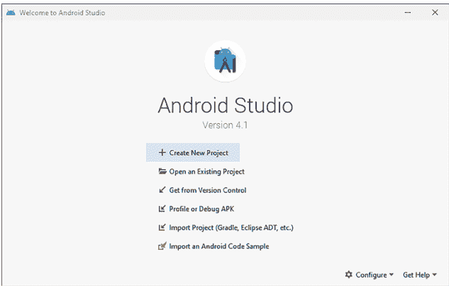

点击“创建新项目”链接，选择“空活动”选项，然后点击“下一步”按钮。

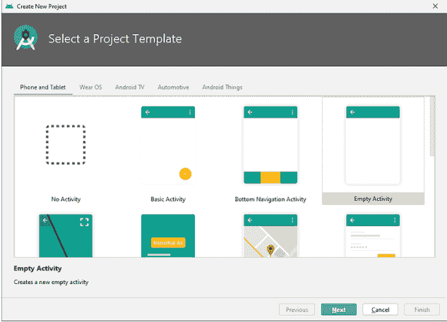

在下一个屏幕上，我们将为应用设置一些值：

- *名称*：我们将在各处看到的应用程序名称。对于此应用，我们可以使用 *Penny Drop*。

- *包名*：此值在 Android 应用中具有双重用途。首先，它是唯一标识你的应用在用户设备上以及在 Google Play 商店中的应用程序 ID。其次，它是我们应用中的 Kotlin 包名。这是我们所有代码的主要分组，意味着我们应用的代码文件将包含一个带有此包名的 `package` 声明。然后我们可以为更具体的部分添加到包名中。例如，我的应用包名是 `dev.mfazio.pennydrop`，因此我将把我的 Fragment 类放在 `dev.mfazio.pennydrop.fragments` 中。你可以决定如何组织你的文件；由于包在系统上组织成文件夹，你可以将其视为将代码放入这些不同的文件夹中。请记住，包名应全部为小写。

- *保存位置*：你希望在机器上保存代码的任何位置。

- *语言*：Kotlin（否则你读错了书！）。

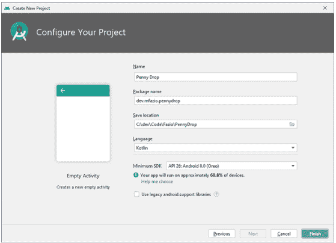

*最低 API 级别*值决定了可以运行你的应用的最低操作系统（OS）版本。拥有 API 级别、OS 代号*和* OS 版本号可能会有点混乱，因此在本书中，我将至少坚持指出 API 级别。API 级别更精确一些，因为 OS 代号可能意味着多个版本，而且 API 级别是我们将在配置文件中使用的。

选择最低 API 级别可能很棘手，因为这可能会限制哪些设备能够获取你的应用。选择一个太高/新的 API 级别，较旧的设备将被阻止使用该应用。选择一个太低/旧的 API 级别，你将无法访问较新的 Android 功能。“帮我选择”链接将为你提供更多信息，包括至少具有给定 API 级别的用户百分比估计，以及每个 API 级别包含的功能。该屏幕将类似于图[所示](https://developer.android.com/studio/releases/platforms)。

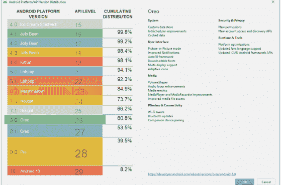

在撰写本文时（2020 年底），API 级别 26 已有三年多历史，很可能（尽管不保证）是一个安全的基线。如果你认为可以升级到更新的版本和/或你确实需要某个功能，你可以升级。请记住，你以后总是可以更改此值。

列表中的最后一个选项是“使用旧版 android.support 库”。我们希望取消选中此选项，因为我们最好使用新的 AndroidX 库。

> AndroidX
>
> 对于那些熟悉旧版 Android Support Library 的人来说，这些包已被移至 AndroidX。如果你对 Android Support Library 不熟悉，只需知道它是一种在 Android 版本之间实现向后兼容性的方式（现在由 AndroidX 包处理）。所有 AndroidX 包都是单独维护和更新的，允许你根据需要引入任何库，也可以单独更新它们。这意味着你只需要引入你想要的内容，仅此而已。

设置好所有值后，点击“完成”，Android Studio 将开始创建你的应用！

### 这做了什么？

Android Studio 为我们生成了许多文件，并已开始索引我们的代码库。这意味着它正在获取项目中所有文件/符号的列表，以便它可以快速向我们提供有关类是否存在、依赖项是否已加载或类型是否在多个文件中冲突的反馈——基本上，Android Studio 中编写代码的所有便捷功能。

在继续之前，我们还有最后一个设置步骤——让我们从一开始就配置我们的应用以目标为 Java 8。这样做将启用更多语言功能以及使用一些便捷库组件的能力。为此，我们进入应用的 `build.gradle` 文件并添加一些项目：`kotlinOptions.jvmTarget = 1.8` 以及 `android` 部分内 `compileOptions` 块中的两个设置，并更新 Kotlin 标准库依赖项以使用 JDK8 版本。

在进行任何更改之前，请确保你位于 `build.gradle` 中，其后带有 (Module: Penny_Drop.app) 或类似内容。否则，这些都不会正常工作。

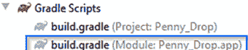

该文件的内容应如下所示：

```
android {
    // 其他选项仍在此处。

    kotlinOptions {
        jvmTarget = 1.8
    }
}

dependencies {
    implementation fileTree(dir: "libs", include: ["*.jar"])
    implementation "org.jetbrains.kotlin:kotlin-stdlib-jdk8:$kotlin_version"

    // 其余依赖项仍在此处。
}
```

一旦 Android Studio 完成对项目的索引（这可能需要几分钟），我们就可以开始浏览新的代码库了。这里还没有太多内容，但我们能够在当前状态下运行该应用。Android Studio 将构建代码，生成 APK（Android Package，实际上是 Android 的 exe），并将其部署到设备/模拟器上。一旦完成，应用将看起来像第一张图所示。

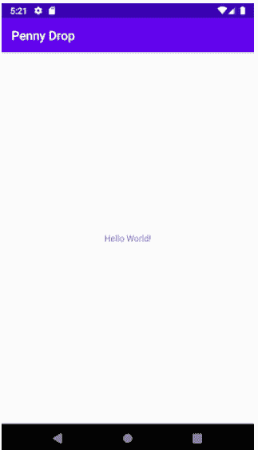

看到了吗？我说这里还没有太多内容时并没有开玩笑，但我们很快就会添加更多内容。首先，让我们介绍已由 Android Studio 为我们创建，如第二张图片所示。

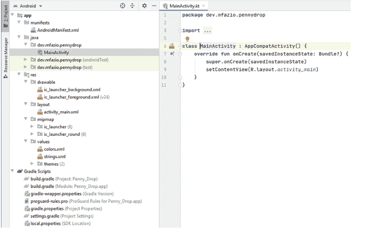

## AndroidManifest.xml

清单文件包含有关您应用的信息，包括应用名称、包名、启动器图标、默认主题以及应用中的任何 Activity 类。在这里，我们还可以使用 `<intent-filter>` 标签来告诉应用如何处理设备上的某些操作。意图是要执行的操作的描述以及（可选的）关联数据。我们稍后会介绍什么是 Activity。

至少，我们需要在默认的 Activity 中有两个标签来告诉设备默认启动哪个 Activity：

```xml
<activity android:name=".MainActivity">
    <intent-filter>
        <action android:name="android.intent.action.MAIN" />
        <category android:name="android.intent.category.LAUNCHER" />
    </intent-filter>
</activity>
```

## MainActivity

这是我们应用的主要入口点，也是我们当前看到的主要屏幕。Activity 类是 Android 应用程序中的核心组件。每个 Activity 还有一个关联的布局文件，通常与 Activity 名称相比是反向的。例如，`MainActivity` 变成 `activity_main.xml`。我们稍后会讨论这些布局文件。

## drawable 文件

Android 中的 drawable 是您在应用中使用的图片。我们稍后会添加更多，但现在有两个包含有关启动器图片信息的矢量文件（您在设备的应用抽屉中看到的图片）。Android 中的矢量图像类似于 SVG（可缩放矢量图形），其中图像通过列出路径坐标绘制，而不是静态图像。这允许图像缩放到不同的大小而不会出现任何问题。我们稍后会更新图像，但现在可以保持原样。

现在，如果我们有标准的静态图像（JPG、PNG 等），它们通常会放在 drawable 文件夹内的子文件夹中。对于 drawable 文件，我们通常会有多个相同文件的不同分辨率版本，由大小值标记：`mdpi`、`hdpi`、`xhdpi`、`xxhdpi` 和 `xxxhdpi`。

这些图像对应于不同的每英寸点数（DPI）值，这是表示设备分辨率和显示尺寸之间比率的方法。如果 DPI 值更高，这意味着设备上的像素更小。这可能是由于更高的分辨率屏幕或更小的设备，因为我们在每英寸屏幕空间中有更多的像素。如果两个设备具有相同的分辨率但屏幕尺寸不同，较小的设备将具有更高的 DPI。同样，如果两个设备尺寸相同但分辨率不同，更高分辨率的设备将具有更高的 DPI 值。

与其担心所有这些不同的分辨率，我们将在两个应用中使用的大多数图像将是矢量图像，因为它们可以使用单个 XML 文件缩放到任何大小。但如果您确实需要图像，它们应该具有所有这些不同的分辨率。通过将 AAB（Android App Bundle）上传到 Play Store，当用户下载应用时，额外的图像分辨率将被移除。

## Layout 文件


布局文件是处理应用程序 UI 的 XML 文件。布局文件中的所有内容都将存在于包含 `View` 和 `ViewGroup` 对象的层次结构中。在我们的例子中，`activity_main.xml` 布局文件包含一个 `ViewGroup`（`ConstraintLayout`）和一个 `View` 组件（`TextView`）。我们很快会添加更多内容，并且在本书的后续部分会添加更多内容。

## Mipmap 文件

现在，这些看起来与我之前提到的 `drawable` 文件相似，它们确实是，但这里的区别在于，当用户下载应用时，所有 `mipmap` 文件都会被包含。原因是我们有时希望图像的分辨率与手机的 DPI 不同。在我们的例子中，我们这里有启动器图像，这可能需要比通常包含的更高分辨率的图像用于用户的主屏幕（例如）。

请注意，只包含需要比手机通常需要的更高分辨率的图像，例如启动器图标。这里包含的每组图像都会增加您的应用大小。

> **自适应图标**
>
> 我已经多次提到这个术语，所以现在可能是时候实际讨论它了。*自适应图标*在 API 级别 26 中添加，允许设备以多种形状显示启动器图标。此外，它还赋予系统为图标添加动画的能力（由于具有单独的前景和背景层）。我们之前在 `drawable` 中看到的 `ic_launcher_*.xml` 文件定义了自适应图标的背景和前景。然后我们将 `<adaptive-icon>` XML 文件添加到 `app\src\main\res\mipmap-anydpi-v26`，这些文件用于任何 DPI 设备（因为矢量文件是绘制的，而不是缩放的图像）。
>
> 更多关于自适应图标的信息可以在 https://link.mfazio.dev/adaptive-icons 找到。

## Values 文件

Android 开发中的一个常见做法是在应用中使用资源而不是静态或硬编码的值。这包括字符串、颜色、主题、字体甚至动画。这种做法的一些原因是它允许您在一个位置定义特定值并在多个位置使用它，它使一些值更具可读性（例如，`alert_red` 优于 `#bc121d`），并且对于字符串，它允许更容易的翻译。

您可以定义多个 `values-*` 目录（例如，`values-es` 用于西班牙语），这些目录包含不同语言的值。如果您要处理翻译，Android Studio 有一个内置的翻译编辑器，可以使这个过程更快：https://link.mfazio.dev/translations。

## Gradle 脚本

Gradle 是 Android 应用程序的默认构建工具。Gradle 脚本用于设置应用的依赖项（每当我们添加新的 Jetpack 组件时，我们都会在这里），配置您使用的 Kotlin 版本，并指定您为应用使用的 SDK 版本。它使用我们在创建应用时设置的值和复选框来填充脚本，但我们可以根据需要调整任何内容。现在，里面的内容很好，但我们稍后会回来添加依赖项并更新一些设置。

## 我们还需要什么？

Android Studio 为我们添加了一堆文件来帮助我们开始应用开发，但在尝试连接所有内容之前，我们还想添加一些其他内容。以下是我们仍然需要的：

- 我们用于视图的 Fragment 类。
- 一个菜单，用于告诉底部导航栏显示哪些选项。
- 一个导航图，用于告诉 `MainActivity` 显示哪个视图。
- 底部导航的图像。
- 对 `MainActivity` 的更新，以将所有内容整合在一起。

## Fragment 类

虽然 `MainActivity` 将是我们的应用的入口点，但我们实际上只会为我们的应用使用单个 Activity。对于任何习惯于大型、繁重的 Activity 类处理所有事情的有经验的 Android 开发者来说，这可能看起来很奇怪。

然而，拥有一个 Activity 并在其中交换 Fragment 视图更有效率，现在是 Google 推荐的方法。此外，正如我们将在下一章中看到的，这使得在视图之间共享数据更加顺畅。

现在，我们将创建两个 Fragment 类：`PickPlayersFragment` 和 `GameFragment`。这些 Fragment 类最终将用于设置游戏的玩家，然后玩游戏。现在，我们将创建两个 Fragment 类，但直到第 2 章 [使用 Fragments 构建视图](Build Views with Fragments) 才会添加适当的内容。

在创建 Fragment 类之前，添加一个新的 `fragments` 包以更好地组织内容会很有帮助。在项目视图中右键单击您的主包（例如，我的是 `dev.mfazio.pennydrop`），然后选择 New > Package。它需要完整的包名，因此只需在主包末尾加上“fragments”。在我的例子中，这是 `dev.mfazio.pennydrop.fragments`。

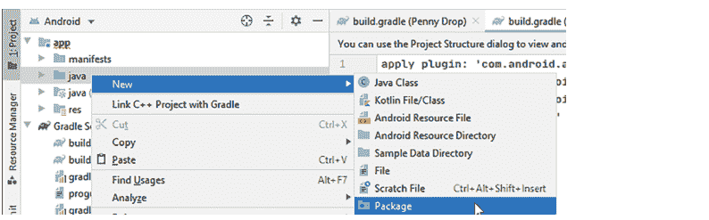

完成后，我们可以创建实际的 Fragment 类。

### PickPlayersFragment

对于这两个 Fragment 类，我们将让 Android Studio 为我们完成工作，然后我们可以稍后进行清理。在项目视图中右键单击您的 `fragments` 包名（在我的例子中，在 `app/java/dev.mfazio.pennydrop.fragments` 下），然后选择 New > Fragment > Fragment (Blank)。输入 Fragment 名称 `PickPlayersFragment`，并将 Fragment 布局名称保留为 `fragment_pick_players`。确保源语言是 Kotlin，然后单击 Finish。

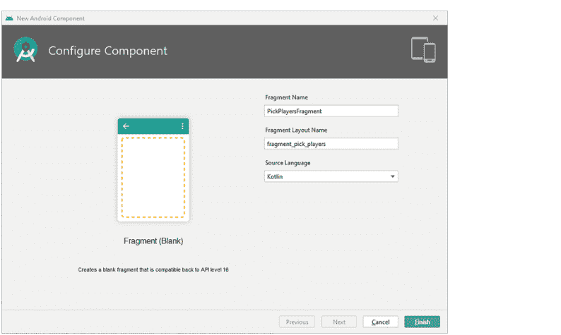

Android Studio 完成后，您将拥有新的 `PickPlayersFragment` 类以及 `fragment_pick_players.xml` 布局文件。打开 `fragment_pick_players.xml`，这样我们就能让这里的 `<TextView>` 显示“选择玩家片段”。

虽然你可以使用设计视图进行布局编辑，但在处理布局文件时，我将始终参考代码视图。此视图显示每个布局背后的 XML，并让我们对布局中使用的值进行更精确的控制。一旦你更熟悉布局文件的内容，可以随意使用设计标签页。要切换视图，请点击编辑器右上角的“代码”按钮：


进入代码视图后，将 `<TextView>` 的 `android:text` 属性更新为“选择玩家片段”：

```xml
<?xml version="1.0" encoding="utf-8"?>
<FrameLayout xmlns:android="http://schemas.android.com/apk/res/android"
    xmlns:tools="http://schemas.android.com/tools"
    android:layout_width="match_parent"
    android:layout_height="match_parent"
    tools:context=".fragments.PickPlayersFragment">

    <TextView
        android:layout_width="match_parent"
        android:layout_height="match_parent"
        android:text="Pick Players Fragment" />

</FrameLayout>
```

我必须提醒你，直接将文本放入布局文件实际上是一种不好的做法。但由于这只是在我们拥有真实内容之前的占位符，目前这样处理是可以的。

### GameFragment

我们将在这里做与 `PickPlayersFragment` 相同的事情。右键单击，创建一个新的空白 `Fragment`，然后让 Android Studio 完成剩余工作。我们将使用一个快捷方式快速访问布局文件：按住 `Ctrl`/`Cmd` 并点击 `onCreateView(...)` 中的 `fragment_game`。这将带你到 `fragment_game.xml` 文件。你可以使用相同的快捷方式跳转到应用中的任何类、文件甚至资源。在布局 XML 内？你可以点击字符串资源查看它们的位置。这是在应用程序中快速移动的便捷方式。

像我们处理 `PickPlayersFragment` 一样更新 `<TextView>`，但将文本值设为“游戏片段”。现在两个 `Fragment` 类都已创建，我们可以创建 `navigation.xml` 并包含这两个 `Fragment` 类的导航图。

## 构建应用的导航

这两个文件将告诉应用显示什么：`navigation.xml` `<menu>` 文件将告诉底部导航栏在导航中应选择哪个 `Fragment`，而 `nav_graph.xml` `<navigation>` 文件将处理显示哪个 `Fragment`。

### navigation.xml

对于我们的菜单，我们可以让 Android Studio 处理创建文件和文件夹结构。右键单击 `res` 并选择 *新建 > Android 资源文件*。在此对话框中，输入文件名 `navigation.xml`，资源类型选择菜单。源集应为 main，目录名应为 menu。设置完成后点击确定以创建文件。

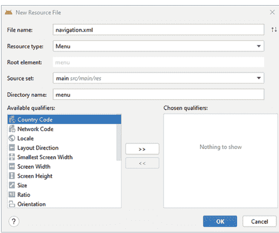

文件创建后，打开它，切换到代码标签页（同样位于编辑器窗口右上角），并添加两个 `<item>` 标签：一个用于 `PickPlayersFragment`，一个用于 `GameFragment`。每个 `<item>` 都将有一个 ID 和标题：

```xml
<menu xmlns:android="http://schemas.android.com/apk/res/android">
    <item
        android:id="@+id/pickPlayersFragment"
        android:title="Players" />
    <item
        android:id="@+id/gameFragment"
        android:title="Game" />
</menu>
```

这些可以工作，但我们可以做两处改进：将 `android:title` 值设为字符串资源，并为每个选项添加一些图像。Android Studio 应该已经高亮显示了两个 `android:title` 值，提示你“硬编码字符串‘Players’，应使用 @string 资源。”我们已经在值文件中讨论过为什么需要这样做，Android Studio 会为我们进行更改：将光标放在其中一个高亮字符串上，然后按 `Alt + Enter` 以获取提取资源对话框。默认值可能没问题，因此点击确定按钮继续。一旦两个 `android:title` 值都指向字符串资源，请转到你的 `strings.xml` 文件查看所做的更改：

```xml
<resources>
    <string name="app_name">Penny Drop</string>

    <!-- TODO: Remove or change this placeholder text -->
    <string name="hello_blank_fragment">Hello blank fragment</string>
    <string name="players">Players</string>
    <string name="game">Game</string>
</resources>
```

两个值现在都已正确设置，因此删除 `hello_blank_fragment` 条目，然后我们可以继续处理图像。Android Studio 附带了许多我们可以使用的图像，因此我们将从 `PickPlayersFragment` 图像开始。所有图标均根据 Apache 许可证版本 2.0 授权，这可能适用于你的应用（尽管你需要确认）。右键单击 `res/drawable` 文件夹并选择 *新建 > 矢量素材*。这将显示配置矢量素材屏幕。在此，我们将选择剪贴画作为素材类型。然后双击剪贴画旁边的 Android 图标：

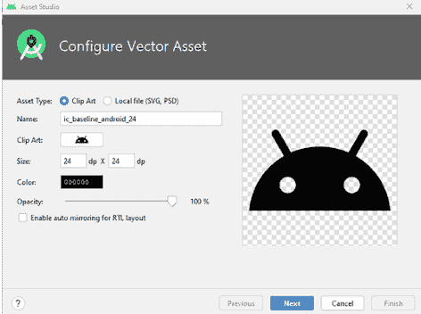

显示的“选择图标”屏幕包含所有可供我们使用的图像（同样，我们也可以随时导入自己的图像）。你可以使用左上角的放大镜搜索栏搜索图标，或使用左侧的类别。

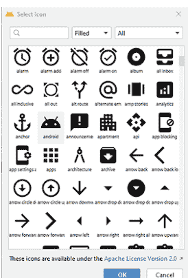

我建议为 `PickPlayersFragment` 选择“人脸”，但你可以选择任何你想要的图标（反正我也阻止不了你）。选择图标后，点击确定返回配置矢量素材屏幕。在那里，点击下一步，然后完成。你会在 `res/drawable` 下看到一个名为 `ic_baseline_face_24.xml` 的新文件（这名字真顺口，不是吗？）。如果你打开该文件，你会看到它是另一个 `vector` 素材，就像我们之前看到的生成启动器图像一样。这意味着图标可以按我们希望的方式缩放，我们只需要一个版本即可适用于所有设备。另外，我稍后会解释 24dp 部分，所以现在不用担心。

Android Studio 中已经有很多图标，但不知为何没有骰子图像（而我们确实需要用于掷骰子游戏）。这意味着我们需要去其他地方寻找图像。我们可以在许多地方在线找到图像，但我将使用 [https://materialdesignicons.com/](https://materialdesignicons.com/) 上的一个。我们可以在 [https://materialdesignicons.com/icon/dice-6](https://materialdesignicons.com/icon/dice-6) 获取一个很棒的 *D6* 图标。该网站支持下载矢量可绘制对象，因此将其引入应用会很快。保存 XML 文件并按你希望的方式重命名——我将使用 `mdi_dice_6_black_24dp.xml`，因为 mdi 前缀有助于提醒我它来自 Material Design Icons 网站。最后，将文件移动到你的 `drawable` 目录（你可以在 Android Studio 中将文件拖放到目录上）。

图像准备好后，我们可以返回 `navigation.xml` 并添加图像。我们将为每个 `<item>` 添加一个 `android:icon` 属性，使用你之前可能见过的字符串资源语法：`@drawable/[文件名]`。

```xml
<?xml version="1.0" encoding="utf-8"?>
<menu xmlns:android="http://schemas.android.com/apk/res/android">
    <item
        android:id="@+id/pickPlayersFragment"
        android:icon="@drawable/ic_baseline_face_24"
        android:title="@string/players" />
    <item
        android:id="@+id/gameFragment"
        android:icon="@drawable/mdi_dice_6_black_24dp"
        android:title="@string/game" />
</menu>
```

现在 `navigation.xml` 文件已全部设置好，我们可以继续处理导航图。

### 导航和 nav_graph.xml

在深入 `nav_graph.xml` 文件之前，让我们先将依赖项添加到应用的 `build.gradle` 文件中。这是在项目视图（默认位于 Android Studio 左侧）中文件名后带有 (Module:app) 的文件。项目中有两个 Gradle 文件的原因是，我们有一个用于项目中所有模块的顶级文件，另一个用于 `app` 模块。在我们的案例中，我们只有一个模块，因此项目级文件用处不大，但它仍然对我们构建变量很方便。

事实上，让我们在顶级 `build.gradle` 中添加一个名为 `nav_version` 的快速变量。添加此变量允许我们在一个地方更改所有导航相关依赖项的版本，而不必处理每个单独的依赖项声明。

虽然我们这里只添加两个依赖项，但这是一个很好的实践，以便将来我们有更多依赖项需要处理时使用。请注意，我将为所有全书贯穿了依赖项的使用。若需查找所用依赖项的版本或获取更多相关信息，请参阅附录3，[Gradle 依赖项](Gradle Dependencies)。该变量添加在顶层 `build.gradle` 文件的 `buildscript` 部分内，位于一个 `ext` 块中：

```
buildscript {
    ext {
        kotlin_version = '1.4.30'
        nav_version = '2.3.3'
    }
    //buildscript 块的其余部分
}
```

然后，我们可以在应用的 `build.gradle` 文件中添加这两个依赖项：

```
dependencies {
    implementation fileTree(dir: 'libs', include: ['*.jar'])

    //其他依赖项

    » implementation "androidx.navigation:navigation-fragment-ktx:$nav_version"
    » implementation "androidx.navigation:navigation-ui-ktx:$nav_version"

    //其他依赖项
}
```


现在我们已经添加了正确的依赖项（请确保运行 Gradle 同步；应该会弹出一个带有“立即同步”选项的横幅），我们可以继续添加导航图。导航图将告诉导航组件从哪里开始以及用户在应用中可以到达的所有位置。我们可以为应用配置多个*目的地*以及起始目的地。目的地是用户在应用中可以前往的位置；在我们的例子中，就是我们之前创建的 `Fragment` 类。我们将在第7章[使用设置和主题自定义应用](Customize an App with Settings and Themes)中更详细地了解导航，然后在第9章[通过导航抽屉导航](Navigate via Navigation Drawer)中通过 Android Baseball League 应用了解更高级的导航。目前，我们只需要创建 `<navigation>` 文件，添加我们的两个片段，然后就可以回到 `MainActivity` 将这一切整合起来。

通过右键单击 `res` 并再次选择 New > Android Resource File 来添加 `nav_graph.xml`。这次，将文件命名为 `nav_graph`，并选择 Navigation 作为资源类型。点击确定，然后再次切换到 Text 选项卡，查看一个相当空的 `<navigation>` XML 标签。实际上，它可能带有红色下划线，表示错误。我们很快就会修复它（它因为未被使用而“生气”），所以现在不用担心。我们想向此文件添加一些内容：两个 `<fragment>` 标签和一个 `app:startDestination` 属性。每个 `<fragment>` 将有一个 ID、name 和 label，而 `app:startDestination` 将指向 `GameFragment`。

```
<?xml version="1.0" encoding="utf-8"?>
<navigation xmlns:android="http://schemas.android.com/apk/res/android"
    xmlns:app="http://schemas.android.com/apk/res-auto"
    xmlns:tools="http://schemas.android.com/tools"
    android:id="@+id/nav_graph"
    app:startDestination="@id/gameFragment">
    <fragment
        android:id="@+id/pickPlayersFragment"
        android:name="dev.mfazio.pennydrop.fragments.PickPlayersFragment"
        android:label="fragment_pick_players" />

    <fragment
        android:id="@+id/gameFragment"
        android:name="dev.mfazio.pennydrop.fragments.GameFragment"
        android:label="fragment_game" />
</navigation>
```

这里需要注意的主要事项：片段名称与完全限定类名（包括包名）匹配，`android:label` 与片段的布局文件名匹配，这里的 ID 与 `navigation.xml` 中的 ID 匹配。最后一点可能不如前两点明显，但它非常有用。通过在 `navigation.xml` 和 `nav_graph.xml` 中使用相同的 ID，导航组件将能够自动为你切换显示的内容，无需任何额外配置。一旦我们完成 `MainActivity`，我们就会更好地理解这意味着什么。

另外，需要提醒的是，`@+id/` 语法是我们向应用*添加*一个新 ID。在首次向布局中添加项目时，我们需要这样做。然后，一旦我们去使用该 ID，我们就可以使用 `@id/` 语法，就像我们在 `app:startDestination=@id/gameFragment` 中看到的那样。

完成这些后，我们可以转到 `activity_main.xml` 并添加我们需要的所有内容。

## 更新 activity_main.xml

到目前为止，我们已经创建了许多支持项目，但如果我们现在运行应用，我们仍然只有“Hello World!”文本。这是因为我们实际上还没有向 `MainActivity` 的布局文件添加任何内容。`layout_main.xml` 将只有两个视图：一个用于我们之前创建的不同视图的容器 `<fragment>`，以及我们之前设置的底部导航。所以让我们从底部导航开始，因为 `<fragment>` 的对齐取决于它，但首先，我想介绍将包围这两个视图的 `<ConstraintLayout>`。

### 什么是 ConstraintLayout？

我在[布局文件](Layout Files)中提到过，布局由 ViewGroup 和 View 类组成，而 `ConstraintLayout` 是我们将在本书中使用的主要 ViewGroup。它是现有 `RelativeLayout` 的改进版本，其中所有视图都基于彼此或其父级进行对齐。这避免了在布局 XML 中出现层层嵌套的视图，这在许多 Android 应用中很常见。此外，虽然我们将通过 XML 文本视图编辑布局，但使用 `ConstraintLayout` 构建 UI 在 Android Studio 的布局编辑器中效果很好。

`ConstraintLayout` 的关键在于，`ConstraintLayout` 内的每个视图都必须至少有一个垂直和一个水平约束，相对于布局中的其他内容。这允许操作系统处理每个设备上的位置，这意味着你的 UI 将在多种屏幕尺寸和分辨率上以相同的方式显示，而无需担心像素计数。

请注意，在 `<ConstraintLayout>` 中添加约束需要 `app` 命名空间。你可以输入 `appNs` 让 Android Studio 为你自动完成，或者手动添加命名空间：

```
<androidx.constraintlayout.widget.ConstraintLayout
    xmlns:android="http://schemas.android.com/apk/res/android"
    xmlns:app="http://schemas.android.com/apk/res-auto"
    ...>
```

### 添加 BottomNavigationView

底部导航使用 `<com.google.android.material.bottomnavigation.BottomNavigationView>` 标签，添加到视图的底部。由于我们使用的是 `<ConstraintLayout>`，应用并不关心我们在布局文件中的哪个位置放置 `<BottomNavigationView>` 标签。但是，我确实建议将其作为 `<ConstraintLayout>` 中的最后一个元素添加，以使内容更易于阅读。

这里的约束很简单：左、右和底部都将与父级 `<ConstraintLayout>` 对齐。这意味着底部导航与布局的底部和侧边边缘对齐。最后一部分是 `android:layout_height“wrap_content”`，它会根据内容自动调整视图的大小。这三个约束和 `wrap_content` 值一起将底部导航放在你期望的位置，即视图的底部。

视图上还需要另一个属性，`android:layout_width`。通常，这个值会是 `wrap_content` 或 `match_parent`（使视图与其父级一样宽），但由于我们有约束告诉视图将其两端与父级匹配，我们可以直接设置 `android:layout_width“0dp”`。这将调整视图大小的责任交给了 `<ConstraintLayout>`。

请注意，我们实际上可以使用 `match_parent` 作为宽度值，并排除左/右约束，但我想在一个简单的例子中突出显示添加约束。

另外，我想提到 Android 中的 left 和 right 属性值通常应该使用 start 和 end 代替。在大多数情况下，你不会看到区别，但这允许在你的应用被翻译成从右到左阅读的语言时提供更好的支持。

在我们继续介绍底部导航的最后几个属性之前，我想指出 `0dp` 实际上意味着什么。虽然你可以使用 `wrap_content` 或 `match_parent`，但有时我们需要实际设置部分高度值。这可以通过数字值和 `dp` 来完成，`dp` 指的是一定数量的*密度无关像素*。这是一种允许你在不同分辨率的设备上获得相似布局的度量单位。

> 正确的度量单位

### 合适的度量单位

在 Android 应用中，我们不会使用 `px` 作为尺寸单位，因为屏幕尺寸和分辨率可能各不相同。相反，我们使用 `dp` 和 `sp`。

- `dp`：密度无关像素——用于布局（代替 `px`）。

- `sp`：缩放无关像素——类似于 `dp`，但也会考虑用户的字体缩放设置。用于文本尺寸。

更多信息：[https://link.mfazio.dev/dimension](https://link.mfazio.dev/dimension)。

我们还需要添加两个属性：底部导航栏的背景和关联的菜单。我们将快速为底部导航栏设置一个默认背景，这没什么特别的。但接下来的部分就更令人兴奋了。还记得我们之前创建的 `navigation.xml` 吗？我们将把它添加为底部导航栏的菜单，这意味着我们在 `<menu>` XML 中设置的项目将在这里使用。让我们看看完整的 `<BottomNavigationView>` XML：

```xml
<com.google.android.material.bottomnavigation.BottomNavigationView
    android:id="@+id/bottom_nav"
    android:layout_width="0dp"
    android:layout_height="wrap_content"
    android:background="?android:attr/windowBackground"
    app:layout_constraintBottom_toBottomOf="parent"
    app:layout_constraintEnd_toEndOf="parent"
    app:layout_constraintStart_toStartOf="parent"
    app:menu="@menu/navigation" />
```

注意到 `navigation.xml` 是如何在这里被引用的吗？这是因为它是一个资源，所以我们引入文件的方式与引入 `<drawable>` 或 `<string>` 资源相同。背景的语法是一个属性引用，意味着一个可能在其他地方（通常在主题中）被更改的值。我们将在第 7 章 [使用设置和主题自定义应用](Customize an App with Settings and Themes) 中更详细地讨论这一点。

另外，`android:background` 的值在这里可能看起来有点奇怪。`?attr` 是对应用中某处指定的属性的引用，而 `?android/attr` 则引用一个内置的 Android 属性。在这个例子中，我们引用了一个可以用于底部导航栏的内置背景。否则，我们就可以继续处理容器 `<fragment>` 了。

### 添加主容器

这是我们在本章中处理的应用的最后一部分，也将是我们在第 6 章 [使用 RecyclerView 构建列表](Build a List with RecyclerView) 之前需要处理的导航相关工作的最后一点。这个 `<FragmentContainerView>` 将容纳我们在应用中使用的所有不同 Fragment 类的视图。

我们可以开始设置带有约束的 `<FragmentContainerView>`，类似于我们在底部导航栏中看到的那样。顶部、起始和结束约束都将相对于父视图，而底部约束将与底部导航栏的顶部关联。这使得容器占据了 `<ConstraintLayout>` 内除底部导航栏所在位置之外的所有可用空间：

```xml
<androidx.fragment.app.FragmentContainerView
    android:id="@+id/containerFragment"
    app:layout_constraintBottom_toTopOf="@id/bottom_nav"
    app:layout_constraintEnd_toEndOf="parent"
    app:layout_constraintStart_toStartOf="parent"
    app:layout_constraintTop_toTopOf="parent" />
```

我们在 Android 布局文件中通过 ID 引用视图，如这里的 `@id/bottom_nav` 所示。记住，如果你想为一个视图或视图组分配一个 ID，你需要将 `android:id` 设置为 `@+id/[viewID]`，并且我们只需要在第一次声明视图或视图组时这样做。

我们已经为 `<FragmentContainerView>` 定义了顶部、底部、起始和结束约束，这意味着我们知道该视图的大小。因此，我们可以像处理底部导航栏那样，将 `layout_width` 和 `layout_height` 都设置为 `0dp`。

```xml
<androidx.fragment.app.FragmentContainerView
    android:id="@+id/containerFragment"
    android:layout_width="0dp"
    android:layout_height="0dp"
    app:layout_constraintBottom_toTopOf="@id/bottom_nav"
    app:layout_constraintEnd_toEndOf="parent"
    app:layout_constraintStart_toStartOf="parent"
    app:layout_constraintTop_toTopOf="parent"/>
```

现在，我们来处理 `<FragmentContainerView>` 的导航部分。我们需要告诉 `<FragmentContainerView>`，它将是一个特定于导航的 Fragment，包含在 `androidx.navigation: NavHostFragment` 中。这是一个特殊的 Fragment，它还帮助我们处理与 `NavController` 的交互，因此我们只需要传入我们正在使用的 `NavController`（当我们完成 `MainActivity` 时，这一点会更清楚）。

然后，我们可以添加之前创建的 `<app:navGraph>`（`nav_graph.xml`），并将此 Fragment 标记为默认导航宿主，设置 `app:defaultNavHost="true"`。

```xml
<androidx.fragment.app.FragmentContainerView
    android:id="@+id/containerFragment"
    android:name="androidx.navigation.fragment.NavHostFragment"
    android:layout_width="0dp"
    android:layout_height="0dp"
    app:defaultNavHost="true"
    app:layout_constraintBottom_toTopOf="@id/bottom_nav"
    app:layout_constraintEnd_toEndOf="parent"
    app:layout_constraintStart_toStartOf="parent"
    app:layout_constraintTop_toTopOf="parent"
    app:navGraph="@navigation/nav_graph" />
```

### 完成的 activity_main.xml

这是我们为 `MainActivity` 布局准备的内容：一个单独的 `<ConstraintLayout>`，其中包含一个用于显示不同 Fragment 视图的容器以及底部导航栏。


```xml
<androidx.constraintlayout.widget.ConstraintLayout
    xmlns:android="http://schemas.android.com/apk/res/android"
    xmlns:app="http://schemas.android.com/apk/res-auto"
    android:id="@+id/container"
    android:layout_width="match_parent"
    android:layout_height="match_parent">

    <androidx.fragment.app.FragmentContainerView
        android:id="@+id/containerFragment"
        android:name="androidx.navigation.fragment.NavHostFragment"
        android:layout_width="0dp"
        android:layout_height="0dp"
        app:defaultNavHost="true"
        app:layout_constraintBottom_toTopOf="@id/bottom_nav"
        app:layout_constraintEnd_toEndOf="parent"
        app:layout_constraintStart_toStartOf="parent"
        app:layout_constraintTop_toTopOf="parent"
        app:navGraph="@navigation/nav_graph" />

    <com.google.android.material.bottomnavigation.BottomNavigationView
        android:id="@+id/bottom_nav"
        android:layout_width="0dp"
        android:layout_height="wrap_content"
        android:background="?android:attr/windowBackground"
        app:layout_constraintBottom_toBottomOf="parent"
        app:layout_constraintStart_toStartOf="parent"
        app:layout_constraintEnd_toEndOf="parent"
        app:menu="@menu/navigation" />
</androidx.constraintlayout.widget.ConstraintLayout>
```

现在布局都已完成，还有一件事要做：让我们在`MainActivity`中连接所有内容并运行应用。

## 完成 MainActivity

目前，我们的`MainActivity`只有`onCreate`方法，它调用`AppCompatActivity`的`onCreate`方法，并通过`setContentView`方法将`activity_main.xml`与`MainActivity`关联起来。我们已经创建了主要的`<FragmentContainerView>`和底部导航栏，这意味着我们需要将这两者都连接到`MainActivity`。我本可以开始一些全新的部分来解释所有涉及的内容，但这是不必要的。我们只需要从这个 Activity 获取`NavController`并用它来初始化底部导航栏。这样做只需要三行代码：

```kotlin
val navHostFragment = supportFragmentManager
    .findFragmentById(R.id.containerFragment) as NavHostFragment

this.navController = navHostFragment.navController

findViewById<BottomNavigationView>(R.id.bottom_nav)
    .setupWithNavController(this.navController)
```

前两行获取`<FragmentContainerView>`并初始化一个`NavController`，该控制器将使用容器视图来显示其他视图，而第三行则告诉底部导航栏使用该`NavController`。除了添加`this.navController`的声明外，我们的`MainActivity`就完成了。以下是完整的类：

```kotlin
class MainActivity : AppCompatActivity() {

    private lateinit var navController: NavController

    override fun onCreate(savedInstanceState: Bundle?) {

        super.onCreate(savedInstanceState)

        setContentView(R.layout.activity_main)

        val navHostFragment = supportFragmentManager

            .findFragmentById(R.id.containerFragment) as NavHostFragment

        this.navController = navHostFragment.navController

        findViewById<BottomNavigationView>(R.id.bottom_nav)

            .setupWithNavController(this.navController)

    }
}
```

在我们完成所有工作后，现在运行我们的应用，会看到类似图片[所示](https://example.com/shown)的效果。

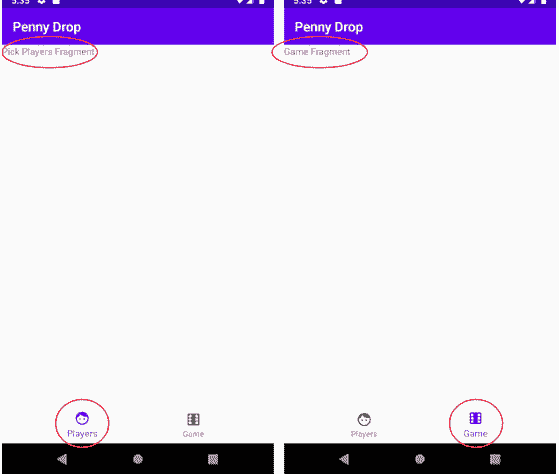

虽然它看起来仍然不太起眼，但我们现在已经有了一个可工作的[BottomNavigationView](https://example.com/BottomNavigationView)，它能根据我们配置的名称和图片加载正确的Fragment，而我们除了提供正确的ID之外无需做任何其他事情。在Jetpack之前使用[Fragment](https://example.com/Fragment)类进行开发时，这种导航需要手动处理。让我们再回顾一下我们目前完成的所有工作。

## 总结与后续步骤

作为回顾（或者对于那些刚刚跳过了大约二十五页内容的读者），以下是我们刚刚完成的工作：

- 创建了一个名为 *Penny Drop* 的新应用。
- 创建了两个`Fragment`类：`PickPlayersFragment`和`GameFragment`。
- 创建了一个名为`navigation.xml`的`<menu>`，其中包含我们的两个`Fragment`作为项目。
- 添加了两张图片作为矢量资源。
- 创建了一个名为`nav_graph.xml`的导航图，并将两个`Fragment`类都包含为目的地。
- 在`activity_main.xml`中添加了一个容器`<FragmentContainerView>`和`BottomNavigationView`。
- 在`MainActivity`中连接了所有内容。

我们应用的基础已经完成。我们可以使用底部导航在应用中移动，添加更多选项只需要一个`Fragment`加上几个XML项目。在我们开始添加主题之前，`MainActivity`已经完成了。我们还有几个`Fragment`等待完成，这就是我们的下一站。我们知道可以访问这两个`Fragment`类，现在我们要让它们发挥作用。

# 第2章

## 使用Fragment构建视图

在上一章中，我们得到了一个具有基础导航设置的可工作应用。此外，我们还创建了两个视图的骨架：`PickPlayersFragment`和`GameFragment`。在本章中，我们将构建这两个`Fragment`类，首先从`PickPlayersFragment`开始，以教授相关概念。一旦那个`Fragment`准备就绪，我们将以类似但更快的过程处理`GameFragment`。在本章结束时，`PickPlayersFragment`和`GameFragment`将看起来像这样：

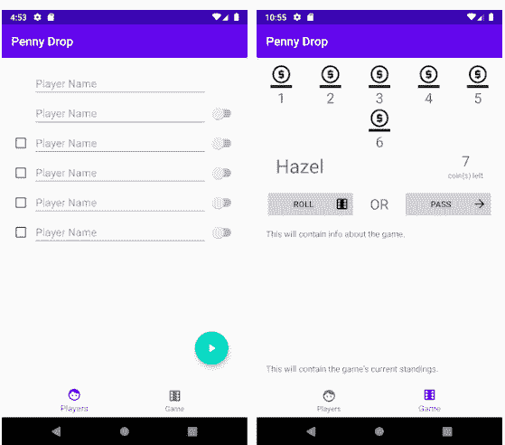

我们将从`fragment_pick_players.xml`中的`<ConstraintLayout>`开始，它将是我们视图的核心，然后添加最终将启动我们游戏的 *浮动操作按钮 (FAB)*。

### 构建一个Fragment（选择玩家）

在整本书中，我们将使用`<ConstraintLayout>`视图组作为大多数屏幕的主要容器。我们可以通过几种方式处理事情，但`<ConstraintLayout>`是一个很好的方式，可以在每个屏幕上将元素放置到你想要的位置，同时仍然允许多种设备类型所需的灵活性。在`fragment_pick_players.xml`中，我们可以用这个新的`<ConstraintLayout>`替换整个现有的`<FrameLayout>`标签。XML将如下所示：

```xml
<?xml version="1.0" encoding="utf-8"?>
<androidx.constraintlayout.widget.ConstraintLayout
    xmlns:android="http://schemas.android.com/apk/res/android"
    xmlns:app="http://schemas.android.com/apk/res-auto"
    xmlns:tools="http://schemas.android.com/tools"
    android:layout_width="match_parent"
    android:layout_height="match_parent"
    android:layout_margin="16dp"
    tools:context=".fragments.PickPlayersFragment">

    <!-- Content will eventually go in here. -->

</androidx.constraintlayout.widget.ConstraintLayout>
```

如果Android Studio提示`xmlns:app`属性未被使用，这没关系。在我们开始向此`<ConstraintLayout>`内的视图添加约束之前，它不会被使用。

一旦你添加了空的`<ConstraintLayout>`，我们就可以继续处理FAB了。

### 更改导航图的起始目的地


我们将在本章的第一部分在`PickPlayersFragment`中工作，并且你可能会多次启动和重启你的应用。为了避免每次启动应用时都必须从`GameFragment`点击切换，请进入`nav_graph.xml`并将`app:startDestination`更改为`@id/pickPlayersFragment`。我们稍后可以切换回来，但这会节省你一些开发上的挫败感。

### 添加FAB

浮动操作按钮是一个圆形按钮，用于执行当前视图的主要功能。在我们的例子中，它是“播放”按钮，它将使用我们在此视图中设置的玩家来开始Penny Drop游戏。值得庆幸的是，添加FAB只需要最少的工作。我们将设置的唯一独特部分是一个可绘制对象（你之前看到的播放按钮）和一个可绘制对象 *着色*，它为图像设置颜色。XML代码将如下所示：

```xml
<com.google.android.material.floatingactionbutton.FloatingActionButton
    android:id="@+id/buttonPlayGame"
    android:layout_width="wrap_content"
    android:layout_height="wrap_content"
    android:layout_margin="16dp"
    android:contentDescription="@string/play_button"
    android:src="@drawable/ic_baseline_play_arrow_24"
    app:layout_constraintBottom_toBottomOf="parent"
    app:layout_constraintEnd_toEndOf="parent"
    app:tint="@android:color/white" />
```

### Android Studio中的代码补全


Android Studio在整个应用程序中提供代码补全，包括XML文件。这意味着你可以输入XML标签或属性名称的一部分，它会告诉你有哪些可用选项。在查找较长的属性名称时，这非常方便，例如FAB中的图像`android:src`值。

根据我们上一章所做的工作，大部分内容看起来应该很熟悉：FAB应该只占用所需大小，并将被锁定在父视图的右下角。我们添加了`16dp`的边距，将FAB稍微推离侧边和底部。我们还为FAB提供了文本描述以实现无障碍访问（确保定义字符串资源）。

最后，我们有了我之前提到的`drawable`属性。我们实际上还没有创建`@drawable/ic_baseline_play_arrow_24`图像，所以请按照上一章底部导航图像的相同方式创建它：右键单击`app/res/drawable`并选择`New > Vector Asset`。在那里，搜索播放箭头剪贴画，保持默认值，单击“下一步”，然后“完成”。

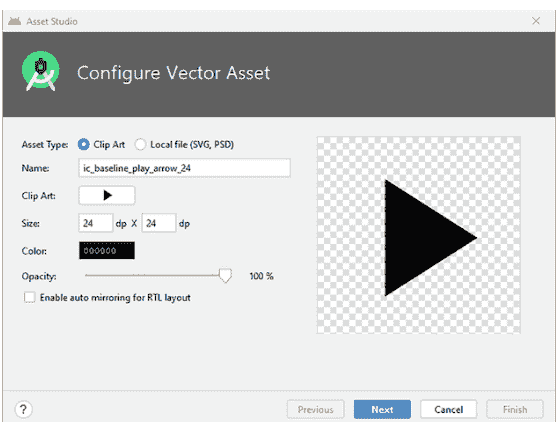

`app:tint`属性为输入的`drawable`赋予一种颜色，通常与正常颜色不同。我们希望播放按钮是白色的，即使图像本身是黑色的（文件名中甚至说明了这一点），我们也可以简单地将图像 *着色* 为其他颜色。

请注意，tint属性使用的是`app`命名空间，*而不是*`android`命名空间。这是由于Design Support Library处理FAB的方式，如果我们使用`android:tint`，可能无法获得预期的颜色变化。

另外，注意FAB上的白色颜色前缀是“`android:`”？这是因为我们引用的是Android Framework内置的颜色。我们也可以使用自定义颜色值，这些值保存在`res/values/colors.xml`资源文件中。例如，`res/values/colors.xml`可能如下所示：

```xml
<resources>
    <color name="colorPrimary">#6200EE</color>
    <color name="colorPrimaryDark">#3700B3</color>
    <color name="colorAccent">#03DAC5</color>
    <color name="plainGray">#CCC</color>
</resources>
```

定义了这组颜色后，我们可以通过以下方式使同一个FAB的图标使用应用的主色调：

### 添加玩家行，避免重复（或尽量减少重复）

在[此处](here)的图片中，我们看到了游戏中将出现的多个玩家行。游戏要求至少有两名玩家，因此对于前两名玩家，我们排除了用于表示该玩家是否参与游戏的复选框。除了第一名玩家外，其他所有玩家都有一个开关，用于表示该玩家是人类还是AI玩家，并且所有人都有某种名称。AI玩家有一个[微调选择器](spinner)来选择你想要的AI，但我们也将该标识符用作他们的名称。这里的关键点是，所有六行基本上是相同的，只是根据它们在列表中的位置以及它们将是什么类型的玩家，添加了一些条件逻辑。

如果我们是在Kotlin代码中，并且想做同样的事情六次，只是有细微差别，我们会创建一个函数，通过几个参数来处理这些差异。虽然这在布局XML中可能看起来不那么直接，但幸运的是，我们有`<include>`标签可以做非常类似的事情。我们创建一个基础布局文件供每个项目使用，然后可以在[fragment_pick_players](fragment_pick_players)中使用`<include>`来添加这些行。我们将从创建名为[player_list_item.xml](player_list_item.xml)的布局文件开始。

### 构建玩家列表项

每个玩家项目将包含我之前提到的三个相同组件：一个表示他们是否在游戏中`<CheckBox>`，一个名称字段（或AI[微调选择器](spinner)），以及一个人类/AI切换开关（一个`<SwitchCompat>`）。我们现在将暂时搁置AI[微调选择器](spinner)，只关注人类玩家。

请注意，在此玩家列表项布局中，我们使用的是`<SwitchCompat>`而不是`<Switch>`。这是因为`<SwitchCompat>`在不同Android版本之间看起来是一致的，而`<Switch>`在旧设备上可能看起来不同。这是一个很好的保障措施，可以确保你的用户获得你预期的视觉体验。


通过右键单击`layout`文件夹并选择`New > Layout resource file`，在`res/layout`下创建一个名为`player_list_item.xml`的新文件。将名称设置为`player_list_item`，根元素设置为`androidx.constraintlayout.widget.ConstraintLayout`（你也可以输入`Constraint`让它为你搜索）。此对话框中的其他所有内容都可以保持原样。

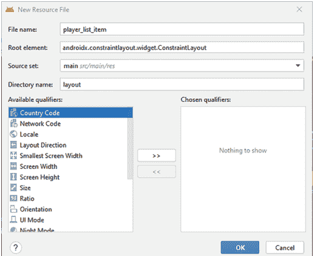

点击完成，打开`player_list_item.xml`，并切换到编辑器的代码视图。你可以通过按编辑器窗口右上角的四行图标来完成此操作。

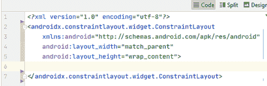

Android Studio为我们提供了一个空的`<ConstraintLayout>`来使用，因此一旦我们了解了计划要做的事情，就可以开始添加视图了。

我们想要添加我之前提到的三个组件。`<CheckBox>`将与其父视图的起始位置对齐，而开关则与结束位置对齐。中间的`<EditText>`（一个可以输入数据的文本字段）将控制其余的对齐。我们将使用之前看到的`0dp`技巧，允许`<EditText>`填充所有剩余空间，因为它的起始和结束将分别与`<CheckBox>`和`<SwitchCompat>`相对。

垂直对齐是这里的巧妙之处；`<CheckBox>`和`<SwitchCompat>`都将匹配`<EditText>`的顶部和底部，结合`android:layout_height`为`wrap_content`，这将使外部视图与`<EditText>`居中对齐，同时保持它们的高度。`<EditText>`将与父视图的顶部对齐，这最终会使整行对齐。

作为参考，水平约束也会发生同样的情况。如果我们在一个具有起始和结束约束的视图上使用`wrap_content`，它将在这两个约束点之间居中。

关于`<EditText>`的最后一点可用性：我们将添加`android:hint`和`android:inputType`属性。提示向`<EditText>`添加文本，让用户知道该字段中应该输入什么。一旦用户开始输入，提示文本也会被隐藏，因此不会妨碍操作。输入类型有助于让键盘知道应该在此字段中输入什么类型的数据，有时还可以限制可以输入的内容。

例如，`android:inputType`为`number`将导致用户的键盘显示数字键盘，并限制输入非数字字符。此外，某些输入类型将与自动填充配合使用，以建议相关值。在我们的例子中，我们将使用`textPersonName`，它类似于标准文本字段，但关闭了拼写检查，并且有时会从用户的联系人中建议姓名。考虑到所有这些，`player_list_item.xml`中的代码最终将如下所示：

```xml
<androidx.constraintlayout.widget.ConstraintLayout
    xmlns:android="http://schemas.android.com/apk/res/android"
    xmlns:app="http://schemas.android.com/apk/res-auto"
    android:layout_width="match_parent"
    android:layout_height="wrap_content">

    <CheckBox
        android:id="@+id/checkbox_player_active"
        android:layout_width="wrap_content"
        android:layout_height="wrap_content"
        app:layout_constraintBottom_toBottomOf="@id/edit_text_player_name"
        app:layout_constraintStart_toStartOf="parent"
        app:layout_constraintTop_toTopOf="@id/edit_text_player_name" />

    <EditText
        android:id="@+id/edit_text_player_name"
        android:layout_width="0dp"
        android:layout_height="wrap_content"
        android:layout_margin="5dp"
        android:hint="@string/player_name"
        android:inputType="textPersonName"
        app:layout_constraintEnd_toStartOf="@id/switch_player_type"
        app:layout_constraintStart_toEndOf="@id/checkbox_player_active"
        app:layout_constraintTop_toTopOf="parent" />

    <androidx.appcompat.widget.SwitchCompat
        android:id="@+id/switch_player_type"
        android:layout_width="wrap_content"
        android:layout_height="wrap_content"
        app:layout_constraintBottom_toBottomOf="@id/edit_text_player_name"
        app:layout_constraintEnd_toEndOf="parent"
        app:layout_constraintTop_toTopOf="@id/edit_text_player_name" />

</androidx.constraintlayout.widget.ConstraintLayout>
```

你需要像我们在[构建应用导航](Build the App’s Navigation)中所做的那样定义`@string/player_name`字符串资源。将光标放在（可能是红色的）`@string/player_name`属性值上，按`Alt`-`Enter`，然后选择“Create string value resource ‘player_name’”。将资源值设置为Player Name，然后单击确定。完成后，我们就可以开始包含玩家行了。

### 在片段中包含玩家行

回到`fragment_pick_players.xml`，我们有一个`<ConstraintLayout>`和我们孤独的FAB。现在我们可以用最少的配置添加我们的玩家行。每个玩家行将通过`<include>`标签添加到片段中，该标签接受一个`layout`资源以及我们标准的`android:id`。

```xml
<include
    android:id="@+id/mainPlayer"
    layout="@layout/player_list_item" />
```

请注意，我们跳过了`android:layout_width`和`android:layout_height`属性。这是因为玩家行布局正在为我们处理尺寸调整。如果我们愿意，我们总是可以从`fragment_pick_players.xml`中覆盖这些值。

我们可以根据需要向视图中添加任意数量的玩家，但六个感觉是一个合理的数字——我们在应用中获得了一个较大的群体，同时管理的玩家数量不会变得难以处理。现在，对于我们六个玩家的列表，我们可以为每个玩家设置约束，通过`app:layout_constraintTop_toBottomOf`将每个项目与上一个对齐，但让我们在这里采取更简单的方法。所有六个项目将被添加到一个`<LinearLayout>`中，这是Android中基本的`ViewGroup`类型之一。`<LinearLayout>`将多个`View`组件分组到一行中，可以是水平或垂直的。如果我们将每个玩家行包含在`<LinearLayout>`中，并将`android:orientation`设置为`vertical`，它将负责为我们对齐所有内容。我们只需要为`<LinearLayout>`设置适当的约束。整个`<LinearLayout>`将如下所示：

```xml
<LinearLayout
    android:layout_width="match_parent"
    android:layout_height="wrap_content"
    android:orientation="vertical"
    app:layout_constraintEnd_toEndOf="parent"
    app:layout_constraintStart_toStartOf="parent"
    app:layout_constraintTop_toTopOf="parent">

    <include
        android:id="@+id/mainPlayer"
        layout="@layout/player_list_item"/>

    <include
        android:id="@+id/player2"
        layout="@layout/player_list_item"/>

    <include
        android:id="@+id/player3"
        layout="@layout/player_list_item"/>

    <include
        android:id="@+id/player4"
        layout="@layout/player_list_item"/>

    <include
        android:id="@+id/player5"
        layout="@layout/player_list_item"/>

    <include
        android:id="@+id/player6"
        layout="@layout/player_list_item"/>

</LinearLayout>
```

### 为应用添加数据绑定

在这里，我们将为应用启用数据绑定，并为每个玩家项目添加一些配置。在我看来，数据绑定是 Jetpack 中最好、最实用的部分之一。它允许我们将显式的属性绑定从`Activity`和`Fragment`类中移出，放入布局 XML 中。然后，我们可以使用这些绑定来设置值、隐藏/显示视图，甚至创建像`PickPlayersFragment`中的玩家表单这样的表单。我们将能够将`fragment_pick_players.xml`中的变量发送到`player_list_item.xml`的每个实例中，并使用这些变量来有条件地显示列表项的部分内容。但首先，我们需要为项目启用此功能。

### 启用数据绑定

这将在应用的`build.gradle`文件中分两步完成：添加 Kotlin kapt 插件和添加`dataBinding`标志。kapt 是 Kotlin 特定的注解处理插件，它允许我们在应用中使用（除其他功能外）数据绑定。

```
apply plugin: 'com.android.application'

apply plugin: 'kotlin-android'

apply plugin: 'kotlin-kapt'

android {
    buildFeatures {
        dataBinding = true
    }

    Rest of the android block is down here.
}

// Dependencies live down here
```

完成这两项更改并执行 Gradle 同步后，我们可以继续处理`layout_pick_players.xml`，在那里我们将用一个通用的`<layout>`标签包裹我们的`<ConstraintLayout>`。

### 在 fragment_pick_players.xml 中添加通用 layout 标签

要在视图组件中使用数据绑定，我们需要将整个视图包装在一个通用的`<layout>`标签中。此标签不会改变视图的外观，但它会导致生成一个类以允许进行绑定。我们将`xmlns:*`声明移动到该通用`<layout>`标签中，并像往常一样填写我们的主视图：

```xml
<?xml version="1.0" encoding="utf-8"?>
<layout xmlns:android="http://schemas.android.com/apk/res/android"
    xmlns:app="http://schemas.android.com/apk/res-auto"
    xmlns:tools="http://schemas.android.com/tools">

    <androidx.constraintlayout.widget.ConstraintLayout
        android:layout_width="match_parent"
        android:layout_height="match_parent"
        android:layout_margin="16dp">

        <!-- All the inner views stay the same -->

    </androidx.constraintlayout.widget.ConstraintLayout>
</layout>
```

如果我们在进行此更改后运行应用，它看起来将与之前完全相同。但现在我们可以更新`PickPlayersFragment`以使用为我们生成的`FragmentPickPlayersBinding`类，开始向视图添加绑定语句，并在布局中引用一个或多个`<variable>`标签。我们将首先对`PickPlayersFragment`进行更改，在`player_list_item.xml`中添加一些`<variable>`标签，最后回到`layout_pick_players.xml`来传入值。

### 更新 PickPlayersFragment

目前，`PickPlayersFragment`内部的`onCreateView`应该看起来像这样：

```kotlin
override fun onCreateView(
    inflater: LayoutInflater, container: ViewGroup?,
    savedInstanceState: Bundle?
): View? {
    // Inflate the layout for this fragment
    return inflater.inflate(
        R.layout.fragment_pick_players,
        container,
        false
    )
}
```

我们现在需要更改一些内容以使用数据绑定视图，包括我们如何填充视图。

### 在 PickPlayersFragment 中使用数据绑定

我们已经在`fragment_pick_players.xml`中添加通用`<layout>`时为`PickPlayersFragment`启用了数据绑定，所以现在我们只需在代码中使用它。我们将使用生成的`FragmentPickPlayersBinding`类来填充我们的视图，并附带额外的绑定组件。

```kotlin
override fun onCreateView(
    inflater: LayoutInflater, container: ViewGroup?,
    savedInstanceState: Bundle?
): View? {
    val binding =
        FragmentPickPlayersBinding.inflate(inflater, container, false)

    return binding.root
}
```

一旦我们的视图通过`FragmentPickPlayersBinding`类填充，我们就可以直接通过 ID 访问组件，而无需调用`findViewById`。正如你很快会看到的，这比处理事情的“旧”方式要好得多。

一旦我们开始处理`ViewModel`类，我们将对`binding`对象做更多的事情。此外，即使我们可以将其转换为单表达式方法，我们仍将坚持使用`onCreateView`的两行版本。这是因为我们很快将在其中绑定组件。

现在，如果我们没有使用数据绑定库，`onCreateView`的内部将更像下面的代码块。我们将在这里花时间通过 ID 查找不同的视图，然后像这样设置它们的属性：

```kotlin
val view = inflater.inflate(
    R.layout.fragment_pick_players,
    container,
    false
)
with(view?.findViewById<View>(R.id.mainPlayer)) {
    this?.findViewById<CheckBox>(R.id.checkbox_player_active)?.let {
        it.isVisible = false
        it.isChecked = true
    }
}
return view
```

### 等等，那段代码块是什么意思？


尽管我们没有使用那段代码块，但它可能需要一些解释，因为它对于刚接触 Kotlin 的人来说可能看起来很疯狂。这里的高层思想是，我们获取想要的行，然后从中获取内部的 `<CheckBox>`。一旦我们有了 `<CheckBox>`，我们就可以设置几个属性。这实际上与我们稍后在 XML 视图中要做的事情相同。

第一个块是一个 `with` 块，它接受括号中的任何内容并将其转换为关键字 `this`。`with` 是 Kotlin 中众多*作用域函数*之一，我们使用给定对象的上下文执行一段代码。我在这里选择 `with` 来说明它的用法，而且对我来说，将函数视为“使用 `mainPlayer` 视图，查找活动玩家复选框”在逻辑上是合理的。如果你愿意，你可以在这里使用其他作用域函数。

在这个例子中，我们有一个表达式，它使用 `Fragment` 的主视图并搜索另一个 ID 为 `mainPlayer` 的视图。该搜索的结果被传递到 `with` 块中。这一行上最后一个值得注意的项是 `?`，它是*空安全运算符*。

这导致代码仅在前面的表达式不为 `null` 时才运行后续表达式。在这种情况下，如果 `view` 为 `null`，我们永远不会尝试调用 `findViewById`，从而避免了 `NullPointerException`。这类似于在这行周围调用 `if (view != null) { ... }`，但代码更少。

在 `with` 块内部，我们做类似的事情。如果结果为 `null`，我们跳过第二次按 ID 查找。如果不是，那么我们尝试查找 ID 为 `checkbox_player_active` 的 `CheckBox`。我们再进行一次空安全检查，但这次我们使用 `let` 函数。`let` 是另一个作用域函数（像 `with` 一样），对于像这样的情况特别有用，因为我们可以使用 `?` 仅在传入 `let` 的表达式不为 `null` 时才执行块。一旦进入 `let` 块，我们就可以使用隐式变量 `it` 来引用 `CheckBox`。Kotlin 在任何我们没有显式命名传入参数的块中自动为我们创建 `it`。例如，我们可以给 `CheckBox` 视图一个名称并使用这段代码：

```
kotlin
this?.findViewById<CheckBox>(R.id.checkbox_player_active)?.let {
    checkBox ->
    checkBox.isVisible = false
    checkBox.isChecked = true
}
```

希望这段代码块对你来说更清晰，因为 Kotlin 特定的语法将来肯定会很有用。但就就 `PickPlayersFragment` 而言，我们将继续采用数据绑定的方法。

### 更新选择玩家布局

既然我们的布局文件已经有了通用的 `<layout>` 标签，并且我们已经将 `PickPlayersFragment` 更改为使用 `FragmentPickPlayersBinding`，我们就可以添加一个包含一个或多个 `<variable>` 标签的 `<data>` 块。`<data>` 标签为我们提供了一个导入类或声明变量的地方，而 `<variable>` 标签则允许我们列出这些变量以在视图中使用。

在这种情况下，我们将首先隐藏几行的 `<CheckBox>` 和 `<SwitchCompat>` 视图，然后保留其余行的这些视图。对于第一个玩家，我们知道游戏必须至少有两个玩家，其中一个是人类玩家。因此，我们可以隐藏第一行的 `<CheckBox>` 和 `<SwitchCompat>`。第二个玩家也必须被包含（意味着 `<CheckBox>` 再次被隐藏），但我们希望保留 `<SwitchCompat>`，以防有人想与单个 AI 玩家对战。

我们可以更新 `player_list_item.xml` 中的属性，然后在完成后从 `fragment_pick_players.xml` 传入值。请记住，我们现在不需要在 `PickPlayersFragment` 内部做任何其他事情来使这些页面工作（尽管我们稍后会对其进行更改）。让我们从 `player_list_item.xml` 中的 `<data>` 和 `<variable>` 标签开始，然后我们可以为每个视图设置值。

### 在 player_list_item.xml 中添加 data 和 variable 标签

就像我们在 `fragment_pick_players.xml` 中所做的那样，我们将在现有的 `<ConstraintLayout>` 周围添加一个通用的 `<layout>` 标签以允许数据绑定。一旦我们添加了该 `<layout>` 标签，我们就可以添加一个 `<data>` 标签以及两个 `<variable>` 标签：`checkboxHidden` 和 `switchHidden`。两个变量都是布尔类型，我们将在 `<variable>` 标签内声明它们。

```xml
<layout xmlns:android="http://schemas.android.com/apk/res/android"
    xmlns:app="http://schemas.android.com/apk/res-auto">

    <data>
        <variable
            name="checkboxHidden"
            type="Boolean" />

        <variable
            name="switchHidden"
            type="Boolean" />
    </data>
    <!-- 我们的视图其余部分在这里。 -->
</layout>
```

这就是我们配置变量所需做的全部工作，因此我们可以在视图中开始使用它们。首先，是 `<CheckBox>` 标签。

### 有条件地显示玩家的 CheckBox

现在，我们希望有条件地设置 `<CheckBox>` 的可见性和选中属性。我们通过使用特殊的数据绑定语法来实现这一点，该语法看起来像这样：

```xml
android:checked="@{checkboxHidden}"
```

通过将变量放在方括号内并在前面加上 @，数据绑定库就知道这是一个数据绑定表达式，它将使用我们在 `<data>` 部分声明的变量。因此，无论 `checkboxHidden` 设置了什么值，都会用于设置 `android:checked` 的默认值。

我在这里说“默认值”，是因为它只是在创建视图时使用的值，而不是在每次 `android:checked` 值更改时更新。这一点很重要，因为如果 `checkboxHidden` 的值在点击 `<CheckBox>` 时发生变化，它也会同时隐藏我们的 `<CheckBox>`。我们稍后将以这种方式处理绑定，称为双向绑定，但现在还不是时候。现在，我们需要根据 `checkboxHidden` 中的内容更改 `android:visibility`。

虽然这里的重点是隐藏 `<CheckBox>`，但我从 `android:checked` 开始可能看起来有些奇怪，但我想先展示一个更简单的例子，我们只是在变得更复杂之前先分配一个变量。数据绑定库允许我们在绑定表达式中做很多事情，因为库的表达式语言包含大量的运算符/关键字，从数学符号到逻辑比较再到方法调用。

在我们的例子中，我们将添加一个三元运算符（`[条件] ? [如果为真] : [否则]`）来根据 `checkboxHidden` 中的值更改 `android:visibility`。对于 `android:visibility` 属性，我们将在两种状态之间切换：`VISIBLE` 和 `INVISIBLE`。还有第三种状态 `GONE`，但它会完全从其父级中移除视图。在我们的例子中，这将导致玩家名称文本字段向左扩展到视图的左侧，而不是保持与其他行相同的大小。`android:visibility` 的最终结果将如下所示：

```xml
android:visibility="@{checkboxHidden ? View.INVISIBLE : View.VISIBLE}"
```

我们需要在两种可见性状态前加上 `View`，因为它们实际上是该类上的常量整数值。这样做的一个轻微问题是我们的视图不知道 `View` 类，但我们可以在 `<data>` 部分快速修复这个问题。添加一个 `<import>` 标签，其 `type` 属性包含您要包含的类的（完全限定）名称。在我们的例子中，它是 `android.view.View`。

```xml
<data>
    <import type="android.view.View" />
    <variable
        name="checkboxHidden"
        type="Boolean" />
    <variable
        name="switchHidden"
        type="Boolean" />
</data>
```

现在我们的 `<CheckBox>` 已经准备就绪，至少在 `player_list_item.xml` 内部是这样。`<SwitchCompat>` 将是相同的想法，但使用 `switchHidden` 代替：

```xml
android:visibility="@{switchHidden ? View.INVISIBLE : View.VISIBLE}"
```

> ## Kotlin 没有三元语句的概念

我知道，我们似乎刚刚在 `android:visibility` 中使用了它们，但那是数据绑定表达式语言，而不是真正的 Kotlin 代码。我们将不在 Kotlin 代码中使用三元语句，而是使用 `if...else` 表达式。由于 `if..else` 块在 Kotlin 中是表达式（意味着它们返回一个值），因此它们可以被赋值给值或直接从方法返回。我们将在第 4 章“使用条件游戏逻辑更新 LiveData”中进一步探讨这一点。

我们已经完成了 `player_list_item.xml`，所以让我们回到 `pick_players_fragment.xml`。

### 为变量赋值

回到 `pick_players_fragment.xml`，我们能够为每个项目中的两个变量赋值。通过引用 `app` 命名空间，我们可以像分配任何其他属性一样分配变量。这意味着我们可以访问 `app:checkboxHidden` 和 `app:switchHidden`，并使用我们之前看到的相同绑定表达式来设置这些值：

```xml
<include
    android:id="@+id/mainPlayer"
    layout="@layout/player_list_item"
    app:checkboxHidden="@{true}"
    app:switchHidden="@{true}" />
```

通过在此处设置值，只有 `mainPlayer` 玩家项目将隐藏 `<CheckBox>` 和 `<SwitchCompat>`，其余项目将保持原样。请记住，我们也希望以相同的方式隐藏第二个玩家的 `<CheckBox>`。结合这两组更改，`<LinearLayout>` 将变为：

```xml
<LinearLayout
    android:layout_width="match_parent"
    android:layout_height="wrap_content"
    android:orientation="vertical"
    app:layout_constraintEnd_toEndOf="parent"
    app:layout_constraintStart_toStartOf="parent"
    app:layout_constraintTop_toTopOf="parent">

    <include
        android:id="@+id/mainPlayer"
        layout="@layout/player_list_item"
        app:checkboxHidden="@{true}"
        app:switchHidden="@{true}" />

    <include
        android:id="@+id/player2"
        layout="@layout/player_list_item"
        app:checkboxHidden="@{true}" />

    <include
        android:id="@+id/player3"
        layout="@layout/player_list_item" />

    <include
        android:id="@+id/player4"
        layout="@layout/player_list_item" />

    <include
        android:id="@+id/player5"
        layout="@layout/player_list_item" />

    <include
        android:id="@+id/player6"
        layout="@layout/player_list_item" />
</LinearLayout>
```

随着这些值的传入，我们的选择玩家屏幕现在看起来像这样：

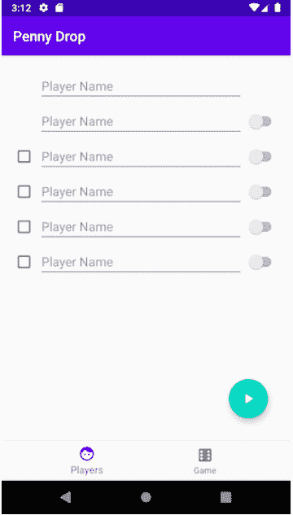

选择玩家表单终于初具雏形！屏幕看起来越来越像最终的样子，并且启用了数据绑定后，在这里添加额外的逻辑将更加顺畅。此屏幕的下一步将是跟踪每个用户输入的内容，并使其可用于设置游戏。处理此问题的最佳方法是引入一个称为 ViewModel 的新概念，它是一个为给定视图存储数据并在该数据更改时通知视图的类。但是

### 构建另一个片段（游戏）

我们在上一章创建了 `GameFragment`，但它看起来仍然相当简陋，尤其是与 `PickPlayersFragment` 相比。等到本章结束时，我们将拥有一个如图所示的界面。

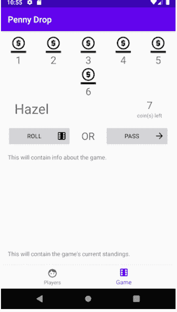

本章剩余部分将专注于 `GameFragment`，因此我建议你前往 `navigation/nav_graph.xml` 并将 `app:startDestination` 设置为 `@id/gameFragment`。然后，我们将从为 `GameFragment` 启用数据绑定开始。

### 为 GameFragment 启用数据绑定

由于我们现在只是在 `GameFragment` 中开启数据绑定，因此在 `fragment_game.xml` 中需要做的只是添加通用的 `<layout>` 标签和一个空的 `<ConstraintLayout>`。虽然 `<ConstraintLayout>` 对于数据绑定并非关键，但我们很快就会用到它，所以不妨现在就添加。我们最基础的视图 XML 将如下所示：

```xml
<?xml version="1.0" encoding="utf-8"?>
<layout xmlns:android="http://schemas.android.com/apk/res/android"
    xmlns:app="http://schemas.android.com/apk/res-auto"
    xmlns:tools="http://schemas.android.com/tools">

    <androidx.constraintlayout.widget.ConstraintLayout
        android:layout_width="match_parent"
        android:layout_height="match_parent"
        android:animateLayoutChanges="true"
        tools:context="dev.mfazio.pennydrop.fragments.GameFragment">

    </androidx.constraintlayout.widget.ConstraintLayout>
</layout>
```

这并不令人兴奋，视图甚至不再显示 Fragment 的名称，但这没关系，这只是暂时的。此外，通过设置好这部分，我们就可以完成 `GameFragment` 类的大部分工作。

这里值得注意的是 `android:animateLayoutChanges` 和 `tools:context` 属性。添加 `android:animateLayoutChanges` 属性可以在视图内容变化时提供动画效果。具体来说，当硬币被添加到或从某个槽位移除时，会添加一个小动画。至于 `tools:context`，`tools` 命名空间中的任何内容都不会影响应用运行时的行为。相反，它告诉 Android Studio 一些信息。在这种情况下，我们让 Android Studio 知道主要的 `<ConstraintLayout>` 与 `GameFragment` 相关联。添加此属性作用不大，但它确实有助于主题设置以及在通过 XML 添加 `onClick` 函数时确定放置位置。`tools:context` 是完全可选的，因此是否添加取决于你。

下一步是在 `GameFragment` 类中加载此视图。正如我们在 `PickPlayersFragment` 中看到的，我们将切换 `onCreateView` 以使用 `FragmentGameBinding`。我们稍后可以添加一些绑定，但现在，让我们先启用它：


```kotlin
class GameFragment : Fragment() {
    override fun onCreateView(
        inflater: LayoutInflater, container: ViewGroup?,
        savedInstanceState: Bundle?
    ): View? {
        val binding =
            FragmentGameBinding.inflate(inflater, container, false)

        return binding.root
    }
}
```

目前这就是我们需要在这里做的全部，所以我们可以回到`fragment_game.xml`开始构建我们的视图。

## 开始构建 GameFragment UI

我们将分块构建 UI，首先是玩家信息，然后是按钮，接着是游戏信息，最后是槽位（因为它们是此屏幕最复杂的部分）。

### 添加玩家信息

首先，我们可以添加三个`<TextView>`标签：当前玩家的名称、他们剩余的硬币数量以及一个“剩余硬币”标签。目前，我们将在前两个字段中添加一些占位符文本，以便应用有内容可显示。我们还将添加`tools:text`属性，以便在 Android Studio 的预览窗口中显示一些文本。与`tools:context`类似，这不会改变实际的应用程序，只是在我们于 IDE 中创建它时起作用。以下是设置了`tools`属性的预览窗口示例：

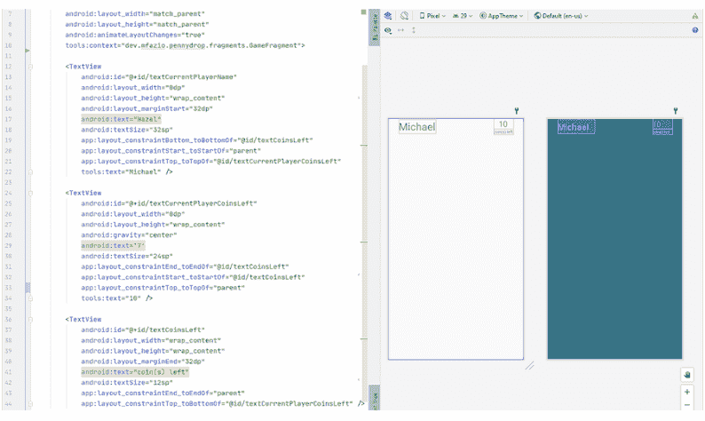

为了清晰起见，以下是该截图中的三个`<TextView>`标签：

```xml
<TextView
    android:id="@+id/textCurrentPlayerName"
    android:layout_width="0dp"
    android:layout_height="wrap_content"
    android:layout_marginStart="32dp"
    android:text="Hazel"
    android:textSize="32sp"
    app:layout_constraintBottom_toBottomOf="@id/textCoinsLeft"
    app:layout_constraintStart_toStartOf="parent"
    app:layout_constraintTop_toTopOf="@id/textCurrentPlayerCoinsLeft"
    tools:text="Michael" />
```

```xml
<TextView
    android:id="@+id/textCurrentPlayerCoinsLeft"
    android:layout_width="0dp"
    android:layout_height="wrap_content"
    android:gravity="center"
    android:text="7"
    android:textSize="24sp"
    app:layout_constraintEnd_toEndOf="@id/textCoinsLeft"
    app:layout_constraintStart_toStartOf="@id/textCoinsLeft"
    app:layout_constraintTop_toBottomOf="@id/coinSlot6"
    tools:text="10" />
```

```xml
<TextView
    android:id="@+id/textCoinsLeft"
    android:layout_width="wrap_content"
    android:layout_height="wrap_content"
    android:layout_marginEnd="32dp"
    android:text="coin(s) left"
    android:textSize="12sp"
    app:layout_constraintEnd_toEndOf="parent"
    app:layout_constraintTop_toBottomOf="@id/textCurrentPlayerCoinsLeft"
    />
```

唯一有趣的新内容是`android:gravity="center"`属性，它将“剩余硬币”文本在`<TextView>`中居中显示。

如果我们现在能运行应用，它看起来会类似于我们之前看到的预览。以下是应用顶部的外观：

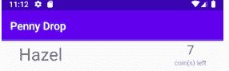

然而，我们无法按原样运行应用，因为`coinSlot6`目前不存在。如果你确实想看到应用运行（这并非坏事），可以像这样更改属性：`app:layout_constraintTop_toTopOf="parent"`。只需确保在槽位存在后将属性改回即可。无论如何，下一步是将“掷骰子”和“跳过”按钮添加到屏幕。

### 添加“掷骰子”和“跳过”按钮

这两个按钮最终将成为玩游戏的主要组件，但现在我们只关心将它们显示在屏幕上。两个按钮上都有一个`drawable`图像，但目前我们的项目中只有一个这样的图像。像之前一样，右键单击你的`res/drawable`目录并选择`New > Vector Asset`。在这里，我们将选择箭头向前的剪贴画并将其添加到我们的项目中。

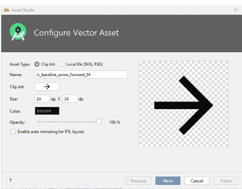

在我们编写代码本身之前，我们应该在`res/values/strings.xml`中添加一些字符串资源值。正如我们在上一章看到的，这是我们希望保存所有文本值的地方。我们添加三个新值，分别代表按钮文本和按钮之间的“或”。

```xml
<resources>
    <!-- 现有的字符串资源位于此处。 -->

    <string name="roll">Roll</string>
    <string name="or">OR</string>
    <string name="pass">Pass</string>
</resources>
```

有了字符串资源，我们就可以将按钮和“或”文本添加到我们的视图中。

```xml
<LinearLayout
    android:id="@+id/layoutButtons"
    android:layout_width="0dp"
    android:layout_height="wrap_content"
    android:layout_margin="16dp"
    android:orientation="horizontal"
    app:layout_constraintEnd_toEndOf="parent"
    app:layout_constraintStart_toStartOf="parent"
    app:layout_constraintTop_toBottomOf="@id/textCoinsLeft">

    <Button
        android:layout_width="0dp"
        android:layout_height="wrap_content"
        android:layout_weight="3"
        android:drawableEnd="@drawable/mdi_dice_6_black_24dp"
        android:padding="10dp"
        android:text="@string/roll" />

    <TextView
        android:layout_width="wrap_content"
        android:layout_height="match_parent"
        android:layout_weight="1"
        android:gravity="center"
        android:text="@string/or"
        android:textSize="24sp" />

    <Button
        android:layout_width="0dp"
        android:layout_height="wrap_content"
        android:layout_weight="3"
        android:drawableEnd="@drawable/ic_baseline_arrow_forward_24"
        android:padding="10dp"
        android:text="@string/pass" />
</LinearLayout>
```

这里的新内容是`<LinearLayout>`标签上的`android:orientation`属性（它告诉你布局的方向是水平还是垂直）、`android:drawableEnd`属性（在按钮右侧添加图像）以及`android:layout_weight`属性。`android:layout_weight`为每个组件提供一个相对大小比例，并相应地分配项目。

在我们的例子中，这意味着`<LinearLayout>`中有七个“部分”，每个按钮获得其中三个“部分”。实际上，这意味着两个按钮大小相同，中间的“或”获得按钮剩余的空间。

添加此内容后，`GameFragment`现在看起来像这样：

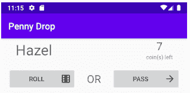

## 添加游戏信息框

我们希望在游戏屏幕上放置两个信息框：一个用于显示当前回合信息，另一个用于显示当前排名。

```xml
<TextView
    android:id="@+id/textCurrentTurnInfo"
    android:layout_width="0dp"
    android:layout_height="0dp"
    android:layout_margin="16dp"
    android:scrollbars="vertical"
    android:text="This will contain info about the game."
    app:layout_constraintBottom_toTopOf="@id/textCurrentStandingsInfo"
    app:layout_constraintEnd_toEndOf="parent"
    app:layout_constraintStart_toStartOf="parent"
    app:layout_constraintTop_toBottomOf="@id/layoutButtons"
    tools:text="Michael rolled a 4.\nMichael rolled a 6!" />
```

```xml
<TextView
    android:id="@+id/textCurrentStandingsInfo"
    android:layout_width="0dp"
    android:layout_height="wrap_content"
    android:layout_marginStart="16dp"
    android:layout_marginEnd="16dp"
    android:layout_marginBottom="16dp"
    android:text="This will contain the game's current standings."
    app:layout_constraintBottom_toBottomOf="parent"
    app:layout_constraintEnd_toEndOf="parent"
    app:layout_constraintStart_toStartOf="parent"
    app:layout_constraintTop_toBottomOf="@id/textCurrentTurnInfo"
    tools:text="Current Scores:\t\nHazel: 4 coins\n\tMichael: 7 coins" />
```

这里有两个有趣的部分：一个是`textCurrentTurnInfo` `<TextView>`，它没有显式的宽度和高度；另一个是`android:scrollbars`属性。`textCurrentTurnInfo`缺乏显式的宽高是另一个让`<ConstraintLayout>`处理组件尺寸的例子——在这种情况下，回合信息框将填充父容器，并占据按钮和排名框之间的所有空间。

`android:scrollbars`属性，不出所料，为我们的文本框添加了垂直滚动条。由于信息框可能比可用空间更大，我们希望允许用户滚动查看所有文本。然而，XML 属性仅在框能够滚动时才显示滚动条。要启用此功能，我们需要在`<TextView>`上设置`movementMethod`属性。这可以在`GameFragment`中作为`binding`初始化的一部分来完成。在那里，我们添加一个`apply`块，然后将`textCurrentTurnInfo.movementMethod`赋值为一个新的`ScrollingMovementMethod`实例。是的，由于数据绑定库，我们可以通过 ID 引用组件，这非常方便。代码如下所示：

```kotlin
FragmentGameBinding.inflate(inflater, container, false).apply {
    textCurrentTurnInfo.movementMethod = ScrollingMovementMethod()
}
```

完成这些更改后，UI 正在逐步完善。现在它看起来像[所示](#)的图片。

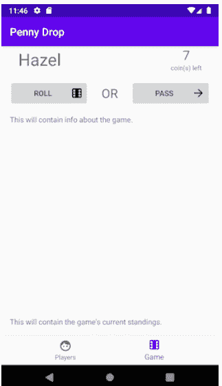

同样，填充的`android:text`值稍后会移除，但在我们运行应用时，屏幕上有一些内容会很方便。`tools:text`值将保留并显示在预览窗口中。现在我们可以继续处理这个页面最有趣的部分，至少从 UI 的角度来看是这样。

## 包含六个硬币槽位

我们游戏的便士槽位将显示哪些槽位已填充，哪些是空闲的，加上第六个始终开放的槽位。正如你可能猜到的，我们可以使用`<include>`标签来处理所有六个槽位。添加一些条件逻辑，就像我们在本章前面处理玩家列表项时所做的那样，我们可以节省大量代码。

这里的计划是为槽位创建布局资源文件`layout_coin_slot.xml`，然后在`fragment_game.xml`中使用一些参数将其`<include>`六次。一旦我们完成这些创建，我们将查看整个`fragment_game.xml`的当前状态，以及屏幕的外观。

### 创建硬币槽位布局 XML

`layout_coin_slot.xml`将位于`res/layout`下；右键单击，选择`New > Layout Resource File`，并为其指定一个`ConstraintLayout`根元素。此布局文件将包含一个硬币`<ImageView>`、一个用于槽位编号的`<TextView>`，以及一个通用的`<View>`，用于给槽位添加一些形状。

### 获取硬币 Drawable

Android Studio 没有包含一个适合我们使用的硬币 drawable，因此我们将回到 [https://materialdesignicons.com/](https://materialdesignicons.com/) 获取一个，特别是 [https://materialdesignicons.com/icon/currency-usd-circle-outline](https://materialdesignicons.com/icon/currency-usd-circle-outline)。我选择这个图标是因为我喜欢它在游戏中的外观，但如果你愿意，也可以选择不同的图标。将图标保存到`res/drawable/mdi_coin_black_24dp.xml`，以遵循与上一章 *D6* 图标相同的命名约定（如果你选择了不同的图像，请更新名称）。图像准备好后，我们就可以开始构建 XML 了。

你现在应该知道流程了：通用的`<layout>`标签包含一个`<ConstraintLayout>`，然后是我们的视图组件。此外，我们将包含一个`<variable>`，`slotNum`，用于`<TextView>`。布局文件将如下所示：


```xml
<?xml version="1.0" encoding="utf-8"?>
<layout xmlns:android="http://schemas.android.com/apk/res/android"
    xmlns:app="http://schemas.android.com/apk/res-auto"
    xmlns:tools="http://schemas.android.com/tools">

    <data>
        <variable
            name="slotNum"
            type="int" />
    </data>

    <androidx.constraintlayout.widget.ConstraintLayout
        android:id="@+id/constraintLayoutCoinSlot"
        android:layout_width="wrap_content"
        android:layout_height="wrap_content">

        <ImageView
            android:id="@+id/coinImageCoinSlot"
            android:layout_width="wrap_content"
            android:layout_height="wrap_content"
            android:contentDescription="@string/coin_icon"
            android:minWidth="36dp"
            android:minHeight="36dp"
            android:src="@drawable/mdi_coin_black_24dp"
            app:layout_constraintEnd_toEndOf="parent"
            app:layout_constraintStart_toStartOf="parent"
            app:layout_constraintTop_toTopOf="parent" />

        <View
            android:id="@+id/bottomViewCoinSlot"
            android:layout_width="0dp"
            android:layout_height="5dp"
            android:background="@android:color/black"
            app:layout_constraintEnd_toEndOf="@id/coinImageCoinSlot"
            app:layout_constraintStart_toStartOf="@id/coinImageCoinSlot"
            app:layout_constraintTop_toBottomOf="@id/coinImageCoinSlot" />

        <TextView
            android:id="@+id/slotNumberCoinSlot"
            android:layout_width="wrap_content"
            android:layout_height="wrap_content"
            android:text="@{slotNum + \"\"}"
            android:textSize="24sp"
            app:layout_constraintEnd_toEndOf="@id/coinImageCoinSlot"
            app:layout_constraintStart_toStartOf="@id/coinImageCoinSlot"
            app:layout_constraintTop_toBottomOf="@id/bottomViewCoinSlot"
            tools:text="3" />
    </androidx.constraintlayout.widget.ConstraintLayout>
</layout>
```

同样，我希望到现在为止大部分内容看起来都很熟悉。需要指出的部分是：

- 所有 `<ImageView>` 标签都应包含 `android:contentDescription` 属性以支持无障碍访问，特别是屏幕阅读器。确保你在 `strings.xml` 中创建了 `@string/coin_icon` 条目。

- 我们再次使用 `tools:text` 在 Android Studio 中填充一个值。

- 如果你在上一章错过了，我们使用 `dp` 来设置视图尺寸，使用 `sp` 来设置文本尺寸。这两个值都会根据用户的设备进行缩放，这对我们处理不同的设备尺寸/分辨率等非常有帮助。

### 等等，最后一个文本值是怎么回事？

是的，它看起来很奇怪，但这不是拼写错误。这是我们之前见过的绑定表达式语法，但我们是将 `slotNum` 变量（一个 `int`）与一个空字符串连接起来（这使得结果成为一个字符串）。我们这样做是因为 `android:text` 期望一个字符串。如果我们给它一个 `int`，它会尝试使用该值从 `strings.xml` 中查找字符串资源值。这会导致一个相当无用的错误（如果你不知道要找什么）：

```
2020-07-12 14:50:38.797 18112-18112/? E/AndroidRuntime: FATAL EXCEPTION: main
    Process: dev.mfazio.pennydrop, PID: 18112
    android.content.res.Resources$NotFoundException: String resource ID #0x1
        at android.content.res.Resources.getText(Resources.java:348)
        at android.widget.TextView.setText(TextView.java:5831)
        at dev.mfazio.pennydrop.databinding.LayoutCoinSlotBindingImpl.executeBindings(LayoutCoinSlotBindingImpl.java:104)
        at androidx.databinding.ViewDataBinding.executeBindingsInternal(ViewDataBinding.java:473)
```

我们可以将 `slotNum` 作为字符串传入 `layout_coin_slot.xml`，但由于槽位是一个数字，我认为这是更好的方法。你如何处理这部分取决于你自己；只需要知道你需要提供

`android:text` 的值可以是一个字符串，也可以是一个字符串资源引用（例如 `android:text="@string/or"`）。

既然 `layout_coin_slot.xml` 文件已经准备就绪，我们就可以将投币槽添加到 `fragment_game.xml` 中了。

### 将投币槽添加到 GameFragment

在 `fragment_game.xml` 内部的 `<ConstraintLayout>` 顶部，我们将使用一个包含五个 `<include>` 标签的 `<LinearLayout>` 来代表我们的投币槽。每个投币槽都将引用我们之前创建的 `layout_coin_slot` 布局文件，并带有一个 `app:slotNum` 属性，用于传入投币槽的编号。代码大致如下：

```
<LinearLayout
    android:id="@+id/layoutCoinSlots"
    android:layout_width="0dp"
    android:layout_height="wrap_content"
    android:layout_marginTop="10dp"
    android:layout_marginBottom="5dp"
    android:baselineAligned="false"
    android:gravity="center"
    android:orientation="horizontal"
    app:layout_constraintEnd_toEndOf="parent"
    app:layout_constraintStart_toStartOf="parent"
    app:layout_constraintTop_toTopOf="parent">

    <include
        android:id="@+id/coinSlot1"
        layout="@layout/layout_coin_slot"
        android:layout_width="0dp"
        android:layout_height="wrap_content"
        android:layout_weight="1"
        app:slotNum="@{1}" />

    <!-- 其他四个投币槽在这里 -->
    <!-- 它们仅在 ID 和 slotNum 值上有所不同 -->
</LinearLayout>
```

有几点需要注意：正如我们在 `PickPlayersFragment` 中看到的，`app:slotNum` 的值需要是一个绑定表达式内的整数，而不仅仅是 `"1"`。后一种写法会导致编译器报错，提示 `app:slotNum` 不存在。另外，我们使用了 `android:baselineAligned="false"` 是出于性能考虑。将此属性设置为 `false` 可以加快 `<LinearLayout>` 的渲染速度，因为需要进行的对齐计算更少了。

第六个投币槽被放置在 `<LinearLayout>` 之后，它有一些不同之处，但除此之外与其他五个投币槽相同：

```
<include
    android:id="@+id/coinSlot6"
    layout="@layout/layout_coin_slot"
    android:layout_width="wrap_content"
    android:layout_height="wrap_content"
    app:layout_constraintEnd_toEndOf="parent"
    app:layout_constraintStart_toStartOf="parent"
    app:layout_constraintTop_toBottomOf="@id/layoutCoinSlots"
    app:slotNum="@{6}" />
```

在运行应用之前的最后一步：如果你之前修改过，请更新 `textCurrentPlayerCoinsLeft` `<TextView>`，使其顶部约束指向第六个投币槽：

```
<TextView
    android:id="@+id/textCurrentPlayerCoinsLeft"
    ...
    app:layout_constraintTop_toBottomOf="@id/coinSlot6"
    />
```

至此，`GameFragment` 的第一个版本就准备好了！让我们来看看效果：

### Penny Drop


1


2


3


4


5


6

Hazel

剩余 7 枚硬币

掷骰子 🎲 或 跳过 →

这里将包含游戏相关信息。

这里将显示游戏的当前排名。

玩家

游戏

## 总结与下一步

还不错！虽然硬币还不能切换，按钮也还不能用，但我们已经处于一个良好的起点。虽然我们可以在这里花更多时间添加额外的属性，但我认为是时候转向正确的方法了：使用 `ViewModel` 配合 `LiveData` 来按需更新视图。拥有 `ViewModel` 类将使我们能够以生命周期感知的方式，将 `Fragment` 类中的代码与数据绑定。请前往下一章了解这意味着什么！

# 第 3 章

## 使用 ViewModel 绑定数据

在上一章中，我们创建了两个视图：`PickPlayersFragment` 和 `GameFragment`。虽然它们现在看起来不错，但功能还很有限。我们仍然需要让这两个界面“活”起来，这可以通过数据绑定和 `ViewModel` 类来实现。我们将为这两个视图创建 `ViewModel` 类，并将它们连接起来，以便我们能够继续处理游戏逻辑。

### 创建 ViewModel（选择玩家）

视图模型作为一个概念，并非 Android 独有；许多其他语言/框架/平台都以某种方式拥有视图模型的概念。从广义上讲，视图模型为特定视图保存与 UI 相关的数据。这样，UI 可以专注于显示什么，而视图模型则处理如何获取这些数据。

在 Jetpack 中，`ViewModel` 是一个特定的类，我们可以用它来处理视图组件（在我们的例子中是 `Fragment` 类）的 UI 数据。`ViewModel` 还可以包含 `LiveData`，它会在数据发生变化时自动向 UI 控制器发送更新。由于 `ViewModel` 类是*生命周期感知*的，它们只会在给定的 `Fragment`（或 `Activity`）处于活动状态时才发送 `LiveData`。这避免了潜在的错误和不必要的数据更新，使你的应用更快、更稳定。

我们将创建一个名为 `PickPlayersViewModel` 的新 `ViewModel`，将其绑定到我们的 `PickPlayersFragment`，并创建一些 `NewPlayer` 对象作为 `LiveData`，用于设置游戏。但首先，就像我们处理 Navigation 组件一样，我们需要在使用该库之前添加两个依赖项。

### 添加 ViewModel 和 LiveData 依赖项

要使用 `ViewModel` 类和 `LiveData` 对象，我们需要将它们的依赖项添加到项目中。两者都包含在 `androidx.lifecycle` 包中，这意味着我们只需要在项目级的 `build.gradle` 文件中添加一个名为 `lc_version`（*lc* 代表 life-cycle）的变量即可。

```
buildscript {
    kotlin_version = '1.4.30'
    gradle_version = '4.1.2'

    app_compat_version = '1.2.0'
    constraint_layout_version = '2.0.4'
    core_version = '1.3.2'
    lc_version = '2.3.0'
    nav_version = '2.3.3'
}
```

之后，我们可以将这两个依赖项添加到应用的 `build.gradle` 文件中：

```
dependencies {
    implementation fileTree(dir: 'libs', include: ['*.jar'])
    implementation "org.jetbrains.kotlin:kotlin-stdlib-jdk8:$kotlin_version"
    implementation "androidx.appcompat:appcompat:$app_compat_version"
    implementation "androidx.constraintlayout:constraintlayout:$constraint_layout_version"
    implementation "androidx.core:core-ktx:$core_version"
    implementation "androidx.lifecycle:lifecycle-livedata-ktx:$lc_version"
    implementation "androidx.lifecycle:lifecycle-viewmodel-ktx:$lc_version"
    implementation "androidx.navigation:navigation-fragment-ktx:$nav_version"
    implementation "androidx.navigation:navigation-ui-ktx:$nav_version"

    其他依赖项
}
```

同步你的项目以获取新的依赖项。你应该会在编辑器顶部看到一个横幅，提示你需要同步，但如果它没有出现，你可以通过 IDE 右侧的 Gradle 工具窗口启动同步。在这里，我们可以看到项目所有可用的 Gradle 任务，但现在，我们只关心同步。

为此，请右键单击顶部的 Penny Drop 条目，然后选择“重新加载 Gradle 项目”：

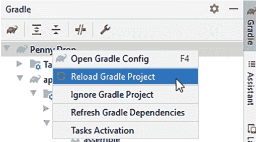


同步完成后，我们就可以继续添加`NewPlayer`和`PickPlayersViewModel`类了。我们将从`NewPlayer`开始，因为稍后会在`PickPlayersViewModel`中使用它。

## 添加 NewPlayer 数据类

`NewPlayer`数据类将保存关于我们想要添加到游戏中的每个玩家的信息。该类将与视图中每个玩家条目的内容相对应。这意味着我们将有一个名字、一些关于用户的属性（人类还是 AI，是否可以移除/切换），以及一些针对 AI 玩家的处理。我们稍后会回到 AI 部分，所以现在可以跳过 AI 处理。

请注意，我多次提到我们正在创建一个`data class`。在 Kotlin 中，`data class`是一种特殊类型的类，旨在保存数据，并且编译器会为其添加一些额外的功能。这包括`equals/hashcode`函数、人类可读的`toString`函数和一个`copy`函数。虽然我们这里没有使用后者，但当你想要一个带有最小更改的新对象版本时，它非常有用。对于`data class`类型，我们的构造函数中必须至少有一个参数，并且所有参数都必须标记为`val`或`var`。

为了确保我们理解清楚，`val`使参数/对象成为一个值，这意味着它是*不可变的*，赋值不能更改。相反，带有`var`的对象是一个变量，意味着我们可以重新赋值。

对于`NewPlayer`，我们希望玩家的名字是一个`var`，这样用户就可以从前端更改该名字。所有其他参数都可以标记为`val`。在处理玩家的`CheckBox`和`SwitchCompat`时，这可能看起来有点奇怪，但我们将对这两个字段采取略有不同的处理方式。我们将改用`ObservableBoolean`类来处理任何更改，因为普通变量无法与双向绑定正常工作，我们稍后会介绍这一点。

让我们创建我们的类——右键点击主包（在我的例子中是`dev.mfazio.pennydrop`），然后选择`New > Kotlin File/Class`。在那里，我们可以将名称设置为`types.NewPlayer`，并将类型设置为*Class*。通过在文件名中加入`types`部分，Android Studio 会将`NewPlayer`放入`types`包中。如果它没有自动放入`types`包，你可能创建的是 Kotlin File 而不是 Class。再次说明，包是我们组织代码、使内容更易于理解的方式。一旦我们创建了这个类和`PickPlayersViewModel`，我们就可以对现有的类进行一些整理。但现在，让我们先填充我们的数据类。完整的`NewPlayer.kt`文件将如下所示：

```
package dev.mfazio.pennydrop.types

import androidx.databinding.ObservableBoolean

data class NewPlayer(
    var playerName: String = "",
    val isHuman: ObservableBoolean = ObservableBoolean(true),
    val canBeRemoved: Boolean = true,
    val canBeToggled: Boolean = true,
    var isIncluded: ObservableBoolean = ObservableBoolean(!canBeRemoved)
)
```

在继续之前，我想指出几点。注意，我们可以为每个参数设置默认值；这意味着我们可以创建一个`NewPlayer`实例，而无需担心设置每个值（因为大多数新玩家的设置方式都是相同的）。

另外，对于习惯使用 Java 的人来说，这种语法可能看起来有些奇怪。通常，类需要在构造函数和函数周围使用花括号`{ ... }`，但在 Kotlin 中则不需要。如果类中没有任何函数，我们只需声明类名加上所需的参数即可。这是 Kotlin 的一个常见趋势：你只编写理解代码所需的代码，不多不少。这使我们能够跳过在其他语言中常见的许多样板代码。

最后，在 Kotlin 构造函数中，只要参数在顺序上靠前并且会先被初始化，我们就可以在构造函数中使用其他参数。在我们的例子中，如果用户不能从游戏中移除，我们将`isIncluded`默认设置为`true`，否则默认设置为`false`。

创建了`NewPlayer`后，我们可以继续处理`PickPlayersViewModel`及其`NewPlayer`对象列表。

## 添加 PickPlayersViewModel

我们现在不会在`PickPlayersViewModel`中做太多事情，因为我们只需要一个`NewPlayer`的`List`，并将其包装在`LiveData`实例中（在我们的例子中是`MutableLiveData`）。让我们创建这个类，然后添加`NewPlayer`对象。我们将在初始化过程中添加一些有趣的内容。

就像我们处理`NewPlayer`一样，我们可以通过右键点击主包并选择`New > Kotlin File/Class`来将`PickPlayersViewModel`添加到我们的项目中。在那里，我们可以将名称设置为`viewmodels.PickPlayersViewModel`，类型设置为`Class`。这将把类放入新的`viewmodels`包中。在代码中，我们将使我们的类继承自`ViewModel`。类声明将如下所示：

```
class PickPlayersViewModel : ViewModel() {
    //We'll be adding this code in a bit.
}
```

这个代码块是 Kotlin 中继承的一个例子：`PickPlayersViewModel`现在是`ViewModel`的子类。由于`ViewModel`类有一个构造函数，我们需要告诉编译器在创建子类时如何初始化父类，我们通过*constructor invocation*语法来实现。这就是为什么`ViewModel`类像函数一样被引用。该语法告诉编译器，当我们创建`PickPlayersViewModel`的实例时，我们正在调用`ViewModel`的默认构造函数。好处是，如果你忘记了这部分，Android Studio 会提醒你修复它。

## 将 NewPlayer 实例添加到 PickPlayersViewModel

我们将在`PickPlayersViewModel`中声明`NewPlayer`实例的列表，然后将可能的玩家添加到该列表中。我们可以提前这样做，因为我们知道有六个玩家位置，并且他们是否在游戏中由`isIncluded`属性控制。

让我们先看看`LiveData`声明，然后处理玩家本身。

```
val players = MutableLiveData<List<NewPlayer>>()
```

这将`players`创建为一个`MutableLiveData`类型的公共值，它本身包含一个`NewPlayer`的列表。注意，我们不必显式设置`players`的类型，因为我们可以从赋值中看到类型。这是一个有用的约定，可以避免在我们的应用程序中添加额外的冗余代码。

现在我们可以继续创建玩家（或者玩家位置，随你怎么想）。为此，我们将使用 Kotlin 的`apply`作用域函数（我们第一次在 Wait, What Was That Code Block? 中使用了作用域函数）。`apply`接收调用它的对象，并运行一个代码块，其中原始对象被隐式声明为`this`。你可以为对象赋值，然后`apply`返回原始对象并应用所做的修改。

在我们的例子中，我们将这样做：

```
val players = MutableLiveData<List<NewPlayer>>().apply {
    this.value = listOf() // This will be some players
}
```

### 集合辅助函数

Kotlin 在`Collection`类上有许多内置的辅助函数。`listOf`、`setOf`和`mapOf`都是快速创建集合的有用函数。你可以在括号内输入一些值，也可以留空以创建一个空集合。

`apply`函数是一种方便的方式，可以一次性创建对象并分配一些变量。我们稍后将在`NewPlayer`实例中再次使用`apply`，但首先，让我们看一个巧妙的 Kotlin 技巧。

我们将创建六个`NewPlayer`实例，其中前两个玩家不能从游戏中移除，因为我们至少需要两个玩家才能进行游戏。此外，第一个玩家不能切换为 AI 玩家，因为必须有人在玩游戏。创建一定数量项目的快速方法如下：我们创建一个`IntRange`，然后将每个项目映射到我们类的一个新实例。我们不需要在`map`中使用当前索引；我们只是想要一个与`IntRange`长度相等的项目列表。创建六个`NewPlayer`实例的代码如下所示：

```
kotlin
(1..6).map {
    NewPlayer()
}
```

这将给我们想要的`NewPlayer`实例的`List`，所以现在我们只需要添加条件逻辑。`canBeRemoved`对于除前两个玩家之外的所有玩家都是`true`，而`canBeToggled`对于除第一个玩家之外的所有玩家都是`true`。我们可以添加几个大于语句来设置这两个字段：

```
kotlin
(1..6).map {
    NewPlayer(
        canBeRemoved = it > 2,
        canBeToggled = it > 1
    )
}
```

注意，我们只需要设置我们想要的参数，其他所有参数都使用其默认值。此外，由于我们参数的顺序，`isIncluded`的值基于`canBeRemoved`。

正如软件开发中一贯的情况，我们可以通过多种方式处理这个逻辑。我喜欢简洁的`(1..6)`语法来创建项目列表，希望这是一个清晰的例子，展示了如何在代码中使用`apply`。让我们最后看一下完整的`PickPlayersViewModel`：

```
kotlin
import androidx.lifecycle.MutableLiveData
import androidx.lifecycle.ViewModel
import dev.mfazio.pennydrop.types.NewPlayer

class PickPlayersViewModel : ViewModel() {
    val players = MutableLiveData<List<NewPlayer>>().apply {
        this.value = (1..6).map {
            NewPlayer(
                canBeRemoved = it > 2,
                canBeToggled = it > 1
            )
        }
    }
}
```

随着`NewPlayer`和`PickPlayersViewModel`的完成，我们可以回到`PickPlayersFragment`和我们的布局文件，开始使用新的`ViewModel`进行数据绑定。

## 将 ViewModel 绑定到 Fragment（选择玩家）

现在是我们真正深入数据绑定库的时候了。到目前为止，我们已经完成了一系列设置（抱歉，还有一点更多）以及一些使用`isVisible`和`isChecked`的静态绑定，但使用动态变量才是数据绑定真正大放异彩的地方。能够在代码中设置复杂对象，然后以最少的工作将其绑定到 UI，这就是我如此强烈推荐数据绑定的原因。完成下一节将为我们后续章节中显示来自数据库或 Web 服务的数据做好准备。但首先，我们需要完成更多事情才能使这一切正常工作。

## 更新 PickPlayersFragment 以使用 PickPlayersViewModel

要使用我们刚刚创建的`PickPlayersViewModel`，我们需要做几件事：

- 1. 在`fragment_pick_players`中添加一个名为`viewModel`的`<variable>`，类型为`PickPlayersViewModel`。

- 2. 通过`by activityViewModels()`语法声明一个`PickPlayersViewModel`类型的值。

- 3. 将该实例绑定到`FragmentPickPlayersBinding`上的`viewModel`变量。

一旦这些步骤完成，我们就可以在布局文件中开始使用`viewModel`来引用我们在上一节创建的`NewPlayer`实例。现在，前往`fragment_pick_players`！

## 在布局文件中添加 viewModel 变量

在`fragment_pick_players`内部，我们将添加一个新的`<data>`，其中包含一个`vm` `<variable>`。这就像我们在

## 获取 PickPlayersViewModel 实例

正如我们之前讨论的，`ViewModel`类对于处理数据并以生命周期感知的方式将数据发送到 UI 组件非常有用。`ViewModel`类的另一个优势是，我们还可以通过将`ViewModel`与父`Activity`关联，将其用于在`Fragment`类的生命周期之外存储数据。这两个概念是相关的：`ViewModel`类不会在 UI 组件不活跃时向其发送数据，但这也意味着存储在`ViewModel`中的数据在使用该`ViewModel`的 UI 组件被销毁时不一定消失。每次创建`PickPlayersFragment`时，我们不必重新加载玩家列表，它只需使用我们已经在`PickPlayersViewModel`（与`MainActivity`绑定）中设置好的数据即可。

请注意，这与持久化不同，这意味着如果应用被*关闭*，数据将被销毁。但如果我们切换到游戏视图，例如，Android 操作系统可能会销毁`PickPlayersFragment`，因为它当前不活跃。如果发生这种情况，我们通常会丢失数据，但如果数据存储在绑定到`MainActivity`的`ViewModel`中则不会。

曾经，接下来的部分是三页的解释，说明如何从我们的`Activity`获取`PickPlayersViewModel`实例，以及一些来自 Kotlin 的支持概念。现在，我们只剩下这个代码块来声明和检索对象：

```kotlin
private val pickPlayersViewModel
    by activityViewModels<PickPlayersViewModel>()
```

这仅在我们使用 JDK 1.8 及以上版本（我们在第 1 章中设置）时有效。通常，我们还需要添加`fragment-ktx`库，但由于我们已经包含了`navigation-fragment-ktx`库，前者作为后者的传递依赖被添加了。简单来说，`navigation-fragment-ktx`使用了`fragment-ktx`，所以我们自动获得了`fragment-ktx`库的所有内容。

除了更省力之外，任何绑定到给定`Activity`的`Fragment`都将获得相同的`ViewModel`实例，而无需我们做任何额外工作，这有助于在`Fragment`类之间共享数据。

现在我们已经将`PickPlayersViewModel`实例与`MainActivity`关联起来，我们可以继续将数据绑定到 UI。

## 绑定 PickPlayersViewModel

目前，我们只是通过`FragmentPickPlayersBinding`类来填充布局，因为这启用了布局文件中的数据绑定。但我们也可以使用这个绑定类来分配变量，特别是我们刚刚检索到的`pickPlayersViewModel`变量。为此，我们将使用之前见过的`apply`作用域函数：

```kotlin
private val pickPlayersViewModel
    by activityViewModels<PickPlayersViewModel>()

override fun onCreateView(
    inflater: LayoutInflater, container: ViewGroup?,
    savedInstanceState: Bundle?
): View? {
    val binding = FragmentPickPlayersBinding
        .inflate(inflater, container, false)
        .apply {
            this.vm = pickPlayersViewModel
        }

    return binding.root
}
```

我们在这里做的是将`pickPlayersViewModel`分配给`fragment_pick_players`中的`vm` `<variable>`。这意味着`PickPlayersViewModel`实例可以在我们的布局中使用，包括从`ViewModel`中获取单个玩家并将其分配给玩家项。

> **ViewModel 类中不要引用 View/Lifecycle/Activity**
>
> ViewModel 绝不能引用视图、生命周期或任何可能持有 Activity 上下文引用的类。这样做会破坏 ViewModel 类与其他生命周期所有者之间的生命周期分离。如果出于某种原因确实需要 Application 上下文，可以使用 AndroidViewModel。

## 将 NewPlayer 绑定到玩家槽位


`fragment_pick_players` 中的每个 `<include>` 标签都引用了我们游戏的一个可能玩家，我们可以将其连接到 `PickPlayersViewModel` 中的每个 `NewPlayer` 实例。玩家列表项随后将使用 `NewPlayer` 中的 `canBeRemoved` 和 `canBeToggled` 来处理每个项目的正确显示。更棒的是，我们可以设置每个项目的三个部分（`name`、`isIncluded` 和 `isHuman`）以链接回 `PickPlayersViewModel` 中的 `NewPlayer` 实例。这将为我们提供每个玩家的正确设置，无需任何额外工作。

## 添加 `app:player` 属性

需要的第一步是将 `player_list_item.xml` 中现有的 `<variable>` 标签替换为名为 `player` 的新 `<variable>`。我们将把 `PickPlayersViewModel` 中的每个 `NewPlayer` 实例绑定到列表项，然后可以在 `player_list_item.xml` 中访问它们。

```xml
<data>
    <variable
        name="player"
        type="dev.mfazio.pennydrop.types.NewPlayer" />
</data>
```

同样，请确保将 `NewPlayer` 类型声明的包名更新为你使用的包名，然后我们可以回到 `fragment_pick_players` 为 `player` 设置值。

在 `fragment_pick_players` 中，我们的每个 `<include>` 标签都将添加一个名为 `app:player` 的属性。该属性的名称与标签布局中 `<variable>` 的名称匹配，在本例中是我们之前设置的 `player` `<variable>`。然后我们可以使用集合语法（例如 `viewModel.players[0]`）来获取每个单独的玩家。每个 `<include>` 标签将如下所示：

```xml
<include
    android:id="@+id/player3"
    layout="@layout/player_list_item"
    app:player="@{vm.players[2]}" />
```

`app:player` 属性通常不存在于 `<include>` 或任何类型的 `Layout` 上，但在 `<include>` 内部声明 `<variable>` 会为我们创建该属性。这是添加自定义属性的方法之一，另一种是*绑定适配器*，我们将在[创建绑定适配器](Create Binding Adapters)中看到。现在我们已经将玩家分配给每个玩家项，我们可以绑定来自 `NewPlayer` 的值。

## 在 `player_list_item.xml` 中使用 `NewPlayer`

我们已经准备好在玩家列表项中使用 `NewPlayer` 所需的一切，因此现在我们可以更新引用旧变量的 `android:visibility` 属性。我们只需要更改三元表达式条件部分中引用的变量。

```xml
android:visibility="@{player.canBeRemoved ? View.VISIBLE : View.INVISIBLE}"
```

我们将在布局下方的 `<SwitchCompat>` 中对 `player.canBeToggled` 执行相同操作。一旦这两个条件都更新，我们将回到与之前绑定相同的位置，但我们将访问实际的 `NewPlayer` 对象，而不是之前的 `true` 和 `false` 值。事实上，现在就运行你的应用吧。它看起来和以前一样，但你知道现在它以更灵活的方式设置。

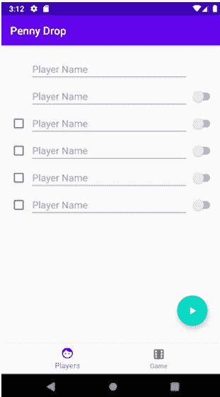

现在我们的可见性配置正确，我们可以开始扩展此表单的功能。第一个项目是 `name` 字段。

## 使用双向绑定绑定玩家姓名

到目前为止，我们在本章中已经看到了几个数据绑定的示例，但它们都以相同的方式工作：我们在更高级别的布局中设置一个值，或者在我们的代码中设置一个值，使用 `ViewModel`，然后将值作为属性发送到视图。如果我们想用名字做类似的事情，可以为每个玩家生成一个名字，显示在每个项目中。但如果我们更改前端的这些名字，后端的值永远不会相应改变。实际上，这没有用，因为我们会丢失用户所做的任何更改。相反，我们需要在布局中利用*双向绑定*。这意味着我们仍然从 `ViewModel` 发送值，但 UI 端的更改将被发送回 `ViewModel` 进行保存。例如，如果我们默认将第一个玩家的名字设为 `Player 1`，但用户将其更改为 `Rolando`，通过双向绑定，我们将在 `PickPlayersViewModel` 内的 `NewPlayer` 实例中存储值 `Rolando`。

如果我们打算对玩家名字 `<EditText>` 使用单向绑定，我们会这样写：

```
android:text="@{player.playerName}"
```

但如果我们想将其更改为双向绑定表达式，我们会在同一表达式中添加一个 `=` 符号：

```
android:text="@={player.playerName}"
```

现在，我们在前端设置的名字值将被发送到 `PickPlayersViewModel`，以便在开始游戏时使用。同样，我们需要对每个玩家项目上的 `CheckBox` 和 `SwitchCompat` 进行一些更新。在这两种情况下，我们已经在更新可见性，但现在我们需要使用 `android:checked` 属性将控件的状态发送回 `ViewModel`。

```
<CheckBox
    android:id="@+id/checkbox_player_active"
    android:layout_width="wrap_content"
    android:layout_height="wrap_content"
    android:checked="@={player.isIncluded}"
    android:visibility="@{player.canBeRemoved ? View.VISIBLE : View.INVISIBLE}"
    app:layout_constraintBottom_toBottomOf="@id/edit_text_player_name"
    app:layout_constraintStart_toStartOf="parent"
    app:layout_constraintTop_toTopOf="@id/edit_text_player_name" />

<androidx.appcompat.widget.SwitchCompat
    android:id="@+id/switch_player_type"
    android:layout_width="wrap_content"
    android:layout_height="wrap_content"
    android:checked="@={player.isHuman}"
    android:visibility="@{player.canBeToggled ? View.VISIBLE : View.INVISIBLE}"
    app:layout_constraintBottom_toBottomOf="@id/edit_text_player_name"
    app:layout_constraintEnd_toEndOf="parent"
    app:layout_constraintTop_toTopOf="@id/edit_text_player_name" />
```

两个控件都在 `android:checked` 上使用双向绑定语法来发送它们的当前状态。然后我们可以在开始游戏时使用这些值。现在，这就是我们需要将 UI 更改发送回 `PickPlayersViewModel` 的所有内容。如果你想验证后端的数据，我在附录 2 [故障排除你的应用](Troubleshooting Your App) 中有一些想法。但这不是构建此屏幕所必需的，因此我们可以继续处理 AI 旋转器。

## 将 AI 旋转器添加到玩家列表项

鉴于我们正在制作游戏，有一种方法让人们与计算机控制的玩家对战会很有帮助。为此，我们将创建一些 AI 玩家，然后让用户选择他们面对的 AI 玩家。在本部分中，我们只关心为 AI 玩家命名，实际逻辑留待第 4 章 [使用条件游戏逻辑更新 LiveData](Update LiveData with Conditional Game Logic)。我们将创建一个 `AI` 类，其中包含多个可能的 AI 玩家，然后更新玩家项目以包含这些 AI 玩家。用户是看到玩家的名字文本字段还是 AI 旋转器，将取决于该玩家项目上 `SwitchCompat` 的状态。在开始 UI 之前，让我们创建 `AI` 类。

### 创建 `AI` 类

我们的 AI 将是另一个数据类，这次位于 `game` 包中。目前，它只包含一个属性 `name`，一个返回该名字的 `toString` 方法，以及一个包含 `AI` 列表 `basicAI` 的伴生对象。在这里，我们将声明八个 AI 玩家用于旋转器。代码如下：

```
package dev.mfazio.pennydrop.game

data class AI(val name: String) {

    override fun toString() = name

    companion object {
        @JvmStatic
        val basicAI = listOf(
            AI("TwoFace"),
            AI("No Go Noah"),
            AI("Bail Out Beulah"),
            AI("Fearful Fred"),
            AI("Even Steven"),
            AI("Riverboat Ron"),
            AI("Sammy Sixes"),
            AI("Random Rachael")
        )
    }
}
```

这个类内容不多，但有些东西对你来说可能是新的。伴生对象语法表示与给定类关联的对象。每个类只有一个此对象的实例（意味着它是单例），其中的函数/值/变量可以以类似于我们引用静态类型的方式访问。在这种情况下，我们可以通过引用 `AI.basicAI` 在其他地方获取 `basicAI`。

由于新的 `toString` 函数只是返回 `AI` 实例上的 `name` 值，我们可以使用表达式语法直接将 `name` 赋值给 `toString`。这等同于：

```
override fun toString(): String {
    return name
}
```

最后可能看起来奇怪的部分是 `basicAI` 上的 `@JvmStatic` 注解。添加此注解告诉编译器为 `basicAI` 创建一个额外的静态 get 方法。这将允许我们在玩家列表项中以静态方式引用 `basicAI`，我们稍后会看到。由于这是 `AI` 类目前所需的全部内容，我们将在 `player_list_item.xml` 中添加旋转器列表。

### 在 `player_list_item.xml` 中添加 AI 旋转器

我一直在提到 `<Spinner>` 标签，这在 HTML 中有时被称为“下拉列表”或“选择”。`<Spinner>` 包含一定数量的项目，并允许用户选择其中一个项目。我们的 AI `<Spinner>` 将位于与名字 `<EditText>` 相同的位置，我们将使用与玩家项目关联的 `<SwitchCompat>` 来切换显示哪一个。因此，`<Spinner>` 的约束将在所有四个边上与 `<EditText>` 匹配。我们还需要在 `<EditText>` 和 `<Spinner>` 上添加另一个 `android:visibility` 属性，基于玩家的 `isHuman` 值。

最后，一旦我们完成了条件逻辑，我们就可以处理 AI 项目本身了。通常，我们需要创建某种 `SpinnerAdapter` 来包含我们的项目，但得益于数据绑定库，我们将采取不同的方法。`android:entries` 属性将允许我们将一个对象绑定为 `<Spinner>` 中的项目列表。

在我们的例子中，我们可以使用 `AI.basicAI` 或 `AI.getBasicAI()` 作为 `android:entries` 属性。有两个选项的原因是，前者是 Kotlin 属性，而后者是为 Java 使用而生成的 getter 方法。现在，我们通常希望全部采用 Kotlin 方法，但如果你使用 `AI.basicAI`，Android Studio 会报错（即使它有效）。相反，你可以在绑定中使用 Java getter 语法来避免错误。

无论你采用哪种 AI 对象列表方法，我们都需要更新 `NewPlayer` 以包含一个新的 `Int` 变量——`selectedAIPosition`。

```
data class NewPlayer(
    var playerName: String = "",
    val isHuman: ObservableBoolean = ObservableBoolean(true),
    val canBeRemoved: Boolean = true,
    val canBeToggled: Boolean = true,
    var isIncluded: ObservableBoolean =
        ObservableBoolean(!canBeRemoved),
    var selectedAIPosition: Int = -1
)
```

这将跟踪所选 AI 的索引（从 `AI.basicAI` 或 `AI.getBasicAI` 检索）。在我们的 XML 中，我们将使用 `android:selectedItemPosition` 属性与 `selectedAIPosition`。所有这些部分在布局文件中将如下所示：

```
<Spinner
    android:id="@+id/spinner_ai_name"
    android:layout_width="0dp"
    android:layout_height="wrap_content"
    android:entries="@{AI.getBasicAI()}"
    android:selectedItemPosition="@={player.selectedAIPosition}"
    android:visibility="@{player.isHuman ? View.INVISIBLE : View.VISIBLE}"
    app:layout_constraintBottom_toBottomOf="@id/edit_text_player_name"
    app:layout_constraintEnd_toStartOf="@id/switch_player_type"
    app:layout_constraintStart_toEndOf="@id/checkbox_player_active"
    app:layout_constraintTop_toTopOf="@id/edit_text_player_name" />
```

我们已经确定可以使用 `AI.basicAI` 或 `AI.getBasicAI` 来获取 AI 选项列表，但我们还没有确定*为什么*它们可用。这是因为我们在 `AI` 类中添加了 `@JvmStatic` 注解。没有它，数据绑定库将无法弄清楚如何发送数据。要使用 `AI.basicAI` 或 `AI.getBasicAI`，我们还需要在 `<data>` 块内导入 `AI` 类型：

```
<data>
    <import type="android.view.View" />
    <import type="dev.mfazio.pennydrop.game.AI" />
    <variable
        name="player"
        type="dev.mfazio.pennydrop.types.NewPlayer" />
</data>
```

另外值得注意的是，`android:selectedItemPosition` 是与我们 `NewPlayer` 上新属性 `selectedAIPosition` 的双向绑定表达式。否则，此项目与我们之前创建的 `<EditText>` 类似。说到那个 `<EditText>`，别忘了在那里包含 `android:visibility` 属性：

```
<EditText
    android:id="@+id/edit_text_player_name"
    android:layout_width="0dp"
    android:layout_height="wrap_content"
    android:layout_margin="5dp"
    android:hint="@string/player_name"
    android:inputType="textPersonName"
    android:text="@={player.playerName}"
    android:visibility="@{player.isHuman ? View.VISIBLE : View.INVISIBLE}"
    app:layout_constraintEnd_toStartOf="@id/switch_player_type"
    app:layout_constraintStart_toEndOf="@id/checkbox_player_active"
    app:layout_constraintTop_toTopOf="parent" />
```

既然我们现在从前端获取了一个 AI（或者至少是它的索引），我们可以通过一个名为 `selectedAI` 的新函数来获取当前选中的 AI 对象。如果 `isHuman` 为 `true` 或者给定索引处的 AI 找不到，该函数将返回 `null`。


```
data class NewPlayer(
    var playerName: String = "",
    var isIncluded: ObservableBoolean = ObservableBoolean(false),
    val isHuman: ObservableBoolean = ObservableBoolean(true),
    val canBeRemoved: Boolean = true,
    val canBeToggled: Boolean = true,
    var selectedAIPosition: Int = -1
) {

    fun selectedAI() = if (!isHuman.get()) {
        AI.basicAI.getOrNull(selectedAIPosition)
    } else {
        null
    }
}
```

现在表单已经按照游戏所需的方式工作了，但我们可以让它更美观、更用户友好一些。让我们继续添加一些漂亮的UI功能：禁用被排除的玩家以及为 `<SwitchCompat>` 添加图标。这两项更改将使应用感觉更精致。

## 自定义玩家列表项

同样，选择玩家屏幕目前功能齐全，但一旦有真实用户使用应用，肯定会有一些困惑。没有任何提示告诉用户勾选或取消勾选玩家复选框会发生什么，或者末尾的开关意味着什么。禁用未勾选的项目可以给用户一个提示，让他们知道勾选框时正在做什么，因为他们以前见过这样的表单。

对于 `<SwitchCompat>` 标签，我们可以将开/关状态从通用外观的开关更改为人类和AI图标。这样，人们就能快速了解每个控件的状态，而无需在屏幕上放置大量文本。首先是 `<CheckBox>` 和 `android:enabled` 属性。

## 允许项目启用和禁用

我们希望禁用任何未包含在游戏中的玩家，这由每行中的复选框决定。这有两个目的：告诉用户该复选框的作用，并避免设置未使用的玩家。要禁用玩家列表项中的视图，我们将使用 `android:enabled` 属性，该属性将引用 `player.isIncluded`。`<EditText>`、`<Spinner>` 和 `<SwitchCompat>` 标签都将包含 `android:enabled="@{player.isIncluded}"`。这样做将根据 `<CheckBox>` 的状态禁用这些视图，在我们为几个玩家输入信息后，效果如下所示：

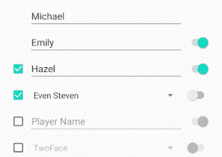

禁用这些视图使用户更清楚地知道玩家未包含在游戏中。然而，切换到AI的玩家与被禁用的玩家之间的区别有点难以分辨。此外，我仍然认为人们一眼看不出后一个 `<SwitchCompat>` 标签的状态。我们需要在该开关上添加一些图标，摆脱灰色选项（这将意味着*禁用*而不是*AI*）。

## 为玩家类型开关添加一些颜色

选择玩家屏幕的最后一项改进是玩家类型 `<SwitchCompat>`。让它在人脸和机器人之间切换，比在粉色和灰色之间切换的开关能告诉用户更多信息。我们将添加一个新图标（机器人）、一个新的`drawable`背景，以及一个动态`color`文件，该文件根据 `<SwitchCompat>` 的状态更改其颜色。

## 添加Android图标

添加我们的机器人图标与上一章中其他内置图标的方式相同：右键单击`res/drawable`并选择 New Vector Asset。在那里，选择 android 剪贴画，然后在 Asset Studio 屏幕上单击 Next 和 Finish。这将创建一个新的机器人头图标（属于未命名的Android吉祥物，非正式名称为Bugdroid），用于 `<SwitchCompat>`。一旦它准备就绪，我们就可以使用这个新图标和现有的 Face 图标创建我们的`drawable`背景。

## 添加drawable背景

在这里，我们将向`res/drawable`文件夹添加一个新的资源XML文件，名为`ai_toggle_bg`。创建后，它将包含一个空的 `<selector>` 标签。在这里，我们可以添加两个 `<item>` 标签：一个用于 Face 图标，一个用于 Android 图标。两个 `<item>` 标签都将有两个属性：`android:drawable` 和 `android:state_checked`。`android:drawable` 属性将指向每个项目的图标。对于 `android:state_checked`，face 项目的属性将为 "true"，而 android 项目将为 "false"。这些属性告诉应用在 `<SwitchCompat>` 处于每种状态时使用哪个图标。

```
<?xml version="1.0" encoding="utf-8"?>
<selector
    xmlns:android="http://schemas.android.com/apk/res/android">

    <item
        android:drawable="@drawable/ic_baseline_face_24"
        android:state_checked="true" />

    <item
        android:drawable="@drawable/ic_baseline_android_24"
        android:state_checked="false" />
</selector>
```

我们可以通过向 `<SwitchCompat>` 添加一个属性来使用这个drawable背景：`android:thumb="@drawable/ai_toggle_bg"`：

```
<androidx.appcompat.widget.SwitchCompat
    android:id="@+id/switch_player_type"
    android:layout_width="wrap_content"
    android:layout_height="wrap_content"
    android:checked="@={player.isHuman}"
    android:enabled="@{player.isIncluded}"
    android:visibility=
        "@{player.canBeToggled ? View.VISIBLE : View.INVISIBLE}"
    android:thumb="@drawable/ai_toggle_bg"
    app:layout_constraintBottom_toBottomOf=
        "@id/edit_text_player_name"
    app:layout_constraintEnd_toEndOf="parent"
    app:layout_constraintTop_toTopOf="@id/edit_text_player_name" />
```

添加 `android:thumb` 属性会将“滑块”（开关上的小球）更改为两个图标之一，具体取决于 `<SwitchCompat>` 的状态。

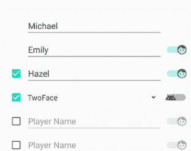

现在，有了图标确实使事情更清楚了，但图标的黑白特性在这里还有些不足。为每个图标添加一些颜色将使 `<SwitchCompat>` 在屏幕上真正突出，并使用户更清楚地看到变化。

## 为开关添加颜色

为 `<SwitchCompat>` 添加颜色与添加图标的过程类似：我们需要一个新的资源XML文件（这次在`res/color`下），我们为不同的 `<SwitchCompat>` 状态添加条目，然后将其作为属性添加到 `<SwitchCompat>` 上。

如果`res/color`不存在，请通过右键单击`res`文件夹并选择 New > Android Resource Directory 来创建一个新的类型为 Color 的资源目录。

添加新的资源文件将如下所示：

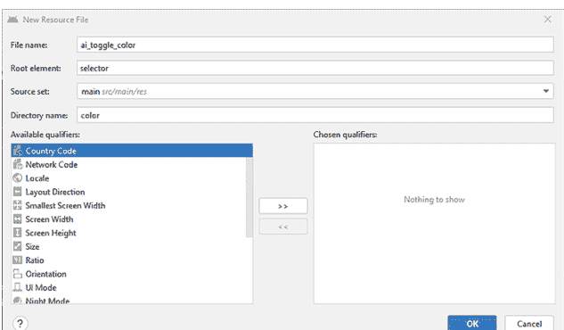

你的新资源XML文件`ai_toggle_color`被称为*颜色状态列表资源*。颜色状态列表资源文件有一个单独的 `<selector>` 标签，其中包含一个或多个 `<item>` 标签。在我们的例子中，我们有三个 `<item>` 标签。

所有三个条目都将基于 `<SwitchCompat>` 的状态：当 `<SwitchCompat>` 未启用时为深灰色（因为接下来的两种颜色将覆盖默认颜色），以及两个用于 `android:state_checked` 选项的项目，类似于之前：

```
<?xml version="1.0" encoding="utf-8"?>
<selector xmlns:android="http://schemas.android.com/apk/res/android">
    <item
        android:color="@android:color/darker_gray"
        android:state_enabled="false" />
    <item
        android:color="@android:color/holo_blue_bright"
        android:state_checked="true" />
    <item
        android:color="@android:color/holo_green_light"
        android:state_checked="false" />
</selector>
```

请记住，此文件中的顺序很重要：如果我们把深灰色 `<item>` 放在列表末尾，它将永远不会触发，因为其他两种颜色将优先。现在，要将颜色添加到 `<SwitchCompat>` 标签，我们添加两个属性：`android:thumbTint` 和 `android:trackTint`。两个属性都将颜色文件作为其值；我们使用两个属性是因为 `android:thumbTint` 更改 `<SwitchCompat>` 标签上“球”的颜色，而 `android:trackTint` 更改滑块移动的轨道的颜色。添加这些后，`<SwitchCompat>` 标签如下所示：

```
<androidx.appcompat.widget.SwitchCompat
    android:id="@+id/switch_player_type"
    android:layout_width="wrap_content"
    android:layout_height="wrap_content"
    android:checked="@={player.isHuman}"
    android:enabled="@{player.isIncluded}"
    android:visibility="@{player.canBeToggled ? View.VISIBLE : View.INVISIBLE}"
    android:thumb="@drawable/ai_toggle_bg"
```

## 创建另一个 ViewModel（游戏）

这个类在高层结构上看起来与`PickPlayersViewModel`相似，但这里会有更多内容，因为它将处理游戏视图与我们将在第 4 章 [使用条件游戏逻辑更新 LiveData](https://example.com) 中构建的`GameHandler`之间的连接。

我们将从一个空的`GameViewModel`类开始，稍后再添加各个部分。它看起来像这样：

```
package dev.mfazio.pennydrop.viewmodels

import androidx.lifecycle.ViewModel

class GameViewModel: ViewModel() {
    //Logic will go in here.
}
```

一旦`GameViewModel`可用，我们就可以添加一个`List<Player>`来保存我们在“选择玩家”视图中添加的所有玩家。不过，在此之前我们需要做一些准备工作。

## 将玩家添加到游戏中

要将玩家加入游戏，我们需要做几件事：我们需要一个`Player`类，需要我之前提到的`List<Player>`，最后，我们需要一种方法将玩家从“选择玩家”视图传递到`GameViewModel`。现在让我们逐步了解这些步骤。

## 创建 Player 类

创建一个完全独立的`Player`类可能看起来有些多余，因为`NewPlayer`已经存在了。为什么我不一开始就创建`Player`类呢？

这两个类存在的原因是它们服务于不同的目的。`NewPlayer`类旨在确定游戏中有哪些人以及他们是谁（人类还是 AI，他们的名字或哪个 AI），而`Player`将用于跟踪玩家在游戏中的状态（当前是否在掷硬币、剩余的便士数等）。虽然我们可以创建一个包含所有这些字段的大型 Player 类，但使用两个独立的类能更好地实现关注点分离。

话虽如此，Player 类将包含五个属性：玩家的名字、是否是人类、选择的 AI、当前是否在掷硬币，以及当前拥有的便士数量。

所有属性都将有一个默认值，但只有`selectedAI`可以为 null。此外，我们将`pennies`和`isRolling`放在构造函数之外，因为在初始化时它们不太可能被设置为默认值以外的值。

最后，我们想向 Player 类添加一个名为`addPennies`的函数。虽然现在看起来可能有些多余，但稍后我们会遇到这样的情况：我们获得一个`Player?`实例，而尝试向可空类型的属性添加值会很麻烦。

完整的 Player 类代码如下所示：

```
package dev.mfazio.pennydrop.types

import dev.mfazio.pennydrop.game.AI

data class Player(
    val playerName: String = "",
    val isHuman: Boolean = true,
    val selectedAI: AI? = null
) {
    var pennies: Int = defaultPennyCount

    fun addPennies(count: Int = 1) {
        pennies += count
    }

    var isRolling: Boolean = false

    companion object {
        const val defaultPennyCount = 10
    }
}
```

注意我们如何在`companion object`中使用`defaultPennyCount`值，就像在 Java 中使用静态只读或常量值一样。

要获得我们的`List<Player>`，我们需要一种将`NewPlayer`转换为`Player`的方法。最好的地方是在`NewPlayer`类内部添加一个新函数。这个函数将获取玩家的名字（或 AI 的名字，如果适用），然后从`NewPlayer`映射更多值：

```
fun toPlayer() = Player(
    if (this.isHuman.get()) {
        this.playerName
    } else {
        (this.selectedAI()?.name ?: "AI")
    },
    this.isHuman.get(),
    this.selectedAI()
)
```

有了`Player`类准备就绪，我们可以继续处理`GameViewModel`及其`List<Player>`。我们将同时添加属性并从“选择玩家”视图获取数据。

## 将玩家添加到 GameViewModel

添加`players`变量是快速的部分，尽管它确实使用了一个新函数`emptyList`。这个函数（不出所料）为我们提供了一个空的`List`实例，其类型是我们期望的。我们本可以在这里使用`listOf`，但`emptyList`*稍微*更高效，并且更清楚地表明我们想要一个空列表，而不是忘记填充`listOf`调用。此外，让你知道它的存在是件好事。

另外，为了提前规划，我们可以在`GameViewModel`内部创建一个名为`startGame`的新函数，它接收`List<Player>`并设置游戏。

```
import androidx.lifecycle.MutableLiveData
import androidx.lifecycle.ViewModel
import dev.mfazio.pennydrop.types.Player

class GameViewModel : ViewModel() {
    private var players: List<Player> = emptyList()

    fun startGame(playersForNewGame: List<Player>) {
        this.players = playersForNewGame
        // More logic will be added here later.
    }
}
```


添加了这些之后，我们可以进入`PickPlayersFragment`来获取传递过来的数据。幸运的是，使用`ViewModel`类使这个过程简单得多。在`PickPlayersFragment`内部，我们可以引入一个`GameViewModel`实例（就像我们对`PickPlayersViewModel`所做的那样），并在有人点击“播放”按钮时传输玩家。我们通过使用我们创建的`toPlayer`函数将每个`NewPlayer`映射到`Player`来实现这一点。

请注意，由于`players`实际上是`LiveData`，我们需要使用`pickPlayersViewModel.players.value`来获取`List<NewPlayer>`。此外，所有`value`调用都返回其包含内容的可空实例，因此我们需要有一个后备方案以防它为`null`，这将是一个空的`listOf`。在我们的情况下，它永远不会是`null`，但我们仍然需要处理这种情况。

一旦我们有了`List<NewPlayer>`，我们想要`filter`每个`NewPlayer`实例以确保`isIncluded`为`true`，然后通过`toPlayer`函数将每个`NewPlayer`转换为`Player`实例。该转换在`map`块内完成，该块在对每个元素执行某种转换后从另一个`List`创建一个新的`List`。请注意，在此过程中原始列表永远不会被修改，而是为您提供一个包含所有新项目的新`List`。

“播放”按钮功能的最后一部分是切换到`GameFragment`。幸运的是，这只需要一行代码来获取当前的`NavController`，然后通过 ID 导航到`GameFragment`。

```
class PickPlayersFragment : Fragment() {
    private val pickPlayersViewModel
        by activityViewModels<PickPlayersViewModel>()
    private val gameViewModel by activityViewModels<GameViewModel>()

    override fun onCreateView(
        inflater: LayoutInflater, container: ViewGroup?,
        savedInstanceState: Bundle?
    ): View? {
        val binding = FragmentPickPlayersBinding
            .inflate(inflater, container, false)
            .apply {
                this.vm = pickPlayersViewModel

                this.buttonPlayGame.setOnClickListener {
                    gameViewModel.startGame(
                        pickPlayersViewModel.players.value
                            ?.filter { newPlayer ->
                                newPlayer.isIncluded.get()
                            }?.map { newPlayer ->
                                newPlayer.toPlayer()
                            } ?: emptyList()
                    )

                    findNavController().navigate(R.id.gameFragment)
                }
            }

        return binding.root
    }
}
```

通过这些更改，我们现在从显示当前玩家的信息转变为将他们发送到`GameViewModel`。如果你想确认这一点，可以在`GameViewModel`的`startGame`函数内部设置一个断点，或者在那里添加一个`Toast.makeText`调用（两种方法都在附录 2 [应用故障排除](Troubleshooting_Your_App)中介绍）。现在我们已经

## 将`LiveData`添加到`GameViewModel`

我们需要在这里添加一堆`LiveData`值，然后将它们绑定到`layout_game.xml`中的组件。这些值如下：

- `slots`：六个`Slot`对象及其当前状态。

- `currentPlayer`：当前正在掷骰子的玩家。

- `canRoll`：当前玩家是否可以掷骰子。

- `canPass`：当前玩家是否可以跳过（记住，玩家必须至少掷一次）。

- `currentTurnText`：屏幕底部的信息文本。

- `currentStandingsText`：当前游戏中的分数文本。

我们稍后会查看包含所有这些`LiveData`对象的`GameViewModel`，但首先需要创建`Slot`类。

```kotlin
package dev.mfazio.pennydrop.types

data class Slot(
    val number: Int,
    val canBeFilled: Boolean = true,
    var isFilled: Boolean = false,
    var lastRolled: Boolean = false
)
```

呼，现在我们完成了所有这些工作，可以将所有八个`LiveData`值添加到`GameViewModel`中。大多数`LiveData`只是持有布尔标志（及其初始值），而`slots`变量是特别有趣的部分。在这里，我们将执行与[在 PickPlayersViewModel 中添加 NewPlayer 实例](Add NewPlayer Instances to PickPlayersViewModel)中类似的操作，使用`(1..6).map { }`代码块。这将创建六个`Slot`实例，包含给定的槽位编号和`canBeFilled`标志，除了最后一个槽位外，所有槽位都为`true`。最后，我们将当前玩家设置为游戏中的第一个玩家，标记他们为正在掷骰子，并将`canRoll`设置为`true`。

```kotlin
class GameViewModel : ViewModel() {
    private var players: List<Player> = emptyList()

    val slots =
        MutableLiveData(
            (1..6).map { slotNum -> Slot(slotNum, slotNum != 6) }
        )

    val currentPlayer = MutableLiveData<Player?>()

    val canRoll = MutableLiveData(false)
    val canPass = MutableLiveData(false)

    val currentTurnText = MutableLiveData("")
    val currentStandingsText = MutableLiveData("")

    fun startGame(playersForNewGame: List<Player>) {
        this.players = playersForNewGame
        this.currentPlayer.value =
            this.players.firstOrNull().apply {
                this?.isRolling = true
            }
        this.canRoll.value = true
    }
}
```

设置好所有这些`LiveData`值后，我们可以继续将所有内容绑定在一起。

## 将 ViewModel 绑定到 Fragment（游戏）

我们在上一章的[构建另一个 Fragment（游戏）](Build Another Fragment (Game))中完成了大部分 UI 工作，所以现在需要担心的事情较少。首先需要为`GameViewModel`添加一个名为`vm`的`<variable>`。

```xml
<layout xmlns:android="http://schemas.android.com/apk/res/android"
    xmlns:app="http://schemas.android.com/apk/res-auto"
    xmlns:tools="http://schemas.android.com/tools">

    <data>
        <variable
            name="vm"
            type="dev.mfazio.pennydrop.viewmodels.GameViewModel" />
    </data>

    <androidx.constraintlayout.widget.ConstraintLayout
        android:layout_width="match_parent"
        android:layout_height="match_parent"
        android:animateLayoutChanges="true"
        tools:context=".GameFragment">
        <!-- 之前创建的视图在这里。 -->
    </androidx.constraintlayout.widget.ConstraintLayout>
</layout>
```

现在布局中存在`vm` `<variable>`，我们可以返回并在`GameFragment`内完成绑定。这看起来类似于我们在[绑定 PickPlayersViewModel](Bind PickPlayersViewModel)中所做的操作。我们需要获取`GameViewModel`的实例，然后`apply` `GameViewModel`绑定。

同时，我们还将设置一个`lifecycleOwner`，这确保我们的`LiveData`能够正确更新。我们可以传入来自`Fragment`类的`viewLifecycleOwner`值。这告诉`GameViewModel`内部的`LiveData`遵循与传入的生命周期所有者相同的生命周期（创建/销毁等）。在我们的例子中，那就是`GameFragment`。最后，`textCurrentTurnInfo.movementMethod`赋值也仍然在这里。

```kotlin
class GameFragment : Fragment() {
    private val gameViewModel by activityViewModels<GameViewModel>()

    override fun onCreateView(
        inflater: LayoutInflater, container: ViewGroup?,
        savedInstanceState: Bundle?
    ): View? {
        val binding = FragmentGameBinding
            .inflate(inflater, container, false)
            .apply {
                vm = gameViewModel

                textCurrentTurnInfo.movementMethod = ScrollingMovementMethod()

                lifecycleOwner = viewLifecycleOwner
            }

        return binding.root
    }
}
```

现在`GameViewModel`已绑定到`GameFragment`，我们可以在布局内完成所有绑定。我们将在最后更新槽位，因为这需要在多个文件中进行更新。让我们先在这里完成所有操作，然后再移动到其他地方。

## 更新 fragment_game.xml 绑定

我们将从上到下处理布局（跳过`Slot`视图），将每个视图更新为使用`GameViewModel`。第一站是`textCurrentPlayerName <TextView>`。在这里，我们将通过引用`vm.currentPlayer.playerName`使用来自`ViewModel`的当前玩家名称。以防我们没有`currentPlayer`的值（比如游戏开始之前），我们还将添加一个名为`na`（值为 N/A）的备用字符串资源值。绑定语法（记住，这不是 Kotlin 代码，而是语法语言）将如下所示：

```xml
android:text='@{vm.currentPlayer.playerName ?? @string/na}'
```

有趣的是，如果`vm.currentPlayer`为`null`，这个表达式仍然没问题。我们不需要包含任何额外的检查；它只会回退到`@string/na`字符串资源值。

`textCurrentTurnInfo <TextView>`的文本将类似，不过请确保将其转换为`String`，因为`Int`会尝试引用字符串资源而不是实际的`Int`值。

```xml
android:text='@{vm.currentPlayer.pennies + ""}'
```

`textCoinsLeft`不需要绑定；只需确保为剩余硬币文本创建一个字符串资源，然后使用它而不是硬编码的`String`。

```xml
android:text='@string/coins_left'
```

跳到布局文件的末尾，`textCurrentTurnInfo`框将具有此绑定：

```xml
android:text="@{vm.currentTurnText}"
```

而`textCurrentStandingsInfo`将具有此绑定：

```xml
android:text="@{vm.currentStandingsText}"
```

完成所有这些绑定后，我们的屏幕看起来比之前更完整了，如[图片](image)所示。

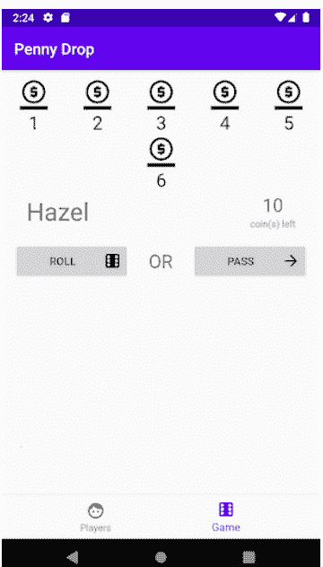

我们想要处理的最后一部分是掷骰子和跳过按钮。我单独指出这些，因为我们对每个按钮都需要进行一些更改。

## 更新按钮绑定

每个按钮需要类似的更改：我们希望将文本和图像颜色更改为白色，设置按钮是否启用，并设置条件背景颜色逻辑。我们还需要为每个按钮添加点击处理程序。

将内容设置为白色将非常简单，因为我们只需要为每个按钮添加两个属性：`android:textColor`和`android:drawableTint`。两者都将具有值`@android:color/white`。`android:enabled`属性将使用来自`vm.canRoll`或`vm.canPass`的值，具体取决于我们正在处理的按钮。

背景逻辑将类似，因为我们将也使用那些`Slot`属性。然而，这里我们将使用三元语句来决定按钮是灰色还是来自`res/values/colors.xml`的特定应用颜色。以下代码块用于掷骰子按钮，但两个按钮基本上相同。唯一真正的区别是使用哪个`Slot`属性，以及跳过按钮使用`colorAccent`（而不是`colorPrimary`）作为背景。

```xml
<Button
    android:layout_width="0dp"
    android:layout_height="wrap_content"
    android:layout_weight="3"
    android:background=
        "@{vm.canRoll ? @color/colorPrimary : @color/plainGray}"
    android:drawableEnd="@drawable/mdi_dice_6_black_24dp"
    android:drawableTint="@android:color/white"
    android:enabled="@{vm.canRoll}"
    android:onClick="@{() -> vm.roll()}"
    android:padding="10dp"
    android:text="@string/roll"
    android:textColor="@android:color/white" />
```

你需要将`@color/plainGray`条目添加到`res/values/colors.xml`。我使用的是`#CCC`，但你可以自由使用任何你认为好看的颜色。


按钮的最后一部分是将`roll`和`pass`函数添加到`GameViewModel`。你可能在掷骰子`<Button>`的代码块中看到了`android:onClick="@{() -> vm.roll()}"`属性。这是一个监听器绑定，意味着在事件发生时运行的表达式。

在监听器绑定内部，我们可以添加任何我们喜欢的内容，包括对绑定中其他`<variable>`引用的引用。但这目前不是必需的，所以我们只保留一个最小的表达式。

由于`roll`和`pass`函数尚不存在，Android Studio可能现在正在显示错误，所以让我们快速创建它们。

两个函数内部初始为空，因为我们将在[更多GameViewModel函数：roll()和pass()](https://example.com)中添加功能：

```
fun roll() {
    // Implementing later
}

fun pass() {
    // Implementing later
}
```

下一步是让所有便士槽位更新为使用来自`GameViewModel`的数据。我们甚至可以在其中设置一些测试值，以确认所有绑定完成后一切正常。

## 更新槽位绑定

我们每个槽位的`<include>`标签将从类似`app:slotNum“@{1}”`的形式更改为`app:slot“@{vm.slots[0]}”`。完整的`<include>`标签现在将如下所示：

```
<include
    android:id=“@+id/coinSlot1”
    layout=“@layout/layout_coin_slot”
    android:layout_width=“0dp”
    android:layout_height=“wrap_content”
    android:layout_weight=“1”
    app:slot=“@{vm.slots[0]}” />
```

然后，在`layout_coin_slot.xml`中，我们可以将`slotNum` `<variable>`替换为`slot`。这个`<variable>`将引用我们的`Slot`类。

```
<data>
    <variable
        name=“slot”
        type=“dev.mfazio.pennydrop.types.Slot” />
</data>
```

有了新的`<variable>`，我们可以开始更新`layout_coin_slot.xml`中的每个项目。我们将采用倒序，因为`slotNumberCoinSlot` `<TextView>`是最快的更改。这里，我们只需要将`android:text`更新为使用`slot.number`而不是`slotNum`，并设置文本颜色。我们希望如果某个槽位是玩家上次掷出的，那么该槽位的所有部分都使用我们应用的主色调（来自`res/values/colors.xml`）。否则，所有内容都应为黑色。

```
android:text='@{slot.number + ""}'
android:textColor=
"@{slot.lastRolled ? @color/colorPrimary : @android:color/black}"
```

接下来是`bottomViewCoinSlot` `<View>`及其`android:background`属性。我们实际上做的与槽位文本相同：

```
android:background=
"@{slot.lastRolled ? @color/colorPrimary : @android:color/black}"
```

现在我们可以回到`coinImageCoinSlot` `<ImageView>`。这基本上已经设置好了，但我们目前还没有动态显示和隐藏硬币的方法。在我们的`Slot`类中，有`canBeFilled`和`isFilled`变量可以控制这一点，所以现在我们需要在布局中使用它们。

我们可以像处理颜色一样为`android:visibility`属性添加一个三元语句，但现在是引入*绑定适配器*的好时机。

## 创建绑定适配器

绑定允许你有效地在布局视图上创建新属性。创建一个名为`binding`的新包，然后在其中创建一个名为`BindingAdapters`的新文件。这不应该是一个类，因为我们只打算在这里放置独立的*包级函数*。这些函数不与特定类关联，而是作为包的一部分存在。我们可以通过导入`dev.mfazio.pennydrop.binding`（或你相应的包名）将它们引入其他类。

回到绑定适配器：这些函数将接收一个View对象和一个属性，然后对这些值进行处理。可以在绑定适配器中避免自定义逻辑，但我们的每个函数都将包含自定义逻辑，因为我们有需要考虑的条件。

对于这个代码块，我们将创建一个新的绑定适配器函数`bindIsHidden`，它将在所有视图上创建一个新的`app:isHidden`属性。注意，新属性的名称来自与函数关联的`@BindingAdapter`注解。逻辑类似于我们之前在三元语句中所做的：

```
import android.view.View
import androidx.databinding.BindingAdapter

@BindingAdapter("isHidden")
fun bindIsHidden(view: View, isInvisible: Boolean) {
    view.visibility = if (isInvisible) View.INVISIBLE else View.VISIBLE
}
```

现在我们可以回到`coinImageCoinSlot` `<ImageView>`添加这个新属性。我们还将使用`android:tint`属性设置硬币的颜色。

```
android:tint="@{slot.lastRolled ? @color/colorPrimary : @android:color/black}"

app:isHidden="@{!slot.canBeFilled || !slot.isFilled}"
```

随着`layout_coin_slot.xml`布局的所有绑定完成，现在是运行应用并检查一切的好时机。但由于我们还没有对`Slot`类做任何事情，页面看起来不会太有趣。所以我们将设置测试数据。

在`Slot`内部，进行两项更新：`isFilled`现在对于偶数应默认为`true`，而`lastRolled`对于槽位2和5将为`true`。

```
data class Slot(
    val number: Int,
    val canBeFilled: Boolean = true,
    var isFilled: Boolean = number % 2 == 0,
    var lastRolled: Boolean = number % 3 == 2
)
```

有了这些硬编码值，我们可以在应用中看到一切正常工作：

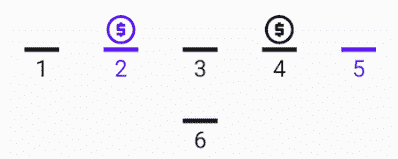

在继续之前，回到`Slot`类并删除我们放入的测试值。在下一章中，我们将让游戏逻辑运行起来，所以不需要它们了。最好在忘记之前恢复原状！

```
data class Slot(
    val number: Int,
    val canBeFilled: Boolean = true,
    var isFilled: Boolean = false,
    var lastRolled: Boolean = false
)
```

## 总结与下一步

信不信由你，Penny Drop的核心UI实际上已经完成了。我们可以输入游戏的玩家，将他们送入游戏，并显示所有需要的信息。但我们还没有内置任何游戏逻辑。这就是我们下一章要做的，构建Penny Drop的所有内部机制。这将包含大量Kotlin代码和少量数学——让我们开始吧！

# 第4章

## 使用条件游戏逻辑更新LiveData

让我们回顾一下我们到目前为止所做的工作：

- 创建了我们的Penny Drop Android应用并配置了导航组件。
- 构建了`PickPlayersFragment`和`GameFragment`，以及相关的`ViewModel`类和布局文件。
- 在两个屏幕中设置了数据绑定。

我们现在已经有了一个应用，它*看起来*像一个游戏，但我们需要将游戏逻辑落实到位。为此，我们将构建一个单独的`GameHandler`类来处理游戏操作，而让`GameViewModel`负责游戏状态和UI交互。

通过这样做，`GameViewModel`处理UI和游戏在给定时刻的所有状态。另一方面，`GameHandler`类将由无状态函数组成，负责掷骰和传递，然后将结果返回给`GameViewModel`。这使我们能够将大部分游戏逻辑隔离，同时避免将任何Android特定组件放入`GameHandler`。

完成本章后，我们将拥有一个完整、可运行的游戏。使用我们之前设置的UI组件，我们将能够处理真实的用户交互以及Penny Drop的所有规则。

### 创建GameHandler

正如我之前提到的，`GameHandler`将是我们所有游戏逻辑的所在。通过这种方式，我们大大简化了`GameViewModel`中需要完成的工作，并避免在该类中造成过多膨胀。鉴于`GameHandler`没有自己的状态，我们可以将其定义为Kotlin *对象声明*而不是类。类似于我们在[创建AI类](Create the AI Class)中看到的伴生对象，对象声明是单例实例。它们看起来与类非常相似，但使用`object`关键字，正如你将看到的。

在我们的例子中，`GameHandler`将是一个对象声明，只包含函数（因为它不持有任何状态），我们可以用它来运行我们的游戏。创建那个`object`（在`game`包下），并包含一些空函数：

```
package dev.mfazio.pennydrop.game

object GameHandler {

    fun roll(
        players: List<Player>,
        currentPlayer: Player,
        slots: List<Slot>
    ): TurnResult { }

    fun pass(
        players: List<Player>,
        currentPlayer: Player
    ): TurnResult { }

    private fun rollDie(sides: Int = 6) { ... }

    private fun nextPlayer(
        players: List<Player>,
        currentPlayer: Player
    ): Player { }
}
```

你可以在本节中看到我们将要实现的方法，这些方法随后将（主要）由`GameViewModel`调用。我说“主要”是因为`GameHandler`也可以随时调用自己的方法，我们将在本章末尾看到这一点。

此外，大多数函数返回一个`TurnResult?`对象，其中包含游戏状态/信息。我们使用这个类将该信息发送回`GameViewModel`。

让我们创建一个名为`TurnResult`的新数据类。这个类将包含`GameViewModel`需要知道的所有信息，不多也不少。我们可以先让`TurnResult`就位，然后再考虑实现`GameHandler`中的函数。

### 创建TurnResult数据类

`TurnResult`类包含`GameViewModel`在一轮之后（或游戏开始时）需要知道的所有信息。我们将在本章后面了解`GameViewModel`如何使用这些值，但让我们先看看`TurnResult`的代码：

```
package dev.mfazio.pennydrop.game

import dev.mfazio.pennydrop.types.Player

data class TurnResult(
    val lastRoll: Int? = null,
    val coinChangeCount: Int? = null,
    val previousPlayer: Player? = null,
    val currentPlayer: Player? = null,
    val playerChanged: Boolean = false,
    val turnEnd: TurnEnd? = null,
    val canRoll: Boolean = false,
    val canPass: Boolean = false,
    val clearSlots: Boolean = false,
    val isGameOver: Boolean = false
)

enum class TurnEnd { Pass, Bust, Win }
```

这里没有太多需要考虑的，但让我们更深入地讨论一下`data class`和`enum class`。我们已经在“添加NewPlayer数据类”中使用了`data class`指定符，但我想特别指出每个`data class`都包含的两个自动生成的函数。

- `copy`，它使用一个给定的对象作为基础，然后更改你传入函数的任何值：

- `componentN`函数，它允许解构声明（其中属性可以拆分为多个变量）。例如，我们可以获取`filledSlot`对象并将其拆分为两个独立的值。顺序基于`Slot`类中属性的声明顺序。

```
// filledSlot将具有与rolledSlot相同的值，
// 但isFilled和lastRolled将为true
val filledSlot = rolledSlot.copy(isFilled = true, lastRolled = true)
```

```
val (slotNum, slotCanBeFilled) = filledSlot
```

在继续之前，让我们更深入地探讨一下最后这部分。正如我提到的，解构对象意味着我们将一个对象拆分为一定数量的变量。我们已经看到了一个例子，但我最喜欢的解构声明用例是在处理循环和Map时。

如果我们有一个`Map<String, Int>`，其中`String`是玩家的名字，`Int`是他们的分数，传统上我们必须这样做来打印分数：

```
playerScores.forEach {entry ->
    println("${entry.key} - ${entry.value} pennies.")
}
```

相反，我们可以将`entry`拆分为两个变量`name`和`score`，使相同的代码块看起来更好：

```
playerScores.forEach {(name, score) ->
    println("$name - $score pennies.")
}
```

我们得到了更简洁、更易读的代码，并且开销最小。我们可以解构任何实现了`componentN`函数的对象，包括（但不限于）`data class`、`List`和`Map`对象。在介绍了`data class`之后，让我们快速了解一下`TurnEnd`枚举类的情况。

### 创建TurnEnd枚举类

`enum class`包含一个或多个常量值。在我们的例子中，`TurnEnd`包含一轮结束的三种方式：用户跳过、用户爆掉（并拿走桌面上的便士），以及用户获胜。我们使用`TurnEnd`而不是`Int`或`String`值的原因是`enum class`对象是类型化的。这意味着，`turnEnd`不再是一个不明确的`Int`值（如`1`）或一个容易出错的`String`（如“pass”），而是使用`TurnEnd.Pass`。它使你的代码更具可读性，且不易出错。`TurnEnd`枚举类将如下所示：

```
enum class TurnEnd { Pass, Bust, Win }
```

有了`TurnResult`准备就绪，我们可以回到实现`GameHandler`类。

### 处理用户掷骰

快速提醒：在Penny Drop中，掷骰包括当前玩家拿起一个*D6*（一个六面骰子），并将一个便士放入他们掷出的槽位。如果该槽位已被占用，他们就爆掉并拿走桌面上*所有*的硬币，然后轮到下一个玩家。如果他们掷出六点，他们将便士放入开放的六号槽位，该槽位保存在储液罐中。在游戏的物理版本中，储液罐位于主板下方，但在这里我们只是移除便士，并可选择跟踪储液罐中的便士数量。

我们的`roll`函数将做类似的事情：我们将掷*D6*，获取相应的`Slot`，然后根据发生的情况返回一个`TurnResult`。我们在`rollDie`上使用`let`函数，不是作为`null`检查（如我们之前所做的那样），而是作为一种让`lastRoll`在我们接下来的几行代码中可用的方式。使用标准赋值（如`val lastRoll = rollDie()`）做同样的事情是完全有效的，但我喜欢`let { ... }`语法。再次强调，这是你和你的团队的个人偏好。

我们通过获取选定的`Slot`并使用它来生成`TurnResult`来结束本节。如果这里的`slot`是`null`，我们使用*空合并*或*Elvis运算符* (`?:`)回退到默认的`TurnResult`对象。

Elvis运算符（以传奇音乐家及其传奇发型命名）添加在表达式之后，如果该表达式为`null`，则执行Elvis运算符右侧的表达式。

完整的代码（不包括`TurnResult`生成）如下所示：


进入`/path/to/xxx`目录，找到`xxx.json`。

在表达式`cvar = avar + bvar`中，加法运算符（`+`）将`avar`与`bvar`相加，得到它们的和`cvar`。

在`List.of(arg0, arg1, arg2)`中，`List`接口的工厂方法`of()`接受一系列的元素，返回包含它们的只读列表。

之后我们这样调用`cmd`命令：`cmd arg0 arg1 arg2`。

```
if (condVar > someVal) {console.log("xxx")}
```


`Slot.kt` 文件位于 `dev.mfazio.pennydrop.types` 包中，定义了 `Slot` 数据类，包含 `number`、`canBeFilled`、`isFilled` 和 `lastRolled` 属性。同时定义了一个 `List<Slot>` 的扩展函数 `clear()`，用于重置所有槽位的状态。

```kotlin
// Slot.kt
package dev.mfazio.pennydrop.types

data class Slot(
    val number: Int,
    val canBeFilled: Boolean = true,
    var isFilled: Boolean = false,
    var lastRolled: Boolean = false
)

//START_HIGHLIGHT
fun List<Slot>.clear() = this.forEach { slot ->
    slot.isFilled = false
    slot.lastRolled = false
}
```

另一个与 `slots` 相关的调用是 `slots.notifyChange` 函数。如果我们更新 `LiveData` 对象的 `.value`，它会自动向所有监听器发送一个包含更新的事件。但如果我们更新 `.value` *内部*的某些内容，则不会发生任何事情。

举个具体的例子，如果我们调用 `slots.value = listOf<Slot>()`，UI 会自动更新（并且我们会丢失屏幕上的槽位）。然而，如果我们像在 `startGame` 中那样执行 `slots.value?.clear`，则不会发送 UI 更新事件。因此，我们需要强制触发该更新。我使用了 `.notifyChange`，这是一个快速的扩展函数，用于触发 `LiveData` 事件：

```kotlin
private fun <T> MutableLiveData<List<T>>.notifyChange() {
    this.value = this.value
}
```

我已经将这个函数添加到了 `GameViewModel` 的末尾，是的，这有点像是一种变通方法。但考虑到 `LiveData` 的特性，如果我们只想更改类上的属性——尤其是当 `LiveData` 包含一个 `List` 时，这就是我们必须做的。

现在，回到 `generateCurrentStandings` 函数。这个函数接收一个 `List<Player>`，按玩家当前的便士数量排序，然后使用 `joinToString` 将所有内容组合在一起。如果你读过附录 2 *应用故障排除*，你已经看到了这个函数的使用示例。如果没有，简而言之，它接收某种 `Collection`，并使用每个项目生成一个 `String`。我们还可以传入如何分隔每个项目的值，以及前缀和后缀值。在我们的例子中，我们希望用换行符（`\n`）分隔每个项目，并在列表前添加一个标题。通常这个标题是“当前排名：”，但为了可重用性，我们使其可配置。

```kotlin
private fun generateCurrentStandings(
    players: List<Player>,
    headerText: String = "Current Standings:"
) =
    players.sortedBy { it.pennies }.joinToString(
        separator = "\n",
        prefix = "$headerText\n"
    ) {
        "\t${it.playerName} - ${it.pennies} pennies"
    }
```

### 更多 GameViewModel 函数：roll() 和 pass()

我已经拖了很久了；让我们最终看看我们一直在创建的所有这些 `TurnResult` 对象发生了什么。我们将在 `GameViewModel` 中添加或更新三个函数：`roll`、`pass` 和 `updateFromGameHandler(result: TurnResult)`。后一个方法将在前两个函数中被调用，以相应地设置我们的 `LiveData` 值。

我们稍后会介绍 `updateFromGameHandler` 部分，但首先我想说明 `roll` 和 `pass` 函数，因为两者都有类似的实现。两个函数都将获取当前玩家（第一个 `isRolling` 为 `true` 的玩家），确保结果 `Player?` 对象不为 `null`，检查请求的移动是否有效，然后调用 `GameHandler`。`GameHandler` 函数的响应随后将被发送到 `updateFromGameHandler` 函数。此外，`roll` 函数将获取游戏的当前槽位，并将这些槽位一起发送给 `GameHandler`。两个函数的代码如下所示：

```kotlin
fun roll() {
    slots.value?.let { currentSlots ->
        // Comparing against true saves us a null check
        val currentPlayer = players.firstOrNull { it.isRolling }
        if (currentPlayer != null && canRoll.value == true) {
            updateFromGameHandler(
                GameHandler.roll(players, currentPlayer, currentSlots)
            )
        }
    }
}

fun pass() {
    val currentPlayer = players.firstOrNull { it.isRolling }
    if (currentPlayer != null && canPass.value == true) {
        updateFromGameHandler(GameHandler.pass(players, currentPlayer))
    }
}
```

### 更新用户界面

我们终于到了这一步！一旦用户界面能够显示 `GameHandler` 中发生的情况，我们就将拥有一个完全可运行的游戏。让我们快速了解一下这里将要发生的事情：我们将添加/移除当前玩家的便士，标记正确的玩家为掷骰状态，更新槽位，生成回合和排名文本，更改 `canRoll`/`canPass` 标志，最后在适用时处理游戏结束场景。

```kotlin
private fun updateFromGameHandler(result: TurnResult) {
    if (result.currentPlayer != null) {
        currentPlayer.value?.addPennies(result.coinChangeCount ?: 0)
        currentPlayer.value = result.currentPlayer
        this.players.forEach { player ->
            player.isRolling = result.currentPlayer == player
        }
    }

    if (result.lastRoll != null) {
        slots.value?.let { currentSlots ->
            updateSlots(result, currentSlots, result.lastRoll)
        }
    }

    currentTurnText.value = generateTurnText(result)
    currentStandingsText.value = generateCurrentStandings(this.players)

    canRoll.value = result.canRoll
    canPass.value = result.canPass

    if (!result.isGameOver && result.currentPlayer?.isHuman == false) {
        canRoll.value = false
        canPass.value = false
    }
}
```

正如我们在上一章中看到的，我们从 `currentPlayer` 中获取玩家的姓名和当前的硬币数量，因此我们可以直接从 `TurnResult` 更新 `MutableLiveData<Player>` 的值。其他大部分部分应该都容易理解，但 `updateSlots` 和 `generateTurnText` 有更多内容。我们将从 `updateSlots` 开始，它引入了 `TurnResult` 以及槽位的当前状态和最后一次掷骰结果，以更新我们需要从用户界面角度看到的所有内容。

```kotlin
private fun updateSlots(
    result: TurnResult,
    currentSlots: List<Slot>,
    lastRoll: Int
) {
    if (result.clearSlots) {
        currentSlots.clear()
    }

    currentSlots.firstOrNull { it.lastRolled }?.apply { lastRolled = false }

    currentSlots.getOrNull(lastRoll - 1)?.also { slot ->
        if (!result.clearSlots && slot.canBeFilled) slot.isFilled = true

        slot.lastRolled = true
    }

    slots.notifyChange()
}
```

我们在本章前面已经见过 `currentSlots.clear` 和 `slots.notifyChange`，但我们可以讨论一下其他几个部分。这里的 `firstOrNull` 和 `getOrNull` 彼此相似。我们从 `List<Slot>` 中获取一个项目，要么是第一个对给定表达式返回 `true` 的项目（`firstOrNull`），要么是通过我们传入的索引（`getOrNull`）。如果任一搜索失败，我们将得到 `null`，并且附加的代码块将被跳过（由于 `?.apply` 和 `?.also` 调用）。

说到这个，让我们谈谈 `.also { ... }` 函数，乍一看可能与 `.let { ... }` 相似。事实证明它们确实相似。唯一的真正区别是 `.let` 从其后续代码块返回一个值，而 `.also { ... }` 返回 `this`，即调用 `.also { ... }` 的对象。由于我们这里没有使用返回值，我们可以使用任一函数，但这是一个介绍 `also` 函数的好机会。

有了 `updateSlots` 中的代码，我们的槽位将反映来自 `GameHandler` 的更改。现在我们可以继续处理保存当前回合信息文本的 `TextView`。

### 创建回合摘要文本

我们在上一章在游戏屏幕底部附近添加了大的 `<TextView>`，以向用户提供有关当前回合、回合如何结束以及游戏结束时分数摘要的信息。目前，当回合开始时，该区域什么也不显示。一旦回合结束，该区域然后显示……什么也没有。是的，该值从上一章开始仍然是空的，嗯，没用。让我们修复它！

我们已经在 `updateFromGameHandler` 中有了这段代码：

```kotlin
//result is a TurnResult object
currentTurnText.value = generateTurnText(result)
```

因此，我们有两个主要的新增内容：

- 一个 `clearText` 变量，它告诉我们是否应该清除 `<TextView>`。

- 一个新的 `generateTurnText` 方法。

第一步应该在……现在完成（说真的，继续在 `currentStandingsText` 声明下快速添加该变量）。然而，第二步变得有点复杂。我们将根据给定回合发生的情况显示不同的消息。

让我们先处理函数中*除了*新文本之外的所有内容，然后再处理消息。该函数有三个主要部分：如果上一个事件是回合结束则清除现有文本、标记下一组文本是否应在清除的视图上显示，以及显示下一组文本。

```kotlin
private fun generateTurnText(result: TurnResult): String {
    if (clearText) currentTurnText.value = ""
    clearText = result.turnEnd != null

    val currentText = currentTurnText.value ?: ""
    val currentPlayerName = result.currentPlayer?.playerName ?? "???"

    return when {
        //TurnResult-based logic and text
    }
}
```

这里没有什么惊天动地的，所以我们将继续讨论 `when` 语句。

### 使用 when 语句处理多个条件

对于不熟悉的人来说，`when` 类似于 Java、C# 和其他语言中的 `switch` 语句。`when` 块是一个条件表达式列表，这些表达式返回一个 `Boolean`，然后是一些在条件为 `true` 时执行的操作。每个条件行按顺序执行，如果没有任何一行产生 `true` 值，则运行 `else` 表达式。

```kotlin
when {
    result.isGameOver -> //游戏结束，让我们获取摘要
    result.turnEnd == TurnEnd.Bust -> //玩家爆了，得到一些便士
    result.turnEnd == TurnEnd.Pass -> //玩家通过了。
    result.lastRoll != null -> //掷骰文本
    else -> ""
}
```

请注意，`when` 块*并不*完全；我排除了实际的文本逻辑，以便我们可以专注于条件。请记住，在我的示例中，你会有一些要运行的表达式，而不是注释。

关于 `when` 块的几个快速说明：

- 你可以在 `when` 调用中包含一个变量，让每一行引用同一个对象：

```kotlin
val slotIsFilled = when(rollResult) {
    in 1..5 -> true
    6 -> false
    else -> throw IllegalArgumentException("That’s not a D6.")
}
```

- 如果你想为给定条件运行多行代码，你总是可以在任何表达式周围添加花括号：

```kotlin
val slotIsFilled = when(rollResult) {
    in 1..5 -> true
    6 -> false
    else -> {
        val message = "That's not a D6."
        throw IllegalArgumentException(message)
    }
}
```

- 如果你使用的是 Kotlin 1.3 及以上版本（你应该使用），你还可以在 `when` 函数中添加一个内联变量：

```kotlin
val slotIsFilled = when(val rollResult = rollDie()) {
    in 1..5 -> true
    6 -> false
    else -> {
        val message = "That's not a D6."
        throw IllegalArgumentException(message)
    }
}
```

除了 `result.isGameOver` 之外，你可以随意使用任何你想要的文本。我们 `when` 中的大多数条件表达式将类似于以下代码块：

```kotlin
result.lastRoll != null ->
    "$currentText\n$currentPlayerName rolled a ${result.lastRoll}."
```

我们正在使用*字符串插值*，通过 `$` 符号和花括号将变量包含在我们的文本中。我们使用文本框中已有的内容作为开头（在 `currentText` 内），然后添加我们的新信息行。在这里，我们根据传入的变量，向信息框添加类似“Michael rolled a 4.”的内容。

然而，`result.isGameOver` 文本有更多内容：

```kotlin
result.isGameOver ->
```

### 使用协程和一等函数处理AI回合

我们将为应用添加运行游戏中一个（或多个）玩家的能力，并为用户提供将Penny Drop设为单人（人类）游戏的选项。当AI进行游戏时，我们将禁用“掷骰”和“跳过”按钮，并让应用自动开始掷骰/跳过。一个便捷的触发方式是在`updateFromGameHandler`函数中，当其他所有内容更新完毕后。在该函数末尾附近添加对`playAITurn`的调用：

```kotlin
if (!result.isGameOver && result.currentPlayer?.isHuman == false) {
    canRoll.value = false
    canPass.value = false
    playAITurn()
}
```

我们只会在确定玩家*不是*人类时，才让应用运行该玩家。我们使用了与之前`LiveData`相同的方法，即与`false`进行比较，因为`result.currentPlayer?.isHuman`是一个`Boolean?`（可空布尔值），而不是`Boolean`。


`GameViewModel`中的`playAITurn`函数是我们Kotlin*协程*的第一个例子。然而，我不希望在这里过多讨论它们，因为一节内容无法涵盖太多。如果你想了解更多，我们将在第5章[使用Room持久化游戏数据](https://example.com)中再次使用它们，尤其是在第10章[使用协程和Room加载与保存数据](https://example.com)中。就本例而言，只需知道由于我们包含了`lifecycle-livedata-ktx`库，所以存在一个现有的`viewModelScope`。我们在这里启动协程，这使我们能够进行异步调用，而不会为用户冻结UI。在这种情况下，我们在AI移动之间延迟一秒，使其感觉更像真人在玩游戏。

同样，我们稍后会更深入地介绍协程，但这是一个引入它们的绝佳机会。

我们启动协程，等待一秒（1000毫秒），然后调用`GameHandler.playAITurn`（我们稍后将创建）。这里的方法类似于`roll`和`pass`，但略有不同。我们调用`GameHandler.playAITurn`，然后使用空安全的`let`调用来处理返回`null`而不是`TurnResult`实例的情况。如果我们尝试为缺少有效`selectedAI`属性的玩家进行AI回合，就可能发生这种情况。

```kotlin
private fun playAITurn() {
    viewModelScope.launch {
        delay(1000)
        slots.value?.let { currentSlots ->
            val currentPlayer = players.firstOrNull { it.isRolling }

            if(currentPlayer != null && !currentPlayer.isHuman) {
                GameHandler.playAITurn(
                    players,
                    currentPlayer,
                    currentSlots,
                    canPass.value == true
                )?.let { result ->
                    updateFromGameHandler(result)
                }
            }
        }
    }
}
```

一旦回合完成并且UI更新，本节开头的检查将再次运行，以查看我们是否再次执行`playAITurn`。大部分AI逻辑位于`GameHandler`中，所以让我们转到那里来实现这个功能。

在`GameHandler`内部，我们需要添加`playAITurn`函数。在其中，我们需要*安全地*获取当前玩家的`selectedAI`属性，这意味着我们必须添加某种`null`检查。

一旦我们有了一个有效的AI实例，我们就根据当前已填充的槽位来判断该AI是掷骰还是跳过。

```kotlin
fun playAITurn(
    players: List<Player>,
    currentPlayer: Player,
    slots: List<Slot>,
    canPass: Boolean = false
): TurnResult? =
    currentPlayer.selectedAI?.let { ai ->
        if (!canPass || ai.rollAgain(slots)) {
            roll(players, currentPlayer, slots)
        } else {
            pass(players, currentPlayer)
        }
    }
```

作为参考，`ai.rollAgain(slots)`是每个AI实例上的一个函数。我们更新AI以包含以下格式的`rollAgain`属性：

```kotlin
data class AI(
    val name: String,
    val rollAgain: (slots: List<Slot>) -> Boolean
) {
```

这意味着`rollAgain`引用一个以`List<Slot>`作为参数并返回`Boolean`值的函数。具体来说，我们为每个AI提供一个函数，该函数根据当前的`Slot`值进行某种计算，并返回该AI玩家是否想要掷骰。Kotlin中的函数是*一等*的，这意味着它们可以像任何其他变量一样使用。这允许我们在初始化AI对象时为`rollAgain`函数发送一个实现。

例如，AI玩家Fearful Fred只有在填充的槽位少于或等于两个时才会再次掷骰（除非是他回合的第一次掷骰，他别无选择）。我们可以这样生成这个AI玩家（其他AI实现可以在PragProg网站的代码中找到[5]）：

```kotlin
AI("Fearful Fred") { slots -> slots.fullSlots() <= 2 }
```

请注意，我们不必将函数作为第二个参数放在`AI`构造函数内部，而是可以将其包含在构造函数*之后*的括号中。对于所有最后一个（或唯一）参数是函数的类型，情况都是如此。

现在，当我们的`playAITurn`函数将当前游戏的槽位发送给Fearful Fred的`rollAgain`方法时，它将运行输入的表达式来查看他们是否想要掷骰。我们可以让掷骰/不掷骰的逻辑变得非常复杂，但这对我们的目的来说已经足够了。我们调用`.fullSlots`扩展函数，并查看该值是否小于或等于2。`fullSlots`函数位于`Slot.kt`中，但在`Slot`类*之外*，如下所示：

```kotlin
fun List<Slot>.fullSlots(): Int =
    this.count { it.canBeFilled && it.isFilled }
```

现在`GameHandler`中的`playAITurn`已经准备就绪，这个游戏可以运行了。人类可以进行他们的回合，AI“玩家”也准备好了，我们可以毫无问题地玩游戏。

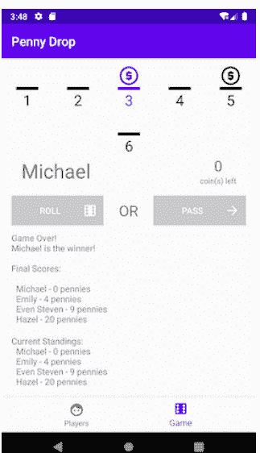

## 总结与后续步骤

我们在本章中完成了许多工作！我们实现了Penny Drop的所有游戏逻辑，并将`GameHandler`连接到了UI。此外，由于游戏逻辑被隔离在`GameHandler`中，我们的`GameFragment`和`GameViewModel`类并没有像它们本可以那样大幅扩展。话虽如此，将状态保持在`GameViewModel`类内部使得后续的代码更改更容易，正如你将在下一章看到的那样。

另外，我们在本章中所做的大部分内容甚至不是Android特有的，而是展示了如何使用Kotlin编写更清晰的代码。利用各种语言特性，如作用域函数（`.let { ... }`和`.apply { ... }`）、解构声明和`when`表达式，可以使你的代码更具可读性和可维护性。这适用于其他Android应用程序以及任何非Android的Kotlin应用程序。

现在，游戏运行得很好，但有一个小问题：如果你关闭应用，就无法恢复游戏。哦，它也不保存之前游戏的玩家。或者跟踪任何类型的统计数据。实际上，它不跟踪任何东西……

我们的应用需要一些持久化功能，幸运的是Jetpack为我们提供了一个很好的选择：Room。Room是SQLite的一个包装器，它使数据库交互*变得好用得多*。下一章，我们将介绍Room，设置数据库，并开始保存我们的Penny Drop游戏。

脚注

[5] https://pragprog.com/titles/mfjetpack/kotlin-and-android-development-featuring-jetpack

# 第五章

## 使用 Room 持久化游戏数据

到目前为止，本书已经构建了一个不错的 Penny Drop 应用。你已经了解了 Android 视图、导航、ViewModel 类以及它们如何协同工作。我们需要添加的最后一个主要部分是某种持久化机制，以便游戏能够跟踪玩家的操作。

在 Android 应用中使用 SQLite 进行数据库交互传统上……并不愉快。创建数据库需要大量工作，没有查询验证，而且你必须手动将数据从 Cursor 类转换为 Java 或 Kotlin 对象。值得庆幸的是，Jetpack 的一个核心组件是引入了 Room，这是一个建立在 SQLite 之上的持久化库。你现在可以像以前使用设备端数据库一样做所有事情，只是过程更加顺畅。

在本章中，你将学习如何通过 Room 创建 SQLite 数据库，如何通过 Entity 类添加表，以及如何通过 ViewModel 类将数据库连接到 Fragment 视图。但在我们做所有这些之前，我们需要将 Room 库添加到我们的应用中。

### 将 Room 添加到应用

这个过程现在应该看起来很熟悉了。我们在项目级 `build.gradle` 文件的 `ext` 块下添加一个新值：

```groovy
ext {
    kotlin_version = '1.4.30'
    gradle_version = '4.1.2'

    app_compat_version = '1.2.0'
    constraint_layout_version = '2.0.4'
    core_version = '1.3.2'
    lc_version = '2.3.0'
    nav_version = '2.3.3'
    room_version = '2.3.0-beta01'
}
```

然后我们在应用的 `build.gradle` 文件的 `dependencies` 内添加库构件。我们需要添加三个不同的依赖项来实现我们的目标：一个用于 Room 运行时，一个用于 Room 的 Kotlin 扩展和协程支持，一个用于注解处理：

```groovy
dependencies {
    // 其他依赖项仍然在这里。

    implementation "androidx.room:room-ktx:$room_version"
    implementation "androidx.room:room-runtime:$room_version"

    kapt "androidx.room:room-compiler:$room_version"
}
```

添加这些后，同步你的项目，我们就可以将 `PennyDropDatabase` 添加到应用中。

### 添加 RoomDatabase 类

`PennyDropDatabase` 是我们使用 Room 所做一切的核心。在这里，我们可以定义数据库表（通过 `Entity` 类）、设置版本控制，甚至包含一些初始化逻辑。然而，我们的数据库交互不会直接针对 `PennyDropDatabase` 进行，而是通过 `PennyDropDao` 类（我们稍后会创建）进行。

在 `data` 包内创建一个名为 `PennyDropDatabase` 的新类；请记住，在 Android Studio 中创建类时可以包含包名。创建后，立即将类标记为 `abstract` 并使其成为 `RoomDatabase` 的子类。最后一步是添加 `@Database` 注解，它告诉 Room 这个类是一个 `RoomDatabase`，并将保存数据库配置。空类如下所示：

```kotlin
package dev.mfazio.pennydrop.data

import androidx.room.RoomDatabase

@Database(
    // 我们稍后会添加 Entity 类。
    entities = [],
    version = 1,
    exportSchema = false
)
abstract class PennyDropDatabase: RoomDatabase() {
    // 接下来添加这个。
}
```

`PennyDropDatabase` 类最终看起来会有点奇怪。我们只有一个名为 `pennyDropDao` 的抽象函数，它返回一个尚未创建的 `PennyDropDao` 类的实例，以及一个 `companion object`。`companion object` 将包含一个名为 `Instance` 的 `PennyDropDatabase?` 变量和一个名为 `getDatabase` 的函数。`getDatabase` 函数将接受两个参数——当前的 Android Context 对象和一个 CoroutineScope，用于在初始化时向数据库插入数据。预实现的类如下所示：

```kotlin
@Database(
    entities = [],
    version = 1,
    exportSchema = false
)
abstract class PennyDropDatabase : RoomDatabase() {
    abstract fun pennyDropDao(): PennyDropDao

    companion object {
        @Volatile
        private var instance: PennyDropDatabase? = null

        fun getDatabase(
            context: Context,
            scope: CoroutineScope
        ): PennyDropDatabase {
            // 我们稍后会实现这个。
        }
    }
}
```

在我们继续之前，我想指出 `@Volatile` 注解。这告诉 JVM 使对 `instance` 变量的赋值对所有线程可见。这将帮助我们避免应用中任何跨进程的不一致性，这在协程可以在不同线程上处理时尤其有用。

`getDatabase` 函数将有两个用途。它将始终返回数据库的当前实例，但如果数据库实例尚未创建，此函数也可以处理。我们将首先尝试返回当前实例，但如果它为 null，那么我们将在同步块内构建数据库。此块确保即使有多个调用 `getDatabase`，我们也只创建一个 `PennyDropDatabase` 实例。

`getDatabase` 使用 `Room.databaseBuilder` 来创建数据库，然后我们将其分配给 `instance`。我们需要发送的是上下文参数、来自 `PennyDropDatabase` 的 Class 对象以及数据库的名称（我们将使用 `PennyDropDatabase`）。

要发送类引用，我们需要使用 *类/成员引用运算符*，用 `::` 表示。这意味着，要获取 `PennyDropDatabase` 的 KClass（Kotlin 类）引用，我们使用 `PennyDropDatabase::class`。

现在，这里的关键是我们发送的是来自 `PennyDropDatabase` 的 Java 类，而不是 Kotlin 类。这是因为 `Room.databaseBuilder` 函数是用 Java 编写的，因此期望一个 Java 类。要获取我们类的 Java 版本，我们可以使用 `PennyDropDatabase::class.java`。Java 和 Kotlin 之间的互操作性有时会使事情变得棘手，但值得庆幸的是，像这样的情况很容易处理。初始的 `getDatabase` 函数如下所示：

```kotlin
fun getDatabase(
    context: Context,
    scope: CoroutineScope
): PennyDropDatabase =
    this.instance ?: synchronized(this) {
        val instance = Room.databaseBuilder(
            context,
            PennyDropDatabase::class.java,
            "PennyDropDatabase"
        ).build()

        this.instance = instance

        instance // 这是从同步块返回的。
    }
```

这样，我们几乎拥有了 `PennyDropDatabase` 所需的一切。你的编辑器应该会抱怨，因为我们尚未创建 `PennyDropDao` 类，并且我们仍然需要创建 Entity 类，但这个类的主要部分已经准备就绪。

我们可以从创建 `PennyDropDao` 类开始，然后继续创建将映射到数据库表的 `Entity` 类。

### 创建 DAO 类

正如我之前提到的，我们不会直接调用 `PennyDropDatabase` 来获取数据，而是通过 **DAO**（或 *数据访问对象*）来传递所有内容。我们通过 `@Dao` 注解将接口或抽象类标记为 **DAO**。`PennyDropDao` 的大部分工作将由 Room 库处理，只让我们在需要时担心自定义操作。DAO 中的大多数函数将是抽象的，并带有特定的注解来赋予函数目的。如果我们需要对函数的功能进行更多控制，我们仍然可以编写完整的 SQL 查询。在我们的例子中，我们只需要一个 `@Query` 函数，其他函数要么使用 `@Insert` 要么使用 `@Update` 注解。带有几个函数的 `PennyDropDao` 抽象类如下所示：


```kotlin
@Dao
abstract class PennyDropDao {
    @Query("SELECT * FROM players WHERE playerName = :playerName")
    abstract fun getPlayer(playerName: String): Player?

    @Insert
    abstract suspend fun insertGame(game: Game): Long

    @Insert
    abstract suspend fun insertPlayer(player: Player): Long

    @Insert
    abstract suspend fun insertPlayers(players: List<Player>): List<Long>

    @Update
    abstract suspend fun updateGame(game: Game)
}
```

如你所见，像插入和更新记录这样的标准操作可以通过包含的注解完成，如本块所示，而查询或任何类型的自定义操作则写在`@Query`注解中。这包括对数据库执行`SELECT`和`UPDATE`语句。

特别要注意查询中使用的`playerName`命名绑定参数。Room允许我们在`@Query`函数中发送参数，这些参数随后将用于发送给数据库的语句中。

这里同样值得注意的是`suspend`修饰符。这意味着该函数可以在任何时刻启动/停止，并且要求该函数必须在另一个`suspend`函数中或从协程中调用。我们将在[从ViewModel访问数据库](Access the Database from a ViewModel)中更详细地了解其工作原理。

现在`PennyDropDao`已经存在，我们的`PennyDropDatabase`应该会高兴多了，但`PennyDropDao`现在却因为`Game`不存在而生气。此外，如果你尝试移除与`Game`相关的调用并运行应用，Room会不喜欢尝试插入`Player`对象，因为`Player`还不是一个实体。是时候向应用添加一些`Entity`类了。

## 添加实体类

实体类就是我们Room数据库中的表。通过添加`@Entity`注解和一些配置，我们可以将一个普通的data类转换为Room实体。如果你好奇的话，我们会将所有新类放在data包中。

我们将从`PennyDropDao`类中使用的`Game`开始。这个类将保存关于一局Penny Drop游戏的所有必要信息，但不包含任何玩家信息。如果我们思考现实中的游戏，这代表了放置便士的容器。

`Game`类将包含一堆信息：游戏开始/结束时间、游戏状态、已填充的槽位、上一次掷骰值、当前回合文本，以及玩家是否可以掷骰和跳过。它还将有一个`gameId`值，这将是数据库中的主键。最后，我们需要用`@Entity`注解来标注这个类，该注解包括关联的数据库表名。

```kotlin
@Entity(tableName = "games")
data class Game(
    @PrimaryKey(autoGenerate = true) var gameId: Long = 0,
    val gameState: GameState = GameState.Started,
    val startTime: OffsetDateTime? = OffsetDateTime.now(),
    val endTime: OffsetDateTime? = null,
    val filledSlots: List<Int> = emptyList(),
    val lastRoll: Int? = null,
    val currentTurnText: String? = null,
    val canRoll: Boolean = false,
    val canPass: Boolean = false
)
```

这个类中很少有Room特定的内容，除了`@Entity`和`@PrimaryKey`注解。通过向`@PrimaryKey`注解添加`autoGenerate`属性，我们让Room为我们计算下一个`gameId`值，而不是必须手动计算。

我确实想提一下，我在这里选择`OffsetDateTime`类型作为日期，这样我们就能完整地了解游戏进行的时间，包括时区。现在，这在我们的情况下确实不那么重要，但确保你拥有所有需要的日期时间信息是一个好习惯。

我们确实需要在`data`包中快速创建`GameState`枚举类：

```kotlin
package dev.mfazio.pennydrop.data

enum class GameState {
    Started,
    Finished,
    Cancelled,
    Unknown
}
```

除此之外，这个类就完成了，所以我们可以继续将`Player`类转换为`@Entity`。

## 将Player类设为实体

我们在[创建Player类](Create the Player Class)中创建了`Player` data类，所以现在我们只需要更改一些内容，使其准备好成为数据库表。我们可以放心地将其留在`types`包中。

就像我们处理`Game`类一样，我们需要用`@Entity`注解标注这个类，并添加一个`@PrimaryKey`变量。我们还将使`isHuman`和`selectedAI`属性不可变，并告诉Room在处理数据库表时忽略`pennies`和`isRolling`。以下是这些更改的最终结果：

```kotlin
@Entity(tableName = "players")
data class Player(
    @PrimaryKey(autoGenerate = true) var playerId: Long = 0,
    val playerName: String = "",
    val isHuman: Boolean = true,
    val selectedAI: AI? = null
) {
    @Ignore
    var pennies: Int = defaultPennyCount

    fun addPennies(count: Int = 1) {
        pennies += count
    }

    @Ignore
    var isRolling: Boolean = false

    @Ignore
    var gamePlayerNumber: Int = -1

    fun penniesLeft(subtractPenny: Boolean = false): Boolean =
        (pennies - (if(subtractPenny) 1 else 0)) > 0

    companion object {
        const val defaultPennyCount = 10
    }
}
```

在两个状态字段上放置`@Ignore`可能看起来很奇怪。这个更改的原因是，我们将玩家在游戏中的当前状态的所有权从`Player`转移到一个尚未创建的新类`GameStatus`。其背后的逻辑是，它允许`Player`类代表一个人（或AI）本身，而不是游戏中的玩家以及他们在该游戏中的表现。根据我们设置数据库的方式，一个`Player`可以参与多个游戏，我们分别跟踪他们在每个游戏中的表现。

考虑到所有这些，我们仍然将`pennies`和`isRolling`作为`Player`上的辅助变量。正如你稍后将看到的，当我们从数据库中获取玩家的状态时，我们可以将他们当前的便士数量和掷骰状态分配给`Player`对象。这使我们能够在数据库中更好地分离数据，同时在代码中保持逻辑清晰。我所说的“逻辑”是指我们仍然从玩家那里获取便士数量和掷骰状态，而不是前端也必须担心状态。

顺便说一下，我们确实会在稍后移除`addPennies`函数，但我想等到我们更改`updateFromGameHandler`的工作方式之后再做。否则，你的应用将无法构建，这很烦人。

与此同时，让我们添加`GameStatus`类。

## 创建GameStatus实体

如前所述，`GameStatus`是一个数据库表和`Entity`，负责保存用户在给定游戏中的当前（或最终）状态。根据`gameId`和`playerId`，我们将知道他们在游戏中是几号玩家（以保持回合顺序）、他们是否在掷骰，以及他们有多少便士。

这将类似于前两个`Entity`类，但我们将添加外键的概念，以确保`GameStatus`与给定的`Game`和`Player`之间的连接。

每个外键将有一个父列和子列，分别代表另一个表中的列名和`game_statuses`表中的列名。我们可以通过`foreignKeys`属性在`@Entity`注解中添加`ForeignKey`对象列表。

```kotlin
@Entity(
    tableName = "game_statuses",
    primaryKeys = ["gameId", "playerId"],
    foreignKeys = [
        ForeignKey(
            entity = Game::class,
            parentColumns = ["gameId"],
            childColumns = ["gameId"]
        ),
        ForeignKey(
            entity = Player::class,
            parentColumns = ["playerId"],
            childColumns = ["playerId"]
        )
    ]
)
data class GameStatus(
    val gameId: Long,
    val playerId: Long,
    val gamePlayerNumber: Int,
    val isRolling: Boolean = false,
    val pennies: Int = Player.defaultPennyCount
)
```

如你所见，`GameStatus`类将当前游戏和玩家相互连接，并连接到玩家在游戏中的状态。鉴于此，我们可以重用这个类，通过`GameWithPlayers`类来检索包含玩家的游戏。

`GameWithPlayers`将包含一个`Game`对象和一个`List<Player>`，以及一些注解来帮助我们。`Game`属性将带有`@Embedded`注解，因为它是父`Entity`，而`players`带有`@Relation`注解。

`@Relation`注解将包含三个属性：`parentColumn`、`entityColumn`和`associateBy`。`parentColumn`和`entityColumn`是`String`值，分别代表父表（`Game`）和实体表（`Player`）的主键。这里有趣的属性是`associateBy`，因为它接受一个`Junction`实例。`Junction`对象引入了一个将两个表连接在一起的类的引用。

由于`GameStatus`已经建立了游戏和玩家之间的连接，我们可以直接使用它作为我们的`Junction`类，而不是创建一个新的。整个`GameWithPlayers`类看起来像这样：

```kotlin
data class GameWithPlayers(
    @Embedded val game: Game,
    @Relation(
```

## 将实体添加到 PennyDropDatabase

当向`@Database`注解添加`Entity`类时，我们实际上是在为每个`Entity`类添加`KClass`值。请注意，`KClass`对象是Kotlin类，不同于我们在其他地方使用的Java`Class`对象。

```kotlin
@Database(
    entities = [Game::class, Player::class, GameStatus::class],
    version = 1,
    exportSchema = false
)
```

此外，既然我们正在处理`PennyDropDatabase`，并且`Player`实体类已经准备就绪，我们可以继续向数据库中添加一些玩家。虽然我们还不知道谁会参与游戏，但我们知道可用的AI玩家。我们将在初始化时将它们转换为`Player`对象并保存到数据库中。

## 在数据库创建期间添加数据

我们在`PennyDropDatabase`中使用的`RoomDatabase.Builder`类允许你添加一个或多个`Callback`实例。`Callback`类包含三个函数：`onCreate`、`onOpen`和`onDestructiveMigration`。这些函数都接收一个`SupportSQLiteDatabase`对象，允许你在不同时间与数据库进行交互。

在我们的场景中，我们希望在初始创建数据库时添加AI玩家，因此我们将重写`Callback`对象上的`onCreate`方法，然后将其添加到`Room.databaseBuilder`调用中。在该方法内部，我们将调用`PennyDropDao`的`insertPlayers`函数，该函数将通过`AI.basicAI`值引入AI玩家。但首先，我们需要将每个`AI`对象转换为`Player`。执行此操作的函数位于`AI`类中，如下所示：

```kotlin
fun toPlayer() = Player(
    playerName = name,
    isHuman = false,
    selectedAI = this
)
```

在进入`onCreate`函数之前的最后一点说明是，所有对数据库的修改操作都必须在非UI线程上进行。幸运的是，这仅仅意味着我们需要在协程块内进行调用。

`getDatabase`函数中`instance`的赋值现在将如下所示：

```kotlin
val instance = Room.databaseBuilder(
    context,
    PennyDropDatabase::class.java,
    "PennyDropDatabase"
).addCallback(object : RoomDatabase.Callback() {
    override fun onCreate(db: SupportSQLiteDatabase) {
        super.onCreate(db)
        scope.launch {
            Instance?.pennyDropDao()?.insertPlayers(
                AI.basicAI.map(AI::toPlayer)
            )
        }
    }
}).build()
```

现在，当应用首次启动时，我们将在数据库的`players`表中拥有所有AI玩家。或者，如果数据库知道如何处理`AI`对象，它就会这样做。如果你现在尝试运行应用，构建将失败并出现如下错误：

> Query method parameters should either be a type that can be converted into a database column or a List / Array that contains such type. You can consider adding a Type Adapter for this.

虽然没有明确指出，但数据库不知道如何将`AI`转换为适当的SQLite数据类型。实际上，Room无法处理保存任何完整对象。相反，我们需要给数据库提供一种在对象之间进行转换的方法，在本例中是`AI`对象。

所有这些转换都发生在`data`包下的`Converters.kt`文件中。在这里，我们可以构建许多带有`@TypeConverter`注解的函数，然后告诉`PennyDropDatabase`使用它们。在构建`AI`转换器的同时，我们也应该为`Game`类上的`OffsetDateTime`、`GameState`和`List<Int>`属性构建转换器。

## 将转换器添加到数据库

在`data`包内，添加一个名为`Converters`的新`class`。此类将包含八个函数，对应四组转换：`OffsetDateTime`与`String`互转、`GameState`与`Int`互转、`List<Int>`与`String`互转，以及`AI`转为`Int`。

`OffsetDateTime`转换器函数与`Game`类中的`startTime`和`endTime`属性一起使用，使用`DateTimeFormatter`对象将`OffsetDateTime`对象与格式化字符串相互转换。你可以在此处使用任何合理的日期/时间格式；我使用`DateTimeFormatter.ISO_OFFSET_DATE_TIME`，因为它包含我们需要的所有信息，并且是标准化格式。作为参考，此格式的日期/时间文本将类似于`2014-01-24T15:45:05.023Z`。

```kotlin
private val formatter = DateTimeFormatter.ISO_OFFSET_DATE_TIME

@TypeConverter
fun toOffsetDateTime(value: String?) = value?.let {
    formatter.parse(it, OffsetDateTime::from)
}

@TypeConverter
fun fromOffsetDateTime(date: OffsetDateTime?) = date?.format(formatter)
```


请注意，两个函数都处理输入值为 `null` 的情况。我们将在所有转换器函数中执行相同操作，以避免因传入数据为 `null`（例如，具有 `null` `endDate` 属性的进行中的游戏）而导致的任何转换问题。

接下来是 `GameState` 到 `Int` 的转换。为此，我们将使用所有 `enum` 类中包含的 `ordinal` 属性。此属性是给定 `enum` 值的 `Int` 值，我们可以将其保存到数据库中。

将 `GameState` 对象转换为 `Int` 是转换中较简单的部分，因为我们只需使用输入的 `GameState` 或 `GameState.Unknown`（作为后备）的 `ordinal` 值。从 `Int` 转换回 `GameState` 对象稍微复杂一些，因为我们希望检查输入的 `Int` 值是否与某个 `GameState` 条目的 `ordinal` 值匹配。如果不匹配，我们再次回退到 `GameState.Unknown`。

```kotlin
@TypeConverter
fun fromGameStateToInt(gameState: GameState?) =
    (gameState ?: GameState.Unknown).ordinal

@TypeConverter
fun fromIntToGameState(gameStateInt: Int?) =
    GameState.values().let { gameStateValues ->
        if (gameStateInt != null &&
            gameStateValues.any { it.ordinal == gameStateInt }
        ) {
            GameState.values()[gameStateInt]
        } else GameState.Unknown
    }
```

以防你好奇，我使用 `GameState.values().let` 块是为了避免必须创建 `GameState.values()` 返回的 `Array` 的多个副本。这在这里不是什么大问题，因为该 `enum class` 中只有几个条目，但在其他场景中这是值得考虑的好事情。

在这些之后是 `List<Int>` 转换，用于 `Game` 类中的已填充槽位。你可能之前注意到我使用了 `List<Int>` 而不是 `List<Slot>` 作为 `filledSlots`。我这样做是为了避免在从数据库检索数据时处理 `Slot` 类上的所有其他属性。相反，我们只获取已填充槽位的列表（如果有），然后更新 `isFilled` 属性。因此，我们的转换代码更加简洁：我们将 `String` 分割成 `Int` 值，过滤掉任何 `null` 或空值，然后将每个 `String` 映射为 `Int`。

反向转换类似，我们用逗号连接 `List<Int>` 中的值。

```kotlin
import android.text.TextUtils

@TypeConverter
fun toIntList(value: String?) = value?.split(", ")?.let {
    it
        .filter { numberString -> !TextUtils.isEmpty(numberString) }
        .map { numberString -> numberString.toInt() }
} ?: emptyList()

@TypeConverter
fun fromListOfIntToString(numbers: List<Int>?) =
    numbers?.joinToString(", ") ?: ""
```

最后一部分是将 `AI` 对象保存到数据库。为此，我们不保存整个 `AI` 实例，而是只保存一个 ID。这意味着我们需要向 `AI` 类添加一个 `aiId` 属性，因此构造函数现在将如下所示：

```kotlin
data class AI(
    val aiId: Long = 0,
    val name: String,
    val rollAgain: (slots: List<Slot>) -> Boolean
)
```

我们还需要更新 `basicAI` 中的 `AI` 实例以包含一个 ID，如下所示：

```kotlin
AI(
    1,
    "Fearful Fred"
) { slots -> slots.fullSlots() <= 2 }
```

一旦 ID 就位，转换器函数就很简单了：

```kotlin
@TypeConverter
fun toAI(aiId: Long?) = AI.basicAI.firstOrNull { it.aiId == aiId }

@TypeConverter
fun fromAiToId(ai: AI?) = ai?.aiId
```

此外，由于我们已在 `AI` 类中添加了 `aiId`，也应在之前创建的 `Player` 转换方法中包含它：

```kotlin
fun toPlayer() = Player(
    playerId = aiId,
    playerName = name,
    isHuman = false,
    selectedAI = this
)
```

同时，`NewPlayer.toPlayer` 函数需要更新以处理 `playerId`。我们可以使用命名参数来避免硬编码 0，并使函数更清晰：

```kotlin
fun toPlayer() = Player(
    playerName =
        if (this.isHuman.get()) this.playerName
        else (this.selectedAI()?.name ?: "AI"),
    isHuman = this.isHuman.get(),
    selectedAI = this.selectedAI()
)
```

`Converters` 类的最后一部分是告诉 `PennyDropDatabase` 使用它。我们只需添加 `@TypeConverters` 注解：

```kotlin
@Database(
    entities = [Game::class, Player::class, GameStatus::class],
    version = 1,
    exportSchema = false
)
@TypeConverters(Converters::class)
abstract class PennyDropDatabase : RoomDatabase()
```

现在应用已准备就绪，我们可以启动它，数据库将使用 `AI` 玩家进行初始化。当然，我们尚未使用数据库中的值，但基础已经奠定。下一步是创建一个 *repository* 类，然后开始从 `GameViewModel` 调用这些函数。

## 创建 Repository 类

首先，repository 并非特定于 Room 的类，而是推荐的 Jetpack 约定。使用 repository 的优势在于，无论数据来源如何，ViewModel 类都有一个统一的位置进行所有数据访问。这意味着，如果我们同时有 Web 服务调用和数据库调用，前端组件将前往同一位置处理两者，而无需关心具体是哪种调用。拥有 repository 将数据获取方式与数据使用方式分离。

在我们的案例中，拥有 repository 确实有些过度设计，因为我们只有一个数据源，而且如你所见，repository 中的函数将只是对 `PennyDropDao` 函数的透传。尽管如此，一旦你转向更复杂的应用程序（如 Android Baseball League 应用），拥有 repository 是一个良好的实践。

首先，在 `data` 包中创建 `PennyDropRepository` 类，并将 `PennyDropDao` 的实例作为私有值传入。

```kotlin
class PennyDropRepository(private val pennyDropDao: PennyDropDao) {
    ...
}
```

`PennyDropRepository` 类将包含四个初始函数：`getCurrentGameWithPlayers`、`getCurrentGameStatuses`、`startGame` 和 `updateGame`。这突显了 repository 的另一个优势：我们可以限制向应用其余部分显示的函数，同时允许 DAO 拥有额外的内部功能。虽然在大多数情况下我们可以将这些函数设为 `protected`，但这会限制我们在其他与数据库相关的活动中使用它们，例如在 `RoomDatabase` 初始化期间。

如前所述，这些函数中的每一个都将调用 `PennyDropDao` 中的相应函数。此外，后两个函数将被标记为 `suspend` 关键字，因为它们正在修改数据库。整个 `PennyDropRepository` 如下所示：

```kotlin
class PennyDropRepository(private val pennyDropDao: PennyDropDao) {

    fun getCurrentGameWithPlayers() =
        pennyDropDao.getCurrentGameWithPlayers()

    fun getCurrentGameStatuses() =
        pennyDropDao.getCurrentGameStatuses()

    suspend fun startGame(players: List<Player>) =
        pennyDropDao.startGame(players)

    suspend fun updateGameAndStatuses(
        game: Game,
        statuses: List<GameStatus>
    ) = pennyDropDao.updateGameAndStatuses(game, statuses)
}
```

`PennyDropRepository` 现在已完成，但不幸的是，目前 DAO 中没有任何函数存在。让我们回到 `PennyDropDao` 并添加它们。

## 添加 PennyDropDao 函数

我们需要添加四个函数，并将按顺序进行。首先是 `getCurrentGameWithPlayers`。此函数类似于我们之前看到的（特别是 `getPlayer` 函数），但它还包括 `@Transaction` 注解。此注解告诉 Room，你调用的函数引用多个表，数据应在单个原子操作中检索。在我们的案例中，我们从 `games` 和 `players` 表中获取数据。

```kotlin
@Transaction
@Query("SELECT * FROM games ORDER BY startTime DESC LIMIT 1")
abstract fun getCurrentGameWithPlayers():
    LiveData<GameWithPlayers>
```

虽然查询仅提及 `games` 表，但由于 `@Relation` 注解和 `GameStatus` 类上的 `@Junction`，我们从两个表中拉取数据。这告诉 Room 获取与 `Game` 关联的 `Player` 记录，而无需编写该部分的 SQL 查询。

下一个函数是 `getCurrentGameStatuses`。不幸的是，Room 没有简单的方法在单个查询中获取游戏、玩家以及每个玩家的状态，并将结果映射到对象。因此，我们需要单独拉取 `GameStatus` 对象。此 `@Query` 将通过对 `games` 表执行子查询来获取最新的 `GameStatus` 实例。我们获取最近的开放游戏，然后按 `gamePlayerNumber` 属性对状态进行排序（以确保玩家处于正确的游戏顺序）。请注意，这也将是一个 `@Transaction`，因为我们引用了多个表。

```kotlin
@Transaction
@Query(
    """
    SELECT * FROM game_statuses
    WHERE gameId = (
        SELECT gameId FROM games
        WHERE endTime IS NULL
        ORDER BY startTime DESC
        LIMIT 1)
    ORDER BY gamePlayerNumber
    """
)
abstract fun getCurrentGameStatuses(): LiveData<List<GameStatus>>
```

如你所见，`@Query` 注解为我们从数据库检索数据提供了极大的灵活性。但有时 `@Query` 仍然不够，我们需要在单个 `@Transaction` 中调用多个函数。对于这种情况，我们可以创建一个 `open` 函数并自己实现该函数，而不是让 Room 为我们完成。能够在 DAO 中拥有完全实现的函数是 `PennyDropDao` 是抽象类而非接口（如 Room 文档中常见）的原因。

在 `startGame` 的案例中，我们将引入一个 `List<Player>`，关闭任何现有游戏，创建一个新的 `Game`，从数据库获取或插入传入的 `Player` 对象，然后为每个玩家添加新的 `GameStatus` 条目，最后返回新创建的游戏的 ID。为此，我们将在 `PennyDropDao` 内部调用其他函数来为我们完成工作。我们在首次构建 `PennyDropDao` 时已经创建了 `insertGame` 和 `insertPlayer`，因此我们只需要两个额外的新函数。

第一个函数名为 `closeOpenGames`，它遍历数据库并将当前时间设置为任何仍开放游戏的 `endTime`，并将状态设置为 `Cancelled`。我们之前在 [创建 DAO 类](Create a DAO Class) 中见过命名绑定参数，但这里它们更有趣。

默认情况下，我们无法传入复杂类型，但由于我们之前为这两种类型创建了类型转换器，因此这可以正常工作。

```kotlin
@Query("""
UPDATE games
SET endTime = :endDate, gameState = :gameState
WHERE endTime IS NULL""")
abstract suspend fun closeOpenGames(
    endDate: OffsetDateTime = OffsetDateTime.now(),
    gameState: GameState = GameState.Cancelled
)
```

请注意每个属性的默认值使用。我们可以包含无意覆盖的参数，纯粹是为了能够将它们作为查询中的参数包含，同时仍然保持在需要时覆盖的灵活性。

此外，由于此函数正在修改数据库，它需要是一个事务。但无需添加 `@Transaction` 注解，Room 会自动将所有修改操作包装为事务。这包括带有 `@Insert`、`@Update` 或 `@Delete` 注解的函数。

我们仍然需要的另一个函数是 `insertGameStatuses`，它只需要 `@Insert` 注解。

```kotlin
@Insert
abstract suspend fun insertGameStatuses(gameStatuses:
    List<GameStatus>)
```

这突显了 Room 的另一个优秀特性：我们可以传入一个 `List<GameStatus>`，所有 `GameStatus` 记录都将被输入数据库，而无需手动逐个插入。

现在我们使用的所有函数都已创建，我们可以回到 `startGame` 本身。请注意，即使我们在这里有 `startGame` 的实现，它仍然必须标记为 `open`，因为它具有 `@Transaction` 注解。

函数代码如下所示：

```kotlin
@Transaction
open suspend fun startGame(players: List<Player>): Long {
    this.closeOpenGames()

    val gameId = this.insertGame(
        Game(
            gameState = GameState.Started,
            currentTurnText = "The game has begun!\n",
            canRoll = true
        )
    )

    val playerIds = players.map { player ->
        getPlayer(player.playerName)?.playerId ?: insertPlayer(player)
    }

    this.insertGameStatuses(
        playerIds.mapIndexed { index, playerId ->
            GameStatus(
                gameId,
                playerId,
                index,
                index == 0
            )
        )
    }
}
```

return gameId

}

这里我想特别说明一下我们是如何获取 `playerIds` 值的。我们检查数据库中是否存在该玩家，如果存在则使用该记录获取 `playerId`；如果未找到该玩家，则创建该玩家并返回其玩家ID。由于 `insertPlayer` 返回的是 `Long` 类型，我们可以立即获得数据库ID，无需进行二次查询。此外，Elvis运算符使我们能够将所有操作保持在一个表达式中，而无需编写额外的条件逻辑。


`PennyDropDao` 中还有一个函数需要介绍，即 `updateGameAndStatuses` 函数。正如你所料，该函数的作用是：在单个 `@Transaction` 中更新传入的 `Game` 和 `GameStatus` 对象的数据库版本。`updateGame` 已经存在，但我们需要快速创建 `updateGameStatuses`：

```
@Update
abstract suspend fun updateGameStatuses(gameStatuses:
    List<GameStatus>)
```

接下来，`updateGameAndStatuses` 在 `@Transaction` 中调用这两个函数：

```
@Transaction
open suspend fun updateGameAndStatuses(
    game: Game,
    statuses: List<GameStatus>
) {
    this.updateGame(game)
    this.updateGameStatuses(statuses)
}
```

`PennyDropRepository` 最后要介绍的部分是添加单例实例功能，以便在任何地方使用。这是可选的，但它有助于避免为不同视图创建多个 `PennyDropRepository` 实例。

其思路与 `PennyDropDatabase` 相同：我们获取现有的实例变量，如果它为 null，则创建一个新实例并返回。我们还将利用同步块来避免同时多次尝试创建 `PennyDropRepository`。所有这些都将位于 `PennyDropRepository` 的伴生对象中：

```
companion object {
    @Volatile
    private var instance: PennyDropRepository? = null

    fun getInstance(pennyDropDao: PennyDropDao) =
        this.instance ?: synchronized(this) {
            instance ?: PennyDropRepository(pennyDropDao).also {
                instance = it
            }
        }
}
```

至此，`PennyDropRepository` 和 `PennyDropDao` 类已全部设置完毕。我们拥有了在本地数据库中持久化游戏数据所需的所有逻辑。剩下的部分是从数据库中提取数据并在 `GameViewModel` 中使用。

### 从 ViewModel 访问数据库

与之前一样，`GameViewModel` 将作为 `GameFragment` 视图的数据源。但现在，数据不再存储在 `GameViewModel` 内部，而是通过 `PennyDropRepository` 从 `PennyDropDatabase` 获取。我们仍然像之前一样为 UI 使用 `LiveData`，但 `GameViewModel` 不再直接处理设置这些值。

我们需要做的第一件事是获取 `PennyDropRepository` 的实例。为此，我们需要获取 `PennyDropDatabase` 和 `PennyDropDao` 的实例。但这带来了一个问题：获取 `PennyDropDatabase` 实例需要访问 `Context` 对象。通常，`ViewModel` 类不应访问任何类型的 `Context` 对象，因为这可能导致内存泄漏，原因是生命周期不一致（即 `Activity` 或 `Fragment` 在 `ViewModel` 之前被销毁，导致 `ViewModel` 中留下无效的上下文引用）。然而，当我们需要 `Context` 对象时，可以使用 `AndroidViewModel` 类作为父类，而不是 `ViewModel`。这允许我们持有 `Application` 对象的引用，它是 `Context` 的子类。

```
class GameViewModel(application: Application) :
    AndroidViewModel(application) {
    GameViewModel 代码将放在这里。
}
```

现在我们有了可用的 `Context` 对象，就可以获取 `PennyDropDatabase` 实例，进而获取 `PennyDropRepository` 实例。我们将在 `clearText` 变量下方添加 `PennyDropRepository` 的声明，名为 `repository`，但不进行初始化。相反，我们在 `init` 块中赋值。该块在类实例化时运行，允许我们在保持不可变性的同时，将值的初始化与声明分开。

```
class GameViewModel(application: Application) :
    AndroidViewModel(application) {

    private var players: List<Player> = emptyList()

    val slots =
        MutableLiveData(
            (1..6).map { slotNum -> Slot(slotNum, slotNum != 6) }
        )

    val currentPlayer = MutableLiveData<Player?>()

    val canRoll = MutableLiveData(true)
    val canPass = MutableLiveData(false)

    val currentTurnText = MutableLiveData("")
    val currentStandingsText = MutableLiveData("")

    private var clearText = false

    private val repository: PennyDropRepository

    init {
        val database =
            PennyDropDatabase.getDatabase(application, viewModelScope)

        this.repository =
            PennyDropRepository.getInstance(database.pennyDropDao())
    }

    GameViewModel 的其余部分
}
```

我喜欢在这里将 `this.repository` 的赋值拆分成多个部分，以说明构成 repository 的组件，但我们也可以轻松地将所有内容合并为一个表达式：

```
this.repository =
    PennyDropDatabase
        .getDatabase(application, viewModelScope)
        .pennyDropDao()
        .let { dao ->
            PennyDropRepository.getInstance(dao)
        }
```

在非教学场景下，我通常会采用第二种方式编写代码，但这取决于你。请记住，两种方式在功能上是等价的，因此请选择对你来说更易读的方式。

如果你好奇，我们在这里传入的 `viewModelScope CoroutineScope` 是由于我们在本章开头添加了 `lifecycle-viewmodel-ktx` 依赖项。

### 开始游戏

现在 `GameViewModel` 中有了 `PennyDropRepository`，我们就可以开始与数据库交互了。逻辑上的第一步是提供一种将数据放入数据库的方法，我们在 `startGame` 函数中实现。由于我们更改了在 `GameViewModel` 中访问游戏信息的方式，`startGame` 函数看起来会小很多。

```
kotlin
suspend fun startGame(playersForNewGame: List<Player>) {
    repository.startGame(playersForNewGame)
}
```

我们之前所有的初始化工作都已完成，因为我们在 `PennyDropDao.startGame` 中处理了它们，并且我们为该函数添加了 `suspend` 关键字。添加 `suspend` 关键字是因为我们调用的函数也具有该关键字（因为它们最终会修改数据库中的数据）。现在，改为 `suspend` 函数要求我们也要更改在 `PickPlayersFragment` 中调用 `startGame` 的方式。

幸运的是，这个改动并不大，我们只需将 `this.buttonPlayGame.setOnClickListener` 的内容包装在协程 `launch` 块中即可。我们可以从 `viewLifecycleOwner.lifecycleScope` 获取 `launch` 函数，这是一个与 `LifecycleOwner`（在此例中是 `GameFragment` 本身）生命周期绑定的协程作用域。这意味着如果 `Fragment` 因任何原因被销毁，协程调用将自动取消。更新后的代码如下：

```
this.buttonPlayGame.setOnClickListener {
    viewLifecycleOwner.lifecycleScope.launch {
        gameViewModel.startGame(
            pickPlayersViewModel.players.value
                ?.filter { newPlayer ->
                    newPlayer.isIncluded.get()
                }?.map { newPlayer ->
                    newPlayer.toPlayer()
                } ?: emptyList()
        )

        findNavController().navigate(R.id.gameFragment)
    }
}
```

添加此代码后，开始游戏现在会将游戏插入本地数据库，而不是将游戏信息保存在 `GameViewModel` 中。我们还没有检索任何数据，但仍然可以运行应用程序并插入一两个游戏。一旦数据库中有数据，我们就可以使用 Android Studio 的 Database Inspector 来查看其中的内容。

### 使用 Database Inspector 查看数据

由于我们尚未将数据库中的数据连接到视图，因此需要另一种方式来查看数据库中的内容。幸运的是，从 Android Studio 4.1 开始，IDE 内置了 Database Inspector。通过在 Android Studio 底部打开 Database Inspector 并选择当前运行 Penny Drop 的设备，我们可以查看 `PennyDropDatabase` 中的内容。

如果你双击一个表名，比如 `players`，你将看到该表中的数据，如图所示。

这是一个非常有用的工具，可以查看数据库中的情况。如果默认查询不够用，你还可以在数据库上运行自定义查询。这样，你不仅可以查看数据库中的数据，还可以测试你想添加到 DAO 的查询，而无需不断重新编译和重新部署应用程序来确保它们正常工作。

另一个很棒的功能是能够通过 Database Inspector 编辑数据库中的数据，并实时更新。由于我们将使用 Room 通过 LiveData 对象监听数据库更改，因此我们可以直接更改数据库值，并查看它们在应用程序中的样子。

例如，如果我在游戏中将名字 Hazel 更改为 Hazel Mae，我的应用程序将在游戏屏幕上将玩家姓名和排名更新为新名称。请注意，游戏摘要文本不会更改，因为我们保存的是文本值，而不是根据数据库值生成它们。

现在，我们可以看到本地数据库中有游戏数据，但你的应用程序尚未显示任何来自数据库的内容，那么我们为什么不修复这个问题呢？回到 `GameViewModel`，以便将你的视图连接到 `PennyDropDatabase`。

### 获取当前的 Penny Drop 游戏

目前，`GameViewModel` 在类顶部声明了多个 `MutableLiveData` 对象。我们将把这段代码：

```kotlin
class GameViewModel(application: Application) :
    AndroidViewModel(application) {

    private var players: List<Player> = emptyList()

    val slots =
        MutableLiveData(
            (1..6).map { slotNum -> Slot(slotNum, slotNum != 6) }
        )

    val currentPlayer = MutableLiveData<Player?>()

    val canRoll = MutableLiveData(true)
    val canPass = MutableLiveData(false)

    val currentTurnText = MutableLiveData("")
    val currentStandingsText = MutableLiveData("")

    private var clearText = false

    // Rest of GameViewModel
}
```

转换成这样：

```kotlin
class GameViewModel(application: Application) :
    AndroidViewModel(application) {

    private var clearText = false

    private val repository: PennyDropRepository

    val currentGame = MediatorLiveData<GameWithPlayers>()

    val currentGameStatuses: LiveData<List<GameStatus>>
    val currentPlayer: LiveData<Player>
    val currentStandingsText: LiveData<String>

    val slots: LiveData<List<Slot>>

    val canRoll: LiveData<Boolean>
    val canPass: LiveData<Boolean>

    // Rest of GameViewModel
}
```

现在就替换掉那些值和变量。新的变量应该放在类声明之后（如两个示例所示）和 `init` 块之前。不要担心“属性必须初始化或为抽象”的错误；我们马上就会在 `init` 块中创建它们。

除了错误之外，最引人注目的部分是引入了 `MediatorLiveData`。`MediatorLiveData` 值是观察 `LiveData` 对象（包括其他 `MediatorLiveData` 对象）并处理 `OnChanged` 事件的对象。

例如，`currentGame` 值将监视来自 `getCurrentGameStatuses` 和 `getCurrentGameWithPlayers` 仓库函数的 `LiveData` 对象。由于当前游戏的完整情况需要游戏信息、正在玩游戏的玩家和游戏状态，我们希望 `currentGame` 值反映所有这些的变化。实现此功能的代码位于 `init` 块内，如下所示：

```kotlin
this.currentGameStatuses = this.repository.getCurrentGameStatuses()

this.currentGame.addSource(
    this.repository.getCurrentGameWithPlayers()
) { gameWithPlayers ->
    updateCurrentGame(gameWithPlayers, this.currentGameStatuses.value)
}

this.currentGame.addSource(this.currentGameStatuses) { gameStatuses ->
    updateCurrentGame(this.currentGame.value, gameStatuses)
}
```

`MediatorLiveData` 在我们声明 `currentGame` 时就已经初始化了，所以这里我们只是添加了两个源。这意味着每当数据库中的数据发生变化并触发暴露的 `LiveData` 更新时，关联的源函数之一（或两者）就会运行。

如果你仔细观察，可以看到两个源实际上都在做同样的事情，只是传入的值不同。`updateCurrentGame` 在这里的原因是为了让我们可以为这两种场景使用单一的逻辑。该函数接收 `GameWithPlayers` 和 `List<GameStatus>` 值，并通过 `GameWithPlayers` 上的一个新的 `updateStatuses` 函数将它们组合起来。`updateCurrentGame` 函数如下所示：

```kotlin
private fun updateCurrentGame(
    gameWithPlayers: GameWithPlayers?,
    gameStatuses: List<GameStatus>?
) {
    this.currentGame.value = gameWithPlayers?.updateStatuses(gameStatuses)
}
```


`updateStatuses` 函数接收状态并将每个 `GameStatus` 映射到正确的 `Player`。这就是为什么我们将 `pennies` 和 `isRolling` 变量保留在 `Player` 类上，但将它们排除在数据库之外的原因。我们可以在数据库中保持数据分离，但在代码中将它们组合起来，这样在视图布局文件中引用值的方式保持不变。此外，在代码中将状态值放在 `Player` 类上更有意义。

我们获取每个 `Player`，找到他们的 `GameStatus`，然后分配状态变量。这里我们还有一些 `null` 检查：如果 `gameStatuses` 值为 `null`，则 `GameWithPlayers` 保持不变。同样，如果我们找不到合适的 `GameStatus`，则返回一个未更改的 `Player` 对象。

```kotlin
fun updateStatuses(gameStatuses: List<GameStatus>?) =
    if (gameStatuses != null) {
        this.copy(
            players = players.map { player ->
                gameStatuses
                    .firstOrNull { it.playerId == player.playerId }
                    ?.let { gameStatus ->
                        player.apply {
                            pennies = gameStatus.pennies
                            isRolling = gameStatus.isRolling
                            gamePlayerNumber = gameStatus.gamePlayerNumber
                        }
                    } ?: player
            }.sortedBy { it.gamePlayerNumber }
        )
    } else this
```

这里特别值得注意的是包裹代码块的 `this.copy` 调用。这样做是因为我们想创建一个带有更新的 `List<Player>` 的 `GameWithPlayers` 新实例，而不是更改现有对象（反正我们也不能更改，因为它是 `val`）。最终，此函数返回一个 `GameWithPlayers`，可能带有更改，在我们对 UI 进行一些更改后，UI 将相应更新。在进入 UI 之前，我们将在 `GameViewModel` 内的 `init` 块中设置其余的 `LiveData` 对象。

## 获取当前玩家和槽位

我们已经设置了 `currentGame`，这意味着要获取当前玩家，我们只需要找到当前正在掷骰子的玩家。虽然我们可以将这部分添加到 `updateCurrentGame` 中，但我将调用分开有两个原因。第一，我不喜欢在像这样的函数中产生副作用（因为重点是 `currentGame` 值），第二，这是 `Transformations` 类的一个很好的展示。

`Transformations` 类上有一些函数，允许你传入一个 `LiveData` 参数并在其上执行一个函数，返回一个全新的 `LiveData` 对象。在我们的例子中，我们将使用 `Transformations.map` 来获取 `currentGame` 并得到当前正在掷骰子的玩家。

```kotlin
this.currentPlayer =
    Transformations.map(this.currentGame) { gameWithPlayers ->
        gameWithPlayers?.players?.firstOrNull { it.isRolling }
    }
```

顺便说一句，如果这感觉与我们之前做的 `MediatorLiveData` 工作相似，那是因为它确实是。在底层，`Transformations.map` 和 `Transformations.switchMap` 都使用 `MediatorLiveData` 对象来转换输入的 `LiveData` 对象。

现在，我们不必手动设置 `currentPlayer` 的值，而是可以更新数据库，然后通过我们的 `LiveData` 对象更新 UI。此外，当前玩家的 UI 数据绑定代码甚至不需要更改，但我们仍然可以在应用程序关闭并稍后恢复时获得持久化的数据。

同样，`currentStandingsText` 现在也使用 `Transformations.map` 对 `currentGame` 进行操作，并借助 `generateCurrentStandings`：

```kotlin
this.currentStandingsText =
    Transformations.map(this.currentGame) { gameWithPlayers ->
        gameWithPlayers?.players?.let { players ->
            this.generateCurrentStandings(players)
        }
    }
```

我们将对 `Slots` 值执行相同的操作，但这里我们将使用 `Slot` 类中的一个新函数 `mapFromGame` 来处理转换逻辑。首先，`Transformations.map` 函数如下所示：

```kotlin
this.slots =
    Transformations.map(this.currentGame) { gameWithPlayers ->
        Slot.mapFromGame(gameWithPlayers?.game)
    }
```

然后，在 `Slot` 的 `companion object` 内部，`mapFromGame` 函数如下所示：

```kotlin
fun mapFromGame(game: Game?) =
    (1..6).map { slotNum ->
        Slot(
            number = slotNum,
            canBeFilled = slotNum != 6,
            isFilled = game?.filledSlots?.contains(slotNum) ?: false,
            lastRolled = game?.lastRoll == slotNum
        )
    }
```

这类似于我们之前使用的 `updateSlots` 函数，结合了我们之前在 `GameViewModel` 中使用的 `Slot` 初始化逻辑。与之前在 `updateSlots` 中的方法相比，这种方法的一个额外优势（除了整个持久化方面）是，我们不再需要调用 `slots.notifyChange`。该函数可以完全移除，因为对 `currentGame` 的任何更新都会自动反映和处理，无需任何额外的 hack。

我们现在已连接了 `currentGame`，并将其用作其他字段的来源，但我们尚未处理按钮逻辑。接下来是 `canPass` 和 `canRoll` 值，它们同时使用 `currentGame` 和 `currentPlayer` `LiveData` 值。

## 处理 canRoll 和 canPass

这里，为了确定应显示哪些按钮，我们需要同时使用 `currentGame` 和 `currentPlayer` 值。提醒一下，我们只在用户掷骰一次后才启用 Pass 按钮，并且对于任何 AI 玩家，我们都会禁用这两个按钮。我们可以使用另一个 `MediatorLiveData` 对象，并将 `currentGame` 和 `currentPlayer` 都添加为源，因为我们同时使用这两个值。但是，为每个值设置一个单独的 `Transformation.map` 调用，并以 `currentPlayer` 作为源更有意义，因为 `currentPlayer` 来自 `currentGame`。这将导致每当 `currentPlayer` 或 `currentGame` 更新时，该函数都会运行。请注意，这并不意味着我们得到了一个新玩家，只是 `currentPlayer` 值由于 `currentGame` LiveData 的更改而更新。因此，`canRoll` 和 `canPass` 的赋值如下所示：

```kotlin
this.canRoll = Transformations.map(this.currentPlayer) { player ->
    player?.isHuman == true && currentGame.value?.game?.canRoll == true
}

this.canPass = Transformations.map(this.currentPlayer) { player ->
    player?.isHuman == true && currentGame.value?.game?.canPass == true
}
```

至此，我们所有的 `LiveData` 值都已初始化，`init` 块终于完成。接下来是修改我们的 `roll` 和 `pass` 函数以适应新值。值得庆幸的是，这两个函数都不需要进行重大更改。

## 更新 roll() 和 pass() 函数

我们当前版本的 `roll` 和 `pass` 是相似的；我们获取当前玩家，检查移动（掷骰或通过）是否有效，调用相应的 `GameHandler` 函数，并将结果发送到 `updateFromGameHandler`。`roll` 在开头还有一个额外的部分来获取槽位的当前状态。请注意，我们之前已经在这些函数中完成了大部分工作，因此我们不需要从头开始重新获取所有这些值，只需添加一堆 `null` 检查即可。两个函数现在都将遵循相同的格式：为我们需要的所有数据创建一些新变量，确保每个变量都不是 `null`，验证您要执行的操作（`canRoll` 或 `canPass`），然后调用 `GameHandler` 部分。`roll` 函数如下所示：

```kotlin
fun roll() {
    val game = this.currentGame.value?.game
    val players = this.currentGame.value?.players
    val currentPlayer = this.currentPlayer.value
    val slots = this.slots.value

    if (game != null && players != null && currentPlayer != null &&
        slots != null && game.canRoll
    ) {
        updateFromGameHandler(
            GameHandler.roll(players, currentPlayer, slots)
        )
    }
}
```

老实说，我不喜欢这个方法中长长的空值检查链。我考虑过添加一个名为 `allNotNull` 的扩展函数，并将其放在 `List` 类上：

```kotlin
fun <T> List<T?>.allNotNull() = this.all { it != null }
```

添加扩展函数将允许我们以这种方式检查所有变量：

```kotlin
listOf(game, players, currentPlayer, slots).allNotNull()
```

然而，这样做有一个问题。将 `null` 检查移到扩展方法会破坏 Kotlin 的*智能转换*能力。在第一段代码中，显式检查变量（如 `game`）是否为 `null` 会导致编译器自动将该变量转换为其非空对应项。例如，在 `if` 块内部，`game` 现在是一个 `Game` 对象，而不是 `Game?` 对象。此外，在 `if` 条件表达式的其余部分中，`game` 被视为非 `null`，这意味着 `game.canRoll` 返回 `Boolean` 而不是 `Boolean?` 对象。如果我们使用类似 `allNotNull` 的方法，我们将失去这种智能转换能力，必须有效地再次检查 `null` 或使用 `!!` 运算符来断言所有变量都不是 `null`。

`!!` 运算符是“非空断言运算符”，在 Kotlin 官方文档中被描述为“为 NPE 爱好者准备的”。这里的 NPE 指的是 `NullPointerException`，因为我们实际上忽略了 Kotlin 尝试安全检查变量是否为 `null` 的努力，并移除了该语言的最佳特性之一。希望我们能清楚，除非*绝对必要*，否则我们不应该使用此运算符。稍微缩减条件表达式？这对我来说似乎不是绝对必要的，因此我选择使用 `null` 检查链。

`pass` 函数看起来相同；唯一的区别是我们不需要当前的 `slots`。

```kotlin
fun pass() {
    val game = this.currentGame.value?.game
    val players = this.currentGame.value?.players
    val currentPlayer = this.currentPlayer.value

    if (game != null && players != null &&
        currentPlayer != null && game.canPass
    ) {
        updateFromGameHandler(
            GameHandler.pass(players, currentPlayer)
        )
    }
}
```

两个函数都已完成，可以供 UI 使用，无需在 `fragment_game.xml` 中进行任何更改。接下来是我们在两个函数中调用的 `updateFromGameHandler` 函数的修改。`updateFromGameHandler` 的结果与之前基本相同，但我们需要进行一些更改以适应数据库。

## 修改 updateFromGameHandler 函数

此函数的先前版本有四个部分：更新玩家、更新槽位、修改游戏相关变量（`currentTurnText`、`canRoll` 和 `canPass`），然后在适用时启动 AI 回合。现在，我们有三个部分：更新 `Game`、更新所有适用的 `GameStatus` 对象，以及启动 AI 回合。我们的最终结果大体相同，但我们再次从不同的角度来处理它。

第一步是获取一个游戏值，这是一个基于 `currentGame` 的复制值。我们通过 `let` 块检查空值，然后在其中使用 `currentGameWithPlayers` 值以及 `copy` 函数。在 `copy` 函数内部，我们使用传入 `updateFromGameHandler` 的 `TurnResult` 对象更新 `currentGameWithPlayers` 的大部分内容。

虽然这个过程看起来与我们之前所做的足够相似，但这个赋值的有趣之处在于，如果 `currentGame.value` 因任何原因为空。如果是这种情况，我们使用 Elvis 运算符并在该运算符的右侧添加一个 `return` 语句。这是 Kotlin 中一种完全有效的方法，可以节省我们获取不会使用状态的时间，并在调用数据库时避免额外的空值检查。游戏赋值块如下所示：

```kotlin
val game = currentGame.value?.let { currentGameWithPlayers ->
    currentGameWithPlayers.game.copy(
        gameState =
            if (result.isGameOver) GameState.Finished else GameState.Started,
        lastRoll = result.lastRoll,
        filledSlots =
            updateFilledSlots(result, currentGameWithPlayers.game.filledSlots),
        currentTurnText = generateTurnText(result),
        canPass = result.canPass,
        canRoll = result.canRoll,
```

## 更新 GenerateTurnText()

值得庆幸的是，这个方法的大部分内容将保持不变。`currentText` 值的赋值现在将是一条单独的语句，因为我们不再在此处为 `currentTurnText` LiveData 赋值。此外，由于生成游戏结束文本现在变得更加复杂，我们最好创建一个名为 `generateGameOverText` 的单独函数。这使我们得到以下函数代码，不包括其他回合场景。我将这些场景排除在外，因为那里没有新内容。如果你想查看完整代码，请查看 PragProg 网站上的源代码。函数的其余部分如下：


```
private fun generateTurnText(result: TurnResult): String {
    val currentText =
        if (clearText) "" else currentGame.value?.game?.currentTurnText ?: ""

    clearText = result.turnEnd != null

    val currentPlayerName = result.currentPlayer?.playerName ?? "???"

    return when {
        result.isGameOver -> generateGameOverText()
        // Other scenarios are here
    }
}
```

新的`generateGameOverText`函数最终将打印出与之前相同风格的`String`，但要达到这个目标需要做更多工作。问题在于，我们是在数据库更新之前生成回合文本，因此对于获胜者来说，我们的最终文本会略有偏差。因此，我们需要确保所有内容都准确反映游戏结束状态，然后才能生成文本。

我们获取`List<GameStatus>`，然后用这些状态更新`currentGame`中的`List<Player>`。之后，我们获取获胜玩家（并将其`pennies`设置为0，因为我们知道他们出局了），然后获取"Game Over!"原始字符串。如果我们没有`players`或`winningPlayer`，我们只返回"N/A"。以下是整个函数：

```
private fun generateGameOverText(): String {
    val statuses = this.currentGameStatuses.value
    val players = this.currentGame.value?.players?.map { player ->
        player.apply {
            this.pennies = statuses
                ?.firstOrNull { it.playerId == playerId }
                ?.pennies
                ?: Player.defaultPennyCount
        }
    }

    val winningPlayer = players
        ?.firstOrNull { !it.penniesLeft() || it.isRolling }
        ?.apply { this.pennies = 0 }

    if (players == null || winningPlayer == null) return "N/A"

    return """
Game Over!
            |${winningPlayer.playerName} is the winner!
            |
            |${generateCurrentStandings(players, "Final Scores:\n")}
            """.trimMargin()
}
```

这是我们在`GameViewModel`中需要更新的最后一部分，因此我们可以自由地转移到其他地方。最后一部分是在`fragment_game.xml`中进行所有更新。而"所有"，我指的是唯一需要的更改。

## 更新 UI 数据绑定

通过从`GameViewModel`和`fragment_game.xml`中的`LiveData`开始，将状态从`GameViewModel`中持有切换到`PennyDropDatabase`，只需要最少的重新工作。事实上，如果我们从一开始就使用`GameViewModel`中的`Game`对象，而不是分离出`currentTurnText`，那么这里就不需要任何更改。这就是你想要设计的View/ViewModel关系：View不应该关心*如何*获取数据，只关心它拥有所需的数据。

在这种情况下，我特意等待`Game`，因为它在上一章中没有增加任何价值。然而，将数据保存在数据库中，单个`Game`对象更有意义。它允许我们拥有先前玩过的游戏的历史记录，加上持有当前游戏的状态。一点重新工作是避免过度复杂化我们架构的可接受的权衡。

正如我在上一段中暗示的，我们只需要更新`fragment_game.xml`获取游戏文本的方式，即从`currentGame` `LiveData`值获取。布局底部的`@+id/textCurrentTurnInfo` `<TextView>`现在具有`android:text`属性，其值为`"@{vm.currentGame.game.currentTurnText}"`。

---

我们已经在这个函数中使用了几乎所有内容，除了`updateFilledSlots`函数，它取代了`updateSlots`。这个新函数映射到一个单独的`when`块，该块检查我们是否需要清除槽位或某个槽位是否新被填充。如果我们需要清除槽位，`currentGame`上的`filledSlots`值将变为空的`List<Int>`。如果我们刚刚掷出的不是六，我们将掷出的槽位添加到`filledSlots`列表中，意思是，我们实际上说`filledSlots + result.lastRoll`，这会为我们创建一个新的`List<Int>`以从该函数传出。如果这两个条件都不是`true`，我们按原样返回`filledSlots`。整个函数如下所示：

```
private fun updateFilledSlots(
    result: TurnResult,
    filledSlots: List<Int>
) = when {
    result.clearSlots -> emptyList()
    result.lastRoll != null && result.lastRoll != 6 ->
        filledSlots + result.lastRoll
    else -> filledSlots
}
```

设置好`game`值后，我们可以继续处理`statuses`。这将采用类似的方法，但由于我们处理的是`List<GameStatus>`，我们使用`map`而不是`let`进行`null`检查。`map`块内部将是一个单独的`when`语句，该语句比较当前`GameStatus`和`TurnResult`对象上的`Player`对象的玩家ID。

如果`GameStatus`与上一个玩家匹配，我们将他们标记为不再掷骰，并将便士添加到他们的总数中。如果我们有当前玩家的`GameStatus`，我们说他们现在正在掷骰（即使他们已经被标记为正在掷骰），如果玩家上次没有改变，则从玩家那里移除任何便士。如果我们不是在查看这两个玩家中任何一个的`GameStatus`，那么我们只是返回现有的`GameStatus`不变。最后，如果`currentGameStatuses`为`null`，我们返回一个空的`List`。

```
val statuses = currentGameStatuses.value?.map { status ->
    when (status.playerId) {
        result.previousPlayer?.playerId -> {
            status.copy(
                isRolling = false,
                pennies = status.pennies + (result.coinChangeCount ?: 0)
            )
        }
        result.currentPlayer?.playerId -> {
            status.copy(
                isRolling = !result.isGameOver,
                pennies = status.pennies +
                    if (!result.playerChanged) {
                        result.coinChangeCount ?: 0
                    } else 0
            )
        }
        else -> status
    }
} ?: emptyList()
```

现在我们有了`game`和`statuses`对象的更新版本，我们可以将它们发送到`PennyDropRepository`。由于我们正在修改数据库并调用`suspend`函数，我们必须将调用包装在`viewModelScope.launch`块中。

```
viewModelScope.launch {
    repository.updateGameAndStatuses(game, statuses)
}
```

我们在上一章的`playAITurn`函数中看到了相同的`launch`块。在那里，我们包含它是因为`delay`函数，而不是任何数据库事务，但它的使用方式相同。这意味着，我们不必在两个不同的`launch`块中运行两个单独的协程，而是可以在同一个块中调用它们两个。因此，我们可以将`launch`块从`playAITurn`中移出，并将对`repository.updateGameAndStatuses`的调用添加到其中：

```
viewModelScope.launch {
    repository.updateGameAndStatuses(game, statuses)
    if (result.currentPlayer?.isHuman == false) {
        playAITurn()
    }
}
```

采用这种方法，我们确实必须将`playAITurn`更改为`suspend`函数，此外还需要进行处理来自数据库状态所需的更改。

首先，我们将更改`playAITurn`并用`suspend`关键字标记此函数。函数的其余部分类似于我们在`roll`和`pass`中所做的，包含一堆`null`检查和对`GameHandler`的调用。与这两个函数相比，最大的区别是`GameHandler.playAITurn`可以返回`null`，因此我们需要在我们的函数中考虑到这一点。代码如下所示：

```
private suspend fun playAITurn() {
    delay(1000)
    val game = currentGame.value?.game
    val players = currentGame.value?.players
    val currentPlayer = currentPlayer.value
    val slots = slots.value

    if (game != null && players != null &&
        currentPlayer != null && slots != null
    ) {
        GameHandler
            .playAITurn(players, currentPlayer, slots, game.canPass)
            ?.let { result ->
                updateFromGameHandler(result)
            }
    }
}
```

有了`playAITurn`函数，现在是时候回去从`Player`类中删除`addPennies`函数，以免我们忘记。然后我们可以完成`GameViewModel`的最后一部分：`generateTurnText`函数。

## 总结与后续步骤

通过这些数据绑定的更改，我们终于可以运行我们的应用了！如图所示。

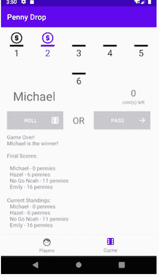

好吧，这可能没有想象中那么令人兴奋。由于应用的功能与之前相比没有太大变化，我们在游玩时不会看到太多差异。我们更改了后端的处理方式，但用户界面基本保持不变。不过，我们现在可以关闭应用，然后从上次离开的地方继续，而且我们还有所有玩过的游戏的存储记录。

下一章将利用这些先前游戏的记录，向用户展示一些玩家排名。我们将显示每位玩家的胜场数和游戏场次，并按历史胜场数最多的玩家排序。这将全部在一个与新片段关联的新标签页中完成，利用Android的`RecyclerView`组件。这个视图组件可以高效地显示项目列表，并能处理大量条目，在我们的案例中，这些条目是从数据库中检索的。我们甚至可以根据显示的玩家，使用条件逻辑来自由设置每个列表项的样式。

# 第6章

## 使用 RecyclerView 构建列表

我们的Penny Drop应用终于进入了最后冲刺阶段。从游戏意义上说，应用已经完成，因为你可以与真人或AI玩家对战，并且可以稍后返回继续游戏。但我们仍然可以添加一些有价值的功能。

首先，我们将在应用中添加排名功能。我们将添加一个新的`RankingsFragment`，其中包含一个`RecyclerView`列表。`RecyclerView`是Android中高效显示项目列表的一种方式，因为视图在幕后进行了许多优化。用户暂时看不到的项目会提前绑定，以确保滚动流畅，同时新的列表项会自动且主动地创建。我们甚至能够通知`RecyclerView`如何判断列表项是否已更改，从而避免在仅更新单个项目时刷新整个列表。

除了`RecyclerView`，还将添加一些其他支持类来填充列表。其中一些我们之前已经见过：一个新的`ViewModel`类、Room的`@Relation`注解，以及一个用于保存每个项目数据的额外`data class`。此外，我们正在创建一个*适配器*类，它通过一个称为`ViewHolder`的组件处理`RecyclerView`的数据以及每个列表项的绑定。作为参考，`ViewHolder`类负责处理如何在`RecyclerView`列表中的项目和行之间绑定数据。

在本章结束时，我们将拥有一个看起来类似于所示图像的排名标签页。

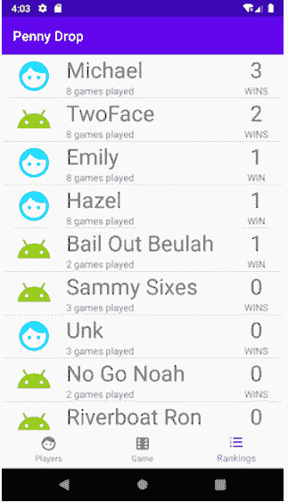

现在是玩一些额外Penny Drop游戏的好时机。玩的游戏越多，我们的排名列表就越有趣。与新玩家一起玩一些游戏，和/或加入一些AI玩家。做任何你想做的事情，为我们提供一些额外的数据。完成后，我们将继续将`RecyclerView`添加到我们的应用中。

### 添加 RecyclerView

我们的第一站是新的`RankingsFragment`类及其内部的`RecyclerView`组件。我们*可以*像以前一样添加新的`Fragment`类，右键单击`fragments`包并选择`New > Fragment > Fragment (Blank)`。请注意，该菜单中的一个选项是`Fragment (List)`；这将为我们完成许多所需的工作。

但我说"可以"生成`Fragment`类是有原因的。我希望第一次手动创建每个部分，以便清楚了解设置`RecyclerView`所需的所有内容。此外，Android Studio会添加一堆我们不需要的代码，所以让我们省去删除所有那些不需要的东西的麻烦。继续在`fragments`包中添加一个名为`RankingsFragment`的新类，并在`res > layout`中添加一个名为`fragment_rankings.xml`的文件。如果我们生成了一个新的`Fragment`类，这两个主要部分就会被添加。

`RankingsFragment`类现在不需要太多内容。该类应继承自`Fragment`，我们需要在`onCreateView`中加载视图布局。

```kotlin
class RankingsFragment : Fragment() {

    override fun onCreateView(
        inflater: LayoutInflater,
        container: ViewGroup?,
        savedInstanceState: Bundle?
    ): View? {
        val view =
            inflater.inflate(R.layout.fragment_rankings, container, false)

        return view
    }
}
```

在将`RecyclerView`添加到布局文件之前，我们需要在`build.gradle`文件中包含库和依赖变量。

```gradle
ext {
    // 其他依赖项仍然在此
    nav_version = '2.3.3'
    recycler_view_version = '1.1.0'
    room_version = '2.3.0-beta01'
}

dependencies {
    其他依赖项
    implementation "androidx.navigation:navigation-ui-ktx:$nav_version"
    implementation "androidx.recyclerview:recyclerview:$recycler_view_version"
    implementation "androidx.room:room-ktx:$room_version"
    其他依赖项
}
```


`fragment_rankings.xml` 文件与 `RankingsFragment` 相比同样简洁，因为它只包含 `RecyclerView`。这里唯一值得注意的属性是 `app:layoutManager`，它告诉 `RecyclerView` 如何显示内容。由于我们将有一个基本列表，我们可以使用 `RecyclerView` 库中现有的 `LinearLayoutManager`。整个 `fragment_rankings.xml` 文件如下所示：

```xml
<?xml version="1.0" encoding="utf-8"?>
<androidx.recyclerview.widget.RecyclerView
    xmlns:android="http://schemas.android.com/apk/res/android"
    xmlns:app="http://schemas.android.com/apk/res-auto"
    xmlns:tools="http://schemas.android.com/tools"
    android:id="@+id/rankings_list"
    android:name="dev.mfazio.pennydrop.fragments.RankingsFragment"
    android:layout_width="match_parent"
    android:layout_height="match_parent"
    app:layoutManager="LinearLayoutManager"
    tools:context=".fragments.RankingsFragment" />
```

有了这两个文件，我们现在可以将 `RankingsFragment` 添加到底部导航栏。需要做的一点准备工作是为该底部导航项添加一个新图标。像添加前两个底部导航项一样添加它：右键单击 `res > drawable` 并选择 `New > Vector Asset`。我选择了格式列表编号图像，但你可以自由选择任何对你有意义的图像。将其添加到项目后，打开 `menu/navigation.xml` 并添加一个新的 `<item>`：

```xml
<?xml version="1.0" encoding="utf-8"?>
<menu xmlns:android="http://schemas.android.com/apk/res/android">
    <item
        android:id="@+id/pickPlayersFragment"
        android:icon="@drawable/ic_baseline_face_24"
        android:title="@string/players" />
    <item
        android:id="@+id/gameFragment"
        android:icon="@drawable/mdi_dice_6_black_24dp"
        android:title="@string/game" />
    <item
        android:id="@+id/rankingsFragment"
        android:icon="@drawable/ic_baseline_format_list_numbered_24"
        android:title="@string/rankings" />
</menu>
```

添加新的 `@string/rankings` 值（“Rankings”）后，打开 `navigation/nav_graph.xml` 并在其中添加新的 `<fragment>` 条目：

```xml
<?xml version="1.0" encoding="utf-8"?>
<navigation xmlns:android="http://schemas.android.com/apk/res/android"
    xmlns:app="http://schemas.android.com/apk/res-auto"
    android:id="@+id/nav_graph"
    app:startDestination="@id/rankingsFragment">
    <fragment
        android:id="@+id/pickPlayersFragment"
        android:name="dev.mfazio.pennydrop.fragments.PickPlayersFragment"
        android:label="fragment_pick_players" />

    <fragment
        android:id="@+id/gameFragment"
        android:name="dev.mfazio.pennydrop.fragments.GameFragment"
        android:label="fragment_game" />

    <fragment
        android:id="@+id/rankingsFragment"
        android:name="dev.mfazio.pennydrop.fragments.RankingsFragment"
        android:label="fragment_rankings" />
</navigation>
```

## 构建列表项布局

本节的最终目标是让 `PlayerSummaryAdapter` 准备就绪，但首先应完成我之前提到的类和布局文件。那个名为 `PlayerSummary` 的类是一个基本的 `data class`，用于保存每个用户的胜场和游戏场次总数。我们将使用此类来确定每个列表项中显示的内容。该类的代码如下所示：

```kotlin
package dev.mfazio.pennydrop.types

data class PlayerSummary(
    val id: Long,
    val name: String,
    val gamesPlayed: Int = 0,
    val wins: Int = 0,
    val isHuman: Boolean = true
)
```

这里没有太多其他内容，因此我们可以继续讨论使用 `PlayerSummary` 类实例的地方，即一个名为 `player_summary_list_item.xml` 的新布局文件。

这个布局文件看起来会与之前的布局文件相似，特别是我们在[添加玩家行而无需重复自己（太多）](Add Player Rows Without Repeating Yourself (Too Much))中看到的 `player_list_item.xml` 布局文件。我们有一个通用的 `<layout>` 标签包裹整个视图，一个包含 `<variable>`（`playerSummary` 变量）的 `<data>` 标签，然后是包含所有视图的主 `<ConstraintLayout>`。是的，这个通用的 `<layout>` 标签意味着我们可以为排名列表的每一行使用数据绑定，这简化了我们需要的代码。`<ConstraintLayout>` 之外的所有内容如下所示：

```xml
<layout xmlns:android="http://schemas.android.com/apk/res/android"
    xmlns:app="http://schemas.android.com/apk/res-auto"
    xmlns:tools="http://schemas.android.com/tools">

    <data>
        <variable
            name="playerSummary"
            type="dev.mfazio.pennydrop.types.PlayerSummary" />
    </data>

    <!-- ConstraintLayout 在下面。 -->
</layout>
```

作为本章开头的提醒，行将如下所示：


主 `<ConstraintLayout>` 具有高度（`wrap_content`）和宽度（`match_parent`），一个 `<ImageView>`，以及四个 `<TextView>` 组件。其中大部分内容将与我们在前面章节中看到的相同，但有几个有趣的部分值得指出。让我们从 `<ImageView>` 开始。

我们重用了[添加可绘制背景](Add the drawable Background)中的人脸和安卓图标，但与我们为人类/AI `<SwitchCompat>` 创建新的可绘制 XML 文件不同，我们将在 `BindingAdapters.kt` 中创建几个新函数。

### 添加绑定适配器

我们需要两个新的 `@BindingAdapter` 函数：`bindPlayerSummaryAvatarSrc` 和 `bindPlayerSummaryAvatarTint`。这两个函数执行类似的操作：根据列出的玩家是否是人类来设置 `<ImageView>` 的属性。虽然我们可以将这两个函数合并为一个，但每个函数修改的是不同的属性，因此我认为将它们分开更有意义。

`bindPlayerSummaryAvatarSrc` 在 `imageView` 上调用 `setImageResource` 函数，并从 `R.drawable` 分配一个值，如下所示：

```kotlin
@BindingAdapter("playerSummaryAvatarSrc")
fun bindPlayerSummaryAvatarSrc(imageView: ImageView, isHuman: Boolean) {
    imageView.setImageResource(
        if (isHuman) {
            R.drawable.ic_baseline_face_24
        } else {
            R.drawable.ic_baseline_android_24
        }
    )
}
```

这不是最令人兴奋的函数，但它确实使我们免于在布局文件中编写冗长的条件语句。如果你更愿意那样做，请继续。在功能上，它们是相同的——我只是更喜欢使用 Kotlin 代码，而不是在布局文件中编写冗长的三元语句。如果你确实想走那条路，它看起来会是这样（并且在 XML 中正确格式化后，将无法放在这一页上）：

```xml
@{playerSummary.isHuman ?
    @drawable/ic_baseline_face_24 :
    @drawable/ic_baseline_android_24}
```

`bindPlayerSummaryAvatarTint` 绑定适配器类似，但不是调用 `setImageResource`，而是使用 `setImageTintList`。这个函数可能看起来很奇怪，但它等同于使用 `android:tint` 属性。此外，由于我们使用的是 Kotlin，“setter”方法可以像属性一样访问，这意味着我们可以改为给 `imageView.imageTintList` 赋值。

这里另一个奇怪的部分是我们使用的是 `ColorStateList` 对象，而不仅仅是一个 `Color`。这是我们在 `ai_toggle_color.xml` 文件中所做操作的代码等效形式，其中我们有一个颜色列表及其关联的状态值。但因为我们只关心使用一种颜色，所以我们可以在这里省去一些麻烦。

在 `androidx.databinding.adapters.Converters` 包中，我们可以使用一个名为 `convertColorToColorStateList` 的函数。这有点大材小用，因为这个函数的主体只是 `ColorStateList.valueOf(color)`，但我喜欢这个函数提供的可读性。

获取 `Color` 对象比我们之前做的仅仅检索 `Int` 需要更多的工作，因此我们将使用 `ImageView` 上的 `Context` 对象来进行转换。使用类似的 `isHuman` 条件块，我们可以获取所需颜色的资源值，然后调用 `imageView.context.getColor` 来处理从颜色资源 ID 到颜色 ID 值的转换。整个 `@BindingAdapter` 函数如下所示：

```kotlin
@BindingAdapter("playerSummaryAvatarTint")
fun bindPlayerSummaryAvatarTint(imageView: ImageView, isHuman: Boolean) {
    imageView.imageTintList = convertColorToColorStateList(
        imageView.context.getColor(
            if (isHuman) {
                android.R.color.holo_blue_bright
            } else {
                android.R.color.holo_green_light
            }
        )
    )
}
```

两个函数都准备好后，我们就可以在 `<ImageView>` XML 中使用它们了。这看起来像我们已经创建的许多视图，但有一些额外的属性专门用于处理图像。`android:adjustViewBounds="true"` 允许操作系统调整图标大小以适应允许的区域。没有这个，我们最终会在每行的左侧得到一个相当小的人脸或安卓图像。`android:scaleType="fitCenter"` 也用于调整和放大每行的图标。这告诉操作系统实际执行我们通过 `android:adjustViewBounds` 允许的调整。整个 `<ImageView>` 及其所有属性如下所示：

```xml
<ImageView
    android:id="@+id/playerTypeImage"
    android:layout_width="wrap_content"
    android:layout_height="0dp"
    android:layout_marginStart="16dp"
    android:adjustViewBounds="true"
    android:contentDescription="@string/player_type_image"
    android:padding="5dp"
    android:scaleType="fitCenter"
    app:layout_constraintBottom_toBottomOf="parent"
    app:layout_constraintStart_toStartOf="parent"
    app:layout_constraintTop_toTopOf="parent"
    app:playerSummaryAvatarSrc="@{playerSummary.isHuman}"
    app:playerSummaryAvatarTint="@{playerSummary.isHuman}" />
```

正如我们之前在 `app:isHidden` 属性中看到的，我们的绑定适配器被添加到 `app` 命名空间中，并引用它们被添加到的视图。确保添加 `@string/player_type_image` 字符串资源，图像就准备就绪了。

### 向列表项添加文本视图

每一行有四个独立的 `<TextView>` 组件：玩家的姓名、他们玩过的游戏数量、他们的胜场总数，以及根据胜场数量显示的单词 WIN 或 WINS。我们可以一次性查看这些，因为其中几乎没有新内容，但首先有几个要点需要指出。

如果你记得，在数据绑定表达式中将数值作为文本会导致问题。我们可以在每个绑定表达式中附加一个空字符串，或者我们可以改为向 `PlayerSummary` 添加一个新值。选择权在你，但我喜欢额外值的方法，所以我添加了 `winsString`，它对 `wins` 值调用 `toString`。这没什么特别的，但它稍微清理了布局文件。`gamesPlayed` 会有同样的问题，但我们已经将其附加到一个 `String` 中，用于 UI 的“已玩游戏”部分。

最后一个值得注意的部分是“win”或“wins”文本。虽然我们可以添加代码来手动切换这些值，或者直接使用“win(s)”，但这感觉是引入 Android 中*数量字符串*或*复数*概念的绝佳时机。类似于字符串资源，复数通过资源为你提供 `String` 值使用名称而非硬编码文本值，有助于实现翻译。

但复数形式与字符串资源不同，因为您需要在 `<plurals>` 条目中添加多个 `<item>` 标签，每个 `<item>` 代表不同的 `quantity` 值。这些值包括 `zero`、`one`、`two`、`few`、`many` 以及回退值 `other`。

请注意，并非所有语言都支持所有这些值。例如，英语只使用 `one` 和 `other`。有关数量字符串所有用法的更多详细信息，请参阅文档 [https://link.mfazio.dev/plurals](https://link.mfazio.dev/plurals)。

在我们的案例中，我们将使用两个数量：`one`（值为“win”）和 `other`（“wins”）。整个 `res/values/plurals.xml` 文件如下所示：


```xml
<?xml version="1.0" encoding="utf-8"?>
<resources>
    <plurals name="wins">
        <item quantity="one">win</item>
        <item quantity="other">wins</item>
    </plurals>
</resources>
```

然后，我们可以通过数据绑定在 XML 中使用这些值。我们引用复数形式的方式与引用字符串资源相同，但还需要传入用于确定数量的数字。这导致了类似`android:text="@{@plurals/wins(playerSummary.wins)}"`的语句。

关于 Win/Wins 文本，最后一个有用的属性：我们希望该文本全部大写，这可以通过`android:textAllCaps`属性实现。这有助于避免为具有正常大小写或全大写的给定单词创建单独的字符串资源值。

以下是`<ConstraintLayout>`的其余部分，即前面提到的四个`<TextView>`组件：

```xml
<TextView
    android:id="@+id/playerName"
    android:layout_width="wrap_content"
    android:layout_height="wrap_content"
    android:layout_marginStart="16dp"
    android:text="@{playerSummary.name}"
    android:textSize="32sp"
    app:layout_constraintBottom_toTopOf="@id/playerGamesPlayed"
    app:layout_constraintStart_toEndOf="@id/playerTypeImage"
    app:layout_constraintTop_toTopOf="parent"
    tools:text="Michael" />
```

```xml
<TextView
    android:id="@+id/playerGamesPlayed"
    android:layout_width="wrap_content"
    android:layout_height="wrap_content"
    android:text='@{playerSummary.gamesPlayed + " " + @string/games_played}'
    app:layout_constraintBottom_toBottomOf="parent"
    app:layout_constraintStart_toStartOf="@id/playerName"
    app:layout_constraintTop_toBottomOf="@id/playerName"
    tools:text="23 games played" />
```

```xml
<TextView
    android:id="@+id/playerGamesWon"
    android:layout_width="48dp"
    android:layout_height="wrap_content"
    android:layout_marginEnd="16dp"
    android:text='@{playerSummary.winsString}'
    android:textAlignment="center"
    android:textSize="32sp"
    app:layout_constraintEnd_toEndOf="parent"
    app:layout_constraintStart_toStartOf="@id/textWins"
    app:layout_constraintTop_toTopOf="parent"
    tools:text="10" />
```

```xml
<TextView
    android:id="@+id/textWins"
    android:layout_width="48dp"
    android:layout_height="wrap_content"
    android:layout_marginEnd="16dp"
    android:text="@{@plurals/wins(playerSummary.wins)}"
    android:textAlignment="center"
    android:textAllCaps="true"
    app:layout_constraintBottom_toBottomOf="parent"
    app:layout_constraintEnd_toEndOf="parent"
    tools:text="wins"/>
```

现在列表项布局已完成，我们可以开始构建`PlayerSummaryAdapter`类了。

## 创建自定义 ListAdapter

`PlayerSummaryAdapter`类负责管理列表中的所有`PlayerSummary`项并处理它们的显示方式。我们使用一个自定义的`RecyclerView.ViewHolder`内部类（意味着它位于`PlayerSummaryAdapter`内部）将`PlayerSummary`项绑定到布局，然后`RecyclerView`库会处理其余部分。我们在`PlayerSummaryAdapter`中需要做的就是告诉`RecyclerView`在创建和绑定新的`ViewHolder`时该做什么，以及如何区分列表中的`PlayerSummary`项。

在`adapters`包中创建`PlayerSummaryAdapter`后，首先是`PlayerSummaryViewHolder`内部类。`PlayerSummaryAdapter`类既包含又依赖于这个类，因此我们将先创建它，然后将`PlayerSummaryAdapter`包装在其周围。`PlayerSummaryViewHolder`类继承自`RecyclerView.ViewHolder`，并有一个函数`bind`，该函数接受一个`PlayerSummary`对象。

`bind`函数除了将`binding.playerSummary`赋值给`item`值外，没有做太多其他事情。`binding`值是`PlayerSummaryListItemBinding`的一个实例，它是在我们向`player_summary_list_item.xml`文件添加通用`<layout>`标签时由数据绑定库生成的。然后，`item`值就是传入该方法的`PlayerSummary`对象。赋值完成后，`bind`随后通过`executePendingBindings`函数确保绑定被执行，以便数据正确显示。

```kotlin
inner class PlayerSummaryViewHolder(
    private val binding: PlayerSummaryListItemBinding
) :
    RecyclerView.ViewHolder(binding.root) {

    fun bind(item: PlayerSummary) {
        binding.apply {
            playerSummary = item
            executePendingBindings()
        }
    }
}
```

围绕这个`inner class`的`PlayerSummaryAdapter`类继承自`ListAdapter`，它接受两个类型参数和一个`DiffUtil.ItemCallback`实例。类型参数是列表中项的类型（`PlayerSummary`）和这些项的`ViewHolder`类型（`PlayerSummaryAdapter.PlayerSummaryViewHolder`）。回调部分是文件末尾的一个新的`private class`，名为（不太有创意）`PlayerSummaryDiffCallback`。该类如下所示：

```kotlin
private class PlayerSummaryDiffCallback :
    DiffUtil.ItemCallback<PlayerSummary>() {

    override fun areItemsTheSame(
        oldItem: PlayerSummary,
        newItem: PlayerSummary
    ): Boolean = oldItem.id == newItem.id

    override fun areContentsTheSame(
        oldItem: PlayerSummary,
        newItem: PlayerSummary
    ): Boolean = oldItem == newItem
}
```

有了`PlayerSummaryDiffCallback`和`PlayerSummaryViewHolder`，我们就可以创建`PlayerSummaryAdapter`了。这个继承自`ListAdapter`的类还将包含几个我们稍后将创建的重写函数。类声明加上之前的其他类和函数一起如下所示：

```kotlin
class PlayerSummaryAdapter :
    ListAdapter<PlayerSummary,
        PlayerSummaryAdapter.PlayerSummaryViewHolder>(
            PlayerSummaryDiffCallback()
        ) {

    //重写函数将稍后放在这里。

    inner class PlayerSummaryViewHolder(
        private val binding: PlayerSummaryListItemBinding
    ) :
        RecyclerView.ViewHolder(binding.root) {

        fun bind(item: PlayerSummary) {
            binding.apply {
                playerSummary = item
                executePendingBindings()
            }
        }
    }

    private class PlayerSummaryDiffCallback :
        DiffUtil.ItemCallback<PlayerSummary>() {

        override fun areItemsTheSame(
            oldItem: PlayerSummary,
            newItem: PlayerSummary
        ): Boolean =
            oldItem.id == newItem.id

        override fun areContentsTheSame(
            oldItem: PlayerSummary,
            newItem: PlayerSummary
        ): Boolean =
            oldItem == newItem
    }
}
```

按照目前的写法，`PlayerSummaryAdapter`应该会有一个错误，因为我们尚未实现`ListAdapter`的两个`abstract`函数：`onCreateViewHolder`和`onBindViewHolder`。这两个函数实际上都只是一步，所以我们可以很快完成它们。

`onCreateViewHolder`需要知道如何构建`PlayerSummaryViewHolder`的实例。这意味着我们使用`DataBindingUtil`类来膨胀布局（就像我们在本书中已经做过几次的那样），将其发送到一个新的`PlayerSummaryViewHolder`实例中，并从该函数返回。

```kotlin
override fun onCreateViewHolder(
    parent: ViewGroup,
    viewType: Int
): PlayerSummaryViewHolder =
    PlayerSummaryViewHolder(
        DataBindingUtil.inflate(
            LayoutInflater.from(parent.context),
            R.layout.player_summary_list_item,
            parent,
            false
        )
    )
```

`onBindViewHolder`更加直接，因为它使用来自`onCreateViewHolder`的`PlayerSummaryViewHolder`实例，然后将`PlayerSummary`项发送到`bind`函数中。我们使用`ListAdapter`类的`getItem`函数根据我们在列表中的位置获取正确的`PlayerSummary`。这是继承`ListAdapter`类的一个主要优势——它几乎为我们处理了所有关于项和检索正确项的工作。

```kotlin
override fun onBindViewHolder(
    viewHolder: PlayerSummaryViewHolder,
    position: Int
) {
    viewHolder.bind(getItem(position))
}
```

`PlayerSummaryAdapter`现在可以使用了，因此我们可以转到`RankingsFragment`类来连接所有内容。

## 将适配器连接到 RecyclerView

在这里，我们将扩展之前在`RankingsFragment`中设置的内容。在`onCreateView`函数内部，我们实例化一个`PlayerSummaryAdapter`对象，然后将其分配给`RecyclerView`。获取该`RecyclerView`对象比我们之前获取视图组件时更容易，因为我们之前膨胀的整个视图就是一个`<RecyclerView>`。因此，我们可以将视图值转换为`RecyclerView`实例，然后分配`adapter`属性。我们还将向`RecyclerView`添加一个`ItemDecoration`，它会在每行之间添加浅灰色的分隔线。

```kotlin
override fun onCreateView(
    inflater: LayoutInflater,
    container: ViewGroup?,
    savedInstanceState: Bundle?
): View? {
    val view =
        inflater.inflate(R.layout.fragment_rankings, container, false)
    val playerSummaryAdapter = PlayerSummaryAdapter()

    if (view is RecyclerView) {
        with(view) {
            adapter = playerSummaryAdapter

            addItemDecoration(
                DividerItemDecoration(
                    context,
                    LinearLayoutManager.VERTICAL
                )
            )
        }
    }

    return view
}
```

这是 Kotlin 中智能转换的又一个绝佳示例，我们最初在更新`roll()`和`pass()`函数时见过。由于我们检查了`view`是`RecyclerView`的实例，因此在整个代码块中，`view`都被视为`RecyclerView`实例，而无需创建新值。

此外，我们通常会像这样为`RecyclerView`上的`layoutManager`属性赋值：

```kotlin
layoutManager = LinearLayoutManager(context)
```

然而，这并非必需，因为我们已经在`fragment_rankings.xml`中的`<RecyclerView>`标签内处理了`LayoutManager`的设置。

`RecyclerView`现在已完成，并分配了一个`adapter`来处理其所有数据。我们需要在这里介绍的最后一部分是如何将数据从数据库获取到`PlayerSummaryAdapter`中。为此，我们将创建`RankingsViewModel`并*观察*其中的`LiveData`值。

## 从数据库加载数据到 RecyclerView


`RankingsViewModel` 类类似于 `GameViewModel`，我们获取 `PennyDropRepository` 的实例，然后获取 `LiveData`。我们使用 `Transformations` 类将 `Player` 和 `GameStatus` 对象转换为 `PlayerSummary` 对象。然后，一旦完成，我们就在 `RankingsFragment` 内部观察 `RankingsViewModel` 中的 `playerSummaries` `LiveData` 值，并用新数据更新 `PlayerSummaryAdapter`。让我们逐步创建每个部分。

## 创建 `RankingsViewModel`

正如我提到的，这在获取 `PennyDropRepository` 实例的方式上与 `GameViewModel` 相似。整个 `RankingsViewModel` 类将如下所示，不包括 `Transformations.map` 逻辑（我们很快会介绍）。

```kotlin
class RankingsViewModel(application: Application) :
    AndroidViewModel(application) {

    private val repository: PennyDropRepository

    val playerSummaries: LiveData<List<PlayerSummary>>

    init {
        this.repository = PennyDropDatabase
            .getDatabase(application, viewModelScope)
            .pennyDropDao()
            .let { dao ->
                PennyDropRepository.getInstance(dao)
            }

        playerSummaries = Transformations.map(
            this.repository.getCompletedGameStatusesWithPlayers()
        ) { statusesWithPlayers ->
            // 我们接下来会填充这里。
        }
    }
}
```

在继续之前，我们需要在 `PennyDropRepository` 和 `PennyDropDao` 中都添加一个 `getCompletedGameStatusesWithPlayers` 函数。此外，我们需要一个新的类 `GameStatusWithPlayer`，它将从这些函数返回。`GameStatusWithPlayer` 类似于 `GameWithPlayers`，但包含的是 `GameStatus` 和 `Player` 对象，而不是 `Game` 和 `List<Player>`：

```kotlin
data class GameStatusWithPlayer(
    @Embedded val gameStatus: GameStatus,
    @Relation(
        parentColumn = "playerId",
        entityColumn = "playerId"
    )
    val player: Player
)
```

`Repository` 函数再次只是传递给 DAO 函数，这是一个查询，我们获取所有属于已完成游戏的 `GameStatus` 对象。我们通过对 `games` 表使用子查询来实现这一点：

```kotlin
@Transaction
@Query("""
    SELECT * FROM game_statuses gs
    WHERE gs.gameId IN (
        SELECT gameId FROM games
        WHERE gameState = :finishedGameState
    )
""")
abstract fun getCompletedGameStatusesWithPlayers(
    finishedGameState: GameState = GameState.Finished
): LiveData<List<GameStatusWithPlayer>>
```

在这个函数中为一个不会改变的值设置参数有些别扭，但我认为这样查询更易读，而不是像 `WHERE gameState = 1` 这样。设置这个参数也是为什么我在函数名中使用术语 *completed* 的原因，尽管从技术上讲你可以传入任何你想要的状态。通过赋予它这样一个特定的名称，希望函数的用途是清晰的，并且未来的开发者不会误用它。

> ### IN 子句限制为 999 个项目
>
> 由于 SQLite 的限制，任何 IN 列表中的项目数量必须少于 1000 个。如果你有更多，应用程序将会崩溃。在许多情况下，这不是问题，但它确实可能出现，因此在编写查询时请注意。

在 `PennyDropRepository` 和 `PennyDropDao` 中添加了函数后，我们可以返回来添加 `Transformations.map` 逻辑。

在这个代码块中，我们获取一个 `List<GameStatusWithPlayer>`（`statusesWithPlayers` 值）并将其转换为 `List<PlayerSummary>`。我们通过将 `GameStatusWithPlayer` 按关联的玩家分组，然后将每个 `Player/List<GameStatus>` 对映射到新的 `PlayerSummary` 对象来实现这一点。`gamesPlayed` 属性是与玩家关联的 `GameStatus` 对象的数量，而 `wins` 属性获取玩家的 pennies 值为 0 的游戏数量。

```kotlin
statusesWithPlayers
    .groupBy { it.player }
    .map { (player, statuses) ->
        PlayerSummary(
            player.playerId,
            player.playerName,
            statuses.count(),
            statuses.count { it.gameStatus.pennies == 0 },
            player.isHuman
        )
    }
```

这里的最后一部分是按正确的顺序获取 `PlayerSummary` 对象。首先，我们希望按玩家的胜场数排序，胜场最多的在顶部，最少的在底部。这只需在上一条语句的末尾添加 `.sortedByDescending { it.wins }` 调用即可。

但是，如果不仅按胜场数排序，还按游戏场次排序，排名列表看起来会更好。我们可以看到谁赢得最多，但在平局的情况下，我们按谁玩得最多来排序玩家。不幸的是，`sortedByDescending` 不适用于多个条件，至少没有大量额外代码是不行的。

相反，我们可以使用 `sortedWith` 函数并传入一个 `Comparator` 对象来处理属性。`compareBy` 函数位于 `kotlin.comparisons` 包中，可以引入多个选择器用于比较。这些选择器看起来类似于 `sortedByDescending` 的函数体，并且有一个额外的好处，即可以在值前面加上减号以按降序排序。`statusesWithPlayers` 映射的最终版本如下所示：

```kotlin
statusesWithPlayers
    .groupBy { it.player }
    .map { (player, statuses) ->
        PlayerSummary(
            player.playerId,
            player.playerName,
            statuses.count(),
            statuses.count { it.gameStatus.pennies == 0 },
            player.isHuman
        )
    }
    .sortedWith(compareBy({ -it.wins }, { -it.gamesPlayed }))
```

`RankingsViewModel` 现在已准备好使用，因此让我们前往 `RankingsFragment` 进行设置。

## 在 `RankingsFragment` 中观察数据

我们可以像在其他两个 `Fragment` 类中一样，使用 `activityViewModels` 函数将 `RankingsViewModel` 添加到此类：

```kotlin
private val viewModel by activityViewModels<RankingsViewModel>()
```

然后，在 `onCreateView` 中设置 `RecyclerView` 之后，我们将观察 `playerSummaries` `LiveData` 值的变化。当某些内容发生变化时，我们将调用 `playerSummaryAdapter.submitList` 来更新适配器的数据，这将更新 `RecyclerView`。执行此操作的代码如下所示：

```kotlin
viewModel.playerSummaries.observe(viewLifecycleOwner) { summaries ->
    playerSummaryAdapter.submitList(summaries)
}
```

我们传入 `viewLifecycleOwner` 值以让 `Observer` 知道何时应停止观察数据。这意味着当 `RankingsViewModel` 被销毁时，我们也应停止观察 `playerSummaries` 值。完成后，数据库中的任何更新现在将自动推送到排名 `RecyclerView`。

## 测试数据更新

现在是有趣的部分：运行应用程序并查看排名。如果你之前玩了足够多的游戏以获取一些数据，你应该会看到如下所示的排名屏幕：

另一个不错的测试方法是再玩一局“便士掉落”，然后切换到排名视图查看。不仅排名应该会更新，而且当最新游戏被添加到排名中时，你应该能看到一个漂亮的小动画。很酷，对吧？

## 总结与后续步骤

本章主要介绍了如何在应用中使用 `RecyclerView` 显示列表。我们设置了一个 `RecyclerView`，连接了所有必要的组件，如 `PlayerSummaryAdapter`，甚至看到了一种从数据库中获取数据的巧妙方法。任何时候你想在 Android 应用中显示列表，你都会遵循类似的过程。当然，事情可能会变得更复杂，正如我们将在第 11 章《使用分页显示数据》中看到的，但核心组件和思想保持不变。

接下来，我们将做一些事情，让用户能够个性化自己的应用。我们将通过利用 `SettingsFragment` 类，为应用添加用户可选的设置和主题。用户将能够更改他们“便士掉落”游戏中的便士数量、AI 的游戏速度，甚至应用的外观。

# 第 7 章

## 使用设置和主题自定义应用

“便士掉落”应用即将完成！一旦我们在这里完成更改，本书中涵盖的所有关于“便士掉落”的功能就都完成了。我们将在第 14 章《使用 JUnit 进行单元测试》和第 15 章《使用 Espresso 测试应用 UI》中添加一些测试，但用户可见的更改到此为止。

你可能会问，这些更改是什么？我们将创建一个包含五个选项的 `SettingsFragment`，然后在整个应用中处理所有这些选项。这些设置包括游戏玩法和外观两方面的更改。我们还会添加一些关于应用的致谢信息，毕竟我们需要感谢 [https://materialdesignicons.com](https://materialdesignicons.com) 提供的出色工作。设置页面中的五个项目（如你将在接下来的截图中看到的）如下：

- 起始便士数：设置每个玩家在游戏开始时的便士数量。范围从 1 到 20。
- 快速 AI：将 AI 的延迟速度从一秒更改为十分之一秒（1000 -> 100 毫秒）。
- 应用主题：让用户从预设主题中选择。我们将在本章后面介绍如何操作。
- 主题模式：用户可以选择始终让应用使用浅色主题、深色主题，或使用系统当前的主题。
- 关于便士掉落：将用户带到一个新的 `AboutFragment`，提供有关应用及其使用图标的更多信息。

我们将在本章中依次介绍每个设置项，了解如何使用保存的值，并涵盖处理设置更改所需的所有其他更改。完成后，设置页面将如下所示：

让我们首先将 `SettingsFragment` 类添加到应用中。

### 添加新的 `SettingsFragment`

首先，我想为本章中使用的术语道歉并加以澄清。我们创建的类名为 `SettingsFragment`，它继承自 AndroidX Preference 库的 `PreferenceFragmentCompat` 类。`SettingsFragment` 处理多个 `Preference` 对象和 `<Preference>` 标签。

那么，为什么我们称之为“设置”而不是“首选项”呢？主要原因是官方 Android 开发者文档将此概念称为设置：[https://link.mfazio.dev/settings](https://link.mfazio.dev/settings)。我知道使用多个 `Preference` 项来构建设置可能会令人困惑，但我遵循的是 Android 团队建立的惯例。另一个原因是 `PreferenceFragment` 类已经存在于 Preference 库中，因此将我们的类命名为不同的名称可以避免任何潜在的冲突和麻烦。

此外，当你在大多数应用中点击设置链接时，它使用的标签是“设置”，而不是“首选项”，所以至少在这方面我们是一致的。不过，如果这给你带来了任何困惑，我深表歉意。

希望我们现在都已达成共识，可以开始构建我们的 `SettingsFragment` 类了。如前所述，它继承自 `PreferenceFragmentCompat` 类。是的，设置这个类还有一些奇怪之处，但使用 `PreferenceFragmentCompat` 而不是 `PreferenceFragment` 有一个很好的理由（这不仅仅是因为后者在 API 级别 28 中已被弃用）。

`PreferenceFragment` 继承自旧的 `android.app.Fragment` 类，而不是当前的 `androidx.fragment.app.Fragment` 类。Android 团队没有更改 `PreferenceFragment` 的父类并破坏任何未使用 AndroidX 库的应用，而是创建了一个新类并弃用了旧类。

说到 AndroidX，我们需要在应用中包含 Preference 库依赖。让我们在项目的 `build.gradle` 文件中添加另一个 `ext` 变量（名为 `preference_version`，引用 Preference 库的最新版本），然后在应用的 `build.gradle` 中添加 `preference-ktx` 依赖：

```
dependencies {
    Other dependencies

    implementation "androidx.navigation:navigation-ui-ktx:$nav_version"
    implementation "androidx.preference:preference-ktx:$preference_version"
    implementation "androidx.recyclerview:recyclerview:$recycler_view_version"

    Other dependencies
}
```

同步项目后，在 `fragments` 包中添加一个名为 `SettingsFragment` 的新类。如前所述，这个类将继承自 `PreferenceFragmentCompat`，这是一个抽象类，有一个抽象函数：`onCreatePreferences`。这个函数接收函数的 `savedInstanceState` 和一个 `rootKey` 字符串值，我们将它们传递给 `setPreferencesFromResource` 函数。

有了这些部分，你的类应该如下所示：

```kotlin
package dev.mfazio.pennydrop.fragments

class SettingsFragment : PreferenceFragmentCompat() {
    override fun onCreatePreferences(
        savedInstanceState: Bundle?,
        rootKey: String?) {
        // We'll be filling this in next.
    }
}
```

这是我们将在此类中实现的唯一函数，这意味着我们不需要处理 `onCreateView`。在我们所有其他的 `Fragment` 类中，我们都重写了该函数来设置布局并处理任何需要的绑定。然而，`PreferenceFragmentCompat` 类为我们处理了所有这些。我们甚至不需要创建布局文件，因为它会为我们完成。我们*需要*的是某种方式来告诉 `SettingsFragment` 要显示哪些首选项。

我们有两个选择：XML 或代码。为了与我们在应用其他地方处理视图的方式保持一致，我们将在这里通过 XML 资源文件使用 XML。如果你想了解如何通过代码添加首选项，请查看第 12 章《个性化 Android 棒球联盟应用》。

### 添加首选项资源文件

与布局文件不同，首选项资源文件是 `res/xml` 文件夹中的一个通用 XML 文件。你可以随意命名这个文件；我将其命名为 `preferences.xml`。这个文件看起来会很像普通的布局文件，但没有我们之前使用过的任何高度/权重/约束，因为库会为我们处理所有这些。


请在`res/xml`中添加`preferences.xml`（或你喜欢的任何名称）（你可能需要添加`xml`目录），然后打开文件。从高层次来看，这个文件将在顶层有一个`<PreferenceScreen>`标签，带有我们通常的`xmlns:android`和`xmlns:app`命名空间属性。然后，在我们的例子中，我们有多个`PreferenceCategory`标签，每个标签都有一个`android:title`属性和一个或多个`<Preference>`标签。`preferences.xml`文件，包括带有`<PreferenceCategory>`标签的`<PreferenceScreen>`标签，将如下所示：

```xml
<?xml version="1.0" encoding="utf-8"?>
<PreferenceScreen
    xmlns:android="http://schemas.android.com/apk/res/android"
    xmlns:app="http://schemas.android.com/apk/res-auto">

    <PreferenceCategory android:title="Game Settings">
        <!-- This will contain the Penny Count and Fast AI preferences -->
    </PreferenceCategory>

    <PreferenceCategory android:title="Theme Settings">
```

### 将设置页面添加到导航

我想先澄清一点——当我说我们要将页面添加到应用的导航中时，我指的是导航图，而不是底部导航组件。这意味着我们需要在`nav_graph.xml`中添加一个新的`<fragment>`条目：

```xml
<fragment
    android:id="@+id/settingsFragment"
    android:name="dev.mfazio.pennydrop.fragments.SettingsFragment"
    android:label="@string/settings" />
```

设置页面不是通过底部导航访问，而是通过应用导航栏中的齿轮图标访问。为此，我们需要在`res/menu`资源目录中添加一个新图标和一个名为`options.xml`的新文件。齿轮矢量图资源名为Settings；将其添加到项目中，然后在新的`options.xml`文件中的新`<item>`里引用它：

```xml
<?xml version="1.0" encoding="utf-8"?>
<menu xmlns:android="http://schemas.android.com/apk/res/android">
    <item
        android:id="@+id/settingsFragment"
        android:icon="@drawable/ic_baseline_settings_24"
        android:title="@string/settings"
        app:showAsAction="ifRoom" />
</menu>
```

请注意，`app:showAsAction="ifRoom"`属性意味着只要应用栏中有空间，我们就会显示设置图标；如果没有空间，它会进入右上角的溢出菜单（三个点）。对我们来说，设置图标应该始终显示，但当你向应用栏添加多个图标时，这个设置就变得更加重要了。

新文件准备好后（别忘了你的字符串资源），我们需要告诉`MainActivity`使用这个文件。

我们通过重写`onCreateOptionsMenu`函数并加载`options.xml`文件来实现这一点。

```kotlin
override fun onCreateOptionsMenu(menu: Menu?): Boolean {
    super.onCreateOptionsMenu(menu)

    menuInflater.inflate(R.menu.options, menu)

    return true
}
```

`MainActivity`中的最后一部分是告诉应用当有人点击设置齿轮时该做什么。由于我们只有一个项目可供选择，这简化了我们的逻辑。我们需要检查`navController`是否已准备好导航到不同的视图，如果是，则使用`MenuItem`类上的`onNavDestinationSelected`函数。如果该函数调用不成功（返回`false`），我们则回退到父类函数。

```kotlin
override fun onOptionsItemSelected(item: MenuItem): Boolean =
    if (this::navController.isInitialized) {
        item.onNavDestinationSelected(this.navController) ||
            super.onOptionsItemSelected(item)
    } else false
```

请注意，我们通过检查`navController`的*属性引用*上的`isInitialized`属性（而不是属性本身）来检查`navController`是否已就绪。这在语法上是一个小差异，但在功能上却有很大不同。

现在我们的应用将显示设置图标，如果我们点击该链接，就会进入带有空类别的设置屏幕：

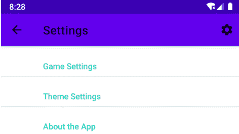

我们可以进入设置页面了，现在是时候添加一些实际的偏好设置了。首先是游戏设置部分，这是了解`Preference`值如何工作的一个很好的入门。

### 添加游戏设置偏好

这两个偏好是处理应用中`Preference`的标准示例。我们在`SettingsFragment`中更改值，并在应用的其他地方使用它。库负责保存值并为我们提供检索机制，这意味着我们几乎不需要手动操作。

起始便士数设置是一个`<SeekBarPreference>`，这意味着用户会得到一个代表数字的滑块来选择一个值。我们所有的偏好都有`key`、`summary`和`title`属性，大多数还有`defaultValue`属性。对于滑动条，我们还可以设置最小值和最大值，以及`app:showSeekBarValue`属性，以便他们选择的数字显示在条的末尾。`<SeekBarPreference>`的XML如下所示：

```xml
<SeekBarPreference
    android:defaultValue="10"
    android:key="pennyCount"
    android:max="20"
    android:summary="@string/starting_penny_count_new_game"
    android:title="@string/starting_penny_count"
    app:min="1"
    app:showSeekBarValue="true" />
```

除了创建几个字符串资源外，这已经可以使用了。我确实想指出，最小值属性是在`app`命名空间中，而不是`android`。老实说，我不知道为什么这些属性要采用这种方式，但只要你知道在哪里设置它，这没什么大不了的。

快速AI设置是两个偏好中较简单的一个，只有基本的`key`、`summary`和`title`属性。我们在`<SwitchPreferenceCompat>`标签上设置这三个属性。同样，我们在这里使用Compat版本，因为这确保了在旧设备上能正确显示。由于我们当前应用的最低API级别是26，这几乎可以保证不会产生任何影响，但如果你以后为旧设备编写应用，使用`<SwitchPreferenceCompat>`将确保开关在不同操作系统版本之间显示一致。以下是此偏好的代码：

```xml
<SwitchPreferenceCompat
    android:key="fastAI"
    android:summary="@string/fast_ai_summary"
    android:title="@string/fast_ai" />
```

我们现在可以运行应用来查看新的偏好设置，如图所示。

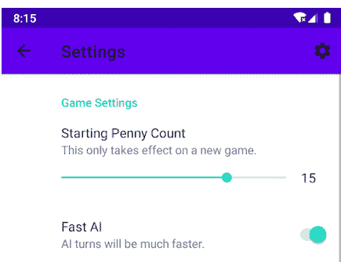

这些偏好值现在可以随意更改，但它们显然还没有任何作用。接下来，我们需要从`PreferenceManager`类中获取偏好并在我们的应用中使用它们。

### 使用已保存的偏好

除了`PreferenceFragmentCompat`类为我们处理的所有UI工作外，值的更改也会自动保存和更新。要检索这些值，我们需要从`PreferenceManager`类获取一个`SharedPreferences`实例。在`GameViewModel`内部，我们将这样做，将结果分配给一个新的`prefs`值：

```kotlin
private val prefs =
    PreferenceManager.getDefaultSharedPreferences(application)
```

### 使用快速AI偏好

我们现在可以根据需要使用`prefs`来获取偏好值。这与我们在`SettingsFragment`中设置内容的顺序不符，但让我们从快速AI设置开始，因为它只需要一行更改。在`playAITurn`函数中，我们目前有一个1000毫秒的`delay`函数调用，以模拟正常玩家花时间考虑他们的选择。现在，我们要将其更改为100毫秒，但前提是快速AI开关被切换为true。我们可以通过调用我们创建的`prefs`值上的`getBoolean`函数并传入`<SwitchPreferenceCompat>`元素的`key`值来检查该值。这意味着`playAITurn`函数看起来像这样：

```kotlin
private suspend fun playAITurn() {
    delay(if (prefs.getBoolean("fastAI", false)) 100 else 1000)

    // 函数的其余部分仍然在这里
}
```

`getBoolean`的第二个参数是当`fastAI`设置没有值时的默认值。一旦用户进入设置页面并打开该设置，我们将看到AI移动得快得多。你现在可以自己测试一下，以确保你做对了一切。我想展示一个截图，但加速AI的回合不太适合在书中展示。

### 使用起始便士数偏好

本节中的另一个设置`pennyCount`也在`GameViewModel`中设置。在`startGame`函数中，我们现在要将`pennyCount`值（默认值为`Player.defaultPennyCount`）发送到`PennyDropRepository.startGame`函数：

```kotlin
suspend fun startGame(playersForNewGame: List<Player>) {
    repository.startGame(
        playersForNewGame,
        prefs?.getInt("pennyCount", Player.defaultPennyCount)
    )
}
```

正如你的IDE可能现在告诉你的那样，这还需要一些下游更改。`PennyDropRepository.startGame`现在看起来像这样：

```kotlin
suspend fun startGame(players: List<Player>, pennyCount: Int? = null) =
    pennyDropDao.startGame(players, pennyCount)
```

在`PennyDropDao`中，`startGame`函数现在将`pennyCount`作为参数，然后我们插入`GameStatus`对象的地方更新为如下所示：

```kotlin
this.insertGameStatuses(
    playerIds.mapIndexed { index, playerId ->
        GameStatus(
            gameId,
            playerId,
            index,
            index == 0,
            pennyCount ?: Player.defaultPennyCount
        )
    }
)
```

这里可能的问题是“为什么不直接在`PennyDropDao`内部获取`pennyCount`值，而是通过所有层传递它？”

原因是`PreferenceManager.getDefaultSharedPreferences`函数需要一个`Context`对象的引用。文档中提到“[该`getDefaultSharedPreferences`函数]可在应用程序的任何位置使用”，[61]但这仅在你能在该位置获取到`Context`对象时才成立。尽管我们使用`Context`对象创建了`PennyDropDatabase`并从中获取了`PennyDropDao`，但在此类中我们已无法访问该对象。

虽然我们可以以某种方式在`PennyDropDao`内部保存一个`Context`值，但我们不希望将Android应用上下文引用保存在随意的位置。`GameViewModel`已经可以访问`Context`对象（通过`application`值），因此这是访问我们首选项的最佳位置。

现在是运行你的应用、更改游戏设置并开始新游戏的好时机。你将在游戏屏幕上看到你设置的起始硬币数量，并且拥有AI玩家将显示由于快速AI开关而产生的变化。

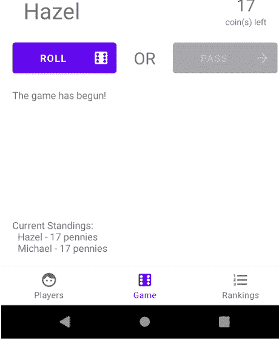

有了这些设置，并且你现在知道如何获取首选项值，我们可以继续进行主题设置。我们需要先创建几个主题，然后就可以在我们的应用中切换它们。一旦准备就绪，我们还将了解如何在亮色和暗色模式之间切换。

### 添加主题

我们将添加一些新主题供用户选择，但在开始之前，我建议我们添加一个新的库。Material Design Components (MDC) 库为我们提供了一种更简单的方式来处理应用中的Material Design样式。

特别是，我建议我们添加这个库是因为它提供了Material Theming支持。Material Theming为我们提供了额外的颜色属性，如`colorSurface`，文档中将其描述为设置“组件的表面，例如卡片、工作表和菜单”。

在我们的例子中，我们使用它来设置应用栏在暗色主题下的背景颜色（亮色主题使用主色调）。添加MDC库并将我们的父主题更改为`Theme.MaterialComponents.DayNight`，使我们能够访问额外的颜色属性以及一些外观变化（如圆角按钮）。

像平常一样添加它，指向最新的MDC版本，并包含一个`material_version` ext变量。

```
dependencies {
    //Still have the other dependencies up here
    implementation "com.google.android.material:material:$material_version"
}
```

主题在`res/values/styles.xml`文件中添加。目前，你可能只有一个名为AppTheme的单一主题，它继承自`Theme.AppCompat.Light.DarkActionBar`。我们将其更改为前面提到的`Theme.MaterialComponents.DayNight`值，这不仅提供了我提到的MDC附加功能，还为我们处理亮色和暗色模式之间的切换做好了准备。

我们的其余主题将继承自AppTheme，使我们能够有效地在其他主题中拥有由基础主题设置的默认值。实际上，我们只关心colorSurface，而这仅在暗色主题中对我们构成关注，但这是你可以在其他地方有效使用的一种技术。

我在我的styles.xml版本中创建了五个额外的主题，它们看起来都与我将要展示的主题相似。如果你想查看所有主题，请务必查看代码中的chapter-7/app-code文件夹。这个样式基于Kotlin的标志和品牌：

```
<style name="Kotlin" parent="AppTheme">
    <item name="colorPrimary">@color/kotlinBlue</item>
    <item name="colorPrimaryDark">@color/kotlinPurple</item>
    <item name="colorAccent">@color/kotlinOrange</item>
</style>
```

如你所见，此主题中定义了一些新的颜色资源值，因此我们需要将它们添加到res/values/colors.xml中：

```
<color name="kotlinBlue">#178dd7</color>
<color name="kotlinOrange">#f98908</color>
<color name="kotlinPink">#c359bc</color>
<color name="kotlinPurple">#806fe3</color>
```

请随意以相同方式添加任何你喜欢的主题。如果你想快速测试带有新主题的应用，请打开你的AndroidManifest.xml并将`<application>`标签内的`android:theme`值更改为类似这样的内容：


```
<application
    android:allowBackup="true"
    android:icon="@mipmap/ic_launcher"
    android:label="@string/app_name"
    android:roundIcon="@mipmap/ic_launcher_round"
    android:supportsRtl="true"
    android:theme="@style/AppTheme">
    ...
</application>
```

将新主题添加到`styles.xml`（以及根据需要添加到`colors.xml`）后，我们可以继续为用户提供一种根据需要快速切换主题的方法。

## 更改主题

回到`preferences.xml`内部，让我们在主题设置类别中添加一个新的`<DropDownPreference>`。除了我们之前设置的常规属性外，我们这里还使用了三个额外的属性。

### 添加额外的首选项属性

`app:useSimpleSummaryProvider`在每次更改首选项值时处理更新摘要文本，我们可以在当前以及后续处理夜间模式支持时使用它。另外两个属性是`android:entries`和`android:entryValues`，它们为我们提供了一种填充下拉列表的方式。这两个值都位于`res/values/arrays.xml`中（你可能需要创建它）。在我们添加这些值之前，这里是完整的`<DropDownPreference>`：

```
<DropDownPreference
    android:defaultValue="AppTheme"
    android:entries="@array/themes"
    android:entryValues="@array/theme_values"
    android:key="theme"
    android:title="@string/app_theme"
    app:useSimpleSummaryProvider="true" />
```

现在，让我们去添加那些条目字符串。

### 添加条目和条目值

`arrays.xml`资源文件包含一些`<array>`标签，每个标签内有一个或多个项目。在我们的例子中，我们创建了多个名为`themes`和`theme_values`的`<string-array>`集合。这些标签将包含多个子`<item>`标签，其中包含我们所有的标签或值。如果你想知道每个数组代表什么，我们使用`themes`作为下拉列表的标签，而`theme_values`是我们从`SharedPreferences`对象获取的实际值。我的`arrays.xml`文件目前看起来像这样（你的可能因主题而异）：

```
<?xml version="1.0" encoding="utf-8"?>
<resources>
    <string-array name="themes">
        <item>Default</item>
        <item>Kotlin</item>
        <item>Crew</item>
        <item>FTD</item>
        <item>GPG</item>
        <item>HMF</item>
    </string-array>
    <string-array name="theme_values">
        <item>AppTheme</item>
        <item>Kotlin</item>
        <item>Crew</item>
        <item>FTD</item>
        <item>GPG</item>
        <item>Hazel</item>
    </string-array>
</resources>
```

有了这些设置，并且我们的`<DropDownPreference>`标签引用了`arrays.xml`中的两个数组，我们就可以开始使用这些值了。

### 使用所选主题

除了像我们之前那样在`AndroidManifest.xml`中设置主题外，我们还可以在`MainActivity`的`onCreate`函数中通过其ID设置主题。为此，我们需要像之前那样从`SharedPreferences`类中获取主题ID，将其从文本值转换为资源ID，然后调用`setTheme`。再次记住，你的主题值和ID可能因你使用的主题而异：

```
val prefs =
    PreferenceManager.getDefaultSharedPreferences(this)

val themeId = when (prefs.getString("theme", "AppTheme")) {
    "Crew" -> R.style.Crew
    "FTD" -> R.style.FTD
    "GPG" -> R.style.GPG
    "Hazel" -> R.style.Hazel
    "Kotlin" -> R.style.Kotlin
    else -> R.style.AppTheme
}

setTheme(themeId)
```

这里最重要的是确保在调用`setContentView`*之前*完成`setTheme`函数调用。未能这样做将导致你的主题设置无法被正确应用。

这段代码已设置好并完成了我们需要的功能，但它仅在`MainActivity`创建时执行，目前是在应用启动时。为了使其更具动态性，无需用户完全重启应用即可更改主题，我们需要在`SettingsFragment`内部添加一些逻辑。

### 处理首选项更改

在`onCreatePreferences`函数内部，我们可以检索我们设置的任何首选项，并通过`OnPreferenceChangeListener`对象监视值的变化。这是Kotlin的另一个美妙之处，因为我们不必创建一个完整的`OnPreferenceChangeListener`类，甚至不必担心显式覆盖`onPreferenceChange`函数，而是可以只添加一个`Preference.OnPreferenceChangeListener`引用，其中包含一个代码块作为该类唯一函数的主体。这类似于我们在*将玩家添加到GameViewModel*中实现`OnClickListener`的方式。

我们可以通过`findPreference`函数以类似于使用`key`值的`findViewById`函数的方式获取`DropDownPreference`的实例：

```
val themePreference = findPreference<DropDownPreference?>("theme")
```

一旦我们有了该实例，我们就可以（安全地）在`themePreference`值上分配`onPreferenceChangeListener`。我说“安全地”因为`themePreference`可能为空，所以我们只想在`themePreference`不为`null`时才进行赋值。附加到`OnPreferenceChangeListener`的代码块只做一件事：重新创建当前的`Activity`，然后返回`true`：

```
themePreference?.onPreferenceChangeListener =
Preference.OnPreferenceChangeListener { _, _ ->

    activity?.recreate()

    true
}
```

请注意，我省略了此函数的两个参数，因为我们没有使用它们。这两个参数通常是已更改的`Preference`和一个表示新值的`Any`对象。我们这里不需要它们，但稍后在切换主题模式时会用到它们。

如果你还不知道，因为我们之前没有提到过，Kotlin中的`Any`类等同于Java中的`Object`类。它是基础类型，可以与任何（因此得名）类型的任何对象一起使用。

现在运行你的应用，尝试在几个主题之间切换。添加重新创建`Activity`的调用，使我们不必每次想要新主题时都完全关闭并重新打开应用。接下来是在浅色和深色模式之间切换，这是一个类似（且稍微简单一点）的过程。

## 添加夜间模式支持

应用和网站的最新趋势之一是引入深色主题。从Android 10开始，深色主题支持终于被内置到操作系统中，为你的整个手机提供了更暗的外观和感觉。

在我们的代码中，我们可以强制应用使用某种模式（尽管我们让用户选择他们喜欢的模式），或者我们可以使用系统当前的设置。通过结合使用`Theme.MaterialComponents.DayNight`父样式和来自`AppCompatDelegate`的模式值，我们可以自动更改整个应用的模式。

使这一切工作的关键是`AppCompatDelegate.setDefaultNightMode`函数。此函数引入一个模式ID值，并立即将应用切换到使用所选模式。在我们的例子中，我们关心三个值：`MODE_NIGHT_NO`、`MODE_NIGHT_YES`和`MODE_NIGHT_FOLLOW_SYSTEM`。你可以将它们分别理解为浅色、深色和系统。我们需要做的是将这三个选择添加到`SettingsFragment`中，然后像处理主题那样做出响应，即根据设置的值更改模式。

这比之前的方法更复杂，但考虑到我们之前所做的，它应该是合理的。首先，添加一个新的`<ListPreference>`标签，其中包含更多的数组值。

### 添加带有条目的首选项

对于两个主题设置首选项，我们本可以使用`<DropDownPreference>`或`<ListPreference>`，因为两者具有相似的用途。我决定各用一个作为示例，但你可以随意选择你喜欢的首选项。此外，由于两个首选项具有相似的用途，它们的属性将是相同的，尽管值不同：

```
<ListPreference
    android:defaultValue="System"
    android:entries="@array/theme_modes"
    android:entryValues="@array/theme_mode_values"
    android:key="themeMode"
    android:title="@string/theme_mode"
    app:useSimpleSummaryProvider="true" />
```

我们还需要在`arrays.xml`中添加另外两个`<string-array>`集合：

```
<string-array name="theme_modes">
    <item>Light</item>
    <item>Dark</item>
    <item>System Default</item>
</string-array>
<string-array name="theme_mode_values">
    <item>Light</item>
    <item>Dark</item>
    <item>System</item>
</string-array>
```

虽然我这里没有这样做，但你也可以为所有这些项目使用字符串资源值。这是更好的方法，但为了本章的清晰起见，我将这些值保留为字符串本身。如果你的应用有任何语言翻译，你肯定需要使用字符串资源值。

添加了`<ListPreference>`和数组值后，我们可以向`SettingsFragment`添加另一个`OnPreferenceChangeListener`。

### 响应首选项更改

事情开始的方式与我们之前所做的相同。我们获取`ListPreference`的实例：

```
val themeModePreference = findPreference<ListPreference?>("themeMode")
```

然后我们添加一个`OnPreferenceChangeListener`来处理首选项更改时的情况：

```
themeModePreference?.onPreferenceChangeListener =
    Preference.OnPreferenceChangeListener { _, newValue ->
        //我们稍后会完成这个。
    }
```

在此代码块内，我们需要获取`newValue`并确定用户想要哪种模式。我们可以再次使用`when { ... }`块来做出此确定，然后调用`AppCompatDelegate.setDefaultNightMode`来分配它。这样做实际上会立即更改应用的主题，而无需重新创建`Activity`。我们还想在这里设置一个默认值，因为这比`android:defaultValue-1`更有意义：

```
themeModePreference?.setDefaultValue(
    AppCompatDelegate.MODE_NIGHT_FOLLOW_SYSTEM
)

themeModePreference?.onPreferenceChangeListener =
    Preference.OnPreferenceChangeListener { _, newValue ->
        val nightMode = when (newValue?.toString()) {
            "Light" -> AppCompatDelegate.MODE_NIGHT_NO
            "Dark" -> AppCompatDelegate.MODE_NIGHT_YES
            else -> AppCompatDelegate.MODE_NIGHT_FOLLOW_SYSTEM
        }

        AppCompatDelegate.setDefaultNightMode(nightMode)
        true
    }
```

目前，模式仅在我们在设置页面中更改时设置。我们还需要在`MainActivity`中添加一些代码，以便在启动时使用保存的值。

### 在应用启动时设置主题模式

我们在这里采用与应用主题相同的方法，只是最后使用了不同的方法调用。

```
kotlin
val nightMode = when (prefs.getString("themeMode", "")) {
    "Light" -> AppCompatDelegate.MODE_NIGHT_NO
    "Dark" -> AppCompatDelegate.MODE_NIGHT_YES
    else -> AppCompatDelegate.MODE_NIGHT_FOLLOW_SYSTEM
}

AppCompatDelegate.setDefaultNightMode(nightMode)
```

最好在`setContentView`调用之前添加此代码，就像我们对`setTheme`调用所做的那样，但模式更改是按需进行的，所以这不是一个大问题。

现在，如果你运行了应用，你可能已经注意到在深色模式下插槽或游戏按钮几乎看不见。这是因为我们在所有场景中都设置了为浅色主题应用设计的颜色。虽然当我们只有浅色主题时效果很好，但我们可以为整个应用中的各种颜色使用更灵活的东西。

### 在应用中处理主题模式颜色

回到我们在[更新插槽绑定](Update Slot Bindings)中添加插槽时，我们使用了三元语句来选择每个元素的颜色：

```
xml
android:tint=
    "@{slot.lastRolled ? @color/colorPrimary : @android:color/black}"
```

相反，我们想将其更改为使用颜色状态列表资源文件。我们之前在[为开关添加颜色](Add Color to the Switch)中做过这个。

在我们的例子中，我们希望在插槽上次滚动时使用应用的主色。不幸的是，我们不能直接访问`lastRolled`属性，但我们可以使用`lastRolled`来设置视图的`isActivated`标志。在我们讨论如何设置该标志之前，颜色状态列表将如下所示：

```
xml
<selector xmlns:android="http://schemas.android.com/apk/res/android">
    <item android:color="?attr/colorPrimary"
          android:state_activated="true" />

    <item android:color="?android:attr/textColorPrimary" />
</selector>
```

现在，回到`isActivated`。我们需要像在[创建绑定适配器](https://example.com)中那样，向我们的`BindingAdapters.kt`文件添加另一个函数。幸运的是，这是一个足够简单的函数，只设置一个属性：

```
@BindingAdapter("slotLastRolled")
fun bindSlotLastRolled(view: View, lastRolled: Boolean) {
    view.isActivated = lastRolled
}
```

添加后，我们现在可以将`app:slotLastRolled="@{slot.lastRolled}"`添加到`layout_coin_slot.xml`中的所有三个视图标签，然后更改每个颜色。我们开始时是这样的：

```
android:tint=
    "@{slot.lastRolled ? @color/colorPrimary : @android:color/black}"
```

我们可以将其更改为类似这样的内容：

```
android:tint="@color/coin_slot_color"
```


同样，我们希望将 `Roll` 和 `Pass` 按钮转换为使用颜色状态列表。此外，我们可以将按钮的其他颜色（文本和可绘制对象）更改为使用属性值，而不是硬编码的 `@color` 资源值。这将允许应用根据所选主题自动更改这些颜色。

在 `res/color` 目录内创建两个新的颜色状态列表资源：`roll_button_color.xml` 和 `pass_button_color.xml`。每个文件在 `android:state_activated="true"` 时有一种颜色，否则使用 `?android:attr/textColorPrimary` 属性。

`roll_button_color.xml` 看起来像这样：

```
<?xml version="1.0" encoding="utf-8"?>
<selector xmlns:android="http://schemas.android.com/apk/res/android">
    <item
        android:color="@android:color/darker_gray"
        android:state_enabled="false" />
    <item
```

## 添加“关于应用”部分

此处的目的是向用户提供一些关于应用的信息：谁开发了它、为何开发它，以及对我们使用的、Google Material Design 库之外的图标（例如来自 [https://materialdesignicons.com/](https://materialdesignicons.com/) 的图标）的一些致谢。为此，我们将创建一个包含这些信息的 `AboutFragment`。我的版本看起来像[所示](#)的图片。

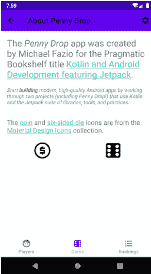

我并不太担心你的 `AboutFragment` 是否包含与我完全相同的信息，因为你之前几乎已经完成了所有这些工作。如果你想查看此文件的完整 XML，请前往代码部分，在 `chapter-7/app-code` 文件夹中查看 `fragment_about.xml`。这里的新内容是第一和第三部分中的（可点击）链接。

要添加这些链接，我们将同时使用 HTML 和 Android 的 `SpannableString` 类。但在实现此视图之前，让我们先构建一个空的 Fragment，然后实现导航到它。

你之前已经创建过 Fragment，所以现在就去创建一个吧；我们很快就会添加到 `onCreateView` 函数中。

## 处理到 AboutFragment 的导航

将此 Fragment 添加到导航图与其他所有 Fragment 相同——在 `nav_graph.xml` 中添加一个新条目：

```xml
<?xml version="1.0" encoding="utf-8"?>
<navigation xmlns:android="http://schemas.android.com/apk/res/android"
    xmlns:app="http://schemas.android.com/apk/res-auto"
    android:id="@+id/nav_graph"
    app:startDestination="@id/gameFragment">

    <!-- 其他 <fragments ... /> 仍然在这里。 -->

    <fragment
        android:id="@+id/aboutFragment"
        android:name="dev.mfazio.pennydrop.fragments.AboutFragment"
        android:label="About Penny Drop" />
</navigation>
```

> **开始处理 AboutFragment**
>
> 💡 本节我们将主要在 `AboutFragment` 中工作，因此暂时将 `app:startDestination` 的值切换为 `@id/aboutFragment` 会为你省去一些麻烦。只需确保完成后将其切换回来。

接下来，我们希望每当用户点击我们设置页面中的“关于 Penny Drop”偏好项时，就导航到这里。首先，我们在之前创建的“关于应用”类别中添加一个通用的 `<Preference>`（加上一些字符串资源值）：

```xml
<PreferenceCategory android:title="About the App">
    <Preference
        android:key="credits"
        android:summary="@string/about_app_summary"
        android:title="@string/about_penny_drop" />
</PreferenceCategory>
```

接下来，我们获取我们的 Preference 并设置 `onPreferenceClickListener`，类似于我们处理主题偏好项的方式：

```kotlin
val creditsPreference = findPreference<Preference?>("credits")

// 无关代码

creditsPreference?.onPreferenceClickListener =
    Preference.OnPreferenceClickListener { _ ->
        this.findNavController().navigate(R.id.aboutFragment)
        true
    }
```

由于我们将 `AboutFragment` 添加到了导航图中，这将为我们处理到“关于”视图的导航，同时保持其余导航设置正常工作。此设置的唯一问题是我们的顶栏缺少一个返回箭头来告诉用户他们可以返回到之前的视图。在我们的例子中，这意味着提供一种从“关于”视图返回到“设置”视图的好方法。它可以通过手机的返回按钮工作，但我们应该在应用内提供一种方式来实现这一点。

前往 `MainActivity`，在 `onCreate` 函数的末尾，我们希望配置应用栏以与我们的导航配合工作。特别是，我们希望它能识别我们所在的位置，并在我们不在主视图（玩家、游戏、排名）之一时显示一个返回箭头。

可以显式列出所有被视为顶级的 Fragment 类（意味着它们不会显示向上箭头），但我们可以用更高效的方式处理这个问题。我们将创建一个新的 `AppBarConfiguration` 并将分配给我们底部导航的菜单值发送给它。然后我们可以使用此配置配置应用栏，导航库将处理其余部分。

```kotlin
val appBarConfiguration = AppBarConfiguration(bottomNav.menu)
setupActionBarWithNavController(
    this.navController,
    appBarConfiguration
)
```

这种方法唯一的小问题是应用栏中的标签现在使用的是 `nav_graph.xml` 中的 `android:label` 值。因此，你需要去更改所有这些值为更易读的版本（当然是作为字符串资源），像这样：

```xml
<fragment
    android:id="@+id/pickPlayersFragment"
    android:name="dev.mfazio.pennydrop.fragments.PickPlayersFragment"
    android:label="@string/pick_players" />
```

这里，`@string/pick_players` 是字符串资源值“Pick Players”。最后一部分是确保返回按钮执行我们想要的操作。在 `MainActivity` 中，我们希望重写 `onSupportNavigateUp` 函数以使用 `navController`。我们需要确保 `navController` 已经初始化（因为它被标记为 `lateinit`），然后我们告诉它处理向上导航。

```kotlin
override fun onSupportNavigateUp(): Boolean =
    (this::navController.isInitialized &&
    this.navController.navigateUp()) || super.onSupportNavigateUp()
```

当我们进入“设置”和“关于”视图时，它们将有一个返回箭头来向用户显示他们可以返回到之前的位置。

---

现在，让我们回去完成颜色状态列表文件。`roll_button_color.xml` 文件应该看起来像这样：

```xml
<?xml version="1.0" encoding="utf-8"?>
<selector xmlns:android="http://schemas.android.com/apk/res/android">
    <item
        android:color="@android:color/darker_gray"
        android:state_enabled="false" />
    <item
        android:color="?attr/colorAccent"/>
</selector>
```

我添加了带有 `Roll` 按钮的 `android:state_pressed` `<item>`，以便在用户点击该按钮时提供一些额外的反馈。这是一个可选的部分，但它展示了我们如何在单个颜色状态列表中组合不同的状态属性。

然后我们可以回到 `fragment_game.xml` 来使用新的颜色状态列表文件。既然我们在那里，让我们也更新 `android:drawableTint` 和 `android:textColor` 属性。带有更新属性的完整 `Roll` `<Button>` 标签将如下所示：

```xml
<Button
    android:layout_width="0dp"
    android:layout_height="wrap_content"
    android:layout_weight="3"
    android:backgroundTint="@color/roll_button_color"
    android:drawableEnd="@drawable/mdi_dice_6_black_24dp"
    android:drawableTint="?android:attr/textColorPrimaryInverse"
    android:enabled="@{vm.canRoll}"
    android:onClick="@{() -> vm.roll()}"
    android:padding="10dp"
    android:text="@string/roll"
    android:textColor="?android:attr/textColorPrimaryInverse" />
```

在我们完成之前，我们需要对“选择玩家”视图上的 FAB 进行一些快速更改。图像色调现在应该使用主文本颜色的反色，就像我们对 `Roll` 和 `Pass` 按钮所做的那样。我们还希望手动设置背景色调颜色以使用我们主题中的强调色，而不是默认的 `colorAccent` 值。

完整的 FAB XML（带有 `app:tint` 属性更新）如下所示：

```xml
<com.google.android.material.floatingactionbutton.FloatingActionButton
    android:id="@+id/buttonPlayGame"
    android:layout_width="wrap_content"
    android:layout_height="wrap_content"
    android:layout_margin="16dp"
    android:contentDescription="@string/play_button"
    android:src="@drawable/ic_baseline_play_arrow_24"
    app:backgroundTint="?android:attr/colorAccent"
    app:layout_constraintBottom_toBottomOf="parent"
    app:layout_constraintEnd_toEndOf="parent"
    app:tint="?android:attr/textColorPrimaryInverse" />
```

随着主题和主题模式偏好项的就位，包括它们所有的逻辑和后续的布局更新，我们可以继续处理最后一个偏好项。这个偏好项将引导用户到一个新的视图，告诉用户一些关于构建此应用所投入的内容。

既然我们已经能够进入 `AboutFragment`，接下来就需要正确地显示内容。同样，大部分内容与我们之前所做的相同，但添加可点击链接需要一些额外的工作。

## 在 TextView 中添加可点击链接

正如我在本章开头提到的，我们有几种方法可以向 `<TextView>` 添加链接。最简单的方法是将字符串资源编写为 HTML 并在其中添加格式。使用这种方法，链接和文本装饰（粗体、斜体等）会变得快得多。如果我们创建一个这样的字符串资源（在你的代码中，这可以是一行很长的文本）：

```xml
<string name="penny_drop_created_by">The <i>Penny Drop</i> app was created by Michael Fazio for the Pragmatic Bookshelf title <a href="https://pragprog.com/titles/mfjetpack/">“Kotlin and Android Development featuring Jetpack”</a>.</string>
```

这将导致 HTML 按照预期渲染，如图所示。


唯一缺失的部分是链接不可点击。它渲染成一个看起来像普通网页链接的样子，但当你点击它时没有任何反应。要启用此功能，我们需要在 `TextView` 上设置 `movementMethod` 属性：

```kotlin
view.findViewById<TextView>(R.id.about_credits)?.apply {
    //使链接可点击。
    this.movementMethod = LinkMovementMethod.getInstance()
}
```

现在，当你点击我们添加的链接时，它会带你到网页。我们希望图标致谢部分也能有相同的操作，但这次我们将使用 `SpannableString` 来实现。

`SpannableString` 允许我们以多种方式更改文本片段，例如设置背景/前景颜色、样式，以及在我们的情况下，将这些文本片段转换为链接。我们通过从 `String`（在我们的例子中是字符串资源）创建一个 `SpannableString` 来实现这一点，然后我们为给定的子字符串（我们传入的数字代表起始/结束索引值）调用一次或多次 `setSpan`。

每次调用都将包含一个 `CharacterStyle` 类，该类对代码的该子字符串执行某些操作。在我们的例子中，我们使用带有正确网页地址的 `URLSpan` 对象来创建链接。添加这些后，我们将 `SpannableString` 实例分配给 `TextView` 的 `text` 属性。

另外，确保你设置了 `movementMethod` 属性，以便这里的链接也是可点击的。

```kotlin
view.findViewById<TextView>(R.id.about_icon_credits)?.apply {
    val spannableString =
        SpannableString(getString(R.string.penny_drop_icons))

    spannableString.setSpan(
        URLSpan(
            "https://materialdesignicons.com/icon/currency-usd-circle-outline"
        ), 4, 8, 0
    )

    spannableString.setSpan(
        URLSpan("https://materialdesignicons.com/icon/dice-6"), 13, 26, 0
    )

    spannableString.setSpan(
        URLSpan("https://materialdesignicons.com"), 46, 67, 0
    )

    this.text = spannableString

    //使链接可点击。
    this.movementMethod = LinkMovementMethod.getInstance();
}
```

在大多数情况下，使用 HTML 在 `<TextView>` 中创建链接和其他基本格式会更好，但如果你确实需要额外的控制，`SpannableString` 类可以提供帮助。

至此，About 页面已准备就绪，我们的 Settings 屏幕也完成了。我们还没有涉及其他 Preference 类型，所以请随时查看官方文档以获取更多信息。

## 总结与下一步

Penny Drop 应用现在功能完整了。七章，一大堆页面，我们现在有了一个运行良好、精美的应用，准备好让全世界的用户喜爱。嗯，虽然这可能有点*夸张*，但它仍然是一个很酷的应用，而且现在你知道如何利用 Kotlin 和 Jetpack 来构建 Android 应用了！


接下来将是 Android Baseball League 应用，但在我们结束 Penny Drop 之前，我会指出一些我们可以做的事情，让这个应用变得更好。

## 新游戏对话框

给用户提供一种快速开始新游戏的方式真的会很方便。在游戏结束或用户首次启动应用时添加一个快速开始新游戏的对话框，将大大提高应用的可用性。虽然我不想深入探讨如何做到这一点的每一个细节，但让我们看看快速版本。

在`GameFragment`中为`currentGame`添加一个监听器，然后当当前游戏结束时，向用户显示一个`AlertDialog`，如下所示：

```kotlin
val dialog = AlertDialog.Builder(activity)
    .setTitle("New Game?")
    .setIcon(R.drawable.mdi_dice_6_black_24dp)
    .setMessage("Same players or new players?")
    .setPositiveButton("Same Players") { _, _ ->
        gameViewModel.startWithSamePlayers()
    }

    .setNegativeButton("New Players") { _, _ ->
        goToPickPlayers()
    }
    .setNeutralButton("Cancel") { _, _ ->
        /* 这只会关闭对话框 */
    }.create()

dialog.show()
```

创建新游戏的对话框会类似，只是没有“Same Players”选项。另外，确保你在最后调用了`show`函数，否则什么都不会发生！

## 保存选择玩家的值

同样，我们可以通过保存游戏中上一个玩家的名字来节省用户的时间，即使在应用关闭后也是如此。至少，保存主要玩家的名字从游戏到游戏会很有帮助。

我们可以将其放入数据库中，甚至可以在我们的 Settings 屏幕上添加一个首选项来设置默认的第一个玩家名称。这个值也可以在他们第一次开始游戏时设置，使用他们输入的主要玩家名称。

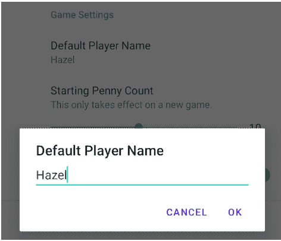

## 处理游戏中的重复 AI

我们游戏中的一个未解决的 bug 是，虽然我们不能将同一个 AI 玩家多次添加到单个游戏中，但我们没有限制用户这样做。事实上，如果他们尝试这样做，他们的游戏将会崩溃。

你可以在这里做几件事：更改 AI 玩家的保存方式以允许它们在单个游戏中多次包含，更新`GameStatus`以将`gamePlayerNumber`作为主键，或者添加过滤，以便只有未选择的 AI 在 AI 下拉菜单中可用。

所有这些解决方案都需要一些额外的工作，但我们可以使用比现在更好的东西。我决定不直接在书中涵盖这一点，因为这会比我希望的更偏离主题。

## 将设置重置为默认值

另一个有用的 UX 功能是允许用户快速将设置恢复为其默认值。如果他们想回到应用启动时的起始便士数和主题，我们可以替换 Settings 屏幕 App 栏中的 Settings 链接，或者添加另一个 Preference 来重置所有内容。

你已经看到了如何添加新的菜单链接和新的 Preference，以及处理点击事件，所以唯一新的部分就是设置值。你可以通过为每个 Preference 调用`findPreference`然后为`value`分配一个新值，或者使用`SharedPreferences`类上的`Editor`对象来实现：

```kotlin
// 你可以直接在 Preference 本身上设置值。
themeModePreference?.value = "System"

// 或者你可以使用 SharedPreferences 对象来编辑值。
val prefs =
    PreferenceManager.getDefaultSharedPreferences(this.context)

prefs.edit()?.also {
    it.putInt("pennyCount", Player.defaultPennyCount)
    it.apply()
}
```

## 启用“Hazel”模式

我必须包含这个，因为每当我们玩现实版的 Penny Drop 时，我的女儿 Hazel 似乎总是掷出很多六点。我不知道为什么会这样，但到目前为止这是一个相当一致的模式。对于这个应用，它可以检查玩家的名字是否是 Hazel，如果是，则向`rollDie`发送一个新的`isHazel`参数。如果是这种情况，我们掷一个 D8（八面骰），如果值大于或等于 6，则称之为六点：

```kotlin
private fun rollDie(sides: Int = 6, isHazel: Boolean = false) =
    Random.nextInt(1, sides + 1 + if (isHazel) 2 else 0).let { roll ->
        if (roll > 6) 6 else roll
    }
```

是的，这很傻，但代码很有趣，而且她确实掷出了*很多*六点。

## 添加应用图标

做了这么多工作，我们从未为应用设置一个合适的图标！这是故意的，因为它与你在每章中学到的内容无关。如果你想看看如何做到这一点，我们会在 ABL 应用中立即添加一个。请查看[添加应用图标](Add an App Icon)。

## 添加单元测试和/或 UI 测试

这将是一个*极好*的想法！非常棒，以至于这正是我们在第 14 章[使用 JUnit 对应用进行单元测试](Unit Test Your App with JUnit)和第 15 章[使用 Espresso 测试应用的 UI](Test Your App’s UI with Espresso)中所做的。

但在添加一些测试之前（如果你愿意，现在就可以去那里），我们已经完成了 Penny Drop。现在进入“官方”Android Baseball League 应用，我们将在这里学到的东西提升一个层次。

**脚注**

[6] https://link.mfazio.dev/use-saved-values

[7] https://developer.android.com/guide/topics/ui/settings/components-and-attributes

# 第二部分

## Android 棒球联盟

现在，让我们进入 Android 棒球联盟的世界，这是一个专为本书创建的联盟。说真的，所有的球员、球队、比赛数据以及联盟的其他一切都是为此而创建的。现在轮到你来构建官方的 Android 棒球联盟应用了（当然，对于一个虚构的联盟来说，"官方"程度也就那样了）。

接下来的挑战会更大，但你能应付。你将运用在 Penny Drop 中学到的知识，并在此基础上应用，同时还会使用更多的 Jetpack 库和 Kotlin 协程（这次会更深入一些）。

# 第 8 章

## 初始化 Android 棒球联盟应用

欢迎来到 Android 棒球联盟！Android 棒球联盟（简称 **ABL**）成立于 2018 年，是我们接下来六章的焦点。我们的任务是为联盟构建官方应用，让每个人都能了解他们最喜欢的球队和球员的所有信息。

你可能猜到了，ABL 并不是一个真实的联盟，但它*是*本书第二部分的重点。现在，是时候构建一个具有更复杂功能的高级应用了。

我们将从你在 Penny Drop 中学到的内容开始，然后在此基础上扩展。因此，节奏会加快，我不会（重新）解释我们在上一个应用中涵盖的所有内容。当我们再次遇到某些概念时，我*会*引用第一部分的章节，此外，如果你遇到困难，始终可以参考 PragProg.com 上的源代码。

### 欢迎使用官方 ABL 应用

ABL 应用是联盟球队和球员的展示平台。用户可以查找当前的比赛（以及全年的任何比赛），了解谁在联盟的击球和投球类别中领先，以及 ABL 十四支球队中任何一支的阵容。用户甚至可以设置一些内容，比如收藏的球队，以及是否希望根据该球队来设置应用的样式。

正如我提到的，这里的大多数章节将从与 Penny Drop 类似的内容开始，然后在此基础上扩展。我们将通过菜单（这里是导航抽屉，而不是底部导航栏）进行导航，但也会了解如何在目的地之间传递数据以及如何创建深层链接。我们将数据保存到本地数据库以便在屏幕中访问，但也会从网络服务获取数据以获取最新的记分牌数据。我们将显示球员列表，但随后会了解分页如何帮助处理*很长*的球员列表。

我们将在本章中完成大部分熟悉的设置，并且快速完成；我希望在不添加太多新内容的情况下，尽快让你拥有一个可运行的应用。我们将创建应用，添加依赖项，设置一些图像（球队标志、联盟标志）包括应用的标志，添加一些支持类型，并构建一个屏幕。

然后，接下来的每一章都将添加一个额外的屏幕（至少到第 13 章，[向 Android 棒球联盟应用发送和接收信息](Send Info to and from the Android Baseball League App)）。

首先，我们需要创建我们的应用。启动 Android Studio，我们开始吧。

### 创建应用

打开 Android Studio 后，创建一个带有空活动的新项目（我们将再次手动添加内容），并将其命名为 Android Baseball League。你可以使用自己的包名（我喜欢用`dev.mfazio.abl`），并且 SDK 至少为 API 级别 26。这将确保我们可以使用一些较新的 Android 功能。

新项目索引完成且 Gradle 同步完成后，我们有一个漂亮的空`MainActivity`可以使用。在进入任何特定视图之前，我们有一些额外的依赖项需要使用。

### 添加依赖项

在本章中，我们将通过 RecyclerView 库添加一个新的网格，并在每个网格项中使用`<ConstraintLayout>`。这些依赖项是一个很好的起点，但随着我们构建 ABL 应用，我们将添加更多依赖项。`dependencies`块应如下所示：

```
dependencies {
    implementation "org.jetbrains.kotlin:kotlin-stdlib-jdk8:$kotlin_version"
    implementation "androidx.appcompat:appcompat:$app_compat_version"
    implementation "androidx.constraintlayout:constraintlayout:$constraint_layout_version"
    implementation "androidx.core:core-ktx:$core_version"
    implementation "androidx.navigation:navigation-fragment-ktx:$nav_version"
    implementation "androidx.navigation:navigation-ui-ktx:$nav_version"
    implementation "androidx.recyclerview:recyclerview:$recycler_view_version"
    implementation "com.google.android.material:material:$material_version"

    // 测试依赖项在这里
}
```

这里有三点需要注意：首先，我们需要添加`kotlin-kapt`插件以支持数据绑定。将其添加到应用`build.gradle`文件顶部的`plugins`块中。该块现在如下所示：

```
plugins {
    id 'com.android.application'
    id 'kotlin-android'
    id 'kotlin-kapt'
}
```

其次，如果默认情况下不是这样设置的，我们希望使用`kotlin-stdlib-jdk8`版本的 Kotlin 标准库。确保你的应用也使用这个版本。

第三点是这里添加的所有依赖项都有版本变量（位于项目的`build.gradle`文件中）。我们遵循与 Penny Drop 相同的模式，同样，所有依赖项及其版本都可以在附录 3，Gradle 依赖项中找到。

最后，在离开应用的`build.gradle`文件之前，将`buildFeatures`块添加到`android`块的顶部：

```
android {
    buildFeatures {
        dataBinding = true
    }
    // android 块的其余部分在这里。
}
```

同步你的项目以确保所有依赖项都已添加，然后我们可以准备一些资源。

### 添加图像资源

ABL 应用中的图像比 Penny Drop 多得多，因此为了让你的生活更轻松，我在 PragProg.com 的代码中包含了一些图像。这包括球队标志、辅助图像和 ABL 标志本身。你需要的所有图像都在`images/abl`目录下。

说真的，只需将`images/abl/team-logos`文件夹中的所有 Drawable XML 文件复制/粘贴到`drawables`目录中。

此外，获取同一文件夹中所有尺寸的`mke_flag.png`。我取了一个现有的 PNG 并将其分成六种不同的分辨率（ldpi 到 xxxhdpi），应用将根据给定设备使用其中一种。我们稍后还有其他图像需要复制，但现在只获取标志就足够了。

请注意，`drawable-[dpi]`文件夹应放入`src/main/res`目录中，与`drawables`目录*并列*，而不是放入`drawables`目录中（像其他球队标志那样）。

最后，在我们获取其他图像的同一目录中，你需要`abl-logo-shifted.svg`，因为我们将把它转换为我们的应用图标。

### 添加应用图标

`abl-logo-shifted.svg`是我们将用来创建新图像资源的文件，在这种情况下，它是我们应用的启动器图标。

我还在那里包含了普通的`abl-logo.svg`，但我推荐使用“shifted”版本，因为它转换为应用图标时看起来更好。你总是可以尝试两个版本，看看你更喜欢哪一个。

一旦你将图标放在本地机器上（尚未添加到项目），右键单击`res`文件夹并选择 New > Image Asset。这将显示 Asset Studio，如第一张[图片](#)所示。

在这里，确保 Source Asset 下的 Asset Type 设置为 Image，并选择`abl-logo.shifted.svg`文件。如果你愿意，可以重命名标志，或者直接覆盖现有的`ic_launcher`。*不要*裁剪标志（因为这会移除我提到的偏移），但将图像大小调整到大约 65%，如第二张[图片](#)所示。

在 Background Layer 部分，你可能希望将 Asset Type 更改为 Color 而不是 Image，以避免默认的蓝图风格背景：

背景准备好后，点击 Next 按钮，然后点击 Finish。如果你更改了启动器图标的名称，请进入`AndroidManifest.xml`并将`android:icon`和`android:roundIcon`的值替换为新名称。如果你没有更改名称并且图像名为“ic_launcher”，那么你就完成了（因为`@mipmap/ic_launcher`是默认值）。

此外，如果你希望应用名称显示为不同于你开始时输入的项目名称，你可以将`AndroidManifest.xml`中的`android:label`更改为其他内容。我将其更改为 ABL，因为 Android Baseball League 对于应用抽屉来说太长了。

仅为确认，你的`<application>`标签应类似于这样：

```xml
<application
    android:allowBackup="true"
    android:icon="@mipmap/ic_abl_launcher"
    android:label="@string/app_short_name"
    android:roundIcon="@mipmap/ic_abl_launcher_round"
    android:supportsRtl="true"
    android:theme="@style/Theme.AndroidBaseballLeague">
    <activity android:name=".MainActivity">
        <intent-filter>
            <action android:name="android.intent.action.MAIN" />
            <category android:name="android.intent.category.LAUNCHER" />
        </intent-filter>
    </activity>
</application>
```

图标更新后，你可以运行应用来查看变化。请注意，图标*可能*需要卸载并重新安装才能生效。其外观应类似于所示图片。

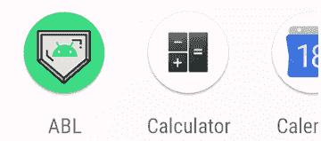

添加图标后，我们就可以开始构建应用了。首先是进行一些初始的[MainActivity](MainActivity)设置。

## 配置 Activity

与 Penny Drop 项目一样，`MainActivity`是处理 Fragment 类的主要枢纽，但除此之外没有太多其他功能。尤其是在我们刚开始的时候，因为我们只关注一些基本的导航。

对于导航，我们需要一个`<FragmentContainerView>`和一个导航图。鉴于本章我们只关注单个 Fragment，我们甚至不需要更新`MainActivity`中的代码。相反，我们将把它留到下一章，第 9 章，通过导航抽屉进行导航。

### 添加 FragmentContainerView


`<FragmentContainerView>`与Penny Drop项目中的基本相同。目前，我们将让`<FragmentContainerView>`占据整个屏幕，这意味着我们的`activity_main.xml`布局文件如下所示：

```xml
<?xml version="1.0" encoding="utf-8"?>
<androidx.constraintlayout.widget.ConstraintLayout
    xmlns:android="http://schemas.android.com/apk/res/android"
    xmlns:app="http://schemas.android.com/apk/res-auto"
    xmlns:tools="http://schemas.android.com/tools"
    android:layout_width="match_parent"
    android:layout_height="match_parent"
    tools:context=".MainActivity">

    <androidx.fragment.app.FragmentContainerView
        android:id="@+id/containerFragment"
        android:name="androidx.navigation.fragment.NavHostFragment"
        android:layout_width="0dp"
        android:layout_height="0dp"
        app:defaultNavHost="true"
        app:layout_constraintBottom_toBottomOf="parent"
        app:layout_constraintEnd_toEndOf="parent"
        app:layout_constraintStart_toStartOf="parent"
        app:layout_constraintTop_toTopOf="parent"
        app:navGraph="@navigation/nav_graph" />
</androidx.constraintlayout.widget.ConstraintLayout>
```

现在唯一缺少的是`navigation/nav_graph.xml`文件，目前它非常简单。简单到在本书中甚至没有单独的章节，只有以下代码块：

```xml
<?xml version="1.0" encoding="utf-8"?>
<navigation xmlns:android="http://schemas.android.com/apk/res/android"
    xmlns:app="http://schemas.android.com/apk/res-auto"
    xmlns:tools="http://schemas.android.com/tools"
    android:id="@+id/nav_graph"
    app:startDestination="@id/teamsFragment">
    <fragment
        android:id="@+id/teamsFragment"
        android:name="dev.mfazio.abl.teams.TeamsFragment"
        android:label="@string/teams">
    </fragment>
</navigation>
```

一旦你添加了`teams`字符串资源，这就完成了。嗯，除了`TeamsFragment`还不存在。让我们来创建它。

## 添加第一个Fragment

`TeamsFragment`将包含一个漂亮的2x7网格，展示Android棒球联盟中的所有球队。它看起来会像这样：

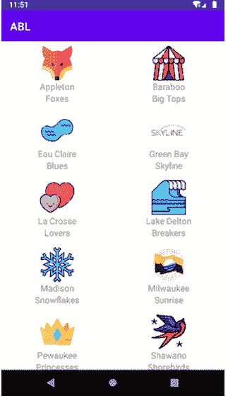

请注意，我在这个应用的代码组织方式上有所不同。我们不会按文件类型（例如，`activities`、`viewmodels`等）来划分文件，而是按主题（例如，`teams`、`leaders`等）来划分。

在创建`TeamsFragment`之前，我们将创建一些辅助类，这些类将在这个屏幕上以不同方式使用。

## 添加与球队相关的类

我们的球队网格需要三个额外的类：

- `Team`——包含ABL中每支球队的各种信息。
- `UITeam`——包含ABL中每支球队的UI特定值。
- `Division`——一个枚举类，包含ABL的两个分区：东部和西部。

我们应用的一个核心部分是`Team`类。这个类保存每支球队的ID、城市、昵称和分区。此外，我们还有空间来保存胜场和负场，以及球队在分区和整个ABL中的排名。

由于`Division`是`Team`的一部分，让我们快速添加它。创建`teams`包，并添加一个名为`Division`的新枚举类，如下所示：

```kotlin
enum class Division { East, West, Unknown }
```

然后我们可以添加`Team`类：

```kotlin
data class Team(
    val id: String,
    val city: String,
    val nickname: String,
    val division: Division,
    val wins: Int = 0,
    val losses: Int = 0,
    val leagueRank: Int = -1,
    val divisionRank: Int = -1
)
```

`Team`类本身完成了，但我想在这里用一个伴生对象添加所有球队。由于球队不太可能发生变化，我不打算把它们放进数据库或从API动态加载。虽然球队信息可能会有变化，但可以肯定不会频繁发生，而且当变化发生时，我们总可以更新应用。

我们在伴生对象中硬编码每支球队，填入它们的球队ID、城市、昵称和分区值：

```kotlin
companion object {
    val Appleton = Team("APL", "Appleton", "Foxes", Division.East)
    val Baraboo = Team("BOO", "Baraboo", "Big Tops", Division.West)
    val EauClaire = Team("EC", "Eau Claire", "Blues", Division.West)
    val GreenBay = Team("GB", "Green Bay", "Skyline", Division.East)
    val LaCrosse = Team("LAX", "La Crosse", "Lovers", Division.West)
    val LakeDelton = Team("LD", "Lake Delton", "Breakers", Division.West)
    val Madison = Team("MSN", "Madison", "Snowflakes", Division.West)
    val Milwaukee = Team("MKE", "Milwaukee", "Sunrise", Division.East)
    val Pewaukee = Team("PKE", "Pewaukee", "Princesses", Division.East)
    val Shawano = Team("SHW", "Shawano", "Shorebirds", Division.East)
    val SpringGreen = Team("SG", "Spring Green", "Thespians", Division.West)
    val SturgeonBay = Team("SB", "Sturgeon Bay", "Elders", Division.East)
    val Waukesha = Team("WAU", "Waukesha", "Riffs", Division.East)
    val WisconsinRapids = Team("WR", "Wisconsin Rapids", "Cranberries", Division.West)
}
```

接下来，我们可以创建`UITeam`类。我决定添加这个类来保存每支球队的Logo和球队颜色，而不是把这些值放在`Team`类中。这样，当不需要时，UI特定的属性就不会使`Team`类变得杂乱。

每个`UITeam`实例将持有一个原始的`Team`对象，以及一个球队Logo和颜色。我们还将包含一些辅助值，以便无需通过team属性就能获取位置和名称等信息。该类如下所示：

```kotlin
data class UITeam(
    val team: Team,
    val logoId: Int,
    val primaryColorId: Int,
    val secondaryColorId: Int,
    val tertiaryColorId: Int
) {
    val teamId = team.id
    val location = team.city
    val nickname = team.nickname
    val teamName = "$location $nickname"
    val division = team.division
}
```

我对`UITeam`采用的方法与`Team`几乎相同，即在类的伴生对象中硬编码所有球队。但这次我把它们都放在一个`List<UITeam>`中，而不是为每个球队创建单独的值，因为这正是球队网格所需要的。

`companion object`中的每个`UITeam`将类似于这样：

```kotlin
companion object {
    val allTeams = listOf(
        UITeam(
            Team.Appleton,
            R.drawable.fi_ic_fox,
            R.color.appletonPrimary,
            R.color.appletonSecondary,
            R.color.appletonTertiary
        ),
        //其他球队继续在这里添加
    )
}
```

完整的`UITeam`实例列表，请查看代码。至于我们在前面代码中看到的Appleton Foxes，我们之前已经复制了Logo，但我们需要把那三种颜色也设置好。同样，你可以直接从提供的代码中复制所有`UITeam`的颜色。无论如何，所有球队颜色都位于`colors.xml`中，类似于这样：

```xml
<color name="appletonPrimary">#FF4F19</color>
<color name="appletonSecondary">#3A3A41</color>
<color name="appletonTertiary">#FFC173</color>
```

现在三个辅助类型都准备好了，我们可以继续创建`TeamsFragment`及其相关部分。

## 添加TeamsFragment

在`teams`包中，以你喜欢的方式创建`TeamsFragment`及其关联的布局文件。我将我的布局文件命名为`fragment_teams_grid.xml`，因为它能更好地描述该视图，但这完全是可选的。

我们将最后处理`TeamsFragment`本身的代码，因为我们需要先设置其他部分。所以首先是Fragment的布局文件。

关联的布局文件（无论你如何命名）将只包含一个`<RecyclerView>`标签，仅此而已。我们采用与Penny Drop项目相同的大致方法，特别是在[添加RecyclerView](Add the RecyclerView)部分。

```xml
<?xml version="1.0" encoding="utf-8"?>
<androidx.recyclerview.widget.RecyclerView
    xmlns:android="http://schemas.android.com/apk/res/android"
    xmlns:tools="http://schemas.android.com/tools"
    android:id="@+id/teamsGrid"
    android:name="dev.mfazio.abl.TeamsFragment"
    android:layout_width="match_parent"
    android:layout_height="match_parent"
    android:layout_gravity="center"
    tools:context=".teams.TeamsFragment"
    tools:listitem="@layout/teams_grid_item" />
```

同样，我们稍后会回到`TeamsFragment`的实际代码，因为我们需要先完成所有准备工作。接下来是网格中每个项目的布局。

## 添加网格项布局 XML

`teams_grid_item.xml`布局文件将包含三个部分——球队的标志、地点和昵称，全部垂直排列。我们很快还会将一个`UITeam`对象绑定到每个项目，因此它将作为`<variable>`包含在布局中。

你之前几乎已经完成过所有这些操作，所以我们可以直接看代码。我只想提一下，我在这里使用Waukesha Riffs作为“工具”团队，这样布局编辑器就有内容可以显示了。以下是`teams_grid_item.xml`：


```xml
<?xml version="1.0" encoding="utf-8"?>
<layout xmlns:android="http://schemas.android.com/apk/res/android"
    xmlns:app="http://schemas.android.com/apk/res-auto"
    xmlns:tools="http://schemas.android.com/tools">

    <data>
        <variable
            name="team"
            type="dev.mfazio.abl.teams.UITeam" />
    </data>

    <androidx.constraintlayout.widget.ConstraintLayout
        android:layout_width="match_parent"
        android:layout_height="wrap_content"
        android:layout_margin="8dp">

        <ImageView
            android:id="@+id/teamLogo"
            android:layout_width="64dp"
            android:layout_height="64dp"
            android:contentDescription="@string/team_logo"
            android:src="@{team.logoId}"
            app:layout_constraintEnd_toEndOf="parent"
            app:layout_constraintStart_toStartOf="parent"
            app:layout_constraintTop_toTopOf="parent"
            tools:src="@drawable/fi_ic_electric_guitar" />

        <TextView
            android:id="@+id/teamLocation"
            android:layout_width="wrap_content"
            android:layout_height="wrap_content"
            android:text="@{team.location}"
            android:textSize="16sp"
            app:layout_constraintEnd_toEndOf="parent"
            app:layout_constraintStart_toStartOf="parent"
            app:layout_constraintTop_toBottomOf="@id/teamLogo"
            tools:text="Waukesha" />

        <TextView
            android:id="@+id/teamNickname"
            android:layout_width="wrap_content"
            android:layout_height="wrap_content"
            android:text="@{team.nickname}"
            android:textSize="16sp"
            app:layout_constraintEnd_toEndOf="parent"
            app:layout_constraintStart_toStartOf="parent"
            app:layout_constraintTop_toBottomOf="@id/teamLocation"
            tools:text="Riffs" />

    </androidx.constraintlayout.widget.ConstraintLayout>
</layout>
```

需要额外处理的部分是`android:src="@{team.logoId}"`属性。是的，我知道我们之前在`<ImageView>`上设置过图像源，但我们现在这样做是行不通的。

我应该说，没有绑定适配器的话，它是行不通的。`android:src`属性期望的是一个`@drawable`引用，而不是像我们这里使用的绑定 ID。幸运的是，我们可以保持代码不变，通过一个新的`@BindingAdapter`函数让`ImageView`正确显示。

在`util`包（或类似包）中创建一个名为`BindingAdapters`的类。在这里，我们需要添加一个名为`setImageViewResource`的`@BindingAdapter`函数。

这个函数接收`ImageView`和一个资源 ID 作为参数，在我们的例子中是球队标志的 ID。然后我们将使用该标志的 ID 在`ImageView`上设置图像资源：

```kotlin
@BindingAdapter("android:src")
fun setImageViewResource(imageView: ImageView, resourceId: Int) {
    imageView.setImageResource(resourceId)
}
```

通过将值参数设置为`@BindingAdapter`注解的`"android:src"`，我们实际上重载了该属性以处理额外的值。这意味着`@drawable`引用仍然按预期工作，但现在数据绑定值也可以工作了。我们保持了布局文件的整洁和可读性，同时不受操作系统限制。

添加了这个之后，我们可以继续处理`Adapter`类。

### 添加 RecyclerView Adapter

创建了`<RecyclerView>`和项目布局文件后，我们可以创建`Adapter`类了。这与你之前在*创建自定义ListAdapter*中所做的非常相似。

在`teams`包中创建一个名为`TeamsGridAdapter`的类。这个类继承自`RecyclerView.Adapter`，并有一个内部类作为`RecyclerView.ViewHolder`的子类。

这是一个比 Penny Drop 中更简单的适配器，所以我不会在这里解释任何内容。整个`TeamsGridAdapter`如下所示：

```kotlin
class TeamsGridAdapter(
    private val teams: List<UITeam>
) : RecyclerView.Adapter<TeamsGridAdapter.TeamViewHolder>() {

    override fun onCreateViewHolder(
        parent: ViewGroup,
        viewType: Int
    ): TeamViewHolder =
        TeamViewHolder(
            DataBindingUtil.inflate(
                LayoutInflater.from(parent.context),
                R.layout.teams_grid_item,
                parent,
                false
            )
        )

    override fun onBindViewHolder(
        holder: TeamViewHolder,
        position: Int
    ) {
        holder.bind(teams[position])
    }

    override fun getItemCount(): Int = teams.size

    inner class TeamViewHolder(
        private val binding: TeamGridItemBinding
    ) : RecyclerView.ViewHolder(binding.root) {

        fun bind(item: UITeam) {
            binding.apply {
                team = item
                executePendingBindings()
            }
        }
    }
}
```

现在`TeamsGridAdapter`类已经完成，我们可以回到`TeamsFragment`将其连接到网格。

### 配置球队网格

在`TeamsFragment`中，我们需要做三件事：加载视图、设置`layoutManager`属性，然后连接`adapter`。这与我们在 Penny Drop 的排名屏幕上所做的基本相同，但由于这个屏幕是网格而不是列表，我们需要一个不同的`layoutManager`。

我们需要创建一个设置为两个“跨度”（在我们的例子中是列）并垂直对齐的`GridLayoutManager`。然后我们使用传入`UITeam.allTeams`的`TeamsGridAdapter`实例。这样，整个`TeamsFragment`如下所示：

```kotlin
class TeamsFragment : Fragment() {
    override fun onCreateView(
        inflater: LayoutInflater,
        container: ViewGroup?,
        savedInstanceState: Bundle?
    ): View? {
        val view =
            inflater.inflate(R.layout.fragment_teams_grid, container, false)

        // 设置适配器
        if (view is RecyclerView) {
            with(view) {
                layoutManager = GridLayoutManager(
                    context,
                    2, //跨度计数（列数）
                    GridLayoutManager.VERTICAL,
                    false) //反转布局

                adapter = TeamsGridAdapter(UITeam.allTeams)
            }
        }
        return view
    }
}
```

就是这样！运行应用程序；它应该看起来像[所示](https://example.com/shown)的图片。

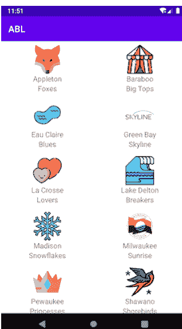

假设一切看起来正确，你就可以继续了。如果没有，请查看相关代码。在本书的这一部分，我们的进度快了很多，所以更容易遗漏一些东西。

## 总结与下一步

我们正在开发第二个应用程序，官方的 Android 棒球联盟应用！虽然很多内容是对 Penny Drop 的回顾，但我们包含了一些新内容，更重要的是，为本书的这一部分的其余内容做好了准备。我们有了一个应用程序，它包含了许多我们需要的图像（包括一个应用图标），并且我们可以看到 ABL 的全部十四支球队。

接下来的四章都将遵循一个一致的模型：我们构建之前做过的东西，然后添加一些新的东西。

首先是导航和添加导航抽屉。初始设置将与我们在上一个应用程序中使用的底部导航非常相似，但我们将更进一步，使用操作、用于类型安全导航的 Safe Args，甚至深度链接。我们将在向应用程序添加新的排名屏幕以及每个单独球队的视图的同时完成所有这些操作。

# 第9章

## 通过导航抽屉进行导航

我们的 ABL 应用已经启动并运行；现在我们需要为用户提供一种导航方式。毕竟，他们需要一种方式来查看他们心爱的 Spring Green Thespians 在积分榜上的位置，或者 Justin Witz 是否仍然在联盟抢断榜上领先。

在 Penny Drop 中，我们只有几个屏幕，而在 ABL 应用中，我们有五个不同的区域，外加设置和关于应用两个屏幕。由于目的地数量的增加，底部导航结构对我们来说不再适用。我们将为应用添加一个*导航抽屉*，这是一个从屏幕侧面滑出的面板，为用户提供多个去处，如图所示。

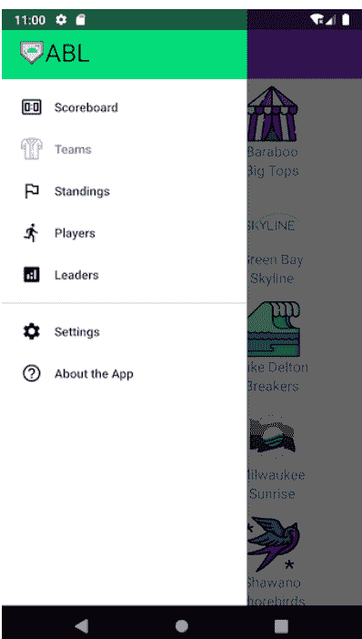

你应该看到导航抽屉在很多方面与底部导航相似，但我们将在此用户体验基础上增加更多功能。除了抽屉中的标准导航外，我们还将提供一种直接从一个页面跳转到抽屉中未包含的独立页面的方式。我们还可以向该独立页面传递类型安全的参数。我们甚至可以从应用外部直接跳转到该页面（或任何其他页面）。

我们将重点关注各个 ABL 球队、它们在联盟积分榜中的位置，以及所有能让我们到达这些位置的高级导航功能。让我们从向应用添加导航抽屉开始。

### 添加导航抽屉

我们可能不需要为导航抽屉添加任何额外的依赖项，因为我们在上一章已经添加了 [androidx.navigation](https://developer.android.com/jetpack/androidx/releases/navigation) 库，并且应用现在默认包含 Material Design Components 库。不过，如果缺少任何一个，请现在添加。然后我们可以跳转到 `activity_main.xml` 来添加导航抽屉。

### 更新 activity_main.xml

从 UI 的角度来看，我们正在将导航抽屉添加到现有的 `MainActivity` 布局中，并且我们还将对布局进行相当大的更改。屏幕的父视图现在将是一个`<DrawerLayout>`，其中包含一个`<Toolbar>`和一个`<FragmentContainerView>`：

```xml
<androidx.drawerlayout.widget.DrawerLayout
    xmlns:android="http://schemas.android.com/apk/res/android"
    xmlns:app="http://schemas.android.com/apk/res-auto"
    xmlns:tools="http://schemas.android.com/tools"
    android:id="@+id/drawer_layout"
    android:layout_width="match_parent"
    android:layout_height="match_parent"
    tools:context=".MainActivity">

    <!-- 内容在这里。 -->

</androidx.drawerlayout.widget.DrawerLayout>
```

`<Toolbar>`和`<FragmentContainerView>`都被包裹在一个`<LinearLayout>`中，它们一起占据了整个窗口：

```xml
<LinearLayout
    android:layout_width="match_parent"
    android:layout_height="match_parent"
    android:orientation="vertical">

    <androidx.appcompat.widget.Toolbar
        android:id="@+id/toolbar"
        android:layout_width="match_parent"
        android:layout_height="wrap_content"
        android:paddingTop="24dp"
        android:background="?attr/colorPrimary"
        android:theme="@style/ThemeOverlay.MaterialComponents.Dark.ActionBar" />

    <androidx.fragment.app.FragmentContainerView
        android:id="@+id/containerFragment"
        android:name="androidx.navigation.fragment.NavHostFragment"
        android:layout_width="match_parent"
        android:layout_height="match_parent"
        app:defaultNavHost="true"
        app:navGraph="@navigation/nav_graph" />
</LinearLayout>
```

最后，`<NavigationView>`位于`<DrawerLayout>`内部，但*不*在`<LinearLayout>`内部，它会滑出覆盖在屏幕上：


```xml
<com.google.android.material.navigation.NavigationView
    android:id="@+id/nav_view"
    android:layout_width="wrap_content"
    android:layout_height="match_parent"
    android:layout_gravity="start"
    android:fitsSystemWindows="true"
    app:headerLayout="@layout/nav_header"
    app:menu="@menu/navigation" />
```

你之前已经见过其中大部分内容，特别是`<FragmentContainerView>`，但我确实想强调几个新项目。

导航抽屉上的`android:fitsSystemWindows="true"`属性告诉设备根据系统组件（在这种情况下是屏幕顶部的状态栏）调整该视图。添加此属性后，导航抽屉将向下移动以正确显示。

`<Toolbar>`上的`android:theme`属性可能也是新的。你可能注意到列出的`themes.xml`文件中我们之前见过的类似主题，这正是我们接下来要去的地方。

由于我们是手动添加`<Toolbar>`，我们需要确保应用的主题不会尝试为我们添加一个，方法是将应用主题的父级更改为`NoActionBar`变体：

```xml
<style name="Theme.AndroidBaseballLeague"
    parent="Theme.MaterialComponents.DayNight.NoActionBar">
    <!-- 样式属性在这里 -->
</style>
```

另外，当我们在`themes.xml`中时，我们想添加两个新的`<item>`标签。这些标签协同工作，使状态栏显示在导航抽屉顶部，但使用导航抽屉的颜色：

```xml
<item name="android:windowDrawsSystemBarBackgrounds">true</item>
<item name="android:windowTranslucentStatus">true</item>
```

`activity_main.xml`中最后一个新内容是`app:headerLayout="@layout/nav_header"`。此属性为导航抽屉提供了一个漂亮的头部项目，位于抽屉顶部，并有自己的布局文件。

### 添加 nav_header.xml

在我们的例子中，这个头部将是ABL标志（带有字母ABL）和Android绿色背景。如果你需要标志，它在代码中的`chapter-9/images`下。一旦标志准备好，头部布局文件如下所示：

```xml
<androidx.constraintlayout.widget.ConstraintLayout
    xmlns:android="http://schemas.android.com/apk/res/android"
    xmlns:app="http://schemas.android.com/apk/res-auto"
    android:layout_width="match_parent"
    android:layout_height="wrap_content"
    android:padding="16dp"
    android:background="@color/androidGreen">

    <ImageView
        android:layout_width="wrap_content"
        android:layout_height="28dp"
        android:layout_marginTop="20dp"
        android:layout_marginStart="4dp"
        android:contentDescription="@string/abl_logo"
        android:scaleType="fitStart"
        android:src="@drawable/ic_abl_logo_with_text"
        app:layout_constraintBottom_toBottomOf="parent"
        app:layout_constraintStart_toStartOf="parent"
        app:layout_constraintTop_toTopOf="parent" />
</androidx.constraintlayout.widget.ConstraintLayout>
```

填充和一些边距用于将图像向下移动一点，以便在状态栏下方正确显示，但除了`android:scaleType="fitStart"`之外没有新内容。此缩放确保图像正确适合其容器，并与左上角对齐。

有了这两个布局文件，我们可以添加缺失的文件`menu/navigation.xml`。

### 创建导航菜单

这类似于我们在[构建应用导航](构建应用导航)中创建的菜单。这次最大的区别是我们将有两个`<group>`标签将导航抽屉分成几个部分。我们实际上可以一次性为应用添加所有菜单项，即使它们还没有关联的片段。这样导航抽屉看起来就正确了，而无需担心创建一堆`Fragment`类。整个`navigation.xml`如下所示：

```xml
<?xml version="1.0" encoding="utf-8"?>
<menu xmlns:android="http://schemas.android.com/apk/res/android">
  <group android:id="@+id/mainMenuGroup">
    <item
      android:id="@+id/scoreboardFragment"
      android:icon="@drawable/mdi_scoreboard_outline"
      android:title="@string/scoreboard" />
    <item
      android:id="@+id/teamsFragment"
      android:icon="@drawable/ic_jersey"
      android:title="@string/teams" />
    <item
      android:id="@+id/standingsFragment"
      android:icon="@drawable/ic_baseline_outlined_flag_24"
      android:title="@string/standings" />
```

### 添加视图绑定

现在，虽然这与导航没有直接关系，但我想在这里引入视图绑定功能。由于我们正从`activity_main.xml`中获取每个组件，视图绑定将使我们的工作更加轻松。

在很多方面，视图绑定看起来与我们使用数据绑定时所做的类似，例如，当我们将一个`ViewModel`类与布局关联时。我们不再需要调用`findViewById`来获取布局元素，而是可以直接将该元素作为生成的绑定类上的属性来引用。

如果你不清楚我这里的意思，别担心。一旦我们开始在`MainActivity`中配置一切，它应该会变得更清楚。但在我们做任何事情之前，我们需要在应用的`build.gradle`文件中开启视图绑定。我们已经在`buildFeatures`块中有了`dataBinding`标志，但现在我们需要添加`viewBinding`：

```
buildFeatures {
    dataBinding = true
    viewBinding = true
}
```

这实际上就是我们启用应用中视图绑定所需做的全部工作（当然，在Gradle同步之后）——无需包含通用的`<layout>`标签或任何额外的依赖项。我建议在任何你只想跳过`Activity`或`Fragment`类中的`findViewById`调用，并且不需要在布局文件中使用绑定表达式的情况下使用视图绑定。请记住，视图绑定比数据绑定更快，准备工作也更少，因此请根据每个用例决定需要哪种方法。

### 更新 MainActivity

我们已经看到了在构建Penny Drop时如何在`MainActivity`类中连接`<FragmentContainerView>`，但这次我们还需要添加`<Toolbar>`并进行一些配置以设置导航抽屉。

由于我们已经启用了视图绑定，我们可以立即开始使用它。`onCreate`函数的开头现在看起来像这样：

```
super.onCreate(savedInstanceState)
val binding = ActivityMainBinding.inflate(layoutInflater)
setContentView(binding.root)
```

看起来很熟悉，对吧？虽然代码比以前多了一点，但将我们的`<Toolbar>`与`Activity`一起使用只需一行清晰的代码：

```
setSupportActionBar(binding.toolbar)
```

如果我们没有包含视图绑定，我们本需要这样一段代码：

```
val toolbar = findViewById<Toolbar>(R.id.toolbar)
setSupportActionBar(toolbar)
```

虽然这算不上节省大量代码，但第一行代码肯定更易于处理，也更清晰易读。我们很快会看到更多例子，但首先我们需要获取`navController`。别忘了在类的顶部将`navController`声明为`lateinit var`。

```
val navHostFragment = supportFragmentManager
    .findFragmentById(R.id.containerFragment) as NavHostFragment
this.navController = navHostFragment.navController
```

不幸的是，视图绑定在这里帮不上忙，因为我们需要与`supportFragmentManager`交互，但其余的配置得到了很好的简化。

特别是，我们需要用`navController`值设置两个组件。导航抽屉（通过`binding.navView`）和`<Toolbar>`（通过`appBarConfiguration`值）都需要与`NavController`关联：

```
binding.navView.setupWithNavController(this.navController)

this.appBarConfiguration =
    AppBarConfiguration(binding.navView.menu, binding.drawerLayout)
setupActionBarWithNavController(this.navController, appBarConfiguration)
```

同样，确保`appBarConfiguration` `lateinit var`在`navController`之后声明。

我们在`MainActivity`中需要做的最后一件事是重写`onSupportNavigateUp`函数。这个函数使我们的导航抽屉按钮能够工作。

我们确保`navController`已初始化，如果是，则在`navController`上调用`navigateUp`函数。如果其中任何一个返回`false`，我们则回退到默认的`onSupportNavigateUp`函数：

```
override fun onSupportNavigateUp(): Boolean =
    (this::navController.isInitialized &&
        this.navController.navigateUp(this.appBarConfiguration)
    ) || super.onSupportNavigateUp()
```

设置好这些后，我们终于可以运行我们的应用了。启动它并看看：

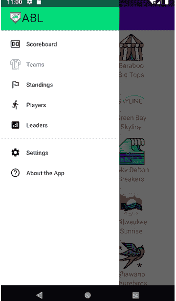

看起来相当不错，对吧？请注意，高亮显示是自动为我们处理的，就像底部导航一样，因为我们的fragment ID匹配。唯一的问题是导航抽屉目前还做不了太多事情，因为应用中只有一个视图。让我们通过添加Standings页面来改变这一点。

### 添加片段（Standings和Single Team）

我们希望有两个新的片段来支持本章中使用导航所做的工作：[StandingsFragment](StandingsFragment)和[SingleTeamFragment](SingleTeamFragment)。我们将在导航抽屉中链接到[StandingsFragment](StandingsFragment)，并将[SingleTeamFragment](SingleTeamFragment)作为一个单独的（非导航抽屉）目的地，我们可以从[StandingsFragment](StandingsFragment)和[TeamsFragment](TeamsFragment)访问它。

所有你想复制的代码都可以在[chapter-9/code-to-copy](chapter-9/code-to-copy)目录中找到。

### 添加 StandingsFragment

Standings页面将是另一个[RecyclerView](RecyclerView)列表，但有一个转折：我们将在列表中添加一些标题来分隔行。具体来说，我们添加标题来分隔ABL的东部和西部赛区。最终的Standings页面将如下所示：

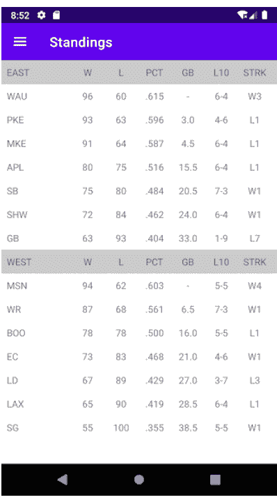

现在，虽然我很想向你展示这一切是如何工作的，但我们还有导航要做。鉴于此，只需将`standings`包中的所有内容复制到你的项目中。这包括以下类：`StandingsAdapter`、`StandingsFragment`、`StandingsListItem`、`StandingsViewModel`、`TeamStanding`和`UITeamStanding`。此外，你需要从`res/layout`目录中获取`fragment_standings.xml`、`standings_header.xml`和`standings_team_item.xml`文件。

请随意在空闲时浏览这些文件/类，因为它们绝对有用，并且是我们第6章*使用RecyclerView构建列表*工作的绝佳扩展。

一点信息：我在`TeamStanding`类中包含了一些模拟的球队排名数据，这样你在Standings页面上就有东西可以显示了。这将在第10章*使用协程和Room加载和保存数据*中移除，届时我们将调用API来获取数据。

还有两个必需的更改——我们需要一些额外的字符串资源值：

```
<string name="wins_w">W</string>
<string name="losses_l">L</string>
<string name="percentage_abbr">PCT</string>
<string name="games_back_abbr">GB</string>
<string name="last_ten_abbr">L10</string>
<string name="streak_abbr">STRK</string>
```

此外，`UITeam`类中缺少`fromTeamId`函数。添加它并确保包含`@JvmStatic`注解，因为我们稍后将在数据绑定表达式中使用此函数：

```
@JvmStatic
fun fromTeamId(teamId: String?) =
    allTeams.firstOrNull { uiTeam -> uiTeam.teamId == teamId }
```

复制这些文件并添加函数后，将`StandingsFragment`的`<fragment>`标签添加到`nav_graph.xml`。这样我们就可以从导航抽屉访问`StandingsFragment`（是的，我现在将`StandingsFragment`设为起始位置）：

```
<navigation xmlns:android="http://schemas.android.com/apk/res/android"
    xmlns:app="http://schemas.android.com/apk/res-auto"
    xmlns:tools="http://schemas.android.com/tools"
    android:id="@+id/nav_graph"
    app:startDestination="@id/standingsFragment">
    <fragment
        android:id="@+id/standingsFragment"
        android:name="dev.mfazio.abl.standings.StandingsFragment"
        android:label="@string/standings" />
    <fragment
        android:id="@+id/teamsFragment"
        android:name="dev.mfazio.abl.teams.TeamsFragment"
        android:label="@string/teams" />
</navigation>
```

一旦你设置好这些，运行应用以确保你的standings页面看起来像我们在本节开头看到的那样。如果没问题，我们将继续处理`SingleTeamFragment`。


## 添加 SingleTeamFragment

我们将在这里做类似的事情，即从代码中复制文件过来。这次是 `teams` 包内的 `SingleTeamFragment` 和 `SingleTeamViewModel`，以及 `res/layout` 中的 `fragment_single_team.xml` 布局文件。

此外，我们需要 `@string/view_roster` 和 `@string/in_abl` 的字符串资源值：

```xml
<string name="view_roster">View Roster</string>
<string name="in_abl"> in ABL </string>
```

另外，我们需要 `util` 目录中 `BindingAdapters.kt` 文件的更新版本。这里，我们添加了一个 `setBackgroundTint` `@BindingAdapter`，它可以接受一个颜色 ID（类似于我们在[添加网格项布局 XML](Add the Grid Item Layout XML)中处理徽标的方式），并将其分配给 `<Button>` 的背景。这是一个方便的小函数，我建议你查看一下：

```kotlin
@BindingAdapter("android:backgroundTint")
fun setBackgroundTint(view: View, colorId: Int) {
    view.background.setTintList(
        ContextCompat.getColorStateList(view.context, colorId)
    )
}
```

好了——我为你省去了打开那个文件的麻烦，但现在是时候继续导航了！

## 使用 Safe Args 传递数据

你可能已经注意到 `SingleTeamFragment` 类现在不太高兴，因为它不知道 `SingleTeamFragmentArgs` 或 `navArgs` 函数。另外，请注意有问题的行看起来与我们获取 `ViewModel` 类的方式非常相似。

在 Android 中，在位置之间发送数据的“传统”方式是通过 `Bundle`，你将键/值对添加到其中，然后直接发送到一个类中，或者作为 `Intent` 的一部分发送。我们不这样做，而是要利用 Navigation Safe Args 插件。

这个插件允许我们在目的地之间发送类型化的值，而不是我们必须手动转换成其他东西的 `String` 值。然后我们可以引用一个为我们生成的 `NavArgs` 类来使用这些值。

在我们尝试在任何地方使用 `NavArgs` 之前，我们需要添加一个 `classpath` 依赖项和一个 `plugin` 引用。

## 添加 Safe Args 插件

这是少数几个我们需要将依赖项添加到*项目* `build.gradle` 文件而不是应用级文件的情况之一，因为我们引入了一个新的插件。除了 Kotlin 和 Gradle `classpath` 依赖项外，我们还需要包含 Safe Args 插件：

```groovy
dependencies {
    classpath "com.android.tools.build:gradle:$gradle_version"
    classpath "org.jetbrains.kotlin:kotlin-gradle-plugin:$kotlin_version"
    classpath "androidx.navigation:navigation-safe-args-gradle-plugin:$nav_version"
}
```

请注意，我们甚至不需要一个新的版本变量，因为我们只使用现有的 Navigation 版本。添加依赖项后，我们可以在应用的 `build.gradle` 文件中再添加一个插件：

```groovy
plugins {
    id 'com.android.application'
    id 'kotlin-android'
    id 'kotlin-kapt'
    id 'androidx.navigation.safeargs.kotlin'
}
```

添加这些后，同步 Gradle，然后进入 `navigation/nav_graph.xml` 添加一些 Actions。

## 添加导航 Actions

*导航 Actions* 是从一个目的地到另一个目的地的方式。在我们的例子中，我们将添加一种从 `TeamsFragment` 和 `StandingsFragment` 移动到 `SingleTeamFragment` 的方式。

为此，我们在 `<fragment>` 标签*内部*添加一个 `<action>` 标签，如下所示：

```xml
<fragment
    android:id="@+id/standingsFragment"
    android:name="dev.mfazio.abl.standings.StandingsFragment"
    android:label="@string/standings">
    <action
        android:id="@+id/actionGoToTeam"
        app:destination="@id/singleTeamFragment" />
</fragment>
```

现在，这很好，但问题是我们无法在没有任何额外信息的情况下前往 `SingleTeamFragment`，因为我们不知道要引用哪支球队。这就是 Safe Args 的用武之地；我们可以在 `<action>` 中添加 `<argument>` 标签来包含参数：

```xml
<fragment
    android:id="@+id/standingsFragment"
    android:name="dev.mfazio.abl.standings.StandingsFragment"
    android:label="@string/standings">
    <action
        android:id="@+id/actionGoToTeam"
        app:destination="@id/singleTeamFragment">
        <argument
            android:name="teamId"
            app:argType="string" />
        <argument
            android:name="teamName"
            app:argType="string" />
    </action>
</fragment>
```

现在，这个 action 在这里可以工作，但我们需要允许 `SingleTeamFragment` 类接收这些参数。这意味着我们需要一个新的 `<fragment>` 标签，其中包含一些 `<argument>` 标签：

```xml
<fragment
    android:id="@+id/singleTeamFragment"
    android:name="dev.mfazio.abl.teams.SingleTeamFragment"
    android:label="{teamName}"
    tools:layout="@layout/fragment_single_team">
    <argument
        android:name="teamId"
        app:argType="string" />
    <argument
        android:name="teamName"
        app:argType="string" />
</fragment>
```

这里有几个要点：`<argument>` 标签在 `<action>` 和 `<fragment>` 之间是匹配的（意味着两个标签包含相同的 `<argument>` 标签），而且我们甚至可以在 `<fragment>` 标签的属性中使用其中一个 `<argument>` 值。`android:label="{teamName}"` 意味着无论我们作为 `teamName` 参数发送什么，当屏幕显示时，它都会显示在工具栏中。

如果我们想从 `TeamsFragment` 到达这里，我们可以将相同的 `<argument>` 标签复制到该 `<fragment>` 标签中。希望这对你来说听起来像是一个糟糕的方法，因为我们在复制和粘贴值，但别担心，我们有更好的方法可以做到这一点。

Navigation 库有*全局 actions*的概念，可以从任何地方访问。这意味着我们声明一次 `<action>`，然后从我们选择的任何位置引用它。要添加一个全局 action，我们只需要在 `nav_graph.xml` 中创建一个独立的 `<action>` 标签。整个（最终）文件如下所示：

```xml
<navigation xmlns:android="http://schemas.android.com/apk/res/android"
    xmlns:app="http://schemas.android.com/apk/res-auto"
    xmlns:tools="http://schemas.android.com/tools"
    android:id="@+id/nav_graph"
    app:startDestination="@id/standingsFragment">

    <action
        android:id="@+id/actionGoToTeam"
        app:destination="@id/singleTeamFragment">
        <argument
            android:name="teamId"
            app:argType="string" />
        <argument
            android:name="teamName"
            app:argType="string" />
    </action>

    <fragment
        android:id="@+id/standingsFragment"
        android:name="dev.mfazio.abl.standings.StandingsFragment"
        android:label="@string/standings" />
    <fragment
        android:id="@+id/teamsFragment"
        android:name="dev.mfazio.abl.teams.TeamsFragment"
        android:label="@string/teams" />
    <fragment
        android:id="@+id/singleTeamFragment"
        android:name="dev.mfazio.abl.teams.SingleTeamFragment"
        android:label="{teamName}"
        tools:layout="@layout/fragment_single_team">
        <argument
            android:name="teamId"
            app:argType="string" />
        <argument
            android:name="teamName"
            app:argType="string" />
    </fragment>
</navigation>
```

最后一点警告：全局 actions 只有在导航图具有 ID 属性时才有效，所以不要忘记包含它。

导航图完成后，我们就可以回到 Kotlin 代码中开始移动了。确保 `SingleTeamFragment` 编译没有任何错误，并注意我们如何在绑定逻辑中使用 `args.teamId`。这就是我们在目的地中使用 Safe Args 所需的全部内容。

## 通过 Actions 导航

我们希望为 `SingleTeamFragment` 添加导航逻辑，使其能够导航到 Teams 网格和 Standings 屏幕，两者都以类似的方式处理。我们将从 `StandingsAdapter` 开始，因为代码已经存在，但被注释掉了。

在 `StandingsListTeamViewHolder` 类中的 `bind` 函数中，我们将一个 `UITeamStanding` 对象绑定到我们的布局。我们还有一段被注释包裹的代码，现在可以添加进去：

```kotlin
fun bind(standingsTeamItem: StandingsListItem.TeamItem) {
    binding.uiTeamStanding = standingsTeamItem.uiTeamStanding
    //TODO: Uncomment this code when you're ready.
    binding.clickListener = View.OnClickListener { view ->
        val action = NavGraphDirections.actionGoToTeam(
            standingsTeamItem.uiTeamStanding.teamId,
            standingsTeamItem.uiTeamStanding.teamName
        )
        view.findNavController().navigate(action)
    }
}
```

这段代码将为 Standings 列表项分配 `clickListener`，并将用户发送到 `SingleTeamFragment` 类，并附带团队名称和ID。Safe Args 插件会为我们生成那个 [NavGraphDirections](https://developer.android.com/reference/androidx/navigation/NavGraphDirections) 类，使得调用本身既简洁又直接。

取消代码注释并运行你的应用。现在你应该能够点击 Standings 页面中的一个团队，它会带你进入该团队的 Team 页面，如 [image](https://example.com/image) 所示。

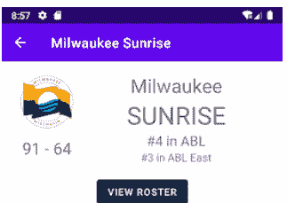

`TeamsGridAdapter` 中的 `bind` 函数基本上是相同的：

```kotlin
fun bind(item: UITeam) {
    binding.apply {
        team = item
        setOnClickListener { view ->
            val action = NavGraphDirections.actionGoToTeam(
                item.teamId,
                item.teamName
            )
            view.findNavController().navigate(action)
        }
    }
}
```

每当我们想从应用内的另一个地方导航到某个特定页面时，都可以遵循这个相同的模式。但是，如果我们想从应用*外部*到达某个特定页面呢？这就是*深层链接*发挥作用的地方。

## 通过深层链接直接导航

深层链接是一种直接到达我们应用中任何目的地的方式，即使是那些不在导航抽屉中的目的地。Navigation 库支持两种类型的深层链接：显式和隐式。

显式深层链接用于诸如应用小部件或通知等场景。我们构建链接的各个部分，包含任何需要的参数，然后前往目的地。我们现在没有一个适合放置显式深层链接的地方，但我们将在第 13 章 [向 Android Baseball League 应用发送和接收信息](https://link.mfazio.dev/teams/GB?teamName=Green%20Bay%20Skyline) 中添加一个。

另一方面，隐式深层链接是映射到某个目的地的 **URI**（统一资源标识符，通常是网络链接）。例如，我们可以有一个像 [https://link.mfazio.dev/teams/GB?teamName=Green%20Bay%20Skyline](https://link.mfazio.dev/teams/GB?teamName=Green%20Bay%20Skyline) 这样的链接，它会带我们进入 Skyline 团队页面。

导航组件通过允许我们在 `nav_graph.xml` 中添加 `<deepLink>` 标签，然后在我们的 `AndroidManifest.xml` 文件中引用该导航图来帮助我们。

## 添加隐式深层链接

在 `nav_graph.xml` 内部，在 Single Team `<fragment>` 标签内添加一个新的 `<deepLink>` 标签：


```xml
<fragment
    android:id="@+id/singleTeamFragment"
    android:name="dev.mfazio.abl.teams.SingleTeamFragment"
    android:label="{teamName}"
    tools:layout="@layout/fragment_single_team">
    <argument
        android:name="teamId"
        app:argType="string" />
    <argument
        android:name="teamName"
        app:argType="string" />
    <deepLink
        app:uri="https://link.mfazio.dev/teams/{teamId}?teamName={teamName}" />
</fragment>
```

然后在`AndroidManifest.xml`中，我们可以在主`<activity>`标签内添加一个`<nav-graph>`标签：

```xml
<activity android:name=".MainActivity">
  <intent-filter>
    <action android:name="android.intent.action.MAIN" />
    <category android:name="android.intent.category.LAUNCHER" />
  </intent-filter>
  <nav-graph android:value="@navigation/nav_graph" />
</activity>
```

一旦这些设置到位，你现在就可以从 ABL 应用外部点击一个链接，它会带你进入应用。你可以访问 [https://abl.mfazio.dev/deep-links](https://abl.mfazio.dev/deep-links) 查看所有团队链接。在我的例子中，我点击了 Pewaukee Princesses 链接，这给我带来了“打开方式”弹出窗口，如第一张 [image](image) 所示。

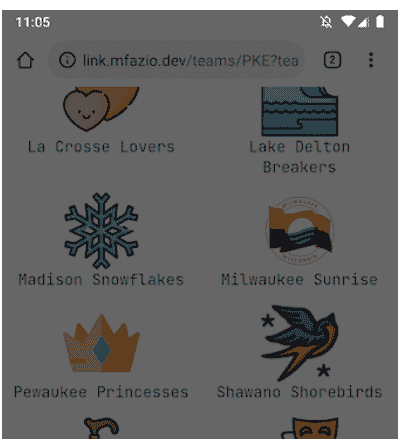

打开方式

ABL

Chrome

仅限一次 始终

选择 ABL 选项后，我们被带到 ABL 应用，在我的链接指向 Pewaukee Princesses 团队页面的情况下，如第二张 [image](image2.png) 所示。

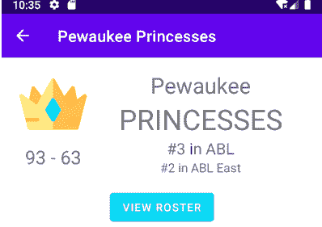

注意左上角是一个返回箭头，而不是导航抽屉的“汉堡”菜单？通过在导航图中使用深层链接，我们被直接带入导航图，并且导航图的层次结构得以保留。

现在，在我们的例子中，这意味着如果我们按下返回按钮，我们会回到起始目的地。如果我们有一个更复杂的导航图，我们会以与最初导航到那里时相同的返回栈进入该流程。所有这些也都为我们自动处理了。

你可以做类似的事情来测试任何团队链接。另外，也请随意为其他两个页面添加额外的`<deepLink>`标签。

当人们想要分享应用中的特定位置或需要快速跳回某个目的地时，拥有深层链接非常方便。然而，到达那里的过程可能有点烦人，特别是那个“打开方式”对话框。我们可以通过将这个深层链接转换为 Android App Link 来移除这一步。

## 将深层链接转换为 Android App Link

从高层次来看，Android App Links 将你的网站和网络链接与你的应用关联起来。这是通过在应用中添加深层链接（为链接提供去处）并验证这些链接来完成的。后一部分是通过在你的网站上添加一个验证文件来处理的，该文件告诉设备该网站和你的应用是关联的。

那个验证文件被称为 *Digital Asset Links 文件*，它列出了你的应用信息，用于验证过程。该文件包含一个关系类型和一个目标，后者包含一个命名空间（`android_app`）、包名（`dev.mfazio.abl`）和 SHA256 证书指纹。

最后一部分可以使用 Java `keytool` 自动获取（将 `app-release-key` 替换为你的密钥库文件名）：

```
keytool -list -v -keystore app-release-key.keystore
```

如果你对密钥库文件感到困惑，没关系——我们还没有讨论过这些。如果你好奇，可以查看 Google 的 App Signing 概述。[8] 这里的重点是，你需要从你的应用密钥库中获取指纹，以便应用可以被验证。一个完整的 Digital Asset Links 文件示例如下：

```json
[
  {
    "relation": [
      "delegate_permission/common.handle_all_urls"
    ],
    "target": {
      "namespace": "android_app",
      "package_name": "dev.mfazio.abl",
      "sha256_cert_fingerprints": [...]
    }
  }
]
```

我为了节省空间省略了示例指纹，但它将是由冒号连接的十六进制数字组合。示例文件也可以在代码中的 [assetlinks.json](assetlinks.json) 文件中找到。

一旦我们创建了文件，我们就需要将其推送到我们的网站。在我们的示例中，我使用了 [http://link.mfazio.dev](http://link.mfazio.dev) 作为我的 URL，所以我需要将 Digital Asset Links 文件上传到 [https://link.mfazio.dev/.well-known/assetlinks.json](https://link.mfazio.dev/.well-known/assetlinks.json)。

请记住，这个过程需要在你想要用于 Android App Link 的每个子域上重复进行。

需要本节的快速总结吗？Android App Links 是经过验证的深层链接，可以跳过消歧（打开方式）对话框。这需要一些额外的工作，但绝对能提供更好的用户体验。

## 总结与下一步

我们现在可以在应用中自由导航了！导航抽屉将为我们提供一种流畅的方式来访问我们将在接下来的几章中构建的所有应用部分。

此外，我们有快速路径可以直接通过操作到达应用中的某个目的地。使用操作与 Safe Args 使导航体验非常棒，因为我们处理的是实际对象，而不仅仅是需要某种转换且容易出错的`String`值。

最后，通过深层链接和 Android App Links，我们可以让用户直接访问应用中原本无法立即访问的部分。我们肯定会在后面的章节中扩展这些内容。

接下来是本书中最有价值的章节之一。我们将*从外部*拉取外部 API 的数据，并使用它们在应用中显示信息。我们将更新我们在这里添加的 Standings 页面以使用该数据，并添加一个新的 Scoreboard 屏幕来显示 Android Baseball League 中过去、现在和未来的比赛。Room + Retrofit + Coroutines 将实现这一点，这将会非常有趣。

脚注

[8] https://link.mfazio.dev/app-signing

# 第10章

## 使用协程和Room加载与保存数据

到目前为止，我们在本书中所做的一切都专注于在应用程序内部工作，但现在是时候向外拓展并引入一些外部数据了。我们将调用Android棒球联盟的API来获取最新的比分、排名和统计数据。

具体来说，我们将拉取联盟当前比赛和排名的数据。我们在[添加Fragment（排名和单支球队）](Add Fragments (Standings and Single Team))中完成了后一个屏幕的初步工作，但那是使用模拟数据。记分牌页面是新的（而且坦率地说，很复杂），因此你将再次拉取代码，而不是我们逐一讲解所有内容。

拥有当前数据会很棒，但我们确实需要一个地方来存储它。这意味着我们需要一个Room数据库来存储所有数据，所以让我们先创建它。

### 创建数据库

如果你已经完成了第5章[使用Room持久化游戏数据](https://example.com)，那么这个过程的第一部分你会非常熟悉，因此我将尝试快速讲解，以便进入新内容。

在开始之前，添加Room依赖项：

- `implementation "androidx.room:room-ktx:$room_version"`
- `implementation "androidx.room:room-runtime:$room_version"`
- `implementation "com.google.android.material:material:$material_version"`
- `kapt "androidx.room:room-compiler:$room_version"`

然后，在一个新的`data`包内，创建一个继承自`RoomDatabase`的`abstract BaseballDatabase`类。它一开始会相当空，但我们会逐步添加内容。目前，它看起来像这样：

```
@Database(
    entities = [],
    exportSchema = false,
    version = 1
)
abstract class BaseballDatabase : RoomDatabase() {
    companion object {
        @Volatile
        private var Instance: BaseballDatabase? = null

        fun getDatabase(context: Context, scope: CoroutineScope):
            BaseballDatabase = Instance ?: synchronized(this) {
                val instance = Room.databaseBuilder(
                    context,
                    BaseballDatabase::class.java,
                    "BaseballDatabase"
                ).build()

                Instance = instance

                instance
            }
    }
}
```

数据库已就位，现在我们需要一些类来操作它。我们将把`TeamStanding`类转换为`@Entity`，同时创建DAO和Repository类。让我们从`TeamStanding`开始，因为我们将在其他类中使用它。

### 将TeamStanding转换为Entity

值得庆幸的是，这不需要太多工作。我们需要将类标记为`@Entity`，添加`@PrimaryKey`和一些`@TypeConverter`函数。

首先，类的更改如下所示：

```
@Entity(tableName = "standings")
data class TeamStanding(
    val teamId: String,
    val division: Division,
    val wins: Int = 0,
    val losses: Int = 0,
    val winsLastTen: Int = 0,
    val streakCount: Int = 0,
    val streakType: WinLoss = WinLoss.Unknown,
    val divisionGamesBack: Double = 0.0,
    val leagueGamesBack: Double = 0.0
) {
    @PrimaryKey(autoGenerate = true)
    var id: Long = 0

    companion object {
        // 模拟数据仍然在这里，我们稍后会将其放入数据库中。
        // 一旦我们从API加载数据，就可以将其移除。
    }
}
```

Room不知道如何处理`Division`或`WinLoss`，因此我们需要一个包含`@TypeConverter`函数的`Converters`类，正如我之前提到的。该类位于`data`包中，如下所示：

```
class Converters {
    @TypeConverter
    fun fromDivision(division: Division?) =
        division?.ordinal ?: Division.Unknown.ordinal

    @TypeConverter
    fun toDivision(divisionOrdinal: Int?) =
        if (divisionOrdinal != null) {
            Division.values()[divisionOrdinal]
        } else {
            Division.Unknown
        }

    @TypeConverter
    fun fromWinLoss(winLoss: WinLoss?) =
        winLoss?.ordinal ?: WinLoss.Unknown.ordinal

    @TypeConverter
    fun toWinLoss(winLossOrdinal: Int?) =
        if (winLossOrdinal != null) {
            WinLoss.values()[winLossOrdinal]
        } else {
            WinLoss.Unknown
        }
}
```

我们有每种类型的双向转换方法，并且在转换失败时都会回退到它们的`Unknown`值。

`Converters`类现在完成了，`TeamStanding`类现在是一个`@Entity`，我们可以将它们都添加到数据库中：

```
@Database(
    entities = [TeamStanding::class],
    exportSchema = false,
    version = 1
)
@TypeConverters(Converters::class)
abstract class BaseballDatabase : RoomDatabase() {
    companion object {
        @Volatile
        private var Instance: BaseballDatabase? = null

        fun getDatabase(context: Context, scope: CoroutineScope):
            BaseballDatabase = Instance ?: synchronized(this) {
                val instance = Room.databaseBuilder(
                    context,
                    BaseballDatabase::class.java,
                    "BaseballDatabase"
                ).build()

                Instance = instance

                instance
            }
    }
}
```

完成后，我们可以继续处理Repository和DAO类。

### 添加BaseballDao类

提醒一下，DAO是一个接口或抽象类，它将从我们的Room数据库中拉取数据，而Repository是一个标准类，我们通过它将数据提供给应用程序的其余部分。DAO只关心Room，而Repository可以引用多个数据源。一旦我们调用API，这一点将变得更加重要。

首先，我们需要创建`BaseballDao`类，其中包含一些与`TeamStanding`对象相关的函数。我们希望能够插入新的`TeamStanding`记录、更新这些记录以及从数据库中检索它们。`BaseballDao`类目前看起来像这样：

```
@Dao
abstract class BaseballDao {
    @Insert
    abstract suspend fun insertStandings(standings: List<TeamStanding>)

    @Update
    abstract suspend fun updateStandings(standings: List<TeamStanding>)

    @Query("SELECT * FROM standings")
    abstract fun getStandings(): LiveData<List<TeamStanding>>

    @Query("SELECT * FROM standings")
    abstract suspend fun getCurrentStandings(): List<TeamStanding>
}
```

是的，我知道我有两个运行相同查询的函数，不，这并不理想。这样做是因为`getStandings`返回的是包装在`LiveData`对象中的排名数据。我们真的只想在UI中使用`LiveData`，所以我在这里添加了第二个函数，用于我们的Repository。

老实说，我不喜欢这种方法，但当你想到`LiveData`并非设计用于后台时，这是有道理的。此外，如果你尝试只获取`LiveData`版本并从中获取值，你会得到`null`。


关于那个额外函数的最后一点：它被标记了`suspend`修饰符，以便我们在非UI线程上获取数据。这样UI就不会为用户锁定，但我们可以按预期处理数据。如果我们不包含这个修饰符，我们会得到一个关于在UI线程上运行查询的错误。你*可以*启用UI线程查询，但请不要这样做。这是一个有原因的保护措施。

DAO设置好后，我们可以在新的`BaseballRepository`类中使用它。

## 添加`BaseballRepository`类

现在，我们只需要初始化`BaseballRepository`类并添加一个获取排名数据的函数。记住，我们将`BaseballDao`类作为构造函数参数传入，以便在类内部使用。以下是`BaseballRepository`类当前的样子：

```kotlin
class BaseballRepository(private val baseballDao: BaseballDao) {

    fun getStandings(): LiveData<List<TeamStanding>> =
        baseballDao.getStandings()

    companion object {
        @Volatile
        private var instance: BaseballRepository? = null

        fun getInstance(baseballDao: BaseballDao) =
            this.instance ?: synchronized(this) {
                instance ?: BaseballRepository(baseballDao).also {
                    instance = it
                }
            }
    }
}
```

DAO和Repository准备就绪后，我们可以开始向数据库添加数据。目前，再次拥有一些排名数据会很方便，因此我们将插入上一章引用的模拟数据。

## 将`BaseballDao`和模拟数据添加到`BaseballDatabase`

`BaseballDao`作为`abstract fun`添加到`BaseballDatabase`中，我们无需额外操作。至于模拟数据，我们将采用与过去相同的方法，使用`RoomDatabase.Callback`来添加内容。我们可以在数据库创建时插入模拟排名数据，然后它就可以供我们显示了。这两项添加如下所示：

```kotlin
@Database(
    entities = [TeamStanding::class],
    exportSchema = false,
    version = 1
)
@TypeConverters(Converters::class)
abstract class BaseballDatabase : RoomDatabase() {
    abstract fun baseballDao(): BaseballDao

    companion object {
        @Volatile
        private var Instance: BaseballDatabase? = null

        fun getDatabase(context: Context, scope: CoroutineScope):
            BaseballDatabase = Instance ?: synchronized(this) {
                val instance = Room.databaseBuilder(
                    context,
                    BaseballDatabase::class.java,
                    "BaseballDatabase"
                ).addCallback(object : RoomDatabase.Callback() {
                    override fun onCreate(db: SupportSQLiteDatabase) {
                        super.onCreate(db)
                        Instance?.let { database ->
                            scope.launch {
                                populateDatabase(database.baseballDao())
                            }
                        }
                    }
                })
                .build()

                Instance = instance

                instance
            }

        suspend fun populateDatabase(baseballDao: BaseballDao) {
            baseballDao.insertStandings(mockStandings)
        }
    }
}
```

```kotlin
override fun onCreate(db: SupportSQLiteDatabase) {

    super.onCreate(db)

    scope.launch {

        Instance

            ?.baseballDao()

            ?.insertStandings(TeamStanding.mockTeamStandings)

    }

}

}).build()

Instance = instance

instance

}

}

}
```

完成这些更改后，我们可以继续更新排名页面，以使用来自数据库的数据。

## 从数据库加载排名数据

目前，我们正在将模拟的排名数据转换为`LiveData`以供页面使用。相反，我们需要一个`BaseballRepository`实例，然后我们可以调用`getStandings`从数据库中获取`TeamStanding`对象。请确保将基类更改为`AndroidViewModel`，因为我们需要一个上下文来检索数据库。

我们确实希望继续将`TeamStanding`对象映射为`UITeamStanding`对象，但现在我们将在`Transformations.map`代码块中完成此操作。以下是`StandingsViewModel`现在的样子：

```kotlin
class StandingsViewModel(application: Application) :
    AndroidViewModel(application) {

    private val repo: BaseballRepository

    val standings: LiveData<List<UITeamStanding>>

    init {
        repo = BaseballDatabase
            .getDatabase(application, viewModelScope)
            .baseballDao()
            .let { dao ->
                BaseballRepository.getInstance(dao)
            }

        standings =
            Transformations.map(repo.getStandings()) { teamStandings ->
                teamStandings.mapNotNull { teamStanding ->
                    UITeamStanding.fromTeamIdAndStandings(
                        teamStanding.teamId,
                        teamStandings
                    )
                }
            }
    }
}
```

现在继续运行应用程序，它应该看起来与之前相同。你可以通过在 Android Studio 的 Database Inspector 中更改值来验证它正在使用数据库中的数据。既然模拟数据已经在其中，并且我们的排名页面正在使用我们的数据库，我们可以继续从外部 API 拉取数据。为此，我们将使用一个名为 Retrofit 的库。

## 使用 Retrofit

虽然到目前为止我们一直在开发离线应用程序，但在现实世界中这种情况非常罕见。别误会，我们到目前为止所做的一切都是有价值的（无论是在这里还是在 Penny Drop 项目中），但调用 API 是构建应用程序的关键部分。

如果你不熟悉，Retrofit[2] 是由 Square, Inc.[10] 创建的一个开源库，已经成为事实上的“官方” Android 库——以至于官方的 Google 教程在任何 API 调用中都使用 Retrofit。

我将在这里介绍设置 Retrofit 服务的基础知识。如果你更感兴趣的是使用服务而不是构建它，请跳到下一节：[添加 ABL API 客户端](Add the ABL API Client)。我们将为我们的应用程序使用 ABL API 客户端，而不是我在这里向你展示的内容，因此你实际上不会使用我们编写的代码。但由于 Retrofit 被广泛使用，我认为值得介绍。

## 构建 Retrofit 服务

Retrofit 实现的核心部分是 Service 接口。在这里，你通过列出 HTTP 方法（GET、POST 等）、API 路径、任何查询参数和返回类型来定义每个 API。同样，Retrofit 的妙处在于你始终使用对象，而无需每次都手动转换事物。

例如，我们稍后将使用的`getStandings`函数是按以下方式设置的。它是一个 GET 请求，带有一个查询参数（`currentDate`）和一个`TeamStandingApiModel`的返回类型。`currentDate`参数允许我们请求一年中任何日期的排名。`currentDate`参数是可选的，因此应将其标记为可空的`LocalDate?`对象。

此外，得益于 Kotlin，我们可以用`suspend`修饰符标记我们的 Retrofit 函数，并在代码中的协程内调用它们。带有`getStandings`函数的`AndroidBaseballLeagueService`如下所示：

```kotlin
interface AndroidBaseballLeagueService {
    @GET("standings")
    suspend fun getStandings(
        @Query("currentDate") currentDate: LocalDate? = null
    ): List<TeamStandingApiModel>
}
```

`AndroidBaseballLeagueService`中的所有端点函数都将遵循类似的设置。我们还可以使用其他功能，例如添加路径变量，你可以在`getSinglePlayer`函数中看到：

```kotlin
@GET("players/{playerId}")
suspend fun getSinglePlayer(
    @Path("playerId") playerId: String,
    @Query("currentDate") currentDate: LocalDate? = null
): BoxScoreItemsApiModel
```

一旦将所需的所有端点添加到服务中，我们就可以设置 Retrofit 构建器。在我们的案例中，这是一个两步过程。我们需要一个 JSON 转换器，然后是`Retrofit`对象构建器。

对于 JSON 转换器，我选择了 Moshi[1]，这是来自 Square 朋友的另一个很棒的库。对于任何使用过 GSON 的人来说，Moshi 实际上是 GSON v3.0，因为它是由三位主要 GSON 维护者中的两位发起的。如果你不了解 GSON，不用担心，因为它已被弃用。

通过将 Moshi 作为`Converter.Factory`添加到我们的 Retrofit 服务中，数据可以从 JSON 文本自动转换为对象。我们甚至可以为某些数据类型（如日期）向 Moshi 转换器添加适配器：

```kotlin
class MoshiLocalDateAdapter {
    @ToJson
    fun toJson(date: LocalDate?): String?
        = date?.let { dateFormat.format(it) }

    @FromJson
    fun fromJson(dateString: String?): LocalDate?
        = dateString?.let { LocalDate.parse(it, dateFormat) }
}
```

有了像上面这样的适配器，Moshi 构建器将如下所示：

```kotlin
val moshi = Moshi.Builder()
    .add(MoshiLocalDateAdapter())
    .add(MoshiLocalDateTimeAdapter())
    .build()
```

这样，我们就能够构建 Retrofit 对象。现在，这不是我们将在 Android 应用程序中使用的服务，而是用于从我们定义的接口创建服务的 Retrofit 类。

正如我提到的，Moshi 可以作为`Converter.Factory`添加到 Retrofit 对象中，我们可以像这样添加其他`Converter.Factory`类：

```kotlin
class DateTimeQueryConverterFactory : Converter.Factory() {
    override fun stringConverter(
        type: Type,
        annotations: Array<Annotation>,
        retrofit: Retrofit
    ): Converter<*, String>? = when (type) {
        LocalDate::class.java ->
            Converter<LocalDate, String> { date -> dateFormat.format(date) }
        LocalDateTime::class.java ->
            Converter<LocalDateTime, String> {
                dateTime -> dateTimeFormat.format(dateTime)
            }
        else -> super.stringConverter(type, annotations, retrofit)
    }
}
```

一切设置就绪后，Retrofit 构建器为我们提供了 Retrofit 对象，我们可以调用`create`函数来获取具体的服务。

使用我们即将添加的 ABL API 客户端，我们通过我添加到客户端的`getDefaultABLService`函数获取服务。这为我们提供了一种快速获取`AndroidBaseballLeagueService`实例的方法，而无需担心在应用程序中进行任何设置：

```kotlin
fun getDefaultABLService(
    baseUrl: String = "https://abl.mfazio.dev/api/"
): AndroidBaseballLeagueService {
    val moshi = Moshi.Builder()
        .add(MoshiLocalDateAdapter())
        .add(MoshiLocalDateTimeAdapter())
        .build()

    val retrofit = Retrofit.Builder()
        .addConverterFactory(MoshiConverterFactory.create(moshi))
        .addConverterFactory(DateTimeQueryConverterFactory())
        .baseUrl(baseUrl)
        .build()

    return retrofit.create(AndroidBaseballLeagueService::class.java)
}
```

现在，这确实是一个*非常*快速的 Retrofit 概述，但希望它让你对这里发生的事情有所了解。如果你想了解更多，我已经将 ABL API 客户端的源代码放入了一个公共 GitHub 仓库[12]，以及本书的源代码。

现在是我们添加 ABL API 客户端并开始在应用程序中使用它的时候了。

## 添加 ABL API 客户端

通过使用 ABL API 客户端，你将在设置服务和创建所有包含响应数据的必需 API 模型方面节省大量时间。在应用程序中，我们唯一需要做的就是调用服务并将 API 模型转换为我们的内部模型。

要使用该客户端，我们需要在项目的`build.gradle`文件中，同时在`buildscript`和`allprojects repositories`代码块内添加一个新的仓库：


```
buildscript {
    ext { ... }
    repositories {
        google()
        jcenter()
        maven { url 'https://jitpack.io' }
    }
    dependencies { ... }
}

allprojects {
    repositories {
        google()
        jcenter()
        maven { url 'https://jitpack.io' }
    }
}
```

然后，我们可以添加 ABL API 客户端和 Retrofit 依赖项（当然，也包括它们的版本变量）：

```
implementation "com.squareup.retrofit2:retrofit:$retrofit_version"
implementation "dev.mfazio:abl-api-client:$abl_client_version"
```

通常情况下，我们根本不需要 Retrofit 依赖项，但稍后我们将使用其中的 `HttpException` 类，因此在我们的案例中这是一个必需项。

另外，请确保你的项目的 `build.gradle` 文件在 `allprojects repositories` 代码块中包含 `jcenter`，因为这是我部署客户端的地方。它应该已经存在了，但以防万一，如果不在，请现在添加它。

依赖项添加完毕后，同步项目，我们就可以开始使用客户端了。我们会在 `AndroidManifest.xml` 中稍作停留，添加几个权限，然后回到 `BaseballRepository` 类开始使用客户端。

### 从外部 API 加载数据

Web 服务调用可能是转向 Kotlin + Jetpack（加上我们刚刚介绍的 Retrofit）后改进最大的任务。过去，你必须构建一个新的 AsyncTask 子类，重写其中的函数，祈祷你没有在某处意外泄露上下文，然后在处理完成后最终更新 UI。

现在呢？我们有了协程、LiveData 和挂起函数，让一切变得更流畅、更清晰。此外，Retrofit 提供的类型安全的挂起函数使得调用 API 变得更加顺畅。

### 通过 ABL API 客户端加载排名数据

在 `AndroidManifest.xml` 中，我们需要授予应用访问互联网和检查设备当前网络状态的权限。我们通过在 `<manifest>` 容器标签顶部附近添加一个 `<uses-permission>` 标签来实现这一点：

```
<manifest xmlns:android="http://schemas.android.com/apk/res/android"
    package="dev.mfazio.abl">

    <uses-permission android:name="android.permission.INTERNET" />

    <application ...>
        Application tag attributes
    </application>
</manifest>
```

接下来是 `BaseballRepository`。目前这里内容不多，但我们至少有一个从数据库获取排名 LiveData 的函数。现在是时候添加一个使用 ABL API 客户端的 `updateStandings` 函数了。

首要任务是将 ABL API 客户端添加到我们的 Repository 中。这是通过在我们的伴生对象中添加一个 `AndroidBaseballLeagueService` 实例来完成的，我们通过 `getDefaultABLService` 函数获取它：

```
companion object {
    private val apiService = getDefaultABLService()

    @Volatile
    private var instance: BaseballRepository? = null

    fun getInstance(baseballDao: BaseballDao) =
        this.instance ?: synchronized(this) {
            instance ?: BaseballRepository(baseballDao).also {
                instance = it
            }
        }
}
```

一旦我们在 `BaseballRepository` 中有了 `apiService`，我们就可以调用 `getStandings` 函数来获取当前的联盟排名。我们将在 `updateStandings` 函数内部执行此操作。

从高层次来看，`updateStandings` 从排名 API 拉取数据，如果有数据，则将 API 模型转换为 `TeamStanding` 对象并输入数据库。然后，通过我们上一章设置的 LiveData 对象，UI 会自动更新。

排名对象的转换逻辑位于一个 `APIConverters.kt` 文件中。这里有一个名为 `convertToTeamStandings` 的扩展函数。我们既需要在这里，也需要在记分牌页面将 API 模型转换为我们的内部模型，因此请从源代码中获取 `APIConverters.kt` 文件。

我们本可以在这里介绍它的内容，但它只是一堆 `map` 和 `when` 代码块。这些当然很有用，但它们并不是什么新东西，我宁愿我们专注于新的部分。

一旦你复制了文件并添加了 `apiService` 实例，我们就可以实现 `updateStandings`：

```
suspend fun updateStandings() {
    val standings = apiService.getStandings()

    if(standings.any()) {
        baseballDao.updateStandings(
            standings.convertToTeamStandings(
                baseballDao.getCurrentStandings()
            )
        )
    }
}
```

调用排名 API，将数据转换为我们的 `@Entity` 模型，并将其发送到 DAO 进行保存，只需十一行代码。此外，所有这些都在后台线程上完成，因此用户永远不会以任何方式被打断。这一切之所以有效，是因为我们当前的函数和 `getStandings` 函数都标记了 `suspend` 修饰符。

这就是我们从 API 获取数据所需的全部内容，所以现在是时候调用那个 `getStandings` 函数了。在 `StandingsViewModel` 内部，我们想要一个名为 `refreshStandings` 的新函数，它在 `launch` 代码块内调用 `repo.updateStandings`：

```
fun refreshStandings() {
    viewModelScope.launch {
        repo.updateStandings()
    }
}
```

然后我们可以在 `StandingsFragment` 的 `onCreateView` 函数末尾调用该函数：

```
override fun onCreateView(
    inflater: LayoutInflater,
    container: ViewGroup?,
    savedInstanceState: Bundle?
): View? {
    Binding code is still up here.

    standingsViewModel.refreshStandings()

    return binding.root
}
```

现在，每当 `StandingsFragment` 被创建时，我们的排名数据就会更新，例如当用户在导航抽屉中选择排名页面时。这里唯一的问题是，除非用户离开排名页面再返回，否则数据不会更新。我们可以通过添加从顶部向下滑动刷新的功能来改善这一点（无需太多工作量）。

### 滑动刷新数据

我们需要一个新的库依赖项：

```
implementation
"androidx.swiperefreshlayout:swiperefreshlayout:$swipe_refresh_version"
```

然后，在 `fragment_standings.xml` 内部，将现有的 `<RecyclerView>` 标签包装在一个新的 `<SwipeRefreshLayout>` 标签中。外部标签现在也包含所有 XML 命名空间。整个文件如下所示：

```
<?xml version="1.0" encoding="utf-8"?>
<androidx.swiperefreshlayout.widget.SwipeRefreshLayout
    xmlns:android="http://schemas.android.com/apk/res/android"
    xmlns:app="http://schemas.android.com/apk/res-auto"
    xmlns:tools="http://schemas.android.com/tools"
    android:id="@+id/standingsSwipeRefreshLayout"
    android:layout_width="match_parent"
    android:layout_height="match_parent">

    <androidx.recyclerview.widget.RecyclerView
        android:id="@+id/standingsList"
        android:layout_width="match_parent"
        android:layout_height="match_parent"
        android:layout_gravity="center"
        app:layoutManager="LinearLayoutManager"
        tools:context=".standings.StandingsFragment"
        tools:listitem="@layout/standings_team_item" />

</androidx.swiperefreshlayout.widget.SwipeRefreshLayout>
```

在 `StandingsFragment` 内部，我们希望切换到使用视图绑定，以便更轻松地将 `StandingsAdapter` 绑定到我们的 `RecyclerView`：

```
override fun onCreateView(
    inflater: LayoutInflater,
    container: ViewGroup?,
    savedInstanceState: Bundle?
): View? {

    val binding = FragmentStandingsBinding.inflate(inflater)

    val standingsAdapter = StandingsAdapter()

    binding.standingsList.adapter = standingsAdapter

    standingsViewModel.standings.observe(viewLifecycleOwner) { standings ->
        standingsAdapter.addHeadersAndBuildStandings(standings)
    }

    standingsViewModel.refreshStandings()

    return binding.root
}
```

然后，我们为新添加的 `SwipeRefreshLayout` 添加一个 `OnRefreshListener`，每当视图向下滑动时，它就会调用 `standingsViewModel.refreshStandings`。另外，我们需要在数据加载后将 `isRefreshing` 属性设置为 `false`，这意味着我们应该在现有的 `observe` 代码块内设置它。这些添加如下所示：

```
val binding = FragmentStandingsBinding.inflate(inflater)

val standingsAdapter = StandingsAdapter()

binding.standingsList.adapter = standingsAdapter

binding.standingsSwipeRefreshLayout.setOnRefreshListener {
    standingsViewModel.refreshStandings()
}

standingsViewModel.standings.observe(viewLifecycleOwner) { standings ->
```

我们现在为用户提供了一种无需跳转到其他页面、也无需过多操作即可更新此屏幕数据的方法。我知道这有点绕，但正如图片所示，这绝对会提升应用的用户体验。

由于我们之前已经设置了 LiveData，显示更新后的数据已万事俱备。这就是将 API 数据保存到 Room 数据库的一大优势：无论数据来源如何，我们始终从同一位置拉取数据。此外，将数据存储在数据库中还能实现离线访问。

说到离线，你的应用在尝试刷新时崩溃了吗？错误日志是否完全没提供有用信息？

### 处理离线场景

Retrofit 有一个缺点：如果没有网络连接，你会遇到未处理的异常，这可能导致应用崩溃。因此，我们需要确保捕获并处理可能出现的任何异常。

我们希望捕获出现的不同异常，如果能向用户提供更多关于刚刚发生情况的信息，那总是有帮助的。因此，我们将捕获几种不同类型的异常，然后向我们的 `ViewModel` 类返回一个 `ResultStatus`，如果有错误，它将显示一条 `Toast` 消息。

### 添加 API 结果类型

为了支持这个流程，我们需要在 `BaseballRepository` 类中添加一些新内容。首先，我们需要一个 `ResultStatus` 枚举类，它告诉 `ViewModel` 类调用发生了什么：

```kotlin
enum class ResultStatus {
    Unknown,
    Success,
    NetworkException,
    RequestException,
    GeneralException
}
```

然后，我们想要一个新的 `inner class`，名为 `ApiResult`，用于同时保存结果和 `ResultStatus`。我们可以将这个类设置为接受泛型类型，以便它可以用于我们的任何 API 请求。类中列出的 `T` 参数代表该泛型类型。请注意，任何变量都可以代替 `T` 使用；这只是一个约定，因为它代表一个类型。代码如下所示：

```kotlin
inner class ApiResult<T>(
    val result: T? = null,
    val status: ResultStatus = ResultStatus.Unknown
) {
    val success = status == ResultStatus.Success
}
```

### 添加安全调用 API 的函数

最后，我们有了 `safeApiRequest` 函数，它调用我们的一个服务端点，并在没有异常的情况下返回结果。如果我们确实遇到了异常，我们会捕获它并返回不同的 `ResultStatus` 类型。这个函数引入了一个单独的 `suspend` 函数调用作为参数，然后我们在 `safeApiRequest` 函数内部调用它：

```kotlin
private suspend fun <T> safeApiRequest(
    apiFunction: suspend () -> T
): ApiResult<T> =
    try {
        val result = apiFunction()
        ApiResult(result, ResultStatus.Success)
    } catch (ex: retrofit2.HttpException) {
        ApiResult(status = ResultStatus.RequestException)
    } catch (ex: IOException) {
        ApiResult(status = ResultStatus.NetworkException)
    } catch (ex: Exception) {
        ApiResult(status = ResultStatus.GeneralException)
    }
```

我们在这里捕获了三种不同的异常类型，因为这允许我们向用户提供更多信息。Retrofit 的 `HttpException` 告诉我们请求本身有问题，而 `IOException` 则表示可能存在某种网络或连接问题。我们还需要捕获任何 `Exception` 作为后备，因为我们绝不希望应用因无法更新数据而崩溃。

> 捕获异常时要小心

添加对顶层 `Exception` 的捕获可能很危险，至少在它可能隐藏代码错误的意义上是这样。

确保在捕获异常时对其做一些有用的事情，并首先捕获更具体的 `Exception` 类型（如 `IOException`），以便你可以为应用采取适当的措施。

添加了 `safeApiRequest` 函数后，我们可以在 `updateStandings` 中使用它：


```kotlin
suspend fun updateStandings(): ResultStatus {
    val standingsResult = safeApiRequest {
        apiService.getStandings()
    }

    return if (
        standingsResult.success &&
        standingsResult.result?.any() == true
    ) {
        baseballDao.updateStandings(
            standingsResult.result.convertToTeamStandings(
                baseballDao.getCurrentStandings()
            )
        )
        ResultStatus.Success
    } else {
        standingsResult.status
    }
}
```

是的，这给我们的 API 调用增加了一些复杂性，但现在我们能够应对用户手机因任何原因离线的情况，我们知道这种情况会发生。有了这个准备，我们就可以开始使用这些 `ResultStatus` 值了。

### 在 UI 上处理请求异常

在 `StandingsViewModel` 类内部，我们需要做两处更改。我们需要一个新的 `MutableLiveData` 值，名为 `errorMessage`，并且我们需要更新 `refreshStandings` 以处理返回的 `ResultStatus`。`errorMessage` 值放在 `StandingsViewModel` 类的顶部附近：

```kotlin
val errorMessage = MutableLiveData("")
```

`refreshStandings` 函数的更新也不太复杂，但这里的主要部分是将 `ResultStatus` 值转换为错误消息。我决定在 `UIExtensions.kt` 文件中作为 `ResultStatus` 的扩展函数来完成此操作：

```kotlin
fun ResultStatus.getErrorMessage(application: Application) = when (this)
{
    ResultStatus.NetworkException ->
        application.resources.getString(R.string.network_exception_message)
    ResultStatus.RequestException ->
        application.resources.getString(R.string.request_exception_message)
    ResultStatus.GeneralException ->
        application.resources.getString(R.string.general_exception_message)
    else -> null
}
```

这段代码需要一些新的字符串资源值，但除此之外，它已经可以使用了。然后，在 `StandingsViewModel` 内部，我们需要调用那个新的 `getErrorMessage` 函数：

```kotlin
fun refreshStandings() {
    viewModelScope.launch {
        repo.updateStandings().getErrorMessage(getApplication())
            ?.let { message -> errorMessage.value = message }
    }
}
```

现在 `errorMessage` LiveData 值已经准备就绪，我们可以添加一个新的 `observe` 调用。在这里，我们使用该错误消息文本向用户显示一条 `Toast` 消息。此外，当我们收到新的错误消息时，我们希望让下拉刷新布局知道刷新已完成：

```kotlin
standingsViewModel.errorMessage
    .observe(viewLifecycleOwner) { errorMessage ->
        if(!errorMessage.isNullOrEmpty()) {
            Toast.makeText(context, errorMessage, Toast.LENGTH_LONG).show()
        }
        binding.standingsSwipeRefreshLayout.isRefreshing = false
    }
```

现在，如果用户没有连接或我们的 API 宕机，我们会显示一条错误 `Toast` 消息，而不是让应用崩溃。`StandingsFragment` 现在完成了，我们可以开始添加新的记分牌页面了。

### 添加新 Fragment（记分牌）

记分牌向用户显示给定日期的比赛，包括球队、比分、胜/负/即将上场的投手，如果比赛正在进行中，甚至包括垒上的跑者。从 UI/XML 的角度来看，这无疑是应用中最复杂的页面，好消息是你不必自己制作它！

相反，我们将再次复制代码。你当然可以查看代码中的内容，因为它*确实*很有趣，但内容太多，无法在本章中全部涵盖。老实说，构建 UI 本身就需要一章四十页的篇幅，没人想看到那个。

你需要的所有代码都在 `chapter-10/code-to-copy` 目录中，需要添加到你的应用中的内容相当多，所以请仔细关注以下列表：

- `scoreboard` 包中的所有内容。

- 所有以 *scoreboard* 为前缀的布局 XML 文件和 `fragment_scoreboard.xml`。

- `scoreboard-images` 文件夹（或 `res/drawable` 下）中的五个 `drawable` XML 文件。

- 五个以 *scoreboard_* 为前缀的字符串资源值。

- `util` 包中的 `Extensions.kt` 和 `UIExtensions.kt` 文件。

- `nav_graph.xml` 中 `ScoreboardFragment` 类的条目。

- `BaseballDatabase` 中的 `ScheduledGame` `@Entity`。

- `data.Converters` 中的额外 `@TypeConverter` 函数。

- `UITeam` 中的 `fromTeamIds` 函数。

这里涉及很多环节，因此你可能需要构建应用。不幸的是，目前还无法成功构建，因为我们的 `Repository` 和 `DAO` 类中缺少 `getGamesForDate` 函数。

### 添加获取记分牌数据的函数

这里比较简单的函数在 `BaseballDao` 中，因为它几乎和我们之前写过的 `@Query` 函数一模一样：

```kotlin
@Query("SELECT * FROM games WHERE gameId LIKE :dateString")
abstract fun getGamesForDate(
    dateString: String
): LiveData<List<ScheduledGame>>
```

唯一的真正区别是 SQL 查询中的 `LIKE` 部分。为了按日期筛选，我们检查 `ScheduledGame` 的 `gameId` 值的开头是否与我们想要的日期匹配。虽然我可以添加另一个仅包含日期的字段用于匹配，但我想给你一个 Room 查询中使用 `LIKE` 表达式的例子。

由于查询中使用了 `LIKE`，我们可以在传入 DAO 函数的 `dateString` 值中添加一个通配符参数（`%`）。这使得我们的 `Repository` 函数看起来像这样：

```kotlin
fun getGamesForDate(date: LocalDate): LiveData<List<
    ScheduledGame>> =
    baseballDao.getGamesForDate("${date.toGameDateString()}%")
```

看到 `%` 是如何放在日期字符串末尾的吗？这意味着我们的查询应该接受该位置的任何值。实际上，这意味着 `"20201115"` 这样的日期字符串将匹配 `"2020111509-LD-WAU"` 和 `"2020111517-MKE-SHW"` 等值。

既然我们可以从数据库中获取一些数据，我们就可以构建应用以确保一切正常，然后继续实际加载一些数据（因为空白的记分牌页面不太有趣）。请确保在导航图中包含 `ScoreboardFragment`，否则我们甚至无法进入空白的记分牌页面。

### 从 API 加载记分牌数据

遗憾的是，Room 并未内置 upsert 功能（如果存在则更新，否则插入），因此我们需要自己实现。在 `BaseballDao` 内部，我们需要一个名为 `insertOrUpdateGames` 的新函数，该函数遍历我们发送的每个 `ScheduledGame` 对象，并在数据库中插入或更新每一个。

要更新一场比赛，我们希望通过游戏 ID 从数据库中获取它，因为我们在 API 结果中有该值（而不是数据库 ID）。该函数如下所示：

```kotlin
@Query("SELECT * FROM games WHERE gameId = :gameId")
abstract fun getGameByGameId(gameId: String): ScheduledGame?
```

我们从此函数返回一个可空的 `ScheduledGame?` 对象，因为我们可能找到也可能找不到我们正在寻找的比赛。这在我们的 `insertOrUpdateGames` 中非常有用，因为我们可以使用空值作为决定是更新还是插入 `ScheduledGame` 的因素。

如果我们找到现有的比赛，我们调用 `updateGame` 并传入当前考虑的比赛的副本，但将 `id` 变量设置为数据库中的 ID。如果比赛在数据库中不存在，我们就可以将其作为新记录插入。`insertOrUpdateGames` 的逻辑，以及相关的 `@Insert` 和 `@Update` 函数，如下所示：

```kotlin
@Insert
abstract suspend fun insertGame(game: ScheduledGame)

@Update
abstract suspend fun updateGame(game: ScheduledGame)

@Transaction
open suspend fun insertOrUpdateGames(games: List<ScheduledGame>)
{
    games.forEach { game ->
        getGameByGameId(game.gameId)?.let { dbGame ->
            updateGame(game.apply { id = dbGame.id })
        } ?: insertGame(game)
    }
}
```

DAO 函数完成后，我们可以将 `updateGamesToDate` 添加到 `BaseballRepository`：

```kotlin
suspend fun updateGamesToDate(date: LocalDate): ResultStatus {
    val gamesResult = safeApiRequest {
        apiService.getGames(requestedDate = date)
    }

    return if (gamesResult.success && gamesResult.result?.any() == true) {
        baseballDao.insertOrUpdateGames(
            gamesResult.result.convertToScheduledGames()
        )
        ResultStatus.Success
    } else {
        gamesResult.status
    }
}
```

`convertToScheduledGames` 函数可能在你的 `APIConverters.kt` 文件中缺失或被注释掉了，因此请从代码中复制/取消注释该函数以及所有以 `ScheduledGame` 开头的类的扩展函数：

- `List<ScheduledGameApiModel>.convertToScheduledGames`

- `ScheduledGameStatusApiModel.toScheduledGameStatus`

- `ScheduledGameApiModel.getScoreboardPlayerInfo`

- `ScheduledGamePitcherApiModel.convertPitcherToScoreboardPlayerInfo`

- `ScheduledGamePitcherApiModel.convertCloserToScoreboardPlayerInfo`

- `ScheduledGameBatterApiModel.convertCurrentBatterToScoreboardPlayerInfo`

记分牌屏幕几乎准备就绪——接下来是 `ScoreboardViewModel` 中的 `refreshScores` 函数。代码应该已经在那里了，但被注释掉了。将其重新添加进去，并注意它基本上与我们在 `StandingsViewModel` 中所做的相同：

```kotlin
private fun refreshScores(date: LocalDate) {
    //TODO: Add this in once the Repository has updateGamesForDate(...)
    viewModelScope.launch {
        repo.updateGamesForDate(date).getErrorMessage(getApplication())
            ?.let { message ->
                errorMessage.value = message
            }
    }
}
```

这个函数很酷的地方在于，我们可以将任何我们希望的日期发送到这个函数中，它会返回当天的比赛（圣诞节除外——他们放假）。这样，我们可以在屏幕上滚动日程表，并刷新每天的分数以提供更新的结果。

至此，记分牌屏幕的一切都准备就绪。再次运行你的应用，确保你可以导航到记分牌页面。它应该看起来像这样：

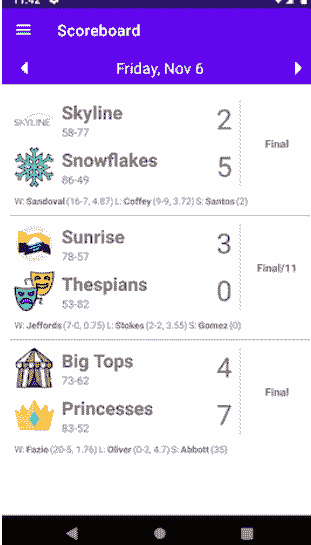

如果一切看起来不错，那么你这里就全部准备好了，我们很快就可以收尾了。但在你离开之前，看看 `goToDate`，了解我们如何处理日期变化。一切都以 `selectedDate` 为关键；当该值改变时，由于 `Transformations.switchMap` 调用被分配给 `games` 值，我们就会加载新的比赛。

通过将所有内容链接到 `selectedDate`，我们有了一个统一的方法来加载和刷新数据。如果将来我们想允许用户直接跳转到任何日期，我们在这里几乎不需要做额外的工作。

## 总结与下一步

我们已经走出了应用程序，正在引入信息。如今我们开发的几乎每个应用程序都会有某种 API 或 Web 服务组件，因此你会知道在大多数现代 Android 开发中都会做这样的事情。

拥有一个支持 API 的 Room 数据库使我们的应用程序更具弹性，因为即使用户没有任何连接，我们也可以将数据带回给他们。通过在调用服务时稍加注意，我们可以为用户提供可靠的离线体验。

使用协程使这两个部分都成为可能，因为它允许我们轻松地调用 API 和数据库，而不会中断用户或 UI。协程无需添加大量额外代码来支持异步逻辑，而是使事情变得更加顺畅。

接下来在某种程度上是这个相同想法的第二部分——我们将从 API 中拉取球员数据，但采用略有不同的方法。现在，我们不再只是获取联盟或给定日期的所有内容，而是将数据列表拆分为页面。这样，我们只获取当前在列表中显示的球员，而不是每次请求都获取联盟中的所有人。

为此，我们将使用 Jetpack 的 Paging 库，它将在此过程中帮助我们。Paging 帮助我们减少数据使用量，并在显示数据列表时使我们的应用程序更具弹性。

### 脚注

- [2] https://square.github.io/retrofit/

- [10] https://squareup.com/

- [11] https://link.mfazio.dev/moshi

- [12] https://github.com/MFazio23/ABL-API-Client

# 第11章

## 使用分页显示数据

欢迎来到测试版章节！这意味着当你阅读时，这一章最有可能已经多次更改。

原因是我们将使用 Jetpack Paging 库的第 3 版。在我撰写本文时，此版本处于测试阶段，这意味着该库*尚未*完全定型，并且*可能*会发生变化。

那么，我究竟为什么要选择让我们使用这个库呢？因为这是未来正确的版本，也是你想要使用的版本。我宁愿让你学习新方法并稍微调整一下你所知道的内容，而不是让你完全升级你的屏幕。只需知道，与本书其他部分相比，这里的事情更有可能中断并需要更改。

现在，警告已经发出，让我们来了解分页的优点！Paging 库帮助你更轻松地显示长数据列表，同时限制进行的网络调用次数。当我们只是寻找 Nick Adam（按字母顺序排列在列表顶部附近）时，我们可以避免一次加载所有 420 名 ABL 球员。我们还将能够根据球员姓名搜索列表，同时仍然对结果进行分页，如[图像](image)所示。

分页功能与 Room 配合得非常出色，库会根据需要自动从本地数据库中拉取球员数据来填充页面，同时允许我们的 API 调用在后台进行。此外，这样即使用户处于离线状态，我们仍然可以显示已加载的所有球员信息。

在进入上图所示的球员界面之前，我们希望先添加两个与球员列表紧密相关的新界面：联盟排行榜和单个球员详情页。这两个页面与分页功能没有直接关联，但与球员界面结合得很好，因此我们在此一并介绍。此外，这些页面的构建过程也有一些有趣之处。


### 添加两个新 Fragment（排行榜和单个球员）

我们需要复制大量代码来设置这些界面。两个视图所需的所有代码都可以在 `Code` 文件夹下的 `chapter-11/code-to-copy` 中找到。你需要获取 `leaders` 和 `players` 包内的所有内容（`PlayerListItem` 和 `PlayersAdapter` 除外），并且 `Player` 和 `PlayerStats` 都需要成为 `BaseballDatabase` 中 `entities` 列表的一部分：

```
entities = [
    Player::class,
    PlayerStats::class,
    ScheduledGame::class,
    TeamStanding::class
]
```

`BaseballRepository` 和 `BaseballDao` 类也可以直接复制过来，因为它们包含了这两个页面的新功能以及我们到目前为止添加的所有其他内容。`data/Converters.kt` 和 `util/APIConverters.kt` 文件也是如此。

然后获取所有布局文件：`fragment_leaders.xml`、`fragment_leaders_list.xml`、`fragment_single_player.xml`、`leader_list_item.xml`、`single_player_stat_with_label.xml` 和 `single_player_stats.xml`。暂时不要获取与球员相关的布局文件，因为我们稍后会编写那部分代码。

最后，获取 `drawable/basic_circle.xml` 和 `navigation/nav_graph.xml` 资源文件，以及 `strings.xml`，除非你*真的*想自己编写一些字符串资源值。

在继续之前，请确保更新所有 `BaseballRepository` 类的初始化，因为现在它需要 `BaseballDatabase` 作为参数而不是 `BaseballDao`。我们将在本章后面解释原因，但现在先进行更改，以便你可以构建项目。

最后，添加 `View Pager` 依赖项（以及版本变量）：

```
implementation "androidx.viewpager2:viewpager2:$view_pager_version"
```

现在一切应该准备就绪了，启动应用程序并查看两个界面。你可以打开排行榜界面（注意你可以在击球和投球排行榜之间滑动），并点击球员查看他们的信息。排行榜界面和单个球员界面应该看起来像这样：

由于我们不会编写这些界面的代码，我想指出一些你可能感兴趣的要点。

### 在排行榜界面计算联盟排行榜

如前所述，排行榜界面包含击球和投球排行榜，分别列在不同的标签页中。这是通过组合使用 `<TabLayout>` 标签和 `<ViewPager2>` 标签来实现的。它们协同工作，根据所选标签页显示顶部标签和相应的视图。`TabLayoutMediator` 实例负责在 `LeadersFragment` 中切换内容，由于两个标签页的显示方式相同，我们可以使用 `fragment_leaders_list.xml` 中包含的单个布局。

排行榜界面上的标签滑动视图还有更多功能，因此我建议你自己查看代码。使用 `ViewPager2` 库可以大大简化多标签信息的显示，我们只需处理一些配置和数据加载。

现在，数据加载（以及转换过程）并不简单，但希望至少是合乎逻辑的。从高层次来看，我们从数据库加载 `PlayerWithStats` 对象，然后获取每个统计类别的顶级球员。很简单，对吧？

嗯，没有你想象的那么简单。问题之一是，在给定时间，我们不一定拥有联盟中的所有球员，而且我们不想下载所有人来计算排行榜，因为这会违背分页的目的。相反，我们可以使用 `getBattingLeaders` 和 `getPitchingLeaders` API 函数仅获取在至少一个类别中领先的 ABL 球员。我们将他们（连同他们的统计数据）放入数据库，然后可以提取他们来计算每个类别的排行榜。

这个计算可能是一堆复制粘贴的代码行，获取所有球员，按我们想要的任何类别排序，然后从列表中获取顶级球员，我们就能获得屏幕上排行榜列表项所需的数据。这种方法当然是有效的，但我们拥有 Kotlin 的强大功能，为什么不利用呢？

每个排行榜类别（击球和投球）基本上都在做同样的事情，因此这两个函数都是类似的单表达式，执行我刚才描述的操作。这里的技巧是，我们可以将所有统计类别放入一个大列表中，并对每个类别映射球员。填充 `battingLeaders` 的函数如下所示：

```
battingLeaders =
Transformations.map(repo.getBattersWithStats()) { battersWithStats ->
    battingStatCategories.mapIndexed { index, handler ->
        battersWithStats
            ?.sortedWith(handler.statComparator)
            ?.firstOrNull()?.let { batterWithStats ->
                LeaderListItem(
                    index.toLong(),
                    batterWithStats.player,
                    handler.category,
                    handler.formattedStatValue(batterWithStats),
                    UITeam.fromTeamId(
                        batterWithStats.player.teamId
                    )?.nickname ?: "N/A"
                )
            }
    }.filterNotNull()
}
```

我希望这在高层次上是有意义的，因为我们之前做过类似的事情，但这个神秘的 `handler` 对象可能会让你困惑。这是一个包含统计类别*以及*用于比较统计数据和为 UI 格式化统计信息的函数的对象。例如，打击率的 `PlayerStatHandler` 对象如下所示：

```
PlayerStatHandler(
    category = "AVG",
    statComparator = { batterA, batterB ->
        -batterA.stats.batterStats.battingAverage.compareTo(
            batterB.stats.batterStats.battingAverage
        )
    },
    formattedStatValue = { batter ->
        batter.stats.batterStats.battingAverage.toBattingPercentageString()
    }
)
```

这是一个 `String` 值和两个*lambda 函数*，两者都在我们的映射函数中使用。在这种情况下，我们显示标签 `"AVG"`，按打击率对球员进行排序（前面的负号使其降序），然后正确格式化打击率（例如，30% 的击球手显示为 `.300`）。

我想包含这一节，因为它不仅展示了从数据库获取数据的更高级映射方式，还展示了我们如何使用高阶函数在变量中传递逻辑。

### 回顾单个球员界面的概念

这确实是两个界面中较不令人兴奋的一个，因为我们之前已经介绍了这个页面中的概念。我们从 `SinglePlayerFragmentArgs` 类获取 `playerId` 值，从数据库加载 `PlayerWithStats` 对象，*然后*将该对象中的统计数据转换为前端使用的 `PlayerStatWithLabel` 对象。

这是对我们到目前为止所做工作的很好回顾：带有 `Transformations` 调用的 `LiveData`、`Repository`/`DAO`/`DB` 调用序列、数据绑定，甚至是很好的 `Toast` 错误消息。但现在是时候进入新内容了。

### 添加一个新 Fragment（球员）

如前所述，分页功能将在显示 ABL 球员时为用户节省大量带宽。此外，从数据库自动加载数据只需要我们进行一次 `DAO` 调用。在开始之前，添加单个 `Paging` 依赖项以及相关的版本变量：

```
implementation "androidx.paging:paging-runtime-ktx:$paging_version"
```

现在，我们已经有了 `Room` 依赖项，但请确保你使用的是至少 2.3 版本（即使是 alpha 版本）。这是让 `Room` 与 `Paging` 良好配合所必需的。

这个界面的基础部分也与其他列表页面类似，特别是 `PlayersAdapter` 类。我们最终会从 `Code` 目录复制它过来，但请注意，这里唯一的真正区别是我们使用了 `PagingDataAdapter` 基类而不是 `ListAdapter`。

第一步是创建一个新的 `PlayerListItem` 类。这个类将是我们球员列表中每一行使用的模型，因此要么复制它，要么手动添加：

```
@Entity(tableName = "player_list_items")
data class PlayerListItem(
    @PrimaryKey val playerId: String,
    val playerName: String,
    val teamId: String,
    val position: Position
)
```

是的，`PlayerListItem` 类是一个我们保存在数据库中的 `@Entity`，不，我没有忘记 `Player` 类。我在这里引入一个新的 `@Entity` 的原因是，这样我们可以有一个只与球员界面连接的数据库表。由于我们在其他地方使用 `Player` 类

在某些情况下，数据加载的顺序可能会被打乱，并在获取新数据时引发问题。这种隔离机制避免了此类问题，让分页库能够完全掌控流程。

请确保将 `PlayerListItem` 添加到 `BaseballDatabase` 关联的 `entities` 数组中，然后我们就可以继续处理 `PlayersFragment` 了。

`PlayersFragment` 的初始结构与其他视图类似，包含一些 `NavArgs`、一个 `ViewModel` 类和一个适配器。`Fragment` 代码通过视图绑定与 UI 连接，我们甚至会为每个列表项添加一个漂亮的分隔线。

该类的第一个版本大致如下：

```kotlin
class PlayersFragment : Fragment() {

    private val playerListArgs: PlayersFragmentArgs by navArgs()

    private lateinit var playersAdapter: PlayersAdapter

    override fun onCreateView(
        inflater: LayoutInflater,
        container: ViewGroup?,
        savedInstanceState: Bundle?
    ): View {
        val binding = FragmentPlayersBinding.inflate(inflater)

        this.playersAdapter = PlayersAdapter()

        with(binding.playersList) {
            adapter = playersAdapter
            addItemDecoration(
                DividerItemDecoration(
                    context,
                    LinearLayoutManager.VERTICAL
                )
            )
        }

        return binding.root
    }
}
```

我们只需复制所需的 XML 文件：`fragment_players.xml` 和 `player_list_item.xml`，以及 `PlayersAdapter` 类。这里唯一值得注意的新内容是 `fragment_players.xml` 中包含了一个 `<TextInputLayout>`，其中有一个 `<TextInputEditText>` 字段。这将是我们将在本章末尾实现的搜索框。

请确保也在 `nav_graph.xml` 文件中包含 `PlayersFragment`，否则 `PlayersFragment` 会出现错误：

```xml
<fragment
    android:id="@+id/playersFragment"
    android:name="dev.mfazio.abl.players.PlayersFragment"
    android:label="@string/players">

    <argument
        android:name="teamId"
        android:defaultValue="@null"
        app:argType="string"
        app:nullable="true" />
</fragment>
```

目前这个界面还不太有趣，因为数据库中还没有任何球员列表项。让我们先设置 `BaseballRepository` 和 `BaseballDao` 中的调用，然后创建一个新的 `PlayerListRemoteMediator` 类，最后设置 `PlayerListViewModel`。

### 在应用中处理分页数据

现在我们进入本章的核心以及所有酷炫的新功能。这部分内容也可能需要根据未来分页库的变化进行调整，因此如果遇到任何不符合预期的情况，请注意。让我们从更熟悉的内容开始，添加我们的 `BaseballDao` 函数。

### 在数据库中管理 PlayerListItem 对象

我们需要三个与 `PlayerListItem` 对象相关的新函数：`getPlayerListItems`、`insertPlayerListItems` 和 `deleteAllPlayerListItems`。这些新函数中唯一的新内容是我们的 `@Query` 函数返回了一个 `PagingSource` 对象：

```kotlin
@Query(
    """
    SELECT * FROM player_list_items
    WHERE (:teamId IS NULL OR teamId = :teamId)
    AND (:nameQuery IS NULL OR playerName LIKE :nameQuery)
    ORDER BY playerId
    """
)
abstract fun getPlayerListItems(
    teamId: String? = null,
    nameQuery: String? = null
): PagingSource<Int, PlayerListItem>

@Insert(onConflict = OnConflictStrategy.REPLACE)
abstract suspend fun insertPlayerListItems(
    playerListItems: List<PlayerListItem>
)

@Query("DELETE FROM player_list_items")
abstract suspend fun deleteAllPlayerListItems()
```

注意我们没有 `@Update` 函数？这是因为分页库会添加或追加数据，除非发生刷新，此时数据库表中的所有内容都会被清除并重新加载。这意味着我们实际上从不更新现有记录，只添加新记录。

然而，仅靠 `PlayerListItem` 对象本身是不够的；我们还需要跟踪每个项目所在的页面。为此，我们添加了一个 `PlayerKeys` 类以及一些相关的内容。

### 使用 PlayerKeys 跟踪分页

分页库将结合 `PlayerListItem` 和 `PlayerKeys` 类来确定球员在屏幕上的位置。基于此，我们本可以一开始就将这两个类合并在一起。但我没有这样做，原因有二：我想突出 `PlayerKeys` 类及其在分页中的作用，而且从关注点分离的角度来看，拥有两个类更有意义。

幸运的是，`PlayerKeys` 的部分都不复杂。这个类通过 `playerId` 将 `PlayerListItem` 与前一页和后一页连接起来，如下所示：

```kotlin
@Entity(tableName = "player_keys")
data class PlayerKeys(
    @PrimaryKey val playerId: String,
    val previousKey: Int?,
    val nextKey: Int?
)
```

坚持分离的主题，我们将为所有 `PlayerKeys` 交互创建一个新的 `PlayerKeysDao` 接口。如果我们愿意，实际上可以将 `BaseballDao` 重构为单独的类（`Players`、`Stats`、`Games`/`Standings` 等），但这取决于个人和/或团队的偏好。

我们将在这里有三个与 `PlayerListItem` 类似的函数：`getPlayerKeysByPlayerId`、`insertKeys` 和 `deleteAllPlayerKeys`。新的 `PlayerKeysDao` 如下所示：


```kotlin
@Dao
interface PlayerKeysDao {

    @Query("SELECT * FROM player_keys WHERE playerId = :playerId")
    suspend fun getPlayerKeysByPlayerId(playerId: String): PlayerKeys?

    @Insert(onConflict = OnConflictStrategy.REPLACE)
    suspend fun insertKeys(keys: List<PlayerKeys>)

    @Query("DELETE FROM player_keys")
    suspend fun deleteAllPlayerKeys()

}
```

请确保将`playerKeysDao`函数和`PlayerKeys`（以及`PlayerListItem`，如果你还没有添加的话）类引用添加到`BaseballDatabase`中：

```kotlin
@Database(
    entities = [
        Player::class,
        PlayerListItem::class,
        PlayerKeys::class,
        PlayerStats::class,
        ScheduledGame::class,
        TeamStanding::class
    ],
    exportSchema = false,
    version = 1
)
@TypeConverters(Converters::class)
abstract class BaseballDatabase : RoomDatabase() {
    abstract fun baseballDao(): BaseballDao
    abstract fun playerKeysDao(): PlayerKeysDao

    companion object {
        初始化逻辑仍然在这里。
    }
}
```

至此，我们已准备好在`RemoteMediator`类中使用`PlayerKeys`类。这正是我们将处理从 API 和数据库加载数据，并将这些数据添加到球员列表的地方。

### 使用 PlayerListRemoteMediator 处理本地和远程数据

`PlayerListRemoteMediator`类是我们分页功能的核心，因为它负责确定列表中接下来需要显示哪些数据。此外，它还从 ABL API 加载数据并将其存储在数据库中，我们稍后会从中提取。你可以将名称中的“Mediator”部分理解为它处理新（API）数据和现有（DB）数据之间的协调。

我们`RemoteMediator`类中的主要函数是`load`函数，它接收`LoadType`（Prepend、Append 或 Refresh）和一个`PagingState`。该`PagingState`保存了先前加载的页面、我们在列表中的位置以及用于列表的`PagingConfig`（我们稍后设置时会初始化）。

我们版本的`RemoteMediator`类接收`AndroidBaseballLeagueService`和`BaseballDatabase`实例来处理所有数据需求。我们还包括`teamId`和`nameQuery`参数，可用于过滤数据。`PlayerListRemoteMediator`类的大致结构如下：

```kotlin
@ExperimentalPagingApi
class PlayerListRemoteMediator(
    private val apiService: AndroidBaseballLeagueService,
    private val baseballDatabase: BaseballDatabase,
    private val teamId: String? = null,
    private val nameQuery: String? = null
) : RemoteMediator<Int, PlayerListItem>() {

    override suspend fun load(
        loadType: LoadType,
        state: PagingState<Int, PlayerListItem>
    ): MediatorResult {
        //接下来会介绍。
    }
}
```

### 计算当前页

获取当前页的逻辑取决于我们需要处理哪种`LoadType`。确定`LoadType`的工作由分页库完成，我们只需获取一个键值或告诉分页库我们已完成数据加载。处理所有三种情况的代码块如下所示：

```kotlin
val page = when (loadType) {
    LoadType.PREPEND -> {
        val keys = loadKeysForFirstPlayer(state)
            ?: return MediatorResult.Error(
                InvalidObjectException("Keys should not be null for $loadType.")
            )

        keys.previousKey ?:
            return MediatorResult.Success(endOfPaginationReached = true)
    }
    LoadType.APPEND -> {
        val keys = loadKeysForLastPlayer(state)

        keys?.nextKey
            ?: return MediatorResult.Success(endOfPaginationReached = false)
    }
    LoadType.REFRESH -> {
        val keys = loadKeysForClosestPlayer(state)

        keys?.nextKey ?: startingPageIndex
    }
}
```

如果这段代码让你感到困惑，可以这样理解：PREPEND 想要确定从列表顶部开始添加哪一页，因此需要最顶部已加载页面的键。APPEND 则相反，它查找最后加载的项目，然后返回其后应加载的页面。REFRESH 则是确定我们当前的位置，以便知道从哪一页开始加载全新的数据。

这三个`loadKeys`函数都在处理查找与相关项目（顶部、底部或当前）关联的`PlayerKeys`的逻辑。由于它们执行的操作相似，每种情况下的逻辑也类似：

```kotlin
private suspend fun loadKeysForFirstPlayer(
    state: PagingState<Int, PlayerListItem>
) = state.pages.firstOrNull { it.data.isNotEmpty() }
    ?.data?.firstOrNull()?.let { player ->
        baseballDatabase
            .playerKeysDao()
            .getPlayerKeysByPlayerId(player.playerId)
    }
```

```kotlin
private suspend fun loadKeysForLastPlayer(
    state: PagingState<Int, PlayerListItem>
) = state.pages.lastOrNull { it.data.isNotEmpty() }
    ?.data?.lastOrNull()?.let { player ->
        baseballDatabase
            .playerKeysDao()
            .getPlayerKeysByPlayerId(player.playerId)
    }
```

```kotlin
private suspend fun loadKeysForClosestPlayer(
    state: PagingState<Int, PlayerListItem>
) = state.anchorPosition?.let { position ->
    state.closestItemToPosition(position)?.playerId?.let { playerId ->
        baseballDatabase
            .playerKeysDao()
            .getPlayerKeysByPlayerId(playerId)
    }
}
```

关于键值，还缺少一个`startingPageIndex`变量，在我们的例子中它等于零，因为这是我们 API 返回的第一页。

```kotlin
companion object {
    private const val startingPageIndex = 0
}
```

### 加载并保存 API 数据

接下来是`load`函数的数据处理部分，它总是以 API 调用开始，以某种数据库交互结束。我们在`page`逻辑之后立即调用该函数：

```kotlin
override suspend fun load(
    loadType: LoadType,
    state: PagingState<Int, PlayerListItem>
): MediatorResult {
    val page = when (loadType) {
        //页面逻辑仍在这里。
    }

    return loadAndSaveApiData(page, state, loadType ==
        LoadType.REFRESH)
}
```

`loadAndSaveApiData`是一个返回`try/catch`块的表达式，这在 Kotlin 中是有效的。我们这样做是为了捕获逻辑中可能抛出的任何`Exception`，因为我们绝不希望它导致应用崩溃。相反，我们返回一个包含该异常的`MediatorResult.Error`实例。虽然我们在应用中没有对其进行任何处理，但你可以利用这个`Exception`向用户提供更多关于错误的信息，或者记录诊断信息以供故障排除。

```kotlin
private suspend fun loadAndSaveApiData(
    page: Int,
    state: PagingState<Int, PlayerListItem>,
    isRefresh: Boolean
): MediatorResult =
    try {
        // 接下来将实现此部分。
    } catch (ex: Exception) {
        MediatorResult.Error(ex)
    }
```

在这里调用 API 比在`BaseballRepository`中更简单，因为我们不需要处理请求的任何错误（因为外层的`try/catch`块已经处理了）。这让我们可以专注于获取数据，将结果转换为`List<Player>`，并检查是否已到达分页末尾（意味着我们已从 API 获取到列表的末尾）。然后我们可以在处理数据库时使用这些结果。API 逻辑如下所示：

```kotlin
private suspend fun loadAndSaveApiData(
    page: Int,
    state: PagingState<Int, PlayerListItem>,
    isRefresh: Boolean
): MediatorResult =
    try {
        val apiResponse = apiService.getPlayers(
            page,
            state.config.pageSize,
            nameQuery,
            teamId
        )

        val players = apiResponse.convertToPlayers()

        val endOfPaginationReached = players.isEmpty()

        // 这里将是数据库逻辑。

    } catch (ex: Exception) {
        MediatorResult.Error(ex)
    }
```

一旦我们从 API 结果中转换出`<Player>`列表，就可以将其存入数据库。在这里，我们为`PlayerListItem`确定正确的键，然后将`PlayerKeys`、`PlayerListItem`和`Player`实例插入数据库。最后一个表在这里没有被使用，但我们已经有了数据，为什么不保存呢？

类似于我们使用`@Transaction`注解标记引用多个表的函数，我们希望确保这里的所有操作要么全部完成，要么全部不执行。这一个代码块正是我们将`BaseballRepository`改为引用`BaseballDatabase`而不是`BaseballDao`的全部原因。虽然有些麻烦，但使用`withTransaction`在这里确实非常方便，可以确保我们不会留下不一致的数据：

```kotlin
baseballDatabase.withTransaction {
    // 接下来的步骤将在这里。
}
```

接下来的三个代码片段都放在这个`withTransaction`块内。第一个检查是看我们是否在刷新列表，如果是，我们希望清空`player_list_items`和`player_keys`两个表：

```kotlin
if (isRefresh) {
    baseballDatabase.playerKeysDao().deleteAllPlayerKeys()
    baseballDatabase.baseballDao().deleteAllPlayerListItems()
}
```

然后我们需要确定页面的上一页和下一页键，并将所有传入的玩家映射为`PlayerKeys`实例：

```kotlin
val previousKey = if (page == startingPageIndex) null else page - 1
val nextKey = if (endOfPaginationReached) null else page + 1
val keys = players.map { player ->
    PlayerKeys(player.playerId, previousKey, nextKey)
}
```

最后，我们将这些新的`PlayerKeys`与`PlayerListItem`和`Player`实例一起放入数据库。逻辑如下：

```kotlin
baseballDatabase.playerKeysDao().insertKeys(keys)
baseballDatabase.baseballDao().insertOrUpdatePlayers(players)
baseballDatabase.baseballDao().insertPlayerListItems(
    players.map { player ->
        PlayerListItem(
            player.playerId,
            player.fullName,
            player.teamId,
            player.position
        )
    }
)
```

一旦事务块完成，我们需要返回一个`Success`消息，告知是否已到达页面末尾。请记住，我们在这里不使用`return`关键字，因为我们处于一个表达式块中：

```kotlin
MediatorResult.Success(endOfPaginationReached =
endOfPaginationReached)
```

至此，`PlayerListRemoteMediator`已经可以使用了！接下来，我们将前往`BaseballRepository`进行配置。

### 使用 Flow 加载分页数据

`BaseballRepository`中讨论的函数是`getPlayerListItems`，它返回一个包含`PagingData`的 Kotlin`Flow`对象。在我们了解这个类如何获取`PagingData`之前，让我们先聊聊`Flow`。

Kotlin`Flow`是一个异步计算的数据流，其值可以彼此独立地返回。这与必须作为单个项目或集合一起返回的`LiveData`形成对比。

在实践中，我们可以以类似于`LiveData`的方式使用`Flow`对象，但`Flow`实例也特别适合与分页库配合使用（因为我们可以持续发送新的数据页）。`Flow`还有一些我们这里不会用到的额外强大功能，比如能够像处理“普通”列表/序列数据一样对数据进行`map`和`filter`。

一旦我们进入`PlayerListViewModel`，我们将更深入地了解使用`Flow`与`LiveData`的区别，但首先我们需要在一个新的`Pager`实例中使用`PlayerListRemoteMediator`。


我们在这里向`Pager`实例传递三个参数：一个包含`pageSize`的`PagingConfig`实例、一个指向`PlayerListRemoteMediator`的引用，以及一个`pagingSourceFactory`。

最后一部分是一个返回`PagingSource`实例的函数。这与我们从`BaseballDao.getPlayerListItems`返回的类相同，因此我们可以创建一个 lambda 函数来返回对该函数调用的结果。`Pager`类如下所示：

```
Pager(
    config = PagingConfig(
        pageSize = defaultPageSize
    ),
    remoteMediator = PlayerListRemoteMediator(
        apiService,
        baseballDatabase,
        teamId,
        nameQuery
    ),
    // 是的，这实际上是一个函数。
    pagingSourceFactory = {
        baseballDao.getPlayerListItems(teamId, dbNameQuery)
    }
)
```

我们仍然需要`dbNameQuery`，它允许我们在查询中使用`LIKE`表达式：

```
val dbNameQuery = if (nameQuery != null) "%$nameQuery%" else null
```

然后，这里的最后一部分是关于我们要创建的`Pager`对象。我们将从`Pager`对象返回一个`Flow`对象，这可以通过引用`Pager`对象上的`flow`属性来实现。整个函数（顶部带有`@ExperimentalPagingApi`注解）如下所示：

```
@ExperimentalPagingApi
fun getPlayerListItems(
    teamId: String?,
    nameQuery: String?
): Flow<PagingData<PlayerListItem>> {
    val dbNameQuery = if (nameQuery != null) "%$nameQuery%" else null
    return Pager(
        config = PagingConfig(
            pageSize = defaultPageSize
        ),
        remoteMediator = PlayerListRemoteMediator(
            apiService,
            baseballDatabase,
            teamId,
            nameQuery
        ),
        pagingSourceFactory = {
            baseballDao.getPlayerListItems(teamId, dbNameQuery)
        }
    ).flow
}
```

别忘了在`companion object`中添加`defaultPageSize`变量并将其设置为你想要的任何值：

```
companion object {
    private val apiService = getDefaultABLService()
    private const val defaultPageSize = 25

    @Volatile
    private var instance: BaseballRepository? = null

    fun getInstance(baseballDatabase: BaseballDatabase) =
        this.instance ?: synchronized(this) {
            instance ?: BaseballRepository(baseballDatabase).also {
                instance = it
            }
        }
}
```

这个值应该是一个能让 API 调用足够快地完成，使用户看不到任何卡顿，同时又能避免发起过多 API 调用的值。这是一个平衡，取决于每个项目带来多少数据，你需要调整这个数字以找到最适合你的值。

完成后，现在是时候创建`PlayerListViewModel`了，它将引用这个`getPlayerListItems`函数。

## 通过 PlayerListViewModel 引入数据

在基本层面上，这与之前的 ViewModel 类相同。以下是该类的大部分内容：

```
@ExperimentalPagingApi
class PlayerListViewModel(application: Application) :
    AndroidViewModel(application) {

    private val repo: BaseballRepository

    init {
        repo = BaseballDatabase
            .getDatabase(application, viewModelScope)
            .let { db ->
                BaseballRepository.getInstance(db)
            }
    }

    fun getPlayerListItems(
        teamId: String? = null,
        nameQuery: String? = null
    ): Flow<PagingData<PlayerListItem>> {
        // 接下来会实现
    }
}
```

`getPlayerListItems`函数的主要目的是调用`BaseballRepository`中的`getPlayerListItems`函数，并将其发送给`PlayersFragment`。由于我们返回的是一个`Flow`对象，我们可以缓存它以供后续使用：

```
repo.getPlayerListItems(teamId, nameQuery).cachedIn(viewModelScope)
```

除了这一点缓存之外，我们还想将此函数的结果保存在视图模型中。这样，如果使用相同的过滤参数（团队和名称查询）请求相同的数据，我们返回相同的结果。因此，我们保存最后的查询值以及从仓库返回的数据，以防万一。整个`PlayerListViewModel`如下所示：

```
@ExperimentalPagingApi
class PlayerListViewModel(application: Application) :
    AndroidViewModel(application) {

    private val repo: BaseballRepository

    private var currentTeamId: String? = null
    private var currentNameQuery: String? = null

    private var currentPlayerListItems:
        Flow<PagingData<PlayerListItem>>? = null

    init {
        repo = BaseballDatabase
            .getDatabase(application, viewModelScope)
            .let { db ->
                BaseballRepository.getInstance(db)
            }
    }

    fun getPlayerListItems(
        teamId: String? = null,
        nameQuery: String? = null
    ): Flow<PagingData<PlayerListItem>> {
        val lastResult = currentPlayerListItems

        return if (
            teamId == currentTeamId &&
            nameQuery == currentNameQuery &&
            lastResult != null
        ) {
            lastResult
        } else {
            currentNameQuery = nameQuery
            currentTeamId = teamId

            val newResult = repo
                .getPlayerListItems(teamId, nameQuery)
                .cachedIn(viewModelScope)

            currentPlayerListItems = newResult

            newResult
        }
    }
}
```

`PlayerListViewModel`全部设置好后，我们还剩下`PlayersFragment`及其`RecyclerView`。

## 在 RecyclerView 列表中显示分页数据

我们在`PlayersFragment`中有三个任务要完成：绑定`playersList` `RecyclerView`、实现一个`searchPlayers`函数，以及绑定`playerSearchBoxText`文本框。我们从`RecyclerView`开始，因为我们以前做过，如果你从`Code`目录复制了`PlayersFragment`，可以跳过这部分：

```
override fun onCreateView(
    inflater: LayoutInflater,
    container: ViewGroup?,
    savedInstanceState: Bundle?
): View {
    val binding = FragmentPlayersBinding.inflate(inflater)

    this.playersAdapter = PlayersAdapter()

    with(binding.playersList) {
        adapter = playersAdapter
        addItemDecoration(
            DividerItemDecoration(context, LinearLayoutManager.VERTICAL)
        )
    }

    // 绑定文本框

    // 搜索球员

    return binding.root
}
```

球员搜索功能与我们过去使用`LiveData`的方式不同，但这没什么你处理不了的。

## 搜索球员

在之前的`RecyclerView`列表中，我们会对一个`LiveData`调用`observe`，每当获得新数据时，它就会更新列表。

对于`PlayersFragment`类，我们将做同样的事情，但方法略有不同。我们现在不是链接到`LiveData`并让其加上 Room 处理一切，而是将使用`getPlayerListItems`中的`collectLatest`函数来获取数据。调用`collectLatest`会给我们`Flow`对象内部的数据，这样我们就可以将其发送给`playersAdapter`和`RecyclerView`：

```
playersListViewModel
    .getPlayerListItems(playerListArgs.teamId, nameQuery)
    .collectLatest { playerListItems ->
        if(::playersAdapter.isInitialized) {
            playersAdapter.submitData(playerListItems)
        }
    }
```

由于我们在这里调用的是一个`suspend fun`（`collectLatest`），这所有内容都需要在一个协程作用域中。这个调用在协程中，一如既往地有助于将调用移到后台线程，这样我们就不会阻塞 UI。但这里还有一个额外的好处，我们可以保存该作用域中的`Job`，然后在发送另一个请求时取消它。这样我们就可以避免同时进行多个调用。

声明`playersListViewModel`和`currentJob`变量：

```
private var currentJob: Job? = null
```

并为该类添加`@ExperimentalPagingApi`注解：

```
@ExperimentalPagingApi
class PlayersFragment : Fragment()
```

然后我们可以构建`searchPlayers`函数的其余部分：

```
private fun searchPlayers(nameQuery: String? = null) {
    currentJob?.cancel()

    currentJob = lifecycleScope.launch {
        playersListViewModel
            .getPlayerListItems(playerListArgs.teamId, nameQuery)
            .collectLatest { playerListItems ->
                if(::playersAdapter.isInitialized) {
                    playersAdapter.submitData(playerListItems)
                }
            }
    }
}
```

我们只需要在查询条件发生变化（或`teamId`变量改变）时调用`searchPlayers`。如果数据库中的`PlayerListItem`记录被更新，或者我们需要新数据，所有这些都会自动显示，就像我们使用`LiveData`时一样。我们在`onCreateView`函数的末尾调用`searchPlayers`，这在用户想要按球员姓名查询之前就足够了。

说到用户搜索，我们最后的工作是与列表顶部的“搜索球员”框进行交互。在这里，我们将监听“执行”操作或“清除”操作。“执行”操作包括用户点击键盘上的勾选按钮，或按下物理键盘上的回车键，或设备虚拟键盘上的等效按键。“清除”操作则在用户点击文本框右侧的 X 图标时触发。

“执行”监听器被添加到我们`binding`对象的`playerSearchBoxText`项上。在这两种情况下，如果我们收到预期的操作，就使用文本框中的`text`值调用`searchPlayers`，并返回`true`告诉`TextInputEditText`上的监听器我们已处理该事件；否则返回`false`表示我们忽略该操作。整个绑定块如下所示：

```
with(binding.playerSearchBoxText) {
    setOnEditorActionListener { _, actionId, _ ->
        if (actionId == EditorInfo.IME_ACTION_GO) {
            searchPlayers(text.toString().trim())
            true
        } else {
            false
        }
    }
}
```

```
setOnKeyListener { _, keyCode, event ->
    if (event.action == KeyEvent.ACTION_DOWN &&
        keyCode == KeyEvent.KEYCODE_ENTER) {
        searchPlayers(text.toString().trim())
        true
    } else {
        false
    }
}
```

“清除”操作的工作方式类似，使用`binding.playerSearchBox`上的`setEndIconOnClickListener`函数。现在，`<TextInputLayout>`有一个`app:endIconMode`属性，设置为`clear_text`，本可以为我们处理这个。但这种自动方式的唯一问题是，我们无法轻松添加额外操作，特别是在清除数据时进行搜索的能力，因此我们必须手动处理：

```
binding.playerSearchBox.setEndIconOnClickListener {
    binding.playerSearchBoxText.text?.let { text ->
        text.clear()
        searchPlayers()
    }
}
```

至此，我们能够在屏幕上搜索球员，同时保持正确的分页，我们的球员屏幕就完成了。请确保你在`onCreateView`的末尾调用了`searchPlayers`，否则看起来就像我们什么都没做，那就太遗憾了。

## 按球队筛选球员


在结束本章之前，最后一个更新。在`fragment_single_team.xml`中，一个名为`viewRosterButtonClickListener`的`<variable>`被附加到“查看阵容”按钮上，但之前无处可去。现在它有了去处。

在`SingleTeamFragment`中，我们希望将一个新的`View.OnClickListener`绑定到该`viewRosterButtonClickListener`变量，并在点击时导航到球员屏幕。在`onCreateView`函数和大型`apply`块中，我们有以下代码：

```
viewRosterButtonClickListener = View.OnClickListener { view ->
    val action = NavGraphDirections.actionGoToTeamRoster(
        args.teamId
    )

    view.findNavController().navigate(action)
}
```

现在，当有人点击任何球队屏幕上的“查看阵容”按钮时，他们将进入球员屏幕，但只显示该球队的球员，如[图片](image)所示。

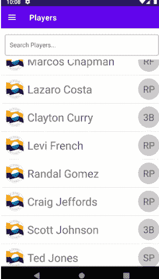

## 总结与下一步

我们的球员屏幕已完成，并与 Paging 库完全集成。我们能够持续向用户显示更多球员，而列表没有任何卡顿或减速，无需预先获取所有数据。用户获得了更好的体验，同时可能比原本使用更少的数据。此外，你还初步了解了 Flow 的使用，它能做的远不止我们这里涵盖的内容。

我们还能用这三个新屏幕或 Paging 做些什么？也许你想扩展用户页面，点击某个类别时显示该类别前 10/20/50/100 名球员。或者你可以添加一个包含逐场比赛数据的页面，同样使用 Paging 库只加载你当前正在查看的比赛。任何可能拥有大量（甚至理论上无限）数据的列表都将受益于 Paging 库。

接下来是为用户准备设置页面。这一次，我们将完全用代码构建它，不像第 7 章 [使用设置和主题自定义应用](https://pragprog.com/titles/ahwm2/customize-an-app-with-settings-and-themes/)。我们将添加一些应用与服务器之间的同步功能，并全面学习用于从图像中提取颜色的 Palette 库。

# 第 12 章

## 个性化 Android 棒球联盟应用

ABL 应用已接近完成。所有主要屏幕都已准备就绪，我们正在从 ABL API 拉取数据，并且应用易于导航。我们可以安全地停下来，为所有 ABL 粉丝提供一个可爱的应用，但为什么不添加一点润色呢？

回到第 7 章 [使用设置和主题自定义应用](Customize an App with Settings and Themes)，我们使用设置页面为用户提供更多关于如何玩他们的“便士掉落”游戏的选项。此外，他们可以根据自己的意愿更改应用的外观和感觉。我们当然可以在这里这样做，老实说在大多数情况下*会*这样做，但我们现在将跳过很多主题设置，以突出一些新概念。

在本章中，我们将回到`PreferenceFragmentCompat`类，允许用户自定义他们的应用。但这次，我们将探讨一些不同的东西。

用户将能够设置他们最喜欢的球队，根据该球队进行一些样式设置（但没有主题，正如你将看到的），甚至设置应用的启动点。我们将完全不编写任何 XML 来完成所有这些，至少对于设置屏幕是这样。此外，一旦这一切准备就绪，我们将把用户的设置备份到服务器。

在深入设置屏幕之前，让我们先设置一些与主题相关的内容。我们想使用 Android 绿色作为我们的主色（因为 ABL 使用的是相同的颜色），并另外包含一些从 ABL 标志中提取的额外颜色。将以下颜色添加到你的`res/values/colors.xml`文件中：

```
<color name="androidGreen">#00DE7A</color>
<color name="darkAndroidGreen">#006f3d</color>
<color name="ablTan">#afad97</color>
<color name="darkAblTan">#9b977e</color>
```

然后，在你的主题文件（普通和夜间模式）中，确保你指向一个 NoActionBar 父级。然后更新品牌颜色以及状态栏/导航栏颜色：

```
<!-- Primary brand color. -->
<item name="colorPrimary">@color/androidGreen</item>
<item name="colorPrimaryVariant">@color/darkAndroidGreen</item>
<item name="colorOnPrimary">@android:color/white</item>
<!-- Secondary brand color. -->
<item name="colorSecondary">@color/ablTan</item>
<item name="colorSecondaryVariant">@color/darkAblTan</item>
<item name="colorOnSecondary">@android:color/black</item>
<!-- Status bar color. -->
<item name="android:statusBarColor" tools:targetApi="l">
    ?attr/colorPrimaryVariant
</item>
<!-- Navigation bar color. -->
<item name="android:navigationBarColor" tools:targetApi="l">
    ?attr/colorPrimary
</item>
```

如果你需要确认你的更改，两个文件都在`code-to-copy`目录中。我们的应用现在看起来更符合品牌了，所以我们可以继续在设置页面中添加一些新内容。

### 通过代码构建设置屏幕

我在 [添加偏好设置资源文件](Add the Preferences Resource File) 中提到过，可以构建一个代码驱动的设置屏幕，现在感觉是创建它的完美时机。但在我们做任何事情之前，我们需要引入偏好设置依赖项：

```
implementation "androidx.preference:preference-ktx:$preference_version"
```

添加版本变量并同步后，我们希望在一个新的`settings`包中创建一个名为`SettingsFragment`的新类。

#### 创建 SettingsFragment 类

像之前一样，这将是`PreferenceFragmentCompat`类的子类，并包含一个`onCreatePreferences`函数：

```
class SettingsFragment : PreferenceFragmentCompat() {

    override fun onCreatePreferences(
        savedInstanceState: Bundle?,
        rootKey: String?
    ) {
        // 接下来
    }
}
```

这次的不同之处在于，我们不是添加`xml/preferences.xml`文件，而是将在`onCreatePreferences`内部完成所有操作。这意味着我们在这里创建`Preference`类型，而不是像我们在 Penny Drop 中那样调用`findPreference`。首先，我们需要一个`PreferenceScreen`对象，我们可以向其中添加所有设置。

我们使用`createPreferenceScreen`函数来获取该`PreferenceScreen`对象，它接受`preferenceManager.context`。`preferenceManager`值来自`PreferenceFragmentCompat`类，是`getPreferenceManager`函数的 Kotlin 简写。

在 Java 端。一旦我们获得了`PreferenceScreen`对象，就可以将其赋值回`PreferenceFragmentCompat`中的`preferenceScreen`变量：

```kotlin
override fun onCreatePreferences(
    savedInstanceState: Bundle?,
    rootKey: String?
) {
    val ctx = preferenceManager.context
    val screen = preferenceManager.createPreferenceScreen(ctx)

    // 单个偏好设置项将在此处添加。

    preferenceScreen = screen
}
```

我创建`ctx`值的原因是，我们将在向屏幕添加每个`Preference`时使用它，因此使用更短的名称可以使代码更易于阅读。在向此屏幕添加任何`Preference`对象之前，让我们先通过在`nav_graph.xml`中添加一个新的`<fragment>`标签来允许我们导航到这里：

```xml
<fragment
    android:id="@+id/settingsFragment"
    android:name="dev.mfazio.abl.settings.SettingsFragment"
    android:label="@string/settings"/>
```

一旦完成，我们就可以随时运行应用程序。当然，设置页面目前还没有任何内容，那么我们为什么不现在就去添加呢？

### 添加“最爱球队”偏好设置

既然我们在这里进行一些自定义，我们将从允许用户在应用中设置他们最喜欢的 ABL 球队开始。我们可以将此用于应用中的各种自定义，尽管在本章中我们只关心一点颜色变化（我们稍后会处理）。

“最爱球队”设置将是一个`DropDownPreference`（与 Penny Drop 中的应用主题设置相同），包含 ABL 中的所有球队。我们还想包含一个“无”选项，以防他们只是热爱联赛，不想专注于单个球队。此偏好设置遵循我们将用于其余偏好设置的相同模式，即我们使用`const string`值作为偏好设置键，所有这些键都放在`companion object`中：

```kotlin
companion object {
    const val favoriteTeamPreferenceKey = "favoriteTeam"
}
```

然后我们在初始化`favoriteTeamPreference`时使用该键（这也需要在类顶部声明一个`lateinit var`）：

```kotlin
class SettingsFragment : PreferenceFragmentCompat() {
    private lateinit var favoriteTeamPreference: DropDownPreference

    override fun onCreatePreferences(
        savedInstanceState: Bundle?,
        rootKey: String?
    ) {
        val ctx = preferenceManager.context
        val screen = preferenceManager.createPreferenceScreen(ctx)

        this.favoriteTeamPreference = DropDownPreference(ctx).apply {
            key = favoriteTeamPreferenceKey
            title = getString(R.string.favorite_team)
            entries = (listOf("None")
                + UITeam.allTeams.map { it.teamName }).toTypedArray()
            entryValues = (listOf("")
                + UITeam.allTeams.map { it.teamId }).toTypedArray()
            setDefaultValue("")
            summaryProvider =
                ListPreference.SimpleSummaryProvider.getInstance()
        }

        screen.addPreference(favoriteTeamPreference)

        preferenceScreen = screen
    }

    companion object {
        const val favoriteTeamPreferenceKey = "favoriteTeam"
    }
}
```

`entries`和`entryValues`的设置方式可能看起来有点令人困惑。在基本层面上，我们使用了过去创建的所有`UITeam`对象，加上我之前提到的默认值“无”。我们可以使用`+`号将`List`对象连接在一起，创建一个包含两个列表元素的新`List`。这就是为什么我们使用`listOf`来包含单个值“无”或空字符串。

像之前一样，我们使用`SimpleSummaryProvider`在主设置页面上显示当前选中的条目（`entries`中的值）。设置看起来像以下两种之一：


嗯，这很有帮助但不太有趣，不是吗？我们为什么不在这里用一个标志来让事情变得有趣一点呢。偏好设置有一个内置图标，我们可以在设置最爱球队时使用。

### 为“最爱球队”偏好设置添加标志

我们再次使用了在 Penny Drop 中看到的功能，这次是`onPreferenceChangeListener`函数。这里的想法是检查偏好设置上是否设置了球队 ID，然后我们获取该球队的标志并将其作为`icon`属性添加到偏好设置中。最后，为了通知 Preference 库我们应该更改存储的偏好设置值，我们从函数中返回`true`。整个代码块如下所示：

```kotlin
favoriteTeamPreference.onPreferenceChangeListener =
    Preference.OnPreferenceChangeListener { _, newValue ->
        val teamId = newValue?.toString()

        if (teamId != null) {
            favoriteTeamPreference.icon = getIconForTeam(teamId)
        }

        true
    }
```

这里没什么太疯狂的，但我们确实需要为那个`getIconForTeam`函数提供一个实现。这是`SettingsFragment`中的一个私有方法，它获取给定`teamId`的`UITeam`对象，然后使用`logoId`属性获取一个`Drawable`：

```kotlin
private fun getIconForTeam(teamId: String) =
    UITeam.fromTeamId(teamId)?.let { team ->
        ContextCompat.getDrawable(requireContext(), team.logoId)
    }
```

这就是我们如何在代码中轻松获取`Drawable`资源的方法。请注意，`requireContext`函数是一个快捷方式，用于确保`context`变量不为 null 或抛出`Exception`。

现在，这种方法对于用户选择他们最喜欢的球队的任何情况都完美适用，但如果我们回到屏幕，最爱球队的图标将会缺失，因为我们没有使用之前设置的值来显示它。我们可以通过重写`onBindPreferences`函数来处理这个问题：

```kotlin
override fun onBindPreferences() {
    favoriteTeamPreference.icon =
        getIconForTeam(favoriteTeamPreference.value)
}
```

现在，当球队被收藏以及后续访问设置屏幕时，都会正确显示球队标志，如下所示：


好多了！像这样的小细节能让应用感觉更完整。说到这个，既然我们知道用户最喜欢的球队，我们就可以根据该球队的颜色来设计应用。

我想提到的是，处理这个问题的*正确*方法是像我们在[添加主题](Add Themes)中看到的那样添加多个主题。但既然我们之前已经做过，我想向你展示另一种处理颜色的方法：Palette。

### 使用 Palette 提取颜色

Palette 库允许我们获取一张图像并从中提取颜色，以便在我们的应用中使用。你是否曾在 Android 设备上运行音乐应用，并注意到窗口颜色的变化？那就是 Palette 在起作用。


`Palette` 分析你的图像，并为你提供一个 [`Palette`](https://developer.android.com/reference/androidx/palette/graphics/Palette) 对象，其中包含主要的、鲜艳的和柔和的颜色。只有一种主要颜色，但后两种类型有普通、浅色和深色变体，包含在 [`Palette`](https://developer.android.com/reference/androidx/palette/graphics/Palette) 中。我编写了一个示例应用，它从图像中创建一个 [`Palette`](https://developer.android.com/reference/androidx/palette/graphics/Palette) 并将其显示在图像下方。当我将本书的封面用于该应用时，我得到了看起来像[此图](https://github.com/nickatwood/ColorPalette)所示的效果。


## Kotlin 与 Android 开发

以 Jetpack 为特色

构建更好、更安全的 Android 应用


Michael Fazio

由 Michael Swaine 编辑

| 主要色 |
| --- |
| 浅鲜艳色 |
| 鲜艳色 |
| 深鲜艳色 |
| 浅柔和色 |
| 柔和色 |
| 深柔和色 |

很酷，对吧？嗯，除非你是在黑白页面上查看此页面，那么你就只能相信我了。较深的灰色被识别为主要颜色（类似的灰色是深柔和色），而鲜艳的颜色都是封面上蓝色的变体。请注意，虽然封面主要是白色，但幸运的是它没有包含在封面的 `Palette` 中。

回到我们当前的应用，我认为使用 `Palette` 可以做的一个有趣示例是更改导航栏的颜色，导航栏通常是包含你的返回/主页/最近应用按钮的栏，或者可能只是手势栏（如果你使用手势导航）。这将使 Skyline 球迷的记分牌页面看起来像下图所示（再次，

## 为喜爱的球队生成调色板

从基础层面看，`Palette` 的代码大致如下——我们将一个 `Bitmap` 传入 `Palette` 类的 `from` 函数以获取 `Palette.Builder` 类型，然后从中生成一个 `Palette` 对象。在我们的场景中，需要加载球队的徽标（通过 `ContextCompat.getDrawable`，如前所述），将其转换为 `Bitmap`，然后将其传入 `Palette.from` 调用。整个流程（加上通过 `teamId` 查找 `UITeam`）如下所示：

```kotlin
fun getTeamPalette(context: Context, teamId: String?) =
    fromTeamId(teamId)?.let { team ->
        ContextCompat.getDrawable(context, team.logoId)
            ?.toBitmap()
            ?.let { logoBitmap ->
                Palette.from(logoBitmap).generate()
            }
    }
```

现在我们可以为 `UITeam` 获取 `Palette`，接下来可以回到 `SettingsFragment` 使用该函数来设置导航栏颜色。

## 选择喜爱球队时修改导航栏颜色

首先创建一个新的 `setNavBarColorForTeam` 函数，该函数将接收 `teamId`，找出主色调，并将导航栏设置为该颜色。

在此函数中，我们检索球队的 `Palette`，提取 `dominantSwatch` 值，然后获取其 `rgb` 属性以得到所需颜色。不过，并非所有 `Palette` 对象都分配了所有颜色，因此所有这些检查都必须是空安全的，最终可能没有可用颜色。因此，我们还需要包含一个备用或默认颜色。我们先从 `setNavBarColorForTeam` 开始，其代码如下：

```kotlin
private fun setNavBarColorForTeam(teamId: String?) {
    val color = UITeam.getTeamPalette(requireContext(), teamId)
        ?.dominantSwatch
        ?.rgb
        ?: getDefaultColor()

    activity?.window?.navigationBarColor = color
}
```

那个 `getDefaultColor` 函数有点特别，因为我们是从当前 `theme` 中获取 `colorPrimary` 资源值。为此，我们使用了一个 `TypedValue` 对象，它通过 `resolveAttribute` 函数获取值，但作为输出值。这意味着我们传入 `TypedValue` 对象，它作为函数的副作用被修改（尽管这正是该函数的目的）。然后我们返回该 `TypedValue` 对象的 `data` 属性：

```kotlin
private fun getDefaultColor(): Int {
    val colorValue = TypedValue()

    activity?.theme?.resolveAttribute(
        R.attr.colorPrimary,
        colorValue,
        true
    )

    return colorValue.data
}
```

这绝对不是你会经常使用的方法，但如果你想从主题中获取资源值，至少这种方式是可行的。

现在 `setNavBarColorForTeam` 已创建，我们可以在现有的 `favoriteTeamPreference.onPreferenceChangeListener` 函数中使用它：

```kotlin
favoriteTeamPreference.onPreferenceChangeListener =
    Preference.OnPreferenceChangeListener { _, newValue ->
        val teamId = newValue?.toString()

        setNavBarColorForTeam(teamId)

        if (teamId != null) {
            favoriteTeamPreference.icon = getIconForTeam(teamId)
        }

        true
    }
```

这对于初始设置喜爱球队时非常有用，但我们也需要处理用户稍后打开应用且已有喜爱球队的情况。在这种情况下，我们需要转到 `MainActivity` 进行修改。

## 应用启动时修改导航栏颜色

在 `onCreate` 内部，我们需要执行与用户首次设置喜爱球队时相同的操作，但这里有两点不同：我们可以使用 `this` 作为 `Context` 对象，并且通过 `SharedPreferences` 对象获取 `teamId` 值。

使用 `this` 作为 `Context` 是可行的，因为 `AppCompatActivity` 是 `Context` 的直系后代类。这可能有点绕，不过我对 Android 比对家谱更熟悉。

要获取 `SharedPreferences` 对象，我们需要在 `onCreate` 中包含以下代码行：

```kotlin
val prefs = PreferenceManager.getDefaultSharedPreferences(this)
```

然后，一旦我们有了 `SharedPreferences`，就可以从中获取喜爱球队的偏好值。如果我们尚未找到该设置（例如应用首次启动时），可以将 `null` 传入 `getTeamPalette` 函数，因为它能轻松处理 `null` 场景。设置导航栏颜色的调用如下：

```kotlin
UITeam.getTeamPalette(
    this,
    prefs.getString(SettingsFragment.favoriteTeamPreferenceKey, null)
)
?.dominantSwatch
?.rgb
?.let {
    window.navigationBarColor = it
}
```

现在，当用户启动应用并已选择喜爱球队，或选择喜爱球队时，导航栏将变为球队徽标上的主色调。再次说明，使用主题来更改颜色会更好，但这是了解 `Palette` 在应用中如何工作的好方法。

考虑到颜色变化，我们可以为用户添加另一个实用功能。让我们在这里添加一个新设置，允许他们决定是否要更改颜色。

## 切换喜爱球队导航栏着色

回到 `SettingsFragment`，我们需要一个新的 `SwitchPreferenceCompat`，名为 `favoriteTeamColorPreference`，我们将用它来判断在设置喜爱球队时是否应切换导航栏颜色。在 `SettingsFragment` 顶部添加 `lateinit var` 声明：

```kotlin
private lateinit var favoriteTeamPreference: DropDownPreference
private lateinit var favoriteTeamColorPreference: SwitchPreferenceCompat
```

然后在 `favoriteTeamPreference.onPreferenceChangeListener` 块*之前*添加 `Preference` 声明（确保声明字符串资源）：

```kotlin
this.favoriteTeamColorPreference = SwitchPreferenceCompat(ctx).apply {
    key = favoriteTeamColorsPreferenceKey
    title = getString(R.string.team_color_nav_bar)
    setDefaultValue(false)
}
```

别忘了将 `favoriteTeamColorsPreferenceKey` 添加到你的 `companion object`，然后我们可以在这里添加另一个 `onPreferenceChangeListener`。此函数检查 `newValue` 是否为 `true`，如果是，则在设置了喜爱球队时设置导航栏颜色。否则，它将 `null` 传入 `setNavBarColorForTeam`，使用默认的 Android 绿色：

```kotlin
favoriteTeamColorPreference.onPreferenceChangeListener =
    Preference.OnPreferenceChangeListener { _, newValue ->
        val useFavoriteTeamColor = newValue as? Boolean

        setNavBarColorForTeam(
            if(useFavoriteTeamColor == true) {
                favoriteTeamPreference.value
            } else null
        )

        true
    }
screen.addPreference(favoriteTeamColorPreference)
```

如果不熟悉，`as?` 语法是一个*安全转换操作符*，这意味着我们得到操作符右侧列出的类型的可空版本（此处为 `Boolean?`）。由于我们可能得到 `null`，我们使用 `== true` 在 `useFavoriteTeamColor` 为 `false` 或 `null` 时跳过第一个代码块。

添加此切换还需要我们修改 `favoriteTeamPreference.onPreferenceChangeListener` 的主体以包含切换的值：

```kotlin
favoriteTeamPreference.onPreferenceChangeListener =
    Preference.OnPreferenceChangeListener { _, newValue ->
        val teamId = newValue?.toString()

        if (favoriteTeamColorPreference.isChecked) {
            setNavBarColorForTeam(teamId)
        }

        if (teamId != null) {
            favoriteTeamPreference.icon = getIconForTeam(teamId)
        }

        true
    }
```

在 `MainActivity` 中同样如此：

```kotlin
if (
    prefs.getBoolean(SettingsFragment.favoriteTeamColorsPreferenceKey,
        false)
) {
    UITeam.getTeamPalette(
        this,
        prefs.getString(SettingsFragment.favoriteTeamPreferenceKey, null)
    )
        ?.dominantSwatch
        ?.rgb
```

## 添加并分组额外的偏好设置

我们将在此处添加两个新的标准偏好设置项，以及两个偏好设置链接。这四个都是偏好设置对象，但前两个会如你所料地由偏好设置库保存，而后两个则会将用户引导至新的屏幕。一旦我们完成所有添加，设置屏幕将如下所示：


## 添加用户名偏好设置

用户名偏好设置是我们将在 API 端将用户与其设置关联起来的方式。对于生产应用来说，这并不是一个特别好的方法，但它至少能在备份设置时为你提供一种识别用户的方式。我们将在下一节[使用 WorkManager 可靠地完成后台工作](https://example.com)中更详细地介绍这个备份过程。

事实证明，这个 `EditTextPreference` 只需要一些配置就能工作，包括顶部的 `lateinit var` 声明和 `companion object` 中的 `usernamePreferenceKey` `const val`。创建并添加此 `Preference` 的代码如下：

```kotlin
this.usernamePreference = EditTextPreference(ctx).apply {
    key = usernamePreferenceKey
    title = getString(R.string.user_name)
    summaryProvider =
        EditTextPreference.SimpleSummaryProvider.getInstance()
}
screen.addPreference(usernamePreference)
```

`OnPreferenceChangeListener` 属性将在下一节中添加，所以现在我们可以忽略它。接下来是 `startingScreenPreference`，它保存用户希望在应用中启动的屏幕 ID。再次强调，我们专注于允许应用按照用户希望的方式工作，而可配置的启动位置是实现这一目标的好方法。

## 允许用户选择其起始位置

这个 `DropDownPreference` 的工作方式类似于“收藏球队”偏好设置，我们有一组值用作 `entries` 和 `entryValues`。我们将用于这些属性的 `Map` 位于 `settings` 包内的一个新文件 `StartingLocationHelper.kt` 中：

```kotlin
val startingScreens = mapOf(
    "Leaders" to R.id.leadersFragment,
    "Players" to R.id.playersFragment,
    "Scoreboard" to R.id.scoreboardFragment,
    "Standings" to R.id.standingsFragment,
    "Teams" to R.id.teamsFragment
)
```

实际的偏好设置代码最终如下所示，不包括必需的 `lateinit var` 和 `const val` 声明：

```kotlin
this.startingScreenPreference = DropDownPreference(ctx).apply {
    key = startingScreenPreferenceKey
    title = getString(R.string.starting_location)
    entries = startingScreens.keys.toTypedArray()
    entryValues = startingScreens.keys.toTypedArray()
    summaryProvider = ListPreference.SimpleSummaryProvider.getInstance()
    setDefaultValue(R.id.scoreboardFragment.toString())
}
screen.addPreference(startingScreenPreference)
```


我们还不需要`OnPreferenceChangeListener`，因为当此设置被设置时我们不会采取任何操作，只在应用启动时才会。我们*确实*需要的其他代码同样在两个地方。首先，`StartingLocationHelper.kt`文件需要一个名为`getSelectedStartingScreen`的新函数。此函数要么从`SharedPreferences`参数获取启动屏幕设置，要么默认为记分板页面：

```
fun getSelectedStartingScreen(prefs: SharedPreferences) =
prefs.getString(
    SettingsFragment.startingScreenPreferenceKey,
    null
).let { startId -> startingScreens[startId] ?: R.id.scoreboardFragment }
```

接下来，我们进入`MainActivity`，在那里我们将使用设置值更新导航图。我们要做的是获取当前导航图，并根据从`getSelectedStartingScreen`返回的值设置一个新的`startDestination`：

```
val navGraph = navController.navInflater.inflate(R.navigation.nav_graph)
navGraph.startDestination = getSelectedStartingScreen(prefs)
navController.graph = navGraph
```

下一步是添加两个链接`Preference`，“关于应用”和“致谢”，它们都将位于“关于”类别中。

### 对偏好设置进行分类并导航到其他 Fragment

由于我们已经处理过在`Fragment`上使用 Penny Drop 显示 HTML，你可以直接从`Code/code-to-copy`文件夹中复制两个视图所需的文件。具体来说，你需要`settings`包中的所有内容，以及`fragment_about_the_app.xml`、`fragment_image_credits.xml`和`image_credit_item.xml`文件。还包括一些新的字符串资源值。

一如既往，你可以随意查看复制过来的代码，它非常酷。两个屏幕将如下所示：


现在我们有了这两个屏幕，就可以将链接添加到设置页面了。该页面上我们需要的第一件事是`aboutCategory`，我们将在其中添加`Preference`链接。该类别如下所示：

```
val aboutCategory = PreferenceCategory(ctx).apply {
    key = aboutPreferenceCategoryKey
    title = getString(R.string.about)
}
screen.addPreference(aboutCategory)
```

请注意，我们现在是将`PreferenceCategory`添加到`screen`，*然后*再添加我创建的其他`Preference`对象。如果它没有先添加到`screen`，你会得到一个异常，而没人希望发生这种情况。

两个链接偏好设置项的设置方式相同，设置了一些属性，并使用`onPreferenceClickListener`处理导航。请注意，在导航流程中，我们使用`this@SettingsFragment`来引用`SettingsFragment`类，而不是偏好设置本身。两个偏好设置项的代码如下：

```
val aboutTheAppPreference = Preference(ctx).apply {
    key = aboutTheAppPreferenceKey
    title = getString(R.string.about_the_app)
    summary = getString(R.string.info_about_the_app)
    onPreferenceClickListener = Preference.OnPreferenceClickListener { _ ->
        this@SettingsFragment.findNavController().navigate(
            R.id.aboutTheAppFragment
        )
        true
    }
}
aboutCategory.addPreference(aboutTheAppPreference)

val creditsPreference = Preference(ctx).apply {
    key = creditsPreferenceKey
    title = getString(R.string.credits)
    summary = getString(R.string.image_credits)
    onPreferenceClickListener = Preference.OnPreferenceClickListener { _ ->
        this@SettingsFragment.findNavController().navigate(
            R.id.imageCreditsFragment
        )
        true
    }
}
aboutCategory.addPreference(creditsPreference)
```

我们在这里需要做的最后一件事是确保两个屏幕都在导航图中。在`<action>`标签之后添加两个新的`<fragment>`标签：

```
<fragment
    android:id="@+id/aboutTheAppFragment"
    android:name="dev.mfazio.abl.settings.AboutTheAppFragment"
    android:label="@string/about_the_app"
    tools:layout="@layout/fragment_about_the_app" />
<fragment
    android:id="@+id/imageCreditsFragment"
    android:name="dev.mfazio.abl.settings.ImageCreditsFragment"
    android:label="@string/image_credits"
    tools:layout="@layout/fragment_image_credits" />
```

至此，这个应用的设置页面就完成了，或者至少是我们在本章中要做的部分。我们在这里还有一件事想做，那就是将用户的设置备份到我们的服务器。我们将使用那个用户名偏好设置作为一种简单的方式将设置与特定用户关联起来，但这里的重要部分是我们将利用`WorkManager`来进行该 API 调用。

### 使用 WorkManager 可靠地完成后台工作

`WorkManager`库/API 是一种调度应在后台运行并完成任务的绝佳方式，即使应用关闭或设备重启，任务也能完成。`WorkManager`将以操作系统能够处理的方式处理分配给它的任务，这意味着旧版本的 Android 操作系统仍然可以使用现有功能来使用该库。这使我们能够在应用中实现更高程度的向后兼容性，而无需担心实现细节。

我将向你展示如何实现一个`Worker`，`WorkManager`将使用它来备份设置。完成后，我将重点介绍`WorkManager`可为其他用例提供的其他一些功能。添加`WorkManager`依赖项：

```
implementation "androidx.work:work-runtime-ktx:$work_version"
```

首先，使用`WorkManager`创建一个新的`SaveSettingsWorker`类来处理备份过程。

### 使用 CoroutineWorker 处理异步工作

`SaveSettingsWorker`将接收用户名和当前设置，然后我们将使用这些信息调用 ABL API 客户端上的`saveAppSettings`函数。

通常，使用`WorkManager`时，我们会使用`Worker`类作为基类。但得益于一些 Kotlin 扩展，我们有了`CoroutineWorker`类及其挂起版本的`doWork`。这样我们就可以在该协程作用域内进行 API 调用，而不必到处传递作用域或上下文。

要获取输入参数，我们需要引用`CoroutineWorker`上的`inputData`，即`Data`对象。`Data`类保存不同类型的输入数据，然后我们可以在代码中提取它们。例如，要获取`userName`值，我们可以这样调用：

```
val userName = inputData.getString(userNameKey)
```

`SaveSettingsWorker`和`doWork`函数的最后一部分是`Result`返回类型。它告知`WorkManager`工作是否已成功完成。虽然我们目前还没有使用它（因为我们不担心在同步失败时采取任何操作），但它可以根据需要使用。整个`SaveSettingsWorker`如下所示：

```
class SaveSettingsWorker(appContext: Context, params: WorkerParameters)
    : CoroutineWorker(appContext, params) {
    override suspend fun doWork(): Result = try {
        val userName = inputData.getString(userNameKey)

        if (userName != null) {
            Log.i(TAG, "Saving user settings for $userName")
            getDefaultABLService().saveAppSettings(
                AppSettingsApiModel(
                    userName,
                    inputData.getString(favoriteTeamKey) ?: "",
                    inputData.getBoolean(favoriteTeamColorCheckKey, false),
                    inputData.getString(startingScreenKey) ?: ""
                )
            )
        }

        Result.success()

    } catch (ex: Exception) {
        Log.e(TAG, "Exception saving settings to API")
        Result.failure()
    }

    companion object {
        const val TAG = "SaveSettingsWorker"
        const val userNameKey = "userName"
        const val favoriteTeamKey = "favoriteTeam"
        const val favoriteTeamColorCheckKey = "favoriteTeamColorCheck"
        const val startingScreenKey = "startingScreenKey"
    }
}
```

这里有几个值得注意的地方：

- 整个函数是一个包含`try`块的表达式，我们在其中捕获所有`Exception`类型，这意味着这段代码永远不会导致应用崩溃。

- `TAG`值是一种区分日志消息的方式。使用`const val`并以类名命名是 Android 的常规做法。

- 我们*可以*重用`SettingsFragment`中的`const val`键，但让键由`SaveSettingsWorker`拥有似乎是更好的方法。这样`SaveSettingsWorker`就拥有了其`doWork`函数输入输出值的键，将它们保持在使用它们的同一位置。

现在`SaveSettingsWorker`已准备好使用，我们可以回到`SettingsFragment`并使用它。我们需要一个新函数，毫不意外地命名为`saveSettings`，它接收所有设置，并在每个`Preference`上回退到当前值：

```
private fun saveSettings(
    userName: String? =
        usernamePreference.text,
    favoriteTeam: String? =
        favoriteTeamPreference.value,
    useFavoriteTeamColor: Boolean? =
        favoriteTeamColorPreference.isChecked,
    startingScreen: String? =
        startingScreenPreference.value
) { }
```

在函数内部，我们将确保`userName`*不*为空，然后构建并`enqueue`我们的工作请求。为此，我们获取`WorkManager`的实例，并使用`OneTimeWorkRequestBuilder`类来构建我们的工作请求。工作请求所需的任何参数都通过构建器上的`setInputData`函数添加。以下是`saveSettings`函数的内部实现：

```
if(userName != null) {
    WorkManager.getInstance(requireContext()).enqueue(
        OneTimeWorkRequestBuilder<SaveSettingsWorker>()
            .setInputData(
                workDataOf(
                    SaveSettingsWorker.userNameKey to userName,
                    SaveSettingsWorker.favoriteTeamKey to favoriteTeam,
                    SaveSettingsWorker.favoriteTeamColorCheckKey to useFavoriteTeamColor,
                    SaveSettingsWorker.startingScreenKey to startingScreen
                )
            ).build()
    )
}
```

使用`WorkManager`，我们可以像前面那样进行一次性请求，也可以设置定期运行的工作。请注意，`PeriodicWorkRequest`工作只能以至少每十五分钟的间隔执行，因此它不适用于每十秒、二十秒或三十秒运行一次的任务。如果你需要更频繁运行的东西，比如记分板更新器，你应该选择不同的方式（例如，重复的协程调用）。

`saveSettings`准备就绪后，我们需要添加对该函数的调用。我们要做的是在每次`Preference`更改时调用`saveSettings`，不包括`usernamePreference`（我们稍后会处理）和两个“链接”偏好项。

对于其他三个`Preference`项，我们需要在现有的`OnPreferenceChangeListener`中添加对`saveSettings`的调用，或者创建一个新的`OnPreferenceChangeListener`（对于`startingScreenPreference`）。

在每次`saveSettings`调用中，我们将为更改的值传入`newValue`。我们必须这样做，因为`Preference`的值仅在`OnPreferenceChangeListener`完成*之后*才会更改。

例如，`startingScreenPreference`将包含以下代码块：

```
onPreferenceChangeListener =
    Preference.OnPreferenceChangeListener { _, newValue ->
        saveSettings(
            startingScreen = newValue?.toString()
        )

        true
    }
```

我们可以通过名称引用我们关心的参数，就像这里使用`startingScreen`一样，其余的将使用当前值作为回退（因为它们没有更改）。请继续对其他两个`Preference`项进行必要的更改，它们将与此类似。


```
favoriteTeamPreference.onPreferenceChangeListener =
    Preference.OnPreferenceChangeListener { _, newValue ->
        val teamId = newValue?.toString()
        if (favoriteTeamColorPreference.isChecked) {
            setNavBarColorForTeam(teamId)
        }

        if (teamId != null) {
            favoriteTeamPreference.icon = getIconForTeam(teamId)
        }

        saveSettings(
            favoriteTeam = teamId
        )

        true
    }
```

现在我们正在将用户的设置保存到服务器，我们可能应该添加一种方法来加载它们，否则整个添加将是教育性的但无用的。

### 通过 API 加载用户设置

`loadSettings` 函数将在 `usernamePreference` 值更改时被调用。由于我们可能没有服务器上某个用户的设置，如果加载尝试失败，我们将保存当前设置。

此函数的核心是调用 API，我们使用该结果来设置所有偏好项，就像用户手动设置值一样。我们还将整个调用包装在 `try...catch` 块中，以防 API 调用返回任何失败状态。`catch` 块也是我们将进行 `saveSettings` 调用以初始化给定用户设置的地方。整个（相当大的）`loadSettings` 函数如下所示：

```
private fun loadSettings(userName: String? = null) {
    viewLifecycleOwner.lifecycleScope.launch {
        if (userName != null) {
            try {
                val apiResult = ablService.getAppSettingsForUser(userName)

                with(favoriteTeamPreference) {
                    value = apiResult.favoriteTeamId
                    icon = getIconForTeam(apiResult.favoriteTeamId)
                }

                setNavBarColorForTeam(
                    if (apiResult.useTeamColorNavBar) {
                        apiResult.favoriteTeamId
                    } else null
                )

                favoriteTeamColorPreference.isChecked =
                    apiResult.useTeamColorNavBar

                startingScreenPreference.value =
                    getScreenId(apiResult.startingLocation).toString()

            } catch (ex: Exception) {
                Log.i(
                    TAG,
                    """Settings not found.
                    |This may just mean they haven't been initialized yet.
                    |""".trimMargin()
                )
            }
        }
    }
}
```

`saveSettings(userName)`

除非你之前在 `TAG` 中添加了日志记录，否则你需要在 `companion object` 中添加它，就像我们在 `SaveSettingsWorker` 中所做的那样：

```
const val TAG = "SettingsFragment"
```

调用 `loadSettings` 函数很简单，因为我们只需要向 `usernamePreference` 添加一个新的 `OnPreferenceChangeListener`：

```
this.usernamePreference = EditTextPreference(ctx).apply {

    key = usernamePreferenceKey

    title = getString(R.string.user_name)

    summaryProvider =

        EditTextPreference.SimpleSummaryProvider.getInstance()

    onPreferenceChangeListener =

        Preference.OnPreferenceChangeListener { _, newValue ->

            loadSettings(newValue?.toString())

            true

        }

}
```

至此，`SettingsFragment` 类已全部设置完毕，让我们回顾一下我们所做的所有工作，好吗？

## 总结与后续步骤

我们现在有了一个漂亮的设置页面，完全通过代码实现，它可以动态地为我们的应用设置样式，并可靠地将用户设置保存到服务器。`Palette` 是一种很好的方式，可以对我们可能事先不知道的应用中的图像做出反应，并为用户提供更具个性化的应用外观。`WorkManager` 是在我们的应用中执行某种操作的完美方式，即使应用被关闭甚至设备重启，我们也希望完成这些操作。

接下来是我们这本书的最后一章“常规”章节（因为接下来的两章专注于测试），我们将致力于从应用中引入和发送数据。这包括通知（特别是推送通知）、分享关于某些球员和球队的链接和信息的能力，以及我们如何通过 `Download Manager` 库检索大量数据。

# 第 13 章

## 向 Android 棒球联盟应用发送和接收信息

我们到了，这是本书的最后一章“标准”章节！我们将对 Android 棒球联盟应用进行一些最后的润色，特别是通知和分享。在通知方面，我们将研究本地通知和推送（服务器触发）通知，而分享将是对 Android Sharesheet 的快速概述以及我们可以在那里做什么。让我们开始吧！

### 通过通知提醒用户

啊，通知，这是应用成败的关键功能之一。我们知道用户对经常崩溃或无法按预期工作的应用几乎没有耐心，这是理所当然的。滥用通知是确保人们毫不犹豫地删除你的应用的绝佳方式。话虽如此，正确使用通知可以是吸引用户并增加应用使用的完美方式。

正确使用通知本身可以成为一章（或多章）的内容，但这不是我们在这里要担心的。相反，我们将专注于当你*确实*想要使用它们时，如何让这些通知显示出来。

关于何时显示通知，我的一个建议是始终考虑你发送给用户的警报是否值得他们花时间。特别是，要记住这对*他们*来说是否值得，而不仅仅是你想让他们知道的事情。

话虽如此，我们可以开始实现过程了。为了简单起见，所有通知都将在我们从设置屏幕进入的新页面中启动。这样你可以去那里，点击列表中的一个项目，它会给你想要的通知。

### 添加通知设置屏幕

通知屏幕的链接将位于设置屏幕的底部，如下所示：

| 项目 | 描述 |
| :--- | :--- |
| 关于 | 关于应用<br>应用信息 |
| 致谢 | 图片致谢 |
| 通知 | 显示推送和本地通知的链接 |

我已经在 `chapter-13/code-to-copy` 文件夹中为你准备了该屏幕所需的大部分代码——`notifications` 文件夹/包中的所有内容，以及新版本的 `SettingsFragment` 和 `res` 文件夹中的所有资源文件。后者对现有资源文件进行了一些更新，因此你可以直接复制，或者与你已有的内容进行比较并手动进行任何更改。

一旦这些都迁移完毕，请继续运行应用以确保一切设置正确。我们的通知页面目前将是空的，这完全没问题。这是我们的下一步。

### 配置我们的第一个本地通知

我们要包含的第一个通知是显示关于特定球员的更新，同时允许用户点击通知进入该球员的页面。

在 `NotificationsFragment` 内部，有一个当前为空的 `listOf<NotificationItem>`，我们将用所有通知配置填充它，然后在通知页面上显示。我认为这是一种简单的方式，可以让你在应用内随时启动通知，而不会在其他地方过于侵入性。

列表中的第一个 `NotificationItem` 如下所示：

```
NotificationItem(

    1,

    "Local - Player",

    "Displays a local notification for Rolando Lopez, " +

    "which when clicked, takes a user to his player page.",

    NotificationType.Local

) { ctx, _ ->

    // This is the next part.

}
```

你总是可以打开 `NotificationItem` 类查看所有属性，但这里有一个快速概述：我们输入某种 ID、通知的标题和描述（后者在前面的代码中分两行显示，以防看起来奇怪），以及 `NotificationType`，可以是 `local` 或 `push`。

还要注意末尾的 `action` 块，我们将在其中完成所有与通知相关的工作，因为其他设置与我们在列表中显示该项目的方式有关。`action` 块引入了一个 `Context` 对象和一个 `CoroutineScope`，后者将在本章后面用于推送通知。

在该块内，我们有一个三步流程：创建一个 `PendingIntent` 来处理用户点击通知时的操作，构建 `Notification` 本身，并 `notify` `NotificationManagerCompat` 类应该显示该通知。

这里的 `PendingIntent` 是我在[通过深层链接直接导航](https://example.com)中提到的*显式深层链接*的一个例子。我告诉过你之前没有合适的地方包含显式深层链接，但现在我们有了一个完美的地方，因为通知会将用户带到不同的位置。

我们使用 `NavDeepLinkBuilder` 类来帮助创建我们需要的 `PendingIntent` 对象，它在构建之前需要几个属性。由于我们将深层链接作为导航流程的一部分，我们不仅需要发送目的地，还需要发送我们使用的导航图。我们还可以包含一些参数，以便我们的现有 `NavArgs` 按预期填充。`NavDeepLinkBuilder` 逻辑如下所示：

```
val pendingIntent = NavDeepLinkBuilder(ctx)

    .setGraph(R.navigation.nav_graph)

    .setDestination(R.id.singlePlayerFragment)

    .setArguments(Bundle().apply {

        putString("playerId", "lopezrol")

        putString("playerName", "Rolando Lopez")

    }).createPendingIntent()
```

这里的一个“陷阱”是，要设置参数，我们需要创建一个新的 `Bundle` 对象，然后向其中添加 `String` 值。除此之外，`NavDeepLinkBuilder` 省去了我们手动设置 `Intent` 的麻烦。有了 `PendingIntent` 准备就绪，我们可以构建 `Notification` 本身。

我们可以在 `Notification` 对象上设置相当多的属性，因此要知道我们所做的肯定不是一个详尽的列表。话虽如此，你可能会在应用中看到的每个本地通知中使用这些属性中的大多数。列表如下：

- 内容标题：通知上显示的主要标题。来自字符串资源。
- 内容文本：文本正文。来自字符串资源。
- 小图标：通知和状态栏上显示的图标。
- 内容意图：我们刚刚创建的 `PendingIntent`。
- 自动取消：一个标志，表示点击后是否自动关闭通知。

这里对我们来说没有什么新鲜的，因为我们习惯了 drawable 和字符串资源值，并且我们已经看到了如何创建 `PendingIntent`。特别值得注意的一点是我们如何设置 `NotificationCompat.Builder`。第二个参数是传入的是一个 `channelId`，指的是一个通知渠道。我们稍后可以详细讨论它的含义，但首先，这里是完整的代码，不仅用于构建通知，还用于显示通知：

```kotlin
val channel = ABLNotificationChannel.Players

val notification =

    NotificationCompat.Builder(ctx, channel.channelId)

        .setContentTitle(ctx.getString(R.string.lopez_notification_title))

        .setContentText(ctx.getString(R.string.lopez_notification_text))

        .setSmallIcon(R.drawable.ic_baseline_directions_run_24)

        .setContentIntent(pendingIntent)

        .setAutoCancel(true)

        .build()

NotificationManagerCompat.from(ctx).notify(

    1, //此ID可用于更新/移除现有通知

    notification

)
```

这就是我们在这里为通知需要做的全部工作，但先别急着尝试运行，因为它很可能无法工作。通知渠道是 Android 对通知进行分组的方式，也是处理较新设备时的关键部分。

### 使用通知渠道对通知进行分组

通知渠道允许开发者将通知分到特定的类别中，并为这些通知分配默认的优先级和声音。也许更重要的是，它允许用户对应用中的通知进行更精细的控制。如果用户对任何球员的通知不感兴趣，他们可以关闭“球员”通知渠道，这样就永远不会收到那些通知。或者，如果他们愿意，他们也可以只降低重要性级别，这样他们就能收到通知，但没有声音或提醒。

我们可以设置任何我们想要的渠道，但它们需要在用户首次打开我们的应用时进行设置。因此，我们需要在 `MainActivity` 中包含一个新的 `createNotificationChannels` 函数。这个函数将遍历所有 `ABLNotificationChannel` 条目，并为每个条目添加一个新渠道。请务必查看那个枚举类以了解其内容，然后我们就可以开始在 `MainActivity` 中添加内容了。

这里的代码会将 `ABLNotificationChannel` 对象转换为 Android 的 `NotificationChannel` 类型，然后获取通知系统服务来添加这些渠道。整个函数如下所示：

```kotlin
private fun createNotificationChannels() {

    if (Build.VERSION.SDK_INT >= Build.VERSION_CODES.O) {

        val channels = ABLNotificationChannel.values().map { channel ->

            NotificationChannel(

                channel.channelId,

                channel.channelName,

                channel.importance

            ).apply {

                description = channel.channelDescription

            }

        }

        (getSystemService(Context.NOTIFICATION_SERVICE) as NotificationManager)

            .createNotificationChannels(channels)

    }

}
```


我将所有逻辑包装在版本检查中，因为在 API 级别 26（Android 8.0 Oreo）以下，通知渠道不可用；所以我们希望避免在那些较旧的设备上使用它们。现在，由于我们这个应用的最低 SDK 版本已经是 API 级别 26，这在技术上是不必要的——但让你知道这一点仍然很好，所以它还是保留了下来。

如果这个函数被多次运行也没有问题，因为如果代码中有任何更改，它会按需更新渠道（或者保持原样）。所以我们可以将 `createNotificationChannels` 的调用放在 `onCreate` 中的某个地方。

如果不使用通知渠道，我们的通知在运行至少 API 级别 26 的设备上将无法工作。我们可以根据需要将它们设置得通用或具体，但主要目的是让用户控制何时收到提醒。

添加了这些通知渠道后，我们现在可以测试我们的第一个通知了，点击时在屏幕上看起来像这样：


当你下拉通知栏时，它看起来像这样：


此外，如果我们进入应用信息并选择通知，我们会看到刚刚添加的所有渠道，如 [image](image3.png) 所示。


我们现在在应用中的通知功能已经进展顺利，所以让我们再添加几个。

## 添加其他本地通知

我们添加的另外两个通知重点展示了如何使用较长的通知描述和通知上的附加操作。通知 2 会将用户带到 Pewaukee Princesses 的球队页面，但这次我们将在通知展开时设置一个额外的较长描述。初始设置在结构上是相同的，但使用了一些不同的值：

```kotlin
NotificationItem(
    2,
    "Local - Team",
    "Displays a local notification for the Pewaukee Princesses, " +
    "which when clicked, takes a user to their team page.",
    NotificationType.Local
) { ctx, _ ->
    val pendingIntent = NavDeepLinkBuilder(ctx)
        .setGraph(R.navigation.nav_graph)
        .setDestination(R.id.singleTeamFragment)
        .setArguments(Bundle().apply {
            putString("teamId", "PKE")
            putString("teamName", "Pewaukee Princesses")
        }).createPendingIntent()
```

然后我们获取一些 `longText` 并将其与 `BigTextStyle` 一起添加：

```kotlin
val longText = ctx.getString(R.string.pke_notification_long_text)
val channel = ABLNotificationChannel.Teams
val notification =
    NotificationCompat.Builder(ctx, channel.channelId)
        .setContentTitle(ctx.getString(R.string.pke_notification_title))
        .setContentText(ctx.getString(R.string.pke_notification_short_text))
        .setSmallIcon(R.drawable.fi_ic_crown)
        .setStyle(NotificationCompat.BigTextStyle().bigText(longText))
        .setContentIntent(pendingIntent)
        .setAutoCancel(true)
        .build()
```

通过包含 `setStyle` 部分，我们可以在通知展开时拥有更大的描述。请注意我保留了 `setContentText` 调用，因为这默认保持了一个较短的描述。未展开的版本，使用 `setContentText` 中的值，看起来像这样：


然后，一旦用户展开通知，它看起来像这样：


如果你想查看此通知的代码并查看下一个通知的完整实现，请务必查看 [chapter-13](chapter-13) 目录。

通知 3 跳过了较长的文本，而是向通知添加了一个次要操作（显示为“Standings”），它作为底部的额外链接出现。这样，点击通知本身会将用户带到记分板页面，而点击我们添加的操作会将他们带到排名页面。我们通过 `NotificationCompat.Builder` 过程的 `addAction` 步骤包含该选项。

我们需要一个用于该操作的次要 `PendingIntent`，如下所示：

```kotlin
val scoreboardPendingIntent = NavDeepLinkBuilder(ctx)
    .setGraph(R.navigation.nav_graph)
    .setDestination(R.id.scoreboardFragment)
    .createPendingIntent()

val standingsPendingIntent = NavDeepLinkBuilder(ctx)
    .setGraph(R.navigation.nav_graph)
    .setDestination(R.id.standingsFragment)
    .createPendingIntent()
```

然后，我们在构建 `Notification` 时包含 `addAction` 调用：

```kotlin
val notification =
    NotificationCompat.Builder(ctx, channel.channelId)
        .setContentTitle(ctx.getString(R.string.scoreboard_notification_title))
        .setContentText(ctx.getString(R.string.scoreboard_notification_text))
        .setSmallIcon(R.drawable.mdi_scoreboard_outline)
        .setContentIntent(scoreboardPendingIntent)
        .addAction(
            R.drawable.ic_baseline_outlined_flag_24,
            ctx.getString(R.string.standings),
            standingsPendingIntent
        )
        .setAutoCancel(true)
        .build()
```

如果我们在操作上指定的图标没有显示，不要惊慌。自 Android 7.0 起它就没有显示，但该图标仍然包含在 `addAction` 函数中，以防你正在构建一个需要在旧设备上运行的应用程序。另外请注意，如果你点击了该操作，`setAutoCancel` 标志将不会被使用，通知将保留在用户的状态栏中。

现在你已经了解了几个在应用内触发本地通知的示例。接下来的步骤是转向*推送通知*，即从远程位置发送到设备的消息。我们将利用在这里所学的内容来处理这些基于云的消息。

## 使用推送通知发送云端警报

我想从一开始就明确本节的范围：我们关注的是推送通知的*客户端*部分，即消费消息的应用程序。服务器端部分不在本书的讨论范围内，因此我在 ABL API 中添加了一些逻辑，以便我们在构建处理程序时使用。我本想在这里同时介绍推送通知的两端，但本书已经写了 325 页以上，所以我将那部分内容作为免费博客提供给大家。[13]

对于我们的推送通知，我们使用的是 Google 的 Firebase 平台，特别是 Firebase Cloud Messaging 库，在开始之前我们需要进行一些设置。

### 配置 Firebase Cloud Messaging

由于我已经使用 `dev.mfazio.abl` 包名在 Firebase 中注册了 ABL 应用，你可以直接使用我提供的同一个 `google-services.json` 文件。该文件位于 `chapter-13/code-to-copy` 文件夹中，应将其复制到应用的顶级目录中，与应用的 `build.gradle` 文件并列。

说到 `build.gradle`，我们还需要对这两个文件进行一些更改。从项目的文件开始，我们需要新的 `gms_version` 和 `firebase_version` 版本变量，以及一个 `classpath` 依赖项：

```
dependencies {
    classpath "com.android.tools.build:gradle:$gradle_version"
    classpath "org.jetbrains.kotlin:kotlin-gradle-plugin:$kotlin_version"
    classpath "androidx.navigation:navigation-safe-args-gradle-plugin:$nav_version"
    classpath "com.google.gms:google-services:$gms_version"
    // NOTE: Do not place your application dependencies here; they belong
    // in the individual module build.gradle files
}
```

然后在应用的 `build.gradle` 中，我们需要一个新的插件：

```
plugins {
    id 'com.android.application'
    id 'kotlin-android'
    id 'kotlin-kapt'
    id 'androidx.navigation.safeargs.kotlin'
    id 'com.google.gms.google-services'
}
```

我们还需要一个新的依赖项。虽然在这种情况下并非完全必要，但我将使用 Firebase 物料清单*平台*依赖项，以使每个 Firebase 依赖项使用相同的版本。再次说明，这在目前并不是特别有用，因为我们这里只有一个依赖项；但在实际应用中你可能需要更多，所以我想让你知道这个功能的存在：

```
implementation platform(
    "com.google.firebase:firebase-bom:$firebase_version"
)
//All our other dependencies are still here
implementation "com.google.firebase:firebase-messaging-ktx"
```

现在依赖项已经就位，最后的步骤是更新 `AndroidManifest.xml` 并添加一个 `ABLFirebaseMessagingService` 类，以便应用知道如何处理传入的消息。在 `AndroidManifest.xml` 中，我们还将设置一些通知默认值。

在 `<activity>` 标签之后的 `<application>` 标签内，我们需要添加一个新的 `<service>` 标签，并设置 `com.google.firebase.MESSAGING_EVENT` 意图过滤器。在这里，我们将列出下一节中创建的 `FirebaseMessagingService` 子类：

```
<service
    android:name=".notifications.ABLFirebaseMessagingService"
    android:exported="false">
    <intent-filter>
        <action android:name="com.google.firebase.MESSAGING_EVENT" />
    </intent-filter>
</service>
```

此外，我们可以通过在新的 `<service>` 标签下方添加一些 `<meta-data>` 标签来为传入的推送通知设置一些默认值：

```
<meta-data
    android:name=
        "com.google.firebase.messaging.default_notification_icon"
    android:resource="@drawable/ic_abl_launcher_foreground" />
<meta-data
    android:name=
        "com.google.firebase.messaging.default_notification_color"
    android:resource="@color/androidGreen" />
<meta-data
    android:name=
        "com.google.firebase.messaging.default_notification_channel_id"
    android:value="@string/default_notification_channel_id" />
```

前面的设置将默认使用 ABL 标志作为图标，使用我们为 ABL 标志使用的 Android 绿色，以及默认通知渠道（我们已将其设置为字符串资源）。如果需要，我们始终可以从服务器端覆盖这些设置。

现在配置已经完成，我们可以开始构建 `ABLFirebaseMessagingService`，这是处理传入推送通知的主要位置。无论何时收到前台通知（意味着我们的应用当前正在被查看/使用）或数据通知（我们稍后会介绍），都将使用此类。

### 使用 FirebaseMessagingService 处理推送通知

首先，将 `ABLFirebaseMessagingService` 添加到 notifications 包中：

```kotlin
class ABLFirebaseMessagingService : FirebaseMessagingService() {
    override fun onMessageReceived(message: RemoteMessage) {
        // Coming up!
    }
}
```

`FirebaseMessagingService` 还有其他函数，但我们只关心 `onMessageReceived` 函数。它接收一个包含所有推送通知信息的 `RemoteMessage`，以便我们做出响应。在我们的案例中，该响应是像我们在 `NotificationsFragment` 内部那样自己显示一个通知。

我们将设置 `ABLFirebaseMessagingService` 来处理玩家和团队的推送通知。由于两种类型的推送通知处理方式基本相同，我们希望准备一个 `NotificationConfig` 对象，然后将其发送到通用的通知块中。这意味着当 `onMessageReceived` 被调用时，我们将 `RemoteMessage` 发送到一个创建 `NotificationConfig` 实例的函数中，然后使用该实例来填充 `NotificationCompat` 生成所需的各个部分。

一旦我们把所有部分都放在一起，这一点应该会更清楚。第一个函数将是 `createNotificationConfig`，它接收一个 `Context` 对象和当前的 `RemoteMessage`。然后我们检查消息上的 `destination` 属性，并使用它来确定我们将发送哪种类型的通知（如果无法确定正确的类型，则返回 null）。

这里的逻辑如下：

```kotlin
private fun createNotificationConfig(
    ctx: Context,
    message: RemoteMessage
): NotificationConfig? =
    when (message.data["destination"]) {
        ctx.getString(R.string.notification_destination_player) ->
            NotificationConfig(
                id = 10,
                channel = ABLNotificationChannel.Players,
                titleInput = message.data["playerName"] ?: "N/A",
                textInput = message.data["playerName"] ?: "N/A",
                smallIconId = R.drawable.ic_baseline_directions_run_24,
                destinationId = R.id.singlePlayerFragment,
```


使用`when`块，我们设置通知的ID、渠道、标题、正文文本、图标、目标位置和参数。另外，为了清晰起见，我在这里使用了命名参数，因为一眼很难看出每个部分的含义。它们不是必需的，但在这种情况下可能会有所帮助。

如果你查看这里的各个部分，与我们在本章之前完成的通知工作相比，它们应该看起来很熟悉。添加了该函数后，我们可以回到实现`onMessageReceived`。

该函数在确保我们拥有有效的`Context`和`NotificationConfig`对象后，为`NotificationCompat`对象创建一个`PendingIntent`对象，然后通过`NotificationManagerCompat`发送：

```kotlin
override fun onMessageReceived(message: RemoteMessage) {
    baseContext?.let { ctx ->
        createNotificationConfig(ctx, message)?.let { config ->
            val pendingIntent = NavDeepLinkBuilder(ctx)
                .setGraph(R.navigation.nav_graph)
                .setDestination(config.destinationId)
                .setArguments(Bundle().apply {
                    config.arguments.forEach {
                        (key, value) -> putString(key, value)
                    }
                }).createPendingIntent()

            val notification =
                NotificationCompat.Builder(ctx, config.channel.channelId)
                    .setContentTitle(ctx.getString(
                        R.string.generic_push_title,
                        config.titleInput
                    ))
                    .setContentText(ctx.getString(
                        R.string.generic_push_description,
                        config.textInput
                    ))
                    .setStyle(NotificationCompat.BigTextStyle().bigText(
                        ctx.getString(
                            R.string.generic_push_description,
                            config.textInput
                        )
                    ))
                    .setSmallIcon(config.smallIconId)
                    .setContentIntent(pendingIntent)
                    .setAutoCancel(true)
                    .build()

            NotificationManagerCompat.from(ctx).notify(config.id, notification)
        }
    }
}
```

这看起来可能有很多逻辑，但现在你应该或多或少已经熟悉了。与之前通知的最大区别在于，我们使用了`NotificationConfig`对象来填充这里的所有部分。此外，`ctx.getString`调用也更复杂，因为我们向字符串资源值传入了一个参数。这是一个方便的技巧，当你在代码中使用字符串资源时随时可以使用。

至此，这个类就完成了。正如我提到的，`FirebaseMessagingService`还提供了许多其他函数，但我们的用例不需要它们。我确实想提一下`onNewToken`函数，它在每次分配新的通知令牌时被调用。如果我们想将给定用户的通知令牌与其用户账户一起保存，这会很方便。我们这里没有这样做，但我们*确实*会以另一种方式获取该令牌，然后在我们想向自己发送推送通知时将其添加到我们的服务器请求中。

## 向你的设备发送推送通知

我们将回到`NotificationsFragment`类，处理三个额外的项目。每个项目都将获取我之前提到的通知令牌之一，然后向我们的服务器发送一个通知请求。反过来，服务器会告诉Firebase向你的设备发送通知。该通知令牌用于标识设备，因此这样你在测试期间只需担心向自己发送消息。

为了获取要发送给服务器的令牌，我们将使用`FirebaseMessaging`类及其`token`属性。该属性有一个名为`addOnCompleteListener`的函数，它在令牌请求完成后（无论成功与否）被调用。在其中，我们确保调用成功，然后向服务器发送请求。如果调用不成功，我们就直接退出。

由于我们对所有三个通知执行相同的操作，我们希望有一个单独的函数来处理这个逻辑。`getTokenAndSendRequest`将获取一个令牌，如果成功，则调用我们传入`getTokenAndSendRequest`的`request`挂起函数。我们还需要一个`CoroutineScope`，因为我们正在进行API调用。通过将`request`设为参数，我们可以在使用相同的`getTokenAndSendRequest`函数时，在代码块中包含自定义逻辑。

如果我们查看代码，事情可能会更清楚。添加一个用于日志记录的`TAG`，然后我们就可以完成`getTokenAndSendRequest`。以下是该函数的完整内容：

```kotlin
private fun getTokenAndSendRequest(
    coroutineScope: CoroutineScope,
    request: suspend (token: String) -> Unit
) {
    FirebaseMessaging.getInstance().token.addOnCompleteListener { task ->
        if (!task.isSuccessful) {
            Log.w(
                TAG,
                "Fetching FCM registration token failed.",
                task.exception
            )
            return@addOnCompleteListener
        }

        val token = task.result ?: "N/A"

        coroutineScope.launch {
            request(token)
        }
    }
}
```

然后，`request`属性在每个`NotificationItem`内部定义为函数调用后的一个代码块：

```kotlin
NotificationItem(
    4,
    "Push - Player",
    "Requests a push notification from the server for Juan Pablo Siller. " +
    "If the app is still open when received, it will display a dialog. " +
    "If the app is closed, it will display a notification.",
    NotificationType.Push
) { _, coroutineScope ->
    getTokenAndSendRequest(coroutineScope) { token ->
        ablService.sendNotificationToPhone(
            NotificationTypeApiModel.Player,
            token,
            "sillejua",
            false
        )
    }
}
```

另外两个推送通知看起来与此大同小异。我们配置`NotificationItem`，然后添加一个包含`getTokenAndSendRequest`加上我们的API调用的主体。然而，我在这两个通知中添加了一个延迟。这将给你时间最小化应用，如果你想测试不同的推送通知场景。

最小化应用很重要，因为Android处理推送通知的方式。如果应用在前台，我们使用`ABLFirebaseMessagingService`来处理消息。但如果应用在后台，那么我们会看到由操作系统处理的通知。如果我们想跳过这种可能性，而是始终让`ABLFirebaseMessagingService`处理，我们可以从服务器发送一个“数据”类型的通知。这告诉设备不要自动显示通知，而是始终由应用处理。在服务器端如何处理推送通知，由你决定。

回到我们的`NotificationItem`对象列表，我们可以包含这两个延迟通知。请注意，后者也是一个数据通知：

```kotlin
NotificationItem(
    5,
    "Push - Team (Delayed)",
    "Requests a push notification (after a small delay) " +
    "from the server for the Waukesha Riffs. " +
    "The delay exists to allow for minimizing of the app " +
    "in order to get the notification in the status bar.",
    NotificationType.Push
) { _, coroutineScope ->
    getTokenAndSendRequest(coroutineScope) { token ->
        delay(3000)
        ablService.sendNotificationToPhone(
            NotificationTypeApiModel.Team,
            token,
            "WAU",
            false
        )
    }
}
```

```kotlin
NotificationItem(
    6,
    "Push - Player (Delayed, Data)",
    "Requests a push notification (after a small delay) " +
    "from the server for Hazel Fazio. " +
    "This is a \"data-only\" push notification, " +
    "meaning the onMessageReceived(...) function will always be used.",
    NotificationType.Push
) { _, coroutineScope ->
    getTokenAndSendRequest(coroutineScope) { token ->
        delay(3000)
        ablService.sendNotificationToPhone(
            NotificationTypeApiModel.Player,
            token,
            "faziohaz",
            true
        )
    }
}
```

现在我们可以看看前台（左）和后台（右）处理推送通知的区别：


左侧是我们从`ABLFirebaseMessagingService`内部进行的处理，右侧使用的是服务器代码中设置的配置。操作系统自动处理后台应用的通知显示当然很方便，但能够选择自己处理也很有价值。

至此，我们已经完成了本地通知和推送通知的设置。你可以做的远不止我们在这里所做的，但这是一个很好的起点，可以将通知添加到你自己的应用中。只是别惹恼你的用户！在我们结束本章之前，请回忆一下，本章是关于向应用内*和*外发送数据的。我们已经充分涵盖了“内”的部分，但“外”的部分呢？为此，我们将探讨Android中的分享功能，以及如何快速地将（深度）链接发送给我们的朋友。

## 通过Android分享面板分享链接

你可能见过这种情况：一个应用有一个两行三点的分享图标，点击它会显示类似[此图](https://example.com/shown)所示的内容。


我们将为球队和球员页面都添加分享功能，这需要在每个页面的[ViewModel](https://example.com/viewmodel)中添加一个分享按钮和一些逻辑。你应该在开始时已将其复制到你的项目中，但如果没有，请添加一个新的分享矢量资源：


然后我们需要为球员和球队都添加分享按钮。我们将从`fragment_single_player.xml`开始，因为它比另一个更简单：

```xml
<Button
    android:id="@+id/singlePlayerShareButton"
    android:layout_width="wrap_content"
    android:layout_height="wrap_content"
    android:layout_margin="16dp"
    android:paddingVertical="8dp"
    android:paddingHorizontal="16dp"
    android:onClick="@{vm.sharePlayer}"
    android:text="@string/share"
    app:icon="@drawable/ic_baseline_share_24"
    app:layout_constraintStart_toStartOf="parent"
    app:layout_constraintEnd_toEndOf="parent"
    app:layout_constraintTop_toBottomOf="@id/singlePlayerStats" />
```

`vm.sharePlayer`函数还不存在，这没关系，我们稍后会实现。首先，我们希望为单个球队也更新XML。这包括添加新按钮并重新排列“查看阵容”按钮：

```xml
<Button
    android:id="@+id/teamViewRoster"
    android:layout_width="0dp"
    android:layout_height="wrap_content"
    android:layout_marginTop="16dp"
    android:backgroundTint="@{vm.team.primaryColorId}"
    android:onClick="@{viewRosterButtonClickListener}"
    android:text="@string/view_roster"
```


`app:icon="@drawable/ic_baseline_directions_run_24"`

`app:layout_constraintEnd_toStartOf="@id/teamShareTeam"`

`app:layout_constraintStart_toStartOf="parent"`

`app:layout_constraintTop_toBottomOf="@id/teamDivisionStandings" />`

```xml
<Button
    android:id="@+id/teamShareTeam"
    android:layout_width="0dp"
    android:layout_height="wrap_content"
    android:layout_margin="16dp"
    android:onClick="@{vm.shareTeam}"
    android:text="@string/share"
    app:icon="@drawable/ic_baseline_share_24"
    app:layout_constraintTop_toBottomOf="@id/teamDivisionStandings"
    app:layout_constraintStart_toEndOf="@id/teamViewRoster"
    app:layout_constraintEnd_toEndOf="parent"/>
```

顺便说一下，我知道我们在这里对`android:onClick`属性采用了两种不同的方法，这是有意为之。目的是向你展示在代码中添加点击处理程序时可以采用的两种方法。说到点击处理程序，我们需要在`ViewModel`类中实现它们。我们可以从`SinglePlayerViewModel`开始。

在这里，`sharePlayer`函数将获取当前的`playerWithStats`值，并（如果它不为`null`），使用它来构建一个`Intent`。这个`Intent`对象将设置一个将文本发送到另一个应用的操作。我们可以使用我们在[通过深层链接直接导航](https://link.mfazio.dev/)中创建的深层链接 URL，因为它们会将用户直接带到给定页面。然后我们使用`Intent.createChooser`函数和`startActivity`来显示分享面板。以下是整个函数：

```kotlin
fun sharePlayer(view: View) {
    playerWithStats.value?.player?.let { player ->
        val encodedPlayerName = URLEncoder.encode(player.fullName, "UTF-8")
        val sendIntent = Intent().apply {
            action = Intent.ACTION_SEND
            putExtra(
                Intent.EXTRA_TEXT,
                "https://link.mfazio.dev/players/${player.playerId}" +
                "?playerName=$encodedPlayerName"
            )
            type = "text/plain"
        }
        val shareIntent =
            Intent.createChooser(sendIntent, "Share ${player.fullName}")
        view.context.startActivity(shareIntent)
    }
}
```

注意我们如何对球员姓名进行编码以从链接中移除空格。如果我们不这样做，接收消息的人可能会遇到链接失效的问题。此外，我们可以使用传入视图的`Context`来启动分享`Activity`，而不必打开从`AndroidViewModel`传来的`application`值。

正如你可能猜到的，`SingleTeamViewModel`中的`shareTeam`函数看起来非常相似：

```kotlin
fun shareTeam(view: View) {
    team.value?.let { team ->
        val encodedTeamName = URLEncoder.encode(team.teamName, "UTF-8")
        val sendIntent = Intent().apply {
            action = Intent.ACTION_SEND
            putExtra(
                Intent.EXTRA_TEXT,
                "https://link.mfazio.dev/teams/${team.teamId}" +
                "?teamName=$encodedTeamName"
            )
            type = "text/plain"
        }
        val shareIntent =
            Intent.createChooser(sendIntent, "Share ${team.teamName}")
        view.context.startActivity(shareIntent)
    }
}
```

我们总是可以为这些分享调用添加更多内容，例如分享图片或视频片段，但基础部分将如上面的代码所示。Android 开发者页面[14]提供了关于分享面板的更深入信息，以防你遇到更高级的用例。

## 总结与后续步骤

Android 棒球联盟应用已完成！我们从零开始构建了这个应用，现在拥有一个外观精美的应用程序，完全围绕我们（并非完全真实的）棒球联盟。本章主要关于以通知的形式向 ABL 应用发送数据和从应用中接收数据。希望你现在了解如何使用本地通知和推送通知来增强用户体验。只是不要过多打扰他们！

我们还在最后简要介绍了应用内的分享功能。虽然没有深入探讨，但也不需要深入。在大多数情况下，一个简单的文本链接就是用户想要的，并且能处理你的需求。

接下来是什么？对于 ABL 应用来说，没有了，至少在这本书里没有了。接下来的两章我们将进行一些测试，这很棒，但我们将使用 Penny Drop 应用来进行这两章的测试。我真心希望你喜欢构建 ABL 应用——对我来说，与你一起构建它确实是一次特别的经历。

### 脚注

[13] https://blog.mfazio.dev/abl/push-notifications

[14] https://link.mfazio.dev/sharing

# 第三部分
## 测试你的应用

既然我们已经构建了两个应用，我们需要确保它们能正常工作。单元测试和 UI 测试有助于用户喜爱你的应用，并让你确信应用正在做你期望的事情。

# 第 14 章
## 使用 JUnit 进行单元测试

啊，单元测试。这种让计算机防止你犯愚蠢错误并帮助你加速开发过程的美妙方式。在 Android 开发中，它可能看起来特别可怕，但有一些很棒的工具可供我们使用，这使得所有这些都更容易理解。

完全公开：接下来的两章绝不是全面的测试概述，也不是 Android 测试技巧和窍门的详尽列表。相反，我只是想为你提供一些工具，你可以用它们来确保你的应用正在做你期望的事情。鉴于我们将在本章和下一章涵盖的内容，你将能够为自己建立一个可靠的测试套件。

但是，如果你想了解更多信息，或者不熟悉如何测试软件应用程序，官方 Android 文档提供了大量信息和一些代码实验室。如果你想了解我在这里提供的信息之外的更多内容，我强烈建议你查看这些内容。[15]

现在，我假设你是在完成一个（很可能是 Penny Drop）或两个应用之后来到这里的。如果由于某种原因你还没有完成，那也没关系，但你会希望使用我们随书提供的代码来进行测试。本章的前半部分使用的是第 4 章添加 `GameHandler` 之后、但添加任何 Room 之前的代码。

第5章中的功能。这使得`ViewModel`测试更加容易。一旦我们进入本章的后半部分，我们将切换到第7章之后的最终代码。我会在切换代码库时通知你。

在本章中，我们将介绍如何建立基本的单元测试，然后深入探讨如何测试带有`LiveData`对象的`ViewModel`类。最后，我们将了解如何使用本地 Room 数据库测试我们的`PennyDropDao`类。

### 添加单元测试

我们从基础测试级别开始，即 JUnit *单元测试*。如果你不熟悉，单元测试是验证我们代码中单个部分是否正常工作的方法。这是一个通用的软件开发概念，而非 Android 概念，适用于各种应用程序。

JUnit 是大多数 Android 单元测试使用的测试框架，其依赖项已包含在你的应用程序中。它在构建应用时使用得如此频繁，以至于默认的 Android 模板就包含了它。JUnit 提供了许多注解和函数，用于测试时帮助编写测试并使其更具可读性。

特别是，我们将在测试中使用`@Test`、`@Before`和`@BeforeClass`注解。`@Test`注解将一个函数标记为单元测试，让 Android Studio 知道这是一个需要运行的单个测试。通过这样做，IDE 可以从 UI 运行每个测试，并为你提供成功和/或失败的测试列表。

`@Before`和`@BeforeClass`注解（以及它们的对应项`@After`和`@AfterClass`）有助于设置你的测试。这些注解允许代码在每个测试之前和之后运行，或者在所有测试之前和之后运行，以防我们需要为每个场景进行相同的设置。当我们开始测试`GameViewModel`时，我们将看到这些是如何工作的。

虽然默认的项目模板确实给了我们 JUnit 依赖项和一个基本的`ExampleUnitTest`类，但我们还需要添加一些其他的库。

- `androidx.test:core-ktx`：核心 AndroidX 测试库，具有许多功能，特别是我们将在本章后面看到的`getApplicationContext`函数。
- `androidx.test.ext:junit-ktx`：包含用于 JUnit 测试的 Kotlin 特定扩展函数/类型，例如 [AndroidJUnit4](https://developer.android.com/reference/androidx/test/ext/junit4/AndroidJUnit4) 类（我们稍后会使用）。
- `androidx.arch.core:core-testing`：用于使用架构组件进行测试的测试辅助工具，在我们的例子中是 [GameViewModel](https://developer.android.com/topic/libraries/architecture/viewmodel)。

在项目的`build.gradle`文件中添加这些库的最新版本及其相关的版本变量，就像我们在本书中多次做过的那样。同步项目后，打开项目中的测试目录。

它将与应用程序具有相同的包名，但 Android Studio 会像这样在括号中显示 *test* 一词：


在这里，Android Studio 很贴心地创建了 [ExampleUnitTest](https://developer.android.com/training/testing/unit-testing) 类，其中包含一个单元测试。如果你熟悉 JUnit，请直接删除该类。如果 JUnit 和/或单元测试对你来说是新的，请查看 [addition_isCorrect](https://developer.android.com/training/testing/unit-testing) 测试函数，*然后*删除该类。相反，我们将构建 [GameHandlerTests](https://developer.android.com/training/testing/unit-testing)，它将专注于 [GameHandler.pass](https://developer.android.com/training/testing/unit-testing) 函数。

### 添加第一个单元测试

添加新类，然后创建一个名为“Test nextPlayer() via pass() function”的新函数。不，真的，这就是我们给这个函数起的名字（我的意思是，我技术上不能强迫你，但请坚持一下）。它看起来像这样：

```kotlin
@Test
fun `Test nextPlayer() via pass() function`() {
    // We'll fill this in soon.
}
```

我猜你这里的反应要么是惊讶，要么是困惑。对于测试类（*仅*测试类）在 Kotlin 中，我们可以创建包含空格和符号的函数名。你*技术上*可以包含表情符号，但请不要这样做。此外，Android Studio 会为此对你大喊大叫。

```kotlin
@Test
// Please, PLEASE don't do this.
fun `Test nextPlayer() via pass() function 🤦`() {
```

能够将人类可读的句子作为函数名，而不是驼峰式的`testNextPlayerViaPassFunction`，在浏览类时很有帮助，但当我们使用 Android Studio 中的测试摘要视图时，它真正大放异彩。当我们运行测试时（通常在 IDE 底部的 Run 选项卡中），此窗口会弹出，并列出你刚刚运行的所有测试。它显示测试类、每个测试的名称以及每个测试的状态。


从这里，我们可以看到哪些测试通过了，哪些测试失败了。此外，如果我们有一个特别耗时的测试套件，我们可以使用第二个按钮（带有红色圆圈+白色感叹号的播放按钮）仅重新运行失败的测试。虽然对于只有几个测试的情况，它对我们帮助不大，但当你有多个类，每个类都有多个测试时，它非常方便。

### Kotlin 中的反引号


虽然我已经非常清楚反引号应该只用于测试类中的函数名，但我们也可能遇到需要在普通类中使用它们的情况。

存在这样的可能性：一个 Java 方法与 Kotlin 中的关键字同名（例如，`in`、`is`、`object`等），通常无法从 Kotlin 端调用。但我们可以在 Kotlin 代码中使用反引号来转义方法名：

```kotlin
item.`is`(ready)
```

这不太可能发生，但为了确保 Java 和 Kotlin 代码之间的完全兼容性，这是可能的，所以请意识到这个功能的存在。

正如你从我们的函数名中读到的，我们将确保`nextPlayer`函数正常工作，但通过`pass`函数来实现。我们不直接测试`pass`函数的原因是它在`GameHandler`内部是`private`的。

虽然我们*可以*将其可见性更改为`public`，但它实际上并不是一个公共方法。有人可能会认为我们不应该对非公共函数进行单元测试，但我喜欢在这里作为一个例子，所以我们就这样做。此外，`pass`函数除了调用`nextPlayer`之外没有做太多事情，所以它是对`pass`的有效测试，参考如下：

```kotlin
fun pass(players: List<Player>, currentPlayer: Player) =
    TurnResult(
        previousPlayer = currentPlayer,
        currentPlayer = nextPlayer(players, currentPlayer),
        playerChanged = true,
        turnEnd = TurnEnd.Pass,
        canRoll = true,
        canPass = false
    )
```

我们的测试有三个阶段：设置、操作和断言。我们需要准备一个`List<Player>`，调用`GameHandler.pass`，然后验证结果。设置部分有两个部分——`List<Player>`加上我们关心的两个玩家，当前玩家和下一个玩家：

```kotlin
val testPlayers = listOf(
    Player("Michael", true),
    Player("Emily", true),
    Player("Hazel", true),
    Player("Riverboat Ron", false, selectedAI = AI.basicAI[5])
)
val currentPlayer = testPlayers.first { it.playerName == "Emily" }
val nextPlayer = testPlayers.first { it.playerName == "Hazel" }
```

有了这些，我们然后调用`GameHandler.pass`并检查结果。对于这个场景，一个很好的 Kotlin 语法是`also`块。它将运行该函数，然后在块内给我们`result`进行测试。

```kotlin
GameHandler.pass(testPlayers, currentPlayer).also { result ->
    // Assertions will go in here.
}
```


我们将使用 JUnit 的 `Assert` 类来检查结果。该类包含许多函数，用于确保值符合我们的预期，如果不符则提醒 JUnit 框架。在我们的例子中，我们将从两个函数开始：`assertTrue` 和 `assertEquals`。前者确认作为参数传入的值为 `true`，而后者检查第二个参数（来自 `GameHandler.pass` 的 `TurnResult`）是否等于第一个（预期）参数。

我们将在测试中包含四个断言：玩家已更改，回合以 Pass 操作结束，我们传入的 `currentPlayer` 现在是上一个玩家，我们设置的 `nextPlayer` 现在正在掷骰子。包含这四个测试看起来像这样：

```kotlin
GameHandler.pass(testPlayers, currentPlayer).also { result ->
    assertTrue(result.playerChanged)
    assertEquals(TurnEnd.Pass, result.turnEnd)
    assertEquals(currentPlayer, result.previousPlayer)
    assertEquals(nextPlayer, result.currentPlayer)
}
```

有了函数的这三个部分，我们就可以运行测试了。你应该在函数名左侧有绿色箭头，或者你可以右键单击一个函数来运行它。一旦它开始，Run 窗口将弹出我之前提到的摘要窗格。如果你的测试成功（这里应该成功），那么你就完成了这个测试！如果没有，Run 窗口内的主窗格应该会告诉你为什么出错，哪些断言失败了，以及关于你可以做什么的提示，正如你在示例[中看到的](https://example.com/shown)。

```
java.lang.AssertionError:
期望值：Player(playerName=Hazel, isHuman=true, selectedAI=null)
实际值：Player(playerName=Michael, isHuman=true, selectedAI=null)
<点击查看详情>

<1 个内部调用>
    at org.junit.Assert.failNotEquals(Assert.java:835) <2 个内部调用>
    at dev.mfazio.pennydrop.GameHandlerTests.checkNextPlayer(GameHandlerTests.kt:47)
    at dev.mfazio.pennydrop.GameHandlerTests.Test last nextPlayer() via pass()
function(GameHandlerTests.kt:39) <31 个内部调用>
```

### 添加另一个测试

在继续处理 `GameViewModelTests` 类之前，我们先在这里添加第二个测试。这个测试几乎与第一个完全相同，只是现在我们选择的是 `List<Player>` 中的最后一个 `Player`。这确保了当回合顺序中的最后一个玩家选择“过”时，游戏会正确地回到第一个玩家。测试如下所示：

```kotlin
@Test
fun `Test last nextPlayer() via pass() function`() {
    val testPlayers = listOf(
        Player("Michael", true),
        Player("Emily", true),
        Player("Hazel", true),
        Player("Riverboat Ron", false, selectedAI = AI.basicAI[5])
    )

    val currentPlayer =
        testPlayers.first { it.playerName == "Riverboat Ron" }
    val nextPlayer = testPlayers.first { it.playerName == "Michael" }

    GameHandler.pass(testPlayers, currentPlayer).also { result ->
        assertTrue(result.playerChanged)
        assertEquals(TurnEnd.Pass, result.turnEnd)
        assertEquals(currentPlayer, result.previousPlayer)
        assertEquals(nextPlayer, result.currentPlayer)
    }
}
```

请运行测试以确保它按预期工作。由于它与前一个测试几乎相同，所以应该没问题。这些测试如此相似也表明，有一种更聪明的方式来处理这些事情。

### 清理测试代码

由于两个测试中的测试玩家是相同的，我们可以提前在一个名为 `setUpTestPlayers` 的函数中完成设置，该函数使用 `@BeforeClass` 和 `@JvmStatic` 注解。此外，两个测试中对 `GameHandler.pass` 的实际调用也是相同的，因此我们可以将其移动到一个单独的函数中。

我们添加的 `setUpTestPlayers` 函数将由于 `@BeforeClass` 注解而在所有测试之前运行。这对于确保每个测试的数据以相同的方式准备非常有用（因为我们不希望一个单元测试影响另一个测试）。

由于 `@BeforeClass` 在类创建之前运行，我们实际上需要将其放在 `companion object` 中。此外，由于与 JUnit（一个 Java 库）交互，我们需要包含 `@JvmStatic`。

这个函数（连同 `testPlayers` 变量的声明）如下所示：

```kotlin
companion object {
    private lateinit var testPlayers: List<Player>

    @BeforeClass
    @JvmStatic
    fun setUpTestPlayers() {
        this.testPlayers = listOf(
            Player("Michael", true),
            Player("Emily", true),
            Player("Hazel", true),
            Player("Riverboat Ron", false, selectedAI = AI.basicAI[5])
        )
    }
}
```

现在，当我们运行任何一个测试时，它们都可以引用 `testPlayers` 变量。此外，这意味着我们即将编写的 `checkNextPlayer` 函数也可以引用 `testPlayers`。`checkNextPlayer` 现在处理对 `GameHandler.pass` 的调用以及所有的断言，而每个测试只需为 `currentPlayer` 和 `nextPlayer` 提供正确的值：

```kotlin
private fun checkNextPlayer(currentPlayer: Player, nextPlayer: Player) =
    GameHandler.pass(testPlayers, currentPlayer).also { result ->
        assertTrue(result.playerChanged)
        assertEquals(TurnEnd.Pass, result.turnEnd)
        assertEquals(currentPlayer, result.previousPlayer)
        assertEquals(nextPlayer, result.currentPlayer)
    }
```

添加了这个函数后，我们可以将之前的两个测试修改为如下形式：

```kotlin
@Test
fun `Test nextPlayer() via pass() function`() {
    val currentPlayer = testPlayers.first { it.playerName == "Emily" }
    val nextPlayer = testPlayers.first { it.playerName == "Hazel" }

    checkNextPlayer(currentPlayer, nextPlayer)
}
```

```kotlin
@Test
fun `Test last nextPlayer() via pass() function`() {
    val currentPlayer =
        testPlayers.first { it.playerName == "Riverboat Ron" }
    val nextPlayer = testPlayers.first { it.playerName == "Michael" }

    checkNextPlayer(currentPlayer, nextPlayer)
}
```

有了这两个函数，我们*可以*将它们进一步简化为如下形式：

```kotlin
fun `Test nextPlayer() via pass() function`() =
    checkNextPlayer(
        testPlayers.first { it.playerName == "Emily" },
        testPlayers.first { it.playerName == "Hazel" }
    )
```

然而，我并不太喜欢这种语法，原因有二。第一，它远不如使用 `currentPlayer` 和 `nextPlayer` 这样的命名值那样清晰地表达每个 `first` 块的含义。使用命名值可以使你的测试在快速浏览时更具可读性。第二，JUnit 测试应该返回 `Unit`（类似于 Java 中的 `void`），而我们从 `checkNextPlayer` 返回的是一个 `TurnResult` 对象。后一个问题不大，但可读性对于测试（以及所有代码）来说都很有价值。

我们现在为应用设置了一些单元测试，并且它们确实很有用。确保玩家顺序正确工作是应用的一个关键组成部分，如果我们以破坏该功能的方式更改应用代码，我们希望能够立即知道。你可以根据需要随意添加任何其他单元测试，因为这将是一个很好的练习，以确保你理解了我们刚才所做的事情。

但现在的问题是，应用中没有太多可以轻松进行单元测试的内容。我们做的很多工作都位于 `ViewModel` 类和 `PennyDropDatabase` 中。因此，接下来是对 `GameViewModel` 进行一些测试，查看 `startGame` 和 `roll` 函数。我们稍后会处理 `PennyDropDatabase`（更准确地说是 `PennyDropDao`）。

### 测试 ViewModel 类

测试 ViewModel 在我们上一节所做的基础上增加了一些复杂性。我们现在不仅要处理函数的响应，还要处理 LiveData 和 Observer 对象。幸运的是，我们在本章开头添加的库将使我们的工作更容易。

在测试文件夹中添加一个名为 `GameViewModelTests` 的新类。这个类最终将包含两个测试：一个检查 `GameViewModel.startGame`，另一个处理 `GameViewModel.roll`。不过，在我们深入测试之前，让我们先完成所有的设置工作。

### 设置测试类

这个类的大部分内容在高级层面上与 `GameHandlerTests` 相似，我们有一个带有 `@Before` 注解的设置函数和两个带有多个断言的 `@Test` 函数。除了这些部分，我们还有一个额外的 `@Rule` 注解，用于让系统知道如何处理 LiveData。

这个注解是 `@get:Rule`，它告诉 JUnit 将列出的值用作 `TestRule`。在我们的例子中，它是 `InstantTaskExecutorRule` 类的一个实例，这是一个规则，它告诉架构组件（如 LiveData）在同一线程中立即同步运行。这会导致这些组件稍微慢一些，但更容易测试，这是我们在这里愿意做出的权衡。

```kotlin
@get:Rule
val instantExecutorRule = InstantTaskExecutorRule()
```

添加了这个规则后，我们可以设置将在两个测试中使用的 `GameViewModel` 实例。我们使用与上一个测试类相同的 `private lateinit var` 修饰符和一个类似的设置函数：

```kotlin
private lateinit var gameViewModel: GameViewModel
private lateinit var testPlayers: List<Player>

@Before
fun initializeViewModel() {
    this.gameViewModel = GameViewModel()
    this.testPlayers = listOf(
        Player("Michael", true),
        Player("Emily", true),
        Player("Hazel", true),
        Player("Riverboat Ron", false, selectedAI = AI.basicAI[5])
    )
}
```

设置好这些部分后，我们现在可以继续进行测试了。

### 添加一个 ViewModel 测试

第一个测试名为 *Test StartGame on GameViewModel*。我们这里的测试结构将与我们在 `GameHandlerTests` 中所做的略有不同，因为我们将包含一些断言，*然后*调用函数，*再*运行更多的断言。我们正在检查 `GameViewModel` 实例的初始状态，以确保在开始游戏之前所有内容都已正确初始化。然后，一旦我们开始游戏，我们再次检查以确保事情按预期发生了变化。

在开始游戏之前和之后，我们都想查看插槽的当前状态。我们检查是否有六个插槽，其中五个可以被填充，并且没有一个在开始时是已填充的。如果 `slots` 变量为 null，那么我们希望立即使测试失败，因为某些地方已经出错了。函数的开头如下所示：

```kotlin
fun `Test StartGame on GameViewModel`() {
    this.gameViewModel.slots.value?.let { slots ->
        assertEquals(6, slots.size)
        assertEquals(5, slots.count { it.canBeFilled })
        assertEquals(0, slots.count { it.isFilled })
    } ?: fail("GameViewModel 上的 slots 为空。")

    // 稍后将包含测试的其余部分。
}
```

我们能够将 `fail` 调用直接链接到 `null` 检查，这一事实使得整个部分可以封装在一个表达式中，避免了创建一堆额外的值和 `if` 条件。

接下来是我之前提到的其余断言。特别注意接下来代码块中的 `canRoll` 和 `canPass` 断言，因为它们使用了与我们过去相同的 `null` 安全方法。我们不必检查 `gameViewModel.canRoll.value` 是 `true` 还是 `false`，也不必处理 `null` 场景，而是可以使用 `== false` 来确保这些字段不是以 `true` 或 `null` 开始的。

```kotlin
assertNull(this.gameViewModel.currentPlayer.value)
assertTrue(this.gameViewModel.canRoll.value == false)
assertTrue(this.gameViewModel.canPass.value == false)
assertEquals("", this.gameViewModel.currentTurnText.value)
assertEquals("", this.gameViewModel.currentStandingsText.value)
```

初始化断言就绪后，是时候调用 `startGame` 了。我们传入测试前设置的 `testPlayers` 变量，然后继续进行其他断言。我们在这里执行相同的一组断言，但使用的是我们现在期望的值：

```kotlin
this.gameViewModel.startGame(this.testPlayers)

this.gameViewModel.slots.value?.let { slots ->
    assertEquals(6, slots.size)
    assertEquals(5, slots.count { it.canBeFilled })
    assertEquals(0, slots.count { it.isFilled })
} ?: fail("GameViewModel 上的 slots 为空。")
```


```
assertEquals(
    "Michael",
    this.gameViewModel.currentPlayer.value?.playerName
)

assertTrue(this.gameViewModel.canRoll.value == true)
assertTrue(this.gameViewModel.canPass.value == false)

assertEquals(
    "游戏开始！\n",
    this.gameViewModel.currentTurnText.value
)
assertNotEquals("", this.gameViewModel.currentStandingsText.value)
```

一旦你在测试函数中将这三个代码块组合在一起，就运行它。它应该会成功，但如果失败，请使用“运行”窗口中的输出面板获取一些关于问题所在的提示。一个测试现在完成了，我们可以继续进行下一个。

## 添加第二个 ViewModel 测试

下一个测试名为 `Test Roll on GameViewModel`，它将启动一个新游戏，执行一次掷骰，并检查结果。对于这个测试，我们不是直接访问 `LiveData` 对象上的 `value` 属性，而是要添加多个 `Observer` 对象来监听更新。这是进行 `LiveData` 测试的更好方法，因为这正是你在应用中使用 `LiveData` 对象的方式。

使用 `Observer` 对象的唯一问题是，我们应该在完成后移除它们。如果只有一个测试使用它们，这不是什么大问题，但如果我们的测试套件中有上百个测试使用 `Observer` 对象，我们就会看到性能影响。移除对象本身不是什么大问题，但必须对每个我们检查的属性手动执行此操作很烦人。

幸运的是，Android 开发者团队分享了一个非常有用的辅助函数 `getOrAwaitValue`，我们可以使用它。有一个问题是要将此函数添加到官方库中，但与此同时，我毫不介意使用他们创建的这个很棒的函数（我稍微调整了一下）。

在一个名为 `LiveDataTestExtensions.kt` 的新文件中，我添加了 `getOrAwaitValue` 函数。该函数的简要概述是：它在 `LiveData` 对象上创建一个新的观察者，然后等待最多两秒钟以分配一个值。如果分配了一个值，则从函数返回该值。如果没有，则函数返回 `null`。

这里的关键点是，无论结果如何，我们都会移除 `Observer`，这意味着我们不必在测试类中担心它。以下是整个函数：

```kotlin
fun <T> LiveData<T>.getOrAwaitValue(
    time: Long = 2,
    timeUnit: TimeUnit = TimeUnit.SECONDS
): T? {
    var data: T? = null

    val latch = CountDownLatch(1)

    val observer = object : Observer<T> {
        override fun onChanged(newValue: T?) {
            data = newValue
            latch.countDown()
            this@getOrAwaitValue.removeObserver(this)
        }
    }

    this.observeForever(observer)

    if(!latch.await(time, timeUnit)) {
        this@getOrAwaitValue.removeObserver(observer)
        return null
    }

    return data
}
```

无需深入探讨，`CountDownLatch` 会阻止此函数的处理，直到计时器耗尽（我们设置为两秒）或观察者返回一个值。

添加此函数后，我们可以在测试函数中使用它。这里的断言将与之前的 GameViewModel 测试类似，因为我们检查的是相同的 `LiveData` 对象，但现在是在一次掷骰发生之后。

首先检查的可能是最关键的，即 slots。在检查 slots 是否存在之后，我们获取最后掷出的 slot 以确保它存在，然后根据掷出的 slot 检查已填充 slot 的数量。如果我们掷出六点，则不应有任何 slot 被填充。否则，应该有一个被填充。这是函数的第一部分，包括启动游戏和掷骰的调用：

```
fun `Test Roll on GameViewModel`() {
    this.gameViewModel.startGame(this.testPlayers)

    this.gameViewModel.roll()

    this.gameViewModel.slots.getOrAwaitValue()?.let { slots ->
        assertNotNull(slots)

        val lastRolledSlot = slots.firstOrNull { it.lastRolled }

        assertNotNull(lastRolledSlot)

        val expectedFilledSlots = if (lastRolledSlot?.number == 6) 0 else 1
        assertEquals(expectedFilledSlots, slots.count { it.isFilled })
        if (expectedFilledSlots > 0) {
            assertEquals(slots.firstOrNull { it.isFilled }, lastRolledSlot)
        }
    } ?: fail("Slots 不应为空")
    // 还有更多断言！
}
```

在 `getOrAwaitValue` 的帮助下，我们的断言与这个类中的第一个测试并没有太大不同。然而，这是对我们如何使用所有这些 `LiveData` 对象的更准确测试。

其余的测试以类似的方式继续。我们确保 `currentPlayer` 保持相同的值（因为我们知道在一次掷骰后它不会改变），`canRoll` 和 `canPass` 都应为 `true`，并且我们对屏幕底部的游戏信息文本内容进行一些检查。

由于当前玩家已经掷过骰，我们不仅可以检查是否是正确的人，还可以检查他们是否有正确数量的便士。请记住，我们假设每个玩家以默认的十个便士开始游戏。以下是当前玩家的检查：

```
this.gameViewModel.currentPlayer.getOrAwaitValue()?.let { player ->
    assertEquals("Michael", player.playerName)
    assertEquals(9, player.pennies)
} ?: fail("未找到当前玩家。")
```

`canRoll` 和 `canPass` 都有一个对 `assertTrue` 的调用：

```
this.gameViewModel.canRoll.getOrAwaitValue()?.let { canRoll ->
    assertTrue(canRoll)
} ?: fail("canRoll 不应为空。")
```

```
this.gameViewModel.canPass.getOrAwaitValue()?.let { canPass ->
    assertTrue(canPass)
} ?: fail("canPass 不应为空。")
```

底部文本需要更多工作，因为我们不知道那里会出现的确切文本。在这两种情况下，我们都将在文本值上使用 `contains` 函数，以查看我们正在寻找的文本是否在该值中的某个位置。`currentTurnText` 变量期望包含当前玩家姓名和他们掷出的点数的文本，我们可以通过找到 `lastRolledSlot` 来获取：

```
this.gameViewModel.currentTurnText.getOrAwaitValue()?.let { turnText ->
    val lastRolledSlot =
        this.gameViewModel.slots.value?.firstOrNull { it.lastRolled }

    assertTrue(
        turnText.contains("Michael 掷出了 ${lastRolledSlot?.number}")
    )
} ?: fail("未找到当前回合文本。")
```

同样，`currentStandingsText` 会检查并确保所有玩家都已列出，并显示其正确的便士数量：

```
this.gameViewModel.currentStandingsText
.getOrAwaitValue()?.let { standingsText ->
    assertTrue(standingsText.contains("Michael - 9 pennies"))
    assertTrue(standingsText.contains("Emily - 10 pennies"))
    assertTrue(standingsText.contains("Hazel - 10 pennies"))
    assertTrue(standingsText.contains("Riverboat Ron - 10 pennies"))
} ?: fail("No current standings text was found.")
```

这就是我们在这个测试类中需要做的全部工作！我们正在验证来自 `LiveData` 的所有值是否正确，同时正确使用 `Observer` 对象。这对 Penny Drop 项目绝对有帮助，但正如我们在第5章及后续章节中编写的代码那样，所有的 `LiveData` 都来自 `PennyDropDatabase`。为了测试这个流程，特别是 `PennyDropDao`（因为我们的逻辑就在这里），我们需要做更多的工作。

## 测试数据访问对象（DAO）

测试 DAO 除了我们在前两个类中所做的工作外，还需要一些额外的工作，因为现在我们正在处理 Room。此外，这是我们第一次进行*仪器化测试*，即在 Android 设备（真实设备或模拟器）上运行的测试。虽然使用 Room 数据库并不需要你在设备上运行测试，但这样做可以确保你使用的是来自 Android 设备的相同版本的 SQLite。如果你在本地机器上运行这些测试，你可能会看到在实际应用中不会发生的错误。

然而，编写仪器化测试有一个缺点。它们明显更慢，因为你必须等待设备准备就绪并将测试部署到设备上。理想情况下，你应该尽可能多地进行本地测试，因为它们更快，并将仪器化测试保留到真正需要的时候。

我们将在这里编写两个测试，一个专注于 `PennyDropDao.insertPlayer`，另一个专注于 `PennyDropDao.startGame`。前者将向你展示运行测试所需的各个部分，而后者则展示如何利用我们在上一节中编写的 `getOrAwaitValue` 函数。我们在这里需要做的第一件事是为测试做好准备。

## 为测试做准备

前两个部分是使用第4章《使用条件游戏逻辑更新 LiveData》中的代码构建的，以避免处理数据库调用。现在，由于我们将测试相同的数据库调用，我们将使用第7章《使用设置和主题自定义应用》完成后编写的代码。请继续使用你在第7章之后的代码或来自 PragProg 网站的代码存档。

我们需要在应用的 `build.gradle` 中包含一些新的依赖项，所有这些都将是 `androidTestImplementation` 依赖项。如果你的文件中仍然有一些 `testImplementation` 依赖项，那没关系，但它们不会用于任何仪器化测试。你的依赖项块末尾将如下所示：

```
androidTestImplementation
    "junit:junit:$junit_version"
androidTestImplementation
    "androidx.arch.core:core-testing:$arch_core_version"
androidTestImplementation
    "androidx.test:core-ktx:$androidx_test_version"
androidTestImplementation
    "androidx.test.ext:junit-ktx:$test_junit_ext_version"
androidTestImplementation
    "androidx.test:runner:$androidx_test_version"
```

除了 AndroidX Test Runner 库（它提供了我们稍后将看到的 `AndroidJUnit4`）之外，所有这些依赖项我们都见过。同步项目后，在 `androidTest` 源文件夹中创建一个名为 `PennyDropDaoTests` 的新类。这将再次与你的应用具有相同的包名，并以绿色高亮显示，但括号中带有“androidTest”。

这个类上有一个注解 `@RunWith(AndroidJUnit4::class)`，它告诉 JUnit 使用哪个类作为运行器。`AndroidJUnit4` 类允许我们在设备（物理或虚拟）上运行 JUnit 测试，而无需任何代码更改。此外，我们在这里再次使用 `InstantTaskExecutorRule` 来使调用按顺序运行。

我们需要在这里做一些准备工作，因为我们的测试涉及 DAO 和数据库。我们定义了 `private lateinit var database` 和 `dao` 变量，它们分别是 `PennyDropDatabase` 和 `PennyDropDao` 对象，然后在 `initializeDatabaseAndDao` 函数中进行赋值。我们使用 `@Before` 注解和 `Room.inMemoryDatabaseBuilder` 函数在每次测试前设置一个新的内存数据库。就像我们在*在数据库创建期间添加数据*中所做的那样，我们将一个 `Context` 对象和一个 `PennyDropDatabase` 的类引用发送到构建器函数中。但这次，我们没有添加回调函数，而是通过构建器函数设置了另外两个属性。

`allowMainThreadQueries` 函数允许测试应用在 UI 线程上运行数据库查询，因为我们在单元测试中不关心用户的 ANR（应用无响应）问题。

我们添加的另一个函数是 `setTransactionExecutor`，内部调用 `Executors.newSingleThreadExecutor`。添加这个是因为我们在 DAO 中有 `@Transaction` 函数。没有这个，事务将永远不会完成，单元测试将无限期运行或崩溃失败。无论哪种方式，当你处理 `@Transaction` 函数时，你都会希望在这里包含它。

类似于我们在上一节的测试中从 `LiveData` 中移除每个 `Observer` 类的方式，我们希望在每次测试运行后、构建新数据库之前关闭数据库。我们可以通过向函数添加 `@After` 注解来实现。这个注解是 `@Before` 的对应物，因为它在每个单独的单元测试之后运行。在我们的例子中，我们只需要调用 `database.close` 就可以了。

设置好的测试类（没有任何测试）目前如下所示：

```
@RunWith(AndroidJUnit4::class)
class PennyDropDaoTests {

    @get:Rule
    var instantExecutorRule = InstantTaskExecutorRule()

    private lateinit var database: PennyDropDatabase
    private lateinit var dao: PennyDropDao

    @Before
    fun initializeDatabaseAndDao() {
        this.database = Room.inMemoryDatabaseBuilder(
            ApplicationProvider.getApplicationContext(),
            PennyDropDatabase::class.java
        )
        .allowMainThreadQueries()
        .setTransactionExecutor(Executors.newSingleThreadExecutor())
        .build()

        this.dao = this.database.pennyDropDao()
    }

    @After
    fun closeDatabase() = database.close()

    //Tests coming soon!
}
```

## 创建一个 Android 单元测试

现在一切准备就绪，我们可以创建测试了。首先是 `testInsertingNewPlayer`，它将插入一个新玩家，从数据库中检索该玩家，并检查确保一切匹配。

注意函数的名称，特别是我没有使用上一节中的反引号方法。这是因为 Android 测试函数必须具有可以在设备上调用的标准函数名称。

这些 DAO 测试的一个新特点是，测试代码将在 `runBlocking` 块内调用。这允许我们在代码中使用 `suspend` 函数，例如 `insertPlayer` 函数。

在 `runBlocking` 块内，我们遵循与其他测试类似的过程。这里唯一额外的部分是我们将验证玩家最初不在数据库中。一旦我们插入玩家，然后我们从数据库中获取玩家并检查一些属性。测试代码如下所示：


```kotlin
@Test
fun testInsertingNewPlayer() = runBlocking {
    val player = Player(5, "Hazel")

    assertNull(dao.getPlayer(player.playerName))

    val insertedPlayerId = dao.insertPlayer(player)

    assertEquals(player.playerId, insertedPlayerId)

    dao.getPlayer(player.playerName)?.let { newPlayer ->
        assertEquals(player.playerId, newPlayer.playerId)
        assertEquals(player.playerName, newPlayer.playerName)
        assertTrue(player.isHuman)
    } ?: fail("New player not found.")
}
```

这里可用的 Android 测试工具的妙处在于，除了 `runBlocking` 块之外，这个测试看起来与我们之前的测试没有太大区别。但由于我们在 `androidTest` 文件夹中设置了测试，它是在设备上运行而不是本地运行。

`AndroidJUnit4` 测试运行器特别巧妙的地方在于，我们可以以相同的方式在本地和设备上运行此测试，测试运行器会为我们处理。再次强调，我们更喜欢在这里进行 Android 测试，以确保我们使用的是正确版本的 SQLite，但在本地与在设备上运行相同的测试所需的工作量很小。

## 创建第二个 Android 单元测试

我们的另一个测试 `testStartGame` 将类似于我们在上一节中对 `GameViewModel` 进行的 `Test StartGame` 测试。我们设置一些测试数据，启动游戏，然后检查值。由于游戏、玩家和游戏状态之间的划分，我们在这里确实有额外的断言集，但概念是相同的。设置和调用如下所示：

```kotlin
@Test
fun testStartGame() = runBlocking {
    val players = listOf(
        Player(23, "Michael"),
        Player(12, "Emily"),
        Player(5, "Hazel"),
        Player(100, "Even Steven", false, AI.basicAI[4])
    )
```

```kotlin
val pennyCount = 15

val gameId = dao.startGame(players, pennyCount)

//断言即将到来

}
```

我们这里主要检查的是游戏和关联的玩家。我们使用之前的 `getOrAwaitValue` 扩展函数来获取当前的 `GameWithPlayers` 类。一旦我们有了这个对象，就可以使用 `with` 块来重复引用 `Game` 对象。然后我们获取 `List<Player>` 并验证原始列表中的玩家是否都包含在返回的列表中。请注意，我们没有检查 `gamePlayers` 列表中是否有多余的玩家，因为那应该是一个额外的测试。整个部分（包裹在 `let` 块中）如下所示：

```kotlin
dao.getCurrentGameWithPlayers().getOrAwaitValue()?.let {
    gameWithPlayers ->
    with(gameWithPlayers.game) {
        assertEquals(gameId, this.gameId)
        assertNotNull(startTime)
        assertNull(endTime)
        assertNull(lastRoll)
        assertTrue(canRoll)
        assertFalse(canPass)
    }

    val gamePlayers = gameWithPlayers.players

    players.forEach { player ->
        assertTrue(gamePlayers.contains(player))
    }

} ?: fail("No current game with players found.")
```

虽然我们已经验证了从 `getCurrentGameWithPlayers` 返回的玩家，但如果我们愿意，可以在上述代码块之后对 `getPlayer` 进行额外检查：

```kotlin
players.map { it.playerName }.forEach { playerName ->
    assertNotNull(dao.getPlayer(playerName))
}
```

在验证了 `Game` 和 `List<Player>` 对象之后，我们只剩下 `GameStatus` 对象了。这里，我们使用类似的方法，对 `LiveData` 使用 `getOrAwaitValue`，并在 `let` 块内进行一系列断言。由于我们处理的是一个 `List`，我们将多次使用 `all` 来断言 `gameStatuses` 列表中的每个值：

```kotlin
val playerIds = players.map { it.playerId }
dao.getCurrentGameStatuses().getOrAwaitValue()?.let { gameStatuses ->
    assertTrue(gameStatuses.all { it.gameId == gameId })
    assertTrue(gameStatuses.all { playerIds.contains(it.playerId) })
    assertTrue(gameStatuses.all { it.pennies == pennyCount })
    assertEquals(1, gameStatuses.count { it.isRolling })
    assertEquals(
        players.first().playerId,
        gameStatuses.first { it.isRolling }.playerId
    )
} ?: fail("No current game with players found.")
```

一旦一切就绪，就可以运行你的测试了。如果全部通过，太棒了！你完成了，可以跳转到“总结与下一步”部分。但如果不是，这里有一些建议给你。

## Android 单元测试故障排除

我在这里坦白说——插桩测试可能比标准单元测试更麻烦。由于在设备上测试带来的额外复杂性层，测试可能会在你试图断言的内容之外出错。

首先，运行 Android 插桩测试时，你需要将应用安装在用于测试的设备上。幸运的是，如果应用尚未安装，Android Studio 会为你安装。不幸的是，如果已安装的应用与你试图测试的应用之间存在任何冲突，可能会导致问题。特别是，如果设备上应用的数据库结构与你正在测试的版本不同，你会遇到冲突，测试在开始之前就会失败。

其次，我在获取这里的测试时遇到了一个问题，它告诉我发现了一些重复的文件：“More than one file was found with OS independent path ‘META-INF/AL2.0’.” 如果你遇到这个问题，可以在应用的 `build.gradle` 文件中使用 `packagingOptions` 块将这些文件从项目中排除：

```gradle
packagingOptions {
    exclude 'META-INF/AL2.0'
    exclude 'META-INF/LGPL2.1'
}
```

第三，请注意，如果单元测试中有未捕获的异常，有时测试会继续运行而不会告诉你任何失败。你会在测试运行时间远超过其试图验证的内容所需时间时知道这一点。例如，当前玩家检查不应该花一分半钟。如果是这种情况，尝试将你的测试分成更小的部分，以查看是什么导致了问题（这通常是开发的好方法）。

除此之外，测试在未来可能会有一些特殊之处，尤其是在库更新时。由于我无法预见未来，我只能说祝你好运，测试愉快！

## 总结与下一步

再次强调，这不是对 Android 单元测试或测试技术/理念/教条的完整概述，但我希望你现在有一些工具可以在你的应用中进行一些自动化测试。即使在你的应用中有适度的单元测试覆盖，也将有助于加快开发速度并使你的应用更可靠，因为你会在开发过程中立即知道何时出现问题。

我想分享的一个测试原则是：你的大多数测试应该是本地单元测试，然后是一些 Android 插桩测试，再然后是更少量的 UI 测试（我们将在下一章介绍）。小型单元测试比在设备上运行快得多，并且可以在不花费太多时间的情况下确认应用的很多内容。

然而，每种测试类型的数量和“适当”的测试覆盖范围因应用而异，因此请确保了解你的应用需要什么以及测试将在哪里最有价值。

在我们进入下一章的 UI 测试之前，我想再提一件事。如果你将来编写 `AndroidViewModel` 测试但希望保持它们为本地测试（使其执行更快），有一个名为 Robolectric 的库可用。

Robolectric 是一个为本地测试创建模拟 Android 环境的框架。它比需要某种实际设备快得多，并且允许你在没有设备的情况下运行 `AndroidViewModel` 测试（或任何需要 Android 应用上下文的测试）。你可以在设备上和本地运行相同的测试，而无需更改任何内容。有关 Robolectric 的更多信息，请访问他们的网站 http://robolectric.org/。

接下来是另一个测试章节，重点介绍使用 Espresso 进行 UI 测试。Espresso 测试库使 UI 测试和视图交互变得如此流畅和可读，并且底层的优化使测试尽可能快。前往下一章，看看我们如何使用 Espresso 自动验证我们的应用视图。

**脚注**

[15] [https://link.mfazio.dev/testing](https://link.mfazio.dev/testing)

# 第 15 章

## 使用 Espresso 测试你的应用 UI

欢迎来到我们测试部分的下半部分！在这里，我们将上一章的单元测试概念应用到屏幕上。本章全部关于模拟用户玩 Penny Drop 并确保一切正常。你甚至可以实时在设备上看到你的测试运行，这总是很酷的。

我们上一章从第 4 章之后的代码开始，然后转向了“最终”的 Penny Drop 代码库，也就是我们在第 7 章之后的内容。在这里，我们也将使用第 7 章之后的代码，而不包含上一章的任何测试代码。这样我们就可以专注于每章和每种测试类型所使用的内容。

本章的高级计划是设置我们的依赖项，快速概述 Espresso，然后编写两个测试类：`PickPlayersFragmentTests` 和 `GameFragmentTests`。

### 添加 UI 测试

虽然本章确实专注于 UI 和用户与应用的交互，但谢天谢地，情况看起来与上一章非常相似。这包括测试格式（设置、运行、断言）和依赖项。`androidTestImplementation` 依赖项如下所示：

```gradle
androidTestImplementation "junit:junit:$junit_version"
androidTestImplementation "androidx.test:core-ktx:$test_core_version"
androidTestImplementation "androidx.test.ext:junit-ktx:$test_ext_version"
androidTestImplementation "androidx.test.espresso:espresso-core:$espresso_version"
androidTestImplementation "org.jetbrains.kotlinx:kotlinx-coroutines-test:$coroutines_version"
```

这里唯一的新依赖项是 Espresso，Jetpack 的 UI 测试库。Espresso 模拟用户与应用的交互，然后以简洁、可读的语法对这些操作运行断言。在底层，Espresso 使用 Hamcrest 库来帮助匹配元素——事实上，我们在 Espresso UI 测试中看到的许多部分都是 Hamcrest `Matcher` 对象。

与其花时间解释更多关于 Espresso 和 Hamcrest 的内容，不如让我们为 `PickPlayersFragment` 设置一个简单的测试，即测试 Play Game FAB 是否存在。

### 添加 PickPlayersFragmentTests

在 `androidTest` 文件夹内创建 `PickPlayersFragmentTests` 类（与 `PennyDropDaoTests` 相同的位置），并使用 `@RunWith(AndroidJUnit4::class)` 注解该类。然后我们将像之前一样添加一个 JUnit 规则，但这次是 `ActivityScenarioRule`。这个规则告诉测试在每个测试之前创建并启动一个 Activity，在我们的例子中是 `MainActivity`。初始类设置如下：

### 测试向游戏中添加玩家

接下来是 `testAddingNamedPlayers` 函数。通过这个测试，我们将让 Espresso 在玩家字段中输入一些名称，关闭键盘，然后点击“开始游戏”按钮。一旦进入游戏界面，我们将验证几件事，以确保玩家名称输入正确。请注意，我们不会检查游戏界面上的*所有*内容，因为那将留到本章后面的 `GameFragmentTests` 中进行。

输入玩家名称是一个两步过程；我们需要找到 `<EditText>` 元素，然后使用某种 `String` 值执行 `typeText` `ViewAction`。我们可以通过使用 `allOf` `Matcher` 来找到 `<EditText>` 元素，它接受可变数量的输入，并表示如果所有条件都为 `true`。

在这种情况下，我们需要 `<include>` 标签的 ID 和 `R.id.edit_text_player_name` 资源值。更具体地说，我们使用 `withParent` 匹配器围绕后者 ID 来查找该元素，因为 `R.id.edit_text_player_name` 是 `<include>` 视图内部的子视图。这给我们留下了一个如下所示的匹配器：

```kotlin
onView(
    allOf(
        withId(R.id.edit_text_player_name),
        withParent(withId(parentId))
    )
).perform(typeText(text))
```

输入玩家名称是我们将在多个测试类中的多个测试中执行的操作，因此在我们的 `androidTest` 文件夹中创建一个包含一些便捷函数的 `TestHelpers.kt` 文件是合理的。这个特定的函数被无创意地命名为 `typeInPlayerName(parentId: Int, text: String)`，我们将频繁使用它。我们将在本章的其余部分看到另外两个辅助函数。

#### Espresso 适用于开发者

从目前的示例中你可能已经看出，Espresso 旨在供熟悉应用程序代码的开发者使用。如果不阅读代码，几乎不可能通过 ID 访问元素，虽然你*可以*通过文本访问视图组件，但它的用处要小得多，而且像这样的文本值容易出错。

测试将输入两个玩家的名称，然后关闭键盘并点击“开始游戏”按钮。这里的 `closeSoftKeyboard` 部分至关重要，因为否则测试运行器将无法看到“开始游戏”按钮来点击它，测试将会失败。我们测试的前三分之二（设置 + 操作）如下所示：

```kotlin
@Test
fun testAddingNamedPlayers() {
    typeInPlayerName(R.id.mainPlayer, "Michael")
    typeInPlayerName(R.id.player2, "Emily")
    closeSoftKeyboard()

    onView(withId(R.id.buttonPlayGame)).perform(click())

    // Verifying things in a bit.
}
```

`typeInPlayerName` 函数位于 `TestHelpers.kt` 文件中（如果你还没有创建该文件，请现在创建），可以在这里引用，因为它与 `PickPlayersFragmentTests` 在同一个包中。此外，没有必要创建一个类来容纳几个有用的函数，我们可以将它们放入一个文件中并直接使用。即使它们位于单独的包中，那也可以；我们只需要在文件中导入该包。

你*可以*现在就运行这个测试，我敢打赌它会成功，因为我们还没有进行任何断言，不过如果测试代码本身有问题，它仍然可能失败。

我们将添加三个断言，它们看起来都与我们在 `findTestFab` 中所做的类似。我们想确保当前玩家的名称是 Michael（或者你在测试中为玩家一输入的任何名称），并且两个输入的玩家都在积分榜文本框中，各有十个便士（因为游戏已经开始但尚未采取任何行动）。

对于所有三个断言，我们都使用 `withText` ViewMatcher 来验证显示的文本是否准确。当前玩家名称断言尤其熟悉：

```kotlin
onView(
    withId(R.id.textCurrentPlayerName)
).check(
    matches(
        withText("Michael")
    )
)
```

希望这样拆分后，这个断言的各个部分会更清晰。我们对当前积分榜做同样的事情，但由于我们对同一个视图执行两个检查，我们可以使用 `allOf` 对象匹配器一次检查两个项目。每个断言都将使用 `containsString` 来确保玩家和硬币值至少在积分榜文本中的某处：


```
onView(withId(R.id.textCurrentStandingsInfo)).check(
    matches(
        allOf(
            withText(containsString("Michael - 10 pennies")),
            withText(containsString("Emily - 10 pennies"))
        )
    )
)
```

现在完整的测试已经就位，继续运行它以确保它能正常工作。它*应该*能，但如果不行，请检查测试输出控制台，看看它给出了什么提示，说明为什么现在无法正常工作。一旦它准备好了，就该进行第三个测试了，添加第三个玩家。

## 测试添加第三个玩家

这个测试在我们之前的测试基础上增加了一个步骤，因为我们需要启用第三个玩家参与游戏。在之前的测试中，两个玩家是默认包含的（因为要让“便士掉落”游戏有趣，你必须有两个人），但现在我们想让第三个玩家加入。

我们通过点击玩家名称输入框左侧的复选框来实现这一点，这与在该玩家名称输入框中输入的过程非常相似。我们找到父元素（玩家行），然后获取复选框并执行点击操作。由于我们也将重用此功能，它也应该放入 `TestHelpers.kt`：

```
fun clickPlayerCheckbox(parentId: Int) {
    onView(
        allOf(
            withId(R.id.checkbox_player_active),
            withParent(withId(parentId))
        )
    ).perform(click())
}
```

现在我们执行与之前相同的过程，但增加了复选框点击、另一个输入命令和更多的验证：

```
@Test
fun testAddingThreeNamedPlayers() {
    typeInPlayerName(R.id.mainPlayer, "Michael")
    typeInPlayerName(R.id.player2, "Emily")

    clickPlayerCheckbox(R.id.player3)
```

### Espresso 速查表

Android 开发者团队为 Espresso 函数和你将使用的常见测试部分创建了一个很棒的速查表。我*强烈*建议你在编写 Espresso 测试时将其放在手边。我在编写本章中你将看到的测试时就是这样做的。

速查表可以在 [https://link.mfazio.dev/espresso-cheat-sheet](https://link.mfazio.dev/espresso-cheat-sheet) 找到。他们还提供了该表的 PDF 版本，以防你想保存一份以备后用或需要打印出来贴在墙上。

现在我们已经掌握了基础知识并了解了总体结构，让我们继续处理更复杂的内容——添加几个玩家，然后开始游戏。

---

```
@RunWith(AndroidJUnit4::class)

class PickPlayersFragmentTests {

    @get:Rule

    var activityScenarioRule = activityScenarioRule<MainActivity>()

    // We've got more coming up soon.

}
```

添加这个 `Rule` 实际上给了我们一个 `@Before` 函数，而无需编写任何额外代码。不过，在每次测试运行之前，我们确实需要做更多事情，因为应用程序启动时是在游戏界面。`goToPickPlayersFragment` 完成了我们需要的工作，将我们带到 `PickPlayersFragment`。我们可以使用 `activityScenarioRule` 获取当前活动，然后引用该活动进行导航：

```
@Before
fun goToPickPlayersFragment() {
    activityScenarioRule.scenario.onActivity { activity ->
        activity
            .findNavController(R.id.containerFragment)
            .navigate(R.id.pickPlayersFragment)
    }
}
```

现在我们可以添加我们的测试，它确保能在“选择玩家”界面上找到“开始游戏”FAB（带有播放图标的圆形按钮）。Espresso 的工作方式是，我们通过 ID 找到项目，然后 `check` 某个条件是否为真——在我们的例子中，是通过 `isDisplayed` 函数检查按钮的可见性。代码如下所示：

```
@Test
fun testFindFab() {
    onView(withId(R.id.buttonPlayGame)).check(matches(isDisplayed()))
}
```

`onView` 函数根据传入给它的条件查找视图，在我们的例子中是 FAB 的 ID。一旦我们有了视图，我们就 `check` 该视图是否 `matches` 显示的条件。这是 Espresso 的一般流程；我们通过一个或多个 ViewMatcher 对象获取一个视图，然后可选地执行某种 ViewAction，最后确认一个或多个 ViewAssertion 对象。

## 测试添加AI玩家

我们将再次添加第三个玩家，但这次在该位置放置的是我们的AI玩家之一。这意味着我们无需输入第三个玩家的名称，而是需要点击玩家/AI `<SwitchCompat>`，打开AI名称 `<Spinner>`，然后点击其中一个选项。

前两个步骤的执行方式与点击FAB类似，但在 `<Spinner>` 中查找数据需要使用 `onData` 函数。这里我们不再查看布局中的视图，而是查看某种列表中的数据。这通常与 `<RecyclerView>` 列表一起使用，但也可以用于我们的 `<Spinner>`。

我们调用 `onData` 并查找AI类型，然后选择位置3（或我们想要的任何AI）并点击它。进入下一个屏幕后，我们像之前一样进行检查，第三次检查是针对所选AI的，在本例中是Fearful Fred。以下是该测试的完整版本：

```kotlin
@Test
fun testAddingThirdAIPlayer() {
    typeInPlayerName(R.id.mainPlayer, "Michael")
    typeInPlayerName(R.id.player2, "Emily")

    closeSoftKeyboard()

    clickPlayerCheckbox(R.id.player3)

    onView(
        allOf(
            withId(R.id.switch_player_type),
            withParent(withId(R.id.player3))
        )
    ).perform(click())

    onView(
        allOf(
            withId(R.id.spinner_ai_name),
            withParent(withId(R.id.player3))
        )
    ).perform(click())

    //AI Position #3 is Fearful Fred
    //Also, note the use of backticks with the `is` function
    onData(`is`(instanceOf(AI::class.java))).atPosition(3).perform(click())

    onView(withId(R.id.buttonPlayGame)).perform(click())

    onView(withId(R.id.textCurrentPlayerName))
        .check(matches(withText("Michael")))

    onView(withId(R.id.textCurrentStandingsInfo)).check(
        matches(
            allOf(
                withText(containsString("Michael - 10 pennies")),
                withText(containsString("Emily - 10 pennies")),
                withText(containsString("Fearful Fred - 10 pennies"))
            )
        )
    )
}
```

现在我们已经完成了对 `PickPlayersFragment` 的测试！当然，我们还可以在这里添加更多有价值的测试，但至少我们知道可以将人类玩家和AI玩家添加到游戏中，并且一切似乎都正确初始化了。我说“似乎”是因为我们不确定数据库中到底发生了什么，可能会有一些问题，但这就是为什么我们在上一章编写了数据库和ViewModel测试。

接下来是 `GameFragmentTests` 类，我们将确保游戏槽位按预期开始，并且在掷骰子后所有内容都正确更新。

## 添加更多UI测试

像创建 `PickPlayersFragmentTests` 一样创建 `GameFragmentTests` 类，将其添加到项目的 androidTest 文件夹中。然后，再次添加 `activityScenarioRule` 并用 `@RunWith(AndroidJUnit4::class)` 注解该类。此外，添加第二个注解 `@ExperimentalCoroutinesApi`。这个注解允许我们无警告地使用 `runBlockingTest` `TestCoroutineScope`。这是一个方便的作用域（仅用于测试），因为它允许我们在跳过代码中任何延迟的同时调用 `suspend` 函数。我们在这里将其用于 `@Before` 函数 `startNewGameBeforeEachTest`，因为正常运行此函数会导致启动游戏和检查值时出现时序问题。

我本想在[创建Android单元测试](Create an Android Unit Test)中使用 `runBlockingTest`，但在撰写本文时，库中存在一个错误，导致 `runBlockingTest` 无法与事务一起工作。也许在你处理这个问题时它已经修复了，因为这是自动化测试的更好方法，如果是这样，你可以替换上一章中的函数。

回到 `startNewGameBeforeEachTest`，整个函数如下所示：

```kotlin
@Before
fun startNewGameBeforeEachTest() = runBlockingTest {
    startGame(activityScenarioRule.scenario)
}
```

那个 `startGame` 函数位于 `TestHelpers.kt` 中，执行的操作与我们之前在 `PickPlayersFragmentTests.testAddingThreeNamedPlayers` 测试函数中看到的相同，只是没有任何断言。我们转到 `PickPlayersFragment`，添加几个玩家，然后点击“开始游戏”按钮：

```kotlin
@ExperimentalCoroutinesApi
fun startGame(scenario: ActivityScenario<MainActivity>) =
    runBlockingTest {
        scenario.onActivity { activity ->
            activity.findNavController(R.id.containerFragment)
                .navigate(R.id.pickPlayersFragment)
        }

        typeInPlayerName(R.id.mainPlayer, "Michael")
        typeInPlayerName(R.id.player2, "Emily")

        clickPlayerCheckbox(R.id.player3)

        typeInPlayerName(R.id.player3, "Hazel")

        closeSoftKeyboard()

        onView(withId(R.id.buttonPlayGame)).perform(click())
    }
```

虽然我们本可以在 [PickPlayersFragmentTests.testAddingThreeNamedPlayers](PickPlayersFragmentTests.testAddingThreeNamedPlayers) 测试中使用此函数，但我更喜欢那个测试中显示的步骤，因为我们正在测试设置游戏的过程。在这里，我们测试的是启动游戏*之后*会发生什么，所以我可以接受隐藏这些实现细节。

设置完成后，我们可以继续第一个测试——确保所有槽位都存在但为空。

## 检查初始槽位

由于我们以类似的方式检查所有六个槽位，我们可以将每个槽位添加到一个 [Map](Map) 中，然后遍历它们。拥有这个映射将允许我们对每个槽位运行多个 `check` 调用：

```kotlin
private val coinSlotMap = mapOf(
    "1" to R.id.coinSlot1,
    "2" to R.id.coinSlot2,
    "3" to R.id.coinSlot3,
    "4" to R.id.coinSlot4,
    "5" to R.id.coinSlot5,
    "6" to R.id.coinSlot6
)
```

然后测试将对每个槽位运行两个或三个 `check` 调用：确保底部的槽位编号文本与 `Map.Entry` 中的键值匹配，硬币图标未显示，并且如果我们处理的是槽位1-5，则槽位6在屏幕上位于给定槽位下方。

除了测试布局位置（通过*位置断言*完成）之外，我们之前已经完成了这些部分。Espresso 包含许多位置断言，用于确认屏幕上元素的对齐方式。在我们的例子中，我们使用 `isCompletelyBelow` 函数来确认槽位6位于我们当前正在验证的槽位下方。考虑到这一点，我们的测试函数如下所示：

```kotlin
@Test
fun checkStartingSlots() {
    coinSlotMap.forEach { (slotNumber, slotId) ->
        onView(
            allOf(withId(R.id.slotNumberCoinSlot), withParent(withId(slotId)))
        ).check(matches(withText(slotNumber)))

        onView(
            allOf(withId(R.id.coinImageCoinSlot), withParent(withId(slotId)))
        ).check(matches(not(isDisplayed())))

        if (slotId != R.id.coinSlot6) {
            onView(withId(R.id.coinSlot6))
                .check(isCompletelyBelow(withId(slotId)))
        }
    }
}
```

希望你开始看到 Espresso 测试的模式了。大多数测试将遵循相同的格式并使用相同的函数，下一个测试也不例外。然而，有时内置函数不足以满足我们的需求，这意味着我们需要考虑创建自定义匹配器。

## 使用自定义匹配器检查掷骰子结果

我们已经做了很多工作来测试游戏启动后的初始状态，但现在我们要检查玩家进行第一次回合时会发生什么。虽然由于掷骰子的随机性这里存在一些挑战，但检查第一次掷骰子简化了事情，因为我们不需要担心玩家爆掉（因为这是新游戏的第一次掷骰子）或者除了掷骰子玩家之外的任何人拥有少于默认数量的便士。

尽管如此，这里有两个部分增加了复杂性：验证掷出了哪个槽位以及该槽位是否是六点（因为这会导致我们的断言发生变化）。

我们将首先处理掷出的槽位问题，因为它影响我们如何验证掷出了什么。Espresso 没有内置函数来检查元素的颜色或元素是否被激活，因此我们需要自己完成。提醒一下，颜色变化是由于通用槽位线 `<View>` 上的 `isActivated` 属性发生变化引起的。

我们创建一个新函数 `isLastRolled`，它返回一个 `TypeSafeMatcher` 对象。由于 `TypeSafeMatcher` 是一个抽象类，我们不能直接初始化实例，因此我们将创建一个匿名类对象，每次调用函数时返回该对象。我们第一次看到这种方法是在[在数据库创建期间添加数据](Add Data During Database Creation)中。

在匿名类对象中，我们重写两个函数 `describeTo` 和 `matchesSafely`，它们为我们提供有关函数的信息以及我们创建的 `TypeSafeMatcher` 是否成功匹配。使用此自定义 `TypeSafeMatcher` 的优势在于，它使我们能够直接访问 `View` 对象，而不仅仅是根据我们在屏幕上看到的内容。

因此，我们可以检查 `isActivated` 属性，这是我们用来将槽位标记为最后掷出的槽位的属性。`isLastRolled` 函数如下所示：

```kotlin
private fun isLastRolled() = object : TypeSafeMatcher<View>() {

    override fun describeTo(description: Description?) {
```


`description?.appendText("The View is activated.")`

```
override fun matchesSafely(view: View?): Boolean =
    view?.isActivated == true
```

我想提一下，如果你打算在其他任何上下文中检查该属性，将`isLastRolled`函数重命名为`isActivated`是合理的。我在这里选择一个更具体的视图名称，是因为它更能说明我们为什么要在测试范围内测试该属性。

我们已经多次看到，`matchesSafely`检查末尾的`== true`意味着`false`和`null`都会导致检查失败，这正是我们这里想要的。有了自定义匹配器函数，我们现在可以根据需要在代码中使用它。但首先，我们需要完成测试的操作步骤和一些断言。

由于我们的`@Before`函数负责获取一个新游戏，我们只需要点击 Roll 按钮，让测试进入我们想要的状态。然后我们检查当前玩家没有改变，并且他们现在还剩九个便士（因为我们知道情况会是这样，因为游戏第一次掷骰子时不可能爆掉）。

我们测试的第一部分如下所示：

```
fun checkSingleRollResult() = runBlockingTest {
    onView(withId(R.id.rollButton)).perform(click())

    onView(withId(R.id.textCurrentPlayerName))
        .check(matches(withText("Michael")))
    onView(withId(R.id.textCurrentPlayerCoinsLeft))
        .check(matches(withText("9")))

    // The last rolled slot check is coming next.
}
```

有了这些部分，我们进入了这个测试的复杂部分。乍一看，检查最后掷出的槽位似乎不会太棘手，但同样，我们正在处理两种不同的场景：槽位 1—5 和槽位 6。不过，我们不会再觉得最后掷出的槽位是个问题了，因为我们的自定义匹配器已经很好地处理了它（你马上就会看到如何处理）。

我们的断言旨在通过在`allOf`调用中使用三步匹配器来找到槽位的通用`<View>`标签部分：确保 ID 是`R.id.bottomViewCoinSlot`，它具有`isActivated`属性值为`true`，并且要么显示一个便士，要么是硬币槽位 6。最后一部分是这个查找中最难的部分，但如果我们分解得足够细，它就变得更容易管理了。不过，在我们深入之前，让我们先看看不包括最后一部分的视图查找：

```
onView(
    allOf(
        withId(R.id.bottomViewCoinSlot),
        isLastRolled(),
        // We'll check the penny image or slot number in a minute.
    )
)
```

通过添加自定义匹配器，我们现在可以像使用内置的`Matcher`函数一样使用`isLastRolled`。它只需要很少的代码，就能让我们得到一个清晰、可读的测试。

顺便说一下，如果我们保持这个测试不变，它*是*有效的。我们正在检查屏幕上是否有一个最后掷出的槽位，并且只有一个，因为如果有多个槽位匹配该条件，Espresso 会抛出异常，测试就会失败。但通过添加硬币/数字部分，我们帮助使这个测试更加彻底。

在最后一部分，我们使用`anyOf Matcher`来确保我们至少有以下场景之一：槽位`<View>`有一个兄弟元素，其中硬币图像`isDisplayed`，或者有一个兄弟元素，其中槽位编号文本是“6”。我们可以使用`hasSibling` Matcher 和一个普通的`allOf`对象 Matcher 来获取我们想要的元素：

```
anyOf(
  hasSibling(
    allOf(withId(R.id.coinImageCoinSlot), isDisplayed())
  ),
  hasSibling(
    allOf(withId(R.id.slotNumberCoinSlot), withText("6"))
  )
)
```

请注意，该测试只会验证我们找到了一个带有硬币和/或数字 6 的槽位，但没有内置机制来确保它只是两者之一。这要么需要额外的测试（我建议这样做），要么需要在这个测试中添加额外的逻辑来确保只有一个条件为真。

一旦所有部分组合在一起，我们有一个最后的`check`调用，确保`onView`视图匹配器找到了*某些东西*。我们可以使用`check`的函数块变体来访问`View`和`NoMatchingViewException`，并使用两者来验证视图是否存在：

```
onView(
  allOf(
    withId(R.id.bottomViewCoinSlot),
    isLastRolled(),
    anyOf(
      hasSibling(
        allOf(withId(R.id.coinImageCoinSlot), isDisplayed())
      ),
      hasSibling(
        allOf(withId(R.id.slotNumberCoinSlot), withText("6"))
      )
    )
  )
).check { view, noViewFoundException ->
  assertNull(noViewFoundException)
  assertNotNull(view)
}
```

运行测试，确保你的设备屏幕是亮着的（否则测试会失败），看看会发生什么。假设它成功了，我们就完成了这一章！如果没有，那就需要进行故障排除，直到你的测试变绿。祝你好运，因为正如我之前提到的，Android 仪器测试可能很棘手。

## 总结与后续步骤

我们现在在应用中有两个级别的测试：单元测试和 UI 测试。此外，单元测试涵盖了普通代码和数据库交互。所有这些都将有助于确保我们的应用按预期工作，并为我们带来更满意的用户。我们也可以更安心地在代码库中进行更改，而不用（那么）担心破坏东西，因为我们的测试会让我们在破坏时立即知道。

Android 中的测试还有更多可用的内容，我们这里没有篇幅介绍，但我确实希望这能让你了解你的应用可以走向何方。如果你想了解更多，请前往 Android 开发者文档和代码实验室——那里有很多内容，我强烈推荐。[16]

至此，我们在这里就结束了。你已经准备好开始构建你自己的梦想应用（或者至少是你自己的第一个应用）。我确实希望你喜欢 Penny Drop 和 Android Baseball League！

### 脚注

[16] https://link.mfazio.dev/testing

# 第 4 部分

## 附录

这里有一些有用的信息，它们不适合放在 Penny Drop 或 Android Baseball League 应用的故事中，但仍然值得你花时间阅读。

这里的附录将帮助你启动并运行 Android Studio，并帮助你排除应用故障。还包括本书中使用的依赖项及其版本号的便捷列表。

# 附录 1

### 安装 Android Studio

Android Studio 是开发 Android 应用的最佳方式。句号。

虽然使用 Android Studio 是可选的，可以完成本书的学习，但我强烈、*强烈*推荐它，因为它是目前最好的选择。

话虽如此，设置 Android Studio，特别是如果你包含模拟器，可能是一个漫长且有时令人烦恼的过程。

在本书的第一次审阅中，每位审阅者都给出了相同的反馈：“你能包含如何从头开始设置 Android Studio 吗？”如果这是你第一次使用 Android Studio，希望这个附录能帮助你跳过那些勇敢的人遇到的麻烦，并且你能更快地开始构建应用。

已经设置好 Android Studio 了？那你为什么还在这里？去第 1 章构建 Penny Drop，[初始化 Penny Drop 应用](Initialize the Penny Drop App)，或者第 8 章构建 Android Baseball League 应用，[初始化 Android Baseball League 应用](Initialize the Android Baseball League App)！

### 下载 Android Studio

我想立即指出，本节中的所有内容都可能发生变化，比本书的其他部分变化更大。页面、URL 和屏幕在 Android Studio 的未来版本中可能会被修改。但尽管一些细节可能会改变，整个过程本身在未来*应该*保持相对相似。

话虽如此，请前往 [https://developer.android.com/studio](https://developer.android.com/studio) 并点击 Download Android Studio 按钮，如 [image](#) 所示。


Android Studio 提供了在所有类型的 Android 设备上构建应用的最快工具。


DOWNLOAD OPTIONS RELEASE NOTES

Android Studio 的条款和条件可能会弹出。请像对待你每天遇到的所有其他条款和条件一样仔细阅读它们。一旦你完成阅读，点击“I have read and agree with the above terms and conditions”复选框（假设你同意），然后点击 Download Android Studio for [Platform]。[Platform] 将是 Windows 或 Mac，具体取决于你使用的系统。在我的情况下，我大部分工作都使用 Windows，包括这个附录。

下载需要一段时间，因为在我写这篇文章时，Android Studio 几乎有 900 MB。特别向那些必须在乡村慢速网络上下载它的人道歉。

下载完成后，打开安装程序并等待其准备就绪。

### 安装 Android Studio

安装程序打开后，您将看到欢迎屏幕。


点击“下一步”进入“选择组件”页面。在那里，请确保同时选中了“Android Studio”和“Android 虚拟设备”。


点击“下一步”并选择您的 Android Studio 安装路径。通常默认位置即可，但您可以自行决定。


点击“下一步”进入“选择开始菜单文件夹”。


同样，此处的默认设置即可。点击“安装”开始安装 Android Studio。


安装需要一些时间。完成后，保持“启动 Android Studio”复选框选中状态，然后点击“完成”按钮，如[图片](image2.png)所示。


它会询问您是否要导入之前的 Android Studio 设置。由于我假设您已经进行到本附录的这一步，应该没有任何设置，因此请选择“不导入设置”并点击“确定”。


下一个弹出窗口应该是“数据共享”窗口，您可以在其中授权 Google 收集使用统计数据。点击您的选择，我们将继续。


现在我们进入 Android Studio 设置向导，在这里我们将配置开发环境并设置一个模拟设备。


接下来是“安装类型”屏幕，它提供了“标准”或“自定义”的选择。通常我会建议选择“标准”，但我们选择“自定义”，以便您能看到安装中包含的每个组件。


接下来我们需要选择与 Gradle 一起使用的 JDK（Java 开发工具包）。如果您已安装 JDK，可以指向它，否则请使用 Android Studio 的默认 JDK，如[图片](image2.png)所示。


浅色主题还是深色主题？由您选择，选一个然后继续。


现在我们看到一个可以与 Android Studio 一起安装的组件列表：

- Android SDK：用于构建应用程序的核心 Android 开发工具包。这是 Android 开发所必需的。

- Android SDK Platform：包含新功能的 Android 操作系统版本。本书针对 API 级别 30 编写。

- Performance (Intel HAXM)：一个额外的驱动程序，可以显著加快我们将要创建的 Android 虚拟设备的速度。这是可选的，但强烈推荐。

- Android Virtual Device：用于测试的模拟设备。


然后我们会看到“模拟器设置”屏幕，它询问我们希望为 Android 虚拟设备（或 AVD）分配多少内存。这里推荐的内存量是半 GB，所以应该没问题。如果您恰好在拥有 16GB 以上内存的机器上开发，可以分配更多。


点击“下一步”后，您将看到“验证设置”屏幕，其中列出了所有将要下载和安装的内容。我建议浏览一下列表，看看包含了哪些组件。


点击“完成”，所有内容将开始安装。这也需要一些时间，请耐心等待。


一切完成后，点击“完成”按钮，Android Studio 就准备就绪可以开始了！


您现在可以开始 Penny Drop 项目了，请转到第 1 章，[初始化 Penny Drop 应用](Initialize the Penny Drop App)，开始构建。或者，如果您出于任何原因需要另一个 AVD，请继续下一节。

### 设置 Android 虚拟设备 (AVD)

我们已经在初始设置中设置了一个 AVD，但您可能需要另一个设备或对现有设备进行更改。为此，请打开 AVD 管理器。如果您在“欢迎使用 Android Studio”屏幕上，可以点击右下角的“配置”菜单并选择“AVD 管理器”。


如果您已经在 Android Studio 中，可以在“工具” > “AVD 管理器”菜单下找到 AVD 管理器。


进入后，您将看到虚拟设备列表，包括其类型、名称、屏幕分辨率以及有关操作系统版本的信息。


在这里，我们可以打开或更新现有的 AVD，或者创建一个全新的 AVD。让我们现在点击“+ 创建虚拟设备...”按钮来添加一个新设备。

这将打开“虚拟设备配置”页面，我们可以在这里看到可以创建的不同设备列表，包括手机、平板电脑，甚至汽车显示屏。让我们创建一个新的手机，最好与 Android Studio 设置期间创建的设备不同。


我正在创建一个 Pixel 4 XL，以便拥有比设置期间创建的 Pixel 3a XL 更高密度的设备。点击“下一步”进入“系统镜像”屏幕，您可以在此选择安装在 AVD 上的 Android 版本，如[图片](image2.png)所示。


在多个 API 级别上测试您的应用是个好主意，因此我建议选择与默认设备不同的版本。点击“下一步”以验证您的 AVD 配置。


您可以在此处打开“高级设置”以查看设备的配置方式，但默认值对于您的需求可能已经足够。点击“完成”以创建您的设备。

设备创建后，如果您愿意，可以直接从 AVD 管理器运行它。


否则，您可以返回 Android Studio 并在那里选择您的设备。在 IDE 的上部，您可以选择运行应用时要使用的设备。下拉菜单位于运行应用的“播放”按钮旁边。


一切就绪！如果您需要任何额外设备，可以随时返回 AVD 管理器。现在，是时候开始构建一个应用了。请转到第 1 章，[初始化 Penny Drop 应用](Initialize the Penny Drop App)，构建您的第一个应用 Penny Drop。

# 附录 2

## 应用故障排除

在开发应用程序时，您在某个时候需要从代码中获取信息。与应用程序开发中的大多数事情一样，我们有几种处理方法。我们可以通过 Android Studio 调试器检查实时代码，或者将数据记录到输出窗口。有时，最快的方法可能是在屏幕上弹出一个消息。

作为一名软件工程师，我觉得有义务说调试是这里的*正确*方法。您应该使用调试器深入研究代码，而不是在应用程序中编写任何仅用于测试的代码行。

话虽如此，让我们看看现实情况。有时，直接在代码中添加一个 Toast 消息来查看每次点击按钮时发生的情况，或者写入 Logcat 会更容易。老实说，您可能无论如何都会这样做，所以我还是告诉您这两部分如何工作以及它们如何发挥作用。

我们将介绍三种从代码中获取信息的方法：调试、Logcat 和 Toast 消息。对于每种方法，我将解释正确的使用方法，以及如何使用它来排除问题或查看应用程序中的当前状态。

如果您是从[通过双向绑定绑定玩家名称](Binding a Player’s Name with Two-Way Binding)来到这里的，我们基本上是从上次中断的地方继续。如果不是，请假设我们正在 Penny Drop 应用中，只是在引入双向绑定之后。我们得到了一个想要查看的`NewPlayer`对象列表，我将向你展示如何用所有三种方法来实现这一点。然后你可以在本书的其他地方或开发应用程序时使用类似的方法。

这是此时应用程序的样子：


`OnClickListener`的绑定代码，位于`PickPlayersFragment`的绑定中，将如下所示：

```kotlin
this.buttonPlayGame.setOnClickListener {
    // Load info about the players
}
```

我们将在所有三个示例中使用这个代码块，所以你可以打开第3章末尾的 Penny Drop 代码。你可以在 PragProg.com 的本书页面上找到所有这些代码。

### 调试你的应用程序

调试器是你在构建应用程序时最有价值的工具之一。调试器允许你在任何点停止应用程序，并查看实时对象的当前状态。这对你们中的一些人来说可能是第二天性，但以防你以前没有使用过调试器，让我们谈谈如何在 Android Studio 中使用它。

调试器允许我们在整个应用程序中设置*断点*，这会暂停代码执行，并使我们能够查看该时间点可用的对象。我们可以检查我们创建的对象以及 Android 操作系统内部的对象。从那里，我们可以继续应用程序的执行，或者逐行执行应用程序。我们首先在代码中的某个地方添加一个断点，然后我们启动应用程序或将调试器附加到已经运行的应用程序实例。从那里，我们可以根据需要深入挖掘。

### 添加断点

可以通过在 Android Studio 的编辑器中点击左侧边栏来添加断点。这是行号和你编写代码的边缘之间的部分。当你点击这里时，会添加一个红点。


可以通过左键点击红点来移除断点，而右键点击则会给你一些选项。我们可以在不移除断点的情况下禁用它们，或者添加条件逻辑，使你的断点仅在特定表达式为`true`时才会命中。

一旦你添加了一个或多个断点，我们就可以附加调试器。这可以通过以调试模式启动应用程序或将调试器附加到正在运行的应用程序实例来完成。

### 附加调试器

将调试器附加到应用程序的最简单方法是以调试模式启动它。这可以通过点击 Android Studio 上部的虫子图标来完成，就在你一直用来启动应用程序的播放按钮旁边。


以这种方式启动应用程序会告诉你的应用程序和 Android Studio 寻找断点，并在命中时停止代码执行。如果你的应用程序已经在运行，而你只是想要调试功能，你可以改为使用“将调试器附加到 Android 进程”按钮。这看起来类似于调试按钮，但它有一个指向图标右侧的箭头。无论哪种方式，一旦应用程序在附加了调试器并至少有一个断点的情况下运行，你就可以检查你的对象了。

### 使用调试器

我们需要做的就是运行带有断点的代码行来停止应用程序。在这种情况下，如果`OnClickListener`是空的，添加一行代码从`PickPlayersViewModel`获取游戏中的玩家：`val players = pickPlayersViewModel.players.value`。如果你使用的是本章末尾的示例，你可以保持代码不变。无论哪种方式，将断点放在该`OnClickListener`的第一行代码上，在“选择玩家”屏幕上添加一些玩家，然后点击播放浮动操作按钮。断点应该在 Android Studio 中被命中，你的应用程序应该停止执行。Android Studio 中的编辑器看起来应该像图中所示的那样。


如果你的代码有点不同，那也没关系；我们更关心的是断点是否被命中。当断点被命中时，Android Studio 会在屏幕底部显示调试窗口。在这里，我们有几个部分：应用程序的帧/线程、当前作用域中的变量，以及一个关于调试器开销的窗口。

虽然第一个和最后一个窗口有它们的用途，但我们主要关注的是变量部分。因此，我将使用调试窗口右上角的图标隐藏其他窗口。

变量窗口包含当前作用域中的一些重要变量（在我们的例子中，在`OnClickListener`内部），并允许我们根据需要添加其他变量。点击变量列表旁边的`+`按钮，然后输入`PickPlayersViewModel`。这样做会将我们的`pickPlayersViewModel`值添加为监视项。

然后我们可以展开这个（或任何其他）项以查看对象上的任何值/变量：


从那里，我们可以继续深入挖掘值/变量，只要它们存在。例如，我们可以打开`PickPlayersViewModel`上的`players` `MutableLiveData`值，并检查其中的`NewPlayer`实例。当显示一个对象时，它使用其`toString`函数来显示信息。你在这里看到的每个`NewPlayer`对象的信息都很易读，这是由于我们将在本章后面进行的更改，特别是在“创建更好的`toString(...)`函数”部分。

展开的`NewPlayer`对象看起来像这样：


你可以用调试器做更多的事情，但希望这部分内容给了你足够的信息来入门。如果你想了解更多关于 Android Studio 中调试的信息，请查看官方的 Android 开发者文档：https://developer.android.com/studio/debug。

### 使用 Toast 类显示消息

再次，我觉得有必要澄清一下，Toast 消息旨在向用户提供小型、简短的警报，告知他们刚刚发生了某些事情。这可能是某种处理，或者他们已从账户中登出。话虽如此，它们在故障排除时也很方便，类似于 Web 开发中的`window.alert`。

在本节中，我们将介绍 Toast 消息的工作原理以及一些与字符串相关的概念：数据类上的新`toString`和集合上的`joinToString`函数。我们将首先使用该函数获取玩家信息，然后看看 Toast 消息是如何工作的。

### 使用`joinToString()`获取`NewPlayer`信息

为了获取玩家信息，我们将利用 Kotlin 的两个强大特性：空安全（空安全调用+空合并运算符）和前面提到的`joinToString`函数。Kotlin 最棒的事情之一是它要求你（在编译时）处理代码中*所有*的空值场景。

这有助于避免大多数可能抛出`NullPointerException`的情况，从而避免应用程序崩溃并让用户感到沮丧。在这个函数中，我们将从`PickPlayersViewModel`获取`List<NewPlayer>`（通过使用`LiveData`对象上的可空值属性），然后*安全地*调用`joinToString`（我们稍后会介绍）。这是通过在调用前添加问号来完成的，如下所示：

```kotlin
pickPlayersViewModel.players.value?.joinToString("\n")
```

由于`value`是可空的，我们需要使用`?.`（空安全调用）语法来调用`joinToString`。然而，使用此语法会导致整个行返回`String?`（可空`String`）而不是`String`。如果我们想让这个表达式成为`String`，我们可以使用*空合并运算符*来处理`players.value`为`null`的情况。

如果你还没有见过，空合并运算符，或*Elvis 运算符*，允许你在表达式为`null`时有一个回退值。意思是，如果表达式的左侧解析为`null`，那么 Elvis 运算符右侧的任何内容将被调用。在我们的例子中，我们将有这个表达式：

```kotlin
val players =
    pickPlayersViewModel.players.value?.joinToString("\n")
    ?: "Unable to get players"
```

这里的 Elvis 运算符意味着我们将使用`joinToString`返回的`String`值，除非`pickPlayersViewModel.players.value`为`null`，否则我们将返回“Unable to get players”。现在，如果`joinToString`可能返回`null`值（它不能），它也会回退到“Unable to get players”值。

说到`joinToString`函数，这个函数将获取集合中的每个项目，使用输入的分隔符字符（如果未输入则使用空格）将它们连接起来，并返回一个表示该集合的单个`String`。如果你愿意，可以添加前缀和后缀值，这会在字符串的开头或结尾添加字符。最后，你可以包含一个转换块，在将每个项目包含到`String`之前更改列表中的每个项目。每个项目已经被转换为`String`，这意味着我们不必在此转换块内手动执行此操作，但当我们需要时，它仍然是一个选项。

目前，我们将简单地用换行符连接每个`NewPlayer`实例。这样，我们就得到了文本，所以让我们使用`Toast`来显示它。

### 使用`Toast.makeText(...)`显示警报

在 Android 应用中，我们有时希望以弹出式小窗口的形式向用户提示某些信息，但又不想打断他们正在进行的操作。Toast 消息非常适合这种场景：一条（通常）较小的消息会以灰色背景显示在应用底部，向用户传达某种信息。除了显示的消息内容外，我们还可以控制消息显示的时间长短。

最后，一旦创建了 Toast 消息，我们必须确保调用`show`方法，否则什么都不会发生。通常，我们会使用 Toast 来提醒用户应用中的某些事项，例如他们刚刚被登出账户或网络服务调用失败。在我们的例子中，它将打印出我们刚刚生成的用户列表。假设我们运行如下代码：

```kotlin
val players =
    pickPlayersViewModel.players.value?.joinToString("\n")
    ?: "Unable to get players"

Toast.makeText(activity, players, Toast.LENGTH_LONG).show()
```

输入几个玩家，然后点击 FAB，我们将得到如下输出：


不幸的是，这并不像我们希望的那样有用。阅读每个`NewPlayer`实例已经很困难了，而且`IsIncluded`和`IsHuman`都是`ObservableBoolean`类型，因此它们不会自动生成易于阅读的`toString`值。

### 创建更好的`toString(...)`函数

由于`NewPlayer`是一个`data class`，我们得到了更美观的文本，所有属性都包含在`NewPlayer(...)`中，而不是像`ObservableBoolean`属性那样显示为类似`dev.mfazio.pennydrop.types.NewPlayer@d1688b3`的内容。为了使其看起来更好，我们将重写`NewPlayer`上的`toString`方法。输出将类似于`data class`默认生成的内容，但会从两个`ObservableBoolean`属性中提取值。我们可以创建一个包含五个字段的长`String`，但这似乎是展示`joinToString`更复杂示例的绝佳时机。

在这种情况下，我们将创建一个包含`Pair`条目的列表。这种语法与创建`Map`几乎完全相同，但我们使用列表纯粹是因为`Map`没有`joinToString`函数。我们的列表将由属性名映射到属性值组成，然后我们可以在`joinToString`函数的`transform`块中将它们连接起来。此外，为了使其类似于`data class`的默认`toString`，我们将添加前缀和后缀值，以添加标题/标签 "NewPlayer" 并将结果包裹在括号中。

```kotlin
override fun toString(): String {
    return listOf(
        "playerName" to this.playerName,
        "isIncluded" to this.isIncluded.get(),
        "isHuman" to this.isHuman.get(),
        "canBeRemoved" to this.canBeRemoved,
        "canBeToggled" to this.canBeToggled
    ).joinToString(", ", "NewPlayer(", ")") { (property, value) ->
        "$property=$value"
    }
}
```

请注意，`isIncluded`和`isHuman`都需要调用`get`，因为我们关心的是`ObservableBoolean`类中包装的布尔值。语法`{ (property, value) -> ... }`称为解构声明，它是一种将`Pair`拆分为两个不同值的方式。我们无需调用`entry.first`和`entry.second`来获取对的每一半，而是有两个现成的变量可供使用。

我们对新的`toString`可以做的最后一个更改是：由于函数中所做的只是返回其中的单个表达式，我们可以将函数更改为使用表达式语法，从而无需显式列出返回类型甚至`return`关键字：

```kotlin
override fun toString() = listOf(
    "playerName" to this.playerName,
    "isIncluded" to this.isIncluded.get(),
    "isHuman" to this.isHuman.get(),
    "canBeRemoved" to this.canBeRemoved,
    "canBeToggled" to this.canBeToggled
).joinToString(", ", "NewPlayer(", ")") { (property, value) ->
    "$property=$value"
}
```

请注意，前面的两个代码块是等效的，但第二个代码块减少了一些样板代码。一如既往，选择最适合您和您团队的语法。

一旦我们设置了一些名称，我们就可以点击 FAB 并查看输出：


好多了！虽然仍然不是最容易阅读的，但这次你肯定能更好地识别出值。这并不是生产应用中你会使用的用例，但为了测试目的，它工作得很好。更重要的是，你现在知道如何使用`Toast`类向用户传达少量有用信息了。

### 将日志消息记录到 Logcat

Logcat 是 Android SDK 附带的一个命令行工具，它接收来自设备和设备上运行的应用的系统消息。你可以使用 Logcat 查看应用中发生的情况，而不会干扰 UI 或必须进行调试。由于 Logcat 是一个命令行工具，因此提供了许多选项，你可以在 [https://link.mfazio.dev/logcat](https://link.mfazio.dev/logcat) 找到这些选项。

目前，我们将专注于在 Android Studio 中使用 Logcat。Logcat 窗口可以在 Android Studio 底部找到，靠近 Run 窗口按钮：


在这里，我们可以获取有关设备各种信息，无论它是真实设备还是模拟器。我们还可以过滤特定应用、仅显示特定日志级别（与消息的重要性相关）的消息，以及在日志消息中搜索某些短语或正则表达式模式。在这里，我们将在点击 Play 按钮时打印到 Logcat，然后搜索我们给定的`TAG`。

`TAG`变量是 Android 应用中的一个常见约定，用于为日志消息指定类别。这可以是任何你想要的字符串值，但通常我们使用类的名称。在 Java 中，你会创建一个名为`TAG`的`static final String`并在日志调用中使用它。然而，由于 Kotlin 没有`static`类型的概念，我们将改为将`TAG`放在`companion object`中。


如果你不熟悉它们，`companion object` 是一个与类关联的`object`。每个类只有一个此`object`的实例（意味着它是一个*单例*），其中的函数/值/变量可以以类似于我们引用`static`类型的方式访问。在`companion object`内部，我们将使用`PickPlayerFragment`的 Java 类对象并引用`simpleName`变量，而不是手动写出类名。

```kotlin
class PickPlayersFragment : Fragment() {
    //我们所有的其他代码都在这里。

    companion object {
        private val TAG
            = PickPlayersFragment::class.java.simpleName
    }
}
```

一旦声明了`TAG`变量，我们就可以调用我们选择的`Log`方法。`Log`上的许多方法对应于消息的日志级别；有关这些日志级别的更多信息，请查看 [https://link.mfazio.dev/log](https://link.mfazio.dev/log) 的文档。对于我们的测试，我们将使用`Log.i`方法，它记录一条具有 *Info* 严重性的消息。Info 日志通常用于查看应用中发生的情况，是一个中等级别的日志。完整的日志代码将如下所示：

```kotlin
this.buttonPlayGame.setOnClickListener {
    val playerString = pickPlayersViewModel.players.value
        ?.joinToString("\n") ?: "Unable to get players"

    Log.i(TAG, playerString)

    // 其他代码在这里。
}
```

## Logcat 日志级别


Logcat 中的日志级别表示消息的优先级。这些优先级有助于告诉你消息的重要性，并允许在 Android Studio 中进行过滤。从高到低优先级，它们是：

- **F**：致命（Fatal）— 与应用崩溃相关的消息。
- **E**：错误——来自代码中异常的消息，但不会导致应用崩溃。
- **W**：警告——应用中出现了问题，但程序仍可继续执行。
- **I**：信息——来自应用的有用信息，不一定表示出了问题。
- **D**：调试——用于查看应用进程的详细/频繁消息。
- **V**：详细——过于详细的消息；应用上线后可能不需要。

使用我们之前创建的`TAG`，我们的 FAB 现在将向 Logcat 写入一条记录。现在唯一的问题是，许多值都以信息级别添加到 Logcat 中，因此我们的消息可能很难找到。但如果我们前往 Logcat 搜索栏并搜索`PickPlayersFragment`，我们的消息就会立即弹出。


检查 Logcat 日志的另一个问题可能是每个项目写入的数据量。如果你想更改每个 Logcat 条目的显示内容，可以点击 Logcat 窗口左侧的齿轮图标，以显示“配置 Logcat 标头”对话框：


能够在不需要（或无法使用）调试器的情况下对应用程序进行故障排除，具有很大的价值。事实上，如果你将设备连接到计算机并打开 Logcat，你甚至可以看到手机上当前应用输出的消息。这可以成为应用构建完成后交付给真实用户时，用于修复问题的宝贵工具。

## 总结

我必须再次提醒你，调试是弄清楚应用在运行时发生了什么的正确方法。然而，将信息输出到 Logcat 绝对有用，并且即使在应用部署给用户后，也有助于进行一般性诊断。

Toast 消息？它们是为了快速通知用户某些事情，但在开发过程中，用于向你自己显示消息也很方便。只需确保不要将你的测试 Toast 留在生产应用中！

如果你想了解更多关于每个主题的信息，官方文档上有相关文章：

- 调试：https://link.mfazio.dev/debug
- Logcat：https://link.mfazio.dev/logcat
- Toast：https://link.mfazio.dev/toasts

# 附录 3

## Gradle 依赖项

在整本书中，我们包含了许多 Gradle 依赖项，为我们的应用添加功能。这些库是我们所创建内容中不可或缺的一部分，但要理清它们可能很棘手。

为了提供帮助，我整理了本书中使用的所有依赖项列表，包括每个依赖项的一些信息、实际的 Gradle 文件语句、它们在哪些应用中使用，以及最重要的，本书中使用的版本。

如果你正在寻找某个依赖项，无论是想了解它的作用还是我们使用的版本，这里就是你可以查找的地方。

### Classpath 依赖项

这些依赖项包含在项目的`build.gradle`文件中，并与应用`build.gradle`文件中的插件一起使用。

#### Gradle 构建插件

Gradle 处理 Android 应用的所有构建相关任务。

```
classpath "com.android.tools.build:gradle:$gradle_version"
```

- 本书版本：4.1.2
- 应用：Android Baseball League, Penny Drop

#### Kotlin 语言插件

核心 Kotlin 插件。

```
classpath "org.jetbrains.kotlin:kotlin-gradle-plugin:$kotlin_version"
```

- 本书版本：1.4.30
- 应用：Android Baseball League, Penny Drop

#### Navigation Component — Safe Args 插件

为目的地之间的导航添加安全参数。

```
classpath "androidx.navigation:navigation-safe-args-gradle-plugin:$nav_version"
```

- 本书版本：2.3.3
- 应用：Android Baseball League

#### Google Services 插件

允许启用 Google API 或 Firebase 服务（在我们的例子中，是推送通知）。

```
classpath "com.google.gms:google-services:$gms_version"
```

- 本书版本：4.3.5
- 应用：Android Baseball League

### Implementation 依赖项

这些是应用在运行时使用的标准依赖项。大多数依赖项属于此类。

#### ABL API Client

添加 ABL API Client，可用于更轻松地进行 API 调用并处理这些调用的数据。

这需要在项目的`build.gradle`文件中包含 JitPack.io 仓库。

```
implementation "dev.mfazio:abl-api-client:$abl_client_version"
```

- 本书版本：1.1.1
- 应用：Android Baseball League

#### AndroidX Appcompat

允许我们在旧版 Android 版本上访问新的 API。

```
implementation "androidx.appcompat:appcompat:$app_compat_version"
```

- 本书版本：1.2.0
- 应用：Android Baseball League, Penny Drop

#### AndroidX Core

为常见的 Android 库添加 Kotlin 扩展。

```
implementation "androidx.core:core-ktx:$core_version"
```

- 本书版本：1.3.2
- 应用：Android Baseball League, Penny Drop

#### Constraint Layout

在我们的应用中提供`<ConstraintLayout>`标签。

```
implementation "androidx.constraintlayout:constraintlayout:$constraint_layout_version"
```

- 本书版本：2.0.4
- 应用：Android Baseball League, Penny Drop

#### Firebase Platform

顶层的 Firebase 依赖项，将为每个 Firebase 库提供其版本。

```
implementation platform("com.google.firebase:firebase-bom:$firebase_version")
```

- 本书版本：26.2.0
- 应用：Android Baseball League

#### Firebase Messaging

允许在 ABL 应用中使用推送通知。版本来自 Platform 依赖项。

```
implementation "com.google.firebase:firebase-messaging-ktx"
```

- 本书版本：26.2.0
- 应用：Android Baseball League

#### Kotlin Standard Library

核心 Kotlin 库；使用 Kotlin 所必需。请注意，我们使用的是 JDK 8 版本的库。

```
implementation "org.jetbrains.kotlin:kotlin-stdlib-jdk8:$kotlin_version"
```

- 本书版本：1.4.30
- 应用：Android Baseball League, Penny Drop

#### Lifecycle — LiveData

向应用添加 LiveData 类。

```
implementation "androidx.lifecycle:lifecycle-livedata-ktx:$lc_version"
```

- 本书版本：2.3.0
- 应用：Android Baseball League, Penny Drop

#### Lifecycle — ViewModel

向应用添加 ViewModel 类。

```
implementation "androidx.lifecycle:lifecycle-viewmodel-ktx:$lc_version"
```

- 本书版本：2.3.0
- 应用：Android Baseball League, Penny Drop

#### Material Design Components

将 Material Design 组件引入你的 Android 应用。

```
implementation "com.google.android.material:material:$material_version"
```

- 本书版本：1.3.0
- 应用：Android Baseball League, Penny Drop

#### Navigation Component — Fragment

向应用添加 NavHostFragment 类。

```
implementation "androidx.navigation:navigation-fragment-ktx:$nav_version"
```

- 本书版本：2.3.3
- 应用：Android Baseball League, Penny Drop

#### Navigation Component — UI

处理 Navigation 组件与导航抽屉、底部导航或应用栏之间的交互。

```
implementation "androidx.navigation:navigation-ui-ktx:$nav_version"
```

- 本书版本：2.3.3
- 应用：Android Baseball League, Penny Drop

#### Paging

为 RecyclerView 列表的平滑分页添加支持类。

```
implementation "androidx.paging:paging-runtime-ktx:$paging_version"
```

- 本书版本：3.0.0-beta01
- 应用：Android Baseball League

#### Palette

添加 Palette 功能，用于从位图中提取颜色。

```
implementation "androidx.palette:palette-ktx:$palette_version"
```

- 本书版本：1.0.0
- 应用：Android Baseball League

#### Preferences

向应用添加 PreferenceFragment 类和其他与偏好设置相关的类。

```
implementation "androidx.preference:preference-ktx:$preference_version"
```

- 本书版本：1.1.1
- 应用：Android Baseball League, Penny Drop

#### RecyclerView

向应用添加`<RecyclerView>`标签/类。

```
implementation "androidx.recyclerview:recyclerview:$recycler_view_version"
```

- 本书版本：1.1.0
- 应用：Android Baseball League, Penny Drop

#### Retrofit

向 ABL 应用添加 Retrofit 库，用于进行 Web 服务调用。

```
implementation "com.squareup.retrofit2:retrofit:$retrofit_version"
```

- 本书版本：2.9.0
- 应用：Android Baseball League

#### Room — Core

通过 Room 为应用添加数据库交互功能。

```
implementation "androidx.room:room-runtime:$room_version"
```

- 书籍版本：2.3.0-beta01
- 应用：Android Baseball League, Penny Drop

#### Room — Kotlin 扩展与协程支持

为 Room 添加协程及其他 Kotlin 扩展支持。

```
implementation "androidx.room:room-ktx:$room_version"
```

- 书籍版本：2.3.0-beta01
- 应用：Android Baseball League, Penny Drop

#### 下拉刷新布局

添加从屏幕顶部下拉刷新屏幕内容的功能。

```
implementation "androidx.swiperefreshlayout:swiperefreshlayout:$swipe_refresh_version"
```

- 书籍版本：1.1.0
- 应用：Android Baseball League

#### ViewPager2

在应用中提供`<ViewPager2>`标签，允许在多个视图之间滑动切换。

```
implementation "androidx.viewpager2:viewpager2:1.0.0"
```

- 书籍版本：1.0.0
- 应用：Android Baseball League

#### Work Manager

添加用于后台处理的 Work Manager 库。

```
implementation "androidx.work:work-runtime-ktx:$work_version"
```

- 书籍版本：2.5.0
- 应用：Android Baseball League

### KAPT 依赖

这是 Kotlin 注解处理依赖。我们只用了一个（用于 Room），所以这一节很短。

#### Room KAPT

为应用添加 Room 特定的 Kotlin 注解处理。

```
kapt "androidx.room:room-compiler:$room_version"
```

- 书籍版本：2.3.0-beta01
- 应用：Android Baseball League, Penny Drop

### 测试依赖

这些是用于应用自动化测试的库。这些依赖可用于普通单元测试和/或 Android 测试。你可以通过每个依赖中包含的 Gradle 配置关键字来判断测试类型。

#### AndroidX Core Testing Kotlin Extensions

为各种测试库添加 Kotlin 扩展函数。

```
testImplementation "androidx.test:core-ktx:$test_core_version"
androidTestImplementation "androidx.test:core-ktx:$test_core_version"
```

- 书籍版本：1.3.0
- 应用：Penny Drop

#### AndroidX Test — Runner

添加 AndroidJUnit4 测试运行器类。

```
testImplementation "androidx.test:runner:$test_core_version"
```

- 书籍版本：1.3.0
- 应用：Penny Drop

#### Arch Core — Testing

添加可与 LiveData 一起使用的 JUnit 测试规则。


以下是为 Android 应用添加测试依赖的配置说明，包括书籍版本号和应用名称。

#### Espresso Core Library

为应用添加 Espresso UI 测试。

```
androidTestImplementation "androidx.test.espresso:espresso-core:$espresso_version"
```

- 书籍版本：3.3.0
- 应用：Penny Drop

#### JUnit

将 JUnit 添加为 Android 测试依赖。

```
testImplementation "junit:junit:$junit_version"
androidTestImplementation "junit:junit:$junit_version"
```

- 书籍版本：4.13.2
- 应用：Penny Drop

#### JUnit Kotlin Extensions

为 JUnit 添加 Kotlin 特定的扩展函数。

```
testImplementation "androidx.test.ext:junit-ktx:$test_ext_version"
androidTestImplementation "androidx.test.ext:junit-ktx:$test_ext_version"
```

- 书籍版本：1.1.2
- 应用：Penny Drop

#### KotlinX Coroutines Test

提供用于有效测试协程的测试工具。

```
androidTestImplementation "org.jetbrains.kotlinx:kotlinx-coroutines-test:$coroutines_version"
```

- 书籍版本：1.4.2
- 应用：Penny Drop

谢谢！

你喜欢这本书吗？请告诉我们。请花点时间通过 `support@pragprog.com` 给我们发送反馈邮件。分享你的故事，你就有机会赢得免费电子书。请使用邮件主题“Book Feedback”。

准备好阅读你的下一本精彩的 Pragmatic Bookshelf 书籍了吗？请访问 [https://pragprog.com](https://pragprog.com) 并使用优惠码 `BUYANOTHER2021` 在购买下一本电子书时享受 30% 的折扣。

在禁止、限制或不受欢迎的地方无效。请勿在水边使用电子书。如果出现皮疹，请咨询医生。不适用于 *The Pragmatic Programmer* 电子书，因为它比 Pragmatic Bookshelf 本身还要古老。副作用可能包括知识和技能的提升、市场竞争力的增强以及深深的满足感。请定期增加剂量。

感谢你一如既往的支持，

Andy Hunt, Publisher

## 你可能感兴趣...

选择封面以获取更多信息

### Intuitive Python


开发者使用 Python 来驱动他们的项目，因为它强调可读性、易用性以及对精心维护的包和工具集的访问。语言本身在每次发布时都在不断改进：用 Python 编写代码充满了可能性。但要维护一个成功的 Python 项目，你需要了解的不仅仅是语言本身。你需要工具和直觉来帮助你充分利用可用的资源。将这本书作为你的指南，帮助你磨练技能，打造一个经得起时间考验的 Python 项目。

David Muller

(140 页) ISBN: 9781680508239 $26.95

### Modern CSS with Tailwind


Tailwind CSS 是一个令人兴奋的新 CSS 框架，它允许你通过组合简单的实用程序类来设计你的网站，从而创建复杂的效果。使用 Tailwind，你可以设置文本样式、在页面上移动元素、设计复杂的页面布局，并使你的设计适应从手机到宽屏显示器的各种设备。通过这本书，你将学习如何利用 Tailwind 的灵活性和一致性，从排版的最小细节到网站的整体设计。

Noel Rappin

(90 页) ISBN: 9781680508185 $26.95

### Essential 555 IC


学习如何使用基于经典“555”芯片的简单而巧妙的电路来创建功能性小工具。这些项目将让你获得有用的基本电路的实践经验，这将对你在其他项目中有所帮助。这些鼓舞人心的设计甚至可能引导你开发出下一个伟大的产品。555 定时器振荡器集成电路芯片是世界上最受欢迎的芯片之一。通过巧妙的项目，你将获得如何使用 555 定时器的永久知识，这将伴随你一生。

Cabe Force Satalic Atwell

(104 页) ISBN: 9781680507836 $19.95

### Resourceful Code Reuse

重用编写良好、调试良好且经过充分测试的代码可以提高生产力、代码质量和软件可配置性，并减轻软件开发人员的压力。当你将代码组织成独立的模块化单元时，你可以将它们用作未来项目的构建块，并在需要时与其他程序员共享。了解七种代码重用模型的优缺点，以便你可以在任何开发阶段自信地重用代码。在两种最流行的现代编程语言 C 和 Python 中创建静态和动态库。使你的代码适应现实世界：远程部署共享函数，并构建使用远程过程调用访问它们的软件。


Dmitry Zinoviev

(64 页) ISBN: 9781680508208 $14.99

### Apple Game Frameworks and Technologies


设计和开发复杂的 2D 游戏，制作过程和游戏本身一样有趣。从粒子效果和寻路到社交集成和货币化，这本全面介绍 Apple 强大游戏技术套件的书籍涵盖了所有内容。熟悉 Swift 但对游戏开发是新手？没问题。从基础知识开始，然后在你完成三个激动人心且完全可玩的游戏的过程中逐步增加复杂性。最后，你将掌握为任何 Apple 平台创建自己的视频游戏杰作所需的一切知识。

Tammy Coron

(504 页) ISBN: 9781680507843 $51.95

### Design and Build Great Web APIs


API 正在以越来越快的速度改变商业世界。掌握快速设计、构建和部署高质量 Web API 所需的基本技能，这些 API 应当是健壮、可靠且有弹性的。从初始设计到原型制作和实现，再到为你的组织部署关键任务 API。自信地测试、保护和部署你的 API，避免“发布到生产环境”的恐慌。使用十几种开源工具和常见的编程模式来应对几乎任何 API 挑战，这些工具和模式你可以立即应用。

Mike Amundsen

(330 页) ISBN: 9781680506808 $45.95

### Distributed Services with Go


这是为想要学习如何构建分布式系统的 Gophers 准备的书。你了解 Go 的基础知识，并渴望将你的知识付诸实践。构建高可用、有弹性且可扩展的分布式服务。这本书正是你将 Go 应用于现实世界情况所需要的。立即提升你的工程技能。

Travis Jeffery

(258 页) ISBN: 9781680507607 $45.95

### Elixir 中的遗传算法

从金融到人工智能，遗传算法是一种功能强大的工具，应用范围广泛。但你无需学习一门陌生的新语言或框架就能入门；你可以用已经熟悉的语言来学习遗传算法。加入我们，深入了解编写遗传算法所涉及的算法、技术和方法。从入门问题到实际应用，你将学习使用遗传算法解决问题的基本原理。

Sean Moriarity

（242 页）ISBN: 9781680507942 $39.95
