# Kotlin 与 Android：学习使用 Kotlin 语言架构设计并开发 Android 应用


## 第 1 章：Android Studio 入门

Android 针对的是巨大的预期市场。此外，它还是“大型”手机和平板电脑领域中最开放的。你可以为 Android 编写程序，并让你的伙伴也拥有一个副本，或者把它藏起来，又将其发布在特定的应用商店。

Android 手机和平板电脑的价格同样亲民，这让一切上手变得更加简单。更为优越的是，你想要制作 Android 应用程序所需的每一个工具都是免费的。你不需要支付任何费用来制作或分发你的 Android 应用程序。如果想通过著名的商业中心销售它们，可能需要支付一些费用——注册 `Google Play` 需要支付一次性的 `$25` 费用，但你不需要使用特定的交付方式。你与你的 Android 应用程序之间的唯一阻碍就是你的创意和编程能力。我能为你的创意上做不了什么，但我可以在编程方面提供帮助。如果你是 Android 编程的新手，这里就是你的起点。在本书中，我将向你展示 Android 编程的基础知识。不是技巧和策略，而是如何思考正在发生的事情。你将熟悉整体规则，这些规则将使你能够掌握日后遇到的任何新事物。希望在一本书中涵盖所有 Android 内容是不现实的，因为这个主题极其庞大。相反，我们专注于创建用户界面（`UI`）的基础，因为所有应用程序都必须有一种与用户交互的方法。

制作 Android 应用程序有许多方法，但 Google 的 `Android Studio` 是一个易用的 Android IDE——集成开发环境，它是目前执行这项工作的推荐方法。

在有 `Android Studio` 之前，你需要通过 `Eclipse IDE` 并设置 `SDK` 和其他所需的编程部分。这很容易，但 `Android Studio` 消除了额外的手段，让 Android 编程变得简单。简单来说，它是未来的趋势，因此值得你投入精力学习。

随着 `Android Studio` 的到来，Google 停止了对 `Eclipse` 模块的工作，这意味着从现在起 `Android Studio` 确实是创建应用程序的最佳方式。

### 选择语言

随着 `Android Studio 3` 的到来，你现在可以选择 `Java` 或 `Kotlin` 进行编程。`Java` 的优点是它是一种著名且被广泛支持的语言。为了获得这种能力，你可能希望从《Android Programming In Java: Starting with an App》（ISBN: `978-1871962550`）开始。

`Kotlin` 可能是另一种语言，但它现在被广泛支持，理由非常简单：它与 `Java` 100% 兼容。`Android` 库完全用 `Java` 编写，但 `Kotlin` 可以毫无任何问题地使用它们。正是这一点使得 `Kotlin` Android 开发成为可能。同样，你在一个项目中并不局限于 `Kotlin`。你可以向新的 `Kotlin` 项目中添加 `Java` 代码，也可以向现有的 `Java` 项目中添加 `Kotlin` 代码。

本质上，迁移到 `Kotlin` 几乎没有风险，而且有很多东西可以学习。`Kotlin` 比 `Java` 是一种简单得多且更简洁的语言。它具有观察 `Java` 如何演进并避开那些错误的优势。`Kotlin` 试图直击主题。在 `Java` 中，你通常会反复思考某些代码，这可能非常枯燥并掩盖了你尝试做的事情的简单性。当这种情况发生时，`Kotlin` 改变了语言，以便你可以简洁地表达你正在做什么。从 `Java` 迁移到 `Kotlin` 的软件工程师大多发现他们喜欢这种方式，因为他们完全写了更少的代码。刚接触 `Kotlin` 的开发者完全不知道自己有多幸运！

`Kotlin` 的工作方式与 `Java` 不同，考虑到你可以边做边学这门语言，你可能会抓住阅读《Programmer’s Guide To Kotlin》（ISBN: `978-1871962536`）的机会。这并不是必须的，只要你可能熟悉 `Java` 或另一种面向对象的语言，你就可以可以在开发 Android 应用程序的过程中学习 `Kotlin`，但我建议找时间学习这门语言更好的特性。了解你的语言是有回报的。

`Kotlin` 的使用方式以及它如何具体改变 Android 编程将随着我们的学习而介绍。无论如何，最后章节简要概述了 `Kotlin` 对 Android 编程的重大影响。如果你在开始之前想快速概览，请阅读最后一章，但在许多方面，在语境中遇到这些概念之后再将其作为总结来读更有意义。

最重要的是，除非你对 `Java` 有承诺，否则你可能应该在 `Kotlin` 中开始新项目，并一次一次将现有任务转换为 `Kotlin`。

### 你需要了解的知识

你应该能够用高级面向对象的语言进行编程。`Java` 是最好的，因为它与 `Kotlin` 最接近，但 `C++`、`C#`、`Visual Basic` 或任何类似的语言在本质上与 `Java` 都足够接近，让你有机会适应。对于 `Kotlin` 特定功能点，你可能需要查阅资料，但通常情况下它是显而易见的，或者通过几个注释就能变得清晰。

成为一个专家开发者并不重要，因为对于很多 Android 编程，你基本上在使用所提供的元素和工具。也就是说，许多 Android 程序编写仅仅是一个遵循规则的问题。

然而，如果你想交付卓越且有价值的东西，你最终需要添加自己的东西——这里需要想象力和能力。所以你不需要成为专家工程师，但当你制作出色的应用程序时，你真的想要成为一个。

幸运的是，练习是良好的老师，因此学会如何利用 `Android Studio` 将真正帮助你学会编程。

### 开始之旅

我不打算花费精力详细介绍如何逐步引入 `Android Studio`，因为 Android 网站运行良好，而且一定会非常好。尽管如此，回顾基础知识还是值得的。安装程序将下载你所需的所有内容，包括 `JDK`。

Windows:

1. 运行下载的 `EXE` 文件，`android-studio-pack <version>.exe`。

2. 按照向导安装 `Android Studio`。

Mac OS X:

1. 打开下载的 `DMG` 文件，`android-studio-group <version>.dmg`。

2. 将 `Android Studio` 拖入 `Applications` 文件夹。

Linux:

1. 将下载的 `ZIP` 文件 `android-studio-group <version>.tgz` 解压到适用于应用程序的区域。

2. 要启动 `Android Studio`，在终端进入 `android-studio/receptacle/` 目录并执行 `studio.sh`。你可能需要将 `android-studio/container/` 添加到你的 `PATH` 环境变量中以便从任何目录启动 `Android Studio`。

接受安装程序提供的任何默认设置——除非你有正当的理由不这样做。它引入了 Android Studio，以及 `SDK` 和允许你测试应用程序的虚拟小部件框架。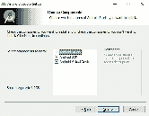在很多情况下，Android Studio 会毫无问题地引入。现在你应该有运行 Android Studio 的选项了。如果没有，问题最可能的原因是 `JDK`，因此重新建立是最佳的首选。

### 你的第一个程序

你可以选择在安装完成后启动 Android Studio。当它首次启动时，你可能无法直接进入 Android Studio，因为它正在下载更新以及 `Android SDK` 的更新。你只需要耐心。

当它终于开始运行时，你将看到 Android Studio 的欢迎界面：

如果你现在已经创建了一些项目，你可能会在 `Recent projects`（最近项目）中看到它们。

假设这是你的第一个项目，选择选项：`Start new Android Studio project`（新建 Android Studio 项目）

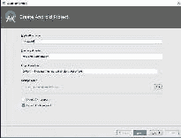暂时忽略新任务的细节。你只需为应用程序提供一个名称——在本例中为 `HelloWorld`。此外，确保勾选了 `Include Kotlin support`（包含 Kotlin 支持）——这是让项目使用 Kotlin 而不是 Java。确认 Android Studio 为你填充的各种默认设置。当你点击 `Next`（下一步）时，你有机会选择你关注的小部件。同样，基本上接受默认设置：

大多数情况下，你需要创建能够快速适应并覆盖最大市场的 Android 版本的应用程序，但如果这不是你的担心，那么选择较后的 Android 版本通常更明智。下一页允许你为项目选择模板。在这种情况下，将选择改为 `Basic Activity`（基础活动）。这为你提供了一些额外的生成的代码，使得应用程序更容易创建一个外观正确的应用。每个 Android 应用程序至少包含一个 `Activity`，此模板生成了一个准备好供你自定义的 `singleActivity` 项目：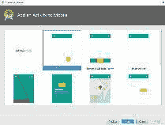

在下一页上，你可以为模板生成的项目的各种组件分配自定义名称。对于真实项目，你会分配有意义的名称，但在这种情况下你可以接受默认值：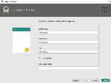最后，你可以点击 `Finish`（完成）按钮，并等待 Android Studio 创建你需要的每一个文件。事实上，即使是一个简单的 Android 项目也有大量文件，所以每，事情都需要时间。

### 初探

当一切准备就绪后，你将第一次看到 Android Studio。只要一切运行正常，你最终（大约需要三分钟或更长时间）将在 `Layout Editor`（布局编辑器）中看到你的新任务开始运行。

#### 问题？

如果你收到任何错误消息，那么很有可能是你的项目还没有处理完成。相信操作将会停止。假设你检查窗口底部的状态栏，当 Android Studio 完成你的新项目时，你会看到一条显示“Gradle Build Finished”（Gradle 构建完成）的消息。

如果你确实遇到了问题，值得尝试 `File` -> `Invalidate Caches/Restart`（清除缓存/重启）命令。这通常适用于“Missing styles”（缺失样式）和类似的错误。

#### IDE

尽管 Android Studio 的 UI 看起来有很多需要掌握的内容，但大部分内容你只是偶尔访问。需要看到的关键是，从左到右你有：

- `Project`（项目）窗口

- `instrument Palette`（工具调板）和 `Component Tree`（组件树）窗口

- `Layout Editor`（布局编辑器）

- `Attributes`（属性）窗口

大多数时候，你会使用 `Project` 窗口和 `Attributes` 窗口。你还会根据你选择的文件类型看到各种编辑器。在这种情况下，你当然选择了一个设计文件 `content_main.xml`，因此你在屏幕上有一个格式预览器。

在我们进入设计（这是本书的主要主题之一）之前，你实际上必须了解一点项目的文件结构，以便你探索它的不同部分。

### 基础项目结构

当项目构建完成后，可以通过打开 `Projects`（项目）标签页看到创建的每个文件。最引注目的是有大量的文件夹和文件：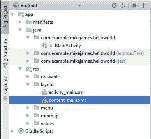看起来，你所制作的最简单的 Android 应用程序包含这么多文件，这简直是不可思议的。

不要慌。生成的大部分文件都是自动产生的，通常你不需要了解它们至少一点点，更不用说打开或修改它们。事实上，打开和修改自动创建的文件绝对不是一个好主意。

那么，我们集中在对我们有的文件上怎么样。

对于我们的简单程序，只有两个重要的文件。其中一个决定 `Activity` 的行为：`MainActivity.kt`。另一个决定应用程序的视觉外观，或 `View`（视图）：`content_main.xml`。

你可以设置哪个 `Activity` 是框架启动的那个，但自然地，你在设置项目时创建并命名的唯一操作就是它。你可以更改默认名称，但对于第二个保持原样即可。尽管这是一个 Kotlin 项目，根据你的视角，`java` 注册表是你应用程序大部分开发发生的地方，所以确保你知道它在哪里。`res` 目录是存储应用程序所需的每种资源、格式、位图等的地方。所以虽然现在看起来很混乱，对你和你的任务有影响的两个项目文件是 `java` 文件夹中的 `MainActivity.kt` 和 `res` 文件夹中的 `content_main.xml`。`java` 文件夹中的两个不同文件夹是关于为程序制作测试的。这不是我们在开始编写 Android 应用程序时想要关注的事情。

### Activity 的构造

一个 Android 应用程序至少由一个 `Activity` 类组成。你可以把 `Activity` 想象成使用 HTML 确定显示、使用 JavaScript 确定它做什么的页面。对于 Activity 的情况，格式由 `res` 文件夹中的 `XML` 文件控制，而行为由 `java` 文件夹中的 Kotlin 或 Java 代码决定。

随着你经验的增加，在设计视图（plan view）和 XML 视图之间切换将变得自然。将这种直观的校对器视为创建 XML 的极其简单的方法，否则在任何情况下，你可能都要花费长时间才能正确编写它。假设你检查底部，你会看到两个标签——`Design`（设计）和 `Text`（文本）：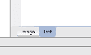

你只需点击标签即可在以文本形式修改 XML 和在直观的 `Layout Editor`（布局编辑器）中修改它之间切换。假设你现在点击标签，窗口将显示 `Layout Editor`，不过当你第一次这样做时可能需要几秒钟。

当你看到 `Layout Editor` 时，它看起来包含的信息非常多，但你会很快适应它。左侧是 `Palette`（调色板），包含了所有的组件或控件——按钮、文本框、复选框等——你可以将它们放置在设计面上：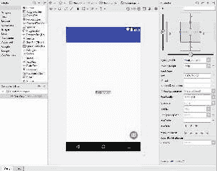

中间是设计平面，它默认设置为屏幕尺寸和 `Nexus 5` 的呈现方式。你可以选择不同的设备进行操作。事实上，该格式有两种视角供你利用：设计视图（plan）和大纲视图（outline）。理所当然，你看到的是设计视图，但你可以利用设计区域左上角的菜单显示任何一种视图。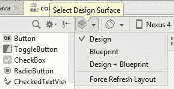

你可以同时显示这两个视角，但通常情况下可用的屏幕区域是主要问题，因此只显示一个是最理想的选择。设计视图向你展示设计，它是在真实设备上显示效果的估计。大纲视图并没有尝试提供完整的 UI，但它提供了更多的设计数据来帮助你定位和调整组件大小。使用你最熟悉的那个即可。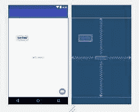

在左侧，`Palette` 下方是 `Component Tree`（组件树），它向你展示你的格式的设计，即独特的 UI 部分是如何包含在其他部分中的。它以一种更易于使用的结构向你展示 XML 记录的设计。你可以通过点击名称利用 `Component Tree` 作为选择单个 UI 部分的简单方法。你同样可以将 UI 部分移动到 `Component Tree` 上，以便精确地将其位于层级结构中。

在右侧你有 `Attributes`（属性）窗口，用于设置布局中任何组件的属性，例如宽度、高度、颜色等。如果你使用过任何简化的 `Layout Editor`，这看起来将是自然的；如果你曾用标记语言与项化设计斗争过（无论是 `HTML`、`XAML` 还是 `XML`），你将会看到 `Layout Editor` 让构建和测试 UI 变得多么简单。对于我们的示例程序，主要部分是一个单一的 `TextView`，之前包含文本“Hi World”。当我们只需要显示一些静态文本时，`TextView` 是使用的标准部分。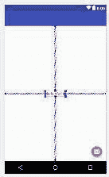

如果你需要，可以更改 hello 文本。在设计视图或 `Component Tree` 中选择 `TextView` 部分，并利用 `Attributes` 窗口观察其 `Text` 属性。将其更改为浏览“Hi Android World”：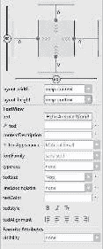

使用不带扳手符号的文本字段。带有扳手符号的属性用于设置在 `Layout Editor` 中主要显示的属性。对于这种情况，不带扳手符号的文本字段是控制你的应用程序在运行时显示内容的的那个。

你可以利用 `Layout Editor` 创建任何想要的 UI，你真的不需要参与与设计相关的 XML——除非结果很糟糕或者你想完成某些 `Layout Editor` 不支持的复杂任务。

#### 检查 XML

`Layout Editor` 随会生成创建你格式所需的 XML，并随着你更改布局对其进行调整。

如果你确实需要查看 XML，只需选择 `Layout Editor` 窗口底部的 `Text` 标签：


```xml
<?xml version="1.0" encoding="utf-8"?>
<android.support.constraint.ConstraintLayout
    xmlns:android="http://schemas.android.com/apk/res/android"
    xmlns:app="http://schemas.android.com/apk/res-auto"
    xmlns:tools="http://schemas.android.com/tools"
    android:layout_width="match_parent"
    android:layout_height="match_parent"
    app:layout_behavior="@string/appbar_scrolling_view_behavior"
    tools:context="com.example.mikejames.helloworld1.MainActivity"
    tools:showIn="@layout/activity_main">

    <TextView
        android:layout_width="wrap_content"
        android:layout_height="wrap_content"
        android:text="Hello World!"
        app:layout_constraintBottom_toBottomOf="parent"
        app:layout_constraintLeft_toLeftOf="parent"
        app:layout_constraintRight_toRightOf="parent"
        app:layout_constraintTop_toTopOf="parent" />
</android.support.constraint.ConstraintLayout>
```

你会发现它真的非常简单——例如读取 `<TextView>` 标签——尽管将其交给 `Layout Editor` 来创建和修改它。以 `@` 开头的数值通常是对资源记录中其他处描述的内容的引用，更多内容将在第 11 节中讨论。

我们将在后续章节中回到 `Layout Editor` 以及它创建的 XML。

### Kotlin

如果你双击 `MainActivity.kt` 文件，或者选择 `MainActivity.kt` 标签，你将看到它包含的代码。部分代码可能被隐藏，但你可以通过点击 `+` 按钮来展开它。关键代码部分是：

```kotlin
class MainActivity : AppCompatActivity() {
    override fun onCreate(savedInstanceState: Bundle?) {
        super.onCreate(savedInstanceState)
        setContentView(R.layout.activity_main)
    }
}
```

你可以忽略保持 `setContentView` 代码的指南，因为这些设置了每个 Android 应用程序目前使用的“额外项”——一个浮动的 `ActionBar`。

关于资源对象 `R` 我们还有更多细节需要了解，但你可以看到，它的基本工作是在你的 Java 代码与由布局编辑器（Layout Editor）生成的 XML 记录的资源之间建立连接。由于这就是我们的 `Activity` 所做的全部工作，因此这就是我们想要的全部代码。虽然我同意这并不是什么“重大的动作”，但看到 Android 应用程序的底层蓝图并理解如何让它运行就已经足够了——这是我们的下项工作。

## 开始使用模拟器

利用 Android Studio 运行 Android 有两种显而易见的方法。你可以使用模拟器，也可以使用真实的 Android 设备。最终，你理应该学会如何在已连接的真实 Android 设备上运行程序，因为模拟器只允许你测试部分功能，而且速度很慢。

不过，对于这一次来说，在模拟器上运行你的第一个应用程序就已经足够入门了。

你只需要点击顶部工具栏上的绿色运行符号——或者使用 `Run`、`Run "application"` 菜单项。有趣的是，当你执行此操作时，应用程序聚合需要一段时间。得益于 Android Studio 3 提供的改进，后续运行会快得多。

当你的应用程序准备好就绪时，你会看到一个对话框，允许你选择一个运行中的模拟器或启动一个：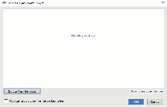如果没有记录任何模拟器，你应该创建一个。选择 `Create New Emulator` 按钮。这将弹出一个对话框，你可以在其中选择需要测试的设备。

默认是运行 Nougat API 25 的 `Nexus 5`，第一次测试你应该使用它。假设你真的想要不同的设备，可以使用 `AVD`（Android 虚拟设备）管理器来配置它们。

如果你在屏幕右侧看到“HAXM is not installed”的消息，那么点击下方的 `Install Haxm` 链接是一个好主意。`HAXM` 是 Intel 机器上的一种加速器，用于让 Android 模拟器运行得更快。你现在不需要理会它，但它能提高速度：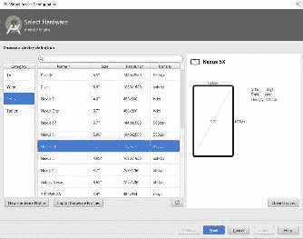你可以确认此之前运行中的每一个默认设置。你可以在 `Run` 窗口中查看模拟堆栈，该窗口会自动显示在 Android Studio 的底部。你可能会看到一些警告——这些通常可以忽略。

第一次操作时，整个交互需要一些时间。之后，只要模拟器已经在运行，再次点击运行就会尝试带有基础更改重新运行你的应用程序：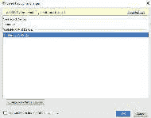最后，确保在 Android 框架堆栈完成并看到原生主屏幕之前再开始考虑你的应用程序在哪里。即使它已经加载了，最好给它几秒钟时间，让 Android Studio 检测到它并上传你的应用：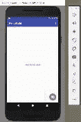对于我们的情况来说，这并不特别重要——仅仅是一句“Hi Android World!”，但考虑到这段经历的历程，它绝对应该令人印象深刻。

从现在起，你就可以修改代码或格式并再次运行应用程序，以查看更改的影响。假设发生了任何糟糕的情况并导致你搞砸了，基本上删除项目并从头开始即可。

关于如何扩展应用程序使其变得实用，你实际上有很多需要发现的，但体验已经开始了。

### 总结

- Android Studio 制作 Android 应用程序比其他方法简单得多，而且它是目前执行这项工作的主流方法。
- 一个应用程序大约包含一个 `Activity`，它刻画了一个屏幕格式、`View` 和一个行为。`Activity` 不一定有 UI，但很多时候它是有的。
- 使用 Basic Activity 格式创建一个简单的应用程序，而无需选择任何额外项目。
- 屏幕设计受 XML 标记记录 `Main_Activity.xml` 限制，存放在 `res` 目录。此外还有 `content_main.xml`，这是我们放置自定义 UI 控制的地方。
- Android Studio 提供了一个简化的 `Layout Editor`，允许你在不直接手动操作 XML 的情况下创建 UI。
- 应用程序的行为由 Kotlin 记录限制（在本例中为 `MainActivity.kt`），存放在 java 文件夹中。你可以直接在 Android Studio 中修改 Kotlin 文件中的代码。代码需要加载并显示 XML 文件中刻画的设计。
- 要运行应用程序，你需要一个基于模拟器的 `AVD` 或连接到机器的真实 Android 设备。
- 运行应用程序时，你可以选择使用哪个 `AVD` 或哪个设备设备进行测试。首次启动时只需使用默认的 `AVD`，即 `Nexus 5`。
- 你可以在不重启 `AVD` 或机器连接的任何真实设备的情况下更改并再次运行你的应用程序。

## 第 2 章 Activity 与用户界面

现在你知道如何制作 Android 应用程序，但你真的知道它是如何运行的吗？在本节中，我们将介绍如何创建一个界面（UI）以及如何将其附加到 `Activity` 的代码中。

我们在第 1 章学习了如何使用 Android Studio 构建最简单的应用程序。在过程中，我们发现一个 Android 应用程序包含两个部分——`Activity` 和 `View`。`Activity` 是执行某些操作的代码，而 `View` 提供界面（UI）。你可以将这种双重性比作 HTML 页面和驱动其执行操作的 JavaScript，或者比作 XAML 结构和后台代码（code behind）。

核心思想是 `Activity` 是与由 `View` 刻画的 UI 屏幕交互的代码。这并不完全准确，因为 `Activity` 可以更改它的视图，所以一段代码可以支持多种视图。无论，为每个视图使用一个 `Activity` 有其好处，例如，这是 Android 返回键导航你应用程序的方式——从一个 `Activity` 到另一个 `Activity`。复杂的应用程序通常包含许多用户可以在之间切换的 `Activity`，而简单的应用程序只需要一个 Activity 就能运行得很好。

还要注意，创建额外的 `Activities` 并不会创建新的字符串。单个 `Activity` 会在某个随机时间是动态的，当我们详细考虑 `Activity` 生命周期时，会发现它在其他时间会有更多数量。在本书书中我们将关注单屏幕 UI `Activity`，因为它是你将经历的最广泛认可的应用程序构建模块，而且大多数复杂应用程序都是从这里开始的。

## MainActivity

在每个任务中，都有一个动作被指定为应用程序启动时分发。假设你使用 Android Studio 制作了另一个名为 `SimpleButton` 的基础 Activity 应用，并接受了所有默认设置，那么启动 Activity 自然被称为 `MainActivity`。你可以通过更改应用程序清单中的一行代码来更改哪个 `Activity` 启动应用程序。

### Manifest（清单文件）

Manifest 是我们之前没有讨论过的项目文件，因为如果你使用 Android Studio，你可以在大部分忽略它并允许 Android Studio 为你构建和维护它，但了解它的存在及其作用会更好。

Manifest 存放在 `application/` 注册表中，命名为 `AndroidManifest.xml`。

它是一个 XML 记录，告诉 Android 框架关于你的应用程序的所有已知信息，包括它在设备上运行所需的权限。具体来说，它记录了整个练习项目以及哪一个是用于启动应用程序的入口。

如果你通过双击打开生成的 Manifest，你会在文件靠下的位置看到：

```xml
<activity android:name=".MainActivity" android:label="SimpleButton" >
```

这刻画了框架为你创建的 Activity，而紧随其后的几行将其刻画为启动 Activity：

```xml
<intent-filter>
    <action android:name="android.intent.action.MAIN"/>
    <category android:name="android.intent.category.LAUNCHER"/>
</intent-filter>
</activity>
```

注意，选择哪个 Activity 启动应用与你如何命名无关，即：仅将其命名为 `MainActivity` 是不够的。

其次，你可以依靠 Android Studio 为你维护 Manifest。在很多时候，当你真正想要处理错误或添加高级功能时，你可能必须直接修改它。

## Inside Activity 内部

生成的 Activity 包含一个类 `MainActivity`，它持有了你应用程序的所有方法和属性。它还有三个创建的方法：

- `onCreate`
- `onCreateOptionsMenu`
- `onOptionsItemSelected`

后两个显然与 OptionsMenu 的工作相关，尽管这是一个重要点，但在某些情况下可以被忽略。并不是所有的动作都需要 OptionsMenu，你甚至可以删除这些策略来帮助显示选项菜单。这三个方法都是事件回调控制器（occasion controllers）。也就是说，它们在与其同名的事件发生时被调用。整个 Android 应用程序由各种事件控制器及其辅助函数组成。

Android Studio 生成的主方法是 `onCreate`。这是一个事件调度器，当你的应用程序创建时会被考虑，它是我们为整个应用程序进行所有实例化和设置的地方。它通常也是我们显示应用程序主 UI 屏幕的地方。

让我们再次查看 `onCreate` 生成代码的前两行，它们是最重要的：

```kotlin
override fun onCreate(savedInstanceState: Bundle?) { 
    super.onCreate(savedInstanceState) 
    setContentView(R.layout.activity_main)
}
```

`onCreate` 事件调度器传递了一个名为 `savedInstanceState` 的 `Bundle` 对象。这预期用于在应用程序调用之间保护状态数据，我们稍后会看到如何使用它。在这种情况下，没有保存任何信息，因此 `savedInstanceState` 是无效的——但你实际上需要将它传递给 get `onCreate` 方法。你将在第 12 章学到关于 `Bundle` 的更多重要知识。

最后一条指令调用了 `setContentView`，这是一个具有多种重载结构的方法。在这种情况下，我们传递了一个数字，表示哪个 XML 文档描述了要使用的布局。`setContentView` 方法利用此使你 UI 的每个部分按照 XML 记录中的定义生成。也就是说，这就是你使用 Layout 编辑器创建的格式与在设备屏幕上显示的布局之间的关联。

值得仔细观察布局文档是如何确定的，因为这是 Android 允许访问资源（assets）的一种通用方式。稍后会有专门关于资源的章节，但现在进行介绍一下是值得的。

`R` 对象由框架构建，允许你访问放置在资源目录中的资源。例如，在 `onCreate` 中，使用 `R.layout.activity_main` 返回一个数值（即它的 ID），它允许 `setContentView` 方法找到 `activity_main` XML 布局文档。通常，所有资源都通过 `R` 对象找到，将其视为一个资源文件即可。

## View and ViewGroup

到为止一切顺利，但至关重要的是理解接下来发生的是 XML 文档被传递为 `View` 对象。也就是说，Java 类在很大程度上是 `View` 对象的子类。整个 UI 和图形框架被执行为从 `View` 类获取的组件层级结构。如果你使用过任何 GUI 结构（如 AWT、Swing、XAML 等），这个想法对你来说并不陌生。例如，按钮是一个从 `View` 类的类，要创建一个按钮，你只需创建一个 `Button` 类的实例即可。显然，你可以通过创建更多实例来本质上创建任意数量的按钮。

这引出了关于按钮在布局中何处显示的问题？答案是存在 `ViewGroup` 对象，它们作为其他 `View` 对象的容器。你可以设置子 `View` 对象的位置，或者简单地让它们受到不同设计规则的约束，这一点稍后会有更多介绍。你可以选择通过创建和操作 `View` 类实例来用代码构建整个 UI，这在第 7 章中是一个重点内容。

2. 你可以组合 XML 标签并利用框架将 XML 转换为相应的对象。
3. 你可以使用布局编辑器（Layout Editor）智能地制作 UI 并创建 XML 记录，然后该记录会被转换为所需的 Java 对象。你可以将其想象为：简化格式 -> XML -> View 对象。能够在直观的管理器中处理 UI 是使用 Android Studio 的非凡益处之一，而且，无论你是否知道如何直接地修改 XML 设计记录，它绝对不是你不应该忽视的元素。将格式检查器作为第一步使用，并在必要时稍后对 XML 记录进行任何更改，这几乎是一个明智的举措。

## 创建我们的第一个 UI

为了理解这些内容是如何结合在一起的，我们来添加一个按钮（button）和一个 `textView` 对象吧。你可能已经知道按钮是用来点击的，并且你可以发现 `textView` 用于向用户显示某些文本。

首先，删除创建一个新的空活动（Activity）时自然生成的“Hello World”文本。从任务视图中打开并加载 `content_main.xml` 文件。

`content_main.xml` 是你创建所有 UI 的地方。不过，正如第 1 节所说明的，还有另一个格式文件，它本质上提供了 UI 中的标准组件，如 `AppBar`。注意，正因为如此，你可以在布局编辑器中看到无法更改的 UI 部分——它们在另一个格式文件中有一个位置。要消除“Hi World”，你只需选择它并按删除键：注意，这里有一个撤销操作 `Ctrl-Z`，以防你不小心删除了内容。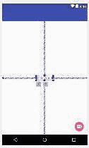

接下来，点击调色板（Palette）中部件（Widgets）部分的按钮：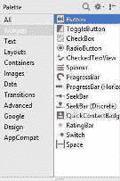 如果你现在将光标悬停在设计区域，你会发现随着它的移动，不同的布局会通过线条显示出来：

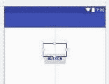 要放置按钮，基本上只需点击并拖动，一个完整的、带有默认文本 `Button` 的按钮就会出现。然而，仅仅将按钮丢在设计平面上是不够的。假设你只是这样做，按钮虽然会被放置，但没有定位指令。假设你尝试运行程序，你会发现按钮在模拟器或真实设备上时隐时现。其解释是，在没有应用任何定位指令的情况下，它会移动到屏幕顶部并隐藏在其他控件后面。

这种行为对于默认的 `ConstraintLayout` 是正常的，稍后会详细介绍。对于，我们只需要对按钮应用一些约束。


最简单的设置是点击“推断约束”（Infer constraints）图标，让 Android Studio 计算如何定位按钮：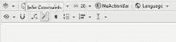 当你点击此按钮时，会根据 `Button` 的位置添加指令。现在具体应用了哪些指令并不重要，基本事实是存在几个约束。在按钮下方的屏幕图中，按钮必须距离顶部和右侧保持良好的距离。注意，你可以定位按钮，然后点击推断约束按钮来设置保持按钮在原有位置的预期约束：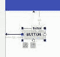

现在你的 UI 上有一个设置好的按钮，我们应该以同样的方式添加一个 `TextView` 部件——点击调色板中它的图标，在布局编辑器中定位并对齐以设置位置。注意 Android Studio 提供了定位数据来帮助你调整 UI 部分。同样，你确实需要点击推断约束图标来定位 `TextView`。

最简单的方法是将 `TextView` 放置在你想放的地方，然后点击“推断约束”（Infer constraints）来设置该位置所需的约束：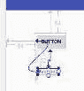 注意 Android Studio 提供了定位数据来帮助你调整 UI 部分。处理创建格式最简单的方法是将部分放在你需要的地方，然后点击推断约束图标以应用指令来固定它们的位置。久而久之，这些约束可能并不完全符合你的要求，但它为你提供了一个起始阶段。简而言之，创建一个完全复杂的 UI 只是家常便饭的工作，只是一个从调色板中选择部件并将它们放置在设计平面上的问题。

如果你现在运行程序，点击绿色的运行符号（如果你完全不知道如何操作，请参阅第 1 节），你将看到你的新 UI：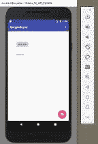 显然它静静地在那里，无论你是否可以点击该按钮。按钮可以点击，但按钮点击事件没有关联任何代码来表达应该发生什么，我们很快就会处理。

## 属性与参数 (Properties & Attributes)

我们的下一个任务是更改按钮上的标题。记住对象具有属性和方法。UI 部件的标题文本、背景颜色等内容表示为属性。你可以在代码中更改属性，或者在设计时使用屏幕右侧的属性（Attributes）窗口。

### 属性和参数（Attribute）之间有什么区别？

事实上，所有的 UI 对象都是代码对象，像文本这样的值是对象的属性，但你在 XML 中指定一个值时，它被称为参数（attribute）。你可以说，你在 XML 中设置参数来设置代码对象的属性。

如果你选择按钮并检查右侧的属性窗口，你会发现按钮的文本参数（text attribute）。它目前包含值“Button”。如果你将其改为“Click Me!”并重新运行应用，你会看到 `Button` 的标题已经更改了：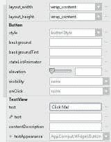 你可以设置位于 UI 中的任何部件的初始属性。有许多属性，我们需要花时间研究其中一些。然而，目前重要的是看到使用属性窗口更改属性是多么简单。正如你可能猜到的，你更改的属性会导致定义布局的 XML 文件发生变化。记住，原理是布局编辑器创建了你可以在没有帮助的情况下手动创建的 XML 文件。

## 事件 (Events)

现在我们要在点击按钮时执行某些操作。Android 支持完整的事件驱动 UI。因此，我们接下来需要定义一个在点击按钮时被调用的方法或函数。Java 实现事件的方法很复杂但现在已经简化了。Kotlin 让事件处理器变得相对容易，但仍然比 C# 等语言稍微困难。

有多种方法可以指定事件处理器，但最简单的方法是使用布局编辑器生成系统将事件处理器挂钩到事件所需的 XML。这不是一种你可以一直使用的方法。它只适用于点击事件，但它能让你入门。

如果你使用过类似 Visual Studio 的工具，值得注意的是，Android Studio 不会自动为你创建事件处理器。在 Android Studio 的情况下，你必须创建一个函数并将其分配为 `onClick` 处理器。

```kotlin
fun buttonOnClick(v: View){
```

万一你错过了或忘记了函数签名（signature）是什么：函数的签名是指它接受的参数数量和类型。同名但签名不同的函数被视为不同的函数。在这种情况下，该函数接收单个参数，类型为 `View`，并返回 `Unit`，即不返回任何内容。

你可以按照喜欢的名称为该方法命名，但在大多数情况下，明确指定它处理的事件类型会有帮助。在这种情况下，我们想要处理按钮的 `onClick` 事件——当用户用鼠标点击按钮，或者更有可能使用触摸屏设备点击按钮时，就会发生该事件。

将 `MainActivity.kt` 文件加载到代码编辑器中并添加以下方法：

```kotlin
fun buttonOnClick(v: View){// do something when the button is clicked}
```

这需要直接紧跟在 `onCreate` 方法之后，或者放在使其使其 `MainActivity` 类方法的任何位置。处理完这些代码后，现在切换回布局编辑器（Layout Editor），选择按钮，在属性（Attributes）窗口中找到 `onClick` 属性并输入 `buttonOnClick`：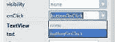目前 IDE 无法识别用作事件处理程序的 Kotlin 方法，因此你必须手动输入它们，但这在不久的将来可能会改变。注意，你不需要输入参数，只需要输入方法名。

就这些了。你通过正确的签名和返回类型定义事件处理程序，并在属性窗口中设置相应的 `onClick` 属性。

对于其他类型的事件，你必须通过代码来完成——XML/布局编辑器方法仅适用于 `onClick`。将 Activity 连接到 UI：现在我们已经为按钮点击事件挂载了事件处理程序，我们通常希望因此执行一些影响 UI 的操作。

假设当点击按钮时，我们想将 `TextView` 小部件显示的文本更改为“I’ve Been Clicked!”。

我们可以通过将 `TextView` 小部件的文本属性更改为新文本来实现。唯一的问题是，我们如何在代码中找到 `TextView` 小部件呢？当你使用标记语言定义 UI 时，这是一个相当标准的问题。标记语言定义了组件或其他 UI 对象，而代码必须有一种方法来与这些 UI 对象建立连接。例如，在 JavaScript 中，你利用 `getElementById` 方法来获取与特定 HTML 元素对应的 DOM 对象。在 Android 中，我们进行类似的操作。

首先，确保你遵循这样一个理念：布局编辑器生成的所有 XML 都会被转换为一组对象，每个对象对应设计面上放置的每一个组件或 `View`。这些对象具有与你在属性窗口中看到的范围相同的属性，并拥有用于完成其他任务的方法。你只需要找到一种引用其中一个对象的方法即可。对于触发事件的 `View` 对象，这非常简单，因为它作为调用的唯一参数传递给事件处理程序。所以，如果事件处理程序是：

```kotlin
fun buttonOnClick(v: View){
```

并且该事件处理程序只挂载到了按钮，那么你就可以 100% 确定当事件发生时 `v` 就是该按钮对象。

如果你想更改按钮的标题，可以直接使用它的 `text` 属性来更改其值。

注意：这是一个 Java 属性，因为所有的 Android 类都是 Java 类。这意味着它们没有属性，而是拥有 `get` 和 `set` 方法。

请注意，这种方法只有在你知道触发事件并调用事件处理程序的对象类型时才有效。如果你的事件处理器只连接到单个组件，那么你确实知道触发事件的对象类型。如果不是这样，或者你想修改一个并非事件主体的 `View` 对象的属性，那么你就必须找到它。这正是我们接下来要做的。

## 查找 View 对象

现在假设我们想对 `View` 中的其他组件之一进行某些操作。在这种情况下，我们必须在没有事件处理器参数帮助的情况下找到代表该组件的对象。

例如，我们如何找到放置在按钮下方的 `TextView` 呢？Kotlin 让这一切变得非常简单。

在 XML 文件中定义的每个 `View` 对象都有一个 `id`。你可以手动分配 `id`，但布局编辑器（Layout Editor）会自动为你放置在设计界面上的每个组件分配一个 `id`。你可以通过选择该对象然后查看属性（Attributes）窗口的右上角来查看对象的 `id`：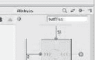 你也可以使用此窗口为 `id` 输入新值，也就是说，你可以用它来“重命名”控件。

在这种情况下，你可以看到我们的 `TextView` 对象被分配了名为“textView”的 `id`。事实上，这在实际上是一个用于识别布局中 `View` 对象的整数常量，但 Kotlin 利用此标识符来创建一个同名的 `Activity` 属性。

规则是，对于 XML 文件中定义的每个带有 `id` 的 `View` 对象，Kotlin 都会创建一个同名的 `Activity` 属性。也就是说，在这种情况下，`TextView` 的 `id` 是 `textView`，因此 Kotlin 自动创建了一个属性：

`this.textView` 或者，由于你通常可以省略它，直接写为：

`textView`

当程序运行时，这些属性的每一个都会被设置为引用使用相同 `id` 创建的 `View` 对象。也就是说，`textView` 属性引用 `TextView` 对象。

这使得处理 UI 变得简单得多。例如，要设置 `TextView` 对象的 text 属性，我们只需要做：

```kotlin
textView.text="You clicked my button"
```

当你输入“text”时，注意 Android Studio 将提示你导入源自 XML 文件的定义——接受它，你就可以通过它们的 `id` 引用 XML 文件中的所有组件了。 这添加了导入：

```kotlin
import kotlinx.android.synthetic.main.content_main.*
```

完整的事件处理器如下：

```kotlin
fun buttonOnClick(v: View) {
    val button = v as Button
    button.text = “I’ve Been Clicked”
    textView.text = “You clicked my button”
}
```

注意，`button` 变量是一个局部变量，它隐藏了 Kotlin 从 XML ids 为自动创建的 `button` 属性。如果你现在运行程序，你会发现自己被两次告知这个非常重要的按钮已被点击的事实：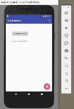 你可能认为这些都是微不足道的小事，不像真正的应用，但这就是 Android 中构建 UI 的工作方式。

你现在已经知道了如何使用布局编辑器工具箱中的可用组件设计一个单屏幕应用，如何将它们连接起来以处理点击事件，如何找到代表它们的对象，以及如何调用修改它们的方法。

除了每个组件工作方式的细微细节（单选按钮、复选框等）之外，你现在已经掌握了构建单屏幕应用的基本大纲。

### 总结

- `Activity` 是 Android 应用的单元，它大致对应于一个屏幕的用户界面加上使其运行的代码。

- 在大多数情况下，你会为你想要向用户展示的每个 UI 屏幕创建一个 `Activity`。

- 在任何时刻，应用程序中只有一个 `Activity` 在运行。

- `Activity` 是单线程的并运行在 UI 线程上。

- 你可以在 `Manifest` 中设置哪个 `Activity` 启动应用。Android Studio 默认设置为 `MainActivity`。

- `Activity` 具有对应其生命周期不同阶段的事件。`onCreate` 事件在应用首次启动时被调用，你在此处执行所有初始化工作。

- 在此你可以从之前的运行恢复应用状态。

- 然后 `Activity` 加载 `View` 或 `ViewGroup` 对象来创建其用户界面。

- 你可以通过三种可能的方式创建 `View`/`ViewGroup` 对象：在代码中、使用 XML 或使用布局编辑器生成 XML。

- 布局编辑器是创建 UI 最简单的方法。

- 通过打开 XML 文件，你可以使用布局编辑器在设计面上放置与 `View` 对象相对应的组件。

- 你可以使用属性窗口（Attribute window）设置每个组件的属性。

- 布局编辑器创建的 XML 文件被 `Activity` 用于设置其 UI，通过创建与使用布局编辑器放置的每个 `View` 对象相对应的对象。

- 当你引用未在文件中定义的类（即大多数类）时，你需要在代码开头添加导入语句（import statement）。

- 如果光标位于任何显示为红色的单词上并使用 `Alt+Enter`，Android Studio 将帮助你解决问题。

- 你可以使用属性窗口将当前 `Activity` 中定义的 `onClick` 事件处理器连接到组件。

- `onClick` 事件处理器只是一个签名类似于 `myEventHandler(v:View)` 的公共函数。

- `View` 参数被传递给触发事件的 `View` 对象。这可以用于访问与交互的 `View` 对象的属性/方法。

- 要访问其他 `View` 对象，你可以利用 Kotlin 将布局的所有 `id` 属性转换为引用对应 `View` 对象的 `Activity` 属性。

我们还需要担心如何布局 UI —— 即如何设置一组组件的大小和位置。Android 在这方面特别为复杂，因为作为一个移动操作系统，它必须应对各种屏幕尺寸，甚至在应用运行期间处理屏幕方向的变化。这不是一个简单的课题，我们稍后将更详细地考虑，但目前让我们先看看屏幕布局中简单的部分。

使用 `Layout Editor`（布局编辑器）是最简单且最高效的工作方式，因此让我们继续专注于这种创建 UI 的方法。本章主要介绍如何结合默认布局使用 `Layout Editor` 以及创建 UI 时面临的挑战。

## 面板（Palette）中有什么

启动 Android Studio 并创建一个名为 `UItest` 的新简单基础活动项目。这将是我们在本章剩余部分中的 UI 实验乐场。除了选择 `Basic Activity`（基础活动）外，接受所有默认设置，并等待项目创建。确保你在第一个对话框页面上已勾选了 `Include Kotlin support`。

如果你现在打开 `app/res/layout` 文件夹下的 `content_main.xml` 文件，`Layout Editor` 将打开，你将看到默认布局熟悉的渲染效果。

现在是时候详细查看 `Palette` 面板了：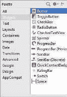 `Palette` 的顶部四个部分包含最重要的 UI 组件，另外五个部分包含更专门的组件。

1. **Widgets**（控件）部分包含最常用的组件 —— 按钮（Buttons）、复选框（Checkboxes）等。这是你首先需要学习使用的组件集。

2. **Text Fields**（文本字段）是一组文本输入组件，它们的工作方式大同小异。

3. **Layouts**（布局）是其他组件的容器，提供了不同的布局规则。

4. **Containers**（容器）类似于微型布局，你通常将其他组件放在它们内部，由容器来“照顾”它们：

5. **Images and media**（图像和媒体）是特定类型资源（如图像和视频）的容器。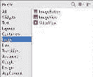

6. **Date and time**（日期和时间）是涉及日期时间输入和控件。

7. **Transitions**（过渡）在不同组件之间执行有限的动画。

8. **Advanced**（高级）并不真的意味着高级 —— 指更多更大、更复杂的组件，例如数字选择器。

9. **Google** 用于 Google 提供的服务，目前包含 `MapView` 和 `AdView`。

10. **Design**（设计）是更高级控件的集合，例如标签页。

11. **AppCompat** 是为较旧版本的 Android 提供最新控件的控件。

## 按钮示例

我们还应该从哪里开始呢 —— `Button`（按钮）几乎是 UI 构建的“Hello World”。如果你知道如何使用 `Button`，你就离理解所有可能的组件又近了一大步。好消息是，我们已经在第 2 章中相遇并使用过 `Button`，并发现了如何在代码中操作它。然而，仍然有许多东西需要发现。

通常情况下，对于使用任何组件，你都需要发现以下三点：

1. 如何让它初始看起来像你想要的样子。这涉及到通过使用 `Layout Editor` 提供的属性来发现并设置属性。

2. 如何在运行时修改组件的外观。这涉及到发现如何在代码中处理属性。

3. 如何将组件生成的事件挂接到代码上。设置属性听起来很容易，但属性有不同的类型，这些类型有不同的相应方式让你与之交互。我们必须发现的第一件事是如何定位组件。

## 定位 —— ConstraintLayout（约束布局）

在继续项目之前，请选择并删除默认的“hello world”文本 —— 有一个整洁的设计表面会让尝试操作变得更容易。

你可以选择布局的两种视图：`design`（设计）和 `blueprint`（蓝图）。`design` 视图显示 UI 运行时的状态，有助于获取 UI 的整体感觉和印象。`blueprint` 视图以骨架形式显示 UI，这让你在定位组件时操作更快、更容易。你可以同时查看两种视图，但这通常会浪费屏幕空间。

有些用户喜欢 `blueprint` 视图，因为它看起来轻量；另一些用户则喜欢 `design` 视图，因为它是完整的。使用你觉得好用的哪种即可。

接下来，点击面板中的 `Button` 并将其拖到布局中。注意当你在设计表面移动按钮时，布局信息的变化：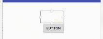


重要的是要意识到这种定位信息仅帮助你相对于现有布局定位组件。对于新的`constraint layout`，你放置组件的位置对应用运行时显示位置没有影响。事实上，如果你只是在设计面上丢入 UI 组件而不应用任何约束，当你运行应用时，组件会漂到左上角。事实上，情况稍微复杂一点，因为有一个功能会在丢入组件时自动添加约束以实现显示的对齐。然而，正如我们将看到的，这是关闭的。关键点是要意识到显示的对齐并不是约束。

使用`constraint layout`，影响组件显示位置的唯一因素是你应用的约束。

那么，如何应用约束呢？

你可以让`Layout Editor`自动为你建议，也可以手动应用。

自动约束最容易使用，有两种方法可以让编辑器动态应用约束：

1. **Autoconnect mode**（自动连接模式）

2. **Infer Constraints**（推断约束）

它们略有不同，你需要学习让它们协同工作。`Autoconnect`模式在你第一次遇到它时似乎最有用，但在实践中可能会令人混乱且容易出错。然而，它是值得尝试的。要开启自动连接，只需点击`Layout Editor`顶部的`Autoconnect`图标：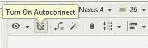

当开启 Autoconnect 时，当你在设计面上放置组件时，编辑器会尝试根据你放置组件的位置计算合适的约束。如果它未能应用任何约束，当你将组件拖到另一个位置时，它会再次尝试。它只会为了满足`Layout Editor`中指示的对齐关系应用约束。如果你在屏幕上任意位置放置 UI 组件而没有指示对齐关系，则不会应用任何约束。

一旦应用了约束，即使你修改组件，这些约束也不会发生改变。例如，如果你将组件拖到屏幕中间，系统将应用约束把组件放置在屏幕下方 50% 处和距离左侧 50% 处。如果你随后移动组件，百分比会改变以调整位置，但如果你将其移动到（例如）左上角，实际的约束不会变为更合适的设置。一旦应用了约束，其类型将不会改变。

### 推断约束选项 (Infer Constraints)

`Infer Constraints`（推断约束）选项实际上更容易使用，而且效果相当不错。你只需要将所有组件放置在它们想要所在的位置，然后点击`Infer Constraints`按钮：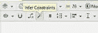当你这样做时，系统将根据每个组件所在的位置计算约束。这为你留了更多时间来放置组件，而且你也可以随时删除所有约束并再次点击`Infer Constraints`来重新计算。系统仅添加固定组件位置所必需的约束 —— 现有的约束不会被修改。

这意味着你可以使用`Infer Constraints`来确保你的布局有足够的约束来正常工作——如果没有添加任何约束，说明布局是没问题的。此外请注意，一旦`Infer Constraints`添加了约束，即使你拖动组件，约束的类型也不会改变。一个好的策略是关闭`Autoconnect`（自动连接），并在每次在设计表面放置新组件时都使用`Infer Constraints`。这允许你一次一个组件地构建布局，并检查每一组新的约束。然后你可以修改新添加的约束并处理下一个组件。

### 多组件布局 (Multi-component Layouts)

当你有多个组件并需要进行重大更改时，情况就会变得复杂。在这种情况下，使用`Clear All Constraints`（清除所有约束）图标删除所有约束并重新开始通常更容易：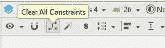对于一个单独放置靠近屏幕顶部和左侧边缘的组件，系统将添加约束来固定它与左侧和顶部的距离：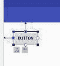从现在起，当该按钮显示时，它将定位在距离左侧 36、距离顶部 33 的位置。无论物理屏幕尺寸如何，这些约束都会被应用。从这个意义上说，它们是约束而不是绝对定位。

值得注意的是，实际的定位是通过设置按钮的边距属性（margin）为 36 和 33 实现的。约束布局可能是所有布局组件中最复杂的，但它使用从 Android 早期一直使用的属性来放置其他组件。你可以发现，如果你在表面上放置第二个按钮并将其移动到第一个按钮附近，事情并没有像相对于屏幕边缘进行定位那么简单。现在，如果你点击`Infer Constraints`按钮，所应用的约束是相对于第一个按钮的：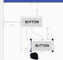你可以看到，在这种情况下，第二个按钮定位在第一个按钮左边缘 88 处，在其下方 49 处。再次，无论 UI 显示的物理屏幕多大或小，这些约束都将被遵守。而且，如果你移动第一个按钮，第二个按钮将保持其相对于第一个按钮的。。事实上，如果你点击并拖动第一个按钮，第二个按钮会随之移动。

如果你在`Layout Editor`（布局编辑器）中尝试定位，很快就能掌握思路。推断约束的一个大问题是系统有时会出错。

### 手动约束 (Manual Constraints)

与其让布局编辑器错误地推断约束，不如你可以手动放置它们。你只需要从组件上的约束圆圈拖出一条线到你想作为参考点的边缘即可。

例如，要将按钮相对于屏幕右侧定位，只需将按钮右侧的圆圈拖到屏幕右侧，然后将按钮移动到你想去的地方：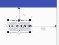有许多不同类型的约束可以应用，我们将在第 5 章详细介绍这些，在该章我们将深入研究布局。目前，这几乎就是你需要的所有信息了。

约束可以自动或手动应用，它们通常设置从组件上某点到另一个组件上某一点的距离。例如，如果你想相对于另一个组件放置组件，只需将第一个组件上的约束点拖到第二个组件的边缘即可。在所示的情况下，应用了手动约束，因为约束推断会将约束应用在屏幕的左边缘：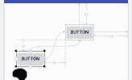

### 属性窗口 (The Attributes Window)

在早期阶段也值得知道，`Attributes`（属性）窗口可以在许多方面提供帮助。首先，它有一个显示当前应用约束的图表，允许你修改它们并精确设置距离：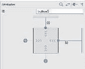如果你点击其中一条约束线，就可以输入距离值。你也可以点击点完全删除约束，或者点击`+`添加约束。正如你可能猜到的，有些属性允许你使用编辑器设置每个位置的位置和边距。

要查看所有属性，必须点击`Attributes`窗口右上角的`View all attributes`（查看所有属性）图标——双箭头。窗口中列出的属性并不是你在代码中为了实现相同结果可能设置的属性的简单表示。它们经过组织和简化，以便使用`Layout Editor`更容易。例如，如果你在完全展开的`Attributes`窗口查看，你会看到：

- `LayoutTop`：提供距离顶部边缘的距离。

- `Constraints.top_toTopOf`：指定定位相对于哪个对象。

如果你查看 XML 文件，你会看到：

```xml
app:layout_constraintTop_toTopOf="parent"
android:layout_marginTop="348dp"
```

所有布局属性都以`layout_name`开头，名称表示受影响的位置。从`Attributes`窗口到 XML 属性的映射非常直观。

还需要理解的是，通过简单地拖动到想要的位置来设置位置，`Layout Editor`正在计算如何正确设置多个属性。在上面的示例中，它设置了`top_toTopOf`和`MarginTop`属性。你可以手动这样做以获得相同效果，但布局编辑器只需根据你放置组件的位置就能简单完成。

这就是为什么让布局编辑器为你设置属性更容易。设置相对于哪个其他组件进行定位的（即：相对于哪个组件设置位置）的能力，意味着你可以构建一组组件，它们都与一个相对于容器对齐的组件齐，这样它们就可以作为一个整体一起移动。你还可以设置组件与屏幕左侧和右侧对齐，并允许从竖屏旋转到横屏。你还可以设置按百分比划分可用空间的约束——更多内容请见

# 第 5 章 约束布局 (Constraint Layout)

约束布局是首选的布局组件。由于与将一个布局嵌套在另一个布局中的常用方法相比，它更快且高效。除非你有充分理由不使用它，否则它是你的首选。尽管如此，在布局编辑器（Layout Editor）中操作布局非常容易变得混乱。如果组件丢失了，很可能是它们重叠在了一起。解决这个问题的简单方法是进入属性（Attributes）窗口并手动重置其中一个定位属性。

注意以下几会有帮助：

- 如果在逻辑上合理，请使用相对于另一个组件的定位。例如，如果你有一个文本输入组件，那么将它的接受按钮（Accept Button）相对于其右侧进行定位是合理的。

- 如果你将所有内容都相对于父容器进行定位，那么你实际上拥有的是绝对布局。

- 如果屏幕尺寸发生变化，如果空间不足，组件可能会相互重叠。始终确保你的布局留有足够的空间。

- 在处理一组组件时，良好的策略是选择其中一个相对于容器进行定位，然后将所有其他组件都相对于该组件进行定位，以确保你可以移动整个组并保持对齐。

- 记住某些组件不仅可以改变大小，还可以改变位置，这可能会修改相对于它们定位的组件的位置。

默认使用约束布局组件，但你也可以将其更改为任何其他布局组件——相对（Relative）、线性（Linear）、表格（Table）、网格（Grid）和框架（Frame）。此外还有其他容器组件可以替代这些标准布局组件。

在这一阶段值得了解的一点是，组件具有由容器提供的布局属性，因此我们在结合约束布局组件时查看的属性集是它特有的。这意味着如果你使用其他布局，就必须从头学习它的布局属性。同样，这是我们必须返回讨论的话题。

### 尺寸 (Sizing)

与定位相比，调整组件尺寸几乎是轻而易举的。所有组件都有`Height`（高度）和`Width`（宽度）属性，这些对应于组件实际渲染在屏幕上时的绘制高度和宽度。

你可能注意到，在布局编辑器中放置的组件角上有看起来像缩放句柄的东西。如果你拖动任何一个句柄，组件就会改变大小。然而，组件的内容不会被缩放。发生的只是内容周围留了一些空间。如果内容变大或变小，组件的大小保持不变。如果内容太大，它将无法放入组件中。

你可以在属性窗口中看到空间是固定的。组件内部显示的线条与组件的大小及其与内容的关系。实线表示固定尺寸：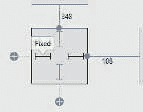

固定尺寸组件的备选方案是允许它们自动调整大小以适应或包裹其内容。要设置所有这些，你只需点击内部的直线，这些线会变为`<<<`，表示弹簧（springs），允许组件更改大小：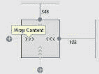

第三种选项是匹配约束（Match Constraints），它允许组件更改大小以填充可用空间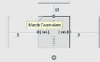

这种自动调整大小的行为由`layout_width`和`layout_height`属性设置。你可以通过在属性旁边的值框中输入精确尺寸（例如`100dp`）来修改它。还要注意，你也可以为大多数组件设置最大和最小值。

设置最大值将导致内容在不符合要求时被截断。设置最小值通常是最佳计划，因为这样组件会在需要时增加其尺寸。

## 组件树 (The Component Tree)

如果你查看 Android Studio 设计模式的左下角，你会看到一个名为组件树（Component Tree）的窗口。这几乎是不言自明的，除了引起你的注意外，不需要解释。注意，你可以看到从布局容器开始的布局树结构。你可以看到默认布局是`ConstraintLayout`，并且可以看到所有其他组件都正确地嵌套在它们的父容器中：

注意，你可以直接在树中选择和删除布局元素。当你有一个复杂的布局且它变得得一团糟，以至于你很难可靠地选择组件时，这非常有用。你还可以在树中移动元素以更改它们的嵌套方式。

## 简单的按钮示例 – 基线对齐 (A Simple Button Example – Baseline Alignment)

作为一个简单的演示，让我们先在布局编辑器上放置一个`Button`，并使用“推断约束”（Infer Constraints）按钮应用一些约束。

如果你发现获取大致位置然后输入精确的边距（margins）很困难，请始终记住你可以移动到属性窗口直接输入它们。

接下来，在布局编辑器上放置一个`TextView`小部件。

在这种情况下，我们要求的对齐方式是让文本与`Button`中的文本处于同一行。这是基线对齐（baseline alignment），是较为复杂的对齐方式之一，但如果你将布局编辑器缩放到能够看到屏幕的整个区域，那么你可能只能实现与`Button`顶部或底部的对齐。

如果你查看`TextView`在布局编辑器中的表示，你会发现它下方有两个小图标。第一个移除组件的所有约束，第二个让文本基线（text baseline，一个微小的椭圆框）出现在它内部：

这代表了`TextView`中的文本，你可以用它来设置基线约束。你所做的是选择`TextView`并光标悬停在椭圆框上直到它被高亮。接下来，从椭圆框拖动到按钮中文本的基线，或任何你想要与其基线对齐的组件上：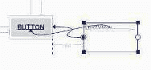

这就是你要做的全部。完成此操作后，按钮中的文本和`TextView`中的文本将共享同一个基线。如果你移动`Button`，`TextView`也会随之移动。如果你想移除基线对齐，你需要做的就是选择`TextView`，悬停在椭圆框上，并在移除基线约束出现时点击。

## 方向与分辨率 (Orientation and Resolution)

为 Android 创建应用面临的最大挑战之一是允许各种屏幕尺寸和方向。由于需要处理不同的屏幕尺寸，移动应用开发与桌面开发有明显区别。即使你的应用运行在固定设备上，用户仍然可以将其旋转 90 度，瞬间改变屏幕尺寸，然后再回来。因此，你的应用必须响应这些变化。坦率地说，Android 通过提供专门处理分辨率和方向变化的设施让你的工作变得更容易，但你需要在学习过程中尽早接受这种情况，以掌握 Android 编程。

Android Studio 拥有许多工具可以帮助解决可变布局问题。例如，它允许你在各种设备、方向和分辨率下查看布局。这使得事情变得简单得多。我们只需通过选择“横屏”（Landscape）选项即可在横屏模式下测试布局：

对于简单的布局，这可能足够了，但 Android 还有更多大招来帮助你适配不同尺寸的屏幕。特别是，你可以利用“碎片（fragments）”，并为每种屏幕方向和分辨率创建一个单独的布局。碎片是高级主题，也是本独立书籍的主题，即*《Android 编程：精通碎片与对话框》*所讨论的。。另一方面，为每个方向和分辨率使用不同的布局是 Android UI 设计的基础，在这一早期阶段，你至少需要知道它的存在。

这个想法非常简单——为你想要支持的每个方向和分辨率提供一个布局资源。当应用在真实设备上运行时，系统会自动选择所需的资源布局。其工作原理虽然简单，但 Android Studio 具有一些非常有用的功能，可以让你免受底层实现细节的影响。先发现它是如何工作的是一个好主意，然后去看看 Android Studio 是如何为你完成这些工作的。

### 按方向选择布局

如果你创建一个名为`activity_main.xml`的新布局文件（即：与你已经创建的竖屏布局文件名完全相同，但位于`layout`文件夹中），那么当客户端将设备旋转到横屏模式时，它会被相应使用。也就是说，在任何情况下使用的设计文档都是由它存放的容器名称决定的。通过这种仅适用于特定方向的新设计，你现在可以创建一个在该方向下使用的格式。

通常发生的情况是，当应用启动时，系统会根据资源文件夹中存储的内容（即竖屏的`layout`和横屏的`layout-landscape`）为屏幕选择最可用的布局文件。当设备旋转时，框架会重启你的应用程序并加载最佳的可用设计。如果你只有一个图片格式，那么它将用于所有方向；但如果假设你额外有一个横屏设计文档，那么它将用于横屏模式。

最近描述的基本上就是发生的情况。总结一下，每个目标和方向都有相应的组织器，你可以创建所有名称相似的不同格式资产。框架因此在运行时选择要使用的组织器，以堆叠出适合设备的设计。

### 使用 Android Studio

尽管如此，Android Studio 试图以一种不那么复杂的方式向你介绍这一点。任务视图（undertaking view）隐藏了各种组织器是如何使用的，本质上向你展示了带有限定符的资源记录的不同版本——例如横屏文档带有`(land)`等。让我们来看看它是如何工作的。

要给上面的按钮和消息设计添加一个横屏格式，只需使用“编辑器中的方向（Orientation in Editor）”按钮：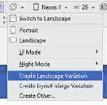最初，图片设计被用作横屏格式的布局。在横屏格式依赖它之前，确保你正在修改`content_main.xml`文档。这保证了该文档被用作文件横屏形式的布局。记录的横屏变体将包含格式记录的所有 UI 部分。这意味着你的代码可以以标准方式与其协作，而无需察觉它正在与另一种设计工作。所有代码考虑的只是有一个按钮或有一个`textView`——而不是它们确定被放置在哪个方向中。如果你分析项目（Project）窗口，你会看到列出的新设计文档：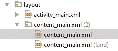你可以看到目前有两个`content_main.xml`记录，其中一个在名称后面添加了`(land)`。正如所说明，这是 Android Studio 为你提供的改进。如果你切换到项目文件（Project Files）视图，你会发现事实上，新的格式资产在另一个注册表中，`layout-land`：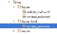Android Studio 的视图更直观，但当你真正想知道记录到底存放在哪里时，这个视图是很有用的。

起，新的横屏设计与手机设计一样，但你可以对其进行修改使其更符合该方向。例如，我们应该在横屏模式下将文本放在按钮下方：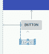现在假设你使用测试系统运行应用程序，起你会看到手机屏幕，但假设你利用侧边菜单将测试系统切换到横屏模式，你会看到一个显示格式的延迟，随后它将变为横屏布局。

如果你在多个设备范围内查看应用程序，你可以切换到横屏并看到你的自定义横屏布局。


总的来说，最好的安排是创建一个手机设计，并尽可能晚地生成横屏格式，这样你就不需要反复调整 UI。

## 生命周期与状态管理

还要注意，设计的自动切换会导致可能的问题。当格式切换时，你的应用程序将重启，这意味着它可能会丢失当前状态。这就像你的应用程序刚刚被用户启动一样。

为了解决这个问题，我们想要研究应用程序生命周期并找到如何保护状态，这在第 13 章中有介绍。你也可以使用类似的方法来处理不同的屏幕目标。想法是类似的——提供多个格式 XML 文档，每个目标一个，框架因此选择使用哪一个。这比管理方向要复杂得多，因为你可能需要提供不同的目标图片来使设计看起来很好。考虑到这一点，我们稍后查看了资产和资产管理。

这只是我们对应用开发中特定部分的首次接触，它让 Android 比为适配固定尺寸屏幕更复杂，但事实证明它并没有最初看起来那么困难。

## 第一个应用——简单计算器

为了说明使用`ConstraintLayout`和布局编辑器构建一个基础应用，我们来制作一个计算器应用如何？应用程序中的部分方法比我们到目前为止涵盖的内容稍微多一点，但你应该能够跟上，现在是时候展示按钮应用长什么样子的了。

这是一个非常简单的计算器——它所做的就是构建一个运行总和。它只有十个数字按钮和一个显示器。没有加、减或清除管理按钮——不过你可以添加它们来扩展功能。启动另一个名为`ICalc`或你喜欢的任何名称的基础 Activity 项目。确认所有默认设置。Activity 的规则是我们建立一个十个按钮的框架。将每个按钮设置为 0 到 9 的文本名称。我们将为每个按钮分配相同的点击事件处理程序。它所做的仅仅是获取按钮上显示的文本，将其转换为整数，将其加入运行总和，然后在转换回字符串后存回`TextView`中。

所以代码相当简单。

我们确实需要一个私有属性来保存总和：

```java
hidden var complete = 0
```

接下来我们需要一个`onButtonClick`方法，用于处理按钮的一般点击事件。假设你不熟悉简单的事件处理，请参考第 2 章。点击的按钮作为`View`对象作为主参数传递，我们可以利用它获取其文本标题：

```java
fun onButtonClick(v: View) {
    val button = v as Button
}
```

```kotlin
val bText = button.text.toString()
```

现在我们已经有了按钮的副标题 0、1、2 等，我们可以将其转换为数字并累加到运行总和中：

```kotlin
val esteem = bText.toInt()
absolute += value
```

最后，我们将`TextView`的`text`属性设置为所有更改后的字符串：

```kotlin
textView.text= total.toString()
```

总计事件处理程序如下：

```kotlin
private var complete = 0
fun onButtonClick(v: View){ 
    button=v as Button
    val bText=button.text.toString()
    val value=bText.toInt()
    total+=value
    textView.text= total.toString()
}
```

将此代码放在`MainActivity`类中，作为它的策略之一，例如放在靠近最后一个大括号`}`之前的地方。当你输入这段代码时，你会看到大量的类和技术显示为红色：

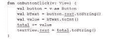

这是因为它们需要被导入才能在任务中使用。你可以手动这样做，在文件的开头添加必要的`import`语句，但更简单的方法是将光标置于每个红色文字上，按下`Alt+Enter`并在需要时选择`Import Class`。这现在应该已经很自然而然了。

注意，`textView`中显示的错误无法消除——这是一个真实的错误。我们目前还没有定义 UI，且`textView`并不存在。一旦我们创建了 UI，它就会存在，所以对于第二个错误请忽略。

## 布局 (Layout)

现在我们将注意力转向设计。打开格式文件，删除默认文本，并在设计表面的右上角找到一个带有小间距的单个按钮。我们想要更改它的文本属性，可以使用一种简单的方法访问它。假设你双击它，你将被带到文本属性窗口，你可以在那里输入 7 作为它的文本属性值。

在属性（Attributes）窗口中，观察`onClick`属性。将其设置为`onButtonClick`，即你刚刚编写的事件处理程序：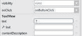

为了创建一个按钮网络，你需要重复此操作 9 次。你可以通过将每个按钮拖到设计平面上并手动设置所需的属性，以确保每个按钮与之前放置的按钮一致。尽管如此，我们可以利用目前创建的那个`Button`通过复制和粘贴来创建其余。

在组件树（Component Tree）中选择按钮并使用`Copy`命令，然后在设计平面上粘贴两个额外的`Buttons`。副本将放置在主`Button`之上，因此拖动它们以形成一条由三个`Buttons`组成的直线。在这个阶段不要纠结于具体的定位，我们只需要在设置好要求后以后完成这一点。将每个按钮的文本属性分别更改为 7、8 和 9：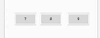

如果你尝试使用`Infer Constraints`（推断约束），你会发现它是有效的，但应用的指令并不真的如你希望的那样一致。在这种情况下要求是合理的，但请注意行的向上位置是由中间按钮设置的，而水平位置是由第一个按钮设置的：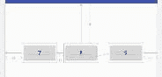

设置约束有许多方法，但能够利用左上角的按钮来定位整个按钮组是有帮助的。因此，通过指令将其定位在屏幕的顶部和左侧。该列中的第二个按钮可以设置约束，使其位于主按钮的右侧，并将其底部调整到第一个按钮的底部。

行中的第三个按钮与其左侧的按钮有类似的要求：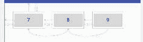

现在是一个通过拖动或使用属性窗口来精确放置按钮的好机会。

按照以下几行继续此示例，不要尝试重新排列一整行，因为约束会变得复杂。重新排列三个额外的按钮。应用关于主列的约束，但这次将行中的主按钮相对于左上角的按钮对齐： 将按钮中的文本更改为所示的 4、5 和 6。

最后一行也类似，但它的第一个按钮相对于下一行的主按钮对齐。最后添加单独的 0 按钮，并将其相对于第三行中的主按钮对齐： 确保你将最后四个按钮的文本分别更改为 1、2、3 和 0。

仔细检查约束，因为非常很容易出错。规则是：每行的主按钮相对于上方的按钮向上对齐，行中的不同按钮相对于第一个按钮对齐。

这是一项大量的工作！

现在，我们需要让网格更整齐。依次选择每个按钮，确保其标题正确，并且它已设置了`onclick`事件处理程序。然后，使用属性窗口将每个按钮的水平边距设置为水平 16，垂直 0。唯一的例外是每行的第一个 按钮，它需要设置为水平 0，垂直 16——如果你仔细考虑，这应该是合逻辑且相当简单的：现在你有了一个定位准确的按钮矩阵。

尝试确保你添加的每个`Button`都与不同的`Buttons`对齐，并确保你已为它们都设置了相同的`onClick`处理程序。你可以通过拖动其中一个`Button`来确保你做得很好！如果发现有几个没有，请尝试将它们相对于不同的`Buttons`进行定位。如果你发现任何定位困难，请放大。

如果你陷入了混乱，删除所有约束并重新开始。为了让这看起来更像一个键盘，选择 0 键并使其宽度加倍。

最后，在顶部添加一个`TextView`。你可以将其相对于顶行和 7 键对齐，然后调整大小使其跨越整个按钮布局。为此，你应该删除 7 键的约束，将其顶部相对于`TextView`的底部，并将左侧与`TextView`的左侧对齐。不要忘记将`TextView`定位在屏幕的顶部：

现在你应该可以通过简单的移动`TextView`到新位置来移动整个区域。

如果你发现布局编辑器太难以使用来制作这种格式，并且它往往很麻烦，你可能喜欢使用属性窗口设置设计属性。

选择`TextView`并使用属性窗口将文本尺寸更改为 18p 或更大——你会发现它在`textAppearance`字段下。

最后，按通常方式运行程序，你会惊喜地发现你的第一个应用程序确实可以进行计算！！ 尝试旋转模拟器看看它在场景模式下是什么样子。并不糟糕，但正如警告的那样，由于应用程序重启，你会丢失正在进行的任何计算，因为应用程序在方向改变时会重启。

- 了解 XML 记录如何运作非常有帮助，这样当布局编辑器（Layout Editor）在某些情况下无法满足时，你可以对其进行修改。

- 布局编辑器通过更改组件的属性来改变组件检查布局模式的方式。

- 你如何定位组件取决于你正在使用的布局。`ConstraintLayout`允许你相对于其他组件或相对于容器来定位组件。

- 布局编辑器可能会更改许多属性，将组件放置在在你需要的地方。

- 使用组件树（Component Tree）来选择在布局编辑器中难以选择的组件。

- 你可以利用属性窗口（Attributes window）来选择并直接设置任何属性。

- 如果你觉得在布局编辑器中定位或测量很困难，可以尝试放大。你可以利用 Android Studio 查看你的应用程序在不同屏幕尺寸和方向上的样式。

- 通过创建具有相同名称的额外设计记录，可以满足不同的方向和目标。框架将在运行时决定使用哪一个。

- 你可以在布局编辑器中重新排列组件，以快速开发重构的 UI 设计。

- 单个事件控制器可以附加到多个组件上。

# 第 4 章：Android 事件

使用 Android Studio 配合智能监视器使得组装 UI 变得简单，但你实际上需要发现如何处理它并不擅长的事情。我们现在需要学习如何处理任何事件，不仅仅是`onClick`。尽管大多数控件都可以仅通过`onClick`事件有效使用，但还有其他类型的事件是无法通过在属性窗口中设置`onEvent`属性来处理的。

在本节中，我们将深入探讨 Android 事件处理。与过去一样，重点将放在利用 Android Studio 和布局编辑器来尽可能完成大部分工作。幸运的是，Kotlin 对将 Lambda 传递边界的支持让这一切变得简单得多。但无论如何，这并不意味着你可以完全忽略 Java 处理问题的方法。Kotlin 需要与用 Java 编写的库协作，并间接依赖于事件控制器的执行。你不需要钻得太深，但你必须知道 Kotlin 如何使用 Java 的对象排序事件机制。

## Java 如何传递函数

如果你不想知道它是如何运作的，可以跳过这部分，直到你在事件控制器上遇到困难，然后再回来阅读。

Java 中的事件比其他语言稍微复杂一点，因为最初 Java 中的一切皆都是对象，而函数唯一的存在方式是作为方法，即作为对象的一部分。当你需要设置事件处理器时，你需要指定在事件发生时要调用的函数。你无法将函数作为参数传递给另一个函数，因为 Java 不支持函数类型。

解决方案是定义一个只有一个抽象方法的`Interface`（接口）——即`SAM`或单抽象方法。该抽象方法就是将用作事件处理器的函数。要传递它，你必须创建`Interface`的实例，即一个具有已定义方法的对象，并将其传递。接口类似于类，但它基本上是描述了类需要实现的功能。假设一个类获取或执行一个接口，那么你就需要为接口中描述的每个功能编写代码。你可以将接口考虑为执行该接口时需要编写的一系列函数的定义。Kotlin 和 Java 都支持接口。

在这一阶段有必要说明，Android SDK 中的并非所有事件处理器都是 SAM。

有些是具有多个方法的类或接口。Kotlin 和 Java 都支持接口。

## 事件在 Android 中如何执行

以这种方式创建的对象可以实现一个接口或从类中继承：

```kotlin
object:myInterface{

}
```

所以你可以这样组合匿名对象：

```kotlin
b.setOnClickListener(object: View.OnClickListener {
    override fun onClick(p0: View?) {
        (p0 as Button).text = "You Clicked Me"
    }
})
```

这是完成这项工作最简单的方法，但有时对类进行定义是有价值的，这样它可以被很好地重用。同样，成员因素是否开放取决于该类创建的位置——这其中存在一个细微的差别，请参见本章末尾关于结论的部分。

这种创建事件监听器的技术适用于单个事件。你只需要做：

1. 创建`OnEventListener`对象的实例，并为所有抽象方法提供实现。

2. 使用`setOnEventListener`方法将你最近创建的`OnEventListener`添加到事件处理列表中。如果`OnEventListener`中定义了多个事件监听器，你实际上实现了所有的它们并传递了整个对象。

在很多情况下，实际上只有一个单一抽象方法 (SAM)，对于这种情况，有简单得的方法来实现相同的结果。

### 在 Kotlin 中传递函数

我们已经检查了将包含事件处理器的对象作为方法传递的基本方法，但当事件对象是 SAM（即只定义了一个单一事件处理器）时，有三种不同但相关的方法来传递事件处理器：

1. 函数引用
2. 匿名函数
3. Lambda 表达式

在这三种方法中，lambda 表达式是最常用且最常见的。注意，Kotlin 提供了定义和操作函数的其他方法，包括函数类型、扩展函数、中缀函数等。

#### 函数引用

Kotlin 支持不属于任何对象的函数。事实上，Kotlin 处理函数的方法的灵活性是使用它的目的之一。

因此，在 Kotlin 中，写如下代码是完全合法的：

```kotlin
fun myFunction(){…
}
```

在类定义之外。显然，为了与 Java 兼容，这种顶层函数实际上是一个类的方法，但由编译器创建并具有从包名和文件名获取的名称。你可以通过`@file:JvmName("class name")`注释显式设置包含顶层函数的类名。同样注意，Kotlin 允许你在不提供类名的情况下调用顶层或包级函数。即：

```kotlin
myFunction()
```

是合法的。

Kotlin 还有一个函数引用操作符`::`，它可以用于将几乎任何函数作为另一个函数的边界，或者将函数的引用存储在变量中。这使得使用任何函数作为事件处理器成为可能。例如，假设你在包级定义了函数：

```kotlin
fun clickEvent(v: View?) {
    (v as Button).text = "You Clicked Me"
}
```

那么，你可以写：

```kotlin
b.setOnClickListener(::clickEvent)
```

如果函数被定义为类内部的方法，你需要写：

```kotlin
b.setOnClickListener(this::clickEvent)
```

最新版本的 Kotlin 允许你在方法引用中省略`this`。注意，尽管这看起来是你正在使用并传递一个函数的引用，但实际上发生的是函数被转换为 SAM 的一个实例。这由边界的类型决定。也就是说，传递的不是对函数的引用，而是使用该函数构建的对象。每当你调用该函数时，都会从该函数构建另一个对象。通常情况下这没有影响，但如果你在使用函数引用在不同场合传递函数，你就应该了解这一点。每次使用它时，都会创建一个实现 SAM 的新对象，这比你想象的更消耗内存。

#### 匿名函数

匿名函数实际上如其名称所言——一个没有名称定义的函数。你基本上写成：

```kotlin
fun(parameters){body of function}
```

你可以在正确类型的变量中存储匿名函数的引用并将其传递给其他函数。例如：

```kotlin
b.setOnClickListener(fun(v: View?) {(v as Button).text = "You Clicked Me" })
```

你不需要使用引用操作符，因为编译器理解你需要传递这个匿名函数。它会将匿名函数转换为由边界类型确定的 SAM 实例。你可以将匿名函数保存在变量中，然后传递该变量。例如：

```kotlin
val clickEvent=fun(v: View?) {(v as Button).text = "You Clicked Me" }
b.setOnClickListener(clickEvent)
```

除了假设你多次使用相似的函数外，很难看出这样做有任何益处。

#### Lambda

**首先，什么是 lambda？**

Lambda 是一个你可以使用特殊符号定义的函数。根据这个观点，你实际上不需要 lambda，因为你可以使用引用操作符和匿名函数完成所有需要的工作。事实上，lambda 类似于你可以毫无问题地定义的匿名函数。因为函数没有名称，它是一个匿名函数，它也可以存储在合适的变量中并传递给另一个函数。你通过提供边界和一些代码来定义 lambda：`{参数列表 -> 代码… }`。例如：

```kotlin
{a:Int,b:Int -> a+b}
```

这是一个相加两个边界的 lambda。注意 lambda 可以有返回边界——lambda 的最后一个值会被返回。在示例中 lambda 返回一个 Int，即`a+b`。

lambda 就像一个函数，你可以将其存储在变量中：

```kotlin
var sum={a:Int,b:Int -> a+b}
```

你可以像调用函数一样使用该 lambda：


```kotlin
sum(1,2)
```

返回 3。lambda 结构有一些变体，在你习惯它们之前可能会看起来很困惑。如果 lambda 没有边界，你可以忽略它们。所以：

```kotlin
{1+2}
```

这是一个产生 3 的 lambda。在极端情况下 lambda 可以仅仅返回一个值：

```kotlin
{0}
```

这些原则会让 lambda 表达式在你的代码中看起来非常奇怪，这可能会使它更难阅读。尝试不要追求最简洁的表达式，确保你的代码易于理解。

## 使用 Lambda 处理事件

要为事件创建事件监听器，你只需使用`SetEventListener`方法并将 lambda 作为其边界。lambda 是处理事件的函数。例如：

```kotlin
button.setOnClickListener({ view ->
    (view as Button).text = “You Clicked Me”
})
```

将 lambda `{view -> (view as Button).text = “You Clicked Me”}` 设置为事件监听器。注意不需要确定边界的类型，因为编译器可以从`setOnClickListener`接收的边界类型推断出来。还有最后的语法变换。假设函数接受单个边界作为其主边界，你可以省略括号：

```kotlin
b.setOnClickListener {view->(view as Button).text =“You Clicked Me"}
```

这是 Android Studio 在布局中创建任何事件时使用的结构。它可能的优势是看起来更像是事件监听器的代码对于它被定义的函数是必不可少的。你也可以将 lambda 存储在变量并在以后使用，但这种情况下编译器无法推导出边界和返回类型，因此你需要确定它们。

例如：

`val clickEvent={view:View - > (view as Button).text = “You Clicked Me”}` `b.setOnClickListener(clickEvent)`

注意，与不同的技术类似，lambda 在被传递给`setOnEventListener`方法之前，会被转换为事件对象（occasion object）的实例。Lambda 被用于所有 Android Studio 生成的事件控制器，它是完成该工作的标准方法。在可行的情况下，它是书中后续所有模型中采用的策略。

## 闭包 (Closure)

闭包（Closure）是那些听起来似乎很麻烦的主题之一。Lambda 表达式与大多数能力不同之处在于，它们会接近其被声明时策略所处位置的每一个因素。

lambda 访问包围技术中因素的方式产生了一个非寻常的结果，你可以像这样构造事件控制器：

```
val message=“You Clicked Me”
button.setOnClickListener {view - > button.text = message}
```

这看起来可能很奇怪，但它确实有效。假设你不认为这很奇怪，那么你还没有看到事件监视器（即 lambda）将在`Button`被点击时执行，而这很可能在包围策略执行完成且它的每一个因素都不再存在之后——但 lambda 无论如何都可以利用`message`设置 Button 的文本。

框架将保留`message`的值，以便 lambda 利用它。这就是闭包的精髓——保护已经离开作用域的因素，以便 lambda 始终能够访问它们。

与 Java 不同，Kotlin 闭包捕获的因素不需要是最终的（final）。

注意到，在 lambda 内部访问`message`使它看起来就像 lambda 自然地仍然是其定义所在代码的一部分，而不是一个在遥远的未来某个运行的“脱离”函数实体——而这才是它的本质。现在我们来看一个不显眼的点。

Kotlin 闭包捕获的因素被分配在所有捕获它们的元素之间。也就是说，它们是作为变量的引用被捕获的。当使用多个 lambda 时，这可能很重要。

例如，在布局平面上放置两个 Button，并在`onCreate`事件控制器中添加：

```
var i=0
button.setOnClickListener {view - > button.text = (++i).toString()}
button2.setOnClickListener {view - > button2.text = (++i).toString()}
```

注意，每个按钮的快照事件监视器都在其闭包内部捕获了变量`i`，并且都提供了相似的变量。如果你点击第一个按钮，你将看到`1`作为它的标题，如果你点击另一个按钮，你将看到`2`作为它的标题。这些 lambda 共享同一个被捕获的变量。

从各来说，lambda 并不是你可以用来描述带有闭包能力的唯一元素。通过引用传递的局部能力、执行 SAM 的声明以及未知能力都有工作相似的终结。工作引用没有闭包，因为它们在被使用的地方之外被描述化（characterized away）了。

例如，使用一个局部命名函数：

```
var i=0
fun eventHandler(v:View){
    button.text = (++i).toString()
}
button.setOnClickListener(::eventHandler)
```

注意，这对于全局命名能力或方法不起作用。它必须是一个局部函数。

同样，对于匿名函数也是：

```
var i=0
button.setOnClickListener(fun (v:View){
    button.text = (++i).toString() 
})
```

这由于类似的闭包而起作用。例如，利用一个对象：

```
var i=0
button.setOnClickListener(object: View.OnClickListener { 
    override fun onClick(p0: View?) {
        button.text = (++i).toString() 
    }
})
```

在文中描述的能力通过闭包访问`i`。当你第一次遇到闭包的可能性时，它看起来可能非常奇特且异常地多余。尽管如此，当在策略内部描述能力时，技术框架了它的局部设置，并且它应该接近定义时在范围内的局部因素是非常正规的。

闭包对于事件监视器很有帮助，但在与提供给长运行能力的回调一起使用时它特别有价值。回调通常需要处理长运行能力的结果，而访问创建时的当前信息是常见且实用的。

依赖闭包总是有风险的。在能力声明时作用域内的所有内容都不能保证在任何情况下存在。假设局部变量被设置为某个项的引用，那么它将被闭包记住且该变量将存在，但无法保证它所引用的项在执行该事件控制器时在任何情况下存在。

## 使用断点 (Using Breakpoints)

确保事件监视器被调用的最简单方法是在`onClick`方法的主行上嵌入一个断点。断点是一种基础的调查设备，你真的想要尽早学会如何使用它们。

要放置断点，只需点击代码行侧的“边缘”。会出现一个红色的点：

现在，当你使用`Debug`符号或`Run, Debug`订单运行程序时，程序在到达任何设置了断点的代码行时将停止 一旦程序停止，你就可以看到它执行到了什么种位置，并分析使用的每个因素中存储了什么：


你也可以重启程序或单步执行。

幸运的是，你可能不需要为这些事情烦，除非你偏离了 Kotlin。

### 总结

在 Java 中，你无法直接传递一个容量来设置事件控制器，你需要传递一个包含该容量的项作为方法。事件在很大程度上通过单抽象方法（SAM）接口来处理。SAM 中声明的技术是执行事件处理的容量。对于每个事件以及能够产生该事件的每个控件，都有一个结构为`onEventListener`的 SAM，而项具有一个`seteventListener`策略，可用于加入事件处理器。

你可以通过多种方式创建 SAM，其中最广泛的方法是利用 Kotlin 的`object`。当事件不以 SAM 形式执行时，它可以被用于任何事件中。除了使用`object`之外，还有三种实现 SAM 的可选方法：

1. 函数引用

2. 匿名函数

3. Lambda 表达式

函数引用可以用于传递包或局部作用域容量或一个方法。

方法引用（mysterious capacity）的工作方式类似，但你不需要担心引用运算符。Lambda 是一种组合未知容量的更受限的方法，它是执行事件处理器的标准方法。最后一种语法调整是，假设`setListener`方法具有单一的容量边界，那么你可以省略括号。

本地项、局部作用域引用、未知容量和 lambda 统称为闭包，这使得它们在执行语句运行时，可用的因素是开启的。

断点是检查程序最有效的方法，当你开始实现一些事件控制器时，它们变得至关重要。在调试模式下运行时，断点会停止你的程序，以便你分析变量的内容。

如果你能将精力限制在 Kotlin 上，你就可以只使用项和 lambda 创建事件控制器。如果你真的想理解 Java 代码，那么有许多替代方法来实现该操作，包括在 Activity 中实现接口以及使用匿名内部类。

# 第 5 章：基本控件

我们在之前的章节中已经有效地使用了一些 UI 控件，现在既然我们已经知道了事件是如何工作的，是时候分析它们的工作原理以及你如何更改它们的外观了。

### 基本输入控件

“控件”（control）一词来自于客户端利用它们“控制”你的程序。小部件（widget）或部分（part）也是含义完全相同的术语。Android 社区似乎对术语非常挑剔。

基本的信息控件有：

* 按钮 (Buttons)

* 文本框 (Text Fields)

* 复选框 (Checkboxes)

* 单选按钮 (Radio Buttons)

* 切换按钮 (Toggle Buttons)

* 开关 (Switches)

如果你使用过其他 UI 结构，那么其中的很多对你来说都是熟悉的，你可能可以直接跳到感兴趣的控件。`TextView`也应该包含在基本控件的全列表中，但与文本框不同，它不能被用户修改，即它仅是一个输出控件。

从这里开始，我们应该更详细地回到`Button`。

### 按钮样式和属性

按钮有两种基本类型：`Button`和`ImageButton`。`ImageButton`与`Button`类似，但它有一个`src`（源）属性，可以设置为一张图片并作为按钮图标显示，且它不显示任何文本。

你在按钮上操作的主要属性包括背景（background）等，背景可以设置为阴影或实物感。你可以花费大量时间更改按钮的外观，但按钮最重要的属性是它的`onClick`控制器。按钮出现在你的 UI 中是为了被点击的。

如果你在布局面上面上放置一个`Button`，你可以使用属性窗口（Attributes window）来重新设计它。更改控件外观有两种明显的方法：你可以设置一种样式或调整一个属性。设置样式会将一组属性更改为给定的标准属性。你可以设置一种样式，然后更改单个属性来修改它。通常当你开始制作一个 UI 时，你会先设置单个属性，稍后再定义应用到整个 UI 的有意样式。

点击属性右侧的省略号，将`Button`的背景设置为暗色调：

资源窗口（Resources window）似乎允许你访问程序可以使用的每一项资源（assets）。资源是 Android 程序中一个非常重要的组成部分，我们将在后面的章节中进行详细介绍。你可以直接通过指定 RGB 值和可选的 Alpha 值（其透明度）来输入背景颜色。然而，使用资源意味着如果你以后更改了资源值，所有使用它的 UI 组件都会随之更改。

你可以选择多种种类型的资源，包括按任务（task）、Android 框架以及你可能使用的任何主题（Themes）分类的资源。有时你看不见这三个分类，因为它们被放在很长的列表中

在这种情况下，你需要选择一种颜色，因此选择 Color 标签页，然后选择 android 列表。向下看，你会看到一组可以使用的预定义颜色。找到`background_dark`并选择它：

显然，你现在看不到`Button`中的文本。要更改它的颜色，在属性窗口中向下看，直到看到`TextView`。`Button`是一个复合项，它内部包含一个显示按钮文本的`TextView`对象。如果你展开`textAppearance`菜单，你会看到`textColor`。只需选择一个可选的浅色调即可：

如果你现在在布局面上放置一个`ImageButton`（位于 Images 范围中靠下的位置），资源窗口会立即打开。这是为了让你为`ImageButton`选择一个“drawable”（绘制资源），即图标。向下寻找找到`ic_menu_add`。当你选择它时，它变成了按钮的`src`属性： 结果是这样的按钮：

投入精力研究利用按钮属性来实现样式化，使其符合你的需求。

要为这两个按钮添加一个点击事件控制器，你基本上可以在 Activity 中定义一个容量，并在每个按钮上设置`onClick`属性。你可以在之前的章节中找到这种使用按钮的方法。现在我们已经知道如何使用 lambda 处理事件，值得采用这种更现代的方法。

```
val myOnClickListener = { view: View? ->
val b = (view as Button)
b.text =“你点击了我”
}
```

注意你现在需要提供边界类型，因为框架无法推断它。仍然需要做的是在每个按钮上设置：

```
button.setOnClickListener(myOnClickListener)
imageButton.setOnClickListener(myOnClickListener)
```

现在当你点击这两个按钮时，`myOnClickListener`会被调用。

注意，将 lambda 保存在变量中进行复用并没有比需要时反复复制 lambda 更有效——每个按钮都会创建一个`OnClickListener`实例。它的主要优点是，只有一个真正想要更改和维护的容量，而不是两个。

同样重要的是，虽然按钮在生命中除了点击之外没有其他功能，但每一个不同的控件同样可以对`onClick`事件做出反应。这意味着只要你有需要，你可以将任何东西当作按钮。

## 所有属性 (All Attributes)

如果你在文档中查阅过任何使用`Buttons`的实例，或者碰巧你看了一些更高级的 Android 代码，你可能会发现一些你无法通过 Android Studio 访问的属性。这是因为属性窗口（Attributes window）只向你展示了最常用的特性。要查看所有属性，你实际上需要尽快点击窗口顶部或底部的闪电符号。


这样做的大问题在于，你会从一个极小的子集变成一个令人眼花缭乱的列表。管理的理想方法是知道你需要更改什么，并观察执行该功能的特定属性名称。这通常说起来容易，做起来却很难。例如，假设你需要在一个标准的文本按钮内部设置一个符号，使其显示在按钮所包含的消息的一侧。如果你将自己限制在底层属性窗口引入的属性上，这会给人一种不可思议的感觉。

如果你研究`Button`继承的属性细节点，你会发现：

`drawableLeft`

`drawableRight`

`drawableStart`

`drawableEnd`

`drawableBottom`

`drawableTop`

这些属性不在属性窗口列表中。它们允许你在相对于文本的指定位置显示一个 drawable（即图形或图标）。一旦你知道了属性的名称，你就可以认为它在所有属性的列表中：

点击它附近的省略号按钮（ellipsis button）并选择你决定的 drawable 将真实内容显示在文本的一侧：

## 文本字段 (Text Fields)

`Text Fields`是让客户端输入某些文本供你进行处理的方式，正如你所能的，它们构成了大多数 UI 的重要部分。

工具箱（Toolbox）中提供了许多`Text Fields`，但它们的工作方式都相似，区别仅在于它们期望用户输入的信息类型。在创建应用程序的过程中，你最终会体验到大部分它们，但你真正需要知道如何使用其中一个，以了解它们是如何共同工作的。

如果你使用过其他的 UI 框架，那么你以前可能经历过某种`Text Field`，但 Android 控件略有不同，因为它在很大程度上为客户端提供了一个名为`IME`（输入法编辑器）的自定义虚拟控制台。你可以构建自己的`IMEs`，但为了简单起见，我们直接使用系统提供的即可。

如果你需要 Android 模拟器使用真实 Android 设备使用的`IME`，那么在创建`AVD`（Android 虚拟设备）时，你需要取消选择`Hardware Keyboard Present`（显示硬件键盘）选项。假设模拟器使用主机的控制台，你完全看不到`IME`。主要需要澄清的一点是，尽管工具箱中看起来有很多种`Text Field`控件，但它们总体都是`EditText`控件的实例，其`inputType`属性被设置为特定值。

当你将它放置在布局面上时，你会发现它是`EditText`类型，并且如果你向下查看它的`inputType`属性，你可以更改文本字段将处理的信息类型。


当你使用特定的`inputType`时，客户端将获得一个适合编写数值的虚拟控制台： 例如，假设你选择了数字类型，你将给客户端一个主要显示数字键的自定义`IME`： 你会在控制台的右下角得到活动键，客户端可以点击它来完成活动——例如，发送一条短信消息。要为特定控制台选择活动按钮，你应该使用“所有属性”视图并为`imeOptions`属性选择一个设置：

例如，将其设置为`actionSend`将显示一个发送按钮（绿色的纸飞机按钮）： 你可以使用许多不同的属性来微调文本字段，但有一个标准赋值值得详尽地澄清——为`onEditorAction`事件编写一个控制器。

## onEditorAction 事件

回到`EditText`控件，我们为发送按钮添加一个监听器（overseer）如何？这为展示添加事件处理程序的整体流程示例提供了更多的自由度。

首先，在布局面上找到一个用于电子邮件的`EditText`，并像上一个区域所示使用属性窗口在客户端输入消息时弹出的`IME`中添加一个发送按钮，即找到`imeOptions`并选择`actionSend`。

在处理任何新事件之前，你需要找到事件监听接口的名称以及该事件的`setOn`方法。对于`ActionAction`事件，监听接口被称为`OnEditorActionListener`，`setOn`方法是`setOnEditorActionListener`。有了这些数据，我们可以像以前一样使用 lambda 来执行事件控制器。在这种情况下，我们应该在`setOnEditorActionListener`内部执行操作，因为事件监听器可能被这个控件需要：

```
editText.setOnEditorActionListener {v, actionId, occasion ->
    process the event 
    true
}
```

注意，现在我们的事件控制器有三个边界，但我们实际上不需要提供它们的类型，因为编译器可以推断它们。最后一个有效值是返回值。

现在剩下的就是编写事件控制器`onEditorAction`。你可以从文档中查看事件监听器的细节点：

```
@Override
public boolean onEditorAction(TextView textView, int i, KeyEvent keyEvent)
```

在这种情况下`textView`是与事件相关的控件，`i`是活动 ID，`keyEvent`在使用回车键时无效。如果操作已被“消耗”（即已处理），则该程序应返回 true，其他处理程序将没有机会处理它。通常，事件可以传递给包含事件源的其他控件。对于一个简单的模型，我们添加一个`TextView`并在客户端选择发送按钮时移动消息。假设这种情况实际上是发送电子邮件或短信。

```
editText.setOnEditorActionListener { v, actionId, occasion -> 
    if (actionId == EditorInfo.IME_ACTION_SEND) {
        textView.text = editText.text 
    }
    true
}
```

注意使用`EditorInfo`静态类来获取发送活动的整数 ID。`EditorInfo`类具有许多有用的常量和方法。

## 复选框 (Checkboxes)

`CheckBox`是一个非常清晰的 UI 组件。它显示一个小名称（受`text`属性限制），旁边带有或不带有勾选。客户端可以根据需要选择或取消多个复选框。在许多情况下，你会等到客户端点击另一个控件（通常是标记为“完成”的大按钮）后再管理`CheckBox`的状态。然后你可以简单地使用`isChecked`方法发现每个复选框的状态： 例如，假设你在点击视图上的某处的按钮时有一个 ID 为`checkBox`的`CheckBox`，你可以通过以下方式找到它的状态：

`var checked = checkBox.isChecked`

请注意，你可以像使用 Kotlin 属性一样使用`isChecked`技巧，因为不仅仅是`get`和`set`方法被转换成了属性，以`is`开头并返回布尔值的方法也是如此。

`CheckBox`同样拥有`onClick`事件，可以使用它来处理其状态的变化，你可以像设置`Button`一样通过属性（Attributes）窗口设置`onClick`事件监听器。因此，要处理`CheckBox`的表达式变化，只需将它的`onClick`事件控制器设置为：

`checkBox.setOnClickListener { v -> checked = checkBox.isChecked }` 

显然，事件监听器通常会执行除了将状态存储在变量之外的操作。

如果你真的想调整`CheckBox`的值，请使用`setChecked`或`flip`方法。

### 开关 (Switches) 和切换按钮 (Toggle buttons)

开关和切换按钮实际上是另一种配置下的`CheckBox`。它们存储两种状态中的一种，并在客户端点击它们时会改变状态，非常像一个`CheckBox`：

你实际上可以使用`isChecked`方法来查看`Switch`/`Toggle`按钮的状态，并可以使用它的`onClick`事件来监控其状态的变化。主要的区别在于，你可以利用`textOn`和`textOff`来设置开关/切换在开启或关闭时显示的内容。

### 单选按钮 (Radio Buttons)

最后一种“简单”的输入控件是`RadioButton`。它的工作方式与`CheckBox`类似，因为它完全可能处于两种状态之一，但巨大的区别在于一组`RadioButtons`在组内工作，并且一次只能选择其中一个。

“单选按钮（radio button）”这一说之所以是因为在硬件初期，汽车收音机有一排排列成一行的机械调谐按钮，允许司机通过按下按钮来快速选择电台。当你按下另一个按钮时，当前按钮会弹起，因此在任何时候都只有一个按钮被按下，确保你一次只关注某一个电台。

使用`RadioButtons`的主要问题在于确保正确地组装它们。为了做到这一点，我们需要使用一个`RadioGroup`容器，用于包含每个协作工作的按钮。有许多用于组合控件的容器，但其中最基础的就是`RadioGroup`。

使用 Android Studio，你可以通过先在布局表面设置一个`RadioGroup`容器，然后在容器内根据需要放入任意`RadioButtons`来创建一个`RadioButtons`集合。假设一组`RadioButtons`的运行方式不符合预期，很可能是不是每个按钮都在`RadioGroup`内部。

检查、创建和修改一组`RadioButtons`最简单的方法是使用组件树（Component Tree）窗口，你可以在那里实际上可以确切地看到它们是如何布局的。你也可以通过拖动到组件树窗口将`RadioButtons`添加到容器中： `RadioGroup`内部的所有`RadioButtons`协同工作，使得每个按钮可以轮流选中，你不需要执行任何额外工作来实现此行为。要发现哪个按钮被选中了，你可以像使用`CheckBox`一样使用`isChecked`方法。老实说，你可以像处理一组`CheckBoxes`一样处理一组`RadioButtons`，主要的区别在于使用了`RadioGroup`以及一次只能选择一个按钮的方式： 你可以利用`onClick`事件来识别任何按钮是否发生了变化，并使用`setChecked`或`flip`方法来更改按钮的状态。

### 总结

- 构成大多数简单 Android UI 的核心控件是：

    - 按钮 (Buttons)

    - 文本字段 (Text Fields)

    - 复选框 (CheckBoxes)

    - 单选按钮 (Radio Buttons)

    - 切换按钮 (Toggle Buttons)

    - 开关 (Switches)

- 每个控件都通过其属性和事件处理器进行调整。

- Android Studio 会隐藏一些属性，除非你选择了“所有属性”（All Attributes）按钮。

# 第 6 章 使用布局 (Working With Layouts)

布局的选择对于 Android UI 至关重要。布局是允许你定位并很大程度上组织不同部分的东西。根据软件工程师和客户的角度，深入理解每个可用布局提供的功能可以在简单和复杂的 UI 之间产生影响。在适配各种设备时尤为如此。

构成 Android UI 的所有类和对象都继承自一个类似的基类，`View`。也就是说，`Button`是一个`View`，`Layout`类也是。尽管如此，布局的作用方式似乎与简单的`Button`完全不同，这引发了一个问题：究竟什么是布局？

### 理解布局 (Layouts)

布局是其他`View`派生对象的容器。当 Layout 被调用来渲染自身时，它会交付它包含的所有`View`对象并将它们组织在它所占据的窗口空间内。

Android Studio 默认使用的布局是`ConstraintLayout`，我们在之前的章节中已经检查过它，但它并不是你可以在布局编辑器中使用的主要的布局。

目前支持六种布局：

- `ConstraintLayout`

- `GridLayout`

- `FrameLayout`

- `LinearLayout`

- `RelativeLayout`

- `TableLayout`

`ConstraintLayout`是在 Android Studio 2.2 中引入的。它是目前推荐使用的设计，并且是 Android Studio 3 的默认设置。它可以很好地被视为`RelativeLayout`的改进。在基础层面上，它可以很好地用于创建任何通过组合不同布局实现的类型。据称基于`ConstraintLayout`的 UI 更容易构建且运行速度更快，因为它们是“平坦”的，即没有多个布局嵌套在另一个布局内部。

Android Studio 并不需要你使用`ConstraintLayout`之外的任何布局作为底层容器，因此它不允许你删除默认设计。它允许你在当前任务中将`RelativeLayout`替换为`ConstraintLayout`，但你不能将其删除或替换为其他设计。解释是，将一种设计替换为另一种设计是麻烦的，因为支持属性中的每一个属性都是。

你可以直接修改 XML 记录将一种设计替换为另一种设计，但你需要重新修改所有的设计属性。

在最早的设计中，`RelativeLayout`和`LinearLayout`是最频繁使用的，而`FrameLayout`远居第三。后两个`TableLayout`和`GridLayout`适用于特定类型的 UI，在 Android Studio 3 中，它们在布局编辑器（Layout Editor）中几乎不受支持，因此你需要直接操作它们的属性。因此，最好避免使用它们。在查看这些其他选项以及如何使用它们之前，有机会掌握布局的基本思想以及它们共同遵循的标准是有意义的。然后我们将查看`Frame`、`Linear`和`Relative`布局，因为它们仍然很重要。尽管如此，`ConstraintLayout`非常重要，由于它是未来的首选布局类型，因此我们为其单独分了一个章节。

## 布局属性

大多数情况下，你可能会认为适用于控件的属性是与控件一起存在的，但一个设计可以通过多种方式处理其业务逻辑，并要求控件拥有许多明确的属性来决定其定位方式。因此，控件与设计配合时所需的属性取决于所选的布局，这使得组织变得困难。

实现这一目标最简单但不可行的方法是要求每个控件都实现每个布局使用的每个属性，即使是目前尚未使用的属性。这显然是低效的。解决问题的真正有效方法是每个布局都定义一个固定的类，继承自`LayoutParams`，该类包含了控件需要描述的每个属性。存放在布局中的控件会实例化相应的`LayoutParams`类，从而根据它最终所在的布局容器来区分它所遵循的边界。也就是说，而不是定义任何布局可能需要的每个可能的属性，可以放在布局中的 UI 组件使用适当的`LayoutParams`类来“导入”它所在布局所需的属性。这意味着控件有两种类型的属性——它自身的属性以及它从`LayoutParams`处获取的属性。

因此，在由 XML 属性表示属性的布局编辑器中，控件的属性分为两组：

* 属于对象的属性。

* `Layout`对象要求的属性。

你可以通过 XML 文件中的形式识别`Layout`属性，因为它们在 XML 文件中的形式为`layout_name`。你可以在布局编辑器的属性（Attributes）窗口中看到它们：


因此在屏幕截图中，`layout_margin`属性是由`ConstraintLayout.LayoutParams`对象提供的，但`Padding`属性是`Button`支持的。换句话说，你看到的布局属性取决于该控件属于哪种布局，但其他属性属于控件并始终列出。在这一阶段还值得知道，布局编辑器通常呈现一组简化的布局属性，然后它将其映射到 XML 中更大且更混乱的`layout_`属性集上。

## 宽度和高度

你所看到的精确`Layout`属性集取决于你使用的`Layout`。然而，所有`Layouts`都支持两个属性：

* `layout_width`

* `layout_height`

你可能认为控件的宽度和高度应该是属于控件的属性，但这里的情况更为微妙。控件并不一定具有固定大小。例如，它可以请求`Layout`给它尽可能多的空间，在这种情况下，`Layout`会设置控件的大小。这就是为什么控件拥有的是`layout_width`和`layout_height`而不仅仅是`width`和`height`的原因。

你可以将这些属性设置为三个可能值之一：

* 固定尺寸，例如`24px`

* `wrap_content`，设置大小以使其恰好适应控件的内容而不被裁剪

* `match_parent`，让控件变得与父级`Layout`允许一样大

如果你在布局编辑器中使用鼠标拖动控件的框架，发生的情况取决于控件和`Layout`。在大多数情况下，布局编辑器设置的默认值为`wrap_content`，它将忽略你任何交互式调整控件大小的尝试。事实上，在大多数情况下，尝试交互式调整控件大小不会改变`layout_width`或`layout_height`属性。然而，根据所使用的`Layout`，由于其他布局属性设置，你似乎改变了控件的大小。在我们处理特定的`Layout`类型时会讨论更多。

重点是，`layout_width`和`layout_height`并不一定是控制控件最终显示大小的唯一属性。有一点肯定的，如果你想为控件设置固定尺寸，你需要在属性窗口（Property window）中输入值。

## 单位

如果你要输入固定尺寸或位置，你需要知道如何操作。Android 支持六种单位，但只有两个（都是基于像素的单位）被经常使用：

* `px` – 像素

* `dp` – 密度无关像素

当你刚开始创建应用时，最想使用的单位是`px`（像素），因为你通常脑海中有一个具有特定屏幕尺寸和分辨率的测试设备。如果你希望你的应用在屏幕分辨率变化时看起来大致相同，那么这不是一个好主意。为此，你需要密度无关单位`dp`，因为它会根据屏幕分辨率进行调整。如果屏幕每英寸有 160 个像素，那么`1dp`等同于`1px`。如果每英寸像素数变化，`dp`到`px`也按相同比例变化。例如，在每英寸 320 个像素时，`1dp`等于`2px`。使用密度无关像素可以让你控件在分辨率变化时保持大小不变（此处原文有误，修正为：例如，在每英寸 320 个像素时`1dp`等同于`2px`）。请注意，这并不补偿屏幕尺寸。如果你保持像素数固定并将分辨率翻倍，那么屏幕尺寸就会减半。此时用`px`指定的控件将显示为原始大小的一半。用`dp`指定的控件将以原始大小显示，但占据双倍的屏幕。使用`dp`可以让你免受分辨率变化的影响，而不是物理尺寸。

除了基于像素的测量，还有三种真实世界的单位：

* `mm` – 毫米

* `in` – 英寸

* `pt` – 磅（英寸的 1/72）

这三种单位都取决于屏幕尺寸，控件使用的像素数量与屏幕分辨率有关。如果屏幕每英寸有 160 个像素，那么`1/160 in=1 px`，依此类推。再次注意，这些单位保护你免受分辨率变化，但不能防止实际屏幕尺寸的变化。你的按钮在所有设备上都是 1 英寸宽，但它占据多少屏幕空间取决于设备的大小。使用真实世界单位的危险在于，你可能会指定一个分数像素，导致显示不整洁。

最后一个单位也与像素有关，但它与用户的字体偏好相关：

* `sp` – 缩放无关像素

这种单位类似于`dp`单位，它会随设备分辨率进行缩放，但还会根据用户的默认字体偏好进行缩放。如果用户设置了更大的字体偏好，所有的`sp`值都会放大。你应该使用哪种单位？简单的答案是，除非你有充分的理由，否则你应该使用`dp`，因为这至少意味着如果你在尺寸为 x 的设备上测试了 UI，它在所有尺寸为 x 的设备上都应该正常工作，无论分辨率如何。Android Studio 在你输入任何值时默认以`dp`工作。

没有单位或当你交互式地调整或移动控件时。

### 控件仅仅是一个方框


对于布局（`Layout`）而言，控件（control）就是一个矩形。它的大小由`layout_width`和`layout_height`决定，这些可以由控件设置，或者更多地由`Layout`设置。一旦`Layout`知道了控件的大小，它就可以根据你使用`Layout`属性建立的规则来对它进行定位。

如果你想知道控件被分配的位置，可以使用它的`Top`和`Left`属性。这会给你提供控件矩形左上角的位置。你可以通过`Width`和`Height`属性计算出其他角的位置，但为了方便起见，还有`Right`和`Bottom`属性。注意，矩形左上角的位置始终相对于它所所在的`Layout`。也就是说，该位置不是绝对的屏幕位置。

同样值得知道的是，控件还支持内边距（padding），即控件内部的死空间。这是边缘与内容之间留出的空间。此外，某些（并非所有）布局支持外边距（margin），即控件外部的死空间，用于在控件之间添加间距：

注意，`padding`是控件的属性，而`margin`是布局属性。你可以单独设置左、右、上、下每个`margin`或`padding`，也可以指定一个单一值应用于所有项。理论上讲，`padding`用于在控件的内容周围留出空间，但它也可以简单地用于在尺寸设置为自适应内容时让控件变大。例如，左侧的`Button`内边距为 0，而右侧的`Button`四周都有 30dp 的内边距：

类似于，`margin`用于在控件周围留出空间，但它们也可以用于将一个控件相对于另一个控件或容器进行定位。这就是`RelativeLayout`和`ConstraintLayout`的工作原理。

## 重力（Gravity）

`Gravity`通常被认为是神秘的，部分是因为它的名字，部分是因为通常会有两个`gravity`属性起作用。基本上，`gravity`只是设置某个物体在动态布局中的放置位置。简单的`gravity`设置有：

- `top`
- `bottom`
- `left`
- `right`
- `center`
- `center_vertical`
- `center_horizontal`

所有这些的含义都是显而易见的，即对象直接移动到指定的位置。然而，如果你尝试在容器尺寸已调整以适应内容的情况下将对象设置为显示在左侧（即它已经尽可能靠左和靠右了），那么情况就会变得有点复杂了。你还可以设置多个`gravity`选项。例如，你可以同时设置`left`和`right`，这会让对象在水平方向居中。

让`gravity`变得复杂的是，某些设置会改变受影响对象的尺寸：

- `fill`
- `fill_vertical`
- `fill_horizontal`

在每种情况下，对象都会增长以填充指定的维度。还有两个裁剪（clipping）设置：

- `clip_vertical`
- `clip_horizontal`

这些与`top`、`bottom`、`left`和`right`配合使用，裁剪对象以适应容器。例如，如果你将`gravity`设置为`top`并设置`clip_vertical`，则对象将放置在容器的顶部，其底部边缘将被裁剪。

大多数时候，你只需简单使用如`center`或`top`这样的`gravity`设置。如果你尝试使用复杂的组合，结果往往不如你预期的那样工作。

最后一个复杂点（实际上其实非常直接）是，控件有一个`gravity`属性，而`Layouts`提供了一个`layout_gravity`属性。区别非常简单：`gravity`属性设置控件的内容发生什么，而`layout_gravity`设置控件在`Layout`容器中如何定位。例如，如果你有一个`Button`并将其`gravity`属性设置为`top`，那么按钮内部的文本将移动并对齐顶部。另一方面，如果你将`Button`的`layout_gravity`设置为`top`，整个`Button`将移动到`Layout`容器的顶部。注意，并不是所有的`Layouts`都为它们的子控件提供`layout_gravity`属性。

## FrameLayout

`FrameLayout`是所有`Layouts`中是最简单的。它对包含的控件定位并没有做做什么，它的设计意图是托管单个控件，也就是说它实际上只是充当控件周围的框架。

`Layout Editor`对`FrameLayout`的帮助不再像以前那样，如果你使用过早期版本，可能会发现新行为令人沮丧。事实上，让`FrameLayout`成为主布局控件的唯一方法是编辑 XML 文件并将`ConstraintLayout`替换为`FrameLayout`。如果你想尝试使用`FrameLayout`，只需将其拖到默认的`ConstraintLayout`上并在那里使用即可。

当你将控件拖入`FrameLayout`时，它将位于左上角，你无法将其拖动到布局内的新位置。要设置控件的位置，你必须找到`layout_gravity`属性而不是`gravity`属性，设置一个或多个`top`、`bottom`、`left`、`right`、`center_horizontal`和`center_vertical`：

你可以利用此在同一个`FrameLayout`中定位多个控件，但请注意，如果`FrameLayout`的总尺寸发生变化，不同的控件可能会叠加：

如果两个控件在`FrameLayout`中重叠，它们按照添加的顺序进行绘制。换句话说，最后添加的绘制在其他控件上方。`FrameLayout`的这一特性使得当你想要显示多个控件并切换哪一个可见时非常有用。简单地将所有控件放入`FrameLayout`，并使用它们的`Visible`属性选择其中一个可见。

更常见的情况下，`FrameLayout`仅用作布局组件的占位符，该组件稍后才会指定。例如，如果你使用`Fragment`（请参阅配套书籍 *Android Programming: Mastering Fragments & Dialogs*）来创建 UI 的部分或读取显示列表，那么你通常需要一个容器让新组件出现在你的静态布局中。`FrameLayout`非常高效地完成这项工作。当你需要最简单的布局来持有或少量组件，且不需要大量的定位或尺寸调整时，请使用`FrameLayout`。

## LinearLayout

我们需要考虑的下一个布局是`LinearLayout`。这是一个简单的布局，可以用于组织 UI 的大量基础工作。事实上，一旦你开始使用`LinearLayout`，它往往会成为你考虑过于频繁使用的布局。你可以将`LinearLayout`作为基础布局，替换 Android Studio 提供的默认`ConstraintLayout`，或者将`LinearLayout`放在`ConstraintLayout`内部。

在 Android Studio 中，`LinearLayout`在调色板（Palette）中出现两次——一次作为垂直`LinearLayout`一次作为水平`LinearLayout`。然而，区别仅是将`orientation`属性设置为`horizontal`或`vertical`。换句话说，你可以通过简单的属性更改切换水平和垂直线性布局。

水平的`LinearLayout`充当行容器，垂直的`LinearLayout`充当列容器。你可以使用嵌套的`LinearLayouts`构建看起来像表格的内容，但如果这变得非常复杂，最好使用`ConstraintLayout`。这样嵌套布局也是低效的，因为渲染引擎必须多次计算布局才能正确。建议是使用`ConstraintLayout`并避免嵌套。

如果你将`LinearLayout`放在`ConstraintLayout`上，你就可以像定位其他控件一样定位它。如果你在它内部放置其他控件，它们将水平堆叠形成一行，或垂直垂直堆叠形成一列。

这听起来很简单，但`LinearLayout`有许多使用方法。例如，如果你在`ConstraintLayout`中放置一个水平和一个垂直的`LinearLayout`，那么它们的行为取决于你将它们的`layout_width`和`layout_height`设置为什么值。如果你将它们设置为`wrap_content`，那么这两个`Layouts`就像水平和垂直的控制面板，也就是说，你可以作为一个整体移动所有的控件：在布局编辑器中，要确定你正在拖动什么可能非常困难，因为你很容易选到其中一个`Buttons`而不是布局。请利用组件树（Component Tree）窗口来选择布局，并确保`Buttons`位于你认为的布局中。

当你将一个`LinearLayout`嵌套另一个`LinearLayout`中以创建一个表格时，情况变得更有趣。例如，你可以通过在一个垂直的`LinearLayout`中嵌套三个水平的`LinearLayout`来创建一个计算器风格的键盘。421也就是说，在屏幕上放置一个垂直的`LinearLayout`，然后在内部放置三个水平的`LinearLayout`。在每个水平`LinearLayout`中放置三个按钮。如果你在这样做时遇到困难，请使用组件树来确保组件已正确嵌套。确保你将`layout_width`和`layout_height`设置为`wrap_content`，否则`LinearLayouts`将重叠：这比使用`ConstraintLayout`更容易安排。最后一个`Button`只需要放置在垂直的`LinearLayout`中，它将形成它自己的一行。

- `LinearLayout`是当你需要一行或一列控件时非常实用的分组设备。

## Layout_weight

关于`LinearLayout`还有一个最后一个要讨论的谜题，即`layout_weight`，这是一个只有`LinearLayout`支持的布局属性。如果你为`LinearLayout`中的任何控件分配了`layout_weight`，那么控件将调整大小以按其权重比例填充任何未使用的空间。这段描述中真正重要的部分是“未使用的空间”。发生的情况是，Android 首先在忽略任何权重分配的情况下计算布局。

这意味着控件被设置为你指定的尺寸。接下来，系统将确定包含它的`LinearLayout`中剩余哪些空间是未使用的。然后，这些空间将分配给具有`layout_weight`不为零值的控件，并按其权重比例分配。例如，假设我们有一个水平的`LinearLayout`，其中三个`Buttons`都被设置为`wrap_content`。屏幕已经旋转，为示例提供了大量的未使用空间：你可以看到右侧有很多未使用的空间。如果我们现在将第一个`Button`的`layout_weight`设置为 1，它将分到所有未使用的空间：如果你现在将第二个`Button`的`layout_weight`设置为 1，那么未使用的空间将平均分配在前两个`Buttons`之间：你可以猜到如果我们现在将第三个`Button`的`layout_weight`设置为 1 会发生什么，空间将被平均分配，三个按钮将具有相同的大小。然而，如果给第一个按钮的为 2，那么未使用的空间将按 2:1:1 的比例分配，依此类推。

更有趣的是，你认为给第三个`Button`分配固定宽度会发生什么？答案很简单。如果第三个`Button`的`layout_weight`为 0，则它被设置为指定的宽度，而另外两个按钮获得未使用的空间。例如，将第三个`Button`设置为 350dp 会得到：然而，如果第三个按钮设置了`layout_weight`，它可能会改变其宽度，因为它与其他按钮一样获得了未使用的空间的份额。

换句话说，当你设置了非零的`layout_weight`时，即使你为它设置了特定尺寸，控件也可以改变大小。这引出了“测量尺寸”和“实际尺寸”的概念。在第三个`Button`的情况下，它的测量尺寸是 350dp，但如果它的`layout_weight`不为零，那么它在屏幕上的实际尺寸将是不同的——它将被分配到部分未使用的空间。

当你在代码中处理组件时，`Width`和`Height`属性将提供控件的实际宽度和高度。`MeasuredWidth`和`MeasuredHeight`属性将提供在布局执行任何调整之前的测量宽度和高度。最后，值得指出，如果你想确保三个`Buttons`具有相同的大小，你必须将它们的宽度设置为 0dp 并将权重设置为 1（或相同的值）。为什么要这样做？当你将宽度设置为零时，所有的空间都是未使用的，系统将将其平均分配给每一个。你也可以将它们的宽度设置为某些常量最小值，然后让权重机制分享未使用的空间。

## RelativeLayout

`RelativeLayout`在过去使用最广泛，它现在仍然值得了解，因为你会在现有应用中遇到它，如果`ConstraintLayout`不适合你，你可能就得使用它。在`ConstraintLayout`引入之前，它是 Android Studio 所青睐的布局。

这是一个复杂且复杂的布局组件，你可能会认为如果可能的话，你应该倾向于更简单的替代方案。例如，你通常可以使用多个`LinearLayouts`来完成单个`RelativeLayout`的工作。最常提到的规则是，你应该尝试使用最少数量的`Layouts`设计你的 UI。特别是，深度嵌套`Layouts`（即在布局内嵌套布局）会降低速度，因为系统必须深入到每一层。规则是：

- 优先使用浅层布局而不是深层嵌套。你通常可以用`RelativeLayout`或`ConstraintLayout`一组嵌套的`LinearLayouts`。

对于这种强大的布局，`RelativeLayout`只有少数布局属性。它们分为两类：

1. 相对于父容器定位的属性
2. 相对于另一个控件定位的属性。

布局中至少有一个控件必须相对于父容器定位，以给其余布局提供位置。然而，任何数量的控件都可以相对于父容器定位，只要符合你尝试实现的目标。`RelativeLayout`属性在属性窗口中的呈现方式与它们在 XML 或代码中的表示方式略有不同。此描述适用于 Android Studio 展示它们的方式。参考 XML 或编程常量。

### 边缘对齐

原理是你可以指定任何边缘对对齐，一个在父容器中，一个在子控件中。这将移动子控件使其边缘与父边缘对齐，例如，顶部边缘对齐顶部边缘。如果你指定了两对边缘，那么你就可以在定位的同时更改控件的大小。

### 相对于父布局

基本的父布局属性有：

- `layout_alignParentTop`
- `layout_alignParentLeft`
- `layout_alignParentBottom`
- `layout_alignParentRight`

用于调整控件的边缘使其与父容器的边缘对齐。

例如：设置`layout_alignParentLeft`将控件的左侧移动到父容器的左半部分：这几乎不需要调整控件的大小。假设你选择了两个限制性安排，顶部和底部或左侧和右侧，那么此时，两个边缘都移动了，控件也调整了。例如，设置`layout_alignParentLeft`和`layout_alignParentRight`会产生：你同样可以通过以下属性调整到父容器中心：

- `layout_centerInParent`
- `layout_centerVertical`
- `layout_centerHorizontal`

### 相对于另一个组件

布局编辑器（Layout Editor）曾用于规划复杂的 XML 属性，以便一个部分相对于另一个部分进行定位。最新版本已不再采用这种复杂的解耦方式。相反，你既允许布局编辑器自动计算如何相对于另一个部分设置位置，也可以直接在属性（Attributes）窗口中通过原始属性进行操作。

每个相对于另一个部分定位的属性背后的核心思想是，你只需要将另一个部分的名称赋值给相应的属性即可：

- `layout_alignTop`
- `layout_alignLeft`
- `layout_alignBottom`
- `layout_alignRight`

例如：

```
layout_alignRight= button1
```

这会将控件的右边缘与`button1`的右边缘对齐。同样地，调整两个边缘（上/下和左/右）会改变控件的大小。

以下属性：

- `layout_above`
- `layout_below`

分别将控件的底部调整到所引用控件的最高点，将顶部调整到最低。同样地，属性：

- `layout_toLeftOf`
- `layout_toRightOf`

将控件的左/右与所引用控件的右/左对齐。最后，属性：

- `baseline`

用于调整父控件和子控件中的文本基准线。在 API 17 中，增加了一个新功能来考虑文本在布局中的流动方向，这是为了了如阿拉伯语等从右侧开始向左侧书的语言。通常情况下，`Layout_Direction`是从左到右的，起始边缘等于左边缘，结束边缘等于右边缘。如果`Layout_Direction`设置为从右到左，则起始等于右侧，结束等于左侧。你可以设置`startpadding`来根据设置的设计方向控制左侧或右侧的间距。所有的左/右描述属性都有起始/结束版本。

## 边距偏移 (Margin Offsets)


到目前为止，剩下的操作只有调整一组边缘。你如何确定相对于另一个控件或父容器的精确位置？正确的回答是利用设置控件边缘的常规方法。但是，如果你调整了顶部边缘并给子控件设置了 `10dp` 的顶部边缘，那么子控件的最高点将比父控件低 `10dp`： 因此，边缘布局被用于确定一个控件相对于另一个控件的趋势，而设置的边缘提供了具体的偏移量。

## RelativeLayout 与布局编辑器

在理解了这一切之后，你现在就能理解布局编辑器如何允许你创建一个 `RelativeLayout` 时当你在设计平面上移动控件时，最近的另一个控件或父布局将被选为定位的父容器，使用最近的边缘进行排列，并且该边缘被设置为父容器与子控件之间的距离。

这种功能运行得良好，但有时在移动控件时，可能很难让布局编辑器选中某个控件或布局。如果发现交互式设置太困难，你通常可以使用属性窗口来手动设置。

另外请注意，当你拖动一个控件的边缘到几乎与另一个控件的边缘对齐的位置时，这将导致该边缘被调整，控件会改变其大小。例如，假设你将一个控件的右半部分拖到布局的右边缘，那么控件的宽度就会改变。这种行为可能会让使用布局编辑器的新手感到困惑，因为它给人一种通过拖动边缘即可调整控件大小的印象，但大多数时候，控件在松开时会弹回其原始尺寸。显然，只有当你拖拽的边缘与另一个控件上的比较边缘对齐时，它才会调整大小。

必须再次强调，布局编辑器在使用 `RelativeLayout` 时的体验不像以前的 Android Studio 版本那样简单。例如，它不再提供关于像素平衡的直观定位预览，也不再使用映射到真实 XML 属性的格式属性排列。这些情况在后续版本中可能会发生，但考虑到对 `ConstraintLayout` 的强调，这似乎不太可能。

一旦你理解了 `RelativeLayout` 的工作原理，那时利用布局编辑器就会变得简单得多，使用 `RelativeLayout` 制作复杂的 UI 也是如此。

### 总结

- 你可以使用不同的布局容器（Layout holders）来制作 UI。每个布局都有自己一套设置子控件定位和调整大小的方法。

- Android Studio 3 的默认布局是 `ConstraintLayout`。

- 主要选项有 `FrameLayout`、`LinearLayout` 和 `RelativeLayout`。

- 每个布局都有自己的格式属性排列，用于控制控件的定位和估算。子控件可以使用格式属性类来告知布局如何定位和测量它们。所有布局都支持 `layout_width` 和 `layout_height`。

- 你可以使用各种单位指定位置，但大多数时候使用 `dp`（密度无关像素），因为这在尺寸相似但分辨率不同的屏幕上工作方式相同。

- 就布局而言，控件仅是一个矩形（宽度乘以高度），通过顶部和左侧进行定位。

- 所有控件都有内边距（padding）属性，决定控件内容周围的额外空间。

- 某些布局提供了 `layout_margin` 属性，用于在控件外部设置额外空间。

- `Gravity` 仅用于设置对象的简单位置——上、下、右、左。每个控件都有一个 `gravity` 属性来设置其内容的位置，例如按钮中的文本。某些布局具有 `layout_gravity` 属性，显示控件将如何定位。

- `FrameLayout` 是所有布局中最简单的，仅具有 `layout_gravity`。它通常只包含一个控件，并常用作占位符。

- `LinearLayout` 可用于将控件排列为行或列。就像重力一样，`LinearLayout` 也支持控件的权重（weight）。每个控件的精确尺寸由布局决定，剩余的空间根据分配的权重分配给控件。

- 复杂的设计可以通过嵌套 `LinearLayout` 来创建段落或行列表。这导致了 `LinearLayout` 被最广泛的使用。

过去，`ConstraintLayout` 并不成熟，在所有情况下的表现都不理想。在 Android Studio 3 中，帮助库已随布局编辑器得到了改进。目前看来，将你未来的应用程序都基于 `ConstraintLayout` 是明智之举。截至目前，`ConstraintLayout` 的默认版本为 `1.0.2`。它支持包括链（chains）和规则（rules）在内的所有特性，但不支持组（groups）和屏障（barriers）。目前的文档建议布局编辑器支持组和屏障，但如果你使用的是默认版本的 `ConstraintLayout`，它们并不支持，也不会显示在设置菜单中。

如果你需要使用这些特性，需要确保你的项目在使用 `1.1.0` 或更高版本。这目前处于 beta 阶段，但在下一个版本的 Android Studio 发布之前很可能会成为正式版。要使用它，你需要修改 `build.gradle` 记录如下：

```gradle
conditions {
    execution fileTree(dir: ‘libs’, include: [‘*.jar’])
    execution ‘com.android.support:appcompat-v7:26.1.0’
    execution‘com.android.support.constraint:requirement layout:1.1.0-beta3’
}
```

只需要更改最后一行，即从 `1.0.2` 改为 `1.1.0-beta3`。你需要重新同步项目，然后你将在右键上下文菜单中看到组和屏障。

如果你有一个现有的布局，可以请求 Android Studio 将其转换为 `ConstraintLayout`。你只需在组件树（Component Tree）中右键点击布局并选择 `Convert to ConstraintLayout`。这可以用于将一个复杂的设计转换为单一“层级” `ConstraintLayout`，但要小心，它经常会让事情变得非常混乱。通常对于转换后的格式，你只能说它为重新实现提供了一个起点。让我们比之前的章节更详细地研究 `ConstraintLayout` 在布局编辑器中的工作原理。

## 使用 ConstraintLayout

使用 `ConstraintLayout` 影响组件显示位置的主要因素是你所应用的约束条件（requirements）。那么如何应用约束条件呢？有两种方法，我们在之前的章节中已经过它们了。你可以让布局编辑器为你推荐它们，也可以手动应用。

### 自动约束

我们在第 3 章介绍过的自动约束应该会让事情变得简单。让管理器动态应用限制的方法有两种：

1. **自动连接模式 (Autoconnect mode)** – 针对单个组件

2. **推断约束 (Infer Constraints)** – 针对整个布局

它们的作用略有不同，你需要了解如何让它们协同工作。

要开启自动连接，只需点击布局编辑器顶部的该图标：


如第 3 章之前澄清的那样，自动连接会将约束应用到你正在设计平面上交互式设置的单个部分，或者应用到你拖到另一个区域的目前尚未应用约束的部分上。一旦添加了约束，即使你把部分移动到可能有其他约束位置，自动连接也不会尝试更改它。之前提到的另一个问题是，自动连接不会添加显而易见的约束。它会添加用于对齐和靠近边缘的约束，但不会添加相对于另一个部分的约束，或用于整体定位组件的约束。

目前，自动连接是一个非常弱的特性，在大多数情况下不值得开启。

### 推断约束

推断约束选项在很多方面比自动连接更容易使用且更强大。你只需要将组件放置在它们想要的位置，然后点击推断约束图标：

只有对于固定部分位置重要的限制会被添加——现有的约束不会被调整。这意味着你可以利用推断约束来确保你的设计有足够数量的约束使其正常工作。如果没有添加任何约束，说明它是好的。这也意味着当你再次点击推断约束时，无论你是否移动了部分，都不会发生变化。

要获得另一组约束，你需要删除需要重新计算的约束，然后点击推断约束。你可以使用 `Clear All Constraints` 按钮删除布局中的所有约束：。可以通过选择特定部分并点击其下方显示的红色交叉符号来移除该部分的所有约束：


要清除单个约束，只需将鼠标悬停在标记约束位置的圆圈上，直到它变成红色，然后点击它：


通过这种方式，你可以特定地删除约束并再次执行推断约束操作，或者直接手动应用更合适的约束。

推断约束的工作方式极其简单。它根据部分靠近什么来对其应用限制。这种方法会产生一个可以运行的布局，但对于未来的修改来说可能不是最合理的。

一个好的系统是关闭自动连接，并在每次在平面上放置另一个部分时都使用推断约束选项。这允许你逐个开发设计，并实际查看每个新的约束组合。然后你就可以调整最近包含的约束并移动到下一个组件。

事情变得麻烦的地方在于当你拥有多部分设计并需要实施重大改进时。通常对于这种情况，直接删除所有约束并重新开始更为简单。

只要设置了合适的约束，`ConstraintLayout` 的工作方式与 `RelativeLayout` 非常相似。对于单独放置在屏幕顶部和左侧边缘的组件，将添加固定其距离左侧和顶部距离的约束： 从现在开始，当显示按钮时，它位于距离左侧 80dp 距离顶部 80dp 的位置。这些约束的应用不受实际屏幕大小的影响。值得注意的是，实际定位正如 `RelativeLayout`，是通过设置按钮的边缘属性为 80dp 完成的。但与 `RelativeLayout` 中的情况不同，如果你将按钮移动靠近右边缘，约束不会变为相对于该边缘的约束。一旦设置了约束，除非你删除它并应用另一个，否则它将保持不变。当你拖动部分时发生的一切只是约束的值改变了，而不是它的类型。

值得注意的是，属性窗口（Attributes window）有一个大纲，显示了当前应用的约束并允许你更改它们并精确设置距离：。如果你点击其中一条约束行，可以为距离输入数值。你也可以点击显示的 X 来完全删除约束。

你同样可以通过菜单栏中的默认边缘符号，设置用于新约束时使用的默认边缘：

就像 `RelativeLayout` 一样，你可以设置相对于父容器或相对于布局中不同控件的约束条件。尝试在浅层级上放置第二个按钮，并将其移动到第一个按钮附近。现在假设你点击了 `Infer Constraints`（推断约束）按钮，应用的约束是相对于第一个按钮的： 你可以看到，在这种情况下，后续按钮位于距离主按钮左边缘 114 像素处，在其下方 57 像素处。

再次，这些限制无论显示 UI 的实际屏幕有多大或小都会被提交。同样，假设你移动了主按钮，后续按钮将保持与第一个按钮的相对位置。这在很大类似于 `RelativeLayout`，只要你设置了正确的约束，在 `RelativeLayout` 中可以完成的任何事情在 `ConstraintLayout` 中都可以实现。

如果你在 `Layout Editor` 中尝试调整布局，很快就能掌握要领。`Layout Editor` 自动应用约束的主要问题在于它经常会偏离重点。计算一个控件应该相对于另一个控件如何固定实际上需要一些智能，而目前 `Layout Editor` 并不具备这种能力。

### 手动约束

你可以手动在位置上放置约束。你所做的是从组件上的约束圆圈拖出一条线到你想用作参考点的边缘即可。例如，要将按钮相对于屏幕右侧定位，只需将按钮右侧的圆圈拖到屏幕右侧，然后将按钮移动到你想要的位置：

你可以结合编程和手动设置限制，这通常是最理想的工作方式。从总体上，你是在确定从部件的某点到另一个组件的某点的约束。

例如，要将一个部分相对于另一个部分，本质上是将第一个部分的约束点拖到第二个部分的某个边缘。在下方显示的情况下，应用了手动约束，是因为自动引导约束会在屏幕的左边缘设置约束：

在此处，有必要明确一个微小但重要的点。虽然你可以在 `RelativeLayout` 中物理上设置负边缘，但在 `ConstraintLayout` 中你无法使用它们。你无法拖动一个部分使其需要负偏移量——`Layout Editor` 会阻止你的拖动操作。假设你在边缘属性中设置了负边缘，它会显示为负值，但会被视为零。

这在实践中意味着，如果你将组件的左侧对齐到另一个组件的左侧，那么你可以应用的唯一约束类型是将第二个按钮向右移动。假设你尝试将其向左移动，那么产生的负边缘会被忽略。为了理解这种尝试，请在 `Layout Editor` 中尝试它，你会发现你无法在屏幕截图中将下方按钮拖过上方按钮的左半部分。同样，你无法将下方按钮拖过上方按钮的下部。这有一个特定的原理，但它也具有限制性，因为它意味着你无法设置一个将部件的最高点连接到其下方部件的最高点的约束。

你可以利用左对左的约束来向左对齐部件，利用右对右的限制向右对齐部件，等。为了帮助你完成这些操作，有一个排列工具面板：要使用它，选择你需要调整的所有部件，然后点击理想的排列工具。关键重要的是，利用这些排列工具本质上是应用了正确的约束。你可以通过手动应用约束来实现类似的结果。

除了有调整控件各个边的选项外，你还可以设置模式限制以使文本对齐。这在第 3 章中已详细说明，但这里简单说明——假设你点击第二个符号，当你选择一个部分时会出现圆形框：将光标悬停在弯形框上直到显示，然后从圆框拖动到你需要调整的部件中的文本模式上：

### 偏置约束 (Bias Constraints)

到为止 `ConstraintLayout` 并没有提供任何新东西，但它有一个 `RelativeLayout` 中没有的现代需求。这种被称为“偏置”（inclination）的限制根据比例工作，以比率表示并以交叉线显示：

要使用它，你需要创建两个相互“争斗”的约束。例如，假设你将一个约束向左拖动，将其伙伴向右拖动，结果是一个偏置，用于将控件位于格式大小的理想范围内。你可以通过从顶部和底部拖动约束来实现向上偏置。

当你在屏幕上移动控件时，划分或比例会在 `Attributes window` 中刷新。你可以利用看起来用于设置百分比的滑块：情况稍微复杂一些，因为你还可以确定一个边缘，为偏置约束提供一个通用部分。假设你查看上方显示的 `Attributes windows` 中的示例，你可以看到约束旁边显示有值为 8 的值。这是在你创建约束时分配的默认边缘。当你在屏幕上移动部件时，你无法将其放置得比在该方向上设置的边缘更近。

例如，如果你将左侧边距编辑为 100，那么约束显示将获得一段长度为 100 单位的直线。假设你现在尝试将按钮向一侧移动，你会发现无法比比 100 单位更近。注意，是预定义边缘之间的距离按照偏置设置的比例划分的。如果你想使用整个屏幕，请将边距设置为零：

### 链 (Chains)

一个最近熟悉的元素是可以在类似于父容器部件之间设置偏置约束的能力。也就是说，你可以在部件之间设置一组约束，其工作方式类似于

预置要求。通过这样做，你创建了目前被称为“链”（chain）的部件组合。建立链的理由是为了让 `ConstraintLayout` 更容易地实现你本会使用 `LinearLayout` 实现的功能，特别是具有相应间距的部件行或段。

创建链是一个略显隐秘的交互。要创建一个例如包含三个 `Buttons` 的均匀链，首要任务是将它们大致地排列成一行： 如果它们不在一条合理的行线上，限制将独立应用于每个部件。通过拖动选择框环绕这三个部件来选择每一个，然后在三个部件都被选中的情况下右键点击并利用 `Chain`、`Create Horizontal Chain` 命令：

要创建一个向上的链，你将部件排列在垂直区域，选择所有它们，右键点击并使用 `Chain`、`Create Vertical Chain` 命令。所有这些工作原理都类似，只是旋转了 90 度。如果一切符合设计且部件被识别为可能的链，将应用相应的唯一指令，你会在内部组件之间看到一个链符号：

注意，链的默认格式是 `Spread`（散开），它会公平地分配视角并评估边缘。有三种可选的设计模式，通过点击选择链至关重要的部件时出现的链符号来选择。

如果你点击一次，格式将更改为 `Spread Inside`（向内散开），这会将第一个和最后一个部件紧贴在容器边缘，并在可用空间内均匀地分布其他部件： 如果你点击第二次，设计将变为 `Packed`（紧凑），这会让每个部件尽可能相互靠近（考虑到边缘），然后将它们作为一个聚集体放置在容器中。你可以利用链中主部件的预置设置来定位该聚集体。注意，倾斜设置在其他链设计模式下没有影响：你可以利用 `layout_constraintHorizontal_weight` 和 `layout_constraintVertical_weight` 设置格式权重。在 `spread` 或 `spread inside` 模式下，这会根据权重分配空间，并模拟权重在 `LinearLayout` 中的工作方式。

### 链式键盘

为了展示链有多大的帮助，我们应该实现一个在第 3 节末尾计算器项目中所使用的种类的键盘。


首先在设计平面上放置九个按钮，形成一个不整齐的 3x3 网格：  依次选择每一行并使用 `Chain`、`Create Horizontal Chain` 命令将每一行转换为一个包含三个按钮的链：然后选择这三个链（即所有九个按钮），使用 `Chain`、`Create Vertical Chain` 命令创建网格： 如果你需要将设计更改为 `Packed`，基本上选择每行中的主按钮并点击链符号，直到你得到一个压缩的行： 要获得一个压缩的段落要麻烦得多，因为链符号只控制该部件所属的主链。在编写设置段落为压缩的最佳方法是修改 XML 文件。

链的样式受链中主部件的限制。假设你查看了主列中主按钮的 XML，你会看到：

```
app:layout_constraintHorizontal_chainStyle=“packed"
```

这负责将主行设置为紧凑设计。要将主区域设置为紧凑，你需要将 XML 改为：

```
app:layout_constraintHorizontal_chainStyle=“packed” app:layout_constraintVertical_chainStyle=“packed”/>
```

如果你这样做，你将看到第一列呈紧凑格式：

 你需要将后续行顶部和第三行顶部按钮的 XML 改为：

```
app:layout_constraintVertical_chainStyle=“packed”/>
```

如果你正确更改了顶行按钮的 XML，你应该看到一个紧凑的按钮数组： 目前的主要问题是，为了定位 `Buttons` 矩阵，你需要更改每行主按钮的预置设置（这设置了该行的水平倾斜），以及每个段中主按钮的设置（这设置了垂直倾斜）。没有单一设置可以定位整个网络，这使得定位变得不简单。

### 那么添加第 10 个按钮呢？

它本可以添加到主段中，但现在添加它同样简单，只需从主段中最后一个 `Button` 的下部以及该按钮的左右部分设置限制即可：

### 指南线 (Guidelines)

你可用的最后一个定位工具是指南线。你现在可以在设计平面上移动水平或垂直指南线，并用它来定位不同的部件。指南线的主要特点是它们并不作为 `View` 项目或最后格式中的其他内容存在。指南线是布局编辑器中的一个项目，你利用它设置的任何限制在应用程序运行时都会转换为不引用该指南线的定位。

要添加指南线，你只需使用 Guidelines 工具： 一旦添加了指南线，你就可以将其拖到理想区域，然后像对待部件本身一样相对于它定位部件。你可以设置与部件可以使用的任何限制，包括预置。注意，假设你移动指南线，任何强制移动的 UI 部件也会随之移动——这非常有用。你可以通过选择指南线并按删除来删除它。目前指南线的最大问题是，虽然布局编辑器会在拖动时显示区域，但没有简单的方法可以精确输入位置： 如果你展开属性，可以在 Constraints 集合下找到并输入一个精确的值。

### 组 (Groups)

注意这仅在 `ConstraintLayout 1.1.0` 或更高版本中可用——更多信息请参见本节的开头。

`Group` 允许你创建部件集合。目前这只是提供了一种更改一组部件可见性的简单方法。你可以使用 `Add Group` 菜单命令在设计平面上放置一个组。 `Group` 在组件树中使用起来最简单。你可以拖动若干部件并将它们掉到 `Group` 上。注意，在任何意义上部件都不是 `Group` 的子级，它完全不是容器。`Group` 本质上保留了它控制可见性的部件列表：

在上方模型中，`Group` 控制 `button1` 和 `button2` 的可见性。如果 `Group` 的可见性属性设置为不可检测，那么 `button1` 和 `button2` 真的不在 UI 中显示，但它们实际上占据了设计空间。假设你将可见性设置为消失，它们就是不可见的且不占据 UI 空间。

### 尺寸 (Sizing)

与定位相比，估计部件的大小实际上微不足道，但有一些有趣的转折。

你可以在 `Attributes`（属性）窗口中查看组件的大小。组件内部显示的线条类型表示了组件的大小及其与其内容的关系。实线表示固定大小： 这种自动调整行为是由 `layout_width` 和 `layout_height` 属性设置的。你可以通过在属性旁边的值框中输入精确的大小（例如 `100dp`）来修改它。

与固定大小部分相比，另一种选项是允许它们随之调整大小以适应或包裹其实质内容。要设置此项，你只需点击向内的实线，这些线会变为 `<<<` 并允许部分更改其大小： 这种行为受设置为 `wrap_content` 的 `layout_width` 和 `layout_height` 属性的限制，并且它是 Android 中是最常用的标准估算行为。也就是说，大多数组件都会改变其大小以适应其内容。

还有第三种选择——可以通过限制来设置部分的大小。假设你再次点击内部线条，它们将从 `<<<` 变为一个类似弹簧的图形： 使用 `Match Constraints`（匹配约束），你可以自由地设置水平或垂直方向的测量，这意味着可以使用限制来设置部分的宽度或高度。要设置宽度，你需要在左侧设置一个限制并在右侧设置一个强制；要设置高度，需要在顶部设置一个并在底部设置一个。`Match Constraints` 通过设置 `0dp` 的合适尺寸来实现。

例如，假设你有一个 `Button`，并物理地从父容器的右侧应用应用强制，并将水平测量设置为 `wrap_content`，那么 `Button` 将保持其原始大小，并添加方向强制以划分 `Button` 位置的可用空间： 如果你保留限制设置并将水平测量更改为 `Match Constraints`，那么按钮将调整大小以利用它可用的均匀空间： 这个原理非常简单——强制控制了部分的位置，或组件的大小。

你可以将 `Match Constraints` 应用于相对于父容器等不同部分的组件。例如，假设你有两个 `Buttons`，你将其中一个的右侧与另一个的左侧关联，右侧也同样操作，那么被强制的 `Button` 将对齐到与另一个 `Button` 的中心点： 你同样可以通过默认控制设置布局引导，使 `Button` 具有宽度偏移。如果你保留限制设置并将水平测量更改为 `Match Constraints`，那么在该点，被强制的按钮将调整大小为与其他按钮相似的大小： 再次，可以使用强制项来设置位置或大小。

类似的指南也适用于部分链（chains）。如果你有一个链被设置为 `Spread`（散开）或 `Spread Inside`（内部扩散），但不是 `Packed`（紧凑），你可以设置 `MatchConstraints`，部分将调整大小以占据空间。你可以将链中的部分部分设置为 `Match Constraints`，只有这些部分将调整大小以占据分配给它们的空间。例如，在这个由三个 `Buttons` 组成的链中，仅将随后的两个 `Buttons` 设置为 `Match Constraints`，而第一个被设置为 `Wrap Content`：

最后一个测量选项可用于将一个部分的大小设置为另一个部分的比例。要使此项起作用，其中一个部分应以另一种方式设置大小——要么通过 `Wrap Content`、合适的尺寸或约束。

将设置为比例的部分必须设置为 `Match Constraints`，之后点击 `Attributes` 窗口侧边的小三角形来翻转 `Aspect Ratio Constraint`（宽高比约束）。

例如，假设你在平面上放置了一个 `Button` 并将其宽度设置为 `Wrap Content`，高度设置为 `Match Constraint`，那么在该点，左上角会出现一个小三角形： 如果你点击三角形，你将为 `width:height` 设置 `1:1` 的默认比例。(image_rsrc2E7.jpg) 如果你输入类似 `1:2` 的值，那么高度将设置为宽度的两倍，因此由内容决定：

你可以利用限制设置其中一个部分。例如，假设你物理地为 `Button` 设置了两个方向的强制，之后将其水平尺寸设置为 `Match Constraints`，`Button` 将几乎与屏幕一样宽。假设你现在将高度设置为 `Match Constants` 并将 `Aspect` 比例设置为 `2:1`，你得到一个几乎等宽宽且高一半的 `Button`。(image_rsrc2E8.jpg)

## Barriers（屏障）

注意，这在 `ConstraintLayout 1.1.0` 或更高版本中可用——请查看该部分的开头获取更多信息。

`Barriers` 处理许多以某种方式难以处理的 `ConstraintLayout` 问题，但它们可能不是你每天都会用的。

`Barrier` 是一个非常用的规则。你在平面上放置一个 `Barrier`，之后直观地将许多部分放置其上——最有效是在 `Component Tree`（组件树）中。这与 `Group` 部分的作用类似，因为 `Barrier` 不是任何种的容器，但本质上保留了它将与之工作的部分列表。`Barrier` 额外具有一个方向，并与其列表中最极端的部分对齐。也就是说，假设 `Barrier` 设置为 `right`，它将位于其列表中最右侧的部分。

如果你将 `Barrier` 拥有的部分组视为一个包含它们的框（即边界框），那么另一种思考方式是 `Barrier` 将位于边界框的某个边缘上。就像 `Guideline`（引导线）一样，你可以通过对其设置强制来定位不同的部分。你可以看到这允许你将部分位于极右、极左、顶部或底部。例如，利用 `Add Vertical boundary`（添加垂直屏障）选项在平面上放置一个 `Vertical Barrier`。在此阶段，你将看到由于其默认方向是 `left` 且它尽可能向 `up`，因此如下：image_rsrc2E9.jpg) 接下来在平面上放置两个 `Buttons`，并利用 `Component Tree` 将它们位于屏障上：image_rsrc2EA.jpg) `Barrier` 的默认标题是传递的，因此它目前将自己定位在最左侧 `Button` 的左边缘。你可以将 `Barrier` 为下图中的灰色条带：image_rsrc2EB.jpg) 如果你移动这两个 `Buttons`，你会发现 `Barrier` 始终固定在左边缘。你可以通过在 `Component Tree` 中选择 `Barrier` 之后利用 `Attributes` 窗口将 `barrierDirection` 更改为 `right` 来改变这种行为：image_rsrc2EC.jpg) 更改后，`Barrier` 将位于组的最右边缘。现在，如果你在设计表面上放置第三个 `Button` 并约束它位于 `Barrier` 的右侧，那么它将始终位于 `Barrier` 列表中组件的最右侧边缘的右侧：image_rsrc2ED.jpg) 如果你移动那两个 `Button’s`，你很快就会发现这种 `Barrier` 是一种将部分设置为最右部分一侧的方法，无论它是哪一个。如果没有 `Barrier` 对象，你将需要将 `Button’s` 放入一个 `Frame` 中并之后相对于 `Frame` 定位不同的部分。这种方法可行，但会产生固定的格式。`Barrier` 方法保持了 `ConstraintLayout` 的扁平化。

无论你在何时有一组由于客户端信息、数据、区域或其他原因而改变大小的组件，**Barrier**（屏障）都非常有帮助。你可以利用 `Barrier` 将屏幕区域划分为足够大的部分以容纳该分组，然后其余组件就可以放置在剩余的空间中了。

### 约束属性

正如你所发现的，这里的属性与 `RelativeLayout` 中使用的属性基本相同，它们为 `ConstraintLayout` 设置了限制条件。要查看每个属性，你需要点击 `Attributes` 窗口右上角的“View all ascribes”（显示所有属性）图标——双向箭头。

例如，假设你正在查看 `Attributes` 窗口，你会看到：

```
Constraints
Left_to_LeftOf
```

这提示你提供布局中使用的另一个控件的 `id` —— 在此情况下是左侧对齐左侧。对于不同的可能结果也有类似的指令。例如：

```
Bottom_toBottomOf
```

依此类推。

同样值得注意的是，`Layout Editor` 虽然允许你通过将组件拖动到所需区域来设置其位置，但它实际上正在计算如何精确设置不同的属性。你可以手动这样做以获得类似的效果，但 `Layout Editor` 仅根据你放置组件的位置就能完成。因此，让 `Layout Editor` 为你设置属性更为简单。

### 故障排除

`ConstraintLayout` 提供了一种创建随屏幕大小变化的响应式设计的方法。然而，要可行地实现这一点是困难的。这所需的知识水平远超 `Infer Constraints`（推断约束）工具。它甚至可能超出了人类。一种更简单但更费精力的方法是，为不同的独特屏幕尺寸提供不同的设计，并使用要求进行微调。

`ConstraintLayout` 库使用一个线性指令求解器来整体计算组件的位置。这生成了一个用于你应用程序的布局，旨在快速且高效。目前，该框架和 `Layout Editor` 正在经历快速的变化和改进。许多元素并没有完全按照预期的那样工作，许多元素也不具备使其易于使用的功能。然而，`ConstraintLayout` 是 Android 开发团队认为未来的趋势。

鉴于提供一种能够适应各种屏幕尺寸和方向的设计的优势，它值得坚持下去。尽管如此，在 `Layout Editor` 中让布局变得一团糟是非常容易。

一个非常常见的问题是组件消失。这通常是因为它们重叠在一起或位于屏幕外。确定此问题最简单的方法是进入 `Attributes` 窗口并手动重置其中一个定位属性。

你还会发现以下提示很有用：

- 如果看起来正常，请使用与另一个组件的相对定位。例如，假设你有一个文本框，将其确认按钮相对于其右侧定位看起来没问题。

- 如果你将所有内容相对于父容器进行定位，那么你就获得了一个完全的设计，指示了每个元素特定且固定的位置。

- 如果屏幕尺寸发生变化，在空间不足的情况下，组件可能会相互覆盖。始终让你的设计留有大量的额外空间。在处理一组组件时，良好的策略是选择一个相对于容器进行定位的组件，然后将所有其他组件相对于它进行定位，以确保你可以移动该组并保持对齐。

- 记住，某些组件也会随着区域的变化改变大小，这会影响相对于它们定位的组件。自动生成的约束有时会起，但它们很少像一组手动创建的指令那样准确。如果你计划在将来使用该布局，那么创建一组手动应用的约束是值得的。在添加组件时，逐步使用 `Infer Constraints`，然后手动更改它生成的内容使其符合逻辑。

为中小型屏幕提供一个不同的设计资产，为大屏幕提供另一个，是更明智的做法。

### 总结

- `ConstraintLayout` 是未来的趋势，新的 `Layout Editor` 是为了与它完美配合而设计的。

- 有两个自动指令工具——`Autoconnect` 用于计算单个组件的需求，以及 `Infer Constraints` 用于计算整个设计中任何缺失的约束。目前这两个工具都不够特别有用。

- 你可以从格式中获取所有约束，或者一次只获取单个组件或单个指令的约束。

- 约束可以从组件应用到父容器，这些就像绝对定位一样。

- 你可以设置默认边缘以使组件定位更加规范。

- 组件可以相对于另一个组件进行定位。

- 你不能设置负边距。

- 你可以调整文本基线。

- 偏移（Bias）要求允许你设置按给定比例划分可用空间的位置。

- 链（Chains）提供了 `LinearLayout` 的特性。例如，你可以利用链将组件分散在可用空间。

- 布局可以添加指南（Guidelines），组件可以相对于它们进行定位，尽管它们不会出现在最终布局中。

- 可以创建组（Groups），允许你一次性设置所有组件的可见性。

- 你可以绝对设置组件的大小，或由内容决定。此外，你可以允许一对约束来决定大小。

- `Aspect Ratio Constraint`（宽高比约束）可以将其中一个维度设置为另一个维度的比例。

- `Barrier`（屏障）是一种智能指南，它跟踪指定的组件组，并位于该组在指定方向上的最边缘。你可以相对于 `Barrier` 定位其他组件。

# 第 8 章

## 编写 UI

如果你想成为一名出色的 Android 程序员，不仅需要知道如何创建 UI，还需要知道 UI 是如何创建的。为了对你所做的事情充满信心，你需要理解 Android 图形的一些内部机制。如果你想在代码中修改 UI 并处理菜单，这同样至关重要。

### UI 库

Java 及其他语言有许多不同的 UI 工具包，AWT、Swing、Qt、MFC、WPF 等，你可能会认为精通它们是一项困难甚至是不可能的任务。事实上，它比你想象的简单得多，因为大多数 UI 库使用相同的通用方法，而 Android UI 库（它似乎没有特定的名称）也不一样。让我们仔细观察它是如何工作的。

`Activity` 关联有一个窗口，这通常是它运行的设备的整个图形屏幕。换句话说，`Activity` 可以允许其他对象在设备的屏幕上绘图。然而，它并不是直接提供对图形硬件的访问，而是有一系列类，使得构建 UI 和执行图形操作变得更加简单。


在我们查看通用图形之前，首先需要弄清楚 UI 是如何构建的。

## View（视图）

所有 UI 组件和通用 2D 图形的基础都是`View`类。这是一个通用类，拥有大量的方法和属性，决定了它如何显示其所代表的组件或其他图形实体。它还参与了事件处理系统，这意味着`View`可以响应事件。存在一些`View`类实现了你在 Android Studio 布局编辑器中使用的标准组件，例如`Button`、`TextView`等。

每个`View`对象都有一个`onDraw`方法，该方法可以将它所代表的内容的图形化表示绘制到`Canvas`对象上，`Canvas`本质上是一个带有绘制方法的位图。其执行过程是：当`Activity`需要更新 UI 时，它会调用`View`的`onDraw`方法并向其传递一个`Canvas`对象，然后将其渲染到屏幕上——你不需要在这一层担心`Canvas`是如何渲染到屏幕的。你可以将其想象为“每个`View`对象都知道如何绘制自己”。

### 总结

- `Activity`可以与一个`View`对象关联。
- 当`Activity`需要绘制其 UI 时，它会调用`View`对象的`onDraw`方法，例如`view.onDraw(Canvas)`。随后`View`对象会在`Canvas`上绘制它需要的任何内容，无论是按钮、文本还是其他。
- `Activity`然后在屏幕上显示`Canvas`对象。

一个`Activity`只能与单个`View`对象关联，这决定了屏幕上绘制的内容。这看起来可能有些局限，但正如你将看到的，它远非没有局限，因为`View`对象可以相互嵌套。

## 使用 setContentView

如何设置一个`View`对象显示在 Activity 窗口中呢？答案是使用 Activity 的`setContentView`方法，这正是我们一直以来所做的。

为了看到实际效果，请启动一个新的 Basic Activity 项目并将`onCreate`修改为：

```kotlin
override fun onCreate(savedInstanceState: Bundle?) { 
    super.onCreate(savedInstanceState) 
    val b = Button(this)
    setContentView(b)
}
```

不要忘记使用`Alt+Enter`添加允许使用`Button`类所需的导入语句，并且不要在`onCreate`中留下任何会使用其他`View`对象（如菜单）的代码。第一条指令创建了一个`Button`对象（它是`View`的子类），第二条指令将其设置为 Activity 的 View。如果你运行此程序，你将看到一个填充整个屏幕的灰色区域： 是的，这就是按钮！你甚至可以点击它，尽管由于没有事件处理器，什么都不会发生。

为了让这个按钮稍微有趣一点，我们可以通过设置属性来自定义它。例如：

```kotlin
val b = Button(this)
b.text = "Hello Button"
setContentView(b)
```

如果你运行这段代码，将看到一个填充屏幕且带有“HelloButton”标题的按钮。 不要费精力在代码中设置任何布局属性，因为目前还没有生效的布局，所以它们会被忽略。如何激活布局是我们的下一个话题。

## ViewGroup（布局组）

如果一个 Activity 只能显示单个`View`对象，我们如何能创建一个包含多个按钮、TextView 和其他组件的复杂 UI 呢？答案是（你可能已经猜到了），存在`Layout`或`ViewGroup`对象，它们可以用于宿主其他`View`对象。你已经知道如何在布局编辑器或 XML 文件中使用布局，但它们与所有 UI 元素一样，对应于执行实际工作的特定类。

`ViewGroup`可以显示多个`View`对象。因此，在几乎所有情况下，与`Activity`关联的`View`对象都是布局 View。当`Activity`通过调用其`onDraw`方法请求布局 View 渲染自身时，`Layout`会调用它包含的每个`View`对象的`onDraw`方法并将它们组合成单一结果。当然，它还会执行布局操作，对其所包含的`View`对象进行定位和尺寸调整。

所以`Layout`做了两件事：

1. 它宿主其他`View`对象。
2. 它执行了其命名的布局功能。

为了看到实际效果，请尝试：

```kotlin
override fun onCreate(savedInstanceState: Bundle?) { 
    super.onCreate(savedInstanceState) 
    val linLayout = LinearLayout(this)
    val b = Button(this)
    b.text = "Hello Button"
    linLayout.addView(b)
    setContentView(linLayout)
}
```

如果你运行此程序，将在屏幕左上角看到一个按钮。第一条指令创建了一个`LinearLayout`对象。它是`View`的子类，可以包含其他`View`对象，并根据其`orientation`属性的设置以从左到右或从上到下的方式组织它们。接下来我们创建一个按钮对象，然后使用`LinearLayout`的标准`addView`方法将其添加到布局中。

所有的 Layout 都有一个`addView`方法，可以添加多个`View`对象。你可以添加更多按钮来查看默认`LinearLayout`是如何工作的：

```kotlin
override fun onCreate(savedInstanceState: Bundle?) {
    super.onCreate(savedInstanceState)
    val linLayout = LinearLayout(this)
    val b = Button(this)
    b.text = "Hello Button"
    linLayout.addView(b)
    val b1 = Button(this)
    b1.text = "Hello Button 1"
    linLayout.addView(b1)
    val b2 = Button(this)
    b2.text = "Hello Button 2"
    linLayout.addView(b2)
    val b3 = Button(this)
    b3.text = "Hello Button 3"
    linLayout.addView(b3)
    setContentView(linLayout)
}
```

为了明确一下——像`text`这样的属性是可以直接设置在`View`对象上的，但还有一些布局属性必须设置在适当的`LayoutParams`对象上，然后将该对象设置为`View`对象的`LayoutParams`属性。

## View 层次结构（View Hierarchy）

同样请注意，`Layout`可以包含其他`Layout`，因此组成 UI 的`View`对象集合结构类似于树形结构，即 View 层次结构。当屏幕重绘时，每个`View`对象都会被要求绘制自己，并从上到下对层次结构中的所有`View`对象执行此操作。通常 View 结构会在`Activity`加载时绘制一次。如果屏幕的某个区域由于某种原因被其他图形遮挡，重绘足够智能，不会绘制整个 View 层次结构。它只会重绘与屏幕失效区域交叉的`View`对象。View 结构还涉及到对象之间的事件传递，以及确定哪个组件具有当前焦点。

## XML 布局

到目前为止，图形系统的原理足够简单。每个控件或组件都对应一个`View`对象，你可以通过在代码中创建`View`对象并将它们添加到`Layout`中来构建 UI。你通过`LayoutParams`对象或直接设置属性来控制`View`对象的排列方式。`Activity`在需要时将其 View 层次结构绘制到屏幕上。好了，这是如何在代码中创建 UI，但到目前为止我们一直在使用布局编辑器构建 UI。这与 View 层次结构有什么关系呢？

布局编辑器创建一个 XML 文件，描述你想要创建的 View 层次结构。这种工作方式显而易见。XML 文件中的每个标签都对应你想要创建实例的`View`对象。例如：

```xml
<LinearLayout>
</LinearLayout>
```

这会创建一个`LinearLayout`对象的实例。

在布局中嵌套标签表示所创建的对象需要作为子 View 添加到布局中。例如：

```xml
<LinearLayout>
    <Button />
</LinearLayout>
```

这会创建一个`LinearLayout`对象和一个`Button`对象，然后使用其`addView`方法将`Button`对象添加到`LinearLayout`中。你可以看到 XML 完美地捕捉了 View 层次结构的概念。要设置对象属性，你只需要使用 XML 中对应的属性即可。例如，设置按钮的文本：

```xml
<Button android:text="New Button" />
```

布局参数使用带有`layout_property`前缀的属性设置。例如：

```xml
<Button
    android:layout_width="wrap_content"
    android:layout_height="wrap_content" />
```

其实就是这么简单。XML 定义了对象的层次结构及其属性，系统读取该文件并创建对象。这种将 XML 作为对象实例化系统的用法并不罕见。当然，布局编辑器创建的 XML 看起来比上面的示例复杂得多，但这主要是因为它定义的属性数量很多。基本思想仍然如此。

## 膨胀理论（Inflation Theory）

最后一个需要回答的大问题是，XML 是如何转换为真实的对象层次结构的？答案是使用“膨胀器”（inflater）。在 Android 术语中，“膨胀”（inflate）一个布局意味着为 XML 文件定义的对象进行实例化。你通常不需要手动调用膨胀器，因为系统会在幕后为你完成工作，但如果你愿意，也可以手动调用。例如，要膨胀一个布局，你会使用`LayoutInflater`的实例。通常你不会创建一个新的实例。相反，你可以直接使用通过`Activity`的`LayoutInflater`属性提供的现有实例。一旦你拥有了`LayoutInflater`，你就可以使用它的许多`inflate`方法之一来根据 XML 指定创建`View`对象层次结构。你使用哪种方法取决于 XML 存储的位置。你可以直接为包含在`res`目录下的 XML 文件提供资源 ID。例如，要膨胀常用的`activity_main.xml`布局，可以使用：

```kotlin
val inf = layoutInflater
val myView = inf.inflate(R.layout.activity_main, null)
setContentView(myView)
```

`inflate`的第二个参数可以提供一个`View`对象，作为膨胀后的 View 层次结构的根容器。该容器仅用作计算布局时的参考“父级”。也就是说，它仅仅提供了一个所有内容都根据布局规则必须适应其中的容器。当然，这完全等同于通常的：

```kotlin
setContentView(R.layout.activity_main)
```

这在一条指令中调用了`LayoutInflater`并设置了视图。你手动膨胀 XML 布局的唯一理由是你想做一些特殊的操作，例如将一个布局与另一个组合，或者以某种方式操作 View 层次结构。

注意，还有其他类型的膨胀器对象，例如菜单膨胀器（Menu inflater），它们执行相同的将 XML 转换为具有给定属性的实例化对象的工作。我们在下一章查看菜单时将回到这些更专门的膨胀器。

还有一个`inflate`方法的版本：

`inflate(R.layout.activity_main, root, true/false)`，如果最后一个参数为 false，它将使用`root`作为布局容器来膨胀 XML 资源；如果最后一个参数为 true，它将把膨胀后的 View 添加到`root`中。

## 查找 View 对象

如果你想处理膨胀器创建的 View 层次结构，我们需要解决的问题之一是在层次结构中找到`View`对象。在代码中构建 View 层次结构的示例中，很容易跟踪一个按钮或`textView`。膨胀器直接返回 View 层次结构，但没有获取特定对象的方法。解决这个问题的方法是“遍历”View 树。`ViewGroup`对象（例如`Layout`）不仅有`addView`方法，还有一组允许你访问其包含的对象的方法。每个子对象都被分配一个整数索引——就像数组一样。方法：

`getChildAt(i)`

将返回索引`i`的子对象。你还可以使用：

`getChildCount()`

来查找容器中存储了多少子对象。

使用这些方法你可以在层次结构中搜索所需的 View 对象，但你怎么知道是哪一个呢？答案是所有的`View`对象都有一个`id`属性来唯一标识它们。`id`属性是 XML 文件的一部分。为了避免你手动计算 id 值，设置 id 的方法是在 XML 文件中定义资源：

```xml
<Button android:id="@+id/my_button" />
```

当膨胀 XML 文件时，`@+`符号被解释为“创建资源”。使用`generateViewId`方法生成整数 id，并用于创建`id`属性以及向`R.id`对象添加`my_button`。如果你使用 Kotlin 处理 XML 文件，它会自动将 id 上的字符串标签转换为 Activity 属性，并引用膨胀器创建的对象。为了让这一切发生，你需要启用`kotlin-android-extensions`插件——该插件在 Kotlin 项目中默认已启用。你可以使用以下代码指定要为哪些布局文件创建属性：

```kotlin
import kotlinx.android.synthetic.main.layout
```

所以，为了为两个标准 XML 文件`main.activity_main.xml`和`main.content_main.xml`创建的所有 View 属性，你会使用：

```kotlin
import kotlinx.android.synthetic.main.activity_main.*
import kotlinx.android.synthetic.main.content_main.*
```

这些在项目创建时会自动添加到你的项目文件中。你创建的任何其他布局资源文件也会自动添加，这样它们的 id 也是属性。

唯一的微小复杂之处在于，当你使用`Layout Editor`设置一个 id 时，它会自动为你生成`@+id/`。因此，在属性（Attributes）窗口中，你看到的是`my_button`而不是`@+id/my_button`，后者才是输入 XML 文件的内容。这很有帮助，但可能会让人困惑。

关于资源（resources）还有很多要说的，但目前这些足够理解发生的情况了。资源值得专门用一个章节来介绍，在我们查看菜单之后就会学到它。

这一切意味着你不仅获得了一个自动生成的 id 值，还获得了一种将该值引入运行代码中的方法。你可以使用`getChildAt`方法遍历层级中的所有的`View`对象，但使用下面的方法要简单得多：

```kotlin
findViewById<Button>(R.id.my_button)
```

它可以在一条指令中返回该对象。如果你没有使用 Kotlin 将 id 转换为属性的特性，那么这就是唯一合理的操作方法，Java 程序员在代码中处理任何`View`对象之前，必须先使用`findViewById`。

在 Kotlin 中，通用方法是膨胀（inflate）XML，将其设置为`View`的内容，并使用生成的`Activity`属性来处理你想要的任何`View`对象。

## 如何构建 UI？

你现在有两种构建 UI 的截然方法。你可以在代码中完成整个工作，也可以创建一个 XML 布局。在实践中，通常使用`Layout Editor`为你生成 XML 文件更为简单。然而，你可以混合这两种方法并“动态”更改 UI。例如，你可以通过隐式或显式地膨胀 XML 文件来加载 UI，然后编写代码创建并添加其他组件，甚至从布局中移除`View`对象。要移除`View`对象，只需使用`ViewGroup`对象的`removeView`或`removeViewAt`方法。

还有其他`Layout Editor`不支持的 UI 组件，例如菜单。在这种情况下，你必须处理 XML 或在代码中创建 UI。这意味着你确实需要了解`View`层级的内部原理，尽管`Layout Editor`是创建 UI 最简单的方法。

### 总结

- 所有的 UI 组件都派自`View`类。
- `Activity`可以托管并显示由其其中一个`setContentView`方法设置的单个`View`类实例。
- 你可以在代码中创建`View`对象的实例，并设置它们由`Activity`显示。
- `Layout`或`ViewGroup`对象是一个可以包含许多`View`对象的`View`对象，从而创建一个`Activity`可以显示的复杂布局。


每个`Layout`都有其关联的`LayoutParams`类，包含的每个`View`对象都使用该类来控制它在布局中如何被处理。

通常你必须创建一个`LayoutParams`类的实例，设置你想要指定的参数，然后通过`LayoutParams`属性将该实例设置为需要使用它的每个`View`对象的`LayoutParams`。

使用布局容器会产生`View`层级，即`View`层次结构。

你也可以使用 XML 编写代码`View`层级。每个 XML 标签对应一个`View`对象，它们通过嵌套来定义层级。对象的属性在 XML 内部作为属性设置。布局属性的处理方式相同，但带有`layout_`前缀。

当需要将`View`层级分配给`Activity`时，XML 文件会通过使用膨胀器方法（inflater method）转换为一组嵌套的`View`对象。这简单来说就是读取 XML 并每个标签转换为一个对象，然后设置对象的属性。

在膨胀的层级中查找特定的`View`对象，Kotlin 中的通常方法是生成与 id 对应的属性。如果你不想这样做，就必须使用`findViewById`方法。

# 第 9 章：菜单 – 工具栏 (Toolbar)

UI 不仅仅由按钮或其他控件或组件组成；菜单仍然是让用户选择下一步操作的有效方式。Android 的菜单系统很容易掌握。我们还需要了解操作栏的`Toolbar`实现。

Android Studio 3.0 中有一个菜单`Layout Editor`，并且它工作得相当好，但了解如何自己创建 XML 仍然是有值的。创建菜单的基本原理与构建 UI 相同，因为菜单是`View`对象的集合。你可以在代码中创建`View`对象，也可以使用 XML 文件和一个特殊的膨胀器（`Inflater`）将其转换为对象。定义菜单的过程每次大多是相同的，尽管你使用菜单的方式取决于菜单显示的位置和时机，但即使是这样，它也遵循大致相同的步骤。让我们先看看总体概念。

## 创建菜单资源

菜单通常由菜单资源文件定义，这是一个用于渲染以创建菜单的 XML 文件。所有菜单资源都存储在`app\res\menu`目录下。如果你右键点击此目录，可以选择`New, Menu resource`选项并输入名称——像通常一样全部全小写。

你可以暂时忽略可用限定符（Available qualifiers）。想法是，你创建的每个资源都将根据你选择的限定符在特定情况下使用。通过这种方式你可以为特定语言创建自定义菜单。关于此想法的更多信息请见第 11 章。

当你点击 OK 按钮时，资源文件被创建并在布局编辑器中打开。这原则上允许你像普通布局一样拖放菜单，但目前它非常有限，往往会创建无法工作的 XML。你可以将菜单项放入菜单中并自定义它的某些属性，但到此为止了。

你可以使用菜单编辑器，也可以直接操作 XML。你会发现 XML 编辑器提供了自动补全，即使你放弃使用菜单编辑器也有帮助。在创建菜单之前，我们需要了解 XML 标签和对应的菜单项。菜单是选项的层级。顶层菜单呈现一组项目。如果任何项目本身本身是菜单（即子菜单），那么它就可以包含更多项目。

Android 菜单使用了三个对象，因此对应三个 XML 标签：`<menu>`、`<item>`和`<group>`。在顶层，`<menu>`标签膨胀为`Menu`对象，它是菜单项和组元素的容器。`<item>`标签膨胀为`MenuItem`对象，它是菜单中的单个选项。它还可以包含`<menu>`标签，进而可以包含更多的`<item>`标签以创建子菜单。`<group>`标签不膨胀对象。相反，它设置它包含的所有项目的组 ID。你可以一次性设置一组项的各种属性，即它们作为一个组运行。

`<item>`和`<group>`有一系列属性，并不是所有属性在任何情况下都适用。你需要了解的三个是：`id`——用于识别菜单项的整数；`title`——决定菜单项内容的字符串；`icon`——当菜单项可以显示为图标时使用的绘制图像。在解释了这些之后，让我们定义一个包含单个 File 项和一个由两个项目（New 和 Open）组成的子菜单的菜单：

```xml
<?xml version="1.0" encoding="utf-8"?>
<menu xmlns:android="http://schemas.android.com/apk/res/android">
    <item android:id="@+id/file" android:title="File">
        <!-- "file" 子菜单 -->
        <menu>
            <item android:id="@+id/create_new" android:title="New" />
            <item android:id="@+id/open" />
        </menu>
    </item>
</menu>
```

从示例中可以看出，我们有一个顶级菜单项，我们没有费心为它提供`id`，它包含一个单独的`<item>`标签。当菜单显示时，它会显示文本`File`。如果你忘记了符号规则`@+id/name`，它会自动创建`id`资源名称并将其设置为一个新生成的整数值。然后你可以在代码中使用`name`来查找并操作该菜单项。

`<item>`标签包含另一个`<menu>`标签，该标签又包含两个项目，分别对应文件菜单中的`New`（新建）和`Open`（打开）。你可以在组件树（Component Tree）中看到该结构：


组件树也可以通过拖放对菜单进行有限的编辑，以修改项的嵌套方式。这个简单菜单的外观取决于它的显示方式，但它定义了一个带有单个顶级`File`选项的菜单，选中后会显示包含另外两个选项（`New`和`Open`）的子菜单。

## 显示菜单

你有四种不同的方式显示菜单：

1. 操作栏（Action bar），如应用栏（App Bar）

2. 上文菜单（Context menu）

3. 上文操作栏（CAB）

4. 弹出菜单（Popup）

操作栏或应用栏是在 Android 3 中引入的，作为原始选项菜单的替代品，并已成为应用的的标准菜单。从 Android 5 开始，引入了一种新的实现方式，即`Toolbar`，这是一个可以使用布局编辑器（Layout Editor）进行编辑的标准控件。这使得集成和使用变得更加容易。如果你想在早期版本的 Android 中使用`ActionBar`，你需要使用支持库（Support Library）——当 Android Studio 为你创建项目时，会自动包含它。

上下文菜单是一种弹出菜单，在对 UI 组件进行长按操作时出现。

`上下文操作栏`（Contextual Action Bar）在用户长按 UI 元素时出现在屏幕顶部，它旨在为提供与所选项目相匹配的操作。它同样需要支持库来适配旧版本的 Android。

弹出菜单可以根据你关心的想要使用的几乎任何用户操作而显示。它出现在触发其显示的`View`对象旁边。例如，你可以让按钮在点击时显示弹出菜单，或者当用户在文本字段中输入内容时出现弹出菜单。很难准确判断何时该使用弹出菜单。从逻辑上讲，下一步应该是使用我们创建的 XML 文件来显示`CAB`或弹出菜单，但最好从默认项目类型开始，因为它生成了实现操作栏`Toolbar`所需的代码和菜单资源文件，并且被用于大多数应用程序。剩下的菜单类型是下一节的主题。

## 使用 Toolbar

如果你启动名为`MenuSample`的 Basic Activity 项目，你会发现它会自动创建一个`main_menu`资源文件以及将其显示为`Toolbar`的代码。

Basic Activity 模板使用支持库使其在早期版本的 Android 中成为可能。这就是为什么你项目中的`MainActivity`类必须继承自`AppCompatActivity`类，而不是更基础的`Activity`类：

```
class MainActivity : AppCompatActivity() {
```

以及为什么我们需要这些导入：

```
import android.support.design.widget.Snackbar
import android.support.v7.app.AppCompatActivity
```

`Toolbar`在`activity_main.xml`中被定义为一个自定义控件：

```xml
<android.support.design.widget.AppBarLayout android:layout_width="match_parent" android:layout_height ="wrap_content" android:theme="@style/AppTheme.AppBarOverlay" app:popupTheme="@style/AppTheme.PopupOverlay" style="@style/AppTheme" />
<android.support.v7.widget.Toolbar android:id="@+id/toolbar" android:layout_width="match_parent" android:layout_height="?attr/actionBarSize" android:background="?attr/colorPrimary" />
</android.support.design.widget.AppBarLayout>
<include layout="@layout/content_main" />
```

注意`Toolbar`的样式被设置为`AppTheme`。这非常重要，因为选定的样式会改变`Toolbar`的显示方式，并可能使其完全不显示。

同样注意此标签：

```xml
<include layout="@layout/content_main" />
```

这加载了你在`content_main.xml`中设计的布局。正如前面的章节所解释的，布局文件被分为两个部分：`activity_main.xml`定义了所有 Android 应用通用的布局，而`content_main.xml`用于特定特定的布局。当`activity_main.xml`加载时，这两个文件会自动合并在一起。

当 Activity 加载时，`onCreate`运行并填充`activity_main.xml`中的布局以及包含的`content_main.xml`。这对于`Toolbar`显示已经足够了，但为了让系统将其操作栏菜单使用，我们需要添加：

```
setSupportActionBar(toolbar)
```

这是自动为你生成的，你会在`MainActivity.java`文件的`onCreate`中找到它：

```kotlin
override fun onCreate(savedInstanceState: Bundle?) { 
    super.onCreate(savedInstanceState)
    setContentView(R.layout.activity_main)
    setSupportActionBar(toolbar)
}
```

现在，如果你运行应用，将看到熟悉的 Hello world 信息和默认的 App bar：


事实上，这个操作栏非常熟悉，以至于你可能没有意识到这是一个菜单。它左侧有应用名称，右侧有三个点图标。

如果你选择三个点图标，Settings 菜单会出现：

如果你查看`menu.xml`文件，可以看到该菜单的定义：

```xml
<menu xmlns:android="http://schemas.android.com/apk/res/android" xmlns:app="http://schemas.android.com/apk/res-auto" xmlns:tools="http://schemas.android.com/tools">
    <item android:id="@+id/settings" android:priority="100" android:title="Settings" app:showAsAction="never" />
</menu>
```

你可以看到这定义了一个带有`Settings`项的菜单。

`item`标签中使用了一些新属性。`showAsAction`属性对于`Toolbar`或操作栏的工作方式至关重要。默认情况下，系统将菜单项放入溢出区域（用户选择三个点图标时显示）。然而，对于你想让用户直接访问的项目，可以设置`showAsAction`属性。它可以设置为以下任一：

- `ifRoom`: 如果空间足够显示

- `never`: 永远不在可见区域

- `withText`: 显示文本

- `always`: 始终显示，即使会导致项目重叠

- `collapseActionView`: 显示项目的折叠视图

你可以看到，`Toolbar`中的`Settings`项被设置为`never`。

`showAsAction`属性与`order`属性配合工作，决定项目的显示顺序。为了看到效果，让我们在`menu_main.xml`文件的最后一个`</menu>`标签之前添加另一个项，一个执行发送（Send）的操作：

```xml
<item android:id="@+id/action_send" android:title="Send" app:showAsAction="ifRoom" />
```

你可以使用 Menu 编辑器完成相同的工作。只需从调色板将 Menu Item 拖入到组件树中，并使用属性窗口对其进行自定义： 无论你如何完成工作，结果都是一样的：

 现在如果你运行应用，将看到：

 新的`Send`项只要空间足够就会显示。如果空间不足，它将在用户选择三个点图标时出现。

通常以图标形式显示操作栏项，因此将`item`标签修改为：

```xml
<item android:id="@+id/action_send" android:title="Send" app:showAsAction="ifRoom" android:icon="@android:drawable/ic_menu_send" />
```

这指定了许多提供的图标之一。你也可以在属性窗口中资源管理器（Resources window）中选择`ic_menu_send`：

你可以继续向`Toolbar`中添加菜单项，并根据不同的屏幕宽度自定义它们的显示方式。所有菜单的通用思路都是一致的。

## 创建 App Bar

到目前为止，我们只查看了`menu_main.xml`文件和 action bar 菜单的 XML 规范。还有一些生成的代码用于实际创建在 App bar 中显示的菜单。当`Activity`准备好显示 App bar 时，会触发`CreateOptionsMenu`事件——请记住，在 Android 3 之前使用的是选项菜单（options menu）而不是操作栏（action bar）。

`onCreateOptionsMenu`事件处理器要做的就是充加载定义菜单的 XML 文件：

```kotlin
override fun onCreateOptionsMenu(menu: Menu): Boolean {
    menuInflater.inflate(R.menu.menu_main, menu)
    return true
}
```

`onCreateOptionsMenu`在`Activity`时被调用一次。在 Android 3 之前，它在每次菜单显示在屏幕上时被调用，但现在 App bar 是始终显示的。如何更改 toolbar 将在后文中讨论。

事件处理器要做的就是使用适当的填充器对象从资源文件中创建菜单。`menu`和`item`对象的新 View 层级被添加到传递给事件处理器的`menu`对象中。这很重要，这意味着你的新菜单项会被添加到任何已存在的项中。这允许其他`Activities`和`Fragments`向公共 toolbar 中添加项。

## 我的 Toolbar 在哪里？

如果你尝试上述任何操作，可能会出现你完全做正确了，但你的`Toolbar`却没有显示的情况。

这种情况只有两个常见原因：

1. 你正在目标并使用不支持 action bar 的早期 Android 版本。这不太可能，特别是如果你在使用 Support Library。

2. 更常见的是，你使用一个不支持你正在使用的 action bar 类型的主题（theme）。

解决方案很简单。对于 Android 5 或更高版本，或者在使用 Support Library 时，如果你想利用 Android 5 引入的新功能，请选择`AppCompat`主题之一。一如既往，Android Studio 会为与`Toolbar`兼容的样式生成正确的 XML。

## 响应菜单事件

你可以按照通常的方法为菜单中的各种项挂载点击事件处理器。这经常被忽略，因为有更简单、更标准的方法来完成这项工作。然而，这种直接的方法是值得一看的，仅仅是为了让你相信菜单只是你的应用程序显示的 View 层级中的另一个部分。如果你不完全熟悉如何为`View`对象挂载点击事件处理器，请参阅第 4 章和第 5 章。

在`onCreateOptionsMenu`中充加载菜单资源时，发生的是充加载 XML 时创建的 View 层级被添加到当前菜单。它通过`menu`参数传递到`onCreateOptionsMenu`事件处理器：


```kotlin
override fun onCreateOptionsMenu(menu: Menu): Boolean {
```

接下来，你使用`inflater`并充加载资源：

```kotlin
menuInflater.inflate(R.menu.menu_main, menu)
```

之后，`menu`包含了 View 层级，即到目前为止创建的整个菜单。

此时，你可能会认为你可以使用 Kotlin 添加的`Activity`属性来访问菜单项。你不能这样做，也不能像处理布局那样导入菜单 XML 文件。相反，你必须使用`findViewById`，但你不能这样做，因为菜单尚未添加到完整的 View 层级中。菜单只有在`onCreateOptionsMenu`事件处理器执行完成后才会添加到 View 层级中。也就是说，菜单的 View 层级在`menu`中构建，并且只有当`onCreateOptionsMenu`事件处理器执行完成后它会被添加到应用程序完整的 View 层级中。

为了让你在`onCreateOptionsMenu`中找到菜单项，`menu`对象有自己的`findItem`方法。因此，要找到 id 为`action_send`的项对应的`MenuItem`，你应该使用：

```kotlin
val mItem = menu.findItem(R.id.action_send)
```

现在你已经有了与 Send 项对应的`MenuItem`对象，可以添加一个点击事件处理器了：

```kotlin
mItem.setOnMenuItemClickListener { item ->
    process event
    false
}
```

现在，当用户选择 Send 菜单项时，事件处理器将被调用。如果事件处理器消耗了该事件，它应该返回`true`；如果它想将其传递给其他处理器，则返回`false`。

整个`onCreateOptionsMenu`方法如下：

```kotlin
override fun onCreateOptionsMenu(menu: Menu): Boolean {
    menuInflater.inflate(R.menu.menu_main, menu)
    val mItem = menu.findItem(R.id.action_send)
    mItem.setOnMenuItemClickListener { item ->
        process event
        false
    }
    return true
}
```

你也可以在 XML 资源中使用`android:onClick`属性为菜单添加事件处理器。该事件处理器的签名必须与上面演示的相同，即它必须返回一个`boolean`并有一个单一的`MenuItem`参数。

例如：

```kotlin
fun myOnClick(item: MenuItem): Boolean {
    return true
}
```

以及：

```xml
<item android:id="@++id/action_send"
    android:title="Send"
    app:showAsAction="ifRoom"
    android:icon="@android:drawable/ic_menu_send"
    android:onClick="myOnClick"/>
```

# `onPrepareOptionsMenu`

在类中选择一个合适的区域并右键点击，选择`Generate`（生成）然后选择`Override strategy`（覆盖策略）。你可以从列表中选择`onPrepareOptionsMenu`，Android Studio 会为你创建一个存根：

```kotlin
override fun onPrepareOptionsMenu(menu: Menu?): Boolean { 
    return super.onPrepareOptionsMenu(menu)
}
```

现在我们只需要利用`add`策略添加另一个项目。有多种`add`的重载版本允许你详尽地确定项目。最简单的方法就是`add(CharSequence)`，它会添加一个带有预定义标题的项目：

```kotlin
override fun onPrepareOptionsMenu(menu: Menu?): Boolean { 
    menu?.add("NewItem")
    return super.onPrepareOptionsMenu(menu)
}
```

现在，假设你运行程序，你会发现每次你选择设置菜单时，菜单中都会添加二或三个“New Items”：

发生了什么？正确的答案是，每次绘制菜单时，都会调用`onPrepareOptionsMenu`。例如，假设你让设置菜单显示，这会覆盖菜单的显示，因此必须重新绘制并调用`onPrepareOptionsMenu`。

如果你需要以这种方式更改菜单，你真的应该在它实际上已经创建时进行检查。因此，你实际上需要查看菜单的状态，以检查你需要添加的项目是否已经在那里。一个更实用的模型是根据复选框的设置添加和删除菜单项。添加一个复选框并更改方法为：

```kotlin
override fun onPrepareOptionsMenu(menu: Menu?): Boolean { 
    if(checkBox.isChecked()) {
        menu?.add(Menu.NONE, 10, Menu.NONE, "New Item")
    } else {
        menu?.removeItem(10)
    }
    return super.onPrepareOptionsMenu(menu)
}
```

注意，每一个添加的项目都被赋予了 id `10` —— 可以有多个具有相似 id 的菜单项。如果复选框未勾选，id 为`10`的菜单项将被移除。假设没有 id 为`10`的菜单项，则什么都不会发生；假设有多个，则只消除第一个。利用这一点，你可以添加不同的“New Items”并基本上通过查看设置菜单（这会刷新菜单显示）来消除它们。

在更合理的应用中，你不会信任菜单会被客户端活动置空。当你需要调用`onPrepareOptionsMenu`时，你应该调用`invalidateOptionsMenu()`。所以，也许更好的模型是添加一个按钮调用`invalidateOptionsMenu()`来刷新活动栏：

```kotlin
button.setOnClickListener { view -> invalidateOptionsMenu() }
```

并让`onPrepareOptionsMenu`在该项目目前不在菜单中时添加它：

```kotlin
override fun onPrepareOptionsMenu(menu: Menu?): Boolean { 
    if(checkBox.isChecked()) {
        if (menu?.findItem(10) == null) { 
            menu?.add(Menu.NONE, 10, Menu.NONE, "New Item")
        }
    } else {
        menu?.removeItem(10)
    }
    return super.onPrepareOptionsMenu(menu)
}
```

最后，如何设置你添加的`MenuItem`的不同属性？正确的答案是`add`返回了创建的`MenuItem`。因此，为了让新项目在活动栏中显示，你会利用如下代码：

```kotlin
val menuItem = menu?.add(Menu.NONE, 10, Menu.NONE, "New Item")
menuItem.setShowAsAction(MenuItem.SHOW_AS_ACTION_WAYS)
```

动态调整菜单涉及监控它的当前状态并在该时刻进行更改。

## 控制 Toolbar

实际上还剩下二三个问题。你可以了解如何添加项目、子菜单，并在大部分情况下控制`Toolbar`显示的内容。然而，难道不应该说说控制它何时显示或它看起来什么样吗？这些问题的答案与操作`ActionBar`对象有关，正如你预期的，这并不是适用于所有菜单的通用内容。`ActionBar`有许多以各种方式显示菜单的亮点，完全覆盖它将占用大量的空间。

然而，了解你能够应用的一些基础自定义是有价值的。你可以通过`supportActionBar`或`actionBar`属性在`Activity`中获取`ActionBar`对象。当你有了`ActionBar`对象，可以使用它的`show()`和`hide()`方法根据需要显示/隐藏它：

```kotlin
supportActionBar?.hide()
```

同样，你可以更改活动栏中显示的标题和副标题：

```kotlin
supportActionBar?.title = "My Action Bar"
supportActionBar?.subtitle = "My Subtitle"
```

 你可以使用许多不同的属性和策略来更改活动栏的外观和行为。值得关注的内容有：使用分栏 Toolbar；向上导航；Action Views；可折叠 Action Views；Action 供应者（Action suppliers）；以及导航标签页。

### 总结

- 菜单是一个 View 对象的序列，非常像任何 UI 元素。

- 你可以在代码中创建菜单，但使用菜单 XML 资源文档是执行此任务最广泛认可的方法。

- 有`Menu`文章和标签，作为`Item`对象和标签的容器。

- 通过将`Menu`对象设置在其他`Menu`对象内部可以创建子菜单。

- 菜单项可以具有标题、图标以及许多控制它们显示方式的属性。

## 2. 注册 View 视图

使用`registerForContextMenu`注册所有你需要触发设置菜单的`View`视图。重写`onCreateContextMenu`事件监听器，并利用`menu inflater`为一个基础模型创建另一个菜单资源，将其右键吸附到`res/menu`注册表中，并选择新的资源菜单记录项。将其命名为`mycontext.xml`并输入以下内容：

```xml
<?xml version="1.0" encoding="utf-8"?>
<menu xmlns:android="http://schemas.android.com/apk/res/android">
    <item android:title="MyItem1" android:id="@+id/myitem1"/>
    <item android:title="MyItem2" android:id="@+id/myitem2"/>
</menu>
```

接下来在 UI 上放置一个按钮和一个复选框，并在`onCreate`策略中添加如下所示的代码：

```kotlin
override fun onCreate(savedInstanceState: Bundle?) { 
    super.onCreate(savedInstanceState) 
    setContentView(R.layout.activity_main)
    setSupportActionBar(toolbar)
    registerForContextMenu(button)
    registerForContextMenu(checkBox)
}
```

你可以看到这里正在发生什么，我们观察了`Button`和`CheckBox`项目并利用`registerForContextMenu`将它们注册。稍后，对这两个 UI 部分进行长按将触发`onCreateContextMenu`事件。我们想为此事件添加一个监听器，我们应该让 Android Studio 为我们生成代码。

假设你在`Activity`的 Java 代码中合适的位置右键点击，选择菜单中的`Generate`（生成），然后选择`Override Methods`（重写方法），你似乎会看到一个你可以进行重写的方法列表：选择`onCreateContextMenu`，Android Studio 将为你生成一个存根。你可以通过在其方法名称中逐个输入字符来组合你寻找的方法，并允许 Android Studio 在列表中显示匹配项。看到需要的时选择它即可。

在此步中，你只需要展开菜单资源记录，或者至少在代码中创建一个菜单对象：

```kotlin
override fun onCreateOptionsMenu(menu: Menu): Boolean {
    menuInflater.inflate(R.menu.menu_main, menu) 
    return true
}
```

如果你现在运行程序，你会发现当长按`Button`或`CheckBox`时，会出现一个类似的设置菜单。显然，假设你确实需要它作为一个设置菜单，那么你真的想要测试传递到`onCreateContextMenu`事件控制器的`View`对象，并加载与该`View`对象匹配的菜单资源。

你会如何处理设置菜单的选择判断？与处理`Toolbar`的方法几乎相同。当设置菜单中的任何项目被选中时，`Activity`的`onContextItemSelected`事件监听器就会被调用。因此，你只需要覆盖此方法并利用该项的 ID 来控制应该发生什么。例如：

```kotlin
override fun onContextItemSelected(item: MenuItem): Boolean { 
    return when(item.itemId) {
        R.id.myitem1 -> {
            myitem1 action
            true
        }
        R.id.myitem2 -> {
            myitem2 action
            true
        }
        else -> super.onContextItemSelected(item)
    }
}
```

主要的细节是`ContextMenuInfo`对象的可用性，它被传递给`onCreateContextMenu`监听器，并且可以通过事件控制器中的项利用`item.getMenuInfo()`恢复。它包含了额外信息，例如列表视图中的哪一行被长按了。具体包含哪些数据取决于产生事件的`View`对象。

如果你需要在现实中看到设置菜单，请在 UI 上添加一个`TextView`并尝试：

```kotlin
override fun onContextItemSelected(item: MenuItem): Boolean { 
    return when(item.itemId) {
        R.id.myitem1 -> {
            textView.text = "item1"
            true
        }
        R.id.myitem2 -> {
            textView.text = "item2"
            true
        }
        else -> super.onContextItemSelected(item)
    }
}
```

## 上下文操作栏 (Contextual Action Bar)

设置菜单并不难使用。尽管如此，Android 3 之后的上下文操作栏菜单（CAB）更受青睐，因为它扩展了移动栏的行为，接管了屏幕顶部 App bar 位置的控制权。然而，它是独立于 App bar 运行并执行的。

当客户端长按`View`对象时，一个相关的活动栏（CAB）会出现在屏幕顶部，而不是像设置菜单那样出现在相关的`View`对象附近，并且它为客户端提供了执行各种活动的机会。这可能是完成工作的方法，但考虑到它要求你执行更多代码，它变得更加复杂。在旧版本的 Android 中，可以通过`Support Library`使用上下文活动模式，Android Studio 随之为你包含了它。

与设置菜单不同，你不需要简单注册触发菜单的 UI 部分。你需要调用`startActionMode`策略来显示相关的活动模式菜单，这意味着你需要编写一个长按事件控制器。注意，这取决于哪个客户端活动触发了相关的活动模式，但它几乎总是长按。

创建上下文定向活动栏的方法是：

1. 首先创建一个`ActionMode.Callback`实例，它包含了菜单生命周期中各个阶段的策略。

2. 你至少需要重写`onCreateActionMode`并调用`menu inflater`来生成菜单。

3. 为了处理菜单上的事件，你同样需要重写`onActionItemSelected`。

4. 为了让菜单显示，你需要调用`startActionMode`并传入你之前创建的`ActionMode.Callback`。

到目前我们执行的只是一个按钮的长按事件控制器。为了让长按显示菜单，我们需要一个`ActionMode.Callback`实例。你只需要输入：`ActionMode.callback`然后你可以使用代码执行该接口：


```kotlin
val mycallback = object : ActionMode.Callback {
    override fun onActionItemSelected(mode: ActionMode?, item: MenuItem?): Boolean {
        TODO("not implemented")
    }
    override fun onCreateActionMode(mode: ActionMode?, menu: Menu?): Boolean {
        TODO("not implemented")
    }
    override fun onPrepareActionMode(mode: ActionMode?, menu: Menu?): Boolean {
        TODO("not implemented")
    }
    override fun onDestroyActionMode(mode: ActionMode?) {
        TODO("not implemented")
    }
}
```

`Callback` 对象有四个方法，每个方法都会作为菜单生命周期的一部分被调用。你必须用正确的代码替换这些 `TODO`。

你需要确保在导入该类时，是从帮助库中导入的：

```kotlin
import android.support.v7.view.ActionMode
```

正如你所料的那样，为了让菜单显示，你需要填充 `onCreateActionMode` 方法的细节：

```kotlin
override fun onCreateActionMode(mode: ActionMode?, menu: Menu?): Boolean {
    mode?.menuInflater?.inflate(R.menu.mycontext, menu)
    return true
}
```

我们所做的只是膨胀菜单资源，框架就会将其添加到菜单中。你同样可以完成不同策略的细节——你可能需要在 `onActionItemSelected` 中添加内容，但这并不包含任何新内容。最后，我们要在按钮的 `onLongClick` 事件处理器中触发逻辑活动菜单：

```kotlin
button.setOnLongClickListener { view ->
    startSupportActionMode(mycallback)
    true
}
```

现在，当你长按按钮时，普通的 App bar 之上会出现一个新的上下文操作栏菜单：

注意，这种方式的效果稍微更好，因为菜单在客户端点击角落的左侧箭头按钮之前会一直保持在屏幕上。你可以允许客户做出多次决定，或者在客户选择其中一个选项时取消菜单。从这个意义上说，逻辑操作栏（logical activity bar）比基础设置菜单更复杂、适应性更强。

显示相关操作栏的总代码（在 `setOnLongClickListener` 中将文章更改为一个神秘项目）如下：

```kotlin
abrogate fun onCreate(savedInstanceState: Bundle?) {
    super.onCreate(savedInstanceState)
    setContentView(R.layout.activity_main)
    setSupportActionBar(toolbar)
    button.setOnLongClickListener {
        view - -> startSupportActionMode(object : ActionMode.Callback {
            override fun onActionItemClicked(mode: ActionMode?, item: MenuItem?): Boolean {
                return false
            }
            override fun onCreateActionMode(mode: ActionMode?, menu: Menu?): Boolean {
                mode?.menuInflater?.inflate(R.menu.mycontext, menu)
                return true
            }
            override fun onPrepareActionMode(mode: ActionMode?, menu: Menu?): Boolean {
                return false
            }
            override fun onDestroyActionMode(mode: ActionMode?) { }
        })
        true
    }
}
```

这种演示方式最近开始展示如何利用面向上下文的菜单，但整体标准仍然遵循 Android 整体菜单的思想以及操作栏的许多关注点。

### 弹出菜单 (Popup Menu)

与其他菜单相比，最后一个菜单非常基础，以至于没有必要说明如何实现它！更麻烦的是什么时候应该使用它。它绝对不应该作为设置菜单的替代品，因为任务会影响它所“连接”的内容。从弹出菜单来看，它的正常用途似乎是通过提供调整它的边界来细化活动选择。

要显示弹出菜单，你只需启动一个 `PopupMenu` 对象，设置它的 `onMenuItemClick` 事件监听器，通过加载资源文件来创建菜单，最后调用它的 `show` 方法。`PopupMenu` 在屏幕上的显示位置取决于你在创建实例时传递的 `View` 对象。

方法如下：

1. 创建 `PopupMenu` 实例，并传递你需要用于定位菜单的 `View` 对象。
2. 如果你需要处理项目点击，重写 `onMenuItemClick` 方法。
3. 使用案例的加载（inflate）技术创建菜单。
4. 使用案例的 `show` 方法显示菜单。

弹出菜单通常根据某些客户端活动显示，因此我们希望在事件控制器中创建弹出框。假设你在 UI 中放置了一个按钮，你可以将其点击事件控制器表述为：

```kotlin
button.setOnClickListener { view - ->
    val popup = PopupMenu(view.context, view)
    popup.inflate(R.menu.mycontext)
    popup.show()
}
```

`PopupMenu` 构造函数接受 `context` 和它将要在旁边显示的 `View` 对象。通常这是用户点击或交互的 `View` 对象，即本例中的按钮。接下来我们使用 `Popup` 自身的加载器像往一样加载菜单，将菜单添加到 `Popup` 中。最后我们调用 `Show` 来显示弹出框：

当客户点击某个项目或显示器的其他部分时，菜单会迅速消失。

显然，如果你真的在使用弹出菜单，你同样需要处理项目点击事件：

```kotlin
popup.setOnMenuItemClickListener { thing ->
    textView.text = item.title
    false
}
```

像之前一样，你将使用 `when` 来查找客户选择了哪个项目并跟进该选择。

总代码为：

```kotlin
abrogate fun onCreate(savedInstanceState: Bundle?) {
    super.onCreate(savedInstanceState)
    setContentView(R.layout.activity_main)
    setSupportActionBar(toolbar)
    button.setOnClickListener { view - ->
        val popup = PopupMenu(view.context, view)
        popup.inflate(R.menu.mycontext)
        popup.setOnMenuItemClickListener { thing ->
            textView.text = item.title
            false
        }
        popup.show()
    }
}
```

### 总结

- 设置菜单是为 UI 中所有通过 `registerForContextMenu(View)` 注册的 `View` 对象服务的。
- 当客户长按任何已注册的对象时，会调用 `onCreateContextMenu`，你可以利用此显示菜单。当客户选择菜单中的任何项目时，框架的 `onContextItemSelected` 事件控制器会被调用。
- 逻辑操作栏菜单执行起来最复杂。你需要创建一个 `ActionMode.Callback` 对象，其中包含创建菜单和处理其项目事件的方法。
- 要显示菜单，你调用 `startSupportActionMode(Callback)` 并指定要使用的 `Callback` 对象。
- 如果需要在较旧版本的 Android 上使用相关的活动模式菜单，你需要使用 Support Library 类。
- 弹出菜单执行起来最简单。基本上只需创建一个 `Popup` 对象，加载菜单资源，并利用其 `show` 方法显示菜单。

# 第 11 章：资源 (Resources)

到目前为止我们一直忽略了资源，但这个主题不能再被忽视了。资源在 Android 中填充了极其重要的需求。它们不仅让限制变得更简单，对于创建适应运行其设备的应用程序来说至关重要。

### 为什么要使用资源？

你的应用程序使用的任何本地化信息——字符串、常量、设计、格式文档——通常应该作为资源包含，而不是硬编码在你的应用程序中。例如，到目前为止，UI 需要的任何文本都是直接作为字符串属性值进入的。对于按钮，这种方法意味着通过输入诸如 "HelloWorld" 的字符串来设置 `Text` 属性。Android Studio 最好能为你节省这种精力。如果你通过点击布局编辑器中的红色图标来运行警告和错误“检查器（linter）”，那么对于你在属性窗口中作为字面量输入的任何字符串，你都会看到一个警告：(image_rsrc2F1.jpg)(image_rsrc2F2.jpg) 虽然你不必对 linter 显示的每个提示感到担心，但这个是一个明智的提示，因为资源可以在程序的不同部分被重用，而且在不跳转代码的情况下很难更改。

更大的好处是你可以提供可选的资源，这些资源会根据情况被应用程序自然选择。例如，在这种情况下，你可以提供另一种语言的字符串，它们将根据应用程序运行地区被自然使用。这是制作在全球范围内任何设备上运行的自定义应用程序的极佳方法。那么我们如何创建资源呢？这取决于资源的类型，但在 Android Studio 中有两种不同的创建字符串资源的方法。

第一种是点击属性输入框右侧的 "..."，这将打开资源对话框:(image_rsrc2F3.jpg) 它列出了根据框架、项目和正在使用的主题定义的现有资源。你可以使用 Add New Resource 下拉菜单创建额外的资源。在这种情况下创建一个字符串资源：(image_rsrc2F4.jpg) 你只需要输入一个资源名称和它的值——其余部分可以保持默认值，它们的意义将在我们后续操作中变得清晰。

点击 OK 后，你将在属性窗口中看到条目：`@string/Greeting`

这是对你最近创建的资源的引用。你还将看到你确定的字符串显示为按钮的说明。现在你可以在任何需要“Hi World”字符串的地方通过输入 `@string/Greeting` 来重用该字符串资源。

创建资源的第二种方法是修改 XML 文件。如果你检查 `res/values` 目录下的 `strings.xml` 文件，你会发现它包含了：

```xml
<resources>
    <string name="app_name">Resources</string>
    <string name="hello_world">Hello world</string>
    <string name="settings">Settings</string>
    <string name="Greeting">Hello World</string>
</resources>
```

你可以看到最近添加的 hello world 字符串以及 Android Studio 自动生成的的一些字符串，其中包括一个用于 UI 的 welcome world 字符串。你可以直接修改资源或使用 `Resources`管理器。

### 什么是资源（Resources）？

资源是程序运行所需的任何信息。资源被组织在程序的可执行文件中，以便作为功能使用。对于字符串来说，这似乎并不特别有用，但对于其他类型的资源，这通常是最好的方式。例如，对于 drawables（可图资源），各种图像对象可以作为资源引入。如果你包含一个 `.gif` 文件作为资源，那么编译器会将该文件合并到你的应用程序。这意味着你不需要提供 XML 文件来描述资源。注意，任何情况下添加 `.gif` 文件到你的应用程序都会构建其大小。所有资源都放置在 `res` 目录下的文件夹中。文件夹名称提供了资源的类型，正如我们所看到的。

你可以看到常用的资源类型列表：

- `drawable/`：任何真实的——通常是 `.png`、`.gif` 或 `.jpg`。标准做法将其放在 `drawable` 文件夹中。
- `layout/`：自从开始编写 Android 格式以来一直在使用的 XML 格式，用于布局资源。
- `menu/`：确定菜单的 XML 文件并合并到你的应用中。
- `values/`：定义简单值（如字符串、整数等）的 XML 文件。你可以将这些视为程序的常量。尽管你可以将任何组合值放在 `values/` 目录下的单个文件中，但通常按类型分组：
    - `arrays.xml`：用于数组
    - `color.xml`：用于颜色值
    - `dimens.xml`：用于尺寸
    - `strings.xml`：用于字符串
    - `styles.xml`：用于样式

你还可以在 `raw/` 和 `xml/` 中包含原始和可选 XML 文件。有两个文件夹管理动画：`animator/` 和 `anim/`。还有一个用于存储适用于不同屏幕目标的索引，不过我们在查看相关资源时会有更多内容。

### Drawables（可图资源）

Drawables 与其他资源的独特之处在于，没有 XML 文件来描述它们。要创建并使用 drawable，你只需要将所需的实际文件复制到 `drawable/` 索引。你不需要担心 XML 描述资源，因为资源的 ID 只有文件名。

理解 drawable 资源如何工作的最佳方法是通过简单的模型。要创建一个 jpg 位图资源，你只需要将 jpg 文件复制到正确的资源目录。Android Studio 会自动为你创建 `drawable/` 目录，你只需要将位图文件复制进去——但是怎么呢？

drawable 资源文件名只能包含小写字母和数字。如果文件名不符合此示例，你可以在复制到目录后进行重命名。

有两种非常简单的方法：

1. 你可以在标准文件系统中看到该文件，并使用 `refactor`（重命名）将其放入 Android Studio 显示的索引。
2. 或者，你可以在 Android Studio 中右键点击 `drawable` 文件夹并选择 `Show in Explorer`（在资源管理器中显示），这将以标准文件系统管理器的形式打开文件夹，你可以按喜欢的方式复制位图文件，例如：


一旦你有了文件（在本例中为 `dsc0208.jpg`），你就可以 `drawable/` 目录中使用它。使用布局编辑器在 UI 上放置一个 `ImageView` 控件。`Resources` 窗口会自动打开，让你选择所需的 drawable。

如果你在不久后的某时需要更改 drawable，在属性窗口中找到它的 `src` 属性，点击最右侧的 `...` 按钮将打开 `Resources` 窗口。选择 `Project` 选项卡，向下滚动直到看到最近复制到 drawable 文件夹中的文件，并选择它：


你会看到 `@drawable/dsc0208.jpg` 被输入为 `src` 属性的值——你可能在没有 `Resources` 窗口帮助的情况下直接输入了这个字符串。你还会看到 `ImageView` 控件中显示的图片：


这几乎是 `drawable/assets` 的全部内容，但还有其他内容需要了解。

### Values（值）

创建资源的另一种简单方法是修改 XML 文件。如果你检查 `res/values` 目录下的 `strings.xml` 文件，你会发现它包含了：

```xml
<resources>
    <string name="app_name">Resources</string>
    <string name="hello_world">Hello world</string>
    <string name="settings">Settings</string>
    <string name="Greeting">Hello World</string>
</resources>
```

你可以看到最近添加的 hello world 字符串以及 Android Studio 自动生成的的一些字符串，其中包括一个用于 UI 的 welcome world 字符串。你可以直接修改资源或使用 `Resources`管理器。

### 什么是资源（Resources）？


资源是程序运行所需的任何信息。资源被组织在程序的可执行文件中，以便作为功能使用。对于字符串来说，这似乎并不特别有用，但对于其他类型的资源，这通常是最好的方式。例如，对于 drawables，各种图像对象可以作为资源引入。如果你包含一个 `.gif` 文件作为资源，那么编译器会将该文件合并到你的应用程序。这意味着你不需要提供 XML 文件来描述资源。注意，任何情况下添加 `.gif` 文件到你的应用程序都会构建其大小。所有资源都放置在 `res` 目录下的文件夹中。文件夹名称提供了资源的类型，正如我们所看到的。你可以看到常用的资源类型列表：

- `drawable/`：任何真实的——通常是 `.png`、`.gif` 或 `.jpg`。标准做法将其放在 `drawable` 文件夹中。
- `layout/`：自从开始编写 Android 格式以来一直在使用的 XML 格式，用于布局资源。
- `menu/`：确定菜单的 XML 文件并合并到你的应用中。
- `values/`：定义简单值（如字符串、整数等）的 XML 文件。你可以将这些视为程序的常量。尽管你可以将任何组合值放在 `values/` 目录下的单个文件中，但通常按类型分组：
  - `arrays.xml`：用于数组
  - `color.xml`：用于颜色值
  - `dimens.xml`：用于尺寸
  - `strings.xml`：用于字符串
  - `styles.xml`：用于样式

你还可以在 `raw/` 和 `xml/` 中包含原始和可选 XML 文件。有两个文件夹管理动画：`animator/` 和 `anim/`。还有一个用于存储适用于不同屏幕目标的索引，不过我们在查看相关资源时会有更多内容。

## Drawables（可图资源）

Drawables 与其他资源的独特之处在于，没有 XML 文件来描述它们。要创建并使用 drawable，你只需要将所需的实际文件复制到 `drawable/` 索引。你不需要担心 XML 描述资源，因为资源的 ID 只有文件名。

理解 drawable 资源如何工作的最佳方法是通过简单的模型。要创建一个 jpg 位图资源，你只需要将 jpg 文件复制到正确的资源目录。Android Studio 会自动为你创建 `drawable/` 目录，你只需要将位图文件复制进去——但是怎么呢？

drawable 资源文件名只能包含小写字母和数字。如果文件名不符合此示例，你可以在复制到目录后进行重命名。

有两种非常简单的方法：

1. 你可以在标准文件系统中看到该文件，并使用 `refactor`（重命名）将其放入 Android Studio 显示的索引。
2. 或者，你可以在 Android Studio 中右键点击 `drawable` 文件夹并选择 `Show in Explorer`（在资源管理器中显示），这将以标准文件系统管理器的形式打开文件夹，你可以按喜欢的方式复制位图文件，例如：


一旦你有了文件（在本例中为 `dsc0208.jpg`），你就可以 `drawable/` 目录中使用它。使用布局编辑器在 UI 上放置一个 `ImageView` 控件。`Resources` 窗口会自动打开，让你选择所需的 drawable。

如果你在不久后的某时需要更改 drawable，在属性窗口中找到它的 `src` 属性，点击最右侧的 `...` 按钮将打开 `Resources` 窗口。选择 `Project` 选项卡，向下滚动直到看到最近复制到 drawable 文件夹中的文件，并选择它：


你会看到 `@drawable/dsc0208.jpg` 被输入为 `src` 属性的值——你可能在没有 `Resources` 窗口帮助的情况下直接输入了这个字符串。你还会看到 `ImageView` 控件中显示的图片：


这几乎是 `drawable/assets` 的全部内容，但还有其他内容需要了解。

## Values（值）

创建资源的另一种简单方法是修改 XML 文件。如果你检查 `res/values` 目录下的 `strings.xml` 文件，你会发现它包含了：

```xml
<resources>
    <string name="app_name">Resources</string>
    <string name="hello_world">Hello world</string>
    <string name="settings">Settings</string>
    <string name="Greeting">Hello World</string>
</resources>
```

你可以看到最近添加的 hello world 字符串以及 Android Studio 自动生成的的一些字符串，其中包括一个用于 UI 的 welcome world 字符串。你可以直接修改资源或使用 `Resources` 管理器。

## 什么是资源（Resources）？

资源是程序运行所需的任何信息。资源被组织在程序的可执行文件中，以便作为功能使用。对于字符串来说，这似乎并不特别有用，但对于其他类型的资源，这通常是最好的方式。例如，对于 drawables，各种图像对象可以作为资源引入。如果你包含一个 `.gif` 文件作为资源，那么编译器会将该文件合并到你的应用程序。这意味着你不需要提供 XML 文件来描述资源。注意，任何情况下添加 `.gif` 文件到你的应用程序都会构建其大小。所有资源都放置在 `res` 目录下的文件夹中。文件夹名称提供了资源的类型，正如我们所看到的。你可以看到常用的资源类型列表：

- `drawable/`：任何真实的——通常是 `.png`、`.gif` 或 `.jpg`。标准做法将其放在 `drawable` 文件夹中。
- `layout/`：自从开始编写 Android 格式以来一直在使用的 XML 格式，用于布局资源。
- `menu/`：确定菜单的 XML 文件并合并到你的应用中。
- `values/`：定义简单值（如字符串、整数等）的 XML 文件。你可以将这些视为程序的常量。尽管你可以将任何组合值放在 `values/` 目录下的单个文件中，但通常按类型分组：
  - `arrays.xml`：用于数组
  - `color.xml`：用于颜色值
  - `dimens.xml`：用于尺寸
  - `strings.xml`：用于字符串
  - `styles.xml`：用于样式

你还可以在 `raw/` 和 `xml/` 中包含原始和可选 XML 文件。有两个文件夹管理动画：`animator/` 和 `anim/`。还有一个用于存储适用于不同屏幕目标的索引，不过我们在查看相关资源时会有更多内容。

## Drawables（可图资源）

Drawables 与其他资源的独特之处在于，没有 XML 文件来描述它们。要创建并使用 drawable，你只需要将所需的实际文件复制到 `drawable/` 索引。你不需要担心 XML 描述资源，因为资源的 ID 只有文件名。

理解 drawable 资源如何工作的最佳方法是通过简单的模型。要创建一个 jpg 位图资源，你只需要将 jpg 文件复制到正确的资源目录。Android Studio 会自动为你创建 `drawable/` 目录，你只需要将位图文件复制进去——但是怎么呢？

drawable 资源文件名只能包含小写字母和数字。如果文件名不符合此示例，你可以在复制到目录后进行重命名。

有两种非常简单的方法：

1. 你可以在标准文件系统中看到该文件，并使用 `refactor`（重命名）将其放入 Android Studio 显示的索引。
2. 或者，你可以在 Android Studio 中右键点击 `drawable` 文件夹并选择 `Show in Explorer`（在资源管理器中显示），这将以标准文件系统管理器的形式打开文件夹，你可以按喜欢的方式复制位图文件，例如：


一旦你有了文件（在本例中为 `dsc0008.jpg`），你就可以 `drawable/` 目录中使用它。使用布局编辑器在 UI 上放置一个 `ImageView` 控件。`Resources` 窗口会自动打开，让你选择所需的 drawable。

如果你在不久后的某时需要更改 drawable，在属性窗口中找到它的 `src` 属性，点击最右侧的 `...` 按钮将打开 `Resources` 窗口。选择 `Project` 选项卡，向下滚动直到看到最近复制到 drawable 文件夹中的文件，并选择它：


你会看到 `@drawable/dsc0008.jpg` 被输入为 `src` 属性的值——你可能在没有 `Resources` 窗口帮助的情况下直接输入了这个字符串。你还会看到 `ImageView` 控件中显示的图片：


这几乎是 `drawable/assets` 的全部内容，但还有其他内容需要了解。

## Values（值）

创建资源的另一种简单方法是修改 XML 文件。如果你检查 `res/values` 目录下的 `strings.xml` 文件，你会发现它包含了：

```xml
<resources>
    <string name="app_name">Resources</string>
    <string name="hello_world">Hello world</string>
    <string name="settings">Settings</string>
    <string name="Greeting">Hello World</string>
</resources>
```

每一个字母都对应一个唯一的十六进制数字，其中 `R`=红色（Red）、`G`=绿色（Green）、`B`=蓝色（Blue）以及 `A`=透明度（Alpha）。ID 代表资源，其设置方式与其他某些资源非常相似。例如，要为按钮设置 `id`，你可以使用：

```xml
<item type="id" name="resourcename"/>
```

注意，这与其他资源略有不同之处在于你不需要提供一个具体的用处（benefit）。解释是，框架为每个 `id` 都分配了一个异常的整数值。你通常不需要在 `XML` 记录中单独为某个 `id` 特征描述，因为 `ids` 可以在其他 `XML` 文件中动态生成。

在资源 id 之前加上 `+` 号可以创建该资源，而无需显式地完成该项工作。例如：

```xml
<Button
    android:text="@string/Greeting"
    android:id="+id/button2"
```

这会创建 `button2` 资源。另一方面：

```xml
<Button
    android:text="@string/Greeting"
    android:id="@id/button2"
```

在极少数情况下，如果你已经在 `qualities` 文件夹下的某个资源文档中定义了 `button2`，那么它可能会生效。

显然，在 `Android Studio` 中，你基本上可以在属性窗口中输入一个 `id`，框架自然会赋予 `+@id` 以实现自动创建。此外，请记住 `Kotlin` 模块会将 `ids` 转换为引用 `View` 对象的属性。因此，在上面的模型中，将有一个引用 `Button` 对象的 `button2` 属性。

## 在代码中访问资源 – R 对象

在大部分时间里，你确实不需要浪费时间在代码中获取资源，因为该任务已经随之被为你完成了。例如，当你将一个字符串资源分配给按钮的文本时：

```xml
<Button
    android:text="@string/Greeting"
```

那么在格式展开时，框架会恢复该字符串资源并将按钮的文本属性设置为该值。你不需要实际上让这一切都运行起来。无论如何，在某些情况下，应用程序代码内部需要资源，这时你需要显式地获取它们。

当你的应用程序由 `Android Studio` 编译时，它会随之为你 `res/catalog` 中的每个资源生成一个资源 id（一个唯一的整数）。这些被存储在一个名为 `R`（代表 Resources）的生成的类中。以 `res/` 开头的注册结构被用于生成 `R` 对象的属性，允许你观察与任何资源相关的 `id`。这意味着资源 id 始终被命名为类似于 `R.type.name` 的内容。例如：`R.string.Greeting` 恢复名为“Hello”的字符串资源的 id：

```xml
<string name="Greeting">Hello World</string>
```

注意，资源 id 是一个数字，而不是它所标识的字符串。那么，你该如何将资源 id 转换为资源值呢？主要的说明是，你通常不需要这样做。有许多技术可以将资源 id 视为边界并为你为你获取资源。识别何时某种技术接受资源 id，以及何时你需要向它传递真实的资源值，通常是至关重要的。

如果你必须传递资源，或者你想对资源进行操作，那么你必须使用 `Resources` 对象。它拥有一个 `gettype(resource_id)` 策略范围，你可以使用它访问任何资源。例如，要获取资源名为“Hello”的字符串，你会写：

```kotlin
var myString=resources.getString(R.string.Greeting)
```

并且 `myString` 将包含“Hi World”。假设你不在该范围内，你可能需要使用 `applicationContext.resources`。使用 `Resources` 对象的主要问题在于尝试确定你真正需要的 `get` 策略。

同样的工具策略可以通过 id 返回其资源名称的部分或全部：

- `getResourceEntryName(int resid)`：返回给定资源标识符的名称
- `getResourceName(int resid)`：返回给定资源标识符的完整名称
- `getResourcePackageName(int resid)`：返回给定资源标识符的包名
- `getResourceTypeName(int resid)`：返回给定资源标识符的类型名称

此外，还有一些技术可以像恢复资源一样交互。例如，假设你有一个原始的 `XML` 资源，`getXml(int id)` 返回一个 `XmlResourceParser`，允许你管理 XML 恢复的标签、属性等。

## 条件资源

到目前为止，资源一直是向你的应用程序中获取信息的方法。你可能认为，如果有另一种方法来完成这项工作，它可能会非常相似。然而，Android 资源对于更改你的应用程序至关重要，使其能够与广泛范围协作。Android 资源是修改你的应用程序以使其适应各种环境的关键。

（注：由于原文中存在大量段落内容重复，根据“不要重复输出原文”的原则，此处译文仅保留了核心逻辑的完整翻译。）


每一个字母都对应一个唯一的十六进制数字，其中`R`=红色（Red）、`G`=绿色（Green）、`B`=蓝色（Blue）以及`A`=透明度（Alpha）。ID 代表资源，其设置方式与其他某些资源非常相似。例如，要为按钮设置一个`id`，你可以使用：

```xml
<item type="id" name="resourcename"/>
```

注意，这与其他资源略有不同之处在于你不需要提供一个具体的用处。解释是，框架为每个`id`都分配了一个异常的整数值。你通常不需要在`XML`记录中单独为某个`id`特征描述，因为`ids`可以在其他`XML`文件中动态生成。

在资源 id 之前加上`+`号可以创建该资源，而无需显式地完成该项工作。例如：

```xml
<Button
    android:text="@string/Greeting"
    android:id="+id/button2"
```

这会创建`button2`资源。另一方面：

```xml
<Button
    android:text="@string/Greeting"
    android:id="@id/button2"
```

在极少数情况下，如果你已经在`qualities`文件夹下的某个资源文档中定义了`button2`，那么它可能会生效。

显然，在`Android Studio`中，你基本上可以在属性窗口中输入一个`id`，框架自然会赋予`+@id`以实现自动创建。此外，请记住`Kotlin`模块会将`ids`转换为引用`View`对象的属性。因此，在上面的模型中，将有一个引用`Button`对象的`button2`属性。

## 在代码中访问资源 – R 对象

在大部分时间里，你确实不需要浪费时间在代码中获取资源，因为该任务已经随之被为你完成了。例如，当你将一个字符串资源分配给按钮的文本时：

```xml
<Button
    android:text="@string/Greeting"
```

在格式展开时，框架会恢复该字符串资源并将按钮的文本属性设置为该值。你不需要实际上让这一切都运行起来。无论如何，在某些情况下，应用程序代码内部需要资源，这时你需要显式地获取它们。

当你的应用程序由`Android Studio`编译时，它会随之为你`res/catalog`中的每个资源生成一个资源 id（一个唯一的整数）。这些被存储在一个名为`R`（代表 Resources）的生成的类中。以`res/`开头的注册结构被用于生成`R`对象的属性，允许你观察与任何资源相关的`id`。这意味着资源 id 始终被命名为类似于`R.type.name`的内容。例如：`R.string.Greeting`恢复名为“Hello”的字符串资源的 id：

```xml
<string name="Greeting">Hello World</string>
```

注意，资源 id 是一个数字，而不是它所标识的字符串。那么，你该如何将资源 id 转换为资源值？主要的说明是，你通常不需要这样做。有许多技术可以将资源 id 视为边界并为你获取资源。识别何时某种技术接受资源 id，以及何时你需要向它传递真实的资源值，通常是至关重要的。

如果你必须传递资源，或者你想对资源进行操作，那么你必须使用`Resources`对象。它拥有一个`gettype(resource_id)`策略范围，你可以使用它访问任何资源。例如，要获取资源名为“Hello”的字符串，你会写：

```kotlin
var myString=resources.getString(R.string.Greeting)
```

并且`myString`将包含“Hi World”。假设你不在该范围内，你可能需要使用`applicationContext.resources`。使用`Resources`对象的主要问题在于尝试确定你真正需要的`get`策略。

同样的工具策略可以通过 id 返回其资源名称的部分或全部：

- `getResourceEntryName(int resid)`：返回给定资源标识符的名称

- `getResourceName(int resid)`：返回给定资源标识符的完整名称

- `getResourcePackageName(int resid)`：返回给定资源标识符的包名

- `getResourceTypeName(int resid)`：返回给定资源标识符的类型名称

此外，还有一些技术可以像恢复资源一样交互。例如，假设你有一个原始的`XML`资源，`getXml(int id)`返回一个`XmlResourceParser`，允许你管理 XML 恢复的标签、属性等。

## 条件资源

到目前为止，资源一直是向你的应用程序中获取信息的方法。你可能认为，如果有另一种方法来完成这项工作，它可能会非常相似。然而，Android 资源对于更改你的应用程序至关重要，使其能够与广泛范围协作。Android 资源是修改你的应用程序以使其适应各种环境的关键。

这并不是工程视图（undertaking program）自然显示的内容，即 Android 视图。它将新文档显示在另一个名为`strings.xml`的封包内的属性索引（qualities index）中。项目浏览器试图向你显示所有相似的资源文件，即所有`strings`都分组在同一个目录中，但在右侧显示限定符（qualifiers）。在语言（locale）的情况下，它甚至会将国旗作为图标显示：这是一种整理物品的合理方法，显然它让处理不同的资源文档变得更加简单。在这种情况下，你可以看到两个`strings.xml`文档显示为对`strings.xml`的细微差异。

你可以通过从左上角的下拉菜单选择`Project Files`（项目文件）来查看真实的记录结构选择`Android view`回到项目的可识别视图。

在 Android Studio 中工作时，通常你可以忽略真实的记录和索引结构，并基本上利用`New Resource File`（新建资源文件）对话框添加额外的资源记录，或者使用后续章节所示的`Translation Editor`（翻译编辑器）来添加区域。尽管如此，偶尔你应该找到一个文档并物理地更改索引结构。具体来说，没有命令允许你更改与资源文档相关的限定符。最直接的方法是删除该文档，并在必要时使用新的限定符再次创建它。此外值得关注的是，你也可以创建自定义格式文档，并且`Layout Editor`（布局编辑器）同样拥有允许你将当前的图片设计复制为场景设计等功能。

### 简单的本地化

由于我们现在已经有一个西班牙语的`strings.xml`记录，因此为“问候”字符串提供一个西班牙语变体是非常容易的。你只需要修改西班牙语的`strings.xml`为：

```xml
<?xml version="1.0” encoding="utf-8”?>
<resources><string name="Greeting”>Hola Mundo</string>
</resources>
```

现在你要做的只是运行应用并更改模拟器 504或真实 Android 设备的语言。更改语言简单的方法是使用`CustomLocale`应用：

当你运行它时，你可以看到当前区域并选择另一个：当你在模拟器中运行应用程序时，你将看到从西班牙语`strings.xml`文件恢复的字符串资源：

注意，虽然按钮的文本已经更改，但默认的`strings.xml`已用于应用中的不同字符串。

确保你使用的每个资源都有一个默认值是至关重要的。假设你漏掉了一个没有默认值的区域文档中的资源，你的应用程序将无法运行。

### Android Studio 翻译工具

Android Studio 同样拥有一些额外工具允许你查看限制性资源。`Layout Editor`中显示的地球符号允许你选择一个区域。值得利用这一点来检查你的应用程序在其他语言下是否运行良好：505然而，假设已经通过`Translation Editor`添加了新区域，它们可能会出现在下拉列表中。如果你已经按照说明物理地添加了西班牙语区域，在`Translation Editor`中添加它时，你已添加的任何翻译都将被保留。

如果你试图维护一个支持多种方言的应用程序，维护它最简单的方法是使用`Edit Translations`（编辑翻译）选项。此界面展示了一个字符串资源的编辑管理器，在同一行上显示每个区域的版本：你可以利用此输入默认字符串的翻译，并可以通过单一操作跨每个区域创建新的字符串资源——输入键值、默认值和翻译。你也可以利用左上角的地球符号创建新区域，这无疑是完成这项工作最有效的方法。甚至有一个从 Google 翻译安排翻译的链接。

### 总结

- 尽可能使用资源来存储信息。这让更改内容变得更简单。

- 你可以使用`Property`（属性）窗口创建并使用资源，或者你可以直接修改`XML`。

- 资源类型非常广泛。除了设计和菜单，你还会用到`values`（值）和`drawables`（图形）。

- `Drawables`是不使用`XML`记录的资源示例。你只需要将图片资源文档复制到`drawables`目录中。

- 你可以在属性资源目录中存储简单信息类型，这通常是比在代码中使用常量来完成任务的首选方法。

- 随后会创建`R`对象，其构造模拟了资源索引结构。对于每个资源，`R`对象都有一个数字资源 ID。

- 许多技术获取资源的 ID 并为你恢复资源。如果要在代码中明确获取资源，那么请使用`Resources`对象提供的技术。

- 条件资源允许你提供适用于当前设备（如区域、屏幕目标等）的资源。

- 条件资源通过对持有资源文件的注册名称应用限定符来工作。

- Android Studio 提供了限制性资源的改进视觉效果，它将资源文档的所有细微差异分组在相似的层级封包中。然而，这与文档结构相比，它更简单。

- 你可以使用`New, Resource File`（新建资源文件）命令创建条件资源。

- `Layout Editor`允许你选择使用哪个区域资源，以便你可以直接处理受限的布局。

- 如果你需要限制你的应用程序，那么请使用`Android Studio Translation Editor`（Android Studio 翻译编辑器）。

# 第 12 章：位图图形

`val b = Bitmap.createBitmap(500, 500, Bitmap.Config.ARGB_8888)`位图基本上是一个由像素构成的正方形形状。每个像素都可以被设置为特定的色调，但具体的色调取决于像素的类型。前两个边界定义了以像素为单位的宽度高度。第三个边界指示了你需要使用的像素类型。这里情况可能会变得复杂。`ARGB_8888`意味着创建一个具有四个通道`ARGB` —— Alpha（透明度）、Red（红色）、Green（绿色）、Blue（蓝色）的像素，并为每个通道分配 8 位容量。由于 4 乘以 8 等于 32，因此这是 32 位设计。Alpha 通道允许你设置透明度。你可以选择各种像素设计，而在目标与位图拥有的空间之间始终存在权衡。尽管如此，`ARGB_8888`是一个非常常见的选择。现在你有了一个位图，该如何管理它呢？答案其实非常多！

### 管理 Bitmap 对象

针对`Bitmap`对象的大多数策略都涉及改变整个图像的操作。例如：`b.eraseColor(Color.RED)`将每个像素都设置为预定的颜色（在本例中为红色）。使用`setPixel`和`getPixel`技术，你可以访问任何需要的像素，并执行你想要的任何绘图操作。你同样可以在像素级上处理像素信息。

### ImageView 控制器

如何查看你刚刚创建的位图呢？基本的答案是使用`ImageView`控制器。然而，这并不是流行的方法，因为它不如重写`onDraw`事件处理器等替代方案灵活。综合考虑，`ImageView`控制器非常易于使用，足以胜某些任务。

开启另一个项目并在 UI 中放入一个`ImageView`，保持默认设置。布局编辑器（Layout Editor）不允许你在设计平面上放置一个空的`ImageView`，因此请选择任何 drawable（可绘制资源）作为临时填充。为了演示如何使用`ImageView`显示`Bitmap`，请将`onCreate`生命周期控制器修改为：

```kotlin
override fun onCreate(savedInstanceState: Bundle?) { 
    super.onCreate(savedInstanceState)
    setContentView(R.layout.activity_main)
    setSupportActionBar(toolbar)
    val b = Bitmap.createBitmap(500, 500, Bitmap.Config.ARGB_8888)
    b.eraseColor(Color.RED)
    imageView.setImageBitmap(b)
}
```

如果你运行程序，你将在放置`ImageView`控制器的地方看到一个真正巨大的红色正方形： 注意，`ImageView`控制器已相应调整了大小以显示`Bitmap`。

`ImageView`控制器有一系列与`setImageBitmap`类似的方法，这使得它显示各种类型的图形非常有帮助。

### 使用 Canvas

你可以直接使用`Bitmap`并处理单个像素，但这绝对不是一种创建图形的“高阶”方法。我们真正想要的是一些更大范围的策略，用于绘制线条、正方形、圆形等有用内容。

`Bitmap`对象没有这种策略，但`Canvas`对象有，你可以利用它在任何`Bitmap`上进行绘制。也就是说，你创建一个`Canvas`对象，将其与`Bitmap`绑定，就可以使用`Canvas`项的方法在`Bitmap`上绘图。有很多不同的`Canvas`绘制策略，惊讶的是还可以将基础坐标框架更改为任何你想使用的类型，但我们需要从某个地方开始，先从基础模型开始。你可以在一次操作中创建`Canvas`并将其连接到位图：

```kotlin
val c = Canvas(b)
```

现在，当你使用`Canvas`的绘图技术时，它们会绘制在位图`b`上。当控件或项提供一个已连接到`Bitmap`的`Canvas`对象时，会有很多事件准备好让你绘制。同样重要的是，要意识到起初`Canvas`对象的坐标布局设置为由`Bitmap`控制的像素。也就是说，假设`Bitmap`的尺寸为宽乘以高（像素），默认坐标系从左上角的 (0,0) 运行到右下角的 (width,height)。

使用`Canvas`就像调用`drawLine`这样的方法来定义两个点之间的边界一样简单。主要的细微困惑在于，你需要使用`Paint`对象来指示线条将如何绘制。总的来说，`Paint`控制了`Canvas`方法如何绘制任何线条或区域。一个常见的`Paint`对象如下：

```kotlin
val paint = Paint()
paint.setAntiAlias(true)
paint.strokeWidth=6f
paint.color=Color.BLUE
paint.style=Paint.Style.STROKE
```


在创建`Paint`对象后，我们将`AntiAlias`设置为`true`，即开启它。这会产生更高质量但稍慢的渲染。接下来，我们将线宽设置为 6 像素，颜色设置为蓝色，并将其设置为描边（stroke），即线条而不是区域填充。如果你对`setStrokeWidth`中的`6F`感到困惑，它代表浮点数。使用`Canvas`基本上可以调用像`drawLine`这样的方法来定义两个点之间的边界。主要的细微困惑在于你需要使用`Paint`对象来指示线条将如何绘制。总的来说，`Paint`控制了`Canvas`方法如何绘制任何线条或区域。一个常见的`Paint`对象如下：

```
paint.color=Color.BLUE
paint.style=Paint.Style.STROKE
```

`imageView.setImageBitmap(b)`你可以使用此来评估其他的`Canvas`绘图方法。值得一提，有一系列`drawBitmap`技术可以让你将当前的`Bitmap`绘制到与`Canvas`相关的`Bitmap`上。这似乎是一个很特殊的操作，但它可能是最有用的绘制操作，因为你可以利用它来实现基础的精灵动画。

## 变换

现在我们来看`Canvas`提供的更现代的选择之一。在绘制任何内容之前，你提供的方向都会通过一个变换框架。通常，它被设置为标识网格，使方向保持原样。尽管，相应的策略会改变变换矩阵：

- `rotate(float degrees)`：绕原点旋转度数
- `rotate(float degrees, float px, float py)`：绕点`px,py`旋转度数
- `scale(float sx, float sy)`：绕原点按`sx`和`sy`缩放
- `scale(float sx, float sy, float px, float py)`：绕点`px,py`按`sx`和`sy`缩放
- `skew(float sx, float sy)`：倾斜`sx`和`sy`
- `translate(float dx, float dy)`：通过`dx`和`dy`平移

同样还有一些属性和技术可以让你直接操作变换矩阵：

- `matrix`：设置或获取变换矩阵
- `concat(Matrix matrix)`：通过提供的晶格增加变换网格

如果你确实了解网络和变换框架的工作原理，那么这看起来会非常直观。如果没有，会有很多陷阱等着困住你。最基础的、让每个人立即感到困扰的问题是：执行操作的顺序很重要。先平移后旋转与先旋转后平移并不完全一回事。如果你不相信我，可以尝试一下。另一个是，这些改变会改变方向框架，而不会影响你已经绘制的任何内容。它们可能会改变在应用变换后之后绘制某些内容时发生的情况。

例如，我们可以旋转上一个例子中的文本：

```
paint.color=Color.GREEN
c.drawRect(20f, 300f, 180f, 400f, paint)
c.rotate(15f)
paint.color=Color.BLACK
paint.textSize=50f
c.drawText("Hello Graphics",0,14,90f,80f,paint)
```

在这种情况下，在矩形绘制之后、文本绘制之前有一个 15 度的旋转。结果是矩形保持在原处，但文本旋转了： 旋转之后你绘制的所有内容都将处于 15 度。

注意旋转是绕原点的，即 0,0，左上角。如果你想绕不同的点（通常是某个对象的中心）旋转，你需要使用`rotate(d,x,y)`。

例如，要让正方形绕其中心旋转，你会使用：

```
c.rotate(45f,100f,350f)
paint.color=Color.GREEN
c.drawRect(20f, 300f, 180f, 400f, paint)
```

其中 100,350 是矩形的中心 你同样可以看到文本现在处于另一个位置，而不仅仅是绕原点旋转。这是因为 15 度的旋转是在围绕正方形形状焦点的 45 度旋转基础上添加的。为了保持你的更改相互隔离且互不干扰，你需要确保在将其转换为其他内容之后，将变换框架恢复为标识状态。

你如何将晶格还原给字符？你可以使用：

```
c.matrix= Matrix()
```

因为`Matrix()`显然会创建一个标识框架，或者你也可以直接使用`c.matrix= null`，因为将其设置为无效会使网格重置。在任何情况下，对变换框架进行改进后恢复初始状态是非常典型的活动，`Canvas`支持这种操作：`c.save()`保存当前的网格，以及`c.restore()`重新建立当前的网格。例如：

```
c.save()
c.rotate(45f,100f,350f)
paint.color=Color.GREEN
c.drawRect(20f, 300f, 180f, 400f, paint)
c.restore()
c.rotate(15f)
paint.color=Color.BLACK
paint.textSize=50f
c.drawText("Hello Graphics",0,14,90f,80f,paint)
```

在第一次旋转之前的保存和第二次旋转之前的恢复，解耦了这两个变换。

## 变换的逻辑方法

处理监控更改的一种方法是专注于原点绘制所有内容，然后进行解码、缩放并旋转它们到其最终位置。例如，要绘制矩形：

```
c.drawRect(20f, 300f, 180f, 400f, paint)
```

旋转 45 度，你首先会绘制一个固定在原点的单位正方形：

```
c.drawRect(- 0.5f, - 0.5f, 0.5f, 0.5f, paint)
```

然后将其缩放到理想大小：

```
c.scale(160f,100f)
```

再旋转：

```
c.rotate(45f)
```

最后将其移动到理想位置：

```
c.translate(100f,350f)
```

如果你评估这些，你会发现符合预期。是因为我们改变了顺序。你同样可以看到这意味着你应该在变换所有内容之后最后绘制正方形。事实上，规则是：

```
c.save()
c.translate(100f,350f)
c.rotate(45f)
c.scale(160f,100f)
c.drawRect(- 0.5f, - 0.5f, 0.5f, 0.5f, paint)
c.restore()
```

## 设置自定义坐标

当你最初将`Canvas`连接到`Bitmap`时，方向框架是`Bitmap`的像素数量。然而，通常你需要使用另一种方向框架。例如，你应该以中心为原点，x 和 y 坐标从 -1 到 +1。

你可以利用合理的变换设置任何你想要的方向框架。如果你的方向框架从`xmin`到`xmax`，从`ymin`到`ymax`，你可以使用以下代码应用于材料：

```
c.scale(width/(xmax-xmin),height/(ymax-ymin))
c.translate(- xmin,- ymin)
```

其中`width`和`height`是位图的像素尺寸。使用这种方法 y 坐标是向下增加的，正如第一个像素坐标一样。如果你需要 y 方向向上增加，那么在那个点，使用以下变换：

```
c.scale(width/(xmax-xmin),- height/(ymax-ymin))
c.translate(- xmin,- ymax)
```

注意第二行中`ymax`的变化。

所以，例如，如果你想使用从左下角 0,0 到右上角 10,10 的坐标来绘制图表，即 y 在屏幕上向上增加，你会使用：

```
c.save()
val xmax=10f
val xmin=0f
val ymax=10f
val ymin=0f
val width=500f
val height=500fc
c.scale(width/(xmax-xmin),- height/(ymax-ymin))
c.translate(- xmin, - ymax)
c.restore()
```

```
paint.setStrokeWidth(.4f)
c.drawLine(0F, 0F, 10F, 0F, paint)
c.drawLine(0F, 0F, 0F, 10F, paint)
c.drawLine(0F, 0F, 10F, 10F, paint)
c.restore()
```

这绘制了一个鱼矛斧和一条 45 度线：

注意，当你更改方向框架时，任何剩余的估计也会随之改变。因此，描宽必须设置为 0.4，因为它目前还没有达到像素的量级。

## 简单动画

为了结束这一节内容，我们将让一个在`Canvas`或`Bitmap`（取决于你的视角）中回弹的球充满活力。作为结尾的来说，这似乎是一个很奇怪的主题，特别是因为我们不会采用大多数 Android 开发者的方式来处理它。事实上，Android 有了一系列不同的动画设施——`View animation`、`Value animation`等。尽管如此，没有哪一种方法能展示独特设计的工作本质，在你继续学习更复杂的活动制作方法之前，发现事物在最小层面上是如何运作是一个明智的想法。

这个模型向你展示了生机，同时也展示了在 Android UI 中创建任何动态插图的问题。一个警告——不要认为这就是了解 Android 运动的所有内容，或者这就是做事情的最理想方法。

要以最简单直接的方式加速某些东西，你只需绘制形状、改变形状、删除旧的画面，然后重新绘制它。

在许多框架中，这通常在最小的可理解水平完成，通过使用时钟调用更新工作，该工作删除形状、对形状进行更新，随后在其新的区域绘制它。你可以在 Android 中采用这种策略，但由于不同的原因，这并不是通常的常规做法。必须承认存在一些细小的挑战，但克服它们并不困难，而且非常有启发性。为了观察一切是如何运行的，我们只需要让一个“球”在屏幕上跳跃。这基本上是基础 2D 精灵图图形的“Hello World”。

所以，再开始一个 Android Studio 项目，并在布局面上找到一个`ImageView`。这是我们需要的主要 UI 组件。

我们需要一组可以通过各种策略获取的项目和属性，它们的生命周期与应用程序一样长。实现这一点的最简单方法是设置私有属性：

```kotlin
private val b = Bitmap.createBitmap(width, height, Bitmap.Config.ARGB_8888)
private val c: Canvas = Canvas(b)
private val paint: Paint = Paint()
```

首先我们创建一个位图并与`Canvas`配对。创建`Paint`对象的目的是为了避免每次更新图形时都创建一个新实例。

注意，程序的不同部分将需要访问区域的宽度和高度：

```kotlin
private val width = 800
private val stature = 800
```

我们还需要属性来记录球的位置、范围和速度。为了简单起见，我们直接使用`Bitmap`的默认像素方向：

```kotlin
private var x = 463f
private var y = 743f
private var vx = 1f
private var vy = 1f
private var r = 30f
```

现在我们定义了这些因素，可以继续处理`OnCreate`方法，并设置绘制区域的颜色以及用于绘制球的`Paint`对象：

```kotlin
c.drawColor(Color.WHITE)
paint.setAntiAlias(false)
paint.Style = Paint.Style.FILL
```

你可能疑惑为什么`AntiAlias`被设置为 false（即关闭）。原因是它的抖动算法使得很难通过在背景色上重绘来移除图形。尝试在最终程序中将`false`改为`true`看看问题出在哪里。

我们还需要将正在绘制的位图设置到显示器上：`imageView.setImageBitmap(b)`

现在我们完全准备好开始绘制动画了。

## 定时器与线程

现在来到动画的内部操作。我们确实想要一个每隔几毫秒运行一次的`Timer`对象：

```kotlin
val clock = Timer()
```

`clock`对象具有调度时间容量的作用，它在不同的时刻运行一个任务，这实际上是`TimerTask`对象中的一个方法。我们需要的是：

`timer.schedule(TimerTask, delay, repeat)`

它遵循`TimerTask`的延迟毫秒以及之后每隔循环毫秒执行一次。计时是不精确的，`TimerTask`的运行时间可能比指示的要。创建`TimerTask`的简单方法是使用对象表达式。你不能使用 lambda 表达式因为`TimerTask`是一个带有构造函数和额外方法的对象，即它不是 SAM：

```kotlin
timer.schedule(object : TimerTask() {
    override fun run() {
        update()
    }
}, 0, 10)
```

这创建了一个新的`TimerTask`并重写了它的`run`方法。当`Timer`触发时会调用`run`方法。它做的只是调用新函数`update`（我们还没有写），该函数负责更新球的位置等。最后两个参数指定了第一次调用的延迟为 0 毫秒，然后重复周期为 10 毫秒。也就是说，`update`每 10 毫秒被调用一次。如果处理器忙于其他事情，重复之间的时间可能会超过 10 毫秒。

更新工作相对简单：

```kotlin
fun update() {
    paint.color = Color.WHITE
    c.drawCircle(x, y, r, paint)
    x = x + vx
    y = y + vy
    if (x + r >= width) {
        vx = -vx
    }
    if (x - r <= 0) {
        vx = -vx
    }
    if (y + r >= tallness) {
        vy = -vy
    }
    if (y - r <= 0) {
        vy = -vy
    }
    paint.color = Color.RED
    c.drawCircle(x, y, r, paint)
    imageView.invalidate()
}
```

首先它将颜色设置为白色并绘制球。这删除了旧位置的球，假设背景是白色的。接下来它通过向每个路径增加速度来刷新状态。为了确保球跳跃，我们测试它是否到达了边界，如果是的话则反转其速度。最后，将颜色设置为红色并在新位置绘制球。

如果函数到此为止停止，那么一切都可以编译并运行，但你看不见球在移动。原因是 UI 仅在程序最初运行时绘制一次，并且只有在需要（例如用户交互或方向改变等）才会重新绘制。结果是`ImageView`对象显示的位图会每隔 10 毫秒改变一次，但它不会重新显示。

例如`OnCreate`以及来自客户端的如`Button`点击。在 UI 线程响应某个事件的时刻，它会将该事件提交给事件控制器，随后返回到静止状态等待下一个事件。从这个意义上说，每个 Android 应用程序本质上是一系列事件控制器的集合，UI 线程在相应的事件发生时执行这些控制器。

大问题在于，UI 线程只有在无目的地闲置时才是真正快乐的。它只是在等待事件发生并立即处理它。这让客户端认为你的应用程序响应极快，因为点击和其他信息被无延迟地跟进了。如果你给 UI 线程分配了一项耗时任务，例如你在事件处理程序中编写了大量的处理逻辑，那么它就不仅仅是在等待用户操作了，用户会开始认为你的应用缓慢且迟钝。极端情况下，UI 线程可能会被某个任务完全占据（100%），导致整个 UI 看起来像卡死了一样。

简而言之，UI 线程不应用于执行复杂的计算或任何超过几毫秒的任务。实现这一点的方法是使用不同的线程。这是 Android 开发的核心原则：构建复杂应用。

### UI 线程与同步

UI 线程负责绘制 UI，为了避免同步问题，只有 UI 线程可以与 UI 交互。也就是说，只有 UI 线程可以访问 UI。这是处理 UI 执行的一种非常标准的方式，对 Android 来说完全不特殊。

所以发生的情况是：`Timer`尝试运行它的`TimerTask`，从而运行了更新工作，但使用的是`Timer`运行的线程而不是 UI 线程。在最后一条更新指令之前一切都很正常，该指令尝试使用一个与`ImageView`对象相关的方法，但由于它不是 UI 线程，它无法这样做。于是就产生了错误信息。

此时，许多 Android 开发者会放弃并尝试另一种完全不同的方法。这些方法中的某些确实有优势，例如查看`Handler`类，就是一个很好的其他替代方案。无论如何，Android 系统提供了一个可以简单处理此类情况的方法：`runOnUiThread(Runnable)`


这是`Activity`元素的一个方法，你可以从任何接近`Activity`类方法的线程中调用它，在 UI 线程上运行某个能力。如果使用它的线程恰好是 UI 线程，则没有影响，直接调用函数即可。如果不是 UI 线程，则调用将被推迟，直到 UI 线程可用，随后该能力将被执行。同样，该能力不应该占据 UI 线程很长时间，否则 UI 将变得迟缓，甚至完全冻结。

`Runnable`是一个`Interface`（接口），它有一个单一的`run`方法，即在 UI 线程上执行的能力——这意味着是一个`SAM`（单抽象方法），我们可以使用 lambda 来优化代码：`runOnUiThread { update() }`

这保证了`update`在 UI 线程上运行。将这一切组合在一起得到：

```kotlin
timer.schedule(object : TimerTask() {
    override fun run() {
        runOnUiThread { update() }
    }
}, 0, 10)
```

这看起来像是一堆设置和波动的支持，但你应该能够遵循这个逻辑。现在当你运行程序时，你会看到红球在屏幕上缓慢而轻松地上下波动。动作有多流畅取决于你运行在什么设备上。在模拟器上它可能是缓慢且断续的；在真实的设备上应该是没问题的：

 动画完成，带有一个路径显示球如何移动

现在你至少知道了一种允许非 UI 线程与 UI 交互的方法。实现活动的方法有数不尽，这只是许多起始阶段之一，但理解了这一个后，其他的将会显得更简单。为了使用这种方法，这个显示项目的设计可以得到改进。例如，球应该是一个包含其位置和速度属性以及其`update`方法的`Ball`类。这样你就获得了了面向对象编程的优势，并且几乎不需要任何额外精力就能让屏幕上出现许多小球。

## 代码实现

活动程序的完整代码如下：

```kotlin
import android.os.Bundle
import android.support.design.widget.Snackbar
import android.support.v7.app.AppCompatActivity
import android.view.Menu
import android.view.MenuItem
import kotlinx.android.synthetic.main.activity_main.*
import android.graphics.Bitmap
import android.graphics.Canvas
import android.graphics.Color
import android.graphics.Paint
import kotlinx.android.synthetic.main.content_main.*
import java.util.*

class MainActivity : AppCompatActivity() {

    private val width = 800
    private val tallness = 800
    private var x = 463f
    private var y = 743f
    private var vx = 1f
    private var vy = 1f
    private var r = 30f
    private val paint: Paint = Paint()
    private val b = Bitmap.createBitmap(width, height, Bitmap.Config.ARGB_8888)
    private val c: Canvas = Canvas(b)

    override fun onCreate(savedInstanceState: Bundle?) {
        super.onCreate(savedInstanceState)
        setContentView(R.layout.activity_main)

        setSupportActionBar(toolbar)
        c.drawColor(Color.WHITE)
        paint.setAntiAlias(false)
        paint.Style = Paint.Style.FILL
        imageView.setImageBitmap(b)
        val timer = Timer()

        timer.schedule(object : TimerTask() {
            override fun run() {
                runOnUiThread { update() }
            }
        }, 0, 10)
        imageView.invalidate()
    }

    fun update() {
        paint.color = Color.WHITE
        c.drawCircle(x, y, r, paint)
        x = x + vx
        y = y + vy

        if (x + r >= width) vx = -vx
        if (x - r <= 0) vx = -vx
        if (y + r >= height) vy = -vy
        if (y - r <= 0) vy = -vy
        paint.color = Color.RED
        c.drawCircle(x, y, r, paint)
    }
}
```

Android 开发的主题非常庞大，要实现活动的方法有数不尽，这只是许多起始阶段之一，但通过理解这一个，其他的将会显得更简单。为了了解更多关于如何自定义标准 UI 功能，你想要研究`OnDraw`事件以及如何制作自己的`View`对象来绘制图形。你可能想要利用形状研究 Android 的矢量图形。你可能想要熟悉各种可用动画，最后你可能想要学习 OpenGL 及其对加速 2D 和 3D 图形的帮助。

# Activity 的生命周期

在为多功能平台进行编程时，你需要适应的一个点是：你的应用程序可能会在没有任何预警的情况下被关闭并重启。这种现象经常让初学者和不同阶段的开发者犯下错误。你需要弄清楚如何适应这种随机的停止和出现，而且对于 Android 应用程序来说，这是一场为了存活而进行的激烈战斗。

最近我经历过一个由大型知名公司开发的 Android 应用，它要求我填写一个表单。正当我准备点击`Submit`按钮时，我不经意地移动了手机，屏幕自动旋转了。

当我再次看去时，表单变得消失了！我必须重新开始。作为一名开发者，我无法抵住测试的冲动，看看第二次旋转手机时表单中的数据是否会消失——它真的消失了！这家知名公司的程序员对创建 Android 应用的基础之外的知识简直一无所知。

不要掉入类似的陷阱。研究应用程序的生命周期、状态和持久化信息。这看起来可能是一个耗力的话题，但对于 UI 的运行至关重要。

## 生命周期与状态

大多数程序员习惯于这种观念：应用程序由用户启动、使用，然后由用户终止。如果应用程序重启，通常由用户负责通过文档等方式加载他们需要的任何上下文。有时，应用程序必须在每次运行之间自动留存状态信息。例如，游戏可能会跟踪玩家到达的关卡以及累计得分，但这已经是最复杂的情况了。

对于运行在手机上的应用程序，情况完全不同。移动设备的实际属性意味着，任何应用程序都可能在任何秒钟因为打入的电话或用户决定操作手机而被中断。某种程度上，这种让应用程序“可中断”的需求被手机操作系统作为一种更广泛的规则所采纳。例如，Android 会停止你运行的程序，因为它需要内存或需要节省电量。它甚至会在假设需要媒体配置的情况下结束并重启你的应用程序。例如，正如我们在前面的章节中发现的，如果用户更改了设备方向，你的应用程序就会结束并重启。这并不完全是没有任何准备的重启，因为框架自然会保存并重新建立某些状态数据，但其具体原理是我们需要搞清楚的。底线是，当你在 Android（以及大多数其他移动操作系统）下编程时，你必须关心应用程序的生命周期，并且必须采取措施确保其状态被保留，以便让用户觉得什么都没有发生过——尽管你的应用实际上已经被击了一头并丢弃，然后才被拖回来从之前的地方继续。

成为 Android 应用程序是一个充满风险的现实，完全不像 Windows 或 Linux 应用程序，后者可以表现得好像独占整个机器一样。

## 应用程序的生命周期

Android 应用程序可能处于的各种状态以及它们之间的变化看起来非常复杂——这是因为它们确实很复杂。如果你对一个由客户端启动、运行和终止的桌面应用程序尚不了解，那么这种程度的复杂性似乎是多余的——也许确实如此。然而，这些是我们需要遵循的原则。

`Activity`类为`Activity`可能处于的六种状态中的每一种都提供了一系列可以覆盖的事件监听器。这些方法成对出现，组织着`Activity`的各个阶段：

### `onCreate`和`onDestroy`

`Activity`在内存中的整个生存周期，可以被视为最高层。这一对方法在应用程序堆栈进入内存或从内存弹出时被考虑，涵盖了`Activity`的整个生命周期。在第一次堆栈时，触发`onCreate`；当应用程序被丢弃时，触发`onDestroy`。你毫无疑问需要利用这两个方法来设置和销毁应用程序整个生命周期所需的任何资源。在任何情况下，如果你的应用程序被框架移除，它会在清空`Activity`之前调用`onDestroy`，并在重新加载它时调用`onCreate`。这意味着当你想要重新建立`Activity`状态以便用户看不到任何中断时，可能会调用`onCreate`。

### `onStart`和`onStop`

定义应用程序可见的任何期间。此时`Activity`可能位于某个模块对话框的后面。然而，`Activity`是可见的但没有与客户端交互。这对事件在应用程序的整个生命周期内可能会触发多次。

简单的应用程序通常可以忽略`onStart`和`onStop`事件，因为`Activity`仍在内存中，没有丢失任何资源或状态。`onStart`和`onStop`的基本用途是为应用程序提供机会，在不与客户端交互的情况下刷新可能影响它的进度。为了让问题更加复杂，还有一个`onRestart`事件，它发生在`onStart`事件之前，但前提是这不是`Activity`第一次终止`onStart`之后——这才是真正的重启。

### `onResume`和`onPause`

定义`Activity`处于前景并与用户交互的时期。同样，这对事件在整个生命周期内可能会发生多次。`onResume`事件发生在`Activity`回到前台视图并执行其标准业务时。`onPause`事件发生在客户端切换到另一个应用程序时（例如）。

## 简单的方法

此时，你没有权利由于如此多的状态变化而犯错并对每一个变化做出反应。最需要强调的是你应用程序的完全重启，它会触发`onDestroy`和`onCreate`。特别是这一个方法会毁灭应用程序当前的状态，而其他方法本质上是你的应用程序向框架释放堆内存的机会，或者为了万无起见而保存一些客户端信息。由于`onDestroy`通常是一个清理资源以防止泄漏的机会，大多数简单的应用程序实际上只需要处理`onCreate`事件。

这意味着你不能将`onCreate`仅仅视为应用程序的构造函数。在`onCreate`结束时，它很可能是你的程序首次运行的任何时刻，也很有可能是对你之前在启动时创建且仍然存在的某些内容的重启。

对于简单的应用程序，你通常可以基本上将其当成程序第一次运行一样，重新创建所有内容，而且有时你真的想通过测试`savedInstanceState`来检查你是否真的处于重启状态。同样请注意，这些情况通常大多数时候会接连续发生。例如，一个最近触发了`onPause`事件的应用程序可能会接着触发`onDestroy`事件，因为框架会销毁它以释放内存。试图去思考事件的组合并追问哪一个应该执行特定的初始化或清理工作是失率的。只需考虑你的应用程序正在进入哪种状态，并将关键代码放入该事件处理程序中即可。

# 生命周期探索器

没有没有比编写一个简短的演示程序来展示这些事件何时发生，更好的方法能让你熟悉生命周期及其事件了。

启动另一个 Android Basic Activity 项目，允许所有默认设置，将其命名为`Lifecycle`，然后确认所有默认设置以快速开始。在布局编辑器（Layout Editor）中删除“Hi World”字符串，并在设计平面上放置一个`TextView`。接下来，调整它的大小以填充大部分空间，并删除它的默认文本，确保它是强制对齐的并且周围有足够的空间：

我们需要的代码非常简单，主要的技巧是确保调用你所重写的框架提供的每一个事件回调程序。假设你没有这样做，应用程序在运行时就会直接结束了。

`onCreate`事件回调程序实际上需要构建 UI，但现在我们将指向`TextView`的 Java 对象引用放入全局变量中，以便事件控制器可以访问它：

```kotlin
override fun onCreate(savedInstanceState: Bundle?) { 
    super.onCreate(savedInstanceState)
    setContentView(R.layout.activity_main)
    setSupportActionBar(toolbar)
    textView.append("Create\n")
}
```

程序的其余部分基本上覆盖了每一个事件回调程序，因此调用了第一个事件控制器，随后向`textView`添加了即时消息：

```kotlin
override fun onStart() { 
    super.onStart()
    textView.append("Start\n")
}

override fun onPause() { 
    super.onPause() 
    textView.append("Pause\n")
}

override fun onResume() { 
    super.onResume() 
    textView.append("Resume\n")
}

override fun onStop() { 
    super.onStop() 
    textView.append("Stop\n")
}

override fun onRestart() { 
    super.onRestart() 
    textView.append("Restart\n")
}

override fun onDestroy() { 
    super.onDestroy() 
    textView.append("Destroy\n")
}
```

这是一个极其简单且冗长的程序。

# 尝试一下

如果你现在运行这个程序，你可以利用它来发现生命周期事件何时发生。你可能会惊讶地发现，当你之前运行程序时，你得到了：530 如果你考虑一下，这并不奇怪，因为应用程序正在被堆栈、变得可见并处于前台，因此相应的事件按顺序触发。

初学者通常认为生命周期事件会以某种方式相互接替。也就是说，假设一个`onCreate`已经执行，那么这就是 Activity 生命周期中的大事件，因此其他的将不会发生。事实并非如此，你需要确保将 Activity 放入真正符合生命周期状态的事件回调程序中。例如，假设你将某些内容放在`onResume`事件控制器中，请确保你理解它在应用程序首次启动时会被触发，就像在它简单地恢复时一样。如果你尝试不同的操作，例如按下 Home 键并选择另一个应用程序，那么在那个时刻，你将会看到其他的事件安排，显然只是当你继续运行`Lifecycle`应用时。

例如，按下 Home 键，然后通过长按 Home 键显示任务管理器并重新选择你的应用，会导致：`Pause`、`Stop`（应用程序被移出前台），然后是`Restart`、`Start`、`Resume`（应用程序加载、变得可见并恢复前台且与用户交互）。

你可以尝试不同的 Activity，但有一件事你应该测试——改变方向。如果你正在使用模拟器，请按`Ctrl+F11`。当屏幕方向发生时，你会发现`TextView`被清空，并添加了`Create`、`Start`、`Resume`。

这是因为当你更改方向时，应用程序会被完全停止然后完全重启，也就是说，这就像应用程序是第一次从头开始运行一样。这个断言几乎是显见的——但并非完全如此。

# 保持状态 – Bundle

当你更改方向时，你的应用程序会被停止并重启。当这种情况发生时，`TextView`会重置为应用程序加载时的默认状态。这种现象的描述可能是你所预期的。尽管如此，这并不是全部。

框架试图帮助解决应用程序突然停止并重启的问题。它自然会保留可以被客户端更改的 UI 组件的状态并在应用程序启动时重新建立它们。因此，在基础层，你最初可以忽略应用程序重启的问题，因为框架会恢复你的 UI。这就是为什么某些 Android 开发者认为一切都是“正常”的，没有迫切理由研究应用程序的生命周期。这从一开始是正确的，但后来你的应用程序将超出框架默认提供的范围。

自动保存并重新建立 UI 状态就是`onCreate`控制器中`savedInstanceState`边界的作用所在：

```kotlin
override fun onCreate(savedInstanceState: Bundle?) {
```


`Bundle` 是一组键/值对集合，用于在应用程序被框架停止时保存存储在 UI 组件中的属性。它存储 id/值对，当应用程序重启时，`Bundle` 被用于引入相关 UI 组件中的属性。注意，如果客户端通过从最近应用程序列表中移除来停止你的应用程序，那么 `savedInstanceState` 将被销毁，应用程序将重新开始，且 `onCreate` 不会传递用于恢复 UI 的 `Bundle`。根本而言，`savedInstanceState` 可能在应用程序被系统停止时恢复 UI。

同样值得注意的是，恢复对于由于配置更改引起的选择性堆栈有效。例如，它将像第一次渲染一样，为布局变体恢复状态。唯一真正的是当前布局具有正确 id 的 `View` 对象。

假设你在 `Lifecycle Explorer` 的布局平面上添加了一个 `EditText` 输入字段，你就可以在现实生活中看到程序设定的保存和恢复。目前，假设你在 `EditText` 字段中输入了一些消息，当你旋转设备时，这些内容会被保留的。尽管如此，假设你长按 `Home` 键，关闭应用程序后重新启动它，你会发现 `EditText` 字段再次清空了： 屏幕底部 `EditText` 字段中的文本在屏幕旋转期间会受到保护。

总体标准是，任何可以被客户端更改的 UI 组件自然地会被保存和恢复。你的代码所做的或客户端在复杂 UI 部分所做的任何进度更改都会丢失，除非你找到了方法来保护它们。

# 保存额外的 UI 数据

框架会保存并恢复客户端可以更改的 UI 组件的状态，但它不会存储任何由你的代码更改的状态。此外，它不会保存并恢复客户端或你的代码可能产生的、任何不在 UI 内部的其他信息。在这些情况下，你需要编写一些代码来保存这些属性并恢复它们。在框架启动和停止应用程序时，保存应用程序状态的方法有很多。最简单的方法之一是利用框架使用的 `Bundle` 对象。

当框架准备向 `Bundle` 添加信息并进行保存时，会触发 `onSaveInstanceState` 事件。要保存额外信息，你只需覆盖默认的事件处理程序。例如，假设你需要保存并恢复 `Lifecycle Explorer` 中 `TextView` 的信息。首先，你需要保存数据：

```kotlin
override fun onSaveInstanceState(outState: Bundle?) { 
    super.onSaveInstanceState(outState)
    outState?.putCharSequence("myText", textView.text)
}
```

注意，我们将 `textView` 对象的文本内容作为值保存，并使用键 `"myText"`。很多时候，为键创建一个一致的字符串会更明智。键可以是任何你想要使用的标识符，但它在 `Bundle` 内部必须是唯一的，因为它被用于恢复存放在 `Bundle` 中的信息。

现在，为了恢复信息并将其放入 `TextView` 中，我们需要更改 `onCreate` 事件处理程序：

```kotlin
override fun onCreate(savedInstanceState: Bundle?) { 
    super.onCreate(savedInstanceState)
    setContentView(R.layout.activity_main)
    setSupportActionBar(toolbar)
    textView.append("Create\n")

    if (savedInstanceState != null){ 
        textView.text = savedInstanceState.getCharSequence("myText")
    }
}
```

这以典型的方式运行，但现在我们检查 `savedInstanceState` 是否包含任何信息。假设包含，我们就使用键 `"myText"` 恢复保存的文本。在这些方面，没有理由不使用 `onCreate` 事件处理程序，但框架在准备执行它自己的“程序化” UI 恢复时，也会触发 `onRestoreInstanceState` 事件。你可以覆盖这个事件控制器，将恢复应用程序状态的代码保留在 `onCreate` 事件处理程序之外。例如，你可以这样写：

```kotlin
override fun onRestoreInstanceState(savedInstanceState: Bundle?) { 
    if (savedInstanceState != null) {
        textView.text = savedInstanceState.getCharSequence("myText")
    }
    super.onRestoreInstanceState(savedInstanceState)
}
```

如果你需要框架以标准方式恢复 UI 的其余部分，请确保调用了 `super.onRestoreInstanceState`。对于各种标准信息类型，都有 put 和 get 方法。所有简单类型（byte、integer 等）都受支持，字符串、数组和其他简单数据结构也是如此。你也可以通过实现 `Parcelable` 接口来创建可以存放在 `Bundle` 中的自定义类。注意，你可以保存主观信息，而不仅仅是设计相关的信息。你还可以创建自己的 `Bundle` 实例并将其用于信息的存储、持久化以及在程序的不同部分之间传递信息。`Bundle` 不支持许多标准类。在这些情况下，你需要编写自己的操作来将信息保存到存储器中。

通常，你为了确保应用程序在框架重启之间保持状态所真正需要做的，就是使用 `savedInstanceState` `Bundle` 对象。这种方法还减少了为了实现 `onSaveInstanceState` 和 `onRestoreInstanceState` 事件处理器的生命周期管理的复杂性。这比操心所有不同的生命周期事件要容易得多。作为一个练习，你现在可以回到第 3 章的 `iCalc` 模型，并让它的演示和当前值在屏幕旋转后持续。

# 复杂 UI 元素

让你困惑的问题之一是究竟什么是被自然保存和恢复的。例如，在本部分的开始时，我们讲述了一个应用程序在旋转时丢失了客户端结构信息的故事。

根据我们目前对客户端可修改 UI 组件的自动保存和恢复的了解，你可能在考虑这种情况是如何发生的？正确的答案是，应用程序开发者可能已经习惯了 UI 状态的程序化持久化，并没有尝试确保这样做没有影响。它确实产生了影响，因为结构是从一个网站下载并显示在 `WebView` 控制中的。`WebView` 控制由框架保留，但它在恢复时会重新加载页面。这意味着在旋转时，结构被重新加载为空，客户端的信息也丢失了。你通常需要确保事情按照你预期的那样进行。

# 高级状态管理

为了完成目标，实际上你还有更多方法来处理状态的保持。之后你应该学习如何在本地存储大量客户端信息以实现长期确定，这通常足以应对框架引起的状态变化。

当你使用 `Fragments`（Android 编程：精通 Fragments 和对话框的内容）时，会有更高级的状态管理问题。在这种情况下，你可以利用 `retainedInstance` 请求框架不要销毁整个 Fragment。这意味着即使 Activity 从内存中删除，Fragment 中的的每一个信息也会被保留。这使得 Fragment 作为状态存储器变得可能。

这完全是特殊情况，对于大多数应用程序，你只需要利用 `onSaveInstanceState` 和 `onRestoreInstanceState` 这两个回调函数即可。

- Android 与其他多功能操作系统一样，会根据需要从内存中移除你的应用程序并重新启动它。
- 客户端并不知道你的应用程序已经被销毁并重建，它们会预期程序应该从它们上次离开的地方继续。
- 框架通过一套复杂的事件机制向你的 `Activity` 发送状态变化信号。你确实需要了解这些是如何工作的，以便让你的 `Activity` 在后续不同程度的挂起后仍继续有效运行。
- `onCreate` 不应被视为应用程序的“构造函数”，因为在应用程序重新建立时，它会被调用，就像第一次运行被调用的一样。
- 框架会存储任何由客户端修改的 UI 部分的状态，并在 `Activity` 恢复时重新建立它。
- 信息被存储在一个特殊的 `Bundle` 实例中，这是一个键/值对的集合，被称为 `savedInstanceState`。
- 框架通过终止 `onSaveInstanceState` 和 `onRestoreInstanceState` 回调函数，让你在何时需要保存和从 `savedInstanceState` 恢复信息时感知到。
- 你可以重写这两个回调控制器，以便在 `savedInstanceState` `Bundle` 中保存和恢复额外信息。
- 对于一些简单的应用程序，你大部分可以忽略生命周期事件，专注于利用 `onSaveInstanceState` 和 `onRestoreInstanceState` 回调监控来持久化数据。
- 你应该始终确保 UI 和不同的组件在应用程序挂起期间得到保留。你可以通过转配置更改来进行测试。
- 还有其他更高级的状态保存方法，你以后会发现它们。你不能对所有事情都使用 `Bundle`。

# 第 14 章：下拉选择器 (Spinners)

使用 Android Studio 配合智能管理器 `Layout Editor` 使得构建 UI 变得非常简单，但你实际上需要学会如何处理它并不完全擅长的问题。在对 Android 研究的后续两个部分，我们将查看下拉选择器（spinners）和选择器（pickers），这是按钮和文本控件的下一个阶段。

下拉选择器在其他 UI 中被称为下拉列表或类似物物。它们允许客户端从一系列潜在项目中进行选择。选择器（第 15 章的主题）同样允许客户端选择一个项目，但在这种情况下，这些项目的描述更加模糊——例如日期、时间或数字。

## 下拉选择器与布局编辑器

下拉选择器向客户端展示一组选项并允许他们选择其中一个。在你的项目中放入一个 `Spinner` 几乎就如使用 `Layout Editor` 中的工具面板（Palette）一样简单，但如果不编写一些代码来让一切正常工作，你就无法离开。具体来说，你需要定义当客户端激活它时 `Spinner` 将显示的项目列表。

当你在设计表面上放置一个 `Spinner` 时，你得到的只是一个带有不可用下拉图标的空白控件： 目前，`Layout Editor` 在设置 `Spinner` 显示某些特定信息方面提供的帮助非常有限。向客户端展示的最简单类型是文本列表，你可能认为认为实现此点最直接的方法是使用 `String` 数组。确实如此，但情况比这要复杂一些。如果你创建一个资源来确定 `String` 数组，那么它们是简单的，因为在这种情况下，框架将完成堆栈数据所需的所有工作。在代码中使用 `String` 数组设置 `Spinner` 的内容是感知 `Spinner` 如何工作的一种良好方法，这也是我们接下来的重点，但这不是通常的发生方式。

Android 提供了一套完整的资源系统——字符串、图像以及许多 XML 文件。理念是你只需要通过更改资源文件就可以创建应用程序的自定义版本，无需修改你的代码。有关使用资源的详细信息，请参阅第 11 章。

对于 `Spinner` 的情况，你可以创建一个 `String` 数组资源来提供要显示的项目列表。为了给新市场创建应用程序变体，你可以在新语言中创建该项目列表。

资源是一个好主意，你应该对通常固定的字符串和整体固定信息使用它们。到目前，模型通常会避免使用资源以简化一切，除了你想要知道如何编写和使用 `String` 数组资源的 `Spinner`。

尽管 Android Studio 最终提供了非常有用的资源支持，但在某些领域它是欠缺的。例如，在理想世界中，框架会帮助你创建 `String` 或 `String` 数组资源，但现在它只对简单的字符串定义提供帮助。它会帮你创建 `String` 资源，但对 `String` 数组不提供帮助，我们必须在有限的选项中选择或手动处理 XML 文件。

在 `res/values` 目录中找到 `strings.xml` 文件并打开它。向此添加 `String` 数组定义：

```xml
<string-array name="country">
    <item>Canada</item>
    <item>Mexico</item>
    <item>USA</item>
</string-array>
```

XML 的意义是不言而喻的，这就是易读标记语言的用处。如果你通过在 `Attributes` 窗口中选择三个点时出现的 `Resource` 窗口浏览过资源，你可能会担心这个新资源（即 SpinnerList）没有出现。它在编辑 XML 文件时可以选择的资源编辑器中也没有出现。解释是，目前 Android Studio 不支持字符串数组的任务创建或更改。尽管如此，使用新资源非常简单。该资源的 ID 是 `@array/country`，这必须输入到 `Attributes` 窗口的属性中，因为资源选择器目前不支持数组： 如果你正确输入了 ID，你将在 `Spinner` 中看到主项出现。当你运行应用程序时，当你下拉列表，你会看到每个条目： 对于可以在配置时确定的简单选择列表，你只需要知道如何将项目列表加载到 `Spinner` 中即可。实际上，通常 `Spinner` 必须在运行时加载项目列表，随后你需要了解 `ArrayAdapter`。

## 介绍 ArrayAdapter

对于显示项目列表的 UI 控件情况，Android 有一个更广泛的组件来适应你可能显示的不同类型项目。显示项目列表的控件通常通过一种“连接器”（connector）的形式工作。有关连接器的更多信息请参阅第 15 章。

连接器从根本上获取列表并将其转换为可以在控件中显示的内容。通常，你可以创建自定义适配器来处理你自己的对象列表，以便它们能正确显示。但在任何情况下，你通常都可以直接使用提供的现成适配器。对于下拉选择器的情况，最常见的决定是 `ArrayAdapter`。它接受任何类型的各种对象，并通过调用它们的 `toString()` 方法使其适合显示。只要 `toString()` 方法产生的是你在 `Spinner` 中需要的内容，一切就应该正常工作。

对于多种字符串（Strings）对每个簇组件调用 `toString()` 方法的情况似乎是多余的冗余，但这是我们为了制造能够适应更复杂情况的工具而付出的代价。因此，我们的计划是让一个 `String` 展现我们需要显示的内容，利用此引入一个 `ArrayAdapter` 实例，然后将 `ArrayAdapter` 连接到 `Spinner`。

### 创建簇

创建簇非常简单：

```kotlin
val country = arrayOf(“Canada”, “Mexico”, “USA”)
```

`ArrayAdapter` 的构造函数看起来可能很复杂。考虑到 `ArrayAdapter` 使用了泛型来允许你确定数组中每个组件的类型，这使得它看起来更加难以理解。如果你以前没有使用过泛型，你真正需要知道的是，通常情况下，泛型是创建有用类的方法，这些类通常是可以是你指定的某种类型的项目集合。当你需要利用 `<type>` 来指定要处理的类型时，你就意识到自己正在与泛型交道。

因此，而不是为每种类型的数组创建一个特殊的数组适配器（如 `IntArrayAdapter`、`StringArrayAdapter` 等），你只需要在使用泛型 `ArrayAdapter` 类型时将类型指定为 `<int>` 或 `<String>` 即可。例如，为多种字符串创建一个 `ArrayAdapter`，你会使用：`val stringArrayAdapter=ArrayAdapter<String>(constructor parameters)`。对于每个构造函数和各种展现类型，示例都是类似的。

有很多 `ArrayAdapter` 构造函数，但它们都需要一些基础数据。它们需要知道当前的设置（通常是这个）以及用于显示列表和各种信息项的格式。

主要的麻烦在于用于显示列表的设计。这听起来像是一项艰巨的工作，直到你发现框架提供了一些你只能使用的基本标准设计。对于我们的情况，格式是：

`android.R.layout.simple_spinner_dropdown_item`

注意，这实际上是一个决定要使用何种设计资源的整数，没有那么复杂了。将所有内容组合在一起：

```kotlin
val stringArrayAdapter=ArrayAdapter<String>(this, android.R.layout.simple_spinner_dropdown_item, country)
```

如果你在考虑哪个是国家，请记得我们之前描述了一个名为 `country` 的字符串簇。

### 连接适配器

最后一步是指定 `Spinner` 使用的 `ArrayAdapter`。我们可以利用它的连接属性：

```kotlin
spinner.adapter=stringArrayAdapter
```

你可能在一行代码和 `onCreate` 事件处理器中完成操作：

```kotlin
override fun onCreate(savedInstanceState: Bundle?) {
    super.onCreate(savedInstanceState)
    setContentView(R.layout.activity_main)
    setSupportActionBar(toolbar)
    val country = arrayOf(“Canada”, “Mexico”, “USA”)
    spinner.adapter=ArrayAdapter<String>(this, android.R.layout.simple_spinner_dropdown_item, country)
}
```


如果你运行程序，将看到一个我们仅使用布局编辑器创建的类似的下拉列表。

## 处理选择

接下来的问题是，如何发现客户已经做了选择？

简单的答案是，我们需要挂载到`Spinner`的事件上，而`OnItemSelectedListener`是拥有`onNothingSelected`和`onItemSelected`事件控制器的接口。由于该接口描述了两个事件控制器，它完全不是 SAM（单抽象方法），因此我们需要使用一个对象。

如果你输入以下行：

```kotlin
val onSpinner=object:AdapterView.OnItemSelectedListener{
```

然后你就可以利用右键“Generate, Override Methods”选项来创建一个存根：

```kotlin
val onSpinner=object:AdapterView.OnItemSelectedListener{ 
    override fun onNothingSelected(p0: AdapterView<*>?) {
        TODO(“not implemented”)
    }
    override fun onItemSelected(p0: AdapterView<*>?, p1: View?, p2: Int, p3: Long) { 
        TODO(“not implemented”)
    }
}
```

它还添加了`AdapterView`的导入。你可以立即看出你需要实现两个事件处理器：

- `onItemSelected`：当客户选择一个项目时触发。
- `onNothingSelected`：当`Spinner`没有项目或客户取消选择所有项目时触发。

你可能会惊讶地在生成的代码中看到两个`<*>`事件。这两个事件是常规的，并且正如目前所澄清的那样，它们可以在各种范围内工作。`<*>`是一种类型投影，基本上允许使用任何类型。例如`List<*>`是任何类型的列表。显然，真实的类型在运行时是未知的，因此`List`的每个组件都被视为`Any`类型，取决于你如何将其投影为更显式的类型。Kotlin添加了检查以确保你的投影是安全的。

## 详细的 onItemSelected

让我们更详细地查看`onItemSelected`事件处理器：

```kotlin
override fun onItemSelected(p0:AdapterView<*>?, p1: View?, p2: Int, p3: Long)
```

这个突然出现的`p0:AdapterView`是什么？如前面的章节所述，UI的每个可见部分对应于某种类型的`View`对象。`AdapterView`是对应于`Spinner`中显示项目之一的`View`对象。例如，你可以利用传递给事件控制器的`AdapterView`来更改显示项目的呈现。

`p1:View`边界是被点击的`AdapterView`的子类。注意，一个项目可以由多个`View`组成。最后`p2:int`边界和`p3:long`提供了被点击视图的位置。通常情况下拥有所选项目的列表编号就足够了，但`AdapterView`对象有几个方法允许你获取所选的项目。要获取所选的项目，你会使用`getItemAtPosition`技术。

例如，为了显示国家名称，你应当将`setText`调用调整为：`textView.text = p0?.getItemAtPosition(p2).toString()`。注意，所选项返回的是一个`Object`类型，在你对其进行任何操作之前，需要对其进行类型转换（project）。虽然可以使用不同的策略来恢复数据或控制所选的组件，但对于大多数基础应用程序，`itemAtPosition`属性就是你真正需要的全部。

## 从资源创建 ArrayAdapter

要从资源（asset）创建一个`ArrayAdapter`，你将使用`ArrayAdapter`类的静态方法`createFromResource`。这只需要你确定特定的情境、资源 ID（asset id）以及`Spinner`的设计。你只需替换`stringArrayAdapter`的构建方式：`spinner.adapter=ArrayAdapter.createFromResource(this, R.array.country, android.R.layout.simple_spinner_dropdown_item)`。通过此更改，所有功能都将像以前一样正常工作，但目前若要更改`Spinner`中显示的内容，你本质上需要修改 XML 文件。

你同样可以使用`resources`对象来获取`String`数组，随后就像该`String`数组已经在代码中定义过一样继续：`val country=resources.getStringArray(R.array.country)`

## 修改列表

你可以对`Spinners`许多许多进阶操作，但这些操作并不常见，且主要发生在尝试构建自定义用户体验时。经常发生的一点是需要动态更改项目列表。关于这一点有许多细微的差别，但本质上你做的是更改`String`数组，然后调用适配器的`notifyDataSetChange`方法。例如，如果你想将墨西哥（Mexico，即元素一）更改为格陵兰（Greenland），你应该使用：

```kotlin
country[1]="Greenland"
(spinner.adapter as ArrayAdapter<String>).notifyDataSetChanged()
```

你需要显式地为连接器属性指定类型，因为对于编译器来说推断这一点过于复杂。`ArrayAdapter`还有`add`、`clear`、`remove`和`insert`方法，可以用于更改基本信息，但要使这些方法生效，持有信息的项必须是可变的。

你不能这样调整`String`数组。你更想要的是`ArrayList`。

如果你将`country`的呈现方式改为：

```kotlin
val country= mutableListOf("Canada", "Mexico", "USA")
```

你就可以使用：`(spinner.adapter as ArrayAdapter<String>).add("Greenland")`将"Greenland"添加到列表末尾。注意，在这种情况下，`ArrayAdapter`使用的构造函数从识别数组的变为识别对象的`List`的。

你通常可以通过`count`属性来发现有多少个项。

如何修改使用资源创建的项列表？这是一个棘手的问题，因为`ArrayAdapter`创建了一个`String`数组来存储数据，这意味着你不能使用修改列表的方法。修复此问题的方法有很多，但最直接的方法直接从资源构建自己的`List`：

```kotlin
val country= mutableListOf(*resources.getStringArray(R.array.country))
spinner.adapter=ArrayAdapter<String>(this, android.R.layout.simple_spinner_dropdown_item, country)
```

使用这种形式的`ArrayAdapter`，你可以逐渐利用`add`等其他方法来调整项列表。注意这里使用了 Kotlin 的扩展运算符（spread operator）将`String`数组解构为单个`String`，以便`mutableListOf`能够正常工作。

## 总结

- `Spinners`是一种为客户端提供供选择列表的方法。
- `Spinners`在格式和显示内容方面可能令人困惑，但最简单的模型是处理各种`String`。
- `String`变体可以在代码中创建，也可以在资源文件中创建。
- `String`数组必须转换为`ArrayAdapter`对象才能与`Spinner`使用。
- `ArrayAdapter`为`Spinner`中显示的每一个项都提供一个`View`对象。
- 至少有两种不同的方法可以将`String`数组资源堆叠到`ArrayAdapter`中——利用它的`createFromResource`，或者通过将资源堆叠为`String`数组后像之前一样继续。
- 加载`String`数组的优点是你可以将其转换为`List`，并在代码中通过添加或删除组件进行更改。你无法更改`String`数组的长度。
- 要发现客户端选择了什么，基本上使用`onItemSelected`事件处理器即可。
- 要获取客户端选中的项，利用`getItemAtPosition(position)`方法。

# 第 15 章：选择器 (Pickers)

Android 目前支持用于日期、时间和通用数字的三种选择器（Pickers），它们是获取用户输入的重要方式。尽管如此，它们经历了如此多次更改，以我们需要简单的文档或规则来说明如何使用它们。我们应该消除这种困惑。

## 使用选择器

- 选择器是一个“拨盘”，你可以用它从一组预定义的值序列中选择一个。在这个意义上，它类似于之前介绍过的`Spinner`，但它的选项范围是的。

使用选择器有两种方法：作为小部件，或者作为对话框。你将在调色板（Palette）的日期与时间部分找到`TimePicker`和`DatePicker`，准备好将它们放置在设计界面上。然而，`NumberPicker`在靠下的位置，位于高级（Advanced）部分：

虽然你有时可能需要创建一个对话框，并应该使用一个复杂的`DialogFragment`来封装对话框并处理其生命周期，但在许多情况下，使用原始小部件就能很好工作。关于`DialogFragment`的更多信息请参阅：Android Programming: Mastering Fragments and Dialogs。

## TimePicker

`TimePicker`是一个非常简单的入门方法。假设你创建了另一个名为`TimeAndDate`的 Android 项目并确认了每个默认值，你可以像放置其他小部件一样，将`TimePicker`（位于调色板日期与时间部分）放置在设计界面上，并根据需要进行测量和查找。在它的默认设置下，它在布局编辑器中使用`android:timePickerStyle`样式显示，并有一个简单的时钟面和一个信息区域，可以通过拨动表盘上的指针来确定时间

选择器是具有许多组件的令人困惑的小部件，每个组件的外观都可以根据其样式设置以及你所关注的 Android 版本而改变。虽然你可以从一系列主题中进行选择，但它们并不都适用于所有的 SDK/API，并且它们以后可能会被废弃。例如，在 API 14 之前，使用的是这个主题：API 14 采用了 Holo 主题，选择器看起来像这样：如果你只是接受默认值，通常得到的是上述结果。然而，至关重要的是理解客户端看到的具体内容取决于他们使用的 Android 版本。例如，你运行在最新 Android 上的现代应用可能看起来像时钟`TimePicker`，但如果你将其运行在 Lollipop 之前的 API（如 Jelly Bean，API 18）上，那么你将看到上面的 Holo 主题版本。为了更好地适应更有经验的形式，确保对它们进行测试是至关重要的。为了在所有版本上都使用看起来像 Holo 主题的形式，你只需在属性窗口中找到`timePickerMode`，并使用下拉列表根据你的需求选择 spinner 或 clock。

对于简单的反向相似性，请使用性库 v7 appcompat，它会被 Android Studio 记录你的任务，并保持使用 AppCompat 主题。

## TimePicker

在`CodeTo`-接口与`TimePicker`交互时，你只需简单使用`Hour`和`Minute`的`get/set`方法。你同样可以通过编程更改`12 小时/24 小时`模式。请注意，无论设备的模式如何，时间始终以`24-hour`结构返回。

虽然`currentMinute`和`currentHour`属性是公开的，但执行相同功能的选项`moment`和`hour`并不处理早期的 Android 版本。因此，目前似乎最好使用经过检查的方法并忽略警告。例如，要设置`TimePicker`你可以使用：

```kotlin
timePicker.setIs24HourView(true)
timePicker.currentMinute=10
timePicker.currentHour=13
```

可能剩余的任务是找到一种发现用户何时选择时间的方法。

你可以提供一个按钮，让用户点击以确认新时间。例如，在布局面上放置一个`Button`和一个`TextView`，并添加相应的`Button`点击事件处理器：

```kotlin
button.setOnClickListener { view -> 
    textView.text= timePicker.currentHour.toString() + ":" + timePicker.currentMinute.toString() 
}
```

这为用户设置时间提供了一种方法

在很多情况下，使用`Picker`的困难之处不在于设置它或从中获取信息，而是将该信息处理到程序可以使用的结构中。对于这种情况，我们基本上将时间转换为某种组织的字符串表示。

### 更新时间

每当用户更改`TimePicker`时如何获取更新呢？这需要一个`OnTimeChanged`事件，该控制器可以通过`OnTimeChangedListener`接口作为 lambda 表达式来实现。

你可以确定，当用户更改时间时，会调用`onTimeChanged`，触发事件的`TimePicker`将作为`view`传递，它的小时和分钟设置作为`hourOfDay`和`moment`，并且只需要使用`setOnTimeChangedListener`方法设置事件监听器。

例如，要将新的理想机会移动到之前模型使用的`TextView`中，你会使用：

```kotlin
timePicker.setOnTimeChangedListener { timePicker, h, m -> 
    textView.text=h.toString() + ":" + m.toString()
}
```

现在假设你运行程序，你会看到每次用户通过任何方法调整`TimePicker`时，`TextView`都会发生变化。完整的程序（包括按钮和事件控制器的代码）所示：

```kotlin
override fun onCreate(savedInstanceState: Bundle?) { 
    super.onCreate(savedInstanceState) 
    setContentView(R.layout.activity_main)

    setSupportActionBar(toolbar)
    timePicker.setIs24HourView(true) 
    timePicker.currentMinute = 10
    timePicker.currentHour = 13
    button.setOnClickListener { view ->
        textView.text = timePicker.currentHour.toString() + ":"+ timePicker.currentMinute.toString() 
    }
    timePicker.setOnTimeChangedListener { timePicker, h, m -> 
        textView.text = h.toString() + ":" + m.toString()
    }
}
```

## DatePicker

当前的 Android 框架中有两个日期控件：`DatePicker`和`Calendar`。`DatePicker`自`API 1`以来一直在使用，但`Calendar`视图直到`API 11`才引入。两者之间的根本区别在于它们的外。由于它们的功能相似且`DatePicker`更灵活，因此我们将使用这个控件。同样，一旦你熟悉了`TimePicker`的用法，它的日期对应部分就没什么添加了。

要在现实中查看`DatePicker`，基本上是开始另一个名为`Date`的任务并识别整个默认值。在布局面的左上角放置一个`DatePicker`。`DatePicker`在 Material Design 推出时经历了与`TimePicker`类似的变化。只要你使用最新的 API 和默认设计，它将以日程表格式显示

与`TimePicker`情况一样，假设你在较旧的非-Lollipop 版本 Android 上运行应用程序，你将看到 Holo 主题的旋转器版本

你可以通过将`datePickerMode`设置为`spinner`在所有 Android 版本中显示 Holo 选择器版本。作为替代方案，你也可以通过将`CalendarViewShown`设置为`true`来选择同时显示旋转模式下的完整`Calendar`。也可以将`spinnerShown`属性设置为 false 以移除选择器

除了尝试`DatePicker`的外观，你还可以使用以下方法设置和获取日期的每个部分：

- `DayOfMonth`


- `Month`
- `Year`

你同样可以使用属性设置和获取控件将显示的最大和最小日期。

与控件交互时，你可以设置一个按钮允许用户像标记 `TimePicker` 一样标记日历，或者使用 `OnDateChanged` 事件来跟踪值。这样做与 `OnTimeChanged` 事件遵循类似的步骤，但略有不同——在 Android 的早期版本中没有 `setOnDateChangedListener` 方法。相反，有一个 `init` 方法可以用于标记日历和事件控制器。无论如何，由于 `init` 的最后一个边界是 SAM，你可以使用 lambda 并且可以将 lambda 放在函数调用封装之外，即：

```kotlin
init(y,n,d){event handler}
```

例如，如果向布局面的底部添加一个 `TextView` 以及相应的事件处理器代码，那么你就可以每次用户做出更改时看到日期的变化：

```kotlin
datePicker.init(2018, 4, 6) { datePicker, y, m, d -> 
    textView.text = m.toString() + "/" + d.toString() + "/" + y.toString() 
}
```

这为控制器设置了年、月、日。假设你运行应用程序，你会看到： 立即告诉你，选择了 5 月，日期是 4/6/2018，月份是从 0 开始编号的而不是 1。解决方法是对月份数字加一。

### Number Picker

当你注意到 `NumberPicker` 在工具包的范围内时可能会感到困惑！实际上它非常易用，你只需选择它并将其放在布局面上。为了尝试启动另一个名为 `Number` 的任务并识别整体默认值。如果你不喜欢交付 `NumberPicker`，忽略错误并构建任务。错误将会消失。

如果你运行应用，你会看到针对最新 API 设计的 `NumberPicker`，在这种情况下由于没有加载内容它看起来很奇怪:^(image_rsrc2G9.jpg)

这是因为 `NumberPicker` 比不同的 Picker 更复杂，因为它允许你设置旋转器显示的内容。有两种特定方式你可以设置设置的范围：作为一组最大/最小值，或者作为存储在数组中的属性。

例如，假设你只需要 `NumberPicker` 显示 0 到 9，你可以使用：

```kotlin
numberPicker.maxValue = 9
numberPicker.minValue = 0
```

如果你不需要数字旋转器折叠，可以使用：`numberPicker.wrapSelectorWheel=false`

如果你想让用户选择 0、10、20 等直到 90，你首先需要为这些值初始化一个正确大小的字符串数组。对于这种情况，`MaxValue` 和 `MinValue` 属性之差加 1 给出了列表中组件的数量。为了制作我们想要的簇，我们使用带有实例化 lambda 的 `Array` 构造函数：

```kotlin
val values=Array(10){i-> (i*10).toString()}
```

一旦我们有了要展示的各种属性，它们通常会被交给 `Picker` 并利用其 `setDisplayedValues` 方法处理：

```kotlin
numberPicker.maxValue=9
numberPicker.minValue=0
numberPicker.displayedValues=values
```

 你可能已经看到用于确定属性的展示是一个 `String` 数组。这意味着 `NumberPicker` 无论其名称为何，都可以允许客户端从你设置的一系列任意字符串中进行选择。例如：

```kotlin
val values=arrayOf(“mike”,”sue”，“harry”)
numberPicker.maxValue=2
numberPicker.minValue=0
numberPicker.displayedValues=values
```

产了：


当涉及到获取信息时，你可以利用 `getValue` 策略，它始终返回一个数字。这既可以是客户端所选项目在 `String` 数组中的记录，也可以在你没有使用 `String` 展示时，该项的真实值。

如果你需要获取客户端所选数值的实时更新，你可以利用 `OnValueChange` 事件。该事件处理器：

```kotlin
public void onValueChange(NumberPicker picker, int oldVal, int newVal)
```

为你提供了发生事件的 `NumberPicker` 对象（作为 `picker`）以及新旧属性的列表。主要问题是从最初使用的 `String` 数组中获取属性。这在事件控制器中可能是不可用的，并且可能不再被提取出来。方案是利用 `NumberPicker` 的 `getDisplayedValues`，它会返回当前堆叠在 `NumberPicker` 中的 `String` 属性数组。

例如，将值移动到 `TextView`：

```kotlin
numberPicker.setOnValueChangedListener { numberPicker, old, new ->
    val values =numberPicker.displayedValues
    textView.text=values[new]
}
```

这使用了选择器来获取显示值的数组，然后它在此时利用 `newVal` 作为索引将其移动到 `TextView`。说实话，鉴于属性现在已经特征化并且可能通过闭包推断来访问，我们可以这样写：

```kotlin
numberPicker.setOnValueChangedListener { numberPicker, old, new ->
    textView.text=values[new]
}
```

无论如何，注意假设 `NumberPicker` 中的项目列表发生了变化，这种方法将会失败。现在当你运行程序时，当发生任何进度，`TextView` 就会刷新：

 这就是 `NumberPicker` 基本用法的全部内容了。

## 多位数输入

如果你想创建一个多位数输入——例如百位、十位、个位——只需使用三个 `NumberPickers` 即可。这比最初看起来的更有趣，因为可以有效地跨越多个 `NumberPicker` 跟踪当前值。例如，为了构建一个三位数输入，你首先需要在布局面上放置三个 ID 为 `numberPicker1`、`numberPicker2` 和 `numberPicker3` 的 `NumberPicker`。将 `numberPicker1` 放在最左侧，然后是 `numberPicker2`，最后是 `numberPicker3`。此外，在方便的地方添加一个 `TextView`：


你可以这样实例化每个 `NumberPicker`，但使用各种 `NumberPickers` 来完成工作会更有见地：

```kotlin
val nps=arrayOf(numberPicker1,numberPicker2,numberPicker3)
```

注意，你可以利用 `arrayOf` 创建任何类型的对象数组。现在我们有一组 `NumberPicker` 对象，可以相似地引入它们，但我们首先想要值的数组：

```kotlin
val values=Array(10,{i->i.toString()})
```

由于我们使用的是从 0 到 9，这在不使用展示的情况下作为列表是应该是可能的，但这使得模型更通用。现在我们有了可以实例化 `NumberPickers` 的属性数组：

```kotlin
for( I in nps.indices){
    nps[i].maxValue=values.size-1
    nps[i].minValue=0
    nps[i].displayedValues=values
    nps[i].setOnValueChangedListener(onValueChanged)
}
```

注意，所有的 `NumberPickers` 都使用了类似的事件处理器。有时这是完成工作的方法，而在其他情况下，为每个组件拥有一个事件处理器更为明智。以下小问题是在当其中一个 `NumberPicker` 改变值时，刷新 `TextView` 中显示值的方法。再次，模型最简单的答案是使用 `for` 循环从每个 `NumberPicker` 中获取属性：

```kotlin
val onValueChanged= {picker:NumberPicker,old:Int,new:Int->
    var temp=““
    for(i in nps.indices){
        temp+=values[nps[i].value]
    }
    textView.text=temp
}
```

对于这种情况，我们没有使用任何事件方法的边界，我们利用了由于推断可以访问的属性数组，并查询每个 `NumberPicker` 现在设置的属性。如果你运行程序，你应该能够以合理的三位数位置方式调整 `TextView` 中显示的内容：

 整个程序是：

```kotlin
import android.os.Bundle
import android.support.design.widget.Snackbar
import android.support.v7.app.AppCompatActivity
import android.view.Menu
import android.view.MenuItem
import android.widget.NumberPicker
import kotlinx.android.synthetic.main.activity_main
import kotlinx.android.synthetic.main.content_main

class MainActivity : AppCompatActivity() {
    override fun onCreate(savedInstanceState: Bundle?) {
        super.onCreate(savedInstanceState)
        setContentView(R.layout.activity_main)
        setSupportActionBar(toolbar)
        val values=Array(10,{i->i.toString()})
        val nps=arrayOf(numberPicker1,numberPicker2,numberPicker3)
        val onValueChanged= {picker:NumberPicker,old:Int,new:Int->
            var temp=““
            for(i in nps.indices){
                temp+=values[nps[i].value]
            }
            textView.text=temp
        }

        for( I in nps.indices){
            nps[i].maxValue=values.size-1
            nps[i].minValue=0
            nps[i].displayedValues=values
            nps[i].setOnValueChangedListener(onValueChanged)
        }
    }
}
```

由于各种原因，在 Android UI 中你真正想要做的最广泛认可的事情之一就是显示一个客户可以选择的项目列表。到目前我们已经检查了基本的 `Picker`（选择器），但 `ListView` 是“选择器”的一种更广泛的分类。如果你了解工作区域开发，那么你可能将客户可以选择的记录看作下拉列表。Android 和多功能设备通常需要的不仅仅是一个简单的列表。由于屏幕尺寸有限，通常预期需要向客户展示许多不同项目的列表。当客户选择某一项时，他们将获得关于该项的更多细节，通常称为详情视图（subleties view）。

显示记录和各种类型的信息是常见的，Android 有了一个工具，一旦你理解了它是如何工作的，它就会变得更加简单。

核心思想是，为了显示一个集合，集合中的每一项都要以某种方式转换为合适的 `View` 对象。集合中的每项信息都由 `View` 对象在容器中显示。

### 理解适配器 (Adapter)

无论集合中的项目是什么，显示一组项目都有许多相似之处，即都使用了适配器。容器在屏幕上具有不同的可见区域来显示项目。例如，`ListView` 具有层级槽，每个项目一个，而 `GridView` 具有一个 2D 矩阵空间。每个容器都识别一个 `View` 元素并在空间中显示它。例如，你可以给 `ListView` 提供 `TextView` 元素，它基本上会在它的每一个槽位中显示文本。你可能会问，为什么不直接向 `ListView` 提供一组 `Strings` 并让它自己决定如何将这些 `Strings` 显示为文本呢？这些项可以这样组织，并且会更简单，但前提是你只需要显示 `Strings`。但是，如果你需要显示一个图片列表，那么你就需要一个获取图片的 `ListView` 等。

给容器提供一组排列好的 `View` 对象要灵活得多，因为这样容器基本上只需要显示 `View` 对象，而无需执行任何转换。

所有继承自 `AdapterView` 类的容器都使用适配器来以 `View` 对象的形式提供它们显示的内容。就像 `ListView` 和 `GridView` 一样，它们还包含了 `Spinner`、`Gallery` 和 `StackView`。我们已经查看了 `Spinner` 及其相关适配器的用法，这次轮到更高级的 UI 组件——`ListView` 及其适配器了。

这种方法还有一个优势，你可以为容器提供一个完整布局的 `View` 对象，也就是说它本身可以是一个包含许多要显示的 `View` 对象的容器。例如，你可以为 `ListView` 提供一个包含图像和 `TextView` 的 `View` 对象，以创建一个包含图片和文本的多媒体列表。

显然，容器并没有执行从信息对象到 `View` 对象的转换——你必须自己完成。这就是适配器派上用场。`ListView` 和 `GridView` 容器都使用 `ListAdapter` 类作为它们的基础适配器。

### 扩展 ListAdapter 类

总来说，你需要获取 `ListAdapter` 类并扩展它，以创建你自定义的 `Adapter`，为容器的它的每一个槽位生成一个自定义的 `View` 对象。容器请求使用该 `View` 对象来显示项目 I，或者使用任何适合特定容器的排序。`Adapter` 返回 `View` 对象，容器显示它——而不必担心它具体比较的是什么。这听起来可能很复杂，但在实践中其实非常简单。然而，为了让事情变得显著简单化，还有一个 `ArrayAdapter`，它允许你为各种可选项目的每个组件显示单一的文本项。如果数组中的对象可以是任何内容，这可能是如何工作的呢？首先要指出 `ArrayAdapter` 是一个泛型类，只要你在创建 `ArrayAdapter` 实例时指定它，它就可以接受任何类型的数组。第二个要点是 `Array` 适配器调用所有对象的 `toString` 方法来获取要在容器中显示的某些文本，这非常简单但也极其局限。说实，修改 `ArrayAdapter` 展示的内容非常简单，这使其比你预想的要灵活，因此绝对值得了解。

在继续之前，一个快速的概述会有帮助：

- 像 `ListView` 和 `GridView` 这样的容器按照特定的计划显示 `View` 对象——在这两种情况下分别作为向上列表或 2D 框架。

- `Adapter` 将要在每个空间中显示的信息转换为一个合理的 `View` 对象。

- 对于复杂的信息和展示，你真的需要制作一个自定义的 `Adapter`。

- 在许多情况下，可以使用 `ArrayAdapter`，这是一种预定义的将 `Arrays` 转换为 `TextView` 对象的自定义适配器。

- `ArrayAdapter` 在其最基本的情况下，通过调用项的 `toString` 方法，从各种类型的集合向容器提供 `TextView` 对象。

### 使用 ArrayAdapter

与其从一个完全通用的模型开始，不如看看 `ArrayAdapter` 是如何结合 `ListView` 使用的。

启动另一个名为 `ListViewExample` 的 Android Studio 项目，基于 `Basic Activity` 并确认所有默认设置。对于一个简单的模型，我们要做的只是在 `ListView` 中显示名称列表。

首先删除原来的“Hello World” `textView`。在布局编辑器中向下滚动调面板，直到你可以看到 Containers（容器），并在设计面上放置一个 `ListView`。此时 `listView` 还没有自动分配 id。在属性窗口中将 `listView` 输入到 id 框中。如果你这样做，就会为你生成内容内容 你会看到为了让你处理布局，布局编辑器显示了填充了一些文本对象的 `ListView`。我们的 `Adapter` 将比这简单得多，只有一行文本。

如果你在这个阶段运行程序，你将在 `ListView` 中看到任何东西——它是空的。


我们的下一个任务是创建一个`ArrayAdapter`对象，为`ListView`提供要显示的内容。首先，我们需要一个`String`数组来保存我们要显示的文本。为了简单，我们可以将代码添加到`onCreate`方法中。

创建一个简单的`String`数组，我们可以使用：

```java
val myStringArray = arrayOf( “A”, “B”, “C”)
```

尽管一些比 A, B, C 更有创意的内容。在现实世界中，Strings 可能会从文件或数据库等读取。现在我们可以创建`ArrayAdapter`。为了做到构造函数需要上下文（通常是 this）以及一个用于显示每个 String 的布局：

```java
val myAdapter= ArrayAdapter<String>(this, android.R.layout.simple_item1, myStringArray)
```

注意数组类型被指定为`<String>`。如果你不熟悉泛型，你需要查找一下它是如何工作的。还要注意使用了标准的布局`simple_list_item1`。你可以创建自己的布局，我们稍后会看到是如何做的。

最后，我们需要将适配器与`ListView`关联：

```java
listView.setAdapter(myAdapter)
```

完整的`onCreate`方法是：

```java
override fun onCreate(savedInstanceState: Bundle?) { super.onCreate(savedInstanceState)setContentView(R.layout.activity_main)setSupportActionBar(toolbar)
}
```

```kotlin
val myAdapter = ArrayAdapter<String>(this, android.R.layout.simple_list_item_1, myStringArray)
listView.setAdapter(myAdapter)
```

你还需要记得为所使用的每个类——`ListView`和`ArrayAdapter`——添加`import`语句，这可以通过`Alt+Enter`轻松完成。如果你现在运行程序，你将看到一个整洁的列表，每个数组元素都显示在一行：


到目前为止这看起来并不那么惊艳，但`ListView`为你提供了一些基础功能。例如，如果你增加数组中的元素数量：`var myStringArray = arrayOf("A", "B", "C", "D", "E", "F", "G", "H", "I", "J")`，你会发现可以使用通常的滑动手势自动滚动列表。

## 与数据交互

向用户显示项目列表的完全目的是让他们与之进行交互。你可以以各种方式操作显示的数据，并在用户选择一个项目时处理事件。

### 获取选择

也许重要的事情是处理用户选择项目的情况。通常的方法是为`OnItemClickListener`编写一个处理程序，它传递了四个参数：`onItemClick(AdapterView parent, View view, int position, long id)`

`AdapterView`是容器显示的完整`View`，`View`是用户选择的`View`对象，`position`是集合中的`int`位置，而`id`是该项目在容器中的项目 ID 号。对于`ArrayAdapter`来说，`id`与数组索引相同。你可以使用此事件来确定用户选择了什么并对其进行修改。例如，事件处理程序：

```kotlin
listView.setOnItemClickListener({parent, view, position, id -> (view as TextView).text="selected"})
```

这会将用户选择的每个项目设置为“selected”。需要知道的是一点，更改`View`对象显示的内容不会更改关联数据结构中存储的数据。也就是说，在这种情况下，将某行设置为“selected”不会改变`String`数组中的条。

你也可以在代码中设置选择：

```kotlin
listView.setSelection(position)
```

其中`position`是项目在列表中的从零开始的位置，你可以使用以下代码滚动到显示任何项目：

```kotlin
listView.smoothScrollToPosition(position)
```

一个值得的细微点是，你无法利用传递给事件处理程序的`View`对象在布局的另一个部分显示选择结果。`View`对象只能在布局层次结构中出现一次。在大多数情况下，这不是一个问题，因为你通常可以手动克隆`View`对象。例如，在这种情况下，`View`对象是一个`TextView`，所以你可以创建一个新的`TextView`并将其`Text`属性设置为与列表中的相同：

```kotlin
val w = TextView(applicationContext)
w.text = (view as TextView).text
```

如果`View`对象更复杂，这可能会变成一种麻烦。

### 修改数据

使用适配器时，稍微令人困惑的事情之一是显示内容与底层数据结构中内容之间的关系。你可以更改数据，但如果你想在容器中看到变化，就必须使用适配器的通知方法来告诉适配器数据已更改。

例如，如果你更改了数组中的一个元素：

```kotlin
myStringArray[0]="newdata"
```

那么在使用以下代码之前，什么都不会显示：

```kotlin
(listView.adapter as ArrayAdapter<String>).notifyDataSetChanged()
```

注意，你必须将`adapter`中的`ListAdapter`强制转换为`ArrayAdapter<String>`才能调用`notify`方法。使用`ArrayAdapter`本身更改数据的另一种方法。它提供了许多方法来添加、插入、清除、移除甚至排序适配器中的数据。大问题是，如果你使用其中任何方法，与适配器关联的底层数据结构必须支持这些方法。例如，`add`方法将对象添加到数据结构的末，但按照目前的设置，如果你尝试：

```kotlin
myAdapter.add("new data")
```

结果将是运行时崩溃。原因是数组的大小是固定的，而`add`方法尝试将项目添加到数组末尾，这是不可能的。

如果你想向类数组的数据结构末尾添加项目，你需要使用`List`而不仅仅是简单的数组——我们之前在第 14 章结合`Spinners`遇到过这个概念。`List`可以增加和减少其大小。例如，我们可以从现有的`String`数组创建一个`List`：

```kotlin
val myList=mutableListOf(*myStringArray)
```

并将这个新的`List`与适配器关联而不是`String`数组：

```kotlin
val myAdapter = ArrayAdapter<String>(this, android.R.layout.simple_list_item_1, myList)
```

之后你就可以使用：

```kotlin
myAdapter.add("new data")
```

你将在显示的列表末尾看到新数据。你可能需要滚动才能看到它。只要你使用的是`List`，就可以安全地使用所有的适配器数据修改方法：

- `add(item)`

- `addAll(item1,item2,item3...)`

- `clear()` //移除所有数据

- `insert(item,position)`

- `remove(item)`

你还可以利用：

- `count()` // 数量

- `getItem(position)` // 获取项目

- `getItemId(position)` //获取项目 id

- `getPosition(item)`

### 自定义布局

到目前为止，我们只是使用了系统提供的行布局。创建你自己的布局文件并将其设置为用于渲染每一行非常容易，但你需要记住，每行中显示的不同数据仅源于项目的`toString`方法。最简单的自定义布局必须只有一个`TextView`，它用于每一行。事实上，这非常简单到与系统布局相比没有优势，所以这只是为了展示事物是如何运作的。使用 Android Studio 创建一个新的布局并命名为`mylayout.xml`。使用布局编辑器创建一个只包含一个`TextView`的布局。然而，你无法删除该布局，因为编辑器不允许你这样做。相反，你需要切换到文本视图并编辑文件以删除布局：

```xml
<?xml version="1.0" encoding="utf-8"?>
<TextView
xmlns:android="http://schemas.android.com/apk/res/android"
android:text="TextView"
android:layout_width="match_parent"
android:layout_height="wrap_content"
android:id="@+id/textView" />
```

注意你需要`xmlns`属性以定义`android`命名空间。要该布局，只需在`ArrayAdapter`构造函数中提供其资源 ID 即可：

```kotlin
val myAdapter = ArrayAdapter<String>(this, R.layout.mylayout, myStringArray)
```

如果你尝试这样做，你不会发现这与使用系统布局`android.R.layout.simple_item_1`之间有巨大差异。

更高一级是使用包含不仅仅一个`TextView`的布局。在这种情况下，复杂之处在于你不仅需要提供布局的 ID，还需要提供你用于显示数据的布局中`TextView`的 ID。例如，创建一个水平`LinearLayout`布局，并放置一个`CheckBox`和两个`TextView`。最简单的方法是将`LinearLayout`放在默认的`ConstraintLayout`中并使用布局编辑器设计布局。然后开始一个新的布局资源，复制并粘贴`LinearLayout`标签及其包含的所有内容作为新文件的基础布局：

```xml
android:id=“@+id/textView”
android:layout_width=“wrap_content” android:layout_height=“wrap_content” android:layout_weight=“1”
android:text=“TextView” />android:text=“TextView” /><TextView
android:id=“@+id/textView2”
android:layout_width=“wrap_content” android:layout_height=“wrap_content” android:layout_weight=“1”</LinearLayout>
```

 你可以通过创建一个创建`ArrayAdapter`来使用此布局：

```kotlin
val myAdapter = ArrayAdapter<String>(
    this,
    R.layout.mylayout,
    R.id.textView2,
    myStringArray
)
```

假设你想要显示数据的`TextView`是`textView2`。生成的`ListView`示例比上一个示例更令人印象深刻

注意，布局中的每个`View`对象都会每一行产生一个不同的实例。也就是说，你的布局可能只有一个`CheckBox`，但`ListView`每行都有一个。这意味着当用户选择某行时，你可以获取`CheckBox`的设置等。这也意味着`ListView`可以非常快速地生成多个`View`对象，这可能会对系统造成负担。

如果你打算成功处理`onItemClick`事件，有几点你需要知道。第一点是你的布局不能包含任何可聚焦或可点击的`Views`。如果有，事件将不会被触发，处理器也不会被调用。解决方案是通过向`LinearLayout`添加：`android:descendantFocusability=“blocksDescendants"` 来阻止容器中的任何`View`对象获取焦点，或者使用属性窗口（Property window）将其设置为`blocksDescendants`： 通过此此更改，事件处理程序应该会被调用，但现在你需要记住在以下代码中作为`view`传递的`View`对象：

```kotlin
listView.setOnItemClickListener({ parent, view, position, id ->
    // 是该行的完整 View 对象，而不仅仅是 TextView。 
    // 也就是说，在上面的例子中，它是 LinearLayout 加上它所有的子项。
})
```

如果你要对`View`对象操作，就必须访问它包含的对象，你可以像通常方式那样操作。例如：

```kotlin
listView.setOnItemClickListener({ parent, view, position, id ->
    view.findViewById<TextView>(R.id.textView).text=“Selected”
})
```

注意，你可以在返回的`View`中使用`findViewById`。

### 自定义 ArrayAdapter

如果你只想在每行中显示一个`String`，你可以使用标准的`ArrayAdapter`和对象的`toString`方法。你甚至可以自定义对象的`toString`方法来显示与默认值不同的内容，但它仍然只是`String`。

如果你有一个通用对象的数组，并想要显示每个对象的多个项，或者显示不是`Strings`的条目，那么你就需要创建一个自定义的`ArrayAdapter`。这并不困难，尽管有一个或两个更高级的点需要注意。

对于这第一个例子，让我们保持尽可能简单。首先，我们需要一些对象来持有我们正要显示的数据——例如，一个记录类型（record type），包含一个名称字段和一个库存数量字段。你也可以添加物品的照片，但本着保持简单的精神，`String`和`int`就足够了。如果你熟悉其他语言，你可能会认为我们需要一个`struct`或类似物。在 Java 或 Kotlin 中没有`structs`。如果你想创建一个记录，就创建一个具有必要属性的对象。然而，Kotlin 支持`data classes`，它们是为这项设计的，并且在许多方面都是你在其他语言中找到的“记录”类型的更优类型。

启动名为`CustomList`的新项目并接受所有默认设置。删除默认文本并添加一个`ListView`。

在 Java 中，规定是你创建的每个新类必须位于单独的文件夹中。你可以在 Kotlin 中遵循这一约定，但通常将工具类添加到你正在工作的文件中更简单。你可以在以后随时将它们分开。我们将创建一个带有属性的数据类，我们可以使用这些属性来存储数据：

```kotlin
data class MyData (var myTitle:String, var myNum:Int)
```

新类有两个公共字段`myTitle`和`myNum`，以及一个允许我们初始化这些字段的主构造函数。例如，在`onCreate`方法中，你可以添加：

```kotlin
val myDataArray=arrayOf(
    MyData(“item1”, 10),
    MyData(“item2”, 20),
    MyData(“item3”, 30)
)
```

你可能需要添加比这更多的数据来充分测试`ListView`，但这至少让我们有了一个开始。现在我们有了一些数据要显示，我们需要添加自定义的适配器。再次，我们可以在同一个文件中创建一个名为`MyAdapter`的新类。`MyAdapter`必须继承`ArrayAdapter`：

```kotlin
class MyAdaptor(
    val mycontext: Context?,
    val resource: Int,
    val objects: Array<out MyData>?
) :ArrayAdapter<MyData>(mycontext, resource, objects) { 
```

这看起来很复杂，但这就是你通过`Alt+Enter`使用`< MyData>`得到的代码。注意，我们需要将定义的 context 更改为`mycontext`以避免冲突。`ArrayAdapter`的大部分方法对于`val`属性工作良好。

我们触及了核心部分，即适配器的`getView`方法。每当`ListView`需要显示新行时，它都会调用适配器的`getView`方法并期望返回一个可以显示的`View`对象。为了覆盖该方法，你可以使用 Android Studio 生成代码。在适配器类中右键点击 Generate，然后选择`getView`。生成的代码并没有特别有用，但至少方法签名是正确的：

```kotlin
override fun getView(position: Int, convertView: View?, parent: ViewGroup?): View {
    return super.getView(position, convertView, parent)
}
```


`getView` 生成什么样的 `View` 对象并不重要，但常用的方法是填充布局文件。为了让 inflater 有东西可用，右键点击`res/layout`文件夹并新建布局文件。将文件命名为`mylayout`，将`LinearLayout`设置为水平，并添加两个 ID 为`title`和`number`的`TextViews`。随意更改布局让它好看——这不会改变你需要编写的代码：

```xml
<?xml version=“1.0” encoding="utf-8"?>
<LinearLayout xmlns:android="http://schemas.android.com/apk/res/android" 
    xmlns:app="http://schemas.android.com/apk/res-auto" 
    xmlns:tools="http://schemas.android.com/tools"
    android:layout_width=“368dp”
    android:layout_height=“wrap_content”
    android:descendantFocusability=“blocksDescendants” 
    android:orientation=“horizontal”
    tools:layout_editor_absoluteX=“0 dp”
    tools:layout_editor_absoluteY= “25dp”
    layout_height=“wrap_content” 
    layout_width=“match_parent">

    <TextView
        android:id=“+id/title”
        android:layout_height=“wrap_content”
        android:layout_weight=“1”
        android:layout_width=“wrap_content”
        android:text=“TextView” />

    <TextView
        android:id=“+id/number”
        android:layout_height=“wrap_content”
        android:layout_weight=“1”
        android:layout_width=“wrap_content”
        android:text=“TextView” />
</LinearLayout>
```

我们的第一个任务是获取一个 inflater 并填充布局文件：

```kotlin
val inflater=(mycontext as Activity).layoutInflater
```

`row=inflater.inflate(resource, parent,false)` 注意，我们利用了构造函数执行时存储的资源 ID，并使用了传递给`getView`方法的`parent` View 对象。`parent` View 对象的唯一作用是允许系统在已知容器中布局资源。最后的`false`参数告诉解析器（inflater）不要将生成的资源对象添加到父容器——这是由`ListView`完成的工作。

在在此发生之前，我们必须将数据存入`View`对象。为了实现这一点，我们需要找到放置在布局中的那两个`TextView`对象，这只需要使用熟悉的`findViewById`模式即可：

```kotlin
val title=row.findViewById<TextView>(R.id.title)
val number=row.findViewById<TextView>(R.id.number)
```

一旦你获取了需要更改的`View`对象，就可以使用`position`参数从构造函数设置的对象数组中获取数据：

```kotlin
title.text= objects?.get(position)?.myTitle
number.text= objects?.get(position)?.myNum.toString()
```

我们现在需要做的就是返回行`View`对象：`return row`

}

完整的`MyAdaptor`类如下：

```kotlin
class MyAdaptor(val mycontext: Context?, val resource: Int, val objects: Array<out MyData>?) : ArrayAdapter<MyData>(mycontext, resource, objects) {
    override fun getView(position: Int, convertView: View?, parent: ViewGroup?): View {
        val inflater=(mycontext as Activity).layoutInflater
        val row=inflater.inflate(resource,parent,false)
        val title=row.findViewById<TextView>(R.id.title)
        val number=row.findViewById<TextView>(R.id.number )
        title.text= objects?.get(position)?.myTitle
        number.text= objects?.get(position)?.myNum.toString()
        return row
    }
}
```

现在我们只需要编写一些使用这个新类的代码，这与使用标准`ListView`的代码完全相同：

```kotlin
val myAdapter=MyAdaptor(this,R.layout.mylayout,myDataArray)
listView.adapter=myAdapter
```

别忘记在主布局上放置一个`ListView`组件： 如果你运行程序，现在将看到一个由两个`TextView`组成的列表，每行都有不同的内容进行显示。在实际应用中，你可能不会为两个文本项创建一个新类，重写`toString`方法会更简单，但无论适配器创建了多少个多个`View`对象，原理都是相同的。

## 复用、缓存与通用布局

我们有了一个可以运行的自定义适配器类，但我们可以做一些事情来改进它。第一点与效率有关。如果你还记得，之前提到过大型对象列表可能会导致大量`View`对象的创建。但在实践中，我们实际上只需要与屏幕上实际显示的行对应的`View`对象数量。

为了避免总是销毁并创建新的`View`对象，`ListView`为你提供了回收已创建的`View`对象的机会。这就是`getView`方法中`convertView`参数的作用。如果它为`null`，你必须膨胀并创建一个新的`View`对象；如果它不为`null`，它就是一个准备好使用的`View`对象，你不需要创建新的。修改之前的示例以使用`convertView`很容易：

```kotlin
val row:View
if(convertView==null){
    val inflater=(mycontext as Activity).layoutInflater
    row=inflater.inflate(resource,parent,false)
}else{
    row=convertView
}
```

注意，这是安全的，因为编译器会检查`row`如何以其中一种方式获得值。这是一个值得做的加速优化，并节省了创建和销毁大量`View`对象的时间。然而，当我们想要更改数据时，仍然在查找子`View`对象：

```kotlin
val title=row.findViewById<TextView>(R.id.title)
val number=row.findViewById<TextView>(R.id.number)
```

这非常浪费资源，可以通过应用`ViewHolder`模式来避免。我们只需要在对象中保存对子元素的引用，并将其存储在父`View`的`tag`属性中。这样，当我们下次看到父`View`时，就不需要再次查找我们需要的子元素了——它们已经作为`ViewHolder`对象存储在父元素的`tag`中。

首先，我们需要创建一个`ViewHolder`数据类：

```kotlin
data class ViewHolder(var title:TextView,var number:TextView)
```

注意，它拥有能够持有我们两个`TextView`对象引用的字段。现在`getView`方法的逻辑是，如果没有复用`View`对象，则创建并存储一个`ViewHolder`对象：

```kotlin
val row: View
if (convertView == null) {
    val inflater = (mycontext as Activity).layoutInflater
    row = inflater.inflate(resource,parent, false)
    val viewHolder =ViewHolder(row.findViewById<TextView>(R.id.title),
    row.findViewById<TextView>(R.id.number))
    row.tag=viewHolder
}
```

注意，我们将两个`TextView`对象的引用保存在`ViewHolder`中，并将其存储在行的`tag`字段中——这就是`tag`字段通常的用途。如果有了复用的`View`对象，我们需要获取它：

```kotlin
else {
    row = convertView
}
```

最后，无论`ViewHolder`对象来自哪里，我们只需使用它：

```kotlin
(row.tag as ViewHolder).title.text = objects?.get(position)?.myTitle
(row.tag as ViewHolder).number.text = objects?.get(position)?.myNum.toString()
```

通过这种更改，我们避免了每次都创建`View`对象，也避免了每次都查找子元素，极大地节省了时间和资源。最后还有一点改进：目前布局行需要设置`TextView`对象的 ID。更好的做法让用户在构造函数中设置这些：

```kotlin
class MyAdaptor(
val mycontext: Context?,
val resource: Int,
val resTitle: Int,
val resNumber: Int,
val objects: Array<out MyData>?
): ArrayAdapter<MyData>(mycontext, resource, objects)
```

这个构造函数有两个额外的参数，用于指定布局中两个`View`对象的 ID。这些是类的自动属性。最后，我们需要修改`getView`方法使用这些私有变量：

```kotlin
val viewHolder = ViewHolder(
row.findViewById<TextView>(resTitle),
row.findViewById<TextView>(resNumber))
```

```kotlin
val myAdapter = MyAdaptor(this,R.layout.mylayout,R.id.title,R.id.number,myDataArray)
```

通过这些更改，适配器可以这样使用，只要布局中有两个`TextView`即可。

`ListView`还有一些方面尚未涵盖。特别是，如果你的数据结构不是数组怎么办？`ArrayAdapter`可以通过重写相应的构造函数来处理`List`。对于更复杂的情况，你将创建一个自定义的`Adapter`。但在大多数情况下，这是必要的，因为大多数数据结构都可以映射到数组。

```kotlin
data class ViewHolder(var title: TextView, var number: TextView)
```

## 摘要

- 像`ListView`的容器配合适配器（adapter）工作以显示数据。适配器接收数据结构（通常是数组或列表），并将任何数据项转换为代表该数据的`View`对象。你可以处理选择事件以确定用户选择了什么内容。

- `View`对象可以是复杂的，包含一个外层容器和任意数量的子对象。

- 基本的`ArrayAdapter`使用每个对象的`toString`方法来在`ViewText`对象中提供要显示的数据。

- 如果你想显示调用`toString`结果以外的其他内容，则需要实现一个自定义的`ArrayAdapter`。要做到这一点，你必须重写继承的`getView`方法。

- `ListView`足够聪明，可以提供供你回收的`View`对象——尽管如果你不想这样做也可以不这样做。

- `ViewHolder`模式可以让你对嵌套`View`对象的使用更加高效。

# 第 17 章 Android 的 Kotlin 之路

在看到 Kotlin 如何让你的 Android 代码变得更短、更重要的是更清晰之后，是时候把这些想法汇 own 在一起了。本章收集了 Kotlin 与 Java 相比让 Android 变得更容易的方法。如果你不是 Java 程序员，这些差异中的许多可能看起来并不那么深刻。

本章位于书的最后，因为它可以作为学习 Android 的 Java 程序员的提醒，说明 Kotlin 带来了怎样的变化。它也可以供经验丰富的 Android 程序员先阅读，他们想知道自己的 Android Java 习惯在 Kotlin 中看起来什么样。

如果你想对 Kotlin 有一个良好的掌握，我最好的建议就是推荐自己的著作《Programmer’s Guide To Kotlin》（ISBN 978-1871962536）。本章更多是关于 Kotlin 如何影响你的 Android 编程方法，而不是一个通用的 Kotlin 教程。

## 你不再需要输入的内容

### 分号、类型指定符和换行

Kotlin 的第一个惊喜是，你再也不需要输入分号来标记每行的结束。如果你愿意，可以输入分号，Android Studio 不会将其标记为错误，但它会提示你可能想删除它。在 Kotlin 中，行的结束就是行的结束，你不需要特殊的额外符号来标记它。然而，如果你在一行中包含多个语句，你确实需要通过在它们之间放置分号来指示每个语句的结束。如果你是一个长期 Java 程序员，你可能发现很难停止输入分号——最终你会停下来的。

第二个显而易见的简化是，在大多数情况下，当类型显而易见时，你不再需要指定类型。例如：

```java
String myString=new String();
```

你现在可以写：

```kotlin
var myString=String()
```

Java 初学者一直对需要编写`String… new String`感到困惑，而现在我们不必这样做了。如果你确实需要指定类型，可以作为尾随限定符来实现：

```kotlin
var myString:String=String()
```

这个例子还突显了第三个简化——你不再需要在构造函数前面写`new`。毕竟`new`表示该函数调用是一个构造函数，但是什么以及不是构造函数，从类声明中是非常清楚的。

### `var` 和 `val`

当然，一个新点是你在声明变量时必须使用`var`或`val`。如果你写：

```kotlin
var myVariable=1
```

那么你将得到一个可以读和写的真变量。如果你使用：

```kotlin
val myVariable=1
```

那么你得到一个只读变量，你不能在赋值左侧使用它。在大多数情况下，你应该对简单类型使用`var`，对对象使用`val`。然而，一个通用的原则是，除非算法的性质强制你使用`var`，否则始终使用`val`。注意，所有`val`的承诺是你不能给该变量赋值——但你可以修改它引用的任何对象的属性。这是只读的，而不是不可变的。

## 不再有 get & set

Kotlin 类拥有属性，并带有完整的 get 和 set 变器函数。使用`var`声明的属性具有默认的 getter 和 setter，而使用`val`声明的属性只有 getter，即`val`属性是只读的。所有属性都通过 getter 和 setter 函数访问，与 Java 不同，你不需要显式地创建它们——编译器会为你完成这项工作。它还会自动在属性名前加上 get 或 set，以便你可以使用以这种方式实现的 Java 属性，而无需修改属性名称。在 Java 中，你可能有一个`setText`方法和一个`getText`方法。你仍然可以在 Kotlin 中使用它们：

```kotlin
var myString=view.getText()
view.setText()=myString
```

但在许多情况下，你可以简单写：

```kotlin
var myString=view.text()
view.text=myString
```

换句话说，变器方法已转换为具有相同名称但首字母小写的属性。Kotlin 还可以处理名称以`is`开头的布尔值。例如：

```java
button.isShown()
```

你可以写：

```kotlin
button.isShown
```


在大多数情况下，当你看到`set`或`get`时，你可以简单地使用等效属性，但并不总是如此。可能会出现很多奇怪的问题，阻止从`getter`/`setter`到属性的转换。考虑广为人知的：`setOnClickListener`。如果将其转换为`OnClickListener`，这会与`OnClickListener`接口产生冲突。在这种情况下，你必须使用`setOnClickListener`方法，但由于它接受 SAM——一个定义了单一抽象方法的接口，因此可以使用 lambda 编写：

```kotlin
button.setOnClickListener { view -> instructions}
```

目前最好的建议是尝试将任何`get`/`set`方法作为属性使用，看看 Android Studio 提供了什么自动补全。随着 Kotlin 支持的发展，自动补全功能的范围和质量可能会提高。

## 作为属性的 View 对象

在 Java 中查找`View`对象使用`findViewById`方法，这在 Kotlin 的许多情况下仍然需要。在 Kotlin 中使用更加简单，因为它实现为一个泛型扩展函数，你可以避免强制转换为正确的类型：

```kotlin
val button = findViewById<Button>(R.id.my_button)
```

然而，如果你使用 Kotlin 处理 XML 文件，它会自动将所有 id 上的字符串标签转换为 Activity 属性，然后让它们引用解析器创建的对象。你随后可以使用以下代码指定你想为哪些布局文件创建属性：

```kotlin
import kotlinx.android.synthetic.main.layout.*
```

当你输入 XML 文件中定义的`View`对象的 id 时，Android Studio 会询问你是否导入它创建的“synthetic”定义。因此，要为两个标准 XML 文件`main.activity_main.xml`和`main.content_main.xml`创建的所有`View`导入属性，你应该使用：

```kotlin
import kotlinx.android.synthetic.main.activity_main.*
import kotlinx.android.synthetic.main.content_main.*
```

这意味着你可以简单地使用与分配给`View`对象的 id 字符串相同的变量名，例如，你不需要为`R.id.my_button`对象使用`findViewById`，而是可以直接使用`button`属性，就像你执行了代码：

```kotlin
val button = findViewById<Button>(R.id.my_button)
```

## 事件处理器

由于第 4 章是关于事件处理的，这里只给出了简要总结。在 Java 中，事件处理器是属于事件监听器对象的方法，这些对象通常使用接口定义。在许多情况下，单个接口中定义了单个事件处理器，这就是 SAM——单一抽象事件。

例如`View.OnClickListener`接口定义如下：

```java
public interface OnClickListener {
    void onClick(View var1);
}
```

并且你需要创建一个实现此接口的对象，并将其传递给`setOnClickListener`方法。Kotlin 编译器接受正确类型的 lambda 表达式、匿名本地函数或函数引用，并将其编译为实现该接口的对象。请注意，`setOnClickListener`传递的是一个对象，而不是 lambda 表达式或函数。

例如：`button.setOnClickListener {view -> button.text=”Clicked”}`。对于 SAM（单抽象方法），使用 lambda 是创建事件监听对象实例的最常用方法。在某些情况下，事件监听器对象并不是 SAM。它甚至可能没有定义为接口。某些事件监听器被定义为类，混合了虚方法和实现方法。实现的方法通常是工具函数，允许你执行诸如取消事件处理或以某种方式对其修改的操作。即使事件监听器是接口，它们也可以定义多个相关的事件处理器，因此不符合 SAM 的定义。例如，在第 10 章中我们遇到了`ActionMode.Callback`，这是一个定义了四个事件处理方法的接口。在这种情况下，最简单的解决方案是使用一个实现该接口的匿名对象：

```kotlin
val mycallback=object : ActionMode.Callback { 
    override fun onActionItemClicked(mode: ActionMode?, item: MenuItem?): Boolean { 
        TODO(“not implemented”) 
    }
    override fun onCreateActionMode(mode: ActionMode?, menu: Menu?): Boolean { 
        TODO(“not implemented”) 
    }
    override fun onPrepareActionMode(mode: ActionMode?, menu: Menu?): Boolean { 
        TODO(“not implemented”) 
    }
    override fun onDestroyActionMode(mode: ActionMode?) { 
        TODO(“not implemented”) 
    }
}
```

如果事件监听器被定义为带有一些实现方法和一些虚方法的类，同样的方法适用。只需创建一个实现该类及所有虚方法的对象即可。

### Data

Kotlin 本质上重用了 Java 的数据类型，包括数组和字符串，但它对它们进行了增强并有自己的处理方法。然而，本质上 Kotlin 数组就是 Java 数组，而 Kotlin`String`就是 Java String。你使用以下方式创建数组：

```kotlin
var a=arrayOf(1,2,3)
```

这创建了一个包含三个整数的数组。对于较大的数组，你可以使用：

```kotlin
var array=Array(size, initializer)
```

其中`size`是元素数量，`initializer`是用于初始化数组的 lambda 表达式。例如：

```kotlin
var a = Array(1000, { i -> i * 2 })
```

如果你想使用 Java 中`ArrayList`的对应类型，请使用`List`或`MutableList`。Kotlin 的`Strings`与 Java 的非常相似，但值得知道的是它们支持模板（templating）。例如：

```kotlin
var s = “Name $name and Address $address”
```

这会将变量——name 和 address——的值插入到字符串中。尽管 Kotlin 没有记录（record）或结构（structure）类型，但它确实有数据类（data classes）。如果你创建一个带有主构造函数的类，如如下代码所示：

```kotlin
class MyPersonClass{
    var name:String=““
    var age:Int=0
}
```

那么你就得到了一个按指定方式初始化两个属性的类。如果你在前面添加`data`修饰符：

```kotlin
data class MyPersonClass{ 
    var name:String=““
    var age:Int=0
}
```

你还将获得一些自动生成的方法，包括`equals`、`copy`、`hashcode`、`toString`和`componentN`。`componentN`方法特别有用，因为它们提供了解构（destructuring）：

```kotlin
var myDataObject=MyDataClass(“Mickey”,89)
var (myName,myAge) = myDataObject
```

这会将属性解包到单独的变量中。

解的一个特殊情况是扩展运算符`*`。如果你有一个接受可变数量参数的函数，你可以使用以下方式传递数组：

```kotlin
val a=arrayOf(1,2,3)
val list =asList(*a)
```

### Null Safety

Kotlin 中你必须了解并使用的最微妙的特性之一是它的空安全。引用可以是非空的，也可以是可为空的。

如果你按照通常的方式声明变量，你将得到一个非空类型：

```kotlin
var myVariable:sometype= something
```

并且你不能将变量设置为 null，因为：

```kotlin
myVariable=null
```

会抛出编译器错误。编译器跟踪可能生成 null 的操作，并标记任何可能将非空变量设置为 null 的操作。例如，如果一个函数可能返回 null，则你不能将其赋值给非空变量。这通常发生在你尝试使用一个 Java 函数时，当然，Java 函数不支持非空类型。

如果你需要一个可为空的引用，则必须使用`?`显式声明它，如下：

```kotlin
var myVariable:sometype?=something
```

现在`myVariable`可以设置为 null：

```kotlin
myVariable=null
```

这在不产生编译器错误或警告的情况下运行。Kotlin 跟踪你对可空类型的使用，并确保你在不检查其是否为空的情况下，不会将可空类型赋值给非空类型。如果你在没有检查其安全性的情况下使用了可空类型，编译器将警告你并拒绝编译程序。

如果你正在处理可空类型，有各种运算符可以让生活变得更简单。安全调用运算符`?.`会在假设项目无效的情况下尝试获取属性。例如：

```kotlin
var myVariable=myObject.myProperty
```

在假设`myObject`是可空的情况下不会执行。利用安全调用运算符：

```kotlin
var myVariable:Int?=myObject?.myProperty
```

就能处理好逻辑，`myVariable`将被设置为属性的值，或者在`myObject`无效的情况下设置为无效。注意，`myVariable`必须是可空的，一切才能正常运行。要在假设某项有效的情况下执行活动，你可以利用`let`方法：

```kotlin
a?.let {a=a+1}
```

波浪线部分的代码块在`a`不为空的情况下可能会执行。最后是安全类型转换`as?`，如果转换无效，它将返回 null。所以：

`variable as? type`

在假设转换为`type`不可能的情况下，其结果将为无效。

### Java Types and Null

在编写 Kotlin 时，你可以控制 null 值。你使用的所有变量都可以是非空的，唯一的代价是[]必须在声明它们时或声明后不久初始化它们。从原则上说，在纯 Kotlin 中发生 null 是困难的，但当你处理 Android 时，无法避免与 Java 相互操作，而 null 是任何 Java 变量的可能取值。不仅如此，你必须调用的 Java 方法所使用的类型可能根本不是 Kotlin 类型。在这种情况下，Android Studio 将它们显示为`T!`，这意味着它们可以被非空或可空变量引用，即`T`或`T?`。

同样，Java 集合可以被视为暂时的或永久的，并且可以是可空或非空。IDE 将这些显示为`(Mutable) Collection <T>!`。最后，Java 数组被显示为`Array<(out) T>!`，这意味着它很可能是`T`的某种子类型、可空或非空。

鉴于 Java 类型是可为空的，在处理此问题你有两个选择。你可以将类型设置为相同种类的 Kotlin 非空类型，或者保留可空类型并检查 null。例如，传递到`onCreate`方法的`savedInstance Bundle`是 Java 对象，因此它是可为空的：

```kotlin
override fun onCreate(savedInstanceState: Bundle?)
```

如果你尝试以通常的方式使用它的一个策略，你将看到相应的错误消息。更改为安全调用：

```kotlin
var value= savedInstanceState?.get(“mykey”)
```

这会让错误消息消失，但现在值被收集为可空类型。在这种情况下，值是`Any?`。注意，如果`get`无效或 “mykey” 不存在，value 将设置为 null。此时任何无效属性都不会引起问题。无论，假设我们将值强制转换为非空类型，事情可能会出错：

```kotlin
var value= savedInstanceState?.get(“mykey”) as Int
```

现在`esteem`是一个不可空的`Int`，考虑到这种聚合会导致运行时异常（假设其结果是尝试向非空类型分配一个空值）。编译器添加了一个声明，确保`worth`是无效的以保障你的安全，且假设它确实无效，你将看到一个包含以下消息的运行时异常：

```
Caused by: kotlin.TypeCastException: invalid can’t be cast to non-invalid sort kotlin.Int
```

或者，你可以将其投影为可空类型：

```kotlin
var value= savedInstanceState?.get(“mykey”) as Int?
```

现在`esteem`是一个可为空的`Int`，无论结果是否为无效，它都能进行累加并运行，而无需特殊处理。显然，假设你正尝试使用`esteem`，你实际上面临的问题是它很可能为无效，但目前编译器提示你对其进行处理。如果你在尝试使用`value`之前检查它是否为空，编译器就不会发出任何负面提示：

```kotlin
var value= savedInstanceState?.get(“mykey”) as Int?
if(value!=null)value=value+1
```

检查的一种简便方法是利用`let`方法：

```kotlin
value?.let{value=value+1}
```

这可能在假设变量非空的情况下评估该表达式。问题在于，一旦框架中出现了无效值，就将其移除非常困难，你需要在所有产生影响的代码中对其进行测试和响应。主要的方案是用一个实际作用的非无效结果来替换它。你可以利用 Kotlin 中命名趣味的 Elvis 运算符`?:`来做到这一点。例如：

```kotlin
value?:0
```

假设`worth`无效，则结果为零。作为一个一般原则，假设你有一个可以填充无效值的`worth`，那么你应该尽可能地消灭无效值。例如，在这种情况下，我们可以利用 Elvis 运算符让`esteem`成为不可空类型：

```kotlin
var value= (savedInstanceState?.get(“mykey”)?:0) as Int
```

现在`esteem`是一个不可空的`Int`，假设 Java 为`savedInstance`或`get`的结果返回无效值，那么它的`worth`就是零。在很多情况下，在无效值第一次出现时就消除它是理想的。例如，我们可以让`savedInstanceState`变得安全：

```kotlin
val safeSavedInstanceState=savedInstanceState?:Bundle()
```

如果`savedInstanceState`无效，`safeSavedInstanceState`就是一个新启动的`Bundle`。这同样允许你使用索引访问而不是`get`方法。

尽管如此，这并没有消除无效问题，如下：

```kotlin
var value= safeSavedInstanceState[“mykey”] as Int
value=value+1
```

将会收集，但假设`mykey`不在`Bundle`中，你将会产生运行时异常，因为在此时它返回了无效值。所以你实际上需要确保该结果不为空：

```kotlin
var value= (safeSavedInstanceState[ “mykey”]?:0) as Int
```

空值是运行时事故的典型原因，值得花精力研究当代码中依赖的项无效时应该发生什么。Kotlin 并没有解决无效问题，但它给了你解决该问题的工具。

### Kotlin 旨在提供帮助

Kotlin、编译器以及 Android Studio 模块还有许多方法尝试让生活变得更简单。要完全涵盖的内容远超想象，而且随着 Kotlin 在 Android Studio 中支持的改进，你可以预期代码补全和代码提示都会变得。

注意，Android Studio 在它提供的范围内超越了纯正的 Kotlin。例如，将`Activity`的属性限制在分配给 XML 记录中部分的 ID 上。这对于 Kotlin 语言本身并不重要，但它是使用 Kotlin 进行 Android 编程的重要部分。

在很多情况下，你会发现 Android Studio 提供的消息和提示提供了足够的指导，让你确定有哪些可选方案以及问题的真正答案是什么。请务必花时间阅读提示和消息，因为正确的响应通常就在眼前。

如果你想了解更多关于 Kotlin 的信息，我推荐我的书：

`Programmer’s Guide To Kotlin ISBN:978-1871962536`

### 总结

- Kotlin 与 Java 完全兼容，并为使用 Android Java 库提供了提供了许多重构方案。

- 如果你是一个 Java 软件工程师，有很多你需要避免的编写习惯——特别是分号。


在 Kotlin 中没有字段（fields），只有带有 `get` 和 `set` 方法的属性（properties）。这些属性对应于带有 `get` 和 `set` 方法的 Java 字段。

Kotlin 模块将 XML 格式文件中分配的 ID 转换为 `Activity` 的属性。

使用 lambda 或对象都可以轻松创建事件监听器。

数据类是创建类似“记录”的数据结构的一种极其简单的方法。

Kotlin 引入了工具，帮助你在纯 Kotlin 程序中管理空值。

当 Kotlin 与 Java 代码交互时，空值是不可避免的的事实，你需要处理可空类型确实为空的情况。

# 索引

- **活动栏 (activity bar)**: 177, 180
- **活动 (Activity)**: 17, 20, 33, 165
- `activity_main.xml`: 27
- **适配器 (adapter)**: 259
- `AdapterView`: 282
- **添加新资源 (Add New Resource)**: 206
- `addView`: 168, 171, 173
- **布局工具 (arrangement tool)**: 142
- **所有属性 (all attributes)**: 104, 105
- **Alpha 通道 (alpha channel)**: 224
- `Alt+Enter`: 166
- **Android 图形 (Android graphics)**: 223
- **android 命名空间 (android namespace)**: 288
- `Android Studio`: 19, 310
- **Android Studio 欢迎界面 (Android Studio welcome screen)**: 15
- **Android 定器 (Android Timer)**: 242
- `android:onClick`: 188
- **动画 (animation)**: 234
- **神秘函数 (mysterious function)**: 89, 92, 304
- `AntiAlias`: 226, 235
- `AppCompat`: 267
- `AppCompatActivity`: 181
- 数组 (Array): 306
- `ArrayAdapter`: 257-259, 262, 284, 288
- `arrayOf`: 306
- `as?`: 308
- **宽高比约束 (Aspect Ratio Constraint)**: 157
- **属性 (Attributes)**: 42, 161
- **属性窗口 (Attributes window)**: 24-25, 42-44, 52, 61, 75, 100, 108-110, 117, 130-132, 139, 153, 161-162, 174, 205-209, 256-257, 267, 283
- **自动补全 (autocompletion)**: 303
- **自适应 (auto-sizing)**: 154
- **自动连接 (Autoconnect)**: 57, 136
- **自动生成 ID (autogenerated id)**: 174
- **向后兼容 (in reverse compatibility)**: 267
- **屏 (Barrier)**: 158
- **比例表对齐 (gauge alignment)**: 66
- **模式约束 (pattern constraint)**: 66
- **基础活动 (Basic Activity)**: 166, 181
- **偏置 (bias)**: 143
- **位图 (Bitmap)**: 223-225
- `blocksDescendants`: 290
- **蓝图 (blueprint)**: 56
- **弹球示例 (Bounce ball example)**: 235
- **断点 (breakpoint)**: 93
- **包 (Bundle)**: 35, 249
- **按钮 (Button)**: 45, 56, 99

# 索引

- 计算器应用：73
- 回调对象：200
- `Canvas`: 166, 225, 226
- `Canvas` 方法：226
- `cast`: 45, 46, 260, 262
- `chain icon`: 146
- `chains`: 144, 156
- `CheckBox`: 109
- kid object: 173
- `class`: 302, 304, 306
- 清除约束：138
- 裁剪：122
- 裁剪属性：122
- 闭包：86, 91-93
- `Color`: 212
- 组件树：19, 25, 65, 81, 125, 136, 159, 180
- `componentN`: 306
- 应急资源：214, 221
- `Constraint`: 161
- 命令式线条：139
- `ConstraintLayout`: 40, 115-116, 124, 133-135, 144, 161
- `consumed`：108
- 容器：281
- `content_main.xml`: 19, 20, 27
- `ContextMenuInfo`: 198
- 转换为 `ConstraintLayout`：136
- `convertView`: 295
- 坐标系：226, 233
- 计数：263
- `createFromResource`: 262
- 自定义区域应用：218
- `CustomList`: 291
- 信息类：292, 306
- `DatePicker`: 269
- 默认边距：139
- 删除约束：138
- 自由像素厚：118
- 平面表面：22, 41, 56
- 解构：306
- 编辑器中的设备：68
- `Dimension`: 212
- `dp` (密度独立像素)：118
- `drawable` 文件夹：209
- `Drawables`：209, 221
- `drawBitmap`: 229
- `Eclipse IDE`：11
- 编辑翻译：219
- `EditorInfo`: 109
- `EditText` 控件：106
- Elvis 运算符：310
- 模拟器：28
- 异常处理器：35, 44, 48, 83, 304
- 事件监听器：304
- Java 中的事件：83
- `exception`：86
- `findItem`: 187
- `findViewById`: 176, 291, 294, 304
- `Fragment`: 124
- `FrameLayout`: 116, 122, 124, 133
- 容量引用运算符：88, 304
- `generics`: 258, 260, 282, 284
- `getChildAt`: 173
- `getChildCount`: 173
- `getter`: 302
- `gettype`: 213
- `gone`: 153
- `Google Play`: 11
- `gravity`: 121, 133
- `GridLayout`: 116
- `GridView`: 281
- `group`: 152, 179
- `guideline`: 151, 158
- `Guidelines tool`: 151
- `Hardware Keyboard Present option`: 105
- `HAXM`: 294
- `height`: 118, 128
- `Holo theme`: 266
- `even bias`: 143
- `ic_menu_add`: 102
- `iCalc example`: 73, 251
- `id property`: 173, 212
- `IDE – Integrated 开发环境`: 11
- `ImageButton`: 99
- `ImageView control`: 224
- `IME (输入法编辑器)`: 105
- `immutable`: 302, 308
- `import statements`: 46, 74, 166
- `Include Kotlin support`: 16
- `Infer Constraints`: 57, 136, 140
- `inflater`: 172, 176, 187, 293
- `inheritance`: 45
- `inputType property`: 106
- `introducing Android Studio`: 13
- `interface`: 83, 85
- `item`: 179, 180
- `item.getMenuInfo()`: 198
- `ItemId`: 189
- `Java`: 13, 94
- `Java unknown class`: 95
- `java folder`: 20
- `Java lambdas`: 94
- `Java or Kotlin`: 12
- `Java String`: 306
- `Java Types`: 308
- `Kotlin`: 301
- `Kotlin String`: 306

# 索引列表

- `lambda`: 89, 90, 103
- `Landscape 选项`: 68
- `layout`: 208
- **布局容器**: 133
- **布局编辑器**: 18, 21, 62, 116, 162, 174, 246, 255, 283
- `layout_height`: 118, 154
- `layout_margin 属性`: 133
- `layout_weight`: 126
- `layout_width`: 118, 154
- `LayoutInflater`: 172
- `LayoutParams`: 169-171, 176
- `let`: 307, 309
- **生命周期**: 244
- **生命周期事件**: 248, 251
- `Lifecycle 示例`: 246, 250
- **生存周期**: 243
- `LinearLayout`: 116, 124-125, 133, 145, 168, 169
- `ListAdapter`: 28
- `ListView`: 281-283
- `ListView 示例`: 283, 290
- **本地函数**: 92
- `locale`: 215-216, 219
- **本地化**: 215, 218-219
- **长点击**: 195
- `MainActivity`: 20, 34-35
- `manifest`: 34, 252
- **手动约束**: 141
- **边距偏移**: 131
- `margins`: 120
- **匹配约束**: 154-155
- `match_parent`: 118
- `matrix`: 231
- `MeasuredHeight`: 128
- `MeasuredWidth`: 128
- `menu`: 177, 179, 208
- **menu 资源文件**: 177
- **菜单树**: 178
- `menu_main.xml`: 185
- `Inflater`: 177
- `MenuItem`: 179, 187
- `MenuSample`: 181
- `methods`: 42
- `mutable`: 308
- `mutator`: 302, 303
- `myAdapter`: 294
- **已布局 LinearLayouts**: 124
- `nesting`: 133
- **新资源文件**: 215-217, 221
- `non-nullable`: 86, 307
- `notifyDataSetChange`: 262
- `nullable`: 86, 307
- `NumberPicker`: 272
- `NumberPicker 示例`: 272

# 对象

- `object instantiation`: 85, 72

## Methods

- `onClick`: 44
- `OnClickListener`: 84
- `onConfigurationChanged`: 252
- `onContextItemSelected`: 198
- `onCreate`: 27, 35, 245, 248, 250
- `onCreateContextMenu`: 195
- `onCreateOptionsMenu`: 187
- `onDateChanged`: 271
- `onDestroy`: 224-245
- `onEditorAction`: 108
- `onPrepareOptionsMenu`: 189
- `onResetoreInstanceState`: 250
- `onRestart`: 245
- `onResume`: 248
- `onResume and onPause`: 245
- `onSaveInstanceState`: 250
- `onStart and onStop`: 244
- `onTimeChanged`: 268
- `opacity`: 224
- `orientation`: 67
- `bundle level`: 88
- `Packed`: 146, 149
- `padding`: 120, 133
- `Paint`: 226
- `Palette`: 22, 39, 255
- `Parcelable interface`: 251
- **enduring data**: 243
- `pixel-based units`: 118
- `positioning`: 39
- `Project window`: 19, 71
- `properties`: 42
- `pt (point)`: 119
- `qualifier`: 221, 302

# 索引列表

- `R` 对象: 36, 213, 221
- `R.id`: 173
- `R.layout.activity_main`: 36
- `RadioButton`: 111
- `RadioGroup`: 111
- `RelativeLayout`: 116, 128, 133
- `removeView`: 175
- `removeViewAt`: 175
- **goal, issue of**: 67
- `resource`: 262
- **asset (res) 文件夹**: 20, 36
- `Resource` 编辑器: 256
- **asset id**: 288
- `Asset` 窗口: 100, 102, 256
- `resources`: 205, 256, 262
- `Resources` 对象: 221
- `Run`: 41
- `Runnable`: 238
- `runOnUIThread`: 238, 242
- `SAM`: 83, 87-88, 238, 304
- `save`: 231
- `savedInstanceState`: 249
- `screen sizes`: 67
- `semicolons`: 301
- `setContentView`: 27, 36, 166
- `setOnClickListener`: 84
- `setter`: 302
- `showAsAction`: 183
- `signature`: 43
- `Single Abstract Method`: 83, 238
- **estimating a component**: 153
- `sliders`: 144
- `Spinner`: 255, 282
- `Spread Inside`: 146
- **spread administrator**: 306
- `sprite-based graphics`: 235
- `src (source)` 属性: 99, 102
- `state`: 243, 249
- `String array`: 284
- `String cluster resource`: 256
- `string resources`: 207
- `stroke`: 226
- `super.onRestoreInstanceState`: 251
- `Switches`: 99, 110, 113

# 索引

- `TableLayout`: 116
- `tag fields`: 296
- `templating`: 306
- `Text Field`: 99, 105
- `TextView`: 24, 41, 78, 99, 288
- `this`: 258
- `thread`: 33
- `threading`: 237
- `three-spot icon`: 182-183, 256
- `TimePicker`: 266, 267
- `Timer object`: 236
- `TimerTask`: 236
- `Toggle Button`: 99, 110, 113
- `Toolbar`: 177, 180-182
- `top-level`: 88
- `toString()`: 258
- **following qualifier**: 302
- `transform`: 232
- **change matrix**: 229
- **change sequence**: 232


- `Translation Editor`: 219, 221
- `Translation Tools`: 219
- `type`: 258
- `type projection`: 260
- `type qualifier`: 302
- `type specifiers`: 301
- `UI`: 165
- `UI thread`: 33
- `fix order, Ctrl-Z`: 38
- `units`: 118
- `val`: 302
- `values`: 208, 211
- `var`: 302
- `vertical bias`: 143
- `View`: 20, 36, 48, 115, 165
- `View hierarchy`: 171
- `View objects`: 282
- `ViewGroup`: 36, 168, 173, 175
- `ViewHolder`: 296
- `Visual Basic`: 13
- `Widgets`: 39
- `width`: 118, 128
- `wrap_content`: 118, 154, 157
- `XML`: 37, 178
- `xmlns attribute`: 288
- `@`: 26
- `@+`: 173
- `@+id`: 179
- `*`: 306
