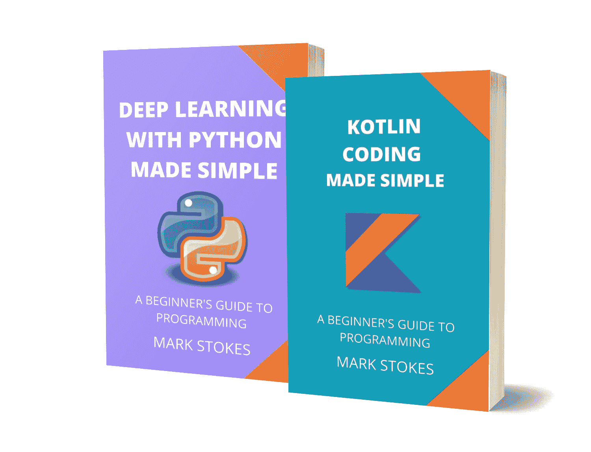

# 使用 Kotlin 编程与 Python 深度学习

## 轻松入门

### 编程初学者指南

**马克·斯托克斯**

# Kotlin 书籍介绍：

- 第 1 章：Kotlin 编程简介
- 第 2 章：搭建开发环境
- 第 3 章：Kotlin 中的变量与数据类型
- 第 4 章：Kotlin 中的运算符与表达式
- 第 5 章：Kotlin 中的控制流语句
- 第 6 章：Kotlin 中的函数
- 第 7 章：Kotlin 中的面向对象编程（OOP）
- 第 8 章：封装、抽象与多态
- 第 9 章：接口、泛型与异常处理
- 第 10 章：文件输入/输出操作
- 第 11 章：Kotlin 中的并发与多线程
- 第 12 章：Kotlin 中的网络与 HTTP 请求
- 第 13 章：Kotlin 中的数据库集成
- 第 14 章：Kotlin 中的 Web 开发
- 第 15 章：Kotlin 中的测试
- 第 16 章：Kotlin 中的并发与多线程
- 第 1 章：深度学习简介
- 第 2 章：Python 入门
- 第 3 章：理解神经网络
- 第 4 章：机器学习基础
- 第 5 章：构建你的第一个神经网络
- 第 6 章：深度学习库与工具
- 第 7 章：数据准备与预处理
- 第 8 章：训练与评估神经网络
- 第 9 章：卷积神经网络
- 第 10 章：循环神经网络
- 第 11 章：生成对抗网络
- 第 12 章：自然语言处理
- 第 13 章：计算机视觉应用
- 第 14 章：强化学习
- 第 15 章：现实世界中的深度学习
- 第 16 章：常见问题解答——使用 Python 编程进行深度学习

---

# KOTLIN 编程

## 轻松入门

### 编程初学者指南

**马克·斯托克斯**

# Kotlin 书籍介绍：

《轻松 Kotlin 编程》是一本全面的指南，旨在帮助几乎没有编程经验的个人学习 Kotlin 编程语言。随着 Kotlin 在开发者中越来越受欢迎，本书为任何希望踏入编程世界或从其他语言转型的人来说，都是一个极佳的起点。

在本书中，你将踏上一段旅程，逐步了解 Kotlin 的基本概念。每一章都建立在前一章的基础上，确保学习曲线平缓，并提供充足的机会来练习所学内容。无论你是想开发 Android 应用程序，还是探索 Kotlin 在其他领域的潜力，本书都能为你提供必要的知识和技能。

# 第 1 章：Kotlin 编程简介

欢迎来到激动人心的 Kotlin 编程世界！在本章中，我们将为你全面介绍 Kotlin、它的起源以及其独特特性。到本章结束时，你将对 Kotlin 的优势有扎实的理解，并准备好开启你的编程之旅。

## 1.1 什么是 Kotlin？

Kotlin 是一种现代的静态类型编程语言，运行在 Java 虚拟机（JVM）上。它由 JetBrains 开发，这家公司也是 IntelliJ IDEA 等流行开发工具背后的公司。Kotlin 旨在解决 Java 的一些不足之处，同时保持与现有 Java 代码库的无缝互操作性。

## 1.2 为什么选择 Kotlin？

Kotlin 提供了众多优势，使其成为开发者的一个有吸引力的选择：

- **简洁的语法**：Kotlin 拥有简洁明了的语法，减少了样板代码，提高了可读性。它能让你用更少的代码表达更多内容，使你的代码更具表现力且更不容易出错。
- **空安全**：Kotlin 最突出的特性之一是其内置的空安全机制。空引用是 Java 等编程语言中常见的错误来源，但 Kotlin 的类型系统通过区分可空类型和非可空类型，帮助消除 `NullPointerExceptions`。
- **互操作性**：Kotlin 可以与现有的 Java 代码库无缝互操作，让你能够利用现有的库、框架和工具。你甚至可以在同一个项目中同时存在 Java 和 Kotlin 文件。
- **协程**：Kotlin 为协程提供了一流的支持，这简化了异步编程。协程使开发者能够以顺序方式编写异步代码，从而更容易处理网络请求、文件操作和并发编程等任务。

## 1.3 Kotlin 入门

要开始用 Kotlin 编程，你需要搭建开发环境。以下是基本步骤：

1. **安装 Kotlin**：下载并安装 Kotlin 编译器，它随 Kotlin 命令行工具和标准库一起提供。
2. **选择 IDE**：Kotlin 在各种集成开发环境（IDE）中都有良好的支持，例如 IntelliJ IDEA、Android Studio 和 Visual Studio Code。选择你偏好的 IDE，并确保安装了 Kotlin 插件。
3. **创建 Kotlin 项目**：IDE 设置完成后，创建一个新的 Kotlin 项目。IDE 将处理必要的配置并生成所需的项目结构。
4. **编写你的第一个 Kotlin 程序**：项目设置完成后，是时候编写一些代码了！在 Kotlin 中，一个简单的"Hello, World!"程序看起来是这样的：

```kotlin
fun main() {
    println("Hello, World!")
}
```

5. **构建并运行**：构建你的项目，将 Kotlin 代码编译成可执行的字节码。然后，运行程序以查看输出。

恭喜！你已经编写并执行了你的第一个 Kotlin 程序。现在，你可以进一步探索这门语言，并深入学习更高级的概念。

在下一章中，我们将深入探讨如何搭建你的开发环境，并探索流行的 Kotlin IDE 的功能。我们将提供分步说明，确保你完全具备高效编写 Kotlin 代码的条件。

# 第 2 章：搭建开发环境

在第 1 章中，我们向你介绍了 Kotlin 及其优势。现在，是时候搭建你的开发环境了，这样你就能有效地编写 Kotlin 代码。在本章中，我们将指导你完成安装 Kotlin 和配置流行的集成开发环境（IDE）的过程，以提升你的 Kotlin 编程体验。

## 2.1 安装 Kotlin

在开始用 Kotlin 编程之前，你需要安装 Kotlin 编译器和命令行工具。按照以下步骤在你的系统上安装 Kotlin：

1. 访问 Kotlin 官方网站 `kotlinlang.org`，并导航到"下载"部分。
2. 选择适合你操作系统的发行版本。Kotlin 支持 Windows、macOS 和 Linux。
3. 下载 Kotlin 发行包并将其保存到你电脑上的某个位置。
4. 将包的内容解压到目标目录。这将包括 Kotlin 编译器（`kotlinc`）和其他必要文件。
5. 将 Kotlin 可执行文件添加到你系统的 `PATH` 环境变量中，以便在命令提示符或终端的任何位置都能访问它。修改 `PATH` 变量的说明因操作系统而异。
6. 通过打开命令提示符或终端窗口并运行以下命令来验证安装：

```
kotlinc -version
```

如果 Kotlin 安装成功，你将看到终端中显示的版本信息。

恭喜！你已经在你的系统上安装了 Kotlin。现在，让我们继续配置 IDE，以提升你的 Kotlin 开发体验。

## 2.2 为 Kotlin 开发配置 IntelliJ IDEA

IntelliJ IDEA 是由 Kotlin 的创建者 JetBrains 开发的一款功能强大的 IDE。它为 Kotlin 编程提供了出色的支持，并提供了众多功能来提高您的生产力。按照以下步骤配置 IntelliJ IDEA 以进行 Kotlin 开发：

1. 从官方网站 `jetbrains.com/idea` 下载并安装 IntelliJ IDEA。
2. 启动 IntelliJ IDEA，在欢迎界面选择"Create New Project"（创建新项目）。
3. 选择"Kotlin"作为项目类型，然后点击"Next"（下一步）。
4. 指定项目名称、位置和其他项目设置。点击"Finish"（完成）以创建项目。
5. IntelliJ IDEA 将自动设置 Kotlin 项目，包含必要的配置和目录结构。
6. 通过创建扩展名为 `.kt` 的 Kotlin 文件开始在项目中编写 Kotlin 代码。IntelliJ IDEA 提供了代码补全、语法高亮和错误检查等功能，帮助您编写 Kotlin 代码。
7. 通过右键单击 Kotlin 文件并选择"Run"（运行）选项来构建和运行您的 Kotlin 代码。您也可以使用快捷键 `Ctrl/Cmd + Shift + F10` 来运行当前文件。

恭喜！您已成功配置 IntelliJ IDEA 以进行 Kotlin 开发。现在您可以充分利用 IntelliJ IDEA 提供的丰富功能来编写简洁高效的 Kotlin 代码。

## 2.3 其他 Kotlin IDE

虽然 IntelliJ IDEA 是推荐的 Kotlin 开发 IDE，但还有其他提供 Kotlin 支持的选项可供选择。以下是一些流行的替代方案：

- **Android Studio**：如果您专门对使用 Kotlin 进行 Android 开发感兴趣，可以考虑使用 Android Studio，它基于 IntelliJ IDEA，并包含用于 Android 开发的额外工具和功能。
- **Visual Studio Code**：Visual Studio Code 是一款轻量级且多功能的代码编辑器，可以通过各种插件进行扩展。安装 Kotlin 插件以在 Visual Studio Code 中启用 Kotlin 开发。
- **Eclipse**：Eclipse 是一款成熟的 IDE，拥有忠实的用户群。虽然它默认不提供原生 Kotlin 支持，但您可以安装 Kotlin 插件来为 Eclipse 添加 Kotlin 功能。

选择最适合您需求和偏好的 IDE。

## 2.4 集成开发环境（IDE）功能

IntelliJ IDEA 和其他支持 Kotlin 的 IDE 提供了一系列功能来增强您的 Kotlin 开发体验。以下是您可以利用的一些关键功能：

- **代码补全**：IDE 会分析您的代码，并在您输入时提供建议，使编写正确高效的 Kotlin 代码变得更加容易。它可以建议方法名、变量名，甚至为您补全整个代码块。
- **语法高亮**：IDE 用不同颜色突出显示代码的不同元素，使您更容易识别语法错误并一目了然地理解程序结构。
- **重构工具**：IDE 提供了强大的重构工具，让您能够安全高效地修改代码。您可以重命名变量、提取方法，并轻松执行其他代码转换。
- **调试支持**：调试是开发过程中至关重要的一部分。Kotlin IDE 提供全面的调试工具，帮助您识别和修复代码中的问题。您可以设置断点、检查变量、单步执行代码等。
- **代码导航**：IDE 使您能够轻松浏览代码库。您可以快速跳转到类或函数的定义，查找特定符号的使用位置，以及在不同文件和项目结构之间导航。
- **代码格式化**：一致的代码格式化可提高代码的可读性和可维护性。IDE 提供自动代码格式化选项，强制执行编码约定和风格指南。
- **测试框架集成**：Kotlin 支持 JUnit 和 Spek 等多种测试框架。IDE 与这些框架无缝集成，让您能够轻松编写和运行测试。

## 2.5 小结

在本章中，您学习了如何安装 Kotlin 以及如何为 Kotlin 开发配置流行的 IDE。您在系统上安装了 Kotlin，将 IntelliJ IDEA 设置为您的 IDE，并探索了使用 Kotlin 结合 IntelliJ IDEA 的功能和优势。

现在您的开发环境已经准备就绪，您可以自信地开始编写 Kotlin 代码了。在下一章中，我们将深入探讨 Kotlin 中变量和数据类型的基本概念，它们是任何编程语言的构建基础。

# 第 3 章：Kotlin 中的变量和数据类型

在第 2 章中，我们设置了开发环境并探索了流行 Kotlin IDE 的功能。现在，是时候更深入地了解 Kotlin 编程世界了。在本章中，我们将重点介绍变量和数据类型，这是任何编程语言中的基本概念。到本章结束时，您将对如何在 Kotlin 中声明变量、为变量赋值以及使用不同数据类型有扎实的理解。

## 3.1 Kotlin 中的变量

在 Kotlin 中，变量用于存储和操作数据。在使用变量之前，您需要通过指定其名称和数据类型来声明它。Kotlin 是一种静态类型语言，这意味着变量的数据类型在编译时确定，并在其整个生命周期内保持不变。

要在 Kotlin 中声明变量，请使用以下语法：

```
val variableName: DataType = value
```

在上述语法中：

- `val` 是用于声明只读（不可变）变量的关键字。一旦赋值，`val` 就不能重新赋值。
- `variableName` 是您为变量选择的名称。它应遵循命名约定并能描述其用途。
- `DataType` 是变量可以容纳的数据类型。我们将在下一节中探讨不同的数据类型。
- `value` 是分配给变量的初始值。它必须与声明的数据类型兼容。

以下示例演示了 Kotlin 中的变量声明和赋值：

```
val message: String = "Hello, Kotlin!"
```

在上述示例中，我们声明了一个名为 `message` 的变量，类型为 `String`，并为其赋值 `"Hello, Kotlin!"`。

## 3.2 Kotlin 中的数据类型

Kotlin 提供了多种数据类型来表示不同种类的值。让我们探讨一些 Kotlin 中常用的数据类型：

- `Byte`：表示 8 位有符号整数。
- `Short`：表示 16 位有符号整数。
- `Int`：表示 32 位有符号整数。
- `Long`：表示 64 位有符号整数。
- `Float`：表示单精度 32 位浮点数。
- `Double`：表示双精度 64 位浮点数。
- `Boolean`：表示布尔值（`true` 或 `false`）。
- `Char`：表示单个 Unicode 字符。
- `String`：表示字符序列。

要声明具有特定数据类型的变量，请在变量名后指定数据类型，如上一节所示。

以下示例演示了具有不同数据类型的变量声明：

```
val age: Int = 25
```

```
val temperature: Double = 98.6
```

```
val isStudent: Boolean = true
```

```
val grade: Char = 'A'
```

```
val name: String = "John Doe"
```

在上述示例中，我们分别声明了类型为 `Int` 的变量 `age`、类型为 `Double` 的变量 `temperature`、类型为 `Boolean` 的变量 `isStudent`、类型为 `Char` 的变量 `grade` 以及类型为 `String` 的变量 `name`。

## 3.3 类型推断

在 Kotlin 中，变量的类型通常可以根据赋值由编译器推断出来。这一特性被称为类型推断。它允许您省略显式的数据类型声明，让编译器自动确定适当的类型。

以下示例演示了类型推断：

```
val score = 95 // score 的类型被推断为 Int。
```

```
val pi = 3.14 // pi 的类型被推断为 Double。
```

```
val message = "Welcome!" // message 的类型被推断为 String。
```

在上面的示例中，我们省略了显式的数据类型声明，编译器根据赋值推断出了变量 `score`、`pi` 和 `message` 的合适类型。

类型推断很方便，减少了显式类型声明的需要，尤其是在类型从赋值中显而易见的情况下。然而，需要注意的是，类型推断并不总是可行，或者可能导致意外结果。在这种情况下，建议提供显式类型声明，以确保代码的清晰性和可维护性。

## 3.4 使用变量

声明变量并为其赋值后，您可以对其执行各种操作。以下是一些可以对变量执行的常见操作：

- **读取值**：您可以使用变量名来访问其值。例如，`age` 将为您提供 `age` 变量的值。
- **重新赋值**：如果您使用 `var` 关键字而不是 `val` 声明可变变量，则可以使用赋值运算符（`=`）重新赋值。例如，`var count = 10` 声明了一个变量 `count` 并为其赋初始值 `10`。之后，您可以通过分配新值来更改其值，例如 `count = 20`。
- **执行操作**：变量可以参与各种操作，例如算术运算（`+`、`-`、`*`、`/`）、字符串连接（`+`）和逻辑运算（`&&`、`||`、`!`）。操作的结果可以存储在另一个变量中或直接使用。
- **打印变量**：为了调试或输出目的显示变量的值，您可以使用 `println()` 函数。例如，`println(age)` 将打印 `age` 变量的值。

以下是一个演示这些操作的示例：

```
var count = 10

count = count + 5 // 重新赋值

println(count) // 打印值

val firstName = "John"

val lastName = "Doe"

val fullName = firstName + " " + lastName // 字符串连接

println(fullName) // 打印值
```

在上面的示例中，我们声明了一个可变变量 `count`，并执行了算术运算（`count + 5`）来更新其值。我们还声明了只读变量 `firstName` 和 `lastName`，并将它们连接起来形成 `fullName` 变量。

## 3.5 小结

在本章中，我们探讨了 Kotlin 中变量和数据类型的基本概念。我们学习了如何声明变量、为它们赋值以及使用不同的数据类型。我们还讨论了类型推断以及可以对变量执行的操作。

变量和数据类型是任何编程语言的构建块，理解它们对于编写有效且可靠的代码至关重要。在下一章中，我们将深入研究运算符和表达式，它们使我们能够在 Kotlin 中执行各种计算和操作值。

# 第 4 章：Kotlin 中的运算符和表达式

在第 3 章中，我们学习了 Kotlin 中的变量和数据类型。现在，让我们探索运算符和表达式的世界。运算符是允许我们在程序中执行各种计算和操作值的符号或关键字。在本章中，我们将介绍 Kotlin 中可用的不同类型的运算符，并了解如何有效地使用它们。

## 4.1 算术运算符

算术运算符用于对数值执行基本数学计算。Kotlin 提供以下算术运算符：

- 加法（`+`）：将两个操作数相加。


## 4.1 算术运算符

算术运算符用于执行基本的数学运算。Kotlin 提供以下算术运算符：

- 减法（`-`）：从左操作数中减去右操作数。
- 乘法（`*`）：将两个操作数相乘。
- 除法（`/`）：将左操作数除以右操作数。
- 取余（`%`）：返回左操作数与右操作数相除的余数。

以下是一个演示算术运算符用法的示例：

```
val x = 10
val y = 5
val sum = x + y
val difference = x - y
val product = x * y
val quotient = x / y
val remainder = x % y
println("Sum: $sum")
println("Difference: $difference")
println("Product: $product")
println("Quotient: $quotient")
println("Remainder: $remainder")
```

在上面的示例中，我们声明了两个变量`x`和`y`，其值分别为`10`和`5`。然后我们使用算术运算符对这些变量执行加法、减法、乘法、除法和取余运算。

## 4.2 赋值运算符

赋值运算符用于为变量赋值。Kotlin 提供了将赋值运算符（`=`）与算术运算符结合的简写赋值运算符。这些运算符允许您在单个步骤中执行算术运算并将结果赋给变量。

以下是 Kotlin 中常见的赋值运算符列表：

- 加法赋值（`+=`）：将右操作数加到变量的当前值，并将结果赋回变量。
- 减法赋值（`-=`）：从变量的当前值中减去右操作数，并将结果赋回变量。
- 乘法赋值（`*=`）：将右操作数与变量的当前值相乘，并将结果赋回变量。
- 除法赋值（`/=`）：将变量的当前值除以右操作数，并将结果赋回变量。
- 取余赋值（`%=`）：计算变量的当前值与右操作数相除的余数，并将结果赋回变量。

以下是一个演示赋值运算符用法的示例：

```
var num = 10
num += 5 // 等价于：num = num + 5
num -= 3 // 等价于：num = num - 3
num *= 2 // 等价于：num = num * 2
num /= 4 // 等价于：num = num / 4
num %= 3 // 等价于：num = num % 3
println("Final value: $num")
```

在上面的示例中，我们声明了一个可变变量`num`，并使用赋值运算符根据算术运算更新其值。

## 4.3 比较运算符

比较运算符用于比较值并确定它们之间的关系。Kotlin 提供以下比较运算符：

- 等于（`==`）：检查左操作数是否等于右操作数。
- 不等于（`!=`）：检查左操作数是否不等于右操作数。
- 大于（`>`）：检查左操作数是否大于右操作数。
- 小于（`<`）：检查左操作数是否小于右操作数。
- 大于等于（`>=`）：检查左操作数是否大于或等于右操作数。
- 小于等于（`<=`）：检查左操作数是否小于或等于右操作数。

这些比较运算符根据比较结果返回布尔值（`true`或`false`）。

以下是一个演示比较运算符用法的示例：

```
val a = 10
val b = 5
val isEqual = (a == b)
val isNotEqual = (a != b)
val isGreater = (a > b)
val isLess = (a < b)
val isGreaterOrEqual = (a >= b)
val isLessOrEqual = (a <= b)
println("Is Equal: $isEqual")
println("Is Not Equal: $isNotEqual")
println("Is Greater: $isGreater")
println("Is Less: $isLess")
println("Is Greater or Equal: $isGreaterOrEqual")
println("Is Less or Equal: $isLessOrEqual")
```

在上面的示例中，我们使用比较运算符比较了变量`a`和`b`的值，以确定它们之间的关系。

## 4.4 逻辑运算符

逻辑运算符用于组合和操作布尔值。Kotlin 提供以下逻辑运算符：

- 逻辑与（`&&`）：如果两个操作数都为`true`，则返回`true`，否则返回`false`。
- 逻辑或（`||`）：如果任一操作数为`true`，则返回`true`，否则返回`false`。
- 逻辑非（`!`）：对操作数的布尔值取反。如果操作数为`true`，则返回`false`；如果操作数为`false`，则返回`true`。

以下是一个演示逻辑运算符用法的示例：

```
val x = 10
val y = 5
val z = 7
val result1 = (x > y) && (x > z)
val result2 = (x > y) || (x < z)
val result3 = !(x > y)
println("Result 1: $result1")
println("Result 2: $result2")
println("Result 3: $result3")
```

在上面的示例中，我们使用逻辑运算符来组合布尔条件，并根据逻辑运算获得结果。

## 4.5 运算符优先级

Kotlin 中的运算符具有特定的优先级，这决定了它们在表达式中的求值顺序。当表达式包含多个运算符时，优先级较高的运算符会先被求值。

以下是 Kotlin 中一些常见运算符优先级的简要概述（从高到低）：

- 括号`()`
- 一元运算符（`+`, `-`, `++`, `--`, `!`）
- 乘法运算符（`*`, `/`, `%`）
- 加法运算符（`+`, `-`）
- 比较运算符（`>`, `<`, `>=`, `<=`）
- 相等运算符（`==`, `!=`）
- 逻辑与（`&&`）
- 逻辑或（`||`）

在必要时使用括号来覆盖默认优先级并确保复杂表达式中所需的求值顺序是很重要的。

## 4.6 小结

在本章中，我们探索了 Kotlin 中运算符和表达式的世界。我们学习了用于执行数学计算的算术运算符、用于给变量赋值的赋值运算符、用于比较值的比较运算符、用于操作布尔值的逻辑运算符，以及运算符优先级。

有效地理解和运用运算符对于编写富有表现力且高效的代码至关重要。在下一章中，我们将深入研究控制流语句，它们使我们能够根据特定条件控制程序的执行流程。我们将探讨条件语句、循环和其他控制流结构。

# 第 5 章：Kotlin 中的控制流语句

在第 5 章中，我们学习了 Kotlin 中运算符和表达式的基本概念。现在，让我们探索控制流语句，它们使我们能够根据特定条件控制程序的执行流程。控制流语句使我们能够做出决策、重复某些操作，并改变代码的执行路径。

## 5.1 条件语句

条件语句用于根据特定条件执行不同的操作。Kotlin 提供了两种类型的条件语句：`if`语句和`when`语句。

### 5.1.1 If 语句

`if`语句允许我们在某个条件为真时执行一段代码。它具有以下语法：

```
if (condition) {
    // 条件为真时执行的代码
} else {
    // 条件为假时执行的代码
}
```

以下是一个演示`if`语句用法的示例：

```kotlin
val num = 10
if (num > 0) {
    println("The number is positive.")
} else {
    println("The number is non-positive.")
}
```

在上面的示例中，我们检查变量`num`的值是否大于`0`。如果条件为真，我们打印`"The number is positive."`，否则我们打印`"The number is non-positive."`

### 5.1.2 When 语句

`when`语句是 Kotlin 中传统`switch`语句的替代方案。它允许我们对变量或表达式进行求值，并根据其值执行不同的代码块。以下是`when`语句的语法：

```
when (variable) {
    value1 -> {
        // 变量等于 value1 时执行的代码
    }
    value2 -> {
        // 变量等于 value2 时执行的代码
    }
    else -> {
        // 以上条件都不满足时执行的代码
    }
}
```

以下是一个演示`when`语句用法的示例：

```kotlin
val dayOfWeek = 3
when (dayOfWeek) {
    1 -> println("Monday")
    2 -> println("Tuesday")
    3 -> println("Wednesday")
    4 -> println("Thursday")
    5 -> println("Friday")
    else -> println("Weekend")
}
```

在上面的示例中，我们对变量`dayOfWeek`的值进行求值，并打印对应的星期几。

## 5.2 循环语句

循环语句允许我们多次重复执行一段代码。Kotlin 提供了多种循环结构，包括`for`循环、`while`循环和`do-while`循环。

### 5.2.1 For 循环

`for`循环允许我们遍历一个范围、数组、集合或任何其他可迭代对象。它具有以下语法：

```
for (item in iterable) {
    // 对每个元素执行的代码
}
```

以下是一个演示`for`循环用法的示例：

```kotlin
for (i in 1..5) {
    println(i)
}
```

在上面的示例中，循环遍历从`1`到`5`的范围，并打印每个值。

### 5.2.2 While 循环

`while`循环会在某个条件为真时重复执行一段代码。它具有以下语法：

```
while (condition) {
    // 只要条件为真就执行的代码
}
```

以下是一个演示`while`循环用法的示例：

```kotlin
var i = 1
while (i <= 5) {
    println(i)
    i++
}
```

在上面的示例中，只要`i`小于或等于`5`，循环就会继续打印`i`的值。

### 5.2.3 Do-While 循环

`do-while`循环与`while`循环类似，但条件是在循环末尾进行检查的。这意味着代码块至少会执行一次。以下是`do-while`循环的语法：

```kotlin
do {
    // Code to be executed
} while (condition)
```

下面是一个演示`do-while`循环用法的示例：

```kotlin
var i = 1
do {
    println(i)
    i++
} while (i <= 5)
```

在上面的示例中，循环会打印`i`的值，然后将其递增，直到`i`大于 5。

## 5.3 控制流关键字

Kotlin 提供了多个控制流关键字，允许我们在控制流语句中改变执行路径。

- `break`：终止最近的封闭循环或`when`语句，并继续执行循环或`when`语句之后的下一个语句。
- `continue`：跳过最近封闭循环的当前迭代，并继续下一次迭代。
- `return`：退出当前函数或方法，并在指定时返回一个值。

当我们想要提前跳出循环、跳过某些迭代或提前退出函数时，这些控制流关键字非常有用。

## 5.4 小结

在本章中，我们探索了 Kotlin 中的控制流语句，包括条件语句（`if`和`when`）和循环语句（`for`、`while`和`do-while`）。我们学习了如何根据条件做出决策、重复执行代码块，以及使用控制流关键字来改变执行路径。

控制流语句是设计算法和创建响应不同场景的动态程序的基本工具。在下一章中，我们将深入探讨函数的主题，它允许我们封装可重用的代码块。

# 第 6 章：Kotlin 中的函数

在第 5 章中，我们探索了控制流语句，它允许我们根据特定条件控制程序的执行流程。现在，让我们深入 Kotlin 中函数的世界。函数是任何编程语言的重要组成部分，因为它们使我们能够封装可重用的代码块，并高效地组织我们的程序。

## 6.1 函数简介

函数是执行特定任务的命名语句序列。它接受输入参数（可选）并可能返回值（可选）。函数有助于将复杂任务分解为更小、更易管理的单元，使我们的代码更加模块化和可读。

在 Kotlin 中，我们使用`fun`关键字定义函数，后跟函数名、参数括号（如果有）和返回类型（如果有）。以下是函数声明的一般语法：

```kotlin
fun functionName(parameter1: Type, parameter2: Type): ReturnType {
    // 要执行的代码
    // 返回语句（如适用）
}
```

让我们看一个简单函数的示例，该函数将两个数字相加并返回结果：

```kotlin
fun addNumbers(a: Int, b: Int): Int {
    return a + b
}
```

在此示例中，我们定义了一个名为`addNumbers`的函数，它接受两个整数参数`a`和`b`。它将两个数字相加，并将和作为整数返回。

我们可以通过使用函数名后跟括号并传递所需参数来调用函数：

```kotlin
val sum = addNumbers(5, 3)
println("The sum is: $sum") // 输出：The sum is: 8
```

函数调用`addNumbers(5, 3)`返回 5 和 3 的和，然后将其存储在`sum`变量中并打印出来。

## 6.2 函数参数

函数可以有零个或多个参数。参数是我们在调用函数时传递给函数的值的占位符。让我们探索 Kotlin 中不同类型的函数参数。

### 6.2.1 必需参数

必需参数是在调用函数时必须提供的参数。它们在函数声明中指定，并定义参数的类型和名称。下面是一个示例：

```kotlin
fun greet(name: String) {
    println("Hello, $name!")
}
```

在此示例中，我们定义了一个名为`greet`的函数，它接受一个必需参数`name`，类型为`String`。它打印一条包含所提供名称的问候消息。

要调用该函数，我们提供必需的参数：

```kotlin
greet("John") // 输出：Hello, John!
```

函数调用`greet("John")`将字符串`"John"`作为`name`参数传递，函数打印问候消息。

### 6.2.2 默认参数

默认参数是分配了默认值的参数。如果我们在调用函数时没有为默认参数提供参数，则使用默认值。下面是一个示例：

```kotlin
fun greet(name: String, greeting: String = "Hello") {
    println("$greeting, $name!")
}
```

在此示例中，我们定义了一个名为`greet`的函数，它接受两个参数：`name`（类型为`String`）和`greeting`（类型为`String`，默认值为`"Hello"`）。该函数使用提供的问候语和名称打印问候消息。

我们可以选择是否提供`greeting`参数来调用该函数：

```kotlin
greet("John") // 输出：Hello, John!
greet("Alice", "Hi") // 输出：Hi, Alice!
```

### 6.2.3 命名参数

在 Kotlin 中，我们还可以在调用函数时使用命名参数。命名参数允许我们通过参数名称指定参数值，而不受它们在函数声明中顺序的限制。这提供了灵活性，使我们的代码更具可读性。下面是一个示例：

```kotlin
fun greet(name: String, greeting: String = "Hello") {
    println("$greeting, $name!")
}
```

在此示例中，我们有相同的`greet`函数，带有默认的`greeting`参数。

我们可以使用命名参数调用该函数：

```kotlin
greet(name = "John") // 输出：Hello, John!
greet(greeting = "Hi", name = "Alice") // 输出：Hi, Alice!
```

通过使用命名参数，我们可以按任意顺序指定参数值，使函数调用更具可读性和自解释性。

## 6.3 返回语句

Kotlin 中的函数也可以返回值。函数的返回类型在括号后和冒号后指定。如果函数不返回任何值，我们使用`Unit`类型，这类似于其他编程语言中的`void`。

让我们修改我们的`addNumbers`函数以包含返回语句：

```kotlin
fun addNumbers(a: Int, b: Int): Int {
    return a + b
}
```

在此示例中，函数返回一个整数值，表示两个输入参数的和。

我们可以通过将返回值赋给变量来捕获它：

```kotlin
val sum = addNumbers(5, 3)
println("The sum is: $sum") // 输出：The sum is: 8
```

函数调用`addNumbers(5, 3)`返回 5 和 3 的和，然后将其存储在`sum`变量中并打印出来。

如果函数不返回值，我们可以省略返回类型或将其指定为`Unit`：

```kotlin
fun greet(name: String) {
    println("Hello, $name!")
}
```

`greet`函数没有返回语句，其返回类型隐式为`Unit`。

## 6.4 小结


在本章中，我们探索了 Kotlin 中的函数。我们学习了如何定义函数、指定参数和使用返回语句。函数使我们能够封装可重用的代码块，使我们的程序更加模块化和有组织。

我们涵盖了不同类型的函数参数，包括必需参数、默认参数和命名参数。这为我们调用函数时提供了灵活性和可读性。

在下一章中，我们将深入探讨 Kotlin 中的面向对象编程（OOP）主题，它允许我们创建类、对象，并利用继承和多态的原理。

# 第 7 章：Kotlin 中的面向对象编程（OOP）

在第 6 章中，我们探索了函数以及它们如何帮助我们组织代码并使其更加模块化。现在，让我们深入 Kotlin 中面向对象编程（OOP）的世界。OOP 是一种围绕对象概念的编程范式，对象将数据和行为封装到可重用的实体中。

## 7.1 OOP 简介

面向对象编程的核心思想是将现实世界的实体建模为对象。对象是类的实例，类充当创建对象的蓝图或模板。类定义对象的属性（属性）和行为（方法）。

在 Kotlin 中，我们使用 `class` 关键字创建类，后跟类名和包含类成员的代码块。以下是类声明的一般语法：

```kotlin
class ClassName {
    // 属性（属性）
    // 方法（行为）
}
```

让我们看一个表示 `Person` 的简单类的示例：

```kotlin
class Person {
    // 属性
    var name: String = ""
    var age: Int = 0

    // 方法
    fun sayHello() {
        println("Hello, my name is $name.")
    }

    fun celebrateBirthday() {
        age++
        println("It's my $age birthday!")
    }
}
```

在此示例中，我们定义了一个名为 `Person` 的类，它有两个属性：`name`（类型为 `String`）和 `age`（类型为 `Int`）。我们还定义了两个方法：`sayHello()` 和 `celebrateBirthday()`。

## 7.2 创建对象（实例）

一旦我们定义了一个类，就可以创建该类的对象（实例）。对象是使用 `new` 关键字后跟类名和括号来创建的。下面是一个示例：

```kotlin
val person1 = Person()
```

在此示例中，我们使用默认构造函数创建了一个类型为 `Person` 的对象 `person1`。`Person` 类没有（`没有显式定义任何构造函数`），因此它使用 Kotlin 提供的默认构造函数。

## 7.3 访问属性和调用方法

要访问对象的属性和调用方法，我们使用点符号（`.`）。下面是一个示例：

```kotlin
person1.name = "John"
person1.age = 30
person1.sayHello() // 输出：Hello, my name is John.
person1.celebrateBirthday() // 输出：It's my 31st birthday!
```

在此示例中，我们设置了 `person1` 的 `name` 和 `age` 属性，然后调用 `sayHello()` 和 `celebrateBirthday()` 方法。

## 7.4 构造函数

构造函数是特殊的函数，用于在创建对象时初始化对象的属性。Kotlin 提供了两种类型的构造函数：主构造函数和次构造函数。

### 7.4.1 主构造函数

主构造函数作为类头的一部分定义。它可以包含属性并直接初始化它们。下面是一个示例：

```kotlin
class Person(val name: String, var age: Int) {
    // 方法
    // ...
}
```

在此示例中，主构造函数定义了两个参数：`name`（类型为 `String`）和 `age`（类型为 `Int`）。主构造函数还直接初始化属性。

要使用主构造函数创建对象，我们提供构造函数参数：

```kotlin
val person2 = Person("Alice", 25)
```

在此示例中，我们使用主构造函数创建了一个类型为 `Person` 的对象 `person2`，并提供了必需的参数。

### 7.4.2 次构造函数

除了主构造函数之外，Kotlin 还允许我们定义次构造函数。次构造函数在类体内定义，并提供了一种替代方式来初始化对象的属性。下面是一个示例：

```kotlin
class Person {
    var name: String = ""
    var age: Int = 0

    constructor(name: String, age: Int) {
        this.name = name
        this.age = age
    }

    // 方法
    // ...
}
```

在此示例中，我们有一个 `Person` 类，它有两个属性：`name` 和 `age`。我们定义了一个次构造函数，它接受 `name` 和 `age` 作为参数，并将它们赋给相应的属性。

要使用次构造函数创建对象，我们使用 `new` 关键字后跟类名和构造函数参数：

```kotlin
val person3 = Person("Bob", 35)
```

在此示例中，我们使用次构造函数创建了一个类型为 `Person` 的对象 `person3`。

## 7.5 继承

继承是面向对象编程中的一个基本概念，它允许我们基于现有类创建新类。新类称为子类或派生类，继承现有类的属性和方法，现有类称为超类或基类。

在 Kotlin 中，我们使用冒号（`:`）表示继承。下面是一个示例：

```kotlin
open class Shape {
    open fun draw() {
        println("Drawing a shape.")
    }
}

class Circle : Shape() {
    override fun draw() {
        println("Drawing a circle.")
    }
}
```

在此示例中，我们有一个超类 `Shape`，它有一个方法 `draw()`。子类 `Circle` 使用 `:` 符号继承自 `Shape`。`override` 关键字表示 `Circle` 中的 `draw()` 方法覆盖了 `Shape` 中的方法。

要创建子类的对象，我们使用与创建超类对象相同的语法：

```kotlin
val shape: Shape = Circle()
shape.draw() // 输出：Drawing a circle.
```

在此示例中，我们创建了一个类型为 `Shape` 的对象 `shape`，但为其分配了一个 `Circle` 实例。当我们调用 `draw()` 方法时，调用的是 `Circle` 中覆盖的方法。

## 7.6 小结

在本章中，我们探索了 Kotlin 中的面向对象编程（OOP）。我们学习了类、对象、属性、方法、构造函数、继承和方法覆盖。OOP 使我们能够将现实世界的实体建模为对象，并创建可重用和有组织的代码结构。

我们看到了如何定义类、创建对象、访问属性和调用方法。我们还讨论了构造函数及其在初始化对象属性中的作用。此外，我们还涉及了继承以及子类化和方法覆盖的概念。

在下一章中，我们将更深入地探讨 OOP 原则，并探索封装、抽象和多态等主题，它们是面向对象编程的基本支柱。

# 第 8 章：封装、抽象和多态

在第 7 章中，我们探索了 Kotlin 中面向对象编程（OOP）的基础知识，包括类、对象、属性和继承。现在，让我们更深入地探讨 OOP 的三个重要概念：封装、抽象和多态。

## 8.1 封装

封装是将数据和方法捆绑在单个实体（称为类）中的原则。它允许我们隐藏类的内部细节，并提供一个公共接口来与之交互。

在 Kotlin 中，我们可以通过使用访问修饰符来实现封装。Kotlin 中有四种访问修饰符：

`public`：这是默认的访问修饰符，允许从任何地方访问。

`private`：这将访问限制在同一类内。

`protected`：这将访问限制在同一类及其子类内。

`internal`：这允许从同一模块内的任何地方访问。

通过使用这些访问修饰符，我们可以控制类中属性和方法的可见性和可访问性。

例如，考虑一个类 `Person`，它有一个私有属性 `age` 和一个公共方法 `getAge()`：

```kotlin
class Person {
    private var age: Int = 0

    fun getAge(): Int {
        return age
    }
}
```

在此示例中，`age` 属性是私有的，意味着它只能在 `Person` 类内访问。然而，`getAge()` 方法是公共的，提供了一种从类外部检索年龄值的方法。

封装帮助我们维护数据完整性、控制对敏感数据的访问，并封装复杂的实现细节，使我们的代码更可维护和健壮。

## 8.2 抽象

抽象是通过关注基本特征并隐藏不必要的细节来简化复杂系统的过程。它允许我们创建抽象概念、类和方法，提供对现实世界实体的泛化表示。

在 Kotlin 中，我们可以通过抽象类和接口来实现抽象。抽象类是不能实例化的类，可能包含抽象方法和非抽象方法。抽象方法是声明但没有实现的方法。它旨在被子类覆盖。

让我们考虑一个抽象类 `Shape` 的示例：

```kotlin
abstract class Shape {
    abstract fun area(): Double
    abstract fun perimeter(): Double
}
```

在此示例中，`Shape` 是一个抽象类，有两个抽象方法：`area()` 和 `perimeter()`。这些方法的实现留给继承自 `Shape` 的子类。这使我们能够为不同类型的形状定义通用接口，同时将具体计算留给子类。

Kotlin 中的接口提供了一种定义抽象属性和方法的方式，这些方法可以由类实现。一个接口可以被多个类实现，从而实现多态性并为共同行为创建契约。

## 8.3 多态

多态是对象根据其上下文或分配的类型呈现不同形式或行为的能力。它允许我们将不同类的对象视为公共超类或接口的对象。

在 Kotlin 中，多态是通过继承和接口实现的。当子类继承自超类或实现接口时，它可以被视为超类或接口的实例。

让我们考虑以下示例，其中超类为 `Animal`，两个子类为 `Dog` 和 `Cat`：

```kotlin
open class Animal {
    open fun sound() {
        println("The animal makes a sound.")
    }
}

class Dog : Animal() {
    override fun sound() {
        println("The dog barks.")
    }
}

class Cat : Animal() {
    override fun sound() {
        println("The cat meows.")
    }
}
```

在此示例中，`Animal` 是具有 `sound()` 方法的超类。子类 `Dog` 和 `Cat` 继承自 `Animal`，并用它们的特定行为覆盖 `sound()` 方法。

现在，我们可以创建子类的对象，并将它们视为超类的对象：

```kotlin
val animal1: Animal = Dog()
val animal2: Animal = Cat()

animal1.sound() // 输出：The dog barks.
animal2.sound() // 输出：The cat meows.
```

在此示例中，`animal1` 和 `animal2` 是类型为 `Animal` 的对象，但分别被分配了 `Dog` 和 `Cat` 的实例。当我们在这些对象上调用 `sound()` 方法时，调用的是相应子类中覆盖的方法。

多态使我们能够编写更灵活和可重用的代码。我们可以在更高的抽象级别上处理对象，将它们视为公共超类或接口的实例，而无需担心它们的具体实现。

## 8.4 小结

在本章中，我们探索了面向对象编程的三个重要概念：封装、抽象和多态。

封装使我们能够隐藏类的内部细节，并提供用于交互的公共接口。访问修饰符控制属性和方法的可见性和可访问性。

抽象通过关注基本特征并隐藏不必要的细节来简化复杂系统。抽象类和接口提供了一种定义泛化表示和共同行为的方式。

多态使对象能够根据其上下文或分配的类型呈现不同的形式或行为。继承和接口允许对象被视为超类或接口的实例，提供了灵活性和可重用性。

理解这些概念并将其应用于我们的代码有助于我们创建结构良好、可维护和可扩展的软件系统。

在下一章中，我们将探索 Kotlin 中的其他重要概念，如接口、泛型和异常处理，进一步增强我们编写高效和健壮代码的能力。

# 第 9 章：接口、泛型和异常处理

在第 8 章中，我们探索了 Kotlin 中的封装、抽象和多态。现在，让我们深入了解一些额外的重要概念：接口、泛型和异常处理。

## 9.1 接口

Kotlin 中的接口定义了类可以实现的契约。它指定了实现类必须提供的一组属性和方法。接口使我们能够定义共同行为，而无需指定实现细节。

要在 Kotlin 中声明接口，我们使用 `interface` 关键字。以下是一个名为 `Drawable` 的接口示例：

```kotlin
interface Drawable {
    fun draw()
}
```

在此示例中，`Drawable` 接口声明了一个方法 `draw()`。任何实现此接口的类都必须为 `draw()` 方法提供实现。

要实现接口，类使用 `implements` 关键字。以下是一个实现 `Drawable` 接口的 `Circle` 类的示例：

```kotlin
class Circle : Drawable {
    override fun draw() {
        println("Drawing a circle.")
    }
}
```

在此示例中，`Circle` 类实现了 `Drawable` 接口，并为 `draw()` 方法提供了实现。

单个类可以实现多个接口，用逗号分隔。这允许实现多个契约。

## 9.2 泛型

Kotlin 中的泛型允许我们通过提供类型参数来创建灵活和可重用的代码。使用泛型，我们可以定义能够与不同类型一起工作的类、接口和函数，而不会牺牲类型安全。

要定义泛型类，我们使用尖括号（`<>`）后跟类型参数。以下是一个名为 `Box` 的泛型类的示例：

```kotlin
class Box<T>(val item: T) {
    fun getItem(): T {
        return item
    }
}
```

在此示例中，`Box` 是一个具有类型参数 `T` 的泛型类。`item` 属性和 `getItem()` 方法使用类型 `T` 工作。当我们创建 `Box` 的实例时，我们指定要使用的实际类型：

```kotlin
val box1: Box<String> = Box("Hello")
val box2: Box<Int> = Box(42)
```

在此示例中，`box1` 是类型参数为 `String` 的 `Box` 实例，`box2` 是类型参数为 `Int` 的实例。

泛型提供编译时类型检查，确保在代码中使用正确的类型，并降低运行时错误的风险。

## 9.3 异常处理

异常处理是一种机制，允许我们处理程序执行期间可能发生的异常情况或错误，并从中恢复。Kotlin 提供了全面的异常处理框架，包括 try-catch 块、throw 表达式以及定义自定义异常的能力。

要处理异常，我们使用 try-catch 块。以下是语法：

```kotlin
try {
    // 可能抛出异常的代码
} catch (exception: Exception) {
    // 处理异常的代码
} finally {
    // 无论是否抛出异常都会执行的代码
}
```

在此示例中，`try` 块内的代码被执行。如果抛出异常，它会被 `catch` 块捕获，我们可以在那里处理异常。`finally` 块是可选的，无论是否发生异常都会执行。

Kotlin 提供了多种内置异常类，如 `NullPointerException`、`IllegalArgumentException` 和 `FileNotFoundException`。我们还可以通过扩展 `Exception` 类或其子类之一来定义自定义异常类。

要抛出异常，我们使用 `throw` 关键字后跟异常类的实例。以下是一个示例：

```kotlin
fun divide(a: Int, b: Int): Int {
    if (b == 0) {
        throw IllegalArgumentException("Division by zero is not allowed.")
    }
    return a / b
}
```

在此示例中，如果第二个参数 `b` 为零，`divide()` 函数会抛出 `IllegalArgumentException`。这使我们能够处理无效输入并防止意外行为。

我们还可以使用 try 表达式以面向表达式的方式处理异常。try 表达式返回 try 块的结果，或者如果发生异常，则返回相应 catch 块的结果。以下是一个示例：

```kotlin
val result = try {
    divide(10, 0)
} catch (exception: IllegalArgumentException) {
    -1
}
```

在此示例中，`divide()` 函数在 `try` 块内被调用。如果抛出 `IllegalArgumentException`，则使用 `catch` 块将结果设置为 `-1`。否则，结果将是实际的除法结果。

异常处理使我们能够优雅地处理错误，向用户提供有意义的反馈，并保持应用程序的稳定性和可靠性。


## 9.4 小结

在本章中，我们探索了 Kotlin 中的接口、泛型和异常处理。

接口定义了类可以实现的契约，使我们能够定义共同行为并创建灵活的代码结构。

泛型使我们能够通过提供类型参数来创建可重用的代码，允许类、接口和函数与不同类型一起工作，同时保持类型安全。

异常处理使我们能够处理程序执行期间可能发生的异常情况或错误。我们可以使用 `try-catch` 块来处理异常，并确保应用程序的稳定性和可靠性。

理解这些概念扩展了我们编写高效、可重用和健壮 Kotlin 代码的工具箱。

在下一章中，我们将探索文件输入/输出操作，这对于在 Kotlin 中处理文件和流至关重要。

# 第 10 章：文件输入/输出操作

在第 9 章中，我们涵盖了 Kotlin 中的接口、泛型和异常处理。现在，让我们深入研究文件输入/输出（I/O）操作，这对于在 Kotlin 中处理文件和流至关重要。

## 10.1 处理文件

Kotlin 为文件 I/O 操作提供了丰富的函数和类集。我们可以从文件中读取数据、向文件写入数据，并对文件执行各种操作。

要从文件中读取数据，我们使用 `File` 类及其关联函数。以下是一个读取文本文件的示例：

```kotlin
import java.io.File

fun main() {
    val file = File("example.txt")
    val text = file.readText()
    println(text)
}
```

在此示例中，我们创建了一个表示名为 `"example.txt"` 的文件的 `File` 对象。然后我们使用 `readText()` 函数将文件的整个内容读取为 `String`。最后，我们将内容打印到控制台。

要向文件写入数据，我们可以使用 `writeText()` 函数。以下是一个示例：

```kotlin
import java.io.File

fun main() {
    val file = File("example.txt")
    val text = "Hello, World!"
    file.writeText(text)
}
```

在此示例中，我们创建了一个表示文件 `"example.txt"` 的 `File` 对象。然后我们使用 `writeText()` 函数将文本 `"Hello, World!"` 写入文件。

Kotlin 还提供了使用 `readLines()` 和 `writeLines()` 逐行读取和写入文件的函数。这些函数允许对文件 I/O 操作进行更细粒度的控制。

## 10.2 处理目录

除了处理单个文件外，Kotlin 还提供了处理目录的功能。我们可以创建目录、列出目录内容，并对目录执行操作。

要创建目录，我们使用 `mkdir()` 函数。以下是一个示例：

```kotlin
import java.io.File

fun main() {
    val directory = File("my_directory")
    directory.mkdir()
}
```

在此示例中，我们创建了一个表示名为 `"my_directory"` 的目录的 `File` 对象。然后我们使用 `mkdir()` 函数创建该目录。

要列出目录的内容，我们使用 `listFiles()` 函数。以下是一个示例：

```kotlin
import java.io.File

fun main() {
    val directory = File("my_directory")
    val files = directory.listFiles()
    files?.forEach { file ->
        println(file.name)
    }
}
```

在此示例中，我们创建了一个表示目录 `"my_directory"` 的 `File` 对象。然后我们使用 `listFiles()` 函数检索表示目录内容的 `File` 对象数组。我们遍历文件并将其名称打印到控制台。

## 10.3 关闭文件

处理文件时，正确关闭它们以释放系统资源非常重要。Kotlin 提供了一个名为 `use()` 的扩展函数，确保文件被正确关闭，即使发生异常也是如此。

以下是使用 `use()` 函数读取文件的示例：

```kotlin
import java.io.File

fun main() {
    File("example.txt").use { file ->
        val text = file.readText()
        println(text)
    }
}
```

在此示例中，`use()` 函数在 `File` 对象上调用。在 lambda 函数内部，我们读取文件内容并将其打印到控制台。`use()` 函数负责在离开 lambda 函数时自动关闭文件。

## 10.4 小结

在本章中，我们探索了 Kotlin 中的文件输入/输出（I/O）操作。我们学习了如何使用 `readText()` 和 `readLines()` 函数从文件中读取数据，以及如何使用 `writeText()` 和 `writeLines()` 函数向文件写入数据。

我们还讨论了处理目录，包括使用 `mkdir()` 函数创建目录，以及使用 `listFiles()` 函数列出目录内容。

为了确保适当的资源管理，我们涵盖了关闭文件的重要性，并介绍了 `use()` 函数，即使在发生异常时也能自动关闭文件。

通过利用文件 I/O 操作，我们可以处理外部文件、操作数据，并在 Kotlin 程序中与文件系统交互。

在下一章中，我们将探索 Kotlin 对并发和多线程的支持，使我们能够编写并发和高效的程序。

# 第 11 章：Kotlin 中的并发和多线程

在第 10 章中，我们探索了 Kotlin 中的文件输入/输出（I/O）操作。现在，让我们深入研究并发和多线程，这使我们能够编写并发和高效的程序。

## 11.1 并发简介

并发是程序同时执行多个任务的能力。它实现了系统资源的高效利用，并可以提高应用程序的响应性和性能。在 Kotlin 中，我们可以通过多线程实现并发。

## 11.2 多线程基础

多线程涉及在单个进程内执行多个线程。每个线程代表一个独立的控制流，允许程序的不同部分并发运行。

要在 Kotlin 中创建和管理线程，我们可以利用 `kotlin.concurrent` 包中的 `Thread` 类。以下是一个示例：

```kotlin
import kotlin.concurrent.thread

fun main() {
    thread {
        // 在线程中执行的代码
        println("Thread is running")
    }

    // 在主线程中执行的代码
    println("Main thread is running")
}
```

在此示例中，我们使用 `thread` 函数创建一个新线程。在线程内部，我们定义应该并发运行的代码。在这种情况下，我们打印 `"Thread is running"`。同时，主线程继续执行自己的代码并打印 `"Main thread is running"`。主线程和新线程并发运行，允许并行执行。

## 11.3 线程同步

当多个线程访问共享资源（如变量或数据结构）时，同步是必要的，以避免数据竞争并确保数据的完整性。Kotlin 提供了线程同步机制，包括 `synchronized` 关键字和 `Lock` 接口。

`synchronized` 关键字可用于创建同步代码块，一次只允许一个线程访问该块。以下是一个示例：

```kotlin
var counter = 0

fun incrementCounter() {
    synchronized(this) {
        counter++
    }
}
```

在此示例中，`synchronized` 块确保一次只有一个线程可以递增 `counter` 变量，防止数据竞争。

或者，我们可以使用 `java.util.concurrent.locks` 包中的 `Lock` 接口来实现对线程同步的更细粒度控制。`Lock` 接口提供 `lock()` 和 `unlock()` 等方法，用于显式获取和释放锁。以下是一个示例：

```kotlin
import java.util.concurrent.locks.ReentrantLock

val lock = ReentrantLock()

fun incrementCounter() {
    lock.lock()
    try {
        counter++
    } finally {
        lock.unlock()
    }
}
```

在此示例中，我们创建了一个名为 `lock` 的 `ReentrantLock` 对象，并使用其 `lock()` 和 `unlock()` 方法确保对关键代码段的独占访问。

## 11.4 线程通信

在并发程序中，线程通常需要相互通信以协调其活动或共享数据。Kotlin 提供了多种线程通信机制，如 `wait`/`notify` 和 `BlockingQueue` 接口。

`wait`/`notify` 机制允许线程暂停其执行，直到满足特定条件。Kotlin 中的 `Object` 类为此提供了 `wait()`、`notify()` 和 `notifyAll()` 方法。以下是一个示例：

```kotlin
val lock = Object()
var isReady = false

fun workerThread() {
    synchronized(lock) {
        while (!isReady) {
            lock.wait()
        }
        // 满足条件时执行的代码
        println("Worker thread is running")
    }
}

fun main() {
    synchronized(lock) {
        isReady = true
        lock.notifyAll()
    }
    // 在主线程中执行的代码
    println("Main thread is running")
}
```

在此示例中，我们有一个工作线程，它等待 `isReady` 标志变为 `true`。`wait()` 方法在同步块内调用，线程保持阻塞状态，直到另一个线程调用 `notify()` 或 `notifyAll()`。在主线程中，我们将 `isReady` 设置为 `true`，并使用 `notifyAll()` 通知所有等待的线程。

线程通信的另一种方法是通过使用 `BlockingQueue` 接口，它提供了一种在线程之间传输数据的线程安全方式。`BlockingQueue` 提供 `put()` 方法将元素添加到队列中，如果队列已满则阻塞，以及 `take()` 方法检索元素，如果队列为空则阻塞。以下是一个示例：

```kotlin
import java.util.concurrent.ArrayBlockingQueue

val queue = ArrayBlockingQueue<String>(10)

fun producerThread() {
    val message = "Hello, World!"
    queue.put(message)
}

fun consumerThread() {
    val message = queue.take()
    println(message)
}

fun main() {
    thread { producerThread() }
    thread { consumerThread() }
}
```

在此示例中，我们有一个生产者线程，它将消息放入 `BlockingQueue`，以及一个消费者线程，它从队列中取出消息并打印。`put()` 方法在队列已满时阻塞，确保线程之间的同步。

## 11.5 线程安全

处理并发程序时，考虑线程安全以防止数据竞争并确保程序行为的正确性非常重要。线程安全可以通过适当的同步、使用线程安全的数据结构以及仔细设计共享资源来实现。

在 Kotlin 中，标准库提供了几种线程安全的数据结构，如 `AtomicInteger`、`AtomicBoolean` 和 `ConcurrentHashMap`，可用于安全地操作共享数据，而无需显式同步。

此外，Kotlin 提供了 `@Volatile` 注解，确保对变量的读取和写入是原子的，并对所有线程可见。此注解在处理被多个线程频繁访问的共享变量时非常有用。

## 11.6 小结

在本章中，我们探索了 Kotlin 中的并发和多线程。我们学习了如何创建和管理线程、同步对共享资源的访问，以及促进线程通信。通过利用这些概念，我们可以编写并发程序，有效利用系统资源并提供改进的响应性和性能。

在下一章中，我们将深入探讨 Kotlin 对网络的支持，使我们能够与远程服务器通信并访问 Web 资源。

# 第 12 章：Kotlin 中的网络和 HTTP 请求

在第 11 章中，我们讨论了 Kotlin 中的并发和多线程。现在，让我们探索 Kotlin 对网络的支持，这使我们能够与远程服务器通信并访问 Web 资源。

## 12.1 网络简介

网络在现代软件开发中扮演着至关重要的角色，允许应用程序通过互联网与远程系统交互。Kotlin 为网络提供了丰富的库和 API，使建立连接、发送 HTTP 请求和处理响应变得简单直接。

## 12.2 发起 HTTP 请求

要与 Web 服务器通信和使用 Web 服务，我们通常使用 HTTP 协议。Kotlin 提供了各种库和框架来简化发起 HTTP 请求，如内置的 `HttpURLConnection` 类以及流行的库如 OkHttp 和 Retrofit。

让我们探索一个使用 OkHttp 库发起 HTTP GET 请求的示例：

```kotlin
import okhttp3.OkHttpClient
import okhttp3.Request

fun main() {
    val client = OkHttpClient()
    val request = Request.Builder()
        .url("https://api.example.com/data")
        .build()

    val response = client.newCall(request).execute()
    val responseBody = response.body?.string()

    println(responseBody)
}
```

在此示例中，我们创建了一个 `OkHttpClient` 实例，它处理 HTTP 请求和响应。我们使用 `Request.Builder()` 构建 HTTP GET 请求，并指定所需资源的 URL。`newCall()` 方法发送请求，`execute()` 同步执行它，阻塞直到收到响应。最后，Stubborn 将响应体作为字符串检索并打印到控制台。

## 12.3 解析 JSON 响应

使用 Web API 时，接收 JSON 格式的响应很常见。Kotlin 提供了多个用于解析 JSON 数据的库，如内置的 `JSONObject` 和 `JSONArray` 类，以及流行的库如 Gson 和 Moshi。

让我们看一个使用 Gson 库解析 JSON 响应的示例：

```kotlin
import com.google.gson.Gson

data class User(val id: Int, val name: String, val email: String)

fun main() {
    val json = """{"id": 1, "name": "John Doe", "email": "john@example.com"}"""
    val gson = Gson()
    val user = gson.fromJson(json, User::class.java)

    println("User: ${user.name}, Email: ${user.email}")
}
```

在此示例中，我们定义了一个数据类 `User`，它表示 JSON 响应的结构。我们创建一个 `Gson` 对象，并使用其 `fromJson()` 方法将 JSON 字符串解析为 `User` 类的实例。最后，我们将用户的姓名和电子邮件打印到控制台。

## 12.4 处理网络错误

处理网络操作时，优雅地处理潜在错误和失败非常重要。常见的网络错误包括连接超时、服务器错误和网络不可用。Kotlin 提供了异常处理机制，使我们能够适当地捕获和处理这些错误。

让我们看一个演示发起 HTTP 请求时错误处理的示例：

```kotlin
import okhttp3.OkHttpClient
import okhttp3.Request
import java.io.IOException

fun main() {
    val client = OkHttpClient()
    val request = Request.Builder()
        .url("https://api.example.com/data")
        .build()

    try {
        val response = client.newCall(request).execute()
        val responseBody = response.body?.string()
        println(responseBody)
    } catch (e: IOException) {
        println("An error occurred: ${e.message}")
    }
}
```


在此示例中，我们将 HTTP 请求代码包装在 `try-catch` 块中，以捕获网络操作期间可能发生的任何 `IOException`。如果抛出异常，我们打印一条错误消息，指示发生了错误，并显示异常的消息。

## 12.5 异步网络

同步执行网络操作可能会阻塞我们程序的执行，尤其是在处理缓慢或不可靠的网络连接时。为了避免阻塞，Kotlin 提供了使用协程和 OkHttp、Retrofit 等库进行异步网络的支持。

让我们看一个使用协程和 OkHttp 库发起异步 HTTP 请求的示例：

```kotlin
import kotlinx.coroutines.Dispatchers
import kotlinx.coroutines.GlobalScope
import kotlinx.coroutines.launch
import okhttp3.OkHttpClient
import okhttp3.Request

fun main() {
    val client = OkHttpClient()
    val request = Request.Builder()
        .url("https://api.example.com/data")
        .build()

    GlobalScope.launch(Dispatchers.IO) {
        val response = client.newCall(request).execute()
        val responseBody = response.body?.string()
        println(responseBody)
    }

    // 主线程中的其他代码
    println("Main thread continues")
}
```

在此示例中，我们使用协程异步执行 HTTP 请求。`GlobalScope.launch` 函数在 IO 调度器上启动一个协程，这适合网络操作等 IO 密集型任务。协程块内的代码并发执行，允许主线程继续执行而不阻塞。

## 12.6 网络安全

在 Kotlin 中处理网络时，考虑安全方面至关重要，如通过 HTTPS 进行安全通信和处理证书。Kotlin 提供了确保网络安全通信所需的工具和库。

要建立安全的 HTTPS 连接，OkHttp 和 Retrofit 等库会自动处理 SSL/TLS 加密和证书验证。这些库遵循最佳实践，并提供机制以根据需要自定义 SSL/TLS 配置。

如果遇到需要自定义证书处理的情况，Kotlin 提供了管理证书、信任管理器和安全套接字工厂的 API。

## 12.7 小结

在本章中，我们探索了 Kotlin 中的网络和 HTTP 请求。我们学习了如何使用 OkHttp 等库发起 HTTP 请求，使用 Gson 解析 JSON 响应，处理网络错误，以及使用协程进行异步网络。此外，我们还简要讨论了网络安全注意事项。

Kotlin 中的网络功能使我们能够与 Web 服务交互、使用 API 和构建与远程系统通信的应用程序。在下一章中，我们将探索 Kotlin 对数据库集成的支持，使我们能够从数据库中存储和检索数据。

# 第 13 章：Kotlin 中的数据库集成

在第 12 章中，我们深入研究了 Kotlin 中的网络和 HTTP 请求。现在，让我们将注意力转向数据库集成，这使我们能够在 Kotlin 应用程序中存储和检索数据。

## 13.1 数据库简介

数据库是现代应用程序的基本组成部分，实现高效和结构化的数据存储。Kotlin 提供了各种库和框架来简化数据库集成，包括对 MySQL 和 PostgreSQL 等关系型数据库，以及 MongoDB 等 NoSQL 数据库的支持。

## 13.2 JDBC（Java 数据库连接）

JDBC 是一个 Java API，提供了与关系型数据库交互的标准方式。Kotlin 与 Java 无缝互操作，使我们能够利用 JDBC 进行数据库连接。

要使用 JDBC，我们需要遵循以下步骤：

1. 导入要连接的数据库的 JDBC 驱动库。
2. 加载驱动类。
3. 建立与数据库的连接。
4. 执行 SQL 查询并检索结果。

让我们看一个使用 JDBC 连接 MySQL 数据库的示例：

```kotlin
import java.sql.DriverManager

fun main() {
    val url = "jdbc:mysql://localhost:3306/mydatabase"
    val username = "root"
    val password = "password"

    val connection = DriverManager.getConnection(url, username, password)

    // 执行数据库操作

    connection.close()
}
```

在此示例中，我们指定了要连接的 MySQL 数据库的 URL、用户名和密码。然后我们使用 `DriverManager.getConnection()` 建立与数据库的连接。执行必要的操作后，我们关闭连接以释放资源。

## 13.3 对象关系映射（ORM）

对象关系映射（ORM）库提供了比 JDBC 更高级的抽象，允许我们使用面向对象范式与数据库交互。Kotlin 支持 Hibernate 和 Exposed 等流行的 ORM 库。

ORM 库通过将数据库表映射到 Kotlin 类，并为 CRUD（创建、读取、更新、删除）操作提供直观的 API 来简化数据库操作。它们还处理 SQL 生成和数据库模式管理。

让我们看一个使用 Exposed（Kotlin 的轻量级 ORM 库）的示例：

```kotlin
import org.jetbrains.exposed.dao.IntIdTable
import org.jetbrains.exposed.sql.*
import org.jetbrains.exposed.sql.transactions.transaction

object Users : IntIdTable() {
    val name = varchar("name", 50)
    val age = integer("age")
}

data class User(val id: Int, val name: String, val age: Int)

fun main() {
    Database.connect("jdbc:mysql://localhost:3306/mydatabase", driver = "com.mysql.jdbc.Driver", user = "root", password = "password")

    transaction {
        SchemaUtils.create(Users)

        val user = User.new {
            name = "John Doe"
            age = 25
        }

        println("Created user: ${user.name}, Age: ${user.age}")

        val fetchedUser = User.findById(user.id)
        println("Fetched user: ${fetchedUser?.name}, Age: ${fetchedUser?.age}")
    }
}
```

在此示例中，我们使用 Exposed 的 DSL（领域特定语言）语法定义数据库表 `Users`。然后我们调用 `User.new` 函数创建一个新用户，该函数向 `Users` 表插入新行。我们使用 `User.findById` 函数通过 ID 检索用户。

## 13.4 NoSQL 数据库

除了关系型数据库外，Kotlin 还支持 NoSQL 数据库的集成。MongoDB、Cassandra 和 Redis 等 NoSQL 数据库提供灵活的数据模型和水平可扩展性。

要使用 NoSQL 数据库，我们通常使用专门的客户端库或框架，这些库或框架提供与特定 NoSQL 数据库交互所需的 API 和抽象。

让我们以 MongoDB 为例，看看如何将其与 Kotlin 集成：

```kotlin
import org.litote.kmongo.*

data class User(val name: String, val age: Int)

fun main() {
    val client = KMongo.createClient() // 连接到 MongoDB 服务器
    val database = client.getDatabase("mydatabase") // 访问所需的数据库
    val collection = database.getCollection<User>("users") // 访问特定的集合

    // 插入新用户
    val user = User("John Doe", 25)
    collection.insertOne(user)

    // 检索用户
    val users = collection.find().toList()
    for (user in users) {
        println("Name: ${user.name}, Age: ${user.age}")
    }

    client.close() // 关闭 MongoDB 客户端
}
```

在此示例中，我们使用 KMongo 库，它是 MongoDB 的 Kotlin 工具包。我们使用 `KMongo.createClient()` 创建客户端实例，连接到 MongoDB 服务器，并使用 `client.getDatabase()` 访问所需的数据库。然后我们使用 `database.getCollection()` 与特定集合交互。

我们使用 `collection.insertOne()` 向集合中插入新用户，并使用 `collection.find().toList()` 检索所有用户。最后，我们遍历用户并打印他们的姓名和年龄。

## 13.5 数据库迁移和管理

随着应用程序的发展，数据库的结构和模式可能会发生变化。Kotlin 提供了用于管理数据库迁移的工具和库，这涉及更新数据库模式和转换现有数据。

Flyway 和 Liquibase 等流行的数据库迁移库支持 Kotlin，使我们能够以受控和版本化的方式定义和执行数据库迁移脚本。

这些库通常通过将迁移脚本存储为 SQL 文件或 Kotlin 脚本，并按所需顺序执行它们来更新数据库模式。

## 13.6 小结

在本章中，我们探索了 Kotlin 中的数据库集成。我们学习了如何使用 JDBC 连接关系型数据库，使用 Exposed 等 ORM 库，使用 KMongo 等库与 MongoDB 等 NoSQL 数据库集成，以及管理数据库迁移。

Kotlin 中的数据库集成为构建健壮和数据驱动的应用程序奠定了基础。在下一章中，我们将深入探讨 Kotlin 对 Web 开发的支持，包括构建 Web 服务器和处理 HTTP 请求和响应。

# 第 14 章：Kotlin 中的 Web 开发

在第 13 章中，我们讨论了 Kotlin 中的数据库集成。现在，让我们探索 Kotlin 的 Web 开发能力。我们将深入研究构建 Web 服务器、处理 HTTP 请求和响应，以及创建动态 Web 应用程序。

## 14.1 Web 开发简介

Web 开发涉及创建在 Web 浏览器中运行并与 Web 服务器交互的应用程序。Kotlin 提供了多个框架和库来简化 Web 开发，为构建高效和可扩展的 Web 应用程序提供强大的工具。

## 14.2 Web 服务器

Web 服务器是处理传入 HTTP 请求并发送回响应的软件程序。Kotlin 提供了 Ktor 和 Spring Boot 等框架来构建 Web 服务器。

Ktor 是一个轻量级异步 Web 框架，在 Kotlin 社区中越来越受欢迎。它提供了处理 HTTP 请求和响应的简单直观的 API。

以下是一个基本的 Ktor Web 服务器示例：

```kotlin
import io.ktor.application.*
import io.ktor.http.*
import io.ktor.response.*
import io.ktor.routing.*
import io.ktor.server.engine.*
import io.ktor.server.netty.*

fun main() {
    embeddedServer(Netty, port = 8080) {
        routing {
            get("/") {
                call.respondText("Hello, World!", ContentType.Text.Plain)
            }
        }
    }.start(wait = true)
}
```

在此示例中，我们使用 Ktor 的 DSL 定义路由及其对应的处理程序。当向根（`"/"`）URL 发出 GET 请求时，服务器以纯文本 `"Hello, World!"` 消息响应。

Spring Boot 是一个用于构建基于 Java 的 Web 应用程序的强大框架，它与 Kotlin 无缝集成。它为各种 Web 相关任务提供广泛支持，包括路由、请求处理和依赖注入。

## 14.3 处理 HTTP 请求和响应

Web 应用程序接收来自客户端的 HTTP 请求并发送回 HTTP 响应。Kotlin 框架简化了处理请求和生成响应的过程。

让我们看一个使用 Ktor 处理不同类型 HTTP 请求的示例：

```kotlin
import io.ktor.application.*
import io.ktor.http.HttpStatusCode
import io.ktor.request.receiveParameters
import io.ktor.response.respond
import io.ktor.routing.*
import io.ktor.server.engine.embeddedServer
import io.ktor.server.netty.Netty

fun main() {
    embeddedServer(Netty, port = 8080) {
        routing {
            get("/hello") {
                call.respond("Hello, GET request!")
            }

            post("/hello") {
                val params = call.receiveParameters()
                val name = params["name"]
                call.respond("Hello, $name! This is a POST request.")
            }

            put("/hello/{id}") {
                val id = call.parameters["id"]
                call.respond("Hello, PUT request with ID: $id")
            }

            delete("/hello/{id}") {
                val id = call.parameters["id"]
                call.respond(HttpStatusCode.OK)
            }
        }
    }.start(wait = true)
}
```

在此示例中，我们定义了不同的路由来处理 GET、POST、PUT 和 DELETE 请求。服务器根据请求类型和参数响应不同的消息。

## 14.4 模板引擎

Web 应用程序通常需要动态内容生成，其中服务器将模板与数据结合以创建 HTML 页面。Kotlin 支持 Thymeleaf、Mustache 和 FreeMarker 等各种模板引擎。

这些模板引擎允许我们编写带有嵌入式表达式和占位符的 HTML 模板。然后服务器在运行时用动态数据填充占位符。

## 14.5 RESTful API

REST（表述性状态转移）是一种用于设计网络应用程序的架构风格。RESTful API 是通过 HTTP 公开功能和数据的流行方式。

Kotlin 的 Web 框架为构建 RESTful API 提供了出色的支持。它们提供定义路由、处理不同 HTTP 方法以及以各种格式（如 JSON）序列化/反序列化数据的功能。

让我们考虑一个使用 Ktor 创建简单 RESTful API 的示例：


```kotlin
import io.ktor.application.*
import io.ktor.features.ContentNegotiation
import io.ktor.features.StatusPages
import io.ktor.http.HttpStatusCode
import io.ktor.jackson.jackson
import io.ktor.request.receive
import io.ktor.response.respond
import io.ktor.routing.*
import io.ktor.server.engine.embeddedServer
import io.ktor.server.netty.Netty

data class User(val id: Int, val name: String)

val users = mutableListOf<User>()

fun Application.module() {
    install(ContentNegotiation) {
        jackson { } // JSON 序列化支持
    }

    install(StatusPages) {
        exception<Throwable> { cause ->
            call.respond(HttpStatusCode.InternalServerError, cause.localizedMessage)
        }
    }

    routing {
        route("/users") {
            get {
                call.respond(users)
            }

            post {
                val newUser = call.receive<User>()
                users.add(newUser)
                call.respond(HttpStatusCode.Created, newUser)
            }
        }
    }
}

fun main() {
    embeddedServer(Netty, port = 8080, module = Application::module).start(wait = true)
}
```

在此示例中，我们定义了一个支持 `GET` 和 `POST` 方法的`/users`路由。当向`/users`发出`GET`请求时，服务器响应用户列表。对于`POST`请求，服务器接收表示新用户的 JSON 负载，将其添加到`users`列表，并响应创建的用户。

## 14.6 WebSocket 通信

WebSocket 是一种通信协议，通过单个 TCP 连接提供全双工通信通道。它允许客户端和服务器之间进行实时和双向通信。

Ktor 等 Kotlin 框架提供 WebSocket 支持，使开发人员能够轻松构建实时应用程序。

以下是一个使用 Ktor 的 WebSocket 支持的简单聊天应用程序示例：

```kotlin
import io.ktor.application.*
import io.ktor.features.ContentNegotiation
import io.ktor.http.cio.websocket.Frame
import io.ktor.http.cio.websocket.readText
import io.ktor.jackson.jackson
import io.ktor.response.respond
import io.ktor.routing.*
import io.ktor.server.engine.embeddedServer
import io.ktor.server.netty.Netty
import io.ktor.websocket.WebSockets
import io.ktor.websocket.webSocket

fun Application.module() {
    install(ContentNegotiation) {
        jackson { } // JSON 序列化支持
    }

    install(WebSockets)

    routing {
        get("/chat") {
            call.respond("Chat page")
        }

        webSocket("/chat-socket") {
            send("Welcome to the chat!")

            for (frame in incoming) {
                if (frame is Frame.Text) {
                    val receivedText = frame.readText()
                    send("You sent: $receivedText")
                }
            }
        }
    }
}

fun main() {
    embeddedServer(Netty, port = 8080, module = Application::module).start(wait = true)
}
```

在此示例中，我们定义了聊天页面的路由和处理 WebSocket 连接的 WebSocket 路由。当向`/chat`发出`GET`请求时，服务器响应`"Chat page"`。对于向`/chat-socket`发出的 WebSocket 连接，服务器发送欢迎消息并回显收到的任何消息。

## 14.7 小结

在本章中，我们探索了 Kotlin 中的 Web 开发。我们学习了构建 Web 服务器、处理 HTTP 请求和响应、使用模板引擎以及使用 WebSocket 构建 RESTful API 和实时应用程序。

Kotlin 提供了 Ktor 和 Spring Boot 等强大的框架来简化 Web 开发任务。Ktor 提供轻量级异步方法，而 Spring Boot 提供与其他基于 Java 的 Web 技术的广泛支持和集成。

使用 Ktor，我们可以使用 DSL 定义路由及其对应的处理程序，轻松处理不同的 HTTP 方法并响应动态内容。我们还可以利用 Thymeleaf、Mustache 或 FreeMarker 等模板引擎生成带有动态数据的 HTML 页面。

构建 RESTful API 时，Kotlin 框架提供路由、请求处理以及 JSON 等数据格式序列化/反序列化的功能。这使我们能够为不同的 HTTP 方法定义路由，并与数据库或其他外部服务交互以获取或修改数据。

对于实时通信，Kotlin 框架支持 WebSocket 协议，实现客户端和服务器之间的双向实时通信。我们可以使用 WebSocket 构建聊天系统或实时数据流等应用程序。

随着您在 Kotlin Web 开发之旅中继续前进，探索您选择的框架提供的文档和示例至关重要。这将帮助您充分利用它们的潜力并构建健壮高效的 Web 应用程序。

在下一章中，我们将深入探讨 Kotlin 对测试的支持，确保我们代码的质量和可靠性。我们将探索各种测试框架和技术，为 Kotlin 应用程序编写有效的测试。

# 第 15 章：Kotlin 中的测试

在第 14 章中，我们讨论了 Kotlin 中的 Web 开发。现在，让我们探索测试的重要性以及 Kotlin 如何提供用于编写测试的强大工具和框架。测试是软件开发的关键方面，因为它有助于确保代码的质量、可靠性和正确性。

## 15.1 测试简介

测试涉及对代码进行系统的验证和确认，以确保其行为符合预期。它有助于捕获错误、及早识别问题，并保持应用程序的稳定性。Kotlin 提供了各种测试框架和库，简化了编写测试的过程。

## 15.2 测试基础

在深入特定测试框架之前，让我们先了解一些与测试相关的基本概念：

### 15.2.1 单元测试

单元测试是隔离测试单个代码单元的过程。在 Kotlin 中，单元可以是函数、类或模块。单元测试验证这些单元的行为，通常通过提供输入并检查输出或内部状态。

单元测试是轻量级的、运行快速的，对于确保代码库中各个组件的正确性至关重要。

### 15.2.2 测试驱动开发（TDD）

测试驱动开发是一种迭代开发方法，强调在编写实际实现代码之前编写测试。TDD 周期通常涉及编写失败的测试、实现使测试通过的代码，然后重构代码。

TDD 提倡测试优先的思维方式，有助于设计干净和可维护的代码。Kotlin 的测试框架有效支持 TDD 工作流程。

### 15.2.3 测试替身

在单元测试中，我们经常需要将正在测试的代码与外部依赖（如数据库、API 或网络调用）隔离。测试替身是在测试期间替代这些依赖的对象或组件。

常见的测试替身类型包括存根（提供预定响应）、模拟（验证交互）和伪对象（简化实现）。Kotlin 测试框架提供用于创建和使用测试替身的工具。

## 15.3 测试框架

Kotlin 提供了几个满足不同测试需求的测试框架和库。让我们探索一些流行的框架：

### 15.3.1 JUnit

JUnit 是 Java 和 Kotlin 最广泛使用的测试框架之一。它提供注解、断言和运行器来编写和执行测试。Kotlin 与 JUnit 无缝集成，使我们能够编写富有表现力和简洁的测试。

以下是 Kotlin 中简单 JUnit 测试的示例：

```kotlin
import org.junit.jupiter.api.Assertions.assertEquals
import org.junit.jupiter.api.Test

class CalculatorTest {
    @Test
    fun `test addition`() {
        val calculator = Calculator()
        val result = calculator.add(2, 3)
        assertEquals(5, result)
    }
}
```

在此示例中，我们创建了一个测试类，并用`@Test`注解了一个测试方法。在测试方法中，我们创建了`Calculator`类的实例，并使用`assertEquals`验证加法操作产生预期结果。

### 15.3.2 MockK

MockK 是 Kotlin 的模拟库，简化了模拟和存根等测试替身的创建。它提供了流畅且富有表现力的 API，用于定义模拟行为和验证交互。

以下是使用 MockK 模拟仓库并验证交互的示例：

```kotlin
import io.mockk.every
import io.mockk.mockk
import io.mockk.verify
import org.junit.jupiter.api.Test

class UserRepositoryTest {
    @Test
    fun `test getUserById`() {
        val userRepository = mockk<UserRepository>()
        val userId = 123

        every { userRepository.getUserById(userId) } returns User(userId, "John")

        val result = userRepository.getUserById(userId)

        assertEquals(User(123, "John"), result)
        verify { userRepository.getUserById(userId) }
    }
}
```

在此示例中，我们使用 MockK 的`mockk`函数模拟`UserRepository`。我们使用`every`定义行为，指定当使用特定`userId`调用`getUserById`时，它应返回预定义的`User`对象。然后我们调用该方法并使用`verify`验证交互。

### 15.3.3 Spek

Spek 是一个采用更具表现力和可读性语法来定义测试的测试框架。它提供 BDD 风格（行为驱动开发）的方法，使我们能够用更自然的语言描述代码的行为。

以下是使用 Spek 定义测试套件和测试用例的示例：

```kotlin
import org.spekframework.spek2.Spek
import org.spekframework.spek2.style.gherkin.Feature
import kotlin.test.assertEquals

class CalculatorSpec : Spek({
    Feature("Calculator") {
        val calculator by memoized { Calculator() }

        Scenario("Addition") {
            lateinit var result: Int

            When("adding two numbers") {
                result = calculator.add(2, 3)
            }

            Then("the result should be the sum of the numbers") {
                assertEquals(5, result)
            }
        }
    }
})
```

在此示例中，我们使用 Spek 的 DSL 定义`CalculatorSpec`。在规范中，我们使用`Feature`、`Scenario`、`When`和`Then`关键字定义特性、场景和相应的步骤。我们使用`memoized`延迟初始化`Calculator`实例，并使用`assertEquals`断言预期结果。

## 15.4 测试覆盖率

测试覆盖率衡量我们的测试对代码库的覆盖程度。它有助于识别缺乏适当测试覆盖的区域，使我们能够编写额外的测试并提高应用程序的整体可靠性。

Kotlin 测试框架与 JaCoCo 等代码覆盖率工具集成，这些工具生成报告，突出显示测试覆盖的代码百分比。这些报告提供了对我们测试套件有效性的洞察。

## 15.5 持续集成和测试

持续集成（CI）是一种开发实践，其中对代码库的更改会自动构建、测试和验证。Kotlin 与 Jenkins、Travis CI 和 CircleCI 等流行的 CI 工具顺利集成。

通过设置 CI 管道，我们可以确保测试在每次代码更改时自动运行，及早发现问题并保持高水平的代码质量。

## 15.6 结论

在本章中，我们探索了测试的基础知识、测试驱动开发的重要性以及 Kotlin 中可用的各种测试框架。我们涵盖了用于单元测试的 JUnit、用于模拟的 MockK，以及用于行为驱动测试的 Spek。

编写测试和维护全面的测试套件对于交付可靠的软件至关重要。借助 Kotlin 强大的测试框架，我们可以自信地编写验证代码行为并确保应用程序稳定性的测试。

在下一章中，我们将深入探讨 Kotlin 的并发和多线程能力，探索编写高效和可扩展并发代码的方法。

# 第 16 章：Kotlin 中的并发和多线程

在第 15 章中，我们讨论了 Kotlin 中的测试。现在，让我们探索 Kotlin 处理并发和多线程的能力。并发是同时执行多个任务的能力，而多线程是并发的一种特定形式，其中任务被划分为可以独立执行的线程。

## 16.1 并发和多线程简介

并发和多线程是现代软件开发中的基本概念。它们使我们能够通过并发执行任务来提高性能、响应性和资源利用率。

在 Kotlin 中，我们可以利用各种结构和技术来有效处理并发并编写高效的并发代码。

## 16.2 线程和协程

Kotlin 提供了两种主要的并发方法：线程和协程。

### 16.2.1 线程

线程是许多编程语言中实现并发的传统机制。在 Kotlin 中，我们可以使用 Java 标准库中的`Thread`类创建线程，或利用 Kotlin 和 Java 框架提供的高级抽象。

通过创建多个线程，我们可以并发执行任务。然而，直接使用线程可能很复杂，容易出错，并可能导致竞态条件、死锁和线程同步问题等问题。

### 16.2.2 协程

协程是 Kotlin 中引入的轻量级并发机制。它们提供了处理异步和并发任务的高级抽象。协程建立在挂起函数的概念之上，允许非阻塞执行。

使用协程，我们可以编写类似于同步代码的异步代码，使其更易于推理和维护。协程提供结构化并发、取消以及对各种调度器的支持，以控制执行上下文。

## 16.3 同步和线程安全

处理并发代码时，确保线程安全并正确处理同步至关重要。线程安全是指代码在并发环境中正确运行并产生预期结果的能力。

Kotlin 提供同步原语和线程安全的数据结构来促进线程安全编程。一些常见的同步机制包括锁、互斥锁、原子变量和并发集合。

通过正确同步共享资源和使用线程安全的数据结构，我们可以避免数据竞争等问题，并确保并发代码的一致性和完整性。

## 16.4 并发模式

并发模式为并发编程中遇到的常见问题提供了可重用的解决方案。Kotlin 开发人员可以应用各种模式来提高并发代码的效率、性能和可靠性。

一些常用的并发模式包括：

### 16.4.1 生产者-消费者模式

生产者-消费者模式涉及一个或多个生成数据的生产者线程和一个或多个处理数据的消费者线程。这种模式促进了生产者和消费者之间高效的通信和协调。

Kotlin 提供了阻塞队列、并发队列或基于协程的代码中的通道等工具来实现生产者-消费者模式。

### 16.4.2 工作池模式

工作池模式涉及一组固定的工作线程，它们并发处理多个任务。我们不是为每个任务创建新线程，而是重用线程池，这有助于高效管理资源。


Kotlin 框架和库提供线程池实现，使我们能够创建工作池以并发方式执行任务。

## 16.5 并发最佳实践

要在 Kotlin 中编写高效可靠的并发代码，遵循最佳实践至关重要：

### 16.5.1 避免共享可变状态

共享可变状态可能导致竞态条件和其他并发问题。尽可能选择不可变性，并将可变状态隔离在单个线程或协程内。

### 16.5.2 使用线程安全的数据结构

在并发设置中处理共享数据时，利用线程安全的数据结构，如并发集合。这些数据结构在内部处理同步，降低数据竞争和其他同步问题的可能性。

---

用 Python 轻松学习深度学习

编程初学者指南

马克·斯托克斯

书籍介绍：

欢迎来到《用 Python 轻松学习深度学习——编程初学者指南》。在本书中，您将踏上激动人心的深度学习之旅，探索使用 Python 编程语言的实际应用。无论您是纯初学者还是有一些编程经验，本书都将为您提供坚实的基础，以理解和实现深度学习算法。

# 第 1 章：深度学习简介

在当今快速发展的技术格局中，人工智能领域取得了巨大的进步。深度学习作为机器学习的一个子领域，已经成为一种强大的方法，使计算机能够从大量数据中学习并做出智能决策。本章作为深度学习的介绍，为您提供理解其概念和应用的基础。

## 1.1 什么是深度学习？

深度学习指的是一类受人类大脑结构和功能启发的算法，特别是神经元的互连网络。它是机器学习的一个子集，专注于训练具有多层的人工神经网络来学习和识别数据中的复杂模式。这些神经网络能够自动学习数据的分层表示，使它们能够解决广泛的任务，包括图像和语音识别、自然语言处理等。

## 1.2 深度学习的重要性

深度学习因其解决传统机器学习技术以前认为具有挑战性的复杂问题的能力而获得了显著的普及和重要性。随着计算能力的进步和大型数据集的可用性，深度学习模型在各个领域取得了显著的性能。它们彻底改变了计算机视觉、语音识别、自动驾驶、医疗保健和许多其他领域。

## 1.3 深度学习与传统机器学习的区别

虽然传统机器学习算法需要大量的特征工程，其中领域专家手动设计相关特征，但深度学习模型直接从原始数据中自动学习特征。这一关键区别使深度学习算法能够发现数据中复杂的模式和表示，通常带来更优的性能。深度学习在处理图像、音频和文本等非结构化数据方面也表现出色，而传统机器学习方法在这些方面表现不佳。

## 1.4 深度学习中的关键概念

要理解深度学习，掌握构成其基础的几个关键概念至关重要。这些包括：

### 1.4.1 人工神经网络（ANNs）

`ANNs` 是深度学习的基本构建块。它们由称为人工神经元或单元的互连节点组成，组织成层。每个神经元对其输入执行计算，并将结果传递给下一层的神经元。通过堆叠多层，`ANNs` 可以对输入和输出之间的复杂关系进行建模。

### 1.4.2 激活函数

激活函数为神经网络引入非线性，使它们能够学习复杂的映射。常见的激活函数包括 `sigmoid` 函数、双曲正切函数和整流线性单元（`ReLU`）。每个激活函数具有独特的性质，影响网络的性能和学习动态。

### 1.4.3 反向传播

反向传播是一种学习算法，允许神经网络根据预测输出与真实标签之间的差异来更新其权重和偏置。它利用微积分的链式法则高效计算网络参数的梯度，从而实现梯度下降等技术的有效优化。

## 1.5 深度学习的应用

深度学习在各个领域找到了应用，改变了行业并在许多领域实现了突破。一些著名的应用包括：

### 1.5.1 计算机视觉

深度学习彻底改变了计算机视觉任务，如图像分类、目标检测和图像分割。卷积神经网络（`CNNs`）在从图像中提取有意义的特征方面特别有效，实现了准确的识别和分析。

### 1.5.2 自然语言处理（NLP）

深度学习模型在 `NLP` 任务中取得了重大进展，包括机器翻译、情感分析、文本生成和语言理解。循环神经网络（`RNNs`）和 `Transformer` 模型在处理顺序数据方面表现出色。

### 1.5.3 医疗保健

深度学习有潜力通过辅助疾病诊断、医学图像分析、药物发现和个性化治疗来彻底改变医疗保健。深度学习模型可以从大型医学数据集中学习，并为支持医疗专业人员的决策过程提供有价值的见解。

## 1.6 结论

在本章中，我们介绍了令人兴奋的深度学习领域。我们讨论了它的定义、重要性，以及它与传统机器学习方法的差异。此外，我们探索了人工神经网络、激活函数和反向传播等关键概念。最后，我们重点介绍了深度学习在计算机视觉、自然语言处理和医疗保健中的一些应用。

现在您已经对深度学习有了基本的了解，让我们在第 2 章中更深入地了解 Python 编程的世界，在那里我们将探索开始使用构建深度学习模型所需的基础知识。

# 第 2 章：Python 入门

Python 已成为机器学习和数据分析领域最受欢迎的编程语言之一。其简单性、多功能性和广泛的库使其成为初学者和经验丰富的程序员的理想选择。在本章中，我们将涵盖 Python 编程的基础知识、设置开发环境、编写您的第一个 Python 程序，以及探索深度学习的基本库。

## 2.1 设置开发环境

在我们深入 Python 编程之前，设置一个合适的开发环境非常重要。以下是入门的步骤：

### 2.1.1 安装 Python

访问 Python 官方网站（`python.org`）并下载与您的操作系统兼容的最新版本 Python。按照安装程序提供的安装说明进行操作。

### 2.1.2 集成开发环境（IDE）

虽然可以使用简单的文本编辑器编写 Python，但使用 `IDE` 可以大大增强您的编程体验。流行的 Python `IDE` 包括 `PyCharm`、`Anaconda` 和 `Jupyter Notebook`。选择适合您偏好的 `IDE` 并安装它。

## 2.2 Python 基础

Python 以其简单性和可读性而闻名。让我们介绍一些将作为 Python 程序构建块的基本概念：

### 2.2.1 变量

在 Python 中，变量用于存储数据值。与其他编程语言不同，Python 不需要显式变量声明。您只需使用等号（`=`）即可为变量赋值。

示例：

```python
x = 5
name = "Alice"
```

```python
x = 10
name = "John"
```

### 2.2.2 数据类型

Python 支持多种数据类型，包括整数、浮点数、字符串、布尔值、列表、元组和字典。每种数据类型都有其特定的特征和用途。你可以使用 `type()` 函数来确定变量的数据类型。

示例：

```python
x = 10              # 整数
y = 3.14            # 浮点数
name = "John"       # 字符串
is_true = True      # 布尔值
```

### 2.2.3 控制结构

Python 提供了条件语句和循环等控制结构来控制程序的流程。

- **条件语句**：你可以使用 `if`、`elif` 和 `else` 语句根据指定条件执行不同的代码块。

示例：

```python
x = 10
if x > 5:
    print("x is greater than 5")
else:
    print("x is less than or equal to 5")
```

- **循环**：Python 提供了 `for` 和 `while` 循环来遍历序列或重复执行代码块。

示例：

```python
# For 循环
for i in range(1, 5):
    print(i)

# While 循环
x = 0
while x < 5:
    print(x)
    x += 1
```

## 2.3 深度学习必备库

Python 的优势在于其庞大的库集合。以下是深度学习中常用的一些必备库：

### 2.3.1 NumPy

`NumPy` 是 Python 中用于数值计算的基础库。它提供了高效的数据结构，如数组和矩阵，以及广泛的数学函数，用于操作和分析数值数据。

### 2.3.2 TensorFlow

`TensorFlow` 由 Google 开发，是一个功能强大的开源库，广泛应用于深度学习。它提供了一个灵活的平台来构建和训练神经网络，让你能够轻松创建复杂的模型。

### 2.3.3 Keras

`Keras` 构建于 `TensorFlow` 之上，是一个高级神经网络库，简化了构建深度学习模型的过程。其用户友好的 `API` 让你能够快速原型化和试验不同的网络架构。

## 2.4 编写你的第一个 Python 程序

既然我们已经涵盖了基础知识，现在是时候编写你的第一个 Python 程序了。让我们从一个简单的 "Hello, World!" 程序开始：

```python
print("Hello, World!")
```


恭喜你！你已经成功编写了你的第一个 Python 程序。在你选择的 IDE 中运行该程序，你应该会在控制台中看到输出`"Hello, World!"`。

## 2.5 结论

在本章中，我们介绍了 Python 这一强大的深度学习编程语言。我们涵盖了 Python 编程的基础知识，包括搭建开发环境、理解变量、数据类型、控制结构，并介绍了`NumPy`、`TensorFlow`和`Keras`等基础库。你还编写了你的第一个 Python 程序，初步体验了 Python 所提供的简洁性和可读性。

在下一章中，我们将更深入地探索神经网络的世界，并理解其内部工作原理所需的基本概念。

# 第 3 章：理解神经网络

神经网络是深度学习的核心。它们旨在模拟人脑的结构和功能，使机器能够学习并做出智能决策。在本章中，我们将更深入地了解神经网络，理解其组成部分、层、激活函数以及训练过程。

## 3.1 神经网络的结构

从高层次来看，神经网络由相互连接的节点组成，这些节点被称为人工神经元或单元，并按层组织。神经网络通常有三种类型的层：

### 3.1.1 输入层

输入层负责接收神经网络将进行计算的初始数据或特征。每个输入神经元对应输入数据的一个特定特征。

### 3.1.2 隐藏层

隐藏层是输入层和输出层之间的中间层。它们对输入数据进行计算，并逐步提取更高层次的表示或特征。深度神经网络具有多个隐藏层，能够学习复杂和抽象的模式。

### 3.1.3 输出层

输出层根据隐藏层中执行的计算产生最终的预测或输出。输出神经元的数量取决于所解决的具体问题。例如，在二分类问题中，会有一个输出神经元，表示属于某一类的概率。

## 3.2 激活函数

激活函数为神经网络引入非线性，使其能够学习输入和输出之间的复杂关系。它们应用于层中每个神经元的输出。以下是一些常用的激活函数：

### 3.2.1 Sigmoid

Sigmoid 函数将输入映射到 0 到 1 之间的值。它通常用于二分类问题的输出层，其中输出表示属于某一类的概率。

### 3.2.2 双曲正切（`tanh`）

双曲正切函数也将输入映射到 -1 到 1 之间的值。它通常用于神经网络的隐藏层。

### 3.2.3 修正线性单元（`ReLU`）

`ReLU`函数对负输入返回 0，对正输入返回输入值本身。近年来，由于其简单性和缓解梯度消失问题的能力，它变得流行起来。

## 3.3 神经网络的训练

神经网络的训练过程涉及调整其权重和偏置，以最小化预测输出与真实标签之间的差异。这是通过一个称为反向传播的过程实现的，该过程使用梯度下降等优化算法。以下是训练神经网络的关键步骤：

### 3.3.1 前向传播

在前向传播过程中，输入数据被送入神经网络，并通过将激活函数应用于每个神经元的加权输入和来计算输出。输出层的输出与真实标签进行比较，以确定网络的初始性能。

### 3.3.2 损失函数

损失函数量化了预测输出与真实标签之间的差异。常见的损失函数包括均方误差（`MSE`）、二元交叉熵和分类交叉熵，具体取决于所解决问题的类型。

### 3.3.3 反向传播

反向传播涉及计算损失函数相对于神经网络权重和偏置的梯度。然后，这些梯度被用于以最小化损失函数的方式更新参数。微积分中的链式法则被用来高效地逐层计算梯度，从输出层开始，并通过隐藏层向后传播。

### 3.3.4 优化算法

优化算法，如梯度下降，用于根据计算的梯度迭代地调整权重和偏置。这些算法确定参数更新的步长和方向。

## 3.4 结论

在本章中，我们探讨了神经网络的基础知识。我们讨论了神经网络的结构，包括输入层、隐藏层和输出层。此外，我们学习了激活函数及其在向网络引入非线性方面的作用。最后，我们深入研究了训练过程，理解了前向传播、损失函数、反向传播和优化算法。

# 第 4 章：机器学习基础

机器学习是人工智能的一个分支，专注于使计算机能够学习和做出预测或决策，而无需显式编程。它使系统能够从经验和数据中自动改进。在本章中，我们将探索机器学习的基础知识，包括其类型、机器学习工作流程和关键概念。

## 4.1 机器学习的类型

机器学习可以大致分为三种主要类型：

### 4.1.1 监督学习

在监督学习中，算法从标记数据中学习，其中每个数据实例都与相应的目标或输出相关联。目标是训练模型，使其能够对新的、未见过的输入预测正确的输出。监督学习中的常见任务包括分类和回归。

### 4.1.2 无监督学习

无监督学习涉及从未标记数据中学习模式和关系。算法探索数据的内在结构，并识别聚类、关联或潜在变量。无监督学习适用于聚类、降维和异常检测等任务。

### 4.1.3 强化学习

强化学习基于智能体与环境的交互。智能体通过试错进行学习，根据其行动获得奖励或惩罚形式的反馈。目标是找到一个最优策略，使累积奖励最大化。强化学习在机器人、游戏和自主系统等领域有应用。

## 4.2 机器学习工作流程

开发机器学习模型遵循一个典型的工作流程：

### 4.2.1 数据收集与准备

第一步是收集用于训练模型的相关数据。这涉及识别特征（输入变量）和目标变量（在监督学习中）。然后对数据进行预处理，包括清洗、处理缺失值、缩放以及分割为训练集和测试集等任务。

### 4.2.2 模型选择与训练

接下来，根据问题类型和数据特征选择合适的机器学习算法。使用标记的训练数据对所选模型进行训练。在训练过程中，模型通过调整其内部参数来学习数据中的模式和关系。

### 4.2.3 模型评估

模型训练完成后，使用测试数据对其进行评估。使用准确率、精确率、召回率和`F1-score`等评估指标来评估模型的性能。目标是确保模型能够很好地泛化到未见过的数据，并准确执行。

### 4.2.4 模型微调与优化

如果模型的性能不令人满意，可以应用微调技术。这可能涉及调整超参数（控制学习过程的参数）、优化模型架构，或应用正则化技术以防止过拟合。

### 4.2.5 部署与监控

在获得令人满意的性能后，模型被部署用于对新的、未见过的数据进行预测。重要的是要随着时间的推移监控模型的性能，并在新数据可用时定期更新它。

## 4.3 机器学习中的关键概念

要有效地使用机器学习，理解一些关键概念至关重要：

### 4.3.1 特征与标签

特征是描述数据实例特征的输入变量。标签，也称为目标或输出，是我们希望模型预测或分类的值。

### 4.3.2 训练集与测试集

数据集被分割为训练集和测试集。训练集用于训练模型，而测试集用于评估其在未见过的数据上的性能。这种分离有助于评估模型的泛化能力。

### 4.3.3 过拟合与欠拟合

过拟合发生在模型对训练数据学习得过于充分，捕捉到不代表整体数据分布的噪声和特定细节时。另一方面，欠拟合发生在模型过于简单，无法捕捉数据中的潜在模式时。过拟合和欠拟合都会导致泛化能力差。

### 4.3.4 偏差与方差

偏差是指通过简化模型来近似真实问题时引入的误差。高偏差模型可能由于过度简化的假设而表现不佳。另一方面，方差是指模型对训练数据中波动的敏感性。高方差模型可能对噪声反应过度，导致过拟合。

## 4.4 结论

在本章中，我们探讨了机器学习的基础知识。我们讨论了三种主要的机器学习类型（监督学习、无监督学习和强化学习）以及整体的机器学习工作流程，包括数据收集与准备、模型选择与训练、模型评估、微调与优化，以及部署与监控。此外，我们还涵盖了关键概念，如特征与标签、训练集与测试集、过拟合与欠拟合，以及偏差与方差。

# 第 5 章：构建你的第一个神经网络

既然我们已经涵盖了神经网络及其组件的基础知识，现在是时候深入构建你的第一个神经网络了。在本章中，我们将逐步介绍使用 Python 和`TensorFlow`、`Keras`等流行的深度学习库来设计和实现一个简单的神经网络的过程。

## 5.1 定义问题

在构建神经网络之前，清楚地定义你试图解决的问题非常重要。确定它是分类、回归还是其他类型的问题。识别你想要预测的输入特征和目标变量。

例如，假设我们想要构建一个神经网络，使用著名的`MNIST`数据集来分类手写数字（0-9）的图像。输入特征将是图像的像素值，目标变量将是相应的数字标签。

## 5.2 准备数据

一旦定义了问题，就必须为训练神经网络准备数据。这涉及数据预处理步骤，如归一化、缩放、处理缺失值，以及将数据分割为训练集和测试集。

对于`MNIST`数据集，图像已经预处理过，并以合适的格式提供。然而，将像素值归一化到 0 到 1 的范围是常见的做法，以提高神经网络在训练过程中的收敛性。

此外，数据集被分割为训练集和测试集。训练集用于训练神经网络，而测试集用于评估其在未见过的数据上的性能。

## 5.3 设计神经网络架构

下一步是设计你的神经网络架构。这涉及确定层的数量、每层中的神经元数量以及要使用的激活函数。

对于我们的图像分类任务，一个常见的选择是使用具有输入层、一个或多个隐藏层和输出层的前馈神经网络。输入层中的神经元数量由输入特征的维度决定（例如，图像中的像素数量）。输出层中的神经元数量取决于我们想要预测的类别数量（在这种情况下，10 个数字）。

在隐藏层中，你可以尝试不同的架构，例如改变神经元数量和激活函数。隐藏层中激活函数的常见选择包括`ReLU`（修正线性单元）或 sigmoid 函数。

## 5.4 编译和训练神经网络

一旦架构定义完成，就需要通过指定损失函数、优化器和评估指标来编译神经网络。损失函数衡量预测输出与真实标签之间的差异。优化器决定神经网络权重在训练期间如何更新。优化器的常见选择包括随机梯度下降（`SGD`）、`Adam`或`RMSprop`。评估指标用于监控模型在训练期间的性能。

编译后，使用训练数据对神经网络进行训练。在训练过程中，网络的权重和偏置根据优化算法迭代调整，以最小化损失函数。训练过程涉及将输入数据前向通过网络（前向传播）并向后更新权重（反向传播）。

## 5.5 评估和微调神经网络

神经网络训练完成后，使用测试集评估其性能非常重要。这可以指示模型对未见过的数据的泛化能力如何。分类任务的常见评估指标包括准确率、精确率、召回率和`F1-score`。

如果性能不令人满意，你可以通过尝试不同的超参数来微调神经网络，例如学习率、层数、神经元数量和激活函数。在模型复杂度和过拟合之间取得平衡至关重要。

## 5.6 结论

在本章中，我们学习了构建第一个神经网络的过程。我们从定义问题和准备数据开始。然后，我们设计了神经网络的架构，用适当的损失函数和优化器对其进行编译，并使用训练数据进行训练。最后，我们评估了性能，并在必要时对模型进行了微调。

构建你的第一个神经网络是理解深度学习力量的令人兴奋的一步。

# 第 6 章：深度学习库与工具

深度学习因其解决复杂问题的卓越能力而获得了巨大的普及。为了促进深度学习模型的开发和实现，已经开发了几个库和工具。在本章中，我们将探索一些最流行的深度学习库和工具，它们简化了构建和训练神经网络的过程。

## 6.1 TensorFlow

`TensorFlow`是使用最广泛的深度学习库之一。由 Google 开发，它提供了一个灵活且高效的框架，用于构建和训练各种类型的神经网络。`TensorFlow`允许你使用其`Keras`等高级 API 定义复杂的神经网络架构，或使用其低级 API 自定义模型。

使用`TensorFlow`，你可以利用其丰富的预构建层、激活函数和优化器集。它支持 CPU 和 GPU 计算，使其适用于在不同硬件配置上训练模型。`TensorFlow`还提供了用于可视化模型架构、监控训练进度以及导出模型进行部署的工具。

## 6.2 PyTorch

`PyTorch`是另一个在学术界和工业界广泛使用的强大深度学习库。由 Facebook 的 AI 研究（`FAIR`）团队开发，`PyTorch`提供了动态计算图，与静态图库相比，在模型构建方面提供了更大的灵活性。

`PyTorch`提供了构建神经网络的直观界面，其动态特性使得调试和实验变得容易。它支持自动微分，便于实现复杂的优化算法。`PyTorch`还拥有强大的社区支持，并为计算机视觉、自然语言处理和强化学习等任务提供预训练模型和工具。

## 6.3 Keras

`Keras`是一个用户友好的高级深度学习库，运行在`TensorFlow`或其他后端引擎（如`Theano`或 Microsoft 认知工具包（`CNTK`））之上。它提供了一个简单直观的 API 来构建神经网络，使初学者和经验丰富的深度学习从业者都能轻松上手。

使用`Keras`，你可以快速原型化和试验不同的网络架构。它提供了广泛的预构建层、激活函数和损失函数。`Keras`还支持各种训练技术，如早停、模型检查点和数据增强。它与`TensorFlow`的集成使你能够在享受`Keras`界面简洁性的同时，利用`TensorFlow`的强大功能。

## 6.4 Caffe

`Caffe`是由伯克利 AI 研究（`BAIR`）开发的深度学习框架。它以其效率而闻名，特别是对于卷积神经网络（`CNNs`），并广泛应用于计算机视觉应用。`Caffe`提供了一种称为"网络定义文件"（`prototxt`）的专用架构来定义网络结构。

`Caffe`支持 CPU 和 GPU 计算，并提供用于高效推理的 C++ 接口。它还提供用于模型训练和微调的 Python 接口。`Caffe`的预训练模型和模型库使其能够方便地将最先进的深度学习模型应用于各种任务。

## 6.5 Theano

`Theano`是一个 Python 库，允许进行高效的数学计算，特别是在深度学习领域。它提供了一个符号表达式框架，通过将数学运算编译为高效的代码来优化它们。

`Theano`允许你定义和操作符号表达式，包括神经网络架构。它支持自动微分，使得计算反向传播的梯度变得容易。`Theano`在学术研究中被广泛使用，但近年来其开发和支持已经放缓，许多用户转向`TensorFlow`和`PyTorch`等库。

## 6.6 其他库和工具

除了上述库之外，还有几个其他值得注意的深度学习库和工具：

- `MXNet`：一个灵活的深度学习框架，以其可扩展性和在各种设备上的高效部署而闻名。
- Microsoft 认知工具包（`CNTK`）：由 Microsoft 开发的深度学习库，专注于可扩展性和性能。
- `Torch`：一个具有深度学习能力的科学计算框架，主要用于研究。
- `DeepLearning4j`：一个基于 Java 的深度学习库，与 Java 生态系统集成良好。
- `NVIDIA CUDA`：一个并行计算平台，为深度学习计算提供 GPU 加速。

## 6.7 结论

在本章中，我们探索了一些最流行的深度学习库和工具。`TensorFlow`、`PyTorch`、`Keras`、`Caffe`、`Theano`等提供了不同的特性和功能，以简化深度神经网络的开发和训练。每个库都有其优势，并在不同的环境中受到青睐，具体取决于任务需求和个人偏好。

通过利用这些强大的库和工具，你可以显著加速你的深度学习项目，并利用该领域的最新进展。

# 第 7 章：数据准备与预处理

数据准备和预处理在任何机器学习或深度学习项目的成功中起着至关重要的作用。在本章中，我们将探索在将数据输入深度学习模型之前，准备和预处理数据所涉及的基本步骤。

## 7.1 数据清洗

数据清洗涉及处理缺失值、异常值和噪声数据，这些可能会对模型的性能产生不利影响。第一步是识别和处理缺失值，可以通过用合适的值进行插补，或删除相应的样本或特征。异常值，即与大多数数据显著偏离的极端值，也应该被处理。根据具体情况，异常值可以被移除、转换或用更合理的值进行插补。

## 7.2 数据变换

执行数据变换是为了改善特征的分布或尺度，这可以帮助模型更有效地学习。常见的数据变换包括将特征缩放到特定范围，如归一化或标准化，这使特征更具可比性。其他变换包括对数变换、平方根变换或 Box-Cox 变换，这些可以帮助处理偏斜或非线性的数据分布。

## 7.3 特征编码

为了处理分类变量，需要将它们编码为模型可以理解的数值表示。一种常见的技术是一热编码，其中每个类别表示为一个二进制向量。另一种方法是标签编码，它为每个类别分配一个唯一的数值标签。在对分类变量进行编码时，应注意避免在类别之间引入任何隐含的序数关系。

## 7.4 特征缩放

特征缩放确保所有特征处于相似的尺度，这可以防止某些特征因其较大的幅度而主导学习过程。常见的缩放技术包括标准化，即将特征缩放为均值为零、方差为一；以及归一化，即将特征缩放到特定范围，如`[0, 1]`。应谨慎应用缩放技术，考虑数据的特征和模型的要求。

## 7.5 处理不平衡数据

不平衡数据发生在数据集中类别的分布偏斜时，即一个类别的样本明显多于其他类别。这可能对模型构成挑战，因为它们可能偏向于多数类别。解决不平衡数据的技术包括欠采样多数类别、过采样少数类别，或两者结合，如`SMOTE`（合成少数过采样技术）。

## 7.6 特征选择

特征选择旨在识别手头任务最相关的特征，降低数据的维度并提高模型效率。特征选择技术包括单变量选择，即根据统计测试单独评估特征；以及基于模型的选择，即根据从模型性能得出的重要性来选择特征。

## 7.7 训练-测试分割与交叉验证

为了评估模型的性能，将数据分割为训练集和测试集至关重要。训练集用于训练模型，而测试集用于评估其对未见过的数据的泛化能力。此外，可以使用 k 折交叉验证等技术来进一步评估模型的性能并降低过拟合的风险。

## 7.8 结论

在本章中，我们探索了深度学习数据准备和预处理的关键步骤。适当的数据清洗、变换、编码、缩放、处理不平衡数据和特征选择对于提高模型性能和确保可靠结果至关重要。

通过仔细准备和预处理你的数据，你可以为构建稳健的深度学习模型奠定坚实的基础。

# 第 8 章：神经网络的训练与评估

训练和评估神经网络是深度学习流程中的关键步骤。在本章中，我们将探索训练神经网络所涉及的技术和方法，以实现最佳性能。

## 8.1 训练数据

训练神经网络的第一步是收集和预处理训练数据。这涉及数据清洗、预处理以及将数据分割为训练集和验证集。训练数据应该代表问题领域，并充分覆盖模型将遇到的输入和输出范围。

## 8.2 损失函数

损失函数衡量神经网络的预测输出与真实值之间的差异。选择合适的损失函数取决于问题的性质。常见的损失函数包括用于回归问题的均方误差（`MSE`）、用于二分类的二元交叉熵，以及用于多分类的分类交叉熵。损失函数的选择直接影响训练过程和所解决问题的类型。

## 8.3 优化算法

优化算法决定神经网络参数在训练过程中如何更新以最小化损失函数。基于梯度下降的算法，如随机梯度下降（`SGD`）和`Adam`，通常用于优化神经网络。这些算法迭代地沿最陡下降方向调整参数，以找到最优值。优化算法的选择会影响收敛速度和最终解的质量。

## 8.4 反向传播

反向传播是一种基本算法，用于计算损失函数相对于网络参数的梯度。它将误差向后传播通过网络，使模型能够从其错误中学习并相应地调整参数。反向传播是计算深度神经网络梯度的有效方法，是训练算法的关键组成部分。

## 8.5 正则化技术

正则化技术有助于防止过拟合，即模型对训练数据学习得过于充分，而无法泛化到新的、未见过的数据。`L1`和`L2`正则化、dropout 和早停等技术通常用于减少过拟合。正则化方法为模型添加约束，防止其变得过于复杂，并鼓励其学习更可泛化的模式。

## 8.6 超参数调优

超参数是模型不学习而是由用户在训练前设置的参数。它们包括学习率、批量大小、隐藏层数量和激活函数。超参数的适当调优对于实现最佳性能至关重要。可以使用网格搜索、随机搜索和贝叶斯优化等技术来找到最佳的超参数组合。

## 8.7 评估指标

评估指标用于评估训练后的神经网络的性能。常见的评估指标包括准确率、精确率、召回率、`F1`分数和受试者工作特征（`ROC`）曲线下面积。评估指标的选择取决于具体问题和期望的性能度量。选择与研究任务的目标和要求一致的评估指标至关重要。

## 8.8 模型选择与集成方法

模型选择涉及比较不同的神经网络架构，并选择在验证集或测试集上表现最好的那个。集成方法，如 bagging 和 boosting，结合多个模型的预测以提高性能和鲁棒性。

## 8.9 结论

在本章中，我们探索了训练和评估神经网络的关键方面。我们讨论了训练数据的重要性、损失函数、优化算法、反向传播、正则化技术、超参数调优、评估指标和模型选择。

通过有效地理解和应用这些技术，你可以训练出高性能并能很好地泛化到未见过的数据的神经网络。

# 第 9 章：卷积神经网络

卷积神经网络（`CNNs`）彻底改变了计算机视觉领域，并已成为图像识别任务的首选架构。在本章中，我们将探索`CNNs`的基础知识、它们的架构及其在图像处理中的应用。

## 9.1 理解卷积神经网络

卷积神经网络专门设计用于处理具有网格结构的数据，如图像。它们受到人脑视觉皮层组织的启发。`CNNs`擅长捕捉局部模式和层次表示，使其在图像分类、目标检测和图像分割等任务中非常有效。

## 9.2 卷积层

`CNN`的核心构建块是卷积层。卷积层将一组可学习的滤波器（也称为核）应用于输入图像，执行卷积操作以提取局部特征。该操作帮助网络捕捉空间关系并学习相关的图像模式。每个滤波器检测不同的视觉特征，如边缘、纹理或形状。

## 9.3 池化层

池化层用于对输入体积的空间维度进行下采样，降低计算复杂性并提取最重要的信息。最常见的池化操作是最大池化，它选择输入区域内最大值。池化有助于创建平移不变性，使网络对图像中特征位置的变化更具鲁棒性。

## 9.4 激活函数

激活函数为网络引入非线性，使`CNNs`能够学习输入和输出之间的复杂关系。`CNNs`中常用的激活函数包括`ReLU`（修正线性单元），由于其简单性和有效性而被广泛使用，以及`Leaky ReLU`和`Parametric ReLU`等变体。

## 9.5 CNN 的架构

`CNN`的架构通常由多个堆叠的卷积层组成，其间穿插用于下采样的池化层。这些层的输出被展平并通过全连接层，全连接层执行高级推理和决策。网络的最后一层通常是用于分类的 softmax 层或用于回归任务的回归层。

## 9.6 迁移学习

迁移学习是`CNNs`中一种强大的技术，它利用在大型数据集上训练的预训练模型。通过使用从一个任务中获得的知识来解决不同但相关的任务，迁移学习能够实现更快的收敛和更好的泛化。微调是一种常见的方法，其中预训练层被冻结，只训练最后几层。

## 9.7 CNN 的应用

`CNNs`在各种计算机视觉任务中表现出色。它们已成功应用于图像分类、目标检测、图像分割、人脸识别，甚至更高级的任务，如用于图像合成的生成对抗网络（`GANs`）。`CNNs`还在医学成像、自动驾驶车辆和监控系统等领域找到了应用。

## 9.8 结论

在本章中，我们探索了卷积神经网络（`CNNs`）、它们的架构及其在计算机视觉任务中的应用。`CNNs`已经改变了图像识别领域，使机器能够在具有挑战性的任务上达到人类水平的性能。通过利用`CNNs`的层次表示学习和局部特征提取能力，我们可以解决复杂的视觉问题并解锁广泛的应用。

# 第 10 章：循环神经网络

循环神经网络（`RNNs`）是一类专门设计用于处理序列数据的神经网络，如自然语言、语音和时间序列数据。在本章中，我们将探索`RNNs`的基础知识、它们的架构及其在自然语言处理和序列数据分析中的应用。

## 10.1 理解循环神经网络

`RNNs`非常适合涉及序列依赖性和时间动态的任务。与前馈神经网络独立处理输入不同，`RNNs`维护捕获先前输入信息的内部状态。这种循环特性使它们能够有效地建模序列并捕捉长期依赖关系。

## 10.2 基本 RNN 架构

`RNN`的基本架构由链式结构连接的循环单元组成。每个循环单元接受输入和前一个隐藏状态作为其输入，并产生输出和新的隐藏状态。这个隐藏状态作为记忆，携带来自先前步骤的信息，使网络能够保留上下文并在每一步做出明智的预测。

## 10.3 长短期记忆（`LSTM`）网络

长短期记忆（`LSTM`）网络是`RNNs`的一种流行变体，它解决了梯度消失问题，并允许更好地建模长期依赖关系。`LSTM`网络引入记忆单元和门控机制来调节信息流，使它们能够有选择地保留或遗忘来自先前步骤的信息。

## 10.4 门控循环单元（`GRUs`）

门控循环单元（`GRUs`）是`RNNs`的另一种变体，与`LSTMs`相比简化了架构，同时仍保持捕捉长期依赖关系的能力。`GRUs`将`LSTMs`的遗忘门和输入门组合成一个单一的更新门，该门决定保留多少前一个隐藏状态以及纳入多少当前输入。

## 10.5 训练与随时间反向传播

训练`RNNs`涉及在时间上将网络展开，创建一系列对应于每个时间步的相互连接的层。然后应用随时间反向传播（`BPTT`）来计算梯度并更新网络参数。然而，`RNNs`存在梯度消失问题，这阻碍了它们学习长程依赖关系的能力。梯度裁剪和初始化策略等技术可以帮助缓解这个问题。

## 10.6 RNN 的应用

`RNNs`在自然语言处理任务中找到了广泛的应用，如机器翻译、情感分析、文本生成和语音识别。它们在涉及序列数据的任务中也很有效，如时间序列预测、音乐生成和手势识别。`RNNs`能够捕捉时间模式和依赖关系，使其成为序列数据分析的强大工具。

## 10.7 双向 RNN

双向`RNNs`（`Bi-RNNs`）结合了两个`RNN`，一个按正向处理序列，另一个按反向处理序列。通过考虑过去和未来的信息，`Bi-RNNs`能够从两个方向捕捉上下文，从而在需要全面理解序列的任务中提高性能。

## 10.8 结论

在本章中，我们探索了循环神经网络（`RNNs`）、它们的架构及其在自然语言处理和序列数据分析中的应用。`RNNs`具有有效建模序列和捕捉长期依赖关系的能力，使其在涉及序列数据的任务中不可或缺。`LSTMs`和`GRUs`等变体解决了梯度消失问题，提高了`RNNs`的能力。

通过利用`RNNs`，我们可以释放序列数据的力量，并解决各个领域中的复杂问题。

# 第 11 章：生成对抗网络

生成对抗网络（`GANs`）彻底改变了生成建模领域，并因其创建逼真且高质量合成数据的能力而获得了广泛关注。在本章中，我们将探索`GANs`的基础知识、它们的架构及其在图像生成和文本合成等任务中的应用。

## 11.1 理解生成对抗网络

生成对抗网络由两个主要组件组成：生成器网络和判别器网络。生成器网络旨在生成类似于真实数据的合成数据样本，而判别器网络旨在区分真实数据和合成数据。`GANs`通过竞争性学习过程运作，其中生成器和判别器通过试图超越对方而不断改进。

## 11.2 GAN 架构

`GAN`的架构由生成器网络和判别器网络组成。生成器接受随机噪声作为输入并生成合成样本。另一方面，判别器网络接受真实样本和合成样本作为输入，并试图区分它们。两个网络同时训练，生成器试图生成欺骗判别器的逼真样本，而判别器试图正确分类样本。

## 11.3 对抗训练

`GANs`的训练涉及一个对抗过程，其中生成器和判别器网络相互博弈。生成器试图生成与真实数据无法区分的样本，而判别器旨在准确分类样本。这种竞争性训练过程导致两个网络随着时间的推移而改进。

## 11.4 损失函数

`GAN`的损失函数在生成器和判别器之间分配。生成器旨在最小化判别器区分真实样本和合成样本的能力，而判别器旨在最大化其正确分类样本的能力。生成器的损失函数通常定义为判别器正确分类的负对数概率，而判别器的损失函数是真实样本和合成样本正确分类的负对数概率之和。

## 11.5 训练挑战

训练`GANs`可能由于几个因素而具有挑战性。一个挑战是实现生成器和判别器网络之间的平衡，因为强大的判别器可能会压制生成器。另一个挑战是模式崩溃，即生成器学会生成一组有限的样本，无法捕捉真实数据的全部多样性。正则化技术、架构修改和仔细调整超参数可以帮助缓解这些挑战。

## 11.6 GAN 的应用

`GANs`已在各个领域找到了应用，包括图像生成、风格迁移、图像到图像翻译、文本到图像合成和视频合成。它们已被用于创建逼真和高分辨率的图像、生成新颖的艺术作品，并协助训练机器学习模型的数据增强。`GANs`还被应用于医学成像、药物发现和隐私保护数据合成。

## 11.7 条件 GAN

条件`GANs`通过调节生成器和判别器上的附加信息（如类别标签或文本描述）来扩展基本的`GAN`框架。这允许更受控的生成，其中可以在生成过程中操纵或控制特定的属性或特征。条件`GANs`已被用于图像到图像翻译、文本到图像合成和语义图像编辑等任务。

## 11.8 未来方向与挑战

`GANs`在生成建模方面取得了显著进展，但仍存在需要克服的挑战。提高稳定性和训练动态、解决模式崩溃，以及开发用于评估`GAN`生成样本的评估指标是持续研究的领域。探索新颖的架构、结合其他深度学习领域的技术，以及推进对`GAN`训练动态的理解是未来发展的方向。

## 11.9 结论

在本章中，我们探索了生成对抗网络（`GANs`）、它们的架构及其在生成建模任务中的应用。`GANs`已经证明了生成逼真且高质量合成数据的能力，为各个领域开辟了可能性。通过利用对抗训练过程，`GANs`推动了生成建模的边界，并继续推进最先进的技术。

# 第 12 章：自然语言处理

自然语言处理（`NLP`）是人工智能的一个领域，专注于计算机与人类语言之间的交互。它涵盖了广泛的任务，包括语言理解、情感分析、机器翻译和文本生成。在本章中，我们将探索`NLP`的基础知识、语言处理中使用的技术以及`NLP`在各个领域的应用。

## 12.1 自然语言处理简介

自然语言处理致力于使计算机能够理解、解释和生成人类语言。它结合了语言学、计算机科学和机器学习的技术来处理和分析文本数据。`NLP`涉及词性标注、命名实体识别、句法分析、语义分析和话语理解等任务。

## 12.2 预处理与分词

预处理是`NLP`中的关键步骤，涉及用于清洗和规范化文本数据的技术。这包括去除标点符号、将文本转换为小写、处理缩写和去除停用词。分词是将文本分解为单个单词或令牌的过程，这些单词或令牌作为`NLP`任务中的基本分析单位。

## 12.3 语言建模与词嵌入

语言建模涉及构建统计模型来捕捉语言的结构和含义。N-gram 模型和神经语言模型通常用于预测给定上下文的单词概率。词嵌入，如`Word2Vec`和`GloVe`，将单词表示为连续空间中的密集向量，捕捉单词之间的语义关系。

## 12.4 文本分类与情感分析

文本分类涉及将文本文档归类到预定义的类别或标签中。情感分析是文本分类的一种特定类型，旨在确定文本中表达的情感或观点，如积极、消极或中性。词袋、n-gram 以及卷积神经网络（`CNNs`）和循环神经网络（`RNNs`）等深度学习模型等技术通常用于文本分类和情感分析。

## 12.5 命名实体识别与信息抽取

命名实体识别（`NER`）涉及识别和分类文本中的命名实体，如人名、组织、地点和日期。`NER`在信息抽取任务中起着关键作用，其中从非结构化文本数据中提取相关信息。基于规则的方法、机器学习模型和深度学习模型等技术被用于`NER`和信息抽取。

## 12.6 机器翻译与语言生成

机器翻译涉及将文本从一种语言自动翻译成另一种语言。统计模型，如基于短语的模型和神经机器翻译模型，在机器翻译方面取得了显著进展。语言生成专注于生成类人文本，包括文本摘要、对话系统和故事生成等任务。序列到序列模型和 transformer 等技术通常用于语言生成。

## 12.7 问答系统与对话系统

问答系统旨在根据给定的上下文或知识库自动回答用户提出的问题。这些系统通常采用信息检索、阅读理解 and 知识表示等技术。另一方面，对话系统与用户进行交互式对话，需要自然语言理解、生成和对话管理等技术。

## 12.8 自然语言处理的应用

`NLP`在各个领域都有应用，包括客户支持、信息检索、社交媒体分析、医疗保健、金融和法律领域。它为虚拟助手、聊天机器人、情感分析工具、机器翻译服务和内容推荐系统提供支持。`NLP`技术还用于语音助手、语音识别和语音合成。

## 12.9 未来方向与挑战

`NLP`是一个快速发展的领域，持续进行着研究和进步。挑战包括处理歧义和上下文理解、改进语言理解和生成模型、解决`NLP`系统中的偏见和公平性问题，以及推进多语言和多模态`NLP`的能力。未来的方向涉及将更多知识和推理融入`NLP`系统、探索可解释和可解释的模型，以及关注伦理考量。

## 12.10 结论

在本章中，我们探索了自然语言处理（`NLP`）这一引人入胜的领域、它的技术及其广泛的应用。`NLP`使计算机能够处理、理解和生成人类语言，为自动化语言处理和分析开辟了机会。随着`NLP`的持续进步，我们可以期待在语言理解、文本生成和人机交互方面取得进一步的突破。

# 第 13 章：计算机视觉应用

计算机视觉是一个专注于使计算机能够理解和解释来自图像和视频的视觉信息的领域。它涉及用于图像识别、目标检测、图像分割和图像生成等任务的算法和技术开发。在本章中，我们将探索计算机视觉的多样化应用以及该领域取得的进展。

## 13.1 计算机视觉简介

计算机视觉旨在使用计算模型复制人类的视觉感知和理解。它涉及从视觉数据（如图像和视频）中提取有意义的信息，并根据该信息做出推断或采取行动。计算机视觉算法处理视觉数据以识别物体、检测模式、理解场景并提取有价值的见解。

## 13.2 图像分类与识别

图像分类是计算机视觉中的一项基本任务，其目标是为输入图像分配标签或类别。这涉及训练机器学习模型以区分不同的物体或场景。卷积神经网络（`CNNs`）等技术在图像分类任务中取得了显著成功，实现了对各种物体和视觉概念的准确识别。

## 13.3 目标检测与定位

目标检测是在图像中识别和定位特定物体的过程。它涉及在物体周围绘制边界框并分配相应的类别标签。目标检测算法利用基于区域的`CNNs` steaming、基于锚点的方法和单次检测器等技术，在图像和视频中实现准确和高效的目标定位。

## 13.4 图像分割

图像分割基于像素级分析将图像划分为不同的区域或片段。它允许对视觉内容进行更细粒度的理解，能够识别和分离物体及其边界。语义分割和实例分割等技术已经被开发出来，以实现像素级标注和分割精度。

## 13.5 目标跟踪

目标跟踪涉及在视频序列的多个帧中连续识别和跟踪物体。它被用于各种应用，如监控、自动驾驶车辆和增强现实。目标跟踪算法使用光流、相关滤波器和基于深度学习的跟踪器等方法，随着时间的推移保持物体的身份和位置。

## 13.6 图像合成与增强

图像合成和增强技术生成新图像或修改现有图像，以扩展训练数据或创建视觉多样化的输出。生成对抗网络（`GANs`）和变分自编码器（`VAEs`）等生成模型用于图像合成，允许创建逼真和新颖的图像。图像增强技术通过应用旋转、平移和噪声添加等变换来提高计算机视觉模型的鲁棒性和泛化能力。

## 13.7 人脸识别与生物识别

人脸识别是计算机视觉的一个流行应用，涉及根据面部特征识别和验证个人。它在安全系统、访问控制和执法中有众多应用。人脸识别算法采用基于深度学习的人脸嵌入和相似性匹配等技术，以实现准确和可靠的人脸识别。

## 13.8 场景理解与视觉理解

场景理解侧重于理解视觉场景的整体上下文和语义，包括物体之间的关系、场景分类和活动识别。视觉理解涵盖对视觉数据更广泛的理解，包括推理物体属性、空间关系和更高层次的概念。这些能力对于自动驾驶导航、机器人和智能监控等应用至关重要。

## 13.9 计算机视觉的应用

计算机视觉在各个领域都有应用，包括医疗保健、交通运输、农业、零售、娱乐和增强现实。它用于医学成像中的疾病诊断和治疗计划，自动驾驶车辆中的目标检测和行人跟踪，农业中的作物监测和产量估算，以及零售中的物体识别和视觉搜索。计算机视觉还用于游戏、虚拟现实和视觉效果行业，以创造沉浸式体验。

## 13.10 未来方向与挑战

计算机视觉是一个快速发展的领域，持续进行着研究和进步。未来的方向包括提高计算机视觉模型的可解释性和可解释性，解决视觉识别系统中的偏见和伦理考量，以及推进深度学习模型在复杂视觉理解任务中的能力。挑战涉及处理遮挡、光照和视角的变化、有限的训练数据以及对真实世界条件的鲁棒性。

## 13.11 结论

在本章中，我们探索了计算机视觉的多样化应用以及该领域取得的进展。计算机视觉已经彻底改变了各个行业，并催生了依赖视觉理解和分析的创新解决方案。随着持续的研究和进步，计算机视觉将在我们的日常生活中发挥越来越重要的作用，为医疗保健、交通运输、安全、娱乐和许多其他领域做出贡献。

# 第 14 章：强化学习

强化学习（`RL`）是机器学习的一个子领域，专注于使智能体能够通过与环境的交互来学习最优行为。`RL`受到人类和动物通过试错学习的启发，由于其解决复杂决策问题的能力而获得了广泛关注。在本章中，我们将深入研究强化学习的原理、算法和应用。

## 14.1 强化学习简介

强化学习是一种范式，涉及智能体与环境交互、采取行动，并根据其行动接收反馈或奖励。`RL`的目标是学习一个随时间最大化累积奖励的策略。与监督学习不同，`RL`从奖励或惩罚形式的反馈中学习，而不是显式标签。

## 14.2 马尔可夫决策过程

马尔可夫决策过程（`MDPs`）为建模`RL`问题提供了形式化框架。`MDPs`由状态、动作、转移概率和奖励组成。智能体的目标是找到最大化期望累积奖励的最优策略。价值函数和 Q 函数分别用于评估状态和状态-动作对的好坏。

## 14.3 探索与利用

探索和利用是`RL`的两个关键方面。探索涉及智能体通过尝试不同的行动来搜索新信息，即使它们最初看起来是次优的。另一方面，利用侧重于利用从过去经验中获得的知识来做出最大化奖励的决策。平衡探索和利用是`RL`中的一个基本挑战。

## 14.4 时序差分学习

时序差分（`TD`）学习是`RL`算法中的一个关键概念。`TD`学习结合了动态规划和蒙特卡洛方法的思想，基于观察到的奖励和估计的未来奖励来更新价值函数。Q-learning 和`SARSA`是流行的`TD`学习算法，使智能体能够通过迭代更新来学习最优策略。

## 14.5 策略优化

策略优化方法旨在直接优化智能体的策略，而不显式估计价值函数。这些方法使用基于梯度的优化算法来搜索最大化期望奖励的策略参数。策略梯度方法，如`REINFORCE`和近端策略优化（`PPO`），在复杂的`RL`任务中取得了成功。

## 14.6 深度强化学习

深度强化学习将`RL`算法与深度神经网络相结合，以处理高维状态和动作空间。深度 Q 网络（`DQNs`）引入了使用深度神经网络近似 Q 函数的概念，使`RL`能够在具有复杂视觉输入的环境中进行。深度`RL`算法，包括深度确定性策略梯度（`DDPG`）和双延迟`DDPG`（`TD3`），在各个领域取得了显著成功。

## 14.7 强化学习的应用

强化学习已在广泛的领域找到了应用，包括机器人、游戏、金融、医疗保健和自主系统。`RL`已被用于训练机器人执行复杂任务，如抓取物体和在未知环境中导航。它也被应用于游戏，其中`RL`智能体在围棋和国际象棋等游戏中取得了超人的表现。`RL`技术已被用于优化金融投资组合、个性化医疗保健治疗和控制自动驾驶车辆。

## 14.8 挑战与未来方向

强化学习面临着几个挑战，包括样本效率低下、处理连续动作空间、信用分配以及在大型状态空间中的探索。未来的研究方向涉及解决这些挑战并开发更高效和样本有效的`RL`算法。将`RL`与其他学习范式（如无监督学习和模仿学习）相结合，也是推进`RL`技术的一个有前途的方向。

## 14.9 结论

在本章中，我们探索了强化学习的原理、算法和应用。`RL`提供了一个强大的框架，用于训练智能体通过与环境的交互来做出最优决策。凭借其处理复杂决策问题的能力，`RL`有潜力彻底改变各个领域，并使能够从经验中学习的智能系统成为可能。`RL`的持续研究和进步将有助于开发更强大和高效的学习算法。

# 第 15 章：现实世界中的深度学习

深度学习已经成为一种变革性技术，能够彻底改变各个行业和领域。在最后一章中，我们将探索深度学习的实际应用和实际考量，讨论其影响、挑战和未来方向。

## 15.1 深度学习简介

深度学习是机器学习的一个子领域，专注于训练具有多层的人工神经网络来学习数据的层次表示。它在图像识别、自然语言处理、语音识别和推荐系统等任务中取得了显著成功。卷积神经网络（`CNNs`）和循环神经网络（`RNNs`）等深度学习模型在捕捉复杂模式和做出准确预测方面表现出色。

## 15.2 实际应用

深度学习已在各个行业和领域找到了广泛的应用。在医疗保健领域，深度学习模型已被用于医学图像分析、疾病诊断、药物发现和个性化医疗。在自动驾驶车辆中，深度学习被用于感知、目标检测和决策。在金融领域，深度学习算法被用于欺诈检测、风险评估和算法交易。深度学习还在自然语言处理、推荐系统、机器人和制造等领域掀起革命。

## 15.3 数据收集与准备

深度学习的成功在很大程度上依赖于大量、高质量数据集的可用性。为深度学习模型收集和准备数据是开发过程中的关键步骤。这涉及数据预处理、增强和清洗，以确保数据具有代表性、多样性且没有偏见。必须仔细关注数据隐私、安全性和遵守监管框架等问题。

## 15.4 模型训练与优化

训练深度学习模型需要大量的计算资源和时间。小批量梯度下降、正则化和学习率调度等技术被用于优化模型训练。超参数调优和模型选择对于实现最佳性能至关重要。迁移学习和在大型数据集上的预训练也被证明在加速训练过程和提高泛化能力方面是有效的。

## 15.5 可解释性与可解释性

深度学习模型通常被认为是黑箱，这使得解释和解释它们的决策变得具有挑战性。随着深度学习在医疗保健和金融等关键领域被越来越多地采用，可解释性和可解释性的需求变得至关重要。研究人员正在积极探索解释深度学习模型的技术，如注意力机制、显著性图和基于规则的解释，使用户能够理解模型预测背后的推理。

## 15.6 伦理考量

随着深度学习变得越来越普遍，伦理考量被提到了首位。偏见、公平性和透明度是深度学习系统中需要解决的重要因素。用于训练的数据应该具有代表性和无偏见，模型应该定期审计潜在的偏见。必须考虑隐私问题和数据的负责任使用，以保护个人权利并确保对深度学习技术的信任。

## 15.7 可扩展性与部署

大规模部署深度学习模型涉及与计算资源、模型大小、延迟和能源效率相关的挑战。探索模型压缩、量化和高效模型架构等技术，以减少内存占用和计算需求。分布式训练和模型并行性被用于在 GPU 集群或专用硬件加速器上训练大型模型。部署考量还包括模型服务、监控和基于现实世界反馈的持续改进。

## 15.8 未来方向

深度学习领域继续快速发展，持续进行着研究和进步。未来的方向包括开发更高效的训练算法、提高可解释性和可解释性、解决偏见和公平性问题，以及探索深度学习与其他学习范式的整合。还需要持续的研究，以使深度学习对对抗攻击更具鲁棒性、更数据高效，并适用于标注数据有限的领域。

## 15.9 结论

在最后一章中，我们探索了深度学习的实际应用和实际考量。深度学习已经改变了各个行业，在医疗保健、金融、自主系统、自然语言处理等领域实现了突破。虽然存在挑战，但深度学习在彻底改变我们解决复杂问题和做出智能决策的方式方面的潜力是巨大的。通过持续的研究、创新和负责任的采用，深度学习将继续塑造技术和社会的未来。

至此，我们结束了这本《Python 深度学习简易入门——编程初学者指南》。我们希望这本书为你提供了坚实的深度学习基础，并激励你在这个令人兴奋的领域进一步探索。请记住，学习之旅是连续的，总有更多的东西等待发现和实现。祝你在深度学习事业中好运！

# 第 16 章：常见问题解答——Python 编程深度学习

## 1. 什么是深度学习？

深度学习是机器学习的一个子领域，专注于训练具有多层的人工神经网络来学习数据的层次表示。它在图像识别、自然语言处理和语音识别等各种任务中取得了显著成功。

## 2. 深度学习与传统机器学习有何不同？

传统机器学习算法通常依赖于手工设计的特征，而深度学习算法直接从数据中学习层次表示。深度学习模型可以自动发现数据中的复杂模式和关系，从而在许多领域提高了性能。

## 3. 深度学习常用的编程语言是什么？

Python 因其简单性、丰富的库和活跃的社区支持而被广泛用于深度学习。`TensorFlow`、`PyTorch`和`Keras`等流行的深度学习框架提供了用于构建和训练深度学习模型的 Python 高级 API。

## 4. 学习 Python 深度学习的先决条件是什么？

对 Python 编程和机器学习概念的基本理解是有帮助的。熟悉线性代数、微积分和概率论对于更深入理解深度学习的基本原理也是有益的。

## 5. 如何开始使用 Python 进行深度学习？

要开始使用，你可以先学习 Python 编程和机器学习概念的基础知识。然后，探索`TensorFlow`或`PyTorch`等流行的深度学习框架，并遵循提供构建深度学习模型分步指导的在线教程或书籍。

## 6. 有没有推荐的学习 Python 深度学习的资源？

是的，有几个优秀的资源可供选择。一些受欢迎的书籍包括 Ian Goodfellow、Yoshua Bengio 和 Aaron Courville 合著的《深度学习》，以及 François Chollet 的《Python 深度学习》。Coursera、Udacity 和 fast.ai 等在线平台也提供深度学习课程。

## 7. Python 深度学习有哪些常见应用？

深度学习在各个领域都有应用，包括图像和语音识别、自然语言处理、自主系统、推荐系统和医疗保健。它还用于计算机视觉、机器人和金融等领域。

## 8. 如何提高深度学习模型的性能？

有几种方法可以提高深度学习模型的性能。一些技术包括增加训练数据集的大小、调整超参数、使用更复杂的架构、采用正则化技术以及应用迁移学习。

## 9. 深度学习模型可以部署在移动或嵌入式设备上吗？

是的，将深度学习模型部署在移动或嵌入式设备上是可能的。可以应用模型优化技术，如模型压缩和量化，以减小模型大小和计算需求，使其适合部署在资源受限的设备上。

## 10. 如何处理深度学习模型中的过拟合？

过拟合发生在模型在训练数据上表现良好，但无法泛化到未见过的数据时。为了缓解过拟合，可以采用正则化（例如，`L1`/`L2`正则化）、dropout、早停和数据增强等技术。

## 11. Python 深度学习中有伦理考量吗？

是的，伦理考量在深度学习中很重要。训练数据中的偏见、公平性、隐私和透明度等问题应该被仔细解决。确保深度学习模型被负责任地部署，尊重个人权利并考虑潜在的社会影响至关重要。

## 12. 如何解释深度学习模型做出的决策？

解释深度学习模型是一个活跃的研究领域。显著性图、注意力机制和逐层相关性传播等技术可以提供对深度学习模型决策过程的洞察，帮助理解和解释它们的预测。

## 13. 深度学习模型可以用于无监督学习任务吗？

是的，深度学习模型可以用于无监督学习任务。自编码器、生成对抗网络（`GANs`）和自监督学习方法是无监督表示学习技术的例子。

## 14. 深度学习有哪些局限性？

深度学习模型需要大量的计算资源和大量标注数据来进行训练。它们也容易过拟合，并且可能缺乏可解释性。此外，深度学习模型可能难以处理罕见事件或训练数据中未很好表示的情况。

## 15. Python 编程深度学习的未来是什么？

深度学习的未来是充满希望的。持续的研究和进步继续提高深度学习模型的性能和效率。与强化学习、可解释 AI 和神经符号 AI 等其他领域的整合，为该领域的进一步进步提供了巨大的潜力。随着技术的发展，Python 深度学习可能会在塑造人工智能的未来方面发挥关键作用。

> 注意：本常见问题解答章节中提供的答案仅供参考，可能无法涵盖每个问题的所有方面。建议参考其他资源并咨询专家，以更全面地理解 Python 编程深度学习。
