# Kotlin 深度进 [第一卷]：现代多范式语言全面指南

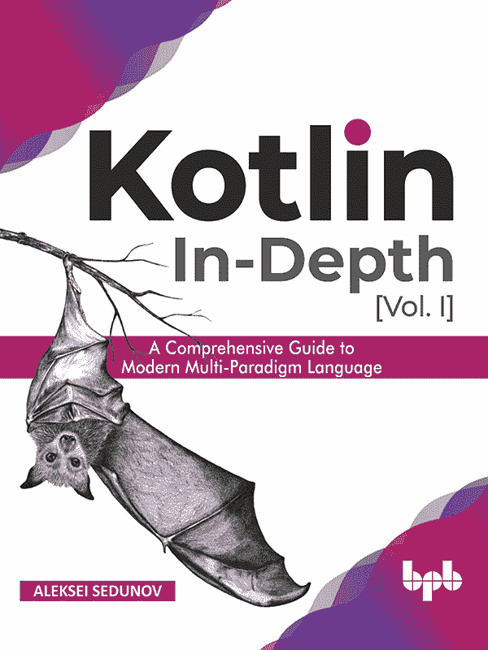


# 作者

# Aleksei Sedunov


# 献给

Tatiana，我的引导之光和不竭的灵感源泉

# 关于作者

**Aleksei Sedunov** 自 2008 年以来一直担任 Java 开发人员。在 2012 年加入 JetBrains 后，他积极参与了 Kotlin 语言的开发，专注于 IntelliJ 平台的 IDE 工具。目前，他在 DataGrip 团队（一款 JetBrains 数据库 IDE）工作，并继续使用 Kotlin 作为主要的开发工具。

# 致谢

首先，我要向 JetBrains 的整个 Kotlin 团队表示衷心的感谢，他们创造了如此美丽的语言，并持续不断地改进它——特别是 Andrey Breslav，他从第一天起一直领导语言的设计。

我非常感谢 BPB Publications 的每一个人，给了我编写这本书的绝佳机会，并在文本提交给读者之前对改进文本提供了巨大的支持。

最后，我想感谢我亲爱的家人在本书创作期间提供的支持。

*– Aleksei Sedunov*

# 前言

自 2016 年首次发布以来（甚至在此之前的很很久），Kotlin 作为一种强大且灵活的工具，在许多开发任务中越来越受欢迎。它能够同样胜任移动、桌面和服务器端应用程序的处理，并最终在 2017 年和 2018 年获得 Google 的官方认可，成为 Android 开发的主要语言。这种流行是有根据的，因为语言实用主义——即在已知解决方案中选择最佳实践的倾向是其设计的指导原则之一。

通过你手中的这本书，我想邀请你进入 Kotlin 编程的美丽世界，在那里你可以亲眼看到它的优势。完成这本书后，你将拥有独立编写 Kotlin 代码的所有知识。

第一卷涉及 Kotlin 语言的基础，如基本语法、过程式、面向对象和函数式编程方面，以及 Kotlin 标准库。内容分为 9 章，结构如下：

**第 1 章** 解释了语言设计背后的核心思想，概述了 Kotlin 生态系统和工具，并引导读者完成在各种环境中设置 Kotlin 项目所需的初步步骤。

**第 2 章** 向读者介绍了了 Kotlin 语法，解释了如何使用变量，并描述了整数或布尔值等简单数据类型及其内置操作。此外，它还涉及了更复杂数据结构（如字符串和数组）的基础知识。

**第 3 章** 讨论了 Kotlin 函数的语法，并解释了 Kotlin 支持的各种控制结构（如二/多选、迭代和错误处理）。此外，它还涉及了使用包进行代码结构的问题。

**第 4 章** 向读者介绍了 Kotlin 中面向对象编程的基本方面。它解释了如何创建和初始化类实例，如何控制成员访问，描述了对象声明和非平凡属性的使用，并引入了类型可空性（nullability）的概念。

**第 5 章** 解释了 Kotlin 的函数式方面，向读者介绍了高阶函数和匿名函数的概念，讨论了内联函数（inline functions）的使用，并解释了如何使用扩展函数和属性为现有类型添加功能。

**第 6 章** 解释了针对特定编程任务的特殊类：用于简单数据存储的数据类（data classes）、用于表示固定集合的枚举以及用于创建轻量级封装的内联类（inline classes）。

**第 7 章** 继续处理在第 4 章和第 6 章中引入的面向对象特性，重点介绍类体系。它解释了如何定义子类、如何使用抽象类和接口，以及如何使用密封类（sealed classes）限制层次结构。

**第 8 章** 描述了 Kotlin 标准库的重要部分，涉及各种集合类型及其操作，以及简化文件访问的流式 IO。

**第 9 章** 介绍了泛型声明的概念，并解释如何在 Kotlin 中定义和使用泛型类、函数和属性。它还解释了变型（variance）的概念以及如何用它提高泛型代码的灵活性。

我们对 BPB Publications 的工作非常自豪，并遵循最佳实践确保内容的准确性，为订阅者提供沉浸式的阅读体验。读者是我们的镜子，我们利用他们的反馈反映并改进出版过程中可能出现的人为错误。为了让我们维持质量并帮助任何因不可预错误遇到困难的读者，请致信至：

**errata@bpbonline.com**

BPB Publications 全体非常感谢您的支持、建议和反馈。

# 第一章：Kotlin：强大且实用

本章旨在解释使 Kotlin 现代应用开发卓越且高效语言的主要特性，以及为什么你想要学习它。我们将学习支撑 Kotlin 设计背后的基本思想，概述不同应用领域的 Kotlin 库和框架，例如 Android 应用程序、并发、测试和 Web 开发。最后，我们将引导你完成在两个流行的开发环境（IntelliJ IDEA 和 Eclipse）中设置 Kotlin 项目所需的步骤，并向你介绍交互式 Kotlin Shell。

* 什么是 Kotlin？

* Kotlin 生态系统的主要组件

* 在 IntelliJ 和 Eclipse 中设置 Kotlin 项目

在本章结束时，你将了解 Kotlin 的基本原理和生态系统，并知道简单的 Kotlin 程序是什么样的，以及如何在常用的 IDE 中设置项目。

## 什么是 Kotlin？

Kotlin 是一种多平台、多范式的编程语言，强调安全性、简洁性和互操作性。它构思于 2010 年底，并于 2016 年 2 月首次发布，从以来在许多开发领域都稳步地成为一种日益流行且充满前景的工具，无论是 Android 开发、桌面应用程序还是服务端解决方案。该语言背后的支持者并一直投入开发的公司是 JetBrains，它以其卓越的软件工程工具（如 `IntelliJ IDEA`）闻名。

到 2019 年 11 月，Kotlin 已达到 1.3 版本，拥有了庞大的社区、完善的生态系统和广泛的工具支持。它已经超越了创建一个更好的 `Java` 替代方案的最初意图，现在拥抱了多个平台，包括 Java 虚拟机、Android、JavaScript 和原生应用程序。2017 年，Google 宣布 Kotlin 为 Android 平台的官方支持语言，这极大地推动了该语言的普及。如今，许多公司——包括 Google、Amazon、Netflix、Pinterest、Uber 等——都在使用 Kotlin 进行生产开发，而且 Kotlin 开发者的开放职位职位数量也在稳步增长。

这一切的实现得益于对语言精心的设计以及对核心特性的落实，这些特性使得 Kotlin 成为一种出色的开发工具。该语言的哲学主要基于它在 2010 年意图解决的问题。那时，JetBrains 已经为其以 IntelliJ 平台为核心的产品积累了大量的 `Java` 代码库，除了最广为人知的 `IntelliJ IDEA` 之外，还包含了一系列针对不同技术的微型 IDE，如 `WebStorm`、`PhpStorm`、`RubyMine` 等。

然而，此类代码库的维护和增长受到了 `Java` 本身的阻碍，因为其演进速度缓慢，且缺乏许多实用功能（这些功能在当时的 `Scala` 和 `C#` 等语言中已经可用）。在研究了当时可用的 `JVM` 语言后，公司得出结论：没有现有语言能够满足他们的需求，并决定投入资源实现自己的语言。这种新语言被命名为 Kotlin，以向俄罗斯圣彼得堡附近的一个岛屿致敬，该开发团队的大多数成员位于那里。

那么，是什么从一开始就塑造了这种语言的特性呢？事实上，我们已经在它的定义中给出了答案。Kotlin 背后的原因是需要一种强调安全性、简洁性和互操作性的多范式语言。让我们详细看看这些特性。

### 安全性（Safe）

对于一种编程语言来说，安全性意味着它能够防止程序员的错误。在实践中，考虑到安全性设计语言是一种权衡，因为防止错误通常是有代价的：你要向编译器提供更多关于程序的详细信息，或者让它花费更多时间来推断程序的正确性（可能两者兼有）。Kotlin 的设计目标之一是找到一种中道：设计一种比 `Java` 具有更强安全的语言，但又不会强至于损害开发者的生产力。尽管 Kotlin 的解决方案绝非绝对，但它在实践中被反复证明是高效的选择。

在阅读本书的过程中，我们将讨论 Kotlin 安全性的各个方面。在这里，我们想指出一些主要特性：

* 类型推断（Type inference）：允许开发者在大多数情况下省略显式声明类型（`Java 10` 为局部变量引入了这一特性）；

* 可空类型（Nullable types）：规范 `null` 的使用并有助于防止臭名昭著的 `NullPointerException`；

* 智能转换（Smart casts）：简化了类型转换，减少了运行时转换错误的概率。

### 多范式（Multiparadigm）

最初，Kotlin 多范式的含义意味着除了许多主流编程语言（如 `Java`）中典型的传统面向对象范式外，还支持函数式编程。函数式编程基于“将函数视为值”的思想：将它们作为参数传递、或从其他函数返回、在本地声明、或存储在变量中等。函数式范式的另一个方面是不可变性概念，这意味着你操作的对象一旦创建就不能改变其状态，且函数不能产生副作用。

这种方法的主要益处是提高了编程的灵活性：通过创建一种新的抽象，你可以写出更具表现力且简洁的代码，从而提高你的生产力。

注意，虽然函数式编程原则可以在许多语言中使用（例如，`Java` 的匿名类在引入 lambda 之前是一个很明显的选择），但并不是每种语言都具有鼓励编写此类代码的语法便利。

相反，Kotlin 从一开始就包含了必要的特性。它们特别包括：将函数无缝集成到语言类型系统中的函数类型，以及用于从代码块创建函数类型值的 lambda 表达式。标准库以及外部框架提供了丰富的 API，促进了函数式风格。如今，许多这些也适用于 `Java`，它从 `Java 8` 开始引入了函数式编程支持。然而，它的表现力仍然落后于 Kotlin。

我们将在`第 5 章` 中涵盖函数式编程的基础，但它的应用和示例将贯穿本书的剩余部分。

在发展过程中，该语言还开始表现出两种编程范式。得于以领域特定语言（DSL）的形式设计 API，Kotlin 可以以声明式风格使用。事实上，许多 Kotlin 框架为特定任务提供了自己的 DSL，而无需牺牲通用编程语言的类型安全或表现力。例如，`exposed` 框架包含一个用于定义数据库架构和操作其数据的 DSL，而 `kotlinx.html` 为 HTML 模板语言提供了一种简洁且类型安全的替代方案。在`第 11 章：领域特定语言`中，我们将详细讨论这些示例，并学习如何创建自己的 DSL。

另一种范式，即并发编程，随着协程（`coroutines`）的引入进入了该语言。虽然并发支持本身存在许多语言中（包括 `Java`），但 Kotlin 提供了一套丰富的编程模式，开启了一种新的编程方法。我们将在`第 13 章`中涵盖并发的基础。

总而言之，多范式的存在大大增强了语言的表现力，使其成为一种更灵活、多用途的工具。

### 简洁与表现力（Concise and expressive）

开发者的生产力很大程度上取决于快速阅读和理解代码的能力，无论是其他开发者的工作，还是你自己在很一段时间之后自己的代码。为了理解某特定代码的作用，你还需要理解它如何与程序的其他部分相关联。这就是为什么阅读现有代码通常比编写新代码花费更多时间，这也是为什么语言的简洁性——在没有太多信息噪声的情况下清晰表达程序员意图的能力——是开发工具效率的一个关键方面。

Kotlin 简洁性的另一个方面与 DSL（领域特定语言，参见*第 11 章，领域特定语言*）密切相关，DSL 能够以最少的语法噪声极大地简化特定编程领域的描述。

## 与 Java 互操作性

Java 互操作性是 Kotlin 设计的一个主要要点，因为 Kotlin 代码并非为了孤立存在，而是为了与现有代码库尽可能顺利地协作。这就是为什么 Kotlin 设计者确保不仅可以从 Kotlin 使用现有的 Java 代码，还可以从 Java 以极小甚至毫不费力使用 Kotlin 代码。该语言还包含了一组专门用于调整 Java 和 Kotlin 之间互操作性的特性。

我们将*第 12 章，Java 互操作性*用于讨论 Java 互操作性问题以及 Kotlin 和 Java 如何在同一个项目中混合使用。

多平台并不是 Kotlin 设计者的最初意图，而是语言演进和对开发社区需求适应而产生的结果。虽然 JVM 和 Android 仍然是 Kotlin 开发的主要目标，但现在支持的平台还涵盖：

* 适用于 macOS、Linux 和 Windows 的原生应用程序和库

从 1.3 版本开始，Kotlin 支持多平台开发，主要用例包括在 Android 和 iOS 之间共享代码，以及为 JVM/JS/Native 世界创建多平台库。

## Kotlin 生态系统

在演进过程中，Kotlin 产生了丰富的库和框架，涵盖了软件开发的绝大多数方面。在这里，我们尝试为您提供可用工具的概述，希望能够成为在这个可能海洋中的指南。但请注意，由于生态系统在不断增长，本书编写时呈现的先进技术不可避免地会过时，因此不要犹豫要自行查找。一个很好的起点是 Awesome Kotlin 网站上社区更新的库和框架列表：[`kotlin.link`](https://kotlin.link)。

同样值得注意的是，得益于良好的 Java 互操作性，Kotlin 应用可能受益于大量的现有 Java 库。在某些情况下，它们拥有特定的 Kotlin 扩展，允许人们编写更符合语言习惯的代码。

## 协程

得益于挂起计算（suspendable computations）的概念，Kotlin 能够支持并发相关的编程模式，如 async/await、futures、promises 和 actors。协程框架为 Kotlin 应用中的并发问题提供了一个强大、优雅且易于扩展的解决方案，无论是服务端、移动端还是桌面端应用。协程的主要特性包括但不限于：

* 线程的轻量级替代方案；

* 可挂起的序列和迭代器；

* 通过通道通道共享内存；

* 使用 actor 通过发送消息来共享可变状态。

我们将在*第 13 章，并发，处理 Kotlin 中的并发问题*中涵盖协程 API 的基础知识。

## 测试

除了可以毫不费力在 Kotlin 应用中使用的 JUnit、TestNG 和 Mockito 等熟悉的 Java 测试框架外，开发者还可以享受为 Kotlin 量身定制的框架，这些框架为测试目的提供了实用的 DSL，无论是测试定义还是对象 mock。特别地，我们想指出：

* Mockito-Kotlin，一个流行的 Mockito 框架的扩展，简化了 Kotlin 中的对象模拟（mocking）；

* Spek，一个行为驱动的测试框架，支持 Jasmine 和 Gherkin 风格的用例定义；

* KotlinTest，一个受 ScalaTest 启发的框架，支持灵活的测试定义和断言。

*第 14 章，使用 Kotlin 进行测试*中，我们将更多关注 Spek 和 Mockito 提供的特性，并考虑如何在你的项目中使用它们。

## Android 开发

Android 是 Kotlin 主要且增长最活跃的应用领域之一。在 Google 宣布 Kotlin 为首选 Android 语言后，这一点变得尤为相关，这意味着 Android 工具现在设计和开发时也充分考虑了 Kotlin 的特性。除了 Android Studio 插件带来的卓越编程体验外，Android 开发者还可以受益于许多流行框架（如 Dagger、ButterKnife 和 DBFlow）的良好互操作性。在 Kotlin 特定的 Android 工具中，我们关注 Kotlin 扩展（Kotlin Extensions）。Kotlin Android Extensions 是一个编译器插件，其主要功能是数据绑定，允许你使用 XML 定义的视图就像它们隐式定义在你的代码中一样，从而避免了著名的 `findViewById()` 调用。此外，它还支持视图缓存，并能够为用户定义的类自动生成 `Parcelable` 实现。Anko 是一个 Kotlin 库。

Anko 是一个 Kotlin 库，简化了 Android 应用的开发。除了许多助手外，它还包含一个领域特定语言（Anko Layouts），用于组合动态布局，并配有适用于 Android Studio 的 UI 预览插件，以及基于 SQLite 的数据库查询。

我们将在*第 15 章，Android 应用*中涵盖这些特性中的部分，向读者介绍 Kotlin 驱动的 Android 开发。

## Web 开发

Web/企业级应用开发者也可以受益于 Kotlin。如 Spring 5.0 和 Vert.x 3.0 等流行框架包含了 Kotlin 特定的扩展，允许以符合 Kotlin 习惯的方式使用它们的功能。此外，你还可以使用各种框架的纯 Kotlin 解决方案：

* Ktor，一个用于创建异步服务器和客户端应用的 JetBrains 框架；

* [`kotlinx.html`](http://kotlinx.html)，一个构建 HTML 文档的领域特定语言

* Kodein，一个依赖注入框架

我们将在*第 16 和 17 章*中讨论使用 Ktor 和 Spring 构建 Web 应用和微服务的细节。

## 桌面应用

针对 JVM 平台的桌面应用开发者可以使用 TornadoFX，这是一个基于 JavaFX 的框架。它提供了实用的领域特定语言用于构建 GUI 和通过 CSS 进行样式描述，支持 FXML 标记和 MVC/MVP 架构。它还带有一个 IntelliJ 插件，简化了 TornadoFX 项目、视图和其他组件的生成。

## 开始使用 Kotlin

从 IntelliJ IDEA 15 开始，Kotlin 支持已捆绑在 IDE 的分发版本中，因此你不需要安装任何外部插件来辅助 Kotlin 开发。对于本书，我们使用的是 2019 年 3 月发布的 IntelliJ IDEA 2019.1。


如果你还没有安装 IDEA，可以从 [www.jetbrains.com/idea/download](http://www.jetbrains.com/idea/download) 下载最新版本，并按照 [www.jetbrains.com/help/idea/install-and-set-up-product.html](https://www.jetbrains.com/help/idea/install-and-set-up-product.html) 上的安装说明进行操作。IDEA 分两个版本：免费开源的社区版（Community）和商业版的 Ultimate 版（Ultimate）。主要的区别在于 Ultimate 版包含了一系列与 Web 和企业级应用开发以及数据库工具的功能。你可以在下载页面找到更详细的变更列表。对于本书，我们不需要 Ultimate 功能，因此 IDEA 社区版完全足够了。

项目类型被分组为可以在左侧窗格中看到的类别。具体的类别和项目取决于安装的插件，但目前我们感兴趣的是 Kotlin 类别，得于捆绑的 Kotlin 插件，该类别开箱即用。点击它，你将看到可用项目模板列表（*图 1.1*）。

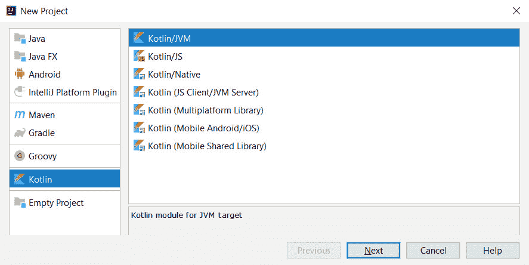

从 1.3.21 版本（我们编写本书时使用的版本）开始，Kotlin 插件支持创建针对 JVM、JavaScript、原生应用的项目，以及多种多平台项目案例，例如同时针对 Android 和 iOS 的移动应用程序。该平台决定了编译器产物的类型（JVM 的字节码、JavaScript 的 `.js` 文件以及 Kotlin/Native 的特定平台可执行文件）以及你的项目可以使用的一组可用依赖项；例如，针对 JavaScript 项目无法访问 Java 类库中的类。随着书籍的进行，我们的主要关注点将是 JVM 应用。因此，在这个示例中，我们将选择 Kotlin/JVM 选项并点击 `Next`（下一步）。

在下一步（*图 1.2*）中，你需要提供项目名称和位置，位置是项目相关内容的根目录，包括源文件。请注意，IntelliJ 会根据你输入的项目名称自动建议位置，但如有需要可以进行更改。

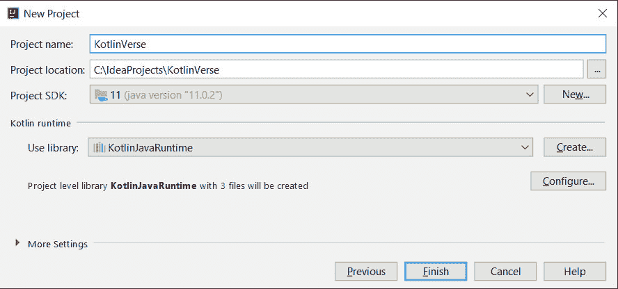

我们建议使用 JDK 8 或更高版本。对于此示例，我们选择了 [www.oracle.com](http://www.oracle.com) 上提供的最新（编写本书时的）JDK 11 发布版本。通常，IntelliJ 会自动检测机器上安装的 JDK，但如果没有发生，或者 Project SDK 列表中预配置的 JDK 无一符合你的需求，你可以点击 `New` 按钮并指定 JDK 根目录路径来添加新的。你可能需要先安装 JDK；可以从 [www.oracle.com/technetwork/java/javase/downloads/index.html](https://www.oracle.com/technetwork/java/javase/downloads/index.html) 下载并按照安装程序的说明操作。

另一点值得注意的是，IntelliJ 为我们的项目预配置了 Kotlin 运行时库。默认情况下，项目将引用 IDE 插件目录中的库，这意味着每当你更新插件本身时，它都会升级。然而，如果你希望项目依赖于特定版本的 Kotlin 运行时，并仅在需要时手动更新，你可以更改该行为：点击 `Create` 按钮并选择 `Copy`，以便获得指定存放库目录名称的选项。

如果 Project 工具窗口不存在，可以通过点击 `Project` 按钮（通常在窗口边界左侧）或使用快捷键 `Alt+1` (Meta+1) 来调出它。

Project 窗口显示项目的层级结构。让我们展开根节点查看它包含什么（*图 1.3*）。目前我们主要对三个项目感兴趣：

*   `out` 目录，编译器将生成的字节码放在此处；

*   External libraries（外部库），列出了项目依赖的所有库。

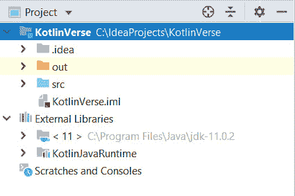

现在，右键点击 `src` 目录并选择 `New | Kotlin File/Class` 命令。在随后的对话框中，输入文件名 `main.kt`，确保 `Kind` 字段设置为 `File`，并点击 `OK`。你将看到更新后的 Project 窗口显示了一个新文件，编辑器中已打开。请注意，Kotlin 源文件必须具有 `.kt` 扩展名。

最后我们准备好编写实际代码了。让我们在编辑器窗口输入以下内容（*图 1.4*）：

```
fun main() {

    println("Hello, KotlinVerse!")

}
```

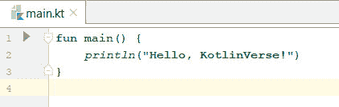

**图 1.4：** Hello, World 程序

```java
public class Main {

    public static void main(String[] args) {

        System.out.println("Hello, World!");

}
```

事实上，JVM 版本的 `Kotlin println()` 函数只是对 `System.out.println()` 的调用。由于 JVM 入口点必须是一个静态类方法，你可能会奇怪 Kotlin 应用如何在没有定义类类的情况下启动。答案是，虽然我们没有显式定义类，但 Kotlin 编译器会在后台创建一个，并在其中放置 JVM 入口点，该入口反过来会调用我们的 `main()` 函数。我们将在*第 12 章，Java 互操作性*中回到这些所谓的外观类，因为它们构成了 Kotlin/Java 互操作性的一个主要方面。

同样注意，与 JVM 入口不同（JVM 入口应该接收一个命令行参数数组作为参数），我们的 `main()` 函数完全没有参数。这在不使用命令行参数的情况下非常方便。然而，如果有需要，你仍然可以使用这些参数来定义入口点：

```kotlin
fun main() {

    println("Hello, KotlinVerse!")

}
```

无参数的 `main()` 实际上是 Kotlin 1.3 中引入的一个最新特性。在早期的语言版本中，唯一接受的入口点是接收 `String<Array>` 参数的那个。

你可能已经注意到 `main()` 定义左侧有一个小的绿色三角形。此行标记表示函数 `main()` 作为一个入口点是可执行的。点击该标记会弹出一个菜单，允许你运行或调试其代码。让我们选择 `Run MainKt` 并看看发生了什么（图 1.5 ）。顺便说一下，`MainKt` 是我们在几段之前提到的编译器生成的 facade 类名。选择 `Run` 命令后，IntelliJ 会编译我们的代码并执行程序。程序启动时打开的 Run 工具窗口会自动链接到其标准 I/O 流，作为内置控制台。如果你操作得当，程序将在控制台打印 `Hello, Kotlin Verse` 并成功终止。

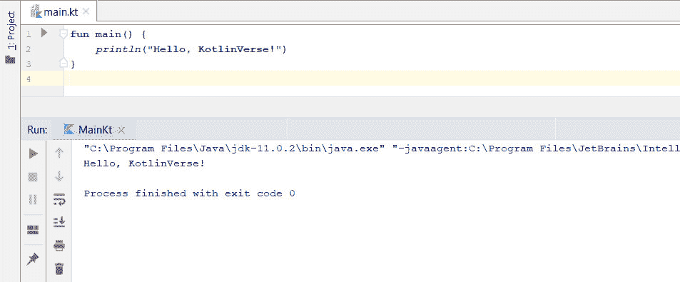

**图 1.5：** 运行程序

如果你查看 `out` 目录，你应该能看到由 Kotlin 编译器从我们的源程序生成的 `.class` 文件。

恭喜！你现在已经了解了如何在 IntelliJ IDEA 环境中设置和运行 Kotlin 项目，并准备好深入研究语言基础了。KotlinVerse，我们来啦！

### 使用 REPL

IntelliJ 的 Kotlin 插件提供了一个交互式 shell，允许你即时评估程序指令：这可以用于快速测试你的代码或对库函数进行实验。对于那些正在学习 Kotlin 语言的人来说，它也非常方便。这个特性被称为 REPL。这个名字背后的含义是“读取/评估/打印循环”（Read/Evaluate/Print Loop），因为这正是 shell 所做的：读取用户输入的代码，对其进行评估，打印结果（如果有），并循环整个过程。要访问 REPL，请选择 `Tools | Kotlin | Kotlin REPL`。

你可以在 REPL 窗口中输入 Kotlin 代码，就像在编辑器中输入一样。主要区别在于，每段代码在你输入后都会立即编译并执行。代码输入完成后，你按下 Ctrl+Enter (Command+Return) 告诉 IDE 处理你的输入。让我们尝试一下：

```kotlin
println("Hello from REPL")
```

如你所见，IntelliJ 的响应是在控制台打印 `Hello from REPL`，在 particular 情况下，控制台是与 REPL 窗口共享的。

上述字符串的打印实际上是 `println()` 函数的副作用，该函数本身不会向调用程序返回任何结果。然而，如果我们尝试评估某些具有意义结果的表达式，输出将略有不同。让我们尝试输入 `1+2*3`（图 1.6 ）：

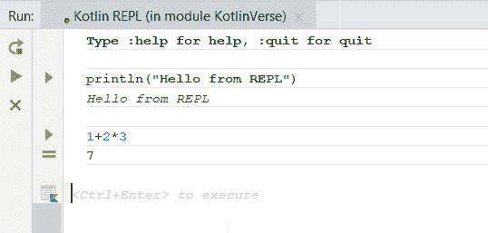

**图 1.6：** 使用 REPL

REPL 给了我们表达式的结果，即 `7`。注意与 `println()` 示例相比的字体和 = 图标的不同。这是为了表示 `7` 是你输入的代码的实际结果。总之，我们建议你熟悉这个工具，并在整本书中（以及之后）使用它来实验你认为必要的任何特性。

### Kotlin Playground

除了 IntelliJ 中提供的 REPL shell，值得提到另一个类似但更强大的在线工具，它介于 REPL 和全功能 IDE 之间。该工具就是 Kotlin Playground。若要尝试一下，请在浏览器中打开 [play.kotlinlang.org](https://play.kotlinlang.org)（图 1.7 ）。

Kotlin Playground 基本上是一个在线环境，允许你在没有实际 IDE 的情况下探索语言，它仍然提供了一些智能功能供你使用，包括代码编辑器、语法和错误高亮、代码补全和控制台程序运行。

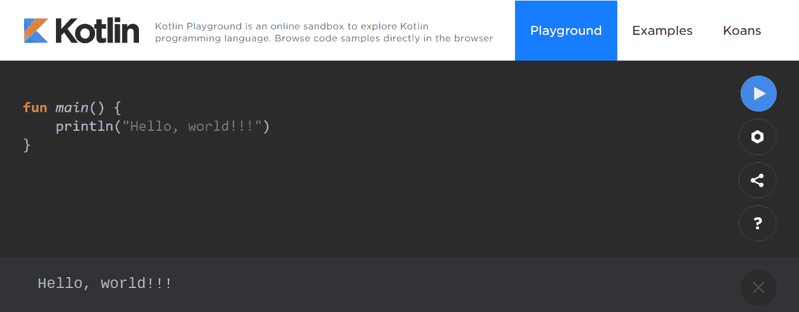

**图 1.7：** Kotlin Playground

Playground 网站还包含许多示例和练习，以让开发者熟悉 Kotlin 的主要特性。这些练习也称为 Kotlin Koans，以失败的测试用例的形式出现，必须修复才能通过（图 1.8 ）：

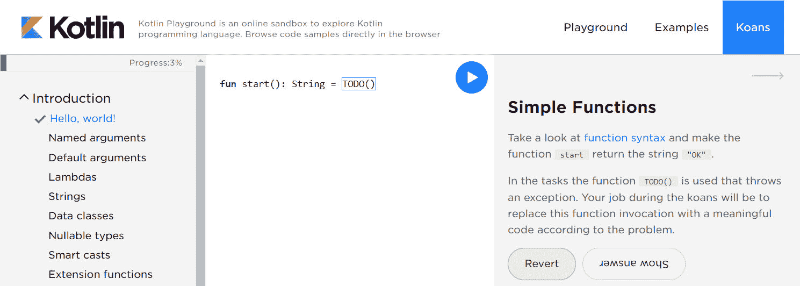

**图 1.8：** Kotlin Koans

我们强烈建议阅读这些示例，作为对书籍本身的宝贵补充。

### 设置 Eclipse 项目

Kotlin 工具并不局限于 IntelliJ：得益于 Eclipse 插件，偏好该 IDE 的开发者也可以使用 Kotlin。尽管 Eclipse 中的语言支持没有 IntelliJ 那么广泛，但它仍然为开发人员提供了许多代码辅助功能，例如代码高亮、补全、程序执行和调试、基础重构等。

如果你没有 Eclipse，可以从 [www.eclipse.org/downloads](http://www.eclipse.org/downloads) 免费下载。运行安装程序，选择 `Eclipse IDE for Java Developers` 并按照说明操作。本教程使用的是 Eclipse 4.10。

与 IntelliJ 不同，Eclipse 不带内置 Kotlin 支持，这意味着在编写代码之前必须从 Eclipse Marketplace 安装插件。要这样做，选择 `Help | Eclipse Marketplace…` 并搜索 Kotlin 插件（图 1.9 ）。

点击 `Install` 按钮后，IDE 将下载并安装插件。确保接受许可协议并重启 Eclipse 以完成安装。


**图 1.9：** 从 Eclipse Marketplace 安装插件

现在我们可以设置项目了。首先，我们使用 `Window | Perspective | Open Perspective | Other…` 命令将 IDE 切换到 Kotlin 视图并在对话框中选择 Kotlin。除了布局变化，此视图允许从应用程序菜单直接进行 Kotlin 操作。因此，创建项目我们需要选择 `File | New | Kotlin Project…`，指定新项目名称并点击 `Finish`（图 1.10 ）：

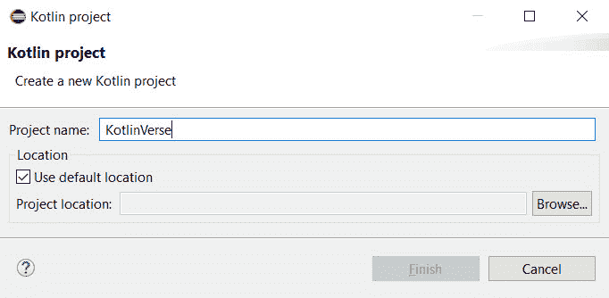

**图 1.10：** 创建 项目

展开 Package Explorer View 中的 Verse 节点，你可以看到新创建的项目组件：`Java Runtime Environment (JRE)` 库、Kotlin 标准库以及目前空的 `src` 目录。现在让我们创建一个 Kotlin 文件：右键点击 `src` 目录并选择 `New | Kotlin File`。输入文件名并点击 `Finish`（图 1.11 ）。

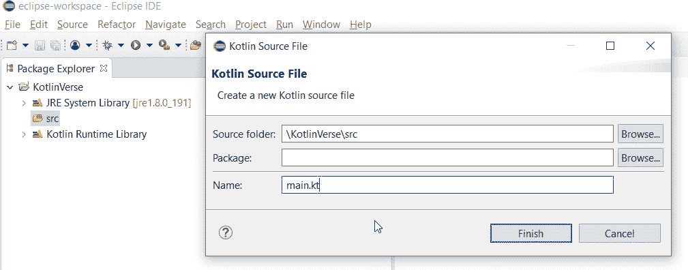

**图 1.11：** 创建 Kotlin 文件

Eclipse 自动在编辑器窗口中打开新文件。让我们输入 Hello, World 程序，你可以从我们之前的示例中识别它（图 1.12 ）。

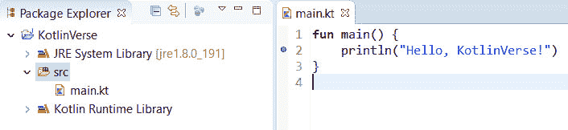

**图 1.12：** Eclipse 中的 Hello, World

就是这样！要运行程序，可以使用 `Run | Run` 命令：Eclipse 将将你的文件编译为 JVM 字节码并启动生成的程序，将其输出重定向到控制台视图。

在本章中，我们学习了 Kotlin 语言的主要方面，例如安全性、简洁性以及对函数式和面向对象编程范式的支持。结合了其对多个开发平台（如 JVM、Android、JavaScript 和原生应用）的支持、与 Java 或其他平台特定代码的良好互操作性、丰富的工具、库和框架生态系统，以及快速增长的社区，Kotlin 成为一门绝对值得学习的优秀语言。

# 第 2 章

## 语言基础

## 结构

*   变量定义；
*   可变和不可变变量；
*   基础类型及其操作：数字、字符、布尔值；
*   字符串类型：字符串字面量和模板、基础 String 操作；
*   数组类型：数组的构造和基础操作。

### 目标

我们的目标是理解基础 Kotlin 类型，并学习使用数字、布尔值、字符/字符串和数组进行简单计算编程。

### 基础语法

在本章中，我们将学习如何定义和使用局部变量，并了解基础 Kotlin 表达式，如引用、调用和一元/二元操作。

### 注释

与 Java 类似，Kotlin 支持三种类型的注释，用于记录代码：

*   单行注释，以 `//` 开头并持续到行尾；
*   由 `/*` 和 `*/` 界定的多行注释；
*   由 `/**` 和 `*/` 界定的 KDoc 多行注释。

KDoc 注释用于生成类似于 Javadoc 的富文本文档。

```
/*

multi-line comment

*/
```

```
println("Hello") // single-line comment
```

**Java vs. Kotlin：** 与 Java 不同，Kotlin 中的多行注释是可以嵌套的。

### 定义变量

```
val timeInSeconds = 15
```

*   `val` 关键字（来自 value）；
*   变量标识符，即你为新变量起的名字，并在稍后的代码中引用它；
*   定义变量初始值的表达式，跟在 `=` 符号之后。

**IDE 提示：IntelliJ 通过对每个不必要的分号显示警告来强制执行这种代码风格。**

我们想写一个程序，要求用户输入两个整数并输出它们的和。以下是它在 Kotlin 中可能的写法：

```
fun main() {

    val a = readLine()!!.toInt()

    val b = readLine()!!.toInt()

    println(a + b)

}
```

让我们仔细观察一下它的功能：

*   `readLine()` 是一个调用表达式，告诉程序执行 `readLine`，这是一个标准的 Kotlin 函数，用于从标准输入读取单行并将其作为字符字符串返回。
*   `!!` 是非空断言运算符，如果 `readLine()` 的结果为 null 则将抛出异常。与 Java 不同，Kotlin 会跟踪类型是否可以包含 null，除非我们确保排除了 null，否则它不允许我们调用 `toInt()` 函数。目前，我们可以简单忽略它，因为从控制台读取时 `readLine()` 永远不会返回 null。在[第 4 章，类与对象的处理]中，我们将更详细地讨论类型空问题。
*   `toInt()` 调用的结果被赋值给我们在同一行中定义的变量 `a`。
*   同样，我们定义了第二个变量 `b`，并赋值为第二行输入的整数。
*   最后，我们计算两个整数之和 `a + b`，并将结果传递给 `println()` 函数调用，打印到标准输出。

我们在上面引入的变量被称为局部变量，因为它们定义在函数体内（在我们的例子中是 `main()`）。除此之外，Kotlin 还允许定义与变量类似的属性，但通常可以在读取或写入时执行某些计算。例如，正如我们之后看到的，Kotlin 中所有的字符串都有 `length` 属性，包含字符数量。

如果你熟悉 Java，可能会注意到我们没有指定变量的类型，但程序仍然成功编译并运行。原因是所谓的类型推断，这种语言特性在大多数情况下允许编译器从上下文中推导出类型信息。在这种情况下，编译器已经知道 `toInt()` 返回 `Int` 类型的值，由于我们将 `toInt()` 的结果赋值给变量，它假设该变量必须是 `Int` 类型。得于类型推断，Kotlin 仍然是一门强类型语言，同时让开发者无需用不必要的类型注解来填充代码。在整书中，我们将看到各种类型推断如何简化 Kotlin 编程的示例。

**Java vs. Kotlin：** Java 10 为局部变量引入了类似的功能。现在你可以写道，例如：

```
var text = "Hello"; // String 是自动推断的
```

但在 Kotlin 中，类型推断不仅限于局部变量，具有更广泛的应用；我们将在接下来的章节中看到。

需要时你也可以显式指定类型。这样做是在变量标识符之后放置类型规格，并用冒号（`:`）将它们隔开：

```
val text: String = "Hello!"
```


注意，在这种情况下，初始值必须属于变量类型。以下代码将产生编译错误：

```kotlin
val n: Int = "Hello!" // Error: 将 String 值赋值给 Int 变量
```

**IDE 提示：** IntelliJ 允许你查看编译器为任何表达式或变量推断的类型。这样做是在编辑器中选择感兴趣的表达式，或直接将光标放在变量标识符上并按 `Ctrl + Shift + P`（`Command + Shift + P`）。

此外，你可以使用简单的操作添加或删除显式类型。只需将编辑器光标置于变量标识符上，按下 `Alt + Enter` 并分别选择 `Specify type explicitly`（显式指定类型）或 `Remove explicit type specification`（删除显式类型指定）（后者也适用于类型指定本身）。

可以忽略初始值，并在随后的单独语句中初始化变量。如果计算初始值无法放在单个表达式中，这将非常有帮助。在这种情况下，你必须显式指定变量类型：

```kotlin
val text: String
```

```kotlin
text = "Hello!"
```

注意，在读取变量值之前必须对其进行初始化。如果编译器无法保证变量在使用前已初始化，它将报告错误：

```kotlin
val n: Int
```

## 标识符

标识符是你赋予程序中定义实体的名称，例如变量或函数。Kotlin 标识符有两种形式。第一种与 Java 标识符非常相似，可以是符合以下规则的任意字符字符串：

- 它可以只包含字母、数字和下划线字符（`_`），不能以数字开头；
- 它可以完全由下划线组成：如 `_`、`__`、`___` 等名称是被保留的，不能用作标识符；
- 它不能与硬关键字（hard keyword）重名。

硬关键字（如 `val` 或 `fun`）无论放在代码的什么位置都被视为关键字。相反，软关键字（如 `import`）仅在特定的上下文中被解析为关键字，在这些之外作为普通标识符使用。你可以在 [kotlinlang.org/docs/reference/keyword-reference.html](http://kotlinlang.org/docs/reference/keyword-reference.html) 找到硬软关键字的完整列表。

字母和数字类似于 Java，但不限于 ASCII，还包括国家的字母数字字符。不过，使用基于英语单词的名称被认为良好的习惯。

**Java vs Kotlin：** 注意，与 Java 不同，Kotlin 标识符中不允许美元符号（`$`）。

第二种形式是引用标识符，它是包含在反引号（`` ` ``）内的任意非空字符字符串：

```kotlin
val `fun` = 1
```

```kotlin
val `name with spaces` = 2
```

引用标识符不能包含换行符和反引号本身。此外，它们必须满足特定平台的要求。例如在 Kotlin/JVM 代码中，此类标识符不能包含以下字符，因为它们被 JVM 自身保留了：`.;[ ]/<>:\`

为了更好的可读性，不应滥用此功能。它主要存在是为了 Java 互操作，因为 Java 的声明名称可能与 Kotlin 关键字冲突（例如 `fun` 是 Kotlin 中的关键字，但在 Java 中不是），Kotlin 代码在需要时可以使用它们。另一个用例是测试用例方法的命名，我们将在第 14 章 *使用 Kotlin 单元测试* 中看到。

## 可变变量

我们到目前考虑的变量实际上是不可变的：换句话说，一旦初始化，你就无法为它们重新赋值。在这方面，它们类似于 Java 中的 `final` 变量。你应该尽可能将所有变量声明为不可变，因为使用此类不可变变量并避免带有副作用的函数有助于函数风格并简化对代码的推理。

然而，如果有必要，你仍然可以使用 `var` 关键字（来自 variable）代替 `val` 来定义可变变量。基本语法保持不变，但现在我们可以随心所欲地改变变量的值。我们用于改变变量值的操作（`=`）被称为“赋值”。我们已经见过它用于不可变变量的初始化。

```kotlin
var sum = 1
```

```kotlin
sum = sum + 2
```

```kotlin
sum = sum + 3
```

注意，在声明时指定或推断的变量类型无论其是否可变保持不变。分配错误类型的值会导致编译时错误：

```kotlin
var sum = 1
```

```kotlin
sum = "Hello" // Error: assigning String value to Int variable
```

此外，Kotlin 支持所谓的复合赋值，它将改变变量的值与二元运算符相结合：`+`、`−`、`*`、`/`、`%`。例如：

```kotlin
val result = 3
```

```kotlin
result += 6 // result = result + 6
```

只要相应的二元运算符对给变量有意义，就可以进行赋值。

**Java vs Kotlin：** 与 Java 不同，Kotlin 的赋值是语句而不是表达式，且不返回任何值。这反过来意味着在 Kotlin 中你不能形成类似于 Java 的 `a = b = c` 赋值链。此类赋值在 Kotlin 中是被禁止的，因为它们被认为容易出错且很少用。这也包括复合赋值。

还有两个涉及改变变量值的操作：递增（`++`）和递减（`--`）。最明显的用法是将数值变量增加或减少 `1`。像 Java 一样，这些操作分为前缀和后置形式：

```kotlin
var a = 1
```

```kotlin
println(++a) // a is 3, 3 is printed
```

```kotlin
println(--a) // a is 2, 2 is printed
```

这些示例表明，虽然前缀和后置操作都会修改变量，但前者返回变量的值。

## 表达式和运算符

我们在之前的 28 页中使用的表达式可以分为以下类：

- 字面量
- 变量引用和函数调用
- 一元运算符：注意，虽然前缀和后置操作都会修改变量，但前者返回变量的值。

| **类别** | **操作** | **示例** |
| :--- | :--- | :--- |
| 后置 | `++` `--` | `a++`, `b--` |
| 前缀 | `+` `-` `++` `--` | `+a`, `++a`, `!a` |
| 加法 | `+` `-` | `a + b + c` |
| 中缀 | 命名运算符 | `a < b or b < c` |
| 比较 | `<` `>=` | `a < b && b > c` |
| | | `a <= b || b >= c` |
| 等于 | `==` `!=` | `a == b a != c` |
| 逻辑与 | `&&` | `a && b && c` |
| 逻辑或 | `||` | |

**表 2.1：** 运算符优先级

具有相同优先级的二元运算符从左到右计算。例如：

```kotlin
a.foo().bar() // (a.foo()).bar()
```

```kotlin
a*b%c // (a*b)%c
```

```kotlin
(a == 1) or (b < 1) and (c > 1) // ((a == 1) or (b < 1)) and (c > 1)
```

在本书后续中，我们将引入额外的操作来完善此表。

### 基本类型

在本节中，我们将考虑描述数字、字符和 `Booleans` 等简单数值的 Kotlin 类型。如果你熟悉 Java，可以将它们看作 Java 原始数据类型的对应物，但这种类比并不是完美的。在 Java 中，原始数据类型（如 `int`，其值直接存储在方法和类预分配的内存中）与基于类的引用类型（如 `String`，其值只是指向动态分配的相应类数据的引用）之间有明确的区分。在 Kotlin 中，这种区别变得有些模糊，因为同一种类型——例如 `Int`——可以根据上下文被表示为原始类型或引用类型。Java 包含了特殊的装箱类（boxing classes），可用于包装原始值，而 Kotlin 在需要时会隐式执行装箱。

**Java 与 Kotlin：** 与 Java 相比，所有的 Kotlin 类型最终都基于某些类定义。这特别意味着即使是类似原始类型的类型（如 `Int`），也具有一些成员函数和/或属性。例如，你可以编写 `1.5.toInt()` 来对 `1.5` 调用 `toInt()` 操作，这是一个 `Double` 类型的值，它会将其转换为整数。

类型可以根据子类型化的概念形成层次结构：本质上，当我们说类型 `A` 是类型 `B` 的子类型时，意味着任何 `A` 类型的值都可以用于任何需要 `B` 类型值的语境中。例如，所有不允许空值的 Kotlin 类型都是内置类型 `Any` 的直接或间接子类型，因此下面的代码是正确的，尽管它强制将值 1 进行了装箱：

```kotlin
val n: Any = 1 // OK：Int 是 Any 的子类型
```

#### 整数类型

有四种表示整数的基本 Kotlin 类型（表 2.2）：

| 对应物 | 大小（字节） | 范围 | Java 对应物 |
| Byte | 1 | -128 .. 127 | byte |
| Short | 2 | -32768 .. 32767 | short |
| Int | 4 | -2³¹ .. 2³¹ − 1 | int |
| Long | 8 | -2⁶³ .. 2⁶³ − 1 | long |

**表 2.2：** 整数类型

```kotlin
val n = 12345
```

从 Kotlin 1.1 开始，你可以像 Java 7+ 一样，在数字字面量内部使用下划线以提高可读性。这在字面量很大时非常有用：

```kotlin
val n = 34_721_189
```

字面量本身根据其大小具有 `Int` 或 `Long` 类型。然而，你也可以将字面量赋值给较小类型的变量，只要它们符合预期的范围：

```kotlin
val one: Byte = 1 // OK
val million = 1_000_000 // OK：推断为 Int
val tooBigForInt: Int = 10_000_000_000 // Error：对于 Int 来说太大了
val tenBillions = 10_000_000_000 // OK：推断为 Long
val tooBigForLong = 10_000_000_000_000_000_000 // Error：对于 Long 来说太大了
```

添加 `l` 或 `L` 后缀会强制使字面量类型变为 `Long`：

```kotlin
val hundredLong = 100L // OK：推断为 Long
val hundredInt: Int = 100L // Error：将 Long 赋值给 Int
```

你也可以在二进制或十六进制数系统中指定字面量，分别为它们前缀 `0b` 和 `0x`：

```kotlin
val bin = 0b10101 // 21
val hex = 0xF9 // 249
```

注意，数字字面量不能以 `0` 开头，除非它本身就是 `0`。某些编程语言（包括 Java）使用零前缀字面量来表示八进制数，这在 Kotlin 中是不支持的，因为它们很少且通常是一个具有误导性的特性。因此，禁止零前缀数字，以免混淆习惯于八进制表示法的开发者。

```kotlin
val zero = 0 // OK
val zeroOne = 01 // Error
```

像 -10 这样的负数不是字面量，而是应用于字面量的一元减号运算符：

```kotlin
val neg = -10
```

每个整数类型定义了一对常量，包含其最小值（`MIN_VALUE`）和最大值（`MAX_VALUE`）。要使用它们，只需用类型名限定即可：

```kotlin
Short.MIN_VALUE // -32768
Short.MAX_VALUE // 32767
```

#### 浮点类型

与 Java 一样，Kotlin 提供了对 IEEE 754 浮点数的支持，类型为 `float` 和 `double`。它们的对应物正如你可能猜到的那样，是 `float` 和 `double` 类型。

```kotlin
val pi = 3.14
val one = 1f
```

默认是 `Double` 类型。Kotlin 中没有这种前缀。以下代码会导致编译错误：

```kotlin
val pi: Double = 3.14f // Error
```

数值类型支持 `++`/`--` 操作，这些操作相当于将值增加或减少 `1`。

一元 `+`/`-` 操作的结果类型与其参数类型相同，但 `Byte` 和 `Short` 除外，它们的结果类型均为 `Int`：

```kotlin
val byte: Byte = 1
val int = 1
val long = 1L
val float = 1.5f
val double = 1.5

-byte    // -1: Int
-int    // -1: Int
-float  // -1.5: Float
-double // -1.5: Double
```

每个二元算术运算都有多个变体，涵盖了所有可能的数值类型组合。由于共有 6 种数值类型，这意味着每个操作有 `6*6 = 36` 个。这允许在算术表达式中组合不同的数值类型而无需进行显式转换。此类操作的结果被视为参数中较大的类型，其中“较大”意味着：

`Double > Float > Long > Int > Short > Byte`

对于大多数类型，这本质上意味着数值范围更大，但并非总是如此：一个明显的例子是从 `Long` 转换为 `Float`，这可能会导致精度丢失。请注意，即使参数为 `Byte` 或 `Short` 类型，结果类型也永远不会小于 `Int`。

继续之前的示例，我们得到：

```kotlin
byte + byte    // 2: Byte
int + byte      // 2: Int
int + int       // 2: Int
int + long      // 2: Long
long + double   // 2.5: Double
float + double // 3.0: Double
float + int    // 2.5: Float
long + double  // 2.5: Double
```


`Int` 和 `Long` 支持一系列位层级操作：

| 操作 | 含义 | 示例 | Java 对应项 |
| :--- | :--- | :--- | :--- |
| `Shl` | 左移 | `13 shl 2` // = 52: 0…00110100；`(-13) shl 2` // = -52: 1…11001100 | `<<` |
| `Shr` | 右移 | `13 shr 2` // = 3: 0…00000011；`(-13) shr 2` // = -4: 1…11111100 | `>>` |
| `And` | 位与 | `13 and 19` // = 1: 0…00000001；`-13 and 19` // = 19: 0…00010011 | `&` |
| `Or` | 位或 | `13 or 19` // = 31: 0…00011111；`-13 or 19` // = -13: 1…1110011 | `\|` |
| `xor` | 位异或 | `13 xor 19` // = 30: 0…00011110；`-13 xor 19` // = -32: 1…11100000 | `^` |
| `Inv` | 位反 | `13.inv()` // = -14: 1…11110010；`(-13).inv()` // = 12: 0…00001100 | `~` |

**表 2.4：** 位运算

从 Kotlin 1.1 开始，`and`、`or`、`xor` 和 `inv` 也适用于 `Byte` 和 `Short`。

**Java 与 Kotlin：** 如果你熟悉 Java，你可能知道位运算符：`&`、`|`、`^`、`~`、`<<`、`>>` 和 `>>>`。这些运算符在 Kotlin 中目前不支持：你必须分别使用 `and`、`or`、`xor`、`inv`、`shl`、`shr` 和 `ushr`，它们在 JVM 上的语义完全相同。

### Char 类型

```kotlin
val z = 'z'
val alpha = 'α'
```

对于特殊字符如换行，Kotlin 提供了一系列转义序列：`\t`（制表符）、`\b`（退格）、`\n`（换行）、`\r`（回车）、`\'`（单引号）、`\"`（双引号）、`\\`（反斜杠）、`\$`（美元符号）：

```kotlin
val quote = '\''
val newLine = '\n'
```

你还可以使用 `\u` 序列后四位十六进制字符代码将任意 Unicode 字符放入字面量：

```kotlin
val pi = '\u03C0' // π
```

虽然在内部 `Char` 值只是字符编码，但 `Char` 本身在 Kotlin 中并不被视为数值类型。然而，它支持一组围绕 Unicode 字符集的有限算术运算。这些是你可以做的：

*   加/减
*   递增

### 数值转换

涉及浮点类型的转换无论目标类型是什么，通常都会导致精度丢失：例如，将一个很大的 `Long` 值转换为 `Float` 可能会导致某些低位变为零。将浮点数转换为整数基本上等于向零舍入。

与 Java 一样，Kotlin 的 `Boolean` 与数值类型是不同的，并且不能转换为数字（反之亦然），既不能隐式转换，也无法通过像 `toInt()` 类的内置操作转换。开发者应该使用比较操作和条件判断（见下文）从非 `Boolean` 值构建 `Boolean` 值。

`Boolean` 支持的操作包括：

*   `!`: 取反；
*   `or`, `and`, `xor`: 饿性逻辑或/逻辑与以及异或逻辑；
*   `||`, `&&`: 惰性逻辑或/逻辑与。

惰性操作的语义与 Java 中的对应项基本相同。操作 `||` 在第一个参数为真时，不会求值第二个参数。同样，操作 `&&` 在第一个参数为假时，不会求值第二个参数。如果求值第二个参数涉及某些副作用，这将非常有用。

让我们考虑一些使用相等/不相等操作 `==` 和 `!=` 的示例（更多内容见下一节）：

```kotlin
println((x == 1) or (y == 1))      // true
println((x == 0) || (y == 0))      // false
println((x == 1) and (y != 1))      // true
println((x == 1) and (y == 1))      // false
println((x == 1) xor (y == 1))      // true
println((x == 1) xor (y != 1))      // false
println(x == 1 || y/(x - 1) != 1)   // true
```

在最后两个示例中，使用惰性操作是至关重要的，因为当 `x == 1` 时尝试求值第二个参数会导致除以零的运行时错误。

注意饿性/惰性逻辑与与或之间的优先级差异。饿性操作 `and`、`or`、`xor` 是中缀表达式运算符，因此具有相同的优先级，并优于 `&&` 操作，而 `&&` 又优于 `||`。例如，接下来的表达式：

```kotlin
a || b and c or d && e
```

评估结果为：

```kotlin
a || (((b and c) or d) && e)
```

在不确定的情况下，我们建议使用括号来明确代码背后的含义。

### 比较与相等

我们到目前为止考虑的所有类型都支持标准的比较操作集：`==` (相等), `!=` (不相等), `<` (小于), `<=` (小于或等于), `>` (大于), `>=` (大于或等于)：

```kotlin
val a = 1
val b = 2
println(a == 1 || b != 1) // true
println(a >= 1 && b < 3)    // true
println(a < 1 || b < 1)     // false
println(a > b)              // false
```

通常情况下，相等操作 `==` 和 `!=` 适用于任何类型的值。然而，数值类型、`Char` 和 `Boolean` 有一个例外。考虑以下代码：

```kotlin
val a = 1            // Int
println(a == b)      // Error: comparing Int and Long
println(a.toLong() == b) // Ok: both types are Long
```

基本上对于这些类型，Kotlin 只允许在两个参数类型相同时使用 `==` 和 `!=`：例如，你不能在一个参数是 `Int` 而另一个是 `Long` 时应用 `==`。这与我们在赋值中看到的逻辑相同：相等性检查将根据值是否装箱而产生不同的结果，由于 Kotlin 中的装箱是隐式的，如果允许任何类型对组合，可能会导致混淆。

然而，操作 `<`, `<=`, `>`, `>=`, 允许比较任何数值类型：就像算术操作一样，它们被重载以涵盖所有可能的情况。因此，你可以写：

```kotlin
1 <= 2L || 3 > 4.5
```

注意 `Char` 和 `Boolean` 值也支持比较操作，但只能与相同类型的值进行比较：

```kotlin
false == true // false
false < true  // true
false > 1     // Error: comparing Boolean and Int
```

```kotlin
'a' < 'b' // true
```

## 字符串

`String` 类型表示字符字符串。与 Java 一样，Kotlin 字符串是不可变的：换句话说，一旦创建了 `String` 对象就无法更改字符，只能读取它们或根据现有字符串创建新字符串。在本节中，我们将考虑如何构造新字符串并对其进行一些操作。

### 字符串模板

定义字符串字面量的简单方法（正如我们在本章已经看到的）是像 Java 一样将它的内容包含在双引号中：

```kotlin
val hello = "Hello, world!"
```

如果字符串必须包含换行符等特殊符号，你必须使用转义序列之一（参见 *Char type* 节）：

```kotlin
val text = "Hello, world!\nThis is \"multiline\" string"
println("\u03C0 \u2248 3.14") // π ≈ 3.14
```

```kotlin
import java.util.Date

fun main() {
    val name = readLine()
    println("Hello, $name!\n Today is ${Date()}")
}
```

基本上，你可以通过放在 `${ }` 中将字符串的任何部分替换为有效的 Kotlin 表达式。如果是简单的变量引用（如我们示例中的 `name`），你只需要在它前面加一个美元符号即可。这种字面量被称为字符串模板。

注意字符串模板中的表达式可以取任何值：它们将使用任何 Kotlin 类型可用的 `String()` 方法自动转换为字符串。

我们在第一行中使用的 `import` 指令允许我们通过简单名称引用 JDK 类 `Date`，而不是 `java.util.Date`。在下一章中，我们将更详细讨论导入和包的问题。

```kotlin
val message = """
Hello, $name!
Today is ${Date()}
""".trimIndent()
```

`trimIndent()` 是一个标准的 Kotlin 函数，用于移除公共最小缩进。

在少数情况下，如果你仍然想在原始字符串放入某些特殊字符序列（例如三引号），你必须将其嵌入到 `${ }` 中：

```kotlin
val message = """
This is triple quote:'${"\"\"\""}'
""".trimIndent()
```

在针对 JVM 的应用程序中，字符串由 JVM `String` 类的实例表示。

### 基本字符串操作

每个 `String` 实例都有 `length` 和 `lastIndex` 属性，分别包含字符数量和最后一个字符的索引：

```kotlin
"Hello!".length      // 6
"Hello!".lastIndex // 5，因为索引从零开始
```

你也可以使用索引运算符配合括号内从零开始的索引来访问单个字符。在 JVM 上，传递无效索引将产生与 Java 相似的 `StringIndexOutOfBoundsException`。

```kotlin
val s = "Hello!"

println(s[0])   // H
println(s[1])   // e
println(s[5])   // !
println(s[10]) //无效索引
```

```kotlin
val s = "The sum is: " + sum // 可以替换为 "The sum is $sum"
```

可以使用运算符 `==` 和 `!=` 对字符串进行相等性比较。这些运算符比较字符串的内容，因此即使是两个不同的实例，只要它们包含相同的字符序列就会被认为是相等的：

```kotlin
val s1 = "Hello!"
val s2 = "Hel" + "lo!"

println(s1 == s2) // true
```

**Java vs. Kotlin：** 在 Java 中，`==` 和 `!=` 运算符检查引用相等，因此你必须使用 `equals()` 方法来比较实际字符串内容。在 Kotlin 中，`==` 基本上是 `equals()` 更方便的同义词，所以通常不需要直接调用 `equals()`。排除空检查，上面的代码等同于 Java 的 `s1.equals(s2)`。Kotlin 中的引用相等呢？对于这一点你可以使用 `===` 和 `!==` 运算符。

```kotlin
println("abc" < "cba") // true
println("123" > "34")   // false
```

字符串支持对数值类型和布尔类型的转换函数：`toByte()`、`toShort()`、`toInt()`、`toLong()`、`toFloat()`、`toDouble()`、`toBoolean()`。注意，如果字符串不包含良好的数字，数值转换将产生运行时错误。

这里是 `String` 提供的的一些额外有用函数列表：

| 函数 | 说明 | 示例 |
| `isEmpty`, `isNotEmpty` | 检查字符串是否为空/非空 | `"Hello".isEmpty() // false`, `"".isEmpty() // true`, `"Hello".isNotEmpty() // true` |
| `substring` | 提取子字符串 | `"Hello".substring(2) // "llo"`, `"Hello".substring(1, 3) // "el"` |
| `startsWith`, `endsWith` | 检查前缀/后缀 | `"Hello".startsWith("Hel") // true`, `"Hello".endsWith("lo") // true` |
| `indexOf()` | 获取字符或子字符串首次出现的索引 | `"abcabc".indexOf('b') // 1`, `"abcabc".indexOf("ca") // 2`, `"abcabc".indexOf("cd") // -1`, `"abcabc".indexOf('b', 2) // 4`, `"abcabc".indexOf("ab", 2) // 3` |

在整本书（特别是第 7 章“探索集合和 I/O”）中，我们将看到更多 Kotlin String API 的示例。为了获取更多信息，我们建议你访问文档页面 `kotlinlang.org/api/latest/jvm/stdlib/kotlin/-string/index.html`。

## 数组

`Array`（数组）是 Kotlin 的内置数据结构，允许你存储固定数量的相同类型的值并通过索引引用它们。它们在概念上与 Java 中的数组相似，而 Java 实际上是 Kotlin/JVM 应用程序中的表示。在本节中，我们将考虑如何定义数组并访问其数据。

实现数组结构的最通用 Kotlin 类型是 `Array<T>`，其中 `T` 是其元素的通用类型。在第 1 章《Kotlin：强大且实用》中，我们已经看到过 `main()` 函数接受 `Array<String>` 类型参数的示例，该参数持有传递给程序的命令行参数。如果元素数量提前已知，我们可以使用标准函数之一创建数组：

```kotlin
val a = emptyArray<String>()
val b = arrayOf("hello", "world")
val c = arrayOf(1, 4, 9)
```

`Array<T>` 函数是泛型的，意味着它们在调用时必须指定类型。然而，得益类型推断，编译器可以识别出第二次和第三次调用的类型。目前，我们只需接受这种语法。

有一种更灵活的方法创建数组，通过描述如何根据索引计算元素：

```kotlin
val size = readLine()!!.toInt()
val squares = Array(size) { it + 1 }
```

使用 `Array<Int>` 是可行但并不实际的解决方案，因为它会导致数字装箱。由于这个原因，Kotlin 提供了更高效的专用数组类型，如 `ByteArray`、`ShortArray`、`IntArray`、`LongArray`、`FloatArray`、`DoubleArray`、`CharArray` 和 `BooleanArray`。在 JVM 上，这些类型由 Java 原始类型数组（如 `int[]`）表示。每个类型都配有类似于 `arrayOf()` 和 `Array()` 的函数：

```kotlin
val operations = charArrayOf('+', '-', '/', '%')
val squares = IntArray(10) { it + 1 }
```

**Java vs. Kotlin：** 与 Java 不同，Kotlin 没有 `new` 运算符，因此构造数组实例就像普通的函数调用。同样注意，在 Kotlin 中你必须在创建时显式初始化数组元素。

数组类型与 `String` 非常相似。特别是，它们有 `size` 属性（类似于 `String` 的 `length`）和 `lastIndex` 属性，并且可以通过索引运算符访问其元素。使用无效索引将在运行时产生 `IndexOutOfBoundsException`。

```kotlin
val squares = arrayOf(1, 4, 9, 16)
squares.size    // 4
squares.lastIndex // 3
squares[3] // 16
squares[1] // 4
```

```kotlin
squares[2] = 100 // squares: 1, 4, 100, 16
```

```kotlin
squares[3] += 9    // squares: 1, 4, 100, 25
```


进入`/path/to/xxx`目录，找到`xxx.json`。

在表达式`cvar = avar + bvar`中，加法运算符（`+`）将`avar`与`bvar`相加，得到它们的和`cvar`。

在`List.of(arg0, arg1, arg2)`中，`List`接口的工厂方法`of()`接受一系列的元素，返回包含它们的只读列表。

之后我们这样调用`cmd`命令：`cmd arg0 arg1 arg2`。

```
if (condVar > someVal) {console.log("xxx")}
```

---

```kotlin
squares[0]--         // squares: 0, 4, 100, 25
```

注意，与 Java 一样，数组变量本身存储的是实际数据的引用。因此，为数组变量赋值基本上是在变量之间共享同一组数据：

```kotlin
numbers[0] = 1000     // 修改了 squares 和 numbers 之间共享的数据
```

如果你想创建一个独立的数组，请使用`copyOf()`函数，它在需要时也可以产生不同大小的数组：

```kotlin
val numbers = squares.copyOf()
```

```kotlin
numbers[0] = 1000 // squares 不受影响
```

```kotlin
squares.copyOf(2) // 截断：1, 4
```

```kotlin
squares.copyOf(5) // 用零填充：1, 4, 9, 16, 0
```

注意，不同类型的数组不能互相赋值。以下代码将会导致编译错误：

```kotlin
var a = arrayOf(1, 4, 9, 16)
```

```kotlin
a = arrayOf("one", "two") // 错误：不能将 Array<String> 赋值给 Array<Int>
```

**Java vs. Kotlin：** 在 Java 中，你可以将子类型的数组赋值给其父类型的数组。由于数组是可变的，这可能会在运行时导致问题：

```java
Object[] objects = new String[] { "one", "two", "three" };
```

```java
objects[0] = new Object(); // 抛出 ArrayStoreException
```

出于此原因，Kotlin 的数组类型不被视为任何其他数组类型（自身之外）的子类型，这种赋值是被禁止的。因此，即使`String`是`Any`的子类型，`Array<String>`也不是`Array<Any>`的子类型：

```kotlin
val strings = arrayOf("one", "two", "three")
```

```kotlin
val objects: Array<Any> = strings // 错误
```

事实上，这是一个强大的变体概念的特定情况，我们将在[第 9 章，泛型]中介绍它。

虽然数组长度在创建后无法更改，但你可以通过`+`操作添加额外的元素来产生新数组：

```kotlin
val b = intArrayOf(1, 2, 3) + 4            // 添加单个元素：1, 2, 3, 4
```

```kotlin
val c = intArrayOf(1, 2, 3) + intArrayOf(5, 6) // 添加另一个数组：1, 2, 3, 5, 6
```

与字符串不同，数组上的`==`和`!=`运算符比较的是引用而非元素本身：

```kotlin
intArrayOf(1, 2, 3) == intArrayOf(1, 2, 3) // false
```

如果你想比较数组的内容，应该使用`contentEquals()`函数。

**IDE 提示：** 当你尝试使用`==`或`!=`比较数组时，IntelliJ 会发出警告，并建议将其替换为`contentEquals()`调用。

一些在使用数组时可能有帮助的标准函数：

| 函数 | 说明 | 示例 |
| --- | --- | --- |
| `isEmpty()`, `isNotEmpty()` | 检查数组是否为空 | `intArrayOf(1, 2).isEmpty() // false`<br>`intArrayOf(1, 2).isNotEmpty() // true` |
| `indexOf()` | 获取数组项第一个索引 | `intArrayOf(1, 2, 3).indexOf(2) // 1`<br>`intArrayOf(1, 2, 3).indexOf(4) // -1` |

在后面的章节中，我们将考虑额外的数组函数。它们大部分将在[第 7 章，探索集合与 I/O]中介绍，该章节涉及 Kotlin 集合 API。

## 结论

在本章中，我们初步领略了 Kotlin：我们学习了变量和类型推断，并理解了基本类型以及对数字、字符和布尔值的基本操作，以及如何以字符串和数组的形式构建和处理更复杂的数据。我们还看到了 Kotlin 的设计如何帮助避免 Java 世界中常见的编程错误。在打好这个基础后，我们准备好迈下一步。在[第 3 章，定义函数]中，我们将学习 Kotlin 控制结构，以及如何使用函数和包来组织代码。

# 第 3 章

本章的核心主题是函数概念。我们将学习基本的函数结构，并解决一些重要问题，如使用命名参数、默认值和`vararg`式函数。我们还将向你介绍 Kotlin 语言的命令式控制结构。本章将向你展示如何使用`if`和`when`语句实现二选多选择，讨论各种形式的迭代和错误处理。我们将发现，这些许多构造与 Java 使用的（实际上）非常相似。

## 结构

*   函数的结构
*   控制结构

### 目标

本章的目标是熟悉使用条件判断、循环和错误处理的命令式编程。

## 函数

与 Java 类似，函数是可重用的代码块，接受输入并可能输出。在本节中，我们将学习定义函数。

### Kotlin 函数的结构

```kotlin
import kotlin.math.PI

fun circleArea(radius: Double): Double {
    return PI * radius
}
fun main() {
    print("Enter radius: ")
    val radius = readLine()!!.toDouble()
    println("Circle area: ${circleArea(radius)}")
}
```

注意我们使用了常量`PI`，它表示 π。开头的导入指令允许我们通过简单名称引用`PI`。

现在，让我们仔细观察`circleArea`的组成：

*   函数名`circleArea`，与变量名一样可以是任意标识符；
*   圆括号内的逗号分隔参数列表：告诉编译器调用函数时可以传递哪些数据；
*   返回类型`Double`，返回给函数调用者的值的类型；
*   函数体位于`{}`块中，描述了函数的实现。

注意，即使函数没有参数，函数定义和调用中的括号也是强制性的。例如：

```kotlin
fun readInt(): Int {
    return readLine()!!.toInt()
}

fun main() {
    println(readInt())
}
```

与 Java 类似，函数结果由`return`语句指定，它终止执行并将控制权交回调用者。放置在`return`语句之后的任何代码都是死代码，即永远不会被执行。

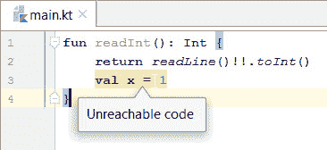

**图 3.1：** 不可达代码的高亮

我们在编写函数体时已经使用了代码块（blocks），但实际上，每当我们需要在语法上只需要单个语句的上下文中执行多个语句时——例如循环体或条件语句的分支——就会使用代码块。代码块也用于提高代码的可读性；例如，即使循环体只包含一条语句，通常也会将其封装在块中。

代码块可以包含局部变量和函数的定义。这些声明的作用范围仅限于块本身。

参数定义基本上是一个隐式的局部变量，它在执行函数体之前，会自动初始化为调用时传入的值。

### Java 对比 Kotlin

与 Java 方法参数（默认是可变的，必须使用`final`修饰符进行标记以禁止在方法体中进行进一步更改）不同，Kotlin 的参数是不可变的。换句话说，在函数体内部更改参数值将导致编译错误：

```kotlin
fun increment(n: Int): Int {
    return n++ // Error: 无法更改不可变变量
}
```

同时注意，禁止使用`val`或`var`关键字标记参数。这背后的原因是参数赋值被认为是容易出错的，而将参数作为不可变值使用可以产生更整洁、易理解的代码。

Kotlin 遵循值传递语义（call-by-value），这意味着参数值是从相应的调用参数复制的。特别，这意味着对作为调用参数传递的变量（如上述`main`函数中的`radius`）的更改不会影响被调用函数内部参数的值。然而，当参数是引用时（例如具有数组类型），复制的只是引用本身，而其背后的数据在函数及其调用者之间共享。因此，尽管参数本身在函数内部不能更改，但它们引用的数据可能是可变的。例如，以下函数接收一个（不可变的）整数数组引用，并修改它的第一个元素，从而影响了其调用者：

```kotlin
fun increment(a: IntArray): Int {
    return ++a[0]
}

fun main() {
    val a = intArrayOf(1, 2, 3)
    println(increment(a)) // 2
    println(a.contentToString()) // [2, 2, 3]
}
```

注意，与变量不同，参数始终具有显式类型，因为编译器无法从函数定义中推导出类型。

相反，返回类型可以从函数参数的类型中推导出，但必须显式指定。这一决策背后的逻辑是，函数通常有多个确定结果的出口点，程序员仅通过查看函数定义可能很难理解返回值的值的类型。从这个意义上说，显式返回类型充当了某种文档，能够立即告知你函数产生的值。

然而，这条规则有两个例外，允许你在某些情况下省略返回类型。第一个是所谓的"单元类型"（unit type）函数，它是 Kotlin 对 Java `void`的对应实现，基本上表示一个不需要有意义返回值的函数。此类函数的实际返回值是一个常量`unit`，它也是内置类型`Unit`的唯一值。如果你在函数定义中跳过返回类型，Kotlin 编译器会自动假设你正在声明一个`Unit`函数。换句话说，以下定义是等价的：

```kotlin
fun prompt(name: String) {
    println("***** Hello, $name!*****")
}

fun prompt(name: String): Unit {
    println("***** Hello, $name!*****")
}
```

我们已经通过`main()`示例见过这样的函数了。注意，`Unit`函数不需要`return`语句来指定其结果，因为结果总是相同的。不过，你可以使用`return`语句在到达函数体结束之前终止函数执行（在这种情况下，返回`Unit`是有效的，但是多余的）。

另一个例外是所谓的"表达式体函数"（expression-body functions）。如果函数可以通过单个表达式实现，我们可以丢弃`return`关键字和括号，并以以下形式编写：

```kotlin
fun circleArea(radius: Double): Double = PI*radius*radius
```

前面的语法与变量定义类似，你可以在`=`符号之后指定初始化表达式。像变量一样，表达式体函数允许你省略结果类型：

```kotlin
fun circleArea(radius: Double) = PI*radius*radius
```

表达式体函数被认为足够简单，可以省略显式的类型指定。但应谨慎使用此项功能。复杂的表达式通常值得使用普通的块形式以获得更好的可读性。

注意，如果你尝试在`=`符号之后放置`{}`块来定义块体函数，你将无法得到预期结果，因为该位置的块被解释为 lambda（基本上是匿名函数的简化语法）。例如，考虑以下函数：

```kotlin
fun circleArea(radius: Double) = { PI*radius*radius }
```

上面的定义对应一个有效函数，该函数返回另一个函数，用于计算固定`radius`值的圆面积。相反，在块内部带有`return`的类似定义将产生编译错误。例如：

```kotlin
fun circleArea(radius: Double) = {
    return PI*radius*radius // 预期函数，但返回了 Double
}
```

错误是由于类型不匹配，以及正如我们在[第 5 章，利用高级函数和函数式编程](#c05.xhtml)中看到的，`return`在 lambda 中默认是被禁止的。

### 位置参数与命名参数

默认情况下，调用参数根据其位置映射到参数：第一个参数对应第一个参数，第二个如此，以此类推。在 Kotlin 中，这种参数被称为位置参数，如下代码所示：

```kotlin
fun rectangleArea(width: Double, height: Double): Double {
    return width*height
}

fun main() {
    val w = readLine()!!.toDouble()
    val h = readLine()!!.toDouble()
    println("Rectangle area: ${rectangleArea(w, h)}")
}
```

除了 Java 和许多其他语言中已有的位置参数外，Kotlin 还支持所谓的"命名参数"，它们通过显式名称而不是位置映射到参数。例如，我们可以这样调用`rectangleArea()`：

```kotlin
rectangleArea(width = w, height = h)
```

或者像这样：

```kotlin
rectangleArea(height = h, width = w)
```

使用命名参数样式时，实际的参数顺序是不重要的。因此，这两个调用的语义与`rectangleArea(w, h)`相同。

你也可以在同一次调用中混合位置参数和命名参数。但注意，一旦你使用了命名参数，同一次调用中的后续参数必须是命名的。例如，考虑一个交换字符串中两个字符的函数（原始字符串由于是不可变的，不会受影响）：

```kotlin
fun swap(s: String, from: Int, to: Int): String {
    val chars = s.toCharArray() // 转换为数组
    // 交换元素：
    val tmp = chars[from]
    chars[from] = chars[to]
    chars[to] = tmp
    return String(chars)
}

fun main() {
    println(swap("Hello", 1, 2)) // Hlelo
    println(swap("Hello", from = 1, to = 2)) // Hlelo
    println(swap("Hello", to = 3, from = 0)) // lelHo
    println(swap("Hello", 1, to = 3)) // Hlleo
    println(swap(from = 1, s = "Hello", to = 2)) // Hlelo

    // 错误的混合位置参数和命名参数
    println(swap(s = "Hello", 1, 2)) // 编译错误
    println(swap(s = "Hello", 1, to = 2)) // 编译错误
}
```

### 函数重载

Kotlin 函数与 Java 方法一样，可以重载：换句话说，你可以定义多个同名的函数。重载函数必须具有不同的参数类型，以便编译器在分析调用时能够区分它们。例如，以下定义就构成了一个有效的重载：

```kotlin
fun readInt() = readLine()!!.toInt()
fun readInt(radix: Int) = readLine()!!.toInt(radix)
```

然而，以下这对函数会导致编译错误，因为它们仅在返回类型上有所不同：

```kotlin
fun plus(a: String, b: String) = a + b
fun plus(a: Int, b: Int) = a + b // 错误：与上面的函数仅在返回类型上不同
```

在为给定的调用表达式选择函数时，编译器遵循与 Java 重载解析非常相似的算法：

1. 根据参数数量和类型，收集所有可以使用给定参数调用的函数。
2. 移除所有特异性较低的函数：如果一个函数的所有参数类型都是候选列表中其他函数对应参数的父类，则该函数的特异性较低。重复此步骤，直到不再剩余特异性较低的函数为止。
3. 如果候选列表减少到单个函数，则它被视为调用目标；否则，编译器将报告错误。

考虑以下函数定义：

```kotlin
fun mul(a: Int, b: Int) = a*b             // 1
fun mul(a: Int, b: Int, c: Int) = a*b*c // 2
fun mul(s: String, n: Int) = s.repeat(n) // 3
fun mul(o: Any, n: Int) = Array(n) { o } // 4
```

以及某些调用的重载解析结果：

```kotlin
mul(1, 2)    // 在 1 和 4 之间选择 1，因为 Int 是 Any 的子类型
mul(1, 2L)   // 错误：没有重载接受 (Int, Long)
mul(1L, 2)   // 选择 4，因为它是唯一的接受重载
mul("0", 3) // 在 3 和 4 之间选择 3，因为 String 是 Any 的子类型
```

如果你想调用一个否则被认为特异性较低的重载，你可以使用类型转换操作将某些参数显式强制转换为它们的父类型，如下行所示：

```kotlin
mul("0" as Any, 3) // 选择 4，因为它是唯一的接受重载
```

我们将在第 8 章，理解类层级结构中回到`as`操作，届时我们将更深入地观察 Kotlin 中的子类型和继承。

### 默认参数


在 Java 中，重载方法通常执行相同的操作，仅在参数集上不同，允许用户在假设它们具有默认值的情况下，在函数调用中省略一个或多个参数。观察本节开头定义的两个 `readInt()` 函数，我们看到它们都将输入字符串解析为整数，其中第二个更通用，允许你解析某些数字进制范围内的数字，而第一个的只解析十进制。事实上，我们可以根据第二个函数来重写第一个函数：

```kotlin
```

在 Kotlin 中，在这种情况下你不需要使用重载函数；得益于一种更优雅的解决方案：你只需要为感兴趣的参数指定默认值，就像你指定变量初始化器一样：

```kotlin
fun readInt(radix: Int = 10) = readLine()!!.toInt(radix)
```

现在，你可以使用零或一个参数来调用此函数：

```kotlin
val decimalInt = readInt()
val decimalInt2 = readInt(10)
val hexInt = readInt(16)
```

注意，如果某些非默认参数跟在默认参数之后，那么在省略默认参数的情况下调用此类函数的唯一方法是使用命名参数：

```kotlin
  from: Int = Int.MIN_VALUE,
  to: Int = Int.MAX_VALUE,
  what: Int
): Int = Math.max(from, Math.min(to, what))

fun main() {
  println(restrictToRange(10, what = 1))
```

然而，将带有默认值的参数放在参数列表末尾被认为是一种良好的风格。

默认值某种程度上复杂了重载解析，因为某些函数可以用不同数量的参数调用。考虑以下定义：

```kotlin
fun mul(a: Int, b: Int = 1) = a*b             // 1
fun mul(a: Int, b: Long = 1L) = a*b        // 2
fun mul(a: Int, b: Int, c: Int = 1) = a*b*c // 3
```

以及相应的调用：

```kotlin
mul(10)      // 错误：无法在 1 和 2 之间选择
mul(10, 20)  // 错误：无法在 1 和 2 之间选择
```

`mul(10) // 错误：无法在 1 和 2 之间选择`

`mul(10, 20) // 错误：无法在 1 和 2 之间选择` 

（实际上，提供的文本包含了一些重复/伪迹，我将按照提供的文本进行格式化）。

```kotlin
mul(10)      // 错误：无法在 1 和 2 之间选择
mul(10, 20)  // 错误：无法在 1 和 2 之间选择
```

实际上，查看提供的源文本：

`mul(10)      // 错误：无法在 1 和 2 之间选择`

`mul(10, 20)  // 错误：无法在 1 和 2 之间选择`（等待，提示词中提供的文本是：

`mul(10, 20)  // 错误：无法在 1 和 2 之间选择`）

```
}
```

`varargs` 也会影响重载解析。在其他条件相同的情况下，带有 `varargs` 参数的函数被认为比具有相同类型固定数量参数的函数特殊。例如，在下面的代码中，当给定一个三个参数的调用时，编译器将倾向于第二个重载版本：

```kotlin
fun printSorted(vararg items: Int) { }             // 1
fun printSorted(a: Int, b: Int, c: Int) { }         // 2
fun main() {
    printSorted(1, 2, 3) // 在 1 和 2 之间选择 2，因为它是非 varargs 函数
    printSorted(1, 2) // 选择 1 作为唯一的候选者
```

## 函数作用域和可见性

Kotlin 函数可以根据其定义的位置分为三类：

* 直接在文件中声明的顶层函数

* 在另一个函数内部声明的局部函数。

在本章中，我们将重点关注顶层函数和局部函数，而成员函数将推迟到第 4 章，类与对象，届时我们将处理 Kotlin 类的概念。

到目前为止，我们只定义了如 `main()` 这样的顶层函数。默认情况下，这些函数是公共的（public）；也就是说，它们可以在项目的任何地方使用，而不仅仅是在所属的文件中。例如，我们在同一目录下创建两个 Kotlin 文件：`main.kt` 和 `util.kt`。我们可以看到在 `main.kt` 文件中定义的 `main()` 函数调用了在 `util.kt` 中定义的 `readInt()` 函数（图 3.2）：

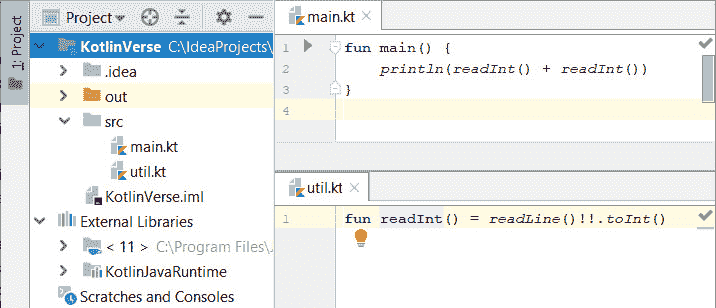

**图 3.2:** 从另一个文件调用公共函数

在某些情况下，你可能希望从项目的其他部分隐藏某些实现细节，从而缩小函数的作用域或在代码中使用该函数的范围范围。要实现这一点，你可以在顶层函数定义前加上两个关键字之一——`private` 或 `internal`——这些关键字被称为可见性修饰符。

将函数标记为 `private` 会使其仅在包含文件中可见。例如，如果我们将 `readInt()` 设置为 `private`，我们仍然可以在 `util.kt` 内部使用它，但不能从 `main.kt` 使用（图 3.3）：

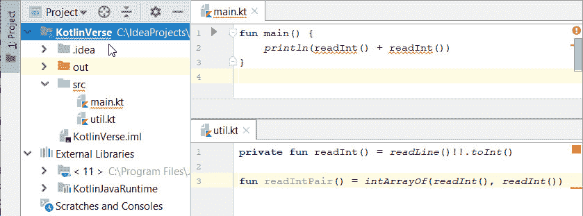

**图 3.3:** 从另一个文件调用私有函数

使用 `internal` 修饰符允许将函数的使用限制在其所在的模块中。一个 Kotlin 模块基本上是一组编译在一起的文件。它的具体含义取决于你用于构建项目的构建系统。然而，在 IntelliJ IDEA 中，它对应于单个 IDE 模块。因此，将函数标记为 `internal` 允许你在同一模块的任何其他文件中使用它，但不能从项目的其他模块使用。

**IDE 提示：你可以使用 File | New | Module 向导创建一个单独的模块，这与我们在第 1 章，Kotlin：强大且实用中讨论过的 New Project 向导类似。**

你也可以也可以使用 `public` 修饰符，但这被认为是多余的，因为顶层函数默认是公共的。

局部函数类似于局部变量，声明在另一个函数内部。此类函数的作用域限于包含它的代码块：

```kotlin
fun main() {
    fun readInt() = readLine()!!.toInt()
    println(readInt() + readInt())
}
fun readIntPair() = intArrayOf(readInt(), readInt()) // 错误
```

局部函数能够访问所在函数中定义的声明，包括它们的参数：

```kotlin
fun main(args: Array<String>) {
        val chars = args[0].toCharArray()
        val tmp = chars[i]
        chars[i] = chars[j]
        chars[j] = tmp
        return chars.toString()
    }
    println(swap(0, chars.lastIndex))
}
```

注意，局部函数和变量可能没有任何可见性修饰符。

**Java 与 Kotlin：** 通常而言，Java 语言和 JVM 要求所有方法必须是某些类的成员。因此，你可能在想 Kotlin 的顶层函数和局部函数如何在 JVM 平台上进行编译。在第 1 章，Kotlin：强大且实用中，我们已经看到从 JVM 的视角来看，顶层 `main()` 函数实际上是为每个 Kotlin 文件生成的特殊门面类中的静态成员。对于局部函数，Kotlin 编译器执行了类似的技巧，涉及声明一个特殊类（你可以将其与 Java 中的局部类进行比较），该类包含局部函数作为其成员，并捕获所在函数的变量和参数等上下文。注意，这会导致某些性能开销，因为你的程序在每次调用局部函数时可能需要创建此类类的新实例。我们将在第 5 章，利用高级函数和函数式编程讨论 Lambda 表达式时回到这个问题。

## 包和导入

Kotlin 包（package）是分组相关声明的一种方式。任何包都有一个名称，并可以嵌套到其他包中。这个概念与 Java 的对应概念非常相似，但有其特定的特性，我们将在接下来的章节中重点介绍。

## 包和目录结构

与 Java 类似，你可以在文件开头处指定包名。如果未指定包，编译器将假设你的文件属于默认包。

包指令以 `package` 关键字开头，并包含由点分隔的标识符列表，构成了从根部开始的包限定名称。例如，以下文件：

```kotlin
package foo.bar.util
fun readInt() = readLine()!!.toInt()
```

属于 `util` 包，该包在 `bar` 中，而 `bar` 又在 `foo` 中；而以下文件被放在根目录下：

```kotlin
package numberUtil

fun readDouble() = readLine()!!.toDouble()
```

如果多个文件具有相同的包指令，则共享同一个包。在这种情况下，该包将包含这些文件的所有内容。

构成包的顶层声明包括类型、函数和属性。我们已经熟悉顶层函数的定义，将在后续章节中学习如何定义类型和属性。在同一个包内，你可以使用简单名称来引用其声明。这就是我们目前为止在示例中一直在做的，因为我们所有的文件都隐含地放在根包中。图 3.4 显示了一个具有非默认包名的类似示例：

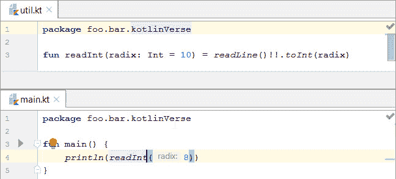

**图 3.4:** 从同一包调用函数

如果你想要使用的声明属于另一个包怎么办？在这种情况下，你仍然可以使用其限定名称来引用它，这基本上是带有一个所在包限定名称的简单名称（图 3.5）：

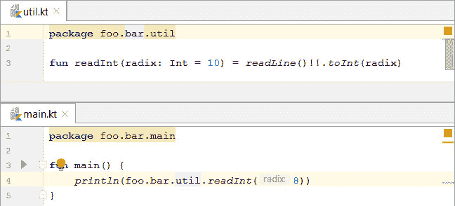

**图 3.5:** 使用限定名称调用另一个包的函数

通常情况下，这种方法是不实用的，因为它会产生名称过长且难以阅读的代码。出于如此，Kotlin 提供了导入（import）机制。通过在文件开头放置一次带有限定声明名称的导入指令，你就可以简单名称来引用它（图 3.6）。

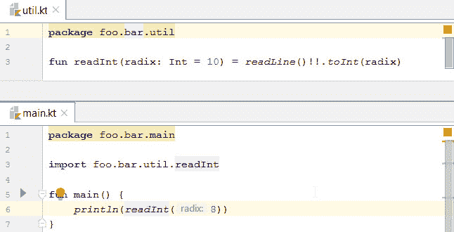

**图 3.6**: 使用导入指令

### IDE 技巧

`The IntelliJ` 插件处理了许多关于导入的繁琐操作。特别是，如果你尝试使用某个位于另一个包中的声明，但仅使用简单名称引用它，IDE 会自动弹出一个窗口，建议你从相关包导入它。它还会高亮未使用的导入，并允许你通过 `Ctrl + Alt + O` (`Command + Alt + O`) 快捷键提供的“优化导入”（Optimize Imports）命令，通过删除未使用的导入并排序剩余指令来优化整个导入列表。

注意，包层级结构是一个完全从源文件中的包指令推断出的独立结构。它可能与源文件树的目录结构一致，但并非必须如此。例如，源文件可能位于同一个目录，但属于不同的包，反之亦然。

**Java 与 Kotlin：** 与此相反，在 Java 中，包结构必须是编译根目录下源树目录的直接反映。任何不匹配都被视为编译错误。

然而，建议保持目录结构和包结构一致，因为这简化了项目不同部分之间的导航。

**IDE 技巧：** 默认情况下，IntelliJ 插件强制执行包/目录匹配，并在违反时显示警告。你可能注意到图 3.6 中的包指令被高亮了：这是因为我们放置了与目录路径不匹配的包指令。在亮亮区域内按 `Alt + Enter`，你可以更改指令本身，或者将包含的文件移动到其对应的目录。

我们已经看到导入指令如何允许你避免使用完全限定名并简化代码。在本节中，我们将更深入地查看 Kotlin 中提供了哪些导入指令，以及它们与 Java 对应项有何不同。

我们在前面的示例中已经过的简单形式允许你通过指定完全限定名来导入某些特定的声明：

```kotlin
import java.lang.Math     // JDK 类
```

导入指令不仅限于类或函数等顶层声明。它还可以用于导入各种成员声明，例如嵌套类或枚举常量，如下例所示：

```kotlin
import kotlin.Int.Companion.MIN_VALUE

fun fromMin(steps: Int) = MIN_VALUE + n // 通过简单名称引用 MIN_VALUE
```

在第 4 章，处理类和对象 和第 6 章，使用特殊类 中，我们将更详细地讨论这个问题。

在某些声明中，位于不同包的声明可能具有相同的名称。如果你需要在一个文件中使用它们怎么办？假设我们在 `app.util.foo` 和 `app.util.bar` 包中各有一个 `readInt()` 函数。像下面这样导入它们将无法解决问题：

```kotlin
import app.util.foo.readInt

import app.util.bar.readInt

    val n = readInt() // 错误：无法在 readInt() 的两个变体之间选择
}
```

你始终可以使用完全限定名来区分这些替代方案，但 Kotlin 为你提供了一个更好的解决方案，称为导入别名（import alias）。此功能允许你为导入的声明引入一个新名称，该名称在整个文件的范围内有效：

```kotlin
import foo.readInt as fooReadInt

import bar.readInt as barReadInt

fun main() {

    val m = barReadInt()

}
```

另一种形式的导入指令允许你从给定范围导入所有声明。要使用它，你只需要在完全限定名的末尾放置 `*`。其语法与 Java 非常相似，如下所示行代码所示：

```kotlin
import kotlin.math.* // 导入 kotlin.math.包中的所有声明
```

注意，这种按需导入的优先级低于引用某些特定声明的导入指令。如果我们考虑之前有两个 `readInt()` 函数的示例，但将其中一个导入指令改为按需导入，则特定的指令将占主导，如下代码所示：

```kotlin
import app.util.foo.readInt

import app.util.bar.*

fun main() {

    val n = readInt() // 无歧义：解析为 app.util.foo.readInt
}
```

## 条件语句

条件语句允许你根据某些条件的值选择两个或多个动作之一。在 Kotlin 中，它们由 `if` 和 `when` 语句表示，可以大致比作 Java 的 `if` 和 `switch`。

## 使用 if 语句进行决策

```kotlin
fun max(a: Int, b: Int): Int {
    if (a > b) return a
    else return b
}
```

基本上，当括号中的条件为真时，它执行第一条语句，否则执行第二条（else 分支）。`else` 分支可能缺失，此时如果条件为假，语句将什么都不做。

与 Java 的 `if` 语句的主要区别在于，Kotlin 的 `if` 也可以用作表达式。例如，我们可以这样简单地编写 `max` 函数：

```kotlin
fun max(a: Int, b: Int) = if (a > b) a else b
```

当一个或两个分支都是块时，这种情况也成立，条件语句的值与对应块中的最后一个表达式一致：

```kotlin
    val s = readLine()!!
    val i = s.indexOf("/")
    // 将 10/3 拆分为 10 和 3 并执行除法
    val result = if (i >= 0) {
        val a = s.substring(0, i).toInt()
        val b = s.substring(i + 1).toInt()
        (a/b).toString()
    } else ""
    println(result)
}
```

注意条件必须是布尔类型。当 `if` 用作表达式时，两个分支必须存在。以下代码无法编译，因为缺少 `else` 分支：

```kotlin
val max = if (a > b) a
```

**Java 与 Kotlin：** Kotlin 没有 Java 中可能使用的三元条件运算符。然而，由于 `if` 既可以作为语句也可以作为表达式，这缓解了这个问题。

有时在 `if` 表达式中使用 `return` 是有的。`return` 语句可以作为特殊类型 `Nothing` 的表达式使用，该类型表示不存在的值。基本上，如果某个表达式具有 `Nothing` 类型，它表明程序的顺序控制流发生了中断，因为该表达式永远不会到达确定的值。在 `return` 的情况下，它意味着闭包函数的终止。`Nothing` 类型的一个有用方面是被认为是所有 Kotlin 类型的子类型，因此其表达式可以使用任何期望表达式的上下文。假设我们给出一个完全限定包名，并想知道如果更改简单名称会是什么样。我们可以按照以下方式实现：

```kotlin
fun renamePackage(fullName: String, newName: String): String {
    val i = fullName.indexOf('.')
    val prefix = if (i >= 0) fullName.substring(0, i + 1) else return newName
    return prefix + newName
}

fun main() {
    println(renamePackage("foo.bar.old", "new")) // foo.bar.new
}
```


注意，`return e` 中 `e` 的值并不是返回表达式的值，而是闭包函数的返回结果。返回表达式本身没有值，就像任何 `Nothing` 类型的表达式一样。还要注意 `Unit` 和 `Nothing` 之间的区别。与 `Nothing` 不同，`Unit` 只有一个实例，通常用于表示没有任何有用的值，而不是完全没有值。

## 范围、递进序列与操作

Kotlin 包含了几种内置类型，表示有序值范围的某个区间。它们对于使用 `for` 循环对数值范围进行迭代特别有用。在 Kotlin 中，这些类型统称为范围（ranges）。

构建范围最简单的方法是在数值值上使用 `..` 操作。例如：

```kotlin
val chars = 'a'..'h'      // 从 'a' 到 'h' 的所有字符
val twoDigits = 10..99   // 从 10 到 99 的所有两位整数
val zero2One = 0.0..1.0 // 0 到 1 范围内的所有浮点数
```

使用 `in` 操作，你可以检查给定值是否在范围内。这基本上等于一对比较：

```kotlin
val num = readLine()!!.toInt()
println(num in 10..99) // num >= 10 && num <= 99
```

```kotlin
println(num !in 10..99) // !(num in 10.99)
```

事实上，`..` 操作适用于所有可比较的类型，包括数值、`Char`、`Boolean` 和 `String`。基本上，只要你可以使用 `<=` 或 `>=`，你也可以使用 `..` 来构建范围，如下文所示：

```kotlin
println("def" in "abc".."xyz") // true
println("zzz" in "abc".."xyz") // false
```

由 `..` 操作产生的范围是闭合的（closed）。这意味着它们同时包含起点和终点。另一种操作允许你创建一个不包含终点的半闭范围（semi-closed ranges）。这种操作仅适用于整数类型，并且基本上会产生一个终点较小的范围。在以下示例中，上限 100 不包含在结果范围中：

```kotlin
val twoDigits = 10 until 100   // 等同于 10..99，100 被排除
```

注意，终点严格小于起点的内置范围是空的。例如：

```kotlin
println(5 in 5..5)         // true
println(5 in 5 until 5) // false
println(5 in 10..1)      // false
```

通常情况下，如果对给定类型的比较是不良的（ill-behaved），则结果是不成立的。特别是，如果它不具有传递性，那么即使在 `a > b` 的情况下，`x in a..b` 也可能为真。

还有一个相关的递进序列（progression）概念，它是整数或 `Char` 值的有序序列，由某些固定步长分隔。这些类型的任何范围都是步长为 `1` 的升序递进，但通常来说，递进序列会为你提供额外的选项。例如，你可以使用 `downTo` 操作定义递减递进，如下所示：

```kotlin
println(5 in 1 downTo 10) // false: 递进序列为空
```

你还可以指定自定义的递进步长：

```kotlin
1..10 step 3      // 1, 4, 7, 10
```

递进步长必须为正；因此，如果你想构建一个递减序列，你应该使用 `step` 配合 `downTo` 操作，如前面的示例所示。

递进元素通过在其起点上连续增加步长生成。因此，如果终点实际上不对应递进值中的任何值，它会自动调整到最近的递进元素：

```kotlin
1..12 step 3      // 1, 4, 7, 10: 等同于 1..10 step 3
15 down 8 step 2 // 15, 13, 11, 9: 等同于 15 downTo 9 step 2
```

```kotlin
"Hello, World".substring(1..4)         // ello
"Hello, World".substring(1 until 4)  // ell
"Hello, World".substring(1, 4)        // ell: 类似于 substring(1 until 4)
IntArray(10) { it }.sliceArray(2..5)   // 4, 9, 16, 25
IntArray(10) { it }.sliceArray(2 until 5) // 4, 9, 16
```

范围和递进类型在 Kotlin 库中定义为一组类，如 `IntRange`、`FloatRange`、`CharProgression`、`IntProgression`。你可以在 `kotlin.ranges` 文档页面找到类及其函数的完整列表。通常，使用范围代替比较会有轻微的开销，因为范围是动态分配的。然而，编译器尝试避免创建实际对象。例如，在以下程序中并没有创建 `IntRange` 实例：

```kotlin
fun main() {
    val a = readLine()!!.toInt()
    val b = readLine()!!.toInt()
    println(5 in a..b)
}
```

```kotlin
val numbers = intArrayOf(3, 7, 2)
val text = "Hello!"
println(2 in numbers)  // true
println(9 !in numbers) // true
println(4 in numbers)  // false
println('a' in text)   // false
println('H' in text)   // true
```

在优先级方面，范围操作 `..` 位于算术运算符和固定运算符之间，而 `in/!in` 位于固定运算符和比较之间。换句话说，第 2 章“语言基础”中的相关表格现在看起来如下：

| | | | 示例 |
| :--- | :--- | :--- | :--- |
| 算术 | `+ -` | `a + b..c - d` | `(a + b)..(c - d)` |
| 范围 | `..` | `a..b step c` | `(a..b) step c`; `a in b..c` | `a in (b..c)` |
| 固定运算符 | 命名运算符 | `a < b or b < c` | `(a < (b or b)) < c`; `a == b and b == c` | `(a == b) and (b == c)`; `a in b or a in c` | `(a in (b or a)) in c` |
| 命名检查 | `in !in` | `a < b in c` | `a < (b in c)`; `a !in b > c` | `(a !in b) > c` |

**表 3.1:** 优先级 `until`、`downTo` 和 `step` 的优先级与任何命名固定运算符相同。

## When 语句

由于 `if` 语句可以在选项之间进行选择，实现多选的一种方法是将多个 `if` 语句组合成级联结构，按顺序检查所有感兴趣的条件。假设我们要将 0 到 15 之间的十进制数字转换为相应的十六进制位：

```kotlin
fun hexDigit(n: Int): Char {
    if (n in 0..9) return '0' + n
    else if (n in 10..15) return 'A' + n - 10
    else return '?'
}
```

Kotlin 为你提供了一个更简洁的结构来在多个备选项中进行选择，这被称为 `when` 语句。使用这种结构，我们可以将前面的函数重写为以下形式：

```kotlin
fun hexDigit(n: Int): Char {
    when {
        n in 0..9 -> return '0' + n
        n in 10..15 -> return 'A' + n - 10
        else -> return '?'
    }
}
```

基本上，`when` 语句是一个以 `when` 关键字开头的块，它由零或多个通用形式为 `条件 -> 语句` 的分支，以及一个可选的 `else` 分支组成。语句的执行按照以下规则进行：程序随后按照编写顺序顺序评估条件，直到找到第一个结果为 `true` 的条件。如果找到了这样的条件，程序将执行对应分支的语句部分。如果所有条件均为 `false`，程序将执行 `else` 分支（如果存在的话）。

**IDE 提示：IntelliJ 插件提供了一个意图操作，用于在嵌套的 `if` 和 `when` 之间进行自动转换。要访问该操作，将光标放在 `if/when` 关键字上并按 Alt + Enter，分别选择“Replace `if` with `when`”或“Replace `when` with `if`”操作。**

与 `if` 一样，`when` 语句也可以作为表达式。在这种情况下，`else` 分支是强制性的，因为 `when` 应该能够为每种可能的情况提供确定的值：

```kotlin
fun hexDigit(n: Int) = when {
    n in 0..9 -> '0' + n
    else -> '?'
}
```

**Java 与 Kotlin：** Kotlin 的 `when` 与 Java 的 `switch` 语句类似，也可以在多个选项之间进行选择。然而，关键区别在于 `when` 允许你检查任意条件，而 `switch` 只能在给定表达式的值之间选择。此外，Java 中的 `switch` 语句遵循所谓的“穿透语义”（fall-through semantics）：当匹配到某个条件时，程序会执行其语句以及后续分支中的语句，除非通过 `break` 语句显式停止执行。Kotlin 的 `when` 只执行匹配分支中的语句，并且永远不会穿透整个 `when` 块。

`when` 语句还有另一种形式，适用于涉及等值和 `in` 操作的多次检查。考虑以下函数：

```kotlin
fun numberDescription(n: Int): String = when {
    n == 0 -> "Zero"
    n == 1 || n == 2 || n == 3 -> "Small"
    n in 4..9 -> "Medium"
    n in 10..100 -> "Large"
    n !in Int.MIN_VALUE until 0 -> "Negative"
    else -> "Huge"
}
```

```kotlin
fun numberDescription(n: Int, maxLarge: Int = 100): String = when (n) {
    0 -> "Zero"
    1, 2, 3 -> "Small"
    in 4..9 -> "Medium"
    in 10..maxLarge -> "Large"
    else -> "Huge"
}
```

**IDE 提示：IntelliJ 插件可以将一种 `when` 表达式转换为另一种形式，在需要时消除或引入主体表达式。你通过将光标放在 `when` 关键字上并按 Alt + Enter 来访问这些操作；然后你可以根据语句的形式选择命令：“Introduce … as subject of `when`”或“Eliminate argument of `when`”。**

这种形式的 `when` 语句的特点是具有主体表达式，它写在 `when` 关键字后的括号中。此类语句的分支可以以 `in/!in`、任意表达式或 `else` 关键字开头（还有一种 `is/!is` 分支，我们将其推迟到 *第 8 章，理解类层级*）。执行过程与第一形式的 `when` 类似，按如下所示：

*   评估主体表达式：假设其值为 `subj`。
*   程序连续评估分支的条件，直到找到为 `true` 的条件：`in/!in` 分支被视为以 `subj` 为左操作数的 `in/!in` 表达式，而自由形式表达式 `e` 被解释为等值操作 `subj == e`。
*   如果找到了这样的条件，程序执行相应的语句；否则，如果存在 `else` 语句，则执行它。

主体形式允许你在单个分支中编写多个条件，用逗号分隔（前面的示例中 `1, 2, 3 -> "Small"` 分支）。在条件评估期间，这些逗号实际上被处理为逻辑“或” (`||`)。

注意，主体 `when` 分支中的表达式并不一定是布尔值：只要相应的操作（`==` 或 `in/!in`）适用，它们就可以是任意类型。

**Java 与 Kotlin：** 自 Java 12 起，`switch` 获得了表达式形式，这与 Kotlin `when` 的主体形式非常相似。然而，它有一些局限性：特别是 `switch` 不支持范围检查（与 `in/!in` 不同）。

```kotlin
sum += x
}
println("Sum: $sum") // Sum: 285
}
```

循环由三部分组成：

1.  迭代变量定义（`x`）；
2.  容器表达式（`a`），它产生用于迭代的值；
3.  循环体语句（`{sum += x}`），它在每次迭代时执行。

迭代变量仅在循环体内部访问，并在每次迭代开始时自动分配一个新值。请注意，循环变量不像普通变量那样用 `val` 或 `var` 关键字标记，而且它是隐式不可变的：换句话说，你不能在循环体内部改变它的值。在最简单的情况下，循环变量的定义是一个简单的标识符。不过，你可以指定它的类型，但在实际实践中很少需要：

```kotlin
for (x: Int in a) {
    sum += x
}
```

**Java 与 Kotlin：** Kotlin 的 `for` 循环与 Java 的 `for-each` 循环非常相似，它为对任何 `Iterable` 实例进行迭代提供了简洁的语法——无论是数组、列表、集合还是用户定义的类型。然而，Kotlin 没有普通 Java `for` 循环的对应物，那种循环要求你显式地声明、初始化、检查和更新迭代变量。在 Kotlin 中，这种迭代只是你之前代码中看到的 `for` 语句的特例情况。

你可以使用 `for` 循环来迭代字符串字符。例如，让我们编写自己的函数，将正数的二进制字符串表示解析为 `Int`：

```kotlin
fun parseIntNumber(s: String, fallback: Int = -1): Int {
    var num = 0
    if (s.length !in 1..31) return fallback
    for (c in s) {
        num = num*2 + (c - '0')
    }
    return num
}
```

当所给的字符串不代表有效数字或无法放入范围时，函数将返回某个回退值。

**Java 与 Kotlin：** 在 Java 中，无法直接对字符串进行迭代，因此你必须使用一些变通方法，例如遍历它的索引或先将字符串转换为字符数组。

数值区间的普通迭代又是如何的？为了这个目的，我们将使用在上一节中引入的递进（progressions）。假设我们要将所有偶数索引的数组元素加倍：

```kotlin
val a = IntArray(10) { it*it } // 0, 1, 4, 9, 16, …
for (i in 0..a.lastIndex) {        // 0, 1, 2, 3, …
    if (i % 2 == 0) {      // 0, 2, 4, 6, …
        a[i] *= 2
    }
}
```

我们可以使用带有自定义步长的递进进一步简化这个循环：

```kotlin
for (i in 0..a.lastIndex step 2) { // 0, 2, 4, 6, …
    a[i] *= 2
}
```

字符串和数组具有 `indices` 属性，它包含字符或项目索引的范围：

```kotlin
val a = IntArray(10) { it*it } // 0, 1, 4, 9, 16, …
for (i in a.indices step 2) {    // 0, 2, 4, 6, …
    a[i] *= 2
}
```

`for` 循环的真正美丽在于，编译器不仅支持某些有限的离散用例（如数值范围或集合），还提供了一种统一的机制，允许你迭代各种值。容器表达式唯一的要求是拥有 `iterator()` 函数，它返回一个能够提取元素值的 `Iterator` 对象。我们将对迭代器（iterators）的详细讨论推迟到*第 7 章，探索集合与 I/O*，但目前，只需知道许多标准 Kotlin 类型已经内置了迭代器就足够：这就是为什么 `for` 循环对于递进、数组和字符串同样运行得良好。正如我们将进一步看到的，使用扩展机制允许你将迭代器附加到任何你喜欢的类型上，从而扩展了可以迭代的表达式范围。

**Java 与 Kotlin：** Java 的 `for-each` 循环在某种意义上与 Kotlin 的 `for` 语句相似，因为它可以应用于 `Iterable` 的任何子类。不过，Kotlin 的 `for` 循环约定更加灵活，因为它不要求容器是任何特定类型；`for` 循环只需要存在 `iterator()` 函数。

## 更改循环控制流：break 和 continue

有时，改变循环的普通控制流是很方便的：例如，不在循环迭代的开始或结束检查退出条件，而是在中间某个地方可能会方便。为了这个目的，Kotlin 包含了一对表达式：

*   `break`，立即终止循环；
*   `continue`，跳过当前迭代的剩余部分并开始下一次迭代。

换句话说，这些语句与它们的 Java 对应物具有相同的语义。例如，考虑我们的“猜数字”程序。我们可以这样写：


```kotlin
import kotlin.random.*
fun main() {
    val num = nextInt(101)
    while (true) {
        val guess = readLine()!!.toInt()
        if (guess < num) println("Too small")
        else if (guess > num) println("Too big")
    }
    println("Right: it's $num")
}
```

注意 `break` 和 `continue` 不能作为表达式使用。像 `return` 一样，它们不能用于 `when` 表达式。为了使用它们，我们必须使用标记语句：

```kotlin
import kotlin.random.*

fun main() {
    val num = nextInt(101)
    while (true) {
        val guess = readLine()!!.toInt()
        val message = when {
            guess < num -> "Too small"
            guess > num -> "Too big"
            else -> break
        }
        println(message)
    }
    println("Right: it's $num")
}
```

这种功能不应被滥用，因为在更复杂的表达式可能会阻碍对代码的理解。假设我们要统计字符串中每个英文字母出现的次数。在下面的示例中，我们将使用 `continue` 在字符不是字母时跳转，以便访问数组：

```kotlin
val counts = IntArray('z' - 'a' + 1)
for (char in text) {
    val charLower = char.toLowerCase()
    if (charLower !in 'a'..'z') continue
    counts[charLower - 'a']++
}
return counts
```

**Java 与 Kotlin：** 在 Java 中，`break` 也用于停止 `switch` 语句中剩余分支的执行。由于 `when` 表达式遵循贯穿语义，`break` 语句在 Kotlin 中不起相同的作用。然而，在 `when` 内部使用 `break` 或 `continue` 是禁止的——特别是对于从 Java 迁移过来的程序员。此外，`continue` 被保留用于未来某个语言版本中实现的显式贯穿语义。如果我们把猜数字游戏中的 `if` 级联替换为单个 `when` 表达式，编译器将报告错误：

```kotlin
val message = when {
    guess < num -> "Too small"
    guess > num -> "Too big"
    else -> break // 错误
}
```

解决方法是使用标记的 `break/continue`，我们将在下一节介绍。

## 嵌套循环与标签

当嵌套循环语句时，我们在上一节中看到的简单 `break/continue` 表达式总是应用于最近的包含循环。在某些情况下，你可能希望它们影响外层循环的控制流：为了做到这一点，Kotlin 提供了语句标记，它与 Java 类似尽管语法略有不同。

假设我们要写一个函数，在整数数组中搜索给定的子数组，就像 `indexOf()` 对字符串做做：

```kotlin
fun indexOf(subarray: IntArray, array: IntArray): Int {
    outerLoop@ for (i in array.indices) {
        for (j in subarray.indices) {
            if (subarray[j] != array[i + j]) continue@outerLoop
        }
        return i
    }
    return -1
}
```

在这里，我们为外部循环标记了一个标签，并使用 `continue@outerLoop` 在一旦发现 `subarray` 和 `array` 元素之间的第一个不匹配时，立即终止当前查找子数组偏移量的外部循环迭代。此时，我们知道检查剩余的子数组项是没有意义的，搜索必须从下一个偏移量开始继续。

在 Kotlin 中，你可以为任何语句附加标签，但 `break` 和 `continue` 特别要求这些标签必须附着在循环上。如果不是这样，编译器会报告错误。标签名称（类似于变量或函数名）可以是任意的标识符。

```kotlin
loop@ while(true) break@loop // Kotlin
loop: while(true) break loop // Java
```

标签标记等功能允许你在 `when` 表达式中使用 `break/continue`，而 `when` 表达式反过来又嵌套在循环体中。得益于此，我们可以像如下所示编写上一节中的猜数字程序：

```kotlin
import kotlin.random.*

fun main() {
    val num = Random.nextInt(1, 101)
    loop@ while (true) {
        val guess = readLine()!!.toInt()
        val message = when {
            guess < num -> "Too small"
            guess > num -> "Too big"
            else -> break@loop // 正确
        }
        println(message)
    }
    println("Right: it's $num")
}
```

## 尾递归函数

Kotlin 对所谓的尾递归函数支持优化编译。假设我们要写一个在整数数组中实现二分查找的函数。假设 `array` 是按升序排序的，让我们用递归形式编写这种搜索：

```kotlin
tailrec fun binIndexOf(
    x: Int,
    array: IntArray,
    from: Int = 0,
    to: Int = array.size
): Int {
    if (from == to) return -1
    val midIndex = (from + to - 1) / 2
    val mid = array[midIndex]
    return when {
        mid < x -> binIndexOf(x, array, midIndex + 1, to)
        mid > x -> binIndexOf(x, array, from, midIndex)
        else -> midIndex
    }
}
```

这种定义简洁地表达了算法思想，但与更繁琐的非递归版本相比，它通常会有性能开销和栈溢出的风险。在 Kotlin 中，你可以通过添加 `tailrec` 修饰符来告诉编译器自动将尾递归函数转换为非递归代码。结果，你兼顾了两者的优点：既有简洁的递归函数也没有额外的性能代价。特别是前面的函数相当于下面的代码：

```kotlin
tailrec fun binIndexOf(
    x: Int,
    array: IntArray,
    from: Int = 0,
    to: Int = array.size
): Int {
    var fromIndex = from
    var toIndex = to
    if (fromIndex == toIndex) return -1
    val midIndex = (fromIndex + toIndex - 1) / 2
    val mid = array[midIndex]
    when {
        mid < x -> fromIndex = midIndex + 1
        mid > x -> toIndex = midIndex
        else -> return midIndex
    }
}
```

为了符合这种转换条件，函数在递归调用之后不能执行任何操作：这就是“尾递归（tail-recursive）”的含义。如果不满足这一要求但函数仍标记为 `tailrec`，编译器将发出警告，且函数将被编译为递归函数。例如，下面的求和函数不是尾递归的，因为 `sum(array, from + 1, to)` 调用之后还有加法操作：

```kotlin
tailrec fun sum(array: IntArray, from: Int = 0, to: Int = array.size): Int {
    // ：不是尾递归调用
    return if (from < to) return array[from] + sum(array, from + 1, to) else 0
}
```

如果一个函数被标记为 `tailrec` 但不包含递归调用，编译器也会报告警告：

```kotlin
tailrec fun sum(a: Int, b: Int): Int {
    return a + b // ：没有尾递归调用
}
```

## 异常处理

Kotlin 中的异常处理与 Java 的方法非常相似。函数可以正常结束（这意味着它返回了某个值——可能是一个类型为 `Unit` 的平凡值），也可以在发生错误时通过抛出异常对象异常结束。在后一种情况下，异常可以被其调用者捕获并处理，也可以向调用栈进一步传播。现在我们来考虑与异常相关的控制结构。

### 抛出异常

为了指示一个错误条件，你像在 Java 中一样使用带有异常对象的 `throw` 表达式。让我们修改早前的 `parseIntNumber()` 函数，使其在输入格式不正确时抛出异常，而不是返回某个回退值：

```kotlin
fun parseIntNumber(s: String): Int {
    if (s.length !in 1..31) throw NumberFormatException("Not a number: $s")
    var num = 0
    for (c in s) {
        if (c !in '0'..'9') throw NumberFormatException("Not a number: $s")
        num = num * 10 + (c - '0')
    }
    return num
}
```

Java 与 Kotlin 的对比：与 Java 不同，创建类实例（在本例中为异常）不需要特殊的 `new` 关键字。在 Kotlin 中，`NumberFormatException`("Not a number: $s") 就像普通的函数。

当抛出异常时，会采取以下操作：

- 程序查找异常处理器。如果找到了处理器，则获得控制权。
- 如果在当前函数中未找到处理器，执行终止，异常向上传播。如果异常未到达入口点，当前线程终止。

你可以看到 Kotlin 中的异常处理步骤与 Java 基本相同。

Java 与 Kotlin 的对比：在 Kotlin 中，`throw` 是类型为 `Nothing` 的表达式，类似于我们在章节中过的 `break` 和 `continue`。例如：

```kotlin
fun sayHello(name: String) {
    val message = if (name.isNotEmpty()) "Hello, $name"
    else throw IllegalArgumentException("Empty name")
    println(message)
}
```

### 使用 try 语句处理错误

在 Kotlin 中处理异常使用 `try` 语句，其语法与 Java 基本上相同。考虑下面的函数，它在解析输入字符串为数字失败时返回某个默认值：

```kotlin
import java.lang.NumberFormatException

fun readInt(default: Int): Int {
    try {
        return readLine()!!.toInt()
    } catch (e: NumberFormatException) {
        return default
    }
}
```

可能抛出异常的代码（在本例中是 `toInt()` 调用）被封装在 `try` 块中。`try` 语句的第一形式至少包含一个 `catch` 块，处理相应类型的异常（例如 `NumberFormatException`）。要处理的异常由异常参数表示，你可以在 `catch` 块内部使用它。当 `try` 块中的代码抛出异常时，执行终止，程序选择能够处理它的第一个 `catch` 块；如果没有找到这样的块，异常将传播。

由于 `catch` 块是按照声明顺序进行检查的，因此将处理某种异常类型的块放在处理其父类类型的块之前是没用的，因为任何该子类型的异常都将被先前的块所捕获。例如，由于 `NumberFormatException` 是 `Exception` 的子类，下面函数中的第二个 `catch` 块实际上是死代码：

```kotlin
import java.lang.NumberFormatException

fun readInt(default: Int): Int {
    try {
        return readLine()!!.toInt()
    } catch (e: Exception) {
        return 0
    } catch (e: NumberFormatException) {
        return default // dead code
    }
}
```

Java 和 Kotlin 中 `try` 语句之间的主要区别在于，Kotlin 的 `try` 可以被用作表达式。这种表达式的值的值是 `try` 块的值（如果没有抛出异常），或者是成功处理了异常的 `catch` 块的值：

```kotlin
import java.lang.NumberFormatException

fun readInt(default: Int) = try {
    readLine()!!.toInt()
} catch (e: NumberFormatException) {
    default
}
```

Java 与 Kotlin：与 Java 不同，Kotlin 不区分受检异常（checked exceptions）和未检异常（unchecked exceptions）。其理由是，在大型项目中，显式指定可能出现的异常实际上会降低生产力并产生过多的样板代码。

`try` 语句的另一种形式使用了 `finally` 块，它允许你在程序离开 `try` 块之前执行某些操作：

```kotlin
import java.lang.NumberFormatException

fun readInt(default: Int) = try {
    readLine()!!.toInt()
} finally {
    println("Error")
}
```


此块用于清理在 `try` 块之前或之中可能分配的某些资源，例如关闭文件或网络连接。你也可以在单个 `try` 语句中使用 `catch` 和 `finally` 块。

注意，当 `finally` 块被用作表达式时，该块的值并不会影响整个 `try` 语句的值。

## 总结

让我们总结一下在本章中所做的工作。我们掌握了构成命令式编程算法基础的基础控制结构知识。我们学习了如何定义和使用函数，以促进常用代码段的复用。最后，我们讨论了通过将相关函数分组到包中来组织程序。现在，你已经拥有了在 Kotlin 语言中使用命令式和过程化范式的必要知识。

在下一章中，我们将转向面向对象编程。我们将学习定义类和对象，理解类的初始化，学习声明和使用属性，并解决 Kotlin 中处理空值的问题。

1. 什么是表达式体函数？在什么情况下使用它比使用块体函数更值得？
2. 你如何决定是使用默认参数值还是函数重载？
3. 使用命名参数的优缺点是什么？
4. 如何声明具有数量参数的函数？Kotlin 中的 `varargs` 和 Java 之间有什么区别？
5. `Unit` 和 `Nothing` 类型是做什么的？将它们与 Java 的 `void` 进行比较。你可以使用 `Nothing` 或 `Unit` 类型的变量吗？
6. 尝试解释 `return 0` 这种代码的意思。为什么它被认为是有效的但是冗余的？
7. 可以有没有 `return` 语句的函数吗？
8. 什么是局部函数？如何在 Java 中模拟这种函数？
9. 公共函数和私有顶层函数有什么区别？
10. 你如何使用包来组织代码？指出它们与 Java 中包的主要区别。
12. `if` 语句/表达式是如何工作的？将其与 Java 的 `if` 语句和条件运算符 (`?:`) 进行比较。
13. 描述 `when` 语句的基本算法。它与 Java 的 `switch` 有何不同？
14. 你如何实现 Java 的计数 for 循环 `for (int i = 0; i< 100; i++)`？
15. Kotlin 中的循环语句有哪些？`while` 和 `do … while` 之间有什么区别？为什么要使用 `for` 循环？
16. 如何使用 `break` 和 `continue` 语句改变循环的控制流？
17. 概述异常处理流程。它与 Java 的主要区别是什么？比较 Java 和 Kotlin 中的 `try` 语句。

# 第 4 章

## 类与对象操作

在本章中，我们将体验 Kotlin 中的面向对象编程，并学习如何使用类定义我们自己的类型。我们将处理主要主题，如类实例的初始化、使用可见性隐藏实现细节、使用对象声明实现单例，以及利用不同类型的属性来实现简单数据存储之外的各种效果：惰性计算、延迟初始化、自定义读写行为等。在本章中，你还将了解到一个相关主题：可空类型。

## 结构

* 类定义与成员
* 构造函数
* 嵌套类和局部类
* 可空类型
* 使用属性
* 对象与伴侣对象

### 目标

本章的目标是：

* 学习处理可空值
* 理解如何使用不同的属性

### 定义类

类声明引入了一个具有一组操作的新类型。熟悉 Java 或其他面向对象语言（如 C++）的读者一定会觉得类声明非常熟悉。在本节中，我们将讨论基本的类结构、新分配实例的初始化、可见性问题以及特殊类型的类。

默认情况下，类声明定义了一个引用类型。换句话说，此类类型的值指向类实例实际数据的引用。同样，Java 实例本身是通过特殊的构造函数调用显式创建的，并在程序失去对其的所有引用后由垃圾回收器自动释放。Kotlin 1.3 引入了内联类（inline class）的概念，允许定义非引用类型。我们将在 第 6 章，特殊类 中讨论这一主题。

### 类结构

```kotlin
class Person {

    var firstName: String = ""

    var familyName: String = ""

    var age: Int = 0

    fun fullName() = "$firstName $familyName"

        println("${fullName()}: $age")

    }

}
```

这个定义告诉我们，`Person` 的每个实例都拥有属性 `firstName`、`familyName`、`age` 以及函数 `fullName()` 和 `showMe()`。最简单的属性类型基本上与特定类实例相关的变量：你可以与 Java 中的类字段进行比较。在更通用的情况下，属性可能涉及任意计算：其值可能是动态生成的，而不是存储在类实例中，或者是惰性计算的、从映射中获取的等。所有属性的共同特征是引用语法，允许我们像使用变量一样使用它们：

```kotlin
fun showAge(p: Person) = println(p.age) // 读取属性
fun readAge(p: Person) {
    p.age = readLine()!!.toInt() // 给属性赋值
}
```

```kotlin
fun showFullName(p: Person) = println(p.fullname()) // 调用方法
```

`receiver` 可以被认为是所有类成员都可用的额外变量。在类内部，你可以使用 `this` 表达式来引用它。在大多数情况下，它是默认假设的，因此你不需要显式地编写它来访问同类中的成员。例如，我们的第一个例子可以这样写：

```kotlin
class Person {
    var firstName: String = ""
    var familyName: String = ""
    fun fullName() = "${this.firstName} ${this.familyName}"
    fun showMe() {
        println("${this.fullName()}: ${this.age}")
    }
}
```

```kotlin
class Person {
    var firstName: String = ""
    var familyName: String = ""
    fun setName(firstName: String, familyName: String) {
        this.firstName = firstName
        this.familyName = familyName
    }
}
```

**Java 与 Kotlin：** 与 Java 的字段不同，Kotlin 属性并没有违反封装原则，因为你可以自由更改它们的实现——例如，添加自定义的 getter 或 setter——而无需更改调用代码。换句话说，无论属性如何实现，`firstName` 引用始终有效。在接下来的章节中，我们将看到如何定义此类自定义属性。

请注意，属性所使用的底层字段始终是封装的，无法在类定义之外访问——实际上，在属性定义本身之外无法访问。

在访问类方法之前，必须显式地创建类实例。这是通过构造函数调用实现的，其形式类似于普通函数调用：唯一的区别在于你使用的是类名而不是函数名：

```kotlin
fun main() {
    val person = Person() // 创建 Person 实例
    person.firstName = "John"
    person.familyName = "Doe"
    person.age = 25
    person.showMe() // John Doe: 25
}
```

当你使用构造函数调用时，程序首先为新实例分配堆内存，然后执行构造函数代码以初始化实例状态。在前面的示例中，我们依赖于默认构造函数，它不接受任何参数：因此构造函数调用中没有参数。在下一节中，我们将看到如何定义自定义构造函数，允许运行你自己的初始化代码。

Kotlin 类默认是公开的（public）的，这意味着它们可以在代码的任何部分使用。与顶层函数类似，你也可以将顶层类标记为 `private` 或 `internal`，分别将它们的可见性范围限制在包含的文件或编译模块中。

**Java 与 Kotlin：** 相反，在 Java 中，类的可见性默认限制在包含它的包中。你必须用显式的 `public` 修饰符标记定义，使其随处可见。

同样注意，在 Kotlin 中，你不需要将源文件命名为与它包含的公开类完全相同。你也可以在一个文件中定义多个公开类。然而，如果一个文件恰包含一个类，文件名和类名通常相同，但在 Kotlin 中，这更像是一个代码风格问题，而不是严格的要求（与 Java 不同）。

类属性可以像局部变量一样是不可变的。然而，在这种情况下，我们需要一种方法在初始化期间为它们提供一些实际值，否则所有实例都将具有相同的值，如下代码所示：

```kotlin
    // 所有实例都将具有相同的 firstName 值
    val firstName = "John"
}
```

这可以通过使用自定义构造函数来实现，引出了我们的下一个主题。

### 构造函数

构造函数是一个初始化类实例的特殊函数，并在实例创建时被调用。考虑以下类：

```kotlin
class Person(firstName: String, familyName: String) {

    val fullName = "$firstName $familyName"

}
```

注意，添加到类头部的参数 `firstName` 和 `familyName` 被称为构造函数参数。它们可以用于属性初始化器和 `init` 块。

```kotlin
fun main() {
    val person = Person("John", "Doe")
    println(person.fullName)
}
```

主构造函数参数不能在属性初始化器和 `init` 块之外使用。例如，下面的代码是错误的，因为 `firstName` 在成员函数内部是不可用的：

```kotlin
class Person(firstName: String, familyName: String) {
    fun show() {
    }
}
```

到为止，我们总是在初始化器中指定属性值。但在在某些情况下，你可能需要无法放入单个表达式的复杂逻辑。出于此，Kotlin 允许在 `init` 块内部初始化属性：

```kotlin
    val fullName = "$firstName $familyName"
    init {
        println("创建了 Person 实例")
    }
}
```

`init` 块按照在类中出现的顺序执行。如果你有多个 `init` 块，它们将顺序执行：

```kotlin
class Person(firstName: String, familyName: String) {
    init {
        println("第一个 init 块")
    }
    init {
        println("第二个 init 块")
    }
}
```

在前面的示例中，`init` 块将 `fullName` 分割为空格分隔的字符串数组，然后使用它们来初始化 `firstName` 和 `familyName`：

```kotlin
class Person(fullName: String) {

    val firstName: String

    val familyName: String

    init {

        val names = fullName.split(" ")

        if (names.size != 2) {

            throw IllegalArgumentException("无效的名字: $fullName")

        firstName = names[0]

        familyName = names[1]

    }

}
```

编译器确保每个属性都已初始化：如果它无法保证主构造中的每个执行路径都包含了所有成员属性的初始化或抛出了异常，你将得到如下的编译错误：

```kotlin
class Person(fullName: String) {

    // 错误：属性可能未初始化

    val firstName: String

    val familyName: String

    init {

        val names = fullName.split(" ")

        if (names.size == 2) {

            firstName = names[0]

            familyName = names[1]

        }

}
```

```kotlin
class Person(firstName: String, familyName: String) {

    val fullName = "$firstName $familyName"

    fun printFirstName() {

        println(firstName) // Error: 此处无法访问 first name

    }

}
```

一种可能的解决方案是添加持有构造函数参数值的成员属性：

```kotlin
    val firstName = firstName // firstName 指向构造函数参数

    val fullName = "$firstName $familyName"

    fun printFirstName() {

        println(firstName) // Ok: firstName 这里指向成员属性

    }

}
```

然而，Kotlin 提供了开箱即用的解决方案，允许你在单个定义中将属性和构造函数参数结合：

```kotlin
class Person(val firstName: String, familyName: String) {

    // firstName 指的是参数

    val fullName = "$firstName $familyName"

    fun printFirstName() {

        println(firstName) // firstName 指的是成员属性

    }

}

    val person = Person("John", "Doe")

    println(person.firstName) // firstName 指的是属性

}
```

基本上，当你将主构造函数参数标记为 `val` 或 `var` 关键字时，也定义了一个属性，该属性会自动用参数值初始化。当你在属性初始化器或 `init` 块中引用此类定义时，它指的是构造函数参数；在任何其他上下文中，它都是属性。

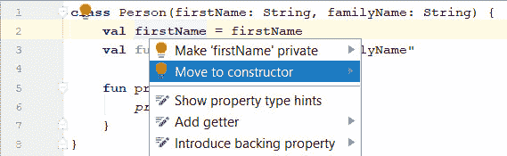

**图 4.1:** 将属性转换为 val/var 参数

注意，使用 `val/var` 参数，你可以定义一个具有非平凡成员且体为空的类：

```kotlin
class Person(val firstName: String, val familyName: String = "") {

}
```

在这些情况下，Kotlin 允许你完全省略类体。事实上，这是 IntelliJ 插件强制的一种推荐代码风格：

```kotlin
class Person(val firstName: String, val familyName: String = "")
```

与函数类似，你可以在构造函数参数中使用默认值和 `vararg`：

```kotlin
class Person(val firstName: String, val familyName: String = "") {

    fun fullName() = "$firstName $familyName"

}

class Room(vararg persons: Person) {

    fun showNames() {

        for (person in persons) println(person.fullName())

    }

}

    val room = Room(Person("John"), Person("Jane", "Smith"))

    room.showNames()

}
```

在某些情况下，你需要提供多个构造函数来以不同的方式初始化类实例。其中许多情况可以通过一个带有默认参数的主构造函数来涵盖，但有时这是不够的。在 Kotlin 中，这个问题可以通过次要构造函数解决。次要构造函数的语法与函数定义相似，仅用 `constructor` 关键字代替函数名：

```kotlin
class Person {

    val firstName: String

    val familyName: String

    constructor(firstName: String, familyName: String) {

        this.firstName = firstName

        this.familyName = familyName

    }

    constructor(fullName: String) {

        val names = fullName.split(" ")

            throw IllegalArgumentException("Invalid name: $fullName")

        }

        firstName = names[0]

        familyName = names[1]

    }

}
```

注意，使用 `val/var` 参数，你可以定义一个具有非平凡成员且体为空的类。在这些情况下，Kotlin 允许你完全省略类体。事实上，这是 IntelliJ 插件强制的一种推荐代码风格：

```kotlin


`class Person(val firstName: String, val familyName: String = "")`

与函数类似，你可以在构造函数参数中使用默认值和`vararg`：

```kotlin
class Person(val firstName: String, val familyName: String = "") {

    fun fullName() = "$firstName $familyName"

    class Room(vararg persons: Person) {

        fun showNames() {

            for (person in persons) println(person.fullName())

        }

    }

    val room = Room(Person("John"), Person("Jane", "Smith"))

    room.showNames()

}
```

在某些情况下，你需要提供多个构造函数来以不同的方式初始化类实例。其中许多情况可以通过一个带有默认参数的主构造函数来涵盖，但有时这是不够的。在 Kotlin 中，这个问题可以通过次要构造函数解决。次要构造函数的语法与函数定义相似，仅用`constructor`关键字代替函数名：

```kotlin
class Person {

    val firstName: String

    val familyName: String

    constructor(firstName: String, familyName: String) {

        this.firstName = firstName

        this.familyName = familyName

    }

    constructor(fullName: String) {

        val names = fullName.split(" ")

        if (names.size != 2) {

            throw IllegalArgumentException("Invalid name: $fullName")

        }

        firstName = names[0]

        familyName = names[1]

    }

}
```

注意，使用`val/var`参数，你可以定义一个具有非平凡成员且体为空的类。在这些情况下，Kotlin 允许你完全省略类体。事实上，这是 IntelliJ 插件强制的一种推荐代码风格：

```kotlin
class Person(val firstName: String, val familyName: String = "")
```

与函数类似，你可以在构造函数参数中使用默认值和`vararg`：

```kotlin
class Person(val firstName: String, val familyName: String = "") {

    fun fullName() = "$firstName $familyName"

    class Room(vararg persons: Person) {

        fun showNames() {

            for (person in persons) println(person.fullName())

        }

    }

}

fun main() {

    val room = Room(Person("John"), Person("Jane", "Smith"))

    room.showNames()

}
```

（注：原文中存在大量重复段落，此处已按要求保留对应翻译）

### 成员可见性

- `public`：默认。
- `internal`：仅在编译模块内可见。
- `protected`：在包含类及其所有子类中可见。
- `private`：仅在包含体内可见。

这些修饰符的含义实际上与我们在顶层函数中看到的相似。

**Java 对比 Kotlin：** 在 Java 中，默认可见性是包私有的，意味着成员在包含包内可见。如果你想让一个成员变为公共，必须显式标记`public`修饰符。在 Kotlin 中，相反，类成员（实际上所有非本地声明）默认都是公共的。注意，目前 Kotlin 没有 Java 包私有可见性的直接对应项。

在以下代码中，属性`firstName`和`familyName`被声明为私有，因此对`main()`函数不可访问。相反，`fullName()`函数是公共的：

```kotlin
class Person(private val firstName: String, private val familyName: String) {
    fun fullName() = "$firstName $familyName"
}

fun main() {
    val person = Person("John", "Doe")
    println(person.firstName) // Error: 此处无法访问 firstName
    println(person.fullName()) // Ok
}
```

可见性修饰符支持函数和属性（无论是在类体内声明还是作为主构造函数参数），以及主构造函数和次要构造函数。如果你想为主`constructor`指定可见性，则必须显式添加`constructor`关键字：

```kotlin
class Empty private constructor() {

    fun showMe() = println("Empty")

}

fun main() {

    Empty().showMe() // Error: 无法调用私有构造函数

}
```

注意，`Empty`类无法实例化，因为它的唯一构造函数是私有的，因此在类体外部不可用。在“对象（Objects）”部分，我们将看到如何将构造函数隐藏与所谓的伴侣对象（companion objects）结合起来创建工厂方法。

### 嵌套类

除了函数、属性和构造函数之外，Kotlin 类还可以包含其他类作为成员。此类类被称为嵌套类。让我们来看一个例子：

```kotlin
class Person (val id: Id, val age: Int) {
    class Id(val firstName: String, val familyName: String)
    fun showMe() = println("${id.firstName} ${id.familyName}, $age")
}

fun main() {
    val id = Person.Id("John", "Doe")
    val person = Person(id, 25)
    person.showMe()
}
```

注意，在包含类体外部，对嵌套类的引用必须以外部类名名前缀，例如上述代码中的`Person.Id`。

与其他成员一样，嵌套类可以具有不同的可见性。作为其包含类的成员，它们也可以访问该类的私有声明：

```kotlin
class Person (private val id: Id, private val age: Int) {
    class Id(private val firstName: String,
             private val familyName: String) {
        fun nameSake(person: Person) = person.id.firstName == firstName
    }
    fun showMe() = println("${id.firstName} ${id.familyName}, $age")
}
```

**Java 与 Kotlin：** 与 Java 不同，外部类无法访问其嵌套类的私有成员。

嵌套类可以标记为`inner`，以便访问外部类的当前实例：

```kotlin
class Person(val firstName: String, val familyName: String) {
    inner class Possession(val description: String) {
        fun showOwner() = println(fullName())
    }
    fun fullName() = "$firstName $familyName"
}

fun main() {
    val person = Person("John", "Doe")
    // 构造函数调用
    val wallet = person.Possession("Wallet")
    wallet.showOwner() // John Doe
}
```

注意内部类构造函数的调用是如何通过外部类实例限定的：`person.Possession("Wallet")`。同样，对于其他成员引用，如果所涉及的实例如下，可以省略限定：

```kotlin
class Person(val firstName: String, val familyName: String) {
    inner class Possession(val description: String) {
        fun showOwner() = println(fullName())
    }
    // 等同于 this.Possession("Wallet")
    val myWallet = Possession("Wallet")
}
```

通常，`this`总是最内层的类实例，因此在内部类体内部，它指的是内部类本身的当前实例。当你需要从内部类体引用外部实例时，可以使用`this`表达式的限定形式：

```kotlin
class Person(val firstName: String, val familyName: String) {
    inner class Possession(val description: String) {
        fun getOwner() = this@Person
    }
}
```

`@`符号后面的标识符是外部类的名称。

**Java 与 Kotlin：** Kotlin 和 Java 中的嵌套类非常相似。主要的区别在于在没有额外修饰符时的默认行为：Java 类默认是内部类（inner），如果你不希望它们的对象与外部类的实例关联，必须显式标记为`static`；而 Kotlin 类则不是。换句话说，以下 Kotlin 代码：

```kotlin
class Outer {
    inner class Inner
    class Nested
}
```

基本上等于 Java 声明：

```java
public class Outer {
    public class Inner {
    }
    public static class Nested {
    }
}
```

### 局部类

与 Java 类似，Kotlin 类可以在函数体内部声明。此类局部类只能在封闭的代码块内部使用：

```kotlin
fun main() {
    class Point(val x: Int, val y: Int) {
        fun shift(dx: Int, dy: Int): Point = Point(x + dx, y + dy)
        override fun toString() = "($x, $y)"
    }
    val p = Point(10, 10)
    println(p.shift(-1, 3)) // (9, 13)
}

fun foo() {
    println(Point(0, 0)) // 错误：无法解析 Point
}
```

与局部函数类似，Kotlin 局部类可以访问来自封闭代码的声明。特别是它们捕获了局部变量，这些变量在局部类内部可以被访问甚至修改。

```kotlin
fun main() {
    var x = 1
    class Counter {
        fun increment() {
            x++
        }
    }
    Counter().increment()
    println(x) // 2
}
```

在 Kotlin 中，所有的引用类型本身都是不可空的。因此，你不能在例如`String`类型的变量中存储`null`。考虑以下函数，它检查给定的字符串是否只包含字母：

```kotlin
fun isLetterString(s: String): Boolean {
    if (s.isEmpty()) return false
    for (ch in s) {
        if (!ch.isLetter()) return false
    }
    return true
}
```

如果我们尝试为参数`s`传递`null`，将得到编译错误：

```kotlin
fun main() {
    println(isLetterString("abc")) // Ok
    println(isLetterString(null))    // Error
}
```

原因是第二次调用中的参数的类型是可空类型，但`String`不接受`null`，因此该调用是被禁止的。你不需要在`isLetterString()`内部编写任何额外的检查来确保没有传递`null`，也不需要担心在引用其参数时可能会抛出`NPE`（空指针异常）：Kotlin 编译器在编译时就防止了此类错误。

## Java 与 Kotlin

在 Java 中，相反，从编译器的角度来看，向以下函数传递`null`是完全可以的，但在运行时会产生`NullPointerException`：

```java
class Test {
    static boolean isLetterString(String s) {
        for (int i = 0; i < s.length(); i++) {
            if (!Character.isLetter(s.charAt(i))) return false;
        }
        return true;
    }
    public static void main(String[] args) {
        // 可以编译但在运行时抛出异常
        System.out.println(isLetterString(null));
    }
}
```

如果你需要写一个可能接受`null`值的函数怎么办？在这种情况下，通过在类型后面加上问号将参数类型标记为可空：

```kotlin
fun isBooleanString(s: String?) = s == "false" || s == "true"
```

像`String?`这样的类型在 Kotlin 中被称为可空类型。从类型系统的角度来说，每个可空类型都是其基类型的超类型，通过包含`null`扩大了原始的值集合。这特别意味着可空变量可以始终赋予对应不可空类型的值，但反之则显然是错误的：

```kotlin
fun main() {
    println(isBooleanString(null)) // Correct
    val s: String? = "abc"      // Correct
    val ss: String = s            // Error
}
```

注意前一个示例中的最后一个赋值是错误的：尽管变量`s`在运行时没有持有`null`值，但编译器必须保持保守，因为它只能使用静态类型信息，该信息告诉它变量`s`是可空的，因为我们显式地标记了它。

在运行时，不可空值实际上与可空值没有区别：区别仅存在于编译层面。Kotlin 编译器不使用任何包装类（例如 Java 8 中引入的`Optional`类）来表示不可空值，因此不涉及额外的运行时开销。

像`Int`或`Boolean`等基本类型也有可空版本。但请记住，这些类型始终表示装箱值（boxed values）：

```kotlin
fun main() {
    val n: Int = 1    // 基本类型值
    val x: Int? = 1 // 指装箱值的引用
}
```

最小的可空类型是`Nothing?`，它除了`null`常量外不包含任何值：它是`null`本身的类型，也是任何其他可空类型的子类型。最大的可空类型`Any?`也是整个 Kotlin 类型系统中最大的类型，被认为是任何其他类型（无论是否可空）的超类型。

可空类型不保留其基类型可用的方法和属性。这是因为调用成员函数或读取属性等通常操作对于`null`值是没有意义的。如果我们通过将参数类型替换为`String?`来更改`isLetterString()`函数，但保持其他所有部分不变，我们将得到编译错误，因为现在函数体中对`s`的所有使用都变成了错误的：

```kotlin
fun isLetterString(s: String?): Boolean {
    // 错误：isEmpty() 不可用
    if (s.isEmpty()) return false
    for (ch in s) {
        if (!ch.isLetter()) return false
    }
    return true
}
```

（注：上述代码块是基于文本对错误的概念性表示）

可变属性永远不允许智能类型转换，因为通常情况下，它们可能会任何时候被其他代码修改。在`第 8 章，理解类层级`中，我们将详细地讨论这些规则及其异常。

## 非空断言运算符


在之前涉及`readLine()`函数的示例中，我们已经遇到过`!!`运算符。`!!`运算符也称为非空断言，是一个后置运算符。当其参数为`null`时，它会抛出`KotlinNullPointerException`（在 JVM 上，它是著名的`NullPointerException`的子类），当参数不为`null`时，则原样返回。其结果的类型是原始类型的不可空版本。基本上，它重现了 Java 程序的行为，即在尝试解引用`null`值时会抛出异常。下面的示例演示了这种行为：

```
val n = readLine()!!.toInt()
```

通常情况下，应该避免这种操作，因为空值通常需要某种合理的响应，而不是简单地抛出异常。尽管如此，有时它的使用也是合理的。例如，考虑以下程序：

```
fun main() {
    var name: String? = null
    fun initialize() {
        name = "John"
    }
    fun sayHello() {
        println(name!!.toUpperCase())
    }
    initialize()
    sayHello()
}
```

在这种情况下，非空断言是一个合适的解决方案，因为我们知道在`name`被赋值一个不可空值之后调用了`sayHello()`函数。然而，编译器无法识别这种用法是安全的，不会在`sayHello()`内部将变量类型细化为`String`，因此一种解决方案是忽略它的警告并使用非空断言。但注意，即使在这样的情况下，使用不那么粗暴的工具来处理空值，甚至重写代码的控制流以便编译器可以使用智能转换，通常也是有意义。

在不可空接收者上使用非空断言不被认为错误。但这种代码是冗余的，应该避免。

**IDE Tips：IntelliJ 插件带有一个检查功能，可以高亮并建议移除`!!`运算符的冗余用法。**

与任何其他后置运算符一样，非空断言具有可能的最高优先级。

## 安全调用运算符

我们已经提到过，可空类型的值不允许你调用对应不可空类型中可用的方法。然而，有一种特殊的安全调用操作允许你绕过这一限制。让我们考虑我们之前的示例之一：

```
fun readInt() = readLine()!!.toInt()
```

只要你的程序使用控制台作为标准输入输出，该函数就能正常工作。然而，如果我们开始通过管道将某些文件作为标准输入，如果该文件为空，它可能会因`KotlinNullPointerException`而失败。使用安全调用运算符，我们可以将其重写如下形式：

```
fun readInt() = readLine()?.toInt()
```

上面的代码基本上等于以下函数：

```
fun readInt(): Int? {
    val tmp = readLine()
    return if (tmp != null) tmp.toInt() else null
}
```

换句话说，当接收者（左操作数）不为`null`时，安全调用运算符的行为就像普通调用。然而，当其接收者为`null`时，它不执行任何调用并简单返回`null`。同样，与`||`和`&&`操作一样，安全调用遵循惰性语义：如果接收者为`null`，则不会求值调用参数。在优先级方面，`?.`运算符与普通调用运算符（`.`）处于同一级别。

*当接收者不为空时执行某些意义的操作，否则返回 null*的模式在实践中非常常见，因此安全调用可以极大简化你的代码，让你摆脱不必要的`if`表达式和临时变量声明。一个实用的惯用法是将安全调用链成类似这样的：

```
println(readLine()?.toInt()?.toString(16))
```

注意，由于安全调用运算符可能返回`null`，其类型始终是对应非安全调用的可空版本。我们在我们新的`readInt()`函数的调用处必须考虑到这一点：

```
fun readInt() = readLine()?.toInt()
fun main() {
    val n = readInt() // Int?
    if (n != null) {
        println(n + 1)
    } else {
        println("No value")
    }
}
```

与非空断言一样，安全调用也可以应用于不可空接收者。然而，这种代码完全是冗余的，因为它的行为与简单的点调用（`.`）完全一致。

**IDE Tips：IntelliJ 插件会自动高亮`?.`运算符的冗余用法，并建议替换为普通调用。**

## Elvis 运算符

处理可空值的另一个有用工具是合并运算符`?:`，它允许你提供默认值。由于它类似于 Elvis 猫王，它通常被称为 Elvis 运算符。让我们考虑一个例子：

```
fun sayHello(name: String?) {
    println("Hello, " + (name ?: "Unknown"))
}
fun main() {
    sayHello("John") // Hello, John
    sayHello(null) // Hello, Unknown
}
```

换句话说，当左操作数不为`null`时结果为左操作数，否则为右操作数。基本上，上面的`sayHello()`函数等同于：

```
fun sayHello(name: String?) {
    if (name != null) {
        println("Hello, " + name)
    } else {
        println("Hello, Unknown")
    }
}
```

另一个方便的模式是使用`?:`类似于`return`或`throw`。在下面的代码中，当标准输入为空时替换为零：

```
val n = readLine()?.toInt() ?: 0
```

```
class Name(val firstName: String, val familyName: String?) {
    fun describe(): String {
        val currentName = familyName ?: "Unknown"
        return "${firstName} ${currentName}"
    }
}
```

**IDE Tips：IntelliJ 插件有一个特殊的检查，检测可以用 Elvis 运算符替换的空检查 if 表达式（图 4.3](#c04.xhtml_fig4_3)）。**

 {

    val name = readLine() ?: return

    println("$prefix$name")

}

```

此类属性可以具有顶层可见性之一（public/internal/private）。它们也可以在导入指令中中使用：

```kotlin
// util.kt
package util

val prefix = "Hello, "

// main.kt
package main

import util.prefix

fun main() {
    val name = readLine() ?: return
    println("$prefix$name")
}
```

## 延迟初始化

有时候，在实例化类时初始化类属性的要求可能是不必要的严格的。某些属性只能在类实例创建之后、但在实际使用之前进行初始化：例如，它们可能会在某些初始化方法（如单元测试设置）中指定，或者通过依赖注入赋值。一种解决方案是在构造函数中分配一个默认值（例如`null`），这在基本上意味着一种未初始状态，并在需要时提供实际值。考虑以下代码：

```kotlin
import java.io.File

class Content {
    var text: String? = null

    fun loadFile(file: File) {
        text = file.readText()
    }
}

fun getContentSize(content: Content) = content.text?.length ?: 0
```

我们假设`loadFile()`在其他地方调用以从某个文件加载字符串内容。这个示例的缺点是，我们必须处理可空类型，而实际值在访问之前应该总是被初始化的，因此是非空的。Kotlin 通过`lateinit`关键字为这种模式提供了内置支持。让我们将其应用于我们的示例中：

```kotlin
import java.io.File

class Content {
    lateinit var text: String

    fun loadFile(file: File) {
        text = file.readText()
    }
}

fun getContentSize(content: Content) = content.text.length
```

带有`lateinit`标记的属性属性就像普通属性一样，唯一的区别是：在尝试读取其值时，程序将检查该属性是否已初始化，如果没有初始化，将抛出`UninitializedPropertyAccessException`。这种行为与隐式的`!! operator`某种相似。

为了有资格延迟初始化，属性必须满足一些要求。首先，它必须声明为可变的（`var`），因为它的值可能会在代码的不同部分发生更改。其次，它必须是非空类型，并且不能表示像`Int`或`Boolean`这样的原始类型值。这是因为在内部，`lateinit`属性被表示为一个可空变量，并留出`null`来表示未初始化状态。最后，`lateinit`属性不能有初始化器，因为这样的结构将违背最初声明其为`lateinit`的目的。

Kotlin 1.2 引入了一些与`lateinit`相关的改进。特别是，现在可以在顶层属性和局部变量使用延迟初始化：

```kotlin
lateinit var text: String

fun readText() {
    text = readLine()!!
}

fun main() {
    readText()
    println(text)
}
```

另一个改进是可以在尝试访问其值之前检查`lateinit`属性是否已初始化。我们将在*第 10 章，注解与反射*中讨论如何做到，该章节涉及 Kotlin 反射 API。

## 使用自定义访问器

我们目前为止看到的属性本质上表现得像普通变量，存储在某些 Kotlin 类的实例或文件上下文中（在 JVM 上也表示为特殊门面类的一个实例）。然而，Kotlin 属性的真正威力在于它们能够在一个声明中结合类变量的行为和类函数的行为。这可以通过自定义访问器来实现，自定义访问器是在访问属性值进行读取或写入时被调用的特殊函数。

在下面的示例中，我们定义了自定义获取器（getter），即用于读取属性值的访问器：

```kotlin
class Person(val firstName: String, val familyName: String) {
    val fullName: String
        get(): String {
            return "$firstName $familyName"
        }
}
```

获取器放置在属性定义的末尾，基本上看起来像一个函数，尽管使用的是关键字`get`而不是名称。每当读取此类属性时，程序会自动调用它的获取器：

```kotlin
fun main() {
    val person = Person("John", "Doe")
    println(person.fullName) // John Doe
}
```

与函数类似，访问器支持表达式体形式：

```kotlin
val fullName: String
    get() = "$firstName $familyName"
```

注意，获取器不能有任何参数，而它的返回类型（如果存在）必须与属性本身的类型相同：

```kotlin
val fullName: Any
    get(): String { // 错误
        return "$firstName $familyName"
    }
```

自 Kotlin 1.1 起，你可以直接省略显式的属性类型并依赖于类型推断：

```kotlin
val fullName
    get() = "$firstName $familyName" // String 被推断出来
```

我们上面引入的`fullName`属性的值在每次访问时都会计算。

与`firstName`和`familyName`不同，它没有支持字段（backing field），因此在类实例中不占用内存。换句话说，它基本上是一个具有属性形式的函数。在 Java 中，我们通常会引入一个如`getFullName()`的方法来实现同样。关于支持字段的规则如下：当属性至少有一个默认访问器或明确提到字段的自定义访问器时，生成支持字段。由于不可变属性只有一个访问器（获取器），而在我们的示例中，它没有直接引用支持字段，因此`fullName`属性将没有支持字段。

直接字段引用呢？当你希望属性基于某些存储的值但仍需要自定义访问时，它是很有用的。例如，我们可以使用它来记录属性读取：

```kotlin
class Person(val firstName: String, val familyName: String, age: Int) {
    val age: Int = age
        get(): Int {
            println("Accessing age")
            return field
        }
}
```

支持字段引用由`field`关键字表示，并在访问器内部有效。

当属性不使用支持字段时，它不能有初始化器，因为初始化器值在类实例化时会直接赋值给支持字段。这就是为什么我们没有为上面的`fullName`定义添加初始化器：作为一个计算属性，它不需要初始化器。

由于带有自定义获取器的属性行为类似于无参数函数，尽管语法不同，这提出了一个问题：在特定情况下你应该如何在这两种结构之间进行选择。Kotlin 官方约定建议，当计算不会导致抛出异常、值足够廉价或已缓存，并且除非包含实例的状态发生变化否则不同的调用会产生相同的结果时，使用属性而不是函数。

使用`var`关键字定义的可变属性有两个访问器：用于读取的获取器和用于写入的设置器（setter）。让我们考虑一个示例：

```kotlin
class Person(val firstName: String, val familyName: String) {
    var age: Int? = null
        set(value) {
            if (value != null && value <= 0) {
                throw IllegalArgumentException("Invalid age: $value")
            }
            field = value
        }
}

fun main() {
    val person = Person("John", "Doe")
    person.age = 20 // 调用自定义设置器
    println(person.age) // 20, 使用默认获取器
}
```

属性设置器必须有一个与属性本身类型相同的单个参数。参数类型通常会被省略，因为它是预先知的。按照约定，参数命名为`value`，但如果你喜欢，也可以选择不同的名称。

注意，属性初始化器不会触发设置器调用，因为初始化器值会直接赋值给支持字段。

由于可变属性拥有两个访问器，它们始终拥有一个底层字段（backing field），除非这两个访问器都是自定义的且没有通过`field`关键字引用它。例如，前述的`age`属性由于默认的 getter 和在 setter 中直接引用而拥有底层字段，而接的属性则没有：

```kotlin
class Person(var firstName: String, var familyName: String) {
    var fullName: String
        get(): String = "$firstName $familyName"
        set(value) {
            val names = value.split(" ") // 按空格分割字符串单词
            if (names.size != 2) {
                throw IllegalArgumentException("Invalid full name: '$value'")
            }
            firstName = names[0]
            familyName = names[1]
        }
}
```

属性访问器可以有自己的可见性修饰符。如果你想禁止在包含该属性的类之外修改该属性，从而对外部世界实质上是不可变的，那么这可能非常有用。如果你不需要对访问器的非复杂实现，可以使用单个`get`/`set`关键字来简写：

```kotlin
import java.util.Date

class Person(name: String) {
    var lastChanged: Date?
        private set // 不能在 Person 类外更改

    var name: String = name
        set(value) {
            lastChanged = Date()
            field = value
        }
}
```


**Java 对比 Kotlin：** 从 JVM 的角度来看，Kotlin 属性通常对应于一个或两个访问器方法（如`getFullName()`和`setFullName()`），并可能由一个私有字段支持。虽然这些方法本身在 Kotlin 代码中不可用，但可以从 Java 类中调用，并且是 Java/Kotlin 互操作性的一个大点。在*第 12 章，Java 互操作性*中，我们将详细讨论这个问题。另一方面，私有属性默认不生成访问器方法，因为它们无法在包含类或文件之外使用：对此类属性的访问被优化为直接引用它们的底层字段。

`lateinit`属性不允许使用自定义访问器，因为它们的访问器总是自动生成的。它们也不支持声明为主构造函数参数的属性，但可以使用普通的非属性参数并将其赋值给类体中的属性来解决，就像我们之前对`val` `age`所的那样。

## 懒性属性和委托

在前面的节中，我们已经了如何使用`lateinit`修饰符来实现延迟初始化。但在许多情况下，我们希望将值的计算推迟到第一次访问。在 Kotlin 中，可以通过`lazy`属性实现。让我们考虑一个例子：

```kotlin
import java.io.File

val text by lazy {
    File("data.txt").readText()
}

fun main() {
    while (true) {
        when (val command = readLine() ?: return) {
            "print data" -> println(text)
            "exit" -> return
        }
    }
}
```

前述的`text`属性被定义为`lazy`：我们在`lazy`子句后面的代码块中指定了它是如何初始化的。在用户在`main()`函数中输入适当命令并首次访问它之前，该值本身不会被计算。初始化后，属性值将存储在字段中，所有后续的访问尝试将仅仅读取存储的值。例如，如果我们定义了一个带有简单初始化器的属性：

```kotlin
val text = File("data.txt").readText()
```

文件将在程序启动时立即读取，而带有像这样的 getter 的属性：

```kotlin
val text get() = File("data.txt").readText()
```

则会在程序每次尝试访问属性值时重新读取文件。

如果有必要，你也可以显式指定属性类型：

```kotlin
val text: String by lazy { File("data.txt").readText() }
```

这种语法实际上是所谓的委托属性（delegated property）的一种特例，它允许你通过特殊的委托对象来实现属性，该对象处理读/写并在必要时保留所有相关数据。委托放置在`by`关键字之后，可以是一个返回符合特定惯例对象的任意表达式。在我们的示例中，`lazy {}`不是内置语言结构，而是只是一个带有 lambda 的标准库函数调用（我们已经在*[第 2 章，语言基础]*中在讨论数组实例的创建时看到过类似的示例）。

Kotlin 提供了一些开箱即用的委托实现：除了启用`lazy`计算外，标准委托允许你创建可观察属性，这些属性在值的每次变化之前之后都会通知监听器，并使用 map 来支持属性，而不是将它们存储在单独的字段中。在本节中，我们将让你初步了解懒性属性背景下的委托，并将全面处理推迟到*[第 7 章，探索集合和 I/O]*以及*第 11 章，领域特定语言*，在这些章节中分别考虑 Kotlin 库中提供的标准委托以及设计自定义委托的方法。

注意，与`lateinit`属性不同，`lazy`属性可能是不可变的：一旦初始化，值就不会改变：

```kotlin
var text by lazy { "Hello" } // 错误
```

默认情况下，`lazy`属性是线程安全的：在多线程环境中，值由单个线程计算，所有尝试访问它的线程最终将获得相同的结果。从 1.1 版本开始，你可以在局部变量中使用委托：

```kotlin
fun longComputation(): Int { }

fun main(args: Array<String>) {
    val data by lazy { longComputation() }
    if (data != null) {
        // 错误：没有智能转换，data 在这里可空
        println("Length: ${data.length}")
    }
}
```

注意委托属性/局部变量：目前不支持智能转换。由于委托可能有任意实现，它们的处理方式与带有自定义访问器的属性类似。

## 对象

在本节中，我们将讨论对象声明（object declarations）的概念。Kotlin 中的对象声明是类和常量的一种结合，允许你创建单例——即仅有一个实例的类。我们还将查看对象表达式（object expressions），它们的作用类似于 Java 的匿名类。

### 对象声明

Kotlin 内置了对单例模式的支持，这基本上确保了某些类只能有一个实例。在 Kotlin 中，你可以像类一样声明单例，但使用`object`关键字代替`class`：

```kotlin
object Application {
    val name = "My Application"
    override fun toString() = name
    fun exit() { }
}
```

这种对象声明既可以作为类，也可以作为实例的值。例如，查看以下代码：

```kotlin
fun describe(app: Application) = app.name // Application 作为类型

fun main() {
    println(Application) // Application 作为值
}
```

注意将对象作为类型通常没有意义，因为此类类型只有一个实例，所以你完全可以引用该实例本身。

对象定义是线程安全的：编译器确保即使你从不同的执行线程并发访问该单例，仍然只有一个共享实例，且初始化代码只会运行一次。

初始化本身在单例类加载时懒性地进行，这通常发生在程序第一次引用对象实例时。

**Java 对比 Kotlin：** 在 Java 中，必须使用普通的类声明来模拟单例，这通常通过私有构造函数和一些静态状态结合来实现。此类对象声明可以根据实现细节具有不同的特性，最常见的是懒加载与饿加载，以及线程安全与非线程安全的单例。查看`Application`对象的 JVM 字节码，我们看到基本上等同于以下 Java 类：

```java
public final class Application {
    private static final String name = "My Application";
    public static final Application INSTANCE;

    private Application() { }

    public final String getName() {
        return name;
    }

    public final void exit() { }

    static {
        INSTANCE = new Application();
        name = "My Application";
    }
}
```

注意，`INSTANCE`变量在 Kotlin 代码本身中是不可见的，但在引用 Kotlin 单例的 Java 类中可以使用。在*第 12 章，Java 互操作性*中，我们将详细讨论这个问题。

与类类似，对象声明可以包含成员函数和属性以及初始化块，但可能没有主构造函数或辅助构造函数：对象实例总是隐式创建的，因此构造函数调用对对象来说没有意义。

对象体中的类不能标记为`inner`（内部类）。内部类的实例总是与其外部类的相应实例关联，但对象声明只有一个实例，这使得`inner`修饰符实际上是多余的：这就是它被禁止的原因。

对象的成员可以被导入并在稍后通过它们的简单名称引用，类似于顶层声明。例如，假设`Application`对象定义在一个单独的文件中：

```kotlin
import Application.exit

fun main() {
    println(Application.name) // 使用限定限定引用
    exit()                    // 使用简单名称
}
```

然而，你不能使用按需导入一次性导入所有对象成员：

```kotlin
import Application.* // 错误
```

这种限制的原因是，对象定义像任何其他类一样，包含了如`toString()`或`equals()`等常用方法，如果允许按需导入，这些方法也会被导入。

与类一样，对象可以嵌套到其他类中甚至其他对象中。此类声明也是单例，在整个应用程序中只有一个实例。如果你需要每个外部类对应一个独立的实例，则应该使用内部类。然而，你不能将对象放在函数内部、局部类或内部类中，因为这些定义通常依赖于某些外部上下文，因此无法成为单例。在局部作用域的对象可以使用对象表达式（object expression）创建，我们将在本章进一步讨论。

**Java 对比 Kotlin：** 在 Java 世界中，你经常会遇到所谓的工具类（utility class）。它本质上是一个没有实例的类（通常通过私有构造函数实现），而是作为相关方法的某种分组。这种模式在 Java 中被证明是有用的，但在 Kotlin 中通常不被建议这样做，尽管如果你确实需要，你完全可以声明工具风格的类。原因是，与 Java 不同，Kotlin 拥有顶层声明，可以使用包分组在一起，从而让你摆脱使用特殊类的需求并减少样板代码。

### 伴侣对象 (Companion objects)

与嵌套类类似，嵌套对象在给定外部类实例的情况下可以访问该外部类的私有成员。这一个有用的影响是有能够轻松实现工厂设计模式。在某些情况下，直接使用构造函数是不希望的：例如，你无法根据某些预检返回`null`或不同类型（符合类类型）的实例，因为构造函数调用始终返回该类的实例或抛出异常。一种可能的解决方案是将构造函数标记为私有，使其在类外部不可访问，并定义一个嵌套对象，其内部函数充当`Factory`方法并在必要时调用类的构造函数：

```kotlin
class Application private constructor(val name: String) {
    object Factory {
        fun create(args: Array<String>): Application? {
            val name = args.firstOrNull() ?: return null
            return Application(name)
        }
    }
}
```

注意，`INSTANCE`变量在 Kotlin 代码本身中是不可见的，但在引用 Kotlin 单例的 Java 类中可以使用。在*第 12 章，Java 互操作性*中，我们将详细讨论这个问题。

与类类似，对象声明可以包含成员函数和属性以及初始化块，但可能没有主构造函数或辅助构造函数：对象实例总是隐式创建的，因此构造函数调用对对象来说没有意义。

一种可能的解决方案是将构造函数标记为私有，使其在类外部不可访问，并定义一个嵌套对象，其内部函数充当`Factory`方法并在必要时调用类的构造函数：

```kotlin
class Application private constructor(val name: String) {
    object Factory {
        fun create(args: Array<String>): Application? {
            val name = args.firstOrNull() ?: return null
            return Application(name)
        }
    }
}
```

## Java 与 Kotlin

Kotlin 中的伴随对象（companion objects）可以被视为 Java 静态上下文（static context）的对应物：就像静态成员一样，它们共享相同的全局状态，并访问封装类的任何成员，无论其可见性如何。然而，关键区别在于它们的全局状态是一个对象实例。这比 Java 的静态提供了更大的灵活性，因为伴随对象拥有父类型并像其他对象一样被传递。在[第 8 章，理解类层次结构]和第 11 章领域特定语言中，我们将看到伴随对象如何与继承和语言约定相结合以产生更具表现力的代码。

此外注意，伴随对象中的`init`块类似于 Java 的静态初始化器。

## 对象表达式（Object expressions）

Kotlin 有一种特殊的表达式，可以在不显式声明的情况下创建对象。这种对象表达式类似于 Java 的匿名类。考虑以下示例：

```kotlin
fun main() {
    fun midPoint(xRange: IntRange, yRange: IntRange) = object {
        val x = (xRange.first + xRange.last)/2
        val y = (yRange.first + yRange.last)/2
    }

    val midPoint = midPoint(1..5, 2..6)
    println("${midPoint.x}, ${midPoint.y}") // (3, 4)
}
```

对象表达式看起来就像没有名字的对象定义，并且由于是一个表达式，它可以像前面的示例那样被赋值给变量。注意，与类和对象表达式不同，命名的对象不能在函数内部声明：

```kotlin
fun printMiddle(xRange: IntRange, yRange: IntRange) {
    // Error
    object MidPoint {
        val x = (xRange.first + xRange.last)/2
        val y = (yRange.first + yRange.last)/2
    }
    println("${MidPoint.x}, ${MidPoint.y}")
}
```

此决策背后的逻辑是，对象定义应该表示单例，而局部对象（如果允许的话）通常在每次调用封装函数时都必须重新创建。

由于我们没有为`midPoint()`函数返回的对象定义显式类型，你可能会好奇返回类型是什么。答案是所谓的匿名对象类型，它代表一个包含对象表达式中定义的所有成员以及单个实例的类。这种类型在语言本身中是无法表示的：它只是 Kotlin 编译器使用的对象表达式类型的内部表示。我们仍然可以像使用其他类实例一样使用匿名类型的表达式：例如，如上面的`println()`调用所示，访问其成员。

**IDE 提示：如果我们尝试使用 Show Expression Type（Ctrl + Shift + P/ Cmd + Shift + P）操作查看对象表达式类型，IntelliJ 将向我们显示 <anonymous object> 占符（图 4.5）：**

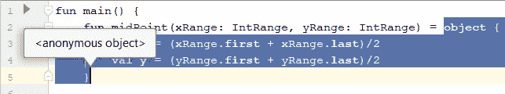

**图 4.5：** 匿名对象类型

此示例还说明具有对象表达式体的函数具有匿名返回类型，局部变量和属性也是如此：

```kotlin
fun main() {
    val o = object { // 匿名对象类型被推断
        val x = readLine()!!.toInt()
        val y = readLine()!!.toInt()
    }
    println(o.x + o.y) // 在这里可以访问 x 和 y
}
```

但注意，匿名类型仅传播到局部或私有声明。例如，如果我们将`midPoint()`函数声明为顶层函数，在尝试访问对象成员时将得到编译错误：

```kotlin
fun midPoint(xRange: IntRange, yRange: IntRange) = object {
    val x = (xRange.first + xRange.last)/2
    val y = (yRange.first + yRange.last)/2
}

fun main() {
    val midPoint = midPoint(1..5, 2..6)
    // Error: x and y are unresolved
    println("${midPoint.x}, ${midPoint.y}")
}
```

现在，`midPoint()`函数的返回类型不是我们对象表达式的匿名类型，而是其可表示的父类型。由于我们的对象没有显式父类型，它被假设为`Any`。这就是为什么`midPoint.x`引用未解析。

## 总结与结论

此示例还说明了具有对象表达式体的函数具有匿名返回类型，局部变量和属性也是如此：

```kotlin
fun main() {
    val o = object { // 匿名对象类型被推断
        val x = readLine()!!.toInt()
        val y = readLine()!!.toInt()
    }
    println(o.x + o.y) // 在这里可以访问 x 和 y
}
```


但注意，匿名类型仅传播到局部或私有声明。例如，如果我们将`midPoint()`函数声明为顶层函数，在尝试访问对象成员时将得到编译错误：

```kotlin
fun midPoint(xRange: IntRange, yRange: IntRange) = object {
    val x = (xRange.first + xRange.last)/2
    val y = (yRange.first + yRange.last)/2
}

fun main() {
    val midPoint = midPoint(1..5, 2..6)
    // Error: x and y are unresolved
    println("${midPoint.x}, ${midPoint.y}")
}
```

现在，`midPoint()`函数的返回类型不是我们对象表达式的匿名类型，而是其可表示的父类型。由于我们的对象没有显式父类型，它被假设为`Any`。这就是为什么`midPoint.x`引用未解析。

此决策背后的逻辑是，对象定义应该表示单例，而局部对象（如果允许的话）通常在每次调用封装函数时都必须重新创建。

最后，让我们总结在本章学习的内容。我们现在基本了解如何定义和使用自定义类型，如何正确初始化类以及使用单例对象。我们学习了使用不同类型的属性来控制行为。最后，我们现在能够利用类型空机制来提高安全性。

我们将在接下来的章节中回顾 Kotlin 的面向对象方面。特别是，在[第 6 章，使用特殊情况类]中，将处理常见模式的特殊类，而[第 8 章，理解类层次结构]将解决继承问题。

14. 对比 Kotlin 的`companion objects`与 Java 的`statics`。

15. Kotlin 中 Java `anonymous classes`的对应物是什么？你如何使用它？

# 第 5 章 利用高级函数与函数式编程

在本章中，我们将解决一些与函数和属性相关的高级问题。前半部分将介绍 Kotlin 函数式编程的基础。我们将向你介绍高阶函数的概念，描述如何使用 lambdas、匿名函数和可调用引用来构建函数式值，并展示`inline`函数如何帮助你在几乎零运行时开销的情况下使用函数式编程。在后半部分，我们将考虑扩展函数和属性的问题，它们允许你在不修改现有类型的情况下为其添加新功能。

## 结构

* Lambda 表达式和高阶函数
* 函数式类型
* 可调用引用
* 内联函数 (Inline functions)
* 非局部返回控制流
* 扩展函数和属性
* 扩展 lambdas
* 作用域函数

### 目标

学会通过高阶函数、lambdas 和可调用引用利用 Kotlin 的函数式特性，并利用扩展函数和属性丰富现有类型。

## Kotlin 中的函数式编程

在本节中，我们将向你介绍支持函数式范式的 Kotlin 特性。函数式编程基于这样思想：将程序代码表示为操作不可变数据的函数组合。函数式语言允许将函数视为一等公民，这意味着它们具有与其他任何类型值相同的基本能力：特别是，它们可以赋值给变量或从变量读取，也可以传递给函数或从函数返回。这使得定义所谓的高阶函数成为可能，这些函数操作其他函数式值，为代码的抽象和组合提供了灵活的机制。

### 高阶函数

在上一章中，我们已经看到了一些使用 lambdas 执行计算的示例。例如，数组构造函数的调用接收了一个 lambda，该 lambda 根据索引计算数组元素：

```kotlin
val squares = IntArray(5) { n -> n*n } // 0, 1, 4, 9, 16
```

在本节中，我们将更详细地查看 lambdas 和高阶函数。

假设我们想定义一个计算整数数组中元素之和的函数：

```kotlin
fun sum(numbers: IntArray): Int {
    var result = numbers.firstOrNull()
        ?: throw IllegalArgumentException("Empty array")
    for (i in 1..numbers.lastIndex) result += numbers[i]
    return result
}

fun main() {
    println(sum(intArrayOf(1, 2, 3))) // 6
}
```

如果我们想泛泛化这个函数，以涵盖其他聚合类型（如乘积或最小/最大值）怎么办？我们可以将基本的迭代逻辑保留在函数内部，并将中间值的计算提取到一个函数参数，该参数可以在调用处提供：

```kotlin
fun aggregate(numbers: IntArray, op: (Int, Int) -> Int): Int {
    var result = numbers.firstOrNull()
        ?: throw IllegalArgumentException("Empty array")
    for (i in 1..numbers.lastIndex) result = op(result, numbers[i])
    return result
}

fun sum(numbers: IntArray) =
    aggregate(numbers, { result, op -> result + op })

fun max(numbers: IntArray) =
    aggregate(numbers, { result, op -> if (op > result) op else result })

fun main() {
    println(sum(intArrayOf(1, 2, 3))) // 6
    println(max(intArrayOf(1, 2, 3))) // 3
}
```

区分`op`参数的是一个函数类型`(Int, Int) -> Int`，它描述了可以像函数一样被调用的值。在我们的示例中，`op`参数可以接受一对`Int`值并返回某个`Int`值的函数式值。

在`sum()`和`max()`函数的调用处，我们传递了一个 lambda 表达式来表示此类函数式值。它基本上是一个没有名称的本地函数，使用了一种简化的语法。例如，在表达式：

`{ result, op -> result + op }`

`result`和`op`充当函数参数，而`->`后表达式计算结果。在这种情况下不需要显式的`return`语句，并且参数类型从上下文中自动推断。

现在让我们详细检查这些特性。

### 函数式类型

函数式类型描述了可以像函数一样使用的值。在语法上，这种类型与函数签名相似，包含以下两个部分：

1. 确定参数的括号包类型列表
2. 确定结果的返回类型

例如，`(Int, Int) -> Boolean`表示一个接受一对`Int`值并返回`Boolean`的函数。注意，如果返回类型是`Unit`，则可以省略。

函数式类型`(Int) -> Int`表示一个接受`Int`并返回`Int`的函数。

函数式类型`() -> Unit`表示一个不接受参数并返回`Unit`的函数。

```kotlin
fun measureTime(action: (() -> Unit)?): Long {
    val start = System.nanoTime()
    action?.invoke()
    return System.nanoTime() - start
}

fun main() {
    println(measureTime(null))
}
```

如果我们不这样做，效果将会不同：`() -> Unit?`将描述返回`Unit?`值的函数。

函数式类型可以被嵌套，在这种情况下，它们本身代表高阶函数：

```kotlin
fun main() {
    val shifter: (Int) -> (Int) -> Int = { n -> { i -> i + n } }
    val inc = shifter(1)
    val dec = shifter(-1)
    println(inc(10)) // 11
    println(dec(10)) // 9
}
```

注意`->`是右关联的，因此`(Int) -> (Int) -> Int`实际上意味着`(Int) -> ((Int) -> Int)`，即接受一个`Int`并返回另一个将`Int`映射到`Int`的函数。如果我们想让它表示接收一个`Int-to-Int`函数并返回一个`Int`的函数，我们必须使用括号：

```kotlin
fun main() {
    val evalAtZero: ((Int) -> (Int)) -> Int = { f -> f(0) }
    println(evalAtZero { n -> n + 1 }) // 1
    println(evalAtZero { n -> n - 1 }) // -1
}
```

函数类型可以包含参数的可选名称。它们可以用于文档目的，明确该类型所代表的函数值的含义：

```kotlin
fun aggregate(
    numbers: IntArray,
    op: (resultSoFar: Int, nextValue: Int) -> Int
): Int {…}
```

**IDE Tips：IntelliJ IDEA 允许你使用参数信息（Parameter Info）功能查看这些参数名称，在调用内部按下`Ctrl + P`(`Cmd + P`)时，它会提供有关函数签名的提示（示例参见图 5.1）：**

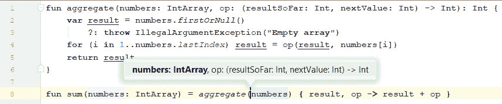

**图 5.1：** 使用“参数信息”查看函数参数名称

### Lambda 和匿名函数

我们如何构造一个函数类型的特定值？一种方法是使用 lambda 表达式，它基本上在不给函数命名的情况下描述一个函数。例如，让我们使用之前的`aggregate()`定义另外两个计算和和最大值的函数：

```kotlin
fun sum(numbers: IntArray) =
    aggregate(numbers, { result, op -> result + op })

fun max(numbers: IntArray) =
    aggregate(numbers, { result, op -> if (op > result) op else result })

fun main() {
    println(sum(intArrayOf(1, 2, 3))) // 6
    println(max(intArrayOf(1, 2, 3))) // 3
}
```

该表达式：

```
{ result, op -> result + op }
```

被称为 lambda 表达式。与函数定义类似，它包含以下内容：

* 参数列表：`result, op`
* 组成 lambda 主体的表达式或语句列表：`result + op`

与函数定义不同，你无法指定返回类型：它是从 lambda 主体自动推断的。此外，体中的最后一个表达式被视为 lambda 结果，因此你不需要在末使用显式的`return`语句。

注意 lambda 参数列表没有包含在括号中。lambda 参数周围的括号留给了所谓的解构声明（de-structuring declarations），我们将在第 6 章，特殊类中讨论。

```kotlin
fun sum(numbers: IntArray) =
    aggregate(numbers) { result, op -> result + op }

fun max(numbers: IntArray) =
    aggregate(numbers) { result, op -> if (op > result) op else result }
```

**IDE Tips：IntelliJ 插件会提醒你 lambda 可以在普通参数列表之外传递的情况，并自动执行必要的代码更改。**

当 lambda 没有参数时，箭头符号`->`可以省略：

```kotlin
fun measureTime(action: () -> Unit): Long {
    val start = System.nanoTime()
    action()
    return System.nanoTime() - start
}
```

在上一节中，我们已经看到了如何使用 lambda 和匿名函数来构造一个新的函数值。但如果我们已经有一个函数定义，并想（例如）将其作为函数值传递给某个高阶函数呢？当然，我们可以像下面的代码所示，将其封装在 lambda 表达式中：

```kotlin
fun check(s: String, condition: (Char) -> Boolean): Boolean {
    for (c in s) {
        if (!condition(c)) return false
    }
    return true
}

fun isCapitalLetter(c: Char) = c.isUpperCase() && c.isLetter()

fun main() {
    println(check("Hello") { c -> isCapitalLetter(c) }) // false
}
```

但在 Kotlin 中，有一种更简洁的方法可以将现有的函数定义用作函数类型的表达式。这是通过使用可调用引用（callable references）实现的：

```kotlin
fun main() {
    println(check("Hello", ::isCapitalLetter)) // false
}
```

`::isCapitalLetter`表达式表示一个函数值，其行为与它引用的`isCapitalLetter()`函数完全一致。

**IDE 提示：IntelliJ 插件提供了一对操作可以将 lambda 表达式转换为可调用引用（如果可行），反之亦然。这些操作可以通过 Alt + Enter 菜单访问（如图 5.4 所示）：**

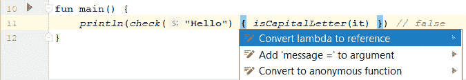

**图 5.4:** 将 lambda 转换为可调用引用

最简单的可调用引用是基于顶级函数或局部函数的。要组合这样的引用，你只需要在函数名前加上`::`运算符即可：

```kotlin
fun evalAtZero(f: (Int) -> Int) = f(0)

fun inc(n: Int) = n + 1

fun main() {
    fun dec(n: Int) = n - 1
    println(evalAtZero(::inc)) // 1
    println(evalAtZero(::dec)) // -1
}
```

可调用引用只能通过其简单名称（simple name）来提及函数，因此，如果一个顶层函数位于另一个包中，必须先对其进行导入。

在类名上应用`::`运算符时，你可以获得该类构造器的可调用引用，如下：

```kotlin
class Person(val firstName: String, val familyName: String)

fun main() {
    val createPerson = ::Person
    createPerson("John", "Doe")
}
```

Kotlin 1.1 引入的`::`运算符另一种形式被称为绑定可调用引用（bound callable reference）。你可以使用它在给定类实例的上下文中引用成员函数：

```kotlin
class Person(val firstName: String, val familyName: String) {
    fun hasNameOf(name: String) = name.equals(firstName, ignoreCase = true)
}

fun main() {
    val isJohn = Person("John", "Doe")::hasNameOf
    println(isJohn("JOHN")) // true
    println(isJohn("Jake")) // false
}
```

还有第三种形式，允许你在不将其绑定到特定实例的情况下引用成员函数。我们将在*带接收者的可调用引用（Callable reference with receiver）*章节中讨论这一点。

注意，可调用引用本身无法区分重载函数。如果编译器无法选择特定的重载版本，你必须提供显式类型：

```kotlin
fun max(a: Int, b: Int) = if (a > b) a else b
fun max(a: Double, b: Double) = if (a > b) a else b

val f: (Int, Int) -> Int = ::max // Ok
val g = ::max                   // Error: ambiguous reference
```

在可调用引用中指定特定函数签名的能力可能会在 Kotlin 的未来版本中添加。由于此原因，目前在可调用引用后使用括号是被保留的，以适应可能的语法改进。如果你想在调用中使用可调用引用，必须将其括在括号中：

```kotlin
fun max(a: Int, b: Int) = if (a > b) a else b

fun main() {
    println((::max)(1, 2)) // 2
    println(::max(1, 2))   // Error: this syntax is reserved for future use
}
```


可调用引用也可以为 Kotlin 属性构造。然而，此类引用本身并不是函数值，而是包含属性信息的反射对象。通过使用 `getter` 属性，我们可以访问对应于 getter 函数的函数值。对于 `var` 声明，`setter` 属性同样允许你引用 `setter`：

```kotlin
class Person(var firstName: String, var familyName: String)
fun main() {
    val person = Person(“John”, “Doe”)
    val readName = person::firstName.getter          // 引用 getter
    val writeFamily = person::familyName.setter // 引用 setter
    println(readName())                       // John
    writeFamily(“Smith”)
    println(person.familyName)              // Smith
}
```

## Java 对比 Kotlin

熟悉 Java 的读者可能会发现 Kotlin 可调用引用与方法引用（method references）之间的相似之处。尽管它们的语义确实相似，但存在一些差异。首先，可调用引用更加多样，这是因为 Kotlin 支持在 Java 中没有对应项的声明，例如顶级函数、局部函数以及属性。其次，方法引用仅在函数式接口的上下文中才有意义。此外，可调用引用不仅是一个函数值，还是一个可以在运行时获取函数属性的反射对象。在*第 10 章，注解与反射*中，我们将详细介绍反射 API。

## 内联函数与属性

使用高阶函数往往带有性能开销，因为每个函数都被表示为一个对象。此外，当 lambda 或匿名函数使用外部作用域的变量时，每次将其传递给高阶调用时都必须。函数值的调用必须通过虚调用进行，因为编译器通常无法进行静态推断。

然而，Kotlin 提供了一种减少使用函数值代价的解决方案。基本思想是在使用处内联高阶函数，用其体替换调用。为了区分此类函数，你需要用 `inline` 修饰符标记它们。

假设我们有一个根据谓词在整数数组中搜索值的函数：

```kotlin
inline fun indexOf(numbers: IntArray, condition: (Int) -> Boolean): Int {
    for (i in numbers.indices) {
        if (condition(numbers[i])) return i
    }
    return -1
}

fun main() {
    println(indexOf(intArrayOf(4, 3, 2, 1)) { it < 3 }) // 2
}
```

由于 `indexOf()` 函数被内联，编译器将用它的体替换调用。这意味着 `main()` 函数基本上等同于以下代码：

```kotlin
fun main() {
    val numbers = intArrayOf(4, 3, 2, 1)
    var index = -1
    for (i in numbers.indices) {
        if (numbers[i] < 3) {
            index = i
            break
        }
    }
    println(index)
}
```

虽然内联函数可能会增加编译代码的大小，但在合理使用时，它们可以提升性能，特别是当涉及的函数较小时。我们在*第 7 章，探索集合与 I/O*中看到的 Kotlin 标准库提供的许多高阶函数都是内联的。

请注意，与某些支持函数内联的编程语言（如 `C++`）不同，Kotlin 中的 `inline` 修饰符并不是一个根据编译器决策可能被忽略的优化提示。被标记为 `inline` 的 Kotlin 函数在可能的情况下总是会被内联的，当无法进行内联时，使用 `inline` 修饰符将被视为编译错误。

前面的示例说明，`inline` 修饰符不仅影响它所作用的函数，还会影响作为其参数的函数值。这反过来限制了在内联函数内部对此类 lambda 的所有可能操作。由于内联的 lambda 在运行时不会作为一个独立的实体存在，因此它们（例如）不能被存储在变量中，也不能传递给非内联函数。对于可内联的 lambda，我们只能做两件事：调用它，或者将其作为可内联参数传递给另一个内联函数：

```kotlin
var lastAction: () -> Unit = {}

inline fun runAndMemorize(action: () -> Unit) {
    action()
    lastAction = action // Error
}
```

出于同样的原因，不允许对可空函数类型的值进行内联：

```kotlin
inline fun forEach(a: IntArray, action: ((Int) -> Unit)?) { // Error
    if (action == null) return
    for (n in a) action(n)
}
```

在这种情况下，我们可以通过用 `noinline` 修饰符标记特定的 lambda 参数来禁止其进行内联：

```kotlin
// Error
inline fun forEach(a: IntArray, noinline action: ((Int) -> Unit)?) {
    if (action == null) return
    for (n in a) action(n)
}
```

请注意，当一个函数没有可内联的参数时，它通常不值得进行内联，因为在调用处替换其函数体不太可能在运行时产生重大的差异。由于这个原因，Kotlin 编译器会对此类函数标记警告。

如果我们尝试在公有内联函数中使用私有（private）成员会怎样？由于内联函数体是被替换而非调用的，它可能会允许某些外部代码破坏封装性。为了避免这种情况，Kotlin 禁止对私有成员进行引用，因为这些成员可能会泄露到外部代码中：

```kotlin
class Person(private val firstName: String,
              private val familyName: String) {
    inline fun sendMessage(message: () -> String) {
        println("$firstName $familyName: ${message()}") // Error
    }
}
```

请注意，如果我们为 `sendMessage()` 函数或其所在的类标记了 `private` 修饰符，代码将可以通过编译，因为 `sendMessage()` 体中对私有成员的引用不会泄露到 `Person` 类之外。

从 1.1 版本开始，Kotlin 支持属性访问器的内联。这对于通过消除函数调用来提高读取/写入属性的性能可能有用。在以下代码中，所有对 `fullName` getter 的调用都被内联了：

```kotlin
class Person(var firstName: String, var familyName: String) {
    var fullName
    inline get() = "$firstName $familyName" // Inline getter
    set(value) { … }              // Non-inline setter
}
```

除了内联单个访问器外，你还可以对属性本身标记 `inline` 修饰符。在这种情况下，编译器将同时内联句 getter 和 setter（如果属性是可变的）：

```kotlin
class Person(var firstName: String, var familyName: String) {
    inline var fullName // Inline getter and setter
    get() = "$firstName $familyName"
    set(value) { … }
}
```

请注意，内联仅支持没有后台字段（backing field）的属性。此外与函数类似，如果你的属性是公有的，你不能引用私有声明：

```kotlin
class Person(private val firstName: String,
              private val familyName: String) {
    inline var age = 0 // Error: property has a backing field
    // Error: firstName and familyName are private
    inline val fullName() = "$firstName $familyName"
}
```

## 非局部控制流

使用高阶函数会对破坏正常控制流的指令（如 `return` 语句）引发一些问题。考虑以下代码：

```kotlin
fun forEach(a: IntArray, action: (Int) -> Unit) {
    for (n in a) action(n)
}

fun main() {
    forEach(intArrayOf(1, 2, 3, 4)) {
        if (it < 2 || it > 3) return
        println(it) // Error
    }
}
```

本意是在数字不符合范围时从 lambda 返回，而不是打印该数字。然而，这段代码将无法编译：这是因为 `return` 语句默认与最近的带有 `fun`、`get` 或 `set` 的闭包相关。因此，在我们的示例中，我们正尝试从 `main()` 函数返回。这种语句称为非局部返回（non-local return），是被禁止的，因为在 JVM 上没有高效的方法允许 lambda 强制返回其闭包函数。解决此问题的一种方法是使用匿名函数：

```kotlin
fun main() {
    forEach(intArrayOf(1, 2, 3, 4), fun(it: Int) {
        if (it < 2 || it > 3) return
        println(it)
    })
}
```

如果我们确实想从 lambda 本身返回，我们需要为 `return` 语句指定上下文名称，类似于 `break` 和 `continue`。通常情况下，上下文名称可以通过标记函数字面量来引入。例如下面的代码为 lambda 分配了 `myFun` 标签：

```kotlin
val action: (Int) -> Unit = myFun@ {
    if (it < 2 || it > 3) return@myFun
    println(it)
}
```

当 lambda 作为参数传递给高阶函数时，可以使用函数的名称作为上下文，无需显式标签：

```kotlin
forEach(intArrayOf(1, 2, 3, 4)) {
    if (it < 2 || it > 3) return@forEach
    println(it)
}
```

普通函数也可以限定返回。可以使用函数名作为上下文，尽管这种限定是多余的：

```kotlin
fun main(args: Array<String>) {
    if (args.isEmpty()) return@main
    println(args[0])
}
```

当 lambda 被内联时，可以使用 `return` 语句从闭包函数返回。这是因为 lambda 体连同调用处一起替换，所以 `return` 语句会被视为直接放置在 `main()` 的体中：

```kotlin
inline fun forEach(a: IntArray, action: (Int) -> Unit) { ... }

fun main() {
    forEach(intArrayOf(1, 2, 3, 4)) {
        if (it < 2 || it > 3) return // Return from main
        println(it)
    }
}
```

存在一种特殊情况：内联 lambda 未直接在接收它的函数体内调用，而是在单独的执行环境中，例如局部函数或局部类的方法。尽管这些 lambda 被内联了，但仍然无法强制返回调用者函数，因为即使内联后它们也会不同的执行栈帧。由于这些原因，此类函数参数的使用默认是被禁止的：

```kotlin
private inline forEach(a: IntArray, action: (Int) -> Unit) = object {
    fun run() {
        for (n in a) {
            action(n) // Error
        }
    }
}
```

为了允许这些操作，我们需要为函数参数标记 `crossinline` 修饰符，这会让函数值保持内联，但禁止在相应的 lambda 中使用非局部返回：

```kotlin
private inline forEach(
    a: IntArray, crossinline action: (Int) -> Unit
) = object {
    fun run() {
        for (n in a) {
            action(n) // Ok
        }
    }
}

fun main() {
    forEach(intArrayOf(1, 2, 3, 4)) {
        if (it < 2 || it > 3) return // Error
        println(it)
    }
}
```

在使用 `break` 和 `continue` 语句时可能会出现非局部控制流问题，因为它们可以指向包含 lambda 的循环。目前，即使该 lambda 被内联，它们也不被支持，尽管在未来的语言版本中可能会添加此类支持：

```kotlin
while (true) {
    forEach(intArrayOf(1, 2, 3, 4)) {
        if (it < 2 || it > 3) break // Error
        println(it)
    }
}
```

## 扩展

在实践中，扩展现有类的需求是非常常见的：随着程序的演进，开发者可能希望为类添加新的函数和属性，从而扩展其 API。但有时，简单地向类添加新代码并不是可行方案，因为目标类可能是某些库的一部分，即使可行，修改它也需要付出巨大的精力。将所有可能的方法放入单个类中可能是不现实的，因为并不是所有方法都会一起使用，因此值得将它们解耦到几个程序单元中。

在 Java 中，这些额外方法通常被封装在工具类中。常见的例子是 `java.util.Arrays` 和 `java.util.Collections` 类，它们包含了扩展 `Collection` 接口能力的方法。此类类的问题在于它们通常会产生不必要的样板代码。例如，Java 中工具方法的典型用法可能如下：

```java
int index = Collections.indexOfSubList(
    Arrays.asList("b", "c", "a"),
    Arrays.asList("a", "b")
)
```

除了会让源代码凌乱外，此类调用还让你无法利用 `IntelliJ` 和 `Eclipse` 等主流 IDE 中为类成员提供的自动补全功能。

这就是 Kotlin 扩展的主要动力，它允许你使用定义在类外部的函数和属性就像它们是该类的成员一样。通过支持开闭原则，它们允许你在不修改现有类的情况下对其进行扩展。

## 扩展函数

扩展函数基本上是一个可以像某个类的成员一样被调用的函数。当你定义这样的函数时，将它的接收者类型放在名称之前，并用点分隔它们。假设我们想为 `String` 类型添加一个函数，该函数可以截断原始字符串，使其长度不超过指定的阈值。一个可能的定义如下：

```kotlin
fun String.truncate(maxLength: Int): String {
    return if (length <= maxLength) this else substring(0, maxLength)
}
```

一旦定义，该函数就可以像 `String` 类的任何成员一样被使用：

```kotlin
fun main() {
    println("Hello".truncate(10)) // Hello
    println("Hello".truncate(3))    // Hel
}
```

注意，在扩展函数的体内部，接收者值可以通过 `this` 表达式访问，类似于类成员。接收者的成员和扩展也可以隐式地访问，而无需使用 `this`，就像我们在 `truncate()` 定义中调用 `substring()` 函数时所的那样。

值得注意的是，扩展函数本身无法突破接收者类型的封装。例如，由于扩展函数定义在类外部，因此它无法访问其私有成员：

```kotlin
class Person(val name: String, private val age: Int)
fun Person.showInfo() = println("$name, $age") // Error: can’t access age
```

然而，扩展函数可以声明在类体内部，使其同时成为成员和扩展。这样的函数被允许访问私有成员，就像类体中的任何其他函数一样。


```kotlin
class Person(val name: String, private val age: Int) {
    // Ok: age is accessible
    fun Person.showInfo() = println("$name, $age")
}
```

我们将在本章后续部分介绍如何使用此类函数。

**IDE 提示：Int IntelliJ 插件可以将类成员转换为扩展。这可以通过光标停留在成员名称上时，在 `Alt + Enter` 菜单中的“Convert member to extension”操作来实现（示例如图 5.5 所示）：**

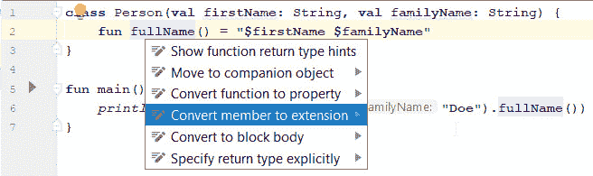

**图 5.5:** 将成员函数转换为扩展

扩展函数可以用于绑定的可调用引用，类似于类成员：

```kotlin
class Person(val name: String, val age: Int)
fun Person.hasName(name: String) = name.equals(this.name, ignoreCase = true)

fun main() {
    val f = Person("John", 25)::hasName
    println(f("JOHN")) // true
    println(f("JAKE")) // false
}
```

如果你既作为类成员又作为扩展定义了具有相同签的函数该怎么办？考虑以下代码：

```kotlin
class Person(val firstName: String, val familyName: String) {
    fun fullName() = "$familyName"
}
fun Person.fullName() = "$firstName"

fun main() {
    Person("John", "Doe").fullName()
}
```

在这个示例中，我们在 `Person` 上定义了两个 `fullName()` 函数，它们的区别在于是先放 `familyName` 还是名字。当面对这种歧义时，编译器总是选择成员，因此原始调用将取决于其文件中是否存在以下语句：

```kotlin
import bad.fullName
```

这同时也保护了内置类。注意，扩展的遮蔽也有副作用：如果你先定义了一个扩展函数，然后添加了相应的类成员，原始调用将改变其含义。但这被认为是可以接受的，因为类成员的更改频率应该低于扩展函数。这也简化了与没有扩展代码的互操作性。

扩展函数可以是局部的。特别是，它们可以嵌套在其他扩展函数：在这种情况下，`this` 表达式意味着内层函数的接收者。如果你需要引用外层函数的接收者，可以使用指定函数名的 `this` 限定形式。这对于在扩展函数内部声明的局部类或匿名对象也是同样的：

```kotlin
private fun String.truncator(max: Int) = object {
    val truncated
        get() = if (length <= max) this@truncator else substring(0, max)
    val original
        get() = this@truncator
}

fun main() {
    val truncator = "Hello".truncator(3)
    println(truncator.original) // Hello
    println(truncator.truncated) // Hel
}
```

IDE 提供了相应的高亮。当顶层扩展函数定义在另一个包中时，在调用之前必须始终导入。例如：

```kotlin
// util.kt
package util
fun String.truncate(maxLength: Int): String {
    return if (length <= maxLength) this else substring(0, maxLength)
}

// main.kt
package main
import util.truncate
fun main() {
    println("Hello".truncate(3))
}
```

由于此类函数无法通过限定名调用，因为限定符的位置被接收者表达式占据了。而非扩展函数的则：

```kotlin
fun truncate(s: String, maxLength: Int): String {
```

```kotlin
return if (s.length<= maxLength) s else s.substring(0, maxLength)
}
```

在没有导入指令的情况下，可以直接调用 `util.truncate("Hello", 3)`。

### Java 对比 Kotlin

你可能一直在想过扩展函数在 Java 虚拟机（JVM）上是如何表示的。答案其实非常简单：扩展函数被编译为带有一个额外参数的方法，该参数代表接收者表达式（receiver expression）。如果我们查看为上述 `truncate()` 函数生成的字节码，将会发现它基本上等同于以下 Java 代码：

```java
public final class UtilKt {
    public static String truncate(String s, int maxLength) {
        return s.length() <= maxLength
        ? s
        : s.substring(0, maxLength)
    }
}
```

这对应于一个非扩展形式的 Kotlin 函数：

```kotlin
fun truncate(s: String, maxLength: Int) =
    if (s.length<= maxLength) s else s.substring(0, maxLength)
```

换句话说，扩展函数本质上是普通函数的语法糖，允许你像调用类成员一样调用它们。

### IDE 技巧

IntelliJ 插件包含一个操作，可以通过更改接收者为参数，自动将扩展函数转换为非扩展函数。要执行此操作，你需要将光标置于接收者类型上，从 `Alt + Enter` 菜单中选择 `Convert receiver to parameter`（将接收者转换为参数），并输入一个新的参数名称（如*图 5.7 所示）。还有一个相反的操作 `Convert parameter to receiver`（将参数转换为接收者），它可以将任意函数参数转换为接收者。后者可以在光标置于参数名称时通过 `Alt + Enter` 使用。

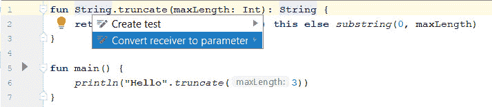

**图 5.7：** “Convert receiver to parameter”操作

值得注意的是，与成员函数和属性不同，扩展可以为可空接收者类型定义。由于可空类型没有自己的成员，这种机制允许你通过从外部引入扩展函数来丰富它们。此类扩展可以在不使用安全调用操作符的情况下调用：

```kotlin
// 可空接收者
fun String?.truncate(maxLength: Int): String {
    if (this == null) return null
    return if (length <= maxLength) this else substring(0, maxLength)
}

fun main() {
    val s = readLine()         // 可空 String
    println(s.truncate(3)) // 这里不需要 ?.
}
```

请注意，如果扩展接收者是可空类型，那么处理空值是扩展属性的职责。

## 扩展属性

与函数类似，Kotlin 允许你定义扩展属性，可以像访问任何成员属性一样访问它。语法也是类似的：要定义扩展属性，需要在其名称前加上接收者类型前缀。让我们来看下面的示例：

```kotlin
val IntRange.leftHalf: IntRange
    get() = start..(start + endInclusive)/2

fun main() {
    println((1..3).leftHalf) // 1..2
    println((3..6).leftHalf) // 3..4
}
```

上述代码为 `IntRange` 类型定义了一个扩展属性 `leftHalf`：它计算了原始范围的左半部分。

成员属性和扩展属性之间的区别在于，后者不能拥有支持字段（backing field），因为没有可靠的方法向类实例添加额外的状态。这意味着扩展属性既不能有初始化器，也不能在访问器内部使用 `field` 关键字。它们也不能是 `lateinit`，因为此类属性依赖于支持字段。出于同样的原因，扩展属性必须有一个显式的 getter，如果是可变的，则要有显式的 setter：

```kotlin
val IntArray.midIndex
    get() = lastIndex/2

var IntArray.midValue
    get() = this[midIndex]
    set(value) {
        this[midIndex] = value
    }

fun main() {
    val numbers = IntArray(6) { it*it } // 0, 1, 4, 9, 16, 25
    println(numbers.midValue)           // 4
    numbers.midValue *= 10
    println(numbers.midValue)          // 40
}
```

然而，扩展属性可以使用委托。但记住，委托表达式无法访问属性接收者；因此，通常将 `lazy` 属性声明为扩展并没有意义，因为正如下面的代码所示，对于接收者类型的每个实例都有相同的值：

```kotlin
val String.message by lazy { “Hello” }

fun main() {
    println(“Hello”.message) // Hello
    println(“Bye”.message)      // Hello
}
```

对象定义可以被视为异常，因为它们只有一个实例：

```kotlin
object Messages
val Messages.HELLO by lazy { “Hello” }

fun main() {
    println(Messages.HELLO)
}
```

通常情况下，可以创建一个能够访问属性接收者的委托。我们将在*第 11 章，领域特定语言*中学习如何实现。

## 伴对象扩展

在 *[第 4 章，类与对象]* 中，我们引入了伴随对象（companion object），它是类的一个特殊对象，允许你定义与类本身相关的函数和属性。伴对象扩展是一个类似的概念。与函数类似，Kotlin 允许你定义扩展属性，可以像访问任何成员属性一样访问它。语法也是类似的：要定义扩展属性，需要在其名称前加上接收者类型前缀。让我们来看下面的示例：

```kotlin
val IntRange.leftHalf: IntRange
    get() = start..(start + endInclusive)/2

fun main() {
    println((1..3).leftHalf) // 1..2
    println((3..6).leftHalf) // 3..4
}
```

上述代码为 `IntRange` 类型定义了一个扩展属性 `leftHalf`：它计算了原始范围的左半部分。

成员属性和扩展属性之间的区别在于，后者不能拥有支持字段，因为没有可靠的方法向类实例添加额外的状态。这意味着扩展属性既不能有初始化器，也不能在访问器内部使用 `field` 关键字。它们也不能是 `lateinit`，因为此类属性依赖于支持字段。出于同样的原因，扩展属性必须有一个显式的 getter，如果是可变的，则要有显式的 setter：

```kotlin
val IntArray.midIndex
    get() = lastIndex/2

var IntArray.midValue
    get() = this[midIndex]
    set(value) {
        this[midIndex] = value
    }

fun main() {
    val numbers = IntArray(6) { it*it } // 0, 1, 4, 9, 16, 25
    println(numbers.midValue)           // 4
    numbers.midValue *= 10
    println(numbers.midValue)          // 40
}
```

然而，扩展属性可以使用委托。但记住，委托表达式无法访问属性接收者；因此，通常将 `lazy` 属性声明为扩展并没有意义，因为正如下面的代码所示，对于接收者类型的每个实例都有相同的值：

```kotlin
val String.message by lazy { “Hello” }

fun main() {
    println(“Hello”.message) // Hello
    println(“Bye”.message)      // Hello
}
```

对象定义可以被视为异常，因为它们只有一个实例：

```kotlin
object Messages
val Messages.HELLO by lazy { “Hello” }

fun main() {
    println(Messages.HELLO)
}
```

通常情况下，可以创建一个能够访问属性接收者的委托。我们将在*第 11 章，领域特定语言*中学习如何实现。

## Lambda 和带有接收者的函数类型

与函数和属性类似，Kotlin 允许为 Lambda 和匿名函数利用扩展接收者。此类函数值通过带有接收者的特殊函数类型来描述。让我们重写 `aggregate()` 示例，使用带有接收者的函数值而不是双参数函数：

```kotlin
fun aggregate(numbers: IntArray, op: Int.(Int) -> Int): Int {
    var result = numbers.firstOrNull()
    ?: throw IllegalArgumentException("Empty array")
    for (i in 1..numbers.lastIndex) result = result.op(numbers[i])
    return result
}
```

```kotlin
fun sum(numbers: IntArray) = aggregate(numbers) { op -> this + op }
```

在这种情况下，作为参数传递的任何 Lambda 获得一个隐式接收者，我们可以通过此表达式访问它：

` op -> this + op }`

同样，我们可以为匿名函数使用扩展语法。接收者类型指定在函数的参数列表之前：

```kotlin
fun sum(numbers: IntArray) = aggregate(numbers, fun Int.(op: Int) = this + op)
```

与扩展函数的定义不同，带有接收者的函数值可以作为非扩展函数调用，并将接收者放在所有后续参数之前。我们可以写成，例如：

```kotlin
fun aggregate(numbers: IntArray, op: Int.(Int) -> Int): Int {
    ...
}
```


```kotlin
for (i in 1..numbers.lastIndex) {
    result = op(result, numbers[i]) // 非扩展调用
}
return result
```

基本上，带有接收者的函数类型的非字面量值，与对应类型（其中接收者作为第一个参数）的值可以自由互换，就像它们具有相同类型一样。这是因为这些值在运行时表示本质上是相同的：

```kotlin
val min1: Int.(Int) -> Int = { if (this < it) this else it }
val min2: (Int, Int) -> Int = min1
val min3: Int.(Int) -> Int = min2
```

但注意，虽然可以将带有接收者的函数值既作为扩展方式也可以作为非扩展方式（将接收者作为第一个参数）进行调用，但不带接收者的函数值只能使用非扩展语法调用：

```kotlin
fun main() {
    val min1: Int.(Int) -> Int = { if (this < it) this else it }
    val min2: (Int, Int) -> Int = min1
    println(3.min1(2))    // Ok：作为扩展函数调用 min1
    println(min1(1, 2)) // Ok：作为非扩展函数调用 min1
    println(3.min2(2))    // Error：不能作为扩展函数调用 min2
    println(min2(1, 2)) // Ok：作为非扩展函数调用 min2
}
```

带有接收者的 Lambda 为你提供了一个强大的工具，可以用于构建类 DSL 的 API。我们将在`第 11 章，领域特定语言。`中讨论这一问题。

### 带有接收者的可调用引用

在 Kotlin 中，你还可以使用定义带有接收者的函数值的可调用引用。此类引用可以基于类成员，也可以基于扩展声明。在语法上，它们与绑定可调用引用相似，但通过接收者类型而不是表达式：

```kotlin
fun aggregate(numbers: IntArray, op: Int.(Int) -> Int): Int {
    var result = numbers.firstOrNull()
    ?: throw IllegalArgumentException("Empty array")
    for (i in 1..numbers.lastIndex) result = result.op(numbers[i])
    return result
}

fun Int.max(other: Int) = if (this > other) this else other

fun main() {
    val numbers = intArrayOf(1, 2, 3, 4)
    println(aggregate(numbers, Int::plus)) // 10
    println(aggregate(numbers, Int::max))     // 4
}
```

在前面的代码中，`Int::plus`指的是内置类`Int`的成员函数`plus()`（它的作用与`+`运算符完全相同），而`Int::max`指的是在包含文件中定义的扩展函数。两种情况下的语法是相同的。

得益于我们在上一节提到的扩展与非扩展函数类型之间的隐式转换，在期望带有接收者的函数类型的范围内也可以使用不带接收者的可调用引用。例如，我们可以将双参数的可调用引用`reference ::max`传递给类型`Int.(Int) -> Int`的参数：

```kotlin
fun aggregate(numbers: IntArray, op: Int.(Int) -> Int): Int {
    var result = numbers.firstOrNull()
    ?: throw IllegalArgumentException("Empty array")
    for (i in 1..numbers.lastIndex) result = result.op(numbers[i])
    return result
}

fun max(a: Int, b: Int) = if (a > b) a else b

fun main() {
    println(aggregate(intArrayOf(1, 2, 3, 4), ::max))
}
```

反之亦然：当期望的函数类型是不带接收者的类型时，可以使用带有接收者的可调用引用。在一个稍微修改的示例中，成员函数和扩展函数的可调用引用被用双参数函数类型`(Int, Int) -> Int`的值：

```kotlin
fun aggregate(numbers: IntArray, op: (Int, Int) -> Int): Int {
    var result = numbers.firstOrNull()
    ?: throw IllegalArgumentException("Empty array")
    for (i in 1..numbers.lastIndex) result = op(result, numbers[i])
    return result
}

fun Int.max(other: Int) = if (this > other) this else other

fun main() {
    println(aggregate(intArrayOf(1, 2, 3, 4), Int::plus)) // 10
    println(aggregate(intArrayOf(1, 2, 3, 4), ::max)) // 4
}
```

注意，目前不支持对于声明为成员的扩展函数的可调用引用，因为目前`::`表达式没有方法指定多个接收者类型。

## 作用域函数

Kotlin 标准库包含一组函数，允许你引入一个临时作用域，你可以在其中引用给定表达式的值。有时，这有助于避免在包含作用域中显式引入局部变量来持有表达式，并简化代码。这些函数通常被称为作用域函数。

它们的基本效果是执行你提供的作为参数的 Lambda。区别在于以下几点的组合：

* 上下文表达式作为接收者还是普通参数传递；

* Lambda 是扩展的还是不是扩展的；

* 函数返回 Lambda 的值还是上下文表达式的值。

总而言，有五个标准的作用域函数：`run`、`let`、`with`、`apply`、`also`。在本节中，我们将讨论如何使用它们来简化代码。注意，作用域函数应该谨慎使用，因为滥用可能会导致代码可读性下降，并容易混淆`this`或`it`的含义。

### run / with

`run()`函数是一个扩展函数，它接受一个 Lambda 并返回其结果。基本用法是对对象状态进行配置，然后计算结果：

```kotlin
class Address {
    var zipCode: Int = 0
    var city: String = ""
    var street: String = ""
    var house: String = ""
    fun post(message: String): Boolean {
        println("Message for $zipCode, $city, $street: $message")
        return message == "OK"
    }
}

fun main() {
    val isReceived = Address().run {
        // Address 实例可以使用 this
        zipCode = 123456
        city = "London"
        street = "Baker Street"
        house = "221b"
        post("Hello!") // 返回
    }
    if (!isReceived) {
        println("Message is not delivered")
    }
}
```

如果没有`run`函数，我们需要为`Address`实例引入一个变量；从而在整个函数体中可用，如果我们只需要执行单个`post()`动作，这可能是不需要的。使用如`run()`之类的函数可以提供更细粒度的局部可见性控制。

注意结果也可能是`Unit`类型：

```kotlin
fun Address.showCityAddress() = println("$street, $house")

fun main() {
    Address().run {
        zipCode = 123456
        city = "London"
        street = "Baker Street"
        house = "221b"
        showCityAddress()
    }
}
```

`with()`函数与`run()`非常相似：唯一的区别是`with()`不是扩展函数，因此上下文表达式作为普通参数传递而不是接收者。该函数的常见用法是在作用域内对上下文表达式的成员函数和属性进行分组：

```kotlin
fun main() {
    val message = with (Address("London", "Baker Street", "221b")) {
        "Address: $city, $street, $house"
    }
    println(message)
}
```

在前面的示例中，我们将利用`this`实例成员无需限定符即可访问的特性。如果没有作用域函数，我们必须编写以下代码：

```kotlin
fun main() {
    val addr = Address("London", "Baker Street", "221b")
    val message = "Address: ${addr.city}, ${addr.street}, ${addr.house}"
    println(message)
}
```

换句话说，我们必须引入一个额外的变量，并显式地使用特定实例`addr`来限定`Address`的所有成员。

### 无上下文运行

Kotlin 标准库还提供了`run()`的重载版本，它没有上下文表达式，并直接返回 lambda 的值。lambda 本身既没有接收者（receiver）也没有参数。

该函数的主要用例是在某些需要表达式的上下文中使用代码块。考虑以下代码：

```kotlin
class Address(val city: String, val street: String, val house: String) {
    fun asText() = "$city, $street, $house"
}

fun main() {
    val address = Address("London", "Baker Street", "221b")
    println(address.asText())
}
```

如果我们想从标准输入中读取地址组件呢？我们可以为每个组件引入一个独立的变量：

```kotlin
fun main() {
    val city = readLine() ?: return
    val street = readLine() ?: return
    val house = readLine() ?: return
    val address = Address(city, street, house)
    println(address.asText())
}
```

但这将它们置于`main()`中任何其他局部变量相同的作用域内，而像`city`这样的变量在创建特定`Address`实例的上下文中才有意义。将所有变量内联并得到如下内容是一个相当糟糕的选择，会导致代码难以易读：

```kotlin
fun main() {
    val address = Address(readLine() ?: return,
    readLine() ?: return,
    readLine() ?: return)
    println(address.asText())
}
```

看着这样的代码，我们无法立即判断每个`readLine()`的什么含义。地道的解决方案是由`run()`提供的：

```kotlin
fun main() {
    val address = run {
        val city = readLine() ?: return
        val street = readLine() ?: return
        val house = readLine() ?: return
        Address(city, street, house)
    }
    println(address.asText())
}
```

由于`run`是一个内联函数（inline function），我们可以在 lambda 内部使用`return`语句退出外部函数，就像它是某种内置控制结构一样。

注意，单独使用代码块语句不起作用，因为该块被处理为 lambda。这就是为什么`run()`函数被添加到标准库的原因：

```kotlin
fun main() {
    val address = {
        val city = readLine() ?: return     // 错误：不允许使用 return
        val street = readLine() ?: return // 错误：不允许使用 return
        val house = readLine() ?: return    // 错误：不允许使用 return
        Address(city, street, house)
    }
    println(address.asText()) // 错误：没有 asText() 方法
}
```

### let

`let`函数与`run`类似，但它接受单参数 lambda 而不是扩展 lambda。因此，上下文表达式的值由 lambda 参数表示。`let`的返回值与其 lambda 的返回值相同。此函数通常用于避免在外部作用域中引入新变量：

```kotlin
class Address(val city: String, val street: String, val house: String) {
    fun post(message: String) {}
}

fun main() {
    Address("London", "Baker Street", "221b").let {
        // 通过 it 参数访问 Address 实例
        println("To city: ${it.city}")
        it.post("Hello")
    }
}
```

与其它 lambda 一样，你可以为了可读性或消除歧义引入自定义参数名：

```kotlin
fun main() {
    Address("London", "Baker Street", "221b").let { addr ->
        // 通过 addr 访问 Address 实例
        println("To city: ${addr.city}")
        addr.post("Hello")
    }
}
```

`let`的常见用例是提供一种简洁的方式，通过安全检查将可空值传递给非空函数。在前一章中，我们学习了安全调用运算符（safe call operator），它允许你带有可空接收者调用函数。但如果问题的值必须作为普通参数传递呢？考虑以下：

```kotlin
fun readInt() = try {
    readLine()?.toInt()
} catch (e: NumberFormatException) {
    null
}

fun main(args: Array<String>) {
    val index = readInt()
    val arg = if (index != null) getOrNull(index) else null
    if (arg != null) {
        println(arg)
    }
}
```

`getOrNull()`函数在给定索引有效时返回数组，否则返回 null。由于它的参数是非空的，我们不能直接将`readInt()`的结果传递给`getOrNull()`：这就是为什么我们需要上面的`if`语句来实现智能转换（smart cast）为非空。不过，我们可以通过`let`来简化代码：

```kotlin
val arg = index?.let { getOrNull(it) }
```

`let`调用只有在 index 不为空时才会执行，因此编译器知道在 lambda 内部`it`参数是非空的。

### apply / also 函数

`apply()`函数是一个扩展函数，它接受一个扩展 lambda 并返回其接收者的值。该函数的常见用例是配置对象状态，与`run()`相反，它后面跟的是某些结果计算：


```kotlin
class Address {
    var city: String = ""
    var street: String = ""
    var house: String = ""
    fun post(message: String) { }
}

fun main() {
    val message = readLine() ?: return
    Address().apply {
        city = "London"
        street = "Baker Street"
        house = "221b"
    }.post(message)
}
```

还有一个类似的函数 `also()`，它接受一个单参数 lambda：

```kotlin
fun main() {
    val message = readLine() ?: return
    Address().also {
        it.city = "London"
        it.street = "Baker Street"
        it.house = "221b"
    }.post(message)
}
```

## 作为类成员的扩展

在之前的节中，我们讨论将扩展函数作为类成员的可能性。现在让我们仔细观察这些扩展。

在类内部定义扩展函数或属性时，这种定义会自动获得两个接收者，而普通成员和顶层扩展只有一个。定义中提到的接收者类型实例被称为扩展接收者（extension receiver），而包含扩展的类实例被称为调度接收者（dispatch receiver）。两个接收者都可以通过 `this` 表达式表示，并限定为所在的类名（针对调度接收者）或扩展名称（针对扩展接收者）。未限定的 `this` 表达式通常指向最近的闭包声明的接收者。因此，通常情况下，除非你在局部声明（如类、嵌套扩展函数或带有接收者的 lambda）内部使用，否则它就是扩展接收者。

让我们考虑一个说明两种接收者的示例：

```kotlin
class Address(val city: String, val street: String, val house: String)
class Person(val firstName: String, val familyName: String) {
    fun Address.post(message: String) {
        // 隐式 this：扩展接收者 (Address)
        val city = city
        // 未限定的 this：扩展接收者 (Address)
        val street = this.city
        // 限定的 this：扩展接收者 (Address)
        val house = this@post.house
        // 隐式 this：调度接收者 (Person)
        val firstName = firstName
        // 限定的 this：调度接收者 (Person)
        val familyName = this@Person.familyName
        println("From $firstName, $familyName at $city, $street, $house:")
        println(message)
    }
    fun test(address: Address) {
        // 调度接收者：隐式
        // 扩展接收者：显式
        address.post("Hello")
    }
}
```

当我们在 `test()` 调用 `post()` 函数时，分发接收者（dispatch receiver）会自动提供，因为 `test()` 是 `Person` 类的成员。另一方面，扩展接收者（extension receiver）是作为地址表达式显式传递的。

同样，当我们以不同的方式提供 `Person` 类的当前实例时，也可以调用 `post()` 函数：例如作为扩展接收者或外部类的实例：

```kotlin
class Address(val city: String, val street: String, val house: String)

class Person(val firstName: String, val familyName: String) {
    fun Address.post(message: String) { }
    inner class Mailbox {
        fun Person.testExt(address: Address) {
            address.post("Hello")
        }
    }
}

fun Person.testExt(address: Address) {
    address.post("Hello")
}
```

如果我们有的是 `Address` 类型的接收者呢？假设我们想在 `Address` 类体内部调用 `post()`：

```kotlin
class Address(val city: String, val street: String, val house: String) {
    fun test(person: Person) {
        person.post("Hello") // Error: method post() is not defined
    }
}

class Person(val firstName: String, val familyName: String) {
    fun Address.post(message: String) { }
}
```

这行不通，因为类型 `Person` 的分发接收者必须已经在作用域内。可以使用作用域函数来解决这个问题，将 `post()` 调用封装在带有 `Person` 接收者的扩展 lambda 中：

```kotlin
class Address(val city: String, val street: String, val house: String) {
    fun test(person: Person) {
        with(person) {
            // 隐式的分发接收者和扩展接收者
            post()
        }
    }
}

class Person(val firstName: String, val familyName: String) {
    fun Address.post(message: String) { }
}
```

这种技巧也可以在 `Address` 或 `Person` 类及其扩展函数之外调用 `post()`：

```kotlin
class Address(val city: String, val street: String, val house: String)
class Person(val firstName: String, val familyName: String) {
    fun Address.post(message: String) { }
}

fun main() {
    with(Person("John", "Watson")) {
        Address("London", "Baker Street", "221b").post("Hello")
    }
}
```

这些示例表明，关于双接收器函数和属性的规则可能会变得非常困惑。因此，通常建议将其作用域限制在包含它的内部：

```kotlin
class Address(val city: String, val street: String, val house: String)
class Person(val firstName: String, val familyName: String) {
    // 无法在 Person 类之外使用
    private fun Address.post(message: String) { }
    fun test(address: Address) = address.post("Hello")
}
```

一个特别混乱且容易出错、值得避免的情况是当分发接收者和扩展接收者的类型相同时，如下例所示：

```kotlin
class Address(val city: String, val street: String, val house: String) {
    fun Address.post(message: String) { }
}
```

双接收器成员的一个有趣示例是声明在对象内部（特别是 `companion object`）内部的扩展。此类扩展可以像类似于顶层扩展的方式被导入和使用：

```kotlin
import Person.Companion.parsePerson

class Person(val firstName: String, val familyName: String) {
    companion object {
        fun String.parsePerson(): Person? {
            val names = split(" ")
            return if (names.size == 2) Person(names[0], names[1]) else null
        }
    }
}

fun main() {
    val person = "John Watson".parsePerson()
    println(person?.firstName) // John
}
```

枚举（Enums）在某种程度上与对象声明相似，这是因为它们定义了一组代表特定类型实例的全局常量。与对象类似，它们不被允许在无法保证此类定义可以作为全局常量可用的上下文中。例如，你不能将枚举定义放在内部类或函数体中：

```kotlin
fun main() {
    enum class Direction { NORTH, SOUTH, WEST, EAST } // 错误
}
```

## 穷尽的 `when` 表达式

就像任何其他类型的值一样，枚举变量可以使用 `when` 表达式与特定值进行比较。然而，使用枚举时还有一个额外的好处：如果 `when` 表达式是穷尽的（即它包含了枚举类型中所有可能值的分支），你就可以省略 `else` 分支：

```kotlin
enum class Direction {
    NORTH, SOUTH, WEST, EAST
}

fun rotateClockWise(direction: Direction) = when (direction) {
    Direction.NORTH -> Direction.EAST
    Direction.EAST -> Direction.SOUTH
    Direction.SOUTH -> Direction.WEST
    Direction.WEST -> Direction.NORTH
}
```

穷尽形式的 `when` 表达式减少了编写可能因上下文变化（如添加新的枚举值）而崩溃的代码的概率。假设我们添加的是一个 `else` 分支：

```kotlin
fun rotateClockWise(direction: Direction) = when (direction) {
    Direction.NORTH -> Direction.EAST
    Direction.EAST -> Direction.SOUTH
    Direction.SOUTH -> Direction.WEST
    Direction.WEST -> Direction.NORTH
    else ->
    throw IllegalArgumentException("Invalid direction: $direction")
}
```

这段代码在为 `Direction` 枚举添加新值之前运行良好：

```kotlin
enum class Direction {
    NORTH, SOUTH, WEST, EAST,
    NORTH_EAST, NORTH_WEST, SOUTH_EAST, SOUTH_WEST
}
```

现在，像 `rotateClockWise(Direction.NORTH_EAST)` 这样的调用将抛出异常。然而，如果我们使用不带 `else` 的形式，错误可以在编译时被捕捉，因为编译器会针对 `rotateClockWise()` 体中非穷尽的 `when` 表达式报错。

**Java 与 Kotlin：** 注意，与 Java 的 `switch` 语句不同（它要求我们在 `case` 子句中使用枚举值的未限定名称），在 `when` 表达式中 Kotlin 枚举常量除非导入，否则必须使用枚举类的名称进行限定。将前面的 `rotateClockWise()` 函数与类似的 Java 方法进行比较：

```java
public Direction rotateClockWise(Direction d) {
    switch (d) {
        case NORTH: return Direction.EAST;
        case EAST: return Direction.SOUTH;
        case SOUTH: return Direction.WEST;
        case WEST: return Direction.NORTH;
    }
    throw new IllegalArgumentException("Unknown value: " + d);
}
```

我们可以通过在包含文件的开头导入它们来避免对枚举量的显式限定：

```kotlin
import Direction.*

enum class Direction {
    NORTH, SOUTH, WEST, EAST
}

fun rotateClockWise(direction: Direction) = when (direction) {
    NORTH -> EAST
    EAST -> SOUTH
    SOUTH -> WEST
    WEST -> NORTH
}
```

内部上穷尽的 `when` 表达式包含一个隐式的 `else` 分支，当没有分支匹配主体表达式时，它会抛出特殊的 `NoWhenBranchMatchedException` 类的特殊异常。

**IDE 提示：** IntelliJ 插件可以检测不必要的 `else` 分支，并在 `when` 表达式是穷尽的情况下建议删除它们（如图 6.1 所示）：

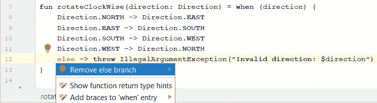

**图 6.1：** 穷尽 `when` 表达式中冗余的 `else` 分支

## 带有自定义成员的枚举

与其他类类似，枚举可以有它们自己的成员。此外，如前面的示例所示，你还可以定义自己的扩展函数和属性。

枚举类可以包含普通类允许的任何定义，包括函数、属性、主构造函数和辅助构造函数、初始化块、内部/非嵌套类以及对象（无论是否是伴对象）。枚举类体中的任何此类声明必须放在枚举常量列表之后。在这种情况下，常量列表本身必须以分号结束（这是 Kotlin 中可以使用分号的极少数情况之一）。

```kotlin
enum class Day {
    MONDAY, TUESDAY, WEDNESDAY, THURSDAY, FRIDAY, SATURDAY, SUNDAY;
    val lowerName get() = name.toLowerCase()
    fun isWork() = this == SATURDAY || this == SUNDAY
}

fun main() {
    println(Day.MONDAY.isWork()) // false
    println(Day.WEDNESDAY.lowerName) // wednesday
}
```

```kotlin
enum class RainbowColor(val isCold: Boolean) {
    RED(false), ORANGE(false), YELLOW(false), BLUE(true), INDIGO(true), VIOLET(true);
    val isWarm = !isCold
}

fun main() {
    println(RainbowColor.BLUE.isCold) // true
    println(RainbowColor.RED.isWarm) // true
}
```

### 使用枚举类的公共成员

Kotlin 中的所有枚举类都是 `kotlin.Enum` 类的子类型，该类包含一组公共函数和属性。除了少数 API 差异，该类与其 Java 对应的类 `java.lang.Enum` 非常相似。

任何枚举值有一对属性 `ordinal` 和 `name`，它们分别包含其在枚举类中定义的从零开始的索引值名称：

```kotlin
enum class Direction {
    NORTH, SOUTH, WEST, EAST
}

fun main() {
    println(Direction.WEST.name) // WEST
    println(Direction.WEST.ordinal) // 2
}
```

特定枚举类的值根据它们在枚举体中的定义顺序相互比较。与 Java 类似，枚举的等效性是基于身份的：


```kotlin
fun main() {
    println(Direction.WEST == Direction.NORTH) // false
    println(Direction.WEST != Direction.EAST) // true
    println(Direction.EAST < Direction.NORTH) // false
    println(Direction.SOUTH >= Direction.NORTH) // true
}
```

枚举值的比较操作基本上是根据 `ordinal` 属性提供的索引进行的。

**Java 与 Kotlin：** 尽管 Java 和 Kotlin 的枚举都隐式实现了 `Comparable` 接口，但在 Java 中不能对枚举值应用 `<` 或 `>` 等运算符。

每个枚举类还有一组隐式方法，可以像调用伴对象成员一样在类名上调用。`valueOf()` 方法根据名称返回枚举值，如果名称无效则抛出异常：

```kotlin
fun main() {
    println(Direction.valueOf("NORTH")) // NORTH
}
```

```kotlin
println(Direction.valueOf("NORTH_EAST")) // Exception: Invalid name
}
```

`values()` 方法会返回一个包含所有枚举值的数组，按照它们定义的顺序排列。注意，该数组每次调用时都会重新创建，因此对其中一个值的更改不会影响其他：

```kotlin
enum class WeekDay {
    MONDAY, TUESDAY, WEDNESDAY, THURSDAY, FRIDAY, SATURDAY, SUNDAY
}
```

```kotlin
private val weekDays = WeekDay.values()

val WeekDay.nextDay get() = weekDays[(ordinal + 1) % weekDays.size]
```

从 Kotlin 1.1 开始，你可以使用泛型顶层函数 `enumValues()` 和 `enumValueOf()` 分别代替 `values()` 和 `valueOf()` 方法：

```kotlin
fun main() {
    val weekDays = enumValues<WeekDay>()
    println(weekDays[2])                // WEDNESDAY
    println(enumValueOf<WeekDay>("THURSDAY")) // THURSDAY
}
```

## 数据类 (Data classes)

Kotlin 提供了一种实用的功能，用于声明主要目标为存储某些数据的类。这种功能被称为**数据类 (data classes)**，它允许你使用自动生成的某些基本操作实现，例如相等性或转换为 `String`。通过数据类，你还可以利用解构声明 (destructuring declarations)，这让你能够通过一个单一且简洁的语言结构，将类属性提取并放入独立的局部变量中。在本节中，我们将考虑数据类的各种可能性。

### 数据类及其操作

例如考虑以下类：

```kotlin
class Person(val firstName: String,
             val familyName: String,
             val age: Int)
```

如果我们想通过相等性来比较它的实例会怎样？与 Java 类似，引用类型的值默认情况下如果它们具有相同的身份（即引用同一个对象），则它们被认为是相等的。实例字段的值是不考虑在内的：

```kotlin
fun main() {
    val person1 = Person("John", "Doe", 25)
    val person2 = Person("John", "Doe", 25)
    val person3 = person1
    println(person1 == person2) // false, 身份不同
    println(person1 == person3) // true, 身份相同
}
```

如果我们的类需要自定义的相等性，我们通常通过 `equals()` 方法来实现（更多内容请参见 [第 7 章，探索集合和 I/O] 以及 [第 8 章，理解类层次结构]），并配合相应的 `hashCode()` 方法，这允许将类实例作为 `HashMap` 等集合中的键。对于某些特定的类称为数据类），Kotlin 可以根据类属性列表自动生成这些方法。让我们稍微修改一下示例：

```kotlin
data class Person(val firstName: String,
                 val familyName: String,
                 val age: Int)

fun main() {
    val person1 = Person("John", "Doe", 25)
    val person2 = Person("John", "Doe", 25)
    val person3 = person1
    println(person1 == person2) // true
    println(person1 == person3) // true
}
```

现在，两种比较都返回 `true`，因为编译器自动提供了相等操作的实现，该实现比较主构造函数中声明的属性的值。这同样适用于取决于同一组属性的哈希码。

注意，属性值的比较也是基于它们的 `equals()` 方法的，因此相等性的深度取决于涉及属性的类型。考虑以下示例：

```kotlin
data class Person(val firstName: String,
                 val familyName: String,
                 val age: Int)
data class Mailbox(val address: String, val person: Person)

fun main() {
    val box1 = Mailbox("Unknown", Person("John", "Doe", 25))
    val box2 = Mailbox("Unknown", Person("John", "Doe", 25))
    println(box1 == box2) // true
}
```

由于 `String`、`Person` 和 `Mailbox` 都实现了基于内容的相等性，`Mailbox` 实例的比较取决于其自身的属性以及相应的 `Person` 实例。然而，如果我们在 `Person` 类之前去掉了 `data` 修饰符，结果将会改变，因为 `Person` 属性将通过它们的身份进行比较：

```kotlin
class Person(val firstName: String,
             val familyName: String,
             val age: Int)
data class Mailbox(val address: String, val person: Person)

fun main() {
    val box1 = Mailbox("Unknown", Person("John", "Doe", 25))
    val box2 = Mailbox("Unknown", Person("John", "Doe", 25))
    println(box1 == box2) // false: Person 实例身份不同
}
```

`hashCode()` 方法同样返回一个对象哈希码，它取决于主构造函数中声明的所有属性的哈希码。除了生成 `equals()`/`hashCode()`，数据类还提供了 `toString()` 方法的实现，它可以将实例转换为字符串：

```kotlin
fun main() {
    val person = Person("John", "Doe", 25)
    println(person) // Person(firstName=John, familyName=Doe, age=25)
}
```

注意，只有声明为主构造函数参数的属性才用于相等性/哈希码的 `toString` 转换。任何其他属性都不会影响结果：

```kotlin
data class Person(val firstName: String, val familyName: String) {
    var age = 0
}

fun main() {
    val person1 = Person("John", "Doe").apply { age = 25 }
    val person2 = Person("John", "Doe").apply { age = 26 }
    println(person1 == person2) // true
}
```

任何数据类都隐式提供了 `copy()` 函数，允许你创建当前实例的副本，并可能更改某些属性。它的签名与数据类的主构造函数相同，但每个参数都带有一个属性当前值的默认值。`copy()` 函数通常使用命名参数调用以提高代码的可读性：

```kotlin
fun Person.show() = println("$firstName $familyName: $age")

fun main() {
    val person = Person("John", "Doe", 25)
    person.show()                            // John Doe: 25
    person.copy().show()                         // John Doe: 25
    person.copy(familyName = "Smith").show()   // John Smith: 25
    person.copy(age = 30, firstName = "Jane").show() // Jane Doe: 30
}
```

轻松复制实例的能力鼓励了对不可变数据类的使用。虽然允许 `var` 属性，但将数据类设计为不可变通常是合理的。使用不可变数据可以简化代码推理并使其更不容易出错，特别是在多线程项目中。此外，不可变性是正确使用对象作为 map 键的前决条件：在这种情况下违反不可变性可能会导致完全意想不到的行为，正如我们在 [第 7 章，探索集合和 I/O] 中看到的那样。

Kotlin 标准库包含了两个通用数据类，可以用于持有一对或三元组值：

```kotlin
fun main() {
    val pair = Pair(1, "two")
    println(pair.first + 1)    // 2
    println("${pair.second}!") // two!
    val triple = Triple("one", 2, false)
    println("${triple.first}!") // one!
    println(triple.second – 1)  // 1
    println(!triple.third)      // true
}
```

`Pair` 通过中缀操作构造：

```kotlin
val pair = 1 to "two"
println(pair.first + 1)    // 2
println("${pair.second}!") // two!
```

注意，在大多数情况下，使用自定义数据类更为合理，因为它们允许为类及其属性选择具有意义意义的名称，从而提高了代码的可读性。

除了我们刚刚看到的自动生成函数外，数据类（data classes）还提供了一种实用的能力，可以在单个定义中将其组成属性提取到独立的变量中。在下一节中，我们将考虑如何使用解构声明（destructuring declarations）来实现。

### 解构声明

考虑以下示例：

```kotlin
import kotlin.random.Random

data class Person(val firstName: String,
                 val familyName: String,
                 val age: Int)
fun newPerson() = Person(readLine()!!,
                        readLine()!!,
                        Random.nextInt(100))
fun main() {
    val person = newPerson()
    val firstName = person.firstName
    val familyName = person.familyName
    val age = person.age
    if (age < 18) {
        println("$firstName $familyName is under-age")
    }
}
```

我们正在提取 `Person` 属性的值并用于后续计算。但由于 `Person` 是数据类，我们可以使用更简洁的语法来定义对应的局部变量：

```kotlin
val (firstName, familyName, age) = person
```

这是一个解构声明，它通过允许使用括号括的标识符列表而不是单个变量名，泛化了局部变量语法。每个名称对应一个独立的变量定义，该变量由 `=` 之后编写的数据类实例的对应属性初始化。

注意，属性是根据它们在数据类构造函数中的位置映射到变量的，而不是根据名称。因此，虽然代码：

```kotlin
val (firstName, familyName, age) = Person("John", "Doe", 25)
println("$firstName $familyName: $age")
```

产生了预期的结果 `John Doe: 25`，但后续行：

```kotlin
val (familyName, firstName, age) = Person("John", "Doe", 25)
println("$firstName $familyName: $age")
```

将给你 `Doe John: 25.`。

**IDE 提示：对于特定情况，当解构声明中的变量名与数据类属性匹配但编写顺序错误时，IntelliJ 插件会报告警告，这有助于定位可能的 bug 来源。建议重命名变量以匹配属性，或者更改其在解构声明中的位置（参见图 6.2 中的示例）：**

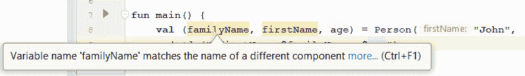

**图 6.2：** 解构声明中变量顺序错误

解构声明整体可能没有类型。然而，在必要时，可以为组件变量指定显式类型：

```kotlin
val (firstName, familyName: String, age) = Person("John", "Doe", 25)
```

解构声明包含的组件可能比数据类中的属性要少。在这种情况下，构造函数末尾缺失的属性不会被提取：

```kotlin
val (firstName, familyName) = Person("John", "Doe", 25)
println("$firstName $familyName") // John Doe

val (name) = Person("John", "Doe", 25)
println(name)                   // John
```

如果需要跳过开头或中间的某些属性怎么办？从 Kotlin 1.1 开始，你可以用 `_` 符号替换未使用的组件，类似于 lambda 中未使用的参数：

```kotlin
val (_, familyName) = Person("John", "Doe", 25)
println(familyName) // Doe
```

通过将 `val` 替换为 `var`，你将获得一组可变变量：

```kotlin
var (firstName, familyName) = Person("John", "Doe", 25)
firstName = firstName.toLowerCase()
familyName = familyName.toLowerCase()
println("$firstName $familyName") // john doe
```

注意，`val/var` 修饰符作用于解构声明的所有组件，因此你可以声明所有变量为可变的，或者一次性全部全部为不可变的，而没有中间选项。

解构也可以用于 `for` 循环：

```kotlin
val pairs = arrayOf(1 to "one", 2 to "two", 3 to "three")
for ((number, name) in pairs) {
    println("$number: $name")
}
```

从 Kotlin 1.1 开始，可以解构 lambda 参数：


```kotlin
fun combine(person1: Person,
            person2: Person,
            folder: ((String, Person) -> String)): String {
    return folder("", person1), person2
}

fun main() {
    val p1 = Person("John", "Doe", 25)
    val p2 = Person("Jane", "Doe", 26)
    // 不使用解构：
    combine(p1, p2) { text, person -> "$text ${person.age}" }
    // 使用解构：
    combine(p1, p2) { text, (firstName) -> "$text $firstName" }
    combine(p1, p2) { text, (_, familyName) -> "$text $familyName" }
}
```

注意，与普通的 lambda 列表不同，解构参数被包含在括号中。

由于解构声明目前仅支持局部变量，因此它们不能在类体或文件的顶层声明：

```kotlin
data class Person(val firstName: String,
                 val familyName: String,
                 val age: Int)
val (firstName, familyName) = Person("John", "Doe", 25) // 错误
```

注意，由于解构声明目前无法嵌套：

```kotlin
data class Person(val firstName: String,
                 val familyName: String,
                 val age: Int)
data class Mailbox(val address: String, val person: Person)
fun main() {
    val (address, (firstName, familyName, age)) = Mailbox("Unknown", Person("John", "Doe", 25))
}
```

虽然数据类提供了开箱即用的解构支持，但通常它可以为任何类型实现。在第 11 节 领域特定语言中，我们将讨论如何使用运算符重载来实现。

## 内联类（Inline classes）

创建包装类在编程实践中非常常见：毕竟这是著名的适配器模式的精髓。假设例如，我们希望程序具有货币的概念。虽然金额本质上是一个数字，但我们不希望将其与其他含义完全不同的数字混合。因此，我们引入了一些包装类和工具函数：

```kotlin
class Dollar(val amount: Int) // 分
class Euro(val amount: Int)   // 分
fun Dollar.toEuro() = ...
fun Euro.toDollar() = ...
```

这种方法的问题在于运行时开销，因为每当我们引入一个新的金额时都会创建一个额外的对象。当包装的值是基本类型时（例如我们的货币类），问题变得更加显著，因为直接操作数值不需要任何对象分配。使用包装类代替基本类型会阻止许多优化并影响程序性能。

为了解决这些问题，Kotlin 1.3 引入了一种称为内联类（inline class）的新类。

### 定义内联类

要定义内联类，需要在类名之前添加 `inline` 关键字：

```kotlin
inline class Dollar(val amount: Int) // 分
inline class Euro(val amount: Int)   // 分
```

此类类必须在主构造中声明一个不可变属性。在运行时，类实例将作为该属性的值表示，而不会创建包装对象。这就是“内联”一词的起源：类似于内联函数的体的体会替换其调用处一样，内联类包含的数据也会替换其使用处。

内联类可以有自己的属性和函数：

```kotlin
inline class Dollar(val amount: Int) {
    fun add(d: Dollar) = Dollar(amount + d.amount)
    val isDebt get() = amount < 0
}

fun main() {
    println(Dollar(15).add(Dollar(20)).amount) // 35
    println(Dollar(-100).isDebt)             // true
}
```

内联类属性（Inline class properties）可能没有任何状态。这是因为状态必须与主构造函数中的属性一起被内联，而目前 `Kotlin` 编译器仅支持单属性内联。这意味着不支持任何备用字段（backing fields）、`lateinit` 也不支持委托属性（包括 `lazy`）。内联类属性可能只具有显式的访问器，例如我们示例中的 `isDebt`。

在`内联类主体`（`inline class body`）中定义 `var` 属性是可能的，尽管这通常没有太大意义，因为内联类可能没有可变状态。

另一个限制是无法使用初始化块（initialization blocks）。这是因为内联类的构造函数在运行时可能执行任何自定义代码，因此对 `Dollar(15)` 的构造函数调用必须表现得像简单提到数字 `15` 一样。

在*第 2 章，语言基础*中，我们提到过如果程序尝试在某些语文中使用原始值，可能会被隐式装箱（boxed），这需要指向真实对象的引用，例如将它们赋值给可空类型的变量。这同样适用于内联类：为了优化考虑，编译器将尽可能优先使用解包的值。然而，当无此选择时，编译器将退而使用你的类，就像它不是内联类一样。为了更好地近似编译器的行为，你可以使用以下经验法则：当内联类实例被恰好作为对应类型的值使用而没有转换为其他类型时，它就可以被内联。考虑以下示例：

```kotlin
fun safeAmount(dollar: Dollar?) = dollar?.amount ?: 0

fun main() {
    println(Dollar(15).amount)      // 内联
    println(Dollar(15))             // 未内联：作为 Any? 使用
    println(safeAmount(Dollar(15))) // 未内联：作为 Dollar? 使用
}
```

另一个值得注意的点是内联类的实验性状态。目前，该语言功能的设计尚未定型，并可能在未来的版本中发生变化。由于由于原因，Kotlin 1.3 中对内联类的任何定义默认都会带有一个编译器警告。可以通过向 Kotlin 编译器传递特殊的命令行参数 `-XXLanguage:+InlineClasses` 来抑制此警告。

**IDE 提示：** 当使用 IntelliJ 时，你可以通过在高亮元素上从 `Alt + Enter` 菜单选择适当的操作，在项目中自动启用或禁用内联类（或任何其他实验性语言功能，如无符号整数），如*图 6.3*。

**图 6.3：** 在 IntelliJ 项目中启用内联类

## 无符号整数

从 1.3 版本开始，Kotlin 标准库包含一组在内有有符号类型之上实现的无符号整数类型。与内联类一样，通常这些类型包含一个实验性功能，因此目前的使用会产生警告，除非你在项目中显式地允许它们（参见*图 6.4*）：

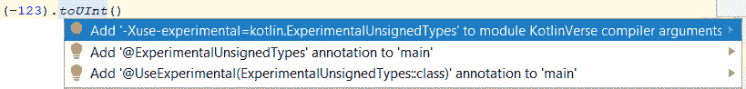

**图 6.4：** 在 IntelliJ 项目中启用无符号类型支持

每个无符号类型的名称与其对应的有符号类型名称相似，仅多了一个字母 `U`（*表 6.1*）：

| **类型** | **大小（字节）** | **范围** |
| :--- | :--- | :--- |
| `UByte` | 1 | 0 到 255 |
| `UShort` | 2 | 0 到 65535 |
| `UInt` | 4 | 0 到 2³² – 1 |
| `ULong` | 8 | 0 到 2⁶⁴ – 1 |

**表 6.1：** 无符号整数类型

为了表示一个无符号值，你可以在整数字面量后添加 `u` 或 `U` 后缀。字面量的类型由其预期类型决定，例如由该值初始化的变量类型。如果没有指定预期类型，则字面量类型根据其大小应该是 `UInt` 或 `ULong`：

```kotlin
val uByte: UByte = 1u      // 显式 UByte
val uShort: UShort = 100u // 显式 UShort
val uInt = 1000u         // 自动推断为 UInt
val uLong: ULong = 1000u  // 显式 ULong
val uLong2 = 1000uL     // 由于 L 后缀显式为 ULong
```

然而，有符号类型和无符号类型之间是不兼容的。因此，例如你不能将无符号值赋值给有符号类型的变量，反之亦然：

```kotlin
val long: Long = 1000uL // 错误
```

无符号类型和有符号类型可以使用 `XXX()` 方法之一相互转换为另一种：

```kotlin
println(1.toUByte())      // 1, Int -> UByte
println((-100).toUShort()) // 65436, Int -> UShort
println(200u.toByte())    // -56, UInt -> Byte
println(1000uL.toInt())   // 1000, ULong -> Int
```

无符号 API 与有符号整数 API 非常相似。特别是，任何一对无符号值都可以通过算术运算符 `+`、`-` 组合：

```kotlin
println(1u + 2u) // 3
```

无符号值还可以通过 `*`、`/` 组合：

```kotlin
println(10u * 2u) // 20
println(10u / 3u) // 3
```

无符号值还可以通过 `and`、`or`、`xor` 进行位运算：

```kotlin
println(1u and 2u) // 0
println(1u or 2u)  // 3
println(1u xor 2u) // 3
```

`UInt` 和 `ULong` 还支持左移和右移操作：

```kotlin
println(1u shl 2) // 4
println(1u shr 2) // 0
```

在下一章中，我们将重点关注 Kotlin 标准库。特别是，我们将涵盖基础集合类型，对数组和字符串进行更深入的探讨，并考虑 I/O 和网络功能以及一些实用的实用函数。

## 问题

1. 什么是 `enum class`？枚举类提供哪些内置操作？
2. 在枚举类上使用 `when` 表达式的具体细节是什么？
3. 如何定义带有自定义函数或属性的 `enum class`？
4. 什么是 `data class`？对于任何 `data class` 会自动生成哪些操作？如何拷贝 `data class` 实例？
5. 什么是解构声明（destructuring declaration）？可以在哪里使用它？
6. `inline classes`（内联类）的作用是什么？类要成为 `inline` 需要满足什么要求？
7. 描述 Kotlin 的无符号类型及其内置操作。与有符号整数相比，它们的具体之处是什么？

## 第 7 章 探索集合与 I/O

在本章中，我们将查看 Kotlin 标准库的两个主要部分。第一部分将致力于集合 API：在这里我们将讨论常见的集合类型及其基本操作，并对集合及其数据的各种操作进行全面处理，例如元素访问工具、测试集合谓词、过滤和提取集合部分、聚合、转换和排序。在第二部分中，我们将关注 I/O API，并讨论简化 I/O 流创建和数据访问的工具，以及一些常见的文件系统操作。

### 结构

* 集合 (Collections)
* 文件与 I/O 流 (Files and I/O streams)

### 目标

理解 Kotlin 集合类型，并学习使用 Kotlin 标准库对集合数据进行简洁且符合习惯的操作，以及使用 I/O 流 API 扩展。

## 集合 (Collections)

集合是一个用于存储一组元素的对象。在第 2 章，语言基础 中，我们已经讨论了此类对象的一个示例，即数组，它允许你保留属于某些共同类型的固定数量元素。然而，Kotlin 标准库提供了更丰富的集合功能，包括基于不同数据结构（如数组、链表、哈希表等）的各种类，以及操作集合及其数据的全面 API：过滤、聚合、转换、排序等。在本节中，我们将详细介绍集合库能为 Kotlin 开发者提供什么。

值得注意的是，几乎所有操作集合的操作都是内联函数（inline functions）。因此，使用它们的便利性不会带来任何与函数调用和 lambda 相关的性能损失。

## 集合类型 (Collection types)

Kotlin 中的集合类型可以分为四大类：数组、可迭代（iterables）、序列（sequences）和映射（maps）。由于数组已经是第 2 章，语言基础 中的一个主要课题，在本节中，我们将关注剩余的三三个类。

与数组类似，集合类型是泛型的：当指定特定集合的类型时，你也需要指定其元素的类型：例如，`List<String>` 表示一个字符串列表，而 `Set<Int>` 表示一个 `Int` 值的集合。

基础集合类型的轮纲可以用下面的图表示（图 7.1）：

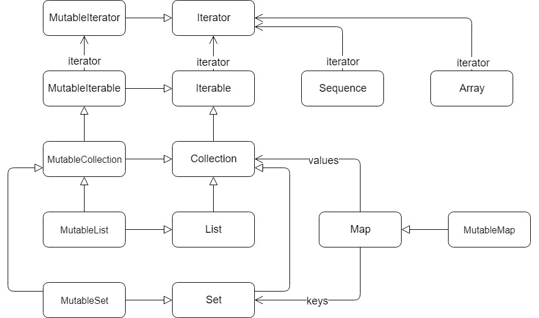

**图 7.1:** Kotlin 集合类型

## 可迭代对象 (Iterables)

可迭代对象由 `Iterable<T>` 类型表示，代表集合，集合通常是即时的（eager）且有状态的（stateful）。有状态意味着此类集合将其元素存储在实例中，而不是保留一个可以延迟检索它们的生成器函数。另一方面，即时意味着集合元素在创建时就被初始化了，而不是在之后的某个点才延迟计算。

可迭代类型本身与其 Java 对应物非常相似：它提供单一的 `iterator()` 方法，返回一个能够遍历元素的对象。这允许使用 Kotlin 的 `for` 循环处理任何可迭代对象：

```kotlin
val list = listOf("red", "green", "blue") // 创建新列表
for (item in list) {
    print(item + " ")
} // 输出 red green blue
```

**Java 对比 Kotlin：** Kotlin 的 `Iterator` 类型与 Java 基本相同：它包含两个方法：`hasNext()` 检查迭代器是否到达集合的末尾，`next()` 返回下一个集合元素。唯一的区别是缺少 `remove()` 方法，它被移动到了 `MutableIterator`。

与 Java 相比，Kotlin 可迭代对象的一个主要特性是可变集合和不可变集合之间的区别。不可变集合的内容在创建后无法更改，而可变集合通常可以通过添加或删除元素随时更新。注意，集合的可变性与持有集合实例引用的可变性无关：它意味着更改该引用所指向的数据的能力。例如，你可以将可变集合放在不可变变量中；在这种情况下，你不能更改变量使其指向其他集合，但可以添加或删除集合元素：

```kotlin
val list = ArrayList<String>()
list.add("abc") // 正确：更改集合数据
list = ArrayList<String>() // 错误：无法重新赋值变量
```

可变可迭代对象的基础类型由 `MutableIterable` 接口表示。

不可变集合类型的一个有用特性是它们的协变性（covariance）。这意味着如果 `T` 是 `U` 的子类型，那么 `Iterable<T>` 就是 `Iterable<U>` 的子类型。对于其他集合相关的类型如 `Iterator`, `Collection`, `List`, `Set` 和 `Map` 也是如此。它特别允许你编写以下代码：

```kotlin
fun processCollection(c: Iterable<Any>) { }
fun main() {
    val list = listOf("a", "b", "c") // List<String>
    processCollection(list) // 正确：将 List<String> 作为 Iterable<Any> 传递
}
```

然而，这对于可变集合不起作用。否则，我们就可以写出如下代码，例如向字符串列表添加整数：

```kotlin
fun processCollection(c: MutableCollection<Any>) { c.add(123) }
fun main() {
    val list = arrayListOf("a", "b", "c") // ArrayList<String>
    processCollection(list) // !!!
}
```

在第 9 章，泛型 中，我们将详细详细讨论协变性问题。

## 集合、列表与集合 (Collections, Lists, and Sets)

可迭代对象的一个重要子类由 `Collection` 接口及其可变子类型 `MutableCollection` 表示。这是许多标准可迭代实现的基础类。`Collection` 的继承者通常属于以下一类：

* 列表（由接口 `List` 和 `MutableList` 表示）是有序的元素集合，支持基于索引的元素访问。列表的常见实现有 `ArrayList`（通过索引快速随机访问）和 `LinkedList`（可以快速添加或删除元素，但通过索引查找现有元素需要线性时间）。
* 集合（`Set`）是唯一元素的集合。元素的顺序取决于具体实现：


`HashSet` 基于哈希表实现，并根据元素的哈希值对元素进行排序。通常，这种排序依赖于 `hashCode()` 方法的具体实现，因此可以被认为是不可预测的。

`LinkedHashSet` 同样基于哈希表，但保留了插入顺序：换句话说，元素的迭代顺序与它们被插入到集合的顺序相同。

`TreeSet` 是一种基于二叉搜索树的实现；它根据某些比较规则维护一个稳定的元素排序，该规则可以由元素本身实现（如果它们继承了 `Comparable` 接口），也可以以独立的 `Comparator` 对象的形式提供。

在 JVM 平台上，实现这些接口的具体类由相应的 JDK 集合表示。常见的 Java 类如 `HashMap` 或 `ArrayList` 已经无缝集成到 Kotlin 库中。

**Java 与 Kotlin：** 在 Kotlin 代码中，通常不需要使用 `java.util` 包中的类。大多数标准集合（如 `ArrayList`）可以通过 `kotlin.collections` 包中的别名引用，该包会自动导入到所有 Kotlin 文件中。

## 序列 (Sequences)

与可迭代对象（iterables）类似，序列提供了 `iterator()` 方法，用于遍历其内容。然而，它们背后的意图是不同的，因为序列应该是惰性的（lazy）。大多数序列实现并不在实例化时初始化元素，而只在需要时进行计算。许多序列实现还是无状态的，这意味着它们只保留惰性生成集合元素所需的常量数量的数据。相比之下，可迭代对象通常消耗与元素数量成正比的内存。

与可迭代对象不同，大多数序列实现是内部的，并不直接使用。相反，新序列通过特殊函数创建，我们将在后续章节中讨论这些函数。

**Java 与 Kotlin：** 熟悉 Java 的读者可能会发现序列与 Java 8 引入的流（streams）之间的相似之处。从 Kotlin 1.2 开始，标准库提供了 `asSequence()` 扩展函数，可以将 Java 流封装为 Kotlin 序列。

## 映射 (Maps)

Map 是一个键值对的集合，其中键是唯一的。虽然 map 本身不是 `Collection` 的子类型，但它的内容可以以这种形式呈现：特别地，你可以获取所有键的集合、所有值的集合，以及由 `Map.Entry` 和 `MutableMap.MutableEntry` 接口表示的键值对集合。

由于 map 包含两种不同的元素（键和值），它们的类型有两个参数：例如，`Map<Int, String>` 是一个将 `Int` 键与 `String` 值关联起来的 map。

map 的标准实现包括 `HashMap`、`LinkedHashMap` 和 `TreeMap`，它们的属性与相应的 `Set` 实现相似。

`AbstractMap` 和 `AbstractMutableMap` 类可以作为占位符用于实现你自己的 map。

## 可比较类与比较器 (Comparables and Comparators)

与 Java 类似，Kotlin 支持 `Comparable` 和 `Comparator` 类型，这些类型可以用于某些集合操作。`Comparable` 实例拥有自然排序：每个实例都有 `compareTo()` 函数，可用于与其他相同类型的实例进行比较。因此，通过让你的类型成为 `Comparable` 的继承者，你自动允许了 `<` 和 `>` 等操作，此外，你还可以对具有相应元素类型的集合应用排序操作。假设我们希望 `Person` 类根据全名具有自然顺序。其实现看起来如下：

```kotlin
class Person(
    val firstName: String,
    val familyName: String,
    val age: Int
) : Comparable<Person> {
    val fullNameget() = "$firstName $familyName"
    override fun compareTo(p: Person) = fullName.compareTo(p.fullName)
}
```

关于 `compareTo()` 函数的约定与 Java 相同：当当前实例大于其他实例时返回正数，当较小时返回负数，当两个实例相等时返回零。`compareTo()` 的实现被认为应该与 `equals()` 函数兼容。

在许多情况下，一个给定的类可以通过多种方式进行比较。例如，我们可以仅根据名或姓、根据年龄或根据这些属性的各种组合来对 `Person` 实例的集合进行排序。由于这个原因，Kotlin 库提供了比较器（comparator）的概念。与 Java 类似，`Comparator<T>` 类的实例提供了 `compare()` 函数，它接收两个类型 `T` 的实例并按照与 `compareTo()` 相同的约定返回比较结果。在 Kotlin 中，可以根据比较 lambda 表达式简洁地构建比较器：

```kotlin
val AGE_COMPARATOR = Comparator<Person>{ p1, p2 ->
    p1.age.compareTo(p2.age)
}
```

或者，你可以使用 `compareBy()` 或 `compareByDescending()` 函数提供一个可比较的值来代替原始对象：

```kotlin
val AGE_COMPARATOR = compareBy<Person>{ it.age }
val REVERSE_AGE_COMPARATOR = compareByDescending<Person>{ it.age }
```

比较器实例随后可以传递给某些感知排序函数，例如 `sorted()` 或 `max()`。你可以在后续关于聚合函数和集合排序的章节中找到示例。

## 创建集合 (Creating a Collection)

在 *第 2 章，语言基础* 中，我们已经看到过如何使用构造函数或 `arrayOf()` 等标准函数来创建数组实例。许多标准集合类也可以以类似的方式构造。例如，像 `ArrayList` 或 `LinkedHashSet` 等类可以像 Java 一样通过普通的构造函数调用创建：

```kotlin
val list = ArrayList<String>()
list.add("red")
list.add("green")
println(list) // [red, green]

val set = HashSet<Int>()
set.add(12)
set.add(21)
set.add(12)
println(set)    // [12, 21]

val map = TreeMap<Int, String>()
map[20] = "Twenty"
map[10] = "Ten"
println(map) // {10=Ten, 20=Twenty}
```

我们还有类似于 `arrayOf()` 的函数，它们接受可变参数并产生标准集合的实例：

- `emptyList()`/`emptySet()`：不可变列表/集合的实例；

- `listOf()`/`setOf()`：创建一个由参数支持不可变列表/集合（对于列表，它等同于 `Arrays.asList()`）；

- `listOfNotNull()`：创建一个过滤空值的不可变列表；

- `mutableListOf()`/`mutableSetOf()`：创建一个可变列表/集合默认实现（内部分别是 `ArrayList` 和 `LinkedHashSet`）；

- `arrayListOf()`：创建一个 `ArrayList`；

- `hashSetOf()`/`linkedSetOf()`/`sortedSetOf()`：分别创建一个新的 `HashSet`/`LinkedHashSet`/`TreeSet`；

让我们来看一些示例：

```kotlin
val emptyList = emptyList<String>()
println(emptyList) // []
emptyList.add("abc") // Error: add is unresolved

val singletonSet = setOf("abc")
println(singletonSet) // [abc]
singletonSet.remove("abc") // Error: remove is unresolved

val mutableList = mutableListOf("abc")
println(mutableList) // [abc]
mutableList.add("def")
mutableList[0] = "xyz"
println(mutableList) // [xyz, def]

val sortedSet = sortedSetOf(8, 5, 7, 1, 4)
println(sortedSet) // [1, 4, 5, 7, 8]
sortedSet.add(2)
println(sortedSet) // [1, 2, 4, 5, 7, 8]
```

同样也提供了构建 map 的函数：

- `emptyMap()`：不可变空 map 的实例；

- `mapOf()`：创建一个新的不可变 map（内部是 `LinkedHashMap`）；

- `mutableMapOf()`：创建一个可变 map 的默认实现（内部是 `LinkedHashMap`）；

- `hashMapOf()`/`linkedMapOf()`/`sortedMapOf()`：创建一个新的 `HashMap`/`LinkedHashMap`/`TreeMap`；

请注意，上述 map 函数接收一个 `Pair` 对象的可变参数列表，可以通过 `to` 中间符操作简洁地构造它：

```kotlin
val emptyMap = emptyMap<Int, String>()
println(emptyMap)        // {}
emptyMap[10] = "Ten" // Error: set is unresolved
val singletonMap = mapOf(10 to "Ten")
println(singletonMap)    // {10=Ten}
singletonMap.remove("abc") // Error: remove is unresolved
val mutableMap = mutableMapOf(10 to "Ten")
println(mutableMap) // {10=Ten}
mutableMap[20] = "Twenty"
mutableMap[100] = "Hundred"
mutableMap.remove(10)
println(mutableMap) // {20=Twenty, 100=Hundred}
val sortedMap = sortedMapOf(3 to "three", 1 to "one", 2 to "two")
println(sortedMap) // {1=one, 2=two, 3=three}
sortedMap[0] = "zero"
println(sortedMap) // {0=zero, 1=one, 2=two, 3=three}
```

或者，你也可以创建一个可变 map 并使用 `set()` 方法或索引运算符来填充它，以避免创建过多的 `Pair` 实例。

列表也可以类似于数组进行构造，通过指定其大小以及一个将索引映射到元素值的函数：

```kotlin
println(List(5) { it*it }) // [0, 1, 4, 9, 16]
val numbers = MutableList(5) { it*2 }
println(numbers) // [0, 2, 4, 6, 8]
numbers.add(100)
println(numbers) // [0, 2, 4, 6, 8, 100]
```

创建已知元素序列的最简单方法是使用 `sequenceOf()` 函数，它接收可变数量的参数。或者，你可以通过调用 `asSequence()` 函数将现有集合（如数组、可迭代对象或 map）转换为序列：

```kotlin
println(sequenceOf(1, 2, 3).iterator().next())            // 1
println(listOf(10, 20, 30).asSequence().iterator().next()) // 10
println(
    mapOf(1 to "One", 2 to "Two").asSequence().iterator().next()
)                                                     // 1=One
```

注意，在 map 上调用 `asSequence()` 会得到一个 map 条目的序列。

另一个选项是基于某些生成器函数创建序列。这种情况通过一对 `generateSequence()` 函数实现。第一个函数接收一个无参数函数，该函数计算下一个序列元素。序列生成将持续，直到该函数返回 `null`。例如，以下代码创建了一个序列，读取程序输入，直到遇到非数字或输入耗尽：

```kotlin
val numbers = generateSequence{ readLine()?.toIntOrNull() }
```

第二个 `generateSequence()` 函数接收一个初始值和一个单参数函数，该函数根据上一个元素生成新的序列元素。与第一种情况一样，当该函数返回 `null` 时生成停止：

```kotlin
// 无限序列（带溢出）：1, 2, 4, 8,…
val powers = generateSequence(1) { it*2 }
// 有限序列：10, 8, 6, 4, 2, 0
val evens = generateSequence(10) { if (it >= 2) it - 2 else null }
```

自 Kotlin 1.3 起，构造序列的另一种方法是使用特殊的构建器（builder），它允许你分部分提供序列元素。该构建器由 `sequence()` 函数实现，该函数接受一个带有 `SequenceScope` 接收类型的扩展 lambda。该类型引入了一组函数，可用于向新序列追加元素：

- `yield()`：添加单个元素；

- `yieldAll()`：添加指定迭代器、可迭代对象或序列中的所有元素。

注意，元素是惰性添加的：`yield()`/`yieldAll()` 的调用只有在请求相应的序列块时才会执行。考虑以下示例：

```kotlin
val numbers = sequence {
    yield(0)
    yieldAll(listOf(1, 2, 3))
    yieldAll(intArrayOf(4, 5, 6).iterator())
    yieldAll(generateSequence(10) { if (it < 50) it*3 else null })
}
println(numbers.toList()) // [0, 1, 2, 3, 4, 5, 6, 10, 30, 90]
```

由 `yield()`/`yieldAll()` 函数实现的序列构建器是可挂起的计算（suspendable computations），这是一项强大的功能，在多线程应用中特别有用。在本节中我们想要提到的最后一组函数处理集合转换：例如，它们允许你根据数组的内容创建列表，或将序列转换为集合：

```kotlin
println(listOf(1, 2, 3).toSet()) // [1, 2, 3]
println(arrayOf("red", "green", "blue").toSortedSet()) // [blue, green, red]
println(mapOf(1 to "one", 2 to "two", 3 to "three").toList()) // [(1, one), (2, two)]
```

请注意 `contains()`/`containsAll()` 的行为取决于 `equals()` 方法的正确实现。如果你将自定义类的实例作为集合元素，请确保在需要时实现了基于内容的相等性判断。

`MutableCollection` 类型引入了用于添加和删除元素的方法。考虑以下示例：

```kotlin
val list = arrayListOf(1, 2, 3)
list.add(4)                 // 添加单个元素：      [1, 2, 3, 4]
list.remove(3)              // 删除单个元素： [1, 2, 4]
list.addAll(setOf(5, 6))    // 并集：       [1, 2, 4, 5, 6]
list.removeAll(listOf(1, 2))  // 差集：      [4, 5, 6]
list.retainAll(listOf(5, 6, 7)) // 交集：  [5, 6]
list.clear()                // 移除所有：      []
```

你还可以使用 `+=` 和 `-=` 运算符来代替 `add()`/`remove()`/`addAll()`/`removeAll()` 调用：

```kotlin
list += 4
list -= 3
list += setOf(5, 6)
list -= listOf(1, 2)
```

可变和不可变集合都支持 `+` 和 `-` 运算符，它们会产生一个新的集合而保持原始集合不变：

```kotlin
println(listOf(1, 2, 3) + 4)           // [1, 2, 3, 4]
println(listOf(1, 2, 3) - setOf(2, 5)) // [1, 3]
```

你也可以对不可变集合使用 `+=` 和 `-=`，但语义完全不同：对于不可变集合，它们充当赋值的缩写，因此只能应用于可变变量。


```kotlin
val readOnly = listOf(1, 2, 3)
readOnly += 4 // 错误：不能赋值给 val

var mutable = listOf(1, 2, 3)
mutable += 4  // 正确
```

然而，通常情况下应该避免此类代码，因为它在每次赋值时都会隐式地创建一个新的集合对象，这可能会影响程序性能。

**IDE 提示：IntelliJ 插件会警告此类赋值，建议使用可变集合而非不可变集合（参见图 7.3）。**

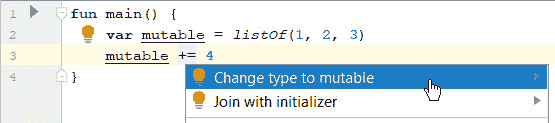

**图 7.3:** 将不可变集合替换为可变集合

`list` 了一些通过索引访问其元素的方法，类似于数组：

```kotlin
val list = listOf(1, 4, 6, 2, 4, 1, 7)
println(list.get(3))          // 2
println(list[2])              // 6
println(list[10])             // 异常
println(list.indexOf(4))     // 1
println(list.lastIndexOf(4)) // 4
println(list.indexOf(8))     // -1
```

注意，索引符号通常比调用`get()`方法更优。当列表是可变的，其元素也可以通过索引进行更改：

```kotlin
val list = arrayListOf(1, 4, 6, 2, 4, 1, 7)
list.set(3, 0)      // [1, 4, 6, 0, 4, 1, 7]
list[2] = 1         // [1, 4, 1, 0, 4, 1, 7]
list.removeAt(5)    // [1, 4, 1, 0, 4, 7]
list.add(3, 8)      // [1, 4, 1, 8, 0, 4, 7]
```

`subList()`函数创建了一个由起始索引（包含）和结束索引（不包含）指定的列表特定段的包装器。它与原始集合共享数据，在可变列表的情况下，会反映其数据：

```kotlin
val list = arrayListOf(1, 4, 6, 2, 4, 1, 7)
val segment = list.subList(2, 5) // [6, 2, 4]
list[3] = 0
println(segment[1]) // 0
segment[1] = 8
println(list[3]) // 8
```

`Set` 本身没有引入任何操作。然而，它们对`Collection`方法的实现确保不会向集合添加重复元素。

`Map` 接口的方法允许你通过键检索值，并提供对整个键值集合的访问。让我们考虑一个示例：

```kotlin
val map = mapOf(1 to "I", 5 to "V", 10 to "X", 0 to "L")
println(map.isEmpty())      // false
println(map.size)           // 4
println(map.get(5))         // V
println(map[10])            // X
println(map[100])           // null
println(map.getOrDefault(100, "?")) // ?
println(map.getOrElse(100) { "?" }) // ?
println(map.containsKey(1))   // true
println(map.containsValue("C")) // false
println(map.keys)           // [1, 5, 10, 0]
println(map.values)         // [I, V, X, L]
println(map.entries)        // [1=I, 5=V, 10=X, 0=L]
```

`MutableMap` 引入了基础修改方法，并支持`+`和`-`运算符：

```kotlin
val map = sortedMapOf(1 to "I", 5 to "V")
map.put(100, "C")           // {1=I, 5=V, 100=C}
map[500] = "D"             // {1=I, 5=V, 100=C, 500=D}
map.remove(1)              // {5=V, 100=C, 500=D}
map.putAll(mapOf(10 to "X")) // {5=V, 10=X, 100=C, 500=D}
map += 50 to "L"            // {5=V, 50=L, 100=C, 500=D} // 注：此处示例逻辑根据 map 内容调整
```

*(注：由于原文文本中存在部分代码块的逻辑重复或断裂，翻译时已根据 Kotlin 语法进行了最小化对齐以确保可读性)*

另外需要提到的是对数组和列表的解构支持，它允许你提取前 5 个元素。但注意，如果你尝试提取的元素多于集合中的元素，解构将抛出异常：

```kotlin
val list = listOf(1, 2, 3)
val (x, y) = list     // 1, 2
val (a, b, c, d) = list // 异常
```

### 集合条件

检查某些集合是否满足特定条件是一项常见任务。因此，Kotlin 库包含一组函数，用于实现基本检查，例如测试给定的谓词是否适用于集合元素。

`all()`函数在集合所有元素都满足给定的`predicate`时返回`true`。该函数适用于任何集合对象，包括数组、可迭代对象、序列和 map。对于 map，`predicate`参数是一个 map 条目：

```kotlin
println(listOf(1, 2, 3, 4).all { it < 10 })         // true
println(listOf(1, 2, 3, 4).all { it % 2 == 0 }) // false
println(
    mapOf(1 to "I", 5 to "V", 10 to "X")
    .all { it.key == 1 || it.key % 5 == 0 }
)                                              // true
// 1, 3, 9, 27, 81
val seq = generateSequence(1) { if (it < 50) it*3 else null }
println(seq.all { it % 3 == 0 })                // false
println(seq.all { it == 1 || it % 3 == 0 })     // true
```

`none()`函数测试相反的条件：当没有集合元素满足`predicate`时，返回`true`：

```kotlin
println(listOf(1, 2, 3, 4).none { it > 5 }) // true
println(
    mapOf(1 to "I", 5 to "V", 10 to "X").none { it.key % 2 == 0 }
)                                            false
// 1, 3, 9, 27, 81
val seq = generateSequence(1) { if (it < 50) it*3 else null }
println(seq.none { it >= 100 })                // true
```

此类函数的另一个是`any()`，当至少有一个集合元素满足`predicate`时，返回`true`：

```kotlin
println(listOf(1, 2, 3, 4).any { it < 0 })        // false
println(listOf(1, 2, 3, 4).any { it % 2 == 0 }) // true
println(
    mapOf(1 to "I", 5 to "V", 10 to "X").any { it.key == 1 }
)                                              // true
// 1, 3, 9, 27, 81
val seq = generateSequence(1) { if (it < 50) it*3 else null }
println(seq.any { it % 3 == 0 })                // true
println(seq.any { it > 100 })                   // false
```

对于空集合，`all()`和`none()`函数返回`true`，而`any()`返回`false`。这三个函数都可以利用类似于德·摩根定律（De Morgan’s law）的关系相互表示：

```kotlin
c.all{ p(it) } == c.none { !p(it) }
c.none{ p(it) } == !c.any { p(it) }
```

记住，`all()`、`none()`和`any()`应用无限序列时可能会无限运行。例如，以下代码永远不会终止：

```kotlin
// 0, 1, 2, 3, 4, 0, 1, 2, 3, 4, 0
val seq = generateSequence(0) { (it + 1) % 5 }
println(seq.all { it < 5 })
```

`any()`和`none()`函数还有不带任何参数的重载版本，它们仅检查集合是否为空：

```kotlin
println(emptyList<String>().any())  // false
println(emptyList<String>().none()) // true
println(listOf(1, 2, 3).any())     // true
println(listOf(1, 2, 3).none())    // false
```

这些重载泛化了`isNotEmpty()`/`isEmpty()`函数，这些函数适用于数组和`Collection`实例，但不适用于任意的可迭代对象或序列。

### 聚合

聚合是基于集合内容计算单个值的过程，例如对元素求和或寻找最大值。Kotlin 库提供了一组用于此目的的函数。在前面的节中，我们涵盖了一组测试某些集合条件的函数，如`any()`或`all()`：它们可以被视为计算布尔值的特殊聚合函数。总的来说，聚合函数不应应用于无限序列，因为（除下方的`count()`之外）它们在这种情况下永远不会返回。

聚合函数可以分为三大类。第一类包括计算常用聚合值（如`sum`、`min`或`max`）的函数。让我们仔细观察它们能做什么。

`count()`函数给出元素的数量。它可以应用于任何集合对象，包括数组、可迭代对象、序列和 map，从而泛化了数组、`Collection`实例和 map 的`size`属性：

```kotlin
println(listOf(1, 2, 3, 4).count { it < 10 })             // 4
println(listOf(1, 2, 3, 4).count { it % 2 == 0 })     // 2
println(
    mapOf(1 to "I", 5 to "V", 10 to "X").count { it.key == 1 || it.key % 5 == 0 }
)                                              // 2
// 1, 3, 9, 27, 81
val seq = generateSequence(1) { if (it < 50) it*3 else null }
println(seq.count { it % 3 == 0 })                // 4
println(seq.count { it == 1 || it % 3 == 0 })     //
```

注意，如果`count()`的结果超过`Int.MAX_VALUE`，它将抛出异常。这特别是在无限序列上调用`count()`时发生的：

```kotlin
// 0, 1, 2, 3, 4, 0, 1, 2, 3, 4, 0
val seq = generateSequence(0) { (it + 1) % 5 }
println(seq.count { it < 5 })
```

`count()`函数有一个接受谓词的重载，适用于集合。它返回满足给定条件的元素数量：

```kotlin
println(listOf(1, 2, 3, 4).count { it < 5 })      // 4
println(listOf(1, 2, 3, 4).count { it % 2 == 0 }) // 2
println(
    mapOf(1 to "I", 5 to "V", 10 to "X").count { it.key == 1 }
)                                              // 1
// 1, 3, 9, 27, 81
val seq = generateSequence(1) { if (it < 50) it*3 else null }
println(seq.count { it % 3 == 0 })                // 4
println(seq.count { it == 1 || it % 3 == 0 })     // 5
```

`sum()`函数计算数值数组、可迭代对象或序列的算术和：

```kotlin
println(listOf(1, 2, 3, 4).sum())               // 10
println(doubleArrayOf(1.2, 2.3, 3.4).sum())     // 6.9
// Summing 1, 3, 9, 27, 81
val seq = generateSequence(1) { if (it < 50) it*3 else null }
println(seq.sum())                              // 121
```

返回类型取决于集合的元素类型：例如，对字节求和将得到`Int`。求加也可以应用于任意类型的集合，只要它可以转换为数字。这可以通过`sumBy()`和`sumByDouble()`实现，它们接受一个转换函数作为参数：区别在于`sumBy()`将集合元素转换为`Int`值（应用于无符号整数集合时为`UInt`），而`sumByDouble()`将它们转换为`Double`：

```kotlin
// X, XX, XXX, XXXXX
val seq = generateSequence("X") {
    if (it.length>= 5) null else it + "X"
}
println(seq.sumBy { it.length })                // 15
```

`average()`函数同样计算数值数组、可迭代对象或序列的算术平均值。结果始终是一个`Double`类型的值：

```kotlin
println(listOf(1, 2, 3, 4).average())           // 2.5
println(doubleArrayOf(1.2, 2.3, 3.4).average()) // 2.3000000000000003
```

`min()`和`max()`函数分别计算可比较值数组/迭代器/序列中的最小值和最大值：

```kotlin
println(intArrayOf(5, 8, 1, 4, 2).min())              // 1
println(intArrayOf(5, 8, 1, 4, 2).max())              // 8
println(listOf("abc", "w", "xyz", "def", "hij").min()) // abc
println(listOf("abc", "w", "xyz", "def", "hij").max()) // xyz
```

```kotlin
// 1, -3, 9, -27, 81
val seq = generateSequence(1) { if (it < 50) -it * 3 else null }
println(seq.min())                                     // -27
println(seq.max())                                     // 81
```

与求和类似，通过提供一个将非比较元素转换为可比较元素的函数，可以为非比较元素集合计算极值。这种行为在`minBy()`和`maxBy()`函数中实现：


```kotlin
class Person(val firstName: String,
val lastName: String,
val age: Int) {
    override fun toString() = "$firstName $familyName: $age"
}

fun main() {
    val persons = sequenceOf(
        Person("Brook", "Watts", 25),
        Person("Silver", "Hudson", 30),
        Person("Dane", "Ortiz", 19),
        Person("Val", "Hall", 28)
    )
    println(persons.minBy { it.firstName })    // Brook Watts: 25
    println(persons.maxBy { it.firstName })    // Val Hall: 28
    println(persons.minBy { it.familyName }) // Val Hall: 25
    println(persons.maxBy { it.familyName }) // Brook Watts: 28
    println(persons.minBy { it.age })         // Dane Ortiz: 19
    println(persons.maxBy { it.age})         // Silver Hudson: 30
}
```

或者，你可以使用`minWith()/maxWith()`，它接受一个比较器实例而不是转换函数。在下面的示例中，我们将使用不同的比较器来强制按全名进行排序，其中名字名在前或在后：

```kotlin
class Person(val firstName: String,
val lastName: String,
val age: Int) {
    override fun toString() = "$firstName $familyName: $age"
}
val Person.fullName:get() = "$firstName $familyName"
val Person.reverseFullName:get() = "$familyName $firstName"
val FULL_NAME_COMPARATOR = Comparator<Person>{ p1, p2 ->
    p1.fullName.compareTo(p2.fullName)
}

val REVERSE_FULL_NAME_COMPARATOR = Comparator<Person>{ p1, p2 ->
    p1.reverseFullName.compareTo(p2.reverseFullName)
}

fun main() {
    val persons = sequenceOf(
        Person("Brook", "Hudson", 25),
        Person("Silver", "Watts", 30),
        Person("Dane", "Hall", 19),
        Person("Val", "Ortiz", 28)
    )
    // Brook Hudson: 25
    println(persons.minWith(FULL_NAME_COMPARATOR))    // Val Ortiz: 28
    println(persons.maxWith(FULL_NAME_COMPARATOR))    // Dane Hall: 19
    println(persons.minWith(REVERSE_FULL_NAME_COMPARATOR)) // Silver Watts: 30
    println(persons.maxWith(REVERSE_FULL_NAME_COMPARATOR))
}
```

`min/max` 的所有变体在应用于空集合时都会返回`null`。

第二组聚合函数处理将元素组合成字符串。基础函数是`joinToString()`，它在最简单的形式下不接受任何参数：

```kotlin
println(listOf(1, 2, 3).joinToString()) // 1, 2, 3
```

默认情况下，元素使用其`toString()`方法转换为`String`，并用逗号（作为分隔符）在一起。但在许多情况下，你可能需要自定义转换，这可以通过 lambda 参数提供。假设我们想以二进制计数制展示我们的值：

```kotlin
println(listOf(1, 2, 3).joinToString { it.toString(2) }) // 1, 10, 11
```

此外，还可以指定以下可选参数：

- `separator`：插入在元素之间的字符串（默认是`, `）；

- `prefix` 和 `postfix`：分别插入在结果字符串开头和末尾的字符串（默认均为空）；

- `limit`：显示的元素最大数量（默认为`-1`表示不限制数量）；

- `truncated`：当`limit`非负数时，此参数指定一个添加到跳过的元素后的字符串（默认是`...`）。

`joinToString()`函数适用于任何`array`、`iterable`和`sequence`。这里是一个说明选项的示例：

```kotlin
val list = listOf(1, 2, 3)
println(list.joinToString(prefix = "[", postfix = "]")) // [1, 2, 3]
println(list.joinToString(separator = "|")) // 1|2|3
println(list.joinToString(limit = 2, separator = "|")) // 1|2...
```

Kotlin 库还包含一个更通用的`joinTo()`函数，它可以附加到`Appendable`实例，如`StringBuilder`：

```kotlin
import java.lang.StringBuilder
fun main() {
    val builder = StringBuilder("result: ")
    val list = listOf(1, 2, 3)
    list.joinTo(builder, separator = "|") // result: 1|2|3
    println(builder)
}
```

第三组将在本节中涵盖`reduce()`函数，它们基于值的对进行聚合。`reduce()`函数是`fold()`的变体。聚合过程如下：

1. 初始化`accumulator`为第一个元素的值。

2. 对于每个后续元素，将`accumulator`与该元素进行组合。

3. 返回`accumulator`的值。

如果集合为空，`reduce()`会抛出异常，因为`accumulator`无法初始化。考虑一个例子。在下面的代码中，我们使用`reduce()`计算数字的乘积以及字符串的拼接：

```kotlin
println(intArrayOf(1, 2, 3, 4, 5).reduce { acc, n -> acc * n }) // 120
println(listOf("a", "b", "c", "d").reduce { acc, s -> acc + s }) // abcd
```

如果聚合规则取决于元素的索引，你可以使用`reduceIndexed()`函数，它将当前索引作为第一个参数传递。假设我们只想对奇数位置的元素求和：

```kotlin
// 8
println(intArrayOf(1, 2, 3, 4, 5).reduceIndexed { i, acc, n -> if (i % 2 == 1) acc + n else acc })
// abd
println(listOf("a", "b", "c", "d").reduceIndexed { i, acc, s -> if (i % 2 == 1) acc + s else acc })
```

注意，无论约束都会处理第一个元素。如果你想自己选择初始值，可以使用`fold()/foldIndexed()`函数代替`reduce()/reduceIndexed()`。在此基础上，它们允许你使用与元素类型不同的`accumulator`类型：

```kotlin
println(
    intArrayOf(1, 2, 3, 4).fold("") { acc, n -> acc + ('a' + n - 1) }
) // abcd
println(
    listOf(1, 2, 3, 4).foldIndexed("") { i, acc, n ->
        if (i % 2 == 1) acc + ('a' + n - 1) else acc
    }
) // bd
```

与`reduce()`不同，`fold()`在空集合上不会失败，因为初始值是由程序员提供的。

`reduce()/reduceIndexed()`和`fold()/foldIndexed()`函数适用于任何`array`、`iterable`或`sequence`。这些函数每个都有一个对应的版本，从最后一个元素开始反序处理元素。此类函数名称中包含`Right`单词，并且仅适用于`arrays`和`lists`，因为这些对象提供了简单的反向遍历方式：

```kotlin
println(
    arrayOf("a", "b", "c", "d").reduceRight { s, acc -> acc + s }
) // dcba
println(
    listOf("a", "b", "c", "d").reduceRightIndexed { i, s, acc ->
        if (i % 2 == 0) acc + s else acc
    }
) // dca
```

```kotlin
int ArrayOf(1, 2, 3, 4).foldRight("") { n, acc -> acc + ('a' + n - 1) }
) // dcba

println(
    listOf(1, 2, 3, 4).foldRightIndexed("") { i, n, acc ->
        if (i % 2 == 0) acc + ('a' + n - 1) else acc
    }
) // ca
```

注意传递给 fold/reduce 左版本和右变版本的 lambda 表达式参数顺序差异：在左版本中，累加器（accumulator）在当前元素之前，而在右版本中，顺序是反的。

### 过滤 (Filtering)

Kotlin 标准库提供了一系列扩展函数，用于过滤集合并排除不满足给定条件的元素。过滤操作不会修改原始集合：它要么产生一个全新的集合，要么将所有接受的元素放入某个与原始集合不同的现有可变集合中。

最基本的过滤操作由`filter()`函数提供：它的谓词（predicate）接受当前元素作为唯一参数，如果该元素被接受则返回`true`，否则返回`false`。该函数适用于数组、可迭代对象、映射和序列，其返回类型如下：

* 过滤`Array<T>`或`Iterable<T>`得到一个`List<T>;`

* 过滤`Map<K, V>`得到一个`Map<K, V>;`

* 过滤`Sequence<T>`得到一个`Sequence<T>.`

该函数也适用于原始类型数组类型（如`IntArray`），结果为具有相应装箱（boxed）元素类型的`List`，例如`List<Int>`。请记住这一点，因为对此类数组应用`filter()`将强制对过滤后的元素进行装箱。

让我们考虑将`filter()`应用于各种集合对象的示例：

```kotlin
// List: [green, blue, green]
println(
    listOf("red", "green", "blue", "green").filter { it.length> 3 }
)
// List: [green, blue]
println(setOf("red", "green", "blue", "green").filter { it.length> 3 })
// List: [green, blue, green]
println(
    arrayOf("red", "green", "blue", "green").filter { it.length> 3 }
)
// List: [2, 4]
println(byteArrayOf(1, 2, 3, 4, 5).filter { it % 2 == 0 })
// Map: {X=10, L=50}
println(
    mapOf("I" to 1, "V" to 5, "X" to 10, "L" to 50)
    .filter { it.value> 5 }
)
// Sequence
val seq = generateSequence(100) {
    if (it != 0) it/3 else null
}.filter { it > 10 }
// Converted to list: [100, 33, 11]
println(seq.toList())
```

注意，在 map 的情况下，谓词参数接收对应 map 条目（entry）的值。如果你只想通过键或值进行过滤，可以使用`filterKeys()`或`filterValues()`函数：

```kotlin
val map = mapOf("I" to 1, "V" to 5, "X" to 10, "L" to 50)
println(map.filterKeys { it != "L" })    // {X=10, V=5, X=10}
println(map.filterValues { it >= 10 }) // {X=10, L=50}
```

`filterNot()`函数允许你通过否定条件进行过滤：换句话说，当相应的谓词返回`false`时，集合元素被接受：

```kotlin
// [red]
println(listOf("red", "green", "blue").filterNot { it.length> 3 })
// {I=1, V=5}
println(
    mapOf("I" to 1, "V" to 5, "X" to 10, "L" to 50)
    .filterNot { it.value> 5 }
)
```

注意`filterKeys()`和`filterValues()`没有像`filterNot()`那样的否定版本。

如果过滤过滤同时取决于元素索引和其值，你可以使用`filterIndexed()`函数，该 lambda 接受一个额外的索引参数。此函数适用于数组、可迭代对象和序列，但不适用于 map：

```kotlin
val list = listOf("red", "green", "blue", "orange")
// [green, blue]
println(
    list.filterIndexed { i, v ->v.length> 3 &&i<list.lastIndex }
)

val seq = generateSequence(100) { if (it != 0) it/3 else null }
// [33, 11, 3, 1]
println(seq.filterIndexed { i, v ->v.length> 3 &&i<list.lastIndex })
```

映射转换（Mapping transformation）将给定的函数应用于原始集合的每个元素：结果将成为新集合的元素。此类操作的基本函数是`map()`，它可以应用于任何集合对象，包括数组、可迭代对象、序列和映射（maps）。当它应用于序列时，结果为序列；否则，结果为列表：

```kotlin
println(setOf("red", "green", "blue").map { it.length }) // [3, 5, 4]
println(listOf(1, 2, 3, 4).map { it*it })             // [1, 4, 9, 16]
println(byteArrayOf(10, 20, 30).map { it.toString(16) }) // [a, 14, 1e]
// 50, 16, 5, 1, 0
val seq = generateSequence(50) { if (it == 0) null else it / 3 }
println(seq.map { it*3 }.toList()) // [150, 48, 15, 3, 0]
```

如果你的转换需要考虑元素的索引，你也可以使用`mapIndexed()`函数：

```kotlin
// [(0, 0), (1, 1), (2, 4), (3, 9), (4, 16), (5, 25)]
println(List(6) { it*it }.mapIndexed { i, n ->i to n })
```

`map()`和`mapIndexed()`函数还存在变体，可以自动过滤掉结果集合中的空值。从语义上来说，它们类似于在`map()`或`mapIndexed()`之后调用`filterNotNull()`：


```kotlin
println(
    arrayOf("1", "red", "2", "green", "3").mapNotNull { it.toIntOrNull() }
) // [1, 2, 3]
println(
    listOf("1", "red", "2", "green", "3").mapIndexedNotNull { i, s ->
        s.toIntOrNull()?.let { i to it }
    }
) // [(0, 1), (2, 2), (4, 3)]
```

IDE：`IntelliJ` 可以检测并简化 `mapNotNull()`/`mapIndexedNotNull()` 的冗余用法，建议将其替换为 `map()`/`mapIndexed()` 调用（示例见图 7.5）。此外，它还会对显式组合 `map()` 和 `filterNotNull()` 调用发出警告，这种组合可以简化为 `mapNotNull()`。你可以在图 7.6 中看到示例。

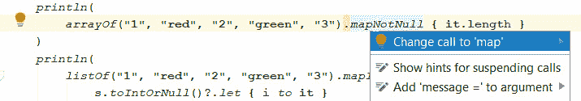

**图 7.5:** 简化对 `mapNotNull()` 函数的冗余调用

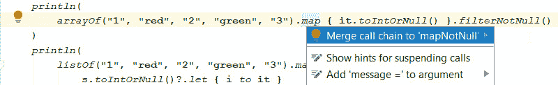

**图 7.6:** 合并 `map-filterNotNull` 链式调用

`map()` 函数可以应用于映射（maps），在这种情况下，转换将映射条目作为输入并产生列表。此外，你可以使用 `mapKeys()`/`mapValues()` 函数，它们分别只转换键或值，并返回一个新的映射：

```kotlin
val map = mapOf("I" to 1, "V" to 5, "X" to 10, "L" to 50)
// [I 1, V 5, X 10, L 50]
println(map.map { "${it.key} ${it.value}" })
// {i=1, v=5, x=10, l=50}
println(map.mapKeys { it.key.toLowerCase() })    // {I=1, V=5, X=a, L=32}
println(map.mapValues { it.value.toString(16) })
```

每个 `mapXXX()` 函数都有一个版本，用于将结果元素放入某些现有的可变集合中而不是创建一个新的集合。与过滤器（filters）类似，这些函数在名称中包含 `To`：

```kotlin
val result = ArrayList<String>()
listof(1, 2, 3).mapTo(result) { it.toString() }
arrayOf("one", "two", "three").mapIndexedTo(result) { i, s ->
    "${i + 1}: s"
}
sequenceOf("100", "?", "101", "?", "110").mapNotNullTo(result) {
    it.toIntOrNull(2)?.toString()
}
println(result) // [1, 2, 3, 1: s, 2: s, 3: s, 4, 5, 6]
```

展平操作（flattening operations）将原始集合的每个元素转换为一个新的集合，然后将生成的集合拼接在一起。这种转换通过 `flatMap()` 函数实现，它在应用于序列时产生一个序列，在应用于任何其他集合时产生一个列表：

```kotlin
// [a, b, c, d, e, f, g, h, i]
println(setOf("abc", "def", "ghi").flatMap { it.asIterable() })
// [1, 2, 3, 4]
println(listOf(1, 2, 3, 4).flatMap { listOf(it) })
// [1, 1, 2, 1, 2, 3]
Array(3) { it + 1 }.flatMap { 1..it }
```

在*基础操作*（Basic operations）章节中，我们提到了 `subList()` 函数，它可以提供列表分段的视图。`slice()` 函数执行类似的任务，但它使用整数范围而不是整数对来表示分段的边界。此外，`slice()` 函数也可以应用于数组和列表：

```kotlin
// 0, 1, 4, 9, 16, 25
println(List(6) { it*it }.slice(2..4)) // [4, 9, 16]

// 0, 1, 8, 27, 64, 125
println(Array(6) { it*it*it }.slice(2..4)) // [8, 27, 64]
```

对于列表，它的工作方式类似于 `subList()` 方法，产生一个原始集合的包装器，以反映给定的段。对于数组，结果是一个包含指定索引数组元素的新列表。

如果你想将数组段提取为另一个数组，可以使用 `sliceArray()`：

```kotlin
val slice = Array(6) { it*it*it }.sliceArray(2..4).contentToString()
```

还有一个更通用的 `slice()/sliceArray()` 版本，它接收一个可迭代的整数并将其作为索引。换句话，它允许你提取原始列表或数组的任意子序列：

```kotlin
println(List(6) { it*it }.slice(listOf(1, 2, 3))) // [1, 4, 9]

println(Array(6) { it*it*it }.slice(setOf(1, 2, 3))) // [1, 8, 27]

println(
    Array(6) { it*it*it }.sliceArray(listOf(1, 2, 3)).contentToString()
) // [1, 8, 27]
```

`take()/takeLast()` 函数用于从第一个或最后一个元素开始提取指定数量的可迭代元素或数组元素：

```kotlin
println(List(6) { it*it }.take(2))      // [0, 1]

println(List(6) { it*it }.takeLast(2))         // [16, 25]

println(Array(6) { it*it*it }.take(3))      // [0, 1, 8]

println(Array(6) { it*it*it }.takeLast(3)) // [27, 64, 125]
```

`take()` 函数也可以应用于序列；在这种情况下，它返回一个包含原始序列开头元素的新序列：

```kotlin
val seq = generateSequence(1) { if (it > 100) null else it*3 }
println(seq.take(3).toList()) // [1, 3, 9]
```

`drop()/dropLast()` 函数可以看作 `take()/takeLast()` 的互补：它们返回移除指定数量的开头/结尾元素后剩余的元素：

```kotlin
println(List(6) { it*it }.drop(2))      // [4, 9, 16, 25]

println(List(6) { it*it }.dropLast(2))         // [0, 1, 4, 9]

println(Array(6) { it*it*it }.drop(3))          // [27, 64, 125]

println(Array(6) { it*it*it }.dropLast(3)) // [0, 1, 8]

val seq = generateSequence(1) { if (it > 100) null else it*3 }
println(seq.drop(3).toList())               // [27, 81, 243]
```

`take/drop` 操作还有其他版本，它们接收一个针对集合元素的谓词而不是数字：这些版本只提取/丢弃元素直到第一个违反给定条件的元素为止：

```kotlin
val list = List(6) { it * it }

println(list.takeWhile { it < 10 })      // [0, 1, 4, 9]

println(list.takeLastWhile { it > 10 })      // [16, 25]

println(list.dropWhile { it < 10 })      // [16, 25]

println(list.dropLastWhile { it > 10 })      // [0, 1, 4, 9]

val seq = generateSequence(1) { if (it > 100) null else it*3 }
println(seq.takeWhile { it < 10 }.toList()) // [1, 3, 9]

println(seq.dropWhile { it < 10 }.toList()) // [27, 81, 243]
```

Kotlin 1.2 引入的 `chunked()` 函数允许你将可迭代对象或序列分成列表（称为块 chunks），每个块的大小不超过给定的阈值。`chunked()` 最简单的形式仅接收一个最大块大小：

```kotlin
// 0, 1, 4, 9, 16, 25, 36, 49, 64, 81
val list = List(10) { it*it }
println(list.chunked(3)) // [[0, 1, 4], [9, 16, 25], [36, 49, 64], [81]]

// 1, 3, 9, 27, 81, 243
val seq = generateSequence(1) { if (it > 100) null else it*3 }
println(seq.chunked(3).toList()) // [[1, 3, 9], [27, 81]]
```

`chunked()` 在应用于可迭代对象时返回块的列表，应用于序列时返回块的序列。通用版本允许你指定一个转换函数来转换每个块。结果是一个列表或序列：

```kotlin
// 0, 1, 4, 9, 16, 25, 36, 49, 64, 81
val list = List(10) { it*it }
println(list.chunked(3) { it.sum() }) // [5, 50, 149, 81]

// 1, 3, 9, 27, 81, 243, 729, 2187, 6561
val seq = generateSequence(1) { if (it > 100) null else it*3 }
println(seq.chunked(3) { it.sum() }.toList()) // [[13, 315, 7371]]
```

`windowed()` 函数在 Kotlin 1.2 中引入，允许你从可迭代对象或序列提取滑动窗口。类似于 `chunked()`，它在应用于可迭代对象时返回窗口列表，应用于序列时返回窗口序列：

```kotlin
// 0, 1, 4, 9, 16, 25, 36, 49, 64, 81
val list = List(10) { it*it }
println(list.windowed(3)) // [[0, 1, 4], [1, 4, 9], [4, 9, 16], [9, 16, 25], [16, 25, 36], [25, 36, 49], [36, 49, 64], [49, 64, 81]]
```

此外，`windowed()` 允许你指定可选参数来影响滑动窗口的行为：

- `step`: 窗口之间的距离（默认为 1）。
- `partialWindows`: 是否包含末尾不足大小的窗口（默认为 false）。

让我们通过这些选项：

```kotlin
// 0, 1, 4, 9, 16, 25, 36, 49, 64, 81
val list = List(10) { it*it }
println(list.windowed(3, step = 2)) // [[0, 1, 4], [4, 9, 16], [16, 25, 36], [36, 49, 64], [64, 81]]

// 0, 1, 4, 9, 16, 25, 36, 49, 64, 81
val list = List(10) { it*it }
println(list.windowed(3, partialWindows = true)) // [[0, 1, 4], [1, 4, 9], [4, 9, 16], [9, 16, 25], [16, 25, 36], [25, 36, 49], [36, 49, 64], [49, 64, 81], [64, 81]]
```

还有一个用于构建两个元素的独立函数：`zipWithNext()`。与 `windowed()` 不同，它产生对（pairs）而不是列表：

```kotlin
// 0, 1, 4, 9, 16, 25
val list = List(6) { it*it }
println(list.zipWithNext()) // [(0, 1), (1, 4), (4, 9), (9, 16), (16, 25)]

// 1, 3, 9, 27, 81, 243
val seq = generateSequence(1) { if (it > 100) null else it*3 }
println(seq.zipWithNext().toList()) // [(1, 3), (3, 9), (9, 27), (27, 81), (81, 243)]
```

相应地，其聚合版本使用一个接收元素对的的函数：

```kotlin
// [0, 4, 36, 144, 400]
println(List(6) { it*it }.zipWithNext { a, b -> a * b })
```

这些函数应用于序列（sequence）时会返回 `Sequence`。但注意，返回的序列是有状态的，并在首次尝试访问其元素时会对整个集合进行排序。

当应用于数组或可迭代对象（iterable）时，结果始终是一个 `List`。对于数组，你可以使用相似的 `sortedArray()/sortedArrayDescending()` 函数对，它们返回的是数组而不是列表。

如果集合元素是不可比较，你仍然可以使用 `sorted()` 的替代方案来对它们进行排序，这些方案允许你指定自定义排序：`sortedBy()`/`sortedWith()`。其约定与我们见过的 `min()/max()` 聚合函数相似：`sortedBy()` 接收一个将集合元素转换为可比较对象的函数，而 `sortedWith()` 接收一个比较器（comparator）。`sortedBy()` 也有一个反向版本，调用为 `sortedByDescending()`：

```kotlin
class Person(val firstName: String,
val lastName: String,
val age: Int) {
    override fun toString() = "$firstName $familyName: $age"
}
val Person.fullNameget() = "$firstName $familyName"
val Person.reverseFullNameget() = "$familyName $firstName"
val FULL_NAME_COMPARATOR = Comparator<Person>{ p1, p2 ->
    p1.fullName.compareTo(p2.fullName)
}
val REVERSE_FULL_NAME_COMPARATOR = Comparator<Person>{ p1, p2 ->
    p1.reverseFullName.compareTo(p2.reverseFullName)
}
fun main() {
    val persons = listOf(
        Person("Brook", "Hudson", 25),
        Person("Silver", "Watts", 30),
        Person("Dane", "Hall", 19),
        Person("Val", "Ortiz", 28)
    )
    println(persons.sortedWith(FULL_NAME_COMPARATOR))
    println(persons.sortedWith(FULL_NAME_COMPARATOR))
    println(persons.sortedWith(REVERSE_FULL_NAME_COMPARATOR))
    println(persons.sortedWith(REVERSE_FULL_NAME_COMPARATOR))
    println(persons.sortedBy { it.age })
    println(persons.sortedByDescending { it.age })
}
```

我们目前为止看到的所有排序函数都会将排序后的元素放入一个新的集合中，而保持原始集合不变。但在数组和可变列表的情况下，我们可以修改原始集合并在原地对其元素进行排序。这是通过 `sort()` 和 `sortDescending()` 函数实现的。


```kotlin
val array = intArrayOf(4, 0, 8, 9, 2).apply { sort() }
println(array.contentToString()) // [0, 2, 4, 8, 9]
val list = arrayListOf("red", "blue", "green").apply { sort() }
println(list)                 // [blue, green, red]
```

另一组函数可以用于反转可迭代对象和数组中的元素。基本情况由`reversed()`函数处理，它返回一个元素顺序反转的新列表：

```kotlin
println(intArrayOf(1, 2, 3, 4, 5).reversed()) // [5, 4, 3, 2, 1]
println(listOf("red", "green", "blue").reversed()) // [blue, green, red]
```

对于数组，你还可以使用`reversedArray()`函数，它会产生一个新数组而不是列表。

`reverse()`函数可以用于反转可变列表或数组的元素，无需创建新集合（注意`sort()`与`sorted()/sortedArray()`之间的相似性）：

```kotlin
val array = intArrayOf(1, 2, 3, 4, 5).apply { reverse() }.contentToString()
println(array) // [5, 4, 3, 2, 1]
val list = arrayListOf("red", "green", "blue").apply { reverse() }
println(list) // [blue, green, red]
```

`asReversed()`函数在某种上与`reversed()`相似，因为它返回一个新列表。然而，产生的列表只是原始列表的包装。两个列表共享相同的数据，这使得`asReversed()`在内存使用方面更高效。当应用于可变列表时，它返回一个可变包装。其中一个列表的更改会自动反映在另一个列表中（这与生成的集合不同）：

```kotlin
val list = arrayListOf("red", "green", "blue")
val reversed = list.asReversed()
list.add("yellow")
println(list) // [red, green, blue, yellow]
println(reversed) // [yellow, blue, green, red]
```

我们想要提到的的另一个函数是`shuffled()`。当应用于可迭代对象时，它返回一个元素顺序随机的新列表：

```kotlin
val list = listOf("red", "green", "blue")
println(list.shuffled())
```

```kotlin
fun Reader.copyTo(out: Writer, bufferSize: Int = DEFAULT_BUFFER_SIZE): Long
```

返回值给出了实际复制的字节或字符数。以下示例演示了`copyTo()`的用法：

```kotlin
import java.io.*
fun main() {
    FileWriter("data.txt").use { it.write("Hello") }
    val writer = StringWriter()
    FileReader("data.txt").use { it.copyTo(writer) }
    println(writer.buffer)             // Hello
    val output = ByteArrayOutputStream()
    FileInputStream("data.txt").use { it.copyTo(output) }
    println(output.toString("UTF-8")) // Hello
}
```

在本节中我们将考虑的另一个函数将提供一种安全处理流和其他需要显式释放资源的方法。`use()`函数可以在`java.io.Closeable`类型的任何实例（从 Kotlin 1.2 开始还包括`java.lang.AutoCloseable`）上调用：它会执行提供的 lambda 表达式，正确地释放资源（无论是否抛出异常），然后返回 lambda 的结果：

```kotlin
val lines = FileReader("data.bin").use { it.readLines() }
```

**Java 与 Kotlin：**此函数与 Java 7 中引入的`try-with-resources`语句的作用相同。

前面的代码大致等于显式的`try`块：

```kotlin
val reader = FileReader("data.bin")
val lines = try {
    reader.readLines()
} finally {
    reader.close()
}
```

**IDE 提示：IntelliJ 可以自动检测此类`try`块，并建议在`try`关键字上使用 Alt + Enter 菜单将它们转换为`use()`函数调用（如 *图 7.8 所示）：**

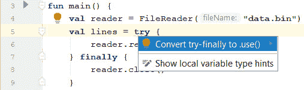

**图 7.8:** 将显式的`try`块转换为`use()`调用

## 创建流

标准库包含了一组简化创建 Java I/O 流的函数。在本节中，我们将看到基础用。

使用`bufferedReaders()`/`bufferedWriter()`扩展函数，你可以为特定的`File`对象创建一个`BufferedReader`/`BufferedWriter`实例：

```kotlin
import java.io.File
fun main() {
    val file = File("data.txt")
    file.bufferedWriter().use { it.write("Hello!") }
    file.bufferedReader().use { println(it.readLine()) } // Hello!
}
```

还有一对类似的`reader()`/`writer()`扩展函数，它们会创建一个不带缓冲的`FileReader`/`FileWriter`对象。

`printWriter()`函数创建一个适用于格式化输出的`PrintWriter`实例。

与 reader/writer 相关的函数允许可选指定编码字符集（默认为 UTF-8），而缓冲版本有一个额外的缓冲区大小可选参数。默认缓冲区大小由`DEFAULT_BUFFER_SIZE`常量给出，它目前对应于 8 字节：

```kotlin
file.writer(charset = Charsets.US_ASCII).use { it.write("Hello!") }
file.bufferedReader(
    charset = Charsets.US_ASCII,
    bufferSize = 100
).use { println(it.readLine()) }
```

`Charsets`对象包含了一些标准字符集（如 US-ASCII 或不同的 UTF 变体）的常量集。

如果你想处理二进制文件，可以类似的使用`inputStream()`/`outputStream()`函数创建相应的流实例：

```kotlin
import java.io.File
fun main() {
    val file = File("data.bin")
    file.outputStream().use { it.write("Hello!".toByteArray()) }
    file.inputStream().use {
        println(String(it.readAllBytes()))
    } // Hello!
}
```

几个函数允许你根据`String`或`ByteArray`的内容创建 I/O 流。`byteInputStream()`创建一个以字符串为源的`ByteArrayInputStream`实例：

```kotlin
println("Hello".byteInputStream().read().toChar())             // H
println("Hello".byteInputStream(Charsets.US_ASCII).read().toChar()) // H
```

`reader()`函数同样创建一个`StringReader`实例：

```kotlin
println("One\nTwo".reader().readLines()) // [One, Two]
```

```kotlin
println(file.readBytes().contentToString()) // [1, 2, 3]
file.appendBytes(byteArrayOf(4, 5))
println(file.readBytes().contentToString()) // [1, 2, 3, 4, 5]
file.writeBytes(byteArrayOf(6, 7))
println(file.readBytes().contentToString()) // [6, 7]
}
```

另一组函数允许你分块处理文件内容，而无需一次读取整个文件。这对于处理无法高效地全部放入内存中的大文件非常有帮助。

`forEachLine()`函数允许你逐行处理文本内容，而无需读取整个文件。以下示例演示了它是如何运行的：

```kotlin
import java.io.File

fun main() {
    val file = File("data.txt")
    file.writeText("One\nTwo\nThree")
    file.forEachLine { print("/$it") } // /One/Two/Three
}
```

`useLines()`函数将行序列（line sequence）传递给指定的 lambda 表达式，该表达式可以计算某些结果，然后由`useLines()`调用返回结果：

```kotlin
import java.io.File

fun main() {
    val file = File("data.txt")
    file.writeText("One\nTwo\nThree")
    println(file.useLines { lines ->lines.count { it.length> 3 } }) // 1
}
```

与其他与文本相关的文件函数类似，你可以向`forEachLine()`和`useLines()`传递可选的`Charset`参数。

要处理二进制文件，你可以使用`forEachBlock()`函数。它的 lambda 接收一个`ByteArray`缓冲区和一个整数，整数告知当前迭代中读取了多少字节。例如，以下代码输出了`data.bin`文件中所有字节之和：

```kotlin
import java.io.File

fun main() {
    val file = File("data.bin")
    var sum = 0
    file.forEachBlock { buffer, bytesRead ->
        (0 until bytesRead).forEach { sum += buffer[it] }
    }
    println(sum)
}
```

默认情况下，缓冲区的大小取决于实现，但你可以将其指定为可选的`blockSize`参数。注意，缓冲区的大小不能小于某些特定实现的阈值。在 Kotlin 1.3 中，默认和最小缓冲区大小分别为`4096`和`512`字节。

## 文件系统实用程序

在本节中，我们将讨论用于简化文件系统操作（如复制和删除文件）以及遍历目录结构的标准库函数。

`deleteRecursively()`函数允许你删除一个给定文件及其所有子项，包括嵌套目录。如果删除成功完成，则返回 true，否则返回 false。在后的情况下，删除可能是部分性的，例如，如果某些嵌套目录无法删除。此函数是 Java API 中`mkdirs()`方法的对应项：

```kotlin
import java.io.File

fun main() {
    File("my/nested/dir").mkdirs()
    val root = File("my")
    println("Dir exists: ${root.exists()}")              // true
    println("Simple delete: ${root.delete()}")          // false
    println("Dir exists: ${root.exists()}")              // true
    println("Recursive delete: ${root.deleteRecursively()}") // true
    println("Dir exists: ${root.exists()}")              // false
}
```

`copyTo()`函数将其接收者复制到另一个文件并返回副本：

```kotlin
import java.io.File

fun main() {
    val source = File("data.txt")
    source.writeText("Hello")
    val target = source.copyTo(File("dataNew.txt"))
    println(target.readText()) // Hello
}
```

默认情况下，目标文件不会被覆盖，因此如果它存在，`copyTo()`函数将抛出`FileAlreadyExists`。然而，你可以指定可选的`overwrite`参数来强制复制：

```kotlin
import java.io.File

fun main() {
    val source = File("data.txt").also { it.writeText("One") }
    val target = File("dataNew.txt").also { it.writeText("Two") }
    source.copyTo(target, overwrite = true)
    println(target.readText()) // One
}
```

`copyTo()`函数也可以应用于目录；但它不会复制文件和子目录，而是创建一个与目标对应的空目录。如果你想复制目录及其内容，则有一个独立的`copyRecursively()`函数：

```kotlin
import java.io.File

fun main() {
    File("old/dir").mkdirs()
    File("old/dir/data1.txt").also { it.writeText("One") }
    File("old/dir/data2.txt").also { it.writeText("Two") }
    File("old").copyRecursively(File("new"))
    println(File("new/dir/data1.txt").readText()) // One
    println(File("new/dir/data2.txt").readText()) // Two
}
```

与`copyTo()`类似，此函数允许你使用`overwrite`参数指定覆盖策略（默认为 false）。此外，你可以设置一个操作，在复制特定文件时发生`IOException`时调用。可以通过以下方式实现：使用可选的`onError`参数，它决定如何处理问题文件：

- `SKIP`: 跳过文件并继续；

- `TERMINATE`: 停止复制。

作为最后一个参数，`onError`接收一个类型为`(File, IOException) -> ErrorAction`的 lambda：

```kotlin
File("old").copyRecursively(File("new")) { file, ex -> SKIP }
```

`walk()`函数根据深度优先算法遍历目录结构。可选参数指定遍历方向：

- `TOP_DOWN`: 先访问父节点（默认值）；

- `BOTTOM_UP`: 先访问子节点。

其返回值是`File`实例的序列。以下示例演示了不同遍历模式的使用：

```kotlin
import java.io.File
import kotlin.io.FileDirection.*

fun main() {
    File("my/dir").mkdirs()
    File("my/dir/data1.txt").also { it.writeText("One") }
    File("my/dir/data2.txt").also { it.writeText("Two") }
    println(File("my").walk().map { it.name }.toList())
    println(File("my").walk(TOP_DOWN).map { it.name }.toList())
    println(File("my").walk(BOTTOM_UP).map { it.name }.toList())
}
```


你也可以使用`walkTopDown()`和`walkBottomUp()`函数分别代替`walk(TOP_DOWN)`和`walk(BOTTOM_UP)`调用。

`walk()`返回的序列属于特殊的`FileTreeWalk`类。除了常用的序列功能外，该类允许你指定额外的遍历选项。`maxDepth()`函数设置遍历子树的最大深度：

```kotlin
println(File("my").walk().maxDepth(1).map { it.name }.toList()) // [my, dir]
```

`onEnter()`和`onLeave()`函数设置在进入和离开目录时执行的操作。`onEnter()`调用接收一个`(File) -> Boolean` lambda，其返回值决定是否访问该目录（及其子项）。`onLeave()`调用同样接收一个`(File) -> Unit` lambda。`onFail()`函数允许指定在尝试访问目录项时发生`IOException`时调用的操作：操作的形式为`(File, IOException) -> Unit` lambda，接收问题目录和相应的异常。

由于这四个函数都返回`FileTreeWalk`的当前实例，你可以像下面的示例所示进行链式调用：

```kotlin
println(
    File("my")
        .walk()
        .onEnter { it.name != "dir" }
        .onLeave { println("Processed: ${it.name}") }
        .map { it.name }
        .toList()
)
```

上述代码将打印以下内容：

```
Processed: my

[my]
```

因为`dir`目录会被`onEnter()`操作被过滤掉。

默认操作如下：`onEnter()`始终返回`true`，`onLeave()`什么都不做，而`onFail()`则抛出异常。默认树的最大深度为`Int.MAX_VALUE`，这实际上是不限制的。

可以使用`createTempFile()`/`createTempDir()`函数分别创建临时文件或目录：

```kotlin
val tmpDir = createTempDir(prefix = "data")
```

```kotlin
val tmpFile = createTempFile(directory = tmpDir)
```

这两个函数具有相同的参数：

```kotlin
fun createTempDir(
    prefix: String = "tmp",
    suffix: String? = null,
    directory: File? = null
): File
```

`createTempFile()`函数本质上与 JDK 方法`File.createTempFile()`相同。

# 小结

在本章中，我们学习了 Kotlin 标准库中用于操作集合的主要部分。我们理解了数组（arrays）、迭代器（iterables）、序列（sequences）和映射（maps）等集合类型。我们还讨论了它们的基本 API 和操作，涵盖了各种集合用例，如访问元素和子集合、过滤、聚合、转换和排序。在本章的第二部分，我们查看了 I/O 工具，其目的是简化流的创建、数据的访问以及常见的文件系统操作（如删除和复制）。

在下一章中，我们将重新回到面向对象编程主题，并讨论类继承和委托的概念如何在 Kotlin 应用程序中使用。

# 习题

1. 请列出 Kotlin 中集合类型的概述。它们与 Java 集合库相比主要区别是什么？

2. 集合类型提供了哪些基本操作？

3. 描述遍历集合元素的各种方式。

4. 哪些常用函数可以访问集合元素？

5. Kotlin 库中有哪些常用的聚合操作？

6. 描述`fold()`/`reduce()`操作。

7. `all()`/`any()`/`none()`函数的作用是什么？

8. 描述集合过滤函数。

9. 如何提取子集合？

10. 集合可以应用哪些标准转换？描述映射（mapping）、扁平化（flattening）和关联（association）的特性。

11. 描述 Kotlin 标准库提供的集合排序工具。

12. 描述流的创建和转换工具。

13. 哪些函数可以访问文件或 I/O 流的内容？

14. 描述文件系统工具函数。

# 第 8 章

## 理解类层次结构

本章继续讨论在[第 4 章，处理类和对象]和[第 6 章，使用特殊类]中介绍的 Kotlin 面向对象特性。我们将引入类继承的概念，并解释如何定义子类。我们还将考虑使用抽象类、接口和类委托设计复杂的类层次结构。感兴趣的特性还包括密封类（sealed classes），它实现了代数数据类型的概念，适用于定义限制的类层次结构和类型检查，从而实现强大的 Kotlin 智能转换。

# 小结

- 继承与重写

- 类型检查与强制转换

- 抽象类

- 接口

- 密封类

- 委托

# 目标

理解 Kotlin 中继承和重写的工作原理，并学习使用 Kotlin 的面向对象能力构建类层次结构。

## 继承

为了表示领域概念之间的“是”（is-a）关系，大多数面向对象的语言都使用继承的概念。当类`A`（子类或派生类）继承类`B`（父类或基类）时，`A`的所有实例都被自动视为`B`的实例。因此，类`A`获得了为`B`定义的所有成员和扩展。这种关系是传递的；如果类`B`又继承了某些类`C`，那么`A`也被视为`C`的子类（尽管是间接的）。

在 Kotlin 中，像 Java 一样，类支持单继承，这意味着任何类不能有多个父类。如果你不显式指定父类，编译器会自动假设你的类继承自内置类`Any`。因此，给定程序中的所有类都形成了一个定义良好的继承树，这通常被称为类层次结构。

在接下来的章节中，我们将讨论 Kotlin 类继承的基础知识：如何定义子类、父类成员是如何被继承和重写的，以及任何对象通过`Any`类可使用的常用方法。

### 声明子类

要继承给定的类，你需要在类定义中的主构造函数之后添加它的名称，并加上冒号`:`符号：

```kotlin
open class Vehicle {
    var currentSpeed = 0
    fun start() {
        println("I'm moving")
    }
    fun stop() {
        println("Stopped")
    }
}

open class FlyingVehicle : Vehicle() {
    fun takeOff() {
        println("Taking off")
    }
    fun land() {
        println("Landed")
    }
}

class Aircraft(val seats: Int) : FlyingVehicle()
```

**Java vs Kotlin：** 在 Kotlin 中，没有 Java 中那样的如`extends`和`implements`的特殊关键字。相反，继承始终用冒号`:`表示。

请注意在定义它们的子类时在`Vehicle`和`FlyingVehicle`之后添加的括号——这是对父类构造函数的调用，你可以在此处传入必要的参数用于父类的初始化代码。

你可能已经注意到`Vehicle`和`FlyingVehicle`定义附近的`open`关键字。这个修饰符将相应的类标记为开放继承（open），从而允许它们作为父类。另一方面，`Aircraft`没有这样的修饰符，默认被认为是最终的（final 的）。如果你尝试继承一个`final`类，编译器将报告错误：

```kotlin
class Airbus(seats: Int) : Aircraft(seats) // Error: Aircraft is final
```

**Java vs Kotlin：** 请注意 Java 和 Kotlin 中默认类行为的差异：

在 Java 中，任何类默认都是开放的，如果你想禁止继承它，必须显式地标记为`final`。然而，在 Kotlin 中，默认是`final`的。如果你想让某个类是可以被继承的，必须将其声明为`open`。

正如实践所示，没有专门为继承而设计的类可能会遭受所谓的“脆弱的基类”问题，即基类中的更改会导致子类出现错误行为。这是因为父类不再满足子类的假设。因此，强烈建议仔细地设计和记录可继承的类，并使此类假设显式化。

子类的实例也是其父类的实例。它们也继承父类的成员：

```kotlin
val aircraft = Aircraft(100)
val vehicle: Vehicle = aircraft // 隐式转换转换为父类型
vehicle.start() // 调用 Vehicle 方法
vehicle.stop() // 调用 Vehicle 方法
aircraft.start() // 调用 Vehicle 方法
aircraft.takeOff() // 调用 FlyingVehicle 方法
aircraft.land() // 调用 FlyingVehicle 方法
aircraft.stop() // 调用 Vehicle 方法
println(aircraft.seats) // 访问 Aircraft 自身的属性
```

某些类型的类对继承的支持有限。例如，数据类（data classes）始终是`final`的，并且不能声明为`open`：

```kotlin
open data class Person(val name: String, val age: Int) // Error
```

最初，禁止数据类继承另一个类，但这一限制在 Kotlin 1.1 中被移除了。

另一方面，内联类（inline classes）目前不能继承其他类，也不能作为父类：

```kotlin
class MyBase

open inline class MyString(val value: String) // Error

inline class MyStringInherited(val value: String): MyBase() // Error
```

对象（包括伴随对象）可以自由自 open 类：

```kotlin
open class Person(val name: String, val age: Int) {
    companion object : Person("Unknown", 0)
}
object JohnDoe : Person("John Doe", 30)
```

然而，你不能继承对象或将其声明为 open，因为每个对象应该只有一个实例。

继承的一个强大特性是所谓的“即时多态”（ad-hoc polymorphism），它允许你为子类的父类成员提供不同的实现，并根据运行实际实例类进行选择。在 Kotlin 中，这可以通过重写父类成员来实现。让我们来看以下类：

```kotlin
open class Vehicle {
    open fun start() {
        println("I'm moving")
    }
    fun stop() {
        println("Stopped")
    }
}
class Car : Vehicle() {
    override fun start() {
        println("I'm riding")
    }
}
class Boat : Vehicle() {
    override fun start() {
        println("I'm sailing")
    }
}
```

`Vehicle`类提供了`start()`方法的通用实现，该方法随后被继承者`Car`和`Boat`重写。请注意，`Vehicle`类中的`start()`方法被标记为`open`，这使其在子类中可以重写，而它们在`Car`和`Boat`中的实现使用了`override`关键字。对`Vehicle`类型值的调用会根据它们的运行时类进行分发。如果你运行以下代码：

```kotlin
fun startAndStop(vehicle: Vehicle) {
    vehicle.start()
    vehicle.stop()
}

fun main() {
    startAndStop(Car())
    startAndStop(Boat())
}
```

你会得到：

```
I'm riding
Stopped
I'm sailing
Stopped
```

另一方面，`stop()`方法是 final 的。因为它没有被显式标记为`open`，所以它不能被重写，而只是被子类继承。

**Java vs. Kotlin：** 值得指出 Kotlin 和 Java 中重写的两个主要区别。首先，与 Java 类似，Kotlin 的函数和属性默认是 final 的，必须显式标记为`open`关键字才能允许在子类中重写。然而，在 Java 中，方法是隐式 open 的，因此如果你想禁止它们的重写，必须使用显式的`final`修饰符。其次，Kotlin 中被重写的成员必须始终伴有`override`关键字。未这样做会导致编译错误。相反，在 Java 中，显式标记重写方法是可选的；尽管使用`@Override`注解被认为是良好实践。在 Kotlin 中强制显式标记被重写的成员有助于防止意外重写问题，即你添加了一个恰好匹配某些父类的成员并重写了它的实现，导致意外的程序行为和难以发现的 bug。

值得注意的是成员和扩展之间的一个重要区别。类成员可以被重写（只要它们不是 final 的），因此可以根据特定实例的运行时类进行选择，而扩展始终是静态解析的。换句话说，当调用扩展函数时，编译器总是根据已知的静态接收者类型来选择。考虑以下示例：

```kotlin
open class Vehicle {
    open fun start() {
        println("I'm moving")
    }
}
fun Vehicle.stop() {
    println("Stopped")
}
class Car : Vehicle() {
    override fun start() {
        println("I'm riding")
    }
}
fun Car.stop() {
    println("Stopped riding")
}
fun main() {
    val vehicle: Vehicle = Car()
    vehicle.start() // I'm riding
    vehicle.stop() // Stopped
}
```

很显然，程序调用了在`Car`类定义的`start()`，因为它是根据 vehicle 的运行时类型（`Car`）动态解析的。然而，`stop()`是根据静态类型（`Vehicle`）选择的，因此调用的函数是`Vehicle.stop()`。

请注意，被重写成员的签名必须与父类匹配：

```kotlin
open class Vehicle {
    open fun start(speed: Int) {
        println("I'm moving at $speed")
    }
}
class Car : Vehicle() {
    override fun start() { // Error: wrong signature
        println("I'm riding")
    }
}
```

然而，你可以用其父类型替换返回类型：

```kotlin
open class Vehicle {
    open fun start(): String? = null
}
open class Car : Vehicle() {
    final override fun start() = "I'm riding a car"
}
```

如果你将被重写的成员声明为`final`，它将不会在子类中被重写：

```kotlin
open class Vehicle {
    open fun start() {
        println("I'm moving")
    }
}
open class Car : Vehicle() {
    final override fun start() {
        println("I'm riding a car")
    }
}
class Bus : Car() {
    override fun start() { // Error: start() is final in Car
        println("I'm riding a bus")
    }
}
```

属性也可以被重写。除了在子类体中放置实现外，你也可以在构造函数中重写它们：

```kotlin
open class Entity {
    open val name: String get() = ""
}
class Person(override val name: String) : Entity()
```

不可变属性可以被变量属性重写：

```kotlin
open class Entity {
    open val name: String get() = ""
}
class Person() : Entity() {
    override var name: String = ""
}
```

像 Java 一样，Kotlin 有一种特殊的访问修饰符，限制成员范围为其继承者。此类成员标记为`protected`关键字：


```kotlin
open class Vehicle {
    protected open fun onStart() { }
    fun start() {
        println("Starting up...")
        onStart()
    }
}
class Car : Vehicle() {
    override fun onStart() {
        println("It's a car")
    }
}
fun main() {
    val car = Car()
    car.start() // Ok
    car.onStart() // Error: onStart is not available here
}
```

**Java vs. Kotlin：** 注意 Kotlin 和 Java 中 `protected` 的区别。虽然两种语言都允许继承类访问保护成员，但 Java 还允许在相同包内的任何代码中使用它们。在 Kotlin 中，这是禁止的。目前它没有限制声明范围到包含包的访问修饰符。

有时重写的函数或属性需要访问其原始版本以重用代码。在这种情况下，你可以为成员引用加上 `super` 关键字（语法与 `this` 类似，但访问的是继承的成员而不是当前成员）：

```kotlin
open class Vehicle {
    open fun start(): String? = "I'm moving"
}
open class Car : Vehicle() {
    override fun start() = super.start() + " in a car"
}
fun main() {
    println(Car().start()) // I’m moving in a car
}
```

**IDE Tips: IntelliJ 插件包含一个特殊操作可以帮助你生成重写的存根。要访问它，你可以在类体内部使用 Ctrl + O/Cmd + O 快捷键。IDE 然后会向你显示对话框，你可以在其中选择要重写的父类成员（如*图 8.1 所示）。**

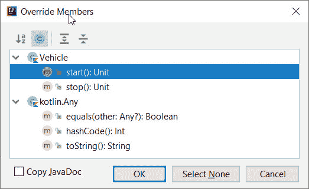

**图 8.1：SEQ 图 \* ARABIC1: 重写成员对话框**

在第 4 章（类与对象的操作） 中，我们讨论了如何使用构造函数来初始化特定类的实例状态。在创建子类的实例时，你的程序还需要调用在其父类中定义的初始化代码。父类的初始化必须首先进行，因为它可能会创建一个被子类代码所使用的环境。

在 Kotlin 中，这种顺序是自动强制的：当你的程序尝试创建类 `A` 的实例时，它会获取该类的父类链，然后调用它们的构造函数，从层次结构的根（即 `Any` 类）开始，并以 `A` 的构造函数结束。让我们来看一个演示初始化顺序的示例：

```kotlin
open class Vehicle {
    init {
        println("Initializing Vehicle")
    }
}

open class Car : Vehicle() {
    init {
        println("Initializing Car")
    }
}

class Truck : Car() {
    init {
        println("Initializing Truck")
    }
}

fun main() {
    Truck()
}
```

运行该程序时，将输出：

```
Initializing Vehicle
Initializing Car
Initializing Truck
```

这证实了上述观点，初始化从父类到子类进行。

我们已经提到，在子类定义中父类名称后面的括号构成了对其构造函数的调用。到目前为止，我们不需要在那里传递某些参数，因为我们示例中的父类一直使用默认构造函数。但如果我们需要为它们提供一些数据呢？最简单的情况是父类恰好有一个构造函数：

```kotlin
open class Person(val name: String, val age: Int)
class Student(name: String, age: Int, val university: String) :
Person(name, age)

fun main() {
    Student("Euan Reynolds", 25, "MIT")
}
```

在上面的示例中，`Student` 类的主构造函数通过所谓的委托调用（delegating call）将其三个参数传递给父类 `Person` 的构造函数：`Person(firstName, familyName, age)`。

就像普通的构造函数调用一样，委托调用同样适用于主构造函数和次构造函数：

```kotlin
open class Person {
    val name: String
    val age: Int
    constructor(name: String, age: Int) {
        this.name = name
        this.age = age
    }
}

class Student(name: String, age: Int, val university: String) :
Person(name, age)
```

如果我们想在 `Student` 类中使用次构造函数呢？在这种情况下，委托调用是在构造函数签名之后指定的：

```kotlin
open class Person(val name: String, val age: Int)
class Student : Person {
    val university: String
    constructor(name: String, age: Int, university: String) :
    super(name, age) {
        this.university = university
    }
}
```

`super` 关键字告诉编译器，我们的次构造函数委托给父类相应的构造函数。这种语法类似于委托到同类的另一个构造函数，后者则用 `this` 关键字表示（请参阅 第 4 章，类与对象的操作）。与在主构造函数中的调用相比，另一个区别是父类名称后没有括号：是 `Person` 而不是 `Person()`。原因是我们的类没有主构造函数，而委托被放在了次构造函数中。

**Java 对比 Kotlin：** 与 Java 不同，构造函数之间的调用（无论属于同一个类，还是类与其父类）绝不会被放在构造函数体内。在 Kotlin 中，你使用委托调用语法来实现。

请注意，如果一个类有一个主构造函数，它的次构造函数可能不能委托给父类：

```kotlin
open class Person(val name: String, val age: Int)
// Error: call to Person constructor is expected
class Student() : Person {
    val university: String
    constructor(name: String, age: Int, university: String) :
    super(name, age) { Error: can’t invoke Person constructor here
        this.university = university
    }
}
```

一种有趣的情况是，父类有不同的构造函数，而我们希望它的子类支持其中多个。在这种情况下，使用次构造函数是唯一的选择：

```kotlin
open class Person {
    val name: String
    val age: Int
    constructor(name: String, age: Int) {
        this.name = name
        this.age = age
    }
    constructor(firstName: String, familyName: String, age: Int) :
    this(familyName, age)
}

class Student : Person {
    val university: String
    constructor(name: String, age: Int, university: String) :
    super(name, age) {
        this.university = university
    }
    constructor(firstName: String, familyName: String, age: Int, university: String) :
    super(firstName, familyName, age) {
        this.university = university
    }
}

fun main() {
    Student("Euan", "Reynolds", 25, "MIT")
    Student("Val Watts", 22, "ETHZ")
}
```

事实上，上面的用例是向该语言添加次构造函数的主要原因之一。这变得非常重要，特别是当你考虑与 Java 代码的互操作性时，Java 不区分主构造函数和次构造函数。

我们在本节中想要强调的另一个问题是所谓的 `this` 泄漏（leaking `this`）问题。考虑以下情况：

```kotlin
open class Person(val name: String, val age: Int) {
    open fun showInfo() {
        println("$name, $age")
    }
    init {
        showInfo()
    }
}

class Student(
    name: String,
    age: Int,
    val university: String
) : Person(name, age) {
    override fun showInfo() {
        println("$name, $age (student at $university)")
    }
}

fun main() {
    Student("Euan", "Reynolds", 25, "MIT")
}
```

如果你运行该程序，输出将如下：

```
Euan Reynolds, 25 (student at null)
```

为什么 `university` 变量恰好是 null ？原因是 `showInfo()` 方法在父类的初始化器中被调用。它是一个虚函数，所以程序将调用它在 `Student` 类中的重写版本，但由于 `Person` 初始化器在 `Student` 之前运行，在调用 `showInfo()` 时，`university` 变量尚未初始化。这种情况被称为泄漏 `this` 的原因是父类将当前实例泄漏给了代码，而这些代码通常可能依赖于实例状态中尚未初始的部分。一个更显式的例子如下：

```kotlin
open class Person(val name: String, val age: Int) {
    override fun toString() = "$name, $age"
    init {
        println(this) // potentially dangerous
    }
}

class Student(
    name: String,
    age: Int,
    val university: String
) : Person(name, age) {
    override fun toString() = super.toString() + "(student at $university)"
}

fun main() {
    // Euan Reynolds, 25 (student at null)
    Student("Euan Reynolds", 25, "MIT")
}
```

泄漏 `this` 的问题产生了一个罕见的情况，即 Kotlin 中非空类型的变量可能结果为 null。

**IDE 提示：IntelliJ 插件包含一种检查，它会将此类调用和用法标记为潜在不安全，并显示相应的警告（如图 8.2 所示）：**

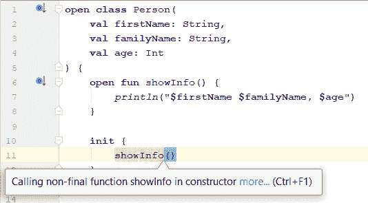

**图 8.2:** SEQ 图 \* ARABIC2: 构造函数内部非最终函数调用的警告

由于某个类的变量在运行时可能会引用其子类型的任何实例，因此拥有一种方法来检查特定实例是否对应于更具体的类型，并在需要时将其强制转换为该类型是非常有用的。例如，考虑以下代码：

```
val objects = arrayOf(“1”, 2, “3”, 4)
```

从编译器的角度来看，`objects` 是一个 `Any` 类型的数组，因为 `Any` 是涵盖了其所有元素的最小公共父类型。如果我们想使用某些针对 `String-or-Int` 的特定操作怎么办？直接将这些操作应用于数组元素是行不通，因为它们的类型是 `Any`，因此不支持更具体的函数或属性：

```
for (obj in objects) {
    println(obj*2) // 错误：Any 不支持 * 运算符
}
```

Kotlin 提供了类型检查和强制转换操作符形式的解决方案。`is` 运算符在其左侧操作数具有给定类型时返回 `true`。让我们稍稍修改一下之前的示例：

```kotlin
for (obj in objects) {
    println(obj is Int)
}
```

当你运行上面的程序时，它会打印：

```
false
true
false
true
```

如预期的那样，`null` 值被认为是任何可空类型的实例，但不属于非可空类型：

```kotlin
println(null is Int)      // false
println(null is String?) // true
```

Kotlin 还支持反向操作，通过 `!is` 操作符表示：

```kotlin
val o: Any = ""
println(o !is Int)    // true
println(o !is String) // false
```

请注意，`is/!is` 操作符仅在其左侧操作数的静态类型是右侧类型的父类型时才适用。以下检查产生了编译错误，因为当编译器在静态上知道 `String` 不是 `Int` 的子类型时，对 `Int` 值进行 `String` 的测试是没有意义的：

```kotlin
println(12 is String) // 错误
```

`is` 和 `!is` 操作符的优先级与 `in` 和 `!in` 相同。

**Java vs. Kotlin：** `is` 操作符与 Java 的 `instanceof` 非常相似。但是，请记住它们在处理 `null` 时存在差异。虽然 `instanceof` 应用于 `null` 时始终返回 `false`，但 `is` 操作符的结果取决于其右侧类型是否可空。

在第 4 章（处理类和对象）中我们引入了智能转换（smart casts）的概念，它允许我们在与 `null` 比较后自动将变量的类型从可空细化为不可空。这个有用的功能也支持 `is/!is` 检查。例如：

```kotlin
val objects = arrayOf("1", 2, "3", 4)
var sum = 0
for (obj in objects) {
    if (obj is Int) {
        sum += obj // obj 的类型在这里细为了 Int
    }
}
println(sum) // 6
```

`is/!is` 检查和智能转换也支持表达式，在表达式中你可以将它们用作一种特殊的条件，类似于 `in/!in`：

```kotlin
val objects = arrayOf("1", 2, "3", 4)
var sum = 0
for (obj in objects) {
    when (obj) {
        is Int -> sum += obj           // obj 在这里是 Int 类型
        is String -> sum += obj.toInt() // obj 在这里是 String 类型
    }
}
println(sum) // 10
```

我们之前已经提到，只有当编译器能够确保变量类型在检查和使用之前发生改变时，编译器才允许智能转换。现在我们可以更精确地表达智能转换规则。

首先，对于具有自定义访问器的属性和变量不允许进行智能转换，因为编译器无法保证其返回值在检查后不会改变。这也包括使用委托的属性和局部变量：

```kotlin
class Holder {
    val o: Any get() = ""
}
fun main() {
    val o: Any by lazy { 123 }
    if (o is Int) {
        println(o*2)             // 错误：无法进行智能转换
    }
    val holder = Holder()
    if (holder.o is String) {
        println(holder.o.length) // 错误：无法进行智能转换
    }
}
```

开放属性（open properties）也属于这一类，因为它们可以在子类中重写，并赋予自定义访问器：


## 智能转换的限制

```kotlin
open class Holder {
    open val o: Any = ""
}
fun main() {
    val holder = Holder()
    if (holder.o is String) {
        println(holder.o.length) // 错误：无法进行智能转换
    }
}
```

如果可变局部变量的值在检查和读取之间被显式更改，或者它们在 lambda 中被修改，则它们无法进行智能转换（后者意味着当 lambda 被调用时其值可能会改变，这通常情况下是不可预测的）：

```kotlin
fun main() {
    var o: Any = 123
    if (o is Int) {
        println(o + 1) // 正确：智能转换为 Int
        o = ""
        println(o.length) // 正确：智能转换为 String
    }
    if (o is String) {
        val f = { o = 123 }
        println(o.length)
    }
}
```

由于某个类的变量在运行时可能会引用其子类型的任何实例，因此拥有一种方法来检查特定实例是否对应于更具体的类型，并在需要时将其强制转换为该类型是非常有用的。例如，考虑以下代码：

```
val objects = arrayOf("1", 2, "3", 4)
```

从编译器的角度来看，`objects` 是一个 `Any` 类型的数组，因为 `Any` 是涵盖了其所有元素的最小公共父类型。如果我们想使用某些针对 `String-or-Int` 的特定操作怎么办？直接将这些操作应用于数组元素是行不通，因为它们的类型是 `Any`，因此不支持更具体的函数或属性：

```
for (obj in objects) {
    println(obj*2) // 错误：Any 不支持 * 运算符
}
```

Kotlin 提供了类型检查和强制转换操作符形式的解决方案。`is` 运算符在其左侧操作数具有给定类型时返回 `true`。让我们稍稍修改一下之前的示例：

```kotlin
for (obj in objects) {
    println(obj is Int)
}
```

当你运行上面的程序时，它会打印：

```
false
true
false
true
```

如预期的那样，`null` 值被认为是任何可空类型的实例，但不属于非可空类型：

```kotlin
println(null is Int)      // false
println(null is String?) // true
```

Kotlin 还支持反向操作，通过 `!is` 操作符表示：

```kotlin
val o: Any = ""
println(o !is Int)    // true
println(o !is String) // false
```

请注意，`is/!is` 操作符仅在其左侧操作数的静态类型是右侧类型的父类型时才适用。以下检查产生了编译错误，因为当编译器在静态上知道 `String` 不是 `Int` 的子类型时，对 `Int` 值进行 `String` 的测试是没有意义的：

```kotlin
println(12 is String) // 错误
```

`is` 和 `!is` 操作符的优先级与 `in` 和 `!in` 相同。

**Java vs. Kotlin：** `is` 操作符与 Java 的 `instanceof` 非常相似。但是，请记住它们在处理 `null` 时存在差异。虽然 `instanceof` 应用于 `null` 时始终返回 `false`，但 `is` 操作符的结果取决于其右侧类型是否可空。

在第 4 章（处理类和对象）中我们引入了智能转换（smart casts）的概念，它允许我们在与 `null` 比较后自动将变量的类型从可空细化为不可空。这个有用的功能也支持 `is/!is` 检查。例如：

```kotlin
val objects = arrayOf("1", 2, "3", 4)
var sum = 0
for (obj in objects) {
    if (obj is Int) {
        sum += obj // obj 的类型在这里细为了 Int
    }
}
println(sum) // 6
```

`is/!is` 检查和智能转换也支持表达式，在表达式中你可以将它们用作一种特殊的条件，类似于 `in/!in`：

```kotlin
val objects = arrayOf("1", 2, "3", 4)
var sum = 0
for (obj in objects) {
    when (obj) {
        is Int -> sum += obj           // obj 在这里是 Int 类型
        is String -> sum += obj.toInt() // obj 在这里是 String 类型
    }
}
println(sum) // 10
```

我们之前已经提到，只有当编译器能够确保变量类型在检查和使用之前发生改变时，编译器才允许智能转换。现在我们可以更精确地表达智能转换规则。

首先，对于具有自定义访问器的属性和变量不允许进行智能转换，因为编译器无法保证其返回值在检查后不会改变。这也包括使用委托的属性和局部变量：

```kotlin
class Holder {
    val o: Any get() = ""
}
fun main() {
    val o: Any by lazy { 123 }
    if (o is Int) {
        println(o*2)             // 错误：无法进行智能转换
    }
    val holder = Holder()
    if (holder.o is String) {
        println(holder.o.length) // 错误：无法进行智能转换
    }
}
```

开放属性（open properties）也属于这一类，因为它们可以在子类中重写，并赋予自定义访问器：

```kotlin
open class Holder {
    open val o: Any = ""
}
fun main() {
    val holder = Holder()
    if (holder.o is String) {
        println(holder.o.length) // 错误：无法进行智能转换
    }
}
```

如果可变局部变量的值在检查和读取之间被显式更改，或者它们在 lambda 中被修改，则它们无法进行智能转换（后者意味着当 lambda 被调用时其值可能会改变，这通常情况下是不可预测的）：

```kotlin
fun main() {
    var o: Any = 123
    if (o is Int) {
        println(o + 1) // 正确：智能转换为 Int
        o = ""
        println(o.length) // 正确：智能转换为 String
    }
    if (o is String) {
        val f = { o = 123 }
        println(o.length) // 正确：智能转换为 String
    }
}
```


### Smart casts

当使用`is`运算符检查变量是否属于某个类型时，Kotlin会执行**智能转换**。如果检查成功，编译器会在检查作用域内自动将该变量转换为该类型。例如：

```kotlin
val objects = arrayOf("1", 2, "3", 4)
var sum = 0
for (obj in objects) {
    if (obj is Int) {
        sum += obj // type of obj is refined to Int here
    }
}
println(sum) // 6
```

这意味着在检查类型后，你无需手动转换变量。这使代码更简洁、更易读。

`is/!is`检查也支持在表达式中使用，你可以将它们用作一种特殊条件，类似于`in/!in`：

```kotlin
val objects = arrayOf("1", 2, "3", 4)
var sum = 0
for (obj in objects) {
    when (obj) {
        is Int -> sum += obj           // obj has Int type here
        is String -> sum += obj.toInt() // obj has String type here
    }
}
println(sum) // 10
```

我们之前已经提到，只有当编译器能够确保变量类型在检查和使用之间不会改变时，才允许智能转换。现在我们可以更精确地表达智能转换规则。

首先，对于具有自定义访问器的属性和变量不允许进行智能转换，因为编译器无法保证其返回值在检查后不会改变。这也包括使用委托的属性和局部变量：

```kotlin
class Holder {
    val o: Any get() = ""
}
fun main() {
    val o: Any by lazy { 123 }
    if (o is Int) {
        println(o*2)             // Error: smart cast is not possible
    }
    val holder = Holder()
    if (holder.o is String) {
        println(holder.o.length) // Error: smart cast is not possible
    }
}
```

开放属性也属于这一类，因为它们可以在子类型中被重写，并可能被赋予自定义访问器：

```kotlin
open class Holder {
    open val o: Any = ""
}
fun main() {
    val holder = Holder()
    if (holder.o is String) {
        println(holder.o.length) // Error: smart cast is not possible
    }
}
```

可变局部变量如果其值在检查和读取之间被显式更改，或者它们在lambda中被修改，则无法进行智能转换（后者意味着当lambda被调用时其值可能会改变，这通常是不可预测的）：

```kotlin
fun main() {
    var o: Any = 123
    if (o is Int) {
        println(o + 1) // Ok: smart cast to Int
        o = ""
        println(o.length) // Ok: smart cast to String
    }
    if (o is String) {
        val f = { o = 123 }
        println(o.length)
    }
}
```

由于某个类的变量在运行时可能会引用其子类型的任何实例，因此拥有一种方法来检查特定实例是否对应于更具体的类型，并在需要时将其强制转换为该类型是非常有用的。例如，考虑以下代码：

```kotlin
val objects = arrayOf("1", 2, "3", 4)
```

从编译器的角度来看，`objects`是一个`Any`类型的数组，因为`Any`是涵盖了其所有元素的最小公共父类型。如果我们想使用某些针对`String`或`Int`的特定操作怎么办？直接将这些操作应用于数组元素是行不通的，因为它们的类型是`Any`，因此不支持更具体的函数或属性：

```kotlin
for (obj in objects) {
    println(obj*2) // 错误：Any 不支持 * 运算符
}
```

Kotlin提供了类型检查和强制转换操作符形式的解决方案。`is`运算符在其左侧操作数具有给定类型时返回`true`。让我们稍稍修改一下之前的示例：

```kotlin
for (obj in objects) {
    println(obj is Int)
}
```

当你运行上面的程序时，它会打印：

```
false
true
false
true
```

如预期的那样，`null`值被认为是任何可空类型的实例，但不属于非可空类型：

```kotlin
println(null is Int)      // false
println(null is String?) // true
```

Kotlin还支持反向操作，通过`!is`操作符表示：

```kotlin
val o: Any = ""
println(o !is Int)    // true
println(o !is String) // false
```

请注意，`is/!is`操作符仅在其左侧操作数的静态类型是右侧类型的父类型时才适用。以下检查产生了编译错误，因为当编译器在静态上知道`String`不是`Int`的子类型时，对`Int`值进行`String`的测试是没有意义的：

```kotlin
println(12 is String) // 错误
```

`is`和`!is`操作符的优先级与`in`和`!in`相同。

**Java vs. Kotlin:** `is`操作符与Java的`instanceof`非常相似。但是，请记住它们在处理`null`时存在差异。虽然`instanceof`应用于`null`时始终返回`false`，但`is`操作符的结果取决于其右侧类型是否可空。

在**第4章（处理类和对象）**中我们引入了智能转换的概念，它允许我们在与`null`比较后自动将变量的类型从可空细化为不可空。这个有用的功能也支持`is/!is`检查。例如：

```kotlin
val objects = arrayOf("1", 2, "3", 4)
var sum = 0
for (obj in objects) {
    if (obj is Int) {
        sum += obj // obj 的类型在这里细为了 Int
    }
}
println(sum) // 6
```

`is/!is`检查和智能转换也支持表达式，在表达式中你可以将它们用作一种特殊的条件，类似于`in/!in`：

```kotlin
val objects = arrayOf("1", 2, "3", 4)
var sum = 0
for (obj in objects) {
    when (obj) {
        is Int -> sum += obj           // obj 在这里是 Int 类型
        is String -> sum += obj.toInt() // obj 在这里是 String 类型
    }
}
println(sum) // 10
```

我们之前已经提到，只有当编译器能够确保变量类型在检查和使用之前不会发生改变时，编译器才允许智能转换。现在我们可以更精确地表达智能转换规则。

首先，对于具有自定义访问器的属性和变量不允许进行智能转换，因为编译器无法保证其返回值在检查后不会改变。这也包括使用委托的属性和局部变量：

```kotlin
class Holder {
    val o: Any get() = ""
}
fun main() {
    val o: Any by lazy { 123 }
    if (o is Int) {
        println(o*2)             // 错误：无法进行智能转换
    }
    val holder = Holder()
    if (holder.o is String) {
        println(holder.o.length) // 错误：无法进行智能转换
    }
}
```

开放属性也属于这一类，因为它们可以在子类中重写，并赋予自定义访问器：

```kotlin
open class Holder {
    open val o: Any = ""
}
fun main() {
    val holder = Holder()
    if (holder.o is String) {
        println(holder.o.length) // 错误：无法进行智能转换
    }
}
```

可变局部变量如果其值在检查和读取之间被显式更改，或者它们在lambda中被修改，则它们无法进行智能转换（后者意味着当lambda被调用时其值可能会改变，这通常是不可预测的）：

```kotlin
fun main() {
    var o: Any = 123
    if (o is Int) {
        println(o + 1) // 正确：智能转换为 Int
        o = ""
        println(o.length) // 正确：智能转换为 String
    }
    if (o is String) {
        val f = { o = 123 }
        println(o.length)
    }
}
```

```kotlin
open class Entity(
    val name: String,
    val address: Address
)

class Person(
    name: String,
    address: Address,
    val age: Int
): Entity(name, address)

class Organization(
    name: String,
    address: Address,
    val manager: Person
) : Entity(name, address)
```

默认情况下，这些类仅实现了继承自`Any`类的引用相等。例如，如果我们尝试将它们作为集合元素，可能会遇到问题，因为两个具有相同属性的实例本身并不被认为相等。


```kotlin
fun main() {
    val addresses = arrayOf(
        Address("London", "Ivy Lane", "8A"),
        Address("New York", "Kingsway West", "11/B"),
        Address("Sydney", "North Road", "129")
    )
    // -1
    println(addresses.indexOf(Address("Sydney", "North Road", "129")))
}
```

这个问题可以通过重写`equals()`方法并实现基于内容的相等性来解决。一个简单的实现如下：

```kotlin
override fun equals(other: Any?): Boolean {
    if (other !is Address) return true
    return city == other.city&&
        street == other.street&&
        house == other.house
}
```

现在，上面示例中的`index()`调用可以找到我们的`Address`对象并返回 2。

请注意，`equals()`方法通常以其运算符形式`==`或`!=`使用。这些运算符也可以应用于可空值。当左侧操作数为 null 时，它们简单地将右侧操作数与 null 进行引用比较。原始的引用相等是通过`===`和`!==`运算符实现的。它们的行为与`==`和`!=`不同，在用户代码中无法重写：

```kotlin
val addr1 = Address("London", "Ivy Lane", "8A")
val addr2 = addr1                  // 同一个实例
val addr3 = Address("London", "Ivy Lane", "8A") // 不同但相等
println(addr1 === addr2) // true
println(addr1 == addr2)  // true
println(addr1 === addr3) // false
println(addr1 == addr2)  // true
```

**Java vs. Kotlin：** 在 Java 中，`==`和`!=`运算符实现引用相等，而基于内容的相等性通过显式调用`equals()`来表示。后者还必须对其接收者对象可能的 null 值进行保护，以避免 NPE（空指针异常）。

就像在 Java 中一样，`equals()`方法的自定义实现必须带有相应的`hashCode()`方法。这两个实现必须相互关联，以便确保任何对相等的对象（从`equals()`的角度来看）始终具有相同的哈希码。这是因为某些集合（如`HashSet`）首先使用`hashCode()`在哈希表中查找值，然后使用`equals()`方法过滤（filter）所有具有相同哈希值的候选对象。如果相等的对象具有不同的哈希码，那么这些集合在调用`equals()`之前就会将它们过滤掉。与上述`equals()`方法兼容的可能`hashCode()`实现如下：

```kotlin
override fun hashCode(): Int {
    var result = city.hashCode()
    result = 31 * result + street.hashCode()
    result = 31 * result + house.hashCode()
    return result
}
```

**IDE 提示：** IntelliJ 插件会警告你提供了`equals()`实现但未提供`hashCode()`的类，反之亦然。它允许你通过自动生成某些合理的来实现添加缺失的方法（参见 *图 8.3*）：

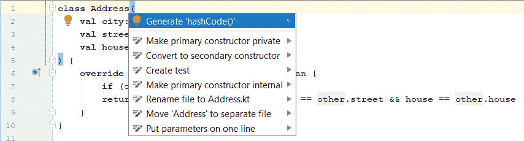

**图 8.3：** SEQ Figure ARABIC3：使用 IDE 检查生成缺失的`hashCode()`方法

`equals()`实现的一般要求与 Java 基本相同：

- 非空对象不能等于 null；
- 每个对象必须等于自身；
- 等等性必须是对的：`a == b`必须意味着`b == a`；
- 等等性必须是传递：`a == b`和`b == c`必须意味着`a == c`；

**IDE 提示：** IntelliJ 插件可以根据类属性生成`equals()`和`hashCode()`方法。这些方法与为数据类提供的方法非常相似，在大多数情况下会提供合理的行为。在其他情况下，你可以将它们作为编写自己实现的良好起点。

要生成方法，请在类内部按`Alt + Insert`出的 Generate 菜单中选择`equals()`和`hashCode()`（参见 *图 8.4*）：

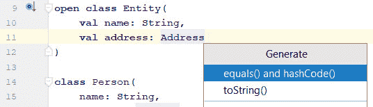

**图 8.4：** SEQ Figure ARABIC4：Generate 菜单

如果涉及的类是开放的（open），IDE 会建议生成也支持子类实例的方法。如果你同意，那么不同子类的实例可能会恰好相等，这是不理想的。在示例中，我们不会使用此选项，因为我们希望`Person`和`Organization`的实例是相互不同的。

然后你继续选择要在生成的方法中使用的属性（如 *图 8.5 所示*）。请注意，只有用于`equals()`的属性才能用于`hashCode()`。这确保了两个方法方法是兼容的，即相等的对象具有相同的哈希码。

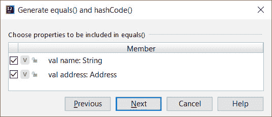

**图 8.5：** SEQ Figure ARABIC5：为`equals()`方法选择属性

将此操作应用于`Entity`类将产生以下代码：

```kotlin
open class Entity(
    val name: String,
    val address: Address
) {
    override fun equals(other: Any?): Boolean {
        if (this === other) return true
        if (javaClass != other?.javaClass) return false
        other as Entity
        if (name != other.name) return false
        if (address != other.address) return false
        return true
    }
    override fun hashCode(): Int {
        var result = name.hashCode()
        result = 31 * result + address.hashCode()
        return result
    }
}
```

属性通过委托给它们自己的`equals()`和`hashCode()`实现来进行比较的。数组类型是一个例外 - 因为它们没有自己的基于内容的相等性实现，生成的代码将使用`contentEquals()`和`contentHashCode()`（当应用于多维数组属性时，使用`contentDeepEquals()`/`contentDeepHashCode()`）。

```kotlin
class Person(
    val name: String,
    val address: Address,
    val age: Int
): Entity(name, address) {
    override fun toString() = "$name, $age at $address"
}

class Organization(
    name: String,
    address: Address,
    val manager: Person?
) : Entity(name, address) {
    override fun toString() = "$name at $address"
}

fun main() {
    // Euan Reynolds, 25 at London, Ivy Lane, 8A
    println(Person("Euan Reynolds", Address("London", "Ivy Lane", "8A"), 25))
    // Thriftocracy, Inc. at Perth, North Road, 129
    println(
        Organization(
            "Thriftocracy, Inc.",
            Address("Perth", "North Road", "129"),
            null
        )
    )
}
```

IDE Tips：IntelliJ 也允许生成简单的`toString()`实现，就像`equals()/hashCode()`方法一样。要实现这一点，你只需要在 Generate（生成）菜单中选择`toString()`选项（参见图 8.4），并选择你想在`toString()`中使用的属性。你可以选择将生成的字符串作为单个字符串模板或拼接表达式。如果父类已经有了某些非平凡的`toString()`实现，你还可以额外选择是否添加`super.toString()`调用。

以下是将`Generate` `toString()`操作应用于我们的`Person`类后的结果：

```kotlin
class Person(
    val name: String,
    val age: Int,
    address: Address
): Entity(address) {
    override fun toString(): String {
        return "Person(name='$name', age=$age) ${super.toString()}"
    }
}
```

Kotlin 标准库还包含了为`Any?`类型定义的`toString()`扩展函数。该函数在接收者不为空时，简单地委托给接收者的`toString()`成员，否则返回 null 字符串。这允许在可空和非可空值上使用`toString()`。

## 抽象类和接口

到为止，我们见过的所有父类都可以拥有自己的实例。然而，有时这是不理想的，因为类也可以代表抽象概念，这些概念本身没有实例，并且只有通过更具体的案例才能实例化。例如，我们之前的示例涉及了`Entity`类，它被`Person`和`Organization`子类。虽然代表特定个人和组织的对象是有意义的，但实体本身是一个抽象概念。因此，仅仅创建一个`Entity`实例而不是其特定子类的一个实例是没有意义的。在接下来的章节中，我们将处理允许我们定义和使用此类抽象类型的 Kotlin 特。

### 抽象类和成员

像 Java 一样，Kotlin 也支持抽象类，抽象类不能直接实例化，而是仅作为其他类的超类型。为了将类标记为抽象，你需要使用相应的修饰关键字：

```kotlin
abstract class Entity(val name: String)

// Ok：子类中的委托调用
class Person(name: String, val age: Int) : Entity(name)

val entity = Entity("Unknown") // Error：Entity 无法实例化
```

如上面的示例所示，抽象类可以有自己的构造函数。抽象类和非抽象类之间的区别在于，抽象类的构造函数只能作为子类定义中委托调用的一部分被调用。在以下代码中，辅助构造函数委托给了抽象类的构造函数：

```kotlin
abstract class Entity(val name: String)

class Person : Entity {
    constructor(name: String) : super(name)
    constructor(
        firstName: String,
        familyName: String
    ) : super(familyName)
}
```

抽象类的另一个特性是允许你声明抽象成员。抽象成员定义了函数或属性的基本形状，例如其名称、参数和返回类型，但省略了任何实现。当非抽象类从其父类继承此类成员时，必须对它们进行重写并给出实现：

```kotlin
import kotlin.math.PI

abstract class Shape {
    abstract val width: Double
    abstract val height: Double
    abstract fun area(): Double
}

class Circle(val radius: Double) : Shape() {
    val diameter get() = 2 * radius
    override val width get() = diameter
    override val height get() = diameter
    override fun area() = PI * radius
}

class Rectangle(
    override val width: Double,
    override val height: Double
) : Shape() {
    override fun area() = width * height
}

fun Shape.print() {
    println("Bounds: $width, area: ${area()}")
}

fun main() {
    // Bounds: 20.0,20.0, area: 314.15926535893
    Circle(10.0).print()
    // Bounds: 3.0,5.0, area: 15.0
    Rectangle(3.0, 5.0).print()
}
```

由于抽象成员本身不应该有实现，它们的定义受到某些限制：

- 抽象属性不能有初始化器、访问器器或`by`子句；
- 抽象函数不能有函数体；
- 抽象属性和函数必须显式指定它们的返回类型，因为无法无法推断。

请注意，抽象成员是隐式开启（open），因此你不需要显式地标记它们。

IDE Tips：除了我们在重写成员中过的`Override Members`操作外，IntelliJ 还有一个名为`Implement Members`的类似操作。该操作可以通过`Ctrl + I`快捷键使用，并产生一个与`Override Members`类似的对话框，但它只列出尚未实现的成员（参见图 8.6）：


图 8.6：实现成员对话框

另一种选项是在类名或关键字上调用`Alt + Enter`使用的快速修复（参见图 8.7）。除了其他，这些快速修复允许你实现抽象属性（参见`Rectangle`类），或简单将当前类标记为抽象。

### 接口

Kotlin 接口在概念上与其 Java 实现相似，特别是在 Java 8 引入默认方法之后。本质上，接口是一种可以包含方法和属性（抽象和非抽象）的类型，但不能定义实例状态或构造函数。

与类不同，接口定义通过`interface`关键字引入：

```kotlin
interface Vehicle {
    val currentSpeed: Int
    fun move()
    fun stop()
}
```

接口成员默认是抽象的。如果不提供（如上面的代码所示），会自动假设为`abstract`修饰。你可以显式地写出它，但这被认为是多余的。

接口可以作为类和其他接口的超类型。当非抽象类继承接口时，必须为所有抽象成员提供实现（并可选地重写非抽象成员）。同样，类对类接口成员的实现必须用`override`关键字标记：

```kotlin
interface FlyingVehicle : Vehicle {
    val currentHeight: Int
    fun takeOff()
    fun land()
}

class Car : Vehicle {
    override var currentSpeed = 0
    private set
    override fun move() {
        println("Riding...")
        currentSpeed = 50
    }
    override fun stop() {
        println("Stopped")
        currentSpeed = 0
    }
}
```


```kotlin
class Aircraft : FlyingVehicle {
    override var currentSpeed = 0
    private set
    override var currentHeight = 0
    private set
    override fun move() {
        println("Taxiing…")
        currentSpeed = 50
    }
    override fun stop() {
        println("Stopped")
        currentSpeed = 0
    }
    override fun takeOff() {
        println("Taking off…")
        currentSpeed = 500
        currentHeight = 5000
    }
    override fun land() {
        println("Landed")
        currentSpeed = 50
        currentHeight = 0
    }
}
```

请注意，在所有三个类型的定义中，超类型名称后面没有`()`。这是因为与类不同，接口没有构造函数，因此没有代码在子类初始化时被调用。

**Java vs. Kotlin：** 请注意，在 Kotlin 中，所有可能的继承情况（类继承类、接口继承接口、类继承接口）都由相同的符号`(:)`表示，而 Java 在类继承接口时需要使用`implements`关键字，在所有其他情况下使用`extends`。

与 Java 类似，Kotlin 接口不允许继承类。`Any`类可以被视为一个例外，因为每个 Kotlin 类和接口都会隐式继承它。

接口函数和属性也可以拥有实现：

```kotlin
interface Vehicle {
    val currentSpeed: Int
    val isMoving get() = currentSpeed != 0
    fun move()
    fun stop()
    fun report() {
        println(if (isMoving) "Moving at $currentSpeed" else "Still")
    }
}
```

这些实现被认为是隐式开放的，因此可以被继承者重写。将接口成员标记为`final`将导致编译错误：

```kotlin
interface Vehicle {
    final fun move() {} // Error
}
```

然而，你可以使用扩展函数和属性作为`final`成员的替代：

```kotlin
fun Vehicle.relativeSpeed(vehicle: Vehicle) =
    currentSpeed - vehicle.currentSpeed
```

与类一样，接口方法也可以通过继承接口来重写：

```kotlin
interface Vehicle {
    fun move() {
        println("I'm moving")
    }
}

interface Car : Vehicle {
    override fun move() {
        println("I'm riding")
    }
}
```

**IDE 提示：** 我们在之前的章节中讨论过的重写成员（Override Members）和实现成员（Implement Members）操作在接口内部同样可用。

由于接口不允许定义状态，因此它们不能包含带有底层字段（backing fields）的属性。带有初始化器和委托的属性是被特别禁止的：

```kotlin
interface Vehicle {
    val currentSpeed = 0      // Error
    val maxSpeed by lazy { 100 } // Error
}
```

接口也是隐式抽象的。然而，与抽象类不同，接口禁止定义任何构造函数：

```kotlin
interface Person(val name: String) // Error
interface Vehicle {
    constructor(name: String)           // Error
}
```

与 Java 类似，Kotlin 接口也支持多继承。让我们来看一个例子：

```kotlin
interface Car {
    fun ride()
}
interface Aircraft {
    fun fly()
}
interface Ship {
    fun sail()
}
interface FlyingCar : Car, Aircraft
class Transformer : FlyingCar, Ship {
    override fun ride() {
        println("I'm riding")
    }
    override fun fly() {
        println("I'm flying")
    }
    override fun sail() {
        println("I'm sailing")
    }
}
```

`FlyingCar`接口和`Transformer`类都同时继承了多个接口，并获得了它们的所有成员。在非抽象类`Transformer`的情况下，我们还实现了所有继承的成员。

当单个类型继承自多个不同的接口，且这些接口具有相同签名的成员时，会出现一个有趣的问题。在这种情况下，它们实际上被合并为单一成员，然后由子类型继承。假设我们的`Car`和`Ship`接口没有源自`Any`的共同超类型：

```kotlin
interface Car {
    fun move()
}
interface Ship {
    fun move()
}
class Amphibia : Car, Ship {
    override fun move() {
        println("I'm moving")
    }
}
```

在上面的代码中，`move()`方法的两个变体都是抽象的，因此我们必须在非抽象类`Amphibia`中实现它。然而，即使其中某些已经有了实现，编译器仍然会强制我们提供一个显式的实现以解决可能的歧义：

```kotlin
interface Car {
    fun move() {
        println("I'm riding")
    }
}
interface Ship {
    fun move()
}
class Amphibia : Car, Ship {
    override fun move() {
        super.move() // 调用 Car 的实现
    }
}
fun main() {
    Amphibia().move() // I'm riding
}
```

当有多个超类型都提供了这种合并成员的实现时，`super`调用本身会变得歧义。在这种情况下，你可以使用带有超类型名称的`super`扩展形式：

```kotlin
interface Car {
    fun move() {
        println("I'm riding")
    }
}
interface Ship {
    fun move() {
        println("I'm sailing")
    }
}
class Amphibia : Car, Ship {
    override fun move() {
        super<Car>.move()   // 调用 Car 的实现
        super<Ship>.move() // 调用 Ship 的实现
    }
}
fun main() {
    /*
        I'm riding
        I'm sailing
    */
    Amphibia().move()
}
```

**Java vs. Kotlin：** Java 8 使用限定形式的`super`达到同样的目的：`Ship.super.move()`。

自 1.1 版本以来，Kotlin 编译器可以以 Java 8 方法的形式生成非抽象接口成员。在第 12 章 Java 互操作中，我们将详细讨论此类互操作问题。

接口对状态和构造函数的限制是由其对多继承的支持引起的。主要目标是避免著名的菱形继承问题。考虑以下类：

```kotlin
interface Vehicle {
    val currentSpeed: Int
}
interface Car : Vehicle
interface Ship : Vehicle
class Amphibia : Car, Ship {
    override var currentSpeed = 0
    private set
}
```

Kotlin 的设计以禁止接口中的状态为代价解决了这个问题。

## 密封类 (Sealed classes)

有时，我们要在程序中表示的概念可能来自一组固定的变体。在第 6 章（使用特殊情况类）中，我们引入了`enum`类的概念，它允许用相同的类型表示一组预先定义的常量。例如，我们可以用它来表示某些计算结果为成功或错误：

```kotlin
enum class Result {
    SUCCESS, ERROR
}

fun runComputation(): Result {
    try {
        val a = readLine()?.toInt() ?: return Result.ERROR
        val b = readLine()?.toInt() ?: return Result.ERROR
        println("Sum: ${a + b}")
        return Result.SUCCESS
    } catch (e: NumberFormatException) {
        return Result.ERROR
    }
}

fun main() {
    val message = when (runComputation()) {
        Result.SUCCESS -> "Completed successfully"
        Result.ERROR -> "Error!"
    }
    println(message)
}
```

然而，在某些情况下，不同的变体可能有自己的属性。例如，成功完成的状态可能伴随着一个产生的结果，而错误状态可能带有某些关于其原因的信息。这与我们在本章中已经讨论的示例类似。这些概念可以使用类层次结构进行建模，其中根抽象类表示通用概念，而其子类则作为特定变体的表示。让我们完善示例，并为`Success`和`Error`情况添加一些成员：

```kotlin
abstract class Result {
    class Success(val value: Any) : Result() {
        fun showResult() {
            println(value)
        }
    }
    class Error(val message: String) : Result() {
        fun throwException() {
            throw Exception(message)
        }
    }
}

fun runComputation(): Result {
    try {
        val a = readLine()?.toInt
        ?: return Result.Error("Missing first argument")
        val b = readLine()?.toInt
        ?: return Result.Error("Missing second argument")
        return Result.Success(a + b)
    } catch (e: NumberFormatException) {
        return Result.Error(e.message ?: "Invalid input")
    }
}

fun main() {
    val message = when (val result = runComputation()) {
        is Result.Success -> "Completed successfully: ${result.value}"
        is Result.Error -> "Error: ${result.message}"
        else -> return
    }
    println(message)
}
```

这种实现并不是完美的。它没有让我们利用“`Result`变体集合被限制为`Success`和`Error`”这一事实。没有任何东西阻止某些客户端代码添加新的子类，例如：

```kotlin
class MyStatus : Result()
```

这也是为什么我们需要在`when`表达式中添加`else`子句的原因。编译器无法确保结果变量始终持有`Success`或`Error`的实例，并迫使我们也处理剩余的情况。

在 Kotlin 中，得益于密封类（sealed classes）的特性，我们可以克服这个问题。让我们通过添加`sealed`修饰符来修改类定义：

```kotlin
sealed class Result {
    class Success(val value: Any) : Result() {…}
    class Error(val message: String) : Result() {…}
}
```

当类被标记为密封时，它的继承者可以在其类体内部作为嵌套类和对象声明，也可以作为同一文件中的顶层类声明（后者是在 Kotlin 1.1 中引入的）。在这些范围之外，密封类实际上是最终的（final），不能被继承。

请注意，密封类也是抽象的，因此你不能直接创建它的实例。该思想是，密封类的任何实例都必须通过其一个子类来创建：

```kotlin
val result = Result() // Error: can't instantiate an abstract class
```

事实上，密封类的构造函数默认是私有的，使用某些可见性修饰符声明它们被视为编译时错误。与枚举（enums）一样，密封类支持`when`表达式的穷举形式，这允许我们避免冗余的`else`分支：

```kotlin
val message = when (val result = runComputation()) {
    is Result.Success -> "Completed successfully: ${result.value}"
    is Result.Error -> "Error: ${result.message}"
}
```

请注意，继承限制只涵盖密封类的直接子类。只要子类不是最终的（final），它们就可以有它们自己的继承者：

```kotlin
// Result.kt
sealed class Result {
    class Success(val value: Any) : Result()
    open class Error(val message: String) : Result()
}
```

自 Kotlin 1.1 起，密封类也可以扩展其他类。这允许类拥有同样也是密封的子类：

```kotlin
// util.kt
sealed class Result {
    class Success(val value: Any) : Result()
    sealed class Error : Result() {
        abstract val message: String
        class ErrorException(val exception: Exception) : Error() {
            override val message: String get() = exception.message ?: ""
        }
        class ErrorWithMessage(override val message: String) : Error()
    }
}
```

由于数据类的继承，可以使用数据类作为密封类层次结构的一部分，数据类继承也是在 1.1 中引入的。这允许我们结合数据类和密封类的优点。例如，考虑表示简单算术表达式语法树的类：


```kotlin
sealed class Expr
    data class Const(val num: Int): Expr()
    data class Neg(val operand: Expr): Expr()
    data class Plus(val op1: Expr, val op2: Expr): Expr()
    data class Mul(val op1: Expr, val op2: Expr): Expr()
}

fun Expr.eval(): Int = when (this) {
    is Const -> num
    is Neg -> -operand.eval()
    is Plus -> op1.eval() + op2.eval()
    is Mul -> op1.eval() * op2.eval()
}

fun main() {
    // (1 + 2) * 3
    val expr = Mul(Plus(Const(1), Const(2)), Const(3))
    println(expr)
    println(expr.eval()) // 9
    // 2 * 3
    val expr2 = expr.copy(op1 = Const(2))
    println(expr2)
    println(expr2.eval()) // 6
}
```

请注意，`sealed` 修饰符不能应用于接口（interfaces）。这意味着构成密封层次结构的子类不能继承自其他某些类，因为 Kotlin 禁止多类继承。

密封类的实现也可以是一个对象（object）。让我们假设我们想要完善 `Result` 示例，以区分没有产生结果的成功状态：

```kotlin
sealed class Result {
    object Completed : Result()
    class ValueProduced(val value: Any) : Result()
    class Error(val message: String) : Result()
}
```

当所有直接继承者都是对象时，密封类的行为实际上类似于枚举。

**IDE 提示：** 如果你想将一个枚举类重构为密封类，IntelliJ 插件可以提供一个很好的起点，得益于通过 `Alt + Enter` 菜单提供的相应意图操作（见图 8.7）。结果是枚举常量转换为实现抽象密封类的单例。

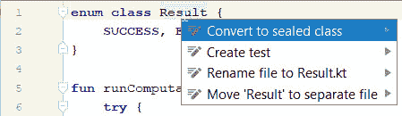

**图 8.7: SEQ Figure * ARABIC8: 将枚举类转换为密封层次结构**

**此外，IntelliJ 还支持反向转换——如果密封类的所有直接继承者都由对象声明表示，你可以通过将它们的实现替换为枚举常量将其转换为枚举类（如图 8.8 所示）：**

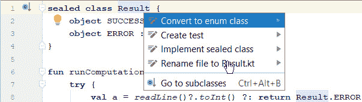

**图 8.8: SEQ Figure * ARABIC9: 将密封转换为枚举**

## 委托

在前面的节中，我们看到 Kotlin 类默认是最终的（final）。目标是通过设计可继承类来鼓励思考，并防止意外继承自不应该有子类的类。这有助于缓解我们在上面讨论的脆弱基类问题（fragile base class problem）。

如果我们需要扩展或更改某些现有类的行为，但又无法继承它该怎么办？在这种情况下，我们可以使用著名的委托模式（delegation pattern），它允许我们重用现有的类。如果我们想创建一个接口的实现，可以获取一个现有实现的实例，将其封装在我们类的实例内部，并在必要时将我们的方法委托给该实例。

让我们来看一个例子。假设我们有以下类型：

```kotlin
interface PersonData {
    val name: String
    val age: Int
}

open class Person(
    override val name: String,
    override val age: Int
): PersonData

data class Book(val title: String, val author: PersonData) {
    override fun toString() = "'$title' by ${author.name}"
}

fun main() {
    val valWatts = Person("Val Watts", 30)
    val introKotlin = Book("Introduction to Kotlin", valWatts)
    println(introKotlin) // ‘Introduction to Kotlin’ by Val Watts
}
```

现在，假设我们希望作家拥有笔名，以便他们伪装成另一个人：

```kotlin
class Alias(
    private val realIdentity: PersonData,
    private val newIdentity: PersonData
) :PersonData {
    override val name: String
    get() = newIdentity.name
    override val age: Int
    get() = newIdentity.age
}
```

现在我们可以使用这个类来创建人的别名：

```kotlin
fun main() {
    val valWatts = Person("Val Watts", 30)
    val johnDoe = Alias(valWatts, Person("John Doe", 25))
    val introJava = Book("Introduction to Java",johnDoe)
    println(introJava) // ‘Introduction to Java’ by John Doe
}
```

这种方法的问题在于，你需要生成大量的样板代码来将所有必要的方法和属性委托给另一个对象。幸运的是，Kotlin 内置了对委托的支持。你只需要在 `by` 关键字之后、父类接口名称之前指定一个委托实例即可：

```kotlin
class Alias(
    private val realIdentity: PersonData,
    private val newIdentity: PersonData
) :PersonData by newIdentity
```

现在，`Alias` 从 `PersonData` 接口继承的所有成员都通过委托给 `newIdentity` 实例相应的调用来实现。我们也可以重写其中一些成员来更改实现行为：

```kotlin
class Alias(
    private val realIdentity: PersonData,
    private val newIdentity: PersonData
) :PersonData by newIdentity {
    override val age: Int get() = realIdentity.age
}

fun main() {
    val valWatts = Person("Val Watts", 30)
    val johnDoe = Alias(valWatts, Person("John Doe", 25))
    println(johnDoe.age) // 30
}
```

通常，委托表达式可以是类初始化中使用的任何内容。编译器在需要时会自动创建一个字段来存储委托值。例如，我们可以删掉 `newIdentity` 上的 `val`，使其成为一个简单的参数：

```kotlin
class Alias(
    private val realIdentity: PersonData,
    newIdentity: PersonData
) :PersonData by newIdentity
```

然而，我们不能委托给在类体中定义的属性：

```kotlin
class Alias(
    private val realIdentity: PersonData
) :PersonData by newIdentity { // 错误：newIdentity 不可用
    val newIdentity = Person("John Doe", 30)
}
```

将委托与对象表达式结合起来可以创建一个与原始对象行为略有不同的实现：

```kotlin
fun PersonData.aliased(newIdentity: PersonData) =
object :PersonData by newIdentity {
    override val age: Int get() = this@aliased.age
}

fun main() {
    val valWatts = Person("Val Watts", 30)
    val johnDoe = valWatts.aliased(Person("John Doe", 25))
    println("${johnDoe.name}, ${johnDoe.age}") // John Doe, 30
}
```

请注意，类只能委托接口成员的实现。例如，以下代码会产生错误，因为 `Person` 是一个类：

```kotlin
class Alias(
    private val realIdentity: PersonData,
    private val newIdentity: PersonData
) : Person by newIdentity // 错误：只有接口可以被委托
```

结论如下：

类委托允许你以最少的样板代码结合组合和继承的优势，从而鼓励我们遵循著名的“优于继承（composition over the inheritance）”原则。

## 结论

在本章中，我们深入了解 Kotlin 类型系统中强大的继承机制。我们讨论了如何定义子类、类初始化如何适应类层级结构中，并学习了如何使用成员重写来更改子类中的基类行为。我们还学习了如何使用旨在表示抽象概念的工具，例如抽象类和接口。最后，我们探索了实现两个实用的继承相关模式的特性：密封类和委托。

在下一章中，我们将关注泛型主题——这是 Kotlin 类型系统的一个特殊功能，它让你能够使用稍后在使用处提供的未知类型对声明进行参数化。

## 问题

1. 如何在 Kotlin 中定义子类？一个类要能被继承必须满足什么条件？

2. 指出 Java 和 Kotlin 类继承之间的主要区别。

3. 当类是继承者时，如何初始化类？Java 是如何处理的？比较这两种方法。

4. 描述 `is`/`as` 运算符的作用。它们与 Java 的类型检查和转换相比如何？

5. 列出 `Any` 类中定义的常用方法。描述它们实现的基本指南。

6. 什么是抽象类及其抽象成员？规范抽象类/成员实现的规则是什么？

7. 抽象类和接口之间的区别是什么？比较 Kotlin 和 Java 中的接口。

8. 接口继承有哪些细节？描述类和接口成员重写的区别。

9. 什么是密封类（sealed class）层级？在 Java 中如何实现它？

10. 描述 Kotlin 中的类委托是如何工作的。

# 第 9 章：泛型

在本章中，我们将讨论泛型，这是 Kotlin 类型系统的一个强大功能，允许你编写处理未知类型的代码。我们将看到如何定义和使用泛型声明，解决与泛型运行时表示相关的类型擦除和泛化问题，并关注一个重要的变性概念，它可以通过泛型类型的不同替换来扩展类型关系。我们在本章中还将重点介绍的相关主题是类型别名（type alias）的概念，它允许为现有类型引入替代名称。

## 结构

* 泛型声明

* 类型边界和约束

* 类型擦除和泛化类型参数

* 声明处变性

* 投影

* 类型别名

### 目标

学习 Kotlin 中泛型声明的基础知识及其与 Java 的区别，并理解如何使用泛化类型参数和变性来设计更灵活的泛型 API。

## 类型参数

在之前的章节中，我们看到了许多使用泛型类型的例子，例如数组和各种集合类，以及如 `map()`、`filter()`、`sorted()` 等泛型函数和属性。在本节中，我们将讨论如何将自己的代码泛型化，以提高其灵活性并利用 Kotlin 类型系统中更高级的特性。

为了使一个声明变为泛型，我们需要向它添加一个或多个类型参数。这些参数可以在声明内部使用，以代替普通类型。当使用声明时——例如，当我们构造类实例或调用函数时——我们需要提供实际类型而不是类型参数：

```kotlin
val map = HashMap<Int, String>()
val list = arrayListOf<String>()
```

有时这些类型参数是可以省略的，因为编译器可以从上下推断它们：

```kotlin
// 使用显式类型来推断 HashMap 类的类型参数
val map: Map<Int, String> = HashMap()

// 使用 arrayListOf() 用的参数类型来推断其类型参数
val list = arrayListOf(“abc”, “def”)
```

### Java vs. Kotlin

**注意：** 注意 Kotlin 中泛型函数传递类型参数与 Java 中泛型方法传递类型参数的区别。在 Java 中，需要将角括号放在点号之后，例如 `Collections.<String>emptyList()`；而在 Kotlin 中，这些参数放在函数名之后：`emptyList<String>()`。尽管在调用类构造函数时，语法是类似的：Java 中为 `new ArrayList<String>()`，Kotlin 中为 `ArrayList<String>()`。

还应该注意到，Java 在调用类构造函数时支持类型参数的自动推断，但 Kotlin 要求使用所谓的菱操作符：

```java
Map<Int, String> map = new HashMap<>() // 而不是 new HashMap() !!!
```

之所以这样做是为了为了与 Java 5 添加泛型之前编写的旧代码保持向后兼容。

让我们看看如何创建自己的泛型声明。

假设我们想要定义一个树的类，它可以存储给定类型的值：

```kotlin
class TreeNode<T>(val data: T) {
    private val _children = arrayListOf<TreeNode<T>>()
    var parent: TreeNode<T>? = null
    private set
    val children: List<TreeNode<T>> get() = _children
    fun addChild(data: T) = TreeNode(data).also {
        _children += it
        it.parent = this
    }
    override fun toString() =
        _children.joinToString(prefix = "$data {", postfix = "}")
}

fun main() {
    val root = TreeNode("Hello").apply {
        addChild("World")
        addChild("!!!")
    }
    println(root) // Hello {World {}, !!! {}}
}
```

类的类型参数写在角括号内，跟在类名后面。类型参数可以有任意名称，但习惯的代码风格是在类类型参数内部使用大字母（如 `T`、`U`、`V` 等）来定义变量、属性或函数的类型，或者作为其他泛型声明的参数类型。

**Java vs. Kotlin:**

当使用泛型类或接口指定数据类型时，必须配有相应的类型参数。与 Java 不同，在 Kotlin 中你不能拥有类型 `TreeNode` 的变量：你需要为 `T` 指定类型参数，例如 `TreeNode<String>` 或 `TreeNode<U>`（其中 `U` 是另一个类型参数）。

当调用泛型类的构造函数时，显式的类型参数通常是不必要的，因为在许多情况下，编译器可以从文中推断它们：这就是为什么在上面的 `TreeNode(“Hello”)` 调用中我们不需要指定 `<String>`。一个重要的例外是到父类构造函数的委托调用。让我们稍微修改一下示例：

```kotlin
open class DataHolder<T>(val data: T)

// 将实际类型作为父类型参数传递
class StringDataHolder(data: String) : DataHolder<String>(data)

// 将类型参数作为父类型参数传递
class TreeNode<T>(data: T) : DataHolder<T>(data) { … }
```

与普通的构造函数调用不同，编译器在委托调用中推断类型参数，因此你必须显式提供它们。比较两种情况：

```kotlin
// 错误：需要显式指定 DataHolder<String>
class StringDataHolder(data: String) : DataHolder(data)

// 正确：DataHolder<String> 会自动推断
fun stringDataHolder(data: String) = DataHolder(data)
```

请注意，类型参数是不继承的；你将它们传递给父类型，类似于传递给构造函数参数，因此 `TreeNode` 中的 `T` 和 `DataHolder` 中的 `T` 是独立的声明，事实上，我们可以为它们使用不同的名称：

```kotlin
class TreeNode<U>(data: U) : DataHolder<U>(data) { … }
```


泛型类中定义的函数和属性可以访问它们的类型参数，如上面`addChild()`和`children`的定义所示。此外，你可以通过添加自己的类型参数来使属性或函数变为泛型：

```kotlin
fun <T>TreeNode<T>.addChildren(vararg data: T) {
    data.forEach { it }
}

fun <T>TreeNode<T>.depthFirst(action: (T) -> Unit) {
    children.forEach { action(it) }
}

val <T>TreeNode<T>.depth: Int = children.asSequence().map { it }.max() ?: 0

fun main() {
    val root = TreeNode("Hello").apply {
        addChild("World")
        addChild("!!!")
    }
    println(root)
}
```

### 边界与约束

类型参数默认不对对其值施加任何限制，其行为等同于`Any`。但有时泛型类、函数或属性的实现需要关于数据的额外信息。扩展我们的`TreeNode`示例，假设我们想要定义一个函数，计算所有节点的平均值。这种操作仅适用于数值树，因此我们希望树元素是`Number`。为了实现这一点，我们声明了一个以`Number`为上界的类型参数：

```kotlin
fun <T : Number>TreeNode<T>.average(): Double {
    var count = 0
    var sum = 0.0
    depthFirst {
        count++
        sum += it.toDouble()
    }
    return sum/count
}
```

当类型参数有上界时，编译器将检查相应的类型参数是否为该上界的子类。默认，上界假设为`Any`，因此如果不显式指定，类型参数可以接受任何 Kotlin 类型。以下调用是有效的，因为`Int`和`Double`是`Number`的子类：

```kotlin
val intTree = TreeNode(1).apply {
    addChild(2).addChild(3)
    addChild(4).addChild(5)
}
println(intTree.average()) // 3.0

val doubleTree = TreeNode(1.0).apply {
    addChild(2.0)
    addChild(3.0)
}
println(doubleTree.average()) // 2.0
```

然而，对字符串树调用`average()`会产生编译错误：

```kotlin
val stringTree = TreeNode("Hello").apply {
    addChildren("World", "!!!")
}
println(stringTree.average()) // Error: String is not subtype of Number
```

请注意，将`final`类作为上界是徒劳的，因为没有其他类型可以替换此类型参数。在这种情况下，编译器会报告警告：

```kotlin
// 可以替换为非泛型函数
// fun TreeNode<Int>.sum(): Int {…}
fun <T : Int>TreeNode<T>.sum(): Int { // 警告
    var sum = 0
    walkDepthFirst{ sum += it }
    return sum
}
```

类型参数边界可以引用类型参数本身，在这种情况下，它被称为递归的。例如，如果我们的树包含了`Comparable`接口的实例，我们可能会找到一个具有最大值的节点：

```kotlin
fun <T : Comparable<T>>TreeNode<T>.maxNode(): TreeNode<T> {
    val maxChild = children.maxBy { it.data } ?: return this
    return if (data >= maxChild.data) this else maxChild
}

fun main() {
    // Double 是 Comparable<Double> 的子类型
    val doubleTree = TreeNode(1.0).apply {
        addChild(2.0)
        addChild(3.0)
    }
    println(doubleTree.maxNode().data) // 3.0
    // String 是 Comparable<String> 的子类型
    val stringTree = TreeNode("abc").apply {
        addChildren("xyz", "def")
    }
    println(stringTree.maxNode().data) // xyz
}
```

边界也可以引用先前的类型参数。我们可以利用这一事实编写一个函数，将树元素附加到可变列表中：

```kotlin
fun <T, U : T>TreeNode<U>.toList(list: MutableList<T>) {
    walkDepthFirst{ list += it }
}
```

由于`U`是`T`的子类型，上述函数可以接受包含更通用元素的列表。例如，我们可以将`Int`和`Double`树附加到`Number`列表（它们它们的共同父类）：

```kotlin
fun main() {
    val list = ArrayList<Number>()
    TreeNode(1).apply {
        addChild(2)
        addChild(3)
    }.toList(list)
    TreeNode(1.0).apply {
        addChild(2.0)
        addChild(3.0)
    }.toList(list)
}
```

**Java vs. Kotlin：** Kotlin 类型参数的上界与 Java 的对应部分非常相似，主要区别在于语法：Java 中的`T extends Number`对应 Kotlin 中的`T : Number`。

一个特别常见的情况是将类型参数限制为非空。为了实现这一点，我们需要使用非可空类型作为其上界：

```kotlin
fun <T: Any>notNullTreeOf(data: T) = TreeNode(data)
```

类型参数语法允许你仅指定一个上界。但在某些情况下，我们可能需要对单个类型参数施加多个重限制。这可以通过使用稍微复杂的类型约束语法来实现。假设我们有一对如下所示的接口：

```kotlin
interface Named {
    val name: String
}

interface Identified {
    val id: Int
}
```

现在，假设我们要定义一个既有名称又有标识符的对象注册表：

```kotlin
class Registry<T> where T : Named, T : Identified {
    val items = ArrayList<T>()
}
```

`where`子句添加在声明体之前，并列出带有边界的类型参数。

现在我们已经领略了泛型语法，可以转向处理运行时泛型表示的下一个主题了。

## 类型擦除与具体化（reification）

在前面的示例中，我们看到类型参数可以用于指定泛型声明内部变量、属性和函数的类型。然而，在某些情况下，类型参数无法替换实际类型。例如，考虑以下代码：

```kotlin
fun <T>TreeNode<Any>.isInstanceOf(): Boolean =
    data is T &&children.all{ it.isInstanceOf<T>() } // Error
```

意图是编写一个函数，检查给定的树节点及其所有子节点是否符合特定类型`T`。然而，编译器在`data is T`处报告错误。

在 Java 中，泛型类型信息在运行时会被擦除。这意味着你无法对泛型集合的类型进行检查。例如，你无法检查一个对象是否为`List<String>`。你只能检查它是否为`List`。

在 Kotlin 中，你可以使用`reified`关键字来执行这些检查。然而，这仅在`inline`函数中是可能的。

```kotlin
inline fun <reified T> TreeNode<Any>.isInstanceOf(): Boolean =
    data is T && children.all { it.isInstanceOf<T>() }
```

等待，上面的代码是不正确的，因为`isInstanceOf`将是递归的。让我们来看一个简单的例子：

```kotlin
inline fun <reified T> checkType(item: Any) {
    if (item is T) {
        println("item is $T")
    } else {
        println("item is not $T")
    }
}
```

`reified`关键字允许编译器在运行时访问`T`的类型信息。

请注意，允许带有非星号参数的泛型类型进行强制转换，但它们总是产生警告。虽然它们允许你绕过泛型的局限性，但它们可能会将实际错误推到运行时。例如，以下两个表达式编译时都会带有警告，但第一个正常完成，而第二个会抛出异常：

```kotlin
val n = (listOf(1, 2, 3) as List<Number>)[0] // OK
val s = (listOf(1, 2, 3) as List<String>)[0] // Exception
```

在后一种情况下，异常仅发生在列表元素（类型为`Int`）的值赋值给（静态知的）类型`String`变量时。在 Java 中，你主要得依靠强制转换或使用反射。这两种方法都有缺点，强制转换可能会忽略问题并导致错误。另一方面，使用反射 可能会影响性能。然而，Kotlin 为你提供了第三种选择，不受这些缺点的影响。

具体化（Reification）意味着类型参数信息在运行时被保留。编译器是如何规避类型擦除的？答案是具体类型参数仅适用于`inline`函数：由于函数体在调用处内联，并且那里提供了类型参数，编译器始终知道特定的内联调用中哪些类型对应类型类型。为了具体化参数，我们需要用相应的关键字标记它。让我们使用此功能来修复我们的`isInstanceOf()`函数。由于内联函数不能递归，我们必须在某种程度上重写它的实现：

```kotlin
inline fun <reified T> TreeNode<T>.cancellableWalkDepthFirst(
    onEach: (T) -> Boolean
): Boolean {
    val nodes = Stack<TreeNode<T>>()
    nodes.push(this)
    while (nodes.isNotEmpty()) {
        val node = nodes.pop()
        if (!onEach(node.data)) return false
        for (child in node.children) {
            nodes.push(child)
        }
    }
    return true
}
```

```kotlin
val node = nodes.pop()
if (!onEach(node.data)) return false
node.children.forEach { nodes.push(it) }
}
return true
}
inline fun <reified T>TreeNode<*>.isInstanceOf() =
    cancellableWalkDepthFirst { it is T }
```

在上述代码中，我们已经实际的树遍历逻辑提取到了独立的非内联函数`cancellableWalkDepthFirst()`中，以防止循环本身被内联。例如，现在我们如下调用此函数时：

```kotlin
fun main() {
    val tree = TreeNode<Any>("abc").addChild("def").addChild(123)
    println(tree.isInstanceOf<String>())
}
```

编译器将内联`isInstanceOf()`并用实际类型`String`代替`T`，执行的代码将如下：

```kotlin
fun main() {
    val tree = TreeNode<Any>("abc").addChild("def").addChild(123)
    println(tree.cancellableWalkDepthFirst { it is String })
}
```

与 Java 中使用的方法不同，具体化类型参数（reified type parameters）为你提供了既安全（无未检查转换）又快速（得益于内联）的解决方案。然而，请注意，使用内联函数往往会增加编译代码的大小，但可以通过将代码密集部分提取到独立的非内联函数（如我们对`cancellableWalkDepthFirst()`所做的）来缓解这个问题。此外，由于具体化类型参数仅支持内联函数，你不能在类或属性中使用它们。

具体化类型参数仍然有自身的限制，这与完整的类型区分开来。目前无法通过具体化类型参数调用构造函数或访问伴侣成员：

```kotlin
inline fun <reified T>factory() = T() // Error
```

此外，你不能用非具体化的类型参数代替具体化的类型参数：

```kotlin
fun <T, U>TreeNode<*>.isInstanceOfBoth() =
    isInstanceOf<T>() && isInstanceOf<U>()
```

这之所以的原因同样是类型擦除（type erasure）。由于我们无法知道`isInstanceOfBoth()`中替换`T`和`U`的实际类型，我们必须找到一种安全的方法来内联任何一个`isInstanceOf()`调用。

到此，关于 Kotlin 泛型的基础讨论此结束。现在我们将进入更高级的话题：变性（variance），它允许通过控制类型行为的生产者/消费者方面来提高泛型声明的灵活性。

## 变性 (Variance)

变性是泛型类型的一个方面，描述了它的替换类型在子类型关系上是如何相互相关的。在之前的章节中，我们已经看到了具有不同变性的泛型示例。例如，数组和可变集合并没有保留其参数的子类型关系，尽管`String`是`Any`的子类型，但`Array<String>`不被视为`Array<Any>`的子类型（`Array<Any>`被视为`Array<String>`的子类型）。相反，像`List`或`Set`等不可变集合保留了子类型关系，因此`List<String>`是`List<Any>`的子类型：

```kotlin
val objects: List<Any> = listOf("a", "b", "c") // Correct
```

合理使用变性可以在不牺牲类型安全性的情况下提高你 API 的灵活性。在接下来的章节中，我们将讨论变性的含义以及它如何在 Kotlin 泛型中使用的。

### 变性：区分生产者和消费者

泛型类和接口可以通过用不同的类型参数代替其类型参数来产生无限的类型集。默认情况下，无论其参数之间的关系如何，特定类型的所有替换都不被视为彼此的子类型。在这种情况下，我们说该泛型是**不变的 (invariant)**（相对于它的某些类型参数）。例如，内置的`Array`类、可变集合类以及我们的`TreeNode`类都是不变的。下面的示例显示`TreeNode<String>`不被视为`TreeNode<Any>`的子类型：

```kotlin
val node: TreeNode<Any> = TreeNode<String>("Hello") // Error
```

另一方面，某些类型（如不可变集合）保留了其参数的子类型关系。在接下来的章节中，我们将讨论允许你控制子类型如何影响自定义泛型类的语言特性。然而，我们首先需要理解为什么某些泛型类可以保留继承而另一些不能。

这种区别基于类型处理其类型参数值（假设为`T`）的方式。泛型类型可以分为三类：

1. **生产者 (Producers)**：只有返回`T`类型值的操作，但从不将其作为输入；

2. **消费者 (Consumers)**：其操作只接收`T`类型的值作为输入，但从不返回它们；

3. **所有剩余类型**：不属于上述任何一组。

事实证明，通常情况下，最后一组的类型（既不是生产者也不是消费者的类型）在不破坏类型安全的情况下保留子类型关系。为了理解为什么会发生这种情况，让我们考虑一个使用我们`TreeNode`的示例。暂时假设允许子类型化，并将`TreeNode<String>`赋值给`TreeNode<Any>`。

```kotlin
val stringNode = TreeNode<String>("Hello")
val anyNode: TreeNode<Any> = stringNode
anyNode.addChild(123)
val s = stringNode.first()
```


现在问题很清楚了，`anyNode` 有添加任何类型孩子的能力，而`TreeNode<String>`只能添加`String`类型的孩子。这就是为什么`TreeNode<String>`不能成为`TreeNode<Any>`子类型的原因。

为什么像`List<T>`这样的不可变集合不同呢？原因是它们没有像`addChild()`这样的操作：它们的成员只产生`T`值，而不消费它们。所以，`List<Any>`的基本合约是检索`Any`值的能力。同样，`List<String>`的合约是检索`String`值的能力。但由于`String`是`Any`的子类型，这自动使得`List<String>`也能检索`Any`值。换句话说，`List<String>`和`List<Any>`的子类型关系不会危害类型安全，编译器允许我们利用这种属性。我们可以说此类类型相对于其类型参数是协变的 (covariant)。Kotlin中允许生产者类型的协变。

许多内置不可变类型如`Pair`、`Triple`、`Iterable`、`Iterator`等都是协变的。此外，函数类型相对于其返回类型是协变的：

```kotlin
val stringProducer: () -> String = { “Hello” }
val anyProducer: () -> Any = stringProducer
println(anyProducer()) // Hello
```

请注意，协变不等于不可变。协变（相对于`T`）只是禁止将`T`值作为输入，因此可能存在一种可以协变的可变类型。例如，考虑一个假设的可以通过索引删除元素但不能添加新元素的列表：

```kotlin
interface NonGrowingList<T> {
    val size: Int
    fun get(index: Int): Int
}
```

```kotlin
fun remove(index: Int)
}
```

它显然是可变的，但表现为协变。例如，`NonGrowingList<String>`能够完成`NonGrowingList<Any>`的一切。

反之也是如此——表示不可变对象的类型可能表现为非协变。例如：

```kotlin
interface Set<T> {
    fun contains(element: T): Boolean
}
```

上面的类型可能是不可变的，但它不是生产者，因此无法保持子类型关系。虽然`Set<Any>`可以接受任何值作为输入，但`Set<String>`只能接受字符串。

那么消费者类的类型呢？根据上述论点，它们显然无法保持子类型关系。事实证明，它们在相反的方向上保留子类型关系。为了理解这意味着，让我们考虑上述`Set<T>`类型的两种替换——`Set<Int>`和`Set<Number>`。`Set<T>`的合约可以简化为通过`contains()`函数处理`T`类型元素的能力。因此，`Set<Number>`可以处理任何`Number`，而`Set<Int>`可以处理任何`Int`。但`Int`是`Number`的子类型，所以`Set<Number>`也可以处理任何`Int`。换句话说，`Set<Number>`表现像`Set<Int>`的子类型。事实上，在Kotlin中，你可以通过声明`T`为逆变来启用这种子类型。

例如，函数类型相对于参数类型是逆变的：

```kotlin
val anyConsumer: (Any) -> Unit = { println(it) }
val stringConsumer: (String) -> Unit = anyConsumer
stringConsumer("Hello") // Hello
```

因此，对于给定的泛型`X<T,…>`，我们对于`T`有以下变变性选项：

* `X`表现像生产者：在这种情况下，我们可以声明`T`为协变，每当`A`是`B`的子类型时，`X<A>`就会是`X<B>`的子类型；
* `X`表现像消费者：我们就可以声明`T`为逆变：每当`B`是`A`的子类型时，`X<A>`就会是`X<B>`的子类型；
* 在所有其他情况情况下，`T`必须保持不变性；

在下一节中，我们将看到如何在Kotlin中表达变变性。

### 声明处的变性

在Kotlin中，类型参数的变性可以通过两种方式指定：要么在声明本身中，要么在替换类型参数时的使用处指定。在本节中，我们将关注第一种方法，即“声明处变性”。

默认情况下，类型参数被认为是不变的，这意味着它们的泛型类型不保持相应类型参数的子类型关系（其反转版本）。例如，考虑`List`类型的简化版本，具有基于数组的不可变实现：

```kotlin
interface List<T> {
    val size: Int
    fun get(index: Int): T
}

class ListByArray<T>(private vararg val items: T) : List<T> {
    override val size: Int get() = items.size
    override fun get(index: Int) = items[index]
}
```

假设我们定义了一个函数，它接收两个列表并委托给原始`List`实例之一返回它们的合并结果：

```kotlin
fun <T>concat(list1: List<T>, list2: List<T>) = object : List<T> {
    override val size: Int
    get() = list1.size + list2.size
    override fun get(index: Int): T {
        return if (index < list1.size) {
            list1.get(index)
        } else {
            list2.get(index - list1.size)
        }
    }
}
```

现在，一切进展顺利，直到我们尝试使用此函数来组合相关类型的列表，例如`List<Number>`和`List<T>`：

```kotlin
val numbers = ListByArray<Number>(1, 2.5, 3f)
val integers = ListByArray(10, 30, 30)
val result = concat(numbers, integers) // Error
```

这是因为参数`T`具有不变性，导致`List<Int>`不视为`List<Number>`的子类型（反之亦然）。因此，我们无法将`List<Int>`变量传递给期望`List<Number>`的函数。

然而，这种限制太太了。快速一眼`List`接口可以发现它实际上表现像一个生产者类型。它的操作只返回`T`的值，但永远不会将其作为输入。换句话说，这种类型可以安全地变为协变。为了做到这一点，我们用`out`标记参数`T`：

```kotlin
interface List<out T> {
    val size: Int
    fun get(index: Int): T
}
```

等待，如果我们添加一个接受`T`作为参数的方法呢？编译器将不允许这样做，因为`T`已声明为`out`。例如，如果我们尝试添加一个`set`方法：

```kotlin
interface List<out T> {
    val size: Int
    fun get(index: Int): T
    fun set(element: T) // Error: T 是 out-projection, 但用于输入位置
}
```

如果我们需要一个消费者，可以使用`in`关键字：

```kotlin
interface Consumer<in T> {
    fun add(element: T)
}
```

现在，让我们回到`concat`示例。如果我们让`List`保持不变，`concat`函数会失败：

```kotlin
fun <T>concat(list1: List<T>, list2: List<T>): List<T> = ...
```

但等，如果我们让`List`协变 (`out T`），签名变为：

```kotlin
fun <T>concat(list1: List<out T>, list2: List<out T>): List<out T> = ...
```

然而，我们只能在函数体内的生产者位置使用`T`。如果我们使用`List<out T>`，我们可以成功地传递`List<Number>`和`List<Int>`：

```kotlin
val numbers = ListByArray<Number>(1, 2.5, 3f)
val integers = ListByArray(10, 30, 30)
val result = concat(numbers, integers) // Works!
```

之所以这样做是因为`List<Int>`是`List<out Number>`的子类型，而`List<Number>`也是`List<out Number>`的子类型。`concat`函数返回一个`List<out Number>`，这正是我们需要的。

另一种指定变性的方法是在泛型参数之前放置`out`/`in`关键字，特别是用于泛型类型时。这种结构也称为投影（projection），对于通常情况下是不变的（invariant）的类型非常有用，但根据上下文，它可以被用作生产者或消费者。

假设我们想要实现一个函数，将现有树的拷贝作为子节点添加到另一棵树中。让我们从不变的定义开始：

```kotlin
fun <T>TreeNode<T>.addSubtree(node: TreeNode<T>): TreeNode<T> {
    val newNode = addChild(node.data)
    node.children.forEach { newNode.addSubtree (it) }
    return newNode
}
```

当两棵树都具有相同类型时，该函数运行良好：

```kotlin
fun main() {
    val root = TreeNode("abc")
    val subRoot = TreeNode("def")
    root.addSubtree(subRoot)
    println(root) // abc {def {}}
}
```

但如果我们想，比如将一个`Int`树添加到`Number`树中呢？这个操作是有定义的，因为`Int`是`Number`的子类型，并且向`Number`树添加基于`Int`的节点不会违反关于其类型的假设。但由于`TreeNode<T>`是不变的，且我们指定了两棵树具有相同的元素类型`T`，编译器不允许我们这样做：

```kotlin
val root = TreeNode<Number>(123)
val subRoot = TreeNode(456.7) // 错误
```

`TreeNode<T>`类型必须保持不变，因为它既包含了可以返回`T`值的成员（如`data`属性），也包含了接受`T`值输入的成员（如`addChild()`函数），因此我们不能在此使用声明处的变性。然而，在`addSubtree()`函数的上下文中，我们作为参数传递的树仅被用生产者。这允许我们通过将必要的类型参数标记为`out`来实现我们的目标：

```kotlin
fun <T>TreeNode<T>.addSubtree(node: TreeNode<out T>): TreeNode<T> {
    val newNode = addChild(node.data)
    node.children.forEach { newNode.addSubtree(it) }
    return newNode
}

fun main() {
    val root = TreeNode<Number>(123)
    val subRoot = TreeNode(456.7)
    root.addSubtree(subRoot)
    println(root) // 123 {456.7 {}}
}
```

或者，我们可以引入一个受第一个参数限制的额外类型参数，表示所添加树的元素：

```kotlin
fun <T, U : T>TreeNode<T>.addSubtree(node: TreeNode<U>): TreeNode<T> {
    val newNode = addChild(node.data)
    node.children.forEach { newNode.addSubtree(it) }
    return newNode
}
```

使用`out`投影，我们可以避免额外的类型参数并以简洁的方式解决问题。

`TreeNode<out T>`被投影类型（projected type）。投影`out T`意味着我们不知道`TreeNode`的实际类型参数，只它必须是`T`的子类型。你可以将`TreeNode<out T>`视为`TreeNode<T>`的一个版本，它只暴露相对于`T`充生产者的操作。例如，我们可以使用`data`、`children`、`depth`等属性或`walkDepthFirst()`这样的函数，因为它们不接受`T`类型的值作为输入。消费者操作如`addChild()`成员或`addChildren()`扩展函数虽然可用，但实际上不可用，因为任何在输出投影类型上调用它们的尝试都会产生编译错误：

```kotlin
fun processOut(node: TreeNode<out Any>) {
    node.addChild("xyz") // 错误：addChild() 被投影出了
}
```

`in`投影可以以类似的方式使用，来强制将类型作为消费者。例如，我们可以以以下形式编写我们添加树的函数：

```kotlin
fun <T>TreeNode<T>.addTo(parent: TreeNode<in T>) {
    val newNode = parent.addChild(data)
    children.forEach { it.addTo(newNode) }
}
```

现在，接收者是正在被添加的树，而参数代表它的新父节点。得益于`in`投影，这种函数可以将`TreeNode<T>`添加到包含`T`的任何超类类型元素的树中：

```kotlin
fun main() {
    val root = TreeNode<Number>(123)
    val subRoot = TreeNode(456.7)
    subRoot.addTo(newNode)
    println(root) // 123 {456.7 {}}
}
```

## 星号投影 (Star Projections)

星号投影用`*`表示，类型可以是任意类型。由于Kotlin仅支持上界，这等同于说类型参数可以是子类型。让我们考虑一个例子：

```kotlin
// 可以是任何列表，因为元素类型是 Any

val anyList: List<*> = listOf(1, 2, 3)

// 可以是任何可比较对象 (Comparable)

val anyComparable: Comparable<*> = "abc"
```

换句话说，投影行为就像是将`out`应用于参数。

**Java vs. Kotlin:** `*`可以作为Kotlin中`<?>`的对应。

我们看到投影类型可以用于类型检查操作：

```kotlin
val any: Any = ""
any is TreeNode<*>
```

由于`TreeNode`的类型参数限制为`Any?`，我们也可以使用显式的`out`投影来编写：

```kotlin
any is TreeNode<out Any?> // 正常
```

然而，如果我们尝试将`Any?`替换为其他类型，编译器将报告错误，由于类型擦除，这种检查是不可能的：

```kotlin
any is TreeNode<out Number> // 错误
```

记住`*`与使用类型边界作为非投影参数之间的区别很重要，例如`TreeNode<*>`与`TreeNode<Any?>`。`TreeNode<Any?>`是一个包含任何类型值的树，而`TreeNode<*>`代表一个节点具有相同类型`T`的树，但该`T`对我们是未知的。因此，我们无法使用作为`T`值消费者的`TreeNode`操作。由于我们不知道实际类型，因此我们不知道哪些值是可以接受的。这正是我们在上一节中讨论的`out`投影的含义。

简而言之，星号投影允许你在特定参数无关或未知时简洁地表示泛泛类型。

请注意，当类型参数有多个边界时，`*`不能替换为显式的`out`投影。这是因为类型交叉在Kotlin源代码中无法表示：

```kotlin
interface Named {
    val name: String
}

interface Identified {
    val id: Int
}
```

```kotlin
class Registry<T> where T : Named, T : Identified

// 边界是 Named 和 Identified 的交集

var registry: Registry<*>? = null
```

`*`与显式`out`的另一个区别在于，`*`允许用于具有声明处变型型的类型参数。在这种情况下，编译器不会报告警告/错误：


```kotlin
interface Consumer<in T> {
    fun consume(value: T)
}

interface Producer<out T> {
    fun produce(): T
}

fun main() {
    val starProducer: Producer<*> // 等于 Producer<Any?>
    val starConsumer: Consumer<*> // 等于 Consumer<Nothing>
}
```

当应用于逆变位置的类型参数时（例如在`Consumer<*>`中），星号投影产生一个类型为`Nothing`的类型参数。因此，我们无法向`consume()`函数传递任何内容，因为`Nothing`没有值。

## 类型别名 (Type aliases)

总之，我们将要讨论一种与泛型没有直接关系，但在处理复杂泛型类型时非常实用的语言特性——类型别名。

Kotlin 1.1 引入类型别名的原因是为你提供一种为现有类型引入替代名称的方法。这种构造的主要目标是为长类型（例如泛型或函数式类型）提供短名称。类型别名的定义通过`typealias`关键字引入，其后是别名名称和其定义，两者之间用`=`符号分隔：

```kotlin
typealias IntPredicate = (Int) -> Boolean
typealias IntMap = HashMap<Int, Int>
```

现在我们可以使用上述名称，而不是使用它们定义右侧的内容：

```kotlin
fun readFirst(filter: IntPredicate) =
    generateSequence{ readLine()?.toIntOrNull() }.firstOrNull(filter)

fun main() {
    val map = IntMap().also {
        it[1] = 2
        it[2] = 3
    }
}
```

另一个实用的用例为嵌套类提供短名称：

```kotlin
sealed class Status {
    object Success : Status()
    class Error(val message: String) : Status()
}

typealias StSuccess = Status.Success
typealias StError = Status.Error
```

类型别名可以带有类型参数，允许我们为泛型类型引入别名，非常类似于类：

```kotlin
typealias ThisPredicate<T> = T.() -> Boolean
typealias MultiMap<K, V> = Map<K, Collection<V>>
```

你还可以通过使用可见性修符来限制它们的作用域：

```kotlin
private typealias MyMap = Map<String, String> // 仅在当前文件中可见
```

目前（Kotlin 1.3），类型别名只能在顶层引入。例如，无法在函数内部或作为类成员声明它们：

```kotlin
fun main() {
    typealias A = Int // 错误
}
```

另一个限制是，你不能为泛型类型别名的类型参数声明边界或约束：

```kotlin
typealias ComparableMap<K : Comparable<K>, V> = Map<K, V> // 错误
```

这里需要注意的重要点是，类型别名永远不会引入新类型，它们只是提供了一种引用现有类型的额外方式。这意味着类型别名与其原始类型是完全可以替换的：

```kotlin
typealias A = Int

fun main() {
    val n = 1
    val a: A = n
    val b: Int = a
}
```

如你所知，类型别名不是为现有类型引入新名称的唯一方法，因此理解用于类似目的的语言特性之间的主要区别是有用的。

例如，导入别名（import aliases）让你能够作为导入指令的一部分引入替代名称。它们也像类型别名一样支持函数和属性，但不允许你引入泛型别名。此外，它们的作用域始终限于包含的文件，而公共类型别名具有更广泛的作用域。

通过继承泛型或函数式类型也可以引入新的类型名称。这种选项允许你定义泛型类型，并控制新名称的可见性。与类型别名的主要区别在于，这类定义创建了一个新类型（即原始类型的子类型），因此它们的兼容性是单向的：

```kotlin
class MyMap<T> : HashMap<T, T>()

fun main() {
    val map: Map<String, String> = MyMap() // 可以，MyMap 是 Map 的子类型
    val myMap: MyMap<String> = map      // 错误
}
```

此外，虽然你不能继承`final`类，但你可以为它引入别名。

内联类（Inline classes）在某种意义上与类型别名相似，它们可能与其原始类型具有相同的运行时表示。然而，关键的区别在于，内联类引入了与其原始不兼容的新类型。例如，在没有显式转换的情况下，`UInt`值不能赋值给`Int`变量（反之亦然）。

## 结论 (Conclusion)

本章为我们带来了泛型的概念，它为你在 Kotlin 代码中设计抽象提供了额外的工具。现在你应该能够设计自己的泛型 API，并使用更高级的概念，如具体化类型参数（reified type parameters）和变型（variance）来编写更简洁、高效且类型安全的代码。此外，我们还介绍了一种实用的类型别名特性，它允许你引入替代类型名称，并简化复杂泛型和函数类型的处理。

在接下来的章节中，我们将密切关注两个相关的主题。第一个是注解（annotations），它们允许为你的程序元素指定各种元数据。在 Kotlin 中，注解等特性用于微调与代码的互操作性，我们将在第 12 章《Java 互操作性》中再次介绍。第二个主要主题是第 10 章《注解与反射*》中的反射，它为你提供了一个 API，用于检查程序结构并动态调用你的代码。

## 问题 (Questions)

1. 如何 Kotlin 中定义泛型类、函数或属性？

2. 描述如何为类型参数指定约束。它们与 Java 相比如何？

3. 什么是类型擦除？描述类型参数与普通类型的局限性。

4. 如何使用具体化类型参数绕过类型擦除？它们的局限性是什么？

5. 什么是变型（variance）？为什么变型对泛型代码很重要？

6. 描述 Kotlin 中如何使用声明处变型。

7. 比较 Kotlin 使用处变型与 Java 通配符。

8. 描述星号投影的作用。

9. 描述类型别名的语法。它们与其他相关语言特性（如导入别名和继承）相比如何？
