# Kotlin 深度解析 [第二卷]：现代多范式语言全面指南


## 作者


Ph: 23861747

## 献给

*Tatiana，我的引导之光*

*以及源不断的灵感源泉*

## 关于作者

**Aleksei Sedunov** 自 2008 年以来一直担任 Java 开发人员。2012 年加入 JetBrains 后，他积极参与了 Kotlin 语言的开发，专注于 IntelliJ 平台的 IDE 工具。目前，他在 DataGrip 团队（JetBrains 的一款数据库 IDE）工作，继续使用 Kotlin 作为主要的开发工具。

## 致谢

首先，我要向 JetBrains 的整个 Kotlin 团队表示谢意，他们创造了这样一种美丽的语言，并持续不断地改进它——特别是 Andrey Breslav，他从第一天起就领导了语言的设计。

我非常感谢 BPB publications 的所有人，为我提供了编写这本书的绝佳机会，并在提交读者之前对文本改进提供了巨大的支持。

*– Aleksei Sedunov*

## 前言

自 2016 年首次发布以来（在此之前更早），Kotlin 作为一种强大且灵活的工具，在许多开发任务中变得越来越流行。它能够很好地处理移动、桌面和服务器端应用程序，并于 2017 年和 2018 年最终获得 Google 的官方认可，成为 Android 开发的主要语言。这种流行是有理可的，因为语言的实用主义（即在已知解决方案中选择最佳实践的倾向）是其设计的指导原则之一。

通过你手里的这本书，我想邀请你进入 Kotlin 编程的美丽世界，在那里你可以亲眼见证它的优势。在完成这本书后，你将拥有所有必要的知识来独立编写 Kotlin 代码。

第二卷向你介绍了更高级的 Kotlin 特性，如反射、领域特定语言（DSL）和协程，讨论了 Java/Kotlin 互操作问题，并解释了 Kotlin 如何应用于各种开发领域，包括测试、Android 应用程序和 Web。它分为以下 8 章：

- **第 10 章** 讨论了注解的使用，注解允许你为 Kotlin 代码添加各种元数据，并解释了 `Reflection API` 的基础，该 API 访问 Kotlin 声明的运行时表示。

- **第 11 章** 描述了一些高级特性，帮助开发人员以领域特定语言的形式组合灵活的 API：运算符重载、委托属性和基于高阶函数的构建器风格 DSL。

- **第 12 章** 讨论了在同一代码库组合 Java 和 Kotlin 代码的常见问题，并解释了在 Kotlin 代码中使用 Java 声明反之的细节。

- **第 13 章** 向读者介绍了 Kotlin 协程库引入了一组用于编程异步计算的构建块。此外，它还描述了一些简化 Kotlin 代码中使用 Java 并发 API 的工具。

- **第 14 章** 致力于 KotlinTest，这是一个专门为 Kotlin 开发者设计的流行测试框架。它描述了各种规范风格，解释了断言 API 的使用，并处理了使用固件和测试配置等更高级的问题。

- **第 15 章** 介绍了在 Android 平台上使用 Kotlin。它引导读者设置 Android Studio 项目，并通过一个简单的计算器示例阐述了使用 Kotlin 进行 Android 开发的各个方面。

- **第 16 章** 介绍了 Ktor 框架的一些高级特性，旨在开发基于异步计算的应用。

- **第 17 章** 描述了如何使用 Spring Boot 和 Ktor 构建微服务应用。

## 下载代码

请通过以下链接下载`代码包`和`彩色图片`：

[`rebrand.ly/rrq2rot`](https://rebrand.ly/rrq2rot)

## 勘误

我们对工作感到非常自豪，并遵循最佳实践以确保内容的准确性，为读者提供沉浸式的阅读体验。读者是我们的镜子，我们根据他们的反馈反思并改进出版过程中出现的人为错误。为了让我们维护质量并帮助遇到意外困难的读者，请联系我们：

**errata@bpbonline.com**

BPB Publications 全心感谢您的支持、建议和反馈。

在本章中，我们将涵盖两个主要主题。第一部分致力于注解，注解允许你为声明绑定元数据并在稍后的运行时访问它们。我们将解释如何定义和应用自定义注解，并查看一些影响 Kotlin 源码编译的内置注解。

第二部分将向我们介绍 `Reflection API`，它定义了一组构成 Kotlin 声明运行时表示的类型。我们将如何获取反射对象、访问其属性并使用引用来动态调用函数和属性。

### 结构

- 定义和使用注解类

- 内置注解

- 类字面量和引用

- 反射 API

## 目标

学习在 Kotlin 源码中应用注解，以及声明自定义注解类。理解如何使用 Kotlin 反射 API 获取 Kotlin 声明的运行时信息，并动态调用函数和属性。

# 注解

注解（Annotation）是一种特殊的 Kotlin 类，允许你定义自定义元数据并将其绑定到源代码的元素上——可以是声明、表达式或整个文件。与 Java 对应的注解类似，Kotlin 注解可以在运行时访问。这种能力被各种框架和处理工具广泛使用，它们依赖注解来进行配置和代码插桩。

# 定义和使用注解类

注解使用的语法与 Java 非常为相似。最基础的情况是将带有 `@` 前缀的注解名称放入声明的修饰符列表中，从而对该声明进行注解。例如，在使用 `JUnit` 等测试框架时，你可以使用 `@Test` 注解来标记测试方法：

```
class MyTestCase {
  @Test
  fun testOnePlusOne() {
    assert(1 + 1 == 2)
  }
}
```

**Java vs. Kotlin：** 与 Java 不同，某些 Kotlin 注解也可以应用于表达式。例如，内置的 `@Suppress` 注解可以用于抑制源文件中特定表达式的编译器警告：

```kotlin
val s = @Suppress("UNCHECKED_CAST") objects as List<String>
```

如果你对同一个源文件元素有多个注解，可以将它们组合在方括号内：

```kotlin
@[Synchronized Strictfp] // 等同于 @Synchronized @Strictfp
fun main() { }
```

如果你想对主构造函数应用注解，则需要使用显 `constructor` 关键字：

```kotlin
class A @MyAnnotation constructor ()
```

在`第 4 章（处理类和对象）`中，我们已经使用过类似的语法来使主构造函数变为私有。

要定义一个注解，你必须声明一个带有特殊 `annotation` 修饰符的类：

```kotlin
annotation class MyAnnotation
@MyAnnotation fun annotatedFun() { }
```

**Java vs. Kotlin：** 请注意 Kotlin 和 Java 中注解定义的区别。Java 注解具有接口的语法形式，而 Kotlin 注解由特殊的类组成。

与普通类不同，注解类不能有成员、辅助构造函数或初始化器：

```kotlin
annotation class MyAnnotation {
  val text = "???" // Error
}
```

但是，从 Kotlin 1.3 开始，你可以在注解体中添加嵌套类、接口和对象（包括伴生对象）：

```kotlin
annotation class MyAnnotation {
  companion object {
    val text = "???"
  }
}
```

如果你想为注解添加自定义属性，可以通过构造函数参数来实现。当使用此类注解时，你需要像调用类构造函数一样为参数提供实际值：

```kotlin
annotation class MyAnnotation(val text: String)
@MyAnnotation("Some useful info") fun annotatedFun() { }
```

请注意，注解参数必须始终标记为 `val`。

**Java vs. Kotlin：** 值得记住，Java 注解属性是以无参数方法的形式指定的。但在 Kotlin 中，你使用的是兼具属性角的构造函数参数。

与普通构造函数类似，你可以使用默认值和变长参数：

```kotlin
annotation class Dependency(vararg val componentNames: String)
annotation class Component(val name: String = "Core")
@Component("I/O")
class IO

@Component("Log")
@Dependency("I/O")
class Logger

@Component
@Dependency("I/O", "Log")
class Main
```

尽管每个 Kotlin 注解都是一种类，但你不能像对待普通类那样实例化它们：

```kotlin
annotation class Component(val name: String = "Core")
val ioComponent = Component("IO") // Error
```

注解只能像上述的那样使用 `@` 语法进行构造。要获取实际注解实例（如果它在运行时被保留），你可以使用反射 API，我们将在后续章节中讨论。

注解类不能有显式的父类型，且不能被继承。它们自动继承自 `Any` 类和空的 `Annotation` 接口，后者是所有注解类的公共父类型。

由于注解参数是在编译时评估的，因此你不能在其中放置任意计算。此外，编译器限制了你可以用于注解参数的可能类型范围：

*   基本类型类型，如 `Int`、`Boolean` 或 `Double`；

*   `String`；

*   枚举（Enums）；

*   其他注解；

*   类字面量；

*   上述类型的数组。

请注意，此类参数可能不可为空（nullable），因为 JVM 不允许在注解属性中存储 `null`。

当你将另一个注解作为参数时，不需要在它的名称前加 `@` 前缀。相反，你像写普通构造函数调用一样写注解。让我们稍微修改一下之前的示例：

```kotlin
annotation class Dependency(vararg val componentNames: String)
annotation class Component(
  val name: String = "Core",
  val dependency: Dependency = Dependency()
)
@Component("I/O")
class IO

@Component("Log", Dependency("I/O"))
class Logger

@Component(dependency = Dependency("I/O", "Log"))
class Main
```

注解参数可以具有显式的数组类型而无需使用 `vararg`。当使用此类注解时，你可以使用标准的 `arrayOf()` 函数构造数组：

```kotlin
annotation class Dependency(val componentNames: Array<String>)
@Component(dependency = Dependency(arrayOf("I/O", "Log")))
class Main
```

从 Kotlin 1.2 开始，你还可以通过将数组元素包含在方括号内使用更简洁的语法：

```kotlin
annotation class Dependency(val componentNames: Array<String>)
@Component(dependency = Dependency(["I/O", "Log"]))
class Main
```

此类数组字面量目前仅支持注解支持。

类字面量提供了类的表示对象，类型为 `KClass`。这种类型是 Java 语言中使用的 `Class` 的 Kotlin 对应物。类字面量由类名加上 `::class` 组成。让我们修改组件依赖示例以使用类字面量：

```kotlin
import kotlin.reflect.KClass
annotation class Dependency(vararg val componentClasses: KClass<*>)
annotation class Component(
  val name: String = "Core",
  val dependency: Dependency = Dependency()
)
@Component("I/O")
class IO

@Component("Log", Dependency(IO::class))
class Logger

@Component(dependency = Dependency(IO::class, Logger::class))
class Main
```

**Java vs. Kotlin：** 请注意 Kotlin 注解中可以使用 `java.lang.Class` 实例。但是，在目标 JVM 时，Kotlin 类字面量会自动转换。

某些情况下，Kotlin 源文件中的单个声明对应于多个可能有注解的语言元素。例如，假设我们有以下类：

```kotlin
class Person(val name: String)
```

上述代码中的 `val name: `String` 是构造函数参数、具有 getter 的类属性以及用于存储属性值的后台字段的简写声明。由于这些元素中的每个元素都可能有自己的注解，Kotlin 允许你在使用处指定特定的注解目标。

使用处目标由一个特殊关键字表示，该关键字位于注解名称之前并用 `:` 字符分隔。例如，如果我们想将某些注解放置在属性 getter 上，则使用 `get` 关键字：

```kotlin
class Person(@get:A val name: String)
```

大多数使用处目标都与属性的各个组件有关。此类目标可以应用于任何顶层或类属性，也可以可以应用于主构造函数的 `val/var` 参数：

*   `property:` 代表属性本身；

*   `field:` 代表后台字段（仅适用于具有后台字段的属性）；

*   `get:` 代表属性 getter；

*   `set:` 表示属性设置器（仅适用于可变属性）；

*   `param:` 表示构造函数参数（仅适用于 `val/var` 参数）；

*   `setparam:` 表示属性设置器的参数（仅适用于可变属性）；

*   `delegate:` 表示存储委托对象的字段（仅适用于委托属性，详细信息请参阅`第 11 章，领域特定语言]`）；

`get/set` 目标允许即使在属性访问器在代码中没有显式存在时，你也能对它们进行注解（例如上述示例中的 `val` 参数）。`setparam` 目标也是如此，其效果与直接在设置器参数上使用注解 setter 参数 相同。

带有使用点目标（use-site target）的注解也可以使用 `[]` 语法进行分组。在这种情况下，目标将应用于所有这些目标上。因此，以下定义：

```kotlin
class Person(@get:[A B] val name: String)
```

基本上等同于：

```kotlin
class Person(@get:A @get:Bval name: String)
```

接收者目标（receiver target）将注解应用于扩展函数或属性的接收者参数上：

```kotlin
class Person(val firstName: String, val familyName: String)
fun @receiver:APerson.fullName() = “$firstName $familyName”
```

最后，`file` 目标意味着注解应用于整个文件。此类注解必须放置在 Kotlin 文件的开头，位于 `import` 和 `package` 指令之前：

```kotlin
@file:JvmName(“MyClass”)
fun main() {
    println(“main() in MyClass”)
}
```

在运行时，文件注解在文件外观类（file facade class）中，该类包含了顶层函数和属性。在`[第 12 章（Java 互操作性）c12.xhtml)]` 中，我们将讨论一组文件级注解（如上面的 `@JvmName`），这些注解会影响此类外观类在 Java 代码中的可见性。

现在，我们将查看一些内置注解，它们在 Kotlin 代码上下文中具有特殊含义。

# 内置注解

Kotlin 包含了几个内置注解，它们在编译器的上下文中具有特殊含义。其中某些注解可以应用于注解类本身，并允许你指定会影响目标注解使用的选项。它们大多数作为 Java 语言中提供的类似元注解（meta-annotations）的对应。

`@Retention` 控制注解的存储方式。类似于 Java 的 `@Retention` 接口，你可以从 `AnnotationRetention` 枚举表示的三个选项中进行选择：

*   `SOURCE:` 此注解仅在编译时存在，不存储在编译器的二进制输出中；

*   `BINARY:` 此注解存储在编译器的输出中，但对 `Reflection` API 而言是不可见的；

*   `RUNTIME:` 此注解存储在编译器的二进制输出中，可以通过反射访问。

默认情况下，Kotlin 注解具有 `RUNTIME` 留存，因此你不需要担心它们通过 `Reflection` API 的可用性。请注意，目前表达式注解（expression annotations）无法在运行时保留。因此，`BINARY` 和 `RUNTIME` 留存对它们都是禁止的：


```kotlin
@Target(AnnotationTarget.EXPRESSION)
annotation class NeedToRefactor // Error: 必须有 SOURCE retention
```

在这种情况下，你必须显式指定 `SOURCE` 留存：

```kotlin
@Target(AnnotationTarget.EXPRESSION)
@Retention(AnnotationRetention.SOURCE)
annotation class NeedToRefactor // Ok
```

**Java 对比 Kotlin：** 请注意 Java 和 Kotlin 之间默认留存策略的差异。在 Java 中，它是 `RetentionPolicy.CLASS`（等同于 Kotlin 的 `AnnotationRetention.BINARY`），这意味着 Java 注解无法通过反射可用，除非你显式地将它们的留存更改为 `RUNTIME`。

`@Repeatable` 指定注解可以多次应用于同一个元素：

```kotlin
@Repeatable
@Retention(AnnotationRetention.SOURCE)
annotation class Author(val name: String)
@Author(“John”)
@Author(“Harry”)
class Services
```

默认情况下，注解是不可重复的，如果你尝试多次应用一个不可重复的注解，编译器将报告错误：

```kotlin
@Deprecated(“Deprecated”)
@Deprecated(“Even more deprecated”) // Error: 不可重复注解
class OldClass
```

请注意，目前可重复注解无法在运行时保留，因此必须具有显式的 `SOURCE` 留存。

`@MustBeDocumented` 指定注解必须包含在文档中，因为它被认为是公共 API 的一部分。此注解的作用与 Java 的 `@Documented` 相同，并由 Kotlin 标准文档引擎 Dokka 支持（就像 Javadoc 工具支持 `@Documented` 一样）。

`@Target` 指明该注解支持什么种语言元素。可能的类型指定为来自 `AnnotationTarget` 枚举的常量的 `vararg`：

* `CLASS:` 任何类、接口或对象，包括注解类本身；
* `ANNOTATION_CLASS:` 任何注解类；这实际上允许你定义自己的元注解；
* `TYPEALIAS:` 任何类型别名定义；
* `PROPERTY:` 任何属性，包括主构造函数的 `val/var` 参数（但不包括局部变量）；
* `FIELD:` 属性的底层字段；
* `LOCAL_VARIABLE:` 仅限局部变量（不包括参数）；
* `VALUE_PARAMETER:` 构造函数、函数和属性的参数；
* `CONSTRUCTOR:` 仅限主构造函数和辅助构造函数；
* `FUNCTION:` 函数包括 lambda（但不包括构造函数或属性访问器）；
* `PROPERTY_GETTER/PROPERTY_SETTER:` 仅限属性访问器/设置器；
* `FILE:` 注解可以应用于整个文件；
* `TYPE:` 任何类型规范，例如变量、参数或函数的返回类型；
* `EXPRESSION:` 任何表达式；

`TYPE_PARAMETER` 常量预留以后使用，但目前不支持。因此，无法将注解应用于泛型声明的类型参数。

当未指定 `@Target` 时，注解可以应用于类型别名、类型参数、类型规范和表达式之外任何语言元素。例如，如果你希望注解适用于文件，则必须指定它。

**Java 对比 Kotlin：** `AnnotationTarget` 类与 JDK 中的 `ElementType` 枚举非常相似。但请注意它们 `TYPE` 常量的区别——在 Kotlin 中，`AnnotationTarget.TYPE` 指类型规范（对应 Java 中的 `ElementType.TYPE_USAGE`），而 `ElementType.TYPE` 意味着类或接口的实际声明。

此外，请注意，与 Java 不同，Kotlin 不支持包注解（因此没有 `ElementType.PACKAGE`）。然而，你可以在源文件级别定义注解。在`[第 12 章（Java 互操作性）c12.xhtml)]` 中，我们将看到如何使用文件注解来调整 Java-Kotlin 互操作性。

以下注解与相应的 Java 修饰符对应：

* `@Strictfp:` 限制浮点运算精度，以提高在不同平台之间的可移植性；
* `@Synchronized:` 强制注解的函数或属性访问器在执行体前后获取/释放显示器；
* `@Volatile:` 使注解的底层字段的更新对其他线程立可见；
* `@Transient:` 表示注解的字段被默认序列化机制忽略；

由于 `@Synchronized` 和 `@Volatile` 与并发支持，我们将它们的详细讨论推迟`[第 13 章（并发）c13.xhtml)]`。

`@Suppress` 注解允许你通过其内部名称抑制某些编译器警告。此注解可以应用于任何目标，包括表达式和文件。例如，当你确定代码是有效的时，可以使用它来禁用与类型转换（casts）相关的虚假警告：

```
val strings = listOf<Any>(“1”, “2”, “3”)
val numbers = listOf<Any>(1, 2, 3)
// 无警告：
val s = @Suppress(“UNCHECKED_CAST”) (strings as List<String>)[0]

// 未经检查的类型转换警告：
val n = (numbers as List<Number>)[1]
```

该注解会影响其所应用元素内部的所有代码。例如，你可以抑制特定函数内部的所有警告：

```kotlin
@Suppress(“UNCHECKED_CAST”)
fun main() {
    val strings = listOf<Any>(“1”, “2”, “3”)
    val numbers = listOf<Any>(1, 2, 3)
    val s = (strings as List<String>)[0] // 无警告
    val n = (numbers as List<Number>)[1] // 无警告
    println(s + n) // 12
}
```

或者在整个文件使用目标（file-site target）上使用 `@Suppress`：

```kotlin
@file:Suppress(“UNCHECKED_CAST”)
val strings = listOf<Any>(“1”, “2”, “3”)
val numbers = listOf<Any>(1, 2, 3)
fun takeString() = (strings as List<String>)[0] // 无警告
fun takeNumber() = (numbers as List<Number>)[1] // 无警告

@Suppress(“UNCHECKED_CAST”)
fun main() {
    println(takeString() + takeNumber()) // 12
}
```

**IDE 提示：** 无需查找或记忆警告名称，因为 IntelliJ 可以自动插入 `@Suppress` 注解。要这样做，请将光标置在警告区域内，按 `Alt + Enter`（参见图 10.1），并从注解程序器（Annotator）子菜单中选择一个 `Suppress…` 操作。这些操作也适用于 IDE 检查报告的警告。

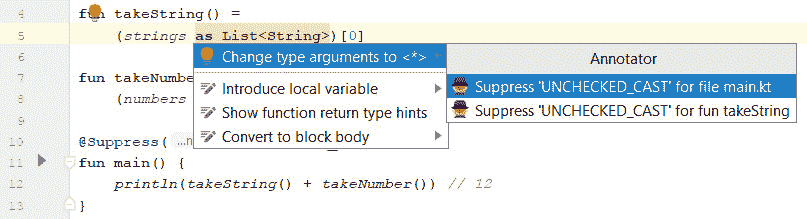

**图 10.1：** 抑制编译器警告

另一个实用的注解 `@Deprecated` 与 Java 中的对应非常相似。当你将某些声明标记为弃用（deprecated）时，不建议客户端代码使用它。在 IDE 中，弃用声明的使用将以删除字体显示（如图 10.2 所示）。使用 `@Deprecated` 时，你会指定一条消息，该消息通常会说明为什么弃用该声明以及/或用户应该使用什么替代。

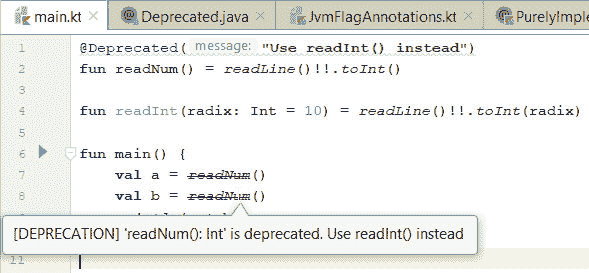

**图 10.2：** 弃用的声明

与 Java 不同，Kotlin 中的 `@Deprecated` 提供了额外功能。首先，你可以指定一个带有替换表达式的字符串。在这种情况下，可以使用 `Alt + Enter` 菜单中相应的快速修复（quick-fix）将弃用的用法自动更改为所需的形式（参见图 10.3 中的示例）。假设我们想要将 `readNum()` 替换为 `readInt()`。在这种情况下，我们可以这样写：

```kotlin
@Deprecated(
    “Use readInt() instead”, // 消息
    ReplaceWith(“readInt()”) // 替换表达式
)
fun readNum() = readLine()!!.toInt()
```

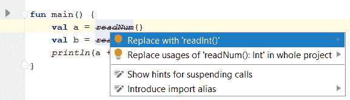

**图 10.3：** 使用快速修复替换弃用的用法

请注意 `ReplaceWith` 也是一个注解。这就是为什么你可以将其放在 `@Deprecated` 使用内部。然而，`@ReplaceWith` 不能单独使用。查看它的定义：

```kotlin
@Target()
@Retention(BINARY)
@MustBeDocumented
public annotation class ReplaceWith(
    val expression: String,
    var arg val imports: String
)
```

如你所示，它没有支持的目标。它只能作为另一个注解（如 `@Deprecated`）的一部分构造。

`ReplaceWith` 的 `vararg` 参数允许你指定替换时需要添加的导入列表。如果替换代码引用了非默认/非当前包中的声明，则非常有用。

另一个功能是可以选择弃用的严重程度，由 `DeprecationLevel` 枚举表示：

- `WARNING:`：弃用声明的使用被报告为警告；这是默认行为；
- `ERROR:`：弃用声明的使用被报告为编译错误；
- `HIDDEN:`：完全无法访问弃用的声明；

使用弃用级别允许你实施平滑的弃用策略，这对于团队开发非常重要。首先，你用默认级别弃用声明，以便其现有用法被报告为警告。这为开发者留出了替换它们的时间，而不会破坏代码的编译。然后你将弃用错误提升到 `ERROR`，从而禁止新引入弃用代码。当你确定不再会再次使用这段代码时，可以安全地从代码库中删除它。

*图 10.4* 展示了使用 `ERROR` 级别禁止 `readNum()` 的示例：

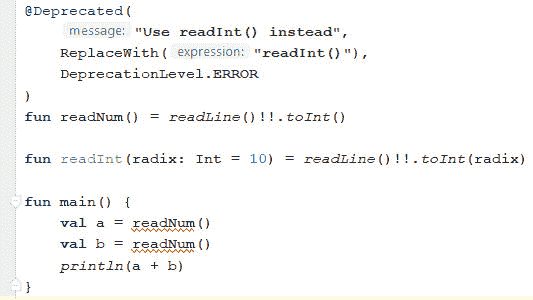

**图 10.4：** ERROR 级别的弃用声明

# 反射 (toc.xhtml_s6)

反射 API 是一组类型、函数和属性，它提供了对类的运行时访问。在某些情况下（如类搜索和加载），我们必须依赖 Java 反射。当涉及到操作 Kotlin 特有的方面（如属性）时，使用 Kotlin API 提供了更简洁、更符合习惯的方式。

反射类位于 `kotlin.reflect` 包中，可以大致分为两组：`callables` 处理属性的函数（包括构造函数），而 `classifiers` 提供类和类型参数的运行时表示。图 10.5 中的图提供了基本反射类型的概述。

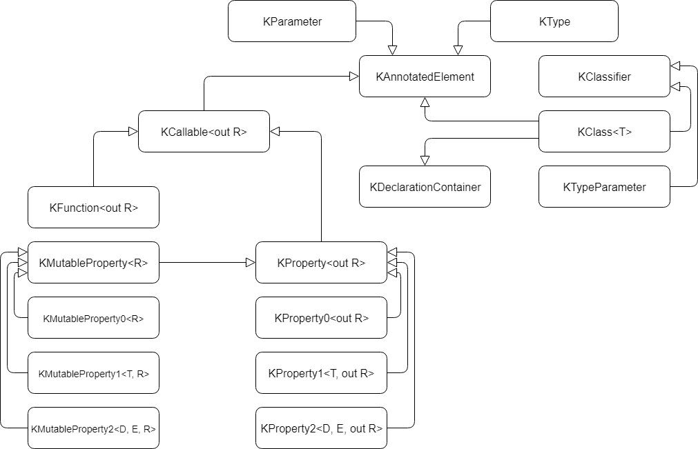

**图 10.5：** 基本反射类型

所有的反射类型都是 `KAnnotatedElement` 的子类，允许你访问语言元素（如函数、属性或类）定义的注解。`KAnnotatedElement` 有一个属性可以返回注解实例列表：

```kotlin
public val annotations: List<Annotation>
```

让我们回到之前带有 `@Component/@Dependency` 注解的示例：

```kotlin
import kotlin.reflect.KClass

annotation class Dependency(vararg val componentClasses: KClass<*>)
annotation class Component(
    val name: String = “Core”,
    val dependency: Dependency = Dependency()
)

@Component(“I/O”)
class IO

@Component(“Log”, Dependency(IO::class))
class Logger

@Component(dependency = Dependency(IO::class, Logger::class))
class Main
```

假设我们想要获取与 `Main` 类相关的注解。我们可以通过在其类字面量上使用 `annotations` 来实现：

```kotlin
fun main() {
    val component = Main::class.annotations
        .filterIsInstance<Component>()
        .firstOrNull() ?: return

    println(“Component name: ${component.name}”)
    val depText = component.dependency.componentClasses
        .joinToString { it.simpleName ?: “” }
    println(“Dependencies: $depText”)
}
```

如果你运行上面的代码，你将得到：

`Component name: Core`

`Dependencies: IO, Logger`

在接下来的章节中，我们将考虑与分类器和可调用对象更具体的类型的 API。

## 分类器与类型

在 Kotlin 反射（Reflection）中，分类器（classifier）是一个定义类型的声明。此类声明由 `KClassifier` 接口表示，该接口目前有两种更具体的变体：

* `KClass<T>`，表示一个编译时类型为 `T` 的某个类、接口或对象的声明；
* `KTypeParameter`，表示某个泛型声明的类型参数。

请注意，目前类型别名（type aliases）在反射 API 中没有表示。这特别意味着，即使你对类型别名应用了注解，这些注解也无法在运行时获取。Kotlin 预计将在未来的发行版本中添加对类型别名的支持。

由于 `KClassifier` 没有定义它自己的成员，让我们直接进入类和类型参数的细节。

### 获取 KClass 实例

获取 `KClass` 实例有两种基本方法。第一种是使用类字面量语法（class literal syntax），我们在关于注解的章节中已经见过这种语法了：

```
println(String::class.isFinal) // true
```

除了类之外，这种语法也支持具体化类型参数（reified type parameters）。在*第 9 章泛型*中，我们提到过泛型内联函数的类型参数可以是具体化的。这意味着编译器在将其调用处内联函数体时，会用实际类型代替它们。例如，让我们定义 `cast()` 函数：

```
inline fun <reified T>Any.cast() = this as? T
```

假设我们之后以如下方式调用：

```
val obj: Any = “Hello”
println(obj.cast<String>())
```

在底层，编译器实际上会生成代码：

```
val obj: Any = “Hello”
println(obj as? String)
```

你也可以对任意表达式使用 `::class` 语法来获取其结果值的运行时类：

```
println((1 + 2)::class) // class kotlin.Int
println(“abc”::class) // class kotlin.String
```

获取 `KClass` 的另一种方法是使用 `kotlin` 扩展属性将 `java.lang.Class` 实例进行转换。这对于通过全限定名动态查找类非常有用。由于 Kotlin 反射还没有自己的类搜索 API，它必须依赖于平台特定的 API：

```
val stringClass = Class.forName(“java.lang.String”).kotlin
println(stringClass.isInstance(“Hello”)) // true
```

反向转换由 `java` 扩展属性提供：

```
println(String::class.java) // class java.lang.String
```

### KClass API

现在让我们来看 `KClass` API。第一组 `KClass` 成员允许你判断感兴趣的类是否具有特定的修饰：

```
val isAbstract: Boolean
val isCompanion: Boolean
val isData: Boolean
val isFinal: Boolean
val isInner: Boolean
val isOpen: Boolean
val isSealed: Boolean
```

同一组的另一个属性 `visibility` 以 `KVisibility` 举类实例的形式提供类声明的可见性级别：

```
enum class Kvisibility {
    PUBLIC,
    PROTECTED,
    INTERNAL,
    PRIVATE
}
```

请注意，如果无法在 Kotlin 源码中标记，可见性可能为 null：例如，当 `KClass` 表示一个本地类时。

下一组属性允许你获取类名：


```
val simpleName: String?
val qualifiedName: String?
```

`simpleName` 属性返回在源代码中使用的简单名称。当类没有名称时（例如，表示对象表达式的类），结果为 `null`。

同样，`qualifiedName` 属性提供类的全限定名，它包含了所在包的完整名称。当类是本地类或嵌套在本地类中时，结果为 `null`，因为此类类无法从顶层使用。因此，它们没有全限定名。对于源码中没有名称的类也是如此。

你还可以使用 `jvmName` 扩展属性，它从 Java 的角度提供类的全限定名。此名称可能与 `qualifiedName` 提供的名称不同。某些 Kotlin 内置类型没有自己的 JVM 表示，而是依赖于现有的 Java 类。例如，`Any` 类并不作为一个独立的 Java 类存在；对于 Java 代码来说，它等同于 `java.lang.Object`：

```
println(Any::class.qualifiedName) // kotlin.Any
println(Any::class.jvmName) // java.lang.Object
```

`isInstance()` 函数允许你检查给定的对象是否为其接收者所表示类的实例。当该函数应用于非空类型时，它的作用类似于 `is` 运算符：

```
println(String::class.isInstance("")) // true
println(String::class.isInstance(12)) // false
println(String::class.isInstance(null)) // false
```

下一组 `KClass` 属性提供了对其成员声明的访问权限：

- `constructors`：包含主构造函数和次构造函数的集合，类型为 `KFunction` 实例；
- `members`：由 `KCallable` 实例表示的成员函数和属性的集合，包括继承自父类的所有成员；
- `nestedClasses`：嵌套类和对象的集合，包括伴侣对象；
- `typeParameters`：类型参数列表（当类不是泛型时，列表为空）。

```
println(parameters.joinToString { "${it.name}: ${it.upperBounds}" })
```

`variance` 属性返回 `KVariance` 枚举的常量，表示类型参数的声明处变性（declaration-site variance）：

```
enum class KVariance { INVARIANT, IN, OUT }
```

现在，让我们看看 Kotlin 反射是如何通过 `KType` 接口表示类型的。一个 Kotlin 类型具有以下方面的特征：

- 由 `isMarkedNullable` 属性提供的可空性（Nullability），它可以区分 `List<String>` 和 `List<String>?`；
- 分类器（classifier，由 `classifier` 属性提供），指向定义类型的类、接口或对象声明。例如，`List<String>` 中的 `List` 部分；
- 由 `arguments` 属性提供的类型参数列表：对于 `List<String>` 为 `<String>`，对于 `Map<Int, Boolean>` 为 `<Int, Boolean>` 等此类推。

类型参数由 `KTypeProjection` 接口表示，该接口包含了关于类型本身及其使用处变性（use-site variance）的信息：

```
val type: kotlin.reflect.KType?
val variance: kotlin.reflect.KVariance?
```

这两个属性对于星投影 `*` 均返回 `null`。

这里结束了我们对分类器类型的概述。在下一节中，我们将关注反射 API 的可调用部分。

# 可调用对象 (Callables)

可调用（callable）的概念统一了你可以调用以获取结果的属性和函数。在反射 API 中，它们由泛型接口 `KCallable<out R>` 表示，其中 `R` 表示函数的返回类型或属性的类型。

获取 `KCallable` 实例的一种方法是使用我们在*第 5 章 利用高级函数和函数式编程*中讨论过的可调用引用：

```
fun combine(n: Int, s: String) = "$s$n"
fun main() {
  println(::combine.returnType) // kotlin.String
}
```

你也可以通过相应的 `KClass` 实例访问成员函数和属性。但请注意，目前反射 API 不允许你通过这种方式获取顶层（top-level）可调用对象。

现在让我们来看 `KCallable` 本身定义的常用成员。像 `KClass` 一样，我们有一组属性，允许你检查某些修饰符的存在：

```
val isAbstract: Boolean
val isFinal: Boolean
val isOpen: Boolean
val isSuspend: Boolean
val visibility: KVisibility?
```

我们还没有遇到过与 `isSuspend` 属性对应的 `suspend` 修饰符。该修饰符用于定义支持挂起计算的可调用对象。在*第 13 章（并发）*中，我们将更详细地讨论这个问题。

下一组属性表示属性或函数的签名：

```
val name: String
val typeParameters: List<KTypeParameter>
val parameters: List<KParameter>
val returnType: KType
```

请注意，对于成员和扩展函数，第一个参数被留给接收者（receiver）。当可调用对象既是成员又是扩展函数时，第二个参数也会被保留。例如：

```
import kotlin.reflect.KCallable
val simpleVal = 1
val Int.extVal get() = this
class A {
    val Int.memberExtVal get() = this
}
fun main() {
  fun printParams(callable: KCallable<*>) {
    println(
      callable.parameters.joinToString(prefix = "[", postfix = "]") {
        it.type.toString()
      }
    )
  }
  // []
  printParams(::simpleVal)
  // [kotlin.Int]
  printParams(Int::extVal)
  // [A, kotlin.Int]
  printParams(A::class.members.first { it.name == "memberExtVal" })
}
```

`KParameter` 接口包含了关于函数/构造函数参数或成员/扩展声明的接收者信息：

```
val index: Int
val isOptional: Boolean
val isVararg: Boolean
val name: String?
val type: KType
```

当参数具有默认值时，`isOptional` 属性返回 `true`；该值本身目前无法通过反射获取。请注意，如果参数名称不可用或在源代码中不存在，则参数名称可能为 `null`。后者也适用于代表接收者值的参数。

`kind` 属性指示 `KParameter` 对应于普通值，还是分发（dispatch）/扩展接收者。它可以返回 `KParameter.Kind` 枚举定义的常量之一：

- `INSTANCE`：成员声明的分发接收者；
- `EXTENSION_RECEIVER`：扩展声明的扩展接收者；
- `VALUE`：普通参数。

`KCallable` 还定义了 `call()` 成员，允许你动态调用底层可调用对象：

```
fun call(vararg args: Any?): R
```

在函数可调用对象的情况下，`call()` 会调用函数本身。如果可调用对象对应于属性，则使用 getter。我们已经见过一个使用 `call()` 调用构造函数和成员函数的示例。让我们来看一个属性示例，应用于相同的 `Person` 类：

```
fun main() {
  val person = Person("John", "Doe")
  val personClass = person::class
  val firstName = personClass.members.first { it.name == "firstName" }
  println(firstName.call(person)) // John
}
```

另一种方法 `callBy()` 允许你以 map 的形式传递参数：

```
fun callBy(args: Map<KParameter, Any?>): R
```

现在我们转向更专门的类型。`KProperty` 接口增加了属性特有的检查：

```
val isConst: Boolean
val isLateinit: Boolean
```

你也可以作为 `KFunction` 实例访问属性 getter。例如，`KMutableProperty` 通过扩展 `KProperty` 并增加了一个 setter：

```
var myValue = 1
fun main() {
    println(::myValue.setter(2)) // 2
}
```

`KProperty` 还有子类型 - `KProperty0`、`KProperty1` 和 `KProperty2`，分别表示没有接收者、具有单个接收者（分发或扩展）以及有一对接收者（成员扩展）的属性。这些子类型通过使其实现相应的函数类型，细化了 getter 的类型。该功能允许我们在上面的示例中使用 `::myValue.getter`。`KMutableProperty` 同样定义了类似的 setter 子类型。

我们要考虑的最后一个反射类型是 `KFunction`，它正如预期的那样表示函数和构造函数。此接口添加的成员与函数特定的检查有关：

```
val isInfix: Boolean
val isInline: Boolean
val isOperator: Boolean
val isSuspend: Boolean
```

`isInfix` 和 `isOperator` 检查与运算符有关，我们将在*第 11 章（领域特定语言）*中介绍。

请注意，`KFunction` 本身并不是任何函数类型的继承者，因为它可以表示不同参数个数（arity）的函数。然而，某些函数类型可以通过 `KFunction` 更具体的子类型来实现。我们已经通过可调用引用的示例看到过这一点。例如：

```
import kotlin.reflect.KFunction2
fun combine(n: Int, s: String) = "$s$n"
fun main() {
  val f: KFunction2<Int, String, String> = ::combine
  println(f(1, "2")) // 12
}
```

你可以看到，示例中的可调用引用具有 `KFunction2<Int, String, String>` 类型，它是 `(Int, String) -> String` 的子类型。但请注意，与 `KProperty0` 及其他类似类型不同，`KFunction0/KFunction1/…` 仅存在于编译期间。在运行时，它们由为 lambda 表达式创建的合成类表示。

还有一点值得注意的是访问具有限制可见性的可调用对象的能力。在某些情况下，你可能需要通过反射调用一个私有函数。在 Java 中，尝试这样做可能会产生异常，因此通常你必须预先通过调用 `setAccessible(true)` 使反射对象变得可访问。在 Kotlin 中，你使用 `isAccessible` 属性来实现相同的功能：

```
import kotlin.reflect.KProperty1
import kotlin.reflect.jvm.isAccessible

class SecretHolder(private val secret: String)

fun main() {
    val secretHolder = SecretHolder("Secret")
    val secretProperty = secretHolder::class.members
        .first { it.name == "secret" } as KProperty1<SecretHolder, String>
    secretProperty.isAccessible = true
    println(secretProperty.get(secretHolder))
}
```

### 结论

这一章我们进入了注解和反射主题。我们讨论了如何对 Kotlin 代码段进行注解并在运行时获取相关的元数据。我们介绍了主要的内置注解，并解释了如何定义自己的注解类。我们还向你介绍了 Kotlin 反射 API。现在，你已经熟悉了如何访问分类器（classifiers）和可调用对象的属性，并以动态的方式使用它们。

在下一章中，我们将介绍如何以类似于领域特定语言的方式设计你自己的 API，为你的代码库引入声明式编程的氛围。

### 问题

1. 如何定义新注解？比较 Kotlin 注解语法与 Java 语法。
2. 注解在 Kotlin 代码是如何使用的？
3. Kotlin 中哪些内置注解？
4. 什么是注解的使用点目标（use-site target）？它如何与 `@Target` 元注解指定的标记相关联？
5. 构成 Kotlin 反射 API 的基本类型有哪些？
6. 描述类字面量和可调用引用的语法。
7. 描述 `KClass` API。如何在 `KClass` 和 Java 的 `Class` 实例之间转换？
8. 描述 `KCallable` API。

# 第 11 章：领域特定语言

**领域特定语言 (DSL)** 是为特定功能或领域定制的语言。此类语言在软件开发中被广泛用于处理各种任务，如描述软件配置、测试规范、工作流规则、UI 设计、数据操作等。DSL 的主要优势是其简单性：你不再依赖于 `Java` 等通用语言的低级结构，而是使用领域特定的原语，从而用其自身的术语处理任务。然而，这种方法也有一些缺点，因为将 DSL 代码嵌入到通用程序中可能困难，因为它们是用不同的语言编写的。因此，DSL 程序通常存储在宿主代码之外，或者简单地嵌入字符串字面量，这增加了编译时验证和 IDE 代码辅助的复杂度。

然而，Kotlin 可以为你提供解决方案。在本章中，我们将介绍一组特性，允许你设计可以与其余 Kotlin 代码无缝结合的 DSL。其理念是设计一种特殊的 API，可以用类似于领域特定语言的方式。因此，虽然你的代码看起来像是用另一种语言编写的，但它仍然是有效的 Kotlin 代码。换句话说，你获得了两者的优点：领域特定的方法和编译语言的力量（包括强大的类型安全保证）。

### 结构

- 运算符重载
- 委托属性
- 高阶函数与 DSL

## 目标

学习 Kotlin 的高级特性，帮助开发者以领域特定语言的形式设计 API。

## 运算符重载

运算符重载是语言的一种特性，允许你为内置的 Kotlin 运算符（如 `+`、`-`、`*`、`/` 等）分配自定义含义。在之前的章节中，我们已经看到 `+` 的语义取决于它所应用的值类型：数字的算术求和、字符串的拼接、集合的元素追加等。这可能是因为 `+` 是被重载的，也就是说，它有许多不同的实现。

在 Kotlin 中，运算符表达式只是函数调用的语法糖。要实现一个运算符，你只需要按照特定约定定义扩展函数或成员函数，并用 `operator` 关键字对其标记。例如，通过定义：

```
operator fun String.times(n: Int) = repeat(n)
```

我们将 `*` 运算符（对应 `times()` 函数）扩展到 `String/Int` 对，这反过来允许我们编写：

```
println("abc" * 3) // abcabcabc
```

由于运算符是由某些函数支持的，我们始终可以用普通调用替换它们。例如，上面的代码含义等于：

```
println("abc".times(3))
```

即使是像加法这样的内置操作也可以写成这种形式，尽管对于基本类型，加法或减法操作会被编译器优化，以避免为了性能而进行实际函数调用：

```
val x = 1.plus(2) // 等同于 1 + 2
```

**IDE Tips：** IntelliJ 插件可以将运算符函数的显式调用转换为对应的一元/二元表达式。要做到这一点，你只需要在运算符标记或函数名上按 `Alt + Enter` 并选择合适的转换操作。

### 一元操作

可重载的一元运算符包括前缀 `+`、`-` 和 `!`。当你使用此类运算符时，编译器会自动将它们展开为对适当函数的调用：

| 表达式 | 含义 |
| :--- | :--- |
| `+e` | `e.unaryPlus()` |
| `-e` | `e.unaryMinus()` |
| `!e` | `e.not()` |

这些函数可以是成员，也可以是针对参数类型的扩展函数。它们可以没有任何参数，结果成为整个表达式的类型。

例如，考虑一个表示基本颜色及其组合的枚举类：


使用 `not()` 约定，我们可以引入 `!` 运算符作为互补色的简写：

```kotlin
enum class Color { BLACK, RED, GREEN, BLUE, YELLOW, CYAN, MAGENTA, WHITE; operator fun not() = when (this) {
        BLACK -> WHITE
        RED -> CYAN
        GREEN -> MAGENTA
        BLUE -> YELLOW
        YELLOW -> BLUE
        CYAN -> RED
        MAGENTA -> GREEN
        WHITE -> BLACK
    }
}

fun main() {
    println(!Color.RED) // CYAN
    println(!Color.CYAN) // RED
}
```

通过将运算符函数定义为扩展，你可以为任意类型的表达式支持相应的操作。例如：

```kotlin
operator fun <T> ((T) -> Boolean).not(): (T) -> Boolean = { !this(it) }
```

使用上面的函数，我们现在可以将 `!` 运算符应用于单参数谓词：

```kotlin
fun isShort(s: String) = s.length<=4
fun String.isUpperCase() = all { it.isUpperCase() }

fun main() {
    val data = listOf("abc", "abcde", "ABCDE", "aBcD", "ab")
    println(data.count(::isShort)) // 3
    println(data.count(!::isShort)) // 2
    println(data.count(String::isUpperCase)) // 1
    println(data.count(!String::isUpperCase)) // 4
}
```

递增（`++`）和递减（`--`）运算符可以通过为对应的操作数类型定义函数 `inc()` 和 `dec()` 来重载。根据某种排序，这些函数的返回值必须分别对应于它的下一个值和前一个值。`inc()/dec()` 的使用方式取决于运算符是以前缀形式还是后置形式编写，这类似于 `++`/`--` 对数字的工作方式。例如，假设我们有一个列出彩虹色的枚举类（enum class）：

```kotlin
enum class RainbowColor {
  RED, ORANGE, YELLOW, GREEN, BLUE, INDIGO, VIOLET;
}
```

让我们按照上述排序定义 `inc()/dec()`，让它在第一个元素和最后一个元素之间循环，使得 `VIOLET` 的下一个是 `RED`，`RED` 的前一个是 `VIOLET`：

```kotlin
enum class RainbowColor {
  RED, ORANGE, YELLOW, GREEN, BLUE, INDIGO, VIOLET;
  operator fun inc() = values[(ordinal + 1) % values.size]
  operator fun dec() = values[(ordinal + values.size - 1) % values.size]
  companion object {
    private val values = enumValues<RainbowColor>()
  }
}
```

现在，让我们考虑递增和递减在这个类中是如何工作的。正如我们在第 2 章（语言基础）中看到的，`++`/`--` 运算符的后置形式会更新变量，但返回更改之前的值。这对于重载运算符也是如此。例如，考虑以下代码：

```kotlin
var color = RainbowColor.INDIGO
println(color++)
```

实际上它意味着：

```kotlin
var color = RainbowColor.INDIGO
val _oldColor = color
color = color.inc()
println(_oldColor) // INDIGO
```

在前缀形式的情况下，递增/递减表达式的结果等于更新后的值，因此下面的片段：

```kotlin
var color = RainbowColor.INDIGO
println(++color)
```

实际上会翻译为：

```kotlin
var color = RainbowColor.INDIGO
color = color.inc()
println(color) // VIOLET
```

请注意，存在如 `color = color.inc()` 的赋值意味着两点：

- `++` 和 `--` 仅适用于变量；
- `inc()/dec()` 函数的返回类型必须是其接收类型的子类型。

## 二元运算

Kotlin 允许你重载大多数二元运算符。和一元运算符一样，你需要提供对应的运算符函数。主要的区别在于二元运算符函数将左操作数作为接收者，而右操作数则作为普通参数传递。

表 11.2 列出了算术运算符 `..` 和 `in/!in` 的约定名称。

| 表达式 | 含义 |
| :--- | :--- |
| `a + b` | `a.plus(b)` |
| `a – b` | `a.minus(b)` |
| `a * b` | `a.times(b)` |
| `a / b` | `a.div(b)` |
| `a % b` | `a.rem(b)` |
| `a .. b` | `a.rangeTo(b)` |
| `a in b` | `b.contains(a)` |
| `a !in b` | `!b.contains(a)` |

**表 11.2:** 二元运算符约定

最初，`%` 操作是 `mod()` 运算符函数的简写，该函数目前已被 `rem()` 取代。截至目前，`mod()` 约定仍然可用但已弃用。

例如，让我们考虑一个支持基本算术运算的有理数原型实现：

```kotlin
import kotlin.math.abs
class Rational private constructor(
  val sign: Int,
  val num: Int,
  val den: Int
) {
  operator fun unaryMinus() = Rational(-sign, num, den)
  operator fun plus(r: Rational): Rational {
    val gcd = gcd(den, r.den)
    val newDen = den/gcd*r.den
    val newNum = newDen/den*num*sign + newDen/r.den*r.num*r.sign
    val newSign = newNum.sign()
    return Rational(newSign, abs(newNum), newDen)
  }
  operator fun minus(r: Rational) = this + (-r)
  operator fun times(r: Rational): Rational {
    return of(sign*r.sign*num*r.num, den*r.den)
  }
  operator fun div(r: Rational): Rational {
    return of(sign*r.sign*num*r.den, den*r.num)
  }
  override fun toString(): String {
    return "${sign*num}" + if (den != 1) "/$den" else ""
  }
  companion object {
    private fun Int.sign() = when {
      this > 0 -> 1
      this < 0 -> -1
      else -> 0
    }
    private tailrec fun gcd(a: Int, b: Int): Int {
      return if (b == 0) a else gcd(b, a % b)
    }
    fun of(num: Int, den: Int = 1): Rational {
      if (den == 0) throw ArithmeticException("Denominator is zero")
      val sign = num.sign()
      val numAbs = abs(num)
      val denAbs = abs(den)
      return Rational(sign, numAbs, den)
    }
  }
}
```

通过 `..` 运算符来构建 `Rational` 实例，我们可以定义 `RationalRange` 类：

```kotlin
class RationalRange(val from: Rational, to: Rational) {
  override fun toString() = "[$from, $to]"
}
```

现在我们可以使用 `to` 方法来构造两个区间：

```kotlin
val range = RationalRange(r(1, 3), r(7, 8))
```

`in/!in` 运算符通过 `contains()` 函数表示。请注意，与其它二元运算符不同，`contains()` 的参数是交换的。让我们增强范围：

```kotlin
class RationalRange(val from: Rational, to: Rational) {
  override fun toString() = "[$from, $to]"
  operator fun contains(r: Rational): Boolean {
    return from.isLessEqual(r) && r.isLessEqual(to)
  }
}
```

我们还可以为 `Int` 添加一个便捷的 `contains` 重载：

```kotlin
operator fun contains(n: Int) = contains(r(n))
```

```kotlin
fun main() {
    println(1 > r(1, 3)) // false
    println(r(3/4) <= r(7/8)) // true
}
```

我们在前面的章节中已经使用过的另一种二元约定是关于等效性的。当你使用 `==` 或 `!=` 时，编译器会自动将该操作符还原为 `equals()` 调用。请注意，`equals()` 的实现不需要显式的操作符修饰符，因为它继承自 `Any` 类中声明的基础类版本。出于相同的原因，`equals()` 只能作为成员实现；即使你将 `equals()` 定义为扩展函数，它也不会用于替代 `==`/`!=` 操作符，因为扩展函数总是会被具有相同签名的成员声明所遮蔽。

请注意，Kotlin 不允许你重载 `&&` 和 `||`：它们是仅支持 `Boolean` 值的内置操作。对于 Kotlin 的标识性等效性操作 `===` 和 `!==` 也是如此。

如果你想实现一个带有自定义名称的二元操作怎么办？虽然 Kotlin 不允许你引入新的操作符，但你可以使用普通标识符作为中缀操作（infix operations）的名称。我们将在下一节介绍做法。

## 中缀操作

我们已经见过像 `to` 或 `until` 这样的操作，它们可以作为中缀操作：

```kotlin
val pair1 = 1 to 2 // 中缀调用
val pair2 = 1.to(2) // 普通调用
```

要启用此类调用，你需要用 `infix` 修饰符标记函数。像二元操作符一样，感兴趣的函数必须是成员函数或扩展函数，并且只有一个参数。例如，标准的 `to` 函数就是定义的：

```kotlin
infix fun <A, B> A.to(that: B): Pair<A, B> = Pair(this, that)
```

让我们通过引入用于谓词逻辑与和逻辑或的中缀操作，稍微完善一下早先的谓词示例：


```kotlin
infix fun <T> ((T) -> Boolean).and(
    other: (T) -> Boolean
): (T) -> Boolean {
    return { this(it) && other(it) }
}

infix fun <T> ((T) -> Boolean).or(
    other: (T) -> Boolean
): (T) -> Boolean {
    return { this(it) || other(it) }
}
```

现在我们可以使用它们以更简洁的方式组合函数字面量：

```kotlin
fun main() {
    val data = listOf("abc", "abcde", "ABCDE", "aBcD", "ab")
    println(data.count(::isShort and String::isUpperCase)) // 0
    println(data.count(::isShort or String::isUpperCase)) // 4
    println(data.count(!::isShort or String::isUpperCase)) // 2
    println(data.count(!(::isShort and String::isUpperCase))) // 5
}
```

请记住，所有中缀操作的优先级相同。例如，涉及我们上面定义的 `and`/`or` 操作的复杂表达式，其解析方式与带有内置 `||` 和 `&&` 布尔操作符的类似表达式不同。例如，表达式：

```kotlin
!::isShort or String::isEmpty and String::isUpperCase
```

本质上意味着：

```kotlin
(!::isShort or String::isEmpty) and String::isUpperCase
```

而布尔表达式：

```kotlin
!s.isShort() || s.isEmpty() &&s.isUpperCase()
```

等同于：

```kotlin
!s.isShort() || (s.isEmpty() &&s.isUpperCase())
```

这是由于 `&&` 的优先级高于 `||`。

### 赋值

下一组二元操作处理诸如 `+=` 这样的复合赋值。在*第 7 章，探索集合与 I/O*中，我们已经看到这些操作对于可变和不可变集合的行为有所不同。换句话说，对不可变集合类型的变量应用 `+=` 将创建一个集合对象并将其赋值给变量，从而改变它的值。在这种情况下，变量必须定义为可变的：

```kotlin
var numbers = listOf(1, 2, 3)
numbers += 4
println(numbers) // [1, 2, 3, 4]
```

然而，当对可变集合使用 `+=` 时，我们在修改集合内容的同时保留了原始的对象标识：

```kotlin
val numbers = mutableListOf(1, 2, 3)
numbers += 4
println(numbers) // [1, 2, 3, 4]
```

请注意，如果我们将可变集合放入可变变量中，那么 `+=` 将产生错误，因为编译器无法决定遵循哪种约定：

```kotlin
var numbers = mutableListOf(1, 2, 3)
// 我们应该更新变量还是集合内容？
numbers += 4 // 错误
println(numbers)
```

由于各自的操作符函数，任意类型都可以支持这两种约定。复合赋值的行为取决于以下因素（参见表 11.4）：

*   是否存在对应的二元操作符函数：`plus()` 对应 `+=`，`minus()` 对应 `-=` 等以此类推；
*   是否存在自定义赋值函数：`plusAssign()` 对应 `+=`，等以此类推；
*   左侧的可变性。

**表 11.4 赋值约定**

| 表达式 | 含义 |
| :--- | :--- |
| `a += b` | `a.plusAssign(b)` |
| `a -= b` | `a.minusAssign(b)` |
| `a *= b` | `a.timesAssign(b)` |
| `a /= b` | `a.divAssign(b)` |
| `a %= b` | `a.remAssign(b)` |

当左侧只有二元操作符（例如 `plus()`）而没有 `plusAssign()` 时，复合赋值将被还原为调用。这发生在原始类型和不可变集合上。例如：

```kotlin
var r = Rational(1, 2) // 等于 r = r + Rational(1, 3)
r += Rational(1, 3) // 5/6
println(r) // 5/6
```

赋值左侧必须是可变的。为了说明这一点，让我们回顾在*第 9 章（泛型）*中引入的 `TreeNode` 类并稍微修改其 API：

```kotlin
class TreeNode<T>(val data: T) {
    private val _children = arrayListOf<T>>()
    var parent: TreeNode<T>? = null
        private set

    operator fun plusAssign(data: T) {
        val node = TreeNode(data)
        _children += node
        node.parent = this
    }

    operator fun minusAssign(data: T) {
        val index = _children.indexOfFirst { it.data == data }
        if (index < 0) return
        val node = _children.removeAt(index)
        node.parent = null
    }

    override fun toString() =
        _children.joinToString(prefix = "$data {", postfix = "}")
}
```

现在我们可以在 `TreeNode` 实例上使用 `+=` 和 `-=` 操作来添加和删除树元素：

```kotlin
val tree = TreeNode("root")
tree += "child 1"
tree += "child 2"
println(tree) // root {child 1 {}, child 2 {}}
tree -= "child 2"
println(tree) // root {child 1 {}}
```

请注意，自定义赋值函数必须返回 `Unit` 类型。

当左侧同时具有自定义赋值和简单二元操作时，结果取决于左侧的可变性：

*   如果左侧是不可变的，则编译器选择自定义赋值函数，因为简单赋值不适用；
*   如果左侧是可变变量，则编译器会报错，因为这产生了歧义：`a += b` 是指 `a = a + b` 还是 `a.plusAssign(b)`。

上述行为通过 Kotlin 可变集合类（如列表或集合）得到了演示，因为它们既继承了不可变集合的 `plus()/minus()` 函数，又有自己的 `plusAssign()/minusAssign()`。

### 调用与索引

调用约定（invocation convention）允许你像使用函数一样在调用表达式中使用值。要实现这一点，你只需要定义带有必要参数的 `invoke()` 函数即可。函数类型的值会自动获得 `invoke()` 作为其成员，但你也可以为任意类型添加调用支持。例如，假设有如下函数：

```kotlin
operator fun <K, V> Map<K, V>.invoke(key: K) = get(key)
```

那么我们就可以将任何 `Map` 实例作为一个函数，通过键返回一个值：

```kotlin
val map = mapOf("I" to 1, "V" to 5, "X" to 10)
println(map("V")) // 5
println(map("L")) // null
```

一个实用的用例是给伴对象（companion object）添加 `invoke()` 函数，将其变成工厂。例如，如果我们通过扩展函数增强 `Rational` 类：

```kotlin
operator fun Rational.Companion.invoke(num: Int, den: Int = 1) = of(num, den)
```

我们就可以通过引用类名来构造 `Rational` 实例：

```kotlin
val r = Rational(1, 2)
```

上面的代码看起来像是直接的构造函数调用，但实际上，它还原为调用链：`invoke()→of()→` `Rational` 的私有构造函数。

类似的约定允许你使用索引运算符 `[]`，就像它应用于字符串、数组、列表和 map 一样。其底层的调用取决于索引表达式是被用作值还是赋值的左值。在第一情况下，编译器假设为读取访问，并将索引运算符还原为对具有相同参数集的 `get()` 函数的调用。

```kotlin
val array = arrayOf(1, 2, 3)
println(array[0]) // 等同于 println(array.get(0))
```

然而，当索引表达式用作赋值的左侧时，编译器将其还原为对 `set()` 函数的调用，该函数除了索引外，还将赋值的值作为最后一个参数：

```kotlin
val array = arrayOf(1, 2, 3)
array[0] = 10 // 等同于 array.set(0, 10)
```

索引并不一定是整数；事实上，它们可以是任意值。例如，map 的索引运算符将键值作为其参数。

例如，让我们为 `TreeNode` 类同时添加 `get()/set()` 运算符以访问其子节点：

```kotlin
class TreeNode<T>(var data: T) {
    private val _children = arrayListOf<TreeNode<T>>()
    var parent: TreeNode<T>? = null
    private set

    operator fun plusAssign(data: T) {
        val node = TreeNode(data)
        _children += node
        node.parent = this
    }

    operator fun minusAssign(data: T) {
        val index = _children.indexOfFirst { it.data == data }
        if (index < 0) return
        val node = _children.removeAt(index)
        node.parent = null
    }

    operator fun get(index: Int) = _children[index]

    operator fun set(index: Int, node: TreeNode<T>) {
        node.parent?._children?.remove(node)
        node.parent = this
        _children[index].parent = null
        _children[index] = node
    }
}

fun main() {
    val root = TreeNode("Root")
    root += "Child 1"
    root += "Child 2"
    println(root[1].data) // Child 2
    root[0] = TreeNode("Child 3")
    println(root[0].data) // Child 3
}
```

一种更复杂的情况是在复合赋值（augmented assignment）中使用索引运算符。结果代码取决于左值类型赋值运算符的含义，该含义实际上是 `get()` 运算符函数的返回类型。例如，如果我们考虑一个没有 `plusAssign()` 函数的 `Rational` 对象数组，代码代码：

```kotlin
val array = arrayOf(r(1, 2), r(2, 3))
array[0] += Rational(1, 3)
```

将意味着：

```kotlin
val array = arrayOf(r(1, 2), r(2, 3))
array[0] = array[0] + r(1, 3)
```

或者，将一切还原为函数调用：

```kotlin
val array = arrayOf(r(1, 2), r(2, 3))
array.set(0, array.get(0) + r(1, 3))
```

然而，如果我们使用一个具有 `plusAssign()` 函数但没有 `plus()` 函数的 `TreeNode` 对象数组，类似的片段：

```kotlin
val array = arrayOf(TreeNode("Root 1"), TreeNode("Root 2"))
array[0] += TreeNode("Child 1")
```

将翻译为：

```kotlin
val array = arrayOf(TreeNode("Root 1"), TreeNode("Root 2"))
array.get(0).plusAssign(TreeNode("Child 1"))
```

请注意，在这两种情况下 `get()` 函数都是必需的。

### 解构

我们已经看到如何为数据类（data classes）的实例使用解构声明来一次声明多个变量，并将它们初始化为对应的值。

### 迭代

在 *第 3 章 (定义函数)* 中，我们引入了循环语句，它可以应用于字符串、范围和集合等各种对象。允许我们使用 for 循环的共同特征是存在 `iterator()` 函数，该函数返回相应的 `Iterator` 实例。通过将此函数定义为成员或扩展函数，你可以为你喜欢的任何类型支持迭代。

作为一个例子，让我们为早些章节中引入的 `TreeNode` 类支持迭代：

```kotlin
operator fun <T>TreeNode<T>.iterator() = children.iterator()
```

现在我们可以在 for 循环中使用 `TreeNode` 实例，无需显式引用其子节点。考虑程序：

```kotlin
fun main() {
    val content = TreeNode("Title").apply {
        addChild("Topic 1").apply {
            addChild("Topic 1.1")
            addChild("Topic 1.2")
        }
        addChild("Topic 2")
        addChild("Topic 3")
    }

    for (item in content) {
        println(item.data)
    }
}
```

运行它将打印：

`Topic 1`

`Topic 2`

`Topic 3`

## 委托属性

委托属性提供了一种在语法外表后实现自定义属性访问逻辑的方法。我们已经看到了懒加载委托的示例，它推迟属性计算直到首次访问：

```kotlin
val result by lazy { 1 + 2 }
```

属性委托的简洁性使得它们成为设计易用 API 和领域特定语言（DSL）的有用工具。

### 标准委托

Kotlin 标准库包含许多现箱即用的委托实现，涵盖了许多常见用场景。在`第 4 章（处理类和对象）`中，我们已经见过这样的委托示例，它代表一个懒加载属性：

```kotlin
val text by lazy { File("data.txt").readText() }
```

事实上，`lazy()` 函数有三个版本，允许你在多线程环境中精调懒加载属性的行为。默认情况下，它会创建一个线程安全的实现，该实现使用同步机制来确保懒值始终由单个线程初始化；在这种情况下，委托实例也用作同步对象。

需要时，你还可以使用另一个 `lazy()` 版本指定自己的同步对象：

```kotlin
private val lock = Any()

val text by lazy(this) { File("data.txt").readText() }
```

你还可以通过通过传递 `LazyThreadSafetyMode` 枚举的值在 3 种基本实现之间进行选择：

- `SYNCHRONIZED:` 属性访问是同步的，因此只有一个线程可以初始化它的值（此实现是默认使用的）；
- `PUBLICATION:` 属性访问是同步的，使得初始化函数可以被多次调用，但只有第一次调用的结果成为属性值；
- `NONE:` 属性访问不是同步的；在多线程环境中，属性的行为实际上是未定义的。

如果初始化函数具有副作用，`SYNCHRONIZED` 和 `PUBLICATION` 之间的主要区别就会变得明显。例如，如果我们有这样一个属性：

```kotlin
val myValue by lazy {
    println("Initializing myValue")
    123
}
```

消息最多只会打印一次，因为 `SYNCHRONIZED` 模式（默认使用）确保了初始化器不会被多次调用。但是，如果我们将安全模式更改为 `PUBLICATION`：


`lazy(LazyThreadSafetyMode.PUBLICATION)` 模式允许多个线程并发初始化委托值，但只有第一个成功初始化的结果会被保留，其他线程的初始化结果会被丢弃。

```kotlin
val myValue by lazy(LazyThreadSafetyMode.PUBLICATION) {
    println("Initializing myValue")
    123
}
```

属性值保持不变，但打印信息的次数等于尝试初始化 `myValue` 的线程数量。

`NONE` 模式提供了最快的实现，当你能保证初始化器永远不会被多个线程调用时它非常有用。一个常见的情况是 `lazy` 局部变量：

```kotlin
fun main() {
    val x by lazy(LazyThreadSafetyMode.NONE) { 1 + 2 }
    println(x) // 3
}
```

请注意，如果初始化器抛出异常，属性将保持未初始化状态。因此，委托将在下次访问尝试时尝试重新初始化。

一些标准委托可以通过 `kotlin.properties.Delegates` 对象的成员来构建。`notNull()` 函数提供了一个允许你延迟初始化属性的委托：

```kotlin
import kotlin.properties.Delegates.notNull

var text: String by notNull()

fun readText() {
    text = readLine()!!
}

fun main() {
    readText()
    println(text)
}
```

`notNull()` 委托的语义与 `lateinit` 属性的基本相同：内部使用空值作为未初始化属性的标记，因此当你尝试从其读取时如果它恰好仍为空，委托将抛出 NPE。在大多数情况下，使用 `lateinit` 属性代替 `notNull()` 是值得的，因为 `lateinit` 具有更简洁的语法和更好的性能。基本类型是一个例外，而 `lateinit` 不支持基本类型：

```kotlin
import kotlin.properties.Delegates.notNull

var num: Int by notNull() // 这里不能使用 lateinit

fun main() {
    num = 10
    println(num) // 10
}
```

`observable()` 函数允许你定义一个在值发生变化时发送通知的属性。它接收一个初始值和一个 Lambda，该 Lambda 在每次更改后被调用：

```kotlin
import kotlin.properties.Delegates.observable

class Person(name: String, val age: Int) {
    var name: String by observable(name) { property, old, new ->
        println("Name changed: $old to $new")
    }
}

fun main() {
    val person = Person("John", 25)
    person.name = "Harry" // Name changed: John to Harry
    person.name = "Vincent" // Name changed: Harry to Vincent
    person.name = "Vincent" // Name changed: Vincent to Vincent
}
```

请注意，即使新值与旧值相同，也会发送通知。如果有必要，Lambda 应该自行检查这一点。

`vetoable()` 函数构建了一个类似的委托，但它接收一个返回布尔值的 Lambda，并在实际修改之前被调用。如果该 Lambda 返回 false，属性值将保持不变：

```kotlin
import kotlin.properties.Delegates.vetoable

var password: String by vetoable("password") { property, old, new ->
    if (new.length < 8) {
        println("Password should be at least 8 characters long")
        false
    } else {
        println("Password is Ok")
        true
    }
}

fun main() {
    password = "pAsSwOrD" // Password is accepted
    password = "qwerty" // Password should be at least 8 characters
}
```

如果你想结合更改前和更改后的通知，你可以通过扩展 `ObservableProperty` 并重写 `beforeChange()/afterChange()` 函数来实现自己的委托。

## 创建委托

要创建自己的属性委托，你需要一个定义了特殊运算符的类型，以实现属性值的读取和写入。读取函数必须命名为 `getValue` 并有两个参数：

1. `receiver:` 包含接收者值，必须与委托属性的接收者类型相同（或其超类）；

2. `property:` 包含表示属性声明的反射对象，类型必须为 `KProperty<*>` 或其超类。

参数名称实际上并不重要，重要的是类型。`getValue()` 函数的返回值必须与委托属性的类型相同（或其子类）。

例如，让我们创建一个记忆属性值的委托，将其与特定的接收者关联以创建某种缓存：

```kotlin
import kotlin.reflect.KProperty

class CachedProperty<in R, out T : Any>(val initializer: R.() -> T) {
    private val cachedValues = HashMap<R, T>()

    operator fun getValue(receiver: R, property: KProperty<*>): T {
        return cachedValues.getOrPut(receiver) { receiver.initializer() }
    }
}

fun <R, T : Any> cached(initializer: R.() -> T) = CachedProperty(initializer)

class Person(val firstName: String, val familyName: String)

val Person.fullName: String by cached { "$firstName $familyName" }

fun main() {
    val johnDoe = Person("John", "Doe")
    val harrySmith = Person("Harry", "Smith")
}
```

```kotlin
// First access for johnDoe receiver, computed and stored to cache
println(johnDoe.fullName)

// First access for harrySmith receiver, computed and stored to cache
println(harrySmith.fullName)

// Repeated access for johnDoe receiver, taken from cache
println(johnDoe.fullName)

// Repeated access for harrySmith receiver, taken from cache
println(harrySmith.fullName)

}
```

由于 `fullName` 是一个顶层属性，它的委托器成为全局状态的一部分，并且属性值对于某个特定的接收者只会初始化一次（假设我们暂忽略多线程问题）。

来自 `kotlin.properties` 包的 `ReadOnlyProperty` 接口可以作为创建只读委托的良好起点。该接口定义了 `getValue()` 操作符的抽象版本，你需要在你自己的类中实现它：

```kotlin
interface ReadOnlyProperty<in R, out T> {
    operator fun getValue(thisRef: R, property: KProperty<*>): T
}
```

对于可以应用于 `var` 属性的读写委托，你还需要定义相应的 `setValue()` 函数，该函数会在每次属性赋值时被调用。此函数必须具有 `Unit` 返回类型，并接受三个参数：

1. `receiver:` 的含义与 `getValue()` 相同；

2. `property:` 的含义与 `getValue()` 相同；

3. `newValue:` 属性的新值，它的类型必须与属性本身（或其父类型）相同。

在下面的示例中，我们定义了一个委托类，它实现了 `lateinit` 属性的最终版本，该版本不允许初始化超过一次：

```kotlin
import kotlin.reflect.KProperty

class FinalLateinitProperty<in R, T : Any> {
    private lateinit var value: T
    operator fun getValue(receiver: R, property: KProperty<*>): T {
        return value
    }
    operator fun setValue(receiver: R,
        property: KProperty<*>,
        newValue: T) {
        if (this::value.isInitialized) throw IllegalStateException(
            "Property ${property.name} is already initialized"
        )
        value = newValue
    }
}

fun <R, T : Any>finalLateInit() = FinalLateinitProperty<R, T>()

var message: String by finalLateInit()

fun main() {
    message = "Hello"
    println(message) // Hello
    message = "Bye" // Exception: Property message is already initialized
}
```

Kotlin 标准库还包含了 `ReadOnlyProperty` 接口的可变版本，称为 `ReadWriteProperty`。同样，你可以在你的委托类中实现此接口：

```kotlin
public interface ReadWriteProperty<in R, T> {
    operator fun getValue(thisRef: R, property: KProperty<*>): T
    operator fun setValue(thisRef: R, property: KProperty<*>, value: T)
}
```

请注意，`getVersion()/setVersion()` 函数可以定义为成员函数或扩展函数。后者选项允许你将任何对象转换为某种委托委托。特别是委托到 `Map`/`MutableMap` 实例，是通过 Kotlin 标准库中的扩展函数实现的：

```kotlin
inline operator fun <V, V1 : V> Map<in String, V>.getValue(
    thisRef: Any?,
    property: KProperty<*>
): V1 {…}
```

从 Kotlin 1.1 开始，你可以通过 `provideDelegate()` 函数来控制委托的实例化。默认情况下，委托实例是由属性声明中 `by` 关键字后面的表达式定义的。或者，你也可以通过 `provideDelegate()` 函数传递一个中间实例，该实例作为某种委托工厂。与 `getValue()` 类似，此函数接受属性接收者和反射对象作为参数，而不是获取属性值并返回一个实际的委托对象。当委托需要属性元数据来完成正确初始化时，这非常有用。

假设我们想要引入一个 `@NoCache` 注解，它可以防止属性缓存。在这种情况下，我们希望 `CachedProperty` 实现在属性初始化期间尽抛出异常，而不是将失败推到访问属性的时刻。我们可以通过添加委托提供者来实现，它在创建委托之前验证目标属性：

```kotlin
@Target(AnnotationTarget.PROPERTY)
annotation class NoCache

class CachedPropertyProvider<in R, out T : Any>(
    val initializer: R.() -> T
) {
    operator fun provideDelegate(
        receiver: R,
        property: KProperty<*>
    ): CachedProperty<R, T> {
        if (property.annotations.any{ it is NoCache }) {
            throw IllegalStateException("${property.name} forbids caching")
        }
        return CachedProperty(initializer)
    }
}

class CachedProperty<in R, out T : Any>(val initializer: R.() -> T) {
    private valcachedValues = HashMap<R, T>()
    operator fun getValue(receiver: R, property: KProperty<*>): T {
        return cachedValues.getOrPut(receiver) { receiver.initializer() }
    }
}

fun <R, T : Any> cached(initializer: R.() -> T) =
    CachedPropertyProvider(initializer)
```

现在当我们尝试使用它时：

```kotlin
@NoCache
var message: String by cached {
    "Hello" // 这将提前失败
}

fun main() {
    val johnDoe = Person("John", "Doe")
    println(johnDoe.fullName)
}
```

## 委托的表示

总结我们对委托属性的讨论，让我们聊聊委托在运行时是如何表示以及如何访问的。

在运行时，委托被存储在一个独立的字段中。例如，以下代码：

```kotlin
class Person(val firstName: String, val familyName: String) {
    var age: Int by finalLateInit()
}
```

实际上等于以下内容，例外是委托字段 `age$delegate` 可以在 Kotlin 中显式使用：

```kotlin
class Person(val firstName: String, val familyName: String) {
    private val age$delegate = finalLateInit<Person, Int>()
    var age: Int
        get() = `age$delegate`.getValue(this, this::age)
        set(value) {
            `age$delegate`.setValue(this, this::age, value)
        }
}
```

反射 API 允许你通过相应的属性对象 get `getDelegate()` 成员来访问委托值。签名取决于接收者的数量。例如：

```kotlin
import kotlin.reflect.jvm.isAccessible

class Person(val firstName: String, val familyName: String) {
    val fullName by lazy { "$firstName $familyName" }
}

fun main() {
    val person = Person("John", "Doe")
    // KProperty0: 所有接收者已绑定
    println(
        person::fullName
        .apply { isAccessible = true }
        .getDelegate()!!::class.qualifiedName
    ) // kotlin.SynchronizedLazyImpl
    // KProperty1: 单个接收者
    println(
        Person::fullName
        .apply { isAccessible = true }
        .getDelegate(person)!!::class.qualifiedName
    ) // kotlin.SynchronizedLazyImpl
}
```

请注意需要使用 `isAccessible = true` 来访问存储委托实例的私有字段。


如果我们的属性是扩展属性怎么办？在这种情况下，委托实例在所有可能的接收者之间共享，我们可以使用`getExtensionDelegate()`获取它而无需指定特定的接收者实例：

```kotlin
val Person.fullName: String by cached { “$firstName $familyName” }

fun main() {
    println(
        Person::fullName
        .apply { isAccessible = true }
        .getExtensionDelegate()!!::class.qualifiedName
    ) // CachedProperty
}
```

在本节中，我们将演示如何使用类型安全的构建器（type-safe builders）设计领域特定语言（DSL）。这项任务不需要任何新知识。相反，它将依赖于我们已经学习过的 Kotlin 高阶函数。

## 使用中缀函数的流式 DSL

我们的第一个示例将演示如何使用中缀函数（infix functions）创建流式 API。我们将创建一个简单的查询集合数据的 DSL，使用受 SQL 启语法。

换句话说，我们希望能够以下方式编写代码（熟悉 C# 的读者可能会识别出与 LINQ 的相似之处）：

```kotlin
val nums = listOf(2, 8, 9, 1, 3, 6, 5)
```

```kotlin
val query = from(nums) where { it > 3 } select { it*2 } orderBy { it }
```

```kotlin
println(query.items.toList())
```

基本上，我们希望查询包含：

1. `from` 子句，指定原始集合；
2. 随后是可选的`where`子句，指定过滤条件；
3. 随后是可选的`select`子句，将原始数据映射到输出值；
4. 当存在`select`时，我们还可以使用可选的`orderBy`子句，指定排序键。

那么我们如何实现这样的 API 呢？首先，让我们定义一些表示查询中间结构的类。由于它们的大部分都代表某种数据集（无论是原始集合还是过滤结果），我们将引入一个通用接口，能够返回结果的项序列：

```kotlin
interface ResultSet<out T> {
    val items: Sequence<T>
}
```

现在，我们可以定义表示查询组件的类：

```kotlin
class From<out T>(private val source: Iterable<T>) : ResultSet<T> {
    override val items: Sequence<T>
    get() = source.asSequence()
}

class Where<out T>(
    private val from: ResultSet<T>,
    private val condition: (T) -> Boolean
) :ResultSet<T> {
    override val items: Sequence<T>
    get() = from.items.filter(condition)
}

class Select<out T, out U>(
    private val from: ResultSet<T>,
    private val output: (T) -> U
) :ResultSet<U> {
    override val items: Sequence<U>
    get() = from.items.map(output)
}

class OrderBy<out T, in K : Comparable<K>>(
    private val select: ResultSet<T>,
    private val orderKey: (T) -> K
) :ResultSet<T> {
    override val items: Sequence<T>
    get() = select.items.sortedBy(orderKey)
}
```

现在我们已经有了这些构建块，我们可以根据 DSL 需求定义一组中缀函数来将它们连接起来：

```kotlin
// where 可以跟在 from 后
infix fun <T> From<T>.where(condition: (T) -> Boolean) =
    Where(this, condition)

// select 可以跟在 from 或 where 后
infix fun <T, U> From<T>.select(output: (T) -> U) =
    Select(this, output)

infix fun <T, U> Where<T>.select(output: (T) -> U) =
    Select(this, output)

// orderBy 可以跟在 select 后
infix fun <T, K : Comparable<K>> Select<*, T>.orderBy(
    orderKey: (T) -> K
) = OrderBy(this, orderKey)
```

最后一部分是`from()`函数，它启动一个查询：

```kotlin
fun <T>from(source: Iterable<T>) = From(source)
```

现在回到示例：

```kotlin
val nums = listOf(2, 8, 9, 1, 3, 6, 5)
val query = from(nums) where { it> 3 } select { it*2 } orderBy { it }
println(query.items.toList())
```

将编译并正确打印：

```text
[10, 12, 16, 18]
```

请注意，类型安全确保了不符合我们预期语法的查询会被拒绝。例如，以下代码将无法编译，因为只允许一个`where`子句：

```kotlin
val query = from(nums) where { it> 3 } where { it < 10 }
```

但如果我们想允许多个`where`子句，那么只需要再添加一个中缀函数即可：

```kotlin
infix fun <T> Where<T>.where(condition: (T) -> Boolean) =
    Where(this, condition)
```

现在让我们来看一个更复杂的、带有嵌套结构的示例。

## 使用类型安全的构建器

设计 DSL 的常见情况是表示层级结构，某些领域对象可以嵌套在其他对象内部。在 Kotlin 中，你有一个强大的解决方案，允许你通过将构建器函数与扩展 Lambda（extension lambdas）结合，以声明的方式表达这种结构。让我们通过一个简单的组件布局 DSL 示例来看如何实现它们。

我们的目标是一个 API，允许我们以以下方式描述程序 UI：

```kotlin
fun main() {
    val form = dialog("Send a message") {
        borderLayout {
            south {
                button("Send")
                button("Cancel")
            }
            center {
                verticalBoxLayout {
                    label("Message:")
                    textArea("")
                }
            }
        }
    }
    form.size = Dimension(300, 200)
    form.isVisible = true
}
```

基本上，我们希望我们的 DSL 执行以下操作：

* 描述 UI 的层级结构；
* 支持标准的布局如`BorderLayout`、`BoxLayout`；
* 提供创建组件的辅助函数，如窗口。

我们如何实现这种语言呢？首先，让我们看到哪些类型的对象：

* 简单组件如`button`或`textArea`，它们不需要额外的处理。
* 容器如面板：你可以为它们添加布局。
* 布局允许子元素。

像`button()`这样的函数是最简单的部分，它们只是封装了构造函数：

```kotlin
fun label(text: String) = JLabel(text)
fun button(text: String) = JButton(text)
fun textArea(text: String) = JTextArea(text)
```

更有趣的情况是`panel()`函数，它接收一个 lambda。为了保持容器状态，我们将引入`ContainerBuilder`类，允许你添加嵌套组件并定义布局：

```kotlin
class ContainerBuilder(private val container: Container) {
    operator fun Component.unaryPlus() = apply { container.add(this) }

    fun borderLayout(body: BorderLayoutBuilder. -> Unit) {
        BorderLayoutBuilder(container).body()
    }

    fun horizontalBoxLayout(body: BoxLayoutBuilder. -> Unit) {
        BoxLayoutBuilder(container, BoxLayout.LINE_AXIS).body()
    }

    fun verticalBoxLayout(body: BoxLayoutBuilder. -> Unit) {
        BoxLayoutBuilder(container, BoxLayout.PAGE_AXIS).body()
    }
}
```

现在我们可以定义`panel()`和`dialog()`函数：

```kotlin
fun panel(body: ContainerBuilder.() -> Unit) = JPanel().apply {
    ContainerBuilder(this).body()
}

fun dialog(
    title: String,
    body: ContainerBuilder.() -> Unit
): JDialog = JDialog().apply {
    this.title = title
    pack()
    defaultCloseOperation = JDialog.DISPOSE_ON_CLOSE
    ContainerBuilder(contentPane).body()
}
```

你可以看到这些函数接收一个 lambda，它作为`ContainerBuilder`类的扩展。这允许我们在 lambda 中直接调用`ContainerBuilder`的成员，因为这个接收者是隐式假设的。例如，部分部分：

```kotlin
panel {
    horizontalBoxLayout {
        +filler(5, 0)
        …
    }
}
```

实际上意味着：

```kotlin
panel {
    this.horizontalBoxLayout {
        // BoxLayoutBuilder 的分发接收者是隐式的
        filler(5, 0).unaryPlus()
        …
    }
}
```

布局又是怎样的？我们可以以类似的方式定义它们的构建器（builders），只需记住不同布局之间的 API 差异。例如：

```kotlin
class BoxLayoutBuilder(private val container: Container, direction: Int) {
  init {
    container.layout = BoxLayout(container, direction)
  }
  operator fun Component.unaryPlus() = apply { container.add(this) }
  fun filler(width: Int, height: Int) =
    Box.createRigidArea(Dimension(width, height))
}
```

我们为`BoxLayoutBuilder`添加了`unaryPlus()`，因为我们希望像处理`panel`容器那样，按顺序添加其子元素。对于`BorderLayoutBuilder`，我们需要一组如`north`、`south`、`west`等属性，这些属性会保留所添加组件的值并在更改时将其添加到容器。我们可以将这些逻辑封装到各种可观察委托（observable delegates）：

```kotlin
fun constrained(
  container: Container,
  constraint: Any?
) = observable<Component?>(null) { _, _, value ->
  container.add(value, constraint)
}

class BorderLayoutBuilder(container: Container) {
  init {
    container.layout = BorderLayout()
  }
  var north by constrained(container, BorderLayout.NORTH)
  var south by constrained(container, BorderLayout.SOUTH)
  var west by constrained(container, BorderLayout.WEST)
  var east by constrained(container, BorderLayout.EAST)
  var center by constrained(container, BorderLayout.CENTER)
}
```

许多 Kotlin DSL 都是以类似的方式实现的。在接下来的章节中，我们将仔细研究某些针对常见任务的语言：测试规范、Android 应用中的 UI 描述、Web 应用中的请求处理规则以及类型安全的 HTML 生成。现在，我们还有一个主题要讨论——如何控制构建函数的作用范围。

## @DslMarker

在使用层级 DSL（如我们在上一节中讨论的类型）时，你可能会发现外层层块的成员泄漏到了嵌套作用域中。例如，使用我们的布局 DSL，我们可以这样写：

```kotlin
val myPanel = panel {
  borderLayout {
    borderLayout {
    }
  }
}
```

这显然不是我们想要的结果，因为我们不希望一个引入布局的函数在布局本身上可用。上面展示的代码仍然是，且两个`borderLayout()`调用具有相同的接收者（receiver），也就是说都是传递给最外层 lambda 的`ContainerBuilder`实例。问题在于，这些接收者每一个不仅在它们的声明作用域可用，而且在所有嵌套作用域中可用。如果我们让接收者显式化，我们的代码看起来像这样：

```kotlin
val myPanel = panel {
  this@panel.borderLayout {
    this@panel.borderLayout {
    }
  }
}
```

现在，清楚两个接收者是同一个。

因此，尽管隐式接收者向嵌套作用域的泄漏不会破坏类型安全，但它确实可能会误导，从而导致容易出错的代码，特别是当涉及的代码是一个通常具有大量嵌套扩展 lambda 的 DSL 时。因此，Kotlin 1.1 引入了`@DslMarker`注解，它帮助 DSL 设计者限制隐式接收者的可见性。

`@DslMarker`是一个元注解，你用它标记自己的注解类，作为特定 DSL 的标记。让我们为此目的引入`@LayoutDsl`：

```kotlin
@DslMarker
annotation class LayoutDsl
```

现在我们使用`@LayoutDsl`来标记在 DSL 块中用接收者的类。在我们的案例中，这些`ContainerBuilder`、`BorderLayoutBuilder`和`BoxLayoutBuilder`：

```kotlin
@LayoutDsl
class ContainerBuilder(private val container: Container) {…}

@LayoutDsl
class BorderLayoutBuilder(container: Container) {…}

@LayoutDsl
class BoxLayoutBuilder(private val container: Container, direction: Int) {…}
```

如果这些类具有共同的父类型，你可以注解该父类型。DSL 标记注解会自动影响所有子类型。

现在编译器知道这些类属于同一个 DSL，它将不允许在嵌套作用域中使用相应的接收者。例如，我们原始的代码片段现在产生编译错误：

```kotlin
val myPanel = panel {
  borderLayout {
    borderLayout{ // 错误：DSL 范围违规
  }
}
```

请注意，`@DslMarker`仅禁止隐式接收者的泄漏。如果需要，你仍然可以使用显式接收者。


```kotlin
val myPanel = panel {
  borderLayout {
    this@panel.borderLayout{ // 正确
  }
}
}
```

### 结论

本章向我们介绍了 Kotlin 语言的高级特性，这些特性有助于设计内部领域特定语言（DSL），从而将使用的简单性与 Kotlin 编译器确保的类型安全结合起来。我们学习了允许开发者定义重载运算符的约定，回顾了委托属性的标准实现，并讨论了如何创建自己的委托。最后，我们看到了函数式编程结合类型安全构建器如何帮助设计层级 DSL。

在下一章中，我们将讨论 Java/Kotlin 互操作性问题。我们将看到如何从 Java 代码使用 Kotlin 声明反之亦然，如何为 Java 客户端精调你基于 Kotlin 的 API，以及 Kotlin 工具如何帮助自动地将 Java 代码转换为 Kotlin。

### Questions

1. Kotlin 中存在哪些可用的运算符重载约定？
2. 描述委托的标准实现。
3. 属性委托存在哪些约定？给出一个自定义委托的例子。
4. 如何在运行时访问委托值？
5. 描述如何使用高阶函数设计领域语言。
6. 解释 `@DslMarker` 注解的含义。

Kotlin 没有用于表示返回值缺失的 `void` 关键字，因此 Java 中的每个 `void` 方法在 Kotlin 中都可见为 `Unit` 函数。如果你调用了此类函数并在某处使用了调用结果（例如将其赋值给变量），编译器将生成一个对 `Unit` 对象的引用。

# 算符约定

某些 Java 方法（如 `Map.get()`）可能符合 Kotlin 的操作符约定。在 Kotlin 中，即使这些方法没有 `operator` 关键字，你也可以以运算符的形式使用它们。例如，由于 Java 反射 API 中的 `Method` 类拥有 `invoke()` 方法，我们可以像使用函数一样使用它：

```kotlin
val length = String::class.java.getDeclaredMethod("length")
```

```kotlin
println(length("abcde")) // 5
```

然而，Java 方法不支持中缀调用（Infix calls）。

# 合成属性

尽管 Java 并没有真正的属性，但使用 getter 和 setter 是常见的。由于这个原因，Kotlin 编译器会将 getter/setter 对暴露为合成属性（synthetic properties），你可以像访问普通属性一样访问它们。访问器必须遵循以下约定：

- getter 必须是一个无参数方法，且名称以 `get` 开头。
- setter 必须有一个单个参数，且名称以 `set` 开头。

假设你有这样一个 Java 类：

```java
public class Person {
    private String name;
    private int age;
    public Person(String name, int age) {
        this.name = name;
        this.age = age;
    }
    public String getName() {
        return name;
    }
    public void setName(String name) {
        this.name = name;
    }
    public int getAge() {
        return age;
    }
    public void setAge(int age) {
        this.age = age;
    }
}
```

在 Kotlin 中，你可以使用这些实例，就像它们拥有 `name` 和 `age` 等可变属性一样：

```kotlin
fun main() {
    val person = Person("John", 25)
    person.name = "Harry"
    person.age = 30
    println("${person.name}, ${person.age}") // Harry, 30
}
```

当只有 getter 方法时，该约定同样有效。在这种情况下，生成的属性是不可变的。当一个 Java 类有 setter 方法但没有 getter 时，则不会暴露属性，因为 Kotlin 不支持只写属性。

作为替代方案，getter 可以以 `is` 开头。在这种情况下，合成属性 own 与 getter 相同。假设我们通过添加带有访问器的字段来扩展上面的 `Person` 类：

```java
public class Person {
    private boolean isEmployee;
    public boolean isEmployed() {
        return isEmployee;
    }
    public void setEmployed(boolean employed) {
        employed = employed;
    }
}
```

Kotlin 代码可以使用 `employed` 属性调用这些访问器。

IDE 提示：你也可以使用普通调用而不是合成属性，但这被认为是多余的。默认情况下，IntelliJ 插件会对此类调用发出警告，建议你将其替换为合成属性访问（见图 12.1）：

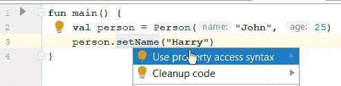

请注意，合成属性语法仅适用于非 Kotlin 代码中声明的方法。你不能在 Kotlin 源码中定义的 `get/set` 方法用于此用途。

# 平台类型

由于 Java 不区分可空和不可空类型，Kotlin 编译器通常无法对来自 Java 代码的对象的可空性做任何假设。然而，将它们暴露为可空是不实际的，因为你将需要在 Kotlin 代码中处理大量的虚假空性检查。出于这个原因，Kotlin 编译器在处理 Java 类型时放宽了空安全，不会将它们暴露为具有确定空空性的类型。来自 Java 代码的 Kotlin 对象属于特殊的平台类型（platform types），这些类型基本上构成了可空和不可空版本之间的类型范围。此类类型提供的空安全保证与 Java 中的基本相同。你可以在可空和不可空上下文中使用它们的值，但这种用法可能会在运行时因 `NullPointerException` 而失败。

考虑以下 Java 类：

```java
public class Person {
    private String name;
    private int age;
    public Person(String name, int age) {
        this.name = name;
        this.age = age;
    }
    public String getName() { return name; }
    public void setName(String name) { this.name = name; }
    public int getAge() { return age; }
    public void setAge(int age) { this.age = age; }
}
```

让我们尝试在 Kotlin 代码中使用它：

```kotlin
fun main() {
    val person = Person("John", 25)
    println(person.name.length) // 4
}
```

在前面的代码中，`person.name` 是一个平台类型，因为编译器不知道它是否可能可空。尽管如此，代码可以编译，但当程序尝试访问 `length` 属性时，空性检查会被推迟到运行时。如果我们将其改为以下代码，程序仍然可以编译，但在运行时失败：

```kotlin
fun main() {
    val person = Person(null, 25)
    println(person.name.length) // Exception
}
```

注意，平台类型在 Kotlin 源码中不能显式编写。它们仅由编译器构建。然而，你可以在 IntelliJ IDEA 插件中看到它们。例如，如果你对 `person.name` 表达式应用“显示表达式类型”操作（Ctrl+Shift+P/Cmd+Shift+P），发现它的类型是 `String`!（见图 12.2）。这种表示法意味着此类类型的值可以充当 `String?` 和 `String` 的值：

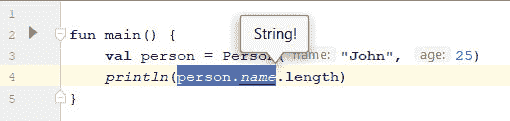

如果你将平台类型的表达式赋值给变量或从函数返回而不指定式类型，它会传播。例如：

```kotlin
import java.math.BigInteger
// BigInteger! 返回类型
fun Int.toBigInt() = BigInteger.valueOf(this.toLong())
val 
```

如果你显式指定了类型，就会强制平台类型转换为可空或不可空：

```kotlin
import java.math.BigInteger
// BigInteger (不可空) 返回类型
fun Int.toBigInt(): BigInteger = BigInteger.valueOf(this.toLong())
val 
```

```java
import org.jetbrains.annotations.NotNull;

public class Person {
    @NotNull private String name;
    private int age;
    public Person(@NotNull String name, int age) {
        this.name = name;
        this.age = age;
    }
    @NotNull public String getName() { return name; }
    public void setName(@NotNull String name) { this.name = name; }
    public int getAge() { return age; }
    public void setAge(int age) { this.age = age; }
}
```

Kotlin 代码中的类型将反映这些变化，如图 12.5 所示：

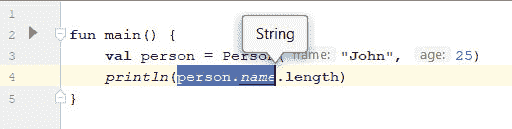

**图 12.5:** 带有 @NotNull 注解标记的 Java 类型

Kotlin 编译器支持的某些可空注解包括（你可以在 `kotlinlang.org` 的 Kotlin 文档中找到更列表）：

*   JetBrains 的 `@Nullable` 和 `@NotNull`（来自 `org.jetbrains.annotations` 包）
*   来自 Android SDK 的多种 `@Nullable` 和 `@NonNull` 注解
*   JSR-305 可空性注解，如 `@Nonnull`（来自 `javax.annotation` 包）

**IDE 提示：JetBrains 注解库不会自动添加到项目依赖中，但在需要时可以轻松配置。如果找不到 `@Nullable/@NotNull` 注解，你可以在未解析的注解引用上按 Alt+Enter，并选择“Add annotations to the classpath”操作，如图 12.6 所示：**

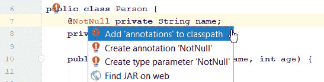

**图 12.6:** 配置 JetBrains 注解库

请注意，从 Java 8 开始，你也可以对泛型声明的类型参数进行注解，只要可空注解支持 `ElementType.TYPE_USE` 目标。例如，JetBrains `@Nullable/@NotNull` 注解从版本 15 开始支持此目标，因此我们可以编写以下代码：

```java
public class Person {
    …
    @NotNull private Set<@NotNull Person> friends = new HashSet<>();
    @NotNull public Set<@NotNull Person>getFriends() { return friends; }
}
```

在 Kotlin 中，`getFriends()` 方法的返回类型看起来像 `(Mutable)Set<Person>`：

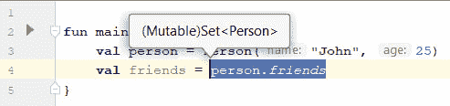

**图 12.7:** 非可空类型参数

当类型参数没有注解时，Kotlin 编译器对它们使用平台类型（platform types），因此在下面的 Kotlin 示例代码中，`person.friends` 的类型将变为 `(Mutable)Set<Person!>`：

```java
public class Person {
    …
    @NotNull private Set<Person> friends = new HashSet<>();
    @NotNull public Set<Person>getFriends() { return friends; }
}
```

# Java/Kotlin 类型映射

某些类型在 Kotlin 和 Java 中具有相似的。例如，Java 基本类型 `int` 和 `boolean` 对应于 Kotlin 的内置类型（分别为 `Int` 和 `Boolean`），而 `java.util.List` 对应于平台类型 `(Mutable)List`。在处理 Kotlin 代码中 Java 声明的使用时，Kotlin 编译器能够将 Java 类型映射到对应的 Kotlin 类型；反之，在为 JVM 编译 Kotlin 代码时也是如此。在本节中，我们将讨论 Java/Kotlin 类型映射的基本规则。

首先，Java 基本类型及其包装版本映射到 Kotlin 中对应的基本类型：

| **Java 类型** | **Kotlin 类型** |
| :--- | :--- |
| byte/Byte | Byte |
| short/Short | Short |
| int/Integer | Int |
| long/Long | Long |
| char/Character | Char |
| float/Float | Float |
| double/Double | Double |

这种映射也是反向的。Kotlin 基本类型的 JVM 值由 JVM 基本类型或相应的包装类表示，取决于该值如何被使用。例如，`Int?` 的值将由 `java.lang.Integer` 实例表示，因为 Java 的 `int` 可能无法存储空值。

来自 `java.lang` 包的某些非基本内置类映射到 `kotlin` 包中对应的类（反之亦然）。两种情况下的类名相同；唯一的例外是 `Object`，它被映射到 Kotlin 的 `Any`：

*   `Object`
*   `Cloneable`
*   `Comparable`
*   `Enum`
*   `Annotation`
*   `CharSequence`
*   `String`
*   `Number`
*   `Throwable`

请注意，映射的 Java 类的静态成员（例如 `Long.valueOf()`）无法直接通过 Kotlin 伴侣对象访问。要使用它们，你需要指定相应 Java 类的限定名：

```kotlin
val n = java.lang.Long.bitCount(1234)
```

Kotlin 中的标准集合类型（可变和不可变的）映射到 `java.util` 包中对应的集合类型。如前所述，反向映射会产生平台类型，因为标准 Java 集合对可变和不可变实现使用相同的 API。映射的类型如下：

*   Iterable/Iterator/ListIterator
*   Collection
*   Set
*   List
*   Map/Map.Entry

泛型类型之间的映射涉及一些不那么简单的转换，由于它们的继承存在差异。

# 单抽象方法接口

如果你有一个只有一个抽象方法的 Java 接口（简称为 SAM 接口），它在本质上类似于 Kotlin 的函数类型。这实际上与 Java 8+ 类似，该版本支持将 lambda 自动转换为相应的 SAM 类型实例。Kotlin 允许你在期望 Java SAM 接口的地方使用 lambda。这被称为 SAM 转换。例如，让我们查看 `ExecutorService` 类，其 API 允许你注册某些异步计算任务。它的 `execute()` 方法接收一个 `Runnable` 对象：

```java
public interface Runnable {
    public void run();
}
```

由于 `Runnable` 在 Kotlin 中被标记为 SAM 接口，这允许 Kotlin 代码通过简单传递 lambda 来调用 `execute()` 方法：

```kotlin
import java.util.concurrent.ScheduledThreadPoolExecutor
fun main() {
    val executor = ScheduledThreadPoolExecutor(5)
    executor.execute {
        println("Working on asynchronous task…")
    }
    executor.shutdown()
}
```

而不是更冗长的代码：


```kotlin
import java.util.concurrent.ScheduledThreadPoolExecutor
fun main() {
    val executor = ScheduledThreadPoolExecutor(5)
    executor.execute(object : Runnable {
        override fun run() {
            println("Working on asynchronous task…")
        }
    })
    executor.shutdown()
}
```

这种行为与 Java 语义是一致的，因为 Java 的数组类型是协变的。Kotlin 数组是不变的（invariant），这种技巧对 Kotlin 方法不起作用，除非你将 `Array` 类型限制为其输出投影，如 `Array<out Any>`。

有时编译器没有足够的上下文信息来选择合适的转换。例如，Java 的 `ExecutorService` 有一组 `submit()` 方法，它们接收一个代表要执行计算的对象，以便在未来执行该计算。计算可以是 `Runnable` 或 `Callable` 接口的实例，如下所示：

```
public interface Callable<V> {
    V call() throws Exception;
}
```

`Runnable` 和 `Callable` 都是 SAM（单抽象方法）接口，但如果我们在 Kotlin 代码中向其中一个 `submit()` 方法传递 lambda 表达式，编译器将选择 `Runnable` 版本，因为它具有最具体的签名：

```kotlin
import java.util.concurrent.ScheduledThreadPoolExecutor

fun main() {
    val executor = ScheduledThreadPoolExecutor(5)
    // 隐式转换为 Runnable
    val future = executor.submit { 1 + 2 }
    println(future.get()) // null
    executor.shutdown()
}
```

如果我们想传递一个 `Callable` 实例呢？在这种情况下，我们必须通过指定目标类型来使转换更加显式：

```kotlin
import java.util.concurrent.Callable
import java.util.concurrent.ScheduledThreadPoolExecutor

fun main() {
    val executor = ScheduledThreadPoolExecutor(5)
    val future = executor.submit(Callable { 1 + 2 })
    println(future.get()) // 3
    executor.shutdown()
}
```

这样的表达式被称为 SAM 构造函数。

注意，SAM 转换仅适用于接口，不适用于类（即使类只有一个抽象方法）。它们也不适用于 Kotlin 接口；与 Java 不同，Kotlin 拥有适当的函数式类型，因此隐式转换几乎是没必要的。

## 使用 Java 转 Kotlin 转换器

IntelliJ 插件包含一个自动工具，可以将 Java 源文件转换为等效的 Kotlin 代码。结合 Java/Kotlin 互性，此功能允许你逐渐迁移到现有的 Java 代码库。

要转换文件，你只需按下 `Ctrl+Alt+Shift+K` 或从 `Code` 菜单选择 `Convert Java File to Kotlin File`（将 Java 文件转换为 Kotlin 文件）操作。IDE 将处理你的文件，将其转换为 Kotlin 并在必要更新外部引用。

你还可以在 `Project View` 面中选择一个或多个文件，并应用相同的快捷键进行批量转换。

自动转换器旨在生成地道的 Kotlin 代码，但它并不总是产生理想的结果。尽管如此，在将现有 Java 代码库迁移到 Kotlin 时，此工具可以作为一个良好的起点。

## 在 Java 使用 Kotlin 代码

Kotlin 的设计指南之一是与现有的 Java 代码库保持无缝互操作。在大多数情况下，Kotlin 代码可以轻松地从 Java 调用而无需过多担心。然而，Kotlin 拥有许多在 Java 中没有直接对应的特性。在本节中，我们将讨论这些细微差别，并讨论如何从 Java 的角度微调 Kotlin 代码的导出。

### 访问属性

由于 Java 和 JVM 都没有属性（property）的概念，你无法在 Java 代码中直接访问 Kotlin 属性。但在编译后的 JVM 字节码中，每个属性都由访问方法表示，这些方法对 Java 客户端就像普通方法一样。访问方法的签名根据以下规则从属性定义派生：

* getter 是一个无参数方法，返回类型与原始属性类型对应；其名称通过将属性名的首字母大写并在前面加上 `get` 前缀计算得出。

* setter 是一个接收对应新值的单个参数的 void 方法；其名称与 getter 类似，但将 `get` 替换为 `set`。

例如，考虑以下 Kotlin 类：

```kotlin
class Person(var name: String, val age: Int)
```

它看起来如下所示（从 Java 的角度）：

```java
public class Person {
    @NotNull
    public String getName() {…}
    public void setName(@NotNull String value) {…}
    public int getAge() {…}
}
```

因此，Java 客户端代码可以通过调用访问方法来访问其属性：

```java
public class Main {
    public static void main(String[] args) {
        Person person = new Person("John", 25);
        System.out.println(person.getAge()); // 25
        person.setName("Harry");
        System.out.println(person.getName()); // Harry
    }
}
```

当属性名以 `is` 开头时，Kotlin 编译器使用另一种命名方案：

* getter 的名称与其属性相同。

* setter 名称通过将 `is` 前缀替换为 `set` 计算。

例如，假设我们向 `Person` 类添加了 `isEmployed` 属性：

```kotlin
class Person(var name: String, val age: Int, var isEmployed: Boolean)
```

访问新属性的 Java 代码现在看起来像这样：

```java
public class Main {
    public static void main(String[] args) {
        Person person = new Person("John", 25, false);
        person.setEmployed(true);
        System.out.println(person.isEmployed()); // true
    }
}
```

注意，`is` 约定纯粹基于名称；它与 `Boolean` 类型无关（尽管强烈建议仅对 `Boolean` 属性使用 `is` 名称以避免误解）。

如果 Kotlin 属性需要后台字段（backing field），编译器将与访问方法一起生成它。在某些情况下，你可能需要将该属性暴露给 Java 客户端。这可以通过对属性标记 `@JvmField` 实现。例如，如果我们通过对构造函数进行注解来修改 `Person` 类：

```kotlin
class Person(@JvmField var name: String, @JvmField val age: Int)
```

我们可以从 Java 源文件中访问生成的字段：

```java
public class Main {
    public static void main(String[] args) {
        Person person = new Person("John", 25);
        System.out.println(person.age); // 25
        person.name = "Harry";
        System.out.println(person.name); // Harry
    }
}
```

在这种情况下，不会生成访问方法，后台字段的可见性与属性本身相同。注意，如果属性具有非平凡的访问方法，则无法使用 `@JvmField`：

```kotlin
class Person(val firstName: String, val familyName: String) {
    // 错误：属性有自定义 getter
    @JvmField val fullName() = "$firstName $familyName"
}
```

`@JvmField` 也不适用于 `open` 或 `abstract` 属性，因为它们的重写通常会有自定义访问方法：

```kotlin
open class Person(val firstName: String, val familyName: String) {
    // 错误：属性是 open
    @JvmField open val description() = "$firstName $familyName"
}
```

当应用于某些命名对象的的属性时，`@JvmField` 的行为略有不同，它生成静态字段而不是实例字段。例如，考虑以下 Kotlin 对象：

```kotlin
object Application {
    @JvmField val name = "My Application"
}
```

Java 代码通过直接引用 `Application.name` 字段来访问 `name` 属性：

```java
public class Main {
    public static void main(String[] args) {
        System.out.println(Application.name);
    }
}
```

带有 `const` 修饰符的属性也是如此：

```kotlin
object Application {
    const val name = "My Application"
}
```

暴露后台字段另一种方法是使用 `lateinit` 属性：

```kotlin
class Person(val firstName: String, val familyName: String) {
    lateinit var fullName: String
    fun init() {
        fullName = "$firstName $familyName"
    }
}
```

在这种情况下，访问方法和后台字段的可见性与属性本身相同：

```java
public class Main {
    public static void main(String[] args) {
        Person person = new Person("John", "Doe");
        person.init();
        // 直接访问字段
        System.out.println(person.fullName); // John Doe
        // 调用访问方法
        System.out.println(person.getFullName()); // John Doe
    }
}
```

在对象中，`lateinit` 会生成一个类似于 `@JvmField` 注解的静态字段。然而，它的访问器仍然是实例方法。例如，让我们定义这个单例：

```kotlin
object Application {
    lateinit var name: String
}
```

下面的 Java 代码展示了访问 `lateinit` 属性字段与其访问器方法之间的区别：

```java
public class Main {
    public static void main(String[] args) {
        // 访问器调用（非静态）
        Application.INSTANCE.setName("Application1");
        // 直接访问属性（静态）
        Application.stdin = "Application2"
    }
}
```

注意，`@JvmField` 不能用于 `lateinit` 属性。

### 文件门面（File facades）与顶层声明

在 Kotlin 中，你通常可以利用顶层声明，它们直接放置在包中，而不是某个其他声明内部。对于通用的 Java 和 JVM 平台，这些方法必须属于特定的类。为了满足这一要求，Kotlin 编译器会将顶层函数和属性放入一个自动生成的类中，该类被称为文件门面（file facade）。默认情况下，门面的名称基于源文件名并带有额外的 `Kt` 后缀。例如，对于如下文件：

```kotlin
// util.kt
class Person(val firstName: String, val familyName: String)
val Person.fullName
get() = "$firstName $familyName"

fun readPerson(): Person? {
    val fullName = readLine() ?: return null
    val p = fullName.indexOf(' ')
    return if (p >= 0) {
        Person(fullName.substring(0, p), fullName.substring(p + 1))
    } else {
        Person(fullName, "")
    }
}
```

将产生以下门面类：

```java
public class UtilKt {
    @NotNull
    public static String getFullName(@NotNull Person person) {…}
    @Nullable
    public static Person readPerson() {…}
}
```

注意，门面类不包含类，因为类在 JVM 和 Java 中都允许位于顶层。

由于生成的方法是静态的，当你从 Java 代码中使用它们时，不需要实例化门面类：

```java
public class Main {
    public static void main(String[] args) {
        Person person = UtilKt.readPerson();
        if (person == null) return;
        System.out.println(UtilKt.getFullName(person));
    }
}
```

Kotlin 编译器允许你调整生成门面的某些方面。首先，你可以通过添加文件级别的 `@JvmName` 注解来更改它的名称：

```kotlin
@file:JvmName("MyUtils")
class Person(val firstName: String, val familyName: String)
val Person.fullName
get() = "$firstName $familyName"
```

现在，它的 Java 客户端将需要使用指定的 `MyUtils` 名称：

```java
public class Main {
    public static void main(String[] args) {
        Person person = new Person("John", "Doe");
        System.out.println(MyUtils.getFullName(person));
    }
}
```

另一个实用的功能是将多个文件中的顶层声明合并到一个类中。要实现这一点，你需要对感兴趣的文件标记 `@JvmMultifileClass` 注解，并使用 `@JvmName` 明目标类名。在这种情况下，Kotlin 编译器将自动组合具有相同门面类名的文件。例如，假设我们示例所有的声明都写在不同的文件中。


```kotlin
// Person.kt
class Person(val firstName: String, val familyName: String)

// utils1.kt
@file:JvmMultifileClass
@file:JvmName("MyUtils")
val Person.fullName
get() = "$firstName $familyName"

// utils2.kt
@file:JvmMultifileClass
@file:JvmName("MyUtils")
fun readPerson(): Person? {
    val fullName = readLine() ?: return null
    val p = fullName.indexOf(' ')
    return if (p >= 0) {
        Person(fullName.substring(0, p), fullName.substring(p + 1))
    } else {
        Person(fullName, "")
    }
}
```

得益于 `@JvmMultifile` 和 `@JvmName`，我们仍然可以 `MyUtils` 类的成员访问这两个声明：

```java
public class Main {
    public static void main(String[] args) {
        Person person = MyUtils.readPerson();
        if (person == null) return;
        System.out.println(MyUtils.getFullName(person));
    }
}
```

注意，门面类对 Kotlin 代码不可用，它们仅供其他 JVM 客户端使用。

# 对象（Objects）与静态成员

在 JVM 上，Kotlin 对象声明被编译为带有静态 `INSTANCE` 字段的普通类。例如，如果我们有如下的 Kotlin 声明：

```kotlin
object Application {
    val name = “My Application”
    fun exit() { }
}
```

则 Java 代码可以使用 `Application.INSTANCE` 字段访问其成员：

```java
public class Main {
    public static void main(String[] args) {
        System.out.println(Application.INSTANCE.getName());
    }
}
```

我们已经看到 `@JvmName` 可以用于更改门面类的名称。事实上，该注解不仅可以用于文件，还可以用于函数和属性访问器。该功能的主要用途是解决在 Kotlin 中有效但在 Java 中禁止的声明冲突。考虑以下 Kotlin 代码：

```kotlin
class Person(val firstName: String, val familyName: String)
val Person.fullName
get() = "$firstName $familyName" // Error

fun getFullName(person: Person): String { // Error
    return "${person.familyName}, ${person.firstName}"
}
```

即使 Kotlin 客户端可以轻松区分函数和属性，这段代码在 JVM 上也会产生具有相同签名的方法：

```java
@NotNull
public static String getFullName(@NotNull person) {…}
```

使用 `@JvmName`，你可以更改名称并解决问题：

```kotlin
@JvmName(“getFullNameFirst”)
fun getFullName(person: Person): String {
    return "${person.familyName}, ${person.firstName}"
}
```

现在，Java 客户端可以使用 `getFullNameFirst` 名称调用此函数，而 Kotlin 代码将使用原始的 `getFullName`。

我们可以通过注解访问器为属性指定 JVM 名称：

```kotlin
val Person.fullName
@JvmName("getFullNameLast")
get() = "$firstName $familyName"
```

或者对属性本身（带有适当的使用目标）：

```kotlin
@get:JvmName("getFullNameLast")
val Person.fullName
get() = "$firstName $familyName"
```

特别是 `@JvmName` 允许你跳过用于属性访问器的标准命名方案：

```kotlin
class Person(@set:JvmName("changeName") var name: String, val age: Int)
```

从 Java 代码来看，`Person` 类现在拥有 `changeName()` 方法而不是 `setName()`：

```java
public class Main {
    public static void main(String[] args) {
        Person person = new Person("John", 25);
        person.changeName("Harry");
        System.out.println(person.getName());
    }
}
```

`JvmName` 在 Kotlin 函数名与 Java 关键字重合（导致无法从 Java 源码中使用）时也非常有用。例如：

```kotlin
class Person(val firstName: String, val familyName: String) {
    @JvmName("visit")
    fun goto(person: Person) {
}
}
```

```
println("$this is visiting $person")
}
```

```kotlin
override fun toString() = "$firstName $familyName"
}
```

由于 `goto` 是 Java 的保留关键字，因此 `goto()` 函数在 Java 中是不可用的。提供自定义的 JVM 名称可以解决这个问题。

# 生成重载

当 Kotlin 函数的参数带有默认值时，其在调用时的参数数量可能会变化，因为其中某些参数可能会被跳过：

```kotlin
// util.kt
fun restrictToRange(
    what: Int,
    from: Int = Int.MIN_VALUE,
    to: Int = Int.MAX_VALUE
): Int {
    return Math.max(from, Math.min(to, what))
}

fun main() {
    println(restrictToRange(100, 1, 10)) // 10
    println(restrictToRange(100, 1)) // 100
    println(restrictToRange(100)) // 100
}
```

然而，Java 没有默认值的概念，因此上述函数看起来如下所示：

```java
public int restrictToRange(int what, int from, int to) {…}
```

结果是，任何 Java 客户端都强制显式传递所有参数：

```java
public class Main {
    public static void main(String[] args) {
        System.out.println(UtilKt.restrictToRange(100, 1, 10));
        System.out.println(UtilKt.restrictToRange(100, 1)); // Error
        System.out.println(UtilKt.restrictToRange(100)); // Error
    }
}
```

Kotlin 通过 `@JvmOverloads` 注解为你提供了一个解决方案：

```kotlin
@JvmOverloads
fun restrictToRange(
    what: Int,
    from: Int = Int.MIN_VALUE,
    to: Int = Int.MAX_VALUE
): Int {
    return Math.max(from, Math.min(to, what))
}
```

`@JvmOverloads` 的效果是为原始 Kotlin 函数生成额外的重载：

- 第一个重载包含原始函数的所有参数，除了最后一个带有默认值的参数。
- 第二个重载包含原始函数的所有参数，除了最后一个和倒数第二个带有默认值的参数，依此类推。
- 最后一个重载版本只包含不带默认值的参数。

例如，从 Java 的角度来看，`restrictToRange()` 函数现在有三个重载：

```java
public int restrictToRange(int what, int from, int to) {…}
public int restrictToRange(int what, int from) {…}
public int restrictToRange(int what) {…}
```

额外的重载将通过为省略的参数提供显式值来调用原始函数。现在，我们原始的 Java 用变得有效了，因为所有三个重载都被正确解析了：

```java
public class Main {
    public static void main(String[] args) {
        System.out.println(UtilKt.restrictToRange(100, 1, 10)); // 10
        System.out.println(UtilKt.restrictToRange(100, 1)); // 100
        System.out.println(UtilKt.restrictToRange(100)); // 100
    }
}
```

注意，虽然由 `@JvmOverloads` 注解生成的重载版本被添加到编译后的二进制文件中，但它们在 Kotlin 代码中可用。这些重载仅用于 Java 互操作。

# 声明异常

在 *第 3 章，定义函数* 中，我们提到 Kotlin 不区分检查异常（checked exceptions）和未检查异常（unchecked exceptions）；你的函数和属性可以抛出任意异常而无需额外代码。相反，Java 要求显式列出方法体中未捕获的检查异常。如果 Java 代码想要处理调用 Kotlin 声明抛出的检查异常，可能会导致问题。例如，假设我们有一个 Kotlin 函数：

```kotlin
// util.kt
fun loadData() = File("data.txt").readLines()
```

并在 Java 端使用：

```java
public class Main {
    public static void main(String[] args) {
        for (String line :UtilKt.loadData()) {
            System.out.println(line);
        }
    }
}
```

如果无法读取 `data.txt`，`loadData()` 将抛出 `IOException`，该异常保持未处理状态，从而导致 `main()` 方法静默失败。如果我们尝试为 `main()` 添加异常处理程序，可能会遇到另一个问题：

```java
import java.io.IOException;
public class Main {
    public static void main(String[] args) {
        try {
            for (String line :UtilKt.loadData()) {
                System.out.println(line);
            }
        } catch (IOException e) { // Error
            System.out.println("Can't load data");
        }
    }
}
```

编译失败，因为 Java 禁止处理未在相应的 `try` 块内部声明的检查异常。问题在于，从 Java 的角度来看，我们的 `loadData()` 函数看起来如下：

```kotlin
@notNull
public List<String>loadData()
```

因此，它没有提供任何关于抛出异常的信息。解决方案是使用 `@Throws` 注解，在其中我们可以指定：

```kotlin
import java.io.File
import java.io.IOException

abstract class Loader {
    abstract fun loadData(): List<String>
}

class FileLoader(val path: String) : Loader() {
    @Throws(IOException::class)
    override fun loadData() = File(path).readLines()
}
```

请记住，Kotlin 编译器不会验证重写方法之间 `@Throws` 的一致性。

# 内联函数

由于 Java 没有内联的概念，标记为 `inline` 的 Kotlin 函数被暴露为普通方法。你可以在 Java 代码中调用它们，但它们的体不会被内联。

特殊情况是带有泛化类型参数的泛型内联函数。目前，类型泛化无法通过内联实现，因此无法在 Java 代码中调用此类函数。例如，以下 `cast()` 函数不可：

```kotlin
inline fun <reified T : Any>Any.cast(): T? = this as? T
```

它将作为类的私有成员暴露，从而禁止外部访问：

```java
public class Main {
    public static void main(String[] args) {
        UtilKt.<Integer>cast(""); // Error: cast is private
    }
}
```

# 类型别名

Kotlin 类型别名无法在 Java 代码中使用。引用类型别名的声明将使用其底层类型。例如，从 Java 角度来看，以下定义将产生一个 `Name` 替换为 `String` 的 `Person` 类：

```kotlin
typealias Name = String
class Person(val firstName: Name, val familyName: Name)
```

这可以通过构造和使用 `Person` 类实例的 Java 代码演示：

```java
public class Main {
    public static void main(String[] args) {
        Person person = new Person("John", "Doe");
        System.out.println(person.getFamilyName()); // Doe
    }
}
```

### 总结

本章介绍了如何在公共库中混合 Kotlin 和 Java 代码。我们查看了 Kotlin 和 Java 声明如何相互暴露，在 Kotlin 代码中使用 Java 声明以及反之可能出现的常见问题，并解决了它们的基本解决方案以及调整 JVM 平台语言互操作性的方法。

在下一章中，我们将关注并发应用程序。我们将看到 Java 并发原理如何在 Kotlin 中使用，并讨论协程的各个方面，这是一个允许你编写挂起计算的强大语言特性。

### 问题

1. 什么是合成属性（synthetic property）？在 Kotlin 中使用 Java 访问方法的规则是什么？
2. 什么是平台类型？Kotlin 支持哪些类型的平台类型？
3. Java 代码中的可空注解如何影响 Kotlin 类型？
4. 描述 Kotlin 类型如何映射到 Java，反之亦然。
5. 解释 Kotlin 中的 SAM 转换和构造函数是如何工作的。
6. 如何从 Java 代码访问 Kotlin 属性？
7. 在哪些情况下，Kotlin 属性的后端字段（backing fields）对 Java 代码可见？
8. 什么是文件外观（file facade）？描述如何在 Java 中使用 Kotlin 顶层函数和属性。
9. 如何将多个 Kotlin 文件合并到一个单一外观类中？
10. 描述 `@JvmName` 注解的用法。
11. 描述 Kotlin 对象声明实例是如何暴露给 Java 代码的。
12. 如何让对象成员在 Java 中作为静态方法可用？
13. 使用 `@JvmOverloads` 注解的效果是什么？
14. 你如何为 Kotlin 函数声明可能的受检异常（checked exceptions）？

# 第 13 章

## 并发

在本章中，我们将关注编写并发代码的一个大主题。我们的主要目标是理解协程（coroutines）；这是 Kotlin 的显著特征之一，首次在 1.1 版本中引入，并在 Kotlin 1.3 中达到发布状态。


我们将从讨论 Kotlin 协程的基础概念开始，例如挂起函数（suspending functions）和结构化并发（structured concurrency），然后逐渐转向更高级的并发控制流问题、协程状态在整个生命周期内如何变化、取消和异常如何工作，以及并发任务如何分配给线程。

我们还将涵盖通道（channels）和 Actor（actors）等技术，这些技术允许你的代码实现并发任务之间的通信，并以线程的方式共享某些可变数据。

最后，我们还会讨论一些简化在 Kotlin 代码中使用 Java 并发 API、创建线程以及使用同步和锁（locks）的工具。

## 结构

- 协程
- 并发通信
- 使用 Java 并发

## 目标

学习使用 Kotlin 协程库提供的并发原语来构建可扩展且响应良好的代码。

## 协程

Kotlin 程序可以轻松使用 Java 并发原语来实现线程安全。然而，使用它们仍然存在某些问题，因为大多数并发操作都是阻塞的；换句话说，使用 `Thread.sleep()`、`Thread.join()` 或 `Object.wait()` 等操作的线程将被阻塞，直到其执行完成。阻塞和恢复线程执行需要在系统级别进行计算密集型的上下文切换，这可能会对程序性能产生负面影响。此外，每个线程消耗大量的系统资源，因此维护大量的并发线程是不实行的，甚至可能是完全不可能。

一种更高效的方法涉及异步编程。我们可以提供一个 lambda 表达式，在请求的操作完成后进行回调。与此同时，原始线程可以继续执行一些有用的工作（例如处理客户端请求或处理 UI 事件），而不是仅仅在阻塞状态下等待。这种方法的主要问题是代码复杂性的急剧增加，因为我们无法使用普通的命令式控制流。

在 Kotlin 中，你可以兼得两者之：得益于强大的协程机制，它允许你以熟悉的命令式风格编写代码，但又让编译器自动将其转换为高效的异步计算。这种机制基于挂起函数的概念，挂起函数能够保留其上下文，并在执行的某些点被挂起和恢复。

值得注意的是，大多数协程功能由一个单独库提供，该库必须在你的项目中显式配置。书中使用的版本由以下 Maven 坐标给出：`org.jetbrains.kotlinx:kotlinx-coroutines-core:1.2.2`。

**IDE Tips：** 如果你在使用 IntelliJ IDEA 且不依赖于 Maven 或 Gradle 等特定的构建系统，可以按照以下步骤添加协程库：

1. 在 `Project View` 面板的根节点上按 F4，或者右键点击它并选择 `Open Module Settings`（打开模块设置）。
2. 点击左侧的 `Libraries` 项，然后点击顶部工具栏上的 + 按钮，并选择 `From Maven…` 选项。
3. 输入库的 Maven 坐标（例如 `org.jetbrains.kotlinx:kotlinx-coroutines-core:1.2.2`）并点击 OK（如图 13.1 所示）。
4. IDE 将下载带有必要依赖的库，并建议将其添加到项目的模块中。点击 OK 确认。


**图 13.1：** 下载 Kotlin 协程库

在接下来的章节中，我们将讨论协程库引入的基本概念，并查看它们如何用于并发编程。

### 协程与挂起函数

整个协程库的基础语言原语是挂起函数。这是普通函数的泛化，具有在体某些点挂起其执行并保留所有必要上下文，然后根据需要恢复的能力。在 Kotlin 中，此类函数由 `suspend` 修饰符标记：

```kotlin
suspend fun foo() {
    println("Task started")
    delay(100)
    println("Task finished")
}
```

我们使用的 `delay()` 函数是协程库中定义的挂起函数。它的目的与 `Thread.sleep()` 类似；然而，它不是阻塞当前线程，而是挂起调用函数。

挂起函数可以调用挂起函数和普通函数。在前者的情况下，这种调用变成一个挂起点，调用者的执行可能会停止并在稍后恢复，而后者像普通函数调用一样进行。然而，Kotlin 禁止在普通函数中调用挂起函数：

```kotlin
fun foo() {
    println("Task started")
    delay(100) // Error：delay 是挂起函数
    println("Task finished")
}
```

**IDE Tips：** 使用 IntelliJ 插件时，你可以通过对应行左侧的特殊图标轻松区分挂起调用，如图 13.1 所示：

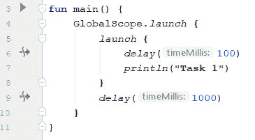

**图 13.2：** IDE 中的挂起调用

如果只有挂起函数可以进行挂起调用，我们如何调用挂起函数呢？最明显的方法是将 `main()` 函数本身标记为 `suspend`：

```kotlin
import kotlinx.coroutines.delay

suspend fun main() {
    println("Task started")
    delay(100)
    println("Task finished")
}
```

运行上述代码时，它将按预期间隔 100 毫秒打印以下内容：

```
Task started
Task finished
```

但在更现实的情况下，当我们需要对并发代码的行为进行某些控制时，挂起函数在特定的作用域内执行，该作用域定义了一组共享生命周期和上下文的任务。用于启动协程的各种函数被称为协程构建器（coroutine builders），它们作为 `CoroutineScope` 实例的扩展。一种基本实现由 `GlobalScope` 对象提供；它允许我们创建独立的协程，这些协程可以进一步生成自己的嵌套任务。现在，我们将查看常用的协程构建器：`launch()`、`async()` 和 `runBlocking()`。

### 协程构建器

`launch()` 函数启动一个协程并返回一个 `Job` 对象，你可以使用它来跟踪其状态并在需要时取消底层任务。该函数接收一个类型为 `CoroutineScope.() -> Unit` 的挂起 lambda 表达式，它构成了新协程的主体。让我们来看一个简单的示例：

```kotlin
import kotlinx.coroutines.*
import java.lang.System.*

fun main() {
    val time = currentTimeMillis()
    GlobalScope.launch {
        delay(100)
        println("Task 1 finished in ${currentTimeMillis() - time} ms")
    }
    GlobalScope.launch {
        delay(100)
        println("Task 2 finished in ${currentTimeMillis() - time} ms")
    }
    Thread.sleep(200)
}
```

如果你运行上述代码，你将看到如下的内容：

`Task 2 finished in 176 ms`

`Task 1 finished in 176 ms`

值得注意的是，两个任务相对于程序启动几乎在同一时间完成，这意味着它们实际上是并行执行的。程序不保证特定的顺序，因此取决于具体情况，两个任务中的任何一个都可能先完成。协程库还包含了在必要时强制执行顺序的手段。我们将在后续关于并发通信的章节中讨论这些内容。

`main()` 函数本身使用 `Thread.sleep()` 来临时阻塞主线程的执行。这应该为协程线程留出足够的时间完成，因为默认情况下它们在守护模式（daemon mode）下运行，一旦 `main()` 线程终止，它们就会提前关闭。

记住，在挂起函数内部也可以使用 `sleep()` 这种阻塞线程的函数，但强烈建议不要这样做，因为这种代码违背了协程的整个初意。出于此考虑，我们在并发任务使用了挂起的 `delay()`。

**IDE 提示：** IntelliJ 插件会警告你在协程代码中调用了如 `Thread.sleep()` 或 `Thread.join()` 等潜在的阻塞函数调用。

请注意，协程比线程轻量得多。特别是，你可以轻松地负担起大量并发运行的协程，因为每个协程通常只需要保持一个相对紧凑的状态，在被挂起或恢复时不需要完整的上下文切换。

`launch()` 构建器适用于并发任务不需要计算某些结果的情况。这就是为什么它接收一个 `Unit` 类型的 lambda。然而，如果我们需要结果，还有另一个名为 `async()` 的构建函数。该函数返回一个 `Deferred` 实例，它是 `Job` 的一个特殊子类型，通过 `await()` 方法访问计算结果。当调用时，`await()` 会挂起直到计算完成（从而产生结果）或被取消。在后者的情况下，`await()` 会抛出异常失败。你可以将它们视为 Java futures 的非阻塞对应物。例如：

```kotlin
import kotlinx.coroutines.*
suspend fun main() {
    val message = GlobalScope.async {
        delay(100)
        "abc"
    }
    val count = GlobalScope.async {
        delay(100)
        1 + 2
    }
    delay(200)
    val result = message.await().repeat(count.await())
    println(result)
}
```

在这种情况下，我们还为 `main()` 函数标记了 `suspend`，以便直接调用两个延迟任务的 `await()` 方法。输出如其所料地如下：

```
abcabcabc
```

默认情况下，`launch()` 和 `async()` 构建器在共享的后台线程池中运行协程，而调用线程本身保持非阻塞状态。这就是我们必须在 `launch()` 示例中插入 `sleep()` 的原因，因为主线程除了等待任务完成外几乎没有工作要做。另一方面，`runBlocking()` 构建器创建一个协程，该协程默认在当前线程执行并阻塞直到其完成。当协程成功返回时，挂起 lambda 的返回值变为整个 `runBlocking()` 调用的值。当协程被取消时，`runBlocking()` 会抛出异常。相反，当被阻塞的线程被中断时，由 `runBlocking()` 启动的协程也会被取消。例如：

```kotlin
import kotlinx.coroutines.*
fun main() {
    GlobalScope.launch {
        delay(100)
        println("Background task: ${Thread.currentThread().name}")
    }
    runBlocking {
        println("Primary task: ${Thread.currentThread().name}")
        delay(200)
    }
}
```

运行此程序将产生类似的内容：

`Primary task: main`

`Background task: DefaultDispatcher-worker-2`

你可以看到 `runBlocking()` 内部的协程在主线程中执行，而由 `launch()` 创建的协程被分配到共享池中的后台线程。

由于其阻塞性质，`runBlocking()` 不应在其他协程内部使用。它被设计为阻塞代码和非阻塞代码之间的某种桥梁，可以用于主函数或测试中的顶层构建器。

### 协程作用域和结构化并发

到为止，我们的示例协程是在全局作用范围内运行的，这实际上意味着它们的寿命仅限于整个应用程序的寿命。在某些情况下，我们可能希望确保限制在特定操作的协程执行。得益于父子关系，这是可能的。当你在另一个协程的范围内启动协程时，后者成为前者的子级。父协程只有在子协程完成后才会完成。

这一特性被称为结构化并发（structured concurrency）。它可以与块和子程序进行比较。让我们来看一个示例：

```kotlin
import kotlinx.coroutines.*
fun main() {
    runBlocking {
        println("Parent started")
        launch {
            println("Task A started")
            delay(200)
            println("Task A finished")
        }
        launch {
            println("Task B started")
            delay(200)
            println("Task B finished")
        }
        delay(100)
        println("Parent finished")
    }
    println("Shutting down...")
}
```

如果你运行此程序，你将看到如下结果：

`Parent started`

`Task A started`

`Task B started`

`Parent finished`

`Task A finished`

`Task B finished`

`Shutting down...`

你可以看到 `runBlocking()` 调用中挂起 lambda 的父协程主体由于延迟较小在其子协程完成之前完成了。协程本身此时尚未完成，而处于挂起状态等待两个子协程的完成。之后，父协程也会完成，由于我们使用了 `runBlocking()` 构建器，在这里它也释放了主线程，使其打印最后的消息。

你也可以通过在 `coroutineScope()` 调用内部封装代码块来引入自定义作用域。与 `runBlocking()` 类似，该函数返回其 lambda 的值并在子协程完成之前不会完成。`coroutineScope()` 和 `runBlocking()` 的主要区别在于前者是一个挂起函数，不会阻塞当前线程：

```kotlin
import kotlinx.coroutines.*
fun main() {
    runBlocking {
        println("Custom scope start")
        coroutineScope {
            launch {
                delay(100)
                println("Task 1 finished")
            }
            launch {
                delay(100)
                println("Task 2 finished")
            }
        }
        println("Custom scope end")
    }
}
```

注意 `Custom scope` 结束消息是最后打印的，因为前面的 `coroutineScope()` 调用在子协程完成执行之前会一直挂起。

通常情况下，父子关系可以形成复杂的协程层级结构，为异常处理和取消请求定义了共享作用域。我们将在后续讨论协程作业（jobs）和取消时重新回顾这个主题。

### 协程上下文

每个协程都有一个关联的上下文，该上下文由 `CoroutineContext` 接口表示，并通过闭包作用域的 `coroutineContext` 属性进行访问。上下文是一个不可变的键值对集合，包含了协程可用的各种数据。其中某些数据对协程调度机制具有特殊含义，并影响协程在运行时的执行方式。以下元素特别值得关注：

- `Job`：代表由协程执行的可取消任务。
- `Dispatcher`：控制协程如何与线程关联。

通常情况下，上下文可以存储任何实现 `CoroutineContext.Element` 的数据。要访问特定元素，你可以使用 `get()` 方法或提供相应键的索引运算符：

```kotlin
GlobalScope.launch {
    // 获取当前作业并打印“Task is active: true”
    println("Task is active: ${coroutineContext[Job.Key]!!.isActive}")
}
```

默认情况下，由 `launch()` 或 `async()` 等标准构造器创建的协程从当前作用域继承其上下文。必要时，可以使用相应构造函数的 `context` 参数提供不同的上下文。要创建一个新上下文，你可以使用 `plus()` 函数/`+` 运算符（它会将两个上下文的数据合并在一起）以及 `minusKey()` 函数（它会移除给定键的元素）：

```kotlin
import kotlinx.coroutines.*

private fun CoroutineScope.showName() {
    println("Current coroutine: ${coroutineContext[CoroutineName]?.name}")
}

fun main() {
    runBlocking {
        showName() // Current coroutine: null
        launch(coroutineContext + CoroutineName("Worker")) {
            showName() // Current coroutine: Worker
        }
    }
}
```

你还可以使用 `withContext()` 函数在协程执行期间切换上下文，该函数接收一个新的上下文和一个挂起 lambda 表达式。这可能非常有用，例如，如果你想在不同的线程中运行某些代码块。我们将在协程调度器的章节中看到此类线程跳转的示例。


### 协程控制流

#### Job 生命周期

作业（Job）是一个代表并发任务生命周期的对象。通过作业，你可以跟踪任务状态并在需要时取消它们。作业的可能状态如图 13.3 所示。让我们仔细观察这些状态的含义，以及作业如何从一个状态转换到另一个状态。

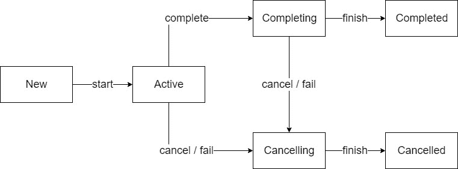

**图 13.3:** Job 状态

活跃（active）状态意味着作业已经启动但尚未完成。该状态通常是默认；换句话说，作业在创建后会自动启动。某些协程构造器如`launch()`和`async()`允许你通过指定`CoroutineStart`参数来选择初始状态：

* `CoroutineStart.DEFAULT`是默认行为，作业立即启动。
* `CoroutineStart.LAZY`作业不会自动启动；在这种情况下，它被放入新状态并等待启动。

新状态的作业可以通过调用其`start()`或`join()`方法来启动，之后它将转换到活跃状态。例如：

```kotlin
import kotlinx.coroutines.*

fun main() {
    runBlocking {
        val job = launch(start = CoroutineStart.LAZY) {
            println("Job started")
        }
        delay(100)
        println("Preparing to start…")
        job.start()
    }
}
```

前面的程序推迟了子协程的启动，直到根协程打印其消息。输出如下：

```
Preparing to start…
Job started
```

在活跃状态下，作业可以被协程机制反复挂起和恢复。它还可以启动新的作业作为其子作业，从而在并发计算之间形成树状依赖结构。你可以使用`children`属性确定一个未完成的子作业列表。例如：

```kotlin
import kotlinx.coroutines.*

fun main() {
    runBlocking {
        val job = coroutineContext[Job.Key]!!
        launch { println("This is task A") }
        launch { println("This is task B") }
        // 2 个子作业正在运行
        println("${job.children.count()} children running")
    }
}
```

当协程完成执行挂起 lambda 块时，其作业的状态将更改为完成中（completing），这基本上意味着等待子作业完成。作业会保持此状态，直到所有子作业都完成，之后它将转换到完成（completed）状态。

你可以使用`Job`的`join()`方法来挂起当前协程，直到目标作业完成。以下程序确保根协程的消息在两个子协程都完成执行后打印：

```kotlin
import kotlinx.coroutines.*

fun main() {
    runBlocking {
        val job = coroutineContext[Job.Key]!!
        val jobA = launch { println("This is task A") }
        val jobB = launch { println("This is task B") }
        jobA.join()
        jobB.join()
        println("${job.children.count()} children running")
    }
}
```

结果输出是：

```
This is task A
This is task B
0 children running
```

正如预期的，在评估`job.children.count()`时，没有活跃的子作业。

取消中（cancelling）和已取消（cancelled）状态反映了由于未处理的异常或显式调用`cancel()`方法而被取消作业的状态。当前的状态可以通过其属性进行追踪：`isActive`、`isCancelled`和`isCompleted`。它们的含义如下表所示。你也可以在`Job`接口的文档中找到它：

| Job state | isActive | isCompleted | isCancelled |
| :--- | :--- | :--- | :--- |
| New | False | False | False |
| Active | True | False | False |
| Completing | True | False | False |
| Cancelling | False | False | True |
| Cancelled | False | True | True |
| Completed | False | True | False |

**表 13.1:** 通过 Job 属性确定状态

注意`isCompleted`对于已完成和已取消的作业都返回 true。你可以通过检查`isCancelled`属性来区分两者。相反，外部无法区分完成和完成中的状态。

#### 取消

作业可以取消，提供了不再需要的计算的标准机制。取消是协作的；换句话说，可取消的协程本身必须检查是否收到取消请求并做出相应响应。考虑以下程序：

```kotlin
import kotlinx.coroutines.*

suspend fun main() {
    val squarePrinter = GlobalScope.launch(Dispatchers.Default) {
        var i = 1
        while (true) {
            println(i++)
        }
    }
    delay(100) // let child job run for some time
    squarePrinter.cancel()
}
```

代码启动了一个不断打印整数的协程。让它运行大约 100 毫秒，然后尝试取消它。然而，如果你运行程序，你会发现`squarePrinter`仍在执行。原因是它没有配合取消。修复此问题的方法之一是在执行下项工作之前反复检查协程是否已被取消：

```kotlin
import kotlinx.coroutines.*

suspend fun main() {
    val squarePrinter = GlobalScope.launch(Dispatchers.Default) {
        var i = 1
        while (isActive) {
            println(i++)
        }
    }
    delay(100) // let child job run for some time
    squarePrinter.cancel()
}
```

`isActive`扩展属性检查当前协程是否处于活动状态。当它应用于`CoroutineScope`时（作为协程挂起 lambda 的接收者传递时），它只是简单地委托给当前协程的`isActive`属性。现在，当父协程调用`cancel()`方法时，`squarePrinter`的状态将变为`cancelling`（取消中），下次对`isActive`条件的检查将强制终止循环。当协程完成执行时，状态将变为`cancelled`（已取消）。如果你运行前面的代码，你会看到它在运行大约 100 毫秒后就会终止。

另一种解决方案是将状态检查替换为对某些挂起函数的调用，这些函数可以通过抛出`CancellationException`来响应取消。该异常被协程库内部用作一种控制流令牌，信号作业取消正在进行中。对于协程库中定义的所有挂起函数（如`delay()`或`join()`）来说，这种都是都是的。另一个例子是`yield()`，它会挂起给定的协程并释放其线程给其他协程（类似于`Thread.yield()`可能通过给其他线程额外的运行机会来挂起当前线程）：

```kotlin
import kotlinx.coroutines.*

suspend fun main() {
    val squarePrinter = GlobalScope.launch(Dispatchers.Default) {
        var i = 1
        while (true) {
            yield()
            println(i++)
        }
    }
    delay(100) // 让子作业运行一段时间
    squarePrinter.cancel()
}
```

当父协程被取消时，它会自动取消所有子协程的执行，该过程会持续进行直到层次结构被全部取消。考虑以下示例：

```kotlin
import kotlinx.coroutines.*

fun main() {
    runBlocking {
        val parentJob = launch {
            println("Parent started")
            launch {
                println("Child 1 started")
                delay(500)
                println("Child 1 completed")
            }
            launch {
                println("Child 2 started")
                delay(500)
                println("Child 2 completed")
            }
        delay(500)
        println("Parent completed")
        }
        delay(100)
        parentJob.cancel()
    }
}
```

该程序启动了一个协程，然后启动了一对子协程。所有三个任务都应该在打印完成消息之前延迟 500 毫秒。然而，父作业在 100 毫秒后被取消了。结果是，它和它的子协程都没有完成，程序的输出如下：

```
Parent started
Child 1 started
Child 2 started
```

#### 超时

在某些情况下，我们无法无限地等待任务完成，需要设置某些超时。协程库有一个专门的`withTimeout()`函数正用于此目的。例如，下面的代码启动了一个协程，它在读取文件时挂起：

```kotlin
import kotlinx.coroutines.*
import java.io.File

fun main() {
    runBlocking {
        val asyncData = async { File("data.txt").readText() }
        try {
            val text = withTimeout(50) { asyncData.await() }
            println("Data loaded: $text")
        } catch (e: Exception) {
            println("Timeout exceeded")
        }
    }
}
```

如果文件在 50 毫秒内被读取，`withTimeout()`直接返回其块的结果。否则，它会抛出`TimeoutCancellationException`（它是`CancellationException`的子类），并且读取协程会被取消。

还有一个类似的函数`withTimeoutOrNull()`，它在超时时不会抛出异常，而是简单地返回`null`。

#### 协程调度

虽然协程提供了一种独立于线程的方式来实现挂起计算，但它们在运行时仍需要与某些线程关联。协程库包含一个特殊的组件，其任务是控制用于执行特定协程的线程。该组件被称为协程调度器（coroutine dispatcher）。

调度器是协程上下文的一部分，因此你可以在诸如`launch()`和`runBlocking()`等协程构建器函数中指定它。由于调度器本身也是一个单元素上下文，你可以简单地将它传递给协程构建器：

```kotlin
import kotlinx.coroutines.*

fun main() {
    runBlocking {
        // 使用全局线程池调度器运行协程
        launch(Dispatchers.Default) {
            println(Thread.currentThread().name) // DefaultDispatcher-worker-1
        }
}
}
```

协程调度器与 Java 执行器（executors）有些相似，它们在并行任务集之间分配线程。事实上，你可以使用`asCoroutineDispatcher()`扩展函数将现有的`Executor`实现转换为相应的协程调度器。在下面的示例中，我们使用带有自定义线程工厂创建了一个基于池的执行服务，该工厂为执行线程分配了如`WorkerThread1`、`WorkerThread2`等之类的名称。然后，将其转换为调度器并使用它来并行启动多个协程。注意，我们显式设置了工作线程为守护线程（daemon），这样它们在所有协程完成后就不会阻止程序终止：

```kotlin
import kotlinx.coroutines.*
import java.util.concurrent.ScheduledThreadPoolExecutor
import java.util.concurrent.atomic.AtomicInteger

fun main() {
    val id = AtomicInteger(0)
    val executor = ScheduledThreadPoolExecutor(5) { runnable ->
        Thread(runnable, "WorkerThread-${id.incrementAndGet()}")
    }.also { it.isDaemon = true } // 注意：此处原文代码逻辑略有出入，按意图翻译

    executor.asCoroutineDispatcher().use { dispatcher ->
        runBlocking {
            for (i in 1..3) {
                launch(dispatcher) {
                    println(Thread.currentThread().name)
                    delay(1000)
                }
            }
        }
    }
}
```

*(注：原文示例代码中`also { it.isDaemon = true }`的位置稍显特殊，翻译时保持逻辑对应)*

`delay`强制执行器创建单独的线程，因此上述代码将输出：

```
WorkerThread-1
WorkerThread-2
WorkerThread-3
```

具体的线程顺序可能会不同。注意在`ExecutorService`实例上调用`asCoroutineDispatcher()`，返回的是一个实现了`Closeable`接口的`ExecutorDispatcher`。你需要使用`close()`方法关闭执行服务并释放维护线程的系统资源。

协程库还提供了一些开箱即用的调度器实现。可以通过`Dispatchers`对象访问它们：

- `Dispatchers.Default`: 一个共享线程池，其大小默认等于 CPU 核心数或 2（以较大者为准）。该实现通常适用于受 CPU 速度限制的 CPU 密集型计算。
- `Dispatchers.IO`: 类似的基于线程池的实现，专为运行可能阻塞的 I/O 密集型任务优化（如读写文件）。该调度器通过根据需要添加或终止额外线程与默认实现共享线程池。
- `Dispatchers.Main`: 一个专门在处理用户输入的 UI 事件线程运行的调度器。

也可以使用`newFixedThreadPoolContext()`或`newSingleThreadPoolContext()`函数基于私有线程池甚至单线程创建调度器。例如，我们可以将基于`Executor`的示例重写为：

```kotlin
import kotlinx.coroutines.*

@Suppress("EXPERIMENTAL_API_USAGE")
fun main() {
    newFixedThreadPoolContext(5, "WorkerThread").use { dispatcher ->
        runBlocking {
            for (i in 1..3) {
                launch(dispatcher) {
                    println(Thread.currentThread().name)
                    delay(1000)
                }
            }
        }
    }
}
```


注意，我们使用了`@Suppress`注解，因为`newFixedThreadPoolContext()`和`newSingleThreadPoolContext()`目前被标记为过时 API，预计将由基于共享线程池的新函数取代。

当没有显式指定调度器（如我们在前面的示例中所做的那样），它会自动继承自你启动协程的作用域。考虑以下示例：

```kotlin
import kotlinx.coroutines.*

fun main() {
    runBlocking {
        println("Root: ${Thread.currentThread().name}")
        launch {
            println("Nested, inherited: ${Thread.currentThread().name}")
        }
        launch(Dispatchers.Default) {
            println("Nested, explicit: ${Thread.currentThread().name}")
        }
    }
}
```

我们启动了一个在主线程运行的顶层协程，并启动了两个嵌套协程：其中一个协程的上下文（结果是协程调度器）从父协程继承，而另一个则显式指定了调度器。因此，前面的代码将打印以下内容：

`Root: main`

`Nested, explicit: DefaultDispatcher-worker-1`

`Nested, inherited: main`

在没有父协程的情况下，调度器被隐含认为`Dispatchers.Default`，但受限于当前线程的`runBlocking()`构建器外。

协程在其整个生命周期内不需要具有相同的调度器。由于调度器是协程上下文的一部分，可以使用`withContext()`函数进行覆盖：

```kotlin
import kotlinx.coroutines.*

@Suppress("EXPERIMENTAL_API_USAGE")
fun main() {
    newSingleThreadContext("Worker").use { worker ->
        runBlocking {
            println(Thread.currentThread().name) // main
            withContext(worker) {
                println(Thread.currentThread().name) // Worker
            }
            println(Thread.currentThread().name) // main
        }
    }
}
```

当我们想要将特定代码片段的执行限制在单个线程时，这种技术就非常有用。

## 异常处理

在异常处理方面，各种协程构建器遵循两种基本策略之一。由`launch()`等构建器实现的第一种策略是将异常传播给父协程。在这种情况下，执行过程如下：

- 父协程被以相同的异常作为原因进行取消。这导致它取消所有剩余的子协程。

- 当子协程被取消时时，父协程会将异常传递给协程树的更上层。

该过程一直持续，直到到达具有全局作用域的协程。之后，它将由`CoroutineExceptionHandler`处理。例如，考虑以下程序：

```kotlin
import kotlinx.coroutines.*

fun main() {
    runBlocking {
        launch {
            throw Exception("Error in task A")
            println("Task A completed")
        }
        launch {
            delay(1000)
            println("Task B completed")
        }
        println("Root")
    }
}
```

顶层协程启动了一对嵌套任务，其中第一个抛出了异常。这导致了根任务及其两个子任务的取消，由于没有提供自定义的处理器，程序将回退到由`Thread.uncaughtExceptionHandler`表示的默认行为。结果，它将打印以下内容，随后是异常的堆栈跟踪：

`Root`

`Exception in thread "main" java.lang.Exception: Error in task A`

`CoroutineExceptionHandler`定义了一个单一方法，接收当前协程上下文和抛出的异常：

`fun handleException(context: CoroutineContext, exception: Throwable)`

构建处理器最简单的方法是使用`CoroutineExceptionHandler()`函数，它接受一个两个参数的 lambda 表达式：

```kotlin
val handler = CoroutineExceptionHandler{ _, exception ->
    println("Caught $exception")
}
```

为了配置其实例以处理异常，你可以将其放入协程上下文中。由于处理器本身是一个简单的上下文，你只需要将其作为上下文参数传递到协程构建器中：

```kotlin
import kotlinx.coroutines.*

suspend fun main() {
    val handler = CoroutineExceptionHandler{ _, exception ->
        println("Caught $exception")
    }

    GlobalScope.launch(handler) {
        launch {
            throw Exception("Error in task A")
            println("Task A completed")
        }
        launch {
            delay(1000)
            println("Task B completed")
        }
        println("Root")
    }.join()
}
```

现在程序打印出以下内容，从而覆盖了默认行为：

`Root`

`Caught java.lang.Exception: Error in task A`

当上下文中没有定义处理器实例时，协程库将调用通过 JVM `ServiceLoader` 机制配置的所有全局处理器，以及当前线程的`uncaughtExceptionHandler`。

注意，`CoroutineExceptionHandler`只能为在全局作用域中启动的协程指定，并且仅用于其子级。这就是为什么我们必须将`runBlocking()`替换为`GlobalScope.launch()`并标记`main()`函数为`suspend`以使用挂起的`join()`调用。如果我们保留原始示例中的`runBlocking()`但为其提供处理器，程序仍然将使用默认的异常处理器，因为我们的协程不会在全局作用域中运行：

```kotlin
import kotlinx.coroutines.*

fun main() {
    val handler = …
    runBlocking(handler) {
        …
    }
}
```

`async()`构建器使用的另一种处理异常的方法是保留异常并在调用`await()`时以后重新抛出它。让我们修改示例：

```kotlin
import kotlinx.coroutines.*

fun main() {
    runBlocking {
        launch {
            throw Exception("Error in task A")
            println("Task A completed")
        }
        launch {
            delay(1000)
            println("Task B completed")
        }
        println("Root")
    }
}
```

顶层协程启动了一对嵌套任务，其中第一个抛出了异常。这导致了根任务及其两个子任务的取消，由于没有提供自定义的处理器，程序将回退到由`Thread.uncaughtExceptionHandler`表示的默认行为。结果，它将打印以下内容，随后是异常的堆栈跟踪：

`Exception in thread "main" java.lang.Exception: Error in task A`

注意，类似`async`的构建器在访问数据时会重新抛出异常，它们并不依赖`CoroutineExceptionHandler`。因此，即使你在协程上下文中预配置了它的实例，也没有起作用（正如我们在示例中看到的那样）。如果我们想在父协程层级处理嵌套协程抛出的异常，而不依赖于全局处理器，会怎样？让我们看看尝试使用`try-catch`块处理重新抛出的异常会发生什么：

```kotlin
import kotlinx.coroutines.*

fun main() {
    runBlocking {
        val deferredA = async {
            throw Exception("Error in task A")
            println("Task A completed")
        }
        val deferredB = async {
            println("Task B completed")
        }
        try {
            deferredA.await()
            deferredB.await()
        } catch (e: Exception) {
            println("Caught $e")
        }
        println("Root")
    }
}
```

如果你运行这段代码，你会发现处理器确实被激活了，但程序仍然会异常崩溃：

`Caught java.lang.Exception: Error in task A`

`Root`

`Exception in thread "main" java.lang.Exception: Error in task A`

由于当子协程失败时，异常会自动重新抛出以取消父协程。为了覆盖这种行为，我们可以使用所谓的 supervisor job（supervisor 作业）。

在 supervisor job 中，取消仅向向下传播。如果你取消一个 supervisor，它会自动取消所有子级，但如果是子协程被取消，supervisor 及其剩余的子级将保持活跃。

要将父协程转换为 supervisor，我们使用`coroutineScope()`的`supervisorScope()`函数定义一个新作用域。让我们修改之前的示例：

```kotlin
import kotlinx.coroutines.*

fun main() {
    runBlocking {
        supervisorScope {
            val deferredA = async {
                throw Exception("Error in task A")
                println("Task A completed")
            }
            val deferredB = async {
                println("Task B completed")
            }
            try {
                deferredA.await()
            } catch (e: Exception) {
                println("Caught $e")
            }
            deferredB.await()
            println("Root")
        }
    }
}
```

现在，异常在处理后不会被重新抛出，且任务 B 和根协程都已完成：

`Task B completed`

`Caught java.lang.Exception: Error in task A`

`Root`

注意，监控器（supervisor）行为也适用于正常取消：在其其中一个子作业上调用`cancel()`不会导致其兄弟作业或监控器本身被取消。

## 并发通信

在本节中，我们将讨论协程库中更高级的特性，这些特性允许你在保持线程安全的同时，在多个并发任务之间高效地共享数据。具体来说，我们将关注通道（channels），它提供了一种在协程和 actor 之间传递数据流的机制；以及 actor 允许你在无需任何同步机制和锁的情况下安全地共享可变状态。

### 通道 (Channels)

通道提供了一种在协程之间共享任意数据流的便捷方式。由`Channel`接口表示的任何`channel`的基本操作分别是通过`send()`方法发送数据元素和通过`receive()`方法接收元素。当这些方法无法完成工作时（例如，当通道的内部缓冲区满且你尝试向其发送数据时），它们会挂起当前协程，并在以后可能时恢复。这就是通道与阻塞队列（blocking queues）的主要区别，后者在 Java 并发 API 中起着类似的作用，但通过阻塞调用线程来工作。

通道可以通过泛型函数`Channel()`构建，该函数接收一个描述通道容量的整数值。其基本实现之一是具有有限大小内部缓冲区的通道。当缓冲区满时，`send()`调用会被挂起，直到至少有一个元素被接收。同样，当缓冲区为空时，`receive()`的调用会被挂起，直到至少有一个元素被发送。让我们来看一个示例：

```kotlin
import kotlinx.coroutines.channels.Channel
import kotlinx.coroutines.*
import kotlin.random.Random

fun main() {
    runBlocking {
        val streamSize = 5
        val channel = Channel<Int>(3)
        launch {
            for (n in 1..streamSize) {
                delay(Random.nextLong(100))
                val square = n*n
                println("Sending: $square")
                channel.send(square)
            }
        }
        launch {
            for (i in 1..streamSize) {
                delay(Random.nextLong(100))
                val n = channel.receive()
                println("Receiving: $n")
            }
        }
    }
}
```

第一个协程产生一个整数平方流并将其发送到通道（通道最多可以容三个元素），而第二个协程并发接收生成的数字。我们插入了随机延迟，以触发当其中一个协程跟不上对方时由于通道缓冲区为空或满而导致的偶尔挂起。一个可能的结果如下：

```
Sending: 1
Receiving: 1
Sending: 4
Receiving: 4
Sending: 9
Sending: 16
Receiving: 9
Sending: 25
Receiving: 16
Receiving: 25
```

尽管输出可能根据实际延迟和其他情况而变化，但通道确保了所有值按照它们发送的顺序被接收。

`Channel()`函数还可以接收一些特殊值，产生不同行为的通道。这些值由`Channel`接口伴生对象中的常量表示：

- `Channel.UNLIMITED (= Int.MAX_VALUE)`：这是一个无限容量的通道，其内部缓冲区根据需要增长。此类通道在`send()`上永远不会挂起，但在缓冲区为空时会在`receive()`上挂起。

- `Channel.RENDEZVOUS (= 0)`：这是一个同步通道（rendezvous channel），没有内部缓冲区。任何对`send()`的调用都会挂起，直到其他协程调用`receive()`。同样，`receive()`调用会被挂起，直到有人调用`send()`。当你遗省略容量参数时，默认创建这种通道。

- `Channel.CONFLATED (= -1)`：这是一个合并通道（conflated channel），它最多存储一个元素，该元素会被`send()`覆盖，因此任何未读取的发送值都会丢失。在这种情况下，`send()`方法永远不会挂起。

- 任何小于`UNLIMITED`的正整数都会产生具有有限大小缓冲区的通道。

同步通道确保生产者和消费者协程交替激活。例如，如果我们通过将通道容量设置为零来修改早前的示例，无论延迟如何，我们始终将获得稳定的操作顺序：


```
Sending: 1
Receiving: 1
Sending: 4
Receiving: 4
Sending: 9
Receiving: 9
Sending: 16
Receiving: 16
Sending: 25
Receiving: 25
```

如果你不需要流中的每个元素，并且当消费例程跟不上生产者时可以丢弃某些元素，则可以使用合并通道。让我们修改第一个示例，将消费者的延迟设置为生产者的两倍：

```kotlin
import kotlinx.coroutines.channels.Channel
import kotlinx.coroutines.*

fun main() {
    runBlocking {
        val streamSize = 5
        val channel = Channel<Int>(3)
        launch {
            for (n in 1..streamSize) {
                delay(100)
                val square = n*n
                println("Sending: $square")
                channel.send(square)
            }
        }
        launch {
            for (i in 1..streamSize) {
                delay(200)
                val n = channel.receive()
                println("Receiving: $n")
            }
        }
    }
}
```

第一个协程产生一个整数平方流并将其发送到可以容三个元素的通道，而第二个协程并发接收数字。我们插入了随机延迟，以触发当其中一个协程跟不上对方时由于通道缓冲区为空或满而导致的偶尔挂起。一个可能的结果如下：

```
Sending: 1
Receiving: 1
Sending: 4
Receiving: 4
Sending: 9
Sending: 16
Receiving: 9
Sending: 25
Receiving: 16
Receiving: 25
```

尽管输出可能根据实际延迟和其他情况而变化，但通道确保了所有值按照它们发送的顺序被接收。`Channel()` 函数还可以接收一些特殊值，产生不同行为的通道。这些值由 `Channel` 接口伴生对象中的常量表示：

- `Channel.UNLIMITED (= Int.MAX_VALUE)`：这是一个无限容量的通道，其内部缓冲区根据需要增长。此类通道在 `send()` 上永远不会挂起，但在缓冲区为空时会在 `receiver()` 上挂起。
- `Channel.RENDEZVOUS (= 0)`：这是一个同步通道，没有内部缓冲区。任何对 `send()` 的调用都会挂起，直到其他协程调用 `receive()`。同样，`receive()` 调用会被挂起，直到有人调用 `send()`。当你遗省略容量参数时，默认创建这种通道。
- `Channel.CONFLATED (= -1)`：这是一个合并通道，它最多存储一个元素，该元素会被 `send()` 覆盖，因此任何未读取的发送值都会丢失。在这种情况下，`send()` 方法永远不会挂起。
- 任何小于 `UNLIMITED` 的正整数都会产生具有有限大小缓冲区的通道。同步通道确保生产者和消费者协程交替激活。例如，如果我们通过将通道容量设置为零来修改早前的示例，无论延迟如何，我们始终将获得稳定的操作顺序：

```
Sending: 1
Receiving: 1
Sending: 4
Receiving: 4
Sending: 9
Receiving: 9
Sending: 16
Receiving: 16
Sending: 25
Receiving: 25
```

由生产者协程生成的数据流被分发到三个消费者之间。可能的输出如下：

```
Sending: 1
Sending: 4
Sending: 9
Receiving by consumer #1: 1
Receiving by consumer #2: 4
Receiving by consumer #3: 9
Sending: 16
Sending: 25
Receiving by consumer #3: 16
Receiving by consumer #1: 25
```

同样，我们可以通过在同一个通道中收集多个生产者的输出并将其交给单个消费者协程来实现扇入（fan in）。在更一般的情况下，任意数量的生产者和消费者都可以通过多个通道进行通信。通常情况下，通道的行为对于多个协程来说是公平的，这意味着最先调用 `receive()` 的协程将获取下一个元素。

### 生产者 (Producers)

有一个特殊的 `producer()` 协程构建器，允许你构建并发数据流，这与我们之前讨论集合 API 时介绍过的 `sequence()` 函数类似。该构建器引入了 `ProducerScope`，它提供了与通道相似的 `send()` 方法：

```kotlin
import kotlinx.coroutines.channels.*
import kotlinx.coroutines.*

fun main() {
  runBlocking {
    val channel = produce {
      for (n in 1..5) {
        val square = n*n
        println("Sending: $square")
        send(square)
      }
    }
    launch {
      channel.consumeEach { println("Receiving: $it") }
    }
  }
}
```

注意，在这种情况下，你不需要显式关闭通道。`producer()` 构建器会在协程终止时自动完成。

在异常处理方面，`produce()` 遵循 `async()/await()` 的策略；在 `produce()` 内部抛出的异常会被保留，并在第一个调用通道 `receive()` 的协程中重新抛出。

### 计时器 (Tickers)

`coroutines` 库有一个特殊的汇合通道（rendezvous channel），被称为计时器（ticker）。该通道产生一个 `Unit` 值流，后续元素之间具有指定的延迟。要构造它，你可以使用 `ticker()` 函数，它允许指定以下参数：

- `delayMillis`：计时器元素之间的毫秒延迟。
- `initialDelayMillis`：产生第一个元素之前的延迟；默认情况下，它与 `delayMillis` 相同。
- `context`：计时器运行的协程上下文（默认为空）。
- `mode`：`TickerMode` 枚举的值，决定了计时器的行为模式：
  - `TickerMode.FIXED_PERIOD`：计时器将选择延迟，以尽可能保持元素生成之间的周期恒定。
  - `TickerMode.FIXED_RATE`：计时器会在发送每个元素之前简单地进行指定的延迟，无论距离上次接收已经过去了多久。

为了查看不同计时模式之间的区别，让我们考虑以下代码：

```kotlin
import kotlinx.coroutines.*
import kotlinx.coroutines.channels.*

fun main() = runBlocking {
  val ticker = ticker(100)
  println(withTimeoutOrNull(50) { ticker.receive() })
  println(withTimeoutOrNull(60) { ticker.receive() })
  delay(250)
  println(withTimeoutOrNull(1) { ticker.receive() })
  println(withTimeoutOrNull(60) { ticker.receive() })
  println(withTimeoutOrNull(60) { ticker.receive() })
}
```

运行时，它会产生以下输出：

```
null
kotlin.Unit
kotlin.Unit
kotlin.Unit
null
```

让我们逐步查看它的执行过程：

1. 我们尝试在 50 ms 的超时限制内接收计时器信号。由于计时器延迟为 100 ms，`withTimeOutOrNull()` 返回 null，因为还没有还没有发送任何信号。
2. 接着，我们尝试在接下来的 60 ms 内接收信号。这次我们肯定会得到非空结果，因为自计时器开始以来至少已经过去了 100 ms。一旦调用了 `receive()`，计时器将恢复运行。
3. 接着，消费者协程挂起了约 250 ms。100 ms 后，计时器发送另一个信号并挂起等待被接收。之后，两个协程都处于挂起状态保持了 150 ms。
4. 消费者协程恢复并尝试请求信号。由于信号已经发送，`receive()` 立即返回（因此我们可以设置一个 1 ms 的短超时），让计时器协程恢复。现在，计时器将测量自上一个信号发送以来经过的时间，并发现大约是 250 ms。这个间隔包含了两个完整的延迟（200 ms）和约 50 ms 的剩余部分。计时器随后将其下一次信号之前的等待时间调整为 100 – 50 = 50 ms，以便在整个延迟（100 ms）通过时发送信号。
5. 消费者尝试在 60 ms 的超时内接收该值，并且肯定会成功，因为下一个信号应该在不到 50 ms 内发送。
6. 如果我们将计时器模式设置为 `FIXED_RATE`，结果将发生：

```
null
kotlin.Unit
kotlin.Unit
null
kotlin.Unit
```

注意，与计时器相关的 API 目前是实验性的，可能会在未来的版本中被替换。

### Actor (Actors)

实现共享可变状态线程安全访问的一种常用方法是 Actor 模型。Actor 是一个包含内部状态的对象，并通过发送消息与其他 Actor 进行并发通信。Actor 监听传入的消息，并可以通过修改状态、发送更多消息以及启动新的 Actor 来响应。

在 Kotlin 协程库中，可以使用 `actor()` 协程构建器创建 Actor。它引入了一个特殊的范围（`ActorScope`），将基础协程范围与访问传入消息的通道相结合。该构建器与 `launch()` 类似，因为它也启动了一个不需要自己产生结果的任务，并遵循与依赖 `CoroutineExceptionHandler` 的 `launch()` 协程构建器相同的异常处理策略。

为了演示 Actor API 的基本用法，让我们考虑一个维护银行账户并可以提取指定金额的简单示例。首先，我们需要定义一组代表传入消息的类：

```kotlin
sealed class AccountMessage
class GetBalance(
  val amount: CompletableDeferred<Long>
) : AccountMessage()
class Deposit(val amount: Long) : AccountMessage()
class Withdraw(
  val amount: Long,
  val isPermitted: CompletableDeferred<Boolean>
) : AccountMessage()
```

使用密封类层次结构允许我们对实例使用穷尽的 `when` 表达式。

注意 `GetBalance` 实例有一个 `CompletableDeferred` 类型的属性。我们的 Actor 将使用该属性将当前账户余额发送回使用 `GetBalance` 消息请求它的协程。同样，`Withdraw` 类拥有 `isPermitted` 属性，如果提取成功，该属性将接收 true，否则为 false。

现在，我们可以实现负责维护账户余额的 actor。基本逻辑非常简单；我们持续轮询传入通道，并根据接收的消息执行可能的动作之一：

```kotlin
fun CoroutineScope.accountManager(
    initialBalance: Long
) = actor<AccountMessage> {
    var balance = initialBalance
    for (message in channel) {
        when (message) {
            is GetBalance -> message.amount.complete(balance)
            is Deposit -> {
                balance += message.amount
                println("Deposited ${message.amount}")
            }
            is Withdraw -> {
                val canWithdraw = balance >= message.amount
                if (canWithdraw) {
                    balance -= message.amount
                    println("Withdrawn ${message.amount}")
                }
                message.isPermitted.complete(canWithdraw)
            }
        }
    }
}
```

`actor()` 构建器可以作为 `produce()` 的对应项；两者都依赖于通道进行通信，但 actor 使用通道是为了接收数据，而生产者创建通道是为了向其消费者发送数据。默认情况下，actor 使用的是汇合通道（rendezvous channels），但可以通过在调用 `actor()` 函数时指定 `capacity` 参数来更改它。

注意 `CompletableDeferred` 上 `complete()` 方法的使用。这就是我们将请求结果发送回 actor 客户端的方式。

现在，让我们添加一对不通过 actor 通信的协程：


以下是对给定文本的排版处理结果：

```kotlin
private suspend fun SendChannel<AccountMessage>.deposit(
    name: String,
    amount: Long
) {
    send(Deposit(amount))
    println("$name: deposit $amount")
}

private suspend fun SendChannel<AccountMessage>.tryWithdraw(
    name: String,
    amount: Long
) {
    val status = CompletableDeferred<Boolean>().let {
        send(Withdraw(amount, it))
        if (it.await()) "OK" else "DENIED"
    }
    println("$name: withdraw $amount ($status)")
}

private suspend fun SendChannel<AccountMessage>.printBalance(
    name: String
) {
    val balance = CompletableDeferred<Long>().let {
        send(GetBalance(it))
        it.await()
    }
    println("$name: balance is $balance")
}

fun main() {
    runBlocking {
        val manager = accountManager(100)
        withContext(Dispatchers.Default) {
            launch {
                manager.deposit("Client #1", 50)
                manager.printBalance("Client #1")
            }
            launch {
                manager.tryWithdraw("Client #2", 100)
                manager.printBalance("Client #2")
            }
        }
        manager.tryWithdraw("Client #0", 1000)
        manager.printBalance("Client #0")
        manager.close()
    }
}
```

要向 actor 发送消息，我们使用相应通道提供的 `send()` 方法。这里是可能的输出示例：

```
Client #1: deposit 50
Deposited 50
Withdrawn 100
Client #2: withdraw 100 (OK)
Client #2: balance is 50
Client #1: balance is 50
Client #0: withdraw 1000 (DENIED)
Client #0: balance is 50
```

虽然操作顺序可能会有所不同（特别是在并行执行时），但结果保持一致。我们不需要任何同步原语（如锁或临界区），因为没有公开访问的可变状态。

另外一点值得注意的是，actor 的 `builders()` 目前被认为是实验性 API，未来可能会发生变化。

## 使用 Java 并发

除了 Kotlin 特有的协程库，在目标 JVM 平台时，你还可以利用 JDK 并发 API。在本节中，我们将讨论 Kotlin 标准库提供的一些辅助函数，以简化常见的并发相关任务，例如创建线程和同步。

### 启动线程

要启动一个通用线程，你可以使用 `thread()` 函数，它允许你指定以 Kotlin lambda 形式表示的线程可运行代码，以及一组基本的线程属性：

- `start`: 线程在被创建后是否立即启动（默认为 `true`）。
- `isDaemon`: 线程是否以守护模式启动（默认为 `false`）。守护线程不会阻止 JVM 退出，因此在主线程终止时会自动关闭。
- `contextClassLoader`: 线程代码用于加载类和资源的自定义类加载器（默认为 `null`）。
- `name`: 自定义的线程名称。默认为 `null`，意味着名称将自动选择（格式如 `Thread-1`、`Thread-2` 等）。
- `priority`: 线程优先级，范围从 `Thread.MIN_PRIORITY`（= 1）到 `Thread.MAX_PRIORITY`（= 10），影响该线程与其他线程相比获得的 CPU 时间。默认为 -1，意味着优先级将自动选择。
- `block`: 类型为 `() -> Unit` 的函数值，将在新线程中运行。

例如，以下程序启动了一个每 150 毫秒打印一次消息的线程：

```kotlin
import kotlin.concurrent.thread
fun main() {
    println("Starting a thread…")
    thread(name = "Worker", isDaemon = true) {
        for (i in 1..5) {
            println("${Thread.currentThread().name}: $i")
        }
    }
}
```

由于该线程是守护线程，在主线程睡眠 500 毫秒后只会打印四次，输出如下：

```
Starting a thread…
Worker: 1
Worker: 2
Worker: 3
Worker: 4
Shutting down…
```

虽然各个加法操作的顺序可能不同从而产生不同的中间结果，但同步机制确保了总和始终等于 15。一个可能的输出如下：

```
1
4
8
13
15
```

通常情况下，`synchronized()` 函数返回其 lambda 表达式的值。例如，我们可以使用它来获取调用时刻的其中一个中间计数器值：

```kotlin
import kotlin.concurrent.thread

fun main() {
    var counter = 0
    val lock = Any()
    for (i in 1..5) {…}
    val currentCounter = synchronized(lock) { counter }
    println("Current counter: $currentCounter")
}
```

虽然结果可能会不同，但它始终等于五个加法线程之一产生的某个中间值。

在 Java 中，你可以使用的另一种方法是使用 `synchronized` 修饰符标记方法；在这种情况下，整个方法体被认为相对于包含该方法的类的当前实例或 `Class` 实例本身（如果该方法是静态的）是同步的。在 Kotlin 中，你使用 `@Synchronized` 注解来实现相同的目的：

```kotlin
import kotlin.concurrent.thread

class Counter {
    private var value = 0
    @Synchronized
    fun addAndPrint(value: Int) {
        value += value
        println(value)
    }
}

fun main() {
    val counter = Counter()
    for (i in 1..5) {
        thread(isDaemon = false) { counter.addAndPrint(i) }
    }
}
```

标准库还包含了 `withLock()` 函数，它允许你在给定的 `Lock` 对象（来自 `java.util.concurrent.locks` 包）下执行某些 lambda，这与 `synchronized` 块类似。在这种情况下，你不需要担心在异常时释放锁，因为这由 `withLock()` 自身处理。作为一个例子，让我们将其应用于我们的 `Counter` 类：

```kotlin
class Counter {
    private var value = 0
    private val lock = ReentrantLock()
    fun addAndPrint(value: Int) {
        lock.withLock {
            value += value
            println(value)
        }
    }
}
```

除此之外，还有 `read()` 和 `write()` 函数，它们在 `ReentrantReadWriteLock` 对象的读/写锁下执行给定操作。`write()` 函数还扩展了 `ReentrantReadWriteLock` 的语义，支持将现有的读锁自动升级为写锁。

**Java vs. Kotlin：** 注意，Java 的 `Object` 类定义的 `wait()`、`notify()` 和 `notifyAll()` 方法在 Kotlin 的 `Any` 中是不可用的。然而，如有必要，你可以通过显式地将值转换为 `java.lang.Object` 来使用它们：

```kotlin
(obj as Object).wait()
```

请记住，`wait()` 与阻塞方法一样，不应该在挂起函数内部使用。

### 结论

在本章中，我们学习了 Kotlin 中基于协程并发的基础知识。我们查看了并发代码如何由挂起函数和协程构建器组成，以及如何使用上下文和作用域管理协程的生命周期。我们还讨论了协作式取消和异常处理机制，并检查了并发任务的生命周期。我们还学习了如何使用基于通道（channel）和 actor 的通信在多个并发任务之间进行高效的数据共享。

作为一个额外主题，我们查看了 Kotlin 标准库提供的某些有用函数，以利用 JVM 平台上的可用并发 API。

在下一章中，我们将关注测试的主题。我们将讨论几个感知 Kotlin 的框架，并查看 Kotlin 特性和 DSL 如何帮助我们编写各种类型的测试用例。

## 习题

1. 什么是挂起函数（suspending function）？它的行为与普通函数有何不同？
2. 如何使用 `launch()` 和 `async()` 构建器创建协程？它们之间有什么区别？
3. 解释 `runBlocking()` 构建器的用途。
4. 什么是结构化并发（structured concurrency）？
5. 描述协程作业（job）的生命周期。作业取消在协程树中是如何传播的？
6. 什么是协程调度器（coroutine dispatcher）？描述协程库提供的常见调度器实现。
7. 如何在协程内部更改调度器？
8. 描述协程库使用的异常处理机制。`CoroutineExceptionHandler` 的作用是什么？
9. 什么是监督器作业（supervisor job）？你如何使用它来处理嵌套协程抛出的异常？
10. 什么是通道（channel）？`coroutines` 库支持哪些类型的通道？
11. 如何使用 `produce()` 函数构建通道？
12. 描述定时器通道（ticker channels）的行为。
13. 描述 actor 模型（actor model）的概念。你如何在 Kotlin `coroutines` 库中使用 actor？
14. Kotlin 标准库提供了哪些创建线程的工具？
15. 如何在 Kotlin 代码中使用线程同步和锁？

# 使用 Kotlin 进行测试

测试框架构成了软件开发生态系统的重要部分。它们有助于创建可重用的测试代码，从而有助于在整个开发生命周期中维护软件质量。得益于良好的 Java 交互性，Kotlin 开发者可以从 JUnit、TestNG、Mockito 等许多测试工具中从中获益。

然而，Kotlin 生态系统也催生了一些专门针对 Kotlin 开发者的框架，这些框架通过利用语言的强大特性来创建简洁且表达丰富的测试代码。在本章中，我们将关注 KotlinTest，这是一个位于 https://github.com/kotlintest/kotlintest 的强大开源测试框架。我们将关注以下主要主题：

* 如何使用 KotlinTest 组织测试代码？
* 如何使用匹配器（matchers）、检查器（inspectors）和自动生成的数据集（用于属性测试等）表示各种测试断言？
* 如何确保测试环境的正确初始化和结束以及提供测试配置？

我们将首先介绍如何在 IntelliJ IDEA 项目中配置 KotlinTest。

### 结构

* KotlinTest 规范
* 断言
* 构件和配置

## 目标

学习使用 KotlinTest 提供的功能编写测试规范。

## KotlinTest 规范

在本节中，我们将介绍如何在 IntelliJ IDEA 项目中配置 KotlinTest 以及该测试框架提供的不同测试布局。

### 开始使用 KotlinTest

为了使用 KotlinTest，我们需要添加项目依赖。我们之前在第 13 章并发讨论 Kotlin 协程库时介绍过如何向 IntelliJ IDEA 项目添加外部依赖。添加测试框架基本类似。首先，我们在 Project Structure 对话框中使用其 Maven 坐标 `io.kotlintest:kotlintest-runner-junit5:3.3.0` 添加库（见图 14.1）。

如果你使用 Maven 或 Gradle 等构建自动化系统，可以通过相应的构建文件中添加其依赖来配置 KotlinTest。

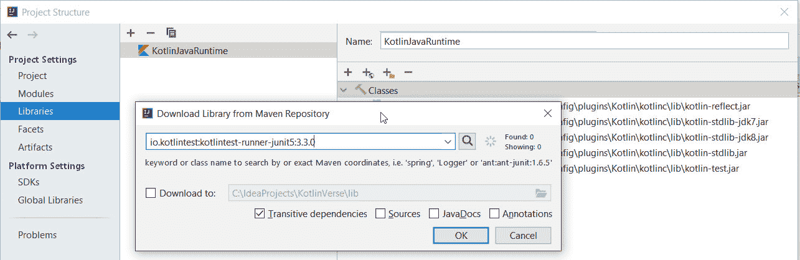

**图 14.1:** 添加 KotlinTest 库

之后，IDE 将建议你向项目的模块添加一个新库。下一步是设置依赖范围。切换到左侧的 `Modules` 视图，选择一个感兴趣的模块并打开 `Dependencies` 选项卡。你会看到新添加的库已添加到依赖项中，其范围被设置为 `Compile`。这意味着该库将在 IDE 编译和运行期间，被包含在生产源码和测试源码的类路径中。由于我们仅在测试时需要 `KotlinTest`，因此应将范围改为 `Test`（图 14.2）：

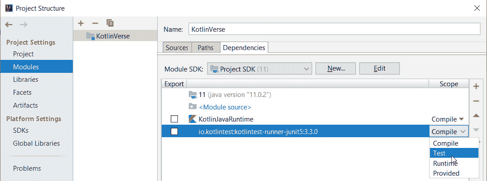

**图 14.2：** 选择测试依赖范围

最后的准备步骤是配置一个包含我们测试源码的目录。如果你还没有该目录，可以在 `src` 旁边创建一个新目录（例如 `test`），它用于存放生产源码，操作是在 `Project` 视图中右键点击模块根目录并选择 `New | Directory`。现在，我们需要告诉 IDE 它将成为我们的测试源码根。要这样做，右键点击新添加的目录并选择 `Mark Directory as | Test Sources Root`。测试目录的颜色将变为绿色，表示 IDEA 现在将其内容视为我们测试的源文件。

还值得安装一个可以改进 IntelliJ 与 `KotlinTest` 集成的特殊插件。你可以通过设置对话框（`File | Settings`）中的 `Plugins` 选项卡搜索 `kotlintest` 来执行（图 14.3）。在点击 `Install` 并下载安装后，你需要重启 IDE。

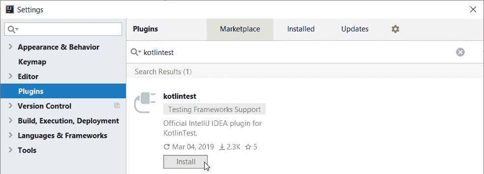

**图 14.3：** 为 IntelliJ IDEA 安装 KotlinTest 插件

现在，我们可以像以前一样开始编写代码了。让我们在 `test` 目录中创建一个新文件并编写一个简单的测试规范：

```kotlin
import io.kotlintest.shouldBe
import io.kotlintest.specs.StringSpec
class NumbersTest :StringSpec({
    "2 + 2 should be 4" { (2 + 2) shouldBe 4 }
    "2 * 2 should be 4" { (2 * 2) shouldBe 4 }
})
```

我们稍后会解释此定义背后的含义，但即使现在，在检查一些算术等式后，你一定能识别名为“`2 + 2 should be 4`”和“`2 * 2 should be 4`”的简单测试。要运行测试，请注意左侧的三角形标记。点击其中一个，你可以执行相应的测试或整个规范（图 14.4）：

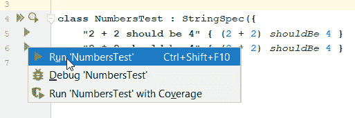

**图 14.4：** 在 IntelliJ 中运行 KotlinTest 规范

现在，我们准备好开始讨论 `KotlinTest` 特性了。我们的第一个主题将与你用于组织测试用例的各种规范样式有关。

# 规范样式

`KotlinTest` 支持多种规范样式；每种样式都会影响你的测试代码的组织方式。你可以轻松在项目中混合不同的样式，甚至通过实现 `AbstractSpec` 类或其更具体的子类（如 `AbstractStringSpec`）来定义你自己的样式。在本节中，我们将查看一旦向项目添加 `KotlinTest` 即可开箱使用的样式。

要定义测试用例，你需要继承一个规范类。然后，你可以在类初始化器中添加测试，也可以在传递给父类构造函数的 lambda 中添加。定义测试本身的方法取决于样式，在大多数情况下涉及某些类 DSL 的 API。让我们考虑一个使用 `StringSpec` 类的简单示例：

```kotlin
import io.kotlintest.shouldBe
import io.kotlintest.specs.StringSpec
class NumbersTest :StringSpec({
    "2 + 2 should be 4" { (2 + 2) shouldBe 4 }
    "2 * 2 should be 4" { (2 + 2) shouldBe 4 }
})
```


使用`StringSpec`，单个测试是通过放置在带有测试描述的字符串之后的挂起 lambda 定义的。正如你可能猜到的那样，这只是`StringSpec`定义的`String.invoke()`函数的运算符形式。在这个示例中，实际验证代码使用了`shouldBe`中缀函数，当其参数不相等时它会抛出异常。该函数是匹配器 DSL 的一部分，我们将在下一节中介绍。

注意，`StringSpec`强制执行平坦测试用例结构，特定类中的所有测试都定义在同一层。如果你尝试将一个测试块放在另一个内部，框架将在运行时抛出异常。

复杂的布局由`WordSpec`类提供。在最简单的形式中，它允许你定义双层层次结构，其中定义的测试（与`StringSpec`）通过调用`should()`函数进行分组：

```kotlin
import io.kotlintest.shouldBe
import io.kotlintest.specs.WordSpec
class NumbersTest2 :WordSpec({
    "1 + 2" should {
        "be equal to 3"
    }
})
```

```
"Addition" - {
  "1 + 2" - {
    "1 + 2 should be equal to 3" { (1 + 2) shouldBe 3 }
    "1 + 2 should be equal to 2 + 1" { (1 + 2) shouldBe (2 + 1) }
  }
})
```

KotlinTest 还支持受 Gherkin 语言启发的 BDD（行为驱动开发）规范风格。在`FeatureSpec`中，层级根通过`feature`块引入，这些块又包含实现特定测试的`scenario`块。`and()`调用用于在特定的`feature`中分组场景（和其他分组）：

```kotlin
import io.kotlintest.shouldBe
import io.kotlintest.specs.FeatureSpec

class NumbersTest :FeatureSpec({
  feature("Arithmetic") {
    val x = 1
    scenario("x is 1 at first") { x shouldBe 1 }
    and("increasing by") {
      scenario("1 gives 2") { (x + 1) shouldBe 2 }
      scenario("2 gives 3") { (x + 2) shouldBe 3 }
    }
  }
})
```

类似的风格通过`BehaviorSpec`实现，它引入了由函数`given()/Given()`、`when()/When()`和`then()/Then()`表示的三个基本级别。可以通过`and()/And()`调用引入额外的分组层级，它们可以组合多个`when/then`块：

```kotlin
import io.kotlintest.shouldBe
import io.kotlintest.specs.BehaviorSpec

class NumbersTest :BehaviorSpec({
  Given("Arithmetic") {
    When("x is 1") {
      val x = 1
      And("increased by 1") {
        Then("result is 2") { (x + 1) shouldBe 2 }
      }
    }
  }
})
```

注意使用这些块结构可以产生非常接近自然语言的测试描述（“当 x 为`1`且增加了`1`时，结果为`2`”）。

我们将考虑的最后一种规范风格是`AnnotationSpec`。这种风格不使用类似 DSL 的测试规范，而是依赖于应用于测试类方法上的`@Test`注解，这类似于 JUnit 或 TestNG 等测试框架：

```kotlin
import io.kotlintest.shouldBe
import io.kotlintest.specs.AnnotationSpec

class NumbersTest :AnnotationSpec() {
  @Test fun `2 + 2 should be 4`() { (2 + 2) shouldBe 4 }
  @Test fun `2 * 2 should be 4`() { (2 * 2) shouldBe 4 }
}
```

你也可以通过为特定测试添加`@Ignore`注解来禁用它。

## 断言 (Assertions)

### 匹配器 (Matchers)

在之前演示各种规范风格用法的代码示例中，我们使用了`shouldBe`函数，它会断言其参数的简单相等性。这只是 KotlinTest 库提供的许多匹配器中的一个。

匹配器被定义为扩展函数，既可以用普通调的形式调用，也可以作为中缀操作符。所有匹配器的名称都以`shouldBe`开头。这种约定有助于在测试代码产生如`shouldBeGreaterThanOrEqual`这样易读的名称。可以在 KotlinTest 文档中找到内置匹配器的完整列表；我们在这里不会关注特定的示例，因为大多数匹配器函数都有自解释的名称，并且可以以直观的方式使用。在本节中，我们将对更高级的问题感兴趣，例如使用自定义的匹配器扩展测试框架。

要定义自定义匹配器，你需要实现`Matcher`接口并重写它的`test()`方法：

```kotlin
abstract fun test(value: T): Result
```

`Result`对象描述了匹配的结果。它是一个数据类，包含以下属性：

- `passed:` 检查断言是否满足 (true) 或不满足 (false)。

- `failureMessage:` 当断言失败时显示的消息，它会告诉我们需要发生什么才能通过断言。

- `negatedFailureMessage:` 这在在你调用匹配器的取反版本且其失败时使用。

例如，让我们创建一个检查给定数字是否为奇数的匹配器：

```kotlin
import io.kotlintest.Matcher
import io.kotlintest.Result

fun beOdd() = object : Matcher<Int> {
  override fun test(value: Int): Result {
    return Result(
      value % 2 != 0,
      "$value should be odd",
      "$value should not be odd"
    )
  }
}
```

现在，我们可以通过将它传递给内置扩展函数`should()/shouldNot()`来使用该匹配器进行断言：

```kotlin
import io.kotlintest.*
import io.kotlintest.specs.StringSpec

class NumberTest :StringSpec({
  "5 is odd" { 5 should beOdd() }
  "4 is not odd" { 4shouldNotbeOdd() }
})
```

注意，我们选择`beOdd`名称是为了让生成的断言具有可读性（should be odd/should not be odd）。

任何`Matcher`接口的实现都自动支持和/或/取反操作，这些操作根据布尔逻辑逻辑组合匹配器。我们可以使用它们根据复杂的谓词构建断言，例如下面的示例将`beOdd()`与内置的`positive()`匹配器结合在一起：

```kotlin
"5 is positive odd" { 5 should (beOdd() and positive()) }
```

匹配器支持的另一个操作是`combine()`，它允许你通过提供转换函数将现有匹配器泛化到新类型。以下函数重用了`beOdd()`匹配器来断言给定集合的长度为奇数：

```kotlin
fun beOddLength() = beOdd().compose<Collection<*>> { it.size }
```

注意，虽然所有的匹配器都可以通过`should()/shouldNot()`函数，但许多内置匹配器配有以`should`开头的专用函数。例如，以下断言是等价的：

```kotlin
5 should beLessThan(10)
5 shouldBeLessThan(10)
```

### 检查器 (Inspectors)

除了匹配器，KotlinTest 还支持相关的检查器概念。Inspector 是某些集合类的扩展函数，允许你验证给定断言是否适用于其中的某些元素：

- `forAll()/forNone():` 检查是否所有/无元素满足断言。

- `forExactly(n):` 检查是否恰好有 n 个元素满足断言；还有一个特殊的`forOne()`函数。

- `forAtLeast(n)/forAtMost(n):` 检查至少/最多 n 个元素满足断言；当`n = 1`时可以使用`forAtLeastOne()/forAtMostOne()`或`forAny()`等同于`forLeastOne()`。

- `forSome()` 检查是否有部分而非所有元素满足断言。

让我们考虑使用这些检查器的示例：

```kotlin
import io.kotlintest.inspectors.*
import io.kotlintest.matchers.numerics.shouldBeOrEqual
import io.kotlintest.shouldBe
import io.kotlintest.specs.StringSpec

class NumberTest :StringSpec({
  val numbers = Array(10) { it + 1 }
  "all are non-negative" {
    numbers.forAll { it shouldBeOrEqual 0 }
  }
  "none is zero" { numbers.forNone { it shouldBe 0 } }
  "a single 10" { numbers.forOne { it shouldBe 10 } }
  "at most one 0" { numbers.forAtMostOne { it shouldBe 0 } }
  "at least one odd number" {
    numbers.forAtLeastOne { it % 2 shouldBe 1 }
  }
  "at most five odd numbers" {
    numbers.forAtMost(5) { it % 2 shouldBe 1 }
  }
  "at least three even numbers" {
    numbers.forAtLeast(3) { it % 2 shouldBe 0 }
  }
  "some numbers are odd" { numbers.forAny { it % 2 shouldBe 1 } }
  "some but not all numbers are even" {
    numbers.forSome { it % 2 shouldBe 0 }
  }
  "exactly five numbers are even" {
    numbers.forExactly(5) { it % 2 shouldBe 0 }
  }
})
```

### 异常处理 (Handling exceptions)

KotlinTest 有一个特殊的`shouldThrow()`断言，用于检查某些代码是否由于特定异常失败。这是使用显式`try/catch`块捕捉异常的方便替代方案。如果成功，`shouldThrow()`会返回捕获的异常，之后对其进行检查：

```kotlin
import io.kotlintest.matchers.string.shouldEndWith
import io.kotlintest.shouldThrow
import io.kotlintest.specs.StringSpec

class ParseTest :StringSpec({
  "invalid string" {
    val e = shouldThrow<NumberFormatException>{ "abc".toInt() }
    e.messageshEndWith "\"abc\""
  }
})
```

KotlinTest 中一个非常有用的异常相关功能是能够临时抑制由失败的断言抛出的异常。这被称为“软断言”（soft assertion），如果你的测试包含多个断言且你想看到所有失败的项，它可能非常有用。通常情况下这种情况不会发生，因为测试在抛出第一个异常后就会终止。KotlinTest 允许你使用`assertSoftly`块来回避这种行为。`AssertionError`异常会在块内部被捕获并累积，从而允许所有断言运行（除非它们因其他异常失败）。当块结束时，`assertSoftly`将所有累积的异常（如果有）封装成单个`AssertionError`并抛回给调用者。让我们来看一个例子：

```kotlin
import io.kotlintest.assertSoftly
import io.kotlintest.inspectors.forAll
import io.kotlintest.specs.StringSpec

class NumberTest :StringSpec({
    val numbers = Array(10) { it + 1 }
    "invalid numbers" {
        assertSoftly {
            numbers.forAll { it shouldBeLessThan 5 }
            numbers.forAll { it shouldBeGreaterThan 3 }
        }
    }
})
```

如果没有`assertSoftly()`，在第一个`forAll()`断言失败后，第二个甚至不会被检查。现在，两个断言都执行了，测试带有异常失败：

```
io.kotlintest.tables.MultiAssertionError:
The following 9 assertions failed
…
```

如所示，结果消息列出了所有的单独失败项。

### 测试非确定性代码

在处理非确定性代码（即代码有时在尝试多次后才会通过）时，你可以使用超时和多次调用的方便替代方案。`eventually()`函数验证给定的断言在指定时间内至少被满足一次：

```kotlin
import io.kotlintest.*
import io.kotlintest.specs.StringSpec
import java.io.File

class StringSpecWithConfig :StringSpec({
    eventually(10.seconds) {
        // 检查文件最终包含单行
        // (在 10 秒内)
        File("data.txt").readLines().size shouldBe 1
    }
})
```

`continually()`函数同样验证嵌套的断言在调用时被满足，并在指定的间隔内保持不变：

```kotlin
import io.kotlintest.*
import io.kotlintest.specs.StringSpec
import java.io.File

class StringSpecWithConfig :StringSpec({
    // 检查文件包含单行
    // 并且行数至少 10 秒内不发生
    continually(10.seconds) {
        File("data.txt").readLines().size shouldBe 1
    }
})
```

### 属性测试

KotlinTest 支持属性测试，其中你可以指定一些谓词并让 KotlinTest 自动生成随机测试数据来对其验证。当我们想要检查某些条件在大值集中是否成立，而这些值很难手动准备和维护时，这种技术非常有用。

例如，假设我们定义了一个计算两个数字最小值的函数：

```kotlin
infix fun Int.min(n: Int) = if (this < n) this else n
```

你想确保其结果始终小于或等于每个参数。为了做到这一点，我们将相应的断言封装在`assertAll()`调用内部：

```kotlin
import io.kotlintest.matchers.beLessThanOrEqualTo
import io.kotlintest.properties.assertAll
import io.kotlintest.should
import io.kotlintest.specs.StringSpec

class NumbersTest: StringSpec({
    "min" {
        assertAll{ a: Int, b: Int ->
            (a min b).let {
                it should (beLessThanOrEqualTo(a) and beLessThanOrEqualTo(b))
            }
        }
    }
})
```

当你运行这段代码时，KotlinTest 将生成一个`Int`对流并针对我们的断言测试所有它们。默认情况下，测试数据集包含 1000 个项目，但你可以作为`assertAll()`的参数显式指定其大小。


还有一个`assertNone()`函数，它可以检查生成的项中没有一个满足指定的断言。

作为替代方案，我们可以使用`forAll()/forNone()`函数，它接受一个布尔返回类型的 lambda，并验证所有/无生成的项是否具有相应的评估为真的的谓词：

```kotlin
import io.kotlintest.properties.forAll
import io.kotlintest.specs.StringSpec

class NumbersTest: StringSpec({
    "min" {
        forAll{ a: Int, b: Int ->
            (a min b).let { it <= a && it <= b }
        }
    }
})
```

KotlinTest 为许多常见类型（如`Int`、`Boolean`和`String`）提供了默认生成器。默认情况下，它使用 lambda 参数类型的运行时信息来自动选择生成器。但是，有时这可能是不想要的，如果涉及的类型根本不支持，甚至是不可能的。在这种情况下，我们需要显式指定`Gen`接口的实例作为生成器。它的伴生对象包含许多可以使用的有用方法，用于构建各种实现的生成器。特别是（其余部分可以忽略）：

- `choose(min, max)`：从`min`到`max`生成整数。

- `positiveIntegers()/negativeIntegers()/nats()`：生成正/负整数/自然数。

- `from(collection)`：从给定列表中获取随机元素。

- `create()`：基于 lambda 构建生成器。

另一种方法是直接继承`Gen`接口。在这种情况下，你需要实现两个方法：

- `constants()`：返回一个`T`类型值的集合，这些值始终包含在流中（例如，`Int.MIN_VALUE`、`0`和`Int.MAX_VALUE`）。

- `random()`：返回类型为`T`的随机元素序列。

例如，我们可以将`Rational`生成器重写为如下：

```kotlin
object RationalGen : Gen<Rational> {
    override fun constants(): Iterable<Rational> {
        return listOf(Rational.of(0), Rational.of(1), Rational.of(-1))
    }
    override fun random(): Sequence<Rational> {
        return generateSequence {
            val num = Random.nextInt()
            val den = Random.nextInt()
            Rational.of(num, if (den != 0) den else 1)
        }
    }
}
```

也可以使用固定测试集，而不是使用框架提供的随机值或自定义生成器。为了这一点，你需要使用`forall()`函数，它接收`row`对象的`vararg`：

```kotlin
import io.kotlintest.data.forall
import io.kotlintest.specs.StringSpec
import io.kotlintest.tables.row

class NumbersTest: StringSpec({
    "min" {
        forall(
            row(1, 1),
            row(1, 2),
            row(2, 1)
        ) { a: Int, b: Int ->
            (a min b).let { it <= a && it <= b }
        }
    }
})
```

注意命名上的差异：`forall`与`forAll`。

在此基础上，你可以将多个行封装到单个对象中，该对象有一组特定的表头。这些表头随后用于在测试失败时提供上下文信息。例如：

```kotlin
import io.kotlintest.matchers.numerics.shouldBeGreaterThanOrEqual
import io.kotlintest.specs.StringSpec
import io.kotlintest.tables.*

class NumbersTest :StringSpec({
    "min" {
        forAll(
```

```kotlin
table(
  headers("name", "age"),
  row("John", 20),
  row("Harry", 25),
  row("Bob", 16)
) { name, age ->
  age shouldBeGreaterThanOrEqual 18
}
})
```

运行上述测试将产生带有以下信息的错误：

`Test failed for (name, Bob), (age, 16) with error 16 should be >= 18`

此选项被`forAll()`和`forNone()`重载版本共同支持。但请注意，与基于生成器测试的`forAll()`/`forNone()`不同，这些函数接收一个返回类型为`Unit`的 lambda。这就是为什么我们使用了匹配器函数而不是简单地返回`Boolean`值。

## 固件与配置 (Fixtures and configurations)

### 提供固件

通常情况下，测试在实际调用之前需要某些代码来初始化必要的环境和资源（也称为测试固件），并在测试之后对其进行清理工作。在 KotlinTest 中，你可以使用`TestListener`接口将代码嵌入到测试用例生命周期的各个阶段。让我们来看看它拥有哪些方法：

*   `beforeProject()`/`afterProject()`：在测试引擎启动/结束时调用。

*   `beforeSpecClass()`：在与给定规格类（specification class）对应的任何测试开始之前调用一次（无论该规格类被实例化多少次）。`afterSpecClass()`：在所有此类测试完成后调用。

*   `beforeSpec()`：在实例化规格类之后但在运行其测试之前调用；`afterSpec()`在给定规格类实例的所有测试完成后完成后调用。

*   `beforeTest()`/`afterTest()`：在运行特定的测试块之前/之后调用。

为了产生某种效果，必须通过重写特定规格类的`listener()`方法来注册一个监听器实例：

```kotlin
import io.kotlintest.*
import io.kotlintest.extensions.*
import io.kotlintest.specs.FunSpec

object MyListener :TestListener {
  override fun beforeSpecClass(spec: Spec, tests: List<TopLevelTest>) {
    println("Before spec class: ${spec.description()}")
  }
  override fun beforeSpec(spec: Spec) {
    println("Before spec: ${spec.description()}")
  }
  override fun beforeTest(testCase: TestCase) {
    println("Before test: ${testCase.name}")
  }
  override fun afterTest(testCase: TestCase, result: TestResult) {
    println("After test: ${testCase.name}")
  }
  override fun afterSpec(spec: Spec) {
    println("After spec: ${spec.description()}")
  }
  override fun afterSpecClass(spec: Spec, results: Map<TestCase, TestResult>) {
    println("After spec class: ${spec.description()}")
  }
}

class NumbersTest :FunSpec() {
  init {
    context("Increment") {
      test("2+2") {
        2 + 2 shouldBe 4
      }
      test("2 * 2") {
        2 * 2 shouldBe 4
      }
    }
  }
  override fun listeners() = listOf(MyListener)
}
```

运行上述代码将产生以下输出：

`Before spec class: Description(parents=[], name=NamesTest)`

`Before spec: Description(parents=[], name=NamesTest)`

`Before test: IncrementBefore test: 2+2`

`After test: 2+2`

`Before test: 2 * 2`

`After test: 2 * 2`

`After test: Increment`

`After spec: Description(parents=[], name=NamesTest)`

`After spec class: Description(parents=[], name=NamesTest)`

请注意，在我们的示例中，`beforeSpec()`/`afterSpec()`只被调用了一次，就像`beforeSpecClass()`/`afterSpecClass()`一样，因为只创建了一个`NumbersTest`实例。并非如此，因为你可以配置框架为每个测试创建一个新的规格类（请参见 Test 配置部分中的隔离模式讨论）。

`beforeSpec()`和`beforeTest()`之间（以及`afterSpec()`和`afterTest()`之间）的关键区别在于，`beforeSpec()`仅在相关的测试处于启用状态时才被调用。在下一节中，我们将看到如何使用配置关闭单个测试。

如果你想提供`beforeProject()`/`afterProject()`方法的实现，你需要使用`ProjectConfig`单例注册一个全局监听器。该单例必须继承自`AbstractProjectConfig`类并置于`io.kotlintest.provided`包中：

```kotlin
package io.kotlintest.provided
import io.kotlintest.*
import io.kotlintest.extensions.*

object ProjectListener :TestListener {
  override fun beforeProject() { println("Before project") }
  override fun afterProject() { println("After project") }
}

object ProjectConfig :AbstractProjectConfig() {
  override fun listeners(): List<TestListener> {
    return listOf(ProjectListener)
  }
}
```

KotlinTest 的另一个实用用功能是能够自动关闭实现`AutoCloseable`的资源。为了让此起作用，你需要使用`autoClose()`调用：

```kotlin
import io.kotlintest.shouldBe
import io.kotlintest.specs.FunSpec
import java.io.FileReader

class FileTest :FunSpec() {
  auto(FileReader("data.txt")) {
    test("Line count") {
      it.isNotEmpty() shouldBe true
    }
  }
}
```

### 测试配置

KotlinTest 提供了一组选项来配置测试环境。让我们看看使用`config()`函数可以控制哪些参数：

*   `invocations`：执行测试的次数；只有当所有执行都成功时，测试才被视为通过。此选项对于可能偶尔失败的非确定性测试非常有用。

*   `threads`：运行测试时使用的线程数。此参数仅在`invocations`大于 1 时才有意义，否则没有内容可以并行化。

*   `enabled`：是否应该运行该测试；设置为`false`将禁用测试执行。

*   `timeout`：一个代表测试运行最大持续时间的对象。如果测试执行时间超过此超时时间，它将被终止并视为失败。与调用次数一样，此选项对于非确定性测试很有用。

注意，`threads`选项仅影响测试用例内单个测试的并行化。如果你还想并行运行多个测试用例，你需要使用之前讨论过的`AbstractProjectConfig`。只需重写它的`parallelism()`方法并返回所需的并发线程数：

```kotlin
package io.kotlin.provided
import io.kotlintest.AbstractProjectConfig

object ProjectConfig :AbstractProjectConfig() {
  override fun parallelism(): Int = 4
}
```

除了单独配置每个测试外，你还可以通过重写`defaultTestCaseConfig`属性为特定测试用例的所有测试指定通用配置：

```kotlin
import io.kotlintest.TestCaseConfig
import io.kotlintest.shouldBe
import io.kotlintest.specs.StringSpec

class StringSpecWithConfig :StringSpec({
  "2 + 2 should be 4" { (2 + 2) shouldBe 4 }
}) {
  override val defaultTestCaseConfig = TestCaseConfig(
    invocations = 10
  ) { 
    (2 + 2) shouldBe 4
  }
}
```

```kotlin
override val defaultTestCaseConfig: TestCaseConfig

get() = TestCaseConfig(invocations = 10, threads = 2)

}
```

除非你显式地指定了自己的配置，否则测试将继承默认配置选项。

在结论部分，我们还想指出 KotlinTest 的另一个功能，即允许你选择测试用例实例在各个测试之间共享的方式。这被称为“隔离模式”（isolation mode）。默认情况下，测试用例只被实例化一次，并使用该实例运行其所有的测试。虽然从性能角度来看这是好的，但在某些场景下，这种策略并不是理想的；例如，如果测试用例具有被单个测试读取和修改的可变状态。在这些情况下，你可能希望在每次启动测试或测试组时都实例化测试用例。要实现这一点，你只需要重写测试用例类的`isolationMode()`方法即可。该方法返回一个`IsolationMode`枚举值，定义了三个选项：

- `SingleInstance:` 创建测试用例的单实例；这是默认行为。

- `InstancePerTest:` 每当执行一个上下文（context）或测试块（test block）时，都会创建一个新的测试用例实例。

- `InstancePerLeaf:` 在执行单个测试块之前实例化测试。

让我们来看一个例子。假设我们有如下的`FunSpec`风格的测试用例：

```kotlin
import io.kotlintest.shouldBe
import io.kotlintest.specs.FunSpec

class IncTest :FunSpec() {
    var x = 0
    init {
        context("Increment") {
            println("Increment")
            test("prefix") {
                println("prefix")
                ++x shouldBe 1
            }
            test("postfix") {
                println("postfix")
                x++ shouldBe 0
            }
        }
    }
}
```

如果你运行它，你会发现第二个测试失败了。这是因为变量`x`保留了在 prefix 块中被赋值的值。如果我们通过添加以下代码将隔离模式改为`InstancePerTest`：

```kotlin
override fun isolationMode() = IsolationMode.InstancePerTest
```

两个测试都将通过，因为每个测试都将获得自己的`IncTest`实例。打印到标准输出的消息将如下：


`Running context`
`prefix`
`Running context`
`postfix`

这种现象是因为 `IncTest` 被实例化了三次。第一次是为了执行上下文块本身，第二次是为了执行 `prefix` 测试（该测试也会再次运行一次上下文块），第三次是为了执行 `postfix` 测试（它同样需要先运行上下文块）。结果是，上下文块也被执行了三次。

如果我们将隔离模式改为 `InstancePerLeaf`，上下文块将不会独立执行，而只作为运行单个测试的一部分执行。结果是 `IncTest` 只会被实例化两次（一次用于 `prefix`，一次用于 `postfix`），输出将如下所示：

```
Running context
prefix
Running context
postfix
```

到此为止，我们对 KotlinTest 框架的概述就结束了。关于我们提到的功能（以及我们未提到的功能）的更多详细信息，建议读者关注位于 [`github.com/kotlintest/kotlintest`](https://github.com/kotlintest/kotlintest) 的提供的文档。

## 结论

在本章中，我们学习了在 KotlinTest 中编写测试规范的基础知识，KotlinTest 是一个专为 Kotlin 应用程序设计的流行的开源测试框架。我们讨论了如何使用开箱即用的规范风格组织测试代码，如何使用断言器（matchers）和检查器（inspectors）编写表达清晰且易于读的测试，如何描述测试数据集以及利用自动属性测试。我们还解释了 KotlinTest 的设置/清理（setup/tear down）设施以及基础测试配置。现在，你已经拥有了必要的知识来编写自己的测试规范，并学习 KotlinTest 以及其他测试框架的更高级特性。

在下一章中，我们将讨论如何使用 Kotlin 构建 Android 平台的应用程序。我们将解释如何在 Android Studio 中配置项目，讨论基础 UI 和 Activity 周期，并向你介绍由 Android 扩展和 Anko 框架提供的各种有用功能。

## 习题

1. 概述支持 Kotlin 的流行测试框架。

2. 描述 KotlinTest 支持的规范风格。

3. 什么是断言器（matcher）？你如何组合和转换断言器来编写复杂的断言？

4. 解释如何实现自定义的 KotlinTest 断言器。

5. 描述 `shouldThrow()` 函数。什么是软断言（soft assertion）？

6. 描述 KotlinTest 中提供的集合检查器（collection inspectors）。

7. 解释 `eventually()` 和 `continually()` 函数的含义。

8. 如何使用监听器（listeners）实现测试资源的初始化和终结化？

9. 如何为单个测试和规范指定配置？如何定义全局配置？

10. 解释测试用例隔离模式之间的差异。

# 第 15 章：Android 应用程序

在本章中，我们将讨论如何使用 Kotlin 开发针对 Android 平台的应用程序。得益于该语言提供的卓越编程体验以及 Google 的官方支持，Kotlin 的这一领域已成为其整个生态系统中最繁荣的领域之一。然而，对 Android 平台基础的全面讨论无疑值得专门写一本书，因此我们在这里的任务将非常谦虚，仅作为 Android 世界的一个简介，以引发进一步的研究和学习。

本章分为两个部分。在第一部分，我们将讨论 Android Studio 的基本功能、如何建立新项目、Gradle 如何被用于项目配置和构建、什么是 Android Activity，以及你如何使用 Android 设备运行应用程序。在第二部分，我们将专注于示例应用程序的开发，并讨论更高级的问题，如使用 Kotlin 扩展和 Anko 以及保持 Activity 状态。

## 结构

- 开始 Android
- Activity

## 目标

了解使用 Android Studio 和 Kotlin 开发应用程序的基本知识。

## 开始 Android

在本节中，我们将向你介绍 Android Studio IDE，并通过一个简单的“Hello, World”示例应用程序演示项目结构。

### 设置 Android Studio 项目

我们将从在 Android Studio 中配置项目所需的步骤开始，Android Studio 是 Google 开发的官方 Android IDE。它基于 JetBrains 平台，因此与我们之前章节提到的 IntelliJ IDEA 非常相似。与 IDEA 本身不同，它包含了一套专门针对 Android 应用程序开发的特性。和 IntelliJ IDEA 一样，Android Studio 对 Kotlin 语言提供了开箱支持。

向导的第一步将要求你为项目的第一个活动选择模板（参见图 15.1）。活动基本上是用户可以使用你的应用程序执行的单项功能的表示，例如编辑笔记、显示当前时间，或者在我们第一个应用程序中，只需向用户展示欢迎消息。让我们现在选择 `Empty Activity`（空活动），让 Android Studio 为我们生成一个存根活动，并点击 `Next`（下一步）。


**图 15.1:** 为新的 Android 项目选择活动

项目向导下一步要求你输入基础项目信息，如名称、项目类的通用包名、根目录和默认语言（例如，参见图 15.2）。你还可以选择应用程序支持的最低 Android SDK 版本。版本越高，你可以调用的 API 就越强大，但同时，你的应用程序能够运行的设备比例就越小。你可以点击 `Help me choose`（帮助我选择）链接查看不同 API 版本的对比图。对于简单示例，我们可以保留默认建议的选项。

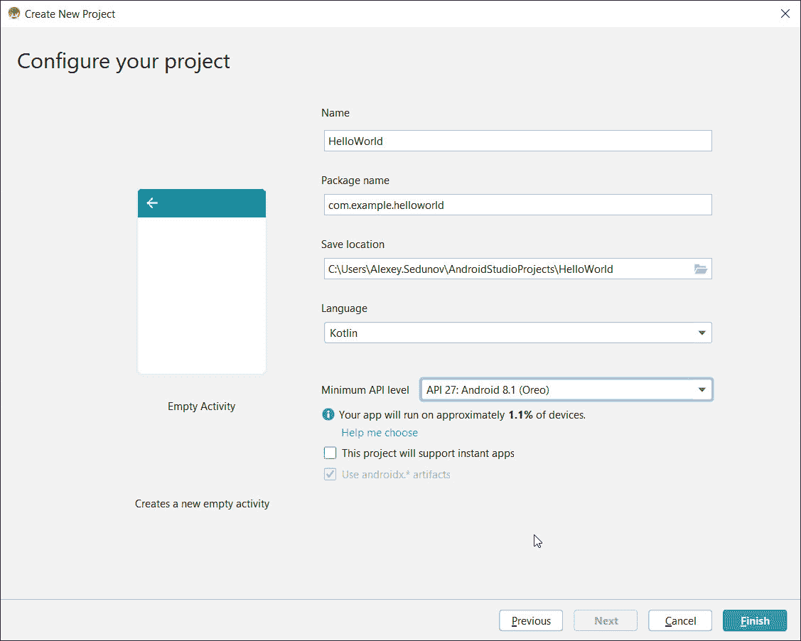

**图 15.2:** 选择基础项目配置

点击 `Finish`（完成）后，Android Studio 将自动生成必要的项目文件，包括活动类、一组基础应用程序资源（如 UI 布局和配置文件）。然后它将继续配置新项目（注意 `Building Gradle project info` 进度条）。

图 15.3 显示了 `IDE Project` 视图所示的新项目结构。注意，默认情况下此视图以 Android 模式呈现，通过相应的模块和源根（如普通源文件、生成文件和资源）对项目源文件分组。

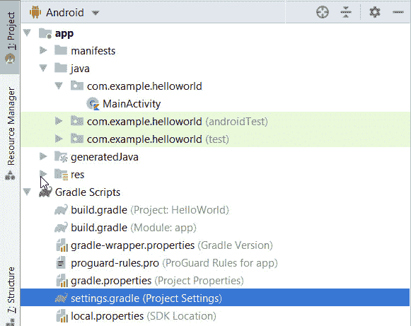

**图 15.3:** 示例项目结构

Android 视图中的独立节点 `Gradle Scripts` 包含描述项目配置的文件。让我们详细查看它们。

### Gradle 构建脚本

Android Studio 依赖于 Gradle，这是一个流行的构建系统，它可以自动化处理管理项目依赖、编译、测试和打包等任务。项目配置在 `build.gradle` 文件中使用领域特定语言描述，并使用 Groovy 编写，其语法让人联想起 Java 和 Kotlin 代码（事实上，Groovy 是启迪了 Kotlin 设计的语言之一）。我们在这里不会深入探讨 Groovy 或 Gradle 的细节，而是重点介绍与在 Android 应用中使用 Kotlin 相关的一些重要点。Android Studio 向导使用的项目模板会自动生成以下文件：

- 位于项目根目录下的项目级 `build.gradle`。该文件包含整个项目的通用配置。
- `settings.gradle`（同样位于项目根目录）指定项目包含哪些模块，并可能可选包含一些额外的配置命令。
- `local.properties` 和 `gradle.properties` 包含一组键值对，定义了 Gradle 脚本使用的属性，例如 Android SDK 目录路径或启动 Gradle 进程时传递的 JVM 参数。
- 位于 app 模块根目录的模块级 `build.gradle`，包含模块特定的配置。

让我们来看根 `build.gradle` 文件：

```
buildscript {
  ext.kotlin_version = '1.3.31'
  repositories {
    google()
    jcenter()
  }
  dependencies {
    classpath 'com.android.tools.build:gradle:3.4.2'
    classpath "org.jetbrains.kotlin:kotlin-gradle-plugin:$kotlin_version"
    // NOTE: Do not place your application dependencies here; they belong
    // in the individual module build.gradle files
  }
}
allprojects {
  repositories {
    google()
    jcenter()
  }
}
task clean(type: Delete) {
  delete rootProject.buildDir
}
```

此脚本基本上执行以下操作：

- 定义 `kotlin_version` 属性，该属性包含 `kotlin` 标准库的版本，并被其他脚本引用。
- 告诉 Gradle 在构建项目时使用 `com.android.tools.build:gradle` 和 `org.jetbrains.kotlin:kotlin-gradle-plugin` 插件。第一个添加 Android 模块的支持，而第二个允许你使用 Kotlin 源码构建项目。
- 配置默认仓库列表，用于下载依赖构件（如库的二进制文件和源码）。
- 添加 `clean` 任务，用于在项目重新构建之前删除之前的编译结果。

`settings.gradle` 文件非常简单，默认包含一个 `include` 命令，告诉 Gradle 哪些模块构成了项目：

```
include ':app'
```

现在让我们来看 `build.gradle`，它定义了我们 Android 模块的配置：

```
apply plugin: 'com.android.application'
apply plugin: 'kotlin-android'
apply plugin: 'kotlin-android-extensions'
android {
  compileSdkVersion 29
  buildToolsVersion "29.0.2"
  defaultConfig {
    applicationId "com.example.helloworld"
    minSdkVersion 27
    targetSdkVersion 29
    versionCode 1
    versionName "1.0"
    testInstrumentationRunner "androidx.test.runner.AndroidJUnitRunner"
  }
  buildTypes {
    release {
      minifyEnabled false
      proguardFiles getDefaultProguardFile('proguard-optimize.txt'), 'proguard-rules.pro'
    }
  }
}
dependencies {
  implementation fileTree(dir: 'libs', include: ['*.jar'])
  implementation "org.jetbrains.kotlin:stdlib-jdk7:$kotlin_version"
  implementation 'androidx.appcompat:appcompat:1.0.2'
  implementation 'androidx.core:core-ktx:1.0.2'
  implementation 'androidx.constraintlayout:constraintlayout:1.1.3'
  testImplementation 'junit:junit:4.12'
  androidTestImplementation 'androidx.test.runner:1.2.0'
  androidTestImplementation 'androidx.test.espresso:espresso-core:3.2.0'
}
```

它执行的第一件事是在根文件中启用 Android 和 Kotlin 特定的插件。注意这里有两个 Kotlin 插件。`kotlin-android` 为使用 Kotlin 构建 Android 添加基本支持，`kotlin-android-extensions` 启用简化访问 UI 资源的特殊扩展。我们将在下一节查看操作示例。

`android` 块包含各种 Android 配置参数，如应用 ID、版本号、最低支持 Android 版本等。

最后 `dependencies` 块列出了我们模块的所有外部依赖。每个依赖都有一个明确的配置，先指定配置后是依赖描述（通常以 Maven 坐标的形式，如 `androidx.core:core-ktx:1.0.2`）。配置决定了何时以及何处使用此依赖；例如，`implementation` 依赖被添加到编译类路径并打包到构建输出，但在依赖模块的编译期间不可用，而 `testImplementation` 依赖被添加到模块测试的编译类路径并在测试执行中使用。如前面的代码所示，Kotlin 标准库会自动添加到新模块依赖中。

### 活动

现在让我们查看 `java` 根下的源文件。此目录可以包含 Java 和 Kotlin 文件。找到 `MainActivity.kt` 并在编辑器中打开它。你会看到类似下面的代码：

```kotlin
package com.example.helloworld

import androidx.appcompat.app.AppCompatActivity
import android.os.Bundle

class MainActivity :AppCompatActivity() {
  override fun onCreate(savedInstanceState: Bundle?) {
    super.onCreate(savedInstanceState)
  }
}
```

```
setContentView(R.layout.activity_main)
}
}
```


以下是一个计算器应用的 UI 布局代码，使用 XML 编写：

```xml
<android:layout_height="wrap_content"/>
<Button android:id="@+id/btnMinus"
    android:text="-"
    android:layout_width="wrap_content"
    android:layout_height="wrap_content"
    android:layout_gravity="end|center_vertical"/>
</TableRow>
<TableRow android:layout_width="match_parent"
    android:layout_height="match_parent">
    <Button android:id="@+id/btn1"
    android:text="1"
    android:layout_width="wrap_content"
    android:layout_height="wrap_content"/>
    <Button android:id="@+id/btn2"
    android:text="2"
    android:layout_width="wrap_content"
    android:layout_height="wrap_content"/>
    <Button android:id="@+id/btn3"
    android:text="3"
    android:layout_width="wrap_content"
    android:layout_height="wrap_content"/>
    <Button android:id="@+id/btnTimes"
    android:text="*"
    android:layout_width="wrap_content"
    android:layout_height="wrap_content"
    android:layout_gravity="end|center_vertical"/>
</TableRow>
<TableRow android:layout_width="match_parent"
    android:layout_height="match_parent">
    <Button android:id="@+id/btn0"
    android:text="0"
    android:layout_width="wrap_content"
    android:layout_height="wrap_content"/>
    <Button android:id="@+id/btnPoint"
    android:text="."
    android:layout_width="wrap_content"
    android:layout_height="wrap_content"/>
    <Button android:id="@+id/btnSign"
    android:text="+/-"
    android:layout_width="wrap_content"
    android:layout_height="wrap_content"/>
    <Button android:id="@+id/btnDivide"
    android:text="/"
    android:layout_width="wrap_content"
    android:layout_height="wrap_content"
    android:layout_gravity="end|center_vertical"/>
</TableRow>
<TableRow android:layout_width="match_parent"
    android:layout_height="match_parent">
    <Button android:id="@+id/btnBackspace"
    android:text="&lt-"
    android:layout_width="wrap_content"
    android:layout_height="wrap_content"/>
    <Button android:id="@+id/btnClear"
    android:text="C"
    android:layout_width="wrap_content"
    android:layout_height="wrap_content"/>
    <Space android:layout_width="wrap_content"
    android:layout_height="wrap_content"/>
    <Button android:id="@+id/btnCalc"
    android:text="="
    android:layout_width="wrap_content"
    android:layout_height="wrap_content"
    android:layout_gravity="end|center_vertical"/>
</TableRow>
</TableLayout>
</RelativeLayout>
```

图 15.9 显示了计算器的 UI 预览：

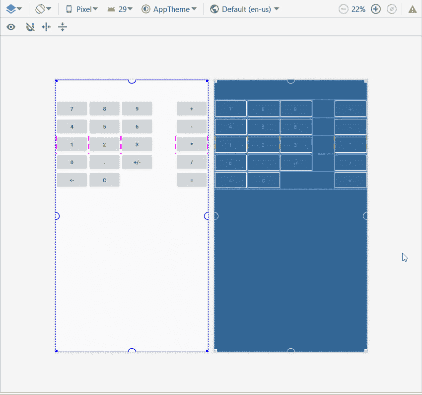

**图 15.9：计算器 UI 预览**

讨论布局格式不在本书的范围内，因此我们在这里不涉及细节，只需介绍基础知识。布局基本上是排列嵌套视图的容器（你可以将其与带有特定 `LayoutManager` 的 Swing 容器相比）。由于计算器 UI 假设元素是规则的，我们将使用将嵌套组件分配到行和列的表格布局。组件本身由诸标签 `Button`（带有文本的简单按钮）和 `TextView`（类似于 Swing 的只读文本组件）。

注意 `android:id` 属性。它们被分配给每个展示或接收用户数据的视图元素。此属性允许你在 Java 或 Kotlin 代码中引用相应的元素。我们将在下一节讨论 Activity 类时介绍如何实现。

## 实现 Activity 类

让我们来实现 Activity 类，为 UI 添加一些行为。我们不会深入计算器的业务逻辑细节（让读者自己去探索），而是强调一些 Android 特有的要点。

除此之外，我们想要访问输入计算器显示中的当前值：`txtResult` 组件。为了实现这一点，我们使用 `findViewById()` 函数传递文本视图 ID。我们不需要在布局 XML 中放置实际字符串，因为可以使用我们在“Hello World”示例中见过的 `R` 类来引用这些 ID：

```kotlin
private val txtResult by lazy { findViewById<TextView>(R.id.txtResult) }
```

使用视图引用后，我们可以访问它的成员；例如，`setOnClickListener()` 方法允许我们指定用户点击按钮时触发的操作：

```kotlin
findViewById<Button>(R.id.btn0).setOnClickListener { appendText("0") }
```

在读取/写入时，`TextView` 组件的 `text` 属性提供了内容的访问：

以下是计算器 `MainActivity` 类的完整源代码：

```kotlin
package com.example.helloworld

import androidx.appcompat.app.AppCompatActivity
import android.os.Bundle
import android.widget.Button
import android.widget.TextView
import java.math.BigDecimal
import java.math.RoundingMode

class MainActivity : AppCompatActivity() {

    enum class OpKind {
        ADD, SUBTRACT, MULTIPLY, DIVIDE
    }

    companion object {
        fun compute(a: BigDecimal, b: BigDecimal): BigDecimal = when (this) {
            OpKind.ADD -> a + b
            OpKind.SUBTRACT -> a - b
            OpKind.MULTIPLY -> a * b
            OpKind.DIVIDE -> a.divide(b, RoundingMode.HALF_EVEN)
        }
    }

    private val txtResult by lazy { findViewById<TextView>(R.id.txtResult) }
    private var lastResult: BigDecimal = BigDecimal.ZERO
    private var lastOp: OpKind? = null
    private var waitingOperand: Boolean = false

    override fun onCreate(savedInstanceState: Bundle?) {
        super.onCreate(savedInstanceState)
        setContentView(R.layout.activity_main)

        findViewById<Button>(R.id.btn0).setOnClickListener { appendText("0") }
        findViewById<Button>(R.id.btn1).setOnClickListener { appendText("1") }
        findViewById<Button>(R.id.btn2).setOnClickListener { appendText("2") }
        findViewById<Button>(R.id.btn3).setOnClickListener { appendText("3") }
        findViewById<Button>(R.id.btn4).setOnClickListener { appendText("4") }
        findViewById<Button>(R.id.btn5).setOnClickListener { appendText("5") }
        findViewById<Button>(R.id.btn6).setOnClickListener { appendText("6") }
        findViewById<Button>(R.id.btn7).setOnClickListener { appendText("7") }
        findViewById<Button>(R.id.btn8).setOnClickListener { appendText("8") }
        findViewById<Button>(R.id.btn9).setOnClickListener { appendText("9") }
        findViewById<Button>(R.id.btnPoint).setOnClickListener { appendText(".") }
        findViewById<Button>(R.id.btnSign).setOnClickListener {
            val currentText = txtResult.toString()
            txtResult.text = when {
                currentText.startsWith("-") -> currentText.substring(1)
                currentText != "0" -> "-$currentText"
                else -> return@setOnClickListener
            }
        }
        findViewById<Button>(R.id.btnBackspace).setOnClickListener {
            val currentText = txtResult.toString()
            val newText = currentText.substring(0, currentText.length - 1)
            txtResult.text = if (newText.isEmpty() || newText == "-") "0" else newText
        }
        findViewById<Button>(R.id.btnClear).setOnClickListener { clearText() }
        findViewById<Button>(R.id.btnPlus).setOnClickListener { calc(OpKind.ADD) }
        findViewById<Button>(R.id.btnMinus).setOnClickListener { calc(OpKind.SUBTRACT) }
        findViewById<Button>(R.id.btnTimes).setOnClickListener { calc(OpKind.MULTIPLY) }
        findViewById<Button>(R.id.btnDivide).setOnClickListener { calc(OpKind.DIVIDE) }
        findViewById<Button>(R.id.btnCalc).setOnClickListener {
            calc(null)
            clearText()
        }
    }

    private fun clearText() {
        txtResult.text = "0"
    }

    private fun appendText(text: String) {
        if (waitingOperand) {
            clearText()
            waitingOperand = false
        }
        val currentText = txtResult.text.toString()
        txtResult.text = if (currentText == "0") text else currentText + text
    }

    private fun calc(nextOp: OpKind?) {
        // 计算逻辑实现
    }
}
```

```kotlin
if (waitingNextOperand) {
    lastOp = nextOp
    return
}
val currentValue = BigDecimal(txtResult.text.toString())
val newValue = try {
    lastOp?.compute(lastResult, currentValue) ?: currentValue
} catch (e: ArithmeticException) {
    lastOp = null
    waitingNextOperand = true
    Toast.makeText(
        applicationContext,
        "Invalid operation!",
        Toast.LENGTH_SHORT
    ).show()
    return
}
if (nextOp != null) {
    lastResult = newValue
}
if (lastOp != null) {
    txtResult.text = newValue.toPlainString()
}
lastOp = nextOp
waitingNextOperand = nextOp != null
}
```

现在，我们可以尝试运行计算器并查看它的运行效果。图 15.10 显示了在 Android 模拟器中使用我们的程序的示例：


**图 15.10：** 运行中的计算器应用程序

## Kotlin Android Extensions

频繁使用 `findViewById()` 会让代码变得杂乱，特别是如果你像我们对 `txtResult` 那样在类属性中保留视图组件的引用时。在 Java 世界中，某些库如 `Butterknife` 或 Android Data Binding 可以通过将视图引用自动注入给定的类字段来解决这个问题，但这需要你手动对感兴趣的字段进行注解并指定相应的 ID。虽然这些库也可以在 Kotlin 中使用，但有一个更简洁的解决方案，它依赖于 Android Extensions 编译器插件。在前面的节中，我们提到过该插件在 Android Studio 生成的项目中会自动激活。现在，我们终于可以将其投入实际使用了。


Kotlin Android Extensions 的核心特性是一组与视图组件对应的合成属性（synthetic properties）。也就是说，它们允许你使用标识符引用视图，就像它们是某些顶层属性的名字一样。你只需要添加如下形式的导入指令：

`import kotlinx.android.synthetic.main.activity_main.*`

其中`activity_main`是活动 XML 文件的文件名。此类合成包包含了一组`Activity`扩展属性，每个属性对应活动 XML 中的某个组件。例如，我们可以简化以下行：

```kotlin
findViewById<Button>(R.id.btn0).setOnClickListener { appendText("0") }
```

为：

```kotlin
btn0.setOnClickListener { appendText("0") }
```

结果，我们计算器活动的`onCreate()`方法转变为如下：

```kotlin
override fun onCreate(savedInstanceState: Bundle?) {
    super.onCreate(savedInstanceState)
    setContentView(R.layout.activity_main)
    btn0.setOnClickListener { appendText("0") }
    btn1.setOnClickListener { appendText("1") }
    btn2.setOnClickListener { appendText("2") }
    btn3.setOnClickListener { appendText("3") }
    btn4.setOnClickListener { appendText("4") }
    btn5.setOnClickListener { appendText("5") }
    btn6.setOnClickListener { appendText("6") }
    btn7.setOnClickListener { appendText("7") }
    btn8.setOnClickListener { appendText("8") }
    btn9.setOnClickListener { appendText("9") }
    btnPoint.setOnClickListener{ appendText(".") }
    btnSign.setOnClickListener{ … }
    btnBackspace.setOnClickListener{ … }
    btnClear.setOnClickListener{ clearText() }
    btnPlus.setOnClickListener{ calc(OpKind.ADD) }
    btnMinus.setOnClickListener{ calc(OpKind.SUBTRACT) }
    btnTimes.setOnClickListener{ calc(OpKind.MULTIPLY) }
    btnDivide.setOnClickListener{ calc(OpKind.DIVIDE) }
    btnCalc.setOnClickListener{ calc(null) }
    clearText()
}
```

显式的`txtResult`属性可以完全删除：

```kotlin
private val txtResult by lazy { findViewById<TextView>(R.id.txtResult) }
```

IDE 提示：得益于 IntelliJ IDEA 和 Android Studio 提供的自动导入功能，你不需要手动添加此类导入。如果你尝试通过 ID 引用视图组件且尚未导入必要的合成属性，IDE 将建议为你完成该操作（例如图 15.11）：

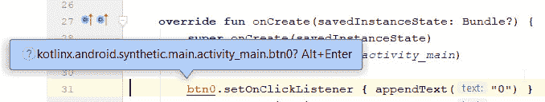

**图 15.11：** 合成属性的自动导入

此外，Android Extensions 还提供了许多实用功能，例如通过合成属性调整可用视图的缓存策略，以及通过实现`LayoutContainer`接口使用类似的注入机制增强任何容器的能力。我们在这里不会详细讨论这些功能，但你可以在[`kotlinlang.org`](http://kotlinlang.org)上的 Android Extensions 教程中找到详细信息。

# 保留活动状态

如果你对我们在之前的几个节中创建的计算器进行一些实验，你可能会发现它的行为中有一个明显的缺陷。让我们输入一些数字，然后模拟设备旋转。结果如图 15.12 所示：


**图 15.12：** 设备旋转时活动重置

你可以看到原始数字变为了零。事实上，我们的活动的状态被重置了。产生这种行为的原因是配置更改（如旋转屏幕）强制系统销毁并从头创建我们的活动。但如果需要在同一个活动的不同实例之间保留某些状态呢？Android 提供了名为`bundle`的解决方案。为了实现这一点，第一步是重写`onSaveInstanceState()`方法，并将相关值写入`Bundle`对象：

```kotlin
override fun onSaveInstanceState(outState: Bundle) {
    super.onSaveInstanceState(outState)
    outState.putString("currentText", txtResult.text.toString())
    outState.putSerializable(::lastResult.name, lastResult)
    outState.putSerializable(::lastOp.name, lastOp)
    outState.putBoolean(::waitingNextOperand.name, waitingNextOperand)
}
```

现在，即使活动由于配置更改或释放设备资源而被临时销毁并在稍后的时间重建，系统也会保留 bundle 并将其传递给`onCreate()`方法进行初始化。第二步是在我们的`onCreate()`实现中添加从 bundle 读取数据的的代码：

```kotlin
override fun onCreate(savedInstanceState: Bundle?) {
    …
    clearText()
    savedInstanceState?.let {
        txtResult.text = it.getString("currentText")
        lastResult = it.getSerializable(::lastResult.name) as BigDecimal
        lastOp = it.getSerializable(::lastOp.name) as OpKind?
        waitingNextOperand = it.getBoolean(::waitingNextOperand.name)
    }
}
```

传递给`onCreate()`的参数可能为 null。这发生在 bundle 缺失时，例如当首次启动活动时。

注意，`bundle`中只能存储可序列化的值。如果你需要保留某些不可序列化的对象，你需要实现`Serializable`接口，或者避免直接将其写入`bundle`并采用替代方法，例如将其转换为某些可序列化的数据持有者或通过部分保留原始对象。

另外一点值得注意的是，`bundles`适用于保存较量的瞬态数据，因为它们的序列化会占用主线程并消耗系统进程的内存。对于其他情况，建议使用本地存储，如用户偏好或 SQLite 数据库。

`onCreate()`和`onSaveInstanceState()`方法是所谓的生命周期回调的特殊情况，这些回调由 Android 系统在 activity 从生命视图转换到新状态时调用。例如，`Resumed`状态与在前台运行的 activity 关联，`Paused`对应移动到后台但对用户仍然可见的 activity，而`Stopped`状态意味着 activity 变得完全不可见。

重写的生命周期回调版本必须调用继承的实现，因为它们包含了活动正常运行所需的通用代码。

IDE 提示：Android Studio 包含一项检查功能，如果你重写了生命周期回调但调用继承的方法，它将报告错误（如图 15.13 所示）：

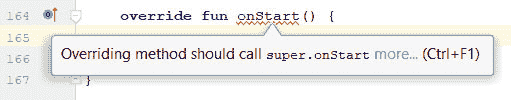

图 15.13：缺少 super 用的错误

## Anko 布局

Anko 是一个 Kotlin 框架，提供了各种增强功能来简化 Android 应用开发。它的主要特性包括：

*   一组用于对话框、意图（用于启动新 activity 的对象）、日志和应用程序资源的工具类——组合成 Anko Commons 库。

*   一种用于描述 UI 布局的领域语言（Anko Layouts）。

*   简化访问 SQLite 数据库的 API，SQLite 经常用于 Android 的本地存储（Anko SQLite）。

在本节中，我们将简单介绍一下布局 DSL，你可以用它视图组件的描述来替代 XML 文件。

在项目中使用 Anko 特性之前，我们必须在模块 Gradle 脚本中配置相应的依赖。让我们在`dependencies`块中添加以下行：

```
implementation "org.jetbrains.anko:anko:0.10.8"
```

当你修改其中一个 Gradle 构建文件时，IDE 会检测到这些更改并在文件编辑器顶部显示警告（如图 15.14 所示）：


图 15.14：Android Studio 建议同步 Gradle

点击`Sync Now`链接后，Android Studio 将将其内部项目模型与新的 Gradle 提供的配置进行同步，使 Anko 库适用于自动补全和代码导航等各种代码洞察功能。

现在，我们可以使用 Anko DSL 重新改写我们的计算器布局。额外的代码将替换`onCreate()`方法开头的`setCurrentView()`调用：

```
…
private fun _TableRow.charButton(text: String) {
    button(text).onClick { appendText(text) }
}

private fun _TableRow.opButton(op: OpKind?) {
    val text = when (op) {
        OpKind.ADD -> "+"
        OpKind.SUBTRACT -> "-"
        OpKind.MULTIPLY -> "*"
        OpKind.DIVIDE -> "/"
        null -> "="
    }
    button(text)
    .lparams { gravity = Gravity.END or Gravity.CENTER_VERTICAL }
    .onClick { calc(op) }
}

private lateinit var txtResult: TextView
override fun onCreate(savedInstanceState: Bundle?) {
    super.onCreate(savedInstanceState)
    tableLayout {
        setColumnStretchable(3, true)
        txtResult = textView("0")
        .lparams(width = matchParent, height = wrapContent)
        .apply { textSize = 40.0f }
        tableRow {
            charButton("7")
            charButton("8")
            charButton("9")
            opButton(OpKind.ADD)
        }
        tableRow {
            charButton("4")
            charButton("5")
            charButton("6")
            opButton(OpKind.SUBTRACT)
        }
        tableRow {
            charButton("1")
            charButton("2")
            charButton("3")
            opButton(OpKind.MULTIPLY)
        }
        tableRow {
            charButton("0")
            charButton(".")
            button("+/-").onClick {
                val currentText = txtResult.text.toString()
                txtResult.text = when {
                    currentText.startsWith("-") ->
                        currentText.substring(1, currentText.length)
                    currentText != "0" -> "-$currentText"
                    else -> return@setOnClickListener
                }
            }
            opButton(OpKind.DIVIDE)
        }
        tableRow {
            button("<-").onClick {
                val currentText = txtResult.text.toString()
                val newText = currentText.substring(0, currentText.length - 1)
                txtResult.text = if (newText.isEmpty() || newText == "-") "0" else newText
            }
        }
    }
}
```

确保也添加了 Anko 特有的导入：

```
import org.jetbrains.anko.*
```

不很难看出 UI 结构基本上与布局并行的。我们还将引入两个辅助函数`charButton()`和`opButton()`，它们分别定义字符按钮和操作按钮。我们还可以布局提取到单独的文件并像外部脚本一样使用它。由于它仍然是 Kotlin 代码，可以安全地丢弃`activity_main.xml`。

关于框架特性的更多信息以及全面文档可以在 Anko 网站找到：https://github.com/Kotlin/anko

## 总结

在本章中，你学习了如何使用 Android Studio IDE 的基本功能，并使用 Kotlin 语言创建了第一个 Android 应用。我们向你介绍了 Android activity 的概念，体验了布局描述，并演示了 Android Extensions 和 Anko 如何帮助你编写与 UI 相关的 Kotlin 代码。

在下一章中，我们将学习如何使用 Ktor 框架开发 Web 应用。我们将讨论基础 Ktor 特性、项目设置以及如何使用路由机制处理客户端请求。我们还将查看用于生成 HTML 内容的 DSL。

## 问题

1. 描述 Android Studio 中的项目设置。

2. 描述使用 Gradle 进行 Android Studio 中的项目配置。你如何添加新依赖？

3. 如何配置用于运行应用程序的虚拟设备？

4. 什么是 activity？如何描述 Android 应用的 UI？

5. 解释 Kotlin Android Extensions 引入的合成属性。

6. 当 activity 被临时销毁时如何保存/恢复其状态？

7. 什么是 Anko？描述该框架提供的 UI 布局 DSL。

在本章中，我们将向你介绍这种 Kotlin 特有的框架之一，名为`Ktor`。这是一个 Kotlin 框架，旨在简化连接系统的开发，这些系统可能包括各种客户端和服务器应用程序，如浏览器、移动客户端、Web 应用程序和服务。作为协程（Coroutines）库的扩展，`Ktor`为异步通信提供了强大且易用的设施。这些内容显然并不是对`Ktor`功能的详尽阐述，因此在本书范围内，我们将讨论限制在与 Web 应用相关的一组功能上，特别是服务器端：分发客户端请求、获取请求数据以及组合各种类型的响应。鼓励读者在其官方网站[`ktor.io`](https://ktor.io)以及其他资源继续熟悉`Ktor`。

## 结构

*   设置 Ktor 项目

*   服务端功能

*   客户端功能

## 目标

学习使用`Ktor`进行 Web 应用程序客户端和服务端开发的基础功能。

## 介绍 Ktor


`Ktor` 是一个用于开发通过网络通信的客户端和服务器应用程序的框架。尽管它的主要应用之一是围绕 HTTP 协议进行数据交换的 Web 应用，但 `Ktor` 的最终目标是成为一个用于构建各种类型连接应用的通用多平台框架。它的设计者和主要开发者是 JetBrains，该公司也负责 Kotlin 语言本身的创建。与各种 J2EE 框架相比，`Ktor` 的关键特性如下：

- 使用 Kotlin 驱动的领域特定语言（DSL），允许你通过与代码的其他部分轻松结合，对某些应用方面（如请求路由规则或 HTML 内容）使用简洁的声明式风格描述。
- 开箱即用由 Kotlin 协程库提供的高效异步计算。

在本节中，我们将快速浏览 `Ktor` 并引导你完成在 IntelliJ IDEA 中设置项目所需的步骤。可以使用特殊的 IntelliJ 插件来简化过程，该插件为项目向导添加 `Ktor` 支持。要安装该插件，请按照以下步骤操作：

1. 在 IDEA 菜单中选择 `File | Settings…` 命令，并点击左侧的 `Plugins` 部分。你将看到 `Plugin Manager` 视图。
2. 确保顶部选中了 `Marketplace` 选项，并在顶部的文本框中输入 `ktor`。你应该能在搜索结果中看到 Ktor 插件（如图 16.1 所示）。
3. 现在，点击 `Install` 按钮，IDE 将自动下载插件并进行安装。安装完成后，将提示你重启 IDE 以激活插件更改。确认并等待 IDE 重启完成。

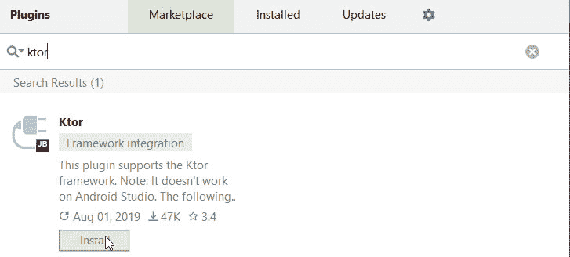

**图 16.1:** 为 IntelliJ IDEA 安装 Kotlin 插件

**IDE 提示：与大多数用于 Web/J2EE 开发的 IntelliJ 插件不同，`Ktor` 不需要 Ultimate 版本，可以在 IDEA Community 版中使用。**

现在，我们可以创建一个项目。选择 `File | New | Project…` 命令，并在 `New Project` 对话框中选择 `Ktor` 选项。除了基础的客户端服务器功能外，`Ktor` 提供了一系列可插拔的功能，这些功能依赖额外的构件和/或某些配置代码。向导的第一步（如图 16.2 所示）允许你为应用程序的客户端和服务端选择必要的功能。IDE 将自动添加所有必要的依赖项，并生成一个演示功能使用的示例代码：


**图 16.2:** Ktor 项目向导

对于我们的示例，将在 `Server` 列中选择 HTML DSL 选项，这使我们拥有了使用简单的 Kotlin DSL 生成 HTML 标记的能力。由于我们在这里不需要任何 HTTP 客户端功能（基本上我们不会向其他服务器发送请求），我们留空 `Client` 列。

除了特定功能外，`Ktor` 还允许你选择项目构建系统（如 Gradle 或 Maven）、HTTP 服务器引擎类型（Netty/Jetty/Tomcat/基于协程的）以及框架版本。我们的项目将基于 Gradle 并使用带有 Netty 引擎的 `Ktor` 1.2.3。确保所有选项设置正确后，点击 `Next`。

在下一步中，IDE 将要求你填写构建项目构件所需的 Basic 信息（组/构件 ID 和版本）。你可以保持这些值不变并点击 `Next`。

最后一个向导步骤将要求你选择项目名称和位置。点击 `Finish` 之后，IDE 将继续生成项目源码并在完成后打开新项目。

在最后一步，你将看到 `Import Module from Gradle` 对话框，你可以在其中设置 Gradle/IntelliJ 互操作性的基本选项。现在，让我们选择 `Use default gradle wrapper` 选项并保持其他设置不变。点击 `OK` 之后，IDE 将开始与 Gradle 项目模型同步。一旦完成，你将能够在 `Project View` 中看到以下文件（图 16.3）：


**图 16.3:** 示例 Ktor 的结构

注意资源文件夹下的 `application.conf` 文件。该文件包含了以 HOCON 格式定义的服务器配置。在我们的情况下，它指定了服务器端口号和模块列表：

```hocon
ktor {
  deployment {
    port = 8080
    port = ${?PORT}
  }
  application {
    modules = [ com.example.ApplicationKt ]
  }
}
```

关于 HOCON 和支持的配置选项的详细信息可以在 Ktor 网站上找到：[https://ktor.io/configuration.html](https://ktor.io/configuration.html)。

Ktor 模块基本上是 `Application` 类的一个扩展函数，负责配置功能、处理客户端请求以及其他服务器任务。要加载的模块必须在服务器配置中通过它们的限定名称指定。我们的示例项目在 `Application.kt` 中实现了一个模块：

```kotlin
package com.example

import io.ktor.application.*
import io.ktor.client.HttpClient
import io.ktor.client.engine.apache.Apache
import io.ktor.html.respondHtml
import io.ktor.http.ContentType
import io.ktor.response.respondText
import io.ktor.routing.*
import kotlinx.html.*

fun main(args: Array<String>): Unit = io.ktor.server.netty.EngineMain.main(args)

@Suppress("unused") // 在 application.conf 
@kotlin.jvm.JvmOverloads
fun Application.module(testing: Boolean = false) {
    routing {
        get("/") {
            call.respondText(
                "HELLO WORLD!",
                contentType = ContentType.Text.Plain
            )
        }
        get("/html-dsl") {
            call.respondHtml {
                body {
                    h1 { + "HTML" }
                    ul {
                        for (n in 1..10) {
                            li { +"$n" }
                        }
                    }
                }
            }
        }
    }
}
```

同样定义在该文件中 `main()` 函数简单地启动所选的 HTTP 服务器引擎（在我们的示例中是 Netty），然后它读取 `application.conf` 并加载由 `Application.module()` 函数表示的服务器模块。

模块体包含 `routing` 块，用于根据 URL 路径设置处理客户端请求的规则。特别是当客户端应用程序（例如 Web 浏览器）访问我们服务器的根路径时，Ktor 会调用以下处理器：

```kotlin
call.respondText(
    "HELLO WORLD!",
)
```

```kotlin
contentType = ContentType.Text.Plain
```

此代码生成一个带有纯文本消息正体的 HTTP 响应。如果你编译并启动服务器应用程序，然后在某些浏览器中打开 `localhost:8080`，你将看到类似于图 16.4 的内容：

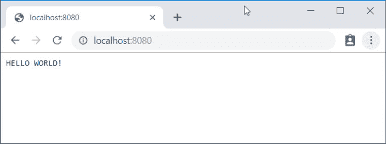

**图 16.4：** 在浏览器中访问 Hello, World 程序的根路径

同样，`/html-dsl` 路径显示了使用 HTML DSL 库生成服务器响应的示例。该 DSL 允许你以对应不同 HTML 标签的嵌套块的形式呈现 HTML 标记。正如你可能猜到的那样，以下处理器：

```kotlin
call.respondHtml {
  body {
    h1 { +"HTML" }
    ul {
      for (n in 1..10) {
        li { +"$n" }
      }
    }
  }
}
```

会生成一个包含一级标题和数字项目列表的 HTML 页面。图 16.5 显示了将 DSL 代码渲染为 HTML 页面的结果：

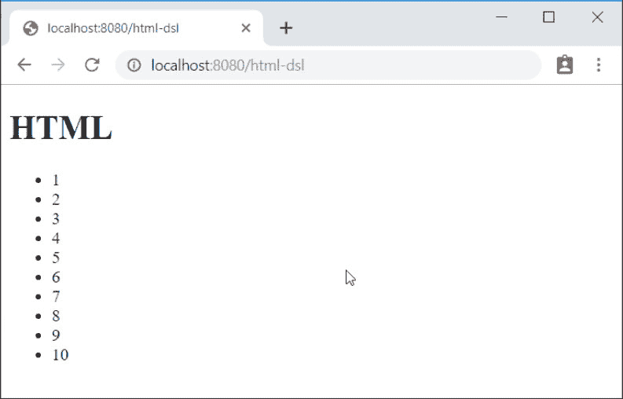

**图 16.5：** 与 `/html-dsl` 路径相关的 HTML 响应

在接下来的章节中，我们将详细查看 HTML DSL 和路由规则，以及 Ktor 的其他服务器功能。

IDE 生成的项目还包含一个示例服务器测试。让我们打开 `ApplicationTest` 类：

```kotlin
package com.example
import io.ktor.http.*
import io.ktor.server.testing.*
import kotlin.test.*

class ApplicationTest {
  @Test
  fun testRoot() {
    withTestApplication({ module(testing = true) }) {
      handleRequest(HttpMethod.Get, "/").apply {
        assertEquals(HttpStatusCode.OK, response.status())
        assertEquals("HELLO WORLD!", response.content)
      }
    }
  }
}
```

此代码配置了测试应用程序以一组给定的模块运行（注意使用 `testing = true` 参数，它允许模块代码区分测试和生产环境），然后检查处理根路径的简单 HTTP 请求的结果。你可以将此类作为起点，编写涵盖各种服务器行为的自定义测试。

作为 IntelliJ 插件的替代方案，你可以使用 [`start.ktor.io`](https://start.ktor.io) 在线项目生成器。生成器 UI 允许你指定相同的基础选项，包括你想在应用程序中使用一组客户端/服务器功能。点击 `Build` 按钮后，后端将建议你下载一个包含生成项目的压缩文件。图 16.6 显示了一个示例：

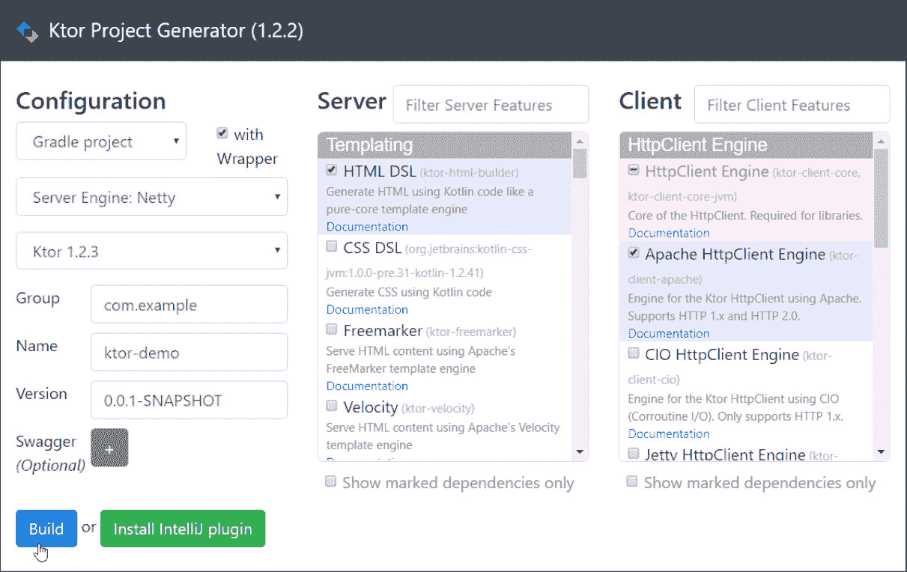

**图 16.6：** start.ktor.io 中的 Ktor 项目向导

到此，我们对基础项目设置的介绍结束。在接下来的章节中，我们将关注 Ktor 框架客户端和服务端提供的特定功能。

## 服务器功能

在本节中，我们将考虑有关 Web 服务器应用程序开发的几个主题。Ktor 的大部分功能组织成一组可插拔的功能，可以通过调用 `install()` 方法进行配置，该方法接收一个功能对象和一个可选的配置块。例如，要启用输出内容的压缩，你可以在模块函数中添加以下代码：

```kotlin
install(Compression)
```

如果你想指定额外的（特定于功能的）选项，例如选择压缩方法，你可以在配置块中进行：

```kotlin
install(Compression) {
  gzip()
}
```

本章中的示例使用了嵌入式 HTTP 服务器，允许它们作为独立程序运行。在许多情况下，你可能需要在某些 Web/应用程序容器（如 Apache Tomcat、Docker 或 Google App Engine）中部署 Ktor 应用程序。要安装你的应用程序，你需要汇总包含应用程序类及其所有依赖项的包，并准备特定容器的配置文件。关于容器特定细节的讨论超本书的范围，但你可以在 Ktor 官方网站 [`ktor.io/servers/deploy.html`](https://ktor.io/servers/deploy.html) 上详细说明。

## 路由

路由功能允许你根据模式匹配器的分级系统对 HTTP 请求进行结构化处理。路由配置通过功能安装块内部的特殊 DSL（领域特定语言）表示：

```kotlin
fun Application.module() {
  install(Routing) {
    // 常例描述
    get("/") { call.respondText("This is root page") }
  }
}
```

或者使用 `routing()` 块，作为相应 `install()` 调用的简写：

```kotlin
fun Application.module() {
  routing {
    get("/") { call.respondText("This is root page") }
  }
}
```

最简单的路由场景由 `get()` 函数提供，它告诉服务器对具有给定 URL 路径前缀的任何 HTTP `GET` 请求执行指定的处理程序。例如，前面的代码对站点根的 `GET` 请求响应纯文本字符串，而对同一站点上任何其他路径或使用任何其他 HTTP 动词的请求将导致 404（参见图 16.7 中的示例）：

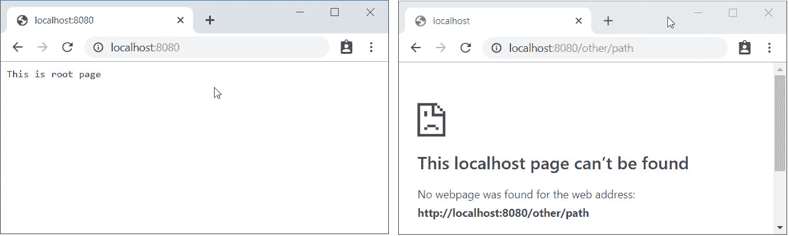

**图 16.7：** `get()` 路由的结果

Ktor 支持所有动词的类似路由，包括 `post()`、`put()`、`delete()`、`patch()`、`head()` 和 `options()`。路由函数中提到的参数可能会匹配路径的特定段，并可以从应用程序检索。要引入参数，你只需将其名称括在括号中。例如，下面的路由将匹配以 `/hello/` 开头并包含两个段的 URL：

```kotlin
routing {
  get("/hello/{userName}") {
    call.respondHtml {
      body {
        h1 { +"Hello, ${call.parameters[userName]}" }
      }
    }
  }
}
```

参数本身匹配一个段，因此像 `/hello` 或 `/hello/Doe` 的路径将无法匹配（如图 16.8 所示）：


**图 16.8：** 单段路径匹配

如果不需要参数值，可以用 `*` 字符（通配符）替换它：

```kotlin
routing {
  get("/hello/*") {
    call.respondHtml {
      body {
        h1 { +"Hello, World" }
      }
    }
  }
}
```

上面的路由接受之前相同的路径集，但不捕获任何参数。如果你想引入一个匹配空路径段的可选参数，只需在其名称后添加 `?`。以下路由将接受 `/hello/John`，如图 16.9 所示：

```kotlin
routing {
  get("/hello/{userName?}") {
    val userName = call.parameters["userName"] ?: "Unknown"
    call.respondHtml {
      body {
        h1 { +"Hello, $userName" }
      }
    }
  }
}
```


**图 16.9：** 可选匹配

放置在参数名称后的尾 `…` 将匹配路径末尾的所有 URL 段。在这种情况下，你可以利用 `Parameters` 类的 `getAll()` 方法获取拆分为 `List` 的所有捕获段。例如，创建一个简单的服务，对整数执行基本算术运算，并接收如 `/calc+/123/456` 等 URL 路径格式的输入数据：

```kotlin
routing {
  get("/calc/{data…}") {
    val data = call.parameters.getAll("data") ?: emptyList()
    call.respondHtml {
      body {
        h1 {
          if (data.size != 3) {
            +"Invalid data"
            return@h1
          }
          val (op, argStr1, argStr2) = data
          val arg1 = argStr1.toBigIntegerOrNull()
          val arg2 = argStr2.toBigIntegerOrNull()
          if (arg1 == null || arg2 == null) {
            +"Integer numbers expected"
            return@h1
          }
          val result = when (op) {
            "+" -> arg1 + arg2
            "-" -> arg1 - arg2
            "*" -> arg1 * arg2
            "/" -> arg1 / arg2
            else -> null
          }
          +(result?.toString() ?: "Invalid operation")
        }
      }
    }
  }
}
```


你可以在图 16.10 中看到它的某些响应。左上图像显示了针对 `/calc/+/12345/67890` 路径成功的响应示例，它符合包含操作符和整数对的预期格式。右上图像对应于传递了三个数字而非两个的 `Invalid data` 情况，而左下图像报告了未知操作的错误。最后，右下图像描述了为操作数传递了非整数值的情况：

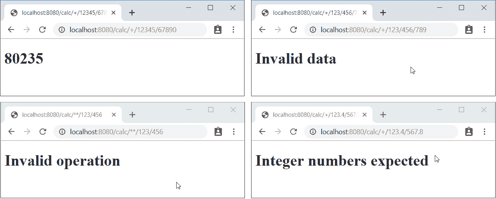

**图 16.10:** 尾部配符匹配（Tailcard matching）

注意的是，尾部配符也会匹配空路径尾，因此 `get("/calc/{data…}")` 前面的处理器也会为 `/calc` 路径调用。特殊的 `{…}` 尾部配符接受所有剩余的路径尾，但不像 `*` 通配符那样捕获任何参数。例如，像 `get("/calc/{…}")` 这样的处理器将匹配所有以 `/calc` 开头的路径，包括 `/calc` 本身。

除了匹配整个 URL 路径的 `get()` 等函数外，Ktor 还允许你定义路由树来匹配 URL 的后续部分和/或各种请求数据。考虑以下示例：

```kotlin
routing {
  method(HttpMethod.Get) {
    route("user/{name}") {
      route("sayHello") {
        handle {
          call.respondText("Hello, ${call.parameters["name"]}")
        }
      }
      route("sayBye") {
        handle {
          call.respondText("Bye, ${call.parameters["name"]}")
        }
      }
    }
  }
}
```

当服务器接收到 HTTP 请求时，它从树根开始寻找匹配的路由规则。在我们案例中，根节点是 `method(HttpMethod.Get)`，它匹配任何带有 `GET` 动词请求。如果客户端请求满足此条件，服务器将向下检查 `route("user/{name}")` 规则，该规则接受给定路径前缀的 URL。如果路径匹配，服务器将进一步深入并检查 `route("sayHello")` 和 `route("sayBye")` 规则之一，它们检查 URL 路径的剩余部分。在最底层，我们有 `handle()` 块，只要相应分支上的所有规则都匹配，它就会生成响应。

可以在 `route()` 调用中指定 HTTP 动词，而无需显式使用 `method()` 函数。之前的 `get()` 函数基本上是带有处理器的顶层 `route()` 块的简写。例如，以下代码：

```kotlin
routing {
  get("/hello/{userName}") {
    call.respondText("Hello, ${call.parameters["userName"]}")
  }
}
```

等同于：

```kotlin
routing {
  route("/hello/{userName}", HttpMethod.Get) {
    handle {
      call.respondText("Hello, ${call.parameters["userName"]}")
    }
  }
}
```

`route()` 和 `method()` 并不是你可以使用的唯一匹配器。还有额外的构建器可用：

*   `header(name, value)`：接受带有特定标头的请求
*   `param(name, value)`：接受带有特定参数值的请求
*   `param(name)`：接受具有特定名称参数的请求并捕获其值
*   `optionalParam(name)`：接受给定名称可选参数

在下面的示例中，我们根据 `action` 参数的值选择响应：

```kotlin
routing {
  route("/user/{name}", HttpMethod.Get) {
    param("action", "sayHello") {
      handle {
        call.respondHtml {
          body { h2 { +"Hello, ${call.parameters["name"]}" } }
        }
      }
    }
    param("action", "sayBye") {
      handle {
        call.respondHtml {
          body { h2 { +"Bye, ${call.parameters["name"]}" } }
        }
      }
    }
  }
}
```

例如，路径 `/user/John?action=sayHello` 将产生服务器响应 `Hello, John`，而 `/user/John?action=sayBye` 将给出 `Bye, John`。任何其他 `action` 将保持未匹配状态，从而产生 `not found` 响应。图 16.11 展示了结果：

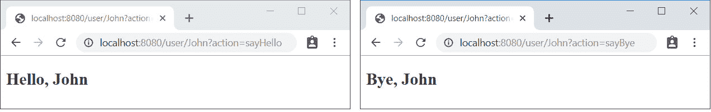

**图 16.11:** 按请求参数匹配

Ktor API 允许你创建自己的匹配器，从而扩展路由 DSL。要做到这一点，你需要提供 `RouteSelector` 类的实现并添加相应的构建器函数。

### 处理 HTTP 请求

HTTP 服务器的主要工作是为客户端请求提供适当的响应。为了简化这项任务，Ktor 为你提供了一个灵活且易用的 API，允许你轻松访问请求数据，例如 URL 路径组件、参数、标头（通用和自定义）以及请求体的各种内容类型，并生成响应数据。你只需要实现实际的处理逻辑。

要访问请求参数，你可以使用 `request.queryParameters` 对象，它充当从参数名称到值的映射。假设我们想根据形如 `/sum?left=2&right=3` 的 URL 返回一对整数的和。在这种情况下，我们可以简单地对 `queryParameters` 对象使用索引运算符来获取 `left` 和 `right` 参数的值：

```kotlin
routing {
  // e.g. /sum?left=2&right=3 responds with 5
  get("/sum") {
    val left = call.request.queryParameters["left"]?.toIntOrNull()
    val right = call.request.queryParameters["right"]?.toIntOrNull()
    if (left != null && right != null) {
      call.respondText("${left + right}")
    } else {
      call.respondText("Invalid arguments")
    }
  }
}
```

当一个参数被使用多次时，`get()` 函数只返回其第一个值。相反，`getAll()` 函数返回一个格式为 `List<String>` 的完整参数值列表：

```kotlin
routing {
  // e.g. /sum?arg=1&arg=2&arg=3 responds with 6
  get("/sum") {
    val args = call.request.queryParameters.getAll("arg")
    if (args == null) {
      call.respondText("No data")
      return@get
    }
    var sum = 0
    for (arg in args) {
      val num = arg.toIntOrNull()
      if (num == null) {
        call.respondText("Invalid arguments")
        return@get
      }
      sum += num
    }
    call.respondText("$sum")
  }
}
```

同样地，你可以使用 `request.headers.get()` 和 `request.headers.getAll()` 来获取请求头数据的值。

### HTML DSL

HTML DSL 库配合 Ktor HTML 构建器，允许你根据 HTML 内容生成响应。这为 JSP 等技术提供了一种替代方案，JSP 会将可执行代码嵌入到 UI 标记中。通过 HTML DSL，你既拥有了简洁的语法，又拥有 Kotlin 代码的所有优处，包括类型安全和强大的 IDE 代码洞察。在本节中，我们不会讨论 DSL 库的任何细节，而是简单关注一个演示如何使用它构建 HTML 表单的示例。更多信息，你可以访问 HTML DSL 网站：[`github.com/Kotlin/kotlinx.html`](https://github.com/Kotlin/kotlinx.html)。

让我们创建一个生成随机数的简单 Web 应用程序。我们的服务器将展示一个带有表单的页面，用户可以在其中输入所需的范围和要生成的数值，如图 16.12 所示。服务器还将对输入数据进行基本验证，确保：

* 所有值均为有效整数
* `From` 边界小于或等于 `To bound` 边界
* `How many` 字段包含一个正数

当在提交表单时违反了上述某些要求时，服务器将把表单返回给客户端，并在相应的文本字段旁边显示错误消息。

服务器模块的全文相当长，因此我们不会将其放在这里，而是专注于一些特定的段落。感兴趣的读者可以在 GitHub 上书籍补充仓库的 `ch16/random-gen` 目录中找到它：[`github.com/asedunov/kotlin-in-depth`](https://github.com/asedunov/kotlin-in-depth)。

我们已经见过使用 HTML DSL 渲染列表和段落等简单元素的示例。现在，让我们来看看如何使用它来构建 HTML 表单。考虑以下取自应用模块源码的代码：

```kotlin
body {
  h1 { +"Generate random numbers" }
  form(action = "/", method = FormMethod.get) {
    p { +"From: " }
    p {
      numberInput(name = FROM_KEY) {
        value = from?.toString() ?: "1"
      }
      appendError(FROM_KEY)
    }
    p { +"To: " }
    p {
      numberInput(name = TO_KEY) {
        value = to?.toString() ?: "100"
      }
      appendError(TO_KEY)
    }
    p { +"How many: " }
    p {
      numberInput(name = COUNT_KEY) {
        value = count?.toString() ?: "10"
      }
      appendError(COUNT_KEY)
    }
    p { hiddenInput(name = GENERATE_KEY) { value = "" } }
    p { submitInput { value = "Generate" } }
  }
  ...
}
```

注意 `body()` 内部 `form()` 块：此调用定义了一个 HTML 表单，并引入了一个可以在其中添加如文本字段和按钮等输入组件的范围。`action` 参数指定了表单数据发送的目标 URL。

HTML DSL 提供了一整套函数用于创建所有基本类型的输入组件，例如：

* `input()`：通用的文本字段
* `passwordInput()`：用于输入密码的文本字段
* `numberInput()`：带有上一个/后一个按钮的数值文本字段
* `dateInput()`/`timeInput()`/`dateTimeInput()`：用于输入日期和时间的专用文本字段
* `fileInput()`：带有浏览按钮的文本字段，用于上传本地文件等

`submitInput()` 调用创建一个提交按钮，它将表单数据封装在 HTTP 请求中并发送到服务器。

如果你查看在浏览器中渲染的页面源码，你将看到类似下面代码的标记：


```html
<!DOCTYPE html>
<html>
<head>
    <title>Random number generator</title>
</head>
<body>
    <h1>Generate random numbers</h1>
    <form action=”/” method=”get”>
        <p>From: </p>
        <p><input type=”number” name=”from” value=”200”></p>
        <p>To: </p>
        <p>
            <input type=”number” name=”to” value=”100”>
            <strong> ‘To’ may not be less than ‘From’</strong>
        </p>
        <p>How many: </p>
        <p>
            <input type=”number” name=”count” value=”-10”>
            <strong> A positive integer is expected</strong>
        </p>
        <p><input type=”hidden” name=”generate” value=""></p>
        <p><input type=”submit” value=”Generate”></p>
    </form>
</body>
</html>
```

```kotlin
body {
  h2 { +”You have viewed this page ${stat.viewCount} time(s)” }
  a(“/clearStat”) { +”Clear statistics” }
}
}
```

保持 `session` 实例不可变是合理的，因为服务器通常运行在多线程环境中，因此将 `session` 状态在可变对象中会导致易出错的代码。相反，你使用 `get()`/`set()` 函数整体读取并替换 `session`。`getOrSet()` 函数允许在 `session` 尚不存在时对其进行初始化。

最后一步是为根路径和 `/clearStat` 路径定义路由规则。对于后者，我们简单地丢弃 `session` 数据并将用户重定向回根页面（此时将显示计数为零）：

```kotlin
@Suppress(“unused”) // Referenced in application.conf

fun Application.module() {
  install(Sessions) {
    cookie<Stat>(STAT_KEY)
  }
  routing {
    get("/") {
      call.rootPage()
    }
    get("/clearStat") {
      call.sessions.clear(STAT_KEY)
      call.respondRedirect("/")
    }
  }
}
```

如果你运行应用程序并在浏览器中打开 `localhost:8080`，你会发现每次刷新页面时访问计数都会增加。图 16.14 显示了连续四次更新的结果：

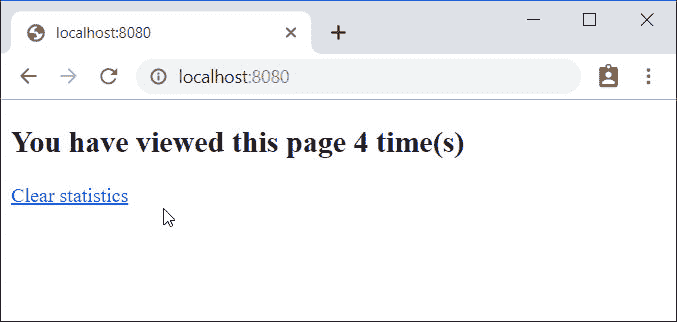

**图 16.14：** 使用 `session` 数据跟踪页面访问计数

点击 `Clear statistics` 链接会强制服务器移除 `session` 数据并将计数重置为零。注意 `/clearStat` 处理器末尾的 `responseRedirect()` 调用；在清除 `session` 后需要它重新渲染页面。

作为 cookies 的替代方案，你也可以将 `session` 存储在 HTTP 请求和响应的标头中：

```kotlin
install(Sessions) {
  header<MyData>(“my_data”)
}
```

Ktor `session` 可能会存储在客户端或服务器端。默认情况下，所有 `session` 数据都会传输到客户端，由客户端保留并在下一次请求时将其发回。这可能会引发安全问题，因为内置序列化器会将 `session` 数据表示为纯文本。为了解决这个问题，Ktor 提供了一种 `session` 转换器机制，用于对传输的数据进行额外的编码/解码。

内置转换器之一 `SessionTransportTransformerMessageAuthentication` 会随 `session` 数据附带根据特定算法（默认为 SHA256）计算的哈希值。在最简单的情况下，你只需要提供一个密钥：

```kotlin
install(Sessions) {
  cookie<Stat>(STAT_KEY, SessionStorageMemory()) {
    val key = Random.Default.nextBytes(16)
    transform(SessionTransportTransformerMessageAuthentication(key))
  }
}
```

原始 `session` 数据保持不变，因此第三方仍然可以在客户端侧查看它们。然而，在没有服务器许可的情况下，他们无法更改 `session` 数据，因为这将使摘要校验失效，而计算新的摘要依赖于对密钥的掌握。

`SessionTransportTransformerEncrypt` 提供了更强的安全保障，它会加密 `session` 数据以防止第三方读取。要配置此转换器，你需要提供加密密钥和身份验证密钥（后者用于创建 `session` 数据的数字签名）：

```kotlin
install(Sessions) {
  cookie<Stat>(STAT_KEY) {
    val encryptionKey = Random.Default.nextBytes(16)
    val signKey = Random.Default.nextBytes(16)
    transform(
      SessionTransportTransformerEncrypt(encryptionKey, signKey)
    )
  }
}
```

通过实现 `SessionTransportTransformer` 接口，也可以添加你自己的转换器。

默认情况下，`cookie()` 和 `header()` 块都配置客户端 `session`；在这种情况下，所有 `session` 数据都存储在客户端，并随着每次请求/响应在服务器之间传输。或者，你可以配置 `session` 存储器，告诉 Ktor 将 `session` 主体存储在服务器端并仅传输 `session` ID：

```kotlin
install(Sessions) {
  cookie<Stat>(STAT_KEY, SessionStorageMemory())
}
```

`SessionStorageMemory` 是一个内置实现，它将 `session` 数据保留在服务器内存中。注意，内存消耗会随着活动客户端数量而增加，因此服务器端 `session` 值得尽可能紧凑。

以上就是对 Ktor 服务器应用程序可用基本功能的概述。在下一节中，我们将关注通信的另一侧，并查看使用 Ktor 编写 HTTP 客户端。

## 客户端功能

Ktor 不限于编写服务器应用程序，还可以用于极大地简化与各种服务通信的异步客户端的开发。在本节中，我们将专注于围绕 `HttpClient` 类的小部分功能，该类允许你使用 HTTP 协议与网络服务器进行通信。

## 请求与响应

任何 HTTP 客户端的基本功能都围绕为某些网络服务器构建请求并读取其随后的响应。Ktor 提供了一系列丰富的开箱即用原语，用于处理在 HTTP 请求和响应中可能看到的文本和二进制内容。

发布 HTTP 请求的最简单方法是使用 `get()` 并传递目标 URL。例如，要获取文本形式响应体，你可以使用 `get<String>()`：

```kotlin
import io.ktor.client.HttpClient
import io.ktor.client.request.get
import kotlinx.coroutines.runBlocking

enum class DayOfWeek {
  SUNDAY, MONDAY, TUESDAY, WEDNESDAY, THURSDAY, FRIDAY, SATURDAY
}

fun main() {
  runBlocking {
    HttpClient().use {
      val url = “http://worldtimeapi.org/api/timezone/London”
      val result = it.get<String>(url)
      val prefix = “day_of_week:”
      val from = result.indexOf(prefix)
      if (from < 0) return@runBlocking
      val to = result.indexOf('\n', from + 1)
      if (to < 0) return@runBlocking
      val dow = result
        .substring(from + prefix.length, to)
        .trim()
        .toInt()
      println("It’s ${DayOfWeek.values().getOrNull(dow)} in London!")
    }
  }
}
```

除了字符串表示外，我们还可以通过将其转换为字节数组以二进制形式访问响应体：

```kotlin
val bytes = client.get<ByteArray>(url)
```

或者获取异步 `ByteReadChannel`：

```kotlin
val channel = client.get<ByteReadChannel>(url)
```

`HttpClient` 的请求方法是挂起函数，因此必须在某些协程上下文中调用。这就是为什么我们在示例中使用了 `runBlocking()`。

注意 `HttpClient` 需要通过 `close()` 方法进行显式结束。当作用范围有限时，我们可以像处理其他 `Closeable` 类型实例一样，将其调用隐藏在 `use()` 块后面。

正如你可能猜到的那样，`get()` 方法直接对应 HTTP `GET`。Ktor 客户端为 HTTP 1.x/2.x 标准支持的方法提供了类似的快捷方法：`post()`、`put()`、`delete()`、`patch()`、`head()`、`options()`。这些方法接受一个可选的 `HttpRequestBuilder.() -> Unit` 类型 lambda，可以在其中配置额外的请求参数，例如添加头部或主体。要添加头部，可以使用 `HttpRequestBuilder` 中定义的 `header` 方法：

```kotlin
client.get<ByteArray>(url) {
  header(“Cache-Control”, “no-cache”)
}
```

也可以通过 `headers` 属性或其同名块使用 `HeadersBuilder`：

```kotlin
client.get<ByteArray>(url) {
  headers {
    clear()
    append(“Cache-Control”, “no-cache”)
    append(“My-Header”, “My-Value”)
  }
}
```

`HttpClient` 提供了一种提供 `User-Agent` 头的简化方法，这允许服务器识别客户端软件（例如网络浏览器及其特定版本）。要实现这一点，你只需要安装 `UserAgent` 特性并使用 `agent` 属性指定标头值：

```kotlin
val client = HttpClient(Apache) {
    install(UserAgent) {
        agent = “Test Browser”
    }
}
```

你也可以使用一个预定义的 `User-Agent` 设置：

- `BrowserUserAgent()`：包含 Chrome 或 Safari 等流行浏览器
- `CurlUserAgent()`：对应于 Curl 代理

上述函数替换了整个特性的安装块。例如：

```kotlin
val client = HttpClient() {
    BrowserUserAgent()
}
```

要提供请求体（例如用于 `POST` 请求），你可以使用 `HttpRequestBuilder` 的 `body` 属性。简单的情况是编写一个 `String` 表示形式：

```kotlin
client.get<String>(url) {
    body = “my_key1=my_value1&my_key2=my_value2”
}
```

或者，你可以提供 `OutgoingContent` 的任何实现，例如 `TextContent`（它类似于编写 `String`，但额外允许你指定 MIME 类型）、`ByteArrayContent`（用于传递二进制数据）、`LocalFileContent`（允许你传输文件）等。此外，通过安装 `JsonFeature`，你可以启用任意对象 JSON 格式的自动序列化。

`submitForm()` 函数通过模拟 HTML 表单的行为实现了一个常见场景。例如，以下代码为我们在 `HTML DSL` 章节中演示的服务器应用程序提交表单数据：

```kotlin
val result = client.submitForm<String>(
    url = “http://localhost:8080”,
    encodeInQuery = true,
    formParameters = parametersOf(
        “from” to listOf(“0”),
        “to” to listOf(“100”),
        “count” to listOf(“10”),
        “generate” to emptyList()
    )
)
```

参数以键值对的形式传递，而 `encodeInQuery` 参数决定了它们作为请求数据部分的表示：

- `true`：参数编码在请求 URL 中的 HTTP `GET` 请求
- `false`：参数在请求体中的 HTTP `POST` 请求

Ktor 客户端自带对 HTTP 重定向的支持。该特性默认安装，因此每当服务器返回带有重定向状态的响应时，客户端会自动跟随新的位置。

### Cookies

HTTP cookies 提供了一种常用方法，通过在 HTTP 头部中传递小数据包，在客户端请求之间保留某些状态。客户端（如网络浏览器）最初从服务器获取 cookie 并将其存储在客户端，在随后的请求中添加。Cookies 对于维护服务器会话特别有用，我们已经在之前的章节中涵盖了这一功能。现在，我们将查看如何在客户端使用 cookies。

如果 HTTP 服务器使用 cookies 在客户端调用之间保留某些数据，则客户端必须安排妥善存储此类数据，并在必要时通过 HTTP 请求提供它们。Ktor 通过提供即插即用的 cookies 特性简化了这项任务。为了演示其用法，让我们为服务器部分讨论过的访问计数器应用程序编写一段简单的代码（见图 16.14）：

```kotlin
package com.example
import io.ktor.client.HttpClient
import io.ktor.client.engine.apache.Apache
import io.ktor.client.features.cookies.HttpCookies
import io.ktor.client.request.get
import kotlinx.coroutines.*

fun main() {
    HttpClient(Apache) {
        install(HttpCookies)
    }.use { client ->
        runBlocking {
            repeat (5) {
                val htmlText = client.get<String>(“http://localhost:8080”)
                val from = htmlText.indexOf(“<h2>”)
                val to = htmlText.indexOf("</h2>”)
                if (from < 0 || to < 0) return@runBlocking
                val message = htmlText.substring(from + “<h2>”.length, to)
                println(message)
                delay(500)
            }
        }
    }
}
```

如你所示，我们的客户端获取根路径 (`/`) 响应，找到在 `<h2>` 标签内的头部，并将其打印到标准输出。注意 `install(HttpCookies)` 调用，它配置了 `HttpClient` 处理 cookies。由于请求/响应循环重复了五次（每次都有更新的 cookie），输出将如下所示：

`You have viewed this page 0 time(s)`

`You have viewed this page 1 time(s)`

`You have viewed this page 2 time(s)`

`You have viewed this page 3 time(s)`


`You have viewed this page 4 time(s)`

默认情况下，HTTP 客户端从空 cookies 开始，并使用服务器提供的数据随下一次请求一起发送。这对应于典型的浏览器行为。有时，你可能需要发送一个带有预配置 cookie 集合的请求，而不是从服务器获取它们——例如，为了使用它们。

微服务架构提供了一种构建应用程序的方法，由多个相互连接的组件组成，旨在执行细粒度的特定领域任务。这种架构与传统的单体应用创建技术（即作为一个整体进行部署）形成对比。微服务通过允许你在物理上分离不同的功能部分，促进了模块化开发，并简化单个应用程序部分的开发、测试以及部署/更新。

在本章中，我们将解释微服务架构的基础知识及其定义原则，并结合 `Spring Boot` 和 `Ktor` 框架的示例，看看 Kotlin 如何帮助你实现微服务。`Spring` 框架是 Java 世界中常用的工具之一，在最近的版本中它特别关注对 Kotlin 的支持；而 `Ktor`（我们在上一节中已经讨论过）则专门针对各种类型连接应用程序的开发，并大量使用了 Kotlin 的特性。在完成本章后，你将能够组合简单的服务，并为进一步学习更具体的微服务框架奠定基础。

### 结构

* 微服务架构

* 介绍 Spring Boot

* 使用 Ktor 构建微服务

## 目标

理解微服务架构的基本原理，并学习使用 `Spring Boot` 和 `Ktor` 框架创建微服务的基础知识。

### 微服务架构

微服务架构的核心思想是将一个整体部署和交付的单体应用替换为一组轻量级、松耦合的服务；每个服务都有特定的任务，并使用定义良好的协议与其他服务通信。

为了给出一个更具体的例子，假设我们想要构建一个类似在线商店的应用程序，为用户提供基本功能，如浏览商品目录和下单。通过遵循单体应用方法，我们可能会得到类似于图 17.1 所示的设计：

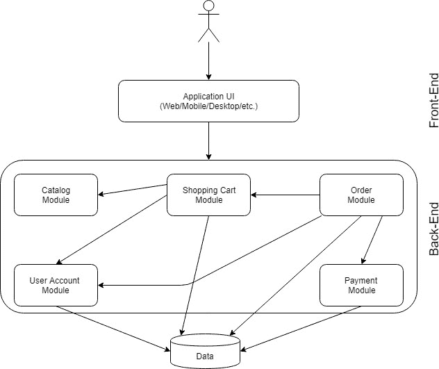

**图 17.1：** 单体应用示例

这是一个常见的三层架构，包括应用程序 UI（无论是桌面、Web 还是移动客户端）、业务逻辑以及数据存储/检索的独立层。应用程序中负责实现特定领域工作流的后端部分可以分解为更具体的模块，例如提供目录访问、维护用户购物车、订单的下达/跟踪/取消、支付，以及身份验证和用户配置管理。请注意，虽然模块本身可能是松耦合的，但它们通常不是独立分布或部署的，这使得服务器应用程序变成了单体。

然而，随着应用程序的增长，这种方法可能会带来某些问题。代码库中的任何更改（无论是新功能的实现还是错误修复）都需要你更新/重新部署整个应用程序，这会增加其启动时间并引入新 bug 的机会。这也阻碍了应用程序的可扩展性。在单体方法中，你必须处理整个应用程序的扩展，这比扩展特定模块或功能要复杂得多。另一个需要考虑的问题是可靠性，因为在同一个进程下运行所有后端模块会使应用程序更容易受到可能的内存泄漏和其他类型 bug 的影响。

**面向服务的架构 (SOA)** 通过将单体应用分解为一组自包含的服务来缓解这些问题，这些服务可以很大程度上独立独立地进行开发、更新和部署。微服务可以被视为 SOA 演进中的一步，重点是让服务尽可能小且越简单；尽管在实践中，这两个术语通常被用作同义词。

如果我们尝试拆解原始的单体应用设计，我们可能会得到类似于图 17.2 的内容：

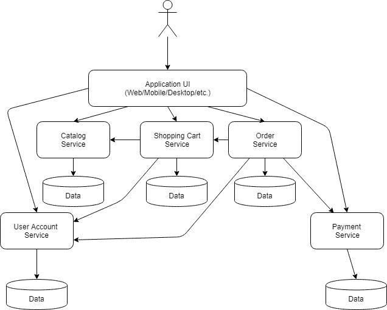

**图 17.2：** 微服务架构

你可以看到原始模块被执行相同功能的服务取代了，并使用类似 `HTTP` 的网络协议进行相互通信。现在，单个服务可以相互多程度上独立地进行开发、更新和配置。它们可能还会使用独立的数据库，甚至可能由不同的 `DBMS` 管理。

尽管微服务缺乏严格的定义，但它们所有的实际实现都基于一组共同的原则：

* 每个微服务都专注于执行某些特定领域的任务，例如在我们的电子商务应用程序示例中管理商品目录或用户购物车。

* 微服务使用某些定义良好的协议进行通信，这些协议有效地建立了它们的 API。一种常见的情况是使用 `HTTP` 结合 `XML` 和 `JSON` 格式来传输复杂数据，以及基于 `RPC（远程过程调用）` 的协议。

* 微服务可以独立地进行版本控制、部署和更新。

* 微服务与语言和框架无关，这意味着在通常情况下，你可以使用任何认为适合该目的的编程语言来实现它们，并使用你选择的任何开发框架。唯一重要的是你的服务在与其他服务交互时使用的通信协议。

这应该让你对什么是微服务架构以及在什么情况下你可能想在应用程序中使用它有一个基本的了解。稍后，我们将展示在 Kotlin 语言背景下微服务编程可能是什么样的。这将为你研究更具体的技术栈和框架（如 `Spring`、`Netflix` 或 `Ktor`）提供基础。

### 介绍 Spring Boot

`Spring` 是最常用的 Java 框架之一，它为构建各种应用程序提供了丰富的设施，并主要关注 J2EE 平台。在本章中，我们将讨论通过 `Spring Boot` 项目的示例，使用强大的 `Spring/Kotlin` 组合来开发微服务。通常，`Spring Boot` 是一系列简化各种项目类型设置和框架配置的工具集。同样，我们将引导你完成创建 `Spring Boot` 微服务所需的基本步骤。

### 设置项目

启动 Spring 应用程序简单的方法之一是使用名为 `Spring Initializr` 的特殊 Web 工具根据选择的应用程序类型自动生成项目骨架。要使用此工具，请在浏览器中打开 `https://start.spring.io`（参见图 17.3）：

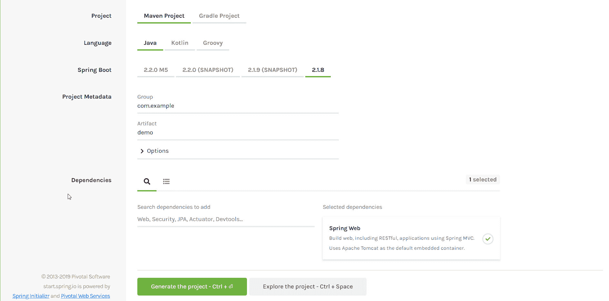

**图 17.3：** 使用 Spring Initializr 生成新项目

此页面允许我们选择一组基本选项，这些选项决定了 Initializr 生成的项目类型：

* 构建系统类型（`Maven/Gradle`），用于从源码配置和构建项目；对于我们的示例，我们将使用 `Gradle`，因为它提供了一种更灵活、更简洁的方式调整项目配置。

* 新项目的主要语言，初始化器将使用它生成示例源代码（在我们的案例中为 `Kotlin`）。这也会影响项目配置，例如，使用 `Kotlin` 在 `Maven/Gradle` 构建文件中需要一些额外的依赖项。

* 使用的 `Spring Boot` 版本：我们将选择编写本书时 Spring 的最新发布版本，即 `2.1.8`。

* 项目组和构件 ID，它们定义了用于制品发布的 Maven 坐标。

此外，您可以使用 `Dependencies` 字段来指定要包含在项目中的常用包。由于我们的服务将使用 HTTP，因此我们需要 Web 支持。在字段中输入 `Web` 并在建议列表中选择 `Spring Web` 选项。

选择所有必要选项后，点击 `Generate the project` 按钮并下载包含由初始化器创建的项目的 ZIP 文件。要在 IntelliJ IDEA 中打开该项目，你需要执行以下操作：

1. 将压缩包解压到本地目录。

2. 从 `File | New | Project` 调用 `Existing Source…` 菜单命令，并指定解压后的项目根路径以及构建系统类型（`Gradle`）。

3. 等待 IDE 完成与 `Gradle` 构建模型的同步，之后你将看到一个与 图 17.4 类似的项目结构：

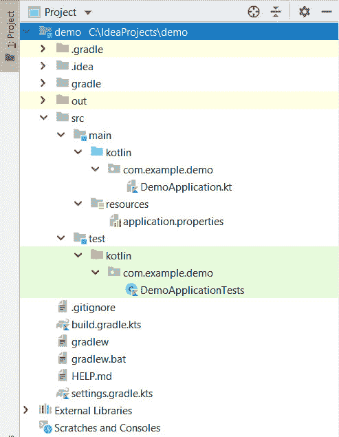

**图 17.4：** 示例 Spring Boot 项目结构

同样，在由 Ktor 向导生成的项目中，`build.gradle.kts` 文件将包含项目依赖的定义。注意 `.kts` 扩展。这意味着构建文件是用 Kotlin 而不是 Groovy 的。因此，该脚本的语法与我们在 Ktor 和 Android 示例中看到的略有不同：

```
import org.jetbrains.kotlin.gradle.tasks.KotlinCompile

plugins {
    id("org.springframework.boot") version "2.1.7.RELEASE"
    id("io.spring.dependency-management") version "1.0.8.RELEASE"
    kotlin("jvm") version "1.3.41"
    kotlin("plugin.spring") version "1.3.41"
}

group = "com.example"
version = "0.0.1-SNAPSHOT"
java.sourceCompatibility = JavaVersion.VERSION_1_8
repositories {
    mavenCentral()
}
dependencies {
    implementation("org.springframework.boot:spring-boot-starter-web")
    implementation("com.fasterxml.jackson.module:jackson-module-kotlin")
    implementation("org.jetbrains.kotlin:kotlin-reflect")
    implementation("org.jetbrains.kotlin:kotlin-stdlib-jdk8")
    testImplementation(
        "org.springframework.boot:spring-boot-starter-test"
    )
}
tasks.withType<KotlinCompile> {
    kotlinOptions {
        freeCompilerArgs = listOf("-Xjsr305=strict")
        jvmTarget = "1.8"
    }
}
```

你可能想在继续之前进行一些调整，例如将 Kotlin 版本升级到较新的版本。与任何其他 Gradle 项目一样，当 `build.gradle` 文件发生任何更改时，IDEA 都会建议你重新同步项目模型（除非你开启了自动导入，在这种情况下同步将自动开始）。

`application.properties` 文件包含各种属性（采用简单的 `key=value` 格式），这些属性影响 Spring 的行为。默认情况下，它是空的，但稍后我们将使用它来更改服务监听的端口。

我们项目的入口点定义在 `DemoApplication.kt` 文件中，该文件包含了 `DemoApplication` 类的定义以及将应用程序启动委托框架的 `main()` 函数：

```
package com.example.demo
import org.springframework.boot.autoconfigure.SpringBootApplication
import org.springframework.boot.runApplication

@SpringBootApplication
class DemoApplication
fun main(args: Array<String>) {
    runApplication<DemoApplication>(*args)
}
```

`runApplication()` 函数将创建 `DemoApplication` 实例，并自动实例化和连接我们应用程序所需的所有服务。对于具有我们这样默认配置的 Web 应用程序，它还会启动一个内置的 Tomcat 服务器，该服务器将处理客户端请求并分发给 Spring 提供的 servlet。`DemoApplication` 实例将作为一个全局上下文，需要时可以注入到其他应用程序组件中。注意 `@SpringBootApplication` 注解；这是一个方便的快捷方式，允许你将指定的类配置为 Spring 应用程序上下文。

应用程序启动后（你使用 IDEA 主菜单中的 `Run` 命令来执行此操作），我们可以使用浏览器等 HTTP 客户端访问它。由于我们的应用程序尚未包含实际请求处理代码，Spring servlet 将对我们发出的每个请求返回标准的错误页面。图 17.5 显示了一个示例：


**图 17.5：** Spring 框架提供的默认响应页面

注意，Spring 使用 `8080` 端口监听客户端请求，除非在 `application.properties` 文件中显式更改。

**IDE 提示：有一些插件可以为 IntelliJ IDEA 添加 Spring 支持，特别允许用户像 Initializr 工具一样生成各种 Spring 驱动的项目。但请注意，这些插件在 IDEA 社区版（Community Edition）不可用。而 IDEA Ultimate 版内置了这些插件。**

在接下来的章节中，我们将使用此项目存根作为创建示例微服务的的基础。但在开始实际编码之前，我们必须的第一件事是定义我们的服务将做什么以及它们将如何相互通信。

### 确定服务

在本章中，我们将以微服务为例带你深入了解。为了简单起见，我们将创建两个简单的服务：一个数字生成器和一个 使用 Ktor 进行 Web 开发。简单起见，我们将使用 HTTP 作为基础。第一个服务是数字生成器，第二个是密码生成器。它的语法与我们在 Ktor 和 Android 示例中看到的略有不同。我们将使用：

`/random/int/from/X/to/Y/quantity/N`

该 URL 将生成 `X` 到 `Y` 之间的数字（包含边界值）。结果将以 JSON 对象给出，包含以下字段：

*   非整数 `X`

*   `Y<X`

*   非正整数 `n`

让我们给出一些预期的服务输出示例：

| URL 示例 | 服务响应 |

| :--- | :--- |

| `/random/int/10/20/quantity/5` | `{"status":null, "values":[16,17,18,17,12]}` |

| `/random/int/20/to/10/quantity/5` | `{"status":"Range may not be empty", "values":[]}` |

| `/random/int/10/to/20/quantity/-1` | `{"status":"Quantity must be positive", "values":[]}` |

| `/random/int/X/to/20/quantity/5` | `{"status":"Range start must be an integer", "values":[]}` |

**表 17.1：** 数字生成器示例

我们服务的另一个功能是生成浮点数。我们将使用以下 URL：

该 URL 将让服务生成 0 到 1 之间的 `N` 个双精度数字（不包含 1）。

第二个服务将提供类似的 API 来生成随机密码。给定格式的 URL：

`/password/length/L/quantity/N`

它将生成 N 个长度为 L 的字母数字字符串。密码生成器使用相同的输出格式；唯一的区别是 `values` 字段是字符串数组而不是数字。

| URL 示例 | 服务响应 |

| :--- | :--- |

| `/password/length/8/quantity/5` | `{"status":null, "values":["B0zDWtvG","JrSkXl7X","oDwR7cp2","X8sRfzDW","nUcRXzn1"]}` |

| `/password/length/bbb/quantity/5` | `{"status":"Length must be an integer", "values":[]}` |

| `/password/length/-1/quantity/ccc` | `{"status":"Length must be positive", "values":[]}` |

| `/password/length/8/quantity/-5` | `{"status":"Quantity must be positive", "values":[]}` |

**表 17.2：** 密码生成器示例

为了演示服务之间的通信，我们将创建一个依赖于数字生成器的密码生成器。当请求新密码（多个密码）时，它将首先调用数字生成器产生一组随机索引，然后将这些索引转换为字符并组合在一起生成字符串。

现在我们已经清楚了服务 API 的样如何，可以开始实际的实现了。我们将从随机数生成器开始，因为它将被另一个服务使用。

# 实现随机数生成器服务

让我们按照“设置项目”章节的步骤为我们的生成器服务设置一个新的 Spring Boot 项目。服务的入口点将基本保持不变。在我们的情况下，只需重命名应用程序类和包即可：

```kotlin
package com.example.randomGen

import org.springframework.boot.autoconfigure.SpringBootApplication
import org.springframework.boot.runApplication

@SpringBootApplication
class RandomGenerator

fun main(args: Array<String>) {
    runApplication<RandomGenerator>(*args)
}
```

在编写服务本身的实际业务逻辑之前，我们需要定义类来持有将以 JSON 格式传递的数据。由于我们的服务输入是通过 URL 路径传递的原始类型值，因此唯一的结构化数据是它的输出。这正是 Kotlin data class 的用场：


```kotlin
package com.example.randomGen

data class GeneratorResult<T>(
    val status: String?,
    val values: List<T>
)

fun <T>errorResult(status: String) =
    GeneratorResult<T>(status, emptyList())

fun <T>successResult(values: List<T>) =
    GeneratorResult<T>(null, values)
```

这两个工具函数`errorResult()`和`successResult()`将有助于简化服务代码中`GeneratorResult`的构建。

服务的核心逻辑实现在所谓的控制器类中，它负责处理客户端请求。要将给定的类转换为 Spring 控制器，你只需要为它加上注解`@RestController`。Spring 会在组件扫描期间自动加载该类并创建其实例。我们在这里不会详细讨论扫描过程，但你可以在 Spring 框架文档中找到它们（例如`@ComponentScan`注解）。

因此，我们的控制器类的存根如下：

```kotlin
package com.example.randomGen

import org.springframework.web.bind.annotation.*

@RestController
class RandomGeneratorController
```

要定义请求处理器，我们为控制器的方法标记特殊注解，将它们与特定的请求属性关联起来。例如，`@RequestMapping`注解允许你将方法绑定到具有特定 URL 的请求上：

```kotlin
@RequestMapping("/hello")
fun hello() = "Hello, World"
```

同样，在 Ktor 中，你可以使用通配符如`*`和参数名来定义路径模板。在下面的示例中，URL 路径的最后部分会自动绑定到标记了`@PathVariable`注解的方法参数：

```kotlin
@RequestMapping("/hello/{user}")
fun hello(@PathVariable user: String) = "Hello, $user"
```

方法的参数名称可能与你在路径模板中使用的变量不同；在这种情况下，你需要将路径参数作为`@PathVariable`参数指定：

```kotlin
@RequestMapping("/sum/{op1}/{op2}")
fun hello(
    @PathVariable("op1") op1Str: String,
    @PathVariable("op2") op2Str: String
): Any {
    val op1 = op1Str.toIntOrNull() ?: return "Invalid input"
    val op2 = op2Str.toIntOrNull() ?: return "Invalid input"
    return op1 + op2
}
```

除了 URL 路径外，`@RequestMapping`注解还允许你根据各种请求数据关联处理器，例如 HTTP 方法（`GET`, `POST`等）、头部内容和请求参数。同样，还有一些`@PathVariable`的替代方案可以将方法参数绑定到请求参数（`@RequestParam`）、请求头（`@RequestHeader`）、会话数据（`@SessionAttributes`）等。映射选项与 Ktor 的路由机制非常相似；但在 Ktor 中，它是指定为普通的 Kotlin 代码，而不是注解形式的元数据。我们在这里不会深入细节，感兴趣的读者可以在 Spring 站点`docs.spring.io`找到相关文档。

当控制器的多个方法共享公共路径前缀时，将`@RequestMapping`添加到控制器类可能会方便。在这种情况下，方法级注解中提到的路径是相对于类路径定义的。例如，与其写：

```kotlin
@RestController
class SampleController {
    @RequestMapping("/say/hello/{user}")
    fun hello(@PathVariable user: String) = "Hello, $user"
    @RequestMapping("/say/goodbye/{user}")
    fun goodbye(@PathVariable user: String) = "Goodbye, $user"
}
```

我们可以将公共`/say`部分提取到`SampleController`的注解中：

```kotlin
@RestController
@RequestMapping("/say")
class RandomGeneratorController {
    @RequestMapping("hello/{user}")
    fun hello(@PathVariable user: String) = "Hello, $user"
    @RequestMapping("goodbye/{user}")
    fun goodbye(@PathVariable user: String) = "Goodbye, $user"
}
```

考虑到这些，让我们来实现根据服务处理`/random/int`路径的控制器方法：

```kotlin
@RequestMapping("/int/{from}/{to}")
fun genIntegers(
    @PathVariable("from") fromStr: String,
    @PathVariable("to") toStr: String,
    @PathVariable("quantity") quantityStr: String
): GeneratorResult<Int> {
    val from = fromStr.toIntOrNull() ?: return errorResult("Range start must be an integer")
    val to = toStr.toIntOrNull() ?: return errorResult("Range end must be an integer")
    val quantity = quantityStr.toIntOrNull() ?: return errorResult("Quantity must be an integer")
    if (quantity <= 0) return errorResult("Quantity must be positive")
    if (from > to) return errorResult("Range may not be empty")
    val values = (1..quantity).map { Random.nextInt(from, to + 1) }
    return successResult(values)
}
```

对应`/random/float`路径的浮点数处理可以通过类似的方式进行。此服务的完整源码可以在[`github.com/asedunov/kotlin-in-depth/ch17/number-gen-service`](https://github.com/asedunov/kotlin-in-depth/ch17/number-gen-service)找到。并通过浏览器访问服务，我们将获得预期的响应。你可以在图 17.6 (#c17.xhtml_fig17_6) 中看到随机数列表的示例：

(images/Img_17_06.jpg)

图 17.6：成功的示例

你还可以确保我们的服务能够正确处理客户端请求中的常见错误。例如，图 17.7 (#c17.xhtml_fig17_7) 显示了当你请求范围从 50 到 20 的数字时的结果：

(images/Img_17_07.jpg)

图 17.7：生成器返回错误

如所期望，服务返回了一个错误，指示指定的区间为空，因为上限小于下限。

# 实现密码生成服务 (#toc.xhtml_s130a)

现在，我们可以以第一个为起点轻松地实现第二个密码生成服务。让我们创建一个类似的 Spring Boot 项目，并将代码放在`com.example.passwordGen`包中。

与随机数生成器的关键区别是第二个服务将与第一个服务通信。Spring 提供了箱用的`RestTemplate`类，它简化了向其他 Web 应用发送请求并获取其响应的过程。例如，代码：

```kotlin
val url = "http://localhost:8080/random/int/from/0/to/10/quantity/5"
val restTemplate = RestTemplate()
```

`val result = restTemplate.getForObject(url, GeneratorResult::class.java)` as `GeneratorResult<Int>` 将返回一个包含 0 到 10 之间五个随机整数列表的结果。

现在，让我们使用这个思路将数字转换为密码字符。以下是密码生成器控制类的完整文本：

```kotlin
package com.example.passwordGen

import org.springframework.web.bind.annotation.*
import org.springframework.web.client.RestTemplate

private val chars = ('a'..'z') + ('A'..'Z') + ('0'..'9')

@Suppress("unused")
@RestController
@RequestMapping("/password")
class PasswordGeneratorController {
    @RequestMapping("/length/{length}/quantity/{quantity}")
    fun genPasswords(
        @PathVariable("length") lengthStr: String,
        @PathVariable("quantity") quantityStr: String
    ): GeneratorResult<String> {
        val length = lengthStr.toIntOrNull()
        ?: return errorResult("Length must be an integer")
        val quantity = quantityStr.toIntOrNull()
        ?: return errorResult("Quantity must be an integer")
        if (quantity <= 0) return errorResult("Quantity must be positive")
        val prefix = "http://localhost:8080/random/int"
        val url = "$prefix/from/0/to/${chars.lastIndex}/quantity/$length"
        val restTemplate = RestTemplate()
        val passwords = (1..quantity).map {
            val result = restTemplate.getForObject(
                url, GeneratorResult::class.java
            ) as GeneratorResult<Int>
            String(result.values.map { chars[it] }.toCharArray())
        }
        return successResult(passwords)
    }
}
```

请注意，密码生成器服务需要`GeneratorResult`类的定义，以表示其自身的响应以及数字生成器的响应。对于像这种这样的简单情况，我们只需要将此定义拷贝到我们的第二个项目中。在需要许多类来表示请求/响应数据的复杂场景中，可能值得使用一些代码共享；例如，我们可以设置一个多模块项目，其中包含两个服务，以及一个用于共享类的独立模块；或者将共享代码提取到单独的项目中，将其输出发布到某些构件仓库中，然后在两个服务中都作为依赖使用。

由于我们的两个服务都是作为独立应用程序运行，它们必须监听不同的端口。因此，在运行密码生成器服务之前，请确保它的端口与第一个不冲突。在本示例中，我们将通过将`application.properties`修改为`8081`：

```
server.port=8081
```

现在，我们可以启动第二个服务，并尝试查询格式为`localhost:8081/password/length/12/quantity/10`的 URL 来尝试使用其功能。处理此类 URL 时，我们的密码服务将向随机数生成器发送多次请求，并使用其响应来组合密码列表。图 17.8 显示了通过浏览器访问密码服务的示例结果：

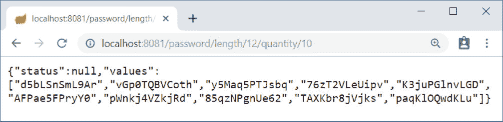

**图 17.8:** 密码生成器响应的示例

请注意，密码服务执行了一系列请求，这些请求被同步处理：

```kotlin
val passwords = (1..quantity).map {
    val result = restTemplate.getForObject(
        url,GeneratorResult::class.java
    ) as GeneratorResult<Int>
    String(result.values.map { chars[it] }.toCharArray())
}
```

换句话说，每当你调用`getForObject()`方法时，服务线程就会被阻塞，在获取所有预期的响应之前无法进行任何有用工作。当并发请求数量增加时，这可能会阻碍服务的扩展性，因此通常情况下我们可能需要使用一些异步编程技术，例如 Kotlin Cor 程库或如 RxJava 或 Akka 等响应式框架。

通过 Ktor，正如我们在接下来的章节中看到的，由于框架本身构建在协程库之上，并提供了通过挂起函数进行异步计算的开箱支持，这个问题在很大程度上得到了缓解。让我们看看使用 Ktor 功能实现时，我们的密码生成器服务会是什么样的。

# 使用 Ktor 构建微服务](#toc.xhtml_s131a)

在上一章中，我们向你介绍了 Ktor 框架，它简化了连接型客户端/服务器应用的开发。在剩下的章节中，我们将扩展知识，展示如何使用 Ktor 轻松地实现微服务。

该节由两部分组成。在第一部分，我们将介绍另一个 Ktor 特性，用于处理客户端和服务端基于 JSON 的对象序列化。该特性允许你在发送时自动将 Kotlin 对象转换为相应的 JSON 描述，并在接收时同样地从 JSON 恢复它们，类似于 Spring 框架在我们早期的示例中所做的那样。

在第二部分，我们将使用 Ktor API 重新实现密码生成器服务。这将允许你将 Ktor 特性与其 Spring 对应物进行比较（例如，路由 DSL 与请求映射注解），并作为由不同框架驱动的微服务如何无缝地相互通信的演示。

# 使用 JSON 序列化功能](#toc.xhtml_s132a)

在上一章中，我们看到了使用 Ktor 的`respondText()`发送纯文本的示例。虽然我们可以使用它来构建 JSON，但 Ktor 提供了一个更简单的解决方案，即`ContentNegotiation`特性，允许你为对象配置转换器。通常，要为特定的 MIME 类型使用它，你需要注册`ContentConverter`的相应实现以处理发送/接收操作。Ktor 为三种基础序列化机制提供了开箱支持：

*   Jackson (`https://github.com/FasterXML/jackson`)

*   `google-gson` (`https://github.com/google/gson`)

*   `kotlinx.serialization` (`https://github.com/Kotlin/kotlinx.serialization`)

在示例中，我们将使用 Jackson 实现。由于相应的转换器属于`io.ktor:ktor-jackson`，请确保在`build.gradle`文件中包含必要的依赖：

```
compile "io.ktor:ktor-jackson:$ktor_version"
```

之后，你可以使用`ContentNegotiation`安装块配置 JSON 序列化：

```kotlin
fun Application.module() {
    …
    install(ContentNegotiation) {
        jackson()
    }
    …
}
```

之前的`jackson()`函数将`JacksonConverter`与`application/json`内容关联，并设置输出格式的默认行为。序列化涵盖请求和响应数据。例如，我们可以向响应发送一些对象，它们会被转换为 JSON 文本格式：

```kotlin
call.respond(successResult(listOf("12345678")))
```

同样，我们可以反序列化客户端接收到的 JSON 对象，将其转换为普通的 Kotlin 对象：


```kotlin
data class PasswordSpec(val length: Int, val quantity: Int)
…
val spec = call.receive<PasswordSpec>()
```

但在我们的情况下，我们在发送相应请求后从另一个服务接收 JSON 数据，因此我们还必须为`HttpClient`实例配置序列化。Ktor 客户端应用程序也支持相同的三种序列化实现。我们只需要在服务的`build.gradle`中添加相应的依赖：

```
compile "io.ktor:ktor-client-json:$ktor_version"
compile "io.ktor:ktor-client-jackson:$ktor_version"
```

为了在客户端启用序列化，我们随后安装`JsonFeature`：

```kotlin
val client = HttpClient(Apache) {
    …
    install(JsonFeature)
    …
}
```

默认情况下，特定的序列化实现是根据包含的制品自动选择的。需要时，我们也可以通过将`JsonSerializer`实例赋值给`serializer`属性来显式指定它：

```kotlin
val client = HttpClient(Apache) {
  …
  install(JsonFeature) {
    serializer = JacksonSerializer()
  }
  …
}
```

配置好`JsonFeature`后，我们可以使用`get()`函数从 HTTP 响应中自动读取对象：

```kotlin
val url = "http://localhost:8080/random/int/from/0/to/10/quantity/5"
val result = client.get<GeneratorResult<Int>>(url)
```

既然我们已经有了自动序列化功能，让我们看看如何将其与其他 Ktor 特性结合，来实现真正的微服务。

## 实现密码生成器服务

为了演示 Ktor 和 Spring 方案之间的区别，我们将重新实现密码生成器服务。正如预期的，大部分代码将保持不变，因为两种实现都遵循相同的业务逻辑。

要访问我们的第一个服务，我们将使用`HttpClient`而替`RestTemplate`：

```kotlin
val prefix = "http://localhost:8080/random/int"
val url = "$prefix/from/0/to/${chars.lastIndex}/quantity/$length"
val passwords = (1..quantity).map {
  val result = client.get<GeneratorResult<Int>>(url)
  String(result.values.map { chars[it] }.toCharArray())
}
```

注意，与我们基于 Spring 的示例不同，这段代码是异步的；`HttpClient.get()`是在 Ktor 提供的协程上下文中调用的挂起函数。因此，服务线程不会被阻塞，我们的服务器可以在等待随机数生成器响应时处理进一步的请求。

Ktor 路由 DSL 将取代基于 Spring 的`@RestController` `@RequestMapping`注解的请求分发：

```kotlin
route("/password") {
  get("/length/{length}/quantity/{quantity}") { … }
}
```

如你所示，路径语法基本上是相同的，但使用 DSL 允许人们在很大程度上消除模板代码。

为了运行我们 Ktor 版本的密码生成器，这里是服务器应用程序模块的完整文本：

```kotlin
package com.example
import com.fasterxml.jackson.databind.SerializationFeature
import io.ktor.application.*
import io.ktor.client.HttpClient
import io.ktor.client.engine.apache.Apache
import io.ktor.client.features.json.*
import io.ktor.client.request.get
import io.ktor.features.ContentNegotiation
import io.ktor.jackson.jackson
import io.ktor.response.respond
import io.ktor.routing.*

fun main(args: Array<String>): Unit =
  io.ktor.server.netty.EngineMain.main(args)

private val chars = ('a'..'z') + ('A'..'Z') + ('0'..'9')

@Suppress("unused") // Referenced in application.conf
fun Application.module() {
  install(ContentNegotiation) {
    jackson {
      enable(SerializationFeature.INDENT_OUTPUT)
    }
  }
  val client = HttpClient(Apache) {
    install(JsonFeature) {
        serializer = JacksonSerializer()
    }
  }

  suspend fun ApplicationCall.genPasswords(): GeneratorResult<String> {
    val length = parameters["length"]?.toIntOrNull()
    ?: return errorResult("Length must be an integer")
    val quantity = parameters["quantity"]?.toIntOrNull()
    ?: return errorResult("Quantity must be an integer")
    if (quantity <= 0) return errorResult("Quantity must be positive")
    val prefix = "http://localhost:8080/random/int"
    val url = "$prefix/from/0/to/${chars.lastIndex}/quantity/$length"
    val passwords = (1..quantity).map {
      val result = client.get<GeneratorResult<Int>>(url)
      String(result.values.map { chars[it] }.toCharArray())
    }
    return successResult(passwords)
  }

  routing {
    route("/password") {
      get("/length/{length}/quantity/{quantity}") {
        call.respond(call.genPasswords())
      }
    }
  }
}
```

由于我们原始的 Spring Boot 实现正在监听端口`8081`，我们需要在 Ktor 版本中同样进行必要的更改，调整其`application.conf`文件：

```kotlin
ktor {
  deployment {
    port = 8081
    port = ${?PORT}
  }
  application {
    modules = [ com.example.ApplicationKt.module ]
  }
}
```

现在，如果你启动数字生成器和密码生成器服务，并在浏览器中打开`localhost:8081/password/length/12/quantity/10`，你会看到与图 17.8 显示非常相似的结果（尽管密码列表不同）。注意，尽管数字生成器是基于 Spring 的，但密码生成器现在使用 Ktor；无论它们的差异如何，两个服务都可以轻松地通信。

## 结论

在本章中，我们初步了解了如何使用 Spring 或 Ktor 框架在 Kotlin 中实现基于微服务的应用程序。我们解释了微服务架构的核心思想，带你走了简单 Spring Boot 项目的设置步骤，并讨论了 Spring REST 控制器和模板在微服务实现中的用法。此外，我们还描述了如何在 Ktor 中配置和使用 JSON 序列化，这一特性对于提供格式化 API 的 Web 应用程序特别有用。从这些基础开始，你现在可以通过参考其他资源来完善知识。我们建议你从 spring.io 的指南（[`spring.io/guides`](https://spring.io/guides)）以及以及我们在上一节中提到的 Ktor 示例（[`ktor.io/samples`](https://ktor.io/samples)）开始。

## 问题

1. 解释微服务模型的基本原理。

2. 描述设置 Spring Boot 项目的基本步骤。

3. 什么是 Spring 控制器类？解释数据如何映射到控制器方法。

4. 比较 Spring 请求映射和 Ktor 路由。

5. 如何在 Ktor 中配置 JSON 序列化？

6. 给出一个同时使用 Spring Boot 和 Ktor 实现微服务的示例。
