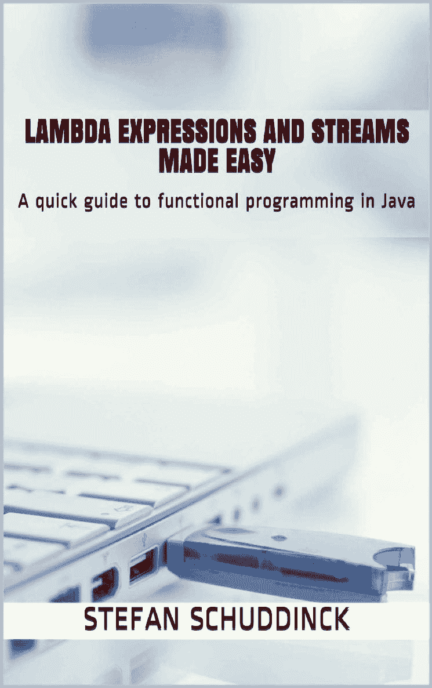

# 轻松掌握 Lambda 表达式与流：Java 函数式编程快速指南（编程入门系列 1）



# 1. 引言

Lambda 存在于许多语言中。Lambda 是一种匿名函数（没有名字的），用于实现由函数式接口定义的函数。

Java8 将 Lambda 引入了 Java。Lambda 表达式是一种不属于任何类的函数。如果 Java Lambda 表达式是一个对象，它可以被传递并按需执行（这允许我们以更简洁的方式传递逻辑）。`λ` 是代表 Lambda 的符号。

## 1.1. Lambda 语法

### 1.1.1 通用语法

Lambda 表达式在 Java 中引入了箭头。它将 Lambda 表达式分为两个部分。左侧指定表达式所需的参数，如果没有参数，也可以为空。右侧是 Lambda 体，指定了 Lambda 表达式的动作：`(parameter1, parameter2) -> {code}`

下面的示例是一个带有 2 个参数的 Lambda，它将这些参数打印到控制台：

```java
(int number, char) -> {System.out.println(number);}
```

### 1.1.2. 缩写

- Lambda 中的参数是可选的：

  `(number, character) -> {System.out.println(number);}`

- 有 1 个参数的 Lambda => 括号是可选的：

  `number -> {System.out.println(number);}`

- 无参数的 Lambda => 括号是强制的：

  `() -> {System.out.println("Hello World");}`

- 只有一个指令的 Lambda => 大括号是可选的：

  `number -> System.out.println(number);`

- 只有一个返回指令的 Lambda => 关键字 `return` 是可选的：

  `number -> number;`

## 1.2 Lambda 是函数式接口的实现

函数式接口是一个包含且只有一个抽象方法的接口。Java 标准 `Runnable` 接口就是这样一个函数式接口。它定义了一个方法：`run()`。

除了内置的函数式接口，我们还可以创建自己的函数式接口。下面的示例就是这样一个单方法接口：

```java
public interface EvenNumber {
    boolean isEven(int number);
}
```

在 Java7 中，你必须使用像这样的匿名接口实现：

```java
class Main {
    public static void main(String[] args) {
        EvenNumber myEvenNumber = new EvenNumber() {
            public boolean isEven(int number) {
                return number % 2 == 0;
            }
        };
        System.out.println(myEvenNumber.isEven(7));
    }
}
```

在 Java8 中，你可以使用实现函数式接口的 Lambda 表达式：

```java
class Main {
    public static void main(String[] args) {
        EvenNumber myEvenNumber = number -> number % 2 == 0;
        System.out.println(myEvenNumber.isEven(7));
    }
}
```

## 1.3 @Functional interface

建议所有函数式接口都带有 `@FunctionalInterface` 注解。这不仅能清晰地说明接口的目的，还允许编译器在标记接口不满足条件时生成错误。具有超过 1 个抽象方法的接口不再是函数式接口，并且无法用 Lambda 实现。当接口标记了 `@FunctionalInterface` 注解且函数有超过 1 个抽象方法时，编译器将生成错误。

```java
@FunctionalInterface
public interface EvenNumber {
    boolean isEven(int number);
}
```

# 2. Java 标准库与 lambda

`comparator` 接口是一个函数式接口。它有 1 个抽象方法：`int compare(T object1, T object2);`。

你不需要写一个类来实现这个接口，可以写一个简短的 Lambda 作为接口的实现。

```java
class Main {
    public static void main(String[] args) {
        String[] fruits = { "apple", "cherries", "banana", "avocado" };
        Arrays.sort(fruits, (fruit1, fruit2) -> -fruit1.compareTo(fruit2));
        System.out.println(Arrays.toString(fruits));
    }
}
```

你可以使用每个单词的长度对水果进行排序。你只需要将 Lambda 表达式更改为：

```java
fruit1.length() - fruit2.length()
```

# 3. Stream 和 forEach

`Stream` 接口是 Java8 新引入的。流代表元素序列，并支持各种操作来对这些元素执行计算。Stream 可以从各种数据源创建，如数组、列表、集合等……

`Stream` 接口中的方法接受 Lambda 作为参数，这使得代码变得非常短且易读。

## 3.1.1.foreach

`forEach` 遍历集合并对集合中的每个元素执行指定的操作，直到所有元素都处理完毕或操作抛出异常。下面的示例将把每种水果打印到控制台：

```java
class Main {
    public static void main(String[] args) {
        String[] fruits = { "apple", "cherries", "banana", "avocado" };
        Stream<String> stream = Arrays.stream(fruits);
        stream.forEach(fruit -> System.out.println(fruit));
    }
}
```

可以将最后两条指令合并为一条：

```java
class Main {
    public static void main(String[] args) {
        String[] fruits = { "apple", "cherries", "banana", "avocado" };
        Arrays.stream(fruits)
        .forEach(fruit -> System.out.println(fruit));
    }
}
```

## 3.2 流的数据源

### 3.2.1 List

`List` 可以作为流的数据源

```java
class Main {
    public static void main(String[] args) {
        List<String> fruits = Arrays.asList("apple", "cherries", "banana", "avocado");
        fruits.stream()
        .forEach(fruit -> System.out.println(fruit));
    }
}
```

### 3.2.2 Set

`Set` 可以作为流的数据源

```java
class Main {
    public static void main(String[] args) {
        Set<Integer> numbers = new LinkedHashSet<>();
        numbers.add(1);
        numbers.add(3);
        numbers.add(4);
        numbers.add(7);
        numbers.stream().forEach(getal -> System.out.println(getal));
    }
}
```

### 3.2.3 Map

`keySet`、`values` 或 `entrySet` 可以作为流的数据源。在下面的示例中，我们使用了 `entrySet`。

```java
class Main {
    public static void main(String[] args) {
        Map<String, String> languages = new LinkedHashMap<>();
        languages.put("ENG", "English"); 
        languages.put("FRE", "French");  
        languages.entrySet().stream
        .forEach(entry -> System.out.println(entry.getKey() + ':' + entry.getValue()));  
    }
}
```

## 3.3 String

`String` 可以作为流的数据源。流中的值是 `String` 的字符。

```java
class Main {
    public static void main(String[] args) {
        "Lambdafun".chars()
        .forEach(unicode->System.out.println((char) unicode)); 
    }
}
```

## 3.4 Files

文件可以作为流的数据源。流中的值是代表文件行的 `Strings`。

```java
class Main {
    private final static Path LANGUAGES_PATH = Paths.get("/data/languages.txt");
    public static void main(String[] args) {
        try (Stream<String> stream = Files.lines(LANGUAGES_PATH)) {
            stream.forEach(line -> System.out.println(line));
        } catch (IOException ex) {
            ex.printStackTrace();
        }
    }
}
```

## 3.5 Directory

目录（`directory`）可以作为流的数据源。流中的值是该目录下的文件和子目录的 `paths`。

```java
class Main {
    private final static Path DATA_PATH = Paths.get("/data");
    public static void main(String[] args) {
        try (Stream<Path> stream = Files.list(DATA_PATH)) {
            stream.forEach(entry -> System.out.println(entry.getFileName()));
        } catch (Exception ex) {
            ex.printStackTrace();
        }
    }
}
```

## 3.6 无限值序列

无限值序列可以作为流的数据源。

```java
class Main {
    public static void main(String[] args) { 
        Stream.iterate(1, previousNumber -> previousNumber + 2)
        .forEach(oddNumber->System.out.println(oddNumber));  
    }
}
```

如果你想限制序列，请使用 `limit()` 方法：

```java
class Main {
    public static void main(String[] args) { 
        Stream.iterate(1, previousNumber -> previousNumber + 2)
        .limit(10)
        .forEach(oddNumber->System.out.println(oddNumber));  
    }
}
```

## 3.7 数字序列

```java
class Main {
    public static void main(String[] args) {
        IntStream.rangeClosed(1, 10).forEach(number -> System.out.println(number));
        IntStream.range(1, 10).forEach(number -> System.out.println(number));
    }
}
```

## 4. Filter

有时你可能只想处理元素的子集。要实现这一点，你可以使用 `filter` 方法。

例如，如果你想创建一个水果列表子集，其中包含长度大于 6 个字符的字符串，你可以使用 `filter`：

```java
class Main {
    public static void main(String[] args) {
        // 示例逻辑
    }
}
```

## 5. Sort

你可以使用 `sorted` 方法对流中的值进行排序。

## 6. 操作组合

有时你可能想组合多个操作。例如 `filter` 然后再 `sort`：

## 7. Unique values

`distinct()` 方法返回流中的唯一元素。

## 8. Transform

假设我们现在有一个可以转换的流，例如映射字符串。`map` 操作接收一个函数并返回其他内容。在下面的示例中，我们将字符串转换为长度：

## 9. 检测所有值是否匹配谓词

### 9.1 allMatch

`allMatch` 方法在流中的所有值都匹配谓词时返回 `true`。我们将谓词作为 `allMatch()` 方法的参数。

### 9.2 anyMatch

`anyMatch` 方法在任意一个值匹配谓词时返回 `true`。

## 10. Collect 流值

可以将流的所有值收集到数组、列表、集合等

### 10.1 Array

将流转换为数组需要使用 `toArray()` 方法。该方法返回一个包含流元素的数组。

### 10.2 List

将流转换为列表需要使用流对象的 `collect()` 方法。`toList()` 收集器可将所有流元素收集到 `List` 实例中。

```java
class Main {
    public static void main(String[] args) {
        System.out.println(
            Stream.of("apple", "cherries", "banana", "avocado")
            .sorted()
            .collect(Collectors.toList()));
    }
}
```

## 10.3 Set

要将流转换为 `Set`，我们使用流对象的 `collect()` 方法。`toSet()` 收集器可将所有 `Stream` 元素收集到一个 `Set` 实例中。

```java
class Main {
    public static void main(String[] args) {
        System.out.println(
            Stream.of("apple", "cherries", "banana", "avocado")
            .collect(Collectors.toSet()));
    }
}
```

## 10.4 Map

在 `map` 中包含有一个键（`key`）和一个值（`value`）。在下面的示例中，我们将字符串的长度作为键，并根据名称长度对所有水果进行分组。


```java
class Main {
    public static void main(String[] args) {
        Map<Integer, List<String>> fruitByLength =
            Stream.of("apple", "mango", "lemon", "avocado", "cherries")
            .collect(Collectors.groupingBy(fruit -> fruit.length()));
        fruitByLength.entrySet().stream()
            .forEach(entry -> {
                System.out.println(entry.getKey());
                entry.getValue().stream()
                .forEach(fruit -> System.out.print(fruit + " "));
                System.out.println();
            });
    }
}
```

## 10.5 Stats

### 10.5.1 Count

返回流中值的数量

```java
class Main {
    public static void main(String[] args) {
        System.out.println(
            Stream.of("apple", "mango", "lemon", "avocado", "cherries").count());
    }
}
```

### 10.5.2 Sum

返回`IntStream`的和

```java
class Main {
    public static void main(String[] args) {
        IntStream stream = IntStream.of(1, 3, 4, 7);
        System.out.println(stream.sum());
    }
}
```

### 10.5.3 Min, max, average

返回`IntStream`的最小值、最大值或平均值

```java
class Main {
    public static void main(String[] args) {
        IntStream stream = IntStream.of(1, 3, 4, 7);
        stream.min().ifPresent(smallest -> System.out.println(smallest));
    }
}
```

## 10.6 Stats on long values

`LongStream`接口是一个用于`long`类型值的流。方法与`IntStream`相同。可以使用`mapToLong()`方法将`IntStream`转换为`LongStream`。

## 10.7 Stats on double values

`DoubleStream`接口是一个用于`double`类型值的流。方法与`IntStream`相同。可以使用`mapToDouble()`方法将`IntStream`转换为`DoubleStream`。

## 10.8 Min and max of other values

可以在`min`和`max`方法中传入 Lambda 表达式来确定哪些是最小值和最大值。该 lambda 将实现函数接口`Comparator`。

```java
class Main {
    public static void main(String[] args) {
        Stream.of(BigDecimal.valueOf(1.1), BigDecimal.valueOf(0.9), BigDecimal.valueOf(0.5))
        .min((number1, number2) -> number1.compareTo(number2))
        .ifPresent(smallest -> System.out.println(smallest));
    }
}
```

# 11. Reduce

`min`、`sum`、`max`… 等方法都将流的值归约为单个值。`reduce()`方法执行相同的操作，但该方法能够将任何值归约为单个值（而不只是`int`、`double`、`long`值）。它是一个通用的归约方法。

`reduce`方法有两个版本：

## 11.1 Stream.reduce() with Accumulator

使用给定的累加函数对给定流的元素执行归约。

```java
class Main {
    public static void main(String[] args) {
        System.out.println(Stream.of(BigDecimal.valueOf(1.1), BigDecimal.valueOf(0.9), BigDecimal.valueOf(0.5))
        .reduce(BigDecimal.ZERO, (previousSum, number) -> previousSum.add(number)));
    }
}
```

## 11.2 Stream.reduce() with Identity and Accumulator

使用给定的标识值（identity）、累加函数和组合函数对给定流的元素执行归约。标识值必须是`combiner`函数的恒元。`Combiner`是聚合累加器结果的函数。`Combiner`仅在并行模式下调用，用于减少来自不同线程的累加器结果。

```java
class Main {
    public static void main(String[] args) {
        Stream.of(BigDecimal.valueOf(1.1), BigDecimal.valueOf(0.9), BigDecimal.valueOf(0.5))
        .reduce((previousSum, number) -> previousSum.add(number))
        .ifPresent(sum -> System.out.println(sum));
    }
}
```

# 12. Conclusion

感谢阅读关于 Java Lambda 和流的短介绍。本指南包含了你开始开始使用 Lambda 所需的所有信息。希望你学到了很多，并准备好将 Lambda 集成到你的代码中。如果你有任何问题，可以通过`programming_made_easy@outlook.be`与我联系。

祝你好运，编程愉快！
