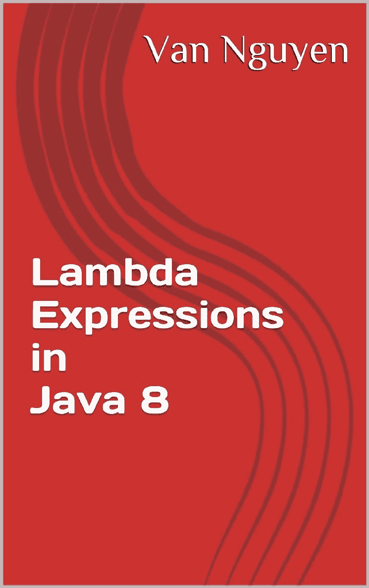

# Java 8 Lambda 表达式



## 为什么使用 Lambda

在 Java 8 中，Lambda 表达式本质上是一段可以被到处传递并执行的代码块。

如果你想执行一段代码块，通常需要先创建一个对象，然后传递该对象。

Lambda 表达式非常强大且极具吸引力。

Lambda 表达式可以通过以下几种方式声明：

- 标准语法
- 参数类型可以推断
- 多行代码
- 带有推断泛的单个参数
- 方法引用

## 标准语法

Lambda 表达式的标准语法包含以下部分：

- 括在括号内的、用逗号分隔的形参参数列表
- 箭头（`->`）
- 由单个表达式或代码块组成的主体

### 示例代码

```java
String[] friendList = {"Tuan", "Nam", "Lan"};

Arrays.sort(friendList,
(String friend01, String friend02) ->
  Integer.compare(friend01.length(), friend02.length()));

System.out.print(Arrays.toString(friendList));
```

### 输出

`[Lan, Nam, Tuan]`

## 参数类型可以推断

如果可以从上下文中推断，可以省略参数类型。这会让你的代码更加整洁。

### 示例代码

```java
String[] friendList = {"Tuan", "Nam", "Lan"};

Arrays.sort(friendList,
(friend01, friend02) ->
  Integer.compare(friend01.length(), friend02.length()));

System.out.print(Arrays.toString(friendList));
```

### 输出

`[Lan, Nam, Tuan]`

## 多行代码

如果你的代码无法在一行内完成，可以将其包含在`{}`中，并且代码现在必须显式地包含一个`return`语句。

### 示例代码

```java
String[] friendList = {"Tuan", "Nam", "Lan"};

Arrays.sort(friendList,
(String friend01, String friend02) ->
{
  if (friend01.length() > friend02.length())
      return -1;
  else
      return 0;
});

System.out.print(Arrays.toString(friendList));
```

### 输出

`[Lan, Nam, Tuan]`

## 带有推断泛的单个参数

当单个参数的类型可以推断时，你可以省略括号。

### 示例代码

```java
String[] friendList = {"Tuan", "Nam", "Lan"};

Stream<String> friendStream = Stream.of(friendList);

stream.forEach(friend -> System.out.println(friend));
```

### 输出

`Tuan`

`Nam`

`Lan`

## 方法引用

你可以使用方法引用（`::`）来减少代码。

### 示例代码

```java
String[] friendList = {"Tuan", "Nam", "Lan"};

Stream<String> friendStream = Stream.of(friendList);

stream.forEach(System.out::println);
```

### 输出

`Tuan`

`Nam`

`Lan`
