# 现代奥林匹克运动语言政策与规划：中国的经验

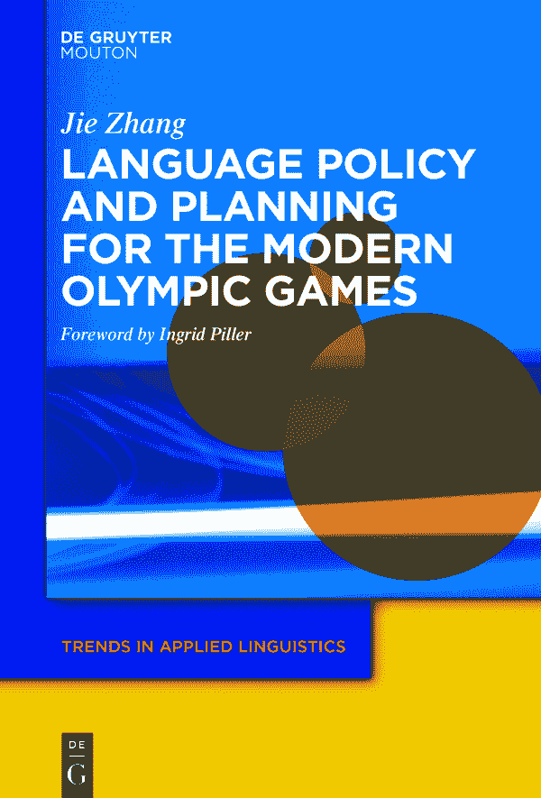


编辑：Ulrike Jessner


# 前言：中国与英语同步崛起的悖论

中国的崛起是 21 世纪初的定义性特征之一。然而，中国经济、地缘政治和军事影响力的增长也伴随着一个语言上的悖论：从中国教育和人力资源开发巨额投资中受益最深的语言是英语。在过去的几十年里，中国不断增长的中产阶级对英语学习的扩张如此剧烈，足以以“英语热”之名。结果是，如今中国的英语人数超过了英国，仅次于美国、印度、尼日利亚和巴基斯坦——中国是世界上第五大英语人口大国。

恢复其在伟大文明和强国中应有的地位，自 19 世纪和 20 世纪初遭受耻辱以来一直是中国的愿景。2008 年北京奥运会为展示已成就提供了完美机会。因此，中国为其奥运申办投入了大量资源。这包括语言资源，张捷展示了该国是如何进行这项投资的：通过提高社会各阶层的英语能力。

一旦 2008 年奥运会被授予北京，其目标不仅是让它完美，更要让它壮观。除了办好赛事本身，这还意味着通过将北京转型为全球化城市来改善环境。投入这一转型的细致规划和巨大资源令人惊叹。张洁（Zhang Jie）展示了数千万人口的语言能力是如何经过仔细评估和提高的。在 2002 年至 2007 年间，精通外语（主要是英语）的北京居民百分比从 22% 上升到 35%。从绝对数量来看，有超过 500 万人的语言能力得到了系统性的升级。

然而，张洁挖掘了更深层次的内容。她不仅以详尽的细节展示了北京奥运会的语言规划与管理，还展示了个人是如何经历向英语使用者和全球公民的转变的。大多数人尽力投入提高英语的努力中，但正如之前的研究发现的那样，他们的动力并非出于对英语以及与之相关的西方文化价值观的渴望。相反，他们的动力是对通过英语考试后的回报的渴望：大学录取和就业前景。

然而，并非所有人都能在平等的条件下竞争，将英语考试表现转化为社会晋升的门槛，使得现有的不平等凸显出来。在中国大都市之外，在英语考试中取得优异的物质条件——合格的教师、教材或媒体库——在许多情况下根本无法实现。

对英语的单一追求也导致了其他语言的贬值，正如张洁引用俄语所展示。俄语在北方边境省份曾达到很高水平，并在跨境交流中具有很高的实用价值，但随着大学录取与英语挂钩，它几乎一夜之间变得毫无价值。一位在整个中学教育期间学习俄语的奥运志愿者向研究者哀哀抱怨道：“我们县有很多俄罗斯人，所以我从未想过学英语。直到我离开家乡，才意识到英语在其他地方是如此重要。现在，学习俄语成了一种劣势！”

那是 2008 年的事。但这项研究并未此结束。

在成功举办北京奥运会并在经济和地缘政治上持续崛起的同时，语言政策和规划已被重新评估。随着中国现在准备举办 2022 年北京冬奥会，新冠肺炎永远地改变了“全球化”的含义（Piller, Zhang & Li, 2020）。这一次，中国遵循了一项与 2008 年夏季奥运会完全不同的全面语言行动计划：现在人们意识到英语能力供过于求，重点转向加强其他语言的语言服务提供。除了英语，中国还拥抱了真正的多语言愿景。中国大学现在开设了涵盖 101 种语言的课程——即所有与中国建立外交关系的国家的官方语言。虽然其中大多数语言的水平可能仍然有限，但正如本书详尽记录的那样，中国有将梦想变为现实的记录。

中国的崛起与英语的随之兴起可能已经走向终结。

英格丽德·皮勒（Ingrid Piller），麦考瑞大学

# 致谢

本书基于我的博士论文。当我在 2008 年开始这个项目时，我对语言多样化语境下的语言政策和规划的了解有限。我想向我的导师英格丽德·皮勒教授表示最深切谢意，她细致的指导、不断的鼓励和一如既往的支持使我能够完成论文和这本书。她在推进多语言主义和社会正义方面的学术努力对我产生了深远的影响。

在 2017 年 9 月到 2018 年 7 月期间，我有幸访问了北京语言大学（`BLCU`）的李玉明教授。在访问期间，我进入了李教授指导的北京语言资源高级创新中心（`ACLR`），并获得了关于其为 2022 年北京冬奥会的三个语言服务项目的宝贵信息。我深感谢李教授，他教我做一名学者不应局限于写论文和传授知识，更重要的是它要求我们具备社会责任感，以及解决实际问题的意识和能力。

2013 年，我与 De Gruyter 出版社签署了书稿合同。那时，我计划在 2015 年提交手稿。不幸的是，那期间我的生活让我措手不及。计划无法跟上变化。七年后，当我终于提交书稿时，我向《应用语言学趋势》（`Trends in Applied Linguistics`）系列的编辑们表示最深切谢意，他们巨大的耐心和信任使我完成了这本书。

诚心感谢我的校对布雷特·托德（Brett Todd）博士提供的见解反馈和帮助建议。此外，我向所有的参与者、信息提供者以及在项目完成期间各方面支持我的所有朋友和家人致以敬意和祝福。

最后，我必须感谢我的父亲张祥胜和母亲袁丽华，是他们多年来让我能够追求相对脱离家庭负担的职业和生活的奢侈。如果没有父母持续支持的强力后盾，我怀疑自己是否有勇气追求这样一个如此规模的项目。这本书献给你们。

# 缩写词和术语表

`ACLP`：北京语言资源高级创新中心

`Aifly`：Aifly 教育科技有限公司

`ASEAN`：东南亚国家联盟

`BBC`：英国广播公司

`BETS`：北京英语测试系统

`BFSU`：北京外国大学

`BOBICO`：北京 2008 年奥运会申办委员会

`BOCOG`：北京 2008 年奥运会组织委员会

`BOCOWG`：北京 2022 冬奥会组织委员会

`BSFLP`：北京外语计划

`CDA`：批判性话语分析

`CET-4`：英语四级

`CET-6`：英语六级

`CPC`：中国共产党

`CPPCC`：中国人民政治协会议

`EF`：学英语有限公司

`EFL`：作为外语英语

`ELLT`：英语学习与教学

`ELT`：英语教学

`ESL`：作为第二语言的英语

`EU`：欧盟

`FL`：外语

`GDP`：国内生产总值

`IFs`：国际体育联合会

`IOC`：奥林匹委员会

`LCTLs`：小众语言

`LEP`：语言教育政策

`LL`：语言景观

`LPP`：语言政策与规划

`LOTE`：英语以外的语言

`MOE`：教育部

`NCEE`：全国普通统一考试（高考）

`NNESs`：非母语英语使用者

`NOCs`：各国奥林匹委员会

`NSE`：母语英语

`OCOGs`：奥运会组委会

`OIF`：法语国际组织

`PLA`：中国人民解放军

`PRC`：中华人民共和国

`SL`：第二语言

`SOCG`：2000 年悉尼奥运会组委会

`TAC`：中国翻译协会

`TESOL`：对非母语英语者教学

`UK`：英国

`US`：美国

`VOA`：美国之音

`WTO`：世界贸易组织

`Advanced Reader`：《英语会话读（高级）》

`Elementary Reader`：《英语会话读（初级）》

# 第一章 作为语言学复杂事件的现代奥运会

## 1 现代奥运会的社会政治学

奥运会的历史可以追溯到古希腊。古代奥林匹运动是古希腊各城国家之间举行的一系列体育竞赛，旨在纪念奥林匹斯诸神，并持续了十二世纪（公元前 776 年至公元 393 年）。奥林匹亚曾是这些历史性古代运动会的所在地，为现代世界上规模最大、最具影响力的体育盛事——现代奥运会播下了种子。1896 年 4 月 6 日，奥林匹运动在中断 200 多年后，由法国教育家皮埃尔·德库贝滕男爵在雅典复兴，他怀着通过体育竞技促进国际和谐与理解的崇高理想。现代奥运会是一项每四年举办一次的国际性多项运动赛事，涵盖夏季和冬季运动。古代奥林匹运动推崇身体卓越，主要服务于宗教目的。在现代形式中，尽管表面上仍然追求身体卓越，但奥运会还扮演着文化、经济往往是政治的角色（Toohey and Veal, 2007，p. 1）。随着在所有维度上的迅速扩张，现代奥运会不再是（如果它们曾经是的话）仅仅是一项体育赛事，而是*事实上*成为一种文化、经济和政治现象。

在社会科学领域，奥运会作为主国家首要体育盛事的社会政治意义在近年来得到了越来越多的认可（例如：Blain, Boyle and O’Donnell, 1993; Brown, 2000; Brownell, 2005; Burton, 2003; Dyreson, 2003; Essex and Chalkley, 1998; Houlihan, 1997; Ikhioya, 2001; Jaffe and Nebanzahl, 1993; Smith and Porter, 2004; Toohey and Veal, 2007）。追求和赞助如奥林匹克运动会之类的大型体育赛事已成为全球各国和市政政府日益流行的策略。奥运会申办城市（在许多情况下，与其支持它们的国家政府合作）广泛声称，这一盛事可以带来社会和物质变化，例如体育基础设施的改善、可持续城市发展、全球媒体关注、旅游业繁荣，最重要的是为加强国家认同感和国际认可提供长期形象提升的承诺。

没有其他活动能在两周内像现代奥运会这样吸引如此大规模的全球关注。在过去的几十年里，来自 200 多个国家的约 10,000 名运动员，伴随着数量相当教练和官员、多达 15,000 名认证媒体代表以及数十万名观众，每四年聚集在一起两多周，参与、报道和观看这项体育赛事。这项赛事反过来被全球数十亿人通过电视观看、通过广播收听、纸质媒体阅读并在互联网上浏览（Toohey and Veal, 2007，p. 1）。从这个意义上说，奥运会也是一个全球媒体事件。对于奥运会主办国来说，全球媒体曝光是一把双刃剑。奥运会是主办市和国家通过强大的纸质、广播和电子媒体展示其文化并投影积极国家形象的重大机会。然而，主办市和国家也让自己暴露在来自国际媒体的严密审查之下。

从商业角度来看，举办奥运会也是忧喜参半的。一方面，旅游收益、企业赞助和奥运会的商业化产生了巨额收入。然而，吸引奥运会所需的先进建筑和技术使得举办夏季和冬季赛事都变成了一项相当昂贵且规模宏大的工程。每个主办市和国家都期待从奥运中获得巨大的回报，必须投入大量的物质和人力资源。在国际奥林匹委员会前主席`胡安东·萨马兰奇`的领导下，奥运会开始向国际赞助商转型。`奥运品牌`的销售使得奥运会背离了纯粹的体育精神，变得与其他任何商业化奇观无异。自从世界各国于 1896 年聚集在一起竞争以来，政治从未离开竞技场。体育经常被构建为“伟大的平等器”（Hogan, 2003，p. 100），因此奥林匹克运动被认为通过世界运动员之间的公平竞争来培养国际友好、和平和平（国际奥林匹克委员会, 2007）。一些学术和大众话语也将体育视为一种超越国界界、甚至超越国家认同的“通用语言”。然而，Dyreson (2003) 认为，“体育在现代形式下几乎一直是展示部落和特别是国家认同的竞技场，而不是庆祝全人类共同体的场合”（p. 92）。对奥运会的大量研究表明，这项体育盛事的现实比那些美好的承诺要复杂和争议得多。国际主义辞令与国家利益之间的紧张是奥运会的另一个核心矛盾（Blain, Boyle and O’Donnell, 1993）。作为一个亚洲发展中国家社会主义国家的首都，北京被选为 2008 年奥运会主办城市，因此在奥运历史上具有深远的社会政治意义。由于现代奥运会的全球意义，成为奥运强国一直是“中国持久以恒的终极梦想”（Dong, 2005，p. 533）。

古代奥林匹克运动在现代意义上并非国际性赛事，因为它只允许说希腊语的自由男性参加。自 1896 年以来举办的现代奥林匹克运动是多语言活动。尽管 1896 年雅典奥运会是当时举办规模最大的国际体育赛事，但仅有 14 个国家的 241 名运动员参加² (国际奥委会委员会, 2020a)。女性和有色人种并未参赛。一个世纪后的 2004 年，夏季奥运回到雅典，有来自 201 个国家的 10,625 名不同种族和性别的运动员参赛 (国际奥委会委员会, 2020b)。如果说首届雅典奥运会是一场涉及十多个国家、除匈牙利外均使用印欧语系的体育赛事，那么第二届雅典奥运会则是一场真正的国际性盛会，其交流跨越了数百个国家和语言。

现代奥林匹克运动，特别是二世界大战后的赛事，是复杂的语言活动。由于现代奥运会规模宏大，以及参赛各国文化和语言背景的多样性，可以预见到跨语言和文化的交流将面临许多困难和挑战。因此，此类活动的组织者必须做出重要的语言政策和规划决策，以确保赛事期间运动员和访客获得高质量的体验。然而，满足奥运会所有参与者的语言需求是一项极其艰巨的任务。从所有官方文件、媒体报道、游客信息和语言标识的翻译，到官方典礼、比赛场馆和新闻发布会的口译，再到为外国运动员、教练、官员、记者和访客提供其母语的即时信息，语言服务贯穿于奥运会准备工作的各个方面，在使体育赛事真正成为全球庆典方面发挥着至关重要的作用。

现代奥林匹克运动为语言政策与规划（`LPP`）的研究提供了丰富的资源。首先，由于现代奥运会涉及来自 200 多个国家和地区、拥有 80 多种官方语言的参与者，因此存在涉及地位规划（`status planning`）的重要问题。在整体规划的早期，组织者会有意识地选择将成为奥运会官方和工作语言的语种。具体而言，奥运会的地位规划问题包括用于官方文件、网站和典礼、媒体传播、比赛场馆、文化活动、公共公告、标识、VIP 随从、访客接待和观众引导等方面的语言选择。地位规划与声望规划（`prestige planning`）有密切的关系。语言的地位是其在特定社会环境中相对于其他语言的位置，而声望则是该社会环境居住者对这种关系的感知 (Ager, 2005)。声望规划指向那些与语言形象相关的目标。声望规划通过建立语言的积极形象，可以为语言规划的实施营造有利的社会心理环境。过去的奥运会见证了各种语言推广活动（通过官方/政府、机构、压力团体、个人进行），以提高语言在奥林匹克运动和国际领域的形象和价值。在奥运的聚光灯下，中国政府试图通过奥运会“向世界教导和推广汉语，并证明中文确实是一种全球范围内使用的语言” (北京奥委会, 2002)。官方制定了各种推广计划以鼓励和帮助外国人学习汉语，例如辩论、歌唱和讲故事比赛。从 2005 年开始，奥运组委会向海外发送的宣传材料中增加了“学习汉语”章节 (北京奥委会, 2002)。此外，现代奥林匹克运动经常在举办市推动语料库规划（`corpus planning`）活动，例如新术语的造词；拼写改革；字典的编写；公共标识英语翻译标准的制定；体育术语语料库及其门户网站创建；以及机器翻译软件、网站和应用程序的。奥林匹克运动近期的历史显示，非英语举办国试图制定一套英语翻译规范，以定义公共领域内英语的“标准”用法，并纠正“非规范”的英语拼写和语法。与主要由奥委会和举办地政府承担的地位规划和声望规划不同，语料库规划通常涉及具有更高语言知识的规划者。最后，组织者利用获取规划（`acquisition planning`，也称为教育规划）通过教育培训来实现地位规划、声望规划和语料库规划的目的。例如，在准备 1988 年奥运会期间，首尔奥委会制定了一项语言教育计划，并采用多样化的培训方法提高赛事运营人员的外语水平。通常，获取规划被整合到一个更大的语言规划过程中，在该过程中，语言地位得到评估，语料库得到修订，并最终通过从小学到大学的教育系统在国家或地方层面引入社会。这一规划过程可以涉及多种活动，例如在学校普及国家语言或国际语言；为运动员、教练、官员和奥运志愿者提供语言培训；培养少数教学语言（`LCTL`）专业人才；开发双语教学课程；编写语言教学材料；以及建立语言能力测试。

总结来说，奥林匹克运动是语言复杂化且文化多元的活动，需要“对奥运会的文化和语言维度进行战略性的整体规划” (LO Bianco, 1994)。语言能力与奥林匹克运动的成功与密切相关，为奥运会提供高质量语言服务需要全面、可行且可持续的语言规划。全面意味着奥运语言规划应涵盖所有目标、领域和语言服务类型；可行是指组织者需要根据自身的社会语言状况、多语言资源和预算制定奥运语言服务计划；最后，奥运语言规划应该是可持续的，这要求组织者将奥运语言规划嵌入到举办国的政治、经济、教育和文化长期战略规划中，为社会的可持续发展留下奥运遗产。

国际奥委会委员会（`IOC`）是一个国际非政府非营利组织，是管理和组织奥林匹运动最高权威。因此，理解现代奥林匹会的语言政策（`LPP`）应从分析国际奥委会的语言管理开始。超国家层面的语言管理涵盖了超国家组织内部的语言管理活动，以及该超国家组织对其成员语言政策产生的影响 (Spolsky, 2009)。在本节中，我采用了 Spolsky (2004, 2009) 的语言管理模型，从内部政策和外部影响两个维度来分析国际奥委会的语言管理。

### 3.1.1 内部政策

国际组织的领域内部政策主要涉及内部立法和官僚活动中的语言选择 (Spolsky, 2009, p. 208)，这涉及两个方面：官方语言和工作语言。Spolsky (2004, pp. 219–221) 识别了与语言政策并行的四个主要条件：社会语言状况、身份、变化以及与语言相关的人权和民权。首先，社会语言状况是指语言的数量和种类、每种语言的使用者数量和种类，以及每种语言在研究社区内外的交流价值。第二个条件与社区内部的国家、民族或其他身份的运作有关。语言不仅是交流工具，也是身份的象征。在超国家层面，语言的象征价值以及这些语言所代表的身份和权力关系与国际组织的形象密切相关。第三，自 20 世纪 90 年代以来，人类社会在全球化的影响下发生了巨大变化。在全球化进程中，英语已成为*唯一的*国际语言，并在许多国际领域发挥着领先作用。这种力量显著影响了国际组织的语言政策和实践。最后，人们日益认识语言选择是人权和民权的重要组成部分，这导致了对语言多元主义价值的重视，并接受了承认个人和团体继续使用自身语言的权利。这四个条件直接影响了国际奥委会官方语言和工作语言的制定。


通常，国际政策通过条约、宣言或宪章表达，这些条约只有在获得一定数量国家的批准后才生效，并且仅对批准这些国家具有约束力（Spolsky, 2009, p. 206）。《奥林匹宪章》是国际奥委会（`IOC`）采用的奥林匹主义基本原则、规则和章程的汇编。它管理着奥林匹运动的组织、行动和运作，并规定了奥林匹运动会的条件（International Olympic Committee, 2020）。显然，《奥林匹宪章》是`IOC`语言管理的（显性）政策基础。随着奥林匹运动的发展，`IOC`在保持奥林匹主义基本原则一致性的前提下，考虑到不断变化的内外环境，对《宪章》进行了多次修订。从《奥林匹宪章》的不同版本中可以看出，`IOC`的语言政策已从早期的单语主义变为二战后的双语主义，然后变为自20世纪90年代以来的多语言主义。

在现代奥林匹运动初期，法语是`IOC`的唯一官方语言。在17世纪到19世纪，随着法国成为欧洲经济和军事上最强大的国家之一，法语的威誉大大增强。在此期间，法语取代了拉丁语成为国际外交的唯一语言，并被用作国际条约的外交语言（Rickard, 1989, pp. 117–118）。《奥林匹宪章》首次于1908年出版，题为`ANNUAIRE DU COMITÉ INTERNATIONAL OLYMPIQUE.`。在该文件的基础上，奥林匹主义原则逐渐形成。从1908年到1924年，`IOC`发布了七个版本的《宪章》，全部仅用法语编写。尽管`IOC`自1930年起开始出版英语版的《宪章》，但《宪章》明确规定法语是`IOC`的唯一官方语言。这种法语单语政策一直持续到二战结束。

二战后，世界发生了剧性变化。法国殖民帝国崩溃，法语逐渐失去了其作为国际外交唯一语言的地位。同时，作为两次世界大战的最大受益者，美国向全球扩展了政治、经济和文化影响力，进一步促进了英语的传播。20世纪以来英语的全球传播与美国作为超级大国的崛起密切相关，特别是美国经济、技术日益增长的实力和地位。最终，英语从一种国家语言和区域通用语发展为世界上最广泛的交流手段，取代法语成为国际语言。在此期间，奥林匹运动发展迅速。各国际联合会（`IFs`）相继成立，国家奥委会（`NOCs`）的数量以及参加奥运会的国家和人数不断增加。在这种背景下，1949年版《奥林匹宪章》第61条（International Olympic Committee, 1949, p. 26）首次将英语列为`IOC`的官方语言之一。同时，该版本的第54条（International Olympic Committee, 1949, p. 23）要求奥林匹运动会组委会（`OCOGs`）为每项运动制作并分发一份包含三种语言（必须包括法语和英语）的节目和通用规则手册。从那时起，`IOC`的官方语言政策从法语单语变为法英双语。法语和英语形成了竞争关系，英语在组织内外的实际交流价值不断提高。

20世纪90年代，冷战形成的世界秩序两极格局崩塌。随着全球化和多极化的发展，以及对民主价值和人权意识的增强，包括`IOC`在内的许多国际组织开始支持多元化和多语言的观点，Lo Bianco（2007, p. 11）解释道：

> 现代奥运会正……通过增强对文化多样性和跨文化交流的意识，强调平等、优秀、诚信和和平共处的民主理想。其中的一种体现是……即要求东道国在奥运会之前和期间提供翻译设施和语言服务。语言服务已成为奥运会国际和平维护角色中不可或缺的一部分，因为它们促进了奥运会各个方面跨文化交流的便利与接纳。

自20世纪90年代以来，国际奥委会（`IOC`）已将其官方和工作语言政策转向以欧洲语言为主的多语种模式，希望通过提供更平等、多样化的语言政策，加强与成员国的合作，并展示出包容的组织形象。2020年7月17日，国际奥委会第136次全会通过了对《章程》的最新修订案。现版《章程》第23条（国际奥委会，2020，第52页）规定了国际奥委会的语言政策如下：

### 23 语言

1. 国际奥委会的官方语言是法语和英语。
2. 在所有会议上，必须提供法语、英语、德语、西班牙语、俄语和阿拉伯语的同步传译。
3. 若奥运《章程》的法语文本与英语文本或其他任何文件存在差异，除非另有书面规定，否则以法语文本为准。

《章程》承认语言能力的重要性，并规定国际奥委会的官方语言为法语和英语，当《章程》与其他国际奥委会文件文本出现差异时，以法语为准。除了法语和英语，《章程》还将阿拉伯语、德语、俄语和西班牙语作为奥运会的“工作语言”。这些语言有时由“非官方语言”进行补充。许多国家奥委会（`NOCs`）使用的语言通常会被包含在官方交流中，以便奥会组委会（`OCOGs`）接触更广泛的受众（Djité, 2009）。例如，奥委会团结曾支持将修订后的《体育管理手册》翻译成阿塞拜疆语、波斯尼亚语、格鲁吉亚语、高棉语、老挝语、拉脱维亚语、立陶宛语、葡萄牙语、俄语、西班牙语和乌尔都语（国际奥委会，2019，第64页）。值得注意的是，尽管英语在国际奥委会的内部管理、成员国之间及外部交流中被广泛使用，但国际奥委会仍在立法层面维持法语作为发起现代奥运运动语言的象征地位。与其他跨国家组织一样，国际奥委会需要缓解少数（理想情况下一种）工作语言的效率与所有成员国主权主张之间的紧张关系（Spolsky, 2009，第208页）。《奥林匹章程》（国际奥委会，2020，第12页）规定，应确保在不受任何形式歧视（包括语言）的情况下享有权利和自由。然而，事实上，国际奥委会在其立法和行政层面的内部运营中并未赋予所有成员国语言同样的权利。这一事实不可避免地导致官方/工作语言与非官方/非工作语言之间的权力差距，并引发涉及低地位语言使用者和语言少数族裔语言权的问题。

### 3.1.2 外部影响

对国际奥委会语言管理的分析还应考虑其对主办奥运会的成员国语言政策的外部影响。超国家组织通常尊重构成其成员国的主权。它们没有太多权威为单个国家制定政策，但有地位影响成员国制定政策并监督政策的实施。由于奥运会每四年分配一个主办城市，奥运会的组织工作由国际奥委会委托给东道国的国家奥委会。国家奥委会转而组建奥会组委会（`OCOG`）。例如，在2008年北京奥运会的情况下，第二十九届北京奥运会组委会（`BOCOG`）于2001年12月13日成立，即北京获得2008年奥运会主办权五个月后。奥会组委会自成立起便直接与国际奥委会通信，并遵循国际奥委会的指南和指示来组织奥运会。奥会组委会与国际奥委会合同的最低法律要求是在奥运事务中使用法语和英语。

国际奥委会试图影响奥会组委会和东道国语言政策的努力主要体现在维持法语作为第一官方语言的地位。在全球英语化的背景下，法语在奥运会的语言实践中正输给英语。自1984年洛杉矶奥运会后，法英双语政策在后续赛事中并未得到良好遵守。自2004年以来，国际法语组织（`OIF`）考虑到非法语国家使用法语的困难，法国和国际法语组织在其成员的帮助下，为奥运会组织者提供特定支持，以便其在奥运会期间尊重法语和英语的平等地位。2007年，法国前总理、国际法语组织督员让-皮埃尔·拉法兰与北京奥委会主席刘淇签署了关于在奥运会中使用和推广法语的协议，以实施《章程》的相关规定（Gui and Dai, 2008）。该协议提出一系列保护法语官方语言地位的措施，例如：建立北京奥委会和`INFO2008`奥运新闻平台的法语网站；制作北京奥委会出版物的法语版，包括场馆介绍和观众指南；招募40名法语翻译和记者；为数百名中国奥运志愿者提供法语培训并举办各种法国文化活动。

通过奥运会，国际奥委会（`IOC`）影响了许多主办国外语教育政策的制定与实施。在2000年夏季奥运会之前，悉尼奥运会组织委员会（`SOCOG`）通过悉尼法语联盟为`SOCOG`工作人员提供了一项法语培训计划，以确保官员和其他专业人士能够精通这种官方语言（Djité, 2009）。2014年索契冬奥会组织委员会也为奥运官员和服务人员进行了英语、法语和俄语的官方语言培训（Henning, 2014）。2008年奥运会申办成功以及2001年加入世界贸易组织（`WTO`），预示着中国将在国际社会中扮演更大的角色。伴随着中国在21世纪第一个十年世界舞台的崛起，发展机会与英语之间的联系也日益紧密（Zhang, 2011）。在奥运会前景和在全球治理中发挥更大作用的背景下，21世纪的第一个十年，中国对外语特别是英语的规定和规划经历了重大加速。一系列政策相继出台，旨在通过改革课程、教材、教学方法和评估程序，扩大全国范围内的英语教育并提高英语教学（`ELT`）的质量（Zhang, 2011）。例如，2001年，中国教育部（2001a）出台了一项政策，该政策倡议的制定是为了解决由于中国加入`WTO`和2008年奥运会预期带来的日益增长的英语需求，与20世纪90年代中学英语教学改革不尽人意的结果之间的差距。2002年至2008年间，北京奥委会（`BOCOG`）和中国政府开展了一项巨大的英语普及活动，涉及超过4000名运动员、裁判员、`BOCOG`工作人员、150万奥运志愿者以及数百万北京居民作为英语学习者，这将在第4和第5章详细讨论。

《奥林匹宪章》基本上赋予了奥会组织委员会（`OCOGs`）服务奥林匹克成员（即运动员、官员和媒体）的责任，首要目标是方便运动员、官员和国际游客的交流需求（International Olympic Committee, 2020）。在最近，`OCOGs`已经超越了两种官方语言的最低要求，将范围扩大到包括主办国的语言。还存在提供其他“工作语言”服务的趋势，以根据具体情况提供援助，并满足预期的媒体和游客混合群体的需求。在实践中，`OCOGs`历史上倾向于在许多不同层面考虑语言——例如官方典礼上的正式传译；向世界媒体提供新闻和信息；支持标牌和公共信息；提供医疗和安全服务；以及招募具有过语言技能的志愿者来用他们自己的语言欢迎外国游客（Djité, 2009）。

最近，1992年巴塞罗那奥运会、2000年悉尼奥运会、2004年雅典奥运会和2012年伦敦奥运会超越了《奥林匹宪章》的最低要求，成功举办了多语言奥运会。巴塞罗那作为西班牙第二大城市和著名的旅游地，有两种官方语言：西班牙语和加泰罗尼亚语，作为罗曼语族的成员，这些语言与法语密切相关。在旅游业，巴塞罗那的许多员工会说英语。在1992年巴塞罗那奥运会上，除了加泰罗尼亚语、西班牙语、英语和法语四种官方语言外，还使用了15种语言（Djité, 2009）。澳大利亚不仅是一个英语国家，还拥有发达的基于社区的传译服务。此类服务的建立是为了满足非英语背景移民的需求，并方便他们获得法律和医疗服务（Lo Bianco, 1994）。2000年悉尼奥运会能够利用其多元文化社会提供传译服务（Pym, 2003）。在2000年悉尼奥运会上，多语言服务热线运行了50多种语言（Pound, 2003）。2004年奥运会在希腊首都雅典举行。希腊是一个拥有悠久旅游业的欧洲国家，40%的人口将英语作为第二语言，此外广泛使用法语和德语。2012年伦敦奥运会举办地伦敦是世界上最国际化的城市，拥有200个族裔社区，共使用300种语言（Collis, 2007）。2012年伦敦奥运会让所有这些社区都参与了奥运会的举办。

从过去的奥运会可以看出，基于每个主办国（城市）国家语言能力的多语言服务已成为奥运会跨文化交流的新模式，这也是奥林匹克运动的事实上的语言政策。在当今世界的社会语言生态中，英语的主导地位与多语言并存。除了联合国外，全球性跨国组织“倾向于不喜欢多种官方或工作语言”，而且大多数像国际奥委会这样的组织其官方语言少于三种（de Varennes, 2012，p. 154）。此外，大多数国际组织的官方语言都是欧洲语言，其中英语是使用最频繁的官方语言（Zhang, 2019）。尽管国际奥委会进行了语言管理以及英语和法语官方化涉及地位规划，但还有许多其他因素影响着这些和其他语言在奥运会中的使用程度和方式（Vessey, 2018）。因此，国际奥委会和奥运会组织者需要充分理解奥林匹克运动的语言需求，并积极寻求解决方案以弥补官方语言政策与多语言实践之间的差距。

关于现代奥运会的学术文献非常详尽且在不断增加。在`Web of Science Core Collection`数据库的主题字段中以“Olympic Games”（奥运会）为关键词检索，截至2020年10月1日发现了5,292部著作。除了体育科学外，大多数社会科学学科及其子学科（主要是历史、社会学、经济学、政治和教育）对奥运会的研究做出了贡献（例如：Baldauf, 2006; Canagarajah, 2005）。最重要的是，奥运会已成为研究国家、地区和公民认同社会建构的一个引人入胜的场所。现有的学术出版物（Toohey and Veal, 2007, p. 2）已经探讨了通过举办奥运会的体验与认同社会建构相关的若干个重大且具有争议的话题。例如，许多中国和国际学者（例如：Blain, Boyle and O’Donnell, 1993; Brown, 2000; Brownell, 2005; Burton, 2003; Dyreson, 2003; Essex and Chalkley, 1998; Houlihan, 1997; Ikhioya, 2001; Jaffe and Nebenzahl, 1993; Smith and Porter, 2004; Toohey and Veal, 2007）已经展示了利用2008年奥运会来提升中国政府声望的战略策略，同时也唤醒了中国民众的民族意识和认同。然而，尽管学术界对奥运会的关注日益增加，奥运会研究中探索语言政策与规划在奥运会中的作用及其与认同建构之间关系的文献仍然稀少。

只有少数研究将语言政策、规划与认同建构的讨论置于奥运会的背景之下。其中一类研究通过综合官方报告和独立研究，探讨了奥运会的语言规划和政策制定。在为2000年悉尼奥运会准备期间，Lo Bianco（1994）敦促澳大利亚政府采取一项语言和文化计划，以补充基础设施、体育和电信规划。他解释说，该计划涉及八个方面，包括：1）在官方奥运会组织结构内建立语言服务部门；2）为奥运会上涵盖的所有运动以及典型的运动医学术语和争议解决术语建立多种语言的精确术语等值对应；3）对非英语背景的访问亚特兰大奥运会的游客、各队以及个人运动员样本进行市场调研；4）探索并鼓励市场创新，并建立一套针对技术支持型语言服务的审批系统；5）对奥运会上出现的图像或图标符号进行谈判，并对海外的预期进行审查；6）将外语英语和旅游活动与2001年的“全球大团圆”理念及奥运会联系起来；7）在规划游客人数和可能需要的语言时，为警察、医院和应急服务部门提供翻译和传译服务；8）在专业服务之余，系统性地将代表东道国宗教、文化和语言多样性的志愿者与专业服务联系起来。在他随后的出版物中，Lo Bianco（2007）为悉尼奥运会的语言规划和政策制定提供了详尽细节。特别是，该书关注了`Language Service Programme`（语言服务计划）的作用。

类似地，Djité（2009）指出，奥运会等国际赛事是语言复杂的活动，需要大规模的语言规划和政策，语言技能和服务对于任何赛事的成功都至关重要。通过特别关注悉尼奥运会，Collis（2007）分析了2012年伦敦的语言服务机会，强调了伦敦多语言支持的重要性。Huc-Hepher, Kelly and Phipps（2008）不仅对2012年伦敦奥运会，还对以往奥运会的成败提供了详尽细节。作者强调了“国际化”的相关性，以及伦敦文化和语言多样性的关键作用，作者认为这是奥运会组织者的一种资产。Zhang Jie（2011）将语言政策、语言实践和语言意识形态置于中国更广泛的社会经济和政治变化中，特别是2008年北京奥运会的筹备和举办。具体而言，研究将中国对英语的需求解读为奥运举办城市及其公民的认同建构。虽然没有专门关注奥运会，De Varennes（2012）探索了如`IOC`等超国家组织的语言政策制定和规划。该章节讨论了国际背景下多语言主义的相关性以及英语的主导地位，特别参考了超国家组织使用的语言与个人理解的语言之间的差距。Vessey（2018）通过回顾历史视角、特定的近期案例以及奥运会语言规划和政策涉及的核心问题，考察了官方语言政策与实际语言实践之间的差距。借鉴“超多样性”的概念，该章节断言奥运会可以被视为“超多样性”事件，它们汇聚了国籍、族裔、语言、宗教、性别等变量的显著新结合和互动（Vertovec, 2007: 1025），并在实践中创造了共享索引的“转瞬即逝”言语社区（Blommaert & Backus, 2013: 12）。

另一类研究调查了奥运会背景下的语言意识形态。例如，Pan（2011）对北京奥运会背景下关于英语的态度和意识形态进行了概述。该作者认为，这些态度和意识形态是中国范围内起作用的社会、文化和政治因素的结果。Vessey（2013）讨论了两份加拿大国家报纸上发生过的关于法语在温哥华奥运会中地位的语言意识形态辩论。关于开幕式上法语使用不足的报道引发了政界、官方评论员、公民以及在线新闻读者的抗议。她发现，这场辩论不仅涉及语言意识形态，还涉及身份认同和归属感的意识形态。

此外，少数研究关注奥运会的翻译和口译服务。例如，Pym（1996）讨论了1992年巴塞罗那奥运会上翻译和语言政策扮演的角色。Stuker, et al.（2006）研究了2008年北京奥运会的同声传译服务。Henning（2014）考察了2014年索契冬奥会上语言服务的作用。

与现有主要关注奥运会社会历史或政治经济层面的文献不同，本书从语言政策与规划的角度，探讨了奥运会筹备和举办期间的身份建构。本研究特别感兴趣的是2008年北京奥运会语言政策、语言意识形态、语言实践与身份建构之间的关系。

### 3.3 语言政策的扩展视角


语言政策（LP）是“政府或其他机构就语言与社会生活之间的关系所做出的刻意选择”（Djité, 1994, p. 63）。这些决策特别关于“在特定语境和社会中（地位）使用和学习某些语言（例如，说话和学习的权利）及其形式（语料）的合法性”（Shohamy, 2006, p. 45）。Spolsky（2004）认为，有效的第一步是区分语言社区语言政策的三个组成部分：“（1）其语言实践——在构成其语言库的变体之间进行选择的习惯模式；（2）它的语言信念或意识形态——对语言和语言使用的信念；以及（3）通过任何种的语言干预、规划或管理来修改或影响该实践的任何特定努力”（p. 5）。除了 Spolsky（2004）之外，我对语言政策的观点借鉴了 Shohamy 的观点。在《语言政策：隐藏议与新方法》中，Shohamy（2006）提出了语言和语言政策的扩展视角。对于 Shohamy（2006）来说，语言不是“一个封闭且有限的系统”（传统语言学家经常使用的概念），而是“开放的、动态的、充满能量的不断演变且个人化的”（p. 5）。这意味着语言本身不受任何严格或规定的正确性规则限制。以扩展的方式看待语言也意味着它不仅限于单词或其他语言标记，还包含了多模态的表达和使用形式：视觉、图形、图像、手势、服装、建筑等（Shohamy, 2006, pp. 14–16）。此外，人们在表面上似乎享有很大程度的表达自由，因为他们可以对日常生活中的语言使用做出决策。然而，大多数情况下，人们的语言使用受到公开和隐性的监管。语言并非空无意识形态；相反，它是通过施加特定的语言行为来操纵国家政治、社会、经济和教育议程的符号工具，同时也是创造和延续群体成员身份、身份、阶级以及各种形式施加的控制工具（Shohamy, 2006, p. 1）。

基于这种语言的广阔视角，Shohamy 将语言政策分为显性政策和隐性政策。她认为（2006, p. xvi），对政治和社会实体的语言政策的深度理解不应仅通过公开、形式化和法典化的政策文件（如法律和课程）来观察，而是应该通过主要但不限于当局使用的各种隐性机制来影响、创造和延续语言实践，即“事实政策”。

根据 Shohamy（2006），语言政策在操纵语言行为和确保意识形态转化为实践方面起着关键作用。在语言意识形态与实践之间存在多种显性和隐性的语言政策机制。图 1 在意识形态和实践的框架内提供了这些机制或政策工具的形式表示。为了理解真实的语言政策及其“隐藏议程”，Shohamy 认为仅研究显性和声明的政策是不够的，而是有必要研究隐性和事实性的政策。采用 Shohamy 的语言政策扩展视角，本书通过多种显性和隐性的语言政策机制探讨了北京奥运会的语言政策与规划。本研究讨论的具体政策机制包括行动计划、法律、法规、语言测试、语言普及计划、语言服务供应商、语言培训教材、语言景观、语言明星以及语言学习体验。除了显性政策过程，我同样关注隐性政策过程——“人们在日常社会实践中适应、抵抗和‘制定’政策的方式”（McCarty, 2015, p. 82）。对这些显性和隐性机制的考察需要采用三角互证法作为混合方法。

```
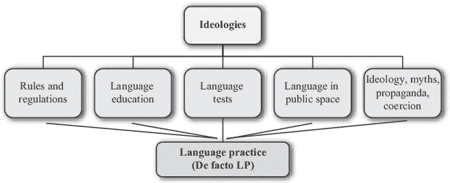
```

图 1：意识形态与实践之间的机制列表（Shohamy, 2006, p. 58）。

语言政策“始终基于语言意识形态，基于对社会期望的语言使用形式以及社会理想语言景观的想象”（Blommaert, 2006, p. 244）。语言意识形态，如 Errington（2001）所简练定义的样，是指“对语言的观念和使用具有情境性、局部性和利益导向的特征”（p. 110）。中性的意识形态分析关注“文化共享”的信念和实践，而批判性的意识形态分析则往往强调“语言作为特定群体符号统治工具的政治利用”（Kroskrity, 2005, p. 501）。

我关于语言意识形态的观点借鉴了 Piller、葛兰西（Gramsci）和布尔迪（Bourdieu）的理论。从批判分析传统来看，Piller（2015）强调语言意识形态由社会统治阶级的利益构成并不断重构，而且它们是多重、碎片、充满争议且不断变化的。葛兰西使用“霸权”一词来描述统治阶级如何使其意识形态成为“规范”（即被认为最“自然”和“必然”的观点，并被认为对社会所有人都有“益处”），并从而在大多数中形成共识（Freeden, 2003, p. 20）。对于葛兰西来说，统治阶级不仅能够通过施加国家强制力，还可以通过教育和常识等各种文化手段行使意识形态霸权（Freeden, 2003）。

布尔迪（1991）的“符号权力”和“误认”概念进一步阐释了葛兰西的“霸权”。对于布尔迪而言，权力在日常生活中被转化为符号形式，而不是作为显性的物理武力被行使。符号权力是一种隐形的权力，它以这种方式被“误认”为权力本身，从而在受权力影响的人眼中被“承认”是合法的（Bourdieu, 1991）。顺着葛兰西和布尔迪的观点，我认为嵌入语言政策中的意识形态绝不应被视为对社会所有成员都是“自然的”、“中性的”或“有益的”，相反，它们反映并服务于该社会统治阶级的利益。由于教育是行使“意识形态霸权”和“符号权力”的主要机制，语言教育政策被认为是国家行使政治和文化治理的有力工具，因为它可以通过语言教育推行各种政治和社会意识形态。

## 3.4 语言服务作为一种新的解释理论

本节介绍了语言服务作为一种新方法，用于分析和解释中国政府和北京奥运组（BOCOG）为 2008 年和 2022 年奥运会所做的语言规划和管理工作。

### 3.4.1 中国语言服务研究的发展

中国与外部世界日益频繁的接触以及 21 世纪社会生活的转型，使语言成为中国现代化和国际化驱动的关键因素。许多中国学者开始根据中国社会经济发展的实际情况反思语言问题；因此，语言服务研究随着时代环境的变化而出现。

“语言服务”`yuyan fuwu`（`language service`）概念在这一变革时期才开始在中国使用，它是 2008 年北京奥运会的背景下，由传统的翻译和口译服务发展而来的。目前，中国学术界对其定义尚未达成共识。赵世炬（2012）认为，语言服务是行为者以语言为内容或方法，向他人或整个社会提供帮助的行为和活动。李玉明（2016）广义地定义语言服务为利用语言（口语和书语）、语言知识、语言技术以及语言的所有衍生物来满足社会生活中各种与语言相关的需求的活动。李宪乐（2010）将语言服务分为两个层面：宏观层面和微观层面。

微观层面的语言服务主要指付费或免费的服务，以语言为内容或工具，由一方提供给另一方，使接收方从中受益。宏观层面的语言服务是指国家或政府部门对语言资源进行有效配置、规划和标准化，以确保人们和机构合理使用语言。

在 1986 年的文字工作会议上，刘道生指出中国文字工作的首要任务是加强语言理论和实证研究，促进社会调查与咨询，并为社会提供服务（Liu, 1987）。虽然当时尚未提出“语言服务”一词，但已经承认了语言的社会服务功能。在国家战略议程下，中国学者从 1986 年会议起就开始对语言服务采取建设性方法。21 世纪初，语言服务的理论框架得到了系统性讨论，一个独立的语言服务研究领域在中国开始成形。

在 2008 年北京奥运会前夕成立的多语言服务中心是中国首个政府性语言服务机构。该中心旨在奥运会期间提供 44 种语言的“无障碍”语言服务。自那以后，中国的语言服务行业进入了快速发展快道。中国出现了数以千计的语言翻译和咨询机构。同时，中国翻译协会（TAC）开始承担语言服务行业国家级协会的角色。许多政府部门、大学、学术组织和企业都参与了语言服务的研究。一系列以语言服务为主题的学术会议相继举行。

2010 年 9 月，中国翻译协会与北京市外事办办公室共同举办了以“大型国际活动语言服务”为主题的`2010 年语言服务行业国际会议`。郭晓勇（2010 年）发表了主旨演讲，题为“中国语言服务行业：现状、问题及对策”。在会议上，首次发布了中国语言服务行业的官方统计数据。2011 年 5 月，教育部语言信息管理司与南京大学语言战略研究中心共同举办了`语言经济与语言服务研讨会`。2012 年 1 月，广州大学、教育部应用语言学院和南京大学语言战略研究中心共同举办了`语言服务研究高级论坛`。2012 年 12 月，教育部和国家语言文字委员会发布了《中国语言文字中长期改革发展规划纲（2012—2020 年）》。该规划号召建立语言文字使用信息平台，以提供有关语言政策、法规、标准和使用的咨询服务。规划还号召发展“应急/援助类语言服务”，并建设国家多语言人才储备。

语言服务的概念最早于 2005 年左右在中国提出。在 2008 年北京奥运会、2010 年上海世博会等需要语言服务的重大国际活动的推动下，中国政界、学界在相关研究和实践中开始紧密合作。2013 年，中国政府提出了“一带一路”倡议，旨在连接中国与欧非的贸易和基础设施网络。这一倡议强调了中国国家语言能力的薄弱，以及外交领域对非英语其他语言（LOTE）专业人才的迫切需求。因此可以看出，中国语言服务研究的发展是由政府驱动，以满足国家社会经济发展的实际需求。

总的来说，中国的语言服务研究出现在加速改革、开放和经济转型的新时代，在这个时代，语言能力在政府的政治议程、经济发展、跨文化交流以及民众社会生活中发挥着日益重要的作用。在过去的十年里，在政府的支持下，中国的语言服务研究发展非常迅速，但也存在一些明显的问题（Zhang and Shen, 2016）。首先，对于“语言服务”的定义没有共识。一些宽泛的定义非常模糊，且与“语言政策”、“语言规划”和“语言管理”等现有概念重叠。对语言服务概念的不同解读导致中国学者在该领域采取了不同的研究方向和方法，这不利于该学科的发展。其次，中国现有的语言服务研究大多是理论分析或政策讨论。实证研究匮乏，特别是针对特定行业语言需求和语言服务的研究。此外，大多数现有的语言服务实证研究采用定量分析方法（如问卷调查），这对于描述宏观层面上语言服务提供的总体趋势有用，但在解释微观层面上语言政策和意识形态如何影响人们的语言选择和语言实践方面却无效。因此，建议语言服务研究借鉴定性研究方法，如访谈、观察和民族志，以理解官方语言政策与个人语言实践之间的关系。

### 3.4.2 语言服务体系

语言服务体系可以从提供者、接收者或内容方面进行研究：

#### 1) 语言服务提供者

政府、社会和个人都可以成为语言服务的提供者。政府是语言服务最大的提供者。首先，政府是语言服务的政策制定者。在中国，语言规范和语言服务标准过去由政府机构制定。现在，由于政府职能的变化，在大多数情况下由行业组织负责制定语言规范和语言服务标准。尽管如此，语言服务行业的标准制定仍受政府的指导和监督。其次，政府为公共语言服务提供资金，包括科学研究、学科建设、语言专业人才培训以及针对特殊群体的语言服务。最后，政府拥有与语言服务最丰富的资源，如语言服务人力资源、语言服务市场建设以及各种与语言服务相关的数据资源。出于这些原因，发展语言服务行业的责任在于政府。

除了政府机构，一系列包括个人在内的社会参与者也可以成为语言服务的提供者。学校、科研机构和行业协会等机构可以是语言服务的提供者，而高科技语言服务和创新语言服务主要由企业提供。在个人提供的语言服务方面，语言专家贡献最大。语言专家分布在许多行业和学科中，如语言学家、语言技术专家、语言艺术家、语言教师、翻译员、播音员、评论员、操作员、主持人、演员、词典编纂者、书法家、语言治疗师、心理顾问、谈判专家、调解员、字体设计师、校对员、录音员、文案人员、产品发言人、导游、购物导购、活动主持、网络主播、客服等。所有人都具有语言专业知识，并主要或部分从事语言服务。政府和社会提供的大多数语言服务都依赖于语言专家。

#### 2) 语言服务的接收者

接受付费语言服务可以被视为一种“语言消费”，因此付费语言服务的接收者是“语言消费者”（Li, 2016）。付费语言服务使语言服务成为一种商品，即一种可以为了经济价值进行销售的产品。当付费语言服务的发展达到一定规模时，语言服务行业和语言服务市场便形成了。

政府是语言服务最重要的接收者。当他们制定如国家语言标准和语言服务行业标准等语言政策时，需要咨询专家并购买语言服务。同时，政府还有责任向社会提供语言服务的公共产品，例如义务教育阶段的语言教育、国家/官方语言的推广、少数语言和方言的保护等。这些公共产品在经过政府购买后，提供给相关的语言消费者。

社会各行各业、各阶层的人都可以语言服务的接收者。例如，语言残障人士（如聋哑人、智力障碍者、自闭症儿童或语言发育迟缓儿童）对语言教育和培训有特殊需求，因此需要专业的语言服务。为了提供专业的语言服务，语言专家本身必须首先接受由专门提供相应服务的企业和机构提供的特定目的语言教育（这本身就是一种语言服务）。

接受免费语言服务可以被视为接收“语言福利”（Li, 2016）。免费语言服务通常由政府机构提供。在许多国家，义务教育阶段的公立中小学生享受着由国家机构提供的语言福利。李雨明（2016）呼吁对与语言福利相关的问题引起学术关注，例如：谁应该享受语言福利，政府和社会如何提供语言福利，以及应该使用什么制度来保障人们享受语言福利的权利。

#### 3) 语言服务的内容

关于语言服务内容的讨论范围取决于我们如何定义语言服务。如果我们认为语言服务是使用语言（包括文本）、语言知识、语言技术以及所有语言派生品来满足语言生活（`Yuyan Shenghuo`）的需求⁴（Li, 2016），那么语言服务的内容就是极其广泛。

除了语言教育和培训、语言翻译、语言艺术、广告和广播外，随着现代技术的进步，新形式的语言服务正在蓬勃发展。例如，造 8 亿中国互联网用户的语言技术服务，正通过互联网成为各行各业的重要支撑。赵世巨（2012）根据内容将语言服务分为以下六类：

1. **语言知识服务**：如字典编纂、面向自然语言处理的语言学研究、语言规范和标准的制定、各种语言知识和材料的数字化、语料库建设。

2. **语言相关技术服务**：如语音合成技术、语言和文字识别技术、词库技术、语音和文字识别/检测技术、机器翻译技术、数据检索技术、文本转换技术、文本排版技术、文字刻字技术。

3. **语言工具服务**：如电子翻译机、在线翻译、智能多语言服务系统、语言和文本编辑软件、音频播放器、文本阅读器。

4. **语言使用相关服务**：如速记、命名、配音、广播、打字、秘书工作、语言培训、语言能力测试、口语和面语管理、语言咨询、标识制作、广告。

5. **语言康复服务**：如口吃矫正、聋哑语言训练、失语症的诊断与治疗。

6. **语言教育服务**：如国家通用语言和汉字教学、外语教育、对外汉语教学。

语言服务的一个主要特征是，它们在完成任务时往往与其他活动交织在一起。如果语言服务贡献了任务的大部分，则可以被视为`基础语言服务`；而如果语言服务在某项工作中占比很小，则可以被视为`辅助语言服务`（Li, 2016）。外语培训、语言能力测试、语言政策咨询、翻译、排版和校对是语言服务作为主要内容的基础语言服务实例。在零售业中，售前和售后的客户服务沟通非常重要，并在很大程度上决定了客户满意度。然而，客户满意度的整体水平最终取决于产品质量，因此语言服务在零售业务的客户中是辅助性的。在书中，我将`语言服务`作为一个新的解释理论，来分析 2008 年北京夏季奥运会和 2022 年北京冬类奥运会的 LPP（语言政策规划）。

### 3.5 语言的政治经济学

近年来，作为不断扩张的服务经济的一部分，全球范围内涉及某些语言和沟通劳动的职位剧增（Piller, 2012, p. 88）。过去十五年里，在中国发展的语言服务学术话语尚未被国际学术界接纳。然而，自 20 世纪 80 年代以来，许多国际学者已广泛讨论了全球化新经济背景下的相关语言问题，并发展了如“语言资本”、“语言商品化”、“语言劳动”、“语言工作”以及“语言工作者”等概念和理论。在政治和经济状况变化的背景下，应对这一新语言现象的国际研究通常借鉴了社会学家皮埃尔·布尔迪厄 Bourdieu（1986; 1991）的著作，以探索在全球化新经济中，语言和文化资本如何转化为经济资本。Bourdieu（1986）区分了社会中的三种基本资本类型，它们都是可以相互转换的：经济资本、文化资本和社会资本。

文化资本主要以三种形式存在：作为具身化状态，表现为身心的的一种倾向；作为客体化状态，表现为文化商品，例如画作、书籍和工具；以及作为制度化状态，表现为一种客体化的形式，如教育学历。“语言资本”是通过家庭和学校中对语言实践的正当化而获得的一种具身化文化资本。此外，Bourdieu（1991）断言语言反映了社会内部的权力关系。他（1991）区分了两种语言市场：正式市场和非正式市场，前者与国家的权力和权威有更紧密的联系。

在特定的语言市场中，语言资本在不同语言和不同表达风格之间的分配是不均等的。传统上，国家和官方语言在政府、商业和学校等正式市场中具有高度需求并受到重视，而地方语言则倾向于在当地社区内部非正式市场中使用（Rassool, 2013）。因此，对一个国家的国家或官方语言的掌握代表了该国正式语言市场中高价值的语言资本，使那些具备该语言能力的人比其他人具有优势（Nishioka and Durrani, 2019）。缺乏主导语言的语言资本可能成为排除在工作、教育和高地位群体之外的依据。在全球语言市场中，英语如今已成为跨文化交流的通用语，因此具有高价值的语言资本和符号权力，这种力量可以在对英语需求极高的工作中转化为经济收益。

Thomas Friedman（2006）将全球化分为三个阶段：全球化 1.0 由国家国际化驱动的；全球化 2.0 是公司国际化驱动的；而全球化 3.0 是个人国际化驱动的。针对全球化特征的变化，Piller（2012, pp. 76–77）讨论了跨文化商务沟通的三个阶段：跨文化商务沟通 1.0 研究侧重于比较不同国家人士的沟通风格；跨文化商务沟通 2.0 研究将重心转向国际公司内部的沟通；跨文化商务沟通 3.0 是最新的阶段，以个人作为跨文化沟通的中心，出现了专门雇佣进行跨文化交流的员工。跨文化商务沟通 3.0 的特征是语言和沟通技能的商品化。

在社会语言学、语言人类学和语言经济中，与“语言资本”密切相关的术语是“语言商品化”，它描述了语言如何为了市场目的而被重新配置并被视为一种经济资源（Heller, 2010a, 2010b; Heller and Duchêne, 2016）。Heller（2010a）断言在晚期资本主义的政治经济条件下，全球化新经济使得语言作为完成工作的手段（工作过程）和作为劳动的产品（工作产品）具有了日益重要的经济角色。


沟通（尤其是语言和多语言主义）以多种方式成为全球化新经济的一个重要结果，是“语言工作”以及“语言工作者”的出现（Duchêne, 2009; Heller, 2005; Heller and Boutet, 2006; Tange, 2009）。`Piller (2012)`认为，在一个商业活动以知识、信息和服务为中心的经济中，语言和沟通成为人们工作的一部分（p. 88）。“语言工作”一词描述的是那些很大程度上由语言相关任务组成的工作，如教学、翻译和口译或呼叫中心工作（`Piller, 2012`, p. 88）。作为商品的语言代表了晚期资本主义的一种新劳动形式（`Urciuoli and LaDousa, 2013`）。

`Holborow (2018)`也对语言的商品化进行了评论。与一些社会语言学描述倾向于认为语言商品化的影响是塑造了一个顺从的语言劳动者（其语言技能可以转化为工资溢价等经济回报）不同，她通过马克思主义视角认为，劳动力（包括语言技能在内）在劳动力市场上作为商品购买，其价格低于其通过增加销售额所创造的价值（例如呼叫中心操作员）。尽管语言知识和技能具有某些经济价值，但`Holborow (2018)`认为，新自由主义将语言视为人力资本商品的论调过于简单化了：“它人为地将语言从一系列伴随技能孤离开来，它掩盖了社会权力问题，以及职场中谁从语言技能中获利，或许令人担忧的是，它暗示了一种语言的还原论观点”（`Holborow, 2018`）。此外，`Holborow (2018)`还探讨了“语言劳动者”的主动社会主体维度，他们以各种方式抵抗语言商品化的尝试。

# 4 总结

鉴于参与者的数量和多样性以及电视和互联网用户的规模，2008 年北京奥运会可能是以来举办过的语言最复杂的事件。尽管关于奥运会有大量的学术文献，但奥运会作为语言政策规划（LPP）研究中心的价值尚未得到充分认可。为了填补这一研究空白，本书将语言政策、语言意识形态和语言实践的讨论置于北京奥运会的背景下。通过采用扩展的语言政策（LP）视角，本书不仅考察了显性的自上而下政策（行动计划、法律、法规、语言考试），还考察了隐性和事实上的政策（语言推广计划、语言服务供应商、语言培训教材、语言景观、语言学习明星和语言学习经验）。本书还试图桥接两种研究范式：一是中国学者对语言政策和语言服务的建构性研究；另一类是西方学者对语言意识形态和语言工作的后结构主义研究。通过这种方式，本书分析了北京已举办和即将举办的两届奥运会在 LPP 和语言服务面临的挑战与成就，同时揭示了语言意识形态如何在宏观层面驱动 LPP 决策，并在微观层面影响个体参与者的语言实践。

# 第 2 章 在奥运会光环下重塑中国

## 1 2008 年北京奥运会的历史与现实意义

奥林会对中国意味着什么？在理解 2008 年北京奥运会的语言政策和规划之前，这是一个需要回答的重要问题。第 29 届奥运会在世界历史的关键时刻来到北京，既代表了日益全球全球化，也代表了中国近期巨大的社会经济变革（`Xu, 2006`）。获得举办会权为中国的现代化进程和国际融合提供了额外的动力。无论从内部还是外部，2008 年北京奥运会都承载着重塑中国的历史使命，即构建国家认同和追求国际领先（`Xu, 2006`）。

### 1.1 褪逝的光辉与失去的认同

是中国世界上最古老的持续文明之一，其文字历史可以追溯到商朝（约公元前 1700 年至公元前 1046 年）。在几个世纪里，中国作为一个领先的文明，在科学和艺术方面领先世界其他。在经济上，中国拥有自给自足的经济和自给自足的国内贸易。在 19 世纪以前，中国拥有世界上最先进和社会经济之一。直到清朝乾隆时期（1711–1799 年），中国的国内生产总值（GDP）仍占世界的三分之一（`Niu, 2008`, p. 40）。社会稳定和经济繁荣让清朝统治者（1644–1912 年）陷入了中国为中心的世界观（`Adamson, 2002`），这导致了与世界的自我孤立。天圆地方 `tian yuan di fang` [Round Heaven – Square Earth] 中国一个古代而持久的文化概念，是中国为中心的世界观的最高表现。古代中国人认为天空将其圆形的影子投影在地球中心（`Tang, 2010`），因此中国 `zhongguo` [China] 字面意思是“中间之地”。影子下的区域，即天下 `tianxia` [literally, land under the Heaven]，是被天赋予中国皇帝的。方形未受天光照射的角落则由夷 `yi` [foreign barbarians] 统治。千年来，这种中国为中心的世界观一直处于中国自我认同构建的背后。对西方“夷人”持有中国为中心的世界观，清政府禁止唯一通商口的当地中国人学习外语（`Niu, 2008`, p. 34）。像除中文以外的所有语言一样，英语在中国封建社会中被视为“蛮夷语”（a barbarian tongue）（`Adamson, 2002`）。

18 世纪欧洲见证了革命性的变化，尤其是大英国，这标志着一个新时代的开端和新世界结构的形成。农业社会保证了古代中国封建社会的持续繁荣，但严重阻碍了中国晚期封建社会生产力的发展。清朝实施的闭关锁国导致中国与世隔绝，甚至扩大了中国与欧洲国家在综合国力上的差距。然而，整个欧洲尤其是英国，正被理性主义、民族主义、殖民主义以及最终的工业革命崛起所变革并注入活力。

1840 年英国与大清帝国之间的鸦片战争标志着中国历史的转折点。战争的结果是中国沦为半殖民地半封建国家，清朝晚期的封建统治者终于意识到西方在科学技术上的优越性。在随后的百年里，经济落后的中国饱受了外国侵略、内战和各种政治冲突的苦难，直到 1949 年中华人民共和国成立。政治动荡和经济落后不仅损害了中国人民的民族自豪感，也破坏了他们以中国为中心的国家认同。从那以后的一多世纪以来，自卑心理已在中国人的脑中制度化（`Dong, 2005`）。1840 年后外国入侵带来的耻辱和屈辱，让处于共产主义领导下的中国人执着于摆脱“东亚病夫”的形象（`Dong, 2005`）。

1993 年北京申办 2000 年奥运会的失败，进一步加剧了这种失败和挫败的民族心理。复兴一个统一、凝聚且强大的中华民族认同，并重回国家伟大，成为追求北京奥运会的内在动力。人们广泛认为，成功举办奥运会可以结束饱受西方列强侵凌和隶属的所谓“百年国耻”，并成为中华民族伟大复兴进程中的一个里程碑。参加奥运会并取得优异成绩具有追赶甚至超越西方列强的象征意义（`Fan, Ping and Huan, 2005`）。

## 1.2 现代化进程中的中国认同危机

中国的改革开放始于 40 多年前，在十年的文革（1966–1976）之后，文革使国家处于经济崩溃的边缘。直到 1978 年中共十一届三中全会召开，中国领导层才开始聚焦于经济发展。中国共产党（`CPC`）将所有工作的重心从阶级斗争转向社会主义现代化驱动——即农业、工业、科技和军事的现代化。在开始对经济进行改革开放后，中国从 1978 年至 2008 年的三十年间，年均 GDP 增长率达到 9.8%（`Xinhua, 2008c`），并在 2010 年超越日本成为世界第二大经济体（`Associated Press, 2010`）。

正是 1978 年以来对资本主义市场机制的采用，让曾经贫困的中国变成了一个日益繁荣的国家。然而，在去中心化和市场化的现代化驱动面前，国家传统的文化观念和社会主义原则往往是不可调和的（`Wu, 2007`）。因此，经济的成功是以国家认同为代价的。自 20 世纪 80 年代以来，西方化现代化所带来的巨大社会经济转型导致了一系列认同危机，例如民族认同的丧失以及传统和社会主义价值观的衰落（`Zheng, 1999`, p. 47）。

因此，中国的认同危机也影响了公众对`CPC`领导层政治合法性的态度。由于飞速发展的经济改革与滞后的政治改革之间的差距，从 20 世纪 90 年代开始，不同社会群体对信仰危机产生了日益增长的公众担忧，尤其是年轻一代，他们被媒体描述为“沉思的一代”、“伤痕的一代”、“浪费的一代”、“迷失的一代”和“堕落的一代”（`Zheng, 1999`, p. 48）。据报道，公众对他们所属的社会持冷淡态度。一项全国性调查显示，在整个 20 世纪 80 年代，个人对社会主义国家的忠诚度严重削弱（`Zheng, 1999`, p. 50）。

通过向西方的“大开放”，全球文化侵蚀“中国式”文化的可能性开始引起中国领导人的警觉（`Knight, 2006`）。前`CPC`总书记（1989–2002）及`PRC`主席（1993–2003）江泽民在纪念`CPC`成立 80 周年的演讲中，呼召全党“在人民中倡扬爱国主义、集体主义和社会主义思想”，并“反对和抵制金钱主义、享乐主义、极端个人主义和其他颓废思想”（`Knight, 2006`）。中国政府意识到，必须更多地依靠爱国主义来加强其合法性，而这种合法性已被去意识化和市场化驱动所削弱（`Xu, 2006`）。大型体育赛事的成功举办和中国运动员的国际成功被认为给国家带来了自豪感和希望，这在新的转型时代是所需要的（`Fan, Ping and Huan, 2005`）。此外，大型体育赛事已被证明是不同背景下国家凝聚力的主要来源。国家凝聚力是一个多要素的概念，以爱国主义、归属感和认同、自我意识和主体意识为主要因素。由于体育与这些因素的广泛联系，体育被视为激发民族精神、促进国家认同形成并最终增强国家凝聚力的有效手段。因此，2008 年奥运会被赋予了一系列奥运目标，正如江泽民的这段话中所说：“申办成功将促进国内稳定和经济繁荣。中国奥运会的目标是提高民族精神，加强海内外华人的团结”（引自 `Fan, Ping and Huan, 2005`, p. 514）。另一个例子是，中国奥委会荣誉主席、北京第十九届奥运会组委会（`BOCOG`）顾问何振亮宣布，中国应该通过国家凝聚力和自信让 2008 年奥运会取得成功（`Kong, 2006`）。

通过现代化赶上西方资本主义世界一直是中国的国家抱负，而奥林会在激发国家对现代化的热情和动力方面发挥了重要作用（`Fan, Ping and Huan, 2005`）。事实上，可以认为 2008 年北京奥运会实现了增强国家凝聚力与团结的目标。在筹备奥运会期间，中国的国家凝聚力通过“志愿者服务”和“公众参与”的形式表现出来。凭借 94.9% 的支持率和 150 万奥运会志愿者，中国人民对奥运会付出的巨大热情和支持令世界印象深刻。中国人民以前从未像现在这样如此地关注奥运会。由 2008 年北京奥运会激发的这种促使绝大多数中国民众抓住每一个机会参与这一史有以来规模最大的体育盛事，并反过来增强了中国人的凝聚力。在奥运会召开前夕，几项调查（`Ogilvy Group and Milward Brown ACSR, 2008`; `Pew Research Center, 2008`）发现人们对北京奥运会感到非常兴奋，而国家自豪感是中国这种狂热情绪的关键驱动力。虽然奥运会大部分在北京举行，但奥运会不仅关乎北京，而是关乎整个国家。

### 1.3 全球化世界中中国的形象危机

除了克服中国的自卑感以及增强国家认同感与团结外，奥运会的第三个目标是向世界展示一个中国的全新形象。中国作为远东的一个共产主义国家，长期以来一直有着“终极他者”的形象（`Wu, 2007`）。中国日益增长的经济实力引起了全球的关注，也引起了西方世界的过度担忧。中国崛起的各个方面的影响在国际社会以及中国国内都引发了激烈辩论（例如：`Agarwala, 2002; Hu, 2007; Huntington, 1996; Kennedy, 1987; Overholt, 1993; Ramo, 2004; Xia and Jiang, 2004; Zhang, 2016`）。一个被广泛持有的观点是，中国的国际形象落后于其经济发展（`Ramo, 2007`）。面对 1978 年改革开放以来中国快速变化的复杂性，中国在国际社会中的形象未能跟上这些持续不息的变化。由于复杂的政治、历史和文化原因，中国在国际社会中的形象相当复杂、矛盾且神秘。2007 年皮尤全球态度调查（`Pew Research Center, 2008`）显示，近年来，大多数国家对中国的态度变得更加负面。根据 Y&R 品牌资产评估值小组开展的 2004/05 年调查（涉及 45 个国家的 50 多万受访者），`Ramo (2007)`指出，中国是地球上最不被理解的国家之一。人们对中国的常识仍然很低：“人们知道中国不同，但对这种差异的根源或影响几乎不了解”（`Ramo, 2007`，第 26 页）。他进一步认为，中国国内外形象的错位已成为其努力更好地融入国际社区过程中的战略性威胁。

由于中国的形象危机，通往北京之路充满了困难。西方报纸在申办期间的社论显示出高度的敌意：“中国不配拥有奥运会”、“不受欢迎的申办”、“与中国绑定在一起的奥运会”（`Brownell, 2007`，第 4 页）。奥运会被许多发达国家视为新帝国主义时代的预兆（`Brownell, 2007`）。在奥运会召开前，西方政治家、人权组织和媒体评论员经常将奥运会作为其议程的平台。例如，2007 年 3 月，演员米亚·法罗发起了针对中国的攻击，将奥运会称为“种族灭绝游戏”（`Farrow and Farrow, 2007`）。2001 年发布的第 29 届奥运会号“新北京，新奥运”充分证明了中国展示新形象的决心。对于中国来说，奥运会提供了一种促进国家认同的合法途径。

### 1.4 作为软力的良好形象

追求并赞助奥运会是中国提升形象并寻求在全球舞台获得权力的重要战略。这一战略与中国长期以来寻求的软实力密切相关。2007 年，由哈佛教授约瑟夫·奈（`Nye (1990)`）提出的“软实力”成为当年中国议会会议的热点。尽管其作为描述性理论的实用性经常受到挑战，但软实力仍被用作术语，用于区分文化、价值观和思想对他人行为的微妙影响与军事行动或经济激励等更直接的强制措施（即“硬实力”）。例如，中国最高权力机关全国人民大会代表彭富春表达了这一观点：“我们绝不能低估建设软实力的重要性，因为经济奇迹只是中国在世界舞台崛起的一方面”（`People’s Daily, 2007`）。鉴于此，中国一直努力争实现“另一方面”，即通过外交和国家形象建设施加更大的国际影响力。`Fan (2010)`强调国家形象是国家软实力的核心组成。因此，创造和提升良好的国家形象是中国发展规划中不可分割的一部分。毫无争议的是，国际舞台上的权力很大程度上源于一个国家将其军事、经济、政治或文化重要性以良好且有力的方式展示出来。反之，国际社会对所展示形象的认可，对于现任政府的合法性和权力是一个重要的保障。

如果我们了解中国申办奥运会所处的社会政治背景，就不难理解为什么《北京奥运会行动计划》（`BOCOG, 2002`——作为准备北京奥运会的总方针而发布，将其主要战略目标之一设定为“为北京打造新形象”。这场为期 17 天的体育盛宴是中国三十年来重新与世界联系努力的结晶。`2008 项目调查`是由奥美智集团（中国）和 Millward Brown ACSR 联合发起的，它调查了中国火炬传递路线沿线中国居民对即将到来的奥运会的态度和意见。研究发现，中国拥抱奥运会的狂热支持了这样观点：中国将奥运会作为催化剂，实现其向世界展示新国家形象并在此过程中赢得尊重的雄心（`Ogilvy Group and Millward Brown ACSR, 2008`）。不久后，皮尤研究中心（2008）在其“全球态度调查”中证明，大多数中国人相信 2008 年北京夏季奥运会将改变世界对他们国家的看法。中国受访者表示，他们的国家将是一个成功的举办国，奥运会将提升中国的形象并扩大其国际影响力。除了认为北京奥运会对国家有益之外，该项目还发现，所有人口统计群体中的绝大多数人都表示，这一活动对他们个人非常重要。北京市民更有可能产生这种想法。无疑，2008 年北京奥运会增强了大多数普通中国人对自己以及对国家的信心。奥运会的成功申办和举办被中国政府及其人民视为中华民族伟大复兴的重要象征。

## 2 中国成为奥运会举办国的之路

一个世纪以来，中国举办奥运会的“梦想”一直与其建设强大国家的梦想交织在一起。通过现代化追赶西方资本主义世界一直是中国的国家雄心，而奥运会在激发整个国家对现代化的热情和动力方面发挥了重要作用（`Fan, Ping and Huan, 2005`）。中国参与奥运运动的历史可以追溯到奥运会之初，1895 年，现代奥运会之父皮埃尔·德·库伯丁致信清朝首席大臣李鸿章，敦促中国参加第一届奥运会。雅典奥运会筹备委员会也于 8 月 16 日通过外国使馆向中国发出了邀请，但当时中国正面临国内动荡和外国入侵的双重威胁，因此未能参加。1904 年，许多中国报纸和期刊报道了第三届奥运会；从 1907 年开始，中国基督青年会（`YMCA`）和中国境内的传教学校开始宣传奥运会。那年的 10 月 24 日，体育倡导者、著名教育家张伯亭在天津`YMCA`组织的第五届校运运动会上发表演讲，敦促中国加强准备并尽早参加奥运会（`Zhou, 2008`）。1908 年，中国媒体报道了在伦敦举办的第四届奥运会，并宣布“奥运会在世界上是无与伦比的”。同年，一本名为《天津青年》（`tianjin qingnian` [*Tianjin Youth*]）的杂志刊登了南开学生的一篇题为《体育》的文章，其中提出了三个问题：“中国何时派运动员参加奥运会？中国何时获得金牌？中国何时举办奥运会？（`Zhou, 2008`）”。第一个问题的答案最终在 1932 年出现，当时刘长春参加了洛杉矶奥运会；第二个问题在中国在 1984 年同样在洛杉矶举行的奥运会上获得 15 枚金牌时得到了解答。最后一个问题在提出整整一个世纪后得到了解决，即北京在 2008 年首次举办了奥运会。

1991 年苏联的解体打破了全球舞台的权力平衡，使中国采取了日益“国际化的立场”（`Lam, 2002`, p. 246; 2005），并积极开展多边外交以实现更密切的国际合作。这种“国际立场”推动中国将奥运会作为其在国际舞台上的秀。从 20 世纪 90 年代初，中国政府一直大力支持中国举办奥运会的想法。（注：原文此处存在大量重复错误，翻译已清理）。


尽管奥林精神超越了政治体制、意识形态差异、文化传统和种族，但每届奥林会主办国的选拔一直涉及竞争候选者之间的政治博弈。北京提交申请后不久，一些西方国家便以人权问题为由，反对北京成为 2000 年奥运会的可能申办城市。除了严重干扰选举的政治因素外，环境污染、语言障碍和现代基础设施不足也是国际奥委会委员会（`IOC`）成员对在中国举办奥运会的三大关注点。1993 年的申办成为中国解决自身弱点的镜子。从申办失败中吸取教训后，北京市在继续发展经济的同时，开始大力提高公众环保意识并发展基础设施建设。当北京在 1999 年第二次申办奥运会时，中国作为一个发展中国家，过去十年保持了 10.8%的年经济增长率（`en.olympic.cn`, 2006）。作为首都的北京也经历了巨大的经济增长，1999 年国内生产总值飙升至 3278 亿美元，人均 GDP 达到 2619 美元（北京市统计局, 2019）。从 1993 年到 2001 年，北京城市绿化率从 28%增加到 38%（`Yang`, 2007）。在 1996 年至 2000 年间，北京共投入了 1382 亿元人民币用于现代设施的建设，其中包括两条环路和数百个体育场馆（`Fu`, 2001）。与此同时，中国已开始对体育事业的严肃投入获得回报，在重大世界赛事中取得了巨大成就。在 1996 年亚特兰大奥运会上，中国赢得了 16 枚金牌、22 枚银牌和 12 枚铜牌，金牌数和奖牌总数均位列世界第四（`en.olympic.cn`, 2006）。在 2000 年千禧年的悉尼奥运会上，中国以获得 28 枚金牌、22 枚银牌和 15 枚铜牌取得了历史性突破，成为仅于美国和俄罗斯的世界第三体育大国（`en.olympic.cn`, 2006）。悉尼奥运会纪录性的金牌收成是中国奥代表团以来来的最佳表现，这也是一个强有力的信号，标志着这个国家在体育领域取得了瞩目的成就。

20 世纪 90 年代，政府提高国家外语能力的决心，以及中国人民为奥运会申办成功贡献力量的广泛愿望，引发了全国性的英语热，尤其是在北京市民中。与 20 世纪 70 年代末和 80 年代初英语被严格作为一门学习科目而非交流手段不同，90 年代英语教学（`ELT`）大纲的重点更侧重于语言学习的交际目的，即口语和写作交流能力、独立学习能力以及英语的使用。所有这些成就都为北京申办 2008 年奥运会提供了动力。

在国务院批准后，北京 2008 年奥运会申办委员会（`BOBICO`）于 1999 年 9 月 6 日成立，由北京市长刘奇担任主席，中国奥委会主席袁伟民担任执行主席。北京申办的口号是“新北京、新奥运” `xin beijing, xin aoyun` [New Beijing, Great Olympics]，意为中国的改革开放为这座拥有 3000 年历史的城市北京带来了巨大变化，北京完全有能力举办一届成功的奥运会。根据盖洛组织于 2000 年 11 月在北京进行的民意调查结果，94.9%的北京居民强烈支持该市申办 2008 年奥运会。对于北京能否成功申办，62.4%的人对北京获胜相当有信心。

2001 年 7 月 13 日，北京在莫斯科举行的第 112 届国际奥委会会议上被选为主办城市，大幅击败了多伦多、巴黎、伊斯坦布和大阪（见表 2）。当晚，北京及中国其他城市的成千上万的人涌入街头，举行了中国历史上罕见的胜利游行。北京成功获得 2008 年奥运会主办权是在两票之差于悉尼 2000 年奥运会七年后。中国政府的热情以及在五个候选城市中最高的公众支持率被官方宣称为申办成功的两个关键因素。国际奥委会评估委员会得出，“公众对举办奥运会的前景有巨大的支持，并认为成功的申办将为国家带来认可”（`International Olympic Committee`, 2001）。

### 表 2：第 112 届国际奥委会会议的选举结果

| 城市 | 第一轮 | 第二轮 |
| --- | --- | --- |
| 北京 | 44 | 56 |
| 多伦多 | 20 | 22 |
| 巴黎 | 15 | 18 |

继 1964 年东京奥运会和 1988 年首尔奥运会之后，这只是夏季奥运会第三次在亚洲举办。在拥有世界五分之一人口最大的发展中国家举办奥运会，其吸引力和深远意义是不言而喻的。北京重新申办奥运会的努力及其最终的成功，不仅对于分享奥林精神、庆祝人类以及扩大中西方交流具有意义，还为全面展示该国的经济、文化、社会和政治发展提供了良好机会。在 2008 年奥运会之前，北京不仅向世界展示了一个全新的、充满活力的开放、现代化、文明和发达的大都市形象，还准备好成为一个真正的“国际城市”，并尽力举办“绿色奥运”、“高科技奥运”、“民众奥运”，而且最重要的是，举办一场前所未有的奥运会，正如国际奥委会评估报告所认为的，这将为中国和整个体育界留下“独特的遗产”（`Xinhua`, 2008c）。

# 第 3 章 研究 2008 年北京奥运会的语言规划

## 1 2008 年北京奥运会的语言挑战

2008 年北京在许多领域都创造了历史。中国政府承诺尽一切努力，确保北京奥运会成为有史以来规模最大的奥运会，并且“历史上最好的奥运会”（`BOCOG`, 2002）。来自 205 个国家和地区的共 10,500 名运动员在 28 项运动项目的 302 个项目中参加了比赛，这使得本届奥林匹成为历史上规模最大的一次。奥运会还涉及 21,600 名注册媒体记者和 20,000 多名非注册媒体记者、8,000 名赞助商及其合作伙伴、1,800 名奥委会（`IOC`）和国际体育联合会官员、4,000 名中国奥委会（`COC`）工作人员、100,000 名场馆志愿者、400,000 名城市志愿者和 100 万社会志愿者。根据北京市旅游局的估计（`Zhang and Zhang`, 2008），奥运会期间约有 200 万国内游客和 45 万外国游客访问了北京。北京奥运会的筹备工作总共投入了 2,800 亿元人民币（约 420 亿美元）（`Xinhua`, 2008f），数字是雅典奥运会的三倍、悉尼奥运会的四倍以及里约奥运会的两倍，这使其使其成为有史以来最昂贵的奥运会。在为期 16 天的密集体育比赛期间（2008 年 8 月 8 日至 24 日），北京成为了全球关注的焦点，处于奥运会的聚光灯下。北京奥运会拥有了历史上任何赛事中规模最大的媒体队伍——来自世界各地的 28,000 多名记者向其家乡观众转播了奥运会的故事（`International Olympic Committee`, 2009）。北京奥运会首次由主办广播机构完全以高清电视制作并播放，并通过实时在线视频进行广泛直播。根据尼尔逊的媒体报告（`Lu`, 2009），2008 年北京奥运会吸引了任何届届奥林匹克运动最多的全球电视观众——全球范围内有 47 亿观众，占世界人口的 70%，使其成为奥运会历史上报道最广泛的赛事。此外，2008 年奥运会是首届在全球范围内提供提供数字覆盖的奥运会（`International Olympic Committee`, 2009）。

凭借其前所未有的规模，2008 年北京奥运会成为奥林匹克历史上最复杂的跨语言和跨文化活动。许多过去的奥运会是在主办国举办的，这些国家的语言是奥委会官方语言之一（法语和英语），或者至少是相关的印欧语系，但北京并不具备这些语言优势之一。面对语言服务方面更大的挑战，北京奥组委员会（`BOCOG`）必须比其西方同行付出更大的努力来缩小语言差距。首先，北京奥运会的语言服务需要帮助来自 205 个国家和地区、使用 80 多种官方语言的运动员、教练、奥委会官员、记者和游客进行顺利交流。其次，北京奥运会的语言服务需要促进与奥运会相关的各个领域和情况的交流，包括比赛场馆、工作会议、新闻稿、文化活动、交通、安全、住宿、餐饮、医疗、`VIP` 接待、游客接待和观众引导。最后，北京奥运会的组织者需要提供赛事所需的多种语言服务，包括翻译、口译、电话翻译、机器翻译、在线翻译、多语言服务智能系统、语料检索、多语言识别、盲文和手语。在 2007 年“奥运北京”系列北京奥运会测试活动期间，奥委会的语言服务收到了负面评价。批评人士指出，中英口译的质量应该提高，北京奥运会的语言服务应该更加多语种化。面对这些挑战，中国政府在《奥运行动计划》中向世界做出了庄严承诺（`BOCOG`, 2002）：“到 2008 年，信息服务将是廉价、内容丰富、无语言障碍且个性化的，并供任何人在任何时间、任何随地使用。”在首尔奥运会二十年后，北京承诺举办规模最大和“历史上最好的奥运会”（`BOCOG`, 2002），这意味着语言政策和规划对于实现奥运会的战略目标将变得更加重要。

## 2 从首尔获得经验

2002 年，北京外国语言环境观察团调查了一些非英语国家的外语状况，特别是韩国首首尔，那里是 1988 年奥运会的主办城市。首尔政府在标准化公共语言标识和提供技术服务方面为 2008 年北京奥运会的筹备提供了参考。

### 2.1 公共标识

#### 2.1.1 道路标识和指示牌的集中纠正

根据北京市市委外事领导小组等（2008）发布的官方报告，首尔政府机构和部门曾负责制作自己的语言标识，往往存在错误。为了统一和标准化语言术语并纠正路牌和指示牌上的错误，首尔政府成立了首尔外语标识小组，由 12 名韩语专家、交通专家、外语专家以及英语、日语、中文和西班牙语母语组成。共 72,032 个语言标识由市政府管理。为了纠正错误，设立了外语错误报告中心，并发布了 120 电话号码和在线报告服务（`Seoul Focus` 网站、`SEOUL NOW` 网站）供公众监督。收到报告后，首先通知相关部门，并采取措施进行纠正。2002 年 2 月，首尔政府建立了公共语言标识的统一标准并据此对相关人员进行培训。4 月，一个英语标识的专用门户网站（`www.Englishname.net`）正式上线。

```
index.html
```

#### 2.1.2 《公共标识英语词典》网站

首尔市政府建立了`公共标识英语字典`网站（[www.Englishname.net](http://www.Englishname.net)），旨在促进首尔市公共标识英语翻译的统一标准（中共北京市委员会外事领导小组等，2008 年）。该网站涵盖了 10 个类别、58 项条目，以及针对 20,000 个公共标识的英语翻译标准和规则。网站上安装了搜索引擎，为普通民众提供在线英语翻译咨询服务。`公共标识英语字典`网站的建立极大地便利了未来标牌制作部门部门工作，为标牌制作的标准化和统一化奠定了基础，同时也为餐厅、酒店等其他公共场所使用的英语术语提供了统一的标准。纠正英文标识的操作流程如图图 2 所示：

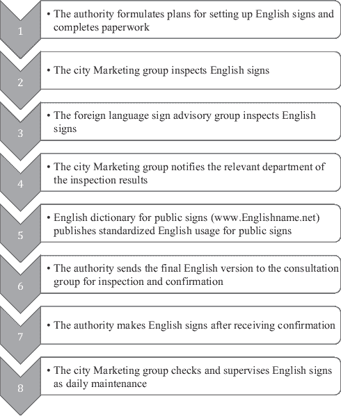

图 2：纠正英文标识的流程。

#### 2.1.3 地铁标识

根据官方报告（中共北京市委员会外事领导小组等，2008 年），首尔地铁标识系统主要包括站名标识、换乘路线图、换乘公交路线图以及周边地点的标识。地铁标识要求使用韩语、英语和中文三种语言显示，而地铁广播则用韩语和英语播报。在 2002 年首尔世界杯期间，通往场馆和体育馆的路线增加了了中文广播，并在活动结束后继续使用。

1984 年，首尔开始为地铁工作人员提供英语和中文培训。每年的培训结果与员工的薪资挂钩。目前，地铁工作人员要求具备一定的英语水平并通过专业英语考试方可上岗。首尔地铁的负责人认为，清晰有效的公共标识系统和会外语的地铁工作人员是建设首尔地铁外语环境的重要方面。

### 2.2 技术支持的语言服务

#### 2.2.1 首尔热线

2002 年，首尔 1033 万总人口中外国人的比例为 0.66%，其中 66.1%是中国人、美国人和日本人（中共北京市委员会外事领导小组等，2008 年）。首尔虽有非政府组织为外国人提供旅游信息和咨询服务，但没有政府机构负责为在该市生活的外国人提供信息和语言服务。因此，首尔市议会和外国人监督会议提议设立“首尔热线”，旨在将首尔建设成为生活舒适的国际化城市，使其成为外国游客的青睐之地，从而提升其地位和形象。

由首尔市政府赞助的“首尔热线”于 2002 年 4 月 1 日开始运营。它提供英语、中文和日语的通用服务，并配备了这三种语言的专业翻译。首尔热线的信息和语言服务可以通过电话（`080-731-911`）、网站（[www.metro.seoul.kr](http://www.metroseoul.kr)）、传真和电子邮件获取。首尔热线在运营中采取了以下方法：（1）针对常见问题准备自动回复；（2）对于无法现场解决的问题咨询相关部门并尝试在当天回复；（3）将所有咨询记录在登记簿上以便进一步管理。在 2002 年首尔世界杯期间，首尔热线通过以下方式扩大了服务范围：（1）增加了三种外语服务，包括法语、土耳其和西班牙语；（2）招募了外语志愿者和翻译；（3）将工作时间从`09:00–18:00`延长至`07:00–22:00`。

#### 2.2.2 BBB（巴别大军）免费翻译热线

`BBB` 免费翻译热线最初由《中央日报》提出，由各种社会资源共同赞助。三星企业提供了资金支持，韩国电视台（`KBS`）负责广告。在 2002 年世界杯期间，`BBB` 免费翻译热线提供了 13 种语言的信息和语言服务，包括中文、英语、俄语、法语、日语、德语、西班牙语、波兰语、瑞典语、土耳其语、意大利语、阿拉伯语和葡萄牙语。共有 2500 名志愿者，包括 350 名中国志愿者、850 名英语志愿者、500 名日本志愿者和 8 名瑞士志愿者。外国人在机场、旅游信息点、酒店等场所可以多语言 `BBB` 信息片（参见第 46–48 页照片 2–6）。遇到语言障碍或想了解韩国文化的外国人可以直接拨打 `BBB` 信息片上的电话号码获得志愿者的帮助。

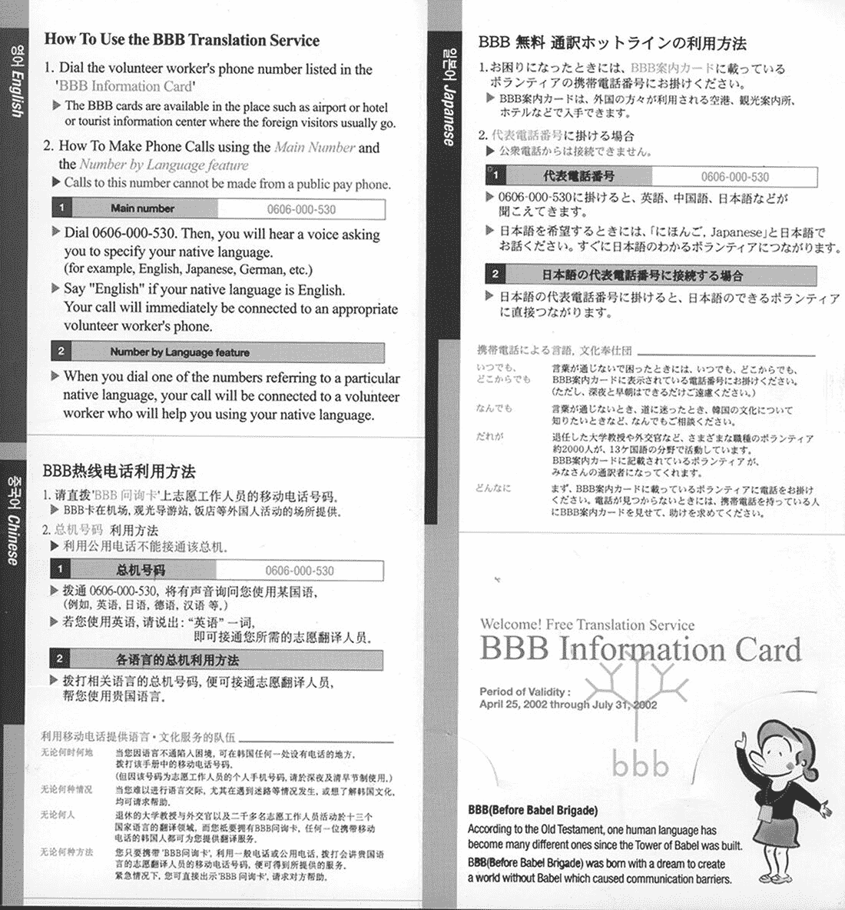

照片 2：多语言 `BBB` 免费翻译热线介绍传单。


照片 3：中文 `BBB` 信息片正面。

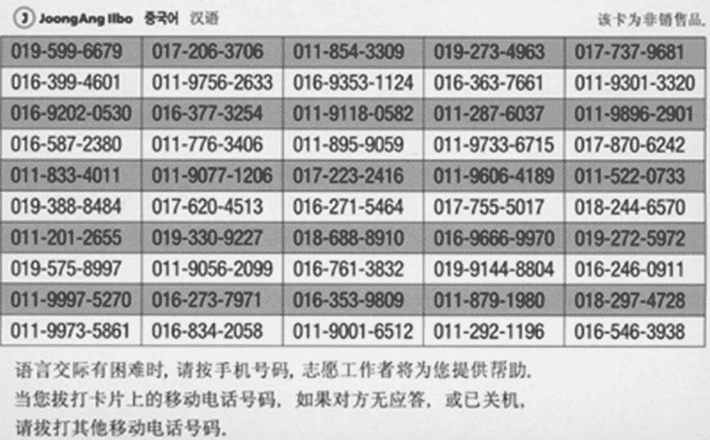

照片 4：中文 `BBB` 信息片反面。


照片 5：英文 `BBB` 信息片正面。

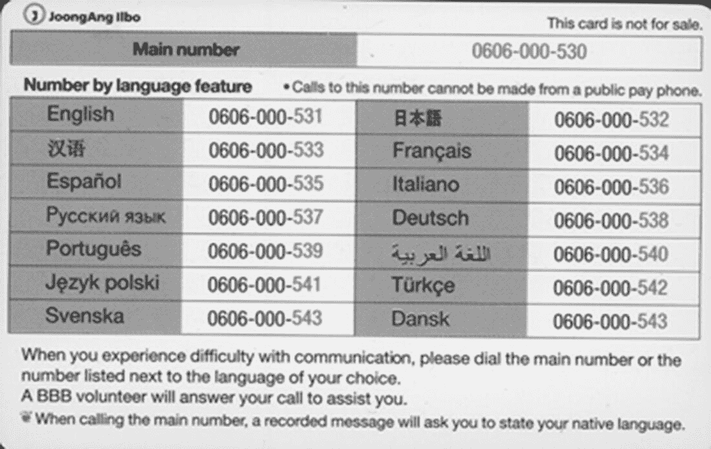

照片 6：英文 `BBB` 信息片反面。

#### 2.2.3 出租车外语服务和同译

为了方便世界杯期间在首尔旅行的外国人，首尔市政府了两种类型的出租车：`游客导游出租`和`免费翻译出租`。`游客导游出租`是高级黑色轿车，车门上有醒目的`游客导游`标识，通常停放在机场和餐厅。这些出租车的司机都是能够使用基础英语和日语的模范司机。`免费翻译出租`车门上有`免费翻译`标识，配备了政府提供的免费电话设备，可以提供中文、英语和日语三种语言的同译服务。这些出租车的司机可以通过车载电话从翻译中心获取同译服务。电话接通后，翻译员将用中文、英语或日语告知外国乘客目的地、时间和费用。

韩国和中国不仅在地理上邻近，而且都属于东亚文化圈，拥有 2000 多年的文化交流历史。韩国政府为 1988 年首尔奥运会采纳的语言服务措施，为中国准备 2008 年北京奥运会提供了有用的参考，同时也为东亚国家举办的国际体育赛事的 `LPP` 研究提供了良好的样本。在此，我将详细阐述本研究的设计。

## 3 研究设计

研究设计是将研究的初始问题与待收集的数据以及采用的分析方法联系起来的逻辑。本研究根据调查中的数据类型，结合了多种数据收集和分析方法。

### 3.1 研究问题

在国内外社会、经济和政治变化的背景下，2008 年北京奥运会标志着国家、地区和个人层面身份构建的关键时期。推动中国走向其历史上最大体育盛事的力量，也为 21 世纪第一个十年的外语普及运动注入了动力。北京奥运会组委会（`BOCOG`）和北京市政府需要做出重要的语言政策和规划决策，以实现奥运会“无障碍”语言服务的目标。首尔为 1988 年首尔奥运会和 2002 年世界杯提供的语言服务，为作为另一个非英语国家亚洲国家的中国提供了宝贵经验。然而，在这届规模最大的奥运会上满足所有参与者的语言需求，在语言规划上是一项更为复杂且艰巨的任务。尽管对现代奥运会已有广泛研究，但仍缺乏试图解释奥运会 `LPP` 的严谨研究。本书将语言政策、语言实践和语言意识置于中国广泛的社会、经济和政治变化之中，特别是从北京申办 2008 年奥运会到准备 2022 年冬奥会的期间。结合宏观和微观视角，我试图呈现北京已举办和即将举办的两届奥运会自上而下 `LPP` 的全景，并对语言政策和语言意识如何影响北京奥运背景下的实际语言使用和说话者的语言态度进行详细描述。本书根据以下八个问题展开：

1. 为什么现代奥运会是语言政策和语言规划研究中具有独特价值的课题？
2. 2008 年北京奥运会的历史意义和语言挑战是什么？
3. 为 2008 年北京奥运会颁布并实施了哪些官方语言政策？
4. 这些语言政策反映了什么样的语言意识和态度？
5. 在北京奥运会准备期间和奥运会期间观察到了哪些语言实践？
6. 2008 年北京奥运会留下了什么样的 `LPP` 遗产？
7. 奥运后时代，中国的外语教育意识形态和政策发生了哪些变化？
8. 为 2022 年北京冬奥会的语言服务做了哪些语言规划努力？

### 3.2 数据收集方法

本研究通过结合不同类型的定性方法对数据进行三角交叉：半结构化访谈、参与式观察和实地观察，以及文本和视听材料的收集。收集了微观领域（访谈转录和现场笔记）和宏观领域（政策文件、媒体文本、标牌、教材）的数据。由于定性研究的演变性质以及英语在中国持续传播的过程，政策文件和媒体文本的收集贯穿了整个研究过程。为了对宏观领域的话语分析进行语境化，我在北京进行了为期三个月的多点密集实地考察（2008 年 7 月至 10 月）。2008 年北京奥运会后，我多次回到研究地点进行观察和数据收集。2017 年 9 月至 2018 年 7 月期间，我在北京语言大学（`BLCU`）李明教授的指导下担任访问学者。在访问期间，我进入了由李明教授的北京语言资源高级创新中心（`ACLR`），并获得了关于其为 2022 年北京冬奥会提供的三个语言服务的价值信息。所有这些研究活动为所研究的问题提供了重要的见解。

#### 3.2.1 自然产生的数据

1) 政策文件


收集了中华人民共和国教育部（`MOE`）1990 年至 2020 年间发布的学校和大学英语教学大纲及课程以供分析。这些政策文件规定了要涵盖的`ELT`内容，推荐了教学方法和评估措施，并概述了公共教育中英语应取得的成果。为筹 2008 年夏季奥运会和 2022 年冬奥会的外语学习与普及的官方政策、指南和规定，从以下官方网站收集：第 XX 届夏季奥运会北京组委会（[www.beijing2008.cn/](http://www.beijing2008.cn/)）、北京 2022 冬奥及残冬奥会组委会（[www.beijing2022.cn](http://www.beijing2022.cn)）、国际奥运委员会（`IOC`）（[www.olympic.org/](http://www.olympic.org/)）、北京市政府（[www.ebeijing.gov.cn/](http://www.ebeijing.gov.cn/)）、北京市对外办（[www.bjfao.gov.cn/](http://www.bjfao.gov.cn/)）、“北京汉语计划”组委会（[www.bjenglish.com.cn/](http://www.bjenglish.com.cn/)）、北京教育考试院（[www.bjeea.cn/](http://www.bjeea.cn/)）、华尔英语有限公司（`EF`）（[www.englishfirst.com/index.html](http://www.englishfirst.com/index.html)）以及北京 2008 年奥运会语言培训服务供应商——爱飞科技有限公司（[www.aiflyworld.cn](http://www.aiflyworld.cn)）。

## 2) 媒体文本

收集了与两届北京奥运会`LPP`和语言服务相关的国内媒体报道，涵盖了几主要的官方报纸，即新华社（[www.xinhuanet.com](http://www.xinhuanet.com)）、中国日报（[www.chinadaily.com/](http://www.chinadaily.com/)）、人民日报（[www.people.com](http://www.people.com)）和环球报（[www.huanqiu.com/](http://www.huanqiu.com/)）。这些媒体文本为北京奥运会所处的特定社会历史背景，以及关于中国*英语热*现象的争议提供了多维度的视角。

## 3) 标牌

为了理解北京作为奥会城市的语言景观，我在关键奥会场馆、旅游景点、商业区和交通枢纽拍摄并收集了一系列双语/多语种指示牌和其他语言对象的照片。这些自然产生的观测数据包括在`北京火站`（2008-01-08）、`王府井街`（2008-04-08）、`奥林匹克公园`（2008-05-08）、`天安门广场`（2008-06-08）、`北京黑竹园`（2008-07-08）、`故宫`（2008-08-08）、`前门大街`、`北京西西站`（2008-09-08）、`北京首都国际机场`（2008-09-08）、`北京大学`以及`北京体育大学`（2008-09-20）的照片和视频。本研究中采样的照片和视频是由数码相机录制的。这些照片既包含了官方/非商业性标志（交通标志、方向标志、信息标志、警告和危险标志、旅游地图、告示牌等），也包含了非官方/商业性标志（广告广告牌、通知牌等）。这些采样标志上的文本可能是单语的、双语或多语的。在本研究中，双语标志被认为包含至少一种中文以外语言的标志。因此，只要该语言不是中文，仅一种语言也可以被归类为双语。同样，多语标志是指包含至少两种中文以外语言的标志。北京语言景观（`LL`）中可以区分三种类型的标志：单语标志（中文）、双语标志（中文和英语）和多语标志（以中文、英语和法语为主）。在第七章中，我根据照片是否具有所在地的典型语言特征，有针对性地选择并分析了一些照片。

## 4) 教学材料

本研究购买了三套服务于北京奥运会的特定英语教学材料：(1) `BOCOG`出版物《A Conversational English Reader》（初级和高级版）；(2) `BSFLP`出版物（《One World English》100、300、600、1000），(3) `BSFLP`和`BEST`出版物（《Olympic English》书 1、2、3）。`Shardakova and Pavlenko (2004)`强调语言教科书在“语言学习者潜在赋权或去赋权的过程中起着独特的作用”（p. 28）。在第六章中，我对《A Conversational English Reader》（初级和高级版）中的文本和视觉图像进行了了多模态话语分析。选择这两本`Readers`作为我数据部分的理由已在第六章中进行了解释。

### 3.2.2 实地调查

`Patton (2002)`指，“如果没有访谈，记录将毫无意义，而访谈的焦点来自实地观察”（p. 307）。为了深入理解北京奥运会所处的“更完备、更有意义的语境”（`Tedlock, 2000`, p. 455），我在北京进行了三个月的实地调查（2008 年 7 月至 10 月），结合了观察、访谈和文献收集。实地调查为话语分析提供了语境背景。

#### 1) 研究地点

为了捕捉 2008 年北京奥运会前后及期间的语言实践，我最初沉浸在各种场所，如奥会场馆、`BOCOG`大楼、`奥林青年营`、旅游景点、大学、英语学校、中央商务区、机场、火车站、地铁、公交调度中心、购物中心和书店。从最初的沉浸到更有针对性的研究地点，我逐渐发现了出现的主题，缩小了研究问题，并接触了重点研究对象和事件。我进行实地观察的主要研究地点从关键奥会场馆（即`奥林匹克公园`）、旅游景点（`故宫`、`天安门广场`）到商业区（`前门大街`、`王府井街`），以及交通枢纽（`北京西站`、`北京首都国际机场`）。这些研究地点大多集中在市区。这些数据收集点是游客经常光顾的热门或公共地点，本研究选择它们是因为它们对于游客提供的观赛、观光、购物和通勤体验具有特定的意义。在上述领域，我做了笔记，拍摄了照片，并对与研究问题相关的且显著的物品、活动和现象录制了音频和/或视频。我试图对英语学习实践、英语媒介的跨文化交流以及外语服务和设施进行观察和自我反思。

#### 2) 招募

为了识别并招募本研究的参与者，使用了非概率抽样技术：目的抽样和雪球抽样。非概率意味着不使用随机选择方法，因此非概率样本不一定对研究总体具有代表性。`Burns (2000)`指出，非概率抽样的通常形式是“目的性、有计划或基于标准的抽样”（p. 178）。目的抽样是一种研究者根据其衡量标准主观选择参与者的方法。研究者根据他们认为适合研究的人来选择样本。雪球抽样是一种开发研究样本的技术，让现有研究参与者从符合标准的熟人中招募未来的参与者（`Trochim, 2006`）。

本研究从目的抽样开始。我首先联系了我在北京现有的社交网络中的几个人。通过网络，我首先定位了信息丰富的关键人物，然后向他们阐明了目标参与者的特征。一旦确定了潜在参与者，我通过这些关键人物请求他们初步接受我的访谈。对于通过机构抽募的大学生（例如通过班主任老师或系主任），提前向他们发送了介绍信，以建立初步合作和良好关系。在获得初步许可后，我通过电话与这些潜在参与者联系，并让他们指定最合适的访谈时间和地点。

在与现有参与者建立关系后，我利用雪球抽样来接触更多潜在参与者：我礼貌地请求他们向我介绍同样符合我标准的熟人，并请求访谈许可。

#### 3) 访谈

本研究的参与者主要分为类：个人参与者和机构参与者。

第一类个人参与者由在北京生活和学习的大专学生（18 岁及以上）奥运会志愿者组成。奥运会志愿者是“由第 29 届北京奥运会组委会招募并管理的认证人员”，他们“在 2008 年北京奥运会和残林奥运会期间，在北京奥运会组委会（`BOCOG`）分配的时间和岗位上承担关键的赛期间职责”（新华，2008a）。

赛事组委会招募了三类奥运会志愿者：赛期间志愿者、城市志愿者和社会志愿者。赛期间志愿者是接受过最密集培训的人员，被分配到奥运场馆（包括比赛场馆、训练场地和非比赛场地）提供服务。赛期间志愿者在指定区域提供服务，涵盖接待、语言翻译、交通、安保、医疗服务、观众引导、通讯组织支持、场馆运营支持、媒体运行支持、文化活动支持等方面（[Nidemike, 2008]）。

城市志愿者负责在遍布北京的城市志愿者服务站提供信息、应急救援和翻译服务。社会志愿者经过广泛招募，被分配在北京奥运会和残林奥会之前及期间帮助北京社区和镇乡维持交通秩序和社会秩序。赛事期间，北京大学生是这三类奥运志愿者的主要来源之一。

总的来说，我访谈并观察了 35 名参与者（附录 2：访谈者名单）。其中，28 人是 2008 年北京奥运会的志愿者（26 名赛期间志愿者和 2 名城市志愿者）。其余 7 名机构参与者或或少地参与过北京奥运会之前的奥运英语培训。他们包括三名英语教师、两名`BOCOG`行政人员、一名当地政府官员和一名当地出租车司机。所有机构受访者均受过高水平教育并持有学士及以上学位。

在 35 名受访者中，31 人是汉族。另外 4 人是在北京读本科的少数民族学生。其中两人是满族和赫哲族，他们的民族语言在自己的文化中已经消失或从日常生活中淡化。另外两人是畲族和瑶族背景。他们说普通话和至少一种民族语言，因此将英语作为第三或甚至第四门语言进行学习。

我在 2008 年 7 月 10 日至 9 月 27 日期间对这 35 名参与者进行了 27 次面对面访谈和 1 次电话访谈。其中，22 次是一一访谈，5 次小组访谈（见附录 2）。为了了解参与者在京奥运会之前及期间对英语学习和使用的经历与感知，我设定了六个主要主题作为访谈指南。

这六个主题涉及参与者的相关经历和观点，即：海外学习经历；在家和工作场所的外语实践；对中国英语学习和教学的态度；对英语在各自未来生活中角色的理解；对北京作为奥运之城中英语角色的看法；北京奥运会期间使用英语的个人经历。这六个主题的框架是非正式的“访谈者可以针对不同参与者以不同方式提问的话题和问题分组”（[Lindlof and Taylor, 2002], p. 195）。访谈使用录音机进行记录，以便为数据分析准备转录稿。在小组访谈期间，参与者之间的对话以及他们与其他人的互动也被记录。所有访谈均用中文进行。

### 4) 参与者观察

由于大多数参与者工作场所的敏感性（他们就职于各种奥运相关场馆）以及参与者的时间有限（在赛事期间他们深度投入工作），在大多数情况下，我无法进入他们的工作场所进行参与者观察。2008 年 8 月 7 日，我对两名城市志愿者进行了参与者观察，他们被分配在北京黑竹公园入口的指定城市志愿者服务站进行半天的志愿者服务。我观察的目的是了解这两位参与者在工作场所中以英语为媒介的跨文化交流实践。在获得许可后，我对参与者在工作场所的实践及其工作环境进行了视频录像并记录了实地笔记。

### 3.3 数据分析方法

#### 3.3.1 批判性话语分析视角

数据分析意味着对数据进行理解或解释。本研究旨在从批判性话语分析（`CDA`）的角度解读数据。`CDA`既不是一种同质化的也不必然是统一的理论方法或研究方法；相反，它是“一种对语言、符号或话语分析的共同视角”（Van Dijk, 1993, p. 253）。四个概念在所有`CDA`研究活动中都是不可或缺的：话语、批判、意识形态和权力。

普遍认为，`CDA`将`discourse`（话语）视为一种“社会实践”（Fairclough and Wodak, 1997)），并认为“语言使用的语境”至关重要（Wodak, 2001a)）。将话语描述为社会实践意味着“特定的话语事件与框架它的情境、机构和社会结构之间存在辩证关系”（Fairclough and Wodak, 1997, p. 258）。换句话说，话语既是社会建构的，也是社会制约的——“它构成了情境、知识对象，以及人与人、群体之间的社会身份和社会关系”（Fairclough and Wodak, 1997, p. 258）。

`Ideology`（意识形态）是`CDA`中非常重要的课题。在 van Dijk (1998) 的社会-认知理论中，意识形态被视为“解释框架”，用于“组织关于现代社会其他要素的一系列态度”。Fairclough, Mulderrig and Wodak (2011) 建议将意识形态不仅理解为“一种对社会现实的呈现”，还理解为“一个将特定的现实再现和特定的身份构建整合在一起的过程”（p. 372）。意识形态通过话语产生和再生产，并作为“建立和维持不平等权力关系”的重要手段（Wodak, 2001b. p. 10）。对意识形态的研究要求分析者超越文本分析，转而考虑“文本是如何被解释和接收的，以及它们产生了什么样的社会影响”（Fairclough, Mulderrig and Wodak, 2011, p. 371）。此外，来自`CDA`视角的解释是动态且开放的，可能会受到新解读和新语境信息的影响。

`CDA`对语言与权力之间的关系特别感兴趣。`Power`（权力）涉及差异关系，特别是社会结构中差异产生的影响（Wodak, 2001b, p. 11)）。对于`CDA`而言，语言“本身并不是强大的，相反，它通过权势人士对其的使用来获得权力”（Wodak, 2001b, p. 10)）。与话语分析中的非批判性理论和方法论不同，`CDA`的特征在于“共同利益于通过对符号数据（无论是书面的、口头的还是视觉的）进行系统调查，来揭秘意识形态和权力”（Wodak, 2007, pp. 185–186）。

采取`critical`（批判性）目标标志着批判性话语分析者不仅需要描述话语实践，还要揭示“话语的意识形态基础，这些基础随着时间的推移已变得如此自然化，以至于我们开始将它们视为话语中常见的、可接受的自然的特征”（Talbot, Atkinson and Atkinson, 2003, p. 36），并使权力关系中的不平等现象可见。在批判领域工作的研究人员的核心关注点包括：语言与社会之间的辩证关系；通过语言对权力关系的构建和维护；语言在构建人类经验和世界观中所起的作用；以及语言与社会变。像 Fairclough 等`CDA`研究者热衷于关注话语作为广泛被称为“全球化”的当代社会变化中的元素。人类话语的多样性、争论和转型，以及针对这些开发合适且有效的方法，构成了一个广阔的领域。人们认为，对话语意识形态效应的意识可以带来社会公平和公正（Fairclough, 1992).

#### 3.3.2 数据分析程序

分析数据分为六类：政策文件、媒体文本、标牌、教材、访谈和现场笔记。Patton (2002, p. 307) 建议，文献分析可以为那些无法直接观察到的、访谈者可能没有提出的计划提供“幕后视角”。在探索阶段，文献分析帮助我理解英语的普及。遵循 Shohamy 对`LP`的扩展视角（2006)），我建立了一个分析框架，基于对语言政策文件、教学材料、语言景观和语言学习者经验的比较分析来解决语言政策和规划问题。通过实地调查，我收集了政策文件、媒体文本和教材，拍摄了照片，并进行了访谈和观察。Patton (2002, p. 432) 强调，定性分析者的挑战在于对海量数据赋予意义，这涉及减少原始信息量、筛选琐碎与重要信息、识别显著模式，并构建一个传达数据本质的框架。多点观察提供了对语言普及政策和实践的总体理解，以及该领域普遍存在的话语，从而有助于确定我访谈的重点。在访谈和初步分析过程中，更有针对性的模式和主题逐渐显现。在此阶段，建立了四个主要主题，通过各种显性和隐性的`LP`机制探索北京奥运会的语言政策和规划：（1）奥运会英语普及运动中的语言政策与实践；（2）个人英语学习轨迹；（3）北京英语教材中的想象共同体和身份选择；以及（4）奥会城市的语言景观。

实地调查完成后，我对访谈转录和实地笔记进行了彻底审查，力求重新检查在数据收集以及与宏观领域数据进行交叉比对期间产生的分析见解和解释。访谈转录首先由我从中文翻译成英文，然后由校对人员对其清晰度和语法进行编辑（参见附录 3：转录惯例说明）。为了使翻译具有最大限的透明度，我提供了所有原始中文数据及其译文。

本研究采用内容分析法对收集的文本和叙事数据进行解释。内容分析法是当今社会科学中应用最广泛的分析方法之一，用于对文本和叙事数据中出现的新兴主题进行分类。文本和叙事数据的选择是基于其与本研究问题的相关性。对于确定的四个主题中的每一个，我从数据中归纳性地制定了一套编码方案。在数据编码后，我发现了类别和模式，进行了推断，并展示了基于编码数据得出的解释。我从参与者中选取了一些典型的引用并将其纳入讨论中，以加强我对信息的抽象处理。在不同阶段，还使用了图表来辅助描述。

为了增强定性内容分析的信度，使用了了两种技术：成员检查（member checking）和三角互证（triangulation）。首先，成员检查在访谈过程中和研究结束时均已完成。在访谈时，我会总结信息并询问参与者以确定准确性。访谈结束后，参与者有机会审查原始数据、分析后的数据和报告，以确保研究充分且准确地代表了他们的观点和经历。三角互证涉及使用多种不同的来源、方法和视角来阐明研究问题及其结果。本研究采取了多重互证的方法，考察了与北京奥运会语言学习政策（`LLP`）相关的政策文件、英语教科书、语言景观和语言学习轨迹。该技术使我能够描绘出一个多维度、复杂的图景，并对所研究现象产生深入、丰富的理解。


文本和言语都存在多种解释的可能性。`Shardakova and Pavlenko (2004)` 指出，“对文本的不同解释源于文本属性与解释者社会定位及知识之间的不同组合”（第 30 页）。定性研究人员，特别是批判性话语分析（CDA）分析，旨在保持自我反性和政治意识。`Nightingale and Cromby (1999, p. 228)` 建议，“反思性要求意识到研究者在整个研究过程中对意义构建的贡献，并承认在进行研究时无法‘脱离’研究主体的客观性。”在分析数据时，我反思了自己的价值观、经历、兴趣、信念、政治立场和社会身份是如何塑造这项研究的。作为研究的调查者，我拥有中国英语（EFL）学习者、英语教育者、国际留学生和全球公民的多重身份，所有这些都影响了目前的研究。作为一名中国英语学习者，我与大多数中国英语学习者有着相同的经历，他们为了这种语言投入了大量精力，渴望获得母语般的流利程度和社会地位的向上流动，因此我能够理解中国人对英语的渴望以及他们在英语学习中的困境。作为一名在中国从事多年外语教学的大学英语教师，我了解中国英语教育的现状和潜在问题，以及语言市场的情况。作为一名在澳大利亚多语言社会获得博士学位的社会语言学研究者，我旨在提高中国英语学习者、教育者和政策制定者对英语传播的批判意识，并提出其他国家可以从中国的经验中学习的教训。在开展研究期间，我意识到本研究领域“本质上是政治性的，并受到多种伦理和政治立场的塑造”（`Nelson, Treichler, and Grossberg, 1992, 第 2 页`）。同时，我承认我自己的批判性解释不受政治和伦理价值观的影响，也受到批判性的审查。

总体而言，本论文对嵌入两届北京奥运大规模身份构建工程中的语言政策、实践和意识形态采取了背景敏感的批判方法。

### 3.4 伦理考量

作为一名涉及人类参与者的定性研究人员，我认真考虑了伦理问题。为了确保定性研究过程在伦理上负责，三个伦理原则对于人类研究的开展至关重要：“善意”（beneficence）、“尊重”（respect）和“公正”（justice）（`Sieber and Stanley, 1988, 第 53 页`）。本研究涉及四类参与者：作为奥运会志愿者的大学生、出租车司机、英语教师以及参与官方奥运英语培训的北京奥运组（BOCOG）行政人员。本研究通过四种策略在数据收集、分析和展示过程中保护信息者的权利：知情同意、保密、匿名和不可追溯性。

在进行访谈和观察时，我不断寻求知情同意。所有参与者在访谈或观察之前，都收到了一份母语编写的信息和同意书。鉴于知情同意过程是“动态且持续的”（`Madison, 2005, 第 114 页`），我每次都会征求参与者进行访谈或观察的许可。在访谈或观察开始时，参与者被充分告知了当前研究的目标、录制的目的、数据如何处理、存储和删除，以及谁有权访问数据。最重要的是，参与者意识到他们的参与是自愿的，并有权在研究期间任何时候退出。为了保护研究中参与者的匿名性和不可追溯性，对所有参与的个人和机构都分配了匿名名。受访者身份中可能识别其身份的方面（如机构属性、性别、年龄、居住地、职业和教育背景）均不会在任何书面报告或其他形式的传播中公布。

关于北京奥运会的政治敏感性以及北京奥委会（BOCOG）保密政策，存在着特殊的伦理问题。部分参与者作为奥运志愿者和奥委会工作人员，需要与奥委会签署保密协议，因此在赛前及赛期间不能接受采访和观察。本着“行”、“尊重”和“公正”的精神（`Sieber and Stanley, 1988, p. 53`），我在接触参与者时了充分的理解和尊重。我总是根据参与者的时间进行调整，避免对他们造成不必要的风险或伤害。此外，这项研究对参与者来说也是互互利的，因为我向他们分享了我的个人英语学习经验和留学建议，并协助一些参与者进行了英语翻译。

# 第 4 章 北京的承诺——国际语言环境

## 1 北京奥运会行动计划

北京市政府和第二十九届北京奥委会（BOCOG）于 2002 年 7 月 13 日正式发布了《北京奥运会行动计划》（`BOCOG, 2002`）。该计划作为北京未来社会经济发展及奥运会准备工作的指导性文件，体现了“奥会促发展，发展促奥会”的理念。它也是在 21 世纪第一个十年以备办奥运会为代表的快速发展的里程碑。

《行动计划》包含一个总体计划和九项专项计划，分三个阶段实施：准备阶段——2001 年 12 月至 2003 年 6 月；发展阶段——2003 年 7 月至 2006 年 6 月；以及赛前运行阶段——2006 年 7 月至奥运会开幕。该计划为奥运会准备设定了四个主要目标：（1）让本届奥运会取得历史上最大的成功；（2）加速城市和国家的社会经济发展；（3）为首都树立改革开放的新形象；（4）努力实现中国体育事业的繁荣。

《行动计划》也是 2008 年北京奥运会语言规划政策的政府指导。作为总体战略目标的一部分，奥委会承诺举办“历史上最伟大的奥运会”，并希望通过举办 2008 年奥运会，不仅促进“北京及中国其他地区的现代化”，还能为北京创造“一个新形象”（`BOCOG, 2002`）。这一新形象将北京定位为一个“快速发展并向世界更广泛开放”的“国际城市”（`BOCOG, 2002`）。北京市政府执行副市长林林（`2009, p. 5`）认为，“一个城市的国际语言环境反映了其现代化和国际化水平……持续改善北京国际语言环境的工作将有助于奥运会的成功并推进北京的现代化”。关于北京“国际语言环境”的建设，《行动计划》（`BOCOG, 2002`）规定了三个作为奥运会语言规划（LPP）首要任务方面：（1）外语的学习与普及；（2）推广普通话和规范汉字的正确使用；（3）双语/多语言指示牌的标准化。外语学习与普及被视为在 2008 年之前构建北京作为成功奥运主办城市身份、并从长远来看建设现代化国际城市的关键要素。为此制定了一项自上而下的语言政策来促进外语（主要是英语）的学习，如下节录所示。

> **一、 外语学习与普及**
>
> “北京响亮世界”计划组织将在 2002 年底前制定并实施《市民口说外语总体计划（2003–2008 年）》。其目标是到 2007 年底让大多数市民能够用至少一种外语进行日常交流的一百句对话。在“窗口”行业工作的员工，特别是可能为外国人提供服务的员工，应接受更积极的外语培训。在一段时间内，将制定相关规定，要求员工在从事某些行业或职业前必须持有能力证书。所有学校都应重视外语教育，并采取措施提高所有学生的外语水平。还应组织并重点关注教授相对冷门外语的课程。
>
> 将加强外语的推广与普及。报纸、杂志、广播电站、电视节目和网站均应增加外语节目或专栏。英文报纸《北京日报》（*Beijing Today*）目前为周刊，将从 2003 年起改为每周三版，并在 2005 年改为日报。将增强广播、电视台的双语和多语言节目制作能力。北京电信将设立翻译热线，服务于外语学习者和依赖外语交流的人。

奥委会和市政府认为提供双语标牌是提升北京国际城市形象的重要措施。因此，工作的另一个重点是公共场所双语/多语言指示牌的标准化。《行动计划》（`BOCOG, 2002`）规定了以下任务和目标：

> **三、 指示牌**
>
> 将组织专家开展全面研究和系统分析，以制定一套标准化的北京引导系统。市旅游局将检查现有的旅游指南、旅游地图、标牌、手册及其在各街道、重点景点和重点服务设施的设置。旅游信息标准化应在 2005 年底实现。游客密集的公共场所将配备触摸屏电子导览设施，奥运会期间将配备流动信息员以提供旅游信息和引导服务。北京的主要道路、车站和站点、旅游景点和重点文化景点应设有中英文双语指示牌，某些特殊场馆和体育馆应设有多语言标识。2006 年之前，将在“北京响亮世界”计划组织委员会领导下制定一套外语标识检查制度[该计划名称于 2002 年改为“北京说外语计划”]。

由于这只是夏季奥运会第三次在亚洲举办，当地奥委会组织者和国际奥委会委员会（IOC）很早就开始关注奥运会举办城市的“语言环境”能否经受奥运会严峻的语言挑战。尽管北京奥运会组委会已做出强有力的承诺提高北京的整体外语水平，但国际社会对 2008 年奥运会由一个亚洲社会主义国家举办仍持有严重怀疑。新华社的一项研究项目（中国国际传播研究中心，2006）显示，47%的受访外国记者担心北京的外语水平将成为他们在这个举办城市工作的障碍。据报道，国际奥委会委员会主席雅各布·罗格（Jacques Rogge）曾表示，虽然他有信心北京将举办一届史无前例且最出色的奥运会，但他对专业人才问题和北京的语言环境表示担忧（`Hu, 2007`）。面对这些担忧，中国政府在《奥运行动计划》中向世界做出承诺（`BOCOG, 2002`）：“到 2008 年，信息服务将是廉价、内容丰富、无语言障碍、个性化，并供任何人、在任何时间、任何地使用。”对国内外的语言环境和语言服务的担忧，使得北京的外语普及运动更具紧迫性。在北京奥运会之前的七年里，北京市政府和奥委会采取了四项主要措施来实施这一自上而下的外语普及运动并构建“国际语言环境”：首先，成立“北京说外语计划”（语言政策制定与执行机制）；其次，启动北京英语考试体系（语言测试机制）；第三，启动官方语言服务供应商（语言服务机制）；第四，推广英语学习与教学明星（模范与身份识别机制）。

## 2. BSFLP 的行动计划

“北京说外语计划”（BSFLP）于 2002 年启动，是北京市直接管理的全市外语普及项目之一。BSFLP 源于 2000 年发起的“市民英语口计划”，该计划是申办 2008 年奥运会工作的一部分。BSFLP 组委会成员包括市长、副市长、各部门局长以及 18 个区县负责人。自成立以来，BSFLP 组委会一直与北京奥委会（BOCOG）密切合作，在城市内营造“良好的语言环境”。BSFLP 组委会聘请了 35 名来自美国、英国和新加坡的国内外专家组成咨询小组。BSFLP 组委会办公室副主任刘阳陈述，BSFLP 的目标是“鼓励北京居民学习和说英语，将北京变成它本应有的国际化城市”（`Stanway, 2008`）。根据刘阳的话，中国政府是唯一承诺在奥运期间消除语言障碍的政府，而北京在这方面尽了最大努力（`Stanway, 2008`）。下文介绍了计划的总体目标和工作程序，以及奥运会语言普及计划（LPP）的重要方面，包括外语普及、窗口行业语言服务、标识牌标准化、技术支持的语言服务以及外语服务市场。⁷

### 2.1 总体目标

2003 年，北京说外语计划组委会（2003）发布了其第一个五年`行动计划`（2003–2008），作为北京奥运会语言普及计划的更全面、更明确的规划。《行动计划》设定了三个主要总体目标：1）500 万外语口语人口；2）双语标识牌的标准化；3）窗口行业的外语服务。⁸

> 城市的外语口语人口到 2008 年将增加到 500 万，占城市总人口的 35%，公共场所的双语街牌应实现标准化，关键区域的窗口行业应提供外语服务，外语服务设施应系统化，外语服务志愿者应制度化；从而为 2008 年北京奥运会的成功举办营造一个有利的国际环境，并履行北京显著提高城市国际交流能力的承诺。到 2020 年，市民的整体外语水平和综合素质将得到本质提高，形成适合外国人在北京工作、学习和生活的一流文化环境，城市的国际交流能力将显著增强，为北京现代国际大都市基本框架的形成提供可靠保障。

### 2.2 工作程序

为了实现这些总体目标，北京说外语计划组委会（2003）计划分三个阶段实施`行动计划`并构建“国际语言环境”：

> 第一阶段（2003 年）：2003 年的主要工作是加强 BSFLP 的组织和制度建设，形成有效的运作模式；鼓励北京市民开展外语学习活动；继续扩大双语多语教学项目；逐步规范各政府部门和服务业使用的语言，以及关键场所、社区和景区的双语标识。在主要社区建立国内外游客信息中心。初步建立语言服务志愿者团队。
>
> 第二阶段（2004–2006 年）：2004 年至 2006 年，重点将推广外语学习活动，以提高北京市民的整体外语水平；在合格学校实施双语教育；在窗口行业和服务业提供必要的外语服务；在城市的商务文化场所、主要社区和景点设立标准化双语标识；建立信息中心；扩大并培训 BSFLP 志愿者团队。
>
> 第三阶段（2007–2008 年）：2007 年至 2008 年，将全面实施北京英语考试体系，以规范北京市民的外语学习活动；全市所有商务文化场所、主要社区和景点均使用标准化双语标识；广泛建设信息中心；全市外语电视电开始广播，外语报纸开始发行；BSFLP 志愿者团队将在实践中积累更多语言服务经验，从而基本解决外国人在北京的语言困难。

在`Action Plan`中，`BSFLP 组织委员会（2003）`对正规教育和社会教育给予了同等重视，以提高北京外语口语人口的数量和质量。在从幼儿园到研究生阶段的教育机构中，鼓励开展外语（以英语为主）的外语教学。同时，需要整合各种社会资源，为北京市民提供不同类型的外语培训。

#### 1. 正规外语教育

1. 改革学校外语教学方法。借鉴国际成功经验，探索外语教学方法和考试体系的改革。采用先进的教学方法，积极开展双语和多语教学改革实验。逐步在幼儿园开设外语课程，鼓励中小开展外语教学实验，系统地开展从学前教育到高等教育的外语教育，以提高学生的外语能力，并建立符合国际大都市要求的外语教育体系。

2. 培养一支高素质的外语教师队伍。制定外语教师的培训和招聘计划。加强中小外语教师的培训，更新其教学理论并提高其外语教学技能。创造良好条件，吸引合格的外籍教师参与外语教学。

3. 丰富外语教学内容。在外语教学中增加关于中国传统文化以及外国国情风俗的内容。通过加强中国国情风俗教育，培养开放的文化意识和国际视野，提高学生的综合素质。

#### 2. 社会外语培训

1. 开展各种形式社会外语培训。充分发挥北京在外语教育方面的独特优势，整合包括高校、培训机构和专业翻译公司在内的各种社会资源，积极与海外培训机构合作，按计划培养高级外语人才。北京市民的外语培训形式可以根据当地情况实现多样化。充分发挥各种资源的优势，开展由政府推动、企业参与、市民受益的大型公共活动。

2. 培养高素质的跨学科人才。开辟海外留学、专业培训和海外先进外语培训等高层次的外语培训和研究渠道。重点培养能够直接与外国专家和专业机构交流的政府官员和企业领军人员。

3. 提高北京市民在日常交流中的外语水平。针对北京市民（尤其是外语水平较低的群体）的外语培训，应重点提高其日常交流中的外语口语能力。

4. 加强小语种专业人才的培训。以服务 2008 年奥运会为目标，基于外语学院小语种专业学生的学生的培养，建立一支小语种专业人才人才库。

### 2.4 政府对窗口行业语言服务的规划

除了总体目标外，`BSFLP 行动计划`（`BSFLP 组织委员会，2003`）还为各各业北京居民制定了特定的外语学习和测试计划及目标。要求公务员带头开展英语学习和测试。同时，高度重视“窗口行业员工（可能服务外国游客的人员）”，如警察、出租车司机、公交司机和乘务员、地铁工作人员、酒店工作人员以及商业部门人员。

**公务员**：北京公务员应在三年（2003–2006 年）内掌握常用口语英语和基础公务英语。公务员通常需要掌握 100 句以上常用英语句子。40 岁以下具有本科及以上学历的公务员要求掌握 300 句以上常用英语句子，并能够用英语进行基本交流和工作。2008 之前，将选拔 1000 名英语水平较高的公务员进行不少于三个月的强化培训，使其能够基本达到国际交流水平。

**公安部门人员**：80%的 40 岁以下警察应通过国家或市级基础口语测试，具备一定的英语听力能力。6000 名具有一定英语听读写能力的英语水平较高的警察需要通过国家或市级中级口语测试。300 名作为顶尖英语学习者、具有高水平英语听读写能力的警察需要通过国家或市级高级口语测试。200 名会法语、俄语、日语、阿拉伯语等外语的警察需要通过另一种外语的高级测试，并基本能满足处理外交事务中的翻译要求。

**交通部门人员**：到 2008 年，全市 8000 名出租车司机中应有 60%通过`北京出租车司机 300 句英语`测试。其中 80%应通过`北京出租车司机 100 句英语`测试。所有公交司机和乘务员应通过`公交乘务员 100 句英语`测试。80%的地铁员工应通过`旅客服务人员 300 句英语`测试。

**旅游业人员**：圆满完成“旅游及酒店英语等级考试”。到 2028 年，拥有英语证书的员工占五星级酒店总人数的 90%、四星级酒店的 80%三星级酒店的 60%。将对旅游酒店、餐厅和景点员工的标准语言服务水平进行评估。

**零售业人员**：紧密业务实践和行业特点，培养一批能够提供外语服务的一线员工，提高商业行业员工的综合素质。以`北京商务英语培训教材`为教教材，积极推广多级商务英语考试。将多级商务英语考试纳入国家职业技能考核。要求 60%的 40 岁以下一线员工（包括销售、餐厅服务员、酒店接待、客房员、美容师、发型师和摄影师）通过测试。推广零售从业人员口语活动，使英语购物成为可能。

### 2.5 政府对标识标准化的规划

在`Action Plan`（北京奥运会国际语言服务工作委员会，2003 年）中，公共场所和设施中英文双语标识牌的标准化被视为建设北京“国际化语言环境”的重要方面，也是提升该市国际化水平的关键因素。根据北京市政府的要求，在京奥会前颁布了一系列关于公共标识牌英文翻译的地方标准，并建立了“中式英语”（Chinglish）纠错报告体系，我将在第 7 章中进行详细讨论。

> 1. 制定北京公共标识牌的地方标准。以国际通用标准为参考，广泛征求中外专家意见，编写双语标识牌手册，并规范公共场所和设施使用的语言。通过北京市政府官方网站（[www.beijing.gov.cn](http://www.beijing.gov.cn)）和北京国际语言服务委员会网站（[www.bjenglish.org.cn](http://www.bjenglish.org.cn)）以及其他新闻媒体推广公共标识牌的地方标准，方便相关部门和普通市民查询、学习。
>
> 2. 推广公共标识牌的地方标准……方便相关部门和普通市民查询、学习。

## 2. 网站双语内容的标准化

制定相关的语言标准，并将其作为参考，对各出版单位、窗口行业、大型企业和机构的双语网站上所使用的语言进行标准化。规范北京市级政府官方门户网站（[www.beijing.gov.cn](http://www.beijing.gov.cn)）上的政务双语内容。在所有委员会、局、区、县的网站上增加中英文双语内容。

## 3. 外语服务市场标准化。积极促进翻译人员协会、外语培训机构和其他中介组织的建立。通过自律机制规范翻译公司和外语培训市场。

### 2.9 政府对公共外语活的规划


为了动员广大群众参与外语学习，实现“500 万外语人才人口”的总体目标，《北京市外语人才培养行动计划》（Organising Committee of the BSFLP, 2003）规划了一系列公共外语教学活动和各种形式的竞赛。

1. 按照计划，由中外外语专家开展一系列公共外语讲座。遵循“精心组织、增加语种、丰富内容、形成品牌”的原则，我们将继续组织公共讲座和其他活动，并在 2008 年前形成一批优质的语言服务产品。

2. 开展一系列外语竞赛。定期举办一系列竞赛活动，如市民英语电视竞赛、中学生英语演讲比赛、商务英语电视比赛、中文唱外歌电视比赛、专门用途英语电视比赛、儿童英语比赛等。在现有竞赛的基础上，应开发新的竞赛项目，在竞赛中引入新形式和更多语种，使竞赛更加生动、内容更加丰富。各区、县、行业应根据自身特色举办各种形式的外语竞赛。

3. 开展流行有趣的外语普及活动。每年继续举办“五月外语周”和“十月外语公园派对”。增加市民的参与度，将外语普及活动办成精品节目。各区、县可以通过园游会、庙会等各种渠道开展外语文化普及活动。鼓励条件允许的社区开设“外语角”和“外语茶馆”。

4. 开展外语水平考试。与国内外权威外语考试机构合作，制定统一的市民外语水平标准。鼓励市民积极参加外语水平测试，不断提高自己的语言能力。

## 2.10 政府对外语志愿者的规划

最后但同样重要的是，北京市外语人才培养计划委员会 (2003) 规划了招募国内外致力于公共服务并具备外语技能的志愿者，以开展各类志愿服务。奥运志愿者是最有可能与外国运动员、教练、官员和访客进行跨文化交流的群体。他们的外语水平直接反映了主办城市的跨文化交际能力和国际形象。

1. 建立北京外语人才培养计划志愿者队伍。在 2003 年面向社会（主要是高校学生）招募志愿者。建立志愿者数据库，储备一定数量的外语人才，为 2008 年奥运会和大型国际活动做好准备。

2. 促进市民外语普及活动。组织志愿者在社区、小区、窗口行业和政府部门开展各类英语教学活动。巩固北京外语人才培养计划的初步成果，保持市民、窗口行业从业人员和政府官员学习外语的热情，进一步提高他们的外语水平和国际交流意识。

3. 参与各种大型国际活动。为志愿者提供在每年的“中国北京国际高新技术博览会”、“北京国际旅游文化节”等大型活动中进行实践的机会，以增强中国的国际服务能力。

4. 强化志愿者培训。志愿者通过讲座和社会实践，可以深入了解国际交际礼仪以及大多数国家的习俗、饮食习惯、宗教和文化知识，从而提高综合素质。召开国际研讨会，组织专门小组观察 2004 年雅典奥运会和其他活动，开展志愿者国际交流，建立符合国际标准的一流志愿者队伍。

规则制度是权威部门最常用的工具，它们直接影响并创造了事实上的语言实践，从而在私域和公共领域将意识形态转化为实践（Shohamy, 2006, p. 59）。在北京市“国际语言环境”的建设中，北京外语人才培养计划是权威部门用来通过对语言学习和使用实施规则制度，从而最大限度控制其语言行为的语言政策制定和执行机制。

## 2.11 行动计划的实施与成果

在筹备北京奥运会期间，北京夏季奥运会组委会及相关政府部门付出了共同努力，提高北京市民的英语水平。正式教育和社会教育受到了同等程度的重视。在`Action Plan`中，组委会（2003 年）提议在北京实施从学前教育到高等教育阶段的英语教育。自 2001 年起，响应教育部（2001a）发布的政策声明，全国范围内将英语教学年级下推至城市和乡镇的小学三年级。2004 年，北京市教育委员会（2004）发布了一项工作计划，将进一步将北京义务性英语教育的门槛降至小学一年级。事实上，随着越来越多的父母希望孩子为未来做好更好的准备，英语在北京市幼儿园中几乎成为一门必修课程（中国教育研究网，2001a）。除了在各教育阶段进行教学外，英语还通过基于内容的英语教学得到了正式推广，这种教学法在中国广为人知的双语教学`shuangyu jiaoxue`。2001 年，教育部（2001b）发布了关于提高高等教育质量的正式指导意见，要求在三年内，大学课程中至少有 5–10%的课程应用英语教学。在该指南的指导下，采用英语教材成为北京大学的新趋势。越来越多的大学开始为非英语专业学生开设使用英语教材的课程，特别是针对计算机、管理和经济专业的学生（中国教育研究网，2001b）。

除了学校教育，北京夏季奥运会组委会还整合了各种社会资源来普及英语。他们鼓励高等院校、语言培训机构、翻译公司和外国组织之间的合作，为北京市民开展各种形式的外语培训。根据官方统计数据（2008 年北京奥运会官方网站，2007c），在 2008 年奥运会之前，有超过一百万北京市民参加了各种公共英语学习活动，包括免费社区讲座、培训课程、电视比赛、公园节、外语电影放映和计算机辅助自学。到 2007 年底，北京夏季奥运会组委会已建立了一支志愿者队伍，组织了六场英语公园节、701 个社区级英语培训中心和 433 个社区英语角⁹，当地居民在当地相互练习英语（Deng, 2009; Stanway, 2008）。2002 年至 2008 年间，举办了许多由北京夏季奥运会组委会赞助的电视比赛，包括“居民英语大赛”、“中文唱外国歌”和“商务英语大赛”（Zhang, 2009）。在这一筹备期间，出版了许多外语学习书籍，包括《北京居民英语口语》、《北京人 100 句英语》和《北京人 300 句英语》。组委会还与北京大学和媒体共同努力，扩大英语报纸和期刊的传阅。

北京夏季奥运会工作的另一个重点是提高北京公务员和服务业人员的英语水平。各政府部门和服务行业制定了计划和目标，以确保为北京奥运会提供“无障碍”的英语服务。北京夏季奥运会组委会声称，到 2006 年，已有超过 6 万名公务员通过了相关的英语水平测试（北京市政府对外办公室，2008b](#chapter.xhtml_b_9781614514954-010_ref_125)）。根据《北京日报》（Jia, 2007），还有一项更严格的政策，要求超过 9 万名北京出租车司机必须通过英语水平测试方可保留驾驶执照。那些在培训结束未通过英语考试的人可能被不允许在奥运会期间工作。学习英语成为北京公务员和服务业人员在筹备 2008 年奥运会期间的日常活动的一部分，更重要的是，它成为了他们职业保障的核心方面。因此，英语水平表现出与职业和经济效益紧密相关。通过对北京市民（特别是服务行业人员）实施严格的英语培训和测试，“北京夏季奥运会计划”延续了英语的主导地位，并因此排除了那些不会英语的人获得平等社会权利。

除了提高北京市民的英语水平外，英语标准化也是北京夏季奥运会工作的另一个重要主题。北京在全国范围内率先对游客和文化场所、医疗设施、体育场馆和其他公共场所的英语标识进行了标准化处理，制定了公共标识、机构名称、职业头衔、餐厅菜单的英语翻译标准。在北京夏季奥运会组委会的领导下，开发了一套举报中式英语的系统。所有双语/多语言游客网站和信息热线都被要求改进以服务外国游客。作为城市筹备工作的一部分，至少 83 万个公共场所的标准英语标识被替换为标准标识，主路上 1300 家餐厅和餐饮企业的英语菜单也进行了标准化（北京市政府对外办公室，2008b](#chapter.xhtml_b_9781614514954-010_ref_125)）。

## 3 北京英语考试（2006–2013）

随着 2006 年北京英语考试（BETS）的推出，北京奥运英语普及运动得到了进一步推进。北京英语考试由北京夏季奥运会组委会、北京市政府对外办公室和剑桥英语考试联合推出，并由北京市教育考试院负责管理。该机构将此考试描述为北京市政府的一项重要措施，旨在“促进当地居民学习和说英语，为即将举行的北京第 29 届奥运会提升北京作为国际大都市的形象”（Xinhua，2006）。所有在北京生活和工作的北京市民，无论年龄、性别、职业、教育背景、国籍和居住地如何，都受到要求参加这项考试（Xinhua，2006）。

`BETS`分为三个等级，即`BETS-1`、`BETS-2`和`BETS-3`，旨在测试当地居民的英语听、说、读、写能力。自 2006 年以来，该测试在北京每年举行两次，并在奥运后一直持续到 2013 年。通过`BETS`的北京市民每个等级可以获得两个证书，由`BSFLP 组织委员会`、`外事办`、`剑桥评估英语 ESOL 考试`以及`北京市教育考试院`联合颁发，以及一枚写有“我会说英语”的胸章（Zhang, 2009）。`BSFLP 组织委员会`鼓励北京市民佩戴这一胸章，以便更有效地协助外国游客。北京市教育考试院断言，这两份证书既可以作为中国政府部门和企业招聘员工的国际认可参考，也可以作为北京人留学时证明其英语水平的证明（Xinhua, 2006）。在这些官方话语中，“外国游客”被想象为一个以英语为默认语言的同质社区。这种语言意识形态的危险在于，它忽略了大量非英语母语的入境游客，并直接导致了奥运会期间多语言人才的短缺。

事实上，`BETS`证书的国际认可程度并没有中国官方最初声称的那么高。然而，它成为了北京许多机会的关键，例如奥运志愿者招募、公共或私营部门的职业机会、专业晋升的资格以及政府资助的留学计划。`BETS`证明深受北京英语学习者的欢迎，特别是那些在服务行业工作的人，包括公共安全、交通、环卫、邮政、地方税收和银行行业。各区县的外事办在政府网站和海报上推广了`BETS`。为了准备奥运会，北京市政府(2007a)要求 2%的服务业人员通过`BETS-1`。

## 4 奥运语言服务提供商

在 2008 年奥运之前，语言服务主要由从主办国及国外临时招募的外语专家和志愿者承担。这种语言服务模式最大的问题是，由于缺乏专业的译员和有效的管理体系，语言服务的质量参差不齐。此外，尽管有一些翻译公司参与了奥运会的语言服务，但并没有将如此大规模语言服务外包给机构、组织或公司的先例。2008 年奥运会是一项非凡的赛事，对中国的语言服务带来了巨大挑战。在对奥运语言服务进行大量研究后，北京奥委会最终说服国际奥委会同意在第 29 届北京奥运会上首次提名语言服务提供商。面对奥运会复杂的语言挑战，北京奥委会启动了一系列语言服务提供商分类，并将各种语言服务外包给学校、大学、培训机构、外国媒体、翻译和 IT 公司（见表 3）。

表 3：奥运语言服务类别及提供商。

| 语言服务类别 | 语言服务提供商 |
| --- | --- |
| 翻译与口译服务供应商 | 元培翻译 |
| 语言培训服务供应商 | 1. EF 英语第一有限公司 |
|  | 2. 艾飞教育科技有限公司 |
| 语言培训基地 | 北京新中文教育 |
| 语言培训媒体 | 英语学习者灯塔 |
| 多语言服务供应商 | 1. 卓智有限公司 |
|  | 2. 北京奥运多语言服务中心 |

### 4.1 翻译与口译服务供应商

作为 2008 年北京奥运会服务不可或缺的一部分，翻译服务发挥了至关重要的作用。奥运会场内外需要约 1500 名翻译人员和口译员。他们预计每天要将近百万字的新闻翻译成 10 种语言¹⁰。元培翻译（Yuan-pei Translation）于 2006 年 12 月 30 日被任命为北京夏季奥运会官方翻译口译服务供应商，击败了许多愿意提供超过 1 亿人民币赞助费的竞争者，其中包括作为 2004 年雅典奥运会语言服务提供商的 EF 教育。这是奥运会历史上首次私营企业受托承担奥运会的翻译口译服务。根据`BOCOG`的要求，翻译口译供应商的主要责任是招募合格的海外和国内专业口译员，并进行必要的培训，以确保译员能够完成所需的语言服务工作。

作为一家领先的中国翻译公司，元培翻译已经建立了复杂的翻译服务机制，包括 24 步工作流、五阶段质量控制和三阶段审核——这些都是外语服务承接中的创新。此外，元培翻译开发了一套创新的质量体系，该体系在中国翻译行业中不仅是独特的，而且具有严格的工作流控制、严谨的质量控制和系统化的质量体系。在北京奥运会期间，元培翻译为 14 个单位提供了口译翻译服务，包括中国代表团、中国奥运委员会、`BOCOG`、奥运帆船委员会、`IOC`以及奥运广播公司。

奥运会为元培翻译带来了巨大的直接经济效益。“北京奥运会口译和翻译服务的实际支出超过了 1.5 亿元人民币，”元培翻译总经理江晓林表示（Ma, 2008），并称“奥运项目将帮助元培翻译实现 2008 年销售收入 2.5 亿元人民币的目标。”元培翻译 2006 年的销售额为 3000 万元，净利率为 8%。2009 年，元培翻译的品牌价值达到 2.1 亿元人民币，成为中国翻译行业价值最高的品牌。对于江晓林来说，赢得奥运会只是开始。“赞助奥运会使元培成为国际品牌，这是最具效益的业务。”他希望利用奥运语言服务提供者的品牌效应，将元培翻译定位为全球语言服务提供商。

在为奥运会提供翻译口译服务的过程中，元培翻译遇到了两个主要问题：一个是多语人才的短缺，另一个是紧急情况下的语言服务问题。奥运会是一项全球赛事，大量文件需要从英语翻译成法语、阿拉伯语和其他常用世界语言。然而，中国过去的教育体系没有足够重视多语人才的培养（Ma, 2008）。尽管元培翻译提供了优厚的薪水，但在奥运会期间，英语以外的其他外语专业口译员和翻译人员仍然匮乏。应急响应的语言获取是元培面临的另一个更复杂的挑战。北京奥运会涉及 205 个参赛国家和地区的 80 多种官方语言，而当时中国大学仅设有 44 种外语的教学课程。由于`LCTLs`翻译和口译员的短缺，应急支持机制显得格外重要。在竞技性比赛中存在巨大的不确定性：当一个说`LCTL`的非种子选手获得奖牌并举行发布会时，口译员需要立即到位。此外，奥运会的语言服务需要大量的备用人员。如果原定的口译员突然生病无法工作，备用人员应立即接替，以确保语言服务工作的完成。

北京奥运会为翻译和口译员的教育和培训提供了巨大动力。2007 年，国务院学位委员会批准了翻译专业型硕士学位（`MTI`），这是语言专业人才教育培训中的一个重要里程碑。此外，奥运会对传统翻译行业升级为语言服务行业做出了卓越贡献，促进了服务流程从“小作坊”向“工业化”的转型，并将互联网、现代通信技术、软件技术与语言服务相结合。

### 4.2 语言培训服务供应商

2008 年北京奥运会官方语言培训服务供应商的设立，旨在为直接参与 2008 奥运会的专业人士提供专业的英语培训。2007 年 3 月，`EF English First Co., Ltd.`（`EF`）和`Aifly Education & Technology Co., Ltd.`（`Aifly`）被选为 2008 年北京奥运会官方语言培训服务供应商。`EF`过去赞助过几项大型国际体育赛事，包括 1988 年首尔奥运会（English First, 2011a）。然而，2008 年北京奥运会是奥运历史上首次将“语言培训服务供应商”正式视为一个独立的赞助类别。北京奥运会宣布，新赞助类别的启动是“确保北京奥运会成功的最重要的决定之一”（Aifly Education Technology Company, 2008）。`EF`首席执行官 Bill Fisher 认为，“奥运会是中国与世界对话的绝佳机会，而英语是实现这一点的工具”（Official Website of the Beijing 2008 Olympic Games, 2007b）。在语言培训服务中，英语由于与奥运成功的挂钩，被赋予了额外的实用价值和象征意义。

从业务角度来看，语言培训服务供应商类别的引入对于北京奥委会组委会（BOCOG）和中标者来说都是双赢策略。通过出售北京奥运会的赞助权，北京奥委会不仅能够委托专业的英语培训机构提供海量的英语培训服务，而且从每家语言服务供应商处获得了 1600 万人民币的入门费（2008 年北京奥运会官网，2005a）。实际竞标价格高得多。作为回报，`EF`和`Aifly`获得了许多利益，例如在广告和营销中使用北京奥运会及北京奥委会的标志和标识、在赛事期间电视和户外广告的优先权，以及赞助奥运会主题文化活动和火炬传递的优先权。`EF`和`Aifly`都利用了一系列营销手段来使赞助效益最大化。尽管很难对奥运会给供应商带来的收益进行定量分析，但供应商品牌形象和声誉的提升可能是巨大的。显然，对于`EF`和`Aifly`来说，赢得赞助让它们在与 5 万名英语教学业务同行竞争时具有了实质优势，从而在中国价值数十亿美元的英语培训行业中占据更大的份额。现在我将详细介绍这两家官方语言服务供应商。

### 4.2.1 英语第一：“母语者优越性”

EF 教育第一（EF Education First）由 Bertil Hult 于 1965 年在瑞士创立，到 21 世纪第一个十年已成为世界最大的私立教育公司（English First, 2010a）。EF 英语第一（EF English First）是 EF 教育第一的子公司，专门从事英语语言培训、教育旅行和文化交流。EF 英语第一（EF）于 1994 年进入中国，成为第一所外办私立语言学校。20 世纪 90 年代，中国的英语培训市场由`新东方`和李阳的`疯狂英语`等知名机构领导的国内英语学校垄断。由于针对高端客户，EF 刚进入市场时并未在中国获得显著的市场渗透率。然而，随着 20 世纪 90 年代以来以 EF 为首的外语学校的涌入，“母语教师”迅速成为中国英语培训市场的流行词。随着外语学校的不断增长，“母语者优越性”的意识形态被外语学校在其网站、广告和宣传材料上明确阐述并广泛宣传。同时，Kirkpatrick (2000)还观察到中国教育部（MOE）和中国英语教学（ELT）专业人士对“母语者标准”持有强烈的偏好。

2007 年，英语第一 (2007)被委托为 100 名运动员、120 名中国比赛裁判、250 名翻译和口译员、300 名场馆人员以及 4000 多名北京奥委会工作人员提供英语培训服务。英语第一 (2007)称，其奥运英语培训计划的目标是让客户具备“足够的英语技能，以便更有效地履行奥运会主人的职责”。由于 EF 针对的是参与北京奥运会管理的高端客户，我的奥运志愿者受访者没有获得 EF 的英语培训。

EF 成功竞得北京奥运会官方语言培训服务供应商的角色，证明了中国政府和英语教学领域专业人士对“母语者优越性”这一理念的认可。在竞标中，EF 击败了主要竞争对手，包括中国最大的私立英语教育机构`新东方`以及另一家知名的外办私立英语教育机构`华尔街英语（Wall Street English School）`。英语第一 (2007)声称，在奥运语言培训服务供应商招标中与其他语言培训供应商的竞争优势源于其过去作为多次大型国际体育赛事赞助商的经验，以及基于其`EnglishTown`系统的定制培训课程，这“将 EF 与其他语言培训供应商区分开来，并使 EF 成为行业领导者。”在其实广告话语中，EF 将国际主义、专业主义和“母语者优越性”意识形态作为其独特卖点。


`EnglishTown`系统将教师引导的课程与在线`iLab`课程以及在`Life Club`中进行社交英语练习的机会结合起来（English First, 2007）。基于该系统，英语第一（2008a）实施了奥运英语培训计划，包括为期三个月的强化训练营、3000 门在线课程、200 场英语研讨会，以及在中标后一年内通过演讲比赛等形式进行的互动活动。`EnglishTown`系统大力推广（如图 7 中的口号和图像所示）是一项让中国学习者与母语教师一起学习和练习的英语浸入式计划。此外，EF（2011）在其网站上断言：“所有的母语教师都有教学资格……通过每周培训，我们相信我们的老师是最好的。”EF 话语中假设母语者优于非母语者的“优越性”强化了对教学能力的狭隘定义，这种定义赋予了原生发音和流利度巨大的荣誉。通过这种方式，“母语者”在话语中构建为具有权威性的“最佳老师”。EF（2010b）](chapter.xhtml_b_9781614514954-010_ref_105)将自己宣传为“世界领先的英语专家”。


图 7：EF 的 EnglishTown 系统。[`www.ef.com.cn/englishfirst/olympics.aspx?lng=en3`](http://www.ef.com.cn/englishfirst/olympics.aspx?lng%3den3)（访问于 2011 年 3 月 31 日）。

除了“母语者优越性”，EF 在其实广告话语中还大力推广“英语的炼金术”（Kachru, 1986）。“炼金术”一词很好地捕捉了 EF 话语中对英语地位和功能的态度。在 EF 的官方自我介绍视频中，英语能力意味着“物质和社会利益及优势的额外潜力”（Kachru, 1986，第 1 页）。

奥林会的品牌效应助力 EF 迅速占领高端市场，并发展成为中国最大、最受认可的英语培训品牌之一。自从 EF 与北京奥奥委会（BOCOG）合作以来，北京日报、联想、中海石油、华泰保险、华为、联邦快递和麦当劳等许多大型公司也选择 EF 为其首选英语培训服务提供商（English First, 2010c）。2007 年，EF 以每三周一校的速度在中国范围内开设了 20 多所新学校。到 2008 年，EF 已在中国大陆的 50 多个城市建立了 100 多所英语培训学校，拥有 1000 多名英语教师和 1000 多名行政人员（English First, 2010c）。2008 年北京奥运会的赞助成为 EF 在竞争异常激烈的中国英语培训市场中蓬勃发展的基准石。

自北京奥运会以来，EF 更加积极地参与体育赞助。2009 年，EF 被任命为 2010 年广州亚运会的唯一官方语言服务供应商，并在该赛事举办前协助亚运委会（GAGOC）培训了超过 60,000 名志愿者和亚运委会员工（English First, 2007）。同年，巴西政府宣布 EF 被选为`Olá, Turista`（*你好，游客*）项目的官方语言课程提供商，旨在为 2014 年巴西举办的世界杯培训约 80,000 名旅游贸易专业人士（English First, 2009b）。2011 年，EF 被任命为俄罗斯索奇第 22 届冬奥会和第 11 届残残冬奥会的官方语言培训服务供应商（English First, 2009a）。该公司为近 70,000 名名参与者提供了英语培训，包括索奇 2014 奥委会的志愿者和员工，以及办事员、接待员、服务员、导游、出租车司机和电话接线员等专业人士（English First, 2011b）。根据 EF 首席执行官 Philip Hult 的说法，这项巨大的英语培训计划展示了“俄罗斯对学习英语——这一全球通用语言的巨大渴望”（English First, 2011b）。与中国一样，作为一个英语尚未发挥官方或制度性角色的“扩张圈”国家，俄罗斯也出于同样的原因渴望奥运会和英语：作为发展、现代化、国际化、进步和声的体现。该公司作为奥运会语言培训服务供应商的角色迅速扩大。在索奇奥运会之后，它还被选为 2018 年平昌冬奥会、2020 年东京奥运会¹¹以及 2022 年北京冬奥会的语言培训服务提供商。EF 的赞助历史加深了英语与运动之间的联系。在全球化时代，通过赞助英语培训机构，规模和参与者人数不断增加的国际体育赛事极大加速了英语在全球的传播，并进一步加强了英语的主导地位。

### 4.2.2 易力英语：疯狂英语法

与 EF 不同，易力英语（Aifly）是一家国内英语培训提供商。易力教育科技有限公司（`Aifly`）由华其信息数字技术有限公司（中国领先的数字产品集团）和李阳文化教育有限公司（中国最著名的私人英语培训机构之一）于 1997 年共同创立。与将国际主义、专业化和母语者优势作为其独特卖点的 EF 不同，易力英语借鉴了李阳“疯狂英语”的教学方法和师资力量。作为奥运会志愿者主体的大学生是许多私人语言学校最重要的潜在客户。因此，官方语言培训赞助领域成为了易力英语和其他竞标者的战场。易力英语自身的创立与北京奥运会直接相关。李阳疯狂英语学校在开展大规模英语讲座方面的以往经验帮助易力英语在官方奥运会语言服务供应商的竞标中成功而出。2007 年 3 月，易力英语受北京奥委会委托，为奥运会期间北京及各主办城市的 100,000 名奥运志愿者提供英语培训。直到北京奥委会在 2007 年底确定了奥运志愿者招募计划，易力英语才能启动其英语培训计划。鉴于培训计划的时间、规模和复杂性有限，易力英语创建了一个多模态库，以支持传统的面对面互动、小组课程、密集的疯狂英语训练营、在线`Aiflyworld`计划以及电视学习节目（Aifly, 2008）。尽管在一年内为大量志愿者提供英语培训对于所有英语培训机构来说似乎是“不可能的任务”，但易力英语（2008）声称他们成功完成了这项任务。

易力英语的语言培训服务基于李阳的疯狂英语。可以说，爱国主义的主题贯穿了疯狂英语。这种爱国主义与北京奥运会的社会政治完全契合：通过英语培养中国公民的爱国主义并传播中国文化。在中国政府的支持下，易力获准在国家体育场、故宫等具有历史和政治意义的地点向多达 30,000 人进行英语教学（见图 8](#9781614514954-004_fig_003)）、卢关桥和长城（Woodward, 2008），第 54 页）。政府还允许易力英语在讲座、书籍和在线上广播和出版疯狂英语方法及其理论。易力英语的客户包括政府部门和协会官员、中国解放军（`PLA`）士兵、奥运志愿者以及企业员工和大学学生。在北京奥运会之前，易力英语已受邀为 78 个政府部门、委员会、局办举办大规模英语讲座，包括水利部、《北京日报》联想、中国银行、中国移动、中国航空、北京国际机场、国家体育总局、国家队以及女子软球锦标赛的志愿者（易力教育科技有限公司, 2007a）。

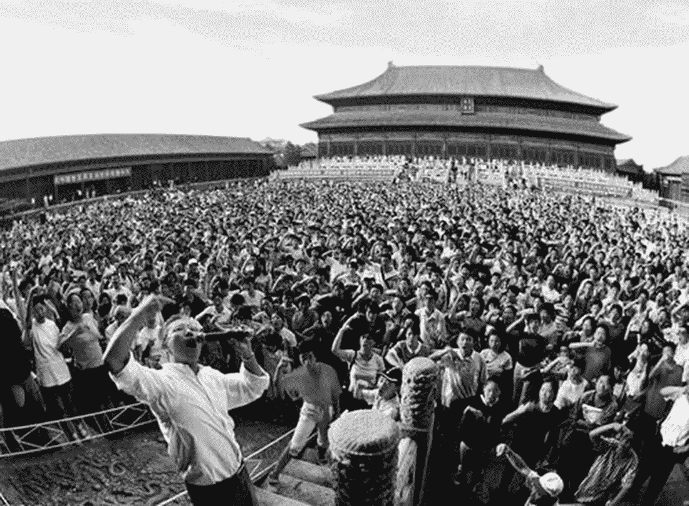

图 8：故宫的疯狂英语大型讲座。2011 年 3 月 31 日检索自[`www.ywenglish.com/dispnews.asp?id=17`](http://www.ywenglish.com/id%3D17)。

在意识形态上，英语被等同于“*国际*语言”，并在易力英语的论述中始终与“炼金术的力量”相关（Kachru, 1986）。一个很好的例子可以在易力英语首席执行官 Nathaniel Jones 在宣布北京奥运会语言培训供应商的新发布会上的演讲中找到：

> 奥运会是中国向世界传播中国人民友好与热诚的机会，而学习用访客的母语来传递这一信息将产生意义非凡的影响。对于 Aifly 来说，这是一个我们无与伦比的机会和责任，以实现我们的目标——让中国的每个人都能获得负担得、充满乐趣且改变人生的英语培训。（2008 北京奥运会官方网站，2007a [添加斜体]）

这段演说包含了若干项假设，包括中国与“世界”的交流是针对“母语”为英语的访客进行的，而且如果中国学习者掌握了访客的“母语”，他们就能获得对所有人都平等获取的“改变人生”的资本。此外，该演说暗示了在 Aifly 的英语学习经历并非一个艰辛的故事，而是一种享受。不难想象，这种言论如何在许多在服务国家的同时渴望过更好生活的奥运志愿者中，激发了他们对英语能力的强烈渴望。爱国主义、符号资本的获取与英语学习之间的交汇，不仅出现在官方语言培训服务供应商 Aifly 的话语中，也体现在奥运英语推广活动中英语学习与教学（ELLT）名人的使用上。在第 5 节）。奥运多语言服务中心和由中诚信（CapInfo）开发的多语言服务系统是北京为履行承诺而采取的两种策略。

### 4.31 奥运多语言服务中心

作为中国领先的外语大学之一，北京外国语大学（BFSU）在奥运语言服务中发挥了关键作用。北外与北京奥运会组委会（BOCOG）国际联络部于 2008 年 7 月 7 日（开幕式一个月前）共同建立了北京奥运多语言服务中心（MSC）。该中心旨在提供 44 种语言的“无障碍”口译翻译，涵盖了几乎所有奥运选手使用的语言，并预计为社区留下遗产：一个让北外继续提供语言服务并促进其多语言教学的永久机构。

MSC 运行着五项奥运语言服务计划，其中包括多语言交换机计划，以及针对志愿者、翻译员、语言服务现场经理和观察员的专项计划。奥运多语言服务中心的人员主要来自北外，包括 500 名志愿者学生、300 名志愿者教师以及专职专业人员。多语言交换机是借用了 2000 年悉尼奥运会的想法，专门为国际奥委会（IOC）和北京奥委会官员、奥运运动员及代表设立的。它提供 44 种语言的电话传译，包括 10 种语言（英语、法语、俄语、德语、日语、阿拉伯语、西班牙语、葡萄牙语、意大利语和韩语）的全天候热线，以及 34 种语言的 18 小时热线，甚至涵盖了一些少数民族传统语言（LCTLs），如冰岛语、辛哈拉语和豪萨语。交换机有助于解决现场语言障碍，例如，语言服务现场经理（LSVM）[`[¹²]`](#footnotes.xhtml_fn_12）分发了不同语言的交换机卡。如果一名俄罗斯运动员遇到困难且在现场找不到俄中口译员，他/她可以寻找 LSVM。使用俄语类别的电话卡，LSVM 会拨通说俄语的接线员，由接线员为 LSVM 和运动员进行翻译。如果现场工作人员或翻译员遇到技术问题，他们也可以向 LSVM 寻求交换机帮助。约 300 名北外志愿者教师同留学生担任多语言交换机的接线员。奥运期间（2008 年 7 月 24 日至 8 月 28 日）和残奥会期间（8 月 30 日至 9 月 16 日），多语言交换机接收并处理了超过 3,000 个电话：奥运会 2095 通，其中 471 通为西班牙语（占 22.5%），438 通为俄语（21%），424 通为法语（20.2%）；残奥会 852 通（Wang and Zhang, 2008）。

在志愿者计划中，2500 名北外本科生和研究生担任志愿者翻译，被部署在 31 个比赛场馆和若干处非比赛场馆（Wang and Zhang, 2008）。其中，567 人担任奥运村助理（OFA）——负责照顾国际奥委会官员、VIP 以及世界各地奥委会的官员。他们主修 13 种外语：英语、法语、德语、西班牙语、葡萄牙语、意大利语、俄语、荷兰语、波兰语、阿拉伯语、日语、韩语和泰语。他们的客户包括国际奥委会主席罗格、国际奥委会荣誉主席胡安·安东尼奥·萨马马兰奇、美国美国总统乔治·W·布什以及前德国总理施罗德格等。他们的工作包括语言协助、交通安排和日常日程协调。赛事期间，这些学生不仅护送客人前往比赛场馆、新闻发布会外交场合，还帮助他们及配偶处理日常生活——接送机、导游、医疗保健、法律问题等。在赛前，北外已对其学生以及来自其他大学和机构的志愿者开展了多次培训计划。具备良好语言能力的北外学生接受了关于文化、历史、经济、政治等方面相关问题的扩展培训。此外，作为北京奥运志愿者的培训基地之一，该校向近 30,000 名志愿者提供了英语培训课程，并为 10,000 多名志愿者司机组织了英语考试。此外，该校还为北京奥委会国际联络部培训了 609 名志愿者（其中 551 名来自北外）（Wang and Zhang, 2008）。

口译小组由奥林匹克新闻服务（ONS）团队和多语言应急小组组成。`ONS`是组委会内部的官方发布渠道。`ONS`的主要语言是英语。北京组委会（BOCOG）国际部语言室承担了将信息和新闻从英语翻译成中文和法语的任务。根据母语化翻译的原则，法语翻译由外籍人员承担，中文翻译则由国内译员人员承担。

赛前信息的翻译任务包括：运动员、教练、裁判、官员和马匹的个人简介；各国和地区奥林匹克委员会的信息；历史成就（如奥林匹克历史上重大赛事的成绩）；赛事、比赛及单项运动联合会的背景信息；`IOC`、`BOCOG`、赞助商及文化活动的日程；新闻发布会日程；以及关于场馆、注册、住宿、交通和气象的信息。

赛期间新闻的翻译任务包括：体育赛事预测（赛前或赛事期间对主要赛事和每日比赛的分析与预测）；赛事回顾（赛后对主要赛事和每日比赛的总结）；即兴演讲（比赛或赛事结束后不久运动员和教练发表的短辞）；新闻发布会主要内容的摘要；参赛人员名单（主要体育赛事运动员的信息，包括其个人简介）；媒体报道（与媒体采访相关的重大报道）；综合新闻（除上述固定类型以外的涵盖与奥运会相关活动的新闻文章）；国际体育联合会的官方新闻；以及其他赛期间的新和部分赛前信息的更新。

多语言应急小组作为赛前和赛期间语言服务的后备力量。其主要任务是在奥运会前后和期间协助奥林家族，应对紧急和无计划的多语言翻译和口译需求。多语言应急小组为各场馆的新闻发布会、会议和护送活动等紧急语言需求提供专业口译服务，包括英语、法语、西班牙语、俄语、德语、日语、韩语、阿拉伯语和中文的同声传译。应急口译任务应至少一天向小组汇报，并提供时间、地点、语言和人数等相关信息。

多语言应急小组的翻译服务主要涉及团长会议记录、`BOCOG`领导的重要文件和信函、新闻发布会和其他新闻稿的英文翻译。原则上，翻译要求超过 3000 字的任务需至少提前三天提交；翻译要求超过 5000 字的任务需至少提前五天提交；翻译要求超过 10000 字的任务需至少提前一周提交。

由于奥运期间各场馆对语言服务的需求巨大且管理困难，开展了语言服务场馆经理计划，以协助语言服务管理，并为某些场馆的领导和 VIP 提供翻译口译服务。`BFSU`向每个场馆（无论比赛场还是非比赛场）派遣了 24 名研究生担任副语言服务经理。副语言服务经理属于相应的场馆团队，由语言服务经理直接领导，并在场馆接受适当培训。24 名副经理的工作时间、培训和服务的安排因场馆而异。

除了成就外，也有一些值得反思和改进的领域。例如，英中口译员占了中国所有口译员的大多数，且在在此处（中国）举办的重大国际活动中，英语往往成为默认语言。其他外语（包括作为`IOC`另一种工作语言的法语）在中文教育语境中均被视为小语种（`Xiao Yu Zhong`），因此在多语言服务的人员培训中未得到应有的重视。2008 年奥运会语言人员明显不足，导致某些赛事仅提供中英口译。在奥林家族助理计划的 562 名`BFSU`志愿者中，415 名是英中口译员，只有 54 名志愿者主修法语（Wang and Zhang，2008`）。英语和法语的其他外语学生少得多。尽管`BFSU`翻译学院（`GSTI`）已开设多语言口译课程一年，但该课程的学生在赛期间参加`OFA`计划时仍使用英语。例如，网球场馆由于语言人员不足，仅配备了中英口译。这意味着所有外国教练和运动员必须用英语听和回答问题。然而，他们中一些人的英语并不流利，导致了沟通障碍。因此，北京 2008 奥运会给中国带来了一个挑战，如何在未来为日益频繁的国际盛会加强其多语言服务。

### 4.3.2 技术支持的多语言服务

在之前的奥运会申办期间，尚未出现智能多语语言服务，这与人工完成的语言服务完全不同。2008 年北京奥运会通过中智信息（CapInfo Company Ltd.）开发的`Multilingual Service System`实施了智能语言翻译服务。中智信息是一家成立于 1998 年的家国有 IT 公司，其核心使命是为北京的大型数字化项目提供数字服务。该公司是 2008 年北京奥运会申办期间的赞助商，也是奥运会网站的应用程序集成商，为北京奥运会组织委员会（BOCOG）提供网络服务。中智信息致力于通过其`Multilingual Service System`为 2008 年北京奥运会提供及时、便利、全面的多语言信息服务。

中智信息、科学技术部、北京市以及 2008 年奥运会科技委员会在五年时间内，对语音识别、机器翻译、文本语音合成和应用软件的研究共投入了 1.5 亿元人民币。`Multilingual Service System`通过集成语音识别、机器翻译、文本语音合成等技术实现了智能语言翻译服务。通过该系统，奥运会信息和城市信息以中文、英语、法语、俄语、西班牙语、日语、韩语和阿拉伯语八种语言提供。

观众、注册会员和游客可以通过北京奥运会官方网站、呼叫中心、手机、个人电脑和数字信息服务终端等应用程序终端访问多语言服务（参见图 3）。外国游客可以使用手机、网络和其他应用程序终端用其母语请求信息；任何此类请求都会被转换为中文以产生相应的中文信息，随后这些信息会被再次转换成请求发起者母语显示的显示结果。这种智能多语言信息服务在很大程度上解决了人工翻译所需的人物资源供应的局限性，并提高了多语言服务的效率。`Multilingual Service System`成为了一种技术支持语言服务的新模式，为语言服务行业提供了新方向。

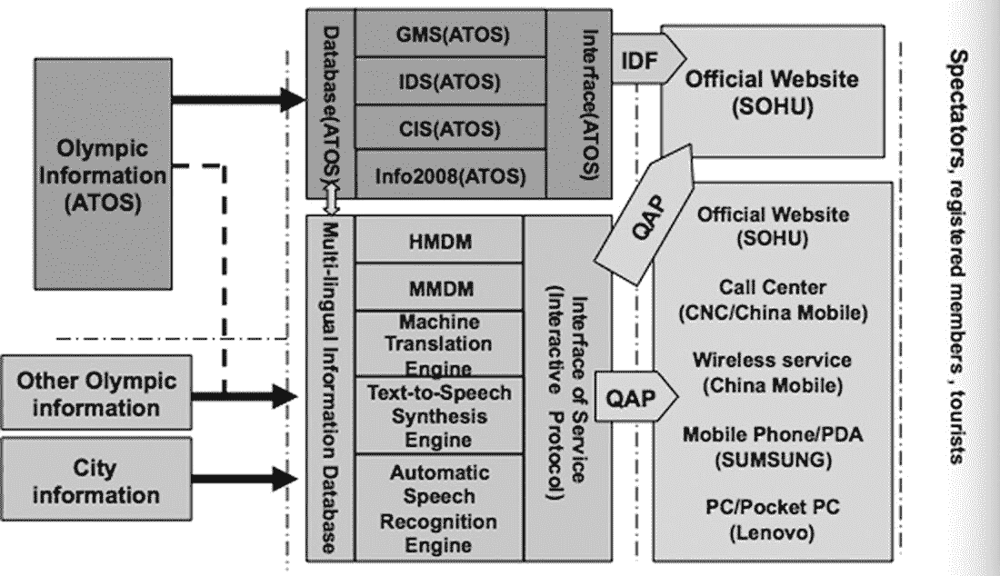

图 3：分布平台（城市内的语音和/或网页和/或终端）。

除了`Multilingual Service System`之外，另一种技术支持的语言服务也值得关注。在比赛开始前，北京外国语大学（BFSU）的`GSTI`尝试为北京奥运会提供远程传译（Wang and Zhang, 2008）。`GSTI`与一家著名的视频通信产品制造商探索了将视频会议系统转换为专用口译设备的可行性。新设备将安装在`MSC`中，并在比赛期间连接到多个场馆，使口译员能够在留在`MSC`的同时为不同场馆的会议提供翻译。这一创新概念引起了奥委会领导的兴趣。当奥委会主席刘琦先生考察北外时，他参加了`GSTI`关于操作口译系统的演示并对其留下了深刻印象。尽管由于时间压力该概念未能成为现实，但这次演示是一个很好的尝试，并有利于口译服务技术进步的趋势。

## 5 五位英语学习教学名人


除了官方的英语普及活动外，官方认可的模范英语学习者的名人效应是北京及全国其他地区英语传播的另一个重要且有影响的因素。人们从名人那里获取价值观和行为是大媒体研究关注的问题。作为一种媒体现象，名人是由媒体创造的并依赖公众关注的（`Fraser and Brown, 2002`）。另一方面，名人拥有巨大的社会影响力。在媒体饱和的国家，“名人”和“成功”已几乎成为同义词；因此，名人往往成为榜样，“其价值观、信仰和行为可能会被其影响力范围内的其他人所采纳”（`Fraser and Brown, 2002`）。之前的研究（例如，`Bandura, 1986`; `Basil, 1996`; `Fraser and Brown, 2002`）表明，认同是名人效应的中介。认同是一种社会影响过程，个人通过这一过程采用名人的价值观和行为（`Fraser and Brown, 2002`, p. 187）。`Bandura (1986)`发现，认同名人的个人更有可能采取名人所展示的行为。在本节中，我想借用“名人”的概念来解释名人认同如何导致中国人认同英语学习教学（ELLT）名人。

正如英语精通被视为国家进一步发展的基石一样，它也被视为个人的宝贵资产。中国的英语热潮催生了许多在英语学习教学中发挥模范作用的名人。在本研究中，“ELLT 名人”是指那些因英语学习成就而闻名，并通过大众媒体的高频曝光而成为广泛认可的英语学习榜样的普通中国公民。当北京奥运会的准备工作全面进行时，两位中国英语学习者被赋予官方英语学习榜样的角色，并在广泛媒体的关注下获得了名人地位：`疯狂英语`创始人杨洋和多语种警察刘文利。通过广播、电视、印刷媒体和互联网的广泛传播，他们都获得了大量的粉丝。他们的“成功故事”在媒体上被广泛宣传，并被进一步激励中国人学习英语的工具。正如我将在下文中讨论的，杨洋和刘文利也受益于奥运英语普及活动，成功地将英语的符号资本转化为生活中的社会经济资本。

### 5.1 疯狂英语创始人杨洋：将英语学习作为一种爱国行为

“疯狂英语”的创始人李阳（一种在中国广受欢迎但极具争议的英语学习方法）早在北京奥运会之前就已是英语学习教学（ELLT）领域的名人。作为中国一名成功的英语学习者和英语培训行业巨头，他可能位居中国英语学习名人榜之首，并对大众的英语学习实践和欲望产生了巨大影响。

李阳出生于 1969 年，他在兰州大学学习机械工程专业时，正面临着通过大学英语考试的需求。这促使他开发了自己所谓的“语言破解系统”——`疯狂英语`（`CRIENGLISH, 2007`）。李阳仅用了几年时间就放弃了机械工程，将他激进的方法转变为中国最著名的英语培训品牌之一以及一项价值数百万元的业务。

“疯狂英语”的方法依赖于三个核心原则：“越越大越好”、“越快越好”和“越清晰越好”（`Bolton, 2002`，p. 195）。在“疯狂英语”讲座中，李阳鼓励学生大声、快速、反复地喊出励性的英语表达，并配合旨在强调发音的手势。“疯狂英语”方法的核心信念是，这些练习有助于打破中国英语学习者面临的共同障碍，即对“丢脸”的恐惧——这是中国英语外语（EFL）学习者在与“英语母语者”交流时感知到的障碍（`Woodward, 2008`，p. 28）。

“对于害羞内向的亚洲人来说，这是一种新方法，”李阳宣布道，“我的方法可以很快给予人们自信。我试图为普通人简化英语。因为这些内容，我中国中国人的偶像和名人”（`Independent News, 2009`）。在许多公开场合中，李阳谈到了自己早期在掌握英语方面的困难，敦促他的追随者学习他自我提升的榜样，并激励观众大量朗读英语口号，例如“我享受丢脸！”、“欢迎挫折！”、“享受痛苦！”和“追求成功！”（`Bolton, 2002`，p. 195）。在由张元制作并执导的一部关于“疯狂英语”的中国纪录片开头听到的一段广播节目中，李阳这样解释了他的成功理论：

```
你好，大家好！我叫李阳。这可能听起来很奇怪。有人问我我是不是虚构了那些苦难。我的父母、同学和老师都会证明我曾缺乏自信。我不知道该何何从。我有自卑心理，觉得自己很无知。我觉得自己什么也做不到。我总是告诉自己要下决心：明天开始！明天开始！每个人都想成功，我想成为一个榜样。我的疯狂英语包含了许多人生和成功的哲学……金钱不再是问题了。一天我可以赚 2 万到 3 万，3 万到 4 万。那种时代已经过去了。我已经进入另一个阶段。一旦我成就了什么，它就会变得枯燥。我觉得我找到了一个更大的目标。告诉成千上万的人我的过程。每个人都要做好自己的工作。因为中国人缺乏自信。中国人需要埋头苦干。
```

> （李阳英语自我介绍的节选，引自 `Bolton, 2002`，p. 195）

李阳将自己塑为一个征服者，试图在他自己的成功故事与观众的欲望和野心之间建立联系。在这个个人成就的典型故事中，他把自己从一个“缺乏自信”、“有自卑心理”且“觉得自己什么也做不到”的无名之辈，变成了一个“金钱不再是问题”的人，而且事实上，由于他现在正在追求金钱之外的“更大的目标”，金钱对他来说甚至不再重要。

在他的传达中，英语作为成功和自我蜕变的内在方面的价值被强调并被视为理所当然。在李阳的讲座中，英语变成了某种魔棒，让追随者能够实现通常被认为普通中国人无法企及的成功，例如“国际化赚钱”。例如，在一次对清华大学学生的讲座中，他告诉观众，在`Sony`等公司在日本教英语，每小时可以赚 30,000 美元（`Bolton, 2002`）。在李阳的论述中，英语水平始终与成就、自信、自我价值、快乐、金钱和成功联系在一起。通过鼓励自信并并通过其“从寒门到富翁”的叙事承诺物质奖励，“疯狂英语”方法激发了数百万中国人的强烈英语学习欲望。

尽管有这些华辞，但该方法的教学成功却遭到了质疑，正如第 5 章 `9781614516866_003511.xhtml_b_9781614514954-004_s_002_s_003` 中讨论的那样（参见 `Woodward`）。

与其他英语学习名人相比，李阳声称他在推广英语方面已“进入了另一个阶段”——在这个阶段，英语学习不仅是自我蜕变的手段，也是中国性的一个侧面。“疯狂英语”哲学包含“一种尖锐且专注的民族主义”（`Bolton, 2002`，p. 196），这可以通过李阳的个人格言来体现：“激发爱国主义热情，弘扬民族精神；攻克英语，振兴中华”（`Wikipedia, 2009`）。李阳认为，学习英语是提升中国世界大国地位最重要的步骤。李阳的书在中国畅销百万，总是包含爱国主义口号（参见图片 9 `9781614516866_003511.xhtml_b_9781614514954-004_fig_003`），如“攻克英语，让中国更强大！”、“帮助 3 亿中国人说好英语”以及“让中国的声音响彻世界”（`Independent News, 2009`）。“我希望[中国人]使用英语并将汉语作为世界语言……精通英语并因此富我们的祖国是爱国行为”（`Yamane, 2005`，引自 `Woodward, 2008`，p. 34）。


图片 9：李阳疯狂英语海报。检索于 2011 年 3 月 31 日，来自`http://www.bjcrazyenglish.com/` (`http://www.bjcrazyenglish.com/`)。

“疯狂英语”（`Crazy English`）哲学主张为了国家利益而学习英语，其根源于 1861 年至 1894 年间在中国逐渐兴起的洋务运动 `yangwu yundong` [the Self Strengthening Movement] 口号：“师夷长技以制夷 `Shiyi changji yi zhiyi` [learning advanced technologies from Western barbarians in order to fight against them].”这一理念成为清末学西运动的主要动力来源。李刚在自己的讲座中引用了这一口号，他经常敦促学生出国学习西方知识，并将这些知识和经验带回报效中国。李阳的“疯狂英语”哲学完美契合了儒家关于学习功能的二元对立：西学为“用”（`yong` [external utility]），中学为“体”（`ti` [internal essence]）。“中学为体；西学为用 `zhongxue wei ti; xixue wei yong` [Chinese learning for essence; Western learning for utility]”的原则是基于一种信念：西方学（这当然包括外语，主要是英语）可以为了实际目的而进口，而不涉及其文化本质，因此中国的文化本质可以通过中国学来完好保留（`Gao, 2009`, p. 63）。

李阳的“疯狂英语”哲学与北京奥运会的社会政治背景高度契合，并使他在奥运会期间获得了巨大的声誉。2005 年，中国国家体育局任命李阳为“国家队运动员总教练”。次年，他又被北京奥运会组备委员会（BOCOG）任命为“奥运大使”以及“150 万名奥运志愿者总教练”，并被北京市政府奥运会训练工作小组聘为专家顾问。作为奥运志愿者的总教练和“疯狂英语”运动的创始人，李阳被描述为一名爱国教师。在奥运会前李阳举办的一场大型英语讲座上，超过 2 万名大学生兴致高昂地跟在他身后反复朗读：“我要让我的国家感到骄傲！”（`Aifly Education Technology Company, 2007b`）。通过与北京奥运主办者的积极合作，李阳作为英语学习者与教师（ELLT）名人的地位不断提升，他的英语教学哲学也获得了正当性。从一个普通人转变为社会英雄，他通过英语实现了个人的自我蜕变。对于数百万认同李阳的北京人和中国人来说，学习英语是为了 2008 年奥运会的成功和中华民族的发展而进行的一种爱国行为。李阳的明星效应不仅促进了他自己英语教学业务的快速扩张，还提升了英语在中国作为一种宝贵资产的象征意义，从而激发了人们对英语日益增长的渴望。

### 5.2 多语言警察刘文立：英语学习作为一种赋能

与在北京奥运会之前就已是中国名人的李阳不同，警察刘文立为了备战奥运自学了 13 种外语，他更像是一个即兴的英语学习名人，其名声直接植根于奥运英语热潮。刘文立出生于 1967 年，20 世纪 90 年代他在北京郊区派出所担任后勤人员时开始学习英语。1995 年，联合国在北京召开了第四次世界妇女会议。刘文立在会议期间在公安安全第一线工作。一次失败的跨文化交流促使他学习英语并成为“第一位说英语的警察”（`Li, 2008`）。作为一名仅有中学学历的成年英语学习者，刘文立通过死记英语单词和表达来自学英语，在英语角与其他中国学习者一起练习英语，并与街上遇到的每一个外国人主动开启聊天（`Li, 2008`）。刘文立认为“重复”是学习外语最好的方法：“在语言学习中，没有比重复更聪明的方法了。在过去的 13 年里，我一直这么做。”（`Cao, 2008`）。

北京在 2001 年成功申办奥运引发了中国首都各行业英语学习的热潮。经过六年的刻苦学习后，刘文立的英语水平大为提高。2001 年，北京市公安局举办了一场英语口语比赛以促进英语学习。当时仍在北京郊区派出所担任后勤人员的刘文立赢得了比赛。不久后，刘文立被树立英语学习的官方模范（见 照片 10），并于 2002 年被派往北京市区的一个重要旅游景点。刘文立在一次电视采访中将自己描述为“窗口岗位的窗口警察 [a model policeman at a model service post]”，他的职责是……（照片 10：横幅写着“窗口岗位的窗口警察 [a model policeman at a model service post]”）。


北京奥运会于 2001 年成功申办，引发了中国首都各行业英语学习的热潮。经过六年的刻苦学习后，刘文立的英语水平大为提高。2001 年，北京市公安局举办了一场英语口语比赛以促进英语学习。当时仍在北京郊区派出所担任后勤人员的刘文立赢得了比赛。不久后，刘文立被树立为英语学习的官方模范（见照片 10），并于 2002 年被派往北京市区的一个重要旅游景点。刘文立在一次电视采访中将自己描述为“窗口岗位的窗口警察 [a model policeman at a model service post]”，他的职责是……（照片 10：横幅写着“窗口岗位的窗口警察 [a model policeman at a model service post]”）。

（注：由于提供的原文包含大量完全重复的段落，译文已按要求避免重复输出。）

[刘文立：6 年后我就 48 岁了。到那时，我可能在工作 30 年后退休。届时，我将开设英语俱乐部和英语培训班，并成为名人代言。简而言之，我身上蕴含着巨大的商机！]

在空前的奥运英语热潮的推动下，警察刘文立在北京奥运会的背景下，成功地将英语这一语言资本转化为社会、经济及其他符号资本。用刘文立的话说，英语和奥运改变了他的生活（Li, 2008）。在北京获得奥运会主办权后，他开始向社区内的居民教授英语。刘淑英就是其中之一：“他是我们学习的榜样。为了更好地帮助外国客人，大家都在努力学英语。刘老师的勤奋激励了我们，现在大家都在努力工作”（Cao, 2008）。陈桂英在刘文立所在的社区经营一家自行车店：“刘文立帮我做了一个双语标牌。那是社区里的第一个。当然，为了方便奥运游客，更多商店也效仿了做法”（Cao, 2008）。通过广泛的媒体宣传，刘文立在中国拥有了一批追随者和粉丝。许多没有受过高等教育、但渴望更好生活的中国成年英语学习者，对他产生了强烈的认同，并将他视为值得学习和效仿的榜样。

除了奥运外语普及运动外，官方认可的英语学习教学（`ELLT`）名人也是北京及中国其他地区英语传播的另一个重要且具有影响力的因素。这两位 `ELLT` 名人——`疯狂英语`的创始人李刚和多语言警察刘文立，被赋予了官方英语学习榜样的角色，并受到大量媒体的关注，获得了名人地位。通过身份认同，他们对将学英语视为一种爱国行为和自我转型的中国学习者产生了巨大影响。Bourdieu (1991, p. 19) 认为，语言资本的分配与其他形式资本（社会、经济、文化和符号资本）的分配有特定方式相关，这些资本定义了个人在社会空间中的位置。英语被推崇的符号价值并非完全从外部强加的，更多是在现代中国社会内部构建、强化和循环的。像李刚和刘文立这样的 `ELLT` 名人都是当代中国社会的产物，在这个社会中，英语被高度重视并资本化。在中国英语培训市场中拥有既得利益的 `ELLT` 名人，在放大英语语言资本以及扩大中国社会对英语的渴望方面具有强大力量。迄今为止，很少有研究探讨名人在促进大众群体语言意识形态方面的作用，而这种意识形态最终塑造了行为（Fraser and Brown, 2002）。Braudy (1986) 认为我们忽视了名人在塑造社会价值观方面的重要性。在研究中国等扩张圈国家英语热这一显著现象时，我们需要更好地了解那些在经济或社会上被边缘化的人、以及那些感到无力的人，是如何对 `ELLT` 名人产生认同，以及他们是否模仿这些名人的英语学习价值观和行为。

## 6 总结

在像中国这样的集权体制国家，语言政策的决策由中央当局做出，并由政治实体以自上而下的方式实施，通常面临的阻力有限，因为大多数地方政府、学校和教师都予以配合。这些政策随后通过教学实践、考试制度和语言景观得到了强化。在语言政策的制定和执行过程中，个人或群体隶从于国家利益，他们的语言选择并非自由的，而是在预定义的替代方案之间做出的，其权利实际上受到了限制（Tollefson, 1991）。

本章明确了 `BOCOG`（代表中国中央政府）对外语能力（主要是英语）的认知，认为它是 2008 年奥运会成功的关键因素，并详细说明了 `BSFLP` 组委会为了改善奥运会期间北京的语言环境所采取的多种语言规划策略。此外，它还描述了 `BSFLP`、`BETS`、私立语言培训机构、技术支持的语言服务以及英语学习教学名人在实现政府语言规划目标中的运作作用。

服务于北京奥运会的外语政策（以英语普及为中心）是在集权体制下以自上而下的方式制定的。也就是说，当局在政策制定过程中组织了相关政府部门（例如北京市人民政府外事办）和一个咨询小组（由 35 名国内外外语教育专家组成），但并未考虑到社会基层的意见和需求，特别是那些对员工有外语能力要求的公司、组织和机构。

基于实证数据，我在官方话语中识别出几项意识形态假设——即：母语者主义、英语的炼金术、英语作为改变命运的资本、为了 `yong`（外部效用）而学英语、将学英语视为一种爱国行为，以及由母语对话者构成的想象社区。这些假设误读了作为国际语言的英语使用者所不断变化的社会语言学现实。

在奥运会外语普及运动中赋予英语的地位和价值，反映了 21 世纪初中国英语教育政策的总体趋势。`ELT` 被推崇为“自然、中立且有益”的，其目的是维持经济发展并增强国际竞争力。在官方话语中，英语水平被描述为现代化进程的催化剂、所谓的国际化载体，以及奥运会成功的有效保障，最终将造福中国社会的各个层面。

中国人民，尤其是北京市民，被敦促通过学习英语来实现个人成功，并为举办城市及国家的发展做出贡献。除了英语现有的教育、职业、经济和符号价值外，在北京奥运的背景下，学习英语实际上演变成了一种爱国行为。在官方话语中，英语已被用作构建中国作为一个和谐发展的现代民族国家的身份、北京作为一个国际奥林匹城的身份，以及中国学习者作为爱国全球公民的身份的关键钥匙。

通过强调英语教育对于培养爱国主义和促进中国文化的必要性，中国政府希望对英语保持中立和工具主义的视角，并将英语的教学视为中国学习者巩固其本土文化认同的机会。可以认为，关于忠诚、爱国、群体成员和集体认同的宣传和意识形态是国家用来维持控制和促进其社会、政治和经济议程的策略。然而，这些在奥运外语普及运动中盛行的官方话语需要经过批判性的审查，而不能被视为绝对真理。Fairclough (1989) 认为，话语在通过赞同实施意识形态控制方面发挥着特别重要的作用。中国的英语教育政策是国家根据其政治和经济利益分配英语地位和功能的结果，而 `ELT` 的标准和目的也被国家及其机构操纵，以满足国家发展的需求。

至关重要的是，英语在全球语言市场中的价值和意义并非固定且普遍的。嵌入在这些话语中的英语意识形态最好被理解为北京奥运背景下的局部的、社会和政治建构。在第 5 章中，我将讨论为什么以及如何学习英语可能对所有中国学习者都没有回报。各种语言服务措施的效果以及北京语言环境的评估也将在下一章进行更详细的讨论。

# 第 5 章 评估北京的外语环境

考虑到奥运会巨大的规模以及参与成员和项目的复杂性，任何语言管理的尝试都面临着非常严峻的挑战。支持中国奥运会语言管理的一个因素是中央政府在执行政策方面的强大权威。为了在筹备 2008 年奥运会期间提高北京市民的外语整体水平并提升北京的国际形象，`BSFLP` 组委会根据《北京普及英语行动计划（2003–2008）》在主办城市开展了一系列活动。举办奥运会的国家自豪感极大激发了北京市民学习和说外语的热情。经过五年的准备，中共市委外事工作领导小组、北京市人民政府外事办以及 `BSFLP` 组委会委托大海市场公司对北京的外语环境进行了评估。2008 年 8 月 1 日，即北京奥运会开幕式一周前，《北京语言环境跟踪调查与分析报告》（中共市委外事工作领导小组等，2008）正式发布。在本章中，我将根据这份官方报告和我的研究数据，对北京奥运会之前的“北京语言环境”进行评论。

## 1 评估北京的外语口语人数

### 1.1 北京外语口语总数

到 2008 年，实现北京 500 万外语会话人口的目标是 `BSFLP` 工作的重点。`BSFLP` 组织委员会声称，会说外语的人数已从 2002 年的 312 万增加到 2008 年的 550 万（Deng, 2009），完成了 2003–2008 年`BSFLP 行动计划`中关于建设北京“国际化语言环境”的目标。然而，外语会话人口的规模实际上取决于对其如何定义。在*《北京市外语环境跟踪调查与分析报告》*（Office of the Leading Group on Foreign Affairs of the Beijing Municipal Party Committee of the CPC et al. 2008）中，“外语会话人口”被定义为那些至少能理解一些简单外语文章以及能够进行简单外语交流的人。该报告解释说，“外语会话人口”包括初中及以上学历，且通过了某外语水平测试或在自评中至少达到外语低中级水平的人员¹³。2007 年北京常住人口为 1581 万（Beijing Municipal Bureau of Statistics, 2007）。根据官方定义，2007 年底北京外语会话人口规模为 534 万，占常住人口的 35%，比 2002 年的同期总数显著增长了 12.4%（见图 4）。其中，18 岁以上的人有 454.6 万，18 岁以下的有 98.8 万。报告解释说，18 岁以下外语会话人口的规模是通过相加《2006 学年各学历层次学生统计表》中列出的中等职业学校、技校、普通中学、初中、高中以及部分小学的学生总数得出的。具体而言，高级职业学校有 7.7 万名学生，技校 5.2 万名学生，中等技校 11 万名学生，成人中学 1.1 万名学生，初中 28.8 万名学生，高中 25.9 万名学生，此外该市还有 18.9 万名小学生。报告声称，五分之二的小学生被包含在北京市的外语人口中，因为近年来小学生的外语水平有了很大提高。显然，官方对“外语会话人口”的定义和计算存在问题。鉴于中国的应试教育长期以来一直被批评培养了“哑巴英语学习者”，认为任何受过初中教育（更不用说小学）或通过了某外语水平测试的人都能自动识别为“外语会话者”并以此进行有效的跨文化外语交流是过于乐观的。

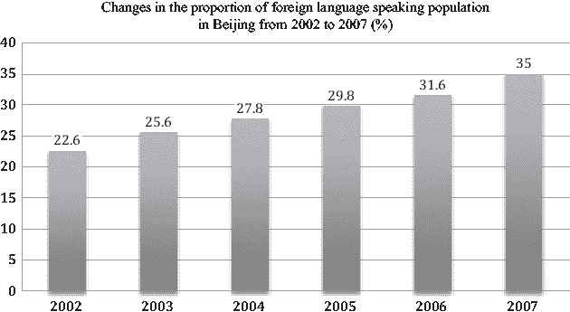

图 4：2002 年至 2007 年北京“外语会话人口”百分比的变化。

### 1.2 北京外语会话人口的不同水平

`BSFLP` 组织委员会将北京的英语会话人口分为低中级、中高级和高级三个水平。在 2007 年北京 553.4 万外语会话人口中，有 298.3 万人处于低中级外语水平，171 万人处于中高级水平，84.1 万人处于高级水平，分别占 53.9%、30.9%和 15.2%（见图 5）。对这些数字的计算方法进行仔细分析可以发现许多问题。例如，报告声称有 53 万 18 岁以下的低中级外语会话者。这一数字是通过相加 2007 年初中和技校的学生人数得出的。同样，18 岁以下中高级外语会话者的人数为 45.8 万，这是通过相加 2007 年高中、职业学校和中等技校的学生人数获得的。这种计算方法将人的外语能力与其学历自动挂钩，忽略了个人差异，因此缺乏有效性。

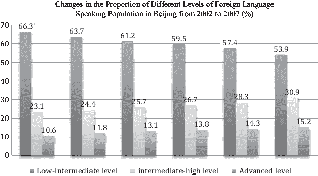

图 5：2002 年至 2007 年北京不同水平官方认可的外语会话人口比例的变化。

### 1.3 北京外语会话人口的语言分布

根据报告（北京市外事工作小组等, 2008），北京官方认可的外语会话人口中 74.2%只学过一种外语，而 90.5%的人群学习过英语。英语是奥运会前北京最广泛学习的语言。在 18 岁以上的英语学习者中，18.7%参加过国内或国际标准化考试。其中，10.8%通过了英语四级（`CET-4`），3.1%通过了英语六级（`CET-6`）。通过六级的人大多是拥有大学及以上学历的 18 至 34 岁城市居民。此外，21.2%学习过俄语。俄语学习者主要是中老年人，对该语言的掌握和应用水平较低。日语是最受欢迎的第二外语。此外，北京还有学习法语、韩语、德语和西班牙语等其他语言的人。这些语言在中国被称为“小语种”或少数教学语言（`LCTLs`）。

尽管该计划对少数语种教学增加了关注，但对北京市民英语教学的强调更加加强。官方观点认为，在各种职业、商业、工作场所和企业中拥有大量优秀的英语使用者，对于北京奥运会的成功以及中国在全球化时代下的持续发展至关重要。作为奥运英语推广活动的积极组织者和参与者，林林¹⁴，马拉松赛事语言服务经理在访谈中证实，中国政府在推广英语方面的投入比其他任何语言都大。根据林的说法，英语在中国具有如此高的地位，以至于在公共话语中，“外语”一词通常与“英语”等同：

```
林林: (…) 嗯，大部分情况下]比如说，我说的就是提高公众的外语水平，基本上就是指英语。在社区里头也是，包括我们的服务人员，比如说交通服务人员啊、银行服务人员啊，基本上都是[学习]英语的。
```

- [孙林：……在大多数情况下，例如，呃，当我说“提高公众外语水平”时，我指的是英语。当我谈到社区居民和服务业人员（呃，如交通部门和银行的人员）的外语学习时也是如此，我的意思是大多数时候指的是学习英语。在对外语方面，许多像我这样的中国学习者在英语方面有特定的基础。我们没有很多机会去使用[其他外语，如]法语和西班牙语。此外，我们对这些语言的了解非常匮乏。(2008-09-19)]

官方认定的外语流利的人口规模不足以证明北京已实现“国际化语言环境”。对于北京当局声称为 2008 年奥运会成功构建的“国际化语言环境”，对其进行充分的解释应当考虑到长期外籍人士和奥运会访客的社会语言结构。2008 年，留京超过六个月的外国人有 11 万，其中大多数人并非来自英语国家，而是来自韩国（Xu, 2009）。这一长期外籍人士人数占北京总人口的 0.6%。有人认为，居住在城市的外国人数量是判断该城市国际水平的重要指标（Xu, 2009）。与伦敦和纽约等其他大都市相比，后者的外国人分别占人口的 30%和 15.6%（Xu, 2009），北京人口的国际化比例较低。*《2009 年北京统计年鉴》*（北京市统计局, 2009）显示，2008 年居住在北京的注册国际学生有 31,712 名。他们的主要来源国是日本和韩国，其次是美国。

访问北京的国际游客也影响着城市的“国际化语言环境”。根据北京市统计局（2008），2007 年有 380 万多外国游客访问了北京。这些游客来自不同的语言背景，其中两个邻近亚洲国家日本和韩国占了总数的四分之一。2008 年，北京奥运会并未让举办地的国际旅游经济受益。根据北京市旅游局（2008）发布的统计数据，北京在 2008 年 8 月接待了 35.6 万海外游客，与去年同期相比下降了 4.1%。在赛事开始前的一个月（7 月），赴京的国际游客人数同比骤降 30%。在赛后一个月（9 月），旅游业低迷持续，国际游客人数下降了超过 20%。表 4 已证实，北京将缺乏高级英语人才、多语言人才以及英语以外的其他外语流利者。

表 4：2008 年 8 月访问北京的前十大游客来源国。

| 来源国 | 官方语言 | 人数 | 增长百分比 |
| --- | --- | --- | --- |
| 外国游客总量 | | 356,000 | −4.1 |
| **1. 美国** | **英语** | **68,304** | **37** |
| 2. 日本 | 日语 | 40,652 | −27.28 |
| **3. 英国** | **英语** | **25,015** | **44.93** |
| 4. 韩国 | 韩语 | 18,941 | −58.92 |
| 5. 俄罗斯 | 俄语 | 17,067 | −25.00 |
| 6. 德国 | 德语 | 15,532 | −5.56 |
| 7. 法国 | 法语 | 14,216 | −17.20 |
| **8. 澳大利亚** | **英语** | **14,912** | **37.68** |
| **9. 加拿大** | **英语、法语** | **11,324** | **19.10** |
| 10. 西班牙 | 西班牙语 | 6,837 | −48.32 |

在中国话语中将“英语”等同于“外语”或“国际语言”的概念，正如孙林在 1.3 节中所指出的，将“外语”等同于“英语”反映了一种将英语的全球传播合法化为自然、中立且有益的论调（Pennycook, 1994），以及一种殖民主义论调，将英语提升为“神妙语言”（Pennycook, 1998）的地位（见第 20 页）。将英语等同于外语导致了一种假设，英语是像中国这样的“扩张圈”国家与语言和文化高度多样化的全球社区进行交流的唯一可行语言选择，这有助于维持英语在当今世界的主导地位。此外，赋予英语优于其他语言的优越性，可能会让人们忽视当地和全球社区中的语言与文化多样性。尽管英语是国际旅游和交流的主导语言，一个良好的国际化语言环境应当适应中国所处背景下的这种文化和语言多样性。


从社会心理学角度来看，语言学习中的动机研究在西方已有成熟体系（例如：`Brophy, 1999; Dörnyei 2005; Dörnyei and Ushioda, 2009; Eccles and Wigfield, 2002; Gardner, 1985`）。在本书中，我借鉴了 `Ryan and Deci (2000)` 对内在动机和外在动机的分类，来理解北京市民学习外语的原因和需求。内在动机行为是为了本身而被激活和维持的（例如对活动本身的快乐、乐趣和兴趣），而外在动机行为则是为了“可分离”的结果而被激活和维持。根据得思市场调查公司（`Datasea Market Research Company`）在官方报告（北京市委委员会外事工作领导小组等，2008）中的调查，尽管 75.9%的受访者有学习外语的动力，但只有 7.7%的人认为外语在工作生活中很重要，只有 5.1%的人出于兴趣内在动机学习外语（见图 6）。大多数受访者表示他们出于外在动机学习外语：37.9%的人希望为北京奥运会做贡献，25.5%的人是为了在中国正式劳动力市场的就业价值。然而，仍有 23.8%的受访者声称他们没有学习任何语言的动力。在该类别中，18.8%的人认为外语毫无用处，5%的人出于各种原因被迫学习外语。

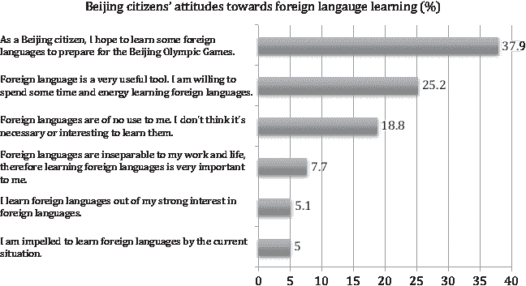

图 6：北京市民对语言学习的态度。

## 2.2 北京语言项目的成果

为了推广并提高北京市民在备奥期间的外语水平，北京奥运会组（`BSFLP`）为市民组织了一系列外语推广活动，如英语比赛、英语演讲比赛、唱歌比赛以及在王府井书店举办的一系列讲座（见表 5）。根据报告（北京市委委员会外事工作领导小组等，2008），63.4%的市民听说过这些活动。尽管为了让市民参与各种语言学习活动付出了巨大努力，市民参与这些活动的意愿并不强烈（见图 7）。在 42.8%的受访者对唱歌比赛感兴趣之外，少于 20%的人对 `BSFLP` 组织的任何其他语言活动感兴趣。在奥运会期间，`BSFLP` 的行动包括：

表 5：`BSFLP` 的外语推广活动。

| 序号 | 活动内容 |
| :--- | :--- |
| 1 | 在校园举办一系列“走向世界”多语言活动——北京学生法语比赛 |
| 2 | 举办“北京餐饮行业英语菜单”评审会 |
| 3 | 在北京高校每月举办一系列 `BETS` 公开讲座 |
| 4 | 每月为北京市民举办一系列“学习外语，迎奥运”公开讲座 |
| 5 | 向社区居民发放免费（试用版）英语爱好者报纸 |
| 6 | 在奥运倒计时 500 天期间，英语志愿者为出租司机提供语言（英语）课程 |
| 7 | 每月在书店为北京市民举办一系列 `BSFLP` 公开讲座 |
| 8 | 建立公共英语标识小组并定期检查英语路标 |
| 9 | 在王府井步行街开展“点亮奥环，志愿奉献奥运”活动，从北京市政府部门招募志愿者 |
| 10 | 为志愿者提供英语标识培训课程 |
| 11 | 在朝阳公园举办 2007 安来——北京市民语言活动周 |
| 12 | 与北京电视台联合举办“我是英雄”英语比赛 |
| 13 | 招募近 10000 名中学生参加“第六届北京中学生英语演讲” |
| 14 | 组织全市各行业、区、县对公共场所英语标识进行检查和纠正 |
| 15 | 在奥运倒计时 400 天期间为市民开展多语言问候在线学习活动 |
| 16 | 举办大型双语主题活动“庆祝奥运盛事，力争做奥运双语记者” |
| 17 | 组织全市中学生参加“第六届新东方杯中学生英语竞赛赛”决赛 |
| 18 | 组织全市 18 个区县参加“第三届北京英语大赛”活动 |
| 19 | 在北京劳动人民文化宫举办“第六届北京市民外语博览会”。近 8 万名市民、数十家语言教育机构以及国内外媒体参加了该活动。同时，成功启动了“2007 世界语言挑战赛”，并在博览会上选出了“优秀外语交流社区”。 |

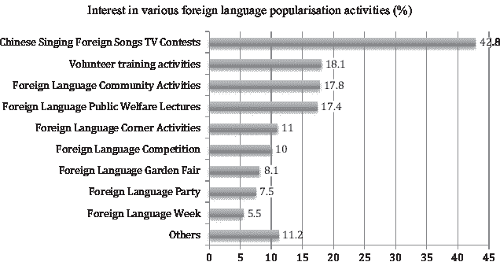

图 7：对各种外语推广活动的兴趣。

## 2.3 奥运语言培训的成果

根据官方报告（北京市委委员会外事工作领导小组等，2008），2007 年有 33.1%的市民参加了语言学习活动，主要通过自学教材或参加工作场所及社会组织的语言学习活动进行。与 2006 年相比，语言学习的重点继续从听转向口语能力。北京市民学习外语的主要困难是缺乏语言环境和时间不足，导致许多人在坚持语言学习方面存在困难。此外，外语水平较低的受访者中有 50.6%表示他们在学习语言基础方面存在困难，或者不知道合适的学习方法。

参加奥运会让许多中国人，尤其是那些积极投入奥运会筹备和举办工作的人，第一次有了在真实的跨文化互动中使用英语的机会。奥运志愿者司机`华硕`在接受我的采访时承认，与外国人练习英语的愿望是他担任奥运志愿者的主要动力。然而，对于许多参与奥运会筹备的北京市民来说，接受官方英语培训并不能保证他们梦寐以求的英语水平和跨文化交流能力。以奥运志愿者的英语培训为例，尽管 `Aifly` 坚称其已完成了对 10 万名奥运志愿者的培训任务，但实际的参与率和效果并不如声明的那样理想。在很多情况下，招募奥运志愿者时，`CET-4` 和 `CET-6` 证书被视为英语水平达标的证明，因此只有担任关键管理职位的人被分配参加官方英语培训。在 28 名受访的奥运志愿者中，只有 2 人参加了由 `Aifly` 提供的奥运会英语培训。这两位受访者均不认为 `Aifly` 的英语培训是有效的。

来自清华大学的媒体服务志愿者`赵晨`对 `Aifly` 培训的结果表示不满。根据他自己的经验，`赵` 发现参加了几个小时的 `Crazy English` 大众讲座后，他的英语水平并没有提高，而这正是 `Aifly` 培训奥运志愿者和服务部门人员所采用的教学方法。同样不满的情绪也来自奥运志愿者`陈政`，她是国际青年营大活动组户外文化艺术活动的协调助理，她在赛前与另外 1,000 名主要选自北京各高校的志愿者一起，参加了为期七天的 `Aifly` 沉浸式训练营。在为七天的密集英语培训期间，`陈政` 和其他营成员被要求进行大量的英语语音练习（配合手势）和背诵训练。她说，培训让她意识到了英语发音上的“短板”以及缺乏背诵练习，但她否认自己的英语在培训后真正得到了提高。

`张杰`: 你觉得参加这个英语培训营对你的英语有很大提高吗？

`[Zhang Jie: Do you think your English proficiency has been greatly improved after attending this English training camp?]`

`陈政`: 显然没有。但是就是［通过此次培训］确实能让自己认识到我们在学英语的时候有什么样的不足,以后注意。但是说在七天里面有很大的提高也不太现实。

`[Chen Zheng: Certainly not. [Through the training] I did recognise my shortcomings in learning English. [I will] pay attention to them afterwards. However, it is not realistic to say my English has been greatly improved within seven days.]`

`张杰`: 你通过培训看到了哪些学习方面的不足？

`[Zhang Jie: What are the shortcomings that you recognised through the training?]`

`陈政`: 主要就是发音上的一些问题。还有就是以前我在学英语的过程中不太背东西。然后他就每天让我们背、背、背, 每天背完这个背那个, 一到晚就是背, 他认为你背下来了自然就会说了。

`[Chen Zheng: Primarily, I have some problems with [English] pronunciation. And … I seldom recited when I was studying English. And then … he (the class lecturer) asked us to recite and recite and recite every day. We recited one thing after another. We’ve been reciting all day long. He believes that the more we recite the more naturally we can speak [in English] (21-09-2008)]`

根据 `BSFLP 组委会`的要求（详见第 4 章第 2.4 节），为 8 万名北京出租司机安排了自愿英语课程和水平测试。官方要求北京出租司机通过英语水平测试才能保留执照。一些统计显示，到 2008 年奥运会开幕时，北京出租司机平均接受了 52 节英语培训（`Jia, 2007`）。然而，由于大多数北京司机很少说英语，且许多人旷了英语课，司机培训课程并没有起到有效作用（`Associated Press, 2007`）。2008 年北京奥运期间，几乎所有上岗的北京出租司机在培训后都通过了指定的英语考试。尽管如此，通过水平测试让这些北京出租司机在纸面上成为了官方认可的“英语口者”，但并未真正赋予他们交流能力。事实上，据报道，他们大多数人在实践中无法使用英语（`Xinhua, 2008b`）。当地出租司机`张永辉`告诉我，他的出租公司在京奥会之前组织了两年的英语培训，并每两周举行一次定期英语测试。尽管他在空余努力学习英语，但他无奈地说：“我英语不管用, 记不住, 和年纪有关。[My English does not work. I cannot remember English words due to my old age]”（08-08-2008）。在这次采访时年 50 岁的`王` 是“失落的一代”的成员，由于在文革期间错过了学习英语的机会，那个时期英语在政治上是不受欢迎的，英语课也被取消了。同样，在一次新闻报道（`Pallavi, 2007`）中，47 岁的出租司机`赵` 抱怨说，尽管花了近两年时间背了英语单词书，但大多数外国人都听不懂他的口音。“当我说英语时没人听得懂，”他哀地承认道，“过了一段时间我就不再尝试了，然后把学过的都忘了。”像`王`和`赵` 这样被强制“学习”英语但未能达到任何显著水平的北京市民，绝不可能是少数。正如快速扩张的教育系统的典型情况，在筹备北京奥运会的大规模英语普及运动中，数量是以牺牲质量为代价的。语言能力绝非易事，尤其是在日常生活中很少使用该语言的环境中。应用语言学的共识是，“语言学习需要很长的时间，精确的持续时间和通过水平衡量的最终结果几乎无法预测，因为它们取决于许多因素，其中许多是个体学习者无法控制的，例如年龄、教育程度、天赋、教学计划、语言接近程度或获得互动的机会”（`Piller, 2016a`, p. 46）。

发展外语媒体是构建北京市“国际语言环境”的重要部分，这在《北京市国际语言环境行动计划》(2003)中有所体现。对外传播和国内外语普及的需求推动外语媒体的蓬勃发展，尤其是英语媒体。工作主要分为两个方面：（1）外语电视和广播节目；（2）外语书籍和报纸。根据官方报告(中共北京市委外事工作领导小组等，2008)，到 2008 年，中国已设立了 23 个外语电视频道和 10 个外语广播 FM 频道，并出版了 68 本外语杂志和 49 份外语报纸。¹⁵。这些外语媒体主要以英语为主，涵盖了自然、社会、人文、科学科技、体育和娱乐等广泛领域。

尽管政府努力通过大众媒体普及外语（尤其是英语），但大多数北京市民声称很少接触外语媒体。如表 6 所示，外语视听节目的收视率并不高，外语杂志和报纸的购买和利用率也非常低。只有 0.9%和 2%的受访者表示每天阅读外报或书籍。同样，只有 1.1%和 1.3%的受访者每天看或听外语电视广播节目。事实上，大多数北京市民几乎没有接触过任何外语媒体。这证明了即使是在中国的首都这一中国国际化程度最高的一线城市之一，英语或其他任何外语都不是大多数人日常生活和工作中需要的首要语言。

表 6：北京市民外语媒体利用率（%）

| | 报纸 | 书籍 | 视听产品 | 电视节目 | 广播节目 |
| --- | --- | --- | --- | --- | --- |
| 每天 | 0.9 | 2 | 2.3 | 1.1 | 1.3 |
| 每周至少一次 | 2.5 | 3.1 | 3.8 | 2.1 | 1.5 |
| 每月至少一次 | 2.4 | 1.7 | 4.2 | 3 | 0.9 |
| 偶尔 | 10.5 | 9.9 | 16.5 | 20 | 11.5 |
| 几乎没有 | 83.7 | 83.4 | 73.2 | 73.7 | 84.9 |

## 3. 北京外语环境评估

经过六年的准备，北京市政府声称，通过城市的英语学习计划和活动，主办城市的“国际语言环境”已得到了“显著改善”(`Zhang, 2009`)。然而，官方报告(中共北京市委外事工作领导小组等，2008)却给出了不同的说法（见图 8）。在问卷调查的 0 到 10 分范围内，30.2%的受访者给北京的国际化水平打了 8–10 分。结果显示，21.8%的受访者对窗口行业外语普及表示高度评价。然而，52.1%的受访者声称他们在工作和生活中很少有外语的机会，因为他们周围的人外语水平并不高。超过半数的受访者表示学习外语的机会很少，外语媒体和活动的多样性仍需提高。此外，近一半的受访者对公共场所英语标识的标准化不满意。

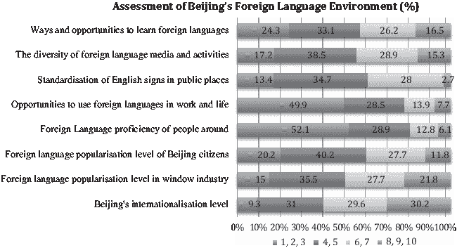

图 8：北京外语环境评估。

如图 9 所示，超过半数的受访者对景点、博物馆、文体设施、公交、地铁和商业场所的英语标识表示非常或相当满意。然而，他们认为医疗区域和卫生设施的英语标识是不令人满意的。这些观点与外籍人士的意见一致。根据报告(中共北京市委外事工作领导小组等，2008)，外籍人士认为交通标识、地铁标识和景区的标识最为标准且有用。然而，他们也发现了一些英语标识上的拼写和语法错误，并建议在公交和医院等公共场所增加更多标准的中英文双语标识。

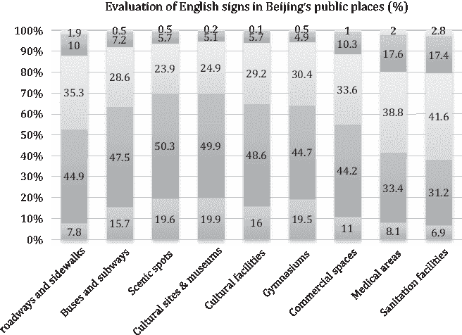

图 9：北京公共场所英语标识评价。

## 4. 奥运城市身份构建中的英语热潮

英语学习与奥运热情的交汇在一部奥运会前不久上映的 60 分钟纪录片《疯狂英语》（`Mad About English`）中得到了很好的捕捉。这部纪录片由新加坡人连碧（`Lian Pek`）导演，通过真实记录英语如何影响五个处于人生不同阶段的真实人物，生动捕捉了中国奥运英语热潮的历史时刻。电影中最令人记忆的画面之一，是数万中国奥运志愿者在志愿者总教练李阳带领下，在体育场齐喊道：“我受不了我糟糕的英语了！我想改变生活！”这部引人入胜的纪录片不仅展示了中国奥运英语热潮的生动画面，也再次引发了我们深思的问题：在奥运会的背景下，为什么中国政府和中国人民如此渴望英语？

# 英语热

“英语热”（参见 `Krashen, 2003; Power 2005; Shim and Park, 2008`）作为一种社会现象，指的是对学习英语压倒性的集体热情以及随之而来的巨大投入。英语热在许多其他亚洲国家也是一种显著现象，尤其是日本（`Oda, 2007; Piller and Takahashi, 2006; Piller, Takahashi and Watanabe, 2010`）和韩国（`Park, 2009; Piller, Takahashi and Watanabe, 2010; Shim and Park, 2008`）。自从中国在 1978 年实施开放政策以来，英语在中国的教育政策中已确立了其作为主要外语的统治地位（例如，`Adamson, 2002, 2004; Chang, 2006; G. Hu, 2005; Y. Hu, 2008; Lam, 2002; McGuire, 1997`）。正是在全球化以及中国推动现代化和国际化的广泛背景下，“英语热”在过去的三十年里席遍全国。在 2001 年中国加入世界贸易组织（`WTO`）以及北京于同年获得 2008 年奥运会主办权后，英语的地位得到了强力提升（`Bolton, 2002`）。推动中国走向其历史上最大国际活动的力量也驱动了中国人民拥抱英语。在国内外变化的社会、经济和政治背景下，北京奥运会标志着国家、地区和个人层面身份构建的关键时期。这些不同层面的身份构建在某种程度上都与英语的教教学有关，英语是`默认`国际语言、奥林匹克运动官方语言以及知识经济时代的主导语言。英语精通成为中国在现代化和国际化进程中理想身份的重要组成部分，也是作为奥运之城的北京以及 21 世纪中国公民的重要身份组成部分。在中国官方话语中，特别是那些在奥运会背景下加速英语传播的话语中，英语主要被描绘为一种获取现代科技进步及经济发展的必要工具，其次则被视为促进社会和个人国际交流的载体。

与其他面向北京奥运会的城市转型方面一样，政府主导的规划和决策体系使得主办市及全国范围内的英语普及运动非常高效。北京奥运会引发了一场英语学习热潮，涉及 4000 多名运动员、裁判员、北京奥委会（`BOCOG`）工作人员、150 万奥运会志愿者以及数百万作为英语学习者的北京居民。与韩国在 1986 年亚运会和 1988 年首尔奥运会做法类似，中国政府将 2008 年奥运会描述为“号召公民获得全球视野，具备重要的全球化特征，其中之一就是说英语的能力”（`Shim and Park, 2008`）。

## 5 对英语工具主义视角的质疑

尽管语言教育政策（`LEP`）在决定语言实践和操纵语言意识形态方面发挥着强大作用，但 `Shohamy (2006, p. 91)` 指出，关于语言教育政策的实际影响和后果的研究非常少。在本节中，我将探讨受访者的英语学习轨迹，这些轨迹是本世纪初为应对国家政治议程而实施的中国英语教育政策的结果。通过案例研究，我打算阐明英语的工具主义视角如何在官方话语中传播并自然化，并如何影响中国学习者的语言信念和语言实践。

### 5.1 高预期 vs. 低可行性


北京奥运会不仅为许多中国人提供了学习英语的强劲动力，也对奥运会后中国英语的使用前景产生了乐观的预期。北京奥运会英语普及运动强化了英语的工具主义观点，使许多受访者产生了为了个人进步而学习英语的“需求”。在围绕英语的讨论中，经常被引用的一个观点是英语在职场中具有高实用价值，学生“需要”英语才能在就业市场上取得成功（`Piller, 2007`）。对于本研究中的许多受访者来说，他们学习英语的动力主要来自对职业前景的看法。学习英语有助于人们在就业中获得优势的信念被许多人视为理所当然的事情。

例如，孔磊是武汉一所二流大学旅游管理专业的大三本科生。奥运会期间，他被招募为北京大学乒乓球馆的奥运志愿者司机。在参加北京奥运会之前，孔磊承认由于缺乏对语言的接触，且教室外使用的机会有限，他并没有意识到“英语的真正重要性”。奥运会的经历改变了他对毕业后就业前景的理解。

**孔磊**：我有几个姐姐他们现在已经参加工作了嘛，我也马上要找工作了。她们就跟我讲说，如果你的外语水平好的话，首先这是一个门槛。即使以后你讲外语－讲英语的机会很少，但是确实这就是一种优势。特别是一些好的工作，还有一些层次比较高的工作比如说经理啊，他们可能就会用英语来跟你面试。如果你连这一关你都过不了的话，那对于工作来说就不用谈可以找到一个岗位了。

[English: I have several elder sisters who have already taken up jobs. And I’m also going to look for a job soon. They told me … high foreign language proficiency, in the first place, plays a gate-keeping role in seeking a job. Even if later on probably you have very little chance of speaking a foreign language – speaking English, high English proficiency is indeed an advantage. While applying for good jobs, especially those senior positions such as manager, well, candidates will be interviewed by employers in English. If you cannot even pass it, getting a job will be out of the question. (27-09-2008)]

北京奥运会的成功举办影响了许多中国人理解中国未来以及他们在未来中自身可能的方式。对于奥运志愿者司机赵飞翔来说，英语不仅对于一个“日益开放的中国”是“绝对必要的”，更重要的是为了他大学毕业后所渴望的“成功经理或主管”的身份认同。

**赵飞翔**：（…）现在就是说我们国家越来越开放。很多外资企业、外国人都进到我们国家。我觉得在一个公司或者一个企业里面，比如说一个成功的经理人或者一个主管，他所涉及到的不仅仅是他的专业领域，文化、政治、经济、甚至语言这一块他都要涉及到。因为你所接触的人群可能是外国人，而且英语作为国际上的通用语言，所以我觉得英语是非常有必要的。尽管在平时工作当中没有可能用到，但是对于一个主管或者一个经理人的话，在以后绝对是有机会用到的。因为你熟悉了语言，你就可以跟别人沟通，然后可以学些别人的一些先进思想或者方法什么的。对以后的话，我觉得是非常有必要的。

[English: (…) Nowadays, just like … our country is becoming increasingly open. A large number of foreign enterprises and foreigners have entered into China. And I think- In my opinion, in a company or an enterprise, take a successful manager or director for instance, what he may be involved with is not only professional knowledge but also cultural, political, economic and even linguistic knowledge. Because whom he will come into contact with may be foreigners, and English is said to be a common language in the international community. In this regard, I think English is an absolute essential. >> … >> Even though [English] may be << … << of no use in daily work, for a director or manager, [English] will definitely be useful in the future. (…) I think [English] is an absolute essential for the FUTURE. (27-09-2008)]

由于对奥运会后中国国际流动持有更乐观的看法，我的一些受访者（尤其是那些受教育程度更高、拥有更好社会资源的人）开始认为英语是衡量中国社会及其他地区生活潜力的决定标准。2008 年，赵晨是位于北京的一所领先中国大学的硕博连读项目二年级学生。奥运会期间，他与一群来自澳大利亚和美国的“英语母语者”合作，在主新闻中心担任媒体运营的奥运志愿者。赵晨的奥运志愿者经历证实了他对于像他这样的“高教育人才”认为英语具有工具性的信念。

**赵晨**：（…）毕竟现在这个世界是一个西方价值观主导的世界。你要融入这个世界中，就必须学习英语，因为英语是一个世界性的语言（…）特别是我的同学英语好的人有很多，他们会有很好的机会，不管是工作的机会还是交流的机会。英语好的人会获得更多的信息，或者是你出国发展你的国际事业，针对你个人的发展都有好处。我现在做的这个科研，绝大多数文献都是英语的，所以我觉得英语对一些文化水平高的人，还有那些科研人员和高级商务人员，包括像政府部门他们需要交流的时候，都是非常重要的。

[English: After all, this is a world dominated by Western values. If you want to integrate into the world, you have to learn English, as English is a world language (…) Particularly, many of my fellow students have high English proficiency, they have good opportunities, whether for work or communication. Those with good English proficiency will get more information, or if you want to go abroad and develop your international career, it is beneficial for your personal development. In the research I am doing now, most of literature is in English, so I think English is very important for highly educated people, researchers, and senior business personnel, including when government departments need to communicate. (22-09-2008)]

对于就业机会和职业晋升对英语的需求，非英语的其他中国外国学习者也深有体会。秦思曾是 VIP 陪同和西班牙语服务的奥运志愿者。然而，直到她被大学的西班牙语专业录取（在中国被称为“小外语”）之前，她才开始学习西班牙语。从小学三年级开始，她已经学习了十年英语。尽管她大学西班牙语专业的学生通常有良好的前景，秦思依然继续学习英语。在大学四年里，她定期上英语课并通过了`CET-4`。在采访中，秦思说她仍然会说英语，并对申请工作时需要英语表达了担忧。

**秦思**：我听以前找工作的人说，作为 XX 高校的，用人单位不太怀疑你的专业能力。而且他们有的人，是上上届的学生自己说，他说他已经是系里面最差了，他虽然最差可是出去找工作，还是要比其他学校的好（…）但是他说用人单位会考一下你的英语，他们也会考英语，找工作面试的时候，他们会组织讨论什么的，最后让你英语总结你的表现，或者说用英语做一些自我介绍啊什么的。

[English: I heard from those job seekers that … as graduates from XX University, employers wouldn’t doubt your academic capability. And there is someone, a student graduated the year before last year; he said he was the poorest in the department; despite this, he could get better offers than those graduated from other universities (…) But he said employers might test your English proficiency, they would test English proficiency. While interviewing job applicants, they would organise a discussion or something else. At the end, they would let you summarise your performance in English, or let you, say, do a self-introduction in English. (22-09-2008)]

对于许多中国英语学习者，如孔磊、赵飞翔、赵晨和秦思来说，掌握英语是他们看似无限抱负的核心部分，是通往更有趣、更丰厚的职业生涯的道路，也是以他们父母无法想象的方式与世界其他地区接触的工具。然而，这些语言意识形态往往被认为反映了现实，而不对其事实进行批判性的审查。`Takahashi (2011)`强调，英语意识形态最好被理解为“特定国家和社区内一种局部的、社会和政治建构”。尚未实现的是，英语个体学习者本身也参与了他们所感知的英语社会现实的建构。全球范围内的研究人员早已意识到，英语的传播在不同语境下表现出不同的特征。尽管人们普遍认为英语水平可以让人获得更好的符号资源（如教育、社会地位）和物质资源（经济提升、职业晋升），但英语的价值和力量绝非内在且普遍的。

与这种关于需要英语的普遍论调相反，新兴的研究证据表明，作为语言资本的英语在职业或教育进步方面可能并不那么丰厚（`Piller, Takahashi and Watanabe, 2010`，`Zhang, 2011`）。中国英语学习者相对于他们在英语语言学习上的巨大投入，一直在为教室外英语接触率低和实用性不足而挣扎（`Zhao and Campbell, 1995`；`Yang, 2003`）。2005 年的一项研究指出，中国就业市场上 90%的职业与英语无关（`Zhang, 2005`）。这意味着，不超过 20%的大学毕业生在工作场所需要不同程度的英语。由于英语在中国社会（尤其是就业市场）的实用性较低，真正重要的似乎不是实际的英语能力，而是拥有这种能力的证明，主要是通过大学学位和英语考试证书。考虑到从小学三年级到本科阶段平均十二年的义务性英语教育，与许多其他非英语国家类似的以英语为中心的教育政策（`Piller & Cho, 2013`）导致了人力、物力和财务资源的巨大浪费。

## 5.2 英语学习的问题与困境

尽管我的访谈对象普遍对英语作为个人进步的“中立且有益”工具持积极态度，但强制性学习英语可能会给他们带来严重的教育公平问题和学习者身份的困境。

### 5.2.1 缺乏自发性动机

我采访的所有奥运会志愿者都是同一年龄段的大学生（2008 年时 20-25 岁）。除了少数几个直到大学才开始学习英语的学生外，大多数受访者从初一就开始学习英语，而少数几个在故籍地获得更好英语教学（ELT）资源的学生则从小学就开始了。由于英语对大多数参与者来说是义务教育和`Gaokao`（高考）的一部分，他们报告说自己没有选择，也没有时间去学习一种外语言（LOTE）。在实践中，最有可能是父母替孩子就外语教育中的语言选择做出决定。中国教育体系对英语其他外国语言的青睐，以及大部分就业市场对英语水平证书的要求，都构成了社会化和制度化的动机，而不是中国学习者学习英语的自发性动机。

张杰：你是有意识地自主选择学习英语的吗？

[Zhang Jie: Did you consciously choose to learn English as a foreign language?]

陈正：（…）我家里人比较倾向于让我出国。其实算是父母的选择吧，不是我自己选的。那时候我也不知道为什么要学英语。（…）这也是一个教育导向问题。因为高考啊、报考学校啊，像现在一些高校啊包括研究生招生，小语种［考生］都会有限制。（…）然后你找工作的时候，（…）你像在我们北方，我家在辽宁，我们那边的日企、韩企，也有一些德国来的企业比较多。像德国来的企业，你不会德语可以但是你要会英语。但是像日韩的那种企业，他们就会喜欢要日语生和韩语生这样。也会有一些不同的选择方向吧。但是现在就是越来越多的考试它没事考你一下英语，它就限制在英语上。我觉得这是一个教育导向问题。

[Chen Zheng: (…) My parents were inclined to send me abroad. Actually, it was my parents’ choice instead of my own. At that time I didn’t know why I should study English. (…) This is also a matter of educational orientation. Because like `Gaokao` and university application … like when some universities and graduate schools recruit applicants, there are restrictions for those who learn foreign languages other than English. (…) Then, when you are job searching (…) like in the north, my hometown is in Liaoning, there are many Japanese enterprises, Korean enterprises and also a few enterprises coming from Germany. In German enterprises, it’s OK not to speak German as long as you speak English. But Japanese and Korean enterprises prefer to recruit Japanese and Korean students. There are also some different directions. But now more and more exams test your English, it's restricted to English. I think this is a matter of educational orientation.]

### 5.2.2 “投入时间过多，效率极低”

英语学习大多被描述为一段艰辛经历。在 1996 年关于外语教育会议的演讲中，国务院副总理兰青（1997）指出，中国英语教学严重且普遍的问题是投入了太多时间但效率很低。蒋海作为北京一名大学生和奥运会服务志愿者，其英语学习轨迹足以说明一切。蒋海生长在桂林的知识分子家庭，那里是中国南方的一个地级市。从小学三年级就开始学习英语，他在学业成就上领先于大多数中学才开始学英语的同学。小学毕业后，蒋海被录入一所竞争激烈的当地中学，其课程特别强调外语培训。与普通中学相比，这所外语中学的英语教育更加密集，英语课程由本地和外教教师授课，并配有国外语言教材和各种创新项目。然而，当蒋海升入高二时，情况完全不同了。他所在年级的英语教育变成了考试导向。据他所说，培养英语交流能力的训练都停止了，他们在英语课上做的只是模拟测试。英语学习对他来说不再有趣，而是变成了一个巨大的压力，唯一目标是在高考中取得好成绩。在进入北京某大学社会学本科专业后，他继续花费大部分时间学习英语，然而大学英语教学的质量让他感到非常失望。在对语言进行了多年持续且大量的投入后，蒋海的自我评估是他仅获得了通过考试的能力，而不是英语交流能力。

季海强：我觉得考试能力有，但是真正的实际应用能力 … 我觉得，就我们班来说，怎么说呢，举个例子吧，老师上英语课时（…）他点的是［成绩］比较好的人，我看，在我心目中是英语不错的人。站起来一句话都说不完整（…）叙述一件事情，一件简单的事情都叙述不出来。但是你让他考试，他肯定能考挺高的分。但是真的要他说，他说不出来，一句话都说不出来。


原文：I think I have the ability to pass examinations, but in terms of a true communicative competence in English … I think, as far as my class is concerned, how can I put it, let me give you an example. When in English class (…), the teacher always chooses academically better students [to answer questions]. In my view, these students are good at English. [However], [they] can’t even finish a complete sentence [in English] when they were asked to stand up and answer a question in class. [They] can’t give an account of a thing … a simple thing. But if you test them, they can sure get a fairly high score. But really, [they] can’t speak [English], even a sentence. (03-08-2008)

### 5.2.3 英语学习中的“用”之张

尽管官方强调英语学习的个人选择、益处、中立性和互补性，但一些访谈参与者反映，英语学习对他们的母语（L1）能力和文化认同产生了负面影响。2008 年，徐健是北京某领先外语大学英语翻译专业的本科大四学生。在奥运会期间，她在筛选和培训后被北京奥组（BOCOG）招募为奥运志愿者，负责贵宾陪同和（英语）语言服务。徐健在长春长大，那是中国东北部的一个省会城市。在外国语学校完成中学教育后，她免除了`Gaokao`并被推荐录取大学。虽然徐健对自己的英语水平显露自豪，但她认为自己的中文能力受到了英语思维模式的负面影响，这是一个“悲哀的事实”。

语言学习是身份构建与协商的场所（Norton, 2000）。语言学习者对自己在目标语言中身份的理解影响着他们在语言学习中的主体性、动机、投入和抵制。我对中国少数民族学生薇如的访谈显示，英语学习过程中的身份冲突让一些少数民族学生感到切之痛苦。2008 年 8 月，当我在北京遇到薇如时，她是北京某大学民族学专业的本科大四学生。在北京奥运会期间，北京奥组委托她所在的大学负责国际青年营的志愿者工作。因此，薇如被招募为国际青年营大型活动组的户外文艺活动协调助理。她的职责是协助国际青年营成员提供户外交通服务。薇如是中国鄂伦哈族的一员。由于历史原因，鄂伦哈族是一个跨国民族，人口分布在中国和俄罗斯。中华人民共和国成立后，中国鄂伦哈族被正式认定为“赫哲族”（`Hezhe-zu`），是中国规模最小的少数民族之一。赫哲人拥有自己的语言，属于满语-通贡语语系（Bradley, 2006）。尽管民族语言已经失去了日常实际的交流功能，薇如仍将赫哲语视为自己的母语，并坚持着她的赫哲族身份认同。由于与俄罗斯的鄂伦哈人的亲缘关系，薇如对俄语也有强烈的认同感。和她家乡的许多同学一样——那是黑龙江省一个紧邻俄罗斯的小县——薇如从初中一就开始将俄语作为首选外语科目进行学习。得益于当地极高的俄语教学水平和丰富的俄语语言环境，包括薇如在内的许多高中毕业生都掌握了高水平的俄语。俄语曾是许多当地学生在`Gaokao`中的优势学科。然而，随着中国在 2001 年成功获得 2008 年夏季奥运会主办权并加入 WTO 的双重成功前景，政府希望中国在全球经济中发挥更大的作用，这导致了 21 世纪第一个十年间中国英语教育的大规模扩张。2001 年，教育部（MOE (2001a)）发布了一份题为《教育部关于大力加强小学英语教学工作的通知》的政策声明，要求将义务英语教育的门槛从初一降至小学三年级。这项国家性的语言教育政策导致了 21 世纪初中国英语教育的快速扩张。

在 2004 年参加`Gaokao`之前，薇如和其他高中毕业生被要求列出他们的大学专业意向作为进入高等教育的先决条件。俄语学习者面临的困境是，供他们申请的本科专业范围有限。许多本科专业只录取英语作为`Gaokao`考试科目的高中毕业生（Huang 2009）。面临同样的困境，薇如和她的同学必须在俄语和英语之间做出痛苦的选择。与她的一些同学选择通过复读一年冲刺英语以进入理想大学并选择理想专业不同，薇如坚持学习俄语，并成为了`Gaokao`的俄语考生。薇如并不认同英语的普遍性和实用性，对学习英语缺乏动力。对她而言，掌握精通的俄语比在当地说英语更有成就感，也能带来更实际的利益。

薇如：（……）当时我们班有很多同学为了学英语，就蹲了一年。但是我们家就考虑［我］学习挺好的，没必要为了一个语言——因为我们家是县城嘛，就比较偏远，就没有想过英语——因为我们那儿打都是俄罗斯人，俄罗斯人特别多，就根本没有想过什么［学］英语。走出来才发现英语这么重要。从来没有想过，也根本没有意识到，所以我当时也没有蹲级啊怎么样，就一直学着俄语。

2004 年，由于俄罗斯籍高考考生所面临的限制，魏茹进入了北京某所针对少数民族大学的预科班。2001 年，教育部（MOE (2001b)）发布了一项政策，要求三年内大学课程中至少应有 5%-10%的课程采用英语教学。2004 年，教育部发布了《大学本科教育评估方案》（2004），试图确保英汉双语课程的比例不低于大学课程的 10%。

该文件还规定，英汉双语班应采用英文教材，且英语教学的时间比例应不少于总课时的 50%。由于英语是魏茹所在大学所有非英语专业学生大学课程的必修部分，魏茹被迫放弃了俄语学习，成为大学英语教育中一个边缘化的学生（Zhang, 2011）。学习英语的需求在很大程度上是由各种政府、机构和社会力量强加于她身上的。事实上，英语教育并没有赋予魏茹力量，反而为她的教育、就业以及其他需要英语水平的活动带来了巨大的障碍。对于魏茹来说，英语文化以英美文化为代表，因此英语语言被认为体现了与其母文化及对俄语认同相悖且不受欢迎的价值观。因此，在英语中这种不受欢迎且无力的身份严重影响了魏茹对英语学习的主动性和投入。她对英语学习的回应是抵抗。

魏茹：（……）我就觉得中国人常说学了外语是为了能和别的国家的交流，但是我觉得现在英语对我来说，其实不太愿意学，心理［动机］比较弱。如果想学早就有条件，早就可以去报班啊去学，但是我心里特别地犯抵触。可能从小一直受俄罗斯影响吧，我特别——你像有些同学特别想出国嘛，我不是因为——对外我总是说因为语言嘛，但是我心里边特别排斥，就是英美那些国家的人，我特别不喜欢外国人，我真的特别不喜欢。可能从小受环境影响吧，就是对中国人和俄罗斯人感觉都比较亲切，但就对那种美国啊、英国啊，大家都比较喜欢去的那些国家，我特别不喜欢。我想给我多少钱让我去我也不会去。

[(…) Chinese people always say we should study foreign languages to communicate with other countries, but personally, I’m RELUCTANT to study English. Psychologically, I have no desire to learn English. I’ve LONG had the conditions to learn it if I really wanted to. I could have attended English classes. But I have a VERY strong resistance to studying English, probably because I have been influenced by Russia since childhood. I particularly – Some of my classmates desire to go abroad, but I don’t – When asked, I always say I don’t want to go abroad because of my poor English, but in fact I particularly resist those English speaking people such as Americans and Britons. I really dislike them very much. Probably, due to the influence from my childhood environment, I feel a special affinity for both Chinese and Russians. However, speaking of USA, UK and those English-speaking countries which others desire to go to, I dislike them very much. I think I’ll never go to those countries, NO MATTER HOW MUCH MONEY I would be given. (21-09-2008)]

审视奥运会前中国广为人知的“英语热潮”，人们很容易假设中国英语学习者都是为了工具性或整合性目的而学习的，无论他们具有怎样的社会经济、种族和语言背景。然而，现实情况是，并非所有中国学生都有为了语言的实际应用或融入西方文化而学习英语的动力。上述的英语学习轨迹表明，英语学习是一个复杂的、情境化的且流动的体验，它嵌入在关于英语的制度化话语中，并与学习者对自身身份以及未来想成为什么的感觉密切相关。

英语在中国的传播既不是一个纯中立的过程，也不是普遍受益的过程；它导致了主流社会与弱势群体之间资源分配的不平等。在回顾了英语对个人国际化益处的实证证据后，Tollefson (2000) 认为，英语的传播与政治决策密切相关，这些决策以牺牲其他群体为代价造了某些群体。受访者徐健对中国英语教育的现状评价道：“在我理解中英语在中国就像贫富两级分化一样。”（22-09-2008）。

英语资源并不像 Aifly 和 EF 等英语学校广告中所描述的那样，对所有中国人来说都是平等获取且受益的。在上海奥运的背景下，英语水平对于在英语培训行业有共同利益的利益相关者来说是有优势的。虽然对少数人获益，但通过对魏茹英语学习轨迹的分析发现，以英语为中心的语言政策可能导致那些缺乏平等获取英语教学资源的人面临严重劣势，包括少数群体的成员。

## 6 重新思考全球城市形成中的语言因素

### 6.1 全球城市的概念与评估

自 20 世纪 60 年代以来，世界/全球城市研究经历了快速增长。大多数发表的文献侧重于对全球经济中的世界/全球城市进行概念化和排名。全球/世界城市研究源于 Hall（1966）的断言，“存在某些大城市，世界上最重要的业务有很大比例不成比例的部分是在那里进行的”（第 7 页）。他预测说“世界经济生活将集中在少数主要的信息中心”，即伦敦、巴黎、兰姆斯塔德荷兰、莱茵-鲁尔区、莫斯科、纽约、东京（1966，第 240 页）。继 Hall 之后，John Friedman 和 Goetz Wolf 在关于世界城市形成的开创性研究中（1982）认为，在 20 世纪 70 年代后资本主义相关的新的国际分工背景下，世界城市日益被认为起着将世界经济系统粘合在一起的作用。Friedmann（1986）进一步概述了他著名的“世界城市层次体系”，该体系将 30 个世界城市归分为世界经济核心或半边缘的首要或次要城市：在这些城市中，只有九个核心城市（伦敦、巴黎、鹿特丹、法兰克福、苏黎世、纽约、芝加哥、洛杉矶、东京）和两个半边缘城市（圣保罗、新加坡）被归类为首要城市。“全球城市”一词通过 Sassen（1991）的工作获得了更广泛的学术通用，在她的工作中，她详述了城市在全球化金融和生产者服务经济的背景下作为“基地点”的。她设想了一个多节点的世界经济体系，其中纽约、伦敦和东京被固化为全球化的“首要场所”。除了世界/全球城市，Ng and Hills（2003）是第一个使用基于指标的方法分析世界城市的人。他通过评估 9 项财务指标和 41 项与文化、经济、地理和政治相关的指标，研究了 40 多个国家的 76 个城市。在《世界城市假设》中，Friedmann（1986）采用了层次化方法，根据七个相互关联的筛选标准对城市进行排名，包括主要金融中心、跨国公司总部、国际机构、商务服务部门的快速增长、重要制造中心、主要交通枢纽和人口规模。受“大城市”概念框架的启示，Ng and Hills（2003）对五个亚洲世界城市进行了比较研究，其基准涵盖了 57 项指标，涉及开明治理、促进全球和当地发展的创新型技术和经济活动，以及人力、社会、文化和环境资本。Hussain, Zaidi, and Rozenblat（2018）提出了一个基于多样性、实力网络中心性的城市排名，以评估城市在世界上的重要性。

除了学术论文中报告的排名外，还有许多面向普通公众发布的排名引起了广泛关注。经济学人情报（`www.eiu.com/topic/liveability`）每年发布《全球宜居指数》，根据稳定性、医疗、文化和环境、教育和基础设施的质量对全球 140 个城市进行排名。美世咨询（`mobilityexchange.mercer.com`）针对全球热门外派地点发布年度《生活质量指数》，根据安全、教育、文化环境等因素对 200 多个城市进行排名。《IESE 运动城市指数》由 IESE 商学院（`www.iese.edu/faculty-research/cities-in-motion/`）编制，根据九个主要维度对人力资本、社会凝聚力、经济、公共管理、治理、环境、流动与交通、城市规划、国际拓展和技术对 174 个城市进行排名。全球权力城市指数（GPCI）由森冈纪念基金会（`www.mori-m-foundation.or.jp`）开发，通过衡量包括经济、研发、文化交流、宜居性、环境和可及性在内的 6 项城市功能的 70 项指标，对世界 48 个主要城市的综合实力进行评估排名。全球城市指数由 A.T. Kearney 咨询公司、《外交》杂志和芝加哥全球事务委员会（`www.atkearney.com`）设计，根据五个维度：商业活动、人力资本、信息交换、文化体验和政治参与的 27 项指标对全球城市进行排名。

到目前为止，国际学者对世界/全球城市的评估已逐渐从对现有世界/全球城市的承认转向对未来世界/全球城市形成的规划导。在早期研究中，对世界/全球城市的评估主要采用经济指标。随着全球化的加强，评估标准开始将社会、政治、文化、基础设施等方面的城市表现与经济和财务因素并纳入衡量矩阵。自 21 世纪以来，越来越多的全球城市研究还将创新和可持续发展纳入评估指标体系。

值得注意的是，很少有城市指数和排名将公民的语言掌握程度作为衡量城市全球地位的维度，尽管语言能力在教育、人力资本、知识经济和跨文化交流中发挥着基础性作用。各种指数的排名结果证明，城市走向全球化并没有单一的正确路径，英语并非实现这一目标的必要条件和手段。

例如，在 2008 年全球城市指数（《外交政策》，凯尼与全球全球事务委员会，2008 年）中，没有任何一个城市在指数的所有维度上占据主导地位。该指数包含的 60 个城市代表了世界政治、商业、文化和交流中心的广泛侧面（参见表 7）。

在全球十大城市中，巴黎（第 3）、东京（第 4）、首尔（第 9）均位于非英语国家，然而但巴黎在信息交流方面领先世界，东京在商业活动方面位居第二。北京成功的奥运盛赢得了广泛的国际尊重。在指数中，北京位列全球第 12 位，领先于布鲁塞尔（13）、柏林（17）和莫斯科（19）等其他国家首都。该城市是当年发展中国家中排名最高的特大城市。显然，英语水平的有限并没有阻止北京作为一个社会主义发展中国家和转型经济体的首都，加入全球大都市的行列。

在对五个中国全球城市（北京、香港、上海、广州、深圳）的分析中，Chubarov and Brooker (2013) 挑战了一种“全球主义视角”，该视角认为“全球城市”的形成是一个统一的过程，所有城市最终都将努力成为或类似于伦敦、纽约和东京。通过采用对各个城市特定政治、经济、社会文化功能敏感的功能性方法，他们认为这些中国特大城市证明了在非西方、非资本主义的背景下，全球城市的形成存在多种路径。

表 7：2008 年全球城市指数。¹⁶

| 排名 | 城市 | 商业活动 | 人力资本 | 信息交流 | 文化体验 | 政治参与 |
| --- | --- | --- | --- | --- | --- | --- |
| 1 | 纽约 | 1 | 1 | 4 | 3 | 2 |
| 2 | 伦敦 | 4 | 2 | 3 | 1 | 5 |
| 3 | 巴黎 | 3 | 11 | 1 | 2 | 4 |
| 4 | 东京 | 2 | 6 | 7 | 7 | 6 |
| 5 | 香港 | 5 | 5 | 6 | 26 | 40 |
| 6 | 洛杉矶 | 15 | 4 | 11 | 5 | 17 |
| 7 | 新加坡 | 6 | 7 | 15 | 37 | 16 |
| 8 | 芝加哥 | 12 | 3 | 24 | 20 | 20 |
| 9 | 首尔 | 7 | 35 | 5 | 10 | 19 |
| 10 | 多伦多 | 26 | 10 | 18 | 4 | 24 |
| 11 | 华盛顿 | 35 | 17 | 10 | 14 | 1 |
| 12 | 北京 | 9 | 22 | 28 | 19 | 7 |
| 13 | 布鲁塞尔 | 19 | 34 | 2 | 32 | 3 |
| 14 | 马里德 | 14 | 18 | 9 | 24 | 33 |
| 15 | 旧金山 | 27 | 12 | 22 | 23 | 29 |
| 16 | 悉尼 | 17 | 8 | 27 | 36 | 43 |


有趣的是，在向公众发布的一系列世界/全球城市排名中，作为七届奥运会官方语言培训服务供应商的国际英语培训机构`EF English First`从 2011 年开始发布其“英语能力指数”（`EPI`）。2019 年的 EF EPI（`EF Education First, 2019a`）对来自 100 个国家和地区的 230 万名受考者进行了评估。根据该指数，欧洲的`EPI`平均分最高（56.71），其次是亚洲（53）、拉丁美洲（50.34）、非洲（50.28）和中东（44.60）。英语水平最高的国家集中在斯堪的纳维亚地区，而在光谱的另一端，许多中东国家的英语水平最低（见`表 8`）。法国（第 31 位）、西班牙（第 35 位）、韩国（第 37 位）和中国（第 40 位）都被归类为中等英语水平。俄罗斯（第 48 位）和日本（第 53 位）被认为是英语水平较低的国家。

转向城市得分，阿姆斯特丹在调查的 100 个城市中英语水平排名最高。2019 年全球城市指数中排名前十的非英语城市——巴黎、东京和首尔在`EF EPI`中的得分分别为 60.28、52.58 和 57.14。北京在`EPI`中得 55.68 分，后于巴黎和首尔，但在英语水平上于东京。根据这些统计数据，`EF English First (2019a)`声称，英语水平与科学创新、人类和经济发展、全球互联、民主、甚至权力和性别平等“正相关”。报告（`EF Education First, 2019a`）指出，“英语说得最好”的国家或城市往往具有更强的全球人才竞争力、更前沿的科学研究、更高的国内总值、净收入和劳动生产率，以及较低的权力距离，因此倾向于“更富有、更开放、更具国际视野”（第 18 页）。

更令人惊讶的是，报告（`EF Education First, 2019a`）强调，“英语水平与好国家指数（Good Country Index，衡量一个国家目前对全人类贡献程度的综合指标）之间存在非常强的相关性（第 18 页）。”作为过去和未来七届奥运会的官方语言培训服务供应商，EF 对英语内在“价值”的评价显然对奥运举办国的语言政策以及投入大量精力学习英语的公众产生了影响。这些关于英语的评论与将英语视为国际语言的胜利主义描述相一致（例如，`Crystal, 1997`；`Hanson, 1997`），这些描述毫无批判地支持了学术界将英语作为科学、技术、现代化和国际化语言的意识形态。在这种观点下，在全球化世界中，英语英语和文化同化被呈现为不可避免且理想的，忽视了围绕这一现象的底层政治、文化和伦理问题。

`Piller (2016a)`批评了将学术卓越等同于英语知识产出的意识形态。她（`2019`）认为，英语与学术卓越之间的紧密联系导致了本土语言（LOTE）中学术知识权威性的下降。事实上，英语的学术权威是通过将英语作为当代学术交流的主要媒介实现的，而不是通过 EF 报告中所描述的某些“内在属性”。我们必须警惕将英语水平作为衡量一个国家对人类贡献的标尺。这种语言进化论和社会达尔文主义将对非英语族体的种族歧视和文化同化提供道德正当。

## 表 8：国家和地区的 EPI 排名

| 极高 | 高 | 中等 | 低 | 极低 |
| :--- | :--- | :--- | :--- | :--- |
| 1 | 荷兰 | 15 | 匈牙利 | 30 | 哥斯达加 | 47 | 白俄罗斯 | 70 | 阿联酋 |
| 2 | 瑞典 | 16 | 罗马尼亚 | 31 | 法国 | 48 | 俄罗斯 | 71 | 孟加拉 |
| 3 | 挪威 | 17 | 塞尔维 | 32 | 拉脱维亚 | 49 | 乌克兰 | 72 | 马尔代夫 |
| 4 | 丹麦 | 18 | 肯尼亚 | 33 | 香港（中国） | 50 | 阿尔尼亚 | 73 | 委内瑞拉 |
| 5 | 南非 | 19 | 瑞士 | 34 | 印度 | 51 | 利玻维亚 | 74 | 泰国 |
| 6 | 芬兰 | 20 | 菲律宾 | 35 | 西班牙 | 52 | 越南 | 75 | 约旦 |
| 7 | 芬兰 | 21 | 立陶宛 | 36 | 意大利 | 53 | `日本` | 76 | 摩洛哥 |
| 8 | 奥地利 | 22 | 希腊 | 37 | 韩国 | 54 | 巴基斯坦 | 77 | 埃及 |
| 9 | 卢森堡 | 23 | 捷克 | 38 | 台湾（中国） | 55 | 巴林 | 78 | 斯里兰卡 |
| 10 | 德国 | 24 | 保加利亚 | 39 | 保尔尼亚 | 56 | 格鲁吉亚 | 79 | 土耳其 |
| 11 | 波兰 | 25 | 斯洛伐克 | 40 | `中国` | 57 | 洪都拉斯 | 80 | 卡塔尔 |
| 12 | 葡萄牙 | 26 | 马西亚 | 41 | 澳门（中国） | 58 | 秘鲁 | 81 | 厄瓜多尔 |
| 13 | 比时 | 27 | 阿根廷 | 42 | 智利 | 59 | 巴西 | 82 | 叙利亚 |
| 14 | 克罗地亚 | 28 | 爱沙尼亚 | 43 | 古巴 | 60 | 萨尔瓦多 | 83 | 喀麦隆 |
| 15 | 匈牙利 | 29 | 尼日利亚 | 44 | 多米尼共和国 | 61 | 印度尼西亚 | 84 | 科威特 |
| 16 | 罗马尼亚 | 30 | 哥斯达加 | 45 | 巴拉圭 | 62 | 尼加拉瓜 | 85 | 阿塞拜疆 |
| 17 | 塞尔维 | 31 | 法国 | 46 | 瓜地马拉拉 | 63 | 埃塞俄比亚 | 86 | 缅甸 |
| 18 | 肯尼亚 | 32 | 拉脱维亚 | 47 | 白俄罗斯 | 64 | 巴拿马 | 87 | 苏丹 |
| 19 | 瑞士 | 33 | 香港（中国） | 48 | 俄罗斯 | 65 | 突尼斯 | 88 | 蒙古 |
| 20 | 菲律宾 | 34 | 印度 | 49 | 乌克兰 | 66 | 尼泊尔 | 89 | 阿富汗 |
| 21 | 立陶宛 | 35 | 西班牙 | 50 | 阿尔尼亚 | 67 | 墨西哥 | 90 | 阿及利亚 |
| 22 | 希腊 | 36 | 意大利 | 51 | 利玻维亚 | 68 | 哥伦比亚 | 91 | 安哥拉 |
| 23 | 捷克 | 37 | 韩国 | 52 | 越南 | 69 | 伊朗 | 92 | 阿曼 |
| 24 | 保加利亚 | 38 | 台湾（中国） | 53 | `日本` | 70 | 阿联酋 | 93 | 哈萨克斯坦 |
| 25 | 斯洛伐克 | 39 | 保加利亚 | 54 | 巴基斯坦 | 71 | 孟加拉 | 94 | 柬埔寨 |
| 26 | 马西亚 | 40 | `中国` | 55 | 巴林 | 72 | 马尔代夫 | 95 | 乌兹别克斯坦 |
| 27 | 阿根廷 | 41 | 澳门（中国） | 56 | 格鲁吉亚 | 73 | 委内瑞拉 | 96 | 象牙岸 |
| 28 | 爱沙尼亚 | 42 | 智利 | 57 | 洪都拉斯 | 74 | 泰国 | 97 | 伊拉克 |
| 29 | 尼日利亚 | 43 | 古巴 | 58 | 秘鲁 | 75 | 约旦 | 98 | 沙阿拉伯 |
| 30 | 哥斯达加 | 44 | 多米尼共和国 | 59 | 巴西 | 76 | 摩洛哥 | 99 | 吉尔吉斯斯坦 |
| 31 | 法国 | 45 | 巴拉圭 | 60 | 萨尔瓦多 | 77 | 埃及 | 100 | 利比亚 |
| 32 | 拉脱维亚 | 46 | 瓜地马拉拉 | 61 | 印度尼西亚 | 78 | 斯里兰卡 | | |
| 33 | 香港（中国） | 47 | 白俄罗斯 | 62 | 尼加拉瓜 | 79 | 土耳其 | | |
| 34 | 印度 | 48 | 俄罗斯 | 63 | 埃塞俄比亚 | 80 | 卡塔尔 | | |
| 35 | 西班牙 | 49 | 乌克兰 | 64 | 巴拿马 | 81 | 厄瓜多尔 | | |
| 36 | 意大利 | 50 | 阿尔尼亚 | 65 | 突尼斯 | 82 | 叙利亚 | | |
| 37 | 韩国 | 51 | 利玻维亚 | 66 | 尼泊尔 | 83 | 喀麦隆 | | |
| 38 | 台湾（中国） | 52 | 越南 | 67 | 墨西哥 | 84 | 科威特 | | |
| 39 | 保加利亚 | 53 | `日本` | 68 | 哥伦比亚 | 85 | 阿塞拜疆 | | |
| 40 | `中国` | 54 | 巴基斯坦 | 69 | 伊朗 | 86 | 缅甸 | | |
| 41 | 澳门（中国） | 55 | 巴林 | 70 | 阿联酋 | 87 | 苏丹 | | |
| 42 | 智利 | 56 | 格鲁吉亚 | 71 | 孟加拉 | 88 | 蒙古 | | |
| 43 | 古巴 | 57 | 洪都拉斯 | 72 | 马尔代夫 | 89 | 阿富汗 | | |
| 44 | 多米尼共和国 | 58 | 秘鲁 | 73 | 委内瑞拉 | 90 | 阿及利亚 | | |
| 45 | 巴拉圭 | 59 | 巴西 | 74 | 泰国 | 91 | 安哥拉 | | |
| 46 | 瓜地马拉拉 | 60 | 萨尔瓦多 | 75 | 约旦 | 92 | 阿曼 | | |
| 47 | 白俄罗斯 | 61 | 印度尼西亚 | 76 | 摩洛哥 | 93 | 哈萨克斯坦 | | |
| 48 | 俄罗斯 | 62 | 尼加拉瓜 | 77 | 埃及 | 94 | 柬埔寨 | | |
| 49 | 乌克兰 | 63 | 埃塞俄比亚 | 78 | 斯里兰卡 | 95 | 乌兹别克斯坦 | | |
| 50 | 阿尔尼亚 | 64 | 巴拿马 | 79 | 土耳其 | 96 | 象牙岸 | | |
| 51 | 利玻维亚 | 65 | 突尼斯 | 80 | 卡塔尔 | 97 | 伊拉克 | | |
| 52 | 越南 | 66 | 尼泊尔 | 81 | 厄瓜多尔 | 98 | 沙阿拉伯 | | |
| 53 | `日本` | 67 | 墨西哥 | 82 | 叙利亚 | 99 | 吉尔吉斯斯坦 | | |
| 54 | 巴基斯坦 | 68 | 哥伦比亚 | 83 | 喀麦隆 | 100 | 利比亚 | | |
| 55 | 巴林 | 69 | 伊朗 | 84 | 科威特 | | | | |
| 56 | 格鲁吉亚 | 70 | 阿联酋 | 85 | 阿塞拜疆 | | | | |
| 57 | 洪都拉斯 | 71 | 孟加拉 | 86 | 缅甸 | | | | |
| 58 | 秘鲁 | 72 | 马尔代夫 | 87 | 苏丹 | | | | |
| 59 | 巴西 | 73 | 委内瑞拉 | 88 | 蒙古 | | | | |
| 60 | 萨尔瓦多 | 74 | 泰国 | 89 | 阿富汗 | | | | |
| 61 | 印度尼西亚 | 75 | 约旦 | 90 | 阿及利亚 | | | | |
| 62 | 尼加拉瓜 | 76 | 摩洛哥 | 91 | 安哥拉 | | | | |
| 63 | 埃塞俄比亚 | 77 | 埃及 | 92 | 阿曼 | | | | |
| 64 | 巴拿马 | 78 | 斯里兰卡 | 93 | 哈萨克斯坦 | | | | |
| 65 | 突尼斯 | 79 | 土耳其 | 94 | 柬埔寨 | | | | |
| 66 | 尼泊尔 | 80 | 卡塔尔 | 95 | 乌兹别克斯坦 | | | | |
| 67 | 墨西哥 | 81 | 厄瓜多尔 | 96 | 象牙岸 | | | | |
| 68 | 哥伦比亚 | 82 | 叙利亚 | 97 | 伊拉克 | | | | |
| 69 | 伊朗 | 83 | 喀麦隆 | 98 | 沙阿拉伯 | | | | |
| 70 | 阿联酋 | 84 | 科威特 | 99 | 吉尔吉斯斯坦 | | | | |
| 71 | 孟加拉 | 85 | 阿塞拜疆 | 100 | 利比亚 | | | | |
| 72 | 马尔代夫 | 86 | 缅甸 | | | | | | |
| 73 | 委内瑞拉 | 87 | 苏丹 | | | | | | |
| 74 | 泰国 | 88 | 蒙古 | | | | | | |
| 75 | 约旦 | 89 | 阿富汗 | | | | | | |
| 76 | 摩洛哥 | 90 | 阿及利亚 | | | | | | |
| 77 | 埃及 | 91 | 安哥拉 | | | | | | |
| 78 | 斯里兰卡 | 92 | 阿曼 | | | | | | |
| 79 | 土耳其 | 93 | 哈萨克斯坦 | | | | | | |
| 80 | 卡塔尔 | 94 | 柬埔寨 | | | | | | |
| 81 | 厄瓜多尔 | 95 | 乌兹别克斯坦 | | | | | | |
| 82 | 叙利亚 | 96 | 象牙岸 | | | | | | |
| 83 | 喀麦隆 | 97 | 伊拉克 | | | | | | |
| 84 | 科威特 | 98 | 沙阿拉伯 | | | | | | |
| 85 | 阿塞拜疆 | 99 | 吉尔吉斯斯坦 | | | | | | |
| 86 | 缅甸 | 100 | 利比亚 | | | | | | |

对 2019 年全球城市指数（Global City Index）与 2019 年 EF EPI 的对比研究发现，城市的英语水平与其全球排名之间并不存在因果关系。在当今世界，英语水平的主导地位和“价值”应被理解为一种社会文化和历史的构建，而非反映语言的某种本质属性。

如果正如 EF 报告所称，英语水平可以预测全球竞争力，那么当前的世界将简单简单地根据 Kachru (1985, [1992]) 的世界英语三圆圈模型划分为三个“全球化”水平。在这个构想的世界中，英语作为第一语言或母语的内圆圈国家自然会孕育出“完美”的全球城市。然而，在 2019 年 EF EPI 中，只有柏林和布鲁塞尔这两个处于“英语水平最高”前 20 位的城市进入了当年全球城市指数（GCI）的前 20 名（见[表 9]）。A. T. [Kearney 2019] 全球城市报告 ([Kearney, 2019]) 揭示了一个不断变化的世界，并强化了这样观点：没有哪个城市可以垄断最全球城市的地位。

结果 ([Kearney, 2019]) 显示，尽管纽约、伦敦、巴黎、东京和香港保持了其作为全球城市指数前五名城市的长期领先地位，但全球城市体系正在发生根本性转变。北美和欧洲正在与政治不确定性和日益增长的民族主义斗争，这引发了对其长期前景的质疑。伦敦和其他欧洲主要城市的商业活动有所放缓。总体而言，2018 年以来，所有领先欧洲城市的表现都停滞了。人力资本得分的下降正在加剧这种惯性，因为最优秀、最多元的人才正在其他地方寻找机会，或干脆留在家里。这种情况发生在顶级欧洲城市，包括伦敦、布鲁塞尔和柏林。

## 新兴地区的崛起

与此同时，中国经济实力的增强和中东开放程度的提高推动着这些新兴地区的城市在全球舞台上变得更加。在过去的 40 年里，中国在城市增长和发展方面取得了巨大成就。城市化率从 1978 年的 18% 上升到 2018 年的 60%，该国的城市人口从 1.7 亿增长到 8.3 亿 ([Kearney, 2019], p. 9)。

中国证明其城市地区不断提高宜居性，变得更加以人为中心，并正接近世界领先城市。北京在 2019 年的 GCI 中排名第 9，比 2008 年上升了三位。事实上，中国城市的平均指数得分增长速度比北美城市快三倍，在全球城市展望排名中，中国城市的进步比欧洲城市快 3.4 倍 ([Kearney, 2019], p. 8)。商业活动仍然是指数得分最大的贡献因素。但中国城市在人力资本和信息交换方面取得进步显著加速了它们的进程。

## 表 9：2018–2019 年 GCI 与 2019 年 EF EPI 的交叉引用

| 2019 | 2018 | ∆ | GCI 排名 | 2019 | EF EPI 排名 |
| --- | --- | --- | --- | --- | --- |
| 1 | 1 | – | 纽约 | 1 | 阿姆斯特丹 |
| 2 | 2 | – | 伦敦 | 2 | 斯德哥尔摩 |
| 3 | 3 | – | 巴黎 | 3 | 哥本哈根 |
| 4 | 4 | – | 东京 | 4 | 赫尔辛基 |
| 5 | 5 | – | 香港 | 5 | 奥斯陆 |
| 6 | 7 | +1 | 新加坡 | 6 | 维也纳 |
| 7 | 6 | −1 | 洛杉矶 | 7 | `柏林` |
| 8 | 8 | – | 芝加哥 | 8 | 孟买 |
| 9 | 9 | – | 北京 | 9 | 汉堡 |
| 10 | 11 | +1 | 华盛顿区 | 10 | 华沙 |
| 11 | 15 | +4 | 悉尼 | 11 | 利斯本 |
| 12 | 10 | −2 | 布鲁塞尔 | 12 | 布加勒勒 |
| 13 | 12 | −1 | 首尔 | 13 | 布达佩斯 |
| 14 | 16 | +2 | 柏林 | 14 | 萨格别夫 |
| 15 | 13 | −2 | 马德里 | 15 | 达沃 |
| 16 | 17 | +1 | 梅尔本 | 16 | 马尼拉 |
| 17 | 18 | +1 | 多伦多 | 17 | 波尔 |
| 18 | 14 | −4 | 莫斯科 | 18 | `布鲁塞尔` |
| 19 | 19 | – | 上海 | 19 | 吉隆坡 |
| 20 | 22 | +2 | 阿姆斯特丹 | 20 | 新德里 |

## 英语水平与全球地位分析

如果正如 EF 报告所称，英语水平可以预测全球竞争力，那么当前的世界将简单地根据 Kachru (1985, 1992) 的世界英语三圆圈模型划分为三个“全球化”水平。在这个构想的世界中，英语作为第一语言或母语的内圆圈国家自然会孕育出“完美”的全球城市。然而，在 2019 年 EF EPI 中，只有柏林和布鲁塞尔这两个处于“英语水平最高”前 20 位的城市进入了当年全球城市指数（GCI）的前 20 名。


对英语水平与全球地位的分析表明，当今世界中英语水平的主导地位和“价值”应被理解为一种社会文化和历史的构建，而非反映语言的某种本质属性。20 世纪 90 年代初标志着一种转变，英语人口比例被视为评估全球地位的一个维度。国际主要货币的汇率和人口中英语者的比例是关键因素。具体而言，基础全球城市是衡量全球城市的评估指数的一部分。

在中国推动国际化进程的背景下，英语往往与多种术语联系在一起，并被用于各种评论，例如“全球竞争力”、“全球公民意识”、“全球视野”以及“跨文化交能力”。英语被理所当然地视为国家国际化的语言。然而，英语与全球城市形成之间的联系是被假设的而非被证实的。这种假设的联系不仅存在问题，而且对世界的文化多样性和语言保护是有害的。这种假设可能会误导决策者，让他们认为城市的全球竞争力是通过英语实现的，从而忽视了在语言教育规划和国家发展战略中，国家语言和少数民族教学语言（`LCTLs`）的重要性，最终导致英语霸权的持续。在过去的三十年里，中国一直向世界开放，从一个“以国内为中心的国家”转变为一个“国际导向型国家”（`Li, 2010`）。“以国内为中心的国家”的外语需求主要局限于外交、军事、安全和翻译领域的少数主导语言。相比之下，“国际导向型国家”对外语能力有更广泛的需求，因为这些国家与世界其他地区有着更紧密的社会经济联系，并承担着更多的国际义务。在中国全球/世界城市研究的第三波潮中，社会语言学家（例如：`Dai, 2011`; `Li, 2015`; `Wen, Su and Jian, 2011`; `Yang, 2015`; `Zhao, 2016`）提出了“国家语言能力”的概念，将其视为国家综合实力的重要组成部分。这些学者将语言资源既视为国家的软实力，也是硬实力。他们意识到，仅用英语的外语教学方法限制了符合国家发展战略利益的国家语言能力的建设。中国拥有规模最大的外语学习人口，但外语资源匮乏（`Li, 2011`）。中国外语规划的紧迫任务是根据对国家外语人才储备和对外语需求的评估，提升其多语言能力。

# 7 总结

中国一直处于“英语热”的包围，这种现象在三十年前在中国扎根并传播，并在北京作为 2008 年奥运会主办城市的身份构建过程中达到了白热化。北京奥运会通过一项奥运外语普及计划，成为北京及中国其他地区英语传播的强大驱动力。中国政府加强对英语学习重视的背后是一种将“英语”等同于“外语”、将“英语精通”等同于“全球能力”的观念。因此，北京 500 万外语人口这一数字只是一个熟练程度很低的巨大数字。这一官方认定的“外语人口”并不能证明奥运主办城市具有整体高外语水平，并因此拥有“国际化语言环境”。作为直接结果，北京在奥运会期间缺乏高级英语口才、多语言人才以及英语以外的其他语种口才。最重要的是，诸如要求北京服务业员工必须通过英语测试方可就业等规定维持了英语的霸权，并延续了“有者”与“无者”之间的差异。以英语形式体现的跨文化能力对拥有它的人有利，体现在增加社交机会、加速晋升或增强信息获取能力。另一方面，英语水平不佳则剥夺了其他个体获取相同资源的机会。

语言政策影响教育及其他公共生活关键领域的实际语言教学和语言使用，涉及选择使用语言以及国家如何赋予其合法性。在 `Shohamy’（2006, p. xvi)` 扩展的语言政策（`LP`）观点中，语言教材实际上是一种有效的“语言政策工具”或“机制”，它是公开政策声明的结果，并被用于延续语言实践。鉴于教材对语言实践的直接影响，在下一章中，我将研究两本官方奥运英语教材，以阐明 2008 年北京奥运会语言政策（`LPP`）的不同视角。

# 第 6 章 北京奥运英语教材中的想象共同与身份选择

本章通过对两本奥运英语培训材料中的多模态意义生成资源进行语言和符号分析，探讨了其中构建的想象共同和身份选择。本章结构如下：首先，我将介绍语言教材中身份构建研究的理论依据；这涉及女性主义、后结构主义、批判性话语分析和批判教育学。之后，我将详述两本样本英语教材各自的内容、形式和教学目标，以及选择它们作为数据的理由。在随后的章节中，将考察三个想象共同（目标学习者、想象的对话者以及作为奥运城市的北京）。总体而言，我将证明这两本教材为目标中国学习者提供了偏见、刻板且过度简化的身份选择。此外，这两本教材试图构建一个和谐的想象共同，甚至没有暗示跨文化沟通也可能失败。这些话语构建可能会对学习者的学习轨迹产生负面影响。

外语和第二语言（`FL/SL`）教科书中身份建构的研究正成为一个新兴的研究方向，这一方向受到女性主义和后结构主义对语言教育重新构想的影响和推动（例如，`Blackledge and Pavlenko, 2004`; `Block, 2003, 2007`; `Cummins, 1994`; `Norton, 2000`; `Noton and Toohey, 2002`; `Pavlenko, 2001, 2002`）以及批判性教学法的的新进展（例如，`Apple, 1990, 1992, 1996`; `Giroux, 1988, 1989`）。作为第二波女性主义的回应，20 世纪 70 年代和 80 年代见证了对语言教科书中性别呈现的大量内容上（如对两种性别在可见性、职业、性格、关系及所扮演角色方面的刻画）和语言上（表示对两种性别之一的歧视的语法特征）分析。这些教科书分析发现，在“排除”、“从属”、“扭曲”和“贬低”方面，存在大量针对女性的性别偏见证据（`Sunderland et al. 2000`）。20 世纪 90 年代初，第三波女性主义兴起，对性别的本质主义定义以及对中产阶级白人女性经验的过度强调提出了挑战。在女性主义运动第三波的推动下，教育理论家和实践者逐渐接受了对性别和性的后结构主义解释。在第二语言习得（`SLA`）领域，`Norton（1995）`对“一种全面的社会认同理论”（第 12 页）的呼唤引发了对身份的深远重新构想。结果，过去二十年来，人们从后结构主义视角对身份和语言学习的研究兴趣日益增加。关于身份和语言学习的学术研究也受到批判性教学法的启发。批判性教学将教学背景中的权力问题作为核心关注。人们公认为，教科书在定义什么以及谁的知识被重视和教学方面起着重要作用。作为正式教育中最常见的教学手段，教科书绝不是中立的知识，而是“更大文化政治过程的体现”（`Apple, 1992`，第 1 页）。根据 `Apple（1992）`，教科书通过赋予某一组文化资本而剥夺另一组的资本，标志了对特定的特定建构并体现了合法的知识和文化。也就是说，什么被认为是“合法的”或“真实的”知识——教科书中包含的内容——是可识别阶级、种族、性别和宗教群体之间复杂权力关系和斗争的结果（`Apple, 1992, 1996`）。

基于女性主义、后结构主义理论和批判性教学法，几位研究者（见 `Shardakova and Pavlenko, 2004`）（此处省略大量重复引用，原文已处理）通过考虑一系列身份扩大了语言教科书关注范围。对身份和语言学习的研究延伸涉及到语言学习者向往的想象社区（`Norton and Gao, 2008`）。特别是，`Shardakova and Pavlenko, 2004` 引入了一种新的身份选项分析方法。在对两本俄语教科书的研究中，考察了两组身份选项：想象的学习者（文本隐含的目标）和想象的对话者（文本显式调用的）。这样做，他们问了涵盖性别、种族、阶级、族裔、宗教信仰、（残）疾、性的广泛问题。

## 2 A Conversational English Reader

当 2008 年北京奥运会的开幕钟响起时，中国的奥运英语推广运动已全面开展了六年。这场运动不仅提振了价值数十亿美元的英语培训行业，也为英语教学（`ELT`）出版物的繁荣提供了巨大动力。到奥运会召开时，各种国内外英语教学材料已涌入中国图书市场（21 世纪，2008）。2008 年 8 月 4 日，我访问了王府井书店，北京最大的书店之一。这家六层楼的书店拥有种类丰富的英语作为英语（`EFL`）材料、模拟英语试卷、参考书以及一套特殊的奥运英语培训材料。这些奥运英语培训材料大分为两类：

(1) 针对北京居民的通用交流英语教材，如《北京居民英语口语手册》、《北京人 100 句英语句子》、《北京人 300 句英语句子》以及《1000 句奥运英语句子》；(2) 针对各领域专业人士的特定用途英语教材，如《公务员英语》、《奥运安全英语》、《警察英语》、《游客英语》、《酒店英语》。

我在王府井书店琳琅满目的英语培训材料中购买了几种，随后从《北京奥运会培训系列》中挑选了两本书进行进一步分析：《英语会话读本（初级）》（北京 2008 届奥运会组织委员会和北京市教育委员会，2007a）和《英语会话读本（高级）》（北京 2008 北京奥运会组织委员会和北京市教育委员会，2007b）。这两本教材是根据三个标准选出的。

### 1. 官方培训材料

首先，两个版本的《英语会话读本》构成了中国关于奥运语言服务的首批官方英语培训材料（2008 年北京奥运会官方网站，2008）。这一对读本是在北京市教育委员会和北京奥委会（`BOCOG`）的指导和赞助下编写并出版的。它们被用作教针对特定的中国学习者如何应对奥运会期间可能出现的情况，并特别关注残林奥会。从这个意义上说，它们代表了关于奥运会和英语的官方授权知识，特别是如何用英语展示北京作为奥运举办城市的形象。因此，研究北京奥运会背景下被认为“恰当”且“正确”的英语语言实践是非常有趣的。

### 2. 广大的读者群与发行

其次，这些书籍的读者面比同类书籍更广。《北京奥运会培训系列》是一套非营利出版物，共 13 本书，作为奥委会员工、志愿者、承包商、国内技术人员、服务业人员、小、中、大高校学生、北京市民以及中国观众的必备培训手册（北京 2008 届奥运会组织委员会和北京市教育委员会，2007a）。到 2008 年，每种各种培训手册分发了超过 15.5 万份（2008 年北京奥运会官方网站，2008）。此外，《中国出版出版杂志》（2008 年）的统计数据显示，在奥运会期间两个月内（2008 年 7-8 月），北京最大的书店北京书大楼售出了 2064 本《英语会话读本（初级）》和 1725 本《英语会话读本（高级）》。此外，这两本《读本》被广泛分发，特别是那些在奥运会期间可能与外国人接触的人。总的来说，两个版本的《英语会话读本》提供了一个特别引人注的研究切点，因为这些书籍代表了中国学习者在奥运期间应对英语访客所需的政府语言资源和沟通策略的指南。

### 3. 教学转型

最后但同样重要的是，这些《读本》代表了英语教学目标随着这一新纪元的开启而发生的转变。为了满足 21 世纪进一步融入世界体系前景推动下，对良好交流英语能力的合格人才日益增长的需求，中国教育部加速了英语教育系统向交际倾向的发展（`Nunan, 2003`）。所研究的两本《读本》均由多模态的情景对话组成，强调英语的产性使用，特别是口语能力。

根据《初级读本》编辑者的说法，教材针对的是接受过中学教育的服务业人员和普通北京市民。相比之下，《高级读本》针对的是持有 `CET-4` 证书的大学大学生奥运志愿者，以及英语水平等同于 `CET-4` 的奥委会员工和承包商。表 11 提供了读本的内容和结构概述。

**表 11：两本《读本》的内容和结构**

| 教材 | 目录 | 特征 |
| --- | --- | --- |
| 《初级读本》 | 第一单元：出租车司机；第二单元：酒店服务；第三单元：餐厅工作；第四单元：指路；第五单元：与病人交流；第六单元：在商店购物；第七单元：公共交通工作；第八单元：在市中心散步；第九单元：在场馆相遇；第十单元：担任导游；第十一单元：在高中接待；第十二单元：在告别会上离别 | 目标学习者：<ul><li>服务业人员</li><li>北京市民</li></ul><br>每个单元包含：<ul><li>4 个对话（均附有词汇表和语言提示）</li><li>一组相关的词短语</li><li>一篇关于“奥运趣闻”的英语短文</li></ul><br>共 83 幅视觉图像：<ul><li>48 幅漫画</li><li>26 张照片</li><li>8 幅插图</li><li>1 幅地图</li></ul><br>共有 96 位主要发言者：<ul><li>48 个中国人物</li><li>48 个外国人物</li></ul> |
| 《高级读本》 | 第一单元：接待服务；第二单元：居民服务；第三单元：场馆服务；第四单元：观众服务；第五单元：媒体服务；第六单元：休闲时间服务；第七单元：聚会与离别 | 目标学习者：<ul><li>奥运志愿者</li><li>奥委会员工</li><li>承包商</li></ul><br>每个单元包含：<ul><li>4 个对话（均附有词汇表和语言提示）</li><li>一组相关的词短语</li><li>一篇“文化笔记”的英语文章</li></ul><br>共 101 幅视觉图像：<ul><li>28 幅漫画</li><li>56 张照片</li><li>15 幅插图</li><li>2 幅地图</li></ul><br>共有 74 位主要发言者：<ul><li>34 个中国人物</li><li>40 个外国人物</li></ul> |

由于目标群体的不同，`初级读者`（Elementary Reader）中的对话主题主要涉及外国游客的公共服务，而`高级读者`（Advanced Reader）则主要涉及各个场馆的奥运志愿者工作。《初级读者》包含十二个单元，《高级读者》包含七个单元。每个单元由四个围绕同一主题的独立情景对话组成（附有词汇表和语言提示），并在每个单元末尾附有相关表达列表和补充阅读。

这两本《读者》由多模态意义构建资源组成，结合了口语文本、视觉图像和音频录制。两本书中都包含多种角色和混合性别对话。混合性别对话允许我观察主要角色提供了哪些身份选择，而哪些选择是从属且被贬值的的。我的总结显示，两本教材中共使用了 184 张四种不同类型（漫画、照片、插图、地图）的视觉图像。出现在口语文本之前的漫画描绘了每个情景对话的场景和主要人物。大量的图像表明了语言与图像之间的互补关系，以及解释这两本《读者》中通过文本和视觉资源共同部署所构建的意义的必要性。

多模态性是英语教学（`ELT`）背景中一个不断演变的特征，引起了教育工作者和教师的高度关注。尽管英语外语（`EFL`）教材中广泛采用了多模态资源，但在深层话语层面的研究较少（`Zhang, 2005`，p. 11 引自 `Chen, 2010`）。在我对口语文本和视觉图像的分析中，我采用批判话语分析（`CDA`）作为解释方法，将语言选择和视觉设计的决策与潜在意识形态、权力关系身份选择联系起来。

本章分析了三个想象社区：作为目标学习者的中国角色、作为想象游客的外国角色，以及作为奥运城市的北京。遵循`Shardakova and Pavlenko (2004)`，我对两本《读者》中为中国和外国角色提供的身份身份选择进行的批判性审查和解释，是基于每个身份类别出现次数的数值分析（包括性别、职业、社会经济地位、种族、国籍和民族），以及对每个类别中作为中、外国交话者之间跨文化相遇的文本的内容分析。

对群体身份的视觉分析仅考虑了参与情景对话的角色以及在口语文本之前的漫画中描绘角色的视觉呈现。还检查了主要角色的音频呈现，以识别两本《读者》中重视并推广的是何种类型的英语。在进行分析时，我采用了交叉性方法（`Piller and Takahashi, 2010`）来考察不同类别（如性别、种族、阶级和其他身份轴）如何相互交叉并导致社会不平等的。在此，我试图阐明在学习英语的过程中，哪些中国学习者可能被边缘化和剥夺权力，以及哪些外国交话者作为英语母语者变得“不可想象”。在分析两本《读者》构建的北京想象社区时，我通过对文本和照片的内容分析，考察了主办城市的语言和视觉表征。

## 3. 不平衡的性别分布

我的分析从两本《读者》中性别身份的话语构建开始。性别是语言教材中为角色提供的最重要的身份选择之一。在两本《读者》中，性别与职业、社会经济地位、种族和民族等其他社会身份交叉，在奥运城市想象社区中赋予某些群体权力的同时，也边缘化了其他群体。

基于对性别呈现（以及代表不足）的分析，我能够揭示性别意识形态与奥运主办城市北京的英语实践相结合的方式。两本《读者》中主要角色的性别分布总结在`表格 12`和`13`中：

**表格 12：`初级读者`中的性别分布**

| 性别 | 中国男性 | 中国女性 | 外国男性 | 外国女性 |
| --- | --- | --- | --- | --- |
| 人数 (/96) | 27 | 21 | 43 | 5 |
| 百比 | 28% | 22% | 45% | 5% |

**表格 13：`高级读者`中的性别分布**

| 性别 | 中国男性 | 中国女性 | 外国男性 | 外国女性 |
| --- | --- | --- | --- | --- |
| 人数 (/74) | 28 | 6 | 37 | 3 |
| 百比 | 38% | 8% | 50% | 4% |


`初级读者`包含 96 个主要角色，包括 48 名中国人和 48 名外国人。`高级读者`提供了 74 个主要角色，包括 34 名中国人和 40 名外国人。`表格 12`和`13`中的统计数据显示，两本书中在性别上极不平衡。

在`初级读者`中，96 个角色中有 70 个（72%）是男性。注意的是，男性占据了`高级读者`中主要角色的大部分（88%）。在两本《读者》的跨文化相遇中，女性是不可见的：男女比例为 4:1。这种女性角色的代表不足可以解释为：女性（尤其是外国女性）参与奥运活动的情况远少于男性。

**表格 14：`初级读者`中主要角色的职业身份。**

| 中国角色 | 外国角色 |
| --- | --- |
| 职业身份 | 男性: 27 | 女性: 21 | 职业身份 | 男性: 43 | 女性: 5 |
| --- | --- | --- | --- | --- | --- |
| 司机 | 4 | 记者 | 2 |
| 导游 | 6 | 师 | 1 |
| 医生 | 1 | 1 | 教授 | 1 |
| 校长 | 1 | 1 | 教师 | 3 |
| 教师 | 1 | 1 | 学生 | 3 |
| 运动员 | 1 | – | 运动员 | 1 |
| 学生 | 3 | 2 | 未定义（即：普通外国游客） | 32 | 1 |
| 志愿者 | 2 | | |
| 酒店预订员 | 2 | | |
| 酒店接待员 | 1 | | |
| 客房员 | 1 | | |
| 女服务员/男服务员 | 3 | | |
| 收银员 | 1 | | |
| 护士 | 1 | | |
| 店面助理 | 3 | | |
| 店面经理 | 1 | | |
| 公交车员 | 2 | | |
| 未定义（即：普通北京居民） | 8 | 1 | | |

**表格 15：`高级读者`中主要角色的职业身份。**

| 中国角色 | 外国角色 |
| --- | --- |
| 职业身份 | 男性: 28 | 女性: 6 | 职业身份 | 男性: 37 | 女性: 3 |
| --- | --- | --- | --- | --- | --- |
| 北京奥委会工作人员 | 7 | – | 运动员（一名为残障人士） | 12 | – |
| 酒吧老板 | 1 | – | 领队 | 3 | – |
| 学生/志愿者 | 20 | 1 | 官员 | 2 | – |
| 洗洁工 | – | 1 | 记者 | 11 | 2 |
| 女服务员 | – | 4 | 未定义（即：普通外国游客） | 9 | 1 |

表 14 和表 15 总结了两个`读物`（Readers）中两种性别主要角色的职业身份。显然，两本`读物`中的主要角色被分配了性别化的职业角色。大多数中国女性角色（《初级读物》中 21 人中的 16 人，《高级读物》中 6 人中的 5 人）从事低技能服务岗位的服务业，担任女服务员、接待员和店员等刻板印象中的女性工作。形成鲜明对比的是，中国男性角色更多地参与奥运会的行政工作（如北京奥委会工作人员和志愿者），并享有较高的社会经济地位（如学校校长或酒吧老板）。两本`读物`都很少给外国女性角色分配重要且活跃的角色。教科书中为外国女性角色提供的职业身份选项只有老师和记者这两种。参加北京奥运会的外国运动员、领队和官员被构想为纯男性的。总的来说，女性角色（无论是中国的还是外国的）不仅在数量上被边缘化，在职业身份和社会经济阶层上也处于劣势。这种性别分布建立在男性优越女性服从的观念的基础上，以及认为男性与女性有本质区别的信念。

女性角色的边缘化可以从两本`读物`对话话题中排除女性角色的情况观察出来（见表 11）。例如，《初级读物》并没有在整本教材中融入中国女性角色，而是将超过一半的女性角色（21 人中的 12 人，即 57%）限制在三个单元中：单元 2“在酒店服务”、单元 3“在餐厅工作”和单元 6“在商店售卖”。在单元 1“当出租车司机”、单元 9“在比赛场地见面”和单元 10“担任导游”中可以观察到女性角色的完全被排除。女性的排除在《高级读物》中更为显著：28 个情境对话中只有 6 个让中国女性角色发声，3 个让外国女性角色发声。有些情境对话虽然在卡通中描写了女性角色，但在文中没有给她们分配交流角色。例如，《初级读物》单元 8 中的对话 2 是北京一家古董店里当地导游和外国游客之间的简短对话。两个主要人物都是男性。在说明文字的插图中，一名女店员位于图片的右下角，双手交叉放在胸前。她在文中无声的角色和顺从的姿态清楚地显示了她的谦卑和低微。

排除女性的另一个佳例可以在《高级读物》的单元 7 中找到。该单元包含四个对话，描述了奥运会结束时社交活动场景，分别在当地中国餐厅、北京什刹海街的酒吧、奥运村国际区和新闻广场酒店举行。值得注意的是，文字和插图中被表现为北京奥委会工作人员、奥运志愿者、当地酒吧老板、外国运动员、记者和访客的角色全部是男性。该单元中唯一的女性角色出现在对话 1“在餐厅用餐”中。这段对话描绘了当地餐厅女服务员帮助一群外国男性运动员点点的场景。尽管中国女服务员在口语文本中扮演了重要的交流角色，但在伴随文字的插图中并没有对她进行形象刻画。

总之，两本`读物`的特点都是性别分布不平衡。具体而言，女性角色（无论是中国的还是外国的）在数量和职业身份上都被边缘化了。此外，作为中上产阶级成员的女性形象在两本教材中很大程度上、甚至是完全缺失的。这种代表性不足有助于再生产中国内部现有的社会阶层秩序。`读物`中各种身份类别主要角色的不平衡性别分布，反映了针对女性的多种形式歧视和压迫的交织。在下一节中，我将详细探讨这两本`读物`如何验证某些身份储备并为目标学习者构建想象的共同体。

## 4 想象的共同体

教科书通过想象创造了社会认为是合法且真实的事物。想象是一个社会和话语过程，权力拥有往往为其他公民进行构想，为他们提供某些身份选项，并让其他选项变得“不可想象” (见 Shardakova and Pavlenko 2004，第 29 页)。在本节中，我将通过考察各种身份选项及其交集，分别讨论中国角色、外国角色以及北京作为奥运主办城市的三个想象的共同体。

### 4.1 作为目标学习者的中国角色

在语言和视觉上，两本`读物`构建了一个由男性主导的社区，其中中国人被视为总是容易接近、礼貌并乐于服务外国人。如前节所述，两本教材中的中国男性角色在数量和社会经济地位上始终优于女性角色。事实上，两本`读物`都为目标学习者提供了刻板印象的性别身份。《初级读物》（见表 14）中，中国女性角色大多被描绘为从事服务业，担任酒店预订员、酒店接待员、房员、女服务员、收银员、护士、公交务务（在中国背景下是典型的女性工作）、店员或店经理。相比之下，分配给中国男性角色的典型职业是出租车司机、运动员和校长。《高级读物》（见表 15）也倾向于性别角色刻板化。尽管两种性别的中国角色大多数都是奥运志愿者，但这本教材仍将北京奥委会工作人员（政府官员）和酒吧老板（商人）的角色分配给中国男性，将洗衣工和女服务员的角色分配给中国女性。

同质性是两本`Readers`中中国人物的另一个显著特征。在职业和社会地位方面，最引人注目的是，教科书完全消除了工人阶级的男性化形象，以及对女性服务人员的刻板印象。此外，两本`Readers`的口语文本没有提供任何关于中国人物裔背景的信息。在视觉上，两本教材中描绘的中国人物在着装和外貌上是无法区分的。

在`Elementary Reader`中，从事各种服务业的中国女性人物明显穿着工作服，而中国男性人物总是穿着衬衫和领带。在`Advanced Reader`中出现的性别中国人物都着装统一：穿着绿色制服的奥运会志愿者和穿着西装、领带的北京奥委会（BOCOG）工作人员。更引人注目的是，两本教材中的卡通人物呈现出西方化，他们拥有大眼睛、双眼皮和大鼻子。实际上，两本`Readers`都呈现了一个社会和种族上同质化的中国社会。

这种同质性可以解释为中国对其社会、语言和文化多元的人口所采取的整合政策，以及奥运会前提出的构建“和谐”社会的政治构想。这些政策都旨在加强人口内部统一的中国认同，培养共同价值观，并建立作为该国公民的民族自豪感。考虑到这一点，两本`Readers`的重点在于呈现一个统一、和谐的民族国家，而不是反映中国的社会和种族多样性。

在两本`Readers`中，中国人物被描绘为平易近人、礼貌、乐于助人且英语口流利的人。在任何场合，他们都能避免误解。从内容来看，两本`Readers`主要关注为外国游客提供的各种服务和礼仪，从为外国游客指路到陪同外国奥运官员参观北京奥运会筹备工作展览。

中国人物过度的无私和对外国人的奉献可以在以下示例中看出：

- 在`Elementary Reader`中，`Unit 4`，`Dialog 3`涉及一次跨文化交流，其中一位北京老居民为一位年轻白人男性游客提供了私人厕所。
- 在`Unit 7`，`Dialog 3`描述了当地乘客如何在拥挤的公交上为一位生病的年轻白人男性乘客寻找座位。
- 在`Unit 9`，`Dialog 3`中，一名当地大学生在票务中心外遇到一名外国学生并为其提供搭车。
- 在`Unit 10`，`Dialog 3`中，一名当地居民在景点为外国朋友提供免费导游服务。

除了无私和礼貌，中国人物被描述为守法且值得赖的人。在一次餐厅对话中（`Elementary Reader`，`Unit 3`，`Dialog 4`），一名当地女服务员拒绝了外国客户的小费，并友好地告诉他“北京没有小费”。在另一个对话中（`Elementary Reader`，`Unit 10`，`Dialog 1`），一名当地导游告诉外国游客，他遵循标准价格收取导游费。两本`Readers`的设计不仅是为了教英语，还旨在推广典范的礼仪和道德规范。

作为口语文本的重要补充，视觉意义构建资源在实现主要人物的态度倾向方面发挥着重要作用。两本`Readers`中的卡通大多刻有积极的情感，这可以从主要人物持续的微笑中观察出来。特别是奥运志愿者和北京奥委会工作人员，即使在与外国对话者讨论困难问题时，看起来也像是在喜喜地微笑。

在`Advanced Reader`，`Unit 5`，`Dialog 4`中，两个埃塞俄比亚记者向一名北京奥委会工作人员抱怨，他们的媒体评论员所在地离赛场太远，他们的相机被其他媒体工作人员移动了。此外，他们要求北京奥委会工作人员在新闻发布会上将他们的座位向前移动，以弥补他们在赛后采访中的不利位置。尽管北京奥委会工作人员以礼貌但坚定的方式口头拒绝了他们的请求，但通过视觉情感标记，多模态文本增加了快乐的氛围。北京奥委会工作人员以友好礼貌的态度倾听，这可以从人物微笑和眯眼睛的面部表情观察出来。

有趣的是，埃塞俄比亚记者在抱怨时也看起来相当开心。此外，他们没有继续争辩自己，而是乐于接受对他们请求的拒绝。在这个例子中，跨文化的误解和冲突被教科书编写者忽略了。事实上，在这两个读者想象的英语国际社区中，很少发生误解和冲突，因此教科书中没有提供处理跨文化误解和冲突的技能。

微笑被认为对所有志愿者都特别重要，也是对他们的期望。这一信息通过奥运场馆内对话中的一个外国人物揭示出来（`Advanced Reader`，`Unit 3`，`Dialog 2`）。当这个外国人物在当地志愿者的帮助下通过安全检查时，她评论道：“你们志愿者在北京总是友好且乐于助人。我喜欢你们笑脸。”中国人物普遍的礼貌、友好、乐助和专业精神是由两本`Readers`的语言和视觉意义构建资源共同引导的。总体来说，两本`Readers`发当了官方指南，用英语教授特定的中国学习者“文明”行为、通用礼仪、职业道德甚至是顺从。

北京奥林匹组织委员会（BOCOG）在《北京奥运会行动计划》（2002）中规定，北京还尽全力“提高市民的道德准则，从而提高城市文明水平，为奥林会做好准备”。要促进的基本伦理标准是“爱国主义、守法行为、礼貌、诚实、友好、勤奋刻苦、专业精神和奉献精神”。北京奥组委会认为，志愿者是激发北京居民学习外语热情的重要力量，号召公众参与社会公益活动，提高社会文化水平，并在全球范围内建立文明城市的形象。

本着“志愿者的微笑是北京最好的名片”这一口号（BOCOG, 2002），北京奥组委会敦促 40 万名志愿者参与城市服务，并超过 7 万名志愿者为奥林会赛事提供服务，用他们的微笑展现北京的最佳形象（Zhang, 2009, p. 22）。优先考虑的是在机场、火车站、海关、酒店，或地铁、公交上工作的人员，以及提供食品、娱乐、文化、零售、医疗服务、银行和出租行业的部门（BOCOG, 2002）。当时已采取措施帮助服务行业提高员工的态度、专业知识、纪律和表现。此外，这些服务行业还统一引入了制服。

作为政府努力的一部分，北京在市民中大力推广了社交礼仪、助人为乐、爱公物、环境保护和守法等道德原则。在 2008 年奥运会之前，北京到处贴满了广告牌、海报和电视广告，倡导“文明”（Wenming），并对市民被认为社会上不可接受的行为提供建议。在公交和地铁上，LCD 显示器不断播放着旨在营造“和谐社会”的宣传片。在这两本官方英语教材中，推广文明行为、通用礼仪和职业道德的教学目标，体现了政府对“城市文明”的这种强调。

## 4.2 作为代表性访客的外国角色

总的来说，两本教材中的外国角色有许多共同点——他们主要是白人男性，中高产阶级，受到当地居民和志愿者的良好照顾，并对中国传统文化表现出不倦的兴趣。我们首先来看外国角色的性别分布和职业身份。与我在第 4.1 节和表 15 中分析的那样，大多数外国男性对话者的职业身份是记者、摄影师、教授、教师、运动员领队和官员。形成鲜明对比的是，《初读本》（*Elementary Reader*）第 11 单元第 3 对话中仅出现了一名女性教师。大多数外国女性角色被描绘成匿名访客/观众，在文中没有被赋予任何职业身份。

在《高级读本》（*Advanced Reader*）中，外国角色同样以男性为主，代表运动员、记者、观众、领队和官员。值得注意的是，三个女性角色中，没有一个被描绘成直接参与北京奥运会的运动员、领队或官员。与《初读本》的分析结果一致，外国女性不仅在数量上不足，而且在职业身份上被贬值。这种对外国女性代表性不足和贬值的可能影响是：目标中国学习者可能缺乏有用的语言资源和沟通策略来与职业女性英语对话者进行交流。此外，这种代表性的不足可能会进一步强化中国英语学习者心中男性优越于女性的观念。

**表 16：外国角色的种族和国籍。**

| 初读本 (Elementary Reader) | 高级读本 (Advanced Reader) |
| --- | --- |
| 种族 | 国籍 | 男性 43 | 女性 5 | 种族 | 国籍 | 男性 37 | 女性 3 |
| --- | --- | --- | --- | --- | --- | --- | --- |
| 白人 | 美国 | 6 | – | 白人 | 美国 | 2 | – |
| | 未定义 | 33 | 5 | | 阿根廷 | 1 | – |
| | | | | | 澳大利亚 | 1 | – |
| 捷克 | 1 | – | | | | | |
| 丹麦 | 1 | – | | | | | |
| 英国 | 1 | – | | | | | |
| 巴基斯坦 | 1 | – | | | | | |
| 新西兰 | 1 | – | | | | | |
| 瑞士 | 1 | – | | | | | |
| 瑞典 | 1 | – | | | | | |
| 南非 | 1 | – | | | | | |
| 土耳其 | 2 | 2 | | | | | |
| | | | | | 未定义 | 17 | – |
| 黑人 | 南非 | 1 | – | 黑人 | 埃塞俄比亚 | 2 | – |
| | 未定义 | 3 | – | | 南非 | 1 | – |
| 亚洲人 | – | – | – | 亚洲人 | – | – |

表 16 展示了两本《读本》中外国角色的种族和国籍总结。外国角色的种族身份并非通过语言体现，而是通过图片中描绘的肤色和面相体现。如表 16 所示，非白人背景的对话者在两本《读本》中大部分是不可见的。亚洲面孔角色的缺失尤为引注目。在两本《读本》中，亚洲人都没有承担任何交流角色。尽管《初读本》有四个黑人对话者，但其中三个出现在“与病人对话”单元中，作为病人或病人的朋友出现。这种想象的外国对话者的种族构成可能会对非白人作为合英语使用者产生偏见，并阻中国学习者与多元化的英语使用者交流。《高级读本》显示了提高对英语外国对话者内部多样性意识的尝试。表 16 显示了更广泛的具有不同国籍的想象角色被写进了这本《读本》中。然而，外国角色仍然主要是浅色头发的白人男性。此外，还假设美国、英国、澳大利亚和新西兰等多语言多文化国家的公民全是白人。视觉上，两本《读本》的封面都明确描绘了一个以白人为主的想象英语社区，大部分是年轻人。

在英语的多样性方面，这两本`Readers`对美国英语表现出特殊的偏好。美国英语被假设为想象中的英语国家社区的默认语言。两本`Readers`中中外交话者之间的情景对话均专门使用“标准美式英语”声音进行录制。此外，两本`Readers`都使用了美国英语的拼写、发音和习语表达。例如，在`Unit 3, Dialog 4`的一段餐厅对话中，一位白人男性外国顾客评论他在当地餐厅吃过的一道前菜吃起来像“布法罗鸡翅”（Buffalo wings），然后索要一个“外带袋”（doggy bag）带走剩菜。在课后的语言小贴士中，目标学习者获得了关于这两个美式英语表达含义和来源的解释。此外，小贴士中还简要介绍了北美“恰当”的小费方式：小费通常是账单的 20%。重视美式英语表达的文本注释可能将美式英语设定为目标中国学习者的标准参考，而这再次让他们对其他变体和文化准备不足，包括作为通用语的英语——而英语在北京奥运会背景下的更有可能是这种功能。


在北京奥运会之前的十年前，Kirkpatrick (2000) 观察到这样一个事实：中国教育部和中国专业人士极力主张在英语教学（ELT）中使用本土变体标准：对于政府而言，英国英语代表标准，尽管年轻人正倾向于美国标准。在我对`Chapter 4`和`Chapter 5`对北京官方奥运英语推广活动的分析中，政府仍然对母语者变体表现出强烈的偏好。对母语变体标准的强烈意识对中国的英语教学教材产生了巨大影响。Xu (2002) 考察了《大学英语》（中国非英语专业学生指定的英语教学教材）的 40 篇重点文本。他发现，自 20 世纪 80 年代以来在中国流行的教材完全包含来自英国或美国作者的作品或来自英国或美国来源的文章。本研究中的两本`Readers`虽然不是来自英国或美国来源，但也表现出对美国英语的强烈偏好。除了五位中国审稿员外，一位美国学者（John A. Gordan）也被聘入这些教材的评审委员会。中国英语教学教材中的母语者标准显然影响了中国学习者的英语学习实践。我的受访者对正确英语用法的理解反映在他们将英国英语和美国英语视为“标准英语”的强烈观念中。例如，武汉新东方教育学校的英语老师杜杰认为，向中国学习者教授“标准英语”是极其重要的。来自某顶尖大学的研究生赵晨肯定地说，他心中的“标准英语”是英国英语或美国英语。他们的言论在中国英语教学从业者和学习者中过去现在都非常具有代表性。长期以来，母语者英语（即“标准”英/美英语）被认为是中国学术目的和官方用途最可接受的英语，许多人对非母语英语使用者（NNESs）的英语持有相当负面的观点。然而，英语变体之间及内部存在着巨大的多样性。真实的英语世界并非仅由两种“标准变体”组成。这种对美国英语的过度关注以及在奥运英语教材中推广以美国为中心的观点，掩盖了世界语言和文化多样性的现实，对中国英语学习者的跨文化交流并无帮助。

与上述描述的中国人物的无私、奉献和礼貌并肩，两本`Readers`中的外国人物总是得到很好的照顾、非常满意，并对北京的传统和现代方面表现出不倦的兴趣。在`Elementary Reader`第 8 单元“逛街”中，所有外国游客对发现北京的“传统文化”（古董店、古代建筑、书法、茶馆等）表现出浓厚兴趣，并对城市的现代化表示惊叹（例如：王府井购物区、咖啡馆、酒吧街、中国嘻哈、长安街、国家大剧院）。`Advanced Reader Unit 6 Dialogue 1`中，一名美国运动员在当地志愿者的陪同下游览颐和园。在看到颐和园的地标性建筑佛香阁后，这位美国运动员对眼前的景象充满惊奇，对中国志愿者说他在美国的朋友“完全迷上了中国”。在文中，外国人物公开表达了对北京奥运会成功举办的高度满意。在`Advanced Reader`的最后一个单元中，一位外国记者对他的北京之行评价道：“我本以为我会想家，但北京这里太愉快了，以至于我知道明天就要回家了，反而感到更开心了”（Unit 7, Dialog 4, 第 221 页）。外国人物对北京及其人民的积极评价贯穿整个`Readers`。上述所有例子都说明了教材作者如何期望西方人对中国文化感兴趣，并对他们在北京的经历感到满意。

尽管`Readers`是中国第一份关于残奥会服务的英语培训材料（2008 年北京奥运盛会官方网站, 2008），但它们对残障外国交流者的关注少得令人惊讶。在两本`Readers`的 76 个情景对话中，只有一个对话涉及对残奥会服务的讨论。唯一的残障外国人物是`Advanced Reader`第 3 单元第 4 对中的一名白人男性运动员，他在中国志愿者的帮助下参观比赛场馆。再次，文本充当了文明行为的指南：为残障人士提供帮助。总而言之，官方教材描绘了一个以美国为中心、白人男性为主导的中产阶级乌托邦社区。说美国英语的白人男性被想象为最理想的英语外国交流者。

两本`Readers`将北京描述为传统与现代的混合体。一方面，北京可以为外国游客提供古老而丰富的文化遗产；另一方面，这座城市也能为外国游客提供现代化的基础设施和高效的服务。`Readers`中被频繁提及的地点既包括历史悠久的旅游景点（如长城、故宫、颐和园、天安门广场、`hutongs`），也具有现代设计的新建场所（奥林匹克公园、国家体育场、奥运村、媒体村、国家剧院、首都国际机场）。在互动中，外国角色被告知既可以逛古董店，也可以在当地咖啡馆享受现场中国嘻哈音乐。在`Advanced Reader`第 1 单元第 2 对话中，一位外国记者表示，与八年前相比，他对这座“现代且繁华”的首都国际机场感到非常惊讶。外国游客有时会将北京的现代面貌与美国城市相比，包括纽约（`Elementary Reader`第 8 单元第 1 对话）和华盛顿特区（`Elementary Reader`第 8 单元第 4 对话）。这种对比证明了中国政府致力于将北京建设为“世界城市”，并坚定地“通过大规模城市改造项目打造城市现代性的壮丽形象”(Xinhua, 2008f)。然而，`Readers`也表达了政府的担心，即城市改造项目后北京可能会失去对外国游客的吸引力。在`Elementary Reader`中，一位外国游客表示，比起北京西化的咖啡馆，他更喜欢“文化底蕴丰富的”茶馆（第 8 单元第 3 对话）。另一位外国游客表示，他不喜欢国家剧院的现代设计，更偏爱“中式的设计”（第 8 单元第 4 对话）。这里通过想象中的外国游客的视角，产生了一种对“中国性”的东方主义诠释。

“建设和谐社会”在 2006 年被置于中共议程的首位，并是`Readers`的一个重要主题。正如前提到的，在想象的北京和谐社区中，当地居民被描绘为平易近人、礼貌、乐于助人和守法，而外国游客得到了照顾，感到满意和快乐。值得注意的是，两本`Readers`都避开了对任何失败跨文化交流的提及。中国角色都能说流利的英语，且在想象的北京社区中，与外国角色的英语交流很少遇到误解。这样做，目标学习者可能会失去学习处理误解技巧的机会，而这对于跨文化能力至关重要。从视觉上看，北京的和谐形象通过`Elementary Reader`封面的视觉展示表现得最好。封面是一张合成照片，包含三幅独立的图像。背景图是故宫宏伟的红墙，代表了中国的政治和文化中心——北京。在红背景的衬托下，一位老年中国公民正在帮助一位老年白人游客阅读北京地图。他们都在喜悦地微笑。在前景中，一群白人年轻人张大嘴巴热情地欢呼，挥动着手。所有年轻人都水平看向前方，因此他们的视线与观众的目光直接交汇。这种视觉展示结合文字注的幸福感，向观众呈现了一个“和谐”的北京社会景象：当地居民乐于助人，外国游客充满快乐。在白人年轻人图像下方是北京奥运会的口号——“同一个世界，同一个梦想 [*tongyige shijie, tongyige mengxiang*]”。该口号自 2005 年 6 月 26 日正式发布以来实际上引发了巨大争议。根据北京 2008 奥运会官方网站（2005b），英文口号强调了“全人类生活在同一个世界，追求同一个梦想和理想”的主题，并反映了“天人合一”和“和平优先”的儒家哲学。相比之下，一些批评者认为“同一个世界同一个梦想是一个谬误”(Liao, 2009)，这忽视了世界的多样性以及存在的差异和矛盾。在`Readers`封面上使用“同一个世界同一个梦想”这一奥运口号，可能向目标学习者传递“一个世界一种语言”的思想：一个以英语作为*唯一*统一语言的单一语言国际社区。

中国人在准备北京奥运期间出现的“英语热”这一显著社会现象也出现在两本`Readers`中。在`Advanced Reader`第 5 单元第 4 对话中，两位埃塞俄比亚记者说他们早就听说过针对北京市民（尤其是志愿者）的“英语学习计划”。在文中，一位北京奥运组委会的工作人员声称所有志愿者在赛前都接受了系统的语言培训。文中附有一张名为“北京外语培训班”的照片，图中展示了一群从儿童到老年人的北京社区居民正热情地学习`English 100 for Beijing Citizens`，这是一种包含 100 个常用英语句子的英语教学材料，被广泛发放给北京的英语初学者。在`Elementary Reader`第 11 单元第 3 对话（参见第 166 页的对话），一位当地高中教师在被问及为什么北京的学生如此疯狂学英语时，解释了中国人学英语的原因。这些原因为：(1)”它是实用的工具”；(2)”中国需要双语公民”；(3)”为了高等教育”；(4)”它是科研语言”。公民学习英语的四个论点体现了政府在各教育层次推广英语的决定，以及在 21 世纪学校课程中将英语能力纳入公民素质培养的发展(Ministry of Education of PRC, 2000)。然而，认为英语是教育和研究的实用工具且是培养双语社会所要求的假设，是意识形态霸权的精确范例。通过将英语中立并赋予英语实用性常识化的地位，政府实际上在行使“同意治理”。结果是，个人可能会接受这种主导意识形态并误认为它是非意识形态，即使在自己的生活轨迹缺乏证明的情况下，也认为英语的实用性理所当然。值得注意的是，`Readers`中的一些中国角色表现出对英语和西方（美国和英国）的强烈渴望。在`Elementary Reader`第 11 单元第 4 对话中可以找到很好的例子（参见第 166 页的对话）。在这一情景对话中，一位外国教师被一群中国高中生围着，他们希望获得关于未来学习的建议。中国学生都表达了大学毕业后出国（更具体说是去英美）的渴望。文中为高中生提出的最理想的人生愿景是先去北京大学，然后去“牛津”或“哈佛”深造，最后成为一名英语教授。这也将把英美投射为最理想的留学目的地。

这两本`Readers`尽管在目标学习者和教学内容上有所不同，但它们都呈现出类似的身份构建特征。首先，女性角色在数量和职业身份上被边缘化了。在中国社会占据主导地位的父权思想影响下，看到大多数女性角色在职业和社会阶层上被定位为劣于男性角色可能并不令人意外。然而，这两本`Readers`对女性的偏见性刻画与在中国及其他地区，女性持续在职业阶梯更高处担任声望职业的事实是不符的。语言教材中的性别偏见不仅可能负面影响教材的教学价值和目标，还可能是构建中国社会性别不平等的因素。以往的研究表明，语言教学材料中未包含女性和女孩会严重损害学习者对目标语言及其文化的理解（Ifkin, 1998）。

目标学习者有机会想象自己在奥运城市中投入其中，与主要是白人中产阶级的母语者进行英语交流。在跨文化接触中，中国角色被描绘成平易近人、礼貌、乐于助人、英语流利并能够避免任何场合的误解。外国游客被想象为白人男性，中产及上层，受到当地居民和志愿者的照顾，并对中国传统文化表现出无限兴趣。此外`Readers`呈现了一种母语者意识以及英语与白人种族之间的本质主义联系。与 Cummins (1994) 一致，我认为主要反映中产阶级白人人口经验和价值观的课程和教材有效地抑制了目标中国学生的经验和价值观。

北京在话语中被构建为一个兼具传统与现代的和谐社会，中国人努力学习英语作为国际语言。在“世界大同”的奥运主题下，国际社区被想象为一个以英语为单一语言的空间。在想象的北京和谐社区中，中国和外国角色很少遇到任何误解。这两本`Readers`中想象的和谐社区正是国家决定将这一体育盛事转化为中国复兴和文明和谐的体现（Xu, 2006, p. 90)。因此，文本中完全避免了社会矛盾和冲突。通过将北京想象为一个没有误解和冲突的和谐社区，国家通过实践意识形态维持了治理。

这两本`Readers`为目标学习者提供了误导性的、刻板的且简单的身份选择，这不仅影响学习者对英语在奥运会角色的理解，也影响其他语言使用者——特别是法语使用者——他们的身份在奥运会的地位可能被抹除。由于语言教材是将意识形态转化为实践的有力工具，学习者可能会接受官方教材中嵌入的意识形态，并将其视为常态（Bourdie and Thompson, 1991）。此外，我认为语言教材中语言库的误呈现、刻板化和简化可能导致学习者缺乏重要的自我表达手段，并引发跨文化误解、挫败感、冒犯，以及学生自身的价值观与文本强加的价值观发生冲突（见第 5 章 Wei Ru 的案例）。Shohamy (2006, p. 133) 表示，语言政策不仅通过政策文件和测试材料等显性项目体现，还通过语言景观（LL）——标记公共空间的语言对象体现。在下一章中，我将调查作为语言对象的公共标志如何用于构建身份并将语言形态转化为实践。

| `Elementary Reader`, Unit 11 Dialog 3 高中校园 | `Elementary Reader`, Unit 11 Dialog 4 高中教室 |

| :--- | :--- |

| A: 多英语使用者啊！ | A: 希望你尽快回来。 |

| B: 他们每天学英语。 | B: 会的，孩子。打算出国吗？ |

| A: 他们在哪里练习？ | A: 噢会的。大学后。 |

| B: 在教室里，在实验室。 | B: 去哪儿？ |

| A: 我听说过英语角。 | A: 欧洲。也许是美国。 |

| B: 是的。他们经常去那里。 | B: 如何选择大学？ |

| A: 频率多久？ | A: 全看情况。 |

| B: 每隔一天晚上。 | B: 我明白了。你计划做什么？ |

| A: 他们对它很痴迷。为什么？ | A: 我想当教授。可能是英语专业的。 |

| B: 为什么，这是一个很有用的工具。 | B: 太棒了。北大可能是个选择。 |

| A: 为了交流吗？ | A: 是的，之后去牛津。 |

| B: 是的。中国需要双语公民。 | B: 哈佛可能也可以。 |

| A: 也为了大学教育吗？ | A: 是的。在此期间我应该努力学习。 |

| B: 没错。这是一门研究语言。 | B: 你是志愿者吧？ |

| A: 还有其他外语吗？ | A: 没有。我想为奥运会工作。 |

| B: 日语也是他们的最爱。 | B: 为什么问这个？ |

| A: 大学水平的？ | B: 只是好奇。浪费时间吗？ |

| B: 噢，是的。还有俄语和法语。 | A: 噢不！我需要这种经历。 |

| A: 对他们有好处。 | B: 为了什么？ |

| B: 你们这些外国朋友在这里很受欢迎。 | A: 为了奥运精神。为了我自己的未来。 |

| | B: 我为你感到自豪。 |

| | 注：`PKU`是北京大学的缩写 |

## 第 7 章 奥运城市的语言景观

## 1 语言政策环境

在 2008 年奥运会的聚光下，北京身份的重新构想导致了一项巨大的城市转型项目。总计 280 亿人民币（约 400 亿美元）投入城市基础设施建设，以建立壮观的城市现代性形象（Xinhua, 2008f）。在这项巨大的城市基础设施建设中，公共标志被优先考虑，它们成了举办城市语言景观（LL）的一部分。在本节中，我将讨论北京公共标志的政府政策和规划，以及奥运英语标识标准化运动的结果。

### 1.1 公共标志的政府规划

北京从 20 世纪 80 年代后期开始使用双语标牌（中文和英文），作为其对外开放的具体举措，特别是为了给 1990 年亚运会做准备（新华，2005）。在北京市成功申得 2008 年奥运会后，双语标牌在旅游景点、大型酒店、十字路口、交通枢纽和其他主要公共场所变得愈发常见。早在 2002 年，BOCOG (2002) 就在`北京奥运会行动计划`中制定了公共标牌转型的总体目标。不久后，`北京奥运会期间公共信息发布规划（BSFLP）行动计划`中制定了具体的任务和工作程序（北京奥运会期间公共信息发布规划组织委员会，2003）。北京奥运会公共标牌的改造和升级显然以英文标牌翻译的标准化为中心。

在奥运会之前，北京开始开展了一场消除“中式英语”并将其替换为“标准英语”的战斗。“中式英语”是指受汉语语言干扰或中国文化影响的英语口语或书面。北京奥运会期间公共信息发布规划组织委员会副主任刘杨指中式英语是有缺陷的英语，涵盖了从粗心拼写错误、语法错误到文化误读等等方面（北京评论，2004）。从北京奥运会期间公共信息发布规划组织委员会官方网站选取的一些最受讨论的中式英语例子包括：写着“Export”（出口）的方向指示牌、写着“Guest Go No Further”（工作人员专用/非授权人员请勿）的标牌、北京首都国际机场写着“Careful Landslip Attention Security”（小心滑坡，注意安全）的标牌，以及一个指向“Racist Park”（中国民族文化公园）的街道路牌。在中国公共和学术话语中，英语学习和使用的“正确性”和“准确性”总是以母语者标准为衡量尺度（Kirkpatrick, 2000; Xu, 2002）。“中式英语”一词被带有贬低和缺陷的含义，而与之相对，“标准英语”在符号上与权威、威望、现代和全球化联系在一起（Kirkpatrick, 2000; Xu, 2002）。这种主导性的语言意识形态将“标准英语”与北京作为奥运之城和全球城市的形象联系起来，并将“中式英语”与开放初期和无序的市场经济联系起来。

早在 2005 年，中国最大的英语门户网站*《中国日报》(2005) 就在北京、上海、西安和广州等中国主要城市发起了某项名为“用准确的英语迎接奥运会——各大城市公共双语标牌标准化行动”的活动。这项活动得到了英国文化协会文化教育处和加拿大驻华大使馆公共事务处的支持（《中国日报》，2005）。包括国际经济贸易大学在内的多所知名中国大学也支持了这一活动。组织者表示，该活动旨在“通过创造更好的语言学习环境，为 2008 年北京奥运会做准备，更重要的是提升国家的国际形象”（《中国日报》，2005）。这种以“母语者”为参考、推广“准确英语”的共同努力很快变成了一场政府运动。2006 年，北京市政府外事办公室成立了一个咨询委员会和一个专门办公室，与北京奥运会期间公共信息发布规划组织委员会合作，开展全市范围内的英文标牌标准化运动。这项运动的目标是确保北京所有的公共标牌都“语法正确且没有‘中式英语’”（新华社，2007a）。为了实现这一目标，他们采取了两项举措：一个是主动制定英文翻译标准，另一项是反应性地建立中式英语报告系统。

### 1.2 奥运英语标牌标准化运动

语言标准化是自上而下语言语料库规划的重要方面。2006 年至 2008 年，北京市聘请了北京奥运会期间公共信息发布规划组织委员会顾问小组的帮助，逐步推出了一系列公共标牌英文翻译的地方标准。负责北京奥运会期间公共信息发布规划和英文标牌标准化运动的刘杨强调：“如果需要英文翻译，必须遵守规定中规定的标准”（美联社，2007）。这些标准是以母语者的变体为模板的。


地方标准的发布对北京的语言景观产生了广泛影响。2006 年 12 月 1 日，《北京市公共信息英文翻译地方标准》（北京市外事办公室，2006](#chapter.xhtml_b_9781614514954-010_ref_120)）实施，使北京成为中国第一个实施地方标准的城市。这些标准涵盖了九个领域：交通、景点、博物馆、商业机构、文化设施、公交系统、健康医疗、体育场馆和卫生设施。2006 年至 2008 年共制定了 5398 条英文翻译和一套翻译原则（北京市外事办公室，2008](#chapter.xhtml_b_9781614514954-010_ref_125)）。根据北京市外事办公室（2008），官方标准已落实到各类交通、60 多处景点、11 个市公园、22 座博物馆、927 处文化场所、152 个体育场馆、320 家重点企业、3600 家医疗机构、641 条公交线路、16000 辆公交车、37 列地铁车、66000 辆出租车以及 34000 个公共厕所，导致了 825700 个现有标牌的更新和更换。下一步是更新北京餐饮酒店企业的英文菜单。2007 年 12 月，北京市发布了《北京市菜单英文翻译标准》，规定了 2862 道菜的标准英语翻译和通用翻译原则。官方标准分发并实施在商业区和奥运场馆周边的 1300 多家企业、顶级餐厅以及北京 119 家签约酒店中。北京市机构名称及行政专业职称英文翻译地方标准（北京市外事办公室，2008a）的采用是推进标牌标准化运动的另一项重要措施。这些标准规范了市委、政府、人大、政协、法院、检察院、群众组织和市企业的英文名称，以及相关人员的行政和专业职称。

在这些地方标准颁布后，建立了一套严格执行英语翻译规范的长期机制。首先，通过北京市政府官方网站（[www.beijing.gov.cn/](http://www.beijing.gov.cn/)）、北京世运会组委会（BSFLP）官方网站（[www.bjenglish.com.cn/](http://www.bjenglish.com.cn/)）以及其他主流媒体，对英语翻译术语规定进行了广泛宣传。为了加强推广“标准英语”的力度，世奥组委会在其网站上设立了“中式英语”标识报告系统，并开展了全市范围内的“纠正中式英语”活动，动员当地市民和学生志愿者帮助清除北京英文标识中的中式英语（新华社，2007a）。中式英语被列入奥运主办者寻求禁止的清单，与吐痰、破旧房屋和没礼貌的行为并列。所有这些行为都被视为对北京通过奥运会努力营造的官方形象的损害和危害。北京市政府断言，该机制是“北京发展为现代化国际大都市的驱动力”(北京市外国事办公室, 2008b)。在意识形态上，英语标识标准化运动受以下假设的指导：即“标准英语”有利于社会发展，而“标准”美式或英式英语是所有语言变体的正确参考。现在我将转向语言景观研究的文献综述，然后探讨标识标准化政策实际上在奥运城市的语言景观中是如何实施的。

## 2. 语言景观研究

近年来，越来越多的研究人员开始关注公共空间存在的语言文本。语言景观（`LL`）是社会语言学中的概念，学者用它研究“特定领土或区域内公共和商业标识上语言的可见性和显著性”(Landry and Bourhis, 1997, p. 23)。`LL` 是语言政策和语言使用研究中较新的关注领域，因为大多数研究倾向于关注语言政策的显性机制（如政策文件）或语言用户体验，而不是公共空间中的语言对象。Shohamy (2006) 指出，语言在公共空间中的存在（或缺失）传递了“关于语言及其所代表的人和群合法性、相关性、优先权和标准的符号信息”（p. 111）。因此，`LL` 是一种“以隐藏和隐蔽的方式影响、操纵和实施事实上的语言政策与实践”的机制(Shohamy, 2006, p. 111)。同样，Cenoz 和 Gorter (2006), p. 67) 认为，`LL` 与社会语言语境之间的关系是“双向的”。一方面，`LL` 反映了特定社会语言语境下不同语言的相对权力和地位；另一方面，因为标识上使用的语言会影响人们对这些语言地位的认知，`LL` 可以影响语言实践并有助于社会语言语境的建构。因此，`LL` 既是不同语言之间的战场，也是不同群体之间身份构建与协商的场域。本研究考察了 `LL` 作为语言政策机制以及身份构建符号的模式和功能。

在奥运举办地北京，城市居民和游客都沉浸在各种形式的语言对象中，这些对象共同构成了这座“社会公共生活发生地”的语言景观(Ben-Rafael et al. 2006, p. 8)。在这项研究中，我关注北京奥运游客经常出入公共场所的标识。Kress (1993) 认为“所有标识都同样受到批判性阅读，因为没有哪个标识是无辜的”（p. 174）。Van Leeuwen (1993) 也警告说，无论标识（以及其所属的社会实践）看起来在意识形态上是多么“无辜”的，它们实际上可能是在其所构成景观的社会世界中进行（再）生产的有力工具。北京居民和奥运游客周围的公共标识可能被视为理所当然的“既定”背景，因此其嵌入的语言意识形态被轻易接受了。因此，本章旨在揭示北京的 `LL` 如何作为一种语言政策的隐蔽机制，将语言意识形态转化为语言实践。

`LL` 研究中第一个需要澄清的问题是，正如 Gorter (2006) 所建议的，确定什么属于 `LL`。对于什么构成“语言对象”（换句话说，分析单位），存在不同的观点。大多数研究人员遵循 Landry and Bourhis (1997，主要考虑位于“固定式”标识上的语言文本，如“公共道路标识、广告牌、路名、地名、商业店铺标识以及政府建筑上的公共标识”，这些在空间位置上具有一定的稳定性。其他研究人员在该列表中增加了“移动式”形式的标识。此类移动标识可以是“在街上发放（可能被丢弃）的传单和广告页、街道的货车和其他车辆上的广告、酒店和游客中心柜台提供的免费地图和其他出版物”(Torkington, 2009, p. 124)，甚至是“个人名片”(Ben-Rafael et al. 2006, p. 8)和“名片”(Thurlow and Jaworski, 2010)。

`LL` 的一个重要特征（正如 Ben-Rafael et al. (2006, p. 8) 所指出的）是由公共机构（例如政府、市政府或公共部门）发行的“自上而下/官方”标识，以及在官方法规许可限额内行动的自主个人、协会或公司发行的“自下而上/非官方”标识共同构成的。Backhaus (2006) 注意到，这两类标识对特定地点的 `LL` 各有不同的贡献。应用这种区分可以为特定的 `LL` 提供不同的图景，从而揭示语言选择背后的意识形态倾向和权力关系。通常情况下，官方标识是中央或地方政府的语言产物，反映了特定国家或地区的显性语言政策。从这个意义上说，它们可能是地位和权力的符号标记。相比之下，非官方标识可能体现了当地的语言实践和基层文化身份。它们共同构成了公共空间的符号建构。

对语言景观（`LL`）的研究主要关注特定领土或区域标志上语言代码的可见性和显著性。到此为止，这些语言景观研究很大程度上是由定量研究方法驱动的，通常是通过统计地理空间内采样标牌上包含的不同语言的出现次数，正如 Huebner (2006)和 Backhaus (2006)分别在他们对曼谷和东京语言景观的研究中所做的那样。相比之下，少数研究采用了定性方法研究语言景观。例如，Piller (2007)利用社会语言民族志，讨论了瑞士一个旅游门户网站多语言文本中的语言选择，分为三个层面：语言选择、特定语言提供的内容，以及可用语言的相对定位。她的研究发现，作为市场驱动的选择，语言选择在瑞士旅游的背景下有利于将英语视为“国际默认语言”和“‘廉价’资源”。在另一项语言景观研究中，Puzey (2007)对挪威、苏格兰和意大利公共场所道路标牌中少数语言的使用情况进行了定性调查，并参考法律以及公众和媒体的反应考察了采样标牌的格式。这项研究揭示了标牌地上名对于身份认同的符号意义。本研究采用基于批判性话语分析（`CDA`）的定性方法对奥运期间北京的语言景观进行考察主要基于三个原因。首先，定性方法允许我调查决策的“为什么”和“如何”，而不只是“什么”、“何地”和“何时”。通过这种方式可以更有效地揭示为什么北京特定的语言景观会以某种方式形成。此外，在定性驱动的语言景观研究中，采样语言对象是整体且结合语境进行研究的，而不是以还原论和孤立的方式。虽然对标牌上的语言文本进行定量分析可以告诉我们特定语言在给定地点出现的频率，但它往往忽略了支配语言实践的社会语言学背景和主导意识形态。最后，定性方法的优势在于允许多样化和多重解释。

基于这些性考虑，在接下来的章节中，我将考察我在北京多点实地调查采样的公共标牌，并观察北京语言景观如何作为创建语言政策、再生产语言意识形态和构建身份的机制。

## 3 标准官方标牌

2008 年 8 月 1 日至 20 日期间，在主要的奥运场馆、旅游景点、商业区和交通枢纽拍摄并收集了一系列官方标牌照片。北京的语言景观中可以区分出三种类型的标准官方标牌：单语标牌（中文）、双语标牌（中文和英语）和多语言标牌（中文、英语和法语）。

### 3.1 单语标牌

北京的单语标牌主要使用简体中文字，这是中国大陆使用的国家官方书写体系。中文有两种截然不同的文字系统：繁体字 `fantizi` [Traditional Chinese characters]和简体字 `jiantizi` [Simplified Chinese characters]。繁体中文是华人书写数千年并不断演变的传统字体版本。它的字体往往看起来更复杂，包含的笔画也更多。如今，它是香港、澳门、台湾以及许多海外华人社区使用的主要书写体系。在中华人民共和国成立初期，中国教育的总体水平较低。小学教育净入学率为 20%，初级中学教育总入学率仅为 3%。大学生仅有 11.7 万，80%的中国人口是不识字人口（国务院信息办公室, 2019）。20 世纪 50 年代，新中国政府决定重组和简化一些最复杂的汉字，作为提高国家识字率运动的一部分。文化部和中国文字改革委员会（汉字简化委员会）于 1956 年发布了《标准汉字表》，标志着简体中文体系在全国范围内的推行。简化过程在 1960 年完成，这种新的书写体系从那时一直应用于中国大陆。所有的官方出版物和教育资源一样，公共标牌始终使用简体中文。

在标牌升级运动之后，大量双语标牌被用于取代北京主要道路、车站和站点、旅游景点和重点文化场地的单语标牌。在北京奥运前夕，在公共空间可以看到官方中文单语标牌，它们体现了国家主权政府的合法性，如天安门城台和人民纪念碑。这些中文标牌大部分由耐用材料制成供长期使用。另一类型的中文单语标牌是仅供国内观众临时展示的。2008 年 8 月 6 日，我在前门大街公交站发现了一系列中文宣传牌。其中一块写着“文明引导行动：文明进一步你我同进步 [Civility campaign: Let’s progress together with the improvement of civilised behaviours]”（参见照片 11）。另一块标牌用于教育观众礼貌行为（参见照片 12）。这些中文宣传牌是在中央精神文明建设指导委员会监督下设立的，作为政府为奥运会准备的文明运动的一部分。2006 年，北京市和奥委会（`BOCOG`）积极发起了一项为期三年的全民文明运动，旨在为 2008 年奥运会营造更有利的社会环境。文明运动重点关注的任务包括发布宣传材料、选优准备、观众礼仪座、交通站有序排队以及消除公共场所吐痰和乱扔垃圾。

### 3.2 双语标牌

奥运前北京的语言景观中，官方中英文双语标牌的数量仅次于单语标牌。根据《北京奥运会服务规划》（北京奥运组织委员会, 2003）的要求，中英文双语标牌经过标准化，并设置在公共场所和设施中，如主要旅游景点、文化场馆、商业设施、奥运场馆、公交线路、高速公路、街道、车站、地铁站和机场。

#### 3.2.1 奥运志愿者服务台/站点

中英文双语标识牌在与奥运志愿者服务相关的地点最为显著。2008 年北京夏季奥运会和残奥运会的志愿者是由`BOCOG`（北京奥运会组织委员会）招募并管理的第 29 届奥林匹克大赛认证人员。这些关键人物肩负着赛会期间的重要职责，在 2008 年北京奥运会和残奥会期间，根据`BOCOG` 分配的时间和岗位工作，且不收取报酬。奥运会和残奥会的志愿者主要在北京地区招募，其中大学生占大多数，此外还有部分来自相关部门的人员、各省直辖市和自治区的居民、港澳台同胞、海外华人和外国友人。据介绍，北京奥运会和残奥会共招募了 100 万社会志愿者、40 万城市志愿者和 10 万赛期间志愿者。赛期间志愿者主要服务于各个奥运场馆（包括比赛场馆、训练馆和非比赛场馆）。他们的服务角色包括接待、翻译、安保、医疗、联络等。城市志愿者在设于国内外游客经常光顾的公共场所的城市志愿者服务站内提供信息咨询、语言翻译和应急服务（见照片 13 & 14）。社会志愿者则更广泛地为社区提供服务，如维持路口交通秩序和关爱老人（见照片 15）。


照片 13：北京首都国际机场奥运志愿者服务台。

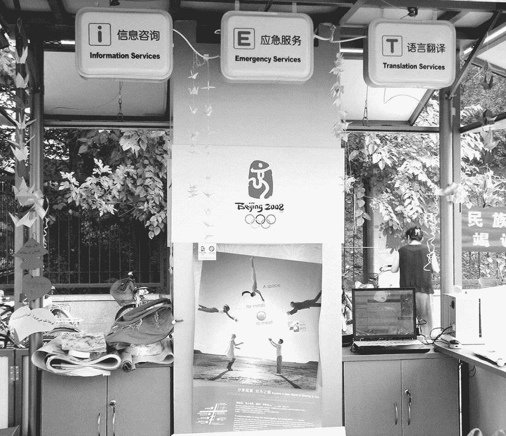

照片 14：位于黑竹公园的北京奥运会城市志愿者服务站。

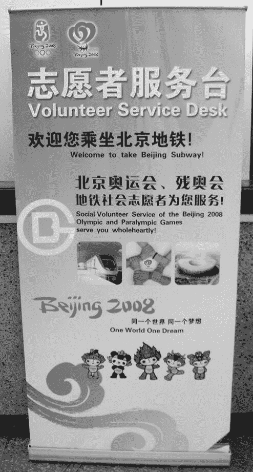

照片 15：北京地铁站内的志愿者服务台。

### 3.2.2 公共巴士与地铁系统

中英文双语标识在北京的公共巴士和地铁系统中无处不在（见照片 16 & 17）。公交车和地铁内的线路图、方向指示牌和警告标志均已升级为双语标识。2006 年，`BOCOG`设立了 38 条奥运专线公交，为 16 个奥运场馆附近的志愿者和记者提供免费出行模式。乘坐这些专线的乘客可以获得中英文双语的时刻表（见照片 18）。此外，公交车和地铁内的广播也采用了中英文双语播报。


照片 16：北京地铁 1 号线双语线路图。

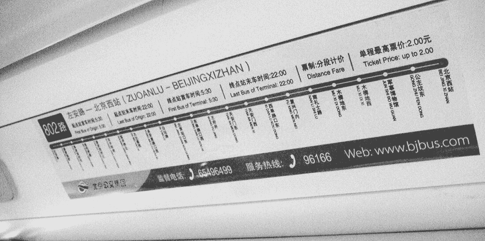

照片 17：802 路公交车内的双语线路图。

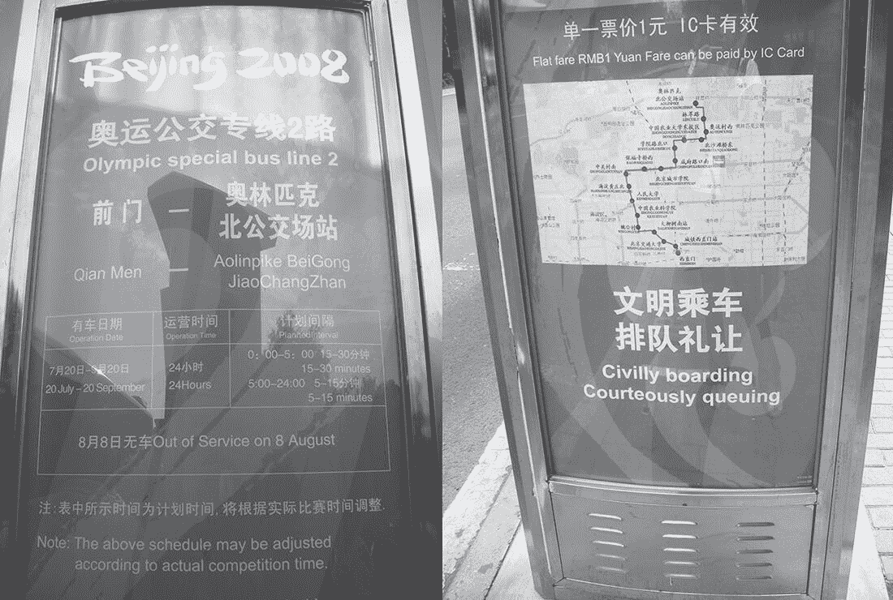

照片 18：奥运专线 2 号公交牌的正反面。

### 3.2.3 道路交通

地名英文翻译的标准化是英语标识标准化运动中最重要的部分之一。根据《公共标识英文翻译规范》，地名是通过结合汉语拼音和英文术语进行翻译的（见照片 19）。汉语拼音要求大写。英文单词必须采用大小写混合形式，首字母大写，其余字母小写。在翻译不同类型的街道名称时，英文单词“Avenue (Ave)”仅用于翻译“长安街 (CHANG’AN Ave)”和“平安大街 (PING’AN Ave)”。所有其他的“街 (*jie*)”和“大街 (*dajie*)”均被翻译为“Street (St)”，例如，“隆福寺街 LONGFUSI St.”。组成部分“小街 (*xiaojie*)”、“条 (*tiao*)”、“巷 (*xiang*)”和“夹道 (*jiadao*)”通常被翻译为“Alley”，例如，“东直门北小街 (DONGZHIMEN North Alley)”、“东四十条 (DONGSISHIA Alley)”。“路”的英文翻译为“Road (Rd)”，例如“北辰路 BEICH Rd”。“高速公路”被翻译为“Expressway (Expwy)”，而“公路”被翻译为“Highway”。

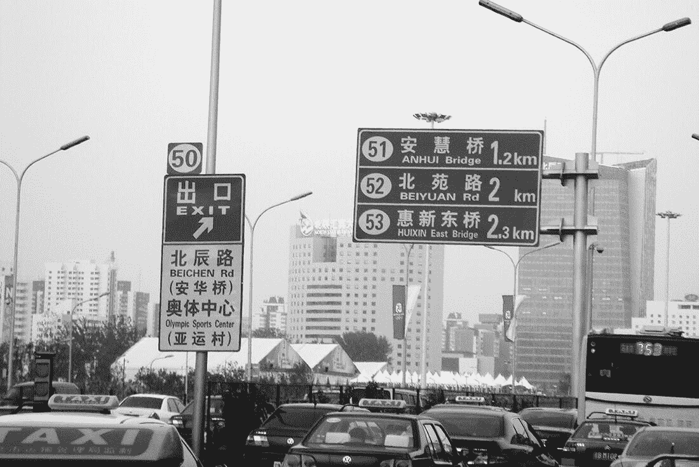

照片 19：国家体育场附近的交通标识。

### 3.2.4 景点

位于北京市中心的故宫（也称为故博物院）是明清两代的皇家宫殿。1987 年它被列入教科文组织世界遗产。2008 年 8 月 8 日，我访问了故宫以调查语言服务情况。作为北京的景点和全球游客量最大的博物馆，故宫内除了中文外，双语标识仅使用了英文——从票务外的告示板到安检处的警告标志，再到故宫内的触摸屏导览设备（见照片 20）。

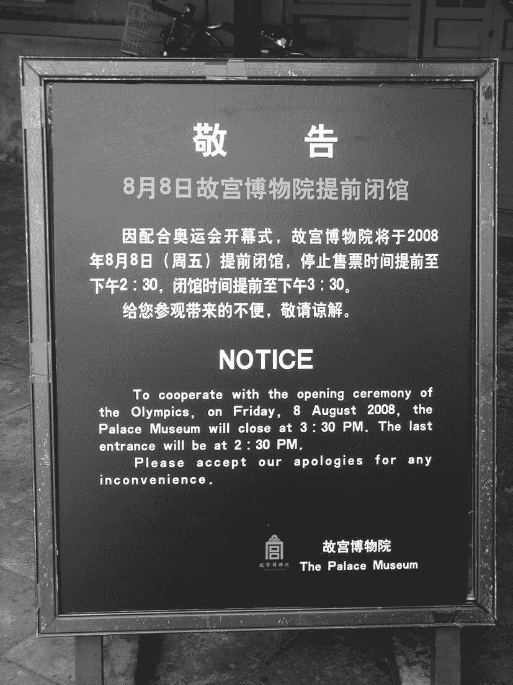

照片 20：故宫的一处双语标识。

### 3.3 多语言标识

《北京奥运行动计划》（`BOCOG`, 2002）要求在特定的场馆和场馆内提供多语言标识。事实上，除了英语和法语外，其他外语在主办城市的标识中几乎不可见。作为奥委会的官方语言，法语与英语一起出现在与赛会密切相关的场馆内设置的一些官方多语言标识上。由于法语的存在主要与奥运会有关，大多数多语言标识在赛后从北京被移除。显然，北京市在奥运背景下的语言选择倾向于英语。在对瑞士旅游营销语言选择的研究中，Piller (2007) 认为语言选择就是投资选择。在北京英语推广运动后，除了中文外，英语比任何其他语言更容易获得。相比之下，其他语言的标识需要更高的翻译和制作投入，而服务的目标群体也小得多。第 4.4 节和第 4.5 节将更多讨论奥运背景下北京标识中英语以外外语的可见性。

## 4 语言选择、意识形态与认同

语言景观涉及无数的语言选择，正如 Piller (2007)所指出的，没有任何语言选择是中立或任意的，而是从根本上与特定的背景、意识形态和实践密切相关。同样，Spolsky and Cooper (1991)和 Landry and Bourhis (1997)都认为，`LL`（语言景观）中的语言选择一方面可以作为重要的信息标记，另一方面也可以作为居住在该地的语言社区相对权和地位的符号性标记。遵循 Piller (2007)，我将从三个层面（语言选择、内容和位置）对抽样的标牌进行语言选择调查，然后讨论北京的`LL`中哪些语言获得了可见性，以及它们具体的职和象征意义是什么。

### 4.1 中国与北京作为和谐国家的首都

我在北京各处重点奥运场馆、旅游景点、商业区和交通枢纽的实地调查显示，出乎意料的是，简体中文是城市`LL`中最可见且最突出的语言。国家语言不仅出现在单语标牌上，还出现在双语和多语标牌的前排位置。在双语/多语标牌上，简体中文总是第一位的，其字体大小通常比其他语言大。尽管北京的主要道路、车站和站点、旅游景点和关键文化遗迹设立或更新了大量的双语和多语标牌，但全城还有更多的官方和非官方的单语标牌。天安门广场的语言景观就是一个很好的例子。


2008 年 8 月 6 日，即北京奥运会开幕前两天，我参观了天安门广场，当时那里正在举办奥运花卉展。展中的花坛将吉祥的中国文化元素与奥林匹符号相结合，营造出热烈的节日氛围。天安门广场是双语标牌可见度极高的文化场所之一。然而，花卉展的围栏区域呈现出一个显著的单语空间。与花卉展相关的文本信息大部分以简体中文呈现，只有少数为了引导外国游客和媒体专业人士而认为必要的双语指示标牌。

最引人注目的标牌之一是一个高 16.9 米的 2008 年夏季奥运会官方标志“中国印，奥运京”（参见照片 21），它站在花坛中央。该标志借鉴了多种中国文化元素，在“北京 2008”字样和奥林匹克环环上方描绘了一个传统的中国印章。根据北京奥运会组织委员会（2003），印章上刻有一个呈舞动形象的书法字体`京`（`Jing`，意为“首都”，源自主办城市北京）。弯曲的线条暗示了一条跃动的中国龙，中国传统中权力、力量和好运的象征。这个形象像一个越过终线的跑步者。人物张开双臂象征着中国邀请世界分享其文化。标志的两侧有两块巨大的红色标牌，上面上面刻有口号（参见照片 21）：“五湖四海喜庆奥运盛会 *Wuhu sihai xiqing aoyun shenghui* [热烈欢迎世界各地朋友共临北京奥运会]”和“改革开放共谱和谐篇章 *Gaige gaifang gongpu hexie pianzhang* [在改革开放中谱写和谐发展的新篇章]。“和谐”`hexie` [harmony]这一主题强调了北京奥运会的政治和经济议程。花卉展中的两个巨大的红色单语标牌回应了挂在天安门（通常翻译为 Gate of Heavenly Peace）西墙和东墙上的另外两块标牌，它们用简体中文写着“中华人民共和国万岁 *Zhonghua renmin gongheguo wansu* [People's Republic of China live]”和“世界人民大团结万岁 *Shijie renmin datuanjie wansu* [World 人民大团结万岁]”。这两句单语口号和位于它们之间的毛泽东画像共同象征了中国共产党的合法性，并再次体现了“和谐”作为中国文化精髓的哲学。鉴于显而易见的单语语言选择，花卉展上和天安门看台上的信息显然是针对国内受众的。单语语言的选择是基于民族国家的概念。在民族国家中，“一个国家一个语言”的意识形态（将民族认同与特定语言，通常是主导群体的语言联系起来）是社会和文化治理的常用策略（Piller, 2007; Shohamy, 2006）。

在天安广场精心规划的语言景观（LL）中，中文（其标准口语和书面形式为`Putonghua`和简体字）被用作北京作为统一和谐中华民族首都的重要身份标识。中国作为世界上人口最多的国家，其大陆拥有 13.3 亿人口，并承认 56 个在种族和社会语言学上具有多样性的“民族”（中国国家统计局, 2010）。汉族是最大的民族，占中华人民共和国（中国大陆）总人口的 91.51%（中国国家统计局, 2010），占北京户籍人口的 95.69%（北京市统计局, 2009）。52 个少数民族居住在 60%的土地上，拥有自己的母语（回族、满族和畲族除¹⁹之外），他们有时拥有多种，总共涵盖五个语系的 100 多种语言（Tsung, 2009，第 11–12 页）。尽管中国是一个多语言多民族国家，但作为最大的中国民族语言的汉语在公共话语中被轻易等同于“中文”。由于中国境内各地区民族和部落数千年的移民和同化，汉族具有显著的内部遗传、语言、文化和社会多样性特质（Wen et al, 2004）。因此，习俗上所谓的“中文/汉语”是一个由各种汉族口语变体构成的语言族，这些变体在很大程度上是互不通的。尽管存在许多互不通的口语变体，但汉族统一的一个因素是汉字（`Hanzi`），它们具有统一的标准形式。这种统一归功于秦朝，它统一了当时中国存在的各种书写形式。数千年来，无论朝代如何更，`Hanzi`一直是所有汉语变体说话者之间使用的统一书写系统，并作为汉族与中国其他民族之间的书面通用语。在现代中国，简体汉字 `Jianti hanzi` [Simplified Chinese characters] 是跨族群交流中无可争议的书面语言，也是北京及中国其他地区政府、法律和正式教育使用的文字，尽管它在技术上仅属于一个民族——占主导地位的汉族的文字。通过这种方式，标准形式的统一中国语言（普通话和简体字）被视为中国国家身份认同的基础。

简体字的使用结合样本标牌文本中强调的“和谐”主题，传达了政府希望通过举办奥运会来促进国家“和谐发展”的愿望。儒家“和谐”哲学主张“和而不同 `he er butong`（字面意思是“在差异中保持和谐”），强调了多样性与平衡的重要性（Feng, 2005）。“和谐”哲学诞生了大多数传统的中国宇宙观信仰，并鼓励了包容、兼容、顺从、和平、统一、诚信和稳定等价值观。2006 年，在中央委员会会议上，中国提出了“和谐社会 `hexie shehui` [harmonious Society]”理论，作为对国家在结构转型时期面临的众多社会经济问题的应对。将中国建设为和谐的社会主义社会被视为实施科学发展的重要战略。在北京奥运会之前，“和谐”已成为中国政治话语的主题，因为中国中央政府重新发现“和谐”是调节社会矛盾和确保稳定的有效工具（Feng, 2005）。正是在这样的社会政治环境下，中国政府加大了推广标准汉语（口语和书面形式）的努力，并使其在奥运城市北京的语言景观具有最高的可见度。此外，中国政府意识到推广标准汉语是中国获得软实力的重要战略，而奥运会提供了一个绝佳的机会。`北京奥运会行动计划`（BOCOG, 2002）指出，奥运会对整个中国、特别是北京吸引的全球关注，可以作为一个“向世界教导和推广汉语，并证明汉语实际上是一种在全球范围内使用的语言”的机会。向世界推广“中文”并以此增强国家软实力资源这种雄心，也构成了中文在北京语言景观中占据领先地位的基础。

## 4.2 英语与作为全球城市的北京

大量的实证研究表明，英语已迅速渗透到非英语国家城市和地区的公共空间中（Backhaus, 2006, 2007, Huebner, 2006, MacGregor, 2003), Griffin, 2004, Hult, 2003, Piller, 2007, Schlick, 2003, Torkington, 2009)，以及欧洲。我对北京语言景观的研究证实了英语在这些空间中的高可见性。除了简体字，英语在在的语言景观中显然被赋予了重要的地位。英语几乎和中文一样无处不在，出现在交通标志、公交和地铁站、商店门面、橱窗、奥运场馆内外的、旅游景点和公共建筑、广告牌和其他街道广告上、小册和地图上，以及传单和菜单中。英语标牌的高度集中通常标志着想象中的英语社区经常出入的旅游景点或公共场所。在我在北京站、北京西站和北京国际机场等主要交通枢纽以及城市各地铁站的实地调查中，除了简体字外，英语是引导标志、商业广告牌、奥运广告牌、旅游地图、指示牌和路牌以及电子报站系统中显示的唯一语言。显然，当主办城市承诺提供“无障碍”语言服务并转变为“全球城市”时，英语处于语言层级制度的顶端。

公共标识的英文翻译是政府英语标牌标准化运动的重中之重。表面上，这是为了帮助外国人更好地利用公共设施。但对北京双语公共标识的仔细研究表明，许多英文标识的符号功能大于其信息传递功能。例如，在天安门地铁站的实地调查中，我发现了两个双语公共标识：一个是挂在通道墙上的禁令牌（见照片 22)），另一个是放置在电扶梯前的指示牌（见照片 23）。

该禁令牌包含四幅图以及四句中英文短语：“禁止吸烟 *Jinzhi xiyan* [No Smoking]”、“请勿坐卧停留 *Qingwu zuowo tingliu* [No Loitering]”、“禁止摆卖 *Jinzhi baimai* [No Vendors]”以及“禁止乱扔废弃物 *Jinzhi luanreng feiqiwu* [No Littering]”。有趣的是，在离禁令牌不远的安检站，有警察和志愿者在值守。根据我的现场观察，说英语的外国小贩不太可能出现在北京的公共场所，尤其是在北京奥运会前和期间如此严密的监控下。事实上，说英语的街头小贩在北京不太可能是一个频繁到需要专门为他们设立禁令牌的问题。因此，这块禁令牌上英语的出现更多是为了体现其国际大都市主义的符号意义，而非为了其信息和指令内容。

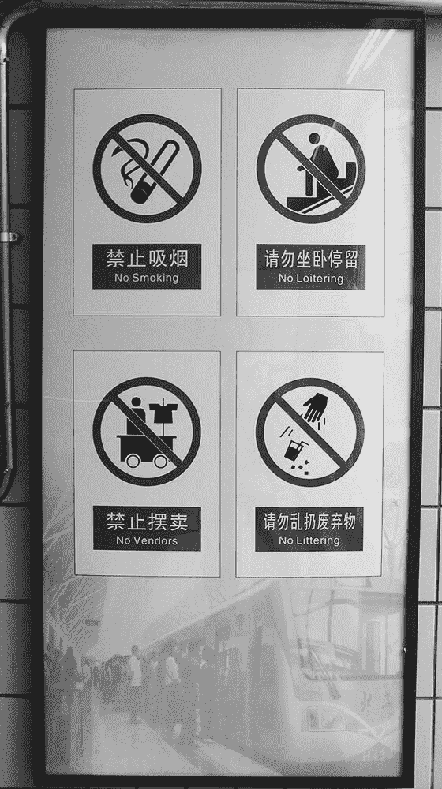

照片 22：禁令牌。天安门地铁站，2008 年 8 月 6 日。

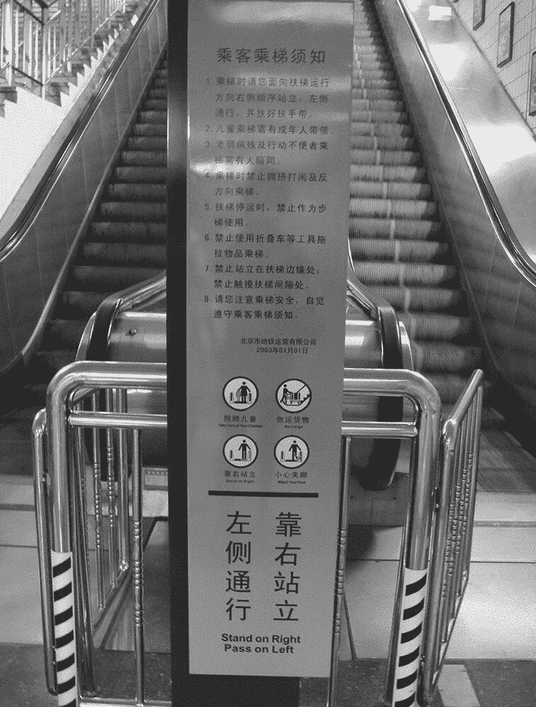

照片 23：指示牌。天安门地铁站，2008 年 8 月 6 日。

英文标识的符号功能在天安门地铁站电扶梯前的指示牌上ن为明显（见照片 23）。与中文文本相比，英文翻译在内容和字体大小上都被减到了最小。告示牌上半部分突出的给乘客的八条规定没有英文翻译。位于边缘位置的唯一英文翻译包括“照顾您的儿童”（Take Care of Your Children）、“禁止携带物品”（No Cargo）、“右立”（Stand on Right）、“注意脚下”（Watch Your Foot）以及“右立，左侧通行行”（Stand on Right; Pass on Left）。该告示牌上中文的显著性表明了中文在告知公众和规范其行为方面的相对重要性。

## 4.3 出售的英语与精英主义

通过研究广告也可以开展语言政策研究(`Shoham, 2006`, `chapter.xhtml_b9781614514954-007_ref319`)。作为全球化的超中心语言，英语在北京的商业话语中无处不在(`Piller, 2012`, `chapter.xhtml_b9781614514954-010_ref292`)。当广告中使用英语代替（或与国语并用）时，它通常被用来索引现代、国际化和成功的身份(`Piller, 2012`, `chapter.xhtml_b9781614514954-010_ref292`)）。照片 24 是耐克展示窗的照片。

耐克总部位于美国，是世界领先的运动用品制造商。到 2008 年底，中国是耐克最大的单一来源国。中国消费者购买的大多数耐克产品都是中国制造的。在中国市场的广告中使用英语，可以成功将这种语言的积极联想转移到耐克产品上。

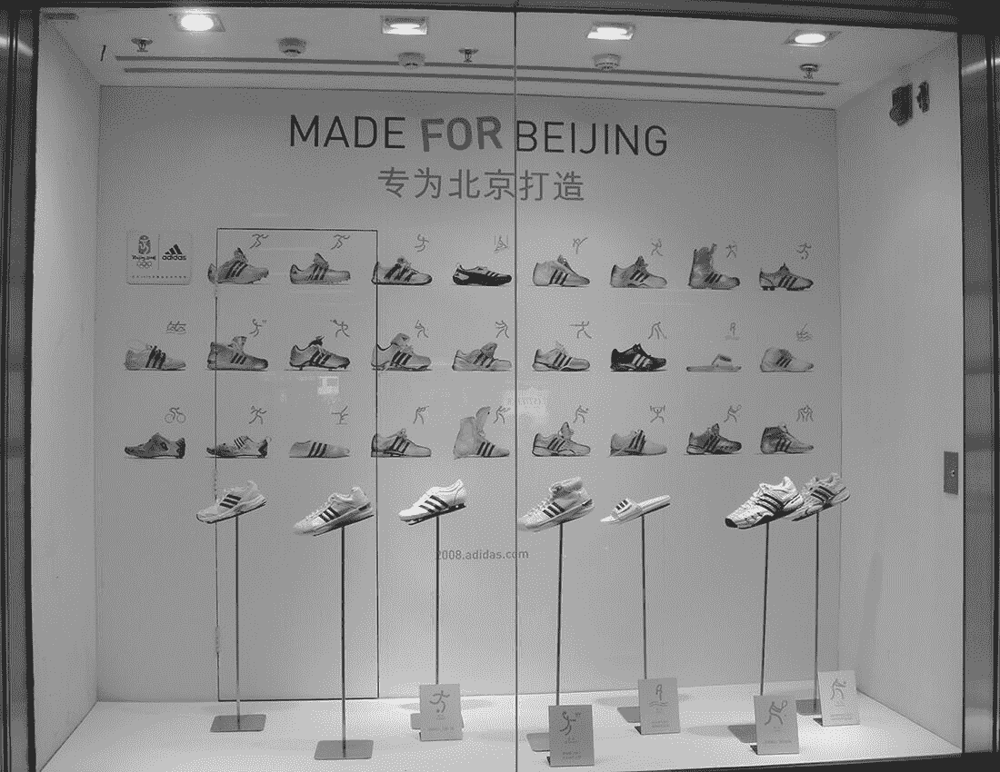

照片 24：一个展示窗。

在北京的语言景观（LL）中，英语不仅作为媒介存在，还作为内容存在。我所说的“作为内容存在”是指主要以简体中文呈现但旨在促进对英语进行“消费”的非官方标识：例如宣传英语培训机构的广告牌。这些广告牌上的中文文本直接面向全国观众。在很多情况下，白人形象是推销英语培训产品广告中不可分割的一部分。由于英语在中国语境下的商品价值不断增加，且英语培训机构在奥运会之前在北京涌现，北京奥运官方语言服务供应商之一，通过我的实地调查观察，通过户外广告最积极地推广其服务。例如，在王井井地铁站繁忙的通道内，我发现了一排宣传北京奥运会的霓虹灯。在它们旁边，一块 `EF` 的广告牌是关注的焦点（见照片 25）。在照片中，一个漂亮的中国年轻女子用绳子系在一个看起来专业的白人男性身上，以一种引目的的方式展示了广告的卖点：“24 小时‘私人英语教练’ [24-hour ‘private English instructor’]。”

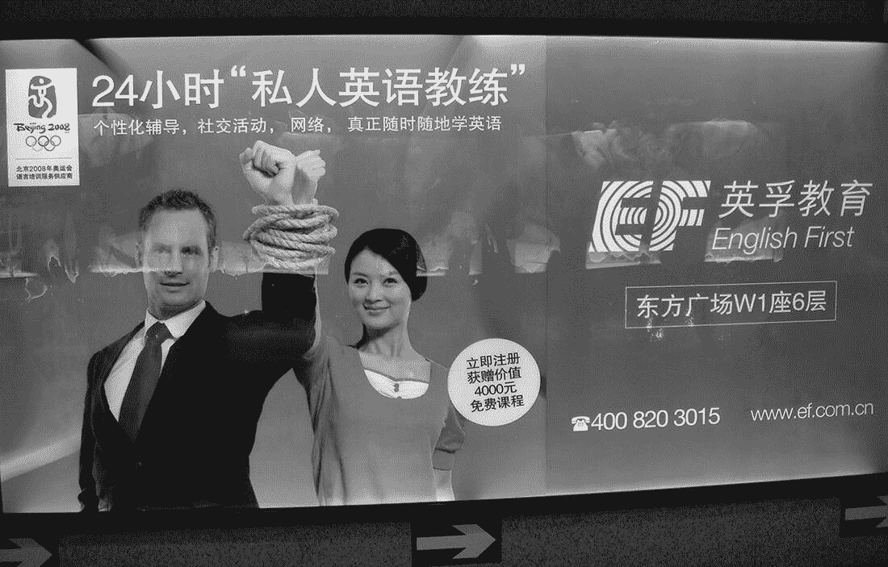

照片 25：`English First* 的广告牌。王府井地铁站，2008 年 8 月 4 日。

这则 EF（EF 英语）广告推广了高度种族化、性别化和性化的话语。语言代码的选择和女性形象清晰地将中国年轻女性定位为目标潜在消费者。广告中白人男性与中国女性的并置，构建了高桥（Takahashi, 2006）在日本女性学习英语的研究中讨论过的两种话语：一方面，穿着西装领带的英俊西方男性被视为“令人渴望且有效的英语教师”；另一方面，年轻亚洲女性被视为“对西方男性气概和作为国际语言的英语充满渴望的消费者”（第 125 页）。相连的手臂象征着 EF 的个性化一对一英语课程，暗示每个人都可以拥有英语，并与理想的英语母语教师拥有一种“亲密”的体验。作为理想“母语教师”的白人男性与作为渴望“客户”的年轻女性之间的身体“亲密感”，通过充满性暗示的广告口号得到了强化，暗示了与白人男性的“私人”且“亲密”的时光。在身体姿态上，白人男性略微站在前面，用他相连的手臂引导中国女性。男子深色西装和蓝色领带的形象象征着 EF “母语教师”的质量和专业性。此外，举起的手臂和拳头是战斗和胜利的姿势。尽管由西方男性引导，但一个胜利的笑容浮现在年轻女性的脸上，显示出她对这位“私人英语教师”的完全控制和极大满意。EF 的商业广告向潜在客户暗示，其增值英语教学服务为每位中国学习者提供了一个身份转变的机会，并可能存在跨种族的恋情。在右上角，使用了奥林克标志来标明 EF 作为北京奥运会官方语言服务供应商的官方地位，这为其个性化英语课程提供了官方保障。

这种由英语学校发布的充满性暗示的广告并非孤立案例。在高桥（2006）对 Gaba（日本扩张最快的 *eikaiwa*，即英语会话学校之一）的研究中，她分析了一幅类似的广告，画面中一名日本女性被手铐在一个白人男性身上。根据 Takahashi (2006)，Gaba 的 `mantsuman`²⁰（一对一）课程旨在吸引日本女性在时尚空间内与白人男性共度“私人”且“亲密”时光的渴望。与 EF 广告中被白人“母语教师”引导的中国女性不同，Gaba 广告中的日本女性被定位为权力持有者，通过她的“知性的微笑”和“对手铐的拉拽”（Takahashi, 2006，第 126 页）。对于日本女性来说，英语被呈现为获得他们热烈渴望之物的手段——西方和西方男性。日本的英语学习已与对西方男性的浪漫欲望相混合在一起（Piller and Takahashi, 2010)）。他们的日本案例以及我上面的分析表明，语言学校的广告是英语被性别化、性化和种族化以销售英语学习和教学的领域。通过充分利用奥林匹品牌，EF 将其主打的个性化英语课程推广为性别化和浪漫化的产品。

在上一节中，我证明了英语如何通过两个指示性符号被推广为想象中的国际大都市的语言，并主要作为北京作为一个全球城市的身份标记。相比之下，这则 EF 广告推广了一种母语者意识形态，在这种意识形态中，英语不是国际语言，而是白人母语者的财产。“母语者优越性”意识形态在中国 EF 等私立语言学校中被理所当然地视为自然常识。这种意识形态使英语母语者合法成为理想的英语教师，以及英语学习中非母语学习者的理想模型。近几十年来，越来越多的研究人员（例如：Brutt-Griffler and Samimy, 1999;Canagarajah, 1999;Cook, 1999;Kaplan, 1999;Kirkpatrick, 1997;Mckay, 2003;Pennycook, 1998;Phillipson, 1992)）已经证明，`native speaker` 并非经验事实，而是社会建构。在许多情况下，“母语性”更多地与意识形态有关而非语言能力。例如，Piller, 2001) 坚持认为应该抛弃母语者意识形态，因为它在语言上毫无用处。尽管存在 `native speaker`，Piller, 2001) 也认为早期习得并不能保证成为语言的唯一裁决者。Phillipson, 1992) 声称非母语者拥有母语者可能不具备的资质。Rampton, 1990) 概述了关于母语者的五项特征，并证明`专门教育或培训使一个人成为专家`。换句话说，培训和经验在定义成功方面起着更大的作用。

## 4.4 法语与作为奥运城市的北京

根据《奥林匹克章程》（International Olympic Committee, 2007)，第 53 页），法语和英语都是奥委会的官方语言。除了这两种语言外，主办国语言在赛事期间也是奥林的官方语言。这意味着与 2008 年奥运会相关的所有公告、和服务都应该提供三种语言版本。在北京的语言景观（LL）中，法语出现在官方发布的自上而下标识中的频率远高于自主社会行为者的非官方自下而上标识中。特别是在北京奥运的背景下，法语主要出现在少数与赛事密切相关的场馆和体育场设置的官方自上而下多语言标识上。这些多语言标识主要包括奥运专车的标牌（见照片 26）、奥运场馆外的指示标识（见照片 27）以及奥运场馆入口处的工作站标识（见照片 28）。法语在引导标识上的出现与北京作为奥运举办城市的身份密切相关。

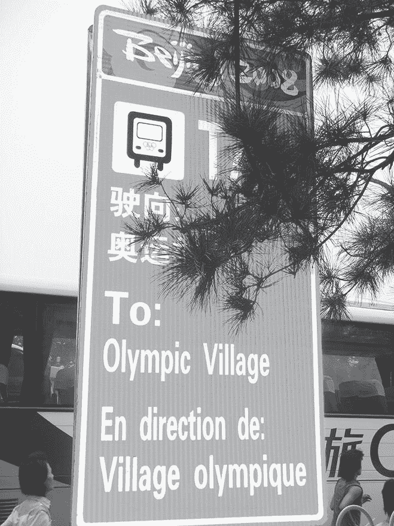

照片 26：天安广场奥运专线公交的停止牌。

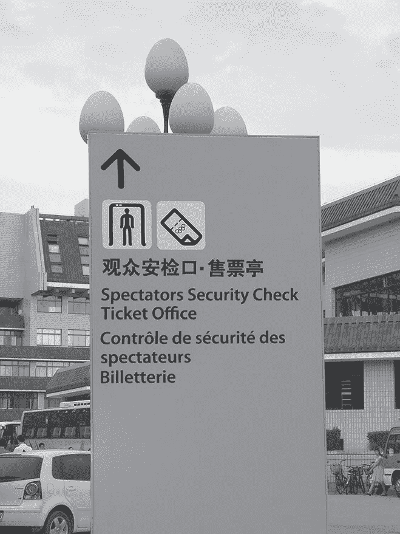

照片 27：方向牌。北京大学奥运场地的入口。

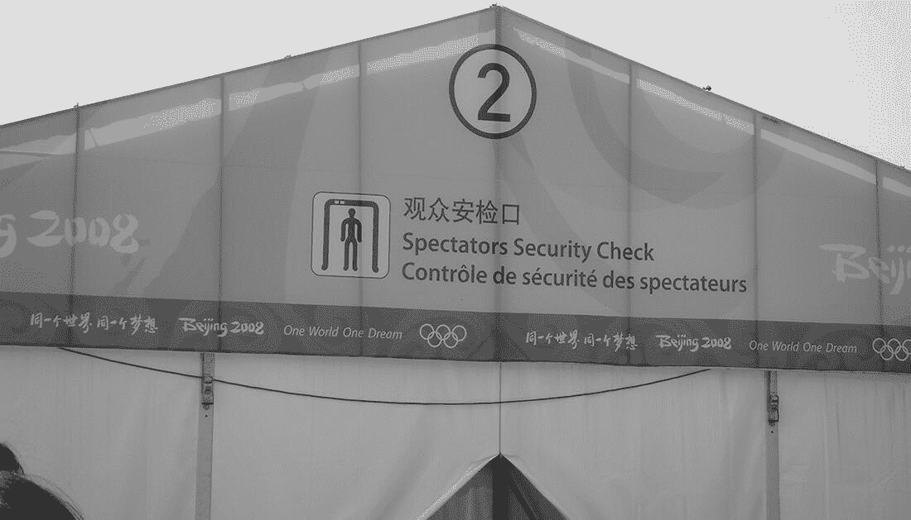

照片 28：顺义奥运赛舟赛艇公园的观众安检站。

此外，大多数法语标牌都是为了奥运会而临时设立的，这意味着这些标牌并不十分“固定”，因此在奥运会后可能会被移除。在显著性方面，尽管多语种标牌上使用的法语字体大小与英语相同，但法语始终出现在中文和英文之后，这表明其重要性排名较低。在当地个人、民组织或企业制作的非官方标牌上，法语几乎缺席。北京语言景观（LL）中法语的代表性不足和临时性证明了市政府并未赋予法语与英语在上海城市规划中的平等地位。这也证明了尽管法语具有官方奥运地位，但在当地的语言实践和意识形态中，法语的流行程度和符号资本远低于英语。

## 4.5 其他语言与隐形城市

正如前几节过的，北京官方规划的语言景观赋予了三种语言最高的可见度：中文（针对作为和谐社会首都的北京）、英语（针对作为全球城市的北京）和法语（针对作为奥运城市的北京）。与这三种语言相比，其他语言受重视程度较低，可见性有限。2008 年 8 月 7 日，即北京奥运会开幕式的前一天，前门街在经过一年的装修后重新开放。修复后的历史商业街在重开当天吸引了大量游客。街道旁设立了标准化的中英文双语标牌。在街道南端，几名学生志愿者在一个城市志愿者服务站为游客提供信息。接待台上放着许多份*北京奥运住宿服务指南*（参见照片 29）。该指南于 2008 年 4 月 24 日发行，提供八种语言：中文、英语、日语、韩语、俄语、德语、西班牙语和阿拉伯语（北京晚报，2008）。然而，由于该服务站的志愿者除了英语外，没有人会说其他六种外语，这些出版物结果仅仅流于形式。英语在北京语言景观中的突出地位依然没有任何挑战。


照片 29：*北京奥运住宿服务指南*。前门街，2008 年 8 月 8 日。

北京的主要旅游景区提供了多语种设施和服务。2008 年 8 月 8 日，我访问了故宫以调查那里的语言服务情况。我注意到，午门 `Wu men` [Meridian Gate]和神武门 `Shenwu men` [the Gate of Divine Prowess]提供多语种语音导览服务。语音导览是一种电子设备，可以在游客沿路线游时自动提供 20 种语言（包括普通话和粤语）的现场说明。在入口处，票处的大型告示牌显示了该语音导览服务的语言（参见照片 30）。告示牌使用了国旗图标配合各自语言的名称来指示可提供的语音导览。国旗代表了特定语言的所属权（Piller, 2012）。显然，这种做法的背后是“一国一语”的意识形态，它将国家认同与特定语言联系起来。持有这种意识形态的人认为，“单语主义或使用单一通用语言对于社会和谐和国家统一至关重要”（Piller, 2015）。此外，语言的“原生性”通过出生与特定的国家或地区联系在一起。在告示牌上，英语紧随两种中文变体——普通话和粤语之后，排在所有其他语言之前并位于其他语言之上，这暗示了重要性和地位的差异。米字旗——英国国旗被用作英语的符号标记。这种告示牌在北京的语言景观中并非孤例。在北京市旅游局的官方网站（`www.english.visitbeijing.com.cn`）上，英国旗也被用作英语的符号标记。认为英国作为英语出生地拥有该语言所有权的假设是显而易见的。这种意识形态将英国英语（在某些情况下为美国英语）优于所有其他语言，暗示其在各方面具有权威性。在关于瑞士旅游营销中英语的研究中，Piller (2007 观察到了类似的做法。她认为，将语言与所属国家联系起来的做法使得小国家变得隐形。这有助于解释为什么中国少数民族社区和“少数”外语社区在北京的语言景观中缺席或存在有限。

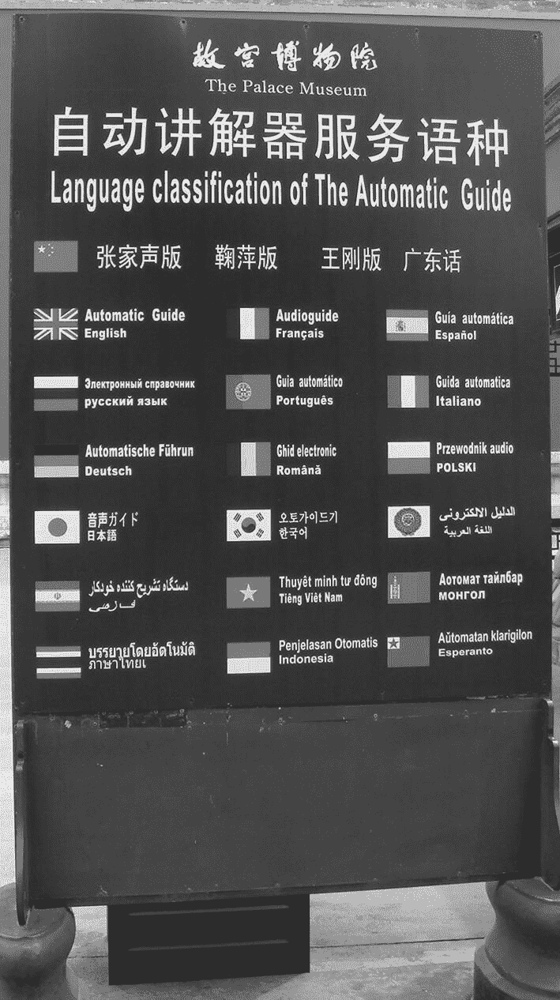

照片 30：多语种导览告示牌。故宫入口，2008 年 8 月 8 日。

`LL` 为语言政策和语言使用研究提供了一个新的视角。考虑到 `LL` 作为语言政策机制的作用，在公共空间使用 `LL` 的后果是重新确认了处于权力地位的语言和群体，同时边缘化了其他非权力的语言和群体 (Shohamy, 2006, p. 124)。北京是一个民族和语言上高度多元的城市，但在奥运会背景下，并非所有的语言和群体都得到了平等的呈现。北京的 `LL` 是不同语言之间权力斗争的竞技场。这些斗争的结果是三种语言意识形态和身份的混合：中文象征北京作为和谐社会的首都，英语代表北京作为全球化城市，而法语则代表北京作为奥运之城。正如本章示例所示，这些语言选择进一步强化了语言与群体之间现权力不平等。正在进行的奥运会英语标牌标准化运动是由“标准英语”意识形态驱动的。参与该运动的相关部门和专业人士强烈倾向于母语者变体（尤其是英式英语和美式英语），而非外层圈和扩张圈中非母语者的英语变体。中国政府对母语变体标准的强烈意识导致了全城范围内对“中式英语”的打击，将其视为一种“低等”且“有缺陷”的英语变体。当时制定了规则和条例以标准化公共标牌、菜单和专业职称的英语翻译。关于“标准英语”的官方态度定义了何为“正确”的英语表达，这也可以从将特定语言与国旗联系起来的做法中推断出来。在这种实践中，英语的所有权与起源地 `UK`（较少的情况下为 `US`）建立了紧密联系。英语在北京奥运背景下的商品价值使得英语作为“内容”在广告中具有很高的可见度。英语学校的广告（正如高桥在的研究 (2006) 中讨论的那样）呈现了性别化、性化和种族化的话语，其中白人男性“母语者”被想象成“理想的英语教师”。北京 `LL` 中体现的所有这些语言实践和意识形态，都导致了对英语是什么以及英语归谁的狭隘理解，并阻碍了对中国及全球社区文化和语言多样性的充分理解。

20 世纪 80 年代以来，中国的外国语言教育政策倾向于英语，并对英语教育持中性的工具主义观点。这种英语热在 2008 年北京奥运会前夕达到了历史巅峰。随着中国在本世纪第二个十年全球政治和经济地位的上升，中国外国语言教育正经历着从“英语单语主义”向以国家语言能力为导向的多语主义的意识形态转型。这种转型意味着北京 2022 将在具有里程碑意义的北京 2008 奥运会的 `LPP` 遗产的基础上，并在多语言服务方面做出努力。

# 第 8 章 中国奥运语言服务——遗产、转型与展望

现代奥林匹运动是语言复杂的活动。2008 年北京奥运会极大地推动了中国语言服务业的发展，并为未来的国际和综合性赛事提供了语言服务的参考模型。同时，奥运会的筹备工作也使中国的政策制定者和学术界反思其国家外国语言政策。随着我们进入人工智能 (`AI`) 和电信技术加速发展的时代，语言服务供应模式的转型悄然发生。

## 1 2008 年奥运会的语言服务遗产

2008 年北京奥运会的参与人数和观众规模超过了以往任何届奥运会。国际奥委会 (`IOC`) 主席雅·罗格（Jacques Rogge）在闭幕式上赞誉北京奥运为“真正非凡的奥运会” (Xinhua，2008f)。国际奥委会（2009）评价道，举办 2008 年奥运会为奥林运动和中国带来了许多有无形遗产，涵盖了基础设施、环境、健康和教育等领域。`IOC` 未提到的是，北京奥运会是语言服务业发展的一个里程碑事件，为非英语国家举办大型国际活动提供了宝贵经验。

### 1.1 奥运语言服务供应商

作为一种新的语言服务模式，2008 年北京奥运会语言服务提供者的建立促进了奥运语言服务的标准化和规范化。

#### 1.1.1 奥运语言培训服务供应商

2008 年北京奥运会是奥运历史上首次将“语言培训服务供应商”正式视为一个独立的赞助类别。这一类别在随后于非英语国家举办的奥运中一直得到维持，且 `EF` 已成为主办国运动员、教练、裁判员和官员的默认英语培训机构。自 1988 年以来，`EF` 已在七次奥运会上提供过语言培训服务（参见表 17）。在 2008 年至 2020 年间，只有两届在英语母语国家举办的奥运会没有提名 `EF` 为其语言服务供应商，即 2010 年温哥华冬季奥会和 2012 年伦敦夏季奥运会。21)

表 17：过去奥运会及特奥会的语言服务。

| 语言服务类别 |
| --- |
| 1988 年首尔夏季奥运会官方语言学校 |
| 2008 年北京奥运会官方语言培训服务供应商 |
| 2014 年索契冬季奥运会官方语言课程供应商 |
| 2016 年里约夏季奥运会官方语言培训供应商 |
| 2018 年平昌冬季奥运会官方教育服务赞助商 |
| 2019 年阿布扎比特奥世界运动会官方供应商及独家培训商 |
| 2020 年东京夏季奥运会官方语言培训服务合作伙伴 |

因此显而易见，英语一直以来是奥运会的主导语言，并且在不久的将来内很可能继续如此，因此，英语培训仍将是非英语国家主场国家奥运会语言服务的重要内容之一。英语的全球传播导致了英语变体的出现。在英语培训方面，奥运会语言培训服务供应商需要意识到，具有不同本地化特征的英语变体的存在已成为现代英语的主流趋势。Graddol (1997)、1999)和 Crystal (1997)经常被引用的统计数据显示，英语母语者人数已经超过了英语母语者，因此非母语者的交流机会正在增加。最新的统计数据告诉我们，如今大约 80%的口语英语是在非英语母语者之间进行的。如果从数字上说，英语是“他人”的语言，那么这种语言的重心几乎肯定会向“他人”的方向转移。因此，英语教学的目的应该是帮助世界英语（Kachru, 1992）使用者（包括母语和非母语变体使用者）之间进行顺畅的交流。因此，母语者规范不仅无关，而且是奥运会英语中介的跨文化交流的障碍。事实上，奥运会是高度多语言的。过去奥运会的语言服务证明，英语单语主义无法满足语言和文化多样化的奥运会参与者的语言需求。在复杂的语言环境下，奥运组织者需要放弃英语单语主义意识形态，并将多语言主义嵌入现代奥运会的语言政策和规划中。在未来，奥运会语言培训服务供应商应该考虑 `IOC` 的语言政策以及所有奥运组织者和参与者的实际语言需求，重新评估和重新规划其外语培训服务，为举办国多语言交流能力的发展做出贡献。

#### 1.1.2 北京奥运会多语言服务中心，北外

北京外国语大学（`BFSU`）成立于 1941 年，是中国第一所专门研究外国语的机构。该大学在 2008 年教授了 44 种外语，超过了中国其他任何大学的教学数量。`BFSU` 的外语教育水平在某种程度上代表了中国的国家外语水平。该大学利用 2008 年奥运会作为一个良好的平台，让许多学生参与翻译实践，并在校园内营造了志愿者文化。赛会期间，`BFSU` 派出了 3000 多名翻译员，他们既作为志愿者也作为付费专业人员，参与了 2008 年北京奥运会广泛的语言服务和培训计划（Wang and Zhang, 2008）。北京外外译译学院（`GSTI`）院长 Wang Lidi (2008)声称，北京 2008 为 `BFSU-GSTI` 提供了一个全球平台，展示他们在外语教学方面的成就，特别是翻译方面的成就。

对 `BFSU` 而言最大的实体奥运遗产是北京奥运会多语言服务中心（`MSC`）。该中心是为了奥运会设立的，但其使命远不止于此。正如许多为奥运会专门设立的设施一样，中心在活动结束后停止了运营。但在 2010 年，`BFSU` 重新开放了它，配备 3 名全职员工和 260 名学生志愿者提供包括英语、法语、德语、俄语、阿拉伯语、西班牙语、日语和韩语在内的 8 种语言的翻译服务（Zhang, 2014）。目前，`MSC` 已成为 `BFSU` 的一个常设机构，为外国游客或当地社区的居民提供多语言服务。2008 年北京奥运会还赋予了 `BFSU` 许多无形遗产。它们为大学的志愿者文化奠定了基础。奥运会也促进了 `BFSU` 的多语言教育，因为学生对学习英语以外的第二或第三外语变得更加热情。

### 1.2 “北京微笑英语”计划

“北京微笑英语”计划（`BSFLP`）于 2002 年启动。自实施以来，重要的阶段性目标和任务多年来一直被北京市政府“折子 *Zhezi* [必办项目]”项目中。2006 年，它被 `IOC` 列入文化奥运遗产清单（Official Website of the State Council of PRC, 2007）。北京 2008 之后，该计划以新的行动计划继续运行。北京市对外事办公室设立了国际语言环境部门负责 `BSFLP`。这种集中领导机制确保了 `BSFLP` 以标准化、制度化的可持续方式发展（Official Website of the Beijing Olympics, 2008）。在执行层面，市政府动员了各种社会力量鼓励公民广泛参与，包括数千名志愿者、180 所高校和外语机构、负责 `BSFLP` 的中外专家顾问委员会、负责公共场所英语标准化的专家小组以及 340 多个社会单位。

### 1.3 志愿者精神

2008 年奥运会激发了志愿者精神，并在中国留下了一批高水平人才。2008 年，`BOCOG` 在场馆建设、体育、营销、接待、医疗服务、媒体运营、交通等领域的员工举办了史上规模最大的赛事。根据 `IOC`（2009）的统计，有 1,125,799 人申请参加 2008 年奥运会志愿者，这是一个奥运会纪录。赛会期间，10 万志愿者在奥运和帕林匹克场馆提供各种服务，40 万城市志愿者在指定的服务站提供信息、语言翻译和应急服务。2008 年之后，北京希望在奥运会志愿者的基础上，目标在三到五年内实现 20%的参与率，注册志愿者人数至少达到 200 万，每年志愿服务时长每人超过 50 小时（International Olympic Committee, 2009）。

### 2.1 北京奥运背景下的“体用”张力

在 2008 年奥运会召开前夕，由中国政府和北京奥运会组委会（`BOCOG`）领导的奥运英语普及运动将“英语热”推向了历史高潮。那种认为英语学习可以被引入 `体`（内在本质）而不损害中国文化 `用`（外部实用性）的意识形态，开始受到媒体和教育者的批评和挑战。许多报纸文章表达了公众对英语在中国霸权的日益增长的担忧。例如，南舟（2007）敦促中国政府以奥运会为平台推广汉语而非英语，并警惕英语在中国对外语教育政策中占据主导地位。林志波（2005）质疑了英语对所有中国公民的用处，并敦促政策制定者在人才培养和选拔中放弃“纯英语政策”。张其华（2005）批评了改革开放以来日益的“英语热”，认为其削弱了汉语在教育体系中的地位，并导致了年轻一代汉语水平和知识的倒退。李家全（2005）指出，在全球化英语扩散的背景下，中国语言规划面临的一个关键问题是汉语与英语之间的不平等。这种不平等首先体现在中国英语教育与汉语及少数民族语言（`LCTLs`）教育之间的不平衡。王晖强调，英语霸权对汉语的纯洁发展构成了严重威胁。英语的传播也让许多中国人高度认同英美国家的价值观，并鄙视汉语和文化。此外，英语和汉语在国际领域和网络空间声望的巨大差异也加剧了两种语言之间的不平等。李玉明（2005）呼吁在发展用于国际交流的外语教育的同时，应更多关注中国国家语言和本土语言的保护与发展。

### 2.2 后奥运时代对“英语热”的抵制

三十多年来，三代中国人都参与了“英语热”。然而，2013 年标志着中国看待英语的方式发生了根本性的转变。2013 年年底，中国教育部（`MOE`, 2013）发布了一份关于各级招生和考试制度改革的总体计划草案。该计划规定，英语考试将不再纳入全国统一高考业考试（`Gaokao`）。相反，英语考试将每年举行多次，允许学生选择参加考试的时间和频率，以减轻学习压力，并改变中国“一生一机会”的考试制度。此外，小学一、二年级学生将不再上英语课。根据总体计划，所有省份要求在 2014 年制定具体的实施措施，并在 2017 年之前启动试点改革项目。近期，若干中国省市为响应政府号召，宣布了政策举措，降低当地高中和大学入学考试（中考 `Zhongkao` 和高考 `Gaokao`）中英语的比重。例如，北京市教育委员会（2013）建议从 2016 年起，将高考英语考试总分从 150 分降至 100 分，中考从 120 分降至 100 分。同时，它建议允许学生每年参加两次英语考试，而不是给他们一次机会。2018 年秋季，由教育部（`MOE`, 2018）制定的《高中课程方案及普通高中学科课程标准（2017 年版）》在全国实施。为了优化高中课程结构，课程方案要求在原有外语学科（英语、日语、俄语）的基础上增加德语、法语和西班牙语。学校可以自主选择第一外语，教育部鼓励学校创造条件提供第二语。这意味着学生在高考中可以选择六门外语。英语考试改革引发了全国性的辩论。这种后奥运时代对改革的全国讨论，反映了外语学习者个体需求与外语教学实践、国家发展需求与国家政策之间的多层次矛盾。从“英语单一语言主义”或“单一语言视角看的多语言主义”（Piller, 2016b）向国家能力导向型多语言主义的意识形态转型正在中国外语教育中发生。

### 2.3 国家能力

“国家（语言）能力”的概念最早由美国学者 Richard D. Brecht way A. Ronald Walton (1994)提出，是指“出于任何原因应对特定语言能力需求的能力，包括为目前未提供或通常提供的语言开设课程的能力”。在美国，这一术语主要对外语（`LOTE`），特别是少数民族语言（`LCTLs`）。作者认为，美国过去提供这种能力的方法的效果有限，应该启动国家少数民族语言战略规划进程，旨在建立一个管理这些语言教学的新架构。

随着国家经济发展的进步以及各项重大战略的实施，中国许多语言学家已将语言能力这一问题提升到了国家战略的高度，“国家语言能力”已成为过去十年的研究热点。李玉明（2011）这位将该概念引入中国的中国语言学家将其定义为“国家在处理各种国内外事务时所需的语言能力”。更具体地说，国家语言能力包括公民个体的语言能力和整体社会语言能力，还包括国家在处理政治、经济、外交、军事、科技以及文化等多个维度的各种国内外事务时所需的语言能力（杨，2015）。从“语言作为资源”的角度来看，赵世奎（2016）解释道，“国家语言能力”是“一个国家掌握语言资源、提供语言服务、处理语言问题、发展语言及相关任务能力的总和”。基于对国内外国家语言能力研究的文献综述，文秋芳（2019）将该概念重新定义为“政府利用语言处理涉及国家利益的国内和国际事务的能力”。根据她对“国家语言能力”的重新构想，处理语言事务的主体应当是政府机构，而非个人或非政府组织。此外，这些语言事务必须涉及国家利益，并且必须通过语言（语言手段）来处理，而非通过军事或其他非言语的手段。


尽管对“国家语言能力”有不同的定义，但这些中国社会语言学家一致认为，外语已成为国家发展过程中不可或缺的资源，是国家核心竞争力的组成部分，也是国家软实力的重要体现。许多中国学者（戴，2011；李，2010；申，2015；文、苏和剑，2011；赵，2015）呼吁对外语规划进行战略性转型，并发展中国的外语能力。然而，中国在对外语资源方面仍然匮乏。尽管有大量的中国人从事外语学习，但其中绝大多数是英语学习者。根据《国家外语人才动态数据库》的统计（文，2019），在 2010 年至 2015 年期间，中国高校开设了 44 门非英语外语课程，这六年间的学生总人数仅为 80,000 人。到 2016 年，外语课程数量增加到 65 门，涵盖了欧盟国家 24 种官方语言和东盟国家 10 种官方语言。2020 年，北京外国语大学提供了 101 种外语，涵盖了所有与中国建立外交关系的国家的官方语言。然而，该国仍然缺乏处理涉及国家利益的国际事务所需的语言能力。在当今世界使用的 6000 多种语言中，中国最多仅理解 101 种外语，且仅有 20 种语言具有尚合理的能力（赵，2016）。尽管中国政府在过去十年发布了许多语言政策来加强对少数语言（LCTL）的教育，中国高等教育的外语课程类型也发展迅速，但中国与许多具有文化和语言多样化移民群体的发达国家之间在外语能力方面仍存在巨大差距。2013 年，美国大学能够提供 263 门外语课程，其中 248 门少数语言（LCTLs）²²，少数外语（LOTE）的选课人数超过 150 万（Goldberg, Looney and Lusin, 2015）。至于中国的对外语规划，李玉明（2011）](#chapter.xhtml_b_9781614514954-010_ref_211）认为有四类语言具有紧迫需求：第一类是国际事务常用的语言，如英语；第二类涉及国家利益的语言，如邻国语言；第三类是用于反恐和灾害救援的“应急语言”；第四类是科学研究所需的“学术语言”。李（2011）](#chapter.xhtml_b_9781614514954-010_ref_211）呼吁语言学家和政策制定者关注世界所有国家和地区的官方语言，以及非洲语言的研究。正如 Spolsky（2004）](#chapter.xhtml_b_9781614514954-010_ref_323）所出的，“英语作为全球语言现在是任何国家制定语言政策时需要考虑的因素（p.91）”。尽管英语在跨文化交流中仍起着主要作用，中国对外语规划的英语主导地位短期内不会改变，但中国在多语言化方面迈出了重要一步。

## 3 后奥运时代的中国语言服务

### 3.1 中国语言服务概况

语言服务业出现于 20 世纪 80 年代的改革开放以及 90 年代信息技术的发展。在早期阶段，语言服务的内容主要是翻译和传译。中国译译协会（TAC）²³）。

随着世界变得日益联系互通，全球语言服务市场经历了快速增长。中国语言服务行业在 2008 年北京奥运会后进入了发展的快车道。根据《2019 年中国语言服务行业发展报告》（中国翻译译译协会，2019），全球语言服务市场规模在过去十年中增长了一倍，首次达到 500 亿美元。目前，中国有 369,935 家将语言及语言相关服务纳入业务范围的企业，其中有 9,734 家企业将语言服务列为主要业务，并被称为语言服务提供商（LSPs）。截至 2019 年底，LSPs 的总收入估计为 372.2 亿元人民币（约 53.亿美元）。这些 LSPs 在注册资本方面差异巨大，从 10 万人民币以下到 1 亿元以上不等。总的来说，LSPs 的规模仍然较小，82.06%的企业注册资本不足 100 万人民币。大多数 LSP 为私营企业，其中 55.62%位于中国东部，那里市场繁荣且需求量，特别是北京（2,231 家）、上海（2,072 家）和广州（1,111 家）。

中国的 LSPs 提供多元化的服务以促进多语言和跨文化交流。虽然翻译和口译服务是它们的主要收入来源，但一些也涉及语言咨询、工具与应用、教育培训以及其他语言相关服务。他们服务于法律合同、化工与能源、机械制造以及建筑矿业等广泛领域和行业，这可能是因为这些领域中外合作的增加导致需求随之提高（Luo, Meng and Lei, 2018）。中国语言服务行业现在提供多种翻译服务。其中，信息技术、教育培训和政府宣传已成为语言服务提供商承接订单的前三大领域，占比分别为 63%、52%和 45.3%（中国翻译译译协会，2019）。

随着与“一带一路”沿线国家积极合作的推动，中国语言服务市场翻译服务的供需因素呈现多元化发展趋势。俄语、英语、阿拉伯语、德语和法语是翻译服务需求最大的五种语言。除了这些主流语言外，包括泰语、日语、越南语、白俄罗斯语和波兰语在的小少数语种（LCTLs）也占了需求的较高比例。在供应侧（LSPs），语言服务行业以常用外语为主，但近年来 LCTLs 翻译服务的提供越来越多。值得注意的是，语言服务提供商对专业语言人才的迫切需求与高等院校培养的人才之间存在巨大差异。目前，中国语言服务提供商面临许多语言专业人才短缺的问题；在这方面，最紧需要的十大语言是意大利语、阿拉伯语、葡萄牙语、西班牙语、泰语、俄语、土耳语、越南语、白俄罗斯语和菲律宾语，这些主要是“一带一路”沿线国家的语言。在《2019 年中国语言服务行业发展报告》（中国翻译译译协会，2019）中，67.3%的 LSPs 急需 LCTL 译员，85.7%的人表示很难招聘 LCTL 专业人才。LCTL 译员的缺乏和人才招聘的高成本是中国 LSPs 面临的最大挑战。然而，该报告也指出，大学里最迫切需要开设的十大语言是阿尔尼亚语、阿塞拜疆语、爱沙尼亚语、白俄罗斯语、保加利亚语、波兰语、波斯尼亚语、波斯语、捷顿语和德语（中国翻译译译协会，2019）。高校 LCTL 教学能力与中国语言服务市场的实际需求之间显然存在巨大差距。近年来，在国家政策的鼓励下，中国外国类高校对 LCTL 专业的发展表现出高度热情，LCTL 专业数量正在迅速增长。然而，高校 LCTL 专业的设置与分布与理论和实践层面的“国家外语能力”建设尚未实现有机结合，发展不理性和缺乏整体规划的问题已经暴露。因此，中国 LCTL 人才培养的紧迫任务是基于需求分析开展外语教育规划，以明确国家对 LCTL 专业人才的长期需求。

### 3.2 语言服务的标准化

自 2008 年北京奥运会以来，中国语言服务的标准化取得了进展。作为语言服务领域唯一的国家级协会，`TAC`通过组织制定语言服务指南为促进该行业标准化做了许多努力（Luo, Meng and Lei, 2018）。它为翻译法的制定进行了游说，并主导制定了三项后成为国家标准的标准，即：《翻译服务规范第一部分：翻译》、《翻译服务译文质量要求》、《翻译服务规范第二部分：口译》。它还试点了 10 项规范的编写，包括《翻译服务报价规范》、《口译服务报价规范》、《本地化服务基础术语》、《本地化服务报价规范》以及《本地化服务商选择规范》。此外，`TAC`还赞助或参与了其他规范的编写，如《汉语专有名词翻译通用规则》、《公共服务领域英语使用规范——第一部分：通用规则》。`TAC`还组织专家小组编写了本名为《本地化入门手册》的手册，旨在向服务用户介绍本地化服务。中国的标准化基本上是由行业发起的、`TAC`引领的过程，作为自律的一种手段。然而，目前还没有基于上述标准的企业认证。因此，只有少数 LSPs 申请了国际认证或相关行业框架下的认证，而约 83.5%的 LSPs 在没有任何认证的情况下运营。

### 3.3 语言服务的技术创新

计算机辅助翻译（CAT）、机器翻译（MT）以及基于互联网的语言服务平台的创新正在重塑中国语言服务行业的经济结构和增长模式（Luo, Meng and Lei, 2018）。调查结果（参见图 10）显示（Luo Huifang, et al. (2018)），计算机辅助翻译是中国语言服务提供商（LSPs）最广泛使用的技术（70.6%），其中 `SDL Trados` 的用户最多（91.1%），其次是 `memoQ`（56.8%）。机器翻译虽然仅有 17.2%的语言服务提供商在使用，但预计在可预见的未来对语言服务行业产生重大影响。随着中国顶级电子商务和科技公司（特别是百度、阿里巴巴和腾讯）向人工智能领域投入资金，随着深度神经网络研发的每一次突破，机器翻译可能会迎来一波增长。在像中国这样大的国家，机器翻译通常被认为是帮助应对巨大翻译和口译需求的理想方法。事实上，该行业的一些一些主要参与者已经开发了自身的机器翻译应用，或者在日常运营中采用了此类技术。语音识别、人机对话和写作技术也取得了持续进展。中国语言服务行业还见证了基于互联网的语言服务平台的发展，这些实现了资源整合并使交易变得简单。在调查的语言服务提供商中，6.8%表示他们正在开发自己的翻译工具，主要是在线语言业务平台和项目管理应用程序。在另一项调查（Translators Association of China, 2019）中，80%的受访的语言服务提供商认为“使用翻译技术可以降低翻译成本”，67%的人认为“使用翻译技术可以提高翻译质量”，58%的人同意“使用翻译技术可以提高翻译水平”。

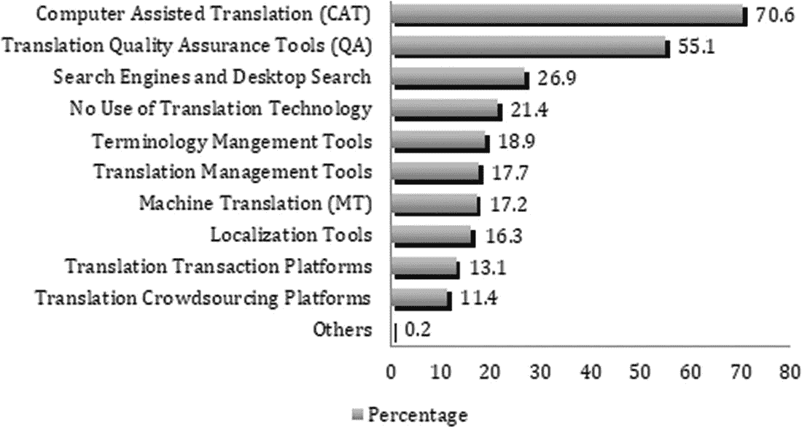

图 10：翻译技术的应用。

随着传统的语言服务行业模式要求创新和转型，信息技术在语言服务中的应用已成为首要趋势。中国的语言服务提供商发现需要通过即时的业务模式升级和重新设计来重新定义其发展战略。他们意识到，随着进入信息技术的新时代，传统的思维模式、组织结构、组织行为和业务模式很快就会成为过去式。得益于少数几个主要参与者（在某些情况下，这些公司已经具备了很强的内部研发能力），中国语言服务行业正处于技术创新的快车道。这些技术创新将在服务未来的国际体育赛事（包括 2022 年冬奥会）中发挥日益重要的作用。

### 3.4 语言类专业人才的教育与培训

语言服务市场的快速发展为翻译和口译人员的教育和培训提供了巨大动力。2007 年，翻译口译专业学位硕士（MTI）获得国务院学术学位委员会批准。到 2018 年底，已经建立了一套完整的翻译口译（T&I）教育体系，涵盖了学士、硕士和博士阶段。共有 272 个翻译口译类本科专业，涉及九种语言：英语、法语、日语、俄语、德语、韩语、西班牙语、阿拉伯语和泰语（Zhong, 2019）。MTI 专业的数量从 2007 年的 15 所大学增加到 249 所，涵盖 11 种外语，总招生人数近 6 万（Zhong, 2019）。翻译学领域有 40 多个博士项目，拥有 1000 多名博士（Zhong, 2019）。翻译专业人才的培训已进入大规模发展阶段。同时，如《翻译口译类本科专业教学要求》和《MTI 专业设置基本要求》等一系列指南，将翻译口译教育推向了标准化发展的道路。

除了几种更具声誉的语言的翻译口译专业外，少数民族语言类（LCTLs）的培养也为中国语言服务行业提供了重要的人才储备。近年来，随着中国综合国力的提升和“一带一路”倡议的全面发展，中国政府也高度重视少数民族语言类人才的培训，开启了快速发展的新纪元。在中国的外语教育中，联合国的六种工作语言（中文、英语、法语、俄语、阿拉伯语和西班牙语）以及德语和日语被定义为“常用语言”。相应，其他语言被称为“常用语言”或“教学语言”（Su, 2017）。自从教育部于 2001 年批准以来，北京大学、北京外国语大学等高校开始建设少数民族语言类本科基地。

2010 年，中国教育部（2010b）发布了 21 世纪第一个国家规划，《中国教育中期长期规划（2010—2020 年）》，作为指导中国未来十年教育改革发展的纲性文件。该规划强调国家应当培养具有国际视野、熟悉国际规则并能够参与国际事务和竞争的人才，以满足经济发展和开放的需求。在相关国家政策的鼓励和支持下，外语院校的数量规模显著增加。截至 2019 年 6 月，共有 1040 所外语院校。在中国各省份中，江苏和湖北的外语院校数量位居首位，均为 64 所，其次是山东（59 所）、广东（58 所）、北京（54 所）、河北（53 所）和浙江（52 所）（Translators Association of China, 2020）。根据 2016 年 3 月发布的统计数据，全国 167 所高校设有 66 个少数民族语言类专业和 391 个专业，本科生超过 3.万（Ding, 2017）。

过去十年中，中国的经济实力经历了飞速增长。自 2010 年以来，中国已占据世界第二大经济体地位，日本让出了其保持了 42 年的排名。中国经济的稳定增长已成为全球经济复苏的主要引擎。根据国际货币基金组织（IMF）的数据，中国对世界经济增长的贡献不断增加，2017 年已达到约 35% (Liu, 2017)）。中国目标是在 2020 年实现 2010 年 GDP 和人均收入的翻倍，作为建设“全面小康社会”的重要组成部分 (中国经济网, 2014)）。专家预测，在相超越德国、法国、英国和日本之后，中国最早在 2030 年就能追上美国。

这种日益增长的经济实力使中国在全球治理中发挥了更加积极的作用。中国于 2013 年底启动了雄心勃勃的“一带一路”倡议，旨在建立一个连接亚洲与中东、欧洲、非洲及其他地区的贸易和基础设施网络。该倡议由中国主席习近平提出，旨在振兴曾连接东西方的古代贸易路线。“一带一路”倡议正势头良好，已有 100 多个国家和国际组织参与了该倡议。2019 年前三个季度，中国对“一带一路”沿线 56 国家的新投资额达 114.6 亿美元，占期间中国整体对外投资的 12.7%，同比增长 4 个百分点 (中华人民共和国商务部, 2019)。中国与沿线国家的贸易也显著增长。2017 年，中国与俄罗斯、波兰和哈萨克斯坦的贸易额分别增长了 27.7%、24.8%和 41.1% (Liu, 2017)。

中国的“一带一路”倡议为沿线地区和国家教育的深层次融合提供了巨大机遇。一方面，“一带一路”国家正逐渐成为英国、美国、澳大利亚和加拿大等传统热门目的地国家之外中国学生留学的新热点。另一方面，中国已成为世界最大的国际学生接收国，而沿线国家也是中国国际学生的重要来源。2018 年，来自 196 个国家和地区的 492,185 名留学生在中国 31 个省及省级行政市的 1,004 所高等教育机构学习²⁴]，其中近一半来自“一带一路”国家 (中华人民共和国教育部, 2019a)。中国国际学生来源前十大是：韩国、泰国、巴基斯坦、印度、美国、俄罗斯、印度尼西亚、老挝、日本和哈萨克斯坦 (中华人民共和国教育部, 2019a)。

在北京已举办和即将举办的两届奥运会之间，中国正在从一个寻求国际认可（特别是西方认可）的现代化国家，转变为一个在全球政策制定和治理中争取更大话语权的最大且最大的发展中国家。自 2008 年以来，中国举办了一系列重大国际活动活动，如 2009 年哈尔滨亚洲大运动会、2010 年上海世博会、2010 年广州亚运会、2011 年深圳大运会、2014 年南京夏季青奥会、2019 年北京国际园林展以及 2019 年武汉军运会。随着中国在全球治理中采取着日益积极的角色，其外语思想正逐渐告别“英语单一主义”(Piller, 2016b)，转向以国家语言能力为导向的多语言主义。

### 4.1.2 奥运议程 2020

在中国发展战略发生变化的同时，奥林匹运动也在发生。由于其规模巨大的复杂性、兴奋剂和腐败丑闻的频繁发生以及压倒性的商业压力，奥运会的管理和组织变得日益困难。一些批评者甚至声称奥运会正成为实现奥运标准的障碍。由于申办程序昂贵且低效，国际奥委会（IOC）发现自己面临愿意举办奥运会的候选者短缺的问题，显然改革势在必行。国际奥委会对此现状做出了反应，引入了`奥运议程 2020`，这是一项改革进程，使奥运会会对潜在主办者更具吸引力。这项`奥运议程 2020` (国际奥委会, 2014) 在 2014 年 12 月 8 日至 9 日在摩纳哥举第 127 届奥委会会议上一致通过。这些改革是基于与奥林匹运动所有利益相关者以及外部专家和公众一年的讨论和咨询。这 40 项详细建议就像拼图的碎片，组合在一起就为我们描勒出了奥林匹运动未来的清晰蓝图。奥运议程 2020 涵盖的关键领域包括：

1. 申办程序的调整，采用一种新理念，邀请候选城市提交符合其体育、经济、社会和环境长期规划需求的项目。

2. 降低申办成本，通过减少允许的演示次数以及国际奥委会提供大量资金支持。

3. 将计划从以运动为中心转变为以活动为中心。

4. 通过在《奥林匹章程》中加入基于性取向的不歧视原则，加强第六大基本原则。

5. 推出奥运频道，为奥运会之外的运动和运动员提供全年 365 天的平台。

6. 根据不断变化的需求调整并进一步加强良好治理和伦理原则。

7. 运动员一直是所有 40 项建议的核心，保护纯洁运动员是国际奥委会哲学的核心。

作为首个充分从《奥林匹议程 2020》中受益的举办城市，北京 2022 年冬奥残奥组组会在落实国际奥委会（IOC）所述的新工作模式方面取得了巨大进展（新华，2018）。自申办 2022 年冬奥会以来，北京规划了“纯冰雪之约”的动人愿景，强调了举办冬奥会的三个办会理念：“以运动员为中心、可持续和经济性”。这三个理念符合《奥林匹议程 2020》。2018 年，国际奥委会宣布了一项包含 118 项改革的雄心计划，重点关注奥林匹议程 2020 中关于赛事组织的六项建议，旨在确保赛事是负担得起、受益匪浅且可持续的。北京 2022 冬奥会始终致力于遵循这些改革，通过举办一场“绿色、包容、开放、洁净”的赛事，履行中国举办“盛世、非凡、卓越”赛事的承诺。国际奥委会主席鲍赫对此表示信心，“北京 2022 可以为可持续的奥运会树立新标杆，一方面受益于 2008 年北京奥运会的遗产，另一方面以可持续的方式打造一个新的冬季运动运动胜地”（新华，2018）。

## 4.2 语言服务行动计划

语言服务是北京冬奥会筹备工作的重要组成部分，承载着各参与群体间沟通与联系的重要任务。2017 年，北京 2022 年冬季奥林会组织委员会（BOCWOG）、教育部和国家语言文字委员会（2017）联合发布了《北京 2022 语言服务行动计划》。该《行动计划》的主要内容如下：²⁵

### 4.2.1 主要目标

> 北京 2022 承诺遵循举办绿色、共享、开放、廉洁赛事的原则。冬奥组委会将充分发挥国家语言文字委员会语言资源的优势，协调相关部门、大学、科研机构、企业和社会力量共同努力，共同举办奥林会，为 2022 年冬奥会的成功举办营造良好的语言环境，提供高质量语言服务，展示汉语及文化的魅力，确保 2022 年北京冬奥会盛世、非凡、卓越。

### 4.2.2 行动原则

教育部、国家语言文字委员会和冬奥组委会应当：

> 1. 发挥统筹协调作用，加强与相关部门的联动，整合各方参与，推动《行动计划》的实施。


> 2. 根据本冬奥会的语言服务需求，整合多种语言资源，充分发挥大学、科研机构、企业及相关社会力量的作用。参与方应本着分工合作原则，通过共建共享形成互动发展关系。充分利用语言和信息技术发展的最新成果；通过项目实施机制促进语言服务与信息技术的紧密结合，实现“高科技奥运”。及时跟进冬奥会前五年的筹备需求，对行动计划项目内容进行及时调整和完善，并通过重大国际赛事活动测试其应用，从而将项目成果推向先进水平。

### 4.2.3 重点项目

根据冬奥会筹备需求，提前推进基础资源建设、标准建立及城市语言环境改善的相关项目。

> 1. 语言技术融合与服务：开展相关术语开发工作，构建跨语言术语服务平台。在此平台基础上，开发多语种服务系统和智能 APP；集成语音识别与合成、机器翻译、人机对话等技术成果；构建人机智能交流平台，为冬奥会提供实时、便捷、全方的多语言服务。

> 2. 提供语言翻译与培训服务：根据冬奥会对语言服务和语言翻译的需求，组建语言专家团队负责重要会议材料和文件的翻译审核，并推荐专家对冬奥会语言翻译供应商的公开招标进行评审。组织专家根据冬奥会需求及相关标准制定多语种培训标准。准备语言培训材料，为国内外志愿者提供语言和文化培训，并为国内技术人员、翻译人员、冬奥组委会工作人员、2022 年冬奥志愿者等提供语言培训服务。

> 3. 优化奥运语言环境：组织对北京、张家口语言及文字使用情况进行检查，并向社会公布检查结果，确保北京奥运会的语言及文字使用符合相关语言政策和标准。检查各冬奥场地的英文标识并提出修订建议。编制《2022 年北京冬奥会及残奥会赛事术语手册》，推动冬奥会赛事术语标准化。设立“北京公共语言文化讲堂”，编写手册《欢迎冬奥：语言与文化》。

> 4. 开展志愿者语言培训：根据冬奥会筹备和举办的语言服务需求，制定提高组织能力和专业水平的志愿者语言培训计划，协调外语院校为冬奥前及赛期间志愿者提供语言培训服务。

> 5. 开展冬奥语言文化展览体验项目：以“语言与体育文化”为主题，通过冬奥场地的文化展览展示北京文化优势，介绍冬奥会涉及的语言和文化，开展各种形式的语言文化展览体验项目。

## 4.3 志愿者服务行动计划

志愿者是确保奥运会和残残奥运会成功的重要贡献者。2019 年 5 月 10 日，北京冬奥组（BOCWOG）发布了《志愿者服务行动计划》，标志着北京 2022 倒计时 1000 天的开启。在倒计时仪式上，北京 2022 执行副主席张建东表示，北京作为唯一举办过冬奥会的城市，将汇聚全球志愿者的智慧，举办一场“精彩、非凡、卓越的盛会”(Xinhua, 2019)。北京 2022 于 2019 年 12 月 5 日启动了赛事期间志愿者的全球招募。截至 2020 年 1 月 5 日，申请北京冬奥会的志愿者人数已超过 63 万名 (Xinhua, 2020)）。

根据该计划，将启动五项志愿者服务项目，包括赛前志愿者项目、城市志愿者项目、测试赛会志愿者项目、志愿者服务遗产转化项目以及赛事期间志愿者项目。还将开展沟通、招募和培训在内的多计划，以促进广泛的公众参与。

BOCWOG (2019) 计划为冬奥会招募 27,000 名赛事期间志愿者，为冬残奥会招募 12,000 名赛事期间志愿者。预计赛事期间志愿者主要来自国内高校和高中、海外华侨、国际志愿者，以及省级及港澳台选出的志愿者。北京冬奥组还鼓励冬奥运动特长运动员申请专业志愿者岗位。

## 4.4 奥运语言服务供应商

2008 年北京奥运会的语言服务遗产在 2022 年冬奥会中得到了良好继承，不仅为建立具有相关职责的机构提供了模板，还利用了首届奥运会创造的如今已成熟且多维的资源和能力。

### 4.4.1 官方语言培训服务独家供应商

为了迎接奥运会重回中国，EF 于 2019 年 8 月 20 日被任命为北京 2022 官方语言培训服务独家供应商（EF Education First, 2019b）。EF 在中国拥有悠久的历史，并在往届奥运会上提供语言服务的丰富经验，使其具有相对于其他语言培训机构不可比拟的优势。北京 2022 人力资源部部长严成表示，北京 2022 与 EF 将共同制定培训计划，并为北京冬奥组的付职人员、国家技术官员和志愿者组织一系列定制且实用的项目，帮助他们培养全球视野并提高语言能力（EF Education First, 2019）。EF 中国区 CEOJacob Toren 表示，公司将提供符合《奥林匹议程 2020》的语言培训，重点关注遗产和可持续性。

### 4.4.2 官方自动翻译软件独家供应商

2019 年 9 月 16 日，人工智能公司讯飞科技（iFLYTEK）宣布成为 2022 年北京冬奥会和冬残奥会的自动翻译软件独家供应商 (Cheng, 2019)。讯飞科技成立于 1999 年，专注于人工智能、语音识别、自然语言处理和自主学习。近年来，他们开始将业务扩展到消费电子领域，包括一种提供 60 种语言实时翻译的便携翻译器。公司将在赛事期间提供语音识别、语音复合和机器翻译的技术支持，例如赛事结果的多语种展示、重大赛事的多语种翻译、多语广播以及工作人员与运动员之间的机器翻译交流。冬奥组认为，此类产品和服务将为赛事营造良好的沟通环境，并有助于减少重复性工作以提高效率。讯飞董事长刘清峰表示，公司旨在利用先进技术帮助向世界更多的人传播中国声音和中国故事。这是“自动翻译软件供应商”首次在奥运历史上被正式设立为一个独立的赞助类别。因此，大型国际赛事语言服务的形式已逐渐从人工翻译转向基于 AI 技术的机器翻译，以满足对及时、便利和低成本多语种服务的需求。

### 4.4.3 北京奥运多语言服务中心（北京北外）

“北京奥运多语言服务中心”是中国首个政府性语言服务机构，旨在 2008 年北京奥运会提供 44 种语言的“无障碍”语言服务。赛后，该中心更名为“北京多语言服务中心”，成为北京外语大学（BFSU）的性机构。在这一新身份下，中心依托北外的志愿者，为许多会议和活动提供多语言服务，包括 APEC 会议和广州亚运。自 2010 年 4 月起，中心陆续与警方和急救热线建立了联系。目前，中心已设立了八种工作语言（包括英语、法语、德语、俄语、阿拉伯语、日语和韩语）的电话，为首都公共应急热线提供语言服务，其中英语翻译服务 24 小时运行。响应政府建设“国家语言能力”的号召 (Zhao, 2015)，北外致力于培养更多多语种人才并扩大语种。截至 2020 年，北外已开设 101 个外语专业，涵盖了与中国建交关系的 175 个国家的官方语言 (Beijing Foreign Studies University, 2019)。可以预计，中心将为参加北京冬奥会的外国运动员、教练、裁判和官员提供更全面的多语言服务。

## 4.5 技术支持的多语言服务

技术支持的语言服务将是 2022 年北京冬奥会的亮点之一 (教育部语言信息管理司, 2018)。根据《北京 2022 语言服务行动计划》，北京语言文化大学语言资源先进创新中心（ACLP）在国家语言工作委员会的支持下，设立了三个北京冬奥语言智能服务项目。

### 4.5.1 “冬奥会术语门户”项目

2019 年 12 月 11 日，“冬奥会术语门户 2 版”（`owgt.blcu.edu.cn`）在 2018 年 12 月 13 日交付第一版后（ACLR），正式移交给北京冬奥会组委会。冬奥会术语门户项目由北京语言大学刘和平教授管理，并建立了由高级翻译 Daniel Glon 担任首席的专家小组。专家小组由 11 成员组成，包括术语专家、翻译专家以及来自中国、美国、韩国、日本、俄罗斯等国的冬奥会语言专家。截至目前，在冬奥组委会、教育部和国家语言文字工作的指导以及专家们的努力下，第二版取得了显著成就。该门户共包含约 125,000 个术语，其中包括 9539 个赛事术语、27,022 个中文术语、30,015 个英文术语、19,166 个法语术语、12,388 个日语术语、16,111 个俄语术语和 11,135 个韩语术语。该版本还从《冬奥会语言手册》中提取了数百个专业词汇和数千个常用英文标识。此外，还将根据赛事要求实时添加常用词汇和术语。预计 2021 年底，“冬奥会术语门户 3 版”将建成中文、英文、法语、日语、俄语术语。作为冬奥语言服务的基础，冬奥会术语门户收集了大量与冬奥相关的标准表达，为参赛者和观众提供准确及时的查询服务。

### 4.5.2 “北京冬奥会机器翻译”项目

“北京冬奥会机器翻译”项目由清华大学计算机与学院的刘杨副教授负责。项目旨在为 2022 年北京冬奥会构建机器翻译数据库，并开发基于神经网络技术的中文英文机器翻译系统。截至 2019 年 4 月，已收集了近 130 万对高质量领域文本语料和近 20 万对语音语料（Gao）。项目组提出的同步双向模型被认为能极大提高翻译性能。目前的翻译系统在国际数据集和冬奥数据集的评估中处于领先地位。项目的成果将应用于赛事相关领域；例如翻译系统可以嵌入北京冬奥会官网。

### 4.5.3 “基于知识图谱的北京冬奥智能问答系统”项目

针对信息知识碎片化以及服务系统智能化、个性化不足等挑战，设计了基于大数据知识图谱的北京冬奥智能问答系统。2019 年 9 月 26 日，智能问答系统正式发布（Deng）。项目构建了涵盖五类冬奥核心实体的大规模知识图谱，设计了多种知识展示服务，并开发了支持语音和文本输入的“智能问答平台”。该系统为冬奥提供便捷的问答服务，是普及冬奥知识和推广冬奥文化的全方位、三维手段。

### 4.6 英文标识标准化

根据北京市公安局的数据，在普通一天，北京可能有超过 20 万名外国人，包括常住居民、游客和游客（China Daily）。随着 2022 年北京冬奥会的临近，北京市决定进一步修正公共标识的英文翻译，帮助外国人更好地利用公共设施，并将首都建设为更加开放友好的城市。2017 年 6 月 20 日，国家局、教育部和国家语言文字工作委员会在北京共同召开发布会，发布了《公共服务领域英文使用规范》（GB/T 35302）（教育部语言信息管理司），这是一系列规范中国公共服务领域英文翻译和编写的国家标准。这些指南规定了 13 个公共服务领域（包括交通、旅游、文化、娱乐、体育、教育、健康、医疗、邮政、电信、餐饮、住宿、商业和金融）的英文翻译原则、方法和要求，并提供了这些领域常用公共服务信息的标准翻译。该规范于 2017 年 12 月 1 日施行。不久后，《公共服务领域日语使用规范》（GB/T 30240）（教育部语言信息管理司）和《公共服务领域俄语使用规范》（GB/T 35303）（教育部语言信息管理司）于 2017 年底发布，并于 2018 年 7 月 1 日起施行。《公共服务领域韩语使用规范》的编制工作也已完成，等待发布（教育部语言信息管理司）。目前，GB/T35302、GB/T30240 和 GB/T35303 构成了公共服务领域语言翻译规范的一系列国家标准。在这些指南的基础上，北京市将组织国内外语言专家修订《北京市公共标识英文翻译地方标准》（该标准于 2007 年实施），并在 2022 年冬奥会前发布一系列外语公共标识地方标准。2018 年，首都编制了一份包含 1005 处公共标识标准翻译的年度白皮书，并新增 6061 处新翻译，为外国人营造了良好的环境（China Daily）。自 2018 年 3 月启动公共标识错误翻译修正行动以来，全市 28 个热门旅游区发现了 2600 多处错误翻译（China Daily）。未来，全市将鼓励包括国际学校、医院和国际人才社区在内的更多机构参与修正，不断提升国际公共服务水平。

技术创新已应用于为 2022 年冬奥会做准备而正在进行的公共标识标准化工作中。建立了一个名为“公共标识翻译错误在线修正”的在线平台 ([www.interview.qianlong.com/zt/bjpubsign](http://www.interview.qianlong.com/zt/bjpubsign))，用于收集、分析和纠正首都的翻译以提高效率。建立了一个电子数据库，用于收集和检索公共标识的标准英语翻译。除了英语翻译数据库外，法语、西班牙语、俄语、韩语、意大利语和其他少数语言（LCTLs）的标识翻译数据库也将在 2022 之前建成。北京市还鼓励外语标识形式的创新。电子屏幕、移动导航应用和智能触摸屏等新型公共标识将投入使用，以最大限地提高单位面积内公共标识的信息容量（北京日报, 2019）。

## 5 总结

语言技能和服务不仅对于确保赛事期间运动员、游客和奥运家庭获得优质体验至关重要，对于在赛后为社区和公民创造遗产也具有重要意义。2008 年北京奥运会促进了中国语言服务业的快速发展，为中国举办大型体育赛事积累了宝贵的语言服务经验。2010 年后，中国主流社会的语言思想已转变为将语言视为“资源”的观点，这促进了以国家语言能力为导向的多语言政策的实施。在过去的十年里，中国政府加强了对少数语言人才的规划和培训以及语言服务的学科建设，并日益重视语言智能和语言技术的发展。今天，移动互联网、云计算、大数据和人工智能的时代正悄然到来。计算机辅助翻译、机器翻译和在线语言服务平台的持续创新正在重塑中国语言服务业的结构。在此背景下，北京 2022 冬奥会的语言服务将充分利用语言服务和信息技术发展的最新成果，实现“高科技奥会”（中华人民共和国教育部, 2017）。在未来，语言相关的智能技术将在奥运语言服务和其他社会领域发挥日益重要的作用。

## 第 9 章 结论

自 2001 年北京成功申办第 29 届夏季奥运会已二十年。北京是一座发展的城市。它的动态增长反映了整个中国的发展。。随着综合实力、国际地位和影响力的不断提升，中国正在全球治理体系中寻求更大的角色。同时，中国对外语言政策的重点已从“单一英语主义”转向“以国家语言能力为导向的多语言主义”。在中长期的教育改革和发展规划中（中华人民共和国教育部, 2010），中国政府日益强调根据国家需求对少数语言人才的培养。这种国家语言政策的转变是基于从“语言即问题”导向向“语言即资源”导向的思想转变。前者观点认为语言多样性会给社会带来麻烦，而语言同质化有利于经济增长和国家统一。形成鲜明对比的是，后者观点认为所有语言都是宝贵的社会文化资源，并呼吁机构保护、开发和利用语言资源。2019 年 2 月 18 日，中国教育部和联合国教科文组织共同发布了《岳麓宣言》（*Yuelue xuanyan* *Yuelu Proclamation*），这是一份关于保护和促进世界语言多样性的文件（[中华人民共和国教育部, 2019b）。作为教科文组织首份关于语言多样性保护的永久文件，该宣言号国际社会达成共识并采取措施保护和促进语言多样性。语言多样性并非我们时代的的新，而是“一直是人类的正常体验”（Piller, 2016a，第 30 页）。事实上，世界语言的多样性正在减少。然而，由于在 21 世纪有越来越多的人每天都在体验语言多样性，我们对语言多样性的感知却增加了（Piller, 2016a）。在保护语言多样性和社会正义的前提下促进跨文化交流是我们今天面临的一大主要研究问题，也是未来研究的合适课题。

随着北京 2022 冬奥会筹备工作的临近，我们的世界逐渐进入人工智能时代，我们需要学习 AI 可能如何影响我们的生活，以及我们如何与 AI 共存。近年来见证了神经机器翻译技术的指数级发展，多语言智能人机交互已成为语音识别领域的热点。未来，机器翻译将为母语的跨文化交流提供可能。AI 已经改变并将继续改变不同语言背景的人们互动的方式。鉴于这些发展的意义和速度，决策者需要站在前沿，引导语言政策和规划的未来方向。北京 2022 冬奥会将将象征并推动这座城市在语言服务技术进步方面的承诺。北京市和中国政府意识到，对环境变化带来的语言挑战采取远见、创造和全面的应对，是 21 世纪现代社会发展的必要要求。

国际组织是全球治理的重要参与者，它们为主国家参与全球治理提供了平台。国际组织的语言选择关系到成员国的权利，并可以被视为国家国际声望和影响力的代表。在国际社区的社会语言学生态系统中，欧洲语言（以英语为主）是大多数国际组织的官方语言或工作语言。尽管中文是世界上使用人数最多的语言，也是联合国六种官方语言之一，但其在国际组织中的用法非常有限。其他非欧洲语言也处于类似的境地。

随着`东京 2020`和`北京 2022`的到来，奥林匹会现在进入了完全的亚洲周期。从某种意义上说，连续三次在亚洲举办奥运会告诉我们，`IOC`必须承认其成员的多语言背景，并加强其非西方成员的声音。作为最大的全球盛典，亚洲国家可能为奥运会提供一种语言管理和语言服务的新模式。北京作为首个举办过夏季和冬季奥奥运会的城市，其经验对于未来对国际组织`LPP`以及语言复杂活动语言服务的研究具有深远意义。主办国在准备和举办奥林匹会期间面临的语言挑战可能是人类历史上最复杂的。弥合赛事官方语言政策与实际语言实践之间差距的方法，将为超国家层面语言管理和语言服务的发展提供巨大动力，并最终有助于在这个全球化世界中维护语言多样性并促进跨文化交流。

在第三章中，我提到本书旨在基于来自中国的证据，呈现非英语国家现代奥林匹克会`LPP`的整体图景。为了实现这一目标，我不仅对为赛事制定的语言政策（第四章）和提供的语言服务（第五章）进行了详尽描述，还批判性地分析了从个人学习经历（第五章）、语言教科书（第六章）和跨语言景观（第七章）的角度来看，主导性语言意识形态是如何影响语言实践的。这项纵向研究还让我能够观察到在中国不断变化的社会经济环境中，外国语言形态及相应语言政策的演变（第八章）。此外，我还尝试将中国的“语言服务”研究与西方的`LPP`研究相结合，以促进跨文化学术交流。

在语言规划与管理研究中，研究语言意识形态（`Joseph and Taylor, 1990`; `Piller, 2015`; `Schieffelin, Woolard and Kroskrity, 1998`）或语言规划目标（`Kaplan and Baldauf, 2003`）如何激励语言规划中的决策并对人们的语言实践产生影响，是非常重要的。奥林匹会作为一项参与广泛的国际体育赛事，在`LPP`过程中涉及多个层级的参与者。研究宏观层面（`IOC`、`BOCOG`、国家和地方政府）、中观层面（机构、媒体、教育系统、社区）以及微观层面（运动员、教练、裁判、记者、教师、志愿者、服务人员、北京市民）的参与者如何通过各种努力来影响奥运会的语言地位、教育和使用也是同样重要的。


值得注意的是，`LPP`研究长期以来一直关注宏观层面（即国家层面）的语言政策和规划问题，因此是从自上而下的视角出发的。但正如`Spolsky (2004, p. 56)`所指出的，“[语言]仅关注单一民族国家及其集权语言规划的语言政策研究可能会遗漏许多重要特征”。这种批评——与其他意见一起——促使了更多关注微观层面方法的出现，即调查实际的语言使用和说话者的态度。通过这种方式，`LPP`研究人员试图通过考察两者之间的互动，弥合宏观层面`LPP`与微观层面`LPP`之间的差距，并尝试确定宏观层面在何种程度上以及以什么方式影响微观层面，以及微观过程如何有助于宏观目标和过程的创建与维护（例如，`Baldauf, 2006`; `Canagarajah, 2005)`）。因此，未来对国际体育赛事的`LPP`或更广泛的超国家层面`LPP`的研究，应该更加关注微观层面`LPP`参与者的主体性及其与宏观层面`LPP`的互动。

在确保语言交流效率的同时维护语言多样性，可能是`21^(st)`世纪世界面临的最大挑战之一。最后，我希望这本书能够吸引社会语言学家和应用语言学家，对涉及现代奥林匹会的语言管理、语言意识形态、语言实践和语言服务的复杂且不断变的问题进行进一步研究。

# 参考文献

`21 Century`. (2008, January 14) `2008` `Olympic-related` `language` are `popular`. `http://www.21stcentury.com/story/39048`

`ACLR`. (2019, December 11) `ACLR` `project` of `Olympic` `Games` `Version 2` officially `delivers` to `BOCOG`. `http://yuyuan.blcu.cn/en/1065/2059`

`Adamson, Bob, Kingsley, Agnes & Q. S.`. (2002) `English` in `China`. `World Enlishes`, `21(2)`, `349–355`.

`Adamson, Bob`. (2002) `Barbarian` `as` `foreign` `language`: `English` in `China`. `World Enlishes`, `21(2)`, `231–243`.

`Adamson, Bob`. (2004) `China’s English`: `A History of English in Chinese` `Education`. `Hong Kong University Press`.

`Agarwala, Ramgopal`. (2002). *The Rise of China: Threat or Opportunity?* `New Delhi`: `Bookwell`.

`Ager, Dennis`. (2005) `Prestige` and `image planning`. In `Eli Hinkel` (ed.) `Handbook of Research in Second Language Teaching and Learning` (`chapter 57`). `Mahwah, NJ`: `Erlbaum`.

`Aifly Education Technology Company`. (2007a, June 18). `Aifly` `has officially become` `Beijing 2008 Olympic Games` `language training` services` `supplier`. `http://www.ai-fly.com/en/`

`Aifly Education Technology Company`. (2007b, June 26). `An` `Olympic volunteer English learning storm` `storm`. `http://blog.sina.com.cn/s/blog_4ce6748401000a0m.html`

Aifly 教育技术公司. (2008, 8 月 22 日). Aifly 为北京奥运会培训了 150 万人。[`www.prnasia.com/pr/08/08/08530011-1.html`](http://www.prnasia.com/pr/08/08/08530011-1.html) (访问于 2009 年 9 月 18 日) a, b, c

Apple, Michael. W. (1990). *意识形态与课程* (第 2 版). 纽约；伦敦：Routledge. →

Apple, Michael. W. (1992). 文本与文化政治.《教育研究者》(Educational Researcher), 21(7), 4–19. a, b, c, d

Apple, Michael. W. (1996). 权力、意义与身份：美国教育的批判社会学.《英国教育社会杂志》(British Journal of Sociology of Education), 17(2), 125–144. a, b

美联社 (Associated Press). (2007, 4 月 11 日). 错误的英语被加入北京奥运官员想要禁止的清单。[`journeyeast.org/Beijing_2008_Summer_Olympics.htm`](http://journeyeast.org/Beijing_2008_Summer_Olympics.htm) (访问于 2009 年 10 月 1 日) a, b

美联社 (Associated Press). (2010, 8 月 16 日). 中国超越日本成为世界第二大经济体。[`www.guardian.co.uk/business/2010/aug/16/china-overtakes-japan-second-largest-economy`](http://www.guardian.co.uk/business/2010/aug/16/china-overtakes-japan-second-largest-economy) (访问于 2010 年 12 月 14 日) →

Backhaus, Peter. (2006). 东京的多语言主义：语言景观观察.《国际多语言杂志》(International Journal of Multilingualism), 3, 52–66. a, b, c

Backhaus, Peter. (2007). *语言景观：东京城市多语言主义的比较研究*. Clevedon；Buffalo：Multilingual Matters Ltd. →

Baldauf Jr., Richard. B., (2006). 在语言生态语境下重新阐述微语言规划的合理性.《语言规划当前问题》(Current Issues in Language Planning), 7(2), 147–170. a, b

Bandura, Albert. (1986). *思维的社会基础：认知理论*. Englewood Cliffs, N.J. Prentice-Hall. a, b

Basil, Michael. D. (1996). 身份作为名性的中介.《广播与电子媒体杂志》(Journal of Broadcasting & Electronic Media), 40(4), 478–496. →

《北京日报》 (2019, 11 月 26 日). 2022 年冬奥会前，公共场所的外语标牌将被完全覆盖。[`baijiahao.baidu.com/s?id=1651324008572172&wfr=pc`](https://baijiahao.baidu.com/s?id=1651324008572172%26wfr%3Dpc) (访问于 2020 年 2 月 3 日) →

《北京晚报》 (2008, 7 月 7 日). 为八种语言观众提供的住宿服务.[`caofeidian.china.com/sport/zhuanti/2008/07/content_15967152`](http://caofeidian.china.com/sport/zhuanti/2008/07/content_15967152) (访问于 2010 年 6 月 25 日) →

北京外国大学 (2019, 9 月 23 日). 学校简介.[`www.bfsu.edu.cn/overview`](https://www.bfsu.edu.cn/overview) (访问于 2020 年 2 月 5 日) →

北京市统计局. (2007). *2007 年北京统计年鉴*. 中国统计出版社. →

北京市统计局. (2008). 访京游客人数.[`www.ebeijing.gov.cn/feature/Tourism/t105944`](http://www.ebeijing.gov.cn/feature/Tourism/t105944) (访问于 2010 年 6 月 16 日) →

北京市统计局. (2009). *2009 年北京统计年鉴*. 中国统计出版社. a b

北京市统计局. (2019, 5 月 21 日). 国内生产总值 (1978–2017).[`tjj.beijing.gov.cn/tjsj/cysj/201905/t20190521_153987`](http://tjj.beijing.gov.cn/tjsj/cysj/201905/t20190521_153987) (访问于 2020 年 2 月 11 日) →

北京市教育委员会. (2004). 北京市教育部义务课程实验计划.[`www.bjedu.gov.cn/publish/main/1442/2010091610402688498`](http://www.bjedu.gov.cn/publish/main/1442/2010091610402688498) (访问于 2010 年 11 月 3 日) →

北京市教育委员会. (2013, 10 月 21 日). 北京市教育委员会关于 2014-2016 年初中（征求意见）及 2014-2016 年高考（征求意见）框架的公告.[`jw.beijing.gov.cn/tzgg/20160202_144873`](http://jw.beijing.gov.cn/tzgg/20160202_144873) (访问于 2020 年 1 月 24 日) →

北京市旅游局. (2008, 9 月 10 日). 2008 年 8 月入境境外游客访京游客人数.[`www.bjta.gov.cn/lyzl/lstj/2008lstj/2008rjlyqk/200652.htm`](http://www.bjta.gov.cn/lyzl/lstj/2008lstj/2008rjlyqk/200652.htm) (访问于 2010 年 4 月 20 日) →

《北京评论》(Beijing Review). (2004, 9 月 10 日). 被理解.[`www.china.org.cn/english/106704.htm`](http://www.china.org.cn/english/106704.htm) (访问于 2010 年 6 月 13 日) →

Ben-Rafael, Eliezer, Elana Shohamy, Muhanmmad husan Amara & Nira Trumper-Hecht. (2006). 语言景观作为空间的符号构建：以色列案例.《国际多语言杂志》(International Journal of Multilingualism), 3, 7–30. a b c d

Blackledge, Adrian, & Aneta Pavlenko. (2004). *多语言语境下的身份认涉*. Clevedon；Buffalo：Multilingual Matters. →

Blain, Neil, Raymond Boyle & Hugh O’Donnell. (1993). *欧洲媒体中的体育与国家身份*. Leicester；New York：Leicester University Press. a, b, c, d

Blommaert, Jan. (2006). 语言政策与国家身份。在 Thomas Ricento (编.), *语言政策导入：理论与方法* (pp. 238–254). Oxford: Blackwell. →

Blommaert, Jan. and Ad Backus. (2013). 超多样化储备与个人。在 I. de Saint-Georges and J. Weber (eds.), *多语言与多模态：教育研究面临的挑战* (11–32).鹿特丹: Sense Publishers.

北京奥运委会与北京市市教育委员会. (2007a). *会话英语读本（初级）* (第 1 版）。北京: 北京范师出版社. a, b

北京奥运委会与北京市市教育委员会. (2007b). *会话英语读本（高级）* (第 1 版）。北京: 北京范师出版社. →

北京奥运委会. (2002, 3 月 28 日). *北京奥运会行动计划*. [`en.beijing2008.cn/59/80/column211718059.shtml`](http://en.beijing2008.cn/59/80/column211718059.shtml) (访问于 2008 年 11 月 3 日) a, b, c, d, e, f, g, h, i, j, k, l, m, n, o, p, q, r, s

北京奥运委会. (2019, 12 月 5 日). 关于全球招募 2022 年北京冬奥会及残奥会志愿者的公告。[`www.beijing2022.cn/a/20191205/013659.htm`](https://www.beijing2022.cn/a/20191205/013659.htm) (访问于 2020 年 2 月 1 日) →

Bolton, Kingsley. (2002). 中国英语：从方言俚语全球英语。*世界英语*, 21(2), 181–199. a, b, c, d, e, f

Bourdieu, Pierre, & Jean-Claude Passeron. (1977). *教育、社会与再生产*。伦敦: Beverly Hills: Sage.

Bourdieu, Pierre, & John B. Thompson. (1991). *语言与符号权力*。马萨诸塞州: 哈佛大学出版社。 a, b, c, d, e, f, g

Bourdieu, Pierre. (1986). 资本的形式。在 John Richardson (编.), *教育社会学理论与研究手册* (pp. 241–258). 纽约。 a, b

Bradley, David. (2006). 中国：语言状况。在 Keith Brown (编.), *语言与语言学百科全* (第 2 版) (pp. 319–323): Elsevier. →

Braudy, Leo. (1986). *声誉的狂热：著名的历史*。纽约: 牛津大学出版社。 →

Brecht, Richard D., & A. Ronald Walton. (1994). 少数少数教学语言的国家战略规划。*美国政治与社会科学院纪要*, 532(1), 190–212. →

Brophy, Jere. (1999). 教育动机研究：过去、现在与未来。在 Timothy C. Urdan (编.), *动机与成就的进展：背景的角色* (pp. 1–44). 康涅狄格州 Stamford: JAL. →

Brown, Graham. (2000). 奥运赞助的新兴问题：对主办城市的影响。*体育管理评论*, 3(1), 71–92. a, b

Brownell, Susan. (2005). 中国英语：过去与未来。*世界英语*, 22(6), 1173. a, b

Brownell, Susan. (2007). 奥运会会改变中国吗？[`www.beijing2022.cn/a/20191205/013659.htm`](https://www.beijing2022.cn/a/20191205/013659.htm) (访问于 2010 年 2 月 14 日) a, b, c

Chang, Junyue. (2006). 全球化与中国高等教育中的英语。*世界英语*, 25(3–4), 513–525. →

Cao, Jie. (2008, 8 月 8 日). “语言学家”警官——刘伟。[`en.beijing2008.cn/59/80/column211718059.shtml`](http://en.beijing2008.cn/59/80/column211718059.shtml) (访问于 2011 年 5 月 15 日) a, b, c

Cenoz, Jasone, & Durk Gorter. (2006). 语言景观与少数语言。*国际多语言杂志*, 3, 67–80.

Chen, Yumin. (2010). 态度课程目标的符号建构：中国英语英语（EFL）教材的证据。*语言与教育*, 21(1), 60–74.

# 参考文献

- Cheng, Yu. (2019 年 9 月 16 日). AI 公司科大飞签署独家协议，为 2022 年运动会提供翻译软件。[`www.chinadaily.com.cn/a/201909/16/WS5d7f3ecba310cf3e3556bb4e.html`](http://www.chinadaily.com.cn/a/201909/16/WS5d7f3ecba310cf3e3556bb4e.html) (访问于 2020 年 2 月 5 日)

- 中国日报。(2005 年 5 月 26 日). 2008 年奥运会的标准英语。[`www.chinadaily.com.cn/english/doc/2005-05/26/content_445962.htm`](http://www.chinadaily.com.cn/english/doc/2005-05/26/content_445962.htm) (访问于 2010 年 6 月 25 日)


- 中国日报。(2019年11月27日). 北京承诺改进城市标牌翻译工作。[`www.chinadaily.com.cn/a/201911/27/WS5dddd6a3a310cf3e3557a47f.html`](http://www.chinadaily.com.cn/a/201911/27/WS5dddd6a3a310cf3e3557a47f.html) (访问于2020年1月16日)

- 中国经济网。(2014年4月25日). 中国目标在2020年前加入“高收入国家”。[`en.ce.cn/subject/exclusive/201404/25/t20140425_2721591.shtml`](http://en.ce.cn/subject/exclusive/201404/25/t20140425_2721591.shtml) (访问于2020年2月3日)

- 中国教育科研网。(2001a). 英语成为北京学学生的必修课。[`www.edu.cn/200111_1473/20060323/t20060323_18930.shtml`](http://www.edu.cn/200111_1473/20060323/t20060323_18930.shtml) (访问于2008年6月15日)

- 中国教育科研网。(2001b). 英语版教材进入大学教室。[`www.edu.cn/200108_1470/20060323/t20060323_14671.shtml`](http://www.edu.cn/200108_1470/20060323/t20060323_14671.shtml) (访问于2008年6月15日)

- 中国国际传播研究中心。(2006). 2008年北京奥运会与中国国家形象构建研究。[`www.qzwb.com/gb/content/2006-12/28/content_233828`](http://www.qzwb.com/gb/content/2006-12/28/content_233828) (访问于2010年11月16日)

- Chubarov, Llya, &il Brooker. (2013). 全球形成的多元路径：中国的职性方法与回顾。*Cities*, 35, 181–189.

- Collis, Jane. (2007). 2012年奥运会和帕林残运会上语言学者的机会。*The ATA Chronicle*, 36(8), 20–24.

- Cook, Vivian. (1999). 教学中超越母语语者。*TESOL Quarterly*, 33(2), 185–209.

- CRIENGLISH。(2007年11月14日). “疯狂英语”之父李力阳。[`english.cri.cn/4406/2007/11/14/47@294362`](http://english.cri.cn/4406/2007/11/14/47@294362) (访问于2009年8月20日)

- Crystal, David. (1997). *作为全球语言的英语》。剑桥；纽约：剑桥大学出版社。

- Cummins, Jim. (1994). 第二语言英语教学中的知识、权力与身份。收录Fred Genesee (编)，*教育第二语言学习儿童：完整的孩子，完整的课程，完整的社区* (第33–60页)。剑桥；纽约：剑桥大学。

- Dai, Mengchun. (2011). 中国能力、语言规划。

- De Varennes, F. (2012). 语言政策。收录Bernard Spolsky (编)，*语言规划*。

- Deng, Hui. (2019年11月27日). 北京奥运会的语言蓝图。[`www.chinadaily.com.cn/a/201911/27/WS5dddd6a3a310cf3e3557a47f.html`](http://www.chinadaily.com.cn/a/201911/27/WS5dddd6a3a310cf3e3557a47f.html)

- Deng, Sujuan. (2009年12月). 北京奥运会与城市发展。*北京月* (特刊)，8–13。

- 教育部语言文字办公室。(2016年9月24日). 公共区域俄语、日语英语使用指南已通过。[`www.chinadaily.com.cn/a/201909/16/WS5d7f3ecba310cf3e3556bb4e.html`](http://www.chinadaily.com.cn/a/201909/16/WS5d7f3ecba310cf3e3556bb4e.html) (访问于2020年2月5日)

- 教育部语言文字办公室。(2018年11月12日). 北京奥委会和教育部语言文字办公室关于冬奥奥会语言服务的调研。[`www.moe.gov.cn/s78/A19/moe_814/20181112_35435`](http://www.moe.gov.cn/s78/A19/moe_814/20181112_35435)

- 教育部语言文字办公室。(待定中). *公共区域韩语使用指南*。

- Ding, Chao. (2017). 中国小众外语教育现状观察与分析。《中国外语教育》，10(4)，3–8, 86。

- Djité, Paulin G. (1994). *从语言政策到语言规划》。堪培拉：澳大利亚国家语言与文字研究所。

- Djité, Paulin G. (2009). 大型体育赛事中的语言政策。《Current Issues in Language Planning》，10(2), 221–233。

- Dong, Jinxia. (2005). 女性、民族主义与北京奥运会：为荣耀而战。《国际体育史杂志》，22(4), 530–544。

# 参考文献

Dornyei, Zoltán, & Ema Ushioda. (编). (2009). *动机、语言身份与二语自我*. 布里斯托尔、布法和多伦多：Multilingual Matters.

Dörnyei, Zoltán. (2005). *语言学习者的心理学：第二语言学习中的个体差异*. 伦敦，新泽西：Lawrence Erlbaum.

Duchêne, Axexandre. (2009). 营销、管理与表现：作为旅游呼叫中心商品的多语言主义。*语言政策 (Language Policy)*, 8(1), 27–50.

Dyreson, Mark. (2003). 国家建设过程全球化：世界历史中的现代运动。*国际体育史杂志 (International Journal of the History of Sport)*, 20(1), 91–106. a, b, c

Eccles, Jacquelynne S., & Allan Wigfield. (2002). 动机信念、价值观与目标。*心理学年述 (Annual Review of Psychology)*, 53, 109–132.

EF Education First. (2019a). 2019 EF 英语能力指数。[`www.ef.com.tr/epi/`](https://www.ef.com.tr/epi/) (访问于2019年12月28日) a, b, c, d

EF Education First. (2019b, 8月21日). 北京2022签约EF教育第一为官方语言培训服务独家供应商。[`en.prnasia.com/releases/apac/beijing-2022-signs-ef-education-first-as-official-language-training-services-exclusive-supplier-255204.shtml`](https://en.prnasia.com/releases/apac/beijing-2022-signs-ef-education-first-as-official-language-training-services-exclusive-supplier-255204.shtml) (访问于2020年1月15日)

en.olympic.cn. (2006, 8月10日, 2006). 2008年奥运会申报。[`english.cri.cn/3126/2006/08/10/269@125226.htm`](http://english.cri.cn/3126/2006/08/10/269@125226.htm) (访问于2019年8月20日) a, b, c

English First. (2007, 3月26日). EF第一支持北京2008奥运会并帮助中国与世界对话。[`www.ef.com/master/about_ef/press/news_26_03_07.asp`](http://www.ef.com/master/about_ef/press/news_26_03_07.asp) (访问于2011年3月31日) a, b, c, d, e

English First. (2008a). EF奥运会。[`www.ef.com.cn/englishfirst/englishstudy/olympics.aspx?lng=en`](http://www.ef.com.cn/englishfirst/englishstudy/olympics.aspx?lng=en) (访问于2009年9月18日)

English First. (2008b). *EF第一介绍与视频*：EF第一。

English First. (2009a, 10月23日). EF教育第一将成为`Olá, Turista`项目的官方语言课程提供者。[`www.ef-australia.com.au/corporate/world-cup/`](http://www.ef-australia.com.au/corporate/world-cup/) (访问于2011年4月20日)

English First. (2009b, 7月17日). EF被选为2010年亚运会语言培训供应商。[`www.sz-ef.com/news.asp?ID=21&classId=1`](http://www.sz-ef.com/news.asp?ID=21&classId=1) (访问于2010年11月19日)

English First. (2010a). 关于EF。[`www.ef.com.cn/englishfirst/about/aboutef.aspx`](http://www.ef.com.cn/englishfirst/about/aboutef.aspx) (访问于2010年11月16日)

English First. (2010b). EF中国首页。[`www.ef.com.cn/englishfirst/default.aspx?lng=en`](http://www.ef.com.cn/englishfirst/default.aspx?lng=en) (访问于2010年11月16日)

English First. (2010c). 企业英语培训。[`www.ef.com.cn/englishfirst/courses/corporate-courses.aspx`](http://www.ef.com.cn/englishfirst/courses/corporate-courses.aspx) (访问于2010年11月16日) a, b

English First. (2011a). EF – 北京2008年奥运会的官方语言培训服务供应商。[`www.ef.com/master/about_ef/company/olympics.asp`](http://www.ef.com/master/about_ef/company/olympics.asp) (访问于2011年5月14日)

English First. (2011b, 5月6日). EF是2014年索契奥运官方供应商。[`www.ef.com.cn/englishfirst/about/summary.aspx?id=1&index=0`](http://www.ef.com.cn/englishfirst/about/summary.aspx?id=1&index=0) (访问于2011年5月14日) a, b

English First. (2011c). EF第一如何运作？[`www.ef.com.cn/englishfirst/adultetown.aspx`](http://www.ef.com.cn/englishfirst/adultetown.aspx) (访问于2011年3月31日)

Errington, Joseph. (2001). 语言学。*人类学年述 (Annual Review of Anthropology)*, 30(1), 19–21.

Essex, Stephen. (1998). 奥运会。*休闲研究 (Leisure Studies)*, 17(3), 187–206. a, b

Fairclough, Norman, & Ruth Wodak. (1997). 批判性分析。在T. Dijk (编)，*话语分析入门 (Discourse Analysis)* (第258–284页)。伦敦：Sage。 a, b

Fairclough, Norman, Jane Mulder & Ruth Wodak. (2011). 批判性分析。在T Dijk (编)，*多学科话语研究 (Discourse Studies: A Multidisciplinary Introduction)* (第357–378页)。千橡市：Sage出版社。 a, b

Fairclough, Norman. (1989). *语言与权力*.伦敦：Longman.

Fairclough, Norman. (1992). *话语与社会变革*.剑桥，马诸塞：Polity Press.

Fan, Hong, Wu Ping & Xiong Huan. (2005). 北京雄心：中国精英体育体系及其2008年奥运会战略。*国际体育史杂志 (International Journal of the History of Sport)*, 22(4), 510–529. a, b, c, d, e

Fan, Hong. (2010). 国家形象的构建与推广：一种多维度方法。*全球媒体杂志 (Global Media Journal)*, 6, 1–19.

Farrow Ronan. & Mia Farrow, (2007, 3月28日). “‘种族灭绝奥运会’”，*华尔街日报》，A17页.

- 冯智军。(2005年3月23日)““和谐”的哲学。《人民日报（海外版）》。[`english.peopledaily.com.cn/200503/23/eng20050323_177974.html`](http://english.peopledaily.com.cn/200503/23/eng20050323_177974.html) (于2009年2月28日访问) a, b

- 北京市人民政府外事办公室。(2006年12月1日)。《北京市公共标识牌英语翻译地方标准》。[`www.bjenglish.net.cn/specialreports/english/standard/`](http://www.bjenglish.net.cn/specialreports/english/standard/) (于2010年5月30日访问)

- 北京市人民政府外事办公室。(2007a，8月30日)。关于加强北京国际英语水平考试（BETS）北京“窗口”服务行业组织工作的通知。[`www.bjenglish.net.cn/specialreports/examination/Q_A/2007-08/30430.shtml`](http://www.bjenglish.net.cn/specialreports/examination/Q_A/2007-08/30430.shtml) (于2010年11月11日访问)

- 北京市人民政府外事办公室。(2007b)。《北京市中文菜单英语翻译地方标准》。[`www.bjenglish.net.cn/specialreports/english/standard/2008-09/12580.shtml`](http://www.bjenglish.net.cn/specialreports/english/standard/2008-09/12580.shtml) (于2010年5月30日访问)

- 北京市人民政府外事办公室。(2007c)。关于将BETS纳入北京专业英语水平测试体系的通知。[`www.bjenglish.net.cn/specialreports/examination/Q_A/2007-08/30428.shtml`](http://www.bjenglish.net.cn/specialreports/examination/Q_A/2007-08/30428.shtml) (于2008年11月3日访问)

- 北京市人民政府外事办公室。(2008a，8月1日)。《北京市机构名称及行政专业职称英语翻译地方标准》。[`www.bjenglish.net.cn/specialreports/english/standard/2009-01/13586.shtml`](http://www.bjenglish.net.cn/specialreports/english/standard/2009-01/13586.shtml) (于2010年5月30日访问)


- 北京市人民政府外事办公室。(2008b，7 月 17 日)。《英语标识规范化宣传工作报告》（第 11 号）。[`www.bjenglish.net.cn/specialreports/english/trends/2008-08/07572.shtml`](http://www.bjenglish.net.cn/specialreports/english/trends/2008-08/07572.shtml) (于 2010 年 5 月 30 日访问) a, b, c, d, e

- 《外交政策》，A. T. Kearney 与芝加哥全球事务委员会。(2008)。2008 全球城市指数。《外交政策》（11/12 月）。→

- Fraser, Benson P. & William J. (2002)。媒体、名人与社会影响：埃尔维斯·普斯利。《大众传播与社会》，5(2)，183–206。 a, b, c, d, e

- Freeden, Michael. (2003)。《意识形态：极简介绍》。牛津；纽约：牛津大学出版社。a, b

- 北京法国文化中心。(2013 年 4 月 8 日)。法语：奥林匹克的语言。[`bj.xdf.cn/publish/portal24/tab15295/info73591.htm`](http://bj.xdf.cn/publish/portal24/tab15295/info73591.htm) (于 2020 年 11 月 1 日访问) →

- Friedman, Thomas L. (2006)。《世界是平的：二十世纪简史》（第一版修订版）。纽约：Farrar, Straus and Giroux. →

- Friedmann, John & Goetz Wolf. (1982)。全球城市的形成：研究与行动议程。《国际城市与区域研究杂志》，6，309–344. →

- Friedmann, John. (1986)。世界城市假设。《发展与变》，17，69–83. a, b

- 傅本南。(2001)。北京大力推进城市基础设施建设，全面提升城市现代管理水平。《中国城市经济》(Z1)，58–59+79. →

- 高二捷。(2019 年 4 月 9 日)。在北京外国语学院举行的冬奥奥会项目进度会议。[`yuyanziyuan.blcu.edu.cn/info/1065/1208.htm`](http://yuyanziyuan.blcu.edu.cn/info/1065/1208.htm) (于 2020 年 2 月 5 日访问) →

- 高亦虹。(2009)。中国的社会文化背景与英语：保留与重塑文化惯习。收于 Joseph Lo Bianco, Jane Orton & Gao Yihong（编），《中国与英语：全球化与身份的困境》（第 56–78 页）。英国布里斯托尔；美国纽约州布法罗：Multilingual Matters. →

- Gardner, Robert C. (1985)。《社会心理学与第二语言学习》。伦敦：Edward. →

- Giroux, Henry. (1988)。作为知识分子的教师》。纽约：Albany. →

- Giroux, Henry A. (1989)。《为了民主而教学》。纽约：Albany. →

- Goldberg, David, Dennis Looney & Natalia Lusin. (2015)。美国高等教育中的英语。纽约：美国语言协会。 →

- Gorter, Durk. (2006)。引言：作为多语言主义新方法的语言景观。《国际多语言杂志》，3(1)，1–6. a, b

- Graddol, David. (1997)。《英语的未来？预测 21 世纪英语的流行》。伦敦：英国文化协会。→

- Graddol, David. (1999)。母语者的衰落。收于 D. Graddol & U. Meinhof（编），《变化世界中的英语》（第 13 卷，第 57–68 页）。吉尔福德：AILA Review. →

- Griffin, Jeffrey L. (2004)。罗马街道上的文字英语。《英语今日》，20(02)，3–8. →

- 桂晓涛，戴颖。(2008 年 8 月 9 日)。瑞格：北京奥运会开幕式为法语提供了“显著位置”。[`bj.xdf.cn/publish/portal24/tab15295/info73591.htm`](http://bj.xdf.cn/publish/portal24/tab15295/info73591.htm) (于 2020 年 11 月 1 日访问) →

- 郭晓勇。(2010)。中国语言服务的发展现状、问题及对策：在 2010 年中国国际语言服务大会上的主旨演讲。《中国译界》(6)，34–37。

- Hall, Peter. (1966). *世界城市 (The World Cities)*. 伦敦: Weidenfeld and Nicolson. a, b

- Hanson, John. (1997). 语言之母：对大卫·克里斯蒂《作为全球语言的英语》的评述。《高等教育补充》(Times Higher Education Supplement), 1288, 22. →

- He, Na. (2010, 8 月 5 日). 热学英语引发了质量问题。《中国日报》(China Daily) [`www.chinadaily.com.cn/china/2010-08/05/content_11098499.htm`](http://www.chinadaily.com.cn/china/2010-08/05/content_11098499.htm) (访问于 2011 年 4 月 28 日) →

- Heller, Monica & Alexandre Duchêne. (2016). 将语言视为经济资源：话语、数据与辩论。见 Nikolas Coupland (编)，《社会语言学：理论辩论》(Sociolinguistics: Theoretical Debates)。剑桥: 剑桥出版社。 →

- Heller, Monica & Boutete J. (2006). 语言权力的新形式？《新经济背景下的语言与身份》(Langue(s) et identite dans la nouvelle economic Langage et societe), 118, 5–16. →

- Heller, Monica. (2005). *全球化新经济中的语言、技能与真实性》(Language, skill and authenticity in the globalized new economy)NNoves Sl: Revista De Sociolingüística. →

- Heller, Monica. (2010a). 语言的商品化。《年度人类学述评》(Annual Review of Anthropology), 39, 101–114. a, b

- Heller, Monica. (2010b). 全球化新经济中作为资源的语言。见 N. Coupland (编)，《语言与全球化手册》(The Handbook of Language and Globalization) (pp. 349–365)。布莱克威尔: 马尔登。 →

- Henning, Ryan. (2014, 2 月 6 日). 语言服务在 2014 年索契冬奥林会中的作用。[`translationexcellence.com/role-language-services-2014-sochi-winter-olympics/`](https://translationexcellence.com/role-language-services-2014-sochi-winter-olympics/) (访问于 2020 年 3 月 20 日) a, b

- Hogan, Jackie. (2003). 舞台化的国家：奥林克开幕式中性别化和民族化的国家身份话语。《体育与社会问题》(Journal of Sport & Social Issues), 27(2), 100–123. →

- Holborwo, Marine. (2018). 语言、商品化与劳动：马克思的意义。《语言科学》(Language Sciences), 70, 58–67. a, b, c, d

- Houlihan, Barrie. (1997). 体育、国家身份与公共政策。《国家》(Nations), 3(1), 113–137. a, b

- Hu, Angang. (2007). 《中国崛起地图》(Zhongguo Jueqi Zhilu)。map: 北京大学。

- Hu, Guangwei. (2003). 中国的英语教学：区域差异与影响因素。《多语言发展》(Journal of Multilingual Development), 24(4), 290–318.

- Hu, Guangwei. (2005). 中国的英语教育：政策、进展。《语言政策》(Language Policy), 4(1), 5–24. a, b

- Hu, Guangwei. (2008). 关于中国英语教育的误导性话语。《教育研究》(Review of Educational Research), 78(2), 195–231.

- Hu, Qunfang. (2007, 10 月 10 日). 三家竞争北京语言市场。[`nd.oeeee.com/F/2007-10/10/content_2732`](http://nd.oeeee.com/F/2007-10/10/content_2732) (访问于 2010 年 11 月 14 日)

- Hu, Yuanyuan. (2007). 中国的小学外语政策：背后是什么？。《语言政策》(Language Policy), 6(3–4), 359–376. a, b, c

- Hu, Yuanyuan. (2008). 中国的小学英语政策。《世界英语》(World Englishes), 27(3–4), 516–534. →

- Huang, Yanjun. (2009, 5 月 24 日). 哈尔滨俄语语的流失。《哈尔滨日报》(Harbin Daily), pp. 1–2. [`news.sina.com.cn/c/2009-05-24/05331567637s.shtml?from=wap`](http://news.sina.com.cn/c/2009-05-24/05331567637s.shtml?from=wap) (访问于 2010 年 10 月 1 日) →

- Huc-Hepher, S., Kelly, D. & Phipps, A. (2008). 语言与国际赛事：我们准备好在 2012 年与世界对话了吗？南安普普顿大学 (University of Southampton)路线。 →

- Huebner, T. (2006). 曼谷的语言景观：环境印刷、混合与语言变化。《国际多语言期刊》(International Journal of Multilingualism), 3(1), 31–51. a, b

- Hult, Francis M. (2003). 2008 年奥林匹克会评估委员会报告。《语言政策》(Language Policy), 19(1), 43. →

- Huntington, Samuel. (1996). 《文明的冲突》(The Clash of Civilizations)。 纽约: Simon & Schuster.

- Hussain, Owais & Celine Rozen. (2018). 分析跨国网络的多元化强度。《语言政策》(Language Policy), 19, 79–81. →

- Ikhya, Sunday. (2001). 作为促进国家身份工具的奥林匹克会。《教育期刊》(Journal of Education), 37(1), 14–17. a, b

- 国际奥委会委员会。(2001). 《2008 年第 29 届奥林匹克会评估委员会报告》。洛桑, 瑞士: 国际奥委会委员会。 →

- 国际奥委会委员会。(2007). 《奥林匹克宪章》(Olympic Charter)。洛桑, 瑞士: 国际奥委会委员会。 a, b

- 国际奥委会委员会。(2009). 《2008 北京北京事实与数据》(Beijing 2008 Facts & Figures)。洛桑, 瑞士: 国际奥委会委员会。 a, b, c

- 国际奥委会。1949 年。*奥林匹宪章*。[`stillmedab.olympic.org/media/Document%20Library/OlympicOrg/Olympic-Studies-Centre/List-of-Resources/Official-Publications/Olympic-Charters/EN-1949-Olympic-Charter-Olympic-Rules.pdf`](https://stillmedab.olympic.org/media/Document%20Library/OlympicOrg/Olympic-Studies-Centre/List-of-Resources/Official-Publications/Olympic-Charters/EN-1949-Olympic-Charter-Olympic-Rules.pdf) (访问于 2020 年 11 月 12 日) a, b

- 国际奥委会。(2019)。*2019 年奥林匹团结年度报告*。[`olympicsolidarity.touchlines.com/annualreport2019/en/static/_content/olympic_solidarity_annual_report_2019.pdf`](https://olympicsolidarity.touchlines.com/annualreport2019/en/static/_content/olympic_solidarity_annual_report_2019.pdf) (访问于 2020 年 11 月 12 日) →

- 国际奥委会。(2020)。*奥林匹宪章*。[`stillmedab.olympic.org/media/Document%20Library/OlympicOrg/General/EN-Olympic-Charter.pdf`](https://stillmedab.olympic.org/media/Document%20Library/OlympicOrg/General/EN-Olympic-Charter.pdf) (访问于 2020 年 11 月 12 日) a, b, c, d

- 国际奥委会。(2014)。*奥林匹议程 2020：20+20 项建议*。瑞士：国际奥委会。→

- 国际奥委会。(2020a)。雅典 1896 年。[`www.olympic.org/athens-1896`](https://www.olympic.org/athens-1896) (访问于 2020 年 2 月 29 日) →

- 国际奥委会。(2020b)。雅典 2004 年。[`www.olympic.org/athens-2004`](https://www.olympic.org/athens-2004) (访问于 2020 年 2 月 29 日) →

- Jaffe, Eugene. D., & Nebanzahl, Israel. D. (1993)。国家形象的全球推广：奥林匹有用吗？收录 Nicolas Papadopoulos & Louise Heslop (编)，*产品-国家形象：在国际营销中的影响与作用* (第 433–452 页)。纽约：国际商务出版社。a, b

- Ji, Lin. (2009，12 月)。前言.*北京本月* (北京外语节目特刊)，第 3–5 页。→

- Jia, Xi. (2007，7 月 24 日)。五千名公交车可以用英语报站名。[`jtcx.beijing.cn/bus/gjdt/n214036689.shtml`](http://jtcx.beijing.cn/bus/gjdt/n214036689.shtml) (访问于 2011 年 1 月 31 日) a, b

- Joseph, John Earl & Talbot J. (1990)。*语言意识形态*。伦敦：Routledge。→

- Kachru, Braj B. (1985)。标准、规范与社会语言学现实：外圈英语。收录 R. Quirk, H. G. Widdow, Y. Cant (编)，*世界中的英语：语言的教学与学习：1984 年 9 月 17–21 日在伦敦举办的为纪念英国文化成立五十周年及其对英语研究贡献的主题为“英语进展”的国际会议* (第 xi,275 页)。剑桥：剑桥大学出版社。

- Kachru, Braj B. (1986)。*英语的炼金术：非母语英语的传播、功能与模型* (第 1 版)。牛津；纽约：英语学院。a, b, c

- Kachru, Braj B. (1992)。*另一种舌语：跨文化的英语* (第 2 版)。厄巴纳：伊利诺伊大学出版社。a, b

- Kaplan, Robert B. (1999)。英语教学 (ELT) 是非母语教学 (NEST) 吗？*NEST 简报*，1(1), 5–6。→

- Kaplan, Robert B. & Richard B. Baldauf. (2003)。*太平洋地区的语言教育规划*。多德勒赫特：Klu Publishers。→

- Kearney, A. T. (2019)。2019 全球城市报告。[`www.atkearney.com/global-cities/2019`](https://www.atkearney.com/global-cities/2019)。 (访问于 2019 年 12 月 28 日) a, b, c, d, e

- Kennedy, Paul. M. (1987)。*大国的兴衰：1500 年至 2000 年的经济变化与军事冲突* (第 1 版)。纽约：Random House。→

- Kirkpatrick, Andy. (1997)。英语、英语教学和研究的未来方向。*EA 期刊*，15(1), 28–35。→


Kirkpatrick, Andy. (2000)。作为亚洲语言的英语：对英语课程的影响。收录 Adam Brown (编)，*东南亚的英语*。新加坡：国家教育学院。a, b, c, d

Knight, Nick. (2006)。反思全球化：英语的悖论。*中国*，4(1), 28–31。a, b

Kong, Fanmin. (2006)。景观与民族活力。*中国社会*，4(3), 84–86。

Krashen, Stephen. (2003)。应对英语。提交于十二次国际研讨会的论文。→

Kress, Gunther. (1993)。反对任意性：符号的社会生产。*话语分析*，4(2), 169–191。

Kroskrity, Paul V. (2005)。语言意识形态。收录 Alessandro Duranti (编)，*语言人类学导读* (第 496–516 页)。

Kubota, Ryuko. (2002)。全球化对语言教学的影响。收录 David Block & Deborah Cameron (编)，*全球化与语言教学* (第 13–28 页)。

Lam, Agnes. (2002)。中国的英语教育：政策变化与学习者经历。*世界英语* (World Englishes)，21(2), 245–256。a, b

Lam, Agnes. (2005)。*中国的语言教育：1949 年以来的政策与经验*。香港；伦敦：香港大学出版社；Eurospan 分销商。

Landry, Rodrigue & Richard Y. Bourhis. (1997)。语言景观与民族活力：一项实证研究。*语言与社会心理学杂志*，16(1), 23–49。a, b, c

- 李德民. (2001，7 月 16 日，2001 年). 回八载：回顾北京 1993 年申奥会。[`en.people.cn/english/200107/16/eng20010716_75095.html`](http://en.people.cn/english/200107/16/eng20010716_75095.html) (访问于 2018 年 8 月 20 日)

- 李家权。(2005，3 月 10 日). 主导地位的英语与衰落的中文：这是谁的失败？*贵州政协协报*。

- 李兰青. (1997). 在国家教育委员会组织的外语教学座讨会上的讲话[在国家教育委员会组织的外语教学座讨会上的讲话]。《江苏外语教学研究期刊》，2。

- 李先乐. (2010). 语言资源与语言问题视角下的语言服务研究[从语言资源与语言视角下的语言服务研究]。《云南师范大学报》(人文社会科学版)(5), 16–21。

- 李讯. (2008，8 月 27 日). 会通 14 种语言的警察刘文立。《武汉晚报》。http://cjmp.cnhan.com/whwb/html/2008-08/27/content_405609.htm](http://cjmp.cnhan.com/whwb/html/2008-08/27/content_405609.htm) (访问于 2008 年 8 月 28 日)

- 李玉明. (2005). *中国的语言规划*。长春：东北师范大学出版社。

- 李玉明. (2010). 中国外语规划的一些思考[中国外语规划的若干思考]。《外语界》，33(1), 2–8。

- 李玉明. (2011). 关于提升国家语言能力的反思。《南开语言学》，(1), 1–8。

- 李玉明. (2013，2 月 25 日). 国家语言能力问题[国家语言能力问题]。《科学日报》。http://news.blcu.edu.cn/info/1025/12922.htm](http://news.blcu.edu.cn/info/1025/12922.htm) (访问于 2019 年 10 月 1 日)

- 李玉明. (2015). *中国的语言规划》。柏林：De Gruyter Mouton/商务印书。

- 李玉明. (2016). 语言服务与语言产业[语言服务与语言产业]。东亚翻译期刊》(4), 4–8。

- 廖毅. (2009，8 月 8 日). “世界大梦”是谬言[“世界大梦”是一个谎言]。*合和报*[合和报]。

- Lin, Angel & Peter W. Martin. (2005). *去殖民化、全球化：教育语言政策与实践*。Clevedon: Multilingual Matters。

- 林志波. (2005，2 月 21 日). 英语真的重要吗？《临水日报》。

- Lindlof, Thomas R., & Bryan C. Taylor. (2002). *定性传播方法*（第 2 版）。Thousand Oaks, Calif.: Sage Publications。

- 刘宝国. (2017，12 月 18 日). 中国对全球增长的贡献。[`www.scio.gov.cn/32618/Document/1613753/161373.htm`](http://www.scio.gov.cn/32618/Document/1613753/161375.htm) (访问于 2019 年 10 月 1 日)

- 刘道生. (1987). 新时代的语言文字工作。在全国语言文字工作会议秘书（编），*新时代的语言文字工作：全国语言文字工作汇编*[新时代的语言文字工作：全国语言文字工作汇编] (pp. 16–34)。北京：语言出版社。

- 刘海霞. (2008，1 月 15 日). 2007 教育研究：外语培训行业消费调查。搜乎学习在线[`learning.sohu.com/20080115/n254677364.shtml`](http://learning.sohu.com/20080115/n254677364.shtml)。(访问于 2008 年 11 月 5 日)

- Lo Bianco, Joseph. (1994). 语言政策与规划与奥运会：提交给澳大利亚经济发展委员会的论文。在“应对悉尼 2000 奥运会”研讨会上报告，Deakin, ACT, 国家语言学院。

- Lo Bianco, Joseph. (2007). *游戏对话：悉尼 2000 奥运会的语言规划*。Melbourne：CILT 国家语言中心。

- 陆军. (2009，9 月 5 日). 北京奥运会吸引 47 亿观众，创下世界纪录。[`china.huanqiu.com/roll/2008-09/21845.htm`](http://china.huanqiu.com/roll/2008-09/21845.htm) (访问于 2009 年 3 月 28 日)

- Luo, Huifan, 孟勇 & 磊艳. (2018). 中国语言服务作为一种新兴产业。《国际翻译期刊》，64(3), 370–381。

- Ma, Ivy (2008). 语言“端子工厂”。http://www.forbeschina.com/cmslive/articledetail.jsp?contentid=10002](http://www.forbeschina.com/cmslive/articledetail.jsp?contentid=10002) (访问于 2009 年 12 月 1 日)

中华人民共和国商务部. (2019,11 月 15 日).2019 年前三季度中国对“一带一路”国家新增投资额达 114.6 亿美元。[`www.mofcom.gov.cn/article/i/jyjl/e/201911/20191102913928.shtml`](http://www.mofcom.gov.cn/article/i/jyjl/e/201911/20191102913928.shtml) (访问于 2020 年 2 月 3 日) →

教育部. (2000). *普通高中英语教学大纲* [全日制普通高中英语教学大纲]。北京：教育出版社。→

教育部. (2001a). 教育部关于积极推进小学开设英语课程的指导意见[教育部关于大力推进小学英语教学的指导意见]。http://www.moe.gov.cn/edoas/website18/level3.jsp?tablename=23&infoid=8770](http://www.moe.gov.cn/edoas/website18/level3.jsp?tablename%3D23%26infoid%3D8770) (访问于 2008 年 11 月 3 日) a, b, c

教育部. (2001b). 关于加强高校本科教学工作提高教学质量的若干意见[教育部关于加强高校本科教学工作提高教学质量的若干意见]。http://www.moe.edu.cn/edoas/website18/81/info7281.htm](http://www.moe.gov.cn/edoas/website18/81/info7281.htm) (访问于 2010 年 7 月 22 日) a, b

教育部. (2004). 普通高等本科教学评估方案[大学本科教育评估方案]。http://www.moe.edu.cn/edoas/website18/level3.jsp?tablename=1528&infoid=15008](http://www.moe.gov.cn/edoas/website18/level3.jsp?tablename%3D1528%26infoid%3D15008) (访问于 2011 年 4 月 20 日) →

教育部. (2009,12 月 24 日). 各类各层次规规教育招生人数、毕业生人数、当年入学人数数据。http://www.moe.gov.cn/edoas/website18/89/info1261469797229789.htm](http://www.moe.gov.cn/edoas/website18/89/info1261469797229789.htm) (访问于 2010 年 7 月 22 日) →

教育部. (2011). *2009 年中国教育发展统计公报*。北京：中国教育网。→

教育部. (2010,7 月 29 日). *国家中期长期教育改革发展纲要 2010–2020*[国家中期长期教育改革发展纲要 2010–2020]。http://www.moe.gov.cn/edoas/website18/81/info7281.htm](http://www.moe.gov.cn/edoas/website18/81/info7281.htm) (访问于 2020 年 2 月 3 日) →

教育部. (2013). 教育部关于深化教育改革的意见[教育部关于深化教育改革的意见]。http://www.moe.gov.cn/edoas/website18/81/info7281.htm](http://www.moe.gov.cn/edoas/website18/81/info7281.htm) (访问于 2020 年 1 月 22 日) →

教育部. (2017,5 月 25 日). 2022 年行动计划。http://www.moe.gov.cn/edoas/website18/81/info7281.htm](http://www.moe.gov.cn/edoas/website18/81/info7281.htm) (访问于 2020 年 1 月 16 日) a, b, c, d

教育部. (2018). 2017 版高中课程方案及其他科目标准。http://www.moe.gov.cn/edoas/website18/81/info7281.htm](http://www.moe.gov.cn/edoas/website18/81/info7281.htm)。 (访问于 2020 年 1 月 22 日) a, b

教育部. (2019a,4 月 12 日).2018 年中国留学生统计数据。http://www.moe.gov.cn/edoas/website18/89/info1261469797229789.htm](http://www.moe.gov.cn/edoas/website18/89/info1261469797229789.htm) (访问于 2020 年 1 月 22 日) a, b

教育部. (2019b,1 月 22 日). 联合国教科文组织在其网站上正式发布《岳书宣言》。http://en.moe.gov.cn/news/press_releases/201901/t20190124_367985.html](http://en.moe.gov.cn/news/press_releases/201901/t20190124_367985.html) (访问于 2020 年 2 月 3 日)

Norton, Bonny. (2000). *身份与语言学习：性别、种族与教育变革*。英国哈洛洛；纽约：朗曼出版社。a, b

Nunan, 戴卫. (2003). 英语作为全球性语言对亚太地区教育政策和实践的影响。《TESOL 季度报》，37(4), 589–613。→

奈, 瑟夫 S. (1990). *注定领导：美国权力的演变本质*。纽约：基础书丛。→

织田, 正树. (2007). 全球化还是英语世界：日本准备好面对浪潮了吗？《国际多语言研究杂志》，1(2), 119–126。→

中共北京市委外事工作领导小组办公室、北京市人民政府外办及“北京微笑英语”计划组织委员会。(2008)。《北京外国语言环境后续调查与分析报告》。http://www.beijing.gov.cn/zfxxgk/110042/smjwy52/2008-04/13/content_86553.shtml](http://www.beijing.gov.cn/zfxxgk/110042/smjwy52/2008-04/13/content_86553.shtml) (访问于 2010 年 10 月 1 日) a, b, c, d, e, f, g, h, i, j, k, l, m, n, o

2008 年北京奥运会官方网站。(2003)。奥林匹克标志。[`en.beijing2008.cn/spirit/beijing2008/graphic/n214070081.shtml`](http://en.beijing2008.cn/spirit/beijing2008/graphic/n214070081.shtml) (访问于 2010 年 6 月 17 日)

2008 年北京奥运会官方网站。(2005a，12 月 9 日)。公益形象赞雅义会报：供应商的利益。[`www.beijing2008.cn/94/48/article2119944.shtml`](http://www.beijing2008.cn/94/48/article2119944.shtml) (访问于 2010 年 11 月 12 日) →

2008 年北京奥运会官方网站。(2005b，6 月 26 日)。一个世界梦。[`en.beijing2008.cn/17/74/article2120717.shtml`](http://en.beijing2008.cn/17/74/article2120717.shtml) (访问于 2010 年 6 月 25 日)

2008 年北京奥运会官方网站。(2007a，6 月 20 日)。2008 年北京奥运会服务。[`en.beijing2008.cn/bocog/sponsors/n21409934.shtml`](http://en.beijing2008.cn/bocog/sponsors/n21409934.shtml) (访问于 2009 年 5 月 1 日) →

2008 年北京奥运会官方网站。(2007b，3 月 2 日)。2008 年北京奥运会官方语言供应商。[`en.beijing2008.cn/76/26/article2140276.shtml`](http://en.beijing2008.cn/76/26/article2140276.shtml) (访问于 2009 年 5 月 1 日) →

2008 年北京奥运会官方网站。(2007c，4 月 11 日)。北京英语标准化记者会。[`www.beijing2008.cn/62/23/s21403262.shtml`](http://www.beijing2008.cn/62/23/s21403262.shtml) (访问于 2010 年 6 月 13 日) →

2008 年北京奥运会官方网站。(2008，4 月 11 日)。首批英语残奥会培训发放。[`en.beijing2008.cn/paralympic/news/n21431089.shtml`](http://en.beijing2008.cn/paralympic/news/n21431089.shtml) (访问于 2011 年 3 月 7 日) a, b, c, d

2008 年北京奥运会官方网站。(2012，11 月 11 日)。市政府推进北京市民讲英语活动。[`www.beijing.gov.cn/shipin/fangtan/15074.shtml`](http://www.beijing.gov.cn/shipin/fangtan/15074.shtml) (访问于 2020 年 1 月 15 日) →

中华人民共和国国务院官方网站。(2007，4 月 11 日)。北京市民讲英语规划被列入文化遗产，列入奥林匹克遗产名单。[`www.gov.cn/govweb/wszb/zhibo37/content_57868.shtml`](http://www.gov.cn/govweb/wszb/zhibo37/content_57868.shtml) (访问于 2020 年 1 月 15 日) →

公益形象赞雅义会报 (2008，3 月 10 日)。2008 年计划。[`en.beijing2008.cn/94/48/article211994.shtml`](http://en.beijing2008.cn/94/48/article211994.shtml) (访问于 2010 年 5 月 5 日) a, [b]


“北京微笑英语”计划组织 (2003，5 月 27 日)。北京市民讲英语活动。[`www.beijing2008.cn/ministry/`](http://www.beijing2008.cn/ministry/) (访问于 2010 年 5 月 30 日) a, b, c, d, e, f, g, h, i, j, k, [l], m, n, o

- Pennycook, Alastair. (1994). *作为国际语言的英语的文化政治*. Harlow, Essex, England; New York: Longman. →

- Pennycook, Alastair. (1998). *英语与殖民主义话语*. 伦敦; New York: Routledge. a, b

- 人民日报. (2001 年 7 月 13 日，2001 年). 华社社论: 中国民族的历史性事件. [`en.people.cn/english/200107/13/eng20010713_74935.html`](http://en.people.cn/english/200107/13/eng20010713_74935.html). (访问于 2019 年 8 月 20 日) →

- 人民日报. (2007 年 3 月 14 日). 软实力: 中国两会的新焦点. [`english.peopledaily.com.cn/200703/14/eng20070314_357578.html`](http://english.peopledaily.com.cn/200703/14/eng20070314_357578.html) (访问于 2011 年 4 月 25 日) →

- 皮尤研究中心. (2008 年 8 月 5 日). 热情的中国欢迎奥运会 [`pewresearch.org/pubs/918/china-olympics`](http://pewresearch.org/pubs/918/china-olympics). (访问于 2010 年 12 月 5 日) a, b, c

- Phillipson, Robert. (1992). *语言帝国主义*. Oxford England; New York: Oxford University Press. a, b

- Piller, Ingrid & Kimie Takahashi. (2010). 在性别、语言与跨国主义的交叉点上.见 Nicholas Coupland (编), *语言与全球化手册* (pp. 540–554). Malden: Blackwell. a, b

- Piller, Ingrid, & Jinhyun Cho. (2013). 作为语言政策的新自由主义. *社会中的语言*, 42 (1): 23–44. →

- Piller, Ingrid, & Kimie Takahashi. (2006). 对英语的热情：欲望与语言市场.见 Aneta Pavlenko (编), *双语大脑：情感体验、表达与呈现* (pp. 59–83): Multilingual Matters.

- Piller, Ingrid, Kimie Takahashi & Yukinori Watanabe. (2010). TESOL 的阴暗面: 消费英语的隐藏成本. *跨文化研究*, 20, 183–201. a, b, c

- Piller, Ingrid, Zhang, Jie, & Li, Jia. (2020). 危机时代的语言多样性. *Multilingua*, 39(5), 503–515. doi:`https://doi.org/10.1515/multi-2020-0136`

- Piller, Ingrid. (2001). 谁是母语者? *德国协会公报*, 12, 109–121. a, b, c

- Piller, Ingrid. (2007). 瑞士语、葡萄牙语和德语营销中的英语. 见 Cristina Flores & Orlando Grosse (编), *庆祝 Erwin Koller 60 岁生日纪念集* (pp. 57–73). Braga, PT: Centro de Estudos. a, b, c, d, e, f, g, h

- Piller, Ingrid. (2012). *跨文化交流: 批判性引论*. Edinburgh: Edinburgh University Press. a, b, c, d, e, f, g

- Piller, Ingrid. (2015). 语言意识形态. 见 Karen Tracy, Cornelia Ilie & Todd Sandel (编), *语言与社会互动国际全书*, 917–927. West Sussex: Wiley-Blackwell, Wiley. a, b, c

- Piller, Ingrid. (2016a). *语言多样性与社会公正: 应用社会语言学引论* (第一版). Oxford; New York: Oxford University Press. a, b, c, d

- Piller, Ingrid. (2016b). 单语主义的多样化方式. *多语言主义*, 11(1), 25–33. a, b

- Piller, Ingrid. (2019). 语言的条件. *社会语言学*, doi:`10.1111/jos.1239` (访问于 2020 年 2 月)

- Pound, Richard. (2003). 奥运会的符号化. *第 19 届国际语言与文学会议论文*, 1, 363–372.

- Rampton, Ben. (1990). 取代“母语者”: 专家知识、归属感与继承. *英语教学期刊*, 44(2),97–101. a, b

# 参考文献

Rassool, Naz. (2013). 英语与发展的政治经济学：发展中国家的英语与国家及地方语言的对比。收于 Elizabeth J. Erling & Philip Seargeant (编)，*英语与国际发展：政策、教学与全球化* (第 45–67 页)。布里斯托尔：Multilingual Matters 出版。→

Reed, Howard Curtis. (1981). *国际金融中心的卓越地位*。纽约：Praeger 出版。→

Reed, Howard Curtis. (1989). 金融中心霸权、利率与全球政治经济学。收于 Yoon S. Park & Muse Essayard (编)，*国际银行与金融中心* (第 247–268 页)。伦敦：Kluwer Academic Press 出版。→

Research in China. (2008). *中国教育与培训行业研究报告* (2007–2008)。北京：中国研究报告（Research In China）。→

Rickard, Peter. (1989). *法语史* (第 2 版)，伦敦与纽约：Unwin Hyman Ltd。→

Rifkin, Benjamin. (1998). 外语教科书中的性别呈现：俄语教材的案例研究。*现代语言期刊*, 82(2), 217–236。→

Ryan, Richard. M., & Edward L. Deci. (2000). 内在与外在动机：经典定义与新方向。*当代教育心理学*, 25(1), 54–67。→

Sassen, Saskia. (1991). *全球城市：纽约、伦敦、东京*。新泽西州普林：普林斯顿大学出版社。→

Schieffelin, Bambi B., Kathryn Ann Woolard, & Paul V. Kroskrity. (1998). *语言意识形态：实践与理论*。纽约；伦敦：牛津大学出版社。→

Schlick, Maria. (2003). 欧洲商店招牌上的英语。*英语今日*, 19(01), 3–17。→

Shardakova, M., & Pavlenko, A. (2004). 俄语教材中的身份选择。*语言、身份与教育期刊*, 3(1), 25–46。a, b, c, d, e, f, g, h

Shen, Qi. (2015). “一带一路”战略指导下我国外语素养建设的战略性转型。*云南范师学报（人文社会版）*, 47(5), 9–13。→

Shim, Doobo & Sung-Yul Park. (2008). 韩国的“英语热”语言政治。*韩国*, 48(2), 136–159。a, b, c

Shohamy, Elena. G. (2006). *语言政策：隐藏的议程*。伦敦；纽约：Routledge 出版。a, b, c, d, e, f, g, h, i, j, k, l, m, n, o, p, q, r, s, t, u

Sieber, Joan E. & Barbara Stanley. (1988). 社会敏感型研究的伦理与专业维度。*美国心理学杂志*, 43(1), 49–55。a, b

Smith, Adrian & Dilwyn Porter. (2004). *战后世界的体育与国家认同*。伦敦；纽约：Routledge 出版。a, b

Spolsky, Bernard & Robert L. Cooper. (1991). *耶路撒的语言*。牛津：克伦德出版社。→

Spolsky, Bernard. (2004). *语言政策*。剑桥：剑桥大学出版社。a, b, c, d, e, f

Spolsky, Bernard. (2009). *语言管理*。剑桥：剑桥大学出版社。a, b, c, d, e

Stanway, David. (2008, 8 月 8 日). 思考与推动 `http://www.guardian.uk/education/2008/08`。a, b, c

Takahashi, Kimie. (2006). *语言欲望：澳大利亚日本女性学习英语的批判民族志*。悉尼大学未出版博士论文，悉尼。a, b, c, d

Takahashi, Kimie. (2011). *语言欲望：性别、性欲与第二语言学习*。布里斯托尔，英国：Multilingual Matters 出版。

Tang, Xiangyu. (2010). 鸦片战争与中国的开放。[`historyliterature.homestead.com/files/extended.html`](http://historyliterature.homestead.com/files/extended.html)。 (访问于 2010 年 8 月 19 日) →

Tange, Hanne. (2009). 语言工作者与语言管理实践。*企业传播：国际期刊* (2)。 →

Tedlock, Barbara. (2000). 民族志与民族志表征。收录 Norman K. Denzin & Yvonna S. Lincoln (编)，*定性研究手册* (第 2 版，第 455–486 页)。加利福尼亚州千树奥克斯：Sage 出版社。

→](#9781614516866_002802.xhtml_xref_d19465e2924)

Thurlow, Crispin & Adam Jaworski. (2010). 冈比亚比亚的贸易标志与名片。收录 Crispin Thurlow & Adam Jaworski (编)，*旅游话语：语言与全球流动性*。汉德米尔，贝斯托克，汉普郡郡；纽约：Palgrave Macmillan。 →

Tollefson, James W. (1991). *语言规划，不平等的规划：社区中的语言政策*。伦敦；纽约：长曼出版社。 →

Tollefson, James W. (2000). 英语传播中的政策与意识形态。收录 Joan Kelly Hall & William Eggington (编)，*英语语言教学的社会政治学* (第 1–21 页)。英国克莱文德登：Multilingual Matters。 →

Toohey, Kristine Margaret & A. J. Veal. (2007). *奥运会：社会科学视角* (第 2 版)。英国沃灵福德，牛津郡克斯郡；美国马萨诸塞州剑桥：CABI 出版。 a, b, c, d, e

Torkington, Kate. (2009). 探索语言景观：葡萄牙阿尔加维的“黄金三角”案例。*发表于兰兰斯特大学语言学与语言教学研究生会议*。 a, b

中国译译协会。 (2019). *2019 年中国语言服务行业发展报告*。北京：中国译译协会。 a, b, c, d, e

中国译译协会。 (2020). 中国译译协会：简史。[`tac-online.org.cn/en//tran/2009-10/12/content_318044`](http://tac-online.org.cn/en//tran/2009-10/12/content_318044) (访问于 2020 年 1 月 28 日) a, b

Trochim, William M. (2006,10 月). 非概率抽。研究方法。[`www.socialresearchmethods.net/kb/sampnon`](http://www.socialresearchmethods.net/kb/sampnon)。 (访问于 2009 年 3 月 30 日) →

Tsung, Linda. (2009). *中国的少数语言、教育与社区*。英国贝斯托克；纽约：Palgrave Macmillan。 →

Urciuoli, Bonnie, & Chaise Laous. (2013). 语言管理。*人类学年度述*，42, 175–190。 a, b

van Dijk, T. A. (1993). 批判性话语分析原理。*话语与社会*，4(2),249–283。 →

van Dijk, T. A. (1998). *意识形态：多学科方法*。加利福尼亚州千树奥克斯：Sage 出版社。 →

van Leeuwen, T. (1993). 批判性话语分析中的体裁与领域：摘要。*话语*，4(2),193–223。 →

Vertovec, Steven. (2007). *英国的新复杂性：多元性、跨国主义与整合*。凝聚力委员会报告。温哥华：地方政府出版社。

Vessey, Rachelle. (2013). 法语太多了？法语不够。*跨文化语言期刊*，32(5),659–682。 →

Vessey, Rachelle. (2018). 语言政策与规划。收录 Angela Creese & Adrian Blackledge (编)，*语言多样性手册* (第 227–240 页)。纽约：Routledge。 →

Wamsley, Kevin & Michael K. (1996). 传统、现代性与公民身份的构建。*奥运会期刊*，81–90。 →

Wang, Hui. (2006). 全球化背景下的中国语言规划：背景与思考。*中国中的语言*，7(5),53–58。 →

Wang, Lidi & Jie Zhang. (2008). 解读奥运会。[`www.doc88.com/p-11671530177.html`](http://www.doc88.com/p-11671530177.html) (访问于 2020 年 2 月 1 日) a, b, c, d, e, f, g

Wei, Yehua & Dan Lin. (2006). 国家政策与英语的传播。*中国中的语言*，30(3),377–395。 a, b

Wen, Qiufang & Jing Su. (2011). 国家外能力论。*语言能力*，8(3),4–10。 a, b

Wen, Qiufang. (2019). 重新审视“国家能力”概念——过去 70 年国家能力发展的成就。*新疆师范大学报*（哲学与社会科学），40(5),57–67。 a, b

Wikipedia. (2009,10 月 28 日). 李阳。维基百科，自由百科 `en.wikipedia.org/w/index.php?title=Li_Yang_`&oldid=322562229.

Wikipedia. (2010a,5 月 10 日). 北京。维基百科，自由百科。[`en.wikipedia.org/w/index.php?title=Beijing&oldid=361279438`](http://en.wikipedia.org/w/index.php?title=Beijing&oldid=361279438)。

Wikipedia. (2010b,5 月 16 日). 北京西站。维基百科，自由百科。[`en.wikipedia.org/wiki/Beijing_West_Railway_Station`](http://en.wikipedia.org/wiki/Beijing_West_Railway_Station)。

Wodak, Ruth. (2001a). 话语历史法。在 Ruth Wodak & Michael Meyer (编), *批判性话语分析方法* (pp. 63–95)。伦敦；加利福尼亚州千橡市：Sage Publications。→

Wodak, Ruth. (2001b). CDA 是什么——关于其历史、重要概念及发展的总结。在 Ruth Wodak & Michael Meyer (编), *批判性话语分析方法* (pp. 1–13)。伦敦；加利福尼亚州千橡市：Sage Publications。a, b, c

Wodak, Ruth. (2007). 性话语分析。在 Clive Seale (编), *定性研究实践* (pp. 185–201)。伦敦；加利福尼亚州千橡市：Sage Publications。→

Woodward, Amber. R. (2008) *中国英语调查* (Vol. 18)。费城：宾夕法尼亚大学亚洲语言与文明系。a, b, c, d

Wu, Jian. (2007). 翻译中国与重构文化认同。*Neoiotics*, 34(2),137–148.

Wu, Xiaogang. (2007, 5 月 24–27). 1990–2000 年中国的经济转型、学校扩张与教育不平等。在 ISA 社会分层与流动性委员会春季会议，捷克共和国布尔诺上论文。a, b

Xia, Liping & Xiyuan Jiang. (2004). *中国崛起*。北京：科学出版社。→


新华。(2005, 8 月 15 日)。 北京英语标牌“迷失”。[`www.chinadaily.com.cn/english/doc/2005-08/15/content_469176.htm`](http://www.chinadaily.com.cn/english/doc/2005-08/15/content_469176.htm) (访问 2010 年 6 月 10 日)→

新华。(2006)。 北京推出考试提高居民水平。[`en.people.cn/200603/29/eng20060329_2542.html`](http://en.people.cn/200603/29/eng20060329_2542.html) (访问 2008 年 8 月 8 日)a, b, c

新华。(2007a, 2 月 27 日)。 开始移除英语标牌中的“中式英语”。[`en.beijing2008.cn/48/19/article214021948.shtml`](http://en.beijing2008.cn/48/19/article214021948.shtml) (访问 2010 年 6 月 10 日)

新华。(2007b, 3 月 14 日)。 软实力，中国“两会”的新关注点。[`english.mofcom.gov.cn/aarticle/subject/lhsessions/lanmua/200703/2007030445721.html`](http://english.mofcom.gov.cn/aarticle/subject/lhsessions/lanmua/200703/2007030445721.html) (访问 2010 年 12 月 6 日)

新华。(2008a, 6 月 5 日)。 北京奥运志愿者启动。奥运频道[`en.yp.cctv.com/20080605/108230.shtml`](http://en.yp.cctv.com/20080605/108230.shtml) (访问 2009 年 3 月 30 日)

新华。(2008b, 8 月 17 日)。 北京出租车司机觉得英语不够好。[`news.xinhuanet.com/world/2008-08/17/9421180.htm`](http://news.xinhuanet.com/world/2008-08/17/9421180.htm) (访问 2011 年 2 月 4 日)→

新华。(2008c, 12 月 15 日)。 过去十年中国的巨大变化。[`news.xinhuanet.com/video/2008-12/05/1045941.htm`](http://news.xinhuanet.com/video/2008-12/05/1045941.htm) (访问 2010 年 12 月 14 日)a, b

新华。(2008d, 8 月 23 日)。 解评：北京奥运会将在历史上大辉煌。[`en.people.cn/90001/91345/64802.html`](http://en.people.cn/90001/91345/64802.html) (访问 2020 年 2 月 11 日)

新华。(2008e, 8 月 24 日)。 罗杰：北京奥运“真正非凡”。[`www.chinadaily.com.cn/olympics/2008-08/24/content_696676.htm`](http://www.chinadaily.com.cn/olympics/2008-08/24/content_696676.htm) (访问 2020 年 1 月 15 日)

新华。(2008f, 8 月 28 日)。 奥运会后中国经济向何方。[`news.xinhuanet.com/english/2008-08/28/972829.htm`](http://news.xinhuanet.com/english/2008-08/28/972829.htm) (访问 2010 年 5 月 30 日)a, b, c, d

新华。(2018, 12 月 22 日)。 年终：北京 2022 通过创新拥抱奥运议程 2020。[`www.xinhuanet.com/english/2018-12/22/c_13769154.htm?from=timeline`](http://www.xinhuanet.com/english/2018-12/22/c_13769154.htm?from=timeline) (访问 2020 年 2 月 1 日)a, b

新华。(2019, 5 月 10 日)。 北京奥组委会启动北京 2022 志愿者服务行动计划。[`www.xinhuanet.com/english/2019-05/10/c_138049161.htm`](http://www.xinhuanet.com/english/2019-05/10/c_138049161.htm) (访问 2020 年 1 月 16 日)→

新华。(2020, 1 月 9 日)。 2022 年冬奥会志愿者招募，人数超过 20 万。[`9781614516866_012794.xhtml_xref_d19465e14092`](https://9781614516866_012794.xhtml_xref_d19465e14092) (2020 年 2 月 1 日)

杨爱翔. (2003, 10 月 28 日). 批评中国大学英语考试制度：英语考试给国家和人民带来灾难。《21 世纪人才》。[`www.people.com.cn/GB/jiaoyu/1055/2156626.html`](http://www.people.com.cn/GB/jiaoyu/1055/2156626.html)。(2010 年 8 月 20 日访问) →

杨一明. (2015, 11 月 24 日). 提高国家语言能力迫在眉睫。《人民日报》。a, b

杨振伟. (2007). “绿色奥运”——北京生态建设的催化剂[“绿色奥运”——北京生态建设的催化剂]。《林业科学》(7), 5–6。→

张洁. (2011). 《2008 年北京奥运会的语言政策与规划：对一个奥运城市和全球人口的调查》(博士论文)，澳大利亚悉尼麦奎兰大学。a, b, c, d, e

张连庆. (2009, 12 月). 强调全球视野和国际视角。《北京本月》(北京外语节目特刊), 14–23。a, b, c, d, e

张陆雄. (2005, 7 月 19 日). 统一的英语教育从何时开始[统一的英语教育从何时开始?]《中国教育改革问题》。[`www.dajunzk.com/yingyujxue.htm`](http://www.dajunzk.com/yingyujxue.htm) (2008 年 11 月 16 日访问)

张其华. (2005, 8 月 9 日). 中国的英语主导地位：本末倒蹄。《重庆日报》。a, b, c

张拓 & 张崇芳. (2008, 8 月 4 日). 北京市旅游局：北京奥运会将迎接 45 万外籍游客。[`news.sina.com.cn/c/2008-08-04/151116058772.shtml`](http://news.sina.com.cn/c/2008-08-04/151116058772.shtml) (2009 年 3 月 28 日访问) →

张伟. (2016). 中国震撼世界：一个文明国家的崛起。北京世纪出版社。→

张文, & 沈其. (2016). 过去十年中国的语言服务研究。《云南范范学院(外语教学与)》，14(3),60–69。→

张越. (2014). 免费翻译服务帮助外国人出行。[`www.chinadaily.com.cn/kindle/2014-07/28/content_17941809`](http://www.chinadaily.com.cn/kindle/2014-07/28/content_17941809) (2020 年 2 月 5 日访问) →

张国. (2019). 国际组织语言政策调查。《应用语言学》(2),51–60。→

赵菊. (2012). 从内容角度看语言服务的定义与类型。《华北大学(社会科学)》(3), 4–6。a, b

赵菊. (2015). 全球竞争中的国家语言能力。《中国社会科学》(3), 105–118。a, b

赵菊. (2016). 全球竞争中的国家语言能力。《中国社会科学》，37(3),93–110。a, b, c

赵勇, & Keith P. Campbell. (1995). 中国的英语。《世界英语》，14(3),377–390。→

郑永年. (1999). 《发现中国的民族主义：现代化、身份识别与国际关系》。剑桥；纽约：剑桥大学出版社。a, b, c

钟伟和. (2019). 改革开放 40 年来中国传译教育：成就、挑战与发展。《中国译译》，40(1),68–75 a, b

周立成. (2008). 《中国档案》(4),52–55

# 附录 1：参与者名单

| 序号 | 日期 | 笔名 | 民族 | 职称 |
| --- | --- | --- | --- | --- |
| 1 | 2008 年 7 月 10 日 | 谢长兵 | 汉 | 志愿者 |
| 2 | 2008 年 7 月 11 日 | 杜洁 | 汉 | 英语老师 |
| 3 | 2008 年 7 月 15 日 | 琦洪 | 汉 | 国际青营志愿者 |
| 4 | 2008 年 9 月 10 日 | 国茂 | 汉 | 英语老师 |
| 5 | 2008 年 9 月 19 日 | 林 | 汉 | 语言服务员 |
| 6 | 2008 年 9 月 26 日 | 胡洪芳 | 汉 | 高级英语老师 |
| 7 | 2008 年 8 月 8 日 | 何永辉 | 汉 | 出租车司机 |
| 8 | 2008 年 7 月 13 日 | 赵晨 | 汉 | 主媒体中心媒体志愿者 |
| 9 | 2008 年 8 月 3 日 | 吉海强 | 瑶 | 尼可酒店服务员 |
| 10 | 2008 年 8 月 3 日 | 孙辉 | 汉 | 国家馆（鸟巢）志愿者 |
| 11 | 2008 年 8 月 3 日 | 李洁 | 汉 | 奥运村穿梭巴士志愿者 |
| 12 | 2008 年 8 月 3 日 | 周胜 | 汉 | 老石山自行车赛场志愿者 |
| 13 | 2008 年 8 月 3 日 | 武琳娜 | 汉 | 工人体育馆志愿者 |
| 14 | 2008 年 8 月 7 日 | 正素端 | 畲 | 北京绿色奥运志愿者 |
| 15 |  | 王晓 | 汉 | 北京绿色奥运志愿者 |
| 16 | 2008 年 9 月 20 日 | 凤桑辉 | 汉 | 北京国家游泳中心（水立方）志愿者 |
| 17 | 2008 年 9 月 21 日 | 陈正 | 满族 | 大活动组户外文艺活动协调助理 |
| 18 |  | 吴儒 | 和哲 | 国际青年营大活动组户外文化艺术活动协调助理（从 B 大学招募） |
| 19 |  | 朱宁 | 韩 | 国家体育场观赛服务志愿者（从 B 大学招募） |
| 20 | 2008 年 9 月 22 日 | 江芳琪 | 韩 | 奥运新闻中心 (ONC) 媒体运营志愿者（从 F 大学招募） |
| 21 | 2008 年 9 月 22 日 | 申曼丽 | 韩 | 兴奋剂检测服务志愿者（从 F 大学招募） |
| 22 | 2008 年 9 月 22 日 | 韩云 | 韩 | 顺义赛艇中心媒体运营志愿者（从 F 大学招募） |
| 23 | 2008 年 9 月 22 日 | 杨雅京 | 韩 | 奥运场馆语言服务志愿者（从 F 大学招募） |
| 24 | 2008 年 9 月 22 日 | 秦思 | 韩 | VIP 随同及（西班牙语）语言服务志愿者（从 F 大学招募） |
| 25 | 2008 年 9 月 22 日 | 油庆川 | 韩 | 北京外大门口城市志愿者服务位组长（从 F 大学招募） |
| 26 | 2008 年 9 月 22 日 | 徐健 | 韩 | VIP 随同及（英语）语言服务志愿者（从 F 大学招募） |
| 27 | 2008 年 9 月 23 日 | 何英 | 韩 | 首都体育馆观赛服务志愿者（从 G 大学招募） |
| 28 | 2008 年 9 月 23 日 | 陆欣 | 韩 | 国际青年营经理助理（从 B 大学招募） |
| 29 | 2008 年 9 月 24 日 | 石娜 | 韩 | 奥运英语水平测试老师及 VIP 随同及（英语）语言服务志愿者（从 F 大学招募） |
| 30 | 2008 年 9 月 27 日 | 张庆 | 韩 | 鸟巢科技文化中心奥运志愿者司机（从 H 大学招募） |
| 31 |  | 孔佩 | 韩 | 北京大学乒乓馆奥运志愿者司机（从 H 大学招募） |
| 32 |  | 赵飞翔 | 韩 | 主媒体中心奥运志愿者司机（从 H 大学招募） |
| 33 | 2008 年 9 月 27 日 | 华硕 | 韩 | 北京国家游泳泳运动中心（水立方）奥运志愿者司机（从 H 大学招募） |
| 34 |  | 金源 | 韩 | 奥运核心区奥运志愿者司机（从 H 大学招募） |
| 35 |  | 陶斌 | 韩 | 国际广播中心 (IBC) 奥运志愿者司机（从 H 大学招募） |

## 注意

1. 本论文中所有参与个人和机构均使用化名。
2. 转录文本按照`日-月-年`的顺序用日期标记。
3. 关于转录规范的完整列表，请见附录 2。

## 附录 2：转录规范

| 符号 | 功能 |
| :--- | :--- |
| --- | --- |
| … | 停顿 |
| – | 省略 |
| [ ] | 译者注 |
| (…) | 章节截取 |
| 大写 | 强调语气 |
| ≫ ...≫ | 快速说话 |
| ≪ …≪ | 慢速说话 |
| @spoken laughingly@ | 两句之间的笑声表达 |
| erm | 犹豫标记 |

## 索引

* 准确的英语
* 北京 2022 年语言服务行动计划
* 北京 2022 年奥运服务行动计划
* 机构
* 空灵的
* 阿尔巴尼亚亚语
* 炼金术
* 美式英语
* 英美文化
* 阿拉伯语
* 人工智能
* 自动翻译
* 自主学习
* 阿塞拜疆语
* 野蛮人
* 北京市民
* 北京英语教学体系
* 北京奥运行动计划
* 北京奥运多语言服务
* 北京外语教学
* 白俄罗斯语
* “一带一路”倡议
* 出生而的权利
* 波斯尼亚语
* 盲文
* 品牌效应
* 英国式英语
* 保加利亚语
* 首都
    * 文化
    * 经济
    * 语言
    * 社会
    * 象征
* 资本主义
* 加泰罗尼亚语
* 中英双语教育
* 中式英语 (Chinglish)
* 公务员
* 闭关政策
* 集体主义
* 大学英语考试
* 殖民主义
* 复杂赛事（语言复杂的）
* 建设性方法
* 会话英语
* 顾伯汀男爵
* 疯狂英语
* 批判性方法
* 批判教育学
* 跨文化交流
* 文化革命
* 数据分析方法
    * 批判性话语分析
    * 内容分析
    * 多模态话语分析
    * 三角交叉法
* 数据收集方法
    * 访谈
    * 参与观察
    * 招募
    * 研究现场
* 退化
* 困境
* 话语建构
* 扭曲
* 内向型型国家
* 主导语言
* 教育公平
* EF 英语/学而教育
* 赋能
* 英语渴望
* 英语主导地位
* 英语热
* 英语霸权
* 英语学习与教学
* 英语教学
* 英语学习轨迹
* 英语能力指数 (EPI)
* 英语水平
* 英语镇体系
* 英语变体
* 以英语为中心的教育政策
* 仅限英语
* 爱斯坦尼亚语
* 少数民族
* 排除
* 扩展圈
* 逝去的光辉
* 谬误
* 女权主义
* 菲律宾语
* 外语媒体
* 外语普及
* 外语口语人口
* 外籍居民
* 正规教育
* 法语
* 高考
* 性别偏见
* 性别角色
* 德语
* 全球公民
* 全球竞争力
* 全球治理
* 全球通用语
* 全球视野
* 全球力量
* 全球/世界城市
    * 全球城市评价指数
    * 全球城市指数
    * 全球城市指数
    * 生活质量指数
* 全球化
* 全球化新经济
* 全球性
* 汉族
* 硬实力
* 和谐社会
* 和谐
* 和哲族
* 同质性
* 人机对话
* 人权
* 身份（身份建构）
    * 公民身份
    * 市民
    * 文化
    * 性别
    * 个人
    * 国家
    * 职业
    * 种族
    * 区域
    * 社会
* 身份冲突
* 身份建构（身份）
* 身份危机
* 身份标记
* 身份选择
* 飞听 (iFLYTEK)
* 形象危机
* 想象的社区
* 想象的对话者
* 想象的学习者
* 浸入式教学
* 印欧语系
* 卑卑情结
* 信息技术
* 信息传递功能
* 核心圈
* 工具主义视角
* 跨文化商务交流
* 跨文化交际能力
* 跨文化能力
* 跨学科人才
* 国际城市
* 国际语言环境
* 国际奥委会
    * 语言管理
    * 官方语言
    * 非官方语言
    * 工作语言
* 国际组织
* 国际立场
* 国际学生
* 国际化
* 国际主义
* 国际导向型国家
* 口译员
* 投资
* 意大利语
* 日语
* 北京冬奥会项目知识图谱智能问答系统
* 韩语
* 语言
    * – 作为人力资本商品
    * – 作为劳动力
    * – 作为问题
    * – 作为资源
    * – 作为权利
* 应急响应的语言获取
* 语言与文字
* 语言障碍
* 语言挑战
* 语言代码
* 语言商品化
* 语言消费者
* 语言消费
* 语言专家
* 语言语
* 语言意识形态
* 语言学习
* 语言管理
* 语言需求
* 语言规范
* 语言对象
* 语言政策与规划
    * – 习得规划
    * – 执行者


- 语料库规划
- 语言教育规划
- 威望规划
- 地位规划

- 语言政策
  - 自下而上
  - 事实上的
  - 扩展视角
  - 机制
  - 显性/隐含
  - 政策工具
  - 自上而下

- 语言实践
- 语言专业人士
- 语言能力
- 语言服务
  - 辅助性
  - 基础性
  - 内容
  - 定义
  - 发展
  - 语言教育服务
  - 语言知识服务
  - 语言康复服务
  - 语言工具服务
  - 语言使用相关服务
  - 语言相关技术服务
  - `Provider`
  - 受者
  - 技术支持的语言服务

- 语言服务市场
- 语言服务提供商
- 语言服务业
- 语言技能
- 语言测试
- 语言培训
- 语言福利
- 语言工作
- 语言工作者
- 语言相关障碍
- 非英语语言
- 遗产
- 小众教学语言
- 李阳
- 语言多样性
- 语言劳动
- 语言景观
- 语言市场
- 语言需求
- 语言符号
  - 双语符号
  - 指示性标志
  - 引导标志
  - 地铁标志
  - 单语符号
  - 多语符号
  - 官方/自上而下的标志
  - 公共标志
  - 路标
  - 非官方/自下而上的标志

- 语言复杂事件
- 刘文立
- 迷失一代
- 低实用性
- 机器翻译
- “北京冬奥会”机器翻译项目
- `Mad about English`
- 强制学习
- 大众媒体
- 翻译与传译硕士
- 意义构建资源
- 少数语言
- 误认
- 现代化
- 单语主义
- 语言学习动机
  - 内在的
    - 外在的

- 多语言服务热线
- 多语言服务
- 多语言人才
- 多语言主义
- 多模态文本
- 楠奈
- 国家凝聚力
- 国家形象
- 国家语言能力
- 国家奥委会
- 民族自豪感
- 民族主义
- 母语者标准
- 母语者优越性
- 母语者
- 母语教师
- 母语性
- 自然语言处理
- 新东方
- 非英语国家
- 非母语（英语）使用者
- 非西方发展中国家
- 奥林匹克（奥运）
  - 阿布扎比 2019
  - 雅典 1896
  - 雅典 2004
  - 巴塞罗那 1992
  - 北京 2008
  - 北京 2022
  - 伦敦 1908
  - 伦敦 2012
  - 平昌 2018
  - 里约约 2016
  - 首尔 1988
  - 莫斯科 2014
  - 悉尼 2000
  - 东京 1964
  - 东京 2020

- 奥林匹克议程 2020
- 奥运申办
- 奥运品牌
- 奥林匹克宪章
- 奥林匹克运动成员
- 奥运会
  - 古代
  - 矛盾
  - 现代
  - 规模
  - 社会政治

- 奥运主办城市和国家
  - 阿联酋阿布扎比
  - 希腊雅典
  - 西班牙巴塞罗那
  - 中国北京
  - 英国伦敦
  - 韩国平昌
  - 巴西里约
  - 韩国首尔
  - 俄罗斯莫斯科
  - 澳大利亚悉尼
  - 日本东京

- 语言服务供应商
- 奥林匹克运动
- 奥运组织者
- 奥运参与者
- 奥运研究
- 奥运游客
- 奥运志愿者
- “冬奥会”项目
- 奥林匹克精神
- 在线翻译
- 开放政策
- 鸦片战争
- 国际法语联盟
- 过度简化
- 所有权
- 爱国主义
- 波斯语
- 政策制定者
- 波兰语
- 语言政治经济学
- 葡萄牙语
- 后奥运时代
- 后结构主义
- 权力
- 权力距离
- 权力关系
- 私人英语老师
- `普通话`
- 种族
- 改革开放
- 研究设计
- 研究问题
- 抵抗
- 榜样
- 罗曼语
- 俄语
- 显著性
- 圣兰奇，胡安·安东尼奥
- 二语习得
- 符号学分析
- 性倾向
- 手语
- 标志标准化
- 中中心世界观
- 社会行为者
- 社会阶级
- 社会教育
- 社会资源
- 社会经济转型
- 社会语言学背景
- 软实力
- 西班牙语
- 语音识别
- 体育科学
- 体育赞助
- 体育赛事
- 英语传播
- 标准英语
- 刻板印象
- 从隶地位
- 超多样性
- 超国家组织
- 符号功能
- 符号权力
- 符号价值
- 出租车司机
- 电话翻译
- 德顿通语
- 泰语
- `ti` [内部本质]
- `ti-yong` 紧张
- 游客信息中心
- 翻译与传译服务供应商
- 翻译公司
- 翻译技术
- 译员
- 中国翻译协会
- 土耳其语
- 向上阶层流动
- 城市文明
- 越南语
- 可见性
- 志愿者培训
- 志愿者主义
- 华尔街英语学校
- 窗户行业
- 世界城市层级
- 世界英语
- `yong` [外部效用]
- 元配翻译
- `中学为体，西学为用` [中国学习为本，西方学习为用]
