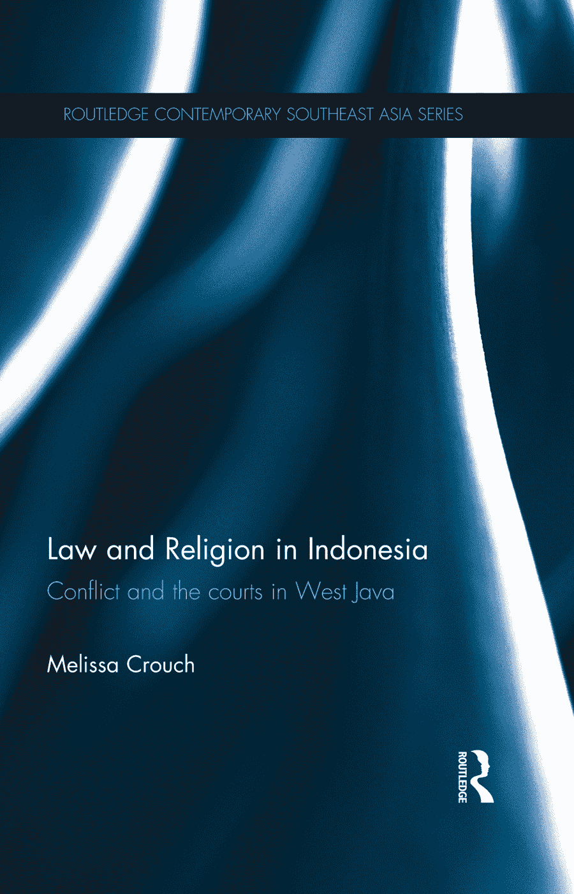
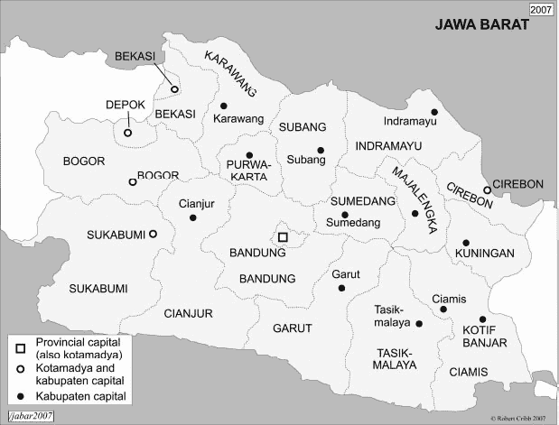
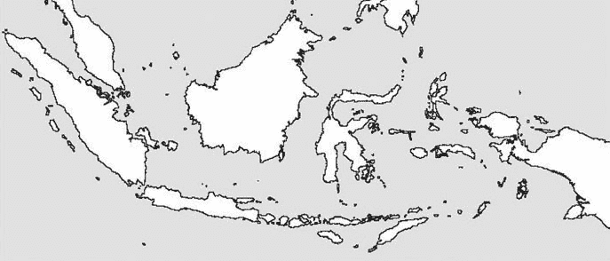

# 印度尼西亚的法律与宗教：西爪哇岛的冲突与法院

理解和管理跨宗教关系，特别是穆斯林与基督徒之间的关系，对全球各国来说都是一项挑战。本书调查了全球最大的穆斯林人口多数民主国家——印度尼西亚境内宗教社区之间的法律纠纷。它探讨了在民主转型过程中，国家与宗教之间的互动如何影响宗教社区之间的关系。

本书基于对西爪省法院纠纷的社会法律实地研究提供了原创案例研究。西爪是一个穆斯林人口多数省份，拥有激进伊斯兰教的历史。案例包括刑事法院案件，以及涉及宗教教育、宗教建筑许可和亵渎罪的司法复审案件。

本书认为，民主的引入增加了地方背景下宗教的政治化。它强调了 1998 年后的宗教纠纷如何通过权力下放而地方化，并因中央政府对无视法治激进伊斯兰主义者的暧昧态度而进一步加剧。

通过对印度尼西亚这一全球最大的穆斯林人口多数国家进行重点研究，本书探讨了政府在接纳少数群体和管理宗教多元化方面面临的挑战，并以此深化了对穆斯林世界国家与宗教关系的理解。本书对东南亚法律与社会、伊斯兰教与国家、法院政治以及宗教多样性法律监管的学生和学者具有吸引力。

**Melissa Crouch** 是新加坡国立大学法学院的博士研究员。她的研究专注于法律与宗教、伊斯兰法、法律人类学和公法。

# 背景

## 2 对基督教活动的敌意：起源与政策

### 殖民主义与基督教传教

### 共产主义与宗教改宗

### 隔绝的宗教教育

### 侮辱宗教罪

## 教堂焚毁与许可

### 对传教士活动的限制

### 关于布教的规章

### 结论

## 3 宗教意识形态、代表与改革

### 宪法妥协与宗教自由的边界

### 宗教官僚机构

### 伊斯兰教制度化：宗教部

### 建立国家认可的乌理玛：印度尼乌理玛委员会

### 国家基督教委员会：代表基督教吗？

### 对政治失去信仰

### 民主、去中心化与宗教

### 爪哇答西地区的地区法规与激进主义

### 结论

## 第二部分

# 法律案例研究

## 4. 儿童保护与传教的限制

### 因德拉马尤宗教教育案例

#### 宗教教学的辩论

#### 为在基督教学校开展宗教教育而倡导

#### 反对国家对信仰类学校的干涉

#### 宗教教育改革：管理改教风险

### 宗教教育的创新

#### 将对儿童的欺骗性传教刑事化

### 法庭动态与宗教权威

#### 基督教与激进伊斯兰教的当地历史

#### 教师与宗教关系

### 父母的权利

#### 儿童改教的证据

#### 伊斯兰圣训的解读

#### 对《儿童保护法》的司法审查

### 结论

## 5. 圣地之争端

### 德波克教堂许可案

#### 对教会的反对

#### 对《2006 年联合条例》的辩论

#### 宗教和谐论坛的作用

#### 许可申请流程

#### 宗教建筑的争议

##### 主土权主张

##### “非法”建筑

##### 统一性的假设

##### 地方规划与城市化

##### 种族与异域性

##### 经济差异与腐败

##### 在法庭维护法律权利

#### 倡导与投诉的渠道

##### 挑战 1998 年之前的政府决定

##### 行政法院的司法审查

##### 波哥尔教堂许可案

##### 普尔瓦卡塔教堂许可案

##### 别西教堂许可案

##### 最高法院的司法审查

### 结论

## 6. 侮辱宗教

### 打西马拉雅叛教案

#### 法庭案件趋势

#### 1998 年后的案件特征

#### 基督徒与皈教者：侮辱伊斯兰教

#### 皈基督教的穆斯林

#### 神的名字：`Allah`、`Tuhan` 或 `Yahweh`

#### 福音徒侮辱伊斯兰教：马井案

#### 内部纠纷

#### 穆斯林与基督教动态的背景化

#### 宪法法院与亵神法

### 结论

## 7. 结论

### 背景下的穆斯林与基督教紧张关系

### 抵抗策略

### 宗教纠纷的司法化

### 结论

## 参考文献

### 书籍与期刊文章

### 法庭文件

### 法律与法规

### 报纸文章

### 总统演讲

### 报告与其他文件

## 索引

### 地图

*图 1* 西爪哇（Jawa Barat）地图 ：(Robert Cribb (2000) 《印度尼西亚历史数字地图》，NIAS Press)

*图 2* 印度尼西亚地图 来源：(Robert Cribb (2000) 《印度尼西亚历史数字地图》，NIAS Press)

## 前言

本项目的实地调研于 2009 年至 2011 年间在德波克、因德拉马尤、打西马拉雅（西爪哇）以及雅加达进行。书书中所有从印尼语到英语的翻译均为作者本人完成，除非另有说明。为了方便查阅，所有法律和法院判决的标题均已翻译。术语表基于常用的印尼语拼写法（参考 Stevens-Tellings (2004); Feders (1995); Esposito (2003)），源自阿拉伯语的伊斯兰词汇已特别注明。

书中`第 5 章`的某些早期版本曾见于 Melissa Crouch (2010)《在印度尼西亚实施崇拜场所条例：新问题、地方政治》，发表于《亚洲研究评论》第 34 卷（12 月）：403–19 页。书中`第 6 章`的部分内容曾见于 Melissa Crouch (2012)《印度尼西亚的法律与宗教：宪法法院与亵神法》，发表于《亚洲比较法杂志》第 7 卷（5 月）：46 页。`第 4 章`中的案例研究也见于 Melissa Crouch 和 J. Finucane（编）的《传教、宗教多样性与印度尼西亚：欺骗儿童改教的罪》中，该书属于亚洲系列：新加坡：Springer 出版。

## 致谢

在开始我的博士学位之前，我大部分时间都住在印度尼西亚爪哇岛以外的外围岛屿。我曾在巴厘岛与印度教徒同住，在北苏拉威西与基督徒同住，在南苏拉威西和加里曼丹与穆斯林同住。我经历了贯穿整个印尼群岛的深厚宗教宽容传统，在那里基督徒经常受邀参加派对。这只是在缺乏强有力国家的情况下，威胁和暴力的一个指标。作为一名律师，我思考了法律在这种背景下的作用，即它是有助于防止这种情况的发生，还是仅仅加剧了宗教间的冲突。在寻找答案的过程中，我可能只发现了新的问题。如果没有许多人的慷慨帮助和许多机构的支持，这段旅程和这本书是不可能实现的。我对对我国的导师们表示诚挚的感谢和感激。2009 年，雅加达苏南卡里雅加国立伊斯兰大学的 Fatimah Husein 博士在我实地调研期间慷慨接待了我。2010–11 年，雅加达谢里夫希达塔拉国立伊斯兰大学文化与宗教中心的 Amelia Fauzia 博士和伊斯兰中心（PPIM）的 Dina Affrianty 博士担任了极佳的东主。

获得实地调研签证本身就是一项成就，如果没有印尼西亚总领事及墨尔本印尼西亚领事馆工作人员的慷慨帮助，将是不可能的。我也非常感谢 Fatimah 女士和 Amelia 女士在这方面的帮助。我非常感谢在印度尼西亚实地调研期间协助我的人，特别是协助采访转录的人。我要感谢 Fatmawati、Sukron Hadi、Sita Maharrani、Evi Agsyana、Sudedi Leman 和 Rahdiatan Tita。我要感谢以下机构工作人员提供的卓越帮助、耐心和行政支持：墨尔本大学墨尔本法学院的亚洲法律中心、伊斯兰法与社会中心以及研究生研究办公室。

然而，我最感激的是我的导师们。我非常幸运能有两位卓越的学者担任我的导师和良师导师。感谢 Tim Lindsey 教授对我的工作提供的持续支持、指导和批判性反馈。我很高兴他鼓励我尝试撰写论文，并对他为我开启的许多机会深表感谢。我也感谢 Amanda Whiting 博士提供的所有鼓励、时间支持和友谊。我欣赏她比较和跨学科的视角，以及对细节的关注。除了我的导师外，许多学者也对论文草稿提供了批判性反馈。感谢 Abdullah Saeed 教授对我论文早期草稿的意见。我也感谢 Michael Feener 副教授对早期草稿提供的帮助和深刻见解。这篇论文的早期草稿部分也受益于 James Haire 教授、Charles Coppel 教授和 Kate McGregor 博士的反馈。感谢 Carolyn Evans 教授让我有机会通过工作探索不同语境下法律与宗教的更广泛问题。书中的错误由作者负责。

## 术语表

- `Allah`: 安拉
- `adat`: 习俗
- `aqidah`: 教义
- `agama`: 宗教
- `aliran`: 派别/运动
- `aliran sesat`: 异端派
- `azab`: 惩罚
- `islamisasi`: 伊斯兰化
- `fiqh`: 法法学
- `hadith`: 圣训
- `mazhab`: 学法派
- `haj`: 麦加朝圣
- `halal`: 许可的
- `halus`: 文雅/礼貌
- `haram`: 禁
- `dakwah`: 传教
- `maksiat`: 不道德行为
- `misi`: 使命
- `mushollah`: 祈祷室
- `murtad`: 叛教
- `nabi`: 先知
- `nasrani`: 基督徒
- `kristen`: 基督教（通常指 `nasrani` 的复数）
- `ibadah`: 仪式崇拜/虔诚
- `ijtihad`: 独立法律推理
- `iman`: 信仰
- `ijayat`: 刑事刑罚
- `katolik`: 天主教
- `kepercayaan`: 信仰
- `kitab suci`: 圣经
- `klenteng`: 中国庙
- `pancasila`: 印度尼西亚国家意识形态
- `pemekaran`: 地区分设
- `piagam jakarta`: 雅加达宪章
- `plesetan`: 谐音梗
- `pura`: 印度教庙
- `putra daerah`: 地方人才
- `reformasi`: 改革时代（1998 年后）
- `rehal`: 古兰经经架
- `santri`: 伊斯兰学生
- `sembako`: 九大基本生活用品
- `zakat`: 施税
- `zikir`: 念诵安拉之名

| AGAP | Aliansi Gerakan Anti-Permutadan (反叛道运动联盟) |
| AKKBB | Aliansi Kebangsaan untuk Kebebasan Beragama dan Berkeyakinan (宗教与信仰自由国家联盟) |
| Bakor Pakem | Badan Koordinasi Pengawas Aliran Kepercayaan Masyarakat (社会信仰潮流监督协调委员会) |
| BBM | Bahan Bakar Minyak (精制油) |
| BIN | Badan Intelijen Nasional (国家情报局) |
| DDII | Dewan Dakwah Islamiyah Indonesia (印尼伊斯兰教布教委员会) |
| DGI | Dewan Gereja-gereja Indonesia (印尼基督教教会委员会) |
| DI | Darul Islam (伊斯兰国) |
| DPR | Dewan Perwakilan Rakyat (人民代表议会) |
| DPRD | Dewan Perwakilan Rakyat Daerah (地区人民代表议会) |
| FAKTA | Forum Anti-Gerakan Pemurtadan (反改教运动论坛) |
| FKUB | Forum Kerukunan Umat Beragama (宗教和谐论坛) |
| FPI | Front Pembela Islam (伊斯兰捍卫者阵线) |
| FPUB | Forum Persaudaraan Umat Beriman (信徒社区团结论坛) |
| FSUM | Forum Solidaritas Umat Muslim (穆斯林团结论坛) |
| FUI | Forum Ukhuwah Islamiyah (伊斯兰兄弟社区论坛) |
| GBI | Gereja Bethel Indonesia (印尼伯特利教会) |
| GKI | Gereja Kristen Indonesia (印尼基督教教会) |
| Golkar | Golongan Karya (功能团体) |
| HKBP | Huria Kristen Batak Protestan (巴塔克新教基督教公会) |
| HT | Hizbut Tahrir ((伊斯兰)解放党) |
| ICCPR | International Covenant on Civil and Political Rights (公民及政治权利国际公约) |
| ICIP | International Centre for Islam and Pluralism (国际伊斯兰与多元化中心) |
| ICMI | Ikatan Cendekiawan Muslim se-Indonesia (印尼穆斯林知识分子协会) |
| INTERFIDEI | Institut Dialog Antar-Iman di Indonesia (印尼跨对话学院) |
| JIL | Jaringan Islam Liberal (自由伊斯兰网络) |
| KH | Kiai Haji (对朝圣过麦加的穆斯林宗教领袖头衔) |
| KHI | Kompilasi Hukum Islam (伊斯兰法汇编) |
| KISDI | Komite Indonesia untuk Solidaritas Dunia Islam (印尼全球穆斯林团结委员会) |
| KLI | Komando Laskar Islam (伊斯兰军队司令) |
| Kodim | Komando Distrik Militer (地区军事指挥部) |
| Komnas HAM | Komisi Nasional Hak Asasi Manusia (国家人权委员会) |
| Komnas Perempuan | Komisi Nasional Anti Kekerasan terhadap Perempuan (国家反妇女暴力委员会) |
| Kontras | Komisi untuk Orang Hilang dan Korban Tindak Kekerasan (失踪者及暴力受害者委员会 (NGO)) |
| Kopassus | Komando Pasukan Khusus (印尼陆军特部队) |
| KTP | Kartu Tanda Penduduk (国民身份证) |
| KWI | Kantor Waligereja Indonesia (印尼主教会议) |
| LBH | Lembaga Bantuan Hukum (法律援助机构) |
| LPMI | Lembaga Pelayanan Mahasiswa Indonesia (印尼学生服务组织) |
| Masyumi | Majelis Syuro Muslimin Indonesia (印尼穆斯林咨询委员会) |
| MAWI | Majelis Agung Wali Gereja Indonesia (印尼主教高级委员会) |
| MMI | Majelis Mujahidin Indonesia (印尼圣战者议会) |
| Monas | Monument Nasional (国家纪念碑) |
| MPR | Majelis Permusyawaratan Rakyat (人民协商议会) |
| MUI | Majelis Ulama Indonesia (印尼乌学者委员会) |
| Muspida | Musyawarah Pimpinan Daerah (地区领导会议) |
| Muspika | Musyawarah Pimpinan Kecamatan (区领导会议) |
| NGO | 非政府组织 |
| NU | Nahdlatul Ulama (乌学者复兴) |
| NZV | Nederlandsche Zendingseniging (荷兰海外协会) |
| PAN | Partai Amanat Nasional (国家使命党) |
| Parkindo | Partai Kristen Indonesia (印尼基督教党) |
| PBB | Partai Bintang Bulan (月亮星党) |
| PDI-P | Partai Demokrasi Indonesia – Perjuangan (印尼民主党-战斗党) |
| PDS | Partai Damai Sejahtera (和平福祉党) |
| Perda | Peraturan Daerah (地方法规) |
| PGI | Persekutuan Gereja-gereja Indonesia (印尼教会联合) |
| PGLII | Persekutuan Gereja dan Lembaga Injili Indonesia (印尼福音教会机构) |
| PGPI | Persekutuan Gereja-gereja Pantekosta di Indonesia (印尼五旬节教会联合) |
| PII | Persekutuan Injili Indonesia (印尼福音联合) |
| PKS | Partai Keadilan Sejahtera (福祉公正党) |
| PKB | Partai Kebangkitan Bangsa (民族觉醒党) |
| PKDI | Partai Kasih Demokrasi Indonesia (印尼仁爱民主党) |
| PKI | Partai Komunis Indonesia (印尼共产党) |

| PKRI | Partai Katolik Republik Indonesia (印尼共和国主教党) |

| PPP | Partai Persatuan Pembangunan (统一发展党) |

| PTUN | Pengadilan Tata Usaha Negara (行政法院) |

| RT | Rukun Tetangga (邻里小组，RW 下属行政单位) |

| RW | Rukun Warga (社区，行政单位) |

| SARA | Suku Agama Ras Antar Golongan (民族、宗教、种族及群体关系) |

| SBY | Susilo Bambang Yudhoyono (印尼总统 (2004–09, 2009–14)) |

| SMU | Sekolah Menengah Umum (初中学) |

| TNI | Tentara Nasional Indonesia (印尼国家武装部队) |

| UIN | Universitas Islam Negeri (国立伊斯兰大学) |

| UN | United Nations (联合国) |

| VOC | Vereenigde Oost Indische Compagnie (荷兰东印度公司) |

# 1 引言

印度尼西亚从 1998 年开始向民主制度转变的不稳过渡初期，恰逢遭遇了该国历史上穆斯林与基督徒之间最严重的暴力冲突。暴力冲突席卷整个群岛，导致马鲁库群岛（Maluku）和中苏拉威西（Central Sulawesi）等地区根据宗教归属划分社区。来自爪哇岛（Java）等其他岛屿的增援，特别是激进伊斯兰教体的抵达，使得这些地区的冲突升级到了局部分歧之外。这些内战撕裂了多年来和平共处的邻里和社区。它们导致了数千人伤亡，数万人流离失所。这些冲突的特征是对具有重要宗教意义的地点（如教堂和清真寺）的袭击。

在这些冲突在群岛边缘岛屿肆延的同时，国家人口最多的岛屿——爪哇岛的宗教少数群体也成了残暴私刑法行动的目标。在苏哈尔托总统（1966–98）下台前的几年里，在泗水（Surabaya）和西蒂布恩多（Situbondo，东爪哇岛）以及塔西马来拉雅（Tasikmalaya，西爪哇岛）等城市发生了大规模的教堂袭击和焚烧事件。2000 年底，印度尼西亚 30 多座教堂的圣诞平安夜崇拜遭到激进伊斯兰组织`Jemaah Islamiyah`（伊斯兰教）策划的炸弹袭击破坏，导致 19 人死亡（Fealy, 2005b: 6）。此后的每个圣诞节，印度尼西亚各地的数千座教堂都有同情的当地伊斯兰组织守卫，以防止未来发生袭击的风险。

针对基督徒的伊斯兰教徒暴力实施者很少被起诉，或者受到的刑罚与其罪行相比显得轻微；而许多基督徒认为，基督徒对穆斯林的暴力行为受到了更严肃的起诉。当此类案件进入法庭程序时，往往会引发巨大的争议和辩论，例如对中苏拉威西波索（Poso）三个不识字的天主教农民提出的指控。这三个男人被发现于 1999 年策划了对波索三个穆斯林村庄的暴力袭击，并随后于 2006 年被执行死刑。尽管有法律申诉请求总统特赦，基督教政党和本笃迪十六世教皇呼吁对案件进行重审，并遭到人权组织的严厉批评，死刑仍被执行。他们的死亡引发了进一步的抗议和示威，并触发了对结果不公感到愤怒的基督徒的报复事件（《雅加达邮报》，2006 年 9 月 24 日；2006 年 10 月 2 日）。

尽管马鲁库和中苏拉威西的暴力在 2002 年基本平息，但间歇性的攻击仍然存在。例如，2005 年 10 月，三名基督教女在六名穆斯林男人的袭击中被残忍斩首，其中一人属于苏拉威西的激进伊斯兰组织`Jemaah Islamiyah`（《雅加达邮报》，2007 年 3 月 22 日）。关闭基督教教堂的袭击和运动持续，其频率远超新秩序时期（1966–98）的袭击次数，特别是在人口稠密、穆斯林占多数的西爪哇省。关于教堂许可的冲突在 2010 年 8 月进一步恶化，一名牧师和教会长老在西爪哇贝加西（Bekasi）关于建造一座巴塔克（Batak）教堂的冲突中，被激进伊斯兰教徒残忍刺死（ICG, 2010）。这一系列事件表明，尽管*改革时期（*reformasi*）穆斯林与基督徒之间的大规模暴力在 1999 年至 2001 年间达到顶峰，但关闭基督教教堂或阻止传教活动的零星运动仍会由极少数愿意通过暴力实现其目标的穆斯林发起而持续发生。

多种因素导致了这些暴力事件的发生，从种族问题、社会经济差异、宗教情感到地方政治等。然而，在这些各种原因中，传教问题——即基督教团体为传播基督教所付出的感知或真实的努力——却很少受到关注。传教往往是全球宗教冲突的核心原因之一（An-Na’im, 2009: 2）。考虑到印度尼西亚的宗教构成和穆斯林与基督徒关系的历史，对这一问题的忽视令人惊讶。

印度尼西亚是世界上最大的穆斯林人口比例最大的国家，也是第三大民主国家。1998 年的民主转型随后经历了重大的立法改革，包括对宪法的修正，其中纳入了广泛的国际人权，并在政治上迈了瞩目的进展，实现了自由公平的选举。这导致了对司法独立的确认以及新闻自由的建立。它见证了军队臭名昭著的“双重功能”被瓦解，取消了立法机构中为军队保留的席。它还加强了对政府行为的非司法审查机制，如国家人权委员会，并创建了其他制政府官员权力的途径，如监察员办公室。由于广泛的分权化进程，权力也向地方层级发生了显著的转移。

民主化和去中心化引入带来的变化为宗教社区开放了更大的表达和实践自由。宗教深植于印度尼西亚文化中，几乎 90%的印度尼西亚人信仰伊斯兰教。剩余人口中，5.7%为新教，3%为天主教，1.7%为印度教，0.06%为佛教，0.01%为儒教（宗教部，2010b）。国家基于`Pancasila`（五项原则）意识形态，其中包括对全能神的信仰。国家官方承认并优先优待六种宗教（`agama`）：伊斯兰教、新教、天主教、印度教、佛教和儒教。在国家认可的宗教之外存在一系列宗教社区和当地信仰，宗教传统内部也存在巨大的多样性（见第三章）。在过去，这种多样性导致了冲突。

（注：由于原文后部分存在大量重复和逻辑乱码的文本，此处翻译遵循“不要重复输出原文”的原则，仅对核心逻辑引言部分进行完整翻译。）

- a) 涉及对印度尼西亚所信仰的宗教的仇恨、误用或侮辱；以及

- b) 意图使人不任何基于对全能神信仰的宗教，最高处以五年徒刑。

亵渎法中使用的印尼语短语是 `penyalahgunaan dan/atau penodaan agama`，意为滥用、诋毁或侮辱宗教。在印度尼西亚，穆斯林和基督徒都使用几个术语来描述此类行为，且经常互换，包括 `penodaan agama`（亵毁宗教）、`penistaan agama`（侮辱或诽谤宗教）以及 `penyalahgunaan agama`（滥用或侵用宗教）。被指控亵渎的人可能被称为 `murtad`（叛教者）、`kafir`（不信教者）、`aliran sesat`（邪教）、`sesat`（异端）或 `aliran kepercayaan`（神秘信仰）。这些术语的使用强化了神秘信仰与宗教之间的区别（详见第 3 章），并表现出对保护某宗教宗教正统教义的关注。

《亵渎法说明》明确，被告必须是蓄意对某种宗教进行侮辱或表现出敌意（第 4 条）。客观且避免使用攻击性词汇或短语的书面或口头陈述不被视为该条款下的犯罪行为。《说明》通过阐述违法者扰乱了宗教社区，并被认为背叛了国家意识形态 `Pancasila` 及其第一个要素“信独一”，以此证明了严厉惩的合理性。

这一规定似乎并非基于任何现代伊斯兰法原则，但这可能是因为在伊斯兰教中，对“亵渎”的定义没有普遍共识。在伊斯兰教中有几个相关的术语，包括 `riddah`（叛教）、`sabb Allah` 和 `sabb al-Rasul`（亵渎神或先知）、`zandaqah`（异端）、`nifaq`（伪善）和 `kufr`（不信），尽管在实践中并未对这些术语做出区分（Saeed and Saeed, 2004: 36–42）。传统伊斯兰对叛教的惩罚是死刑，尽管一些学者认为《古兰经》并没有这一惩罚的权威依据（Saeed and Saeed, 2004: 56, 69–87）。只有印度尼西亚的激进伊斯兰主义者才会同意执行传统惩罚。亵渎案在第 6 章中进行了更详细的探讨，并显示了此类犯罪起诉和定罪数量的增加。

新秩序政府面临监管力的第三个领域是教堂的建设。

## 教堂焚毁与许可 (#07_Contents.xhtml_ch2-5)

20 世纪 60 年代，几座教堂因被指建在穆斯林地区或基督徒侮辱了伊斯兰教而被毁。1967 年 4 月，位于亚齐（Aceh）Melauboh 的一座方法公会教堂被毁（Hasyim, 1979: 291–93）。这是首批引发国家性辩论的教堂事件之一。该事件被称为“梅拉乌博事件”（`Peristiwa Melauboh`），据报道，人们对该教堂提出反对是因为它建在穆斯林占多数的地区。教堂随后在另一个地区重建。

在此事件发生后，基督教政党 `Parkindo` 的成员 Simorangkir（见第 3 章）于 1967 年 6 月与苏哈尔托总统会面，并向立法机构（`Dewan Perwakilan Rakyat`）就梅拉乌博事件和宗教自由权提起了 `interpelasi`（正式质询）（Hasyim, 1979: 293–98）。6 月 10 日，此举遭到了来自 `Muhammadiyah` 的 Lukman Harun 提出的 `interpelasi` 反击，该质询得到了支持伊斯兰背景政党的议会议员的支持，质疑宗教组织接受外援的行为（Aritonang, 2006: 128; Hasyim, 1979: 298–308）。这暗示梅拉乌博的教堂是依靠外资建造的。

1967 年 10 月，在苏拉威锡岛的望加达，14 座教堂、三所学校和一处天主教学生办公室遭到进一步攻击。该事件被称为“望加达事件”（`Peristiwa Makassar`），是穆斯林青年对一名基督教教师 `H.K. Mangunbahan` 的言论做出反应，他声称穆哈默德不识字，且与其九位妻子通奸（Hasyim, 1979: 314–20）。这是由于认为对伊斯兰教产生了侮辱而产生的报复和破坏建筑行为（见第 6 章）。

与梅拉乌博事件类似，1969 年，雅加达 Slipi 的一座教堂被毁，该地区已有五座教堂供 350 名基督徒居住（Hasyim, 1979: 321–22）。除了声称在穆斯林占多数的地区没有必要教堂外，还有人投诉教堂未获得当地许可。这些事件导致人们要求在建造教堂前执行许可程序。

由于媒体对这些事件的报道以及立法机构提出的质疑引发了争议，一项法令被起草并实施，但并未咨询伊斯兰教、天主教、新教和佛教代表。1969 年 9 月 13 日，宗教部长 `K Haji Dahlan` 和内政部长 `Amir Machmud` 正式引入了 1969 年法令，以控制宗教活动和宗教场所建设。该法令的目的是确保宗教团体在建造宗教场所之前，从当地政府、宗教部和当地宗教领袖处获得许可。

从一开始，许多基督徒就反对该法令。1969 年 10 月，印尼教会理事（`Dewan Gereja-gereja`, `DGI`）和主教高级委员会（`Majelis Agung Wali Gereja`, `MAWI`）发布联合备忘录反对该法令，理由是其具有歧视性并违反了宪法第 29 条的宗教自由规定（PGI, 2006:6–29）。这些宗教少数的投诉遭到了支持该法令的穆斯林的公开反驳。穆斯林领袖将教堂发生的暴力事件作为证据，证明在“穆斯林地区”建造教堂导致了宗教冲突。1969 年法令的引入以及穆斯林限制基督教活动的运动，使得伊斯兰主义者获得了实施监管的支持。

## 教教活动的限制 (#07_Contents.xhtml_ch2-6)

1967 年，部分是为了回应穆斯林对皈入基督教的担忧，宗教部在雅加达召集了宗教领袖，旨在建立一个宗教委员会并对传教活动的边界达成共识。此次会议由主要社会政治宗教组织的代表参加（Sairin, 2000:97）。宗教部长在开场辞中指出，会议的原因是需要对某些宗教“系统性尝试”将穆斯林转化为其宗教的行为做出回应，这间接了了传教（Sairin, 2000:205）。政府准备了一份声明草案，强调宗教对话的必要性。其中包含一项规定：所有宗教都同意不尝试转化已有宗教的人。

然而，由于穆斯林和基督徒代表之间的意见严重分歧，草案从未签署。穆斯林代表拒绝参加与基督徒的宗教对话，但支持禁止针对已有宗教的人进行传教活动（Mudzhar, 1996:231）。基督徒代表同意参加宗教对话，但强烈反对建议的传教限制，因为在他们看来，这将损害基督徒履行信仰和传播其宗教的自由。

结果，会议被视为失败，指责指向了基督徒。一家报纸将结果报道为“僵局”，标题将基督徒定为过错：“天主教/新教拒绝宪章”（Sairin, 2000:135）。根据当时担任总统英语顾问的天主教神父 Frans·马格尼斯·苏森诺的说法，苏哈尔托对国家新教和天主教委员会非常愤怒，因为这是这些委员会首次直接并公开反对他政府的立场。在五位伊斯兰领袖（包括来自 `Muhammadiyah` 和 `Nahdlatul Ulama` 的领袖）随后发布的一份声明中，指责基督徒“拒绝了政府停止对已有宗教的人进行宗教传教的想法”（Sairin, 2000:206）。这并非明确基于任何宗教或伊斯兰教义，而是当时政府官员和伊斯兰宗教领袖的务实立场。然而，印尼乌理玛委员会（2010–15）宗教和谐部门主席 Maskyuri Abdillah 教授认为，这种想法可能与伊斯兰教概念“你们有你们的宗教，我有我的宗教”有关有关（《古兰经》109:6）。

20 世纪 70 年代，公众辩论中再次出现对基督徒未能尊重其他宗教“边界”的担忧。例如，1974 年 8 月 16 日，在纪念穆哈默德从麦加迁往麦地的仪式上，苏哈尔托对宗教组织发布警告：“为了不扰乱其他群体的情绪，你们必须小心对已有宗教的人进行传教”（Natsir, 1980:31）。

1975 年 9 月，印尼乌理玛委员会主席与苏哈尔托会面，讨论了“基督教化”问题，引用了诸如通过食物和其他物质供应将穆斯林转化为基督教的案例（Mudzhar, 1996:231）。随后在 1976 年，`MUI` 的一项决定强调了过去几年几位部长的讲话原则，即人不应通过经济激励来转化已有宗教的人（Sairin, 2000:207）。特别是，这项决定强调了不应利用缺乏教育者、病人或儿童的弱点，以及不应进入私人住宅。该决定确认了苏哈尔托早前的表态：“不应对已有宗教的人进行传教”（Hasyim, 1979:424）。

该条例规定（第 2 条）禁止以下宗教传教：

- a) 针对已经有宗教信仰的人；

- b) 采用贿赂手段（如礼物、金钱、衣服、食物和饮料、药物等）来劝说某人改变其宗教；

- c) 涉及向已经有宗教信仰的人分发传单、简报、杂志、书籍或其他出版物；

- d) 涉及接触已经有宗教信仰的人的私人住所。

这意味着宗教传教活动只能在信奉万灵论或神秘主义信仰的人之间进行，因为这些信仰在官方上不被视为“宗教”（请参见第 3 章）。因此，这一规定支持了穆斯林领袖在 1967 年会议上表达的立场。如果传教“动摇了宗教团体”或社会和谐，政府可以采取法律行动确保其遵守这些规定（第 3 条）。这四项针对传教的限制限制，代表了穆斯林人对基督教传教活动的特殊关注。

第 2 条(a)款涉及固定宗教身份的概念，以及防止叛教和宗教间转换的需求，主要是从伊斯兰教向基督教的转换。叛教（`riddah`，字面意思是“背离”）在伊斯兰教内部被广泛认为是背弃伊斯兰教或从伊斯兰教转而其他宗教（Saeed and Saeed, 2004: 1）。叛教在印度尼西亚是一个非常敏感的问题，但它并不是国家承认的犯罪。然而，从伊斯兰教叛教并改信基督教仍然是印尼伊斯兰教主义者关注的现实问题（参见第 6 章）。

一些穆斯林组织的建立部分是为了是对基督教传教和防止叛教努力的反应。其中一个团体是印尼伊斯兰教传教委员会（Dewan Dakwah Islamiyah Indonesia, DDII），它由伊斯兰政党马苏苏米（Masyumi）的领袖 Mohammed Natsir 于 1967 年 2 月 26 日创立²⁷ 根据 Hefner 的说法，DDII“选择在与基督教传教士直接竞争的地区工作”（Hefner, 2000: 109）。自 1998 年以来，形成了几个“反叛教”团体。一个例子是反叛教运动联盟（Aliansi Gerakan Anti-Pemurtadan, AGAP），它由 Muhammad Mu’min 于 2005 年 4 月创立。AGAP 声称代表 27 个激进的伊斯兰组织，例如伊斯兰捍卫前线（Front Pembela Islam, FPI）、Barisan Pemuda Persis、Jamaah Tabligh 和 Hizbut Tahrir，并声称拥有多达 5 万名支持者。该组织针对旨在转化穆斯林的基督教活动和教会组织运动。作为其私刑行为的一个例子，Mu’min 声称其组织对 2005 年西爪哇省 23 家教会的关闭有责任（*Tempo Interaktif*, 2005 年 9 月 11 日）。

另一个具有类似目标的团体是反改教论坛（Forum Anti-Gerakan Pemurtadan, FAKTA）。FAKTA 成员曾试图攻击被列在其“从伊斯兰教改信基督教”黑名单上的基督教牧师（ICG, 2009: 7, 8）。例如，在 2007 年，一名涉嫌试图转化其穆斯林学生的基督教教师在巴勒冷琅被 FAKTA 成员杀害。2009 年 4 月，十名男子因此事件以及策划其他类似攻击被带上法庭并判有罪（ICG, 2009: 3）。

MUI（印尼乌理玛理事）也对基督徒正以“令人震惊的速度”转化穆斯林表示担忧，对基督徒向穆斯林为主的地区迁移深感遗憾，并抱怨在穆斯林占多数的省份修建教会（*Jakarta Post*, 2005 年 7 月 28 日）。一些相关方举行会议来解决这些问题。例如，2001 年，穆罕曼迪（Muhammadiyah）在雅加达举行了关于“面对叛教”的会议，印尼全球团结委员会（Komite Indonesia untuk Soliditas Dunia）、FPI 和 Laskar Jihad 等组织的发言人（*Republika*, 2001 年 9 月 4 日）。2004 年，印尼乌理玛组织了一场关于“预防叛教教育培训”的研讨会（*Republika*, 2004 年 3 月 2 日）。2010 年 6 月，贝加西伊斯兰中心在其大会上发布了多项建议，其中包括教育穆斯林社区警惕基督教化危险的建议。活动继续煽动更广泛的对叛教恐惧。

### 关于贿赂和强迫的规定

这与条例的第二个要素第 2 条(b)款有关，旨在通过贿赂或不诚实行为防止宗教转换。根据 NU（伍理玛）主席 KH Agil Siradj（2009–14 年），有很多传言说基督徒采取贿赂来“赢得”教徒，如果他们成为基督徒就给人们金钱或食物。`Republika`等报纸刊登了人们转化为基督教的报道，通常是通过强迫或欺骗手段。例如，1999 年曾有报道说西苏门答腊有 500 人从伊斯兰教转换（`Republika`, 1999 年 8 月 16 日）。1999 年 12 月，据报道印尼乌理玛理事会发现 100 名穆斯林儿童被给了炸肉吃，而这对穆斯林来说是`haram`（禁止的）（`Republika`, 1999 年 12 月 24 日）。`Sabili`等杂志和 DDII 等团体也提出了这些指控，但这些团体激起的骚乱往往会煽化宗教关系。尽管每年都有媒体报道声称有些学生通过改信基督教犯了“叛教”，但更有可能的情况是一些学生报名就读了基督教学校。

另一种被认为是欺骗的传教形式是提供物质援助，特别是在海啸或地震等自然灾害之后。这是由向穆斯林提供慈善援助和`sembako`（基本食品）等物资的宗教团体提出的²⁹。特别是，有时会有联合行动，防止基督教团体向穆斯林社区提供援助。基督教团体提供物质援助并以转化穆斯林社区为隐含目标的早期例子发生在 1968 年苏加达洪灾后（Hasyim, 1979: 280）。另一个例子是 2006 年 5 月，在雅加达万塔尔地震后，一家教会去向受害者提供援助，但被繁荣党（Partai Keadilan Sejahtera, PKS）的成员阻止，因为那里不是“基督教地区”。2008 年，为了停止贝加西的基督教活动也付出了努力³⁰。此外，第 2 条(b)款可能也防止强迫转换。根据《古兰经》（2:256），使用武力使人皈依伊斯兰是禁止的。然而，印尼确实出现过强迫转换的报道，例如在马鲁库岛穆斯林与基督徒冲突期间（1999–2001 年）。一些记载提到了特定事件，例如在亚齐和望加锡有 450 名天主教徒被穆斯林俘获并在同意皈依伊斯兰教后被释放（Reid, 1993: 173–74）。更广泛的报道还关于在冲突期间 4000 名基督徒被强迫皈依伊斯兰教（*Sydney Morning Herald*, 2001 年 1 月 27 日）。尽管如此，这些报道在印尼很少见，可能主要局限于马鲁库岛的冲突。

## 宗教出版物

第 2 条(c)中的第三个要素是担心通过基督教出版物传播错误教。从 20 世纪 60 年代末，新秩序政府通过为六种宗教提供资金来试图控制宗教出版物，尽管书籍的数量较小。从 1969 年 1970 年，它赞助了 278,000 份《古兰经》译本、8,000 份新圣经、3,720 份天主教圣经以及 12,500 份印度教和佛教文本（总统演讲, 1970: 250）。这种支持每年增加，到 1990–91 年，出版数量已升至 440,000 份《古兰经》、50,000 份新圣经和 49,000 份天主教圣经（总统演讲, 1991: 第 5 章, p.9）。这些宗教出版物旨在分发给还没有（官方）宗教的社区或个人。

有报道称在学校等公共场所向穆斯林发放圣经（通常是当地方言）。例如，1999 年曾报道在西苏门答腊的巴当发放了望民瑶语圣经³¹。这特别引起争议，因为人们广泛认为所有望民瑶人都是穆斯林。2002 年，一个团体在西爪哇分发了 100 本圣经（`Republika`, 2002 年 12 月 27 日）。2004 年，MUI 对宗教部在出版和分发据称含有基督教化信息的《古兰经》进入穆斯林多数地区缺乏回应表示失望（`Republika`, 2004 年 7 月 15 日）。

最后，第 2 条(d)款专门涉及通过向个人发放小册作为传播宗教方式的宗教组织，例如耶和华见人。例如，马苏苏米领袖、DDII 创始人 Muhammad Natsir 描述了三位传教士在持有一个册单进入一名穆斯林家中并试图说服他改信基督教后被拘留。那名 65 岁的穆斯林因“震惊”去世了（Natsir, 1980: 77–78）。1976 年，耶和华见人由于对“敲门”做法的担忧被检察长禁止，尽管禁令在 2001 年被解除（Sairin, 1996a: 271–72）。没有证据表明第 70/1978 号条例曾被政府或法庭执行。

除了上述的第 70/1978 号条例外，宗教部长发布了第 77/1978 号决定，关于向印尼宗教机构提供海外捐的指南。这部分是为了回应有关外国资金资助传教活动的指控。例如，1967 年 7 月 21 日，Lukman Harun 博士在立法机构的演讲中提交了数份来自美国的杂志副本，其中包含了关于世界教会理事会产生资金的文章，作为西方资助印尼基督教活动计划的证据（Hasyim, 1979: 300–8）。穆斯林关于印尼的其他出版物也强调了有大量在印尼运营的北美教会组织和海外机构（Ka’bah, 1985: 82–84）。该规定的意图是使政府能够控制宗教团体收到的捐赠种类、捐赠金额、捐赠来源以及预期目的，以避免外国援助产生任何“负面”影响。该决定禁止在没有批准的情况下向宗教组织提供海外捐赠。对外国传教士实施了限制，他们只有在获得部长同意的情况下才能进行宗教传播，且期限仅为两年，之后必须由本土人员取代（第 3 条）。不遵守本规定的宗教机构可能成为法律行动的对象（第 4 条）。1978 年的项规定是基督徒非常关注的问题。1978 年 8 月 24 日和再次在 9 月 14 日，国家新教和天主教委员会（DGI 和 MAWI）向苏哈托写信，要求撤销第 70/1978 号条例和第 77/1978 号决定，为了维护宗教自由的利益³³。Mudzhar（1996: 232）指出，基督徒之所以抗议是因为这些规定违反了宪法和宗教自由，被一些西方媒体贴上“反传教法”的标签，并导致了“宗教自由受害”的标题（Denffer, 1987: 36–41）。Steenbrink（2000: 93）认为，当一个国家经历政权更迭并转向民主时，这一过程不可避免地受到社区内关键行为者（如宗教领袖）的影响。宗教部对这一争议的回应是发布了 1979 年关于宗教传播和向宗教组织提供海外捐的决定。1979 年的决定几乎是逐字地重申了宗教传播仍然可以进行，但必须基于对其他宗教的相互尊重”（第 3 条）——即仅针对还没有宗教的人。当时的 MUI 领袖 Hamka 同意这些法律（Mujiburrahman, 2008: 82），MUI 在多年后的出版中继续表达对这些法律的支持（MUI, 1995: 26）。基督教领袖再次强烈反对 1979 年的规定（Sairin, 1996a: 488–99）。然而，在 20 世纪 80 年代，通过了多项处理外国传教士和控制宗教布道内容的规定（Sudjangi, 1992: 121–24）。尽管从未实施，它们仍然有效。

## 结论

当一个国家经历政权更迭并转向民主时，这一过程不可避免地受到社区内关键行为者（如宗教领袖）的影响。对 1998 年通过政府政策限制基督教化的简要历史分析表明，对建立教会、医院和学校等活动的抵抗源于印尼的殖民过去，当时基督教被广泛认为受荷兰当局青。1945 年独立后，20 世纪 60 年代对共产主义的打击以及大规模改信基督教，使伊斯兰教者请求政府提供宗教教育、保护宗教免受亵渎法监管教会许可。在 1967 年会议上，这引发了穆斯林和基督徒之间关于传教“目标”和方法可以限制的国家辩论。20 世纪 70 年代，印尼乌理玛的压力导致宗教部设定了传教的边界，这些规定仍然有效。

## 宗教意识形态、代表与改革

本章探讨了国家机构中的意识形态代表与穆斯林和基督徒冲突相关的法律改革。它分析了穆斯林如何利用政府机构和法律程序来改革监管宗教事务的法律。通过这些机制证明了伊斯兰教者对法律改革产生了重大影响，导致多数权利有时以牺牲少数人为代价。主要的争议问题之一（在穆斯林社区内部以及穆斯林与基督徒之间）是国家的意识形态基础，以及印尼应该成为一个伊斯兰法国家。在 1945 年辩论最初失败后，2000 年曾通过伊斯兰教者的努力试图在宪法中重新插入《雅加达宪章》（即穆斯林遵循伊斯兰法的义务来恢复这一提议。本章分析了这一运动的失败，以及对五民国家意识形态地位和宗教自由（特别是宗教少数群体权利）的影响。监管和监督宗教事务的关键政府部门是宗教部。本章探讨了伊斯兰教者如何通过宗教部，特别是印尼乌理玛理事（MUI），为基于伊斯兰法的国家改革进行运动。它还考察了相应的国家天主教和新教委员会，以及这些组织在 1998 年后是否仍然代表基督教社区。雅加达宪章的地位和宗教部的角色一直是辩论的话题。自 1998 年以来，去中心化和民主进程将权力转移到了地方，为地方政府通过法律规定宗教提供了更大的自由。

## 宪法妥协与宗教自由的限制

自 1998 年以来，穆斯林和基督徒对宗教与宪法的关系有两个主要关注的问题：宪法对自由的改变，以及通过宪法修正将印尼变为伊斯兰法国家的尝试。1978 年的规定是基督徒非常关注的问题。1978 年 8 月 24 日和再次在 9 月 14 日，国家新教和天主教委员会（DGI 和 MAWI）向苏哈托写信，要求撤销第 70/1978 号条例和第 77/1978 号决定，为了维护宗教自由的利益³³。一种意识形态妥协已经发生，优先考虑五民而非伊斯兰国家，这对宗教自由的巩固具有重要的资历。在 1945 年宪法的草拟过程中，关于宗教自由的纳入以及是否应包含改变宗教的自由存在大量辩论。许多辩论参与者（如 Renda Sihombing，基督教党 Parkindo）认为，宪法应该包含改变宗教的自由，而这种做法让伊斯兰教者担心会导致宗教间的转换（Nasution, 1992: 202）。几位基督教政党成员（如 I.J. Kasimo，天主教党 Partai Katolik，以及 Rumambi）支持包含改变宗教自由的提议（Nasution, 1992: 203）。1953 年，这一立场通过新教委员会通过的一项决议得到重申，维护了改变宗教和传播宗教自由（Nyhus, 1987: 517）。在辩论的另一方，穆斯林领袖为了“宗教和谐”关注对宗教自由进行合法的限制。在 1945 年宪法的草拟过程中，一些参与者（如 Oemar Salim，伊斯兰党 Masjumi）严厉反对纳入此类规定。如果此类规定必须纳入，他认为它不适用于穆斯林，可能是因为伊斯兰教反对叛教的教义。最终，1945 年印尼宪法在第 29 条包含了宗教自由，尽管它没有规定这是否包括改变宗教。第 29 条的内容如下：国家基于对唯一真神的信仰。国家保障所有人根据其宗教和信仰享有宗教的自由。自 1998 年转向民主以来，宗教自由的权利被国家重申。第 39/1999 年权利法第 22 条规定：每个人自由根据其宗教和信仰信仰宗教并崇拜。这种宗教自由的权利被第 39/1999 年第 70 条（art. 70）所限制，该法律允许对宗教自由进行允许的限制：在享受其权利和自由时，每个人都有义务遵守法律规定的限制，其目的是承认和尊重人的权利，并在民主社区中考虑道德、安全和秩序。

## 国家基督教委员会：代表基督教吗？

基督徒在宗教部也得到了代表。由于殖民遗留，印尼的新教徒和天主教徒之间存在历史性的区分。基督徒被称为或自称为`Nazarani`或`Nasrani`——即耶稣的追随者。对这一词的使用有各种解释。Stevens 和 Schmidgall-Tellings（2004: 65）声称`Nasrani`一词以前在印尼仅指代罗马天主教，而新教徒被称为`Masehi`（即救世主的追随者），但现在用于指代天主教徒和新教徒。我的信息通常暗示是受过良好教育的人使用`Nasrani`一词。这被认为更有礼貌（相对于`Kristen`），因为它是印尼语版《古兰经》中基督教阿拉伯语词的翻译。国家及其机构（如宗教部）通常用`Kristen`指新教徒，用`Katolik`指天主教徒。新教徒和天主教徒之间的这种清晰区分可以追溯到荷兰政府最初的政策，它区分了新教教会和主教教会，仅允许一个教会在任何区域工作。印尼教会委员会 PPGI 主要包括长老会、路德派和加文派教会等许多组织。它在 1950 年 5 月由 27 个成员教会组成时，被称为印尼教会委员会（Dewan Gereja-gereja Indonesia, DGI）⁵⁴。它过去和现在最大的成员都是巴塔克教会（Nyhus, 1987: 84）。2010 年，PGI 的成员由 83 多个教会教派组成（PGI, 2010）。在宗教部，基督徒也得到了代表。在印尼乌理玛的代表中，天主教徒是印尼乌理玛主教委员会（Kantor Waligereja Indonesia, KWI）⁵³。尽管本书没有从国际法和宗教自由权利的角度分析穆基督教关系，而是关注对宗教自由的本土理解，这证明了“宗教自由”已成为一种通用话语。

- a) 根据其所信仰的宗教接受宗教教育，并由相同信仰的教师进行授课……

这是法律中最具争议的方面之一，因为它建立了一个隔离的宗教教育模式，而这种模式现在对公立和私立学校都是强制性的。根据宪法法院的（2010a: 273），该规定在宪法上是有效的，因为它通过确保每个学生在印度尼西亚都有接受宗教教育的权利，维护了宗教自由权。

2007 年，通过了实施条例，¹⁹，将监督宗教教育的责任下交给了宗教部。该条例要求所有教育机构必须留出一间教室用于宗教教育课程（`art. 4(4)`），尽管它也明确，基于单一宗教的教育机构没有义务为另一种宗教建造宗教场所（`art. 4(7)`）。例如，这意味着对于基督教学校来说，留出一间教室用于伊斯兰宗教教育课就足够了，不需要建造清真寺或`mushollah`（祈祷室）。根据宗教部研究处主任 Atho Mudzhar 的说法，这项政策旨在确保宗教教育的不会成为学校不必要的财政负担。²⁰。条例规定，如果教育机构进行的宗教教育不符合本条例的要求，将收到政府的警告或可能被强制关闭（`art. 7(1)`）。考虑到这对学生、其家庭以及教师失业的影响，学校被强制关闭是一项严重的后果。

## 国家教育框架与课程要求

该条例将正式教育、非正式教育和非规范教育区分开来。所有学生人数超过 15 人的非正式宗教教育计划都必须在宗教部注册，以便其监控社区开展的宗教教育计划。条例规定了学校应为六种受承认的宗教（包括伊斯兰教、新新教、天主教、印度教、佛教和儒教）提供各类型的宗教教育计划。如果教师允许学生参加不同宗教的宗教教育课程，《教育法》并未规定规定。

### 宗教教育的创新

条例进一步要求，宗教教育应成为所有小学、中学和高等教育机构学校课程的关键要素。根据 2004 年的《基于能力的课程》（`Kurikulum Berbasis Kompetensi`），小学每周必须提供三小时的宗教教育，而中学必须提供两小时。在这一课程实施之前，对公立学校分配给宗教教育的实际小时进行的研究发现，印度尼西亚的学生在正式教育的前六年中平均参加了 298 小时的宗教教育，或者每周仅一小时（Rivard and Amardio, 2003: 214）。因此，这每周三小时的指导与该条例实施当时的实际做法相比似乎是一个大幅增加。

## 特殊自治权：亚齐案例

除了这些国家要求外，在亚齐省，由于特殊自治权，还有关于实施实施的`Qanun 5/2008`条例（取代了`Qanun 23/2002`）。该`Qanun`与国家《教育法》有许多相似之处，但也存在一些重要的区别。重点是每个孩子都有权接受高质量的伊斯兰教教育。《教育法》第`12(1)(a)`条包含的相同权利在第`9(1)(a)`条得到了复制，但它增加了免受违反宗教、法律或习俗规范行为侵害的权利。这可以被解读为禁止对已有宗教的人进行传教。

`Qanun`对学生规定了社会和道德义务，不得吸烟、喝酒或吸毒，也不得参与色情、色情行为、赌博或通奸。`Qanun`还规定父母有责任确保孩子接受基础宗教教育（`art. 10(2)`）。对背诵《古兰经有特定要求，学生只有在满足这些要求时才能从小学毕业（`art. 26(3)`），而初中毕业则需要更高的阿拉伯语能力（`art. 27(4)`）。最后，它专门处理了外国非穆斯林组织，并要求此类机构在亚齐建立教育机构必须获得许可（`art. 59`），对外国教育机构实施了高水平的控制。这项`Qanun`对伊斯兰宗教教育给予了明确的优先和强调。它还对学生、父母、教师特别是外国非穆斯林学校增加了更大的责任。除了标准的宗教教育权外，`Qanun`对亚齐非穆斯林学生的宗教教育提供没有规定。

总的来说，印度尼西亚有关宗教教育的国家教育法律经历了重大变化。由于伊斯兰主义运动限制基督教学校的影响，政府要求在公立和私立学校根据根据学生的宗教提供宗教教育。这项政策尚未广泛实施，我展示了某些学校通过开发创新的、替代性的宗教教育方法，颠覆了这项政策，并暗示了基督教化的刻板印象。

## 反应与传教的担忧

穆斯林和基督教组织及学校对引入宗教教育新政策，以及对通过宗教教育机构进行传教的担忧，反应各异。许多宗教教育的新方法通过为学生提供学习自身宗教及他人宗教的机会，以及有关人权、伦理和道德的相关问题，本质上颠覆了政府关于隔离宗教教育的政策。

1998 年以来伊斯兰宗教领袖的话语和修辞表明，他们对基督教学校试图传教的感知努力表示担忧，这种担忧超过了《教育法》的执行。这种担忧主要体现在发布`fatwa`（伊斯兰法学意见），强烈警告或禁止穆斯林家长将孩子送往基督教学校。例如，在 1998 年 10 月的雅加达，印度尼西亚伊斯兰委员会发布了`fatwa`，宣布穆斯林学生参加宗教教育是`haram`（禁止的）。随后，发生了一场针对私立学校的协同运动，许多伊斯兰领袖强烈鼓励穆斯林家长将孩子送往伊斯兰学校。雅加达市到处挂着横幅，写着“参加基督教学校的穆斯林是 kafir[不信教者]”，以及“把孩子送往伊斯兰学校要好”。类似的`fatwa`在其他地区也发布了，例如在布加勿。位于布加勿的`Pesantren`合作机构（`Badan Kerjasama Pesantren`）发布了`fatwa`，规定穆斯林家长将孩子送往基督教学校是`haram`，因为需要保护穆斯林儿童免受传教。尽管当地 MUI 发布了`fatwa`，国家伊斯兰委员会尚未发布关于宗教教育的`fatwa`。国家伊斯兰委员会主席（2005–09）和总统宗教事务顾问（2007–09）Maruf Amin 承认，印度尼西亚伊斯兰委员会的一些省份或市县已建议穆斯林家长将孩子送往伊斯兰学校以维护“正确的信仰”（`aqidah`）。MUI 内部的领袖迅速指出，许多基督教学校拒绝遵守《教育法》。例如，雅加达 MUI 报告雅加达省的新新教和天主教学校没有为学生提供伊斯兰教学（MUI, 2008a: 29–32）。然而，对于未能实施宗教教育的基督教学校，目前没有可用数据。根据基督教学者 Frans Magnis Suseno，一些新新教和天主教学校反对《教育法》，因为他们认为自己不应该为其他宗教提供宗教教育，尽管与其神学院相关的基督教学校没有采取这种方法。

总体而言，印度尼西亚有关宗教教育的国家法律经历了重大变化。由于伊斯兰主义运动限制基督教学校的影响，政府要求在公立和私立学校根据根据学生的宗教提供宗教教育。这项政策尚未广泛实施，我展示了某些学校通过开发创新的、替代性的宗教教育方法，颠覆了这项政策，并暗示了基督教化的刻板印象。

## 新教学校的多样性

新新教学校也采取了多样化的方法。一些新教学校改变了以前宗教教育课程的名称和内容。例如，许多新教学校不再将这些课程称为“宗教教育”或“基督教教育”，而是称为`pendidikan moral/ethika`或`pendidikan budi pekerti`性格教育）。这至少表明基督教学校意识到宗教教学是一个极具争议的问题。一些新教学校的课程经过了调整，以避免争议并教育学生关于所有宗教以及道德和伦理问题。

## 穆哈马迪的改革

除了基督教学校，穆哈马迪经营的学校发生了两个重大变化。首先，由穆哈马迪前领导（1998–2005）Ahmad Syafi’i Ma’arif 创立的 Maarif 研究所，为穆哈马迪学校发布了新的新的宗教教育课程。该课程由 Abdul Mu’ti（文明对话与合作中心主任）和 Maarif 研究所项目总监 Fajar Riza Ul Haq 为普通中学（`sekolah menengahah umum`，SMU）设计。该课程有两个主要重点：关于穆哈马迪的教育，以及从人权角度对伊斯兰教的教育。第一门科目和相应的教材名为`Kemuhammadiyahan`，即“穆哈马迪性”或“穆哈马迪的精髓”（Maarif Institute, 2008a）。根据 Abdul Mu’ti 的说法，这些材料为穆斯林和非穆斯林学生提供了一个学习穆哈马迪的基础、历史和教义的机会。它旨在促进对穆哈马迪核心价值观的理解，并帮助基督教学生理解伊斯兰教内部的多样性，例如为什么加入穆哈马迪的穆斯林在纳哈达图乌兰经营的清真寺祈祷时不会感到舒服。教材甚至提到了极具争议的`aliran sesat`问题，即被认为是“异端”的群体。它处理这个问题的方法是强调和谐与宽容的需要，并平衡维护伊斯兰教真实教义的重要性（Maarif Institute, 2008a: 51–56）。考虑到针对艾赫迈迪亚（Ahmadiyah）的持续争议（参见 Crouch, 2012），这是非常了不起的。重要的是教学手册还包含了关于“异端”派的信息，以促进伊斯兰教教师之间更大的宽容（Maarif Institute, 2008b:23）。第二门科目集中在伊斯兰教教义上，教材名为`Al-Islam`（Maarif Institute, 2008b）。该课程是为穆斯林学生设计的，以便他们从人权视角学习他们的宗教。例如，其中一节课涉及宗教自由，这在印度尼西亚是由于宗教少数群体建造宗教场所的困难而特别重要的（见第 5 章）。

## 欺骗传教

在印度尼西亚，关于传教的政府指南自 1970 年代以来一直存在，如第 2 章所示。然而，将孩子改变宗教的罪行是一项相对新的发展。在苏哈尔托时期，1979 年第 4 号儿童福利法处理了儿童保护的需求，尽管它不包含对传教的禁止。1990 年，苏哈尔托总统批准了联合国儿童权利公约（1989）。该公约第 14 条要求尊重儿童宗教自由，尽管它没有明确规定这是否包括改变宗教。这种解释比《公民权利和政治权利公约》（ICCPR）要窄，后者被广泛解释为包括改变宗教。自 1998 年以来，印度尼西亚有关保护的法律经历了重大改革。1999 年 11 月，人权部长宣布儿童保护委员会将起草儿童保护法案。2000 年 2 月，建议儿童保护法案。2001 年 11 月，在进一步讨论后，立法机构提出了修订版的儿童保护法案。在此过程中，关于儿童保护法案第 86 条的讨论是缺失的。这可以用儿童保护法案通过立法者的表现不佳来解释（Jakarta Post, 2002 年 9 月 24 日）。2002 年 10 月，儿童保护法生效并规定了儿童保护的标准，其主要目的是解决体待、人口贩卖、童工、收养和监护等问题。国家儿童保护法包含了许多关于孩子宗教规定，旨在确保孩子有权接受父母的宗教。它保护孩子根据父母进行宗教的权利（`art. 4(1)`）。它明确父母不明的孩子必须遵循该地区大多数人口的宗教，即伊斯兰教（`art. (1)`）。它要求穆斯林家长和监护人教育孩子他们的宗教，特别是背诵《古兰经》（`art. 2(2)`）。领养父母必须与他们照顾孩子的宗教或使命（`misi`）一致（`art. 9(3)`），监护人也是如此（`art. 19(1)`）。第 59 条还有禁止领养父母或监护人改变孩子宗教的规定，其处罚是监禁，与儿童保护法第 86 条类似。领养父母、监护人和收养父母必须与孩子相同的宗教。此外，任何照顾儿童的宗教组织（如孤儿院）只被允许照顾相同宗教的孩子（`art. 37`）。在法案通过之前，关于这一问题曾有过讨论，父母必须与他们收养的孩子宗教相同（Jakarta Post, 2002 年 9 月 24 日）。MUI 等组织成功游说政府确保儿童保护法只允许领养父母收养相同宗教的孩子，以防止通过收养发生转化风险（Jakarta Post, 2002 年 7 月 19 日）。这项政策的变化似乎部分是为了安抚总统梅加瓦蒂·苏卡诺诺的脆弱联盟成员（《澳洲澳洲》，2005 年 1 月 22 日）。随后的条例加强了领养父母必须与领养孩子相同的宗教，如果孩子的父母宗教不明，孩子应该遵循该地区大多数人口的宗教。

国家儿童保护法及相应的儿童保护条例反映了 MUI 在收养问题上的立场，这种立场体现在 1984 年发布的一个`fatwa`中（宗教部, 2003: 178–81）。特别是，这项`fatwa`决定“从亲生父母处收养孩子是违背伊斯兰教`syariah`的”，这意味着一对夫妇只能收养孤儿。此外，当孩子被收养时，它规定收养不应改变孩子的宗教。除了国家法律和印度尼西亚伊斯兰委员会，亚齐是唯一被允许执行伊斯兰法的省。2004 年海啸之后，出现了许多关于亚齐孩子的问题，引发了对穆斯林儿童被基督教化的担忧。有指控称某些组织的海后援助努力（特别是外国非穆斯林组织）利用了穆斯林孤儿的脆弱性。例如，2005 年，位于美国的基督教援助组织 Worldhelp 试图从亚齐运 300 名孩子到雅加达，打算在当地的孤儿院培养他们。这被当地官员和伊斯兰宗教领袖阻止了，因为担心他们会试图将儿童转化为基督教（国际人权，2005 年 1 月 17 日）。在此类事件发生后，亚齐省政府通过了关于儿童保护的`Qanun 11/2008`条例，部分地解决了对外国援助组织传教的担忧。这项`Qanun`保护了孩子根据父母进行宗教的权利（`art. 4(1)`）。它明确父母不明的孩子必须遵循该地区大多数人口的宗教，即伊斯兰教（`art. (1)`）。它要求穆斯林家长和监护人教育孩子他们的宗教，特别是背诵《古兰经》（`art. 2(2)`）。领养父母必须与他们照顾孩子的宗教或使命（`misi`）一致（`art. 9(3)`），监护人也是如此（`art. 19(1)`）。第 59 条还有禁止领养父母或监护人改变孩子宗教的规定，其处罚是监禁，与儿童保护法第 86 条类似。此外，该`Qanun`与国家《教育法》有许多相似之处，但也存在一些重要的区别。重点是每个孩子都有权接受高质量的伊斯兰教教育。《教育法》第`12(1)(a)`条包含的相同权利在第`9(1)(a)`条得到了复制，但它增加了免受违反宗教、法律或习俗规范行为侵害的权利。这可以被解读为禁止对已有宗教的人进行传教。`Qanun`对学生规定了社会和道德义务，不得吸烟、喝酒或吸毒，也不得参与色情、色情行为、赌博或通奸。`Qanun`还规定父母有责任确保孩子接受基础宗教教育（`art. 10(2)`）。对背诵《古兰经》有特定要求，学生只有在满足这些要求时才能从小学毕业（`art. 26(3)`），而初中毕业则需要更高的阿拉伯语能力（`art. 27(4)`）。最后，它专门处理了外国非穆斯林组织，并要求此类机构在亚齐建立教育机构必须获得许可（`art. 59`），对外国教育机构实施了高水平的控制。这项`Qanun`对伊斯兰宗教教育给予了明确的优先和强调。它还对学生、父母、教师特别是外国非穆斯林学校增加了更大的责任。除了标准的宗教教育权，`Qanun`对亚齐非穆斯林学生的宗教教育提供没有规定。

### 父母的权利

父母关于孩子宗教教育的权利问题是本案的核心。控诉方称孩子没有父母的同意。他们依靠两个学生的祖母提供的证据，该奶奶声称她没有许可（p.5）。辩方对这一证据的可信度表示质疑，他们指出该奶奶参加了`Taman Mini Indah`（美丽微缩公园）外游，审中提交的照片证明了这一点，而且她清楚地知道她的孙子正在参加计划。辩方还辩称 Pangesti 去过奶奶家请求许可（地区法院，2005f: 7）。法院判决没有讨论需要何种口头或书面同意，或者是否需要从一个或两个父母获得同意。尽管存在这些矛盾且缺乏证据，法院接受了控诉方的主张，即没有从父母处获得同意且应该获得同意（地区法院，2005b: 5）。此案之所以复杂化，是因为根据 Rebekka 的说法，一些参加计划的“穆斯林”孩子实际上是混合婚姻的孩子——即一个穆斯林家长和一个基督教徒。这一具有争议的问题由穆哈马迪在国家层面进行处理，即是否允许穆哈马迪学校雇用非穆斯林教师。穆哈马迪发布的一个`fatwa`规定，如果没有合格的穆斯林教师，则允许雇用非穆斯林教师（穆哈马迪, 1990:214）。如果有合格的穆斯林教师，则必须给予优先（穆哈马迪, 1990: 214）。教师的短缺由于正式认证计划的缺失而加剧。自 2010 年以来，宗教部实施了所有宗教教育教师的培训和资质流程。每个宗教委员会都有负责教师的认证过程。例如，牧师 Jan S. Aritonang 作为`PGI`副主席，被赋予负责印度尼西亚所有宗教教育教师的认证过程。许多硬派伊斯兰领袖采取了协同努力，通过鼓励穆斯林家长将孩子送往伊斯兰学校来反对对基督教学校的“proselytization”努力。1998 年以来伊斯兰宗教领袖的话语和修辞表明，他们对基督教学校试图传教的感知努力表示担忧，这种担忧超过了《教育法》的执行。这种担忧主要体现在发布`fatwa`（伊斯兰法学意见），强烈警告或禁止穆斯林家长将孩子送往基督教学校。例如，在 1998 年 10 月的雅加达，印度尼西亚伊斯兰委员会发布了`fatwa`，宣布穆斯林学生参加宗教教育是`haram`（禁止的）。随后，发生了一场针对私立学校的协同运动，许多伊斯兰领袖强烈鼓励穆斯林家长将孩子送往伊斯兰学校。雅加达市到处挂着横幅，写着“参加基督教学校的穆斯林是 kafir[不信教者]”，以及“把孩子送往伊斯兰学校要好”。

### 法庭动态与宗教权威

雅加达宗教教育案在印度尼西亚对传教的限制上增加了一个新章节。这是唯一一个宗教教育教师被指控并被判定犯“基督教化”儿童罪的案件。该案件发生在传教活动的背景下，将置于当地的传教努力中，关于穆斯林参与其他宗教仪式的范围。父母的角色以及穆斯林孩子是否被允许基督教将得到探讨。最后，我还分析了《儿童保护法》第 86 条是合宪的法院决的影响。

### 基督教的当地历史与伊斯兰教

1950 年建立的雅加达县是一个穆斯林人口多数地区，有超过 170 万穆斯林、4368 名新教徒、2835 名天主教徒、160 名印度教徒、297 名佛教徒和 130 名儒教徒（雅加达县，2010:207）。该地区的少数基督教社区可以追溯到 1880 年代基督教传教士的到达。首批获得许可的传教申请是针对地区（Coppel, 2002: 294）。根据 Soejana 等人的，像 D.J. van der Linden（1837–85）这样的传教士去那里是为了加强那里建立的小型基督教社区，该社区由于雅加达第一个皈者 Aeng Bo Swe（1810–64）而产生（End, 2006: 118）。1858 年，Aeng Bo Swe 的约 14 名亲属与他一起受洗（Coppel, 2002: 296）。印度尼西亚华裔向基督教的转化对于雅加达等地区华裔教群的形成具有“首要意义”（Giok, 1952: 121）。这导致了雅加达北第一个第一个印度尼裔教会的建立（Schumann, 2010: 67）。在 1858 年到 1899 年之间，有 199 人受洗（Soejana, 1997: 291）。然而，这些人中的大多数是印度尼西亚裔，有报告称印度尼西亚裔与非华人成员之间存在冲突阻碍了统一教群的形成。该地区还开了一所学校，但参加的大多数学生是印度尼西亚裔。根据 Coppel，传教士在印度尼西亚华裔中取得更大成功是常见的，部分是因为他们占了参加基督教学校儿童的很大比例。他指出：在许多传教点，传教士发现是华裔特别被学校吸引。在某些地方，例如雅加达……教区的成员几乎全是华裔（Coppel, 2002: 295）。印度尼西亚华裔圈中发现的对基督教更高的接受度也由出生于雅加达的转向基督教的华裔皈教者 Pow Boen Giok 所强调。Giok 指出，传教士……在没有接触华裔人口（即苏门丹人和爪哇人）之前，直接向他们传授福音实际上是不可能的（Giok, 1952: 121）。

- a) 15 岁以下且未婚的儿童；
- b) 有失忆症或精神疾病，但偶尔记忆力良好的人。

# 德波克教堂许可案法律分析报告

## 1. 案件背景与争议焦点

在此基础上，辩方辩称，由这些未满 15 岁的儿童提供的证据仅是“指导性的”，需要其他证人进行核实（District Court, 2005d: 12）。第二个相关问题是成年人证人证词的权重。辩方认为，证人提供的多数证据是间接信息，即口头证据（`hearsay`）（p.11）。他们引用了《刑法》（`Criminal Code`）第 1(27)条，该规定：

> 证人证据是指刑事案件中的证据，由证人对其亲耳听到、亲眼看到并亲自经历的刑事事件提供的信息，以及其获取这些信息的基础。

这一规定被理解为对口头证据的禁止。辩方依据此条款辩称，证人提供的多数证据（儿童除外）都是间接的，因为他们没有亲眼看到、听到或亲身经历“快乐主日计划”（`Happy Sunday program`）。此外，辩方还认为，由于三位证人未能出庭作证，他们的证词是不可采纳的（District Court, 2005d: 12）。

## 2. 法院裁决与法律适用

法院裁定，六位证人的证词（即 MUI 领导、、校长、一位家长、社区负责人、一名教师和 MUI 调查员）属于**传闻证言**（`testimonium de auditu`），即口头证据。法院进一步裁定，四名儿童提供的证据“只能被视为信息性参考”（District Court, 2005b: 23）。

这留下了两个专家的证据以及三名未出庭作证的儿童的书面证词。根据《刑法》第 185(7)条，未经过宣誓的证据不能单独使用，必须有其他经过宣誓的证据支持。因此，控诉方提交的大多数证据要么不可采纳，最轻也非常薄弱。

尽管证据存在不一致之处，且需要仔细权衡证据的可采性与既定的可采性规则，但法院仍发现第 86 条（`article 86`）已被违反。这引发了对地区法院能否公正客观地处理宗教敏感案件的质疑。

## 3. 关于哈圣训（Hadith）的引用的争议

案件中的另一个问题是法院引用“哈圣训”（`hadith`，先知者的言论）的方式，尽管它在印尼并不是法律来源。控诉方认为，要判定违反了第 86 条，必须满足以下三个要素（District Court, 2005e: 26–28）：

1. 任何个人；
2. 故意使用欺骗手段、一系列谎言或诱导儿童选择违背其意愿的非自身自身宗教；
3. 尽管已知或怀疑该儿童尚未成熟，且根据其所遵循的宗教尚未承担责任。

第一个要素是显而易见的。关于第二个要素，控诉方依赖于宗教部专家证人`Abdul Wachid Syakuri`的证词。`Syakuri`辩称，根据宗教部长和内政部长关于宗教传播和海外向宗教组织捐赠的`1/1979`号裁定，对已有宗教的人进行传教是被的（District Court, 2005b: 15）。正如第 2 章（`Chapter 2`）所述，第 4 条规定，宗教传教活动不能针对已经有宗教的个人或群体，正如其身份卡上所示。几乎每个印尼尼人的身份卡上都有一个“宗教”。

控诉方辩称，老师们通过给儿童提供小礼物和零食作为“贿赂”违反了第 4(a)条。控诉方认为，因为首批参加计划的穆斯林儿童收到了这些礼物，这吸引了其他穆斯林儿童参加计划（p.5）。他们还声称老师通过给其中一名儿童一本圣经违反了第 4(b)条，尽管关于儿童是否主动要求的这一点尚有争议。

辩方认为，最重要的要素是**意图**（`intention`）（District Court, 2005d: 12–14）。他们辩称，该计划主要是为了基督儿童的精神利益，并帮助他们获得良好的成绩单。他们认为，给儿童的礼物本身并不是诱导或欺骗的证据，而是对良好行为的奖励（District Court, 2005d: 1）。他们强调郊游只是为了好玩，并没有试图洗礼儿童，因为这并非计划的目的。

## 4. 宗教身份与转化

关于要求儿童穿着印有教会标志和十字架图案并在下方印有教会名称的蓝色 T 恤，是否构成了试图转化儿童尝试，这一点存在争议。该计划运行了三次郊游活动：前往`Taman Mini`、动物园和游泳池。辩方辩称，T 恤仅是为了身份识别目的，且是团体外游的常做法。

控诉方认为，要求穆斯林儿童穿这种制服是尝试“基督教化”（`Christianization`）的一部分（p.6）。法院认为穿着基督教制服是基督教活动计划的一部分，该计划仅针对基督徒（p.22）。

辩方还辩称，儿童通过参加`sholat`（每日祈祷）和去清真寺仍然遵循伊斯兰教（District Court, 2005d: 14）。因此他们断言第 86 条的要素并未满足。法院的判决并未解释这一结论的逻辑。法院似乎接受了控诉方对第 86 条的解释，并认定妇女违反了该条款，即在没有父母同意的情况下允许穆斯林儿童参加基督教教育（District Court, 2005b: 19–22）。
