# Java LeanFT 实战


# 关于作者

Paul Watson 是一位技术爱好者，在 Web 应用开发、自动化测试、构建自动化、持续集成和部署技术等多种技术领域拥有丰富的经验。他参与过大多数技术栈的工作。

他在`UFT`、`LeanFT`、`Selenium`和`Appium`上拥有实战经验。他曾结合`Selenium`使用`JUnit`、`TestNG`和`Cucumber`等测试框架。他还接触过`Struts`、`Spring`、`Bootstrap`和`Angular JS`。他的爱好包括去新的旅游景点旅行、看篮球、板球以及学习最新的技术事物。

## 给妻子的特别感谢

我想将这本书献给我亲爱的妻子，感谢她对我如此深爱并帮助我完成了这本书。没有她的支持，这本书将无法实现。

# 这本书适合谁读

这本书适用于想要学习使用`LeanFT`在`Java`中实现 Web 和 Windows 应用程序自动化的自动化工程师。假设读者具备`Java`语言的基础编程技能。无论你是初学者还是经验丰富的开发者，这本书都将帮助你掌握`LeanFT`的技能。

## 书籍概述

本书从介绍`LeanFT`开始，然后深入探讨下述的核心概念：支持的应用程序、安装、`LeanFT`设置、核心概念、在`IntelliJ IDEA`中创建新的`LeanFT`项目、在`Eclipse`中`LeanFT`项目、对象识别与管理、Web 应用自动化、Windows 应用程序自动化、同步、断言与报告、`LeanFT`框架、将`UFT`对象库转换为`LeanFT`中的应用模型、将`LeanFT`测试与 CI 服务器集成（如 [Bamboo](http://www.softpost.org/bamboo/adding-maven-task-in-bamboo/)、[Jenkins](http://www.softpost.org/jenkins/creating-and-configuring-the-builds-in-jenkins/) 和 [TeamCity](http://www.softpost.org/teamcity/build-steps-for-maven-project-in-teamcity/)）、挑战与解决方案、`LeanFT`常见问题及解决方案、`LeanFT`与其他工具的对比、`LeanFT` Java 参考。

# 1. 简介

LeanFT 代表功能测试。由 HP 开发的工具，与 Ranorex 非常相似。关于 LeanFT 的注意事项如下：

1. 它是一项授权工具。
2. 由 HP 在 2015 年开发。
3. 它是`UFT` (`QTP`) 的轻量级版本。
4. 通过 LeanFT，你可以使用 .Net 语言以及 Java 编写测试。
5. LeanFT 为 Visual Studio 和 Eclipse 提供了插件。
6. LeanFT 使用描述编程以及应用模型来识别对象。

## [2. 支持的应用程序](http://www.softpost.org/automation-testing/leanft-with-c-net/supported-applications-by-leanft/)

LeanFT 支持以下类型的应用程序：

1. IE、Chrome、Firefox、Microsoft Edge Web 应用程序
2. Windows 应用程序 - WPF、Silverlight 等
3. SAP 应用程序
4. Java 应用程序
5. 标准窗口和表单

事实上，所有由 UFT (QTP) 支持的应用也都 LeanFT 支持。

# 3. 安装

## 3.1 安装 LeanFT 及 IDE 插件

首先访问 [https://saas.hpe.com/en-us/software/leanft](https://saas.hpe.com/en-us/software/leanft) 并下载 LeanFT 试用。

在开始 LeanFT 安装过程之前，请确保以下几点：

1. 你的系统中已经安装了`node.js`和 IDE 工具（`Visual Studio`、`IntelliJ IDEA`、`Eclipse`）。
2. 已禁用杀毒软件。

在安装时，你将选择安装哪些插件。

默认情况下，LeanFT 安装在`C:\Program Files (x86)\HP\LeanFT`。

安装完成后，启动 LeanFT 引擎（从安装目录或 Windows 开始菜单）。默认情况下，LeanFT 服务运行在端口`5095`。下图显示了安装过程中的安装选项。请选择勾选 visual studio 和 Eclipse 选项的完整安装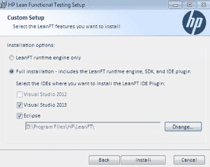

如果你在系统中安装了 IntelliJ，将看到下面的界面。只需勾选 IntelliJ IDEA 旁边的复选框，即可为 IntelliJ IDEA 安装 LeanFT 插件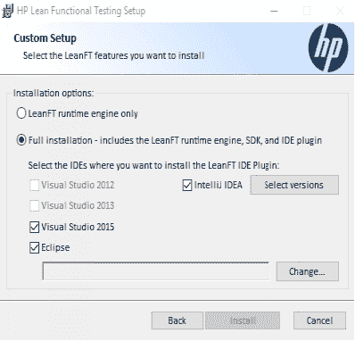

### LeanFT 插件

安装 LeanFT 后，如如下所示所示运行时引擎。默认情况下，引擎运行在端口`5095`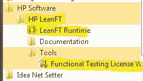

## 3.2 安装浏览器扩展

安装 LeanFT 后，你可以在 LeanFT 安装目录下的以下位置查看浏览器扩展文件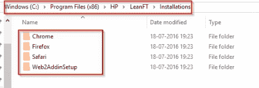

### LeanFT 浏览器扩展

只需将扩展文件拖放到浏览器中。当你将这些扩展文件拖入浏览器时，浏览器将安装这些扩展。

如果没有在浏览器中安装并启用这些扩展，你将无法自动化 Web 应用。下图显示了在 Chrome 浏览器中启用的 LeanFT 扩展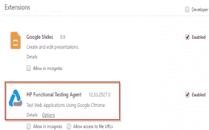

### Chrome 中的 LeanFT 扩展

# 4. 入门

## 4.1 LeanFT 设置

你可以从 IntelliJ IDEA IDE 内查看并编辑 LeanFT 设置，如下所示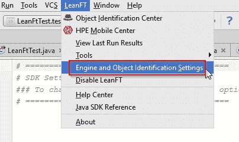

### LeanFT 引擎和对象识别设置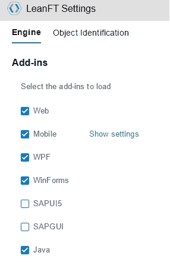

### LeanFT 中的加载项

### LeanFT 中的引擎连接和对象同步超时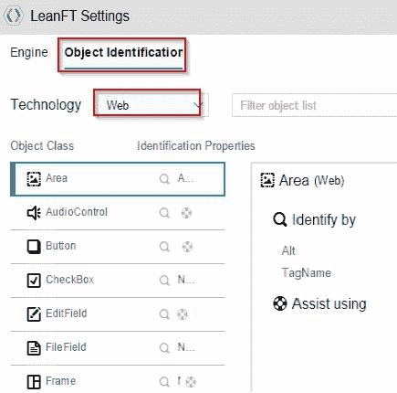

### LeanFT 中的对象识别设置

以下是最重要的 LeanFT 设置：

1. **Add-ins (加载项)**：在此部分，我们可以指定想要加载的加载项。
2. **Engine connection and Run-time settings (引擎连接和运行时设置)**：在此部分，我们可以指定引擎端口和引擎空闲超时。我们还可以指定对象同步超时。LeanFT 在抛出异常之前将等待足够的时间。
3. **Mobile Settings (移动设置)**：在此设置中，我们可以指定移动中心服务器地址，以便使用 LeanFT 自动化移动应用。
4. **Object Identification settings (对象识别设置)**：在此选项卡中，我们可以指定使用哪些属性来识别对象。

## 4.2 LeanFT 中的许可证类型

LeanFT 带有 4 种许可证，如下所示：

1. **Seat License (节点许可)** - 绑定到一台机器
2. **Concurrent license (并发许可)** - 多台机器可以使用此许可
3. **Commuter license (通勤型许可)**
4. **Remote commuter license (远程通勤型许可)**


# 5. 核心概念

## 5.1 对象识别中心 (Object Identification Center)

对象识别中心就像 QTP/UFT 中的 Object Spy。

对象识别中心以两种模式运行：

1. `simple` - 允许你查看对象的属性值
2. `edit` - 允许你查看并编辑对象的属性值

对象识别中心允许你执行以下操作：

1. 检查对象。
2. 了解对象的父详情、层级结构。
3. 了解对象的属性和值。
4. 对象识别中心的一个酷功能是可以生成 Java 或 C# 代码段。
5. 高亮对象。
6. 我们还可以捕捉对象的截图。
7. 它还允许将对象添加到应用程序模型（Application model）。

你可以从 IntelliJ IDEA 启动对象识别中心，如下所示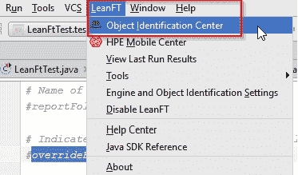

**在 IntelliJ IDE 中启动 LeanFT 对象识别中心**

下图显示了如何使用对象识别中心检查网页内部的元素

### LeanFT 中的对象识别中心

## 5.2 了解 LeanFT SDK API

以下列出了 LeanFT API 中一些重要的包和类：

1. `com.hp.lft.report` - `Reporter`类可用于在报告中导出数据。
2. `com.hp.lft.sdk` - 核心功能。
3. `com.hp.lft.sdk.insight` - 用于根据图像识别对象。
4. `com.hp.lft.sdk.apitesting.uft` - LeanFT 中使用的 UFT API。
5. `com.hp.lft.sdk.java` - 用于自动化 Java 应用（`Swing`/`AWT`等）的 API。
6. `com.hp.lft.sdk.mobile` - 用于移动应用的 API。
7. `com.hp.lft.sdk.sap.gui`和`com.hp.lft.sdk.sap.ui5` - 用于 SAP 应用的 API。
8. `com.hp.lft.sdk.stdwin` - 用于标准 Windows 应用的 API。
9. `com.hp.lft.sdk.utils` - 辅助方法。
10. `com.hp.lft.sdk.web` - 用于标准 Web 应用的 API。
11. `com.hp.lft.sdk.winforms`和`com.hp.lft.sdk.wpf` - 用于 .Net 应用的 API。
12. `com.hp.lft.unittesting`和`com.hp.lft.unittesting.datadriving` - 用于 LeanFT 单元测试框架的 API。
13. `com.hp.lft.verifications` - 它提供了`Verify`类，可用于断言预期值。

# 6. 在 IntelliJ IDEA 中新建 LeanFT 项目

## 6.1 在 Maven 仓库中安装 LeanFT jar 文件

要将 LeanFT 与`Maven`集成，你必须将 LeanFT 库文件安装到本地 Maven 仓库。执行以下命令将 LeanFT jar 文件安装到本地仓库。

```bash
mvn install:install-file -Dfile="com.hp.lft.sdk-standalone.jar" -DgroupId="com.hp.lft" -DartifactId="com.hp.lft.sdk" -Dversion="12.53.0" -Dpackaging="jar" -DgeneratePom=true
mvn install:install-file -Dfile="com.hp.lft.report.jar" -DgroupId="com.hp.lft" -DartifactId="com.hp.lft.report" -Dversion="12.53.0" -Dpackaging="jar" -DgeneratePom=true
mvn install:install-file -Dfile="com.hp.lft.unittesting.jar" -DgroupId="com.hp.lft" -DartifactId="com.hp.lft.unittesting" -Dversion="12.53.0" -Dpackaging="jar" -DgeneratePom=true
mvn install:install-file -Dfile="com.hp.lft.verifications.jar" -DgroupId="com.hp.lft" -DartifactId="com.hp.lft.verifications" -Dversion="12.53.0" -Dpackaging="jar" -DgeneratePom=true
```

然后将在你的`POM`文件中添加以下依赖。

```xml
<dependency>
    <groupId>com.hp.lft</groupId>
    <artifactId>com.hp.lft.sdk</artifactId>
    <version>12.53.0</version>
</dependency>
<dependency>
    <groupId>com.hp.lft</groupId>
    <artifactId>com.hp.lft.report</artifactId>
    <version>12.53.0</version>
</dependency>
<dependency>
    <groupId>com.hp.lft</groupId>
    <artifactId>com.hp.lft.unittesting</artifactId>
    <version>12.53.0</version>
</dependency>
<dependency>
    <groupId>com.hp.lft</groupId>
    <artifactId>com.hp.lft.verifications</artifactId>
    <version>12.53.0</version>
</dependency>
```

有时你可能需要将 jar 文件部署到组织中央仓库。下面的示例命令显示了如何将 LeanFT jar 文件部署到中央仓库。

```bash
mvn deploy:deploy-file -DgroupId="com.hp.lft" -DartifactId="com.hp.lft.sdk" -Dversion="12.53.0" -Dpackaging=jar -Dfile="com.hp.lft.sdk-standalone.jar" -DrepositoryId=<id-in-settings.xml> -Durl=<url-of-the-central-repository>
```

## 6.2 创建 LeanFT Maven 项目

我们可以像下面的图片所示在 IntelliJ IDEA 中创建一个新的 LeanFT maven 项目。注意，一旦创建了项目，你就可以`POM.xml`文件中添加所需的依赖。

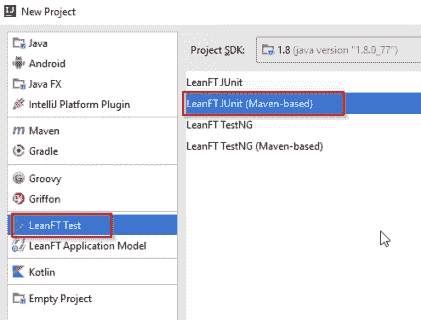

IntelliJ IDE 中的 LeanFT Junit Maven 项目

然后为你的项目输入 group id 和 artifact id，并指定项目名称。一旦 maven 项目创建完成，如如下所示添加 LeanFT 依赖。

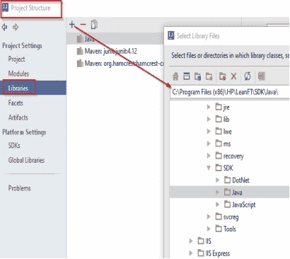

在 IntelliJ IDEA 中向 Maven 项目添加 LeanFT 库

之后，你就可以编写测试用例并享受使用 LeanFT 进行自动化测试了。

## 6.3 使用 Gradle 和 TestNG 创建 LeanFT 项目

要使用`Gradle`和`TestNG`创建 LeanFT 项目，请遵循以下步骤。

首先，在 IntelliJ IDEA 中创建一个示例 Gradle 项目。然后在根目录下添加一个`libs`目录，并将来自`C:\Program Files (x86)\LeanFT\SDK\Java`的所有 LeanFT 库文件复制到该目录中。

然后，确保你的`build.gradle`文件包含以下内容。

```gradle
group 'org.soft'
version '1.0-SNAPSHOT'
apply plugin: 'java'
repositories {
    mavenCentral
}
dependencies {
    testCompile group: 'org.testng', name: 'testng', version: '6.9.10'
    compileTree (dir: 'libs', include: '*.jar')
}
test {
    useTestNG {
        suites 'src/test/resources/testng.xml'
    }
}
```

此之后，创建一个示例 TestNG 测试类，并如下例所示添加 LeanFT 测试。注意，你必须在开始测试之前初始化 LeanFT SDK，并在测试结束后清理 SDK。


```java
package soft ;
import com.hp.lft.report.Reporter;
import org.testng.annotations.AfterClass;
import org.testng.annotations.AfterMethod;
import org.testng.annotations.BeforeClass;
import org.testng.annotations.BeforeMethod;
import org.testng.annotations.Test;
import com.hp.lft.sdk.*;
import com.hp.lft.verifications.*;
import java.net.URI;
public class SimpleLeanFTTest{
    @BeforeClass
    public void beforeClass () {
    }
    @AfterClass
    public void afterClass () {
    }
    @BeforeMethod
    public void beforeMethod () {
        try {
            ModifiableSDKConfiguration config = new ModifiableSDKConfiguration ();
            config . setServerAddress ( new URI ( "ws://localhost:5095" ));
            SDK . init ( config );
            Reporter . init ();
        } catch ( Exception ex ){
            System . out . println ( "Exception occured " + ex . toString());
        }
    }
    @AfterMethod
    public void afterMethod () throws Exception {
        Reporter . generateReport ();
        SDK . cleanup ();
    }
    @Test
    public void test () throws GeneralLeanFtException {
        Verify . areEqual ( 22 , 22 , "Verify that 22 == 22" );
    }
}
```

此之后构建你的项目并运行。

## 6.4 LeanFT 属性

当我们使用模板创建 LeanFT 项目时，会创建一个属性文件（`leanft.properties`）并存储在 `resources` 目录中。以下是文件中我们可以使用的最重要的设置。

1. `serverAddress` - 指定 LeanFT 引擎地址
2. `SDK Mode` - 回放模式（Replay）或交互模式（Interactive）
3. `LeanFT Service Address` - `ws://localhost:5095`
4. `Connection timeout` - 60 秒
5. `Response timeout` - 600 秒
6. `Server autolaunch` - true

以下是与 LeanFT 报告相关的最重要的设置

1. `title` - 报告名称。默认为 `Run Results`。
2. `description` - 报告描述。默认为空。
3. `targetDirectory` - 报告存储的目录。默认是当前目录。
4. `overrideExisting` - 是否覆盖现有报告。其默认值为 `true`。
5. `report folder` - `RunResults`
6. `override existing` - true
7. `filter level` - 所有（All）、警告（Warning）、错误（Error）、关闭（Off）
8. `snapshot level` - 所有（All）、错误时（OnError）、关闭（Off）

## 6.5 在 IntelliJ IDEA 中配置 LeanFT 项目

在本主题中，我们将介绍如何在 IntelliJ IDEA 中配置 LeanFT 项目。我们可以通过 2 方式创建新的 LeanFT 项目。

1. 使用 LeanFT 模板
2. 自定义框架

如果你已经安装了 IntelliJ IDEA 的 LeanFT 插件，你可以像下图所示从模板创建新项目。注意，我们可以根据 4 种模板创建项目。


IntelliJ IDEA 中新建 LeanFT 项目


LeanFT 项目结构示例

要创建你自己的自定义框架，你必须像下面的示例所示初始化并清理 SDK。注意，在接下来的所有示例中，我们都继承了 `BaseTest` 类。

```java
package leanft;
import com.hp.lft.report.Reporter;
import com.hp.lft.sdk.ModifiableSDKConfiguration;
import com.hp.lft.sdk.SDK;
import org.junit.After;
import org.junit.Before;
import java.net.URI;

public class BaseTest {
    @Before
    public void test() throws Exception {
        ModifiableSDKConfiguration config = new ModifiableSDKConfiguration();
        config.setServerAddress(new URI("ws://localhost:5095"));
        SDK.init(config);
        Reporter.init();
    }

    @After
    public void clean() throws Exception {
        Reporter.generateReport();
        SDK.cleanup();
    }
}
```

然后我们可以像下面的示例编写测试方法。

```java
package leanft;
import com.hp.lft.report.Reporter;
import com.hp.lft.report.Status;
import com.hp.lft.sdk.ModifiableSDKConfiguration;
import com.hp.lft.sdk.SDK;
import com.hp.lft.sdk.web.*;
import com.hp.lft.sdk.web.EditField;
import com.hp.lft.sdk.web.EditFieldDescription;
import org.junit.Test;
import java.net.URI;
import static org.junit.Assert.assertEquals;

public class ChromeTest extends BaseTest {
    @Test
    public void test() throws Exception {
        Browser browser = BrowserFactory.launch(BrowserType.CHROME);
        try {
            //Navigate to http://www.softpost.org/selenium-test-page/
            browser.navigate("http://www.softpost.org/selenium-test-page/");
            browser.sync();
        } catch (AssertionError ex) {
            //Report the Exception
            Reporter.reportEvent("Exception", "Test failed", Status.Failed, ex);
            throw ex;
        } finally {
            //Close the browser
            browser.close();
        }
    }
}
```

# 7. Eclipse 中的 LeanFT 项目

## 7.1 在 Eclipse 中创建带有 JUnit 的 LeanFT maven 项目

下面的图片将帮助你理解如何在 Eclipse 中创建带有 JUnit 和 LeanFT 的 maven 项目。点击 `New project` 菜单然后点击 `Other`。

![]

Eclipse 中的 LeanFT - 带有 JUnit 的 Maven 项目

然后如如下所示选择 `LeanFT JUnit Maven project`。

![]

Eclipse 中的 LeanFT - Maven JUnit 模板

为你的项目提供 `group id` 和 `Artifact id`。

![]

Eclipse 中的 LeanFT - Maven JUnit 项目

项目创建如如下所示。

![]

然后如如下所示为 LeanFT 添加外部 jars 包。

![]

作为外部 jars 包添加 LeanFT 库

在运行 maven build 之后，你应该能够在 `RunResults` 目录中看到结果。

## 7.2 在 Eclipse 中创建带有 TestNG 的 maven 项目

下面的图片将帮助你理解如何在 Eclipse 中设置带有 TestNG 的 LeanFT maven 项目。

![]

Eclipse 中的 LeanFT - 带有 JUnit Maven 项目

![]

Eclipse 中的 LeanFT TestNG group Id

![]

Eclipse 中的 LeanFT TestNG Maven 项目

LeanFT 将测试放在 `src/main/java` 目录中。你应该将这些测试类移动到 `src/test/java`，因为 maven 总是会在 `src/test/java` 目录中查找任何执行的测试。

# 8. 对象识别与管理

## 8.1 描述编程

通常在 UFT 中，我们使用对象库（LeanFT 中的应用程序模型）来存储应用程序内部的对象。因此，我们可以在自动化代码中使用这些对象，但我们也可以使用描述编程（description programming）在代码本身中定义新的测试对象。

下面的示例展示了如何在 LeanFT 中使用描述编程定义新的测试对象。我们使用了描述编程来定义了 2 个类型为 `EditField` 和 `Link` 的对象。注意，我们可以使用多个属性-值对来识别这些对象。

```java
//Navigate to http://www.softpost.org/selenium-test-page/
browser.navigate("http://www.softpost.org/selenium-test-page/");
browser.sync();

//Build edit box object and set value in it
browser.describe(EditField.class, new EditFieldDescription.Builder().id("fn").build()).setValue("Sagar");

//Build link object and click on it.
browser.describe(Link.class, new LinkDescription.Builder().tagName("A").innerText("Home").build()).click();
```

## 8.2 应用程序模型

应用程序模型类似于 UFT 中的对象库。我们可以像下图所示在 IntelliJ IDEA 中创建新的应用程序模型。

![]

IntelliJ IDE 中新建 LeanFT 应用程序模型项

![]

下图显示了示例的 `AppModel.tsrx` 文件。在设计模式下，我们可以向应用程序模型添加或删除对象。

![]

下图展示了如何使用对象识别中心（Object Identification Center）将对象添加到应用程序模型中。

注意，创建新的应用程序模型后会生成 2 个文件。

1. `YourModel.tsrx` 文件 - 这是一个 XML 文件。我们也可以在设计模式下查看此文件并在其中添加和编辑对象。
2. `YourModel.java` 文件包含表示应用程序模型对象的代码。

以下代码展示了如何使用应用模型（application model）编写测试。

```java
package leanft;
import com.hp.lft.sdk.web.Browser;
import com.hp.lft.sdk.web.BrowserFactory;
import com.hp.lft.sdk.web.BrowserType;
import org.junit.Test;
/**
  * Created by Sagar on 22 - 07 - 2016.
*/
public class AppModelTest extends BaseTest{
    @Test
    public void test1() throws Exception {
        Browser browser = BrowserFactory.launch(BrowserType.CHROME);
        browser.navigate( "http://www.softpost.org/selenium-test-page/" );
        AppModel model = new AppModel(browser);
        model.SeleniumTestPage().firstName().setValue( "Sagar" );
    }
}
```

另一个需要注意的重要点是，我们可以应用模型结合描述编程（description programming）来识别对象，如下示例代码所示。注意，我们使用了应用模型中的 `SeleniumTestPage` 对象，但我们使用了描述编程来识别 `page.model.SeleniumTestPage().describe(EditField.class,new EditFieldDescription.Builder().id("fn").build()).setValue("Salunke");` 的 `EditField` 对象。

### 8.3 在属性值中使用正则表达式

要定义对象的属性值，我们可以使用正则表达式。下面的示例展示了如何使用正则表达式来定义属性值。注意，我们正在点击一个内部文本匹配正则表达式 `.*Dev.*` 的链接。


```java
package leanft;
import com.hp.lft.report.Reporter;
import com.hp.lft.report.Status;
import com.hp.lft.sdk.RegExpProperty;
import com.hp.lft.sdk.web.*;
import org.junit.Test;
public class RegularExpressionTest extends BaseTest{
    @Test
    public void test() throws Exception {
        Browser browser = BrowserFactory.launch(BrowserType.CHROME);
        Try {
            //Navigate to http://www.softpost.org/selenium-test-page/
            browser.navigate( "http://www.softpost.org/selenium-test-page/" );
            browser.sync();
            //set value in edit box
            browser.describe(EditField.class, new EditFieldDescription.Builder()
            .id( "fn" ).build()).setValue( "Sagar" );
            //click on link containing Dev substring
            browser.describe(Link.class, new LinkDescription.Builder()
            .tagName( "A" ).index(1).innerText( RegExpProperty( ".*Dev.*" )).build()).click();
            //Wait until page loads
            Thread .sleep(300);
        } catch (AssertionError ex) {
            //Report the Exception
            Reporter.reportEvent( "Exception" , "Test failed" , Status.Failed, ex);
            throw ex;
        } Finally {
            //Close the browser
            browser.close();
        }
    }
}
```

我们还可以使用正则表达式来指定应用模型中对象属性的值。

# 9. 自动化 Web 应用

## 9.1 第一个 Web 应用测试

这里是使用 LeanFT 的第一个 Web 应用测试。在下面的代码中，我们启动了 Chrome 浏览器然后导航到`http://www.softpost.org/selenium-test-page/`。之后，我们在编辑框中输入值并点击 Home 链接。相同的代码在其他浏览器（Firefox, Internet Explorer, Edge）上同样有效。要启动其他浏览器，你需要在启动方法中更改浏览器类型。

```java
package leanft;
import com.hp.lft.report.Reporter;
import com.hp.lft.report.Status;
import com.hp.lft.sdk.ModifiableSDKConfiguration;
import com.hp.lft.sdk.SDK;
import com.hp.lft.sdk.web.*;
import com.hp.lft.sdk.web.EditField;
import com.hp.lft.sdk.web.EditFieldDescription;
import org.junit.Test;
import java.net.URI;
import static org.junit.Assert.assertEquals;
public class ChromeTest extends BaseTest{
    @Test
    public void test() throws Exception {
        Browser browser = BrowserFactory.launch(BrowserType.CHROME);
        Try {
            //Navigate to http://www.softpost.org/selenium-test-page/
            browser.navigate( "http://www.softpost.org/selenium-test-page/" );
            browser.sync();
            //set value in edit box
            browser.describe(EditField.class, new EditFieldDescription.Builder()
            .id( "fn" ).build()).setValue( "Sagar" );
            //click on Home link
            browser.describe(Link.class, new LinkDescription.Builder()
            .tagName( "A" ).innerText( "Home" ).build()).click();
            //Wait until page loads
            browser.sync();
        } catch (AssertionError ex) {
            //Report the Exception
            Reporter.reportEvent( "Exception" , "Test failed" , Status.Failed, ex);
            throw ex;
        } Finally {
            //Close the browser
            browser.close();
        }
    }
}
```

注意，`BaseTest` 类提供了初始化和清理 LeanFT SDK 的代码。

```java
package leanft;
import com.hp.lft.report.Reporter;
import com.hp.lft.sdk.ModifiableSDKConfiguration;
import com.hp.lft.sdk.SDK;
import org.junit.After;
import org.junit.Before;
import java.net.URI;
public class BaseTest{
    @Before
    public void init() {
        try {
            ModifiableSDKConfiguration config = new ModifiableSDKConfiguration();
            config.setServerAddress( new URI( "ws://localhost:095" ));
            SDK.init(config);
            Reporter.init();
        } catch ( Exception ex) {
            System.out.println( "Exception " + ex.toString());
        }
    }
    @After
    public void clean() throws Exception {
        Reporter.generateReport();
        SDK.cleanup();
    }
}
```

## 9.2 使用 XPATH 和 CSS 识别 Web 元素

我们可以使用`XPATH`和`CSS`选择器来识别 Web 元素。下面的示例说明了如何在 LeanFT 中使用`XPATH`。在下面的示例中，我们使用`XPATH`识别了编辑框。对于更高级的`XPATH`表达式，你可以访问 - `http://selenium-interview-questions.blogspot.in/2014/02/how-to-identify-elements-using-xpath-in.html`。对于更高级的 CSS 表达式，你可以访问 - `http://selenium-interview-questions.blogspot.in/2014/02/how-to-identify-elements-using.html`。

```java
package leanft;
import com.hp.lft.report.Reporter;
import com.hp.lft.report.Status;
import com.hp.lft.sdk.web.*;
import org.junit.Test;
public class CsspathTest extends BaseTest{
    @Test
    public void test() throws Exception {
        Browser browser = BrowserFactory.launch(BrowserType.CHROME);
        Try {
            //Navigate to http://www.softpost.org/selenium-test-page/
            browser.navigate( "http://www.softpost.org/selenium-test-page/" );
            browser.sync();
            //set value in edit box using xpath
            browser.describe(EditField.class, new EditFieldDescription.Builder()
            .xpath( "//input[id='fn']" ).build()).setValue( "Sagar" );
            //set value in edit box using css
            browser.describe(EditField.class, new EditFieldDescription.Builder()
            .cssSelector( "input[id='fn']" ).build()).setValue( "Salunke" );
        } catch (AssertionError ex) {
            //Report the Exception
            Reporter.reportEvent( "Exception" , "Test failed" , Status.Failed, ex);
            throw ex;
        } Finally {
            //Close the browser
            browser.close();
        }
    }
}
```

## 9.3 使用视觉标识符识别对象

这是 UFT 和 LeanFT 中的一项高级功能，允许根据相邻对象的位置来识别对象。在下面的图中，我们可以通过关联的文本识别编辑框。

LeanFT 中的 VRI

这是一个完整的示例，展示了如何在 LeanFT 中使用 VRI。注意，我们可以为对象提供多个视觉标识符。

```java
package leanft;
import com.hp.lft.report.Reporter;
import com.hp.lft.report.Status;
import com.hp.lft.sdk.HorizontalVisualRelation;
import com.hp.lft.sdk.VisualRelation;
import com.hp.lft.sdk.web.*;
import org.junit.Test;
public class Vri extends BaseTest{
    @Test
    public void test() throws Exception {
        Browser browser = BrowserFactory.launch(BrowserType.CHROME);
        Try {
            //Navigate to http://www.softpost.org/selenium-test-page/
            browser.navigate( "http://www.softpost.org/selenium-test-page/" );
            browser.sync();
            //set value in edit box
            browser.describe(EditField.class, new EditFieldDescription.Builder()
            .id( "fn" ).build()).setValue( "Sagar" );
            WebElement e2 = browser.describe(WebElement.class, new WebElementDescription.Builder()
            .xpath( "//td[text()='Last Name']" ).build());
            browser.describe(EditField.class, new EditFieldDescription.Builder()
            .vri( new VisualRelation().setTestObject(e2).setHorizontalRelation(HorizontalVisualRelation.LEFT_AND_INLINE)).build())
            .setValue( "Salunke" );
            //click on Home link
            browser.describe(Link.class, new LinkDescription.Builder()
            .tagName( "A" ).innerText( "Home" ).build()).click();
            //Wait until page loads
            browser.sync();
        } catch (AssertionError ex) {
            //Report the Exception
            Reporter.reportEvent( "Exception" , "Test failed" , Status.Failed, ex);
            throw ex;
        } Finally {
            //Close the browser
            browser.close();
        }
    }
}
```

## 9.4 处理 Windows 应用中的嵌入浏览器控件

有时，Windows 应用包含嵌入浏览器控件的元素。要将浏览器控件内部的元素识别为 Web 元素，你需要在 LeanFT 中注册该浏览器控件。要在 LeanFT 中注册浏览器控件，请按照以下步骤操作。

# 注册步骤

1. 启动实用程序 - `C:\Program Files (x86)\HP\LeanFT\bin\SettingNewBrowserControlApplication.exe`

2. 然后在程序窗口中输入包含浏览器控制的应用程序路径并点击注册（register）

3. 最后，你需要重启 LeanFT 引擎。

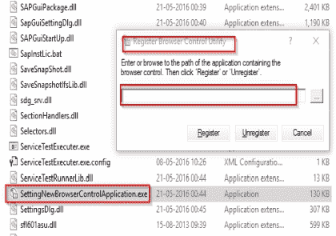

# 在 LeanFT 中注册浏览器控件

一旦注册了浏览器控件，其内部的所有对象都将被识别为 Web 对象。请注意，LeanFT 只能处理基于 IE 引擎的浏览器控件！

## 9.5 使用 LeanFT 在 Web 元素上触发事件

我们可以使用 LeanFT 中的`EventInfo`类在任何 Web 元素上触发如`click`、`change`等 html 事件。这里是一个完整的示例，说明了如何触发事件。


```java
package leanft;
import com.hp.lft.report.Reporter;
import com.hp.lft.report.Status;
import com.hp.lft.sdk.NativeObject;
import com.hp.lft.sdk.web..*;
import org.junit.Test;
import java.util.List;
public class ChromeNativeObjectTest extends BaseTest{
    @Test
    public void test() throws Exception {
        Browser browser = BrowserFactory.launch(BrowserType.CHROME);
        try {
            //Navigate to http://www.softpost.org/selenium-test-page/
            browser.navigate("http://www.softpost.org/selenium-test-page/");
            browser.sync();
            //set value in edit box
            browser.describe(EditField.class, new EditFieldDescription.Builder()
                .id("fn").build()).setValue("Sagar");
            browser.describe(Link.class, new LinkDescription.Builder()
                .tagName("A").innerText("Home").build()).fireEvent(EventInfoFactory.createEvent("click"));
            Thread.sleep(3000);
        } catch (AssertionError ex){
            //Report the Exception
            Reporter.reportEvent("Exception", "Test failed", Status.Failed, ex);
            throw ex;
        } Finally {
            //Close the browser
            browser.close();
        }
    }
}
```

此外，你也可以使用以下语法执行自定义 JavaScript。

`String html = browser.getPage().runJavaScript("document.body.innerHTML;");`

若要在 id 为 `-fn` 的元素上触发 `change` 事件，你可以将下面的 Javascript 作为 `runJavaScript()` 方法的参数。

```javascript
var evt = document.createEvent('HTMLEvents');
evt.initEvent('change', true, true);
document.findElementById('fn').dispatchEvent(evt);
```

## 9.6 在网页中执行 JavaScript

在自动化 Web 应用时，你可能需要执行 JavaScript 来执行某些操作。LeanFT 允许你像下面的示例所示执行自定义 JavaScript。我们可以使用 `Page` 类的 `runJavaScript` 方法来执行任何有效的 JavaScript。

```java
package leanft ;
import com.hp.lft.report.Reporter ;
import com.hp.lft.report.Status ;
import com.hp.lft.sdk.web.*;
import com.hp.lft.verifications.Verify ;
import org.junit.Test ;
public class ExecuteJavaScriptTest extends BaseTest{
    @Test
    public void test () throws Exception {
        Browser browser = BrowserFactory.launch(BrowserType.INTERNET_EXPLORER);
        Try {
            //Navigate to http://www.softpost.org/selenium-test-page/
            browser.navigate("http://www.softpost.org/selenium-test-page/");
            browser.sync();
            String html = browser.getPage().runJavaScript("document.body. innerHTML;");
            System.out.println("HTML Source of the page" + html);
            System.out.println("Scrolling to 20,100");
            browser.getPage().runJavaScript("window.scrollTo(20,100);");
            String documentState = browser.getPage().runJavaScript("document.readyState");
            System.out.println("Document is " + documentState);
        } catch ( AssertionError ex ){
            //Report the Exception
            Reporter.reportEvent("Exception", "Test failed", Status, ex);
            throw ex;
        } Finally {
            //Close the browser
            browser.close ();
        }
    }
}
```

# 10. 自动化 Windows

## 10.1 自动化标准 Windows 应用

要自动化标准的 Windows 应用，你需要在 LeanFT 项目中导入以下包 `com.hp.lft.sdk.stdwin`。这里是一个启动记事本并在其中输入文本的示例应用程序。然后它会尝试关闭记事本。之后，它点击了对话框上的“不保存”按钮。

```java
package leanft;
import com.hp.lft.sdk.Desktop;
import com.hp.lft.sdk.stdwin.*;
import org.junit.Test;
import static org.junit.Assert.assertEquals;
public class NotepadTest extends BaseTest{
    @Test
    public void test() throws Exception {
        new ProcessBuilder("C:\\Windows\\System32\\notepad.exe").start();
        Thread.sleep(3000);
        Window notepadWin = Desktop.describe(Window.class,
            new WindowDescription.Builder().windowTitleRegExp("Notepad").build());
        Editor editor = notepadWin.describe(Editor.class,
            new EditorDescription.Builder().nativeClass("Edit").windowClassRegExp("Edit").build());
        editor.sendKeys("This is automated text");
        Thread.sleep(3000);
        notepadWin.close();
        Desktop.describe(Window.class, new WindowDescription.Builder()
            .ownedWindow(false).childWindow(false).windowClassRegExp("Notepad").windowTitleRegExp("Notepad").build())
            .describe(Dialog.class, new DialogDescription.Builder()
                .text("Don't save").build()).click();
    }
}
```

## 10.2 自动化 Java 应用

自动化 Java 应用与标准 Windows 应用非常相似。不同在于你需要导入下面的包 `com.hp.lft.sdk.java`。这里有一个示例，它识别了窗口并点击了带有“Gender”文本的复选框。

```java
package leanft;
import com.hp.lft.sdk.Desktop;
import com.hp.lft.sdk.java.*;
import org.junit.Test;
public class JavaTest extends BaseTest{
    @Test
    public void test() throws Exception {
        new ProcessBuilder("C:\\Windows\\System32\\notepad.exe").start();
        Thread.sleep(3000);
        Window javaWin = Desktop.describe(Window.class,
            new WindowDescription.Builder().windowTitleRegExp("Notepad").build());
        Frame frame = javaWin.describe(Frame.class,
            new FrameDescription.Builder().title("Frame").build());
        CheckBox checkBox = frame.describe(CheckBox.class,
            new CheckBoxDescription.Builder().text("Gender").build());
        checkBox.select();
    }
}
```

## 10.3 自动化 WPF 应用

下面的示例展示了如何使用 LeanFT 自动化 WPF 应用。注意需要导入下面的包 `com.hp.lft.sdk.wpf`。我们首先识别了标题为“Bus Application”的窗口，然后列出了该窗口中的所有选项。

```java
package leanft;
import com.hp.lft.sdk.Desktop;
import com.hp.lft.sdk.wpf.*;
import org.junit.Test;
public class WpfTest extends BaseTest{
    @Test
    public void test() throws Exception {
        new ProcessBuilder("C:\\Windows\\System32\\notepad.exe").start();
        Thread.sleep(3000);
        Window win = Desktop.describe(Window.class,
            new WindowDescription.Builder().windowTitleRegExp("Bus Application").build());
        ComboBox box = win.describe(ComboBox.class,
            new ComboBoxDescription.Builder().objectName("sourceCity").build());
        for (String s : box.getItems()){
            System.out.println(s);
        }
    }
}
```

## 10.4 自动化 SAP 应用

自动化 SAP 应用与标准 Windows 应用非常相似。请注意你需要使用下面的 SAP 包 `com.hp.lft.sdk.sap.*`。

# 11. 同步

默认情况下，LeanFT 在尝试查找对象时等待 20 秒。如果 20 秒内未识别对象，则会抛出异常。你可以在 LeanFT 设置对话框中更改超时时间。此外，你还可以添加自定义等待条件。

```java
package leanft;
import com.hp.lft.sdk.GeneralLeanFtException;
import com.hp.lft.sdk.*;
import com.hp.lft.sdk.stdwin.ToolBar;
import com.hp.lft.sdk.stdwin.Window;
import com.hp.lft.sdk.stdwin.WindowDescription;
import org.junit.Assert;
import org.junit.Test;
/**
 * Created by Sagar on 21 - 07 - 2016.*/
public class SynchTest extends BaseTest{
    @Test
    public void test1() throws Exception {
        WaitUntilTestObjectState.WaitUntilEvaluator< Window > evaluator = new WaitUntilTestObjectState.WaitUntilEvaluator< Window >() {@Override
            public boolean evaluate( Window testObject) throws GeneralLeanFtException{
                return testObject.getWindowState()==WindowState.MAXIMIZED;}};
        new ProcessBuilder("C:\\Windows\\System32\\notepad.exe").start();
        Thread.sleep(3000);
        Window notepadWindow = Desktop.describe(Window.class,
            new WindowDescription.Builder().windowClassRegExp("Notepad").windowTitleRegExp("Notepad").build());
        notepadWindow.maximize();
        Assert.assertTrue(evaluator.evaluate(notepadWindow));
    }
}
```

# 12. 断言与报告

## 12.1 LeanFT 中的断言

我们可以使用 Validations 命名空间下的 `Verify` 类在 LeanFT 中进行断言。该类允许你在代码中放置断言。这里是一个显示 `Verify` 类用用的示例。注意 `Verify` 类提供了以下方法。

## 验证方法

1. `areEqual`, `areNotEqual`

2. `isTrue`, `isFalse`

3. `startsWith`, `contains`, `endsWith`

4. `lessOrEqual`, `less`, `greater`, `greaterOrEqual`

5. `isMatch`

6. `isNullOrEmpty`, `isNotNullOrEmpty`


```java
package leanft;
import com.hp.lft.report.Reporter;
import com.hp.lft.report.Status;
import com.hp.lft.sdk.ModifiableSDKConfiguration;
import com.hp.lft.sdk.SDK;
import com.hp.lft.sdk.web.*;
import com.hp.lft.sdk.web.EditField;
import com.hp.lft.sdk.web.EditFieldDescription;
import com.hp.lft.verifications.Verify;
import org.junit.Test;
import java.net.URI;
import static org.junit.Assert.assertEquals;
public class ChromeTest extends BaseTest{
    @Test
    public void test() throws Exception    {
        Browser browser = BrowserFactory.launch(BrowserType.CHROME);
        Try {
            //导航到 http://www.softpost.org/selenium-test-page/
            browser.navigate( "http://www.softpost.org/selenium-test-page/" );
            browser.sync();
            //在输入框中设置值
            browser.describe(EditField.class, new EditFieldDescription.Builder()
                .id( "fn" ).build()).setValue( "Sagar" );
            //点击 Home 链接
            browser.describe(Link.class, new LinkDescription.Builder()
                .tagName( "A" ).innerText( "Home" ).build()).click();
            //等待页面加载
            browser.sync();
            Verify.isTrue(browser.getTitle().toLowerCase().contains( "tutorial" ), "Verifying the title of Home page" );
        } catch (AssertionError ex){
            //报告异常
            Reporter.reportEvent( "Exception" , "Test failed" , Status.Failed, ex);
            throw ex;
        } Finally {
            //关闭浏览器
            browser.close();
        }
    }
}
```

这里是显示验证点的 HTML 报告。

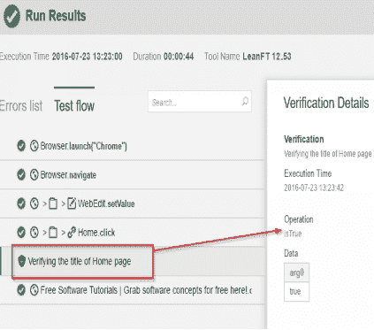

LeanFT 中的 `Verify` 类。

## 12.2 生成带有截图和录屏的报告

LeanFT 中可以通过两种方式生成报告。

1. 使用 `Reporter` 和 `TestObject.GetSnapshot` 截屏。

2. 使用 Microsoft expression encoder 进行测试执行的视频录制。

默认情况下，LeanFT 在 Java 项目根目录下的 `RunResults` 文件夹中创建报告。但你可以像下面的示例一样使用 `ModifiableReportConfiguration` 类进行更改。你也可以使用以下方法将你的日志消息发送到报告。

### `Reporter.reportEvent`

```java
package leanft;
import com.hp.lft.report.*;
import com.hp.lft.sdk.Desktop;
import com.hp.lft.sdk.stdwin.Window;
import com.hp.lft.sdk.stdwin.WindowDescription;
import com.hp.lft.sdk.web.*;
import com.hp.lft.verifications.Verify;
import org.junit.Test;
import java.awt.image.RenderedImage;
public class ChromeReportTest extends BaseTest {
    @Test
    public void test () throws Exception{
        ModifiableReportConfiguration reportConfig = ReportConfigurationFactory.createDefaultReportConfiguration();
        reportConfig.setOverrideExisting( true );
        reportConfig.setTargetDirectory( "RunResults" ); // 该文件夹必须在 C:\ 下存在
        reportConfig.setReportFolder( "myreportdirectory" );
        reportConfig.setTitle( "My Report" );
        reportConfig.setDescription( "Report Description" );
        reportConfig.setSnapshotsLevel(Level.OnError);
        Reporter.init(reportConfig);
        Browser browser = BrowserFactory.launch(BrowserType.CHROME);
        Try {
            //导航到 http://www.softpost.org/selenium-test-page/
            browser.navigate( "http://www.softpost.org/selenium-test-page/" );
            browser.sync();
            //在输入框中设置值
            EditField firstName = browser.describe(EditField.class , EditFieldDescription.Builder()
                .id( "fn" ).build());
            firstName.setValue( "Sagar" );
            //截图
            RenderedImage img = browser.getPage().getSnapshot();
            if (firstName.getValue().equalsIgnoreCase( "sagar" )) {
                Reporter.reportEvent( "Verify Editbox" , "Value is sagar" , Status.Passed,img);
            } else {
                Reporter.reportEvent( "Verify Editbox" , "Value is not sagar" , Status.Failed,img);
            }
        } catch (AssertionError ex){
            //报告异常
            Reporter.reportEvent( "Exception" , "Test failed" , Status.Failed, ex);
            throw ex;
        } Finally {
            //关闭浏览器
            browser.close();
        }
    }
}
```

这里是使用上述代码生成的示例报告。

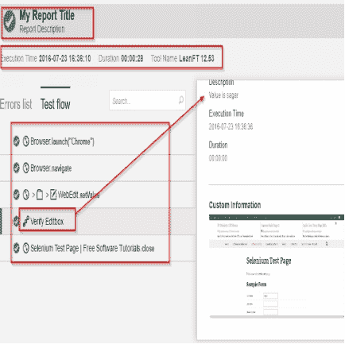

LeanFT 中显示运行期间捕获截图的 HTML 报告

## 13. LeanFT 框架

### 13.1 与 Cucumber 的 LeanFT

我们可以将 LeanFT 测试与 Cucumber BDD 框架集成。如果你知道如何使用 Cucumber，就可以轻松地集成 LeanFT。请按照以下步骤操作：

1. 使用 Cucumber 创建 LeanFT 测试。

2. 在 `pom.xml` 中添加 `cucumber` 和 `selenium` 依赖。

3. 编写 feature 文件。

4. 为场景编写步骤定义。

5. 执行 feature 文件。

这里是需要添加 cucumber 的依赖：

```xml
<dependency>
    <groupId>info</groupId>
    <artifactId>cucumber-java</artifactId>
    <version>1.4</version>
    <scope>test</scope>
</dependency>
```

然后你需要按照下面的示例创建 feature 文件：

```gherkin
Feature: My feature
Scenario: My Scenario
Given I am on softpost.org page
Then I verify that title contains tutorial
```

之后你可以按照示例创建步骤定义：

```java
package org.softpost;
import com.hp.lft.report.Reporter;
import com.hp.lft.sdk.ModifiableReportConfiguration;
import com.hp.lft.sdk.SDK;
import com.hp.lft.sdk.web.Browser;
import com.hp.lft.sdk.web.BrowserFactory;
import com.hp.lft.sdk.web.BrowserType;
import cucumber.api.java.After;
import cucumber.api.java.Before;
import cucumber.api.java.en.Given;
import cucumber.api.java.en.Then;
import org.junit.Assert;
import java.net.URI;
/**
 * 由 Sagar 创建于 23 -2016.*/
public class Steps{
    Browser browser;
    @Before
    public void init() throws Exception {
        ModifiableSDKConfiguration config = new ModifiableSDKConfiguration();
        config.setServerAddress( new URI( "ws://localhost:5095" ));
        SDK.init(config);
        Reporter.init();
    }
    @Given( "^I am on softpost\.org page$" )
    public void i_am_on_softpost_page() throws Throwable{
        browser = BrowserFactory.launch(BrowserType.CHROME);
        browser.navigate( "http://www.softpost.org" );
    }
    @Then( "^I verify that title contains tutorial$" )
    public void i_verify_that_title_contains_tutorial() throws Throwable {
        Assert.assertTrue(browser.getTitle().toLowerCase().contains( "tutorial" ));
    }
    @After
    public void clean() throws Exception {
        browser.close();
        SDK.cleanup();
    }
}
```

### 13.2 关键字驱动框架

关键字驱动框架在 LeanFT 中非常流行。请按照以下步骤创建关键字驱动框架：

1. 查找应用程序的主要操作和功能。

2. 将每个功能映射到关键字。

3. 编写自动化特定关键字的代码。

4. 创建由一个或多个关键字组成的测试用例。你可以将测试表存储在 Excel 文件、数据库或 `JUnit` 或 `TestNG` 测试类中。

5. 除非你使用 `JUnit` 或 `TestNG` 执行测试，否则你可能需要创建一个驱动脚本来执行每个用例。

这里是 HP 提供的 WPF 应用程序案例研究。在此应用程序中我们可以为每个主要功能创建一个关键字，如登录应用程序、搜索航班、选择航班、下单、搜索订单、删除订单、取消订单、预订机票、验证航班。然后我们可以使用上述相同的关键字创建各种用户场景的测试用例。这里是使用上述关键字创建的两个用例。注意，在下面的用例中，我们重用了登录关键字。

这里是搜索航班的测试用例：

1. 登录航班应用程序。

2. 搜索下周从伦敦飞往巴黎的单人航班。

3. 验证仅显示从伦敦到巴黎的航班。

这里是搜索订单的测试用例。

1. 登录 `Flight` 应用程序。

2. 预订航班并记录订单号，例如 `88`。

3. 搜索 ID 为 `88` 的订单。

4. 验证航班详情是否显示正确。

### 13.3 数据驱动框架

当你需要使用各种类型的数据对应用程序进行测试时，就会数据驱动框架。你可以按照以下格式存储数据。

1. Microsoft Excel 文件

2. 数据库

在数据驱动框架中，我们测试同一个功能，但使用不同的数据集。例如，在 HP 航班应用程序中，我们可以使用 `User Id` 和 `Password` 的不同组合来测试 `Login` 功能。请注意，此处的 `Login` 功能是相同的，但在每次运行期间测试数据是不同的。

### 14. 将 UFT 对象库转换为 LeanFT 中的应用程序模型

我们可以使用下面的命令行工具将对象库转换为 LeanFT 中的应用程序模型。

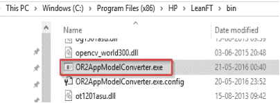

#### Java 版 OR2AppModelConverter

以下是该工具的语法。

```
OR2AppModelConverter myuftOR.tsr myAppModel.tsrx myLogFile.log
```

**警告**：第一个参数是对象库文件的路径。第二个参数是应用程序模型文件的路径。第三个参数是日志文件的路径，最后一个参数是日志级别（可以是 `Info`、`Warning` 或 `Error`）。

### 15. 将 FT 测试集成到 CI 服务器

#### 15.1 在 Bamboo 中添加 maven 任务

`maven` 任务的重要设置如下所示。

1. 提供 `maven` 可执行文件的路径。

2. 提供任何有效的 [maven 目标](http://www.softpost.org/maven/maven-commands/)

下图显示了如何在 `Bamboo` 中配置 `maven` 任务。我们已经设置了 clean test 目标。

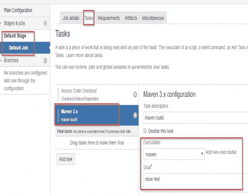

Bamboo 中的 maven 任务

下图显示了使用 `maven` 任务的构建计划的示例输出。

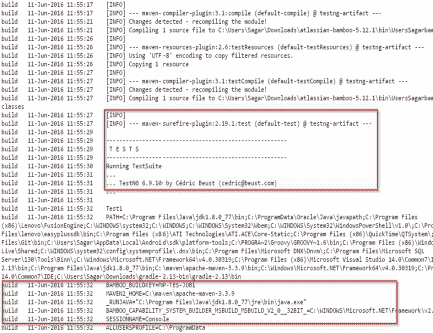

Bamboo 中的 maven 输出

#### 15.2 在 Jenkins 中创建和配置构建

现在让我们了解如何在 `Jenkins` 中创建和配置一个典型的构建。要创建新构建（也称为任务），点击 `Jenkins` 页上的 `New Item` 链接。它将打开下面的页面。

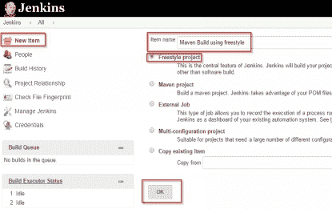

新建 Jenkins 构建项目

然后输入项目名称，选择 `freestyle project` 并点击 `OK`。它将打开如下所示的构建配置页面。输入项目描述，如果你想向构建传递任何参数，请添加参数。

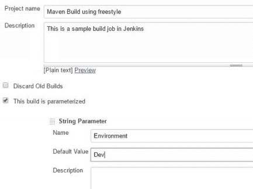

Jenkins 构建配置 - 构建名称、描述、参数

接下来，你需要像下图所示配置 `git` 等 SCM。在这个示例中，我们使用 `GITHUB` 上的仓库。但你可以使用任何其他版本控制软件。

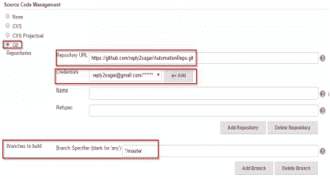

Jenkins 构建中的 git - 源码管理

接下来 - 你必须指定构建触发器。你可以以 `Cron` 表达式的形式指定触发器。你也可以定期轮询 `SCM`，如果检测到更改，将运行构建。

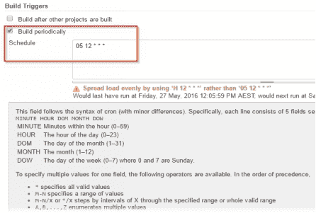

Jenkins 构建触发器


你的任务/项目由多个构建步骤组成。因此，你可以如下所示添加构建步骤。请注意，除非你安装了适当的插件，否则你将不会看到图中所示的所有构建步骤。例如 - 除非你在`Jenkins`中安装了`MSBuild`插件，否则`MSBuild`步骤将不可。

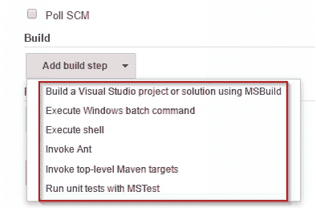

Jenkins 构建步骤

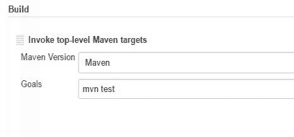

Jenkins 中的 maven 构建步骤

最后你需要做的是配置构建后操作。下图显示了你可以执行可能的构建后操作。

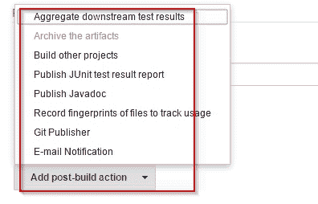

Jenkins 中的构建后操作

上述步骤是可选的。所以只需点击`Save`按钮即可。做得好！你刚刚在`Jenkins`中创建了一个示例构建。要查看你的构建项目，只需进入主页。你将看到如下所示的构建（黄色高亮）。

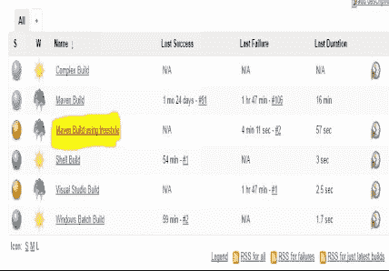

仪表板上的 Jenkins 构建

## 15.3 TeamCity 中 Maven 项目的构建步骤

在本主题中，你将学习如何在`TeamCity`中为`maven`项目设置构建步骤。如下所示，你必须选择运行器类型为`Maven`。然后你必须提供要执行的目标。默认情况下，它使用项目根目录下的`POM.xml`。你也可以在运行测试目标的同时运行代码覆盖过程，这将提供关于测试覆盖了多少类的报告。这里是一些常用的`maven`目标的列表。

1. `test` - 使用`surefire`插件执行测试。我们也可以向`maven JUnit test goal`和`maven testNG test goal`传递各种参数。

2. `verify` - 执行单元测试并执行插件提供的验证。

3. `install`

4. `site`

5. `deploy`

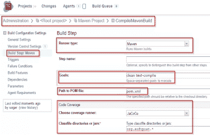

TeamCity 中的 maven 构建步骤

下图显示了示例构建日志。

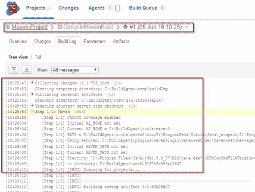

TeamCity 中的 maven 构建日志

## 16. 挑战与解决方案

### 16.1 LeanFT 自动化挑战

以下是主要的`LeanFT`挑战列表。

1. `LeanFT`不支持第三方控件。我们必须使用`Native`对象。

2. 嵌套表格中的动态元素如复选框、按钮、单选按钮。我们必须使用`HTML DOM`处理。

### 16.2 使用 Native 属性和方法操作第三方对象

下面的示例说明了如何在`LeanFT`中访问`native 属性`。在下面的示例中，我们使用`native value`属性设置输入框的值。我们还使用了`native click`方法进行点击。

```java
package leanft;
import com.hp.ft.report.Reporter;
import com.hp.ft.report.Status;
import com.hp.ft.sdk.NativeObject;
import org.junit.Test;
import java.util.List;

public class ChromeTest extends BaseTest {
    @Test
    public void test() throws Exception {
        Browser browser = BrowserFactory.launch(BrowserType.ROME);
        try {
            //导航到 http://soft.post.org/test-page/
            browser.navigate("http://soft.post.org/test-page/");
            browser.sync();
            //在输入框设置值
            browser.describe(EditField.class, new EditField.Builder()).id("fn").build()).setValue("S");
            //获取原生对象
            NativeObject obj = browser.describe(EditField.class, new EditField.Builder()).id("fn").build()).getNativeObject();
            //列出对象的成员
            List<String> list = obj.getMembers();
            for (String s : list) {
                System.out.println(s);
            }
            obj.setProperty("value", "Native");
            Thread.sleep(3000);
            //使用原生方法点击 Home 链接
            browser.describe(Link.class, new Link.Builder()).tagName("A").innerText("Home").build()).getNativeObject().invokeMethod("click");
        } catch (AssertionError ex) {
            //报告异常
            Reporter.reportEvent("Exception", "测试失败", Status.Failed, ex);
            throw ex;
        } finally {
            //关闭浏览器
            browser.close();
        }
    }
}
```

## 17. LeanFT 常见问题与解决方案

列出了在使用`LeanFT`工作期间可能遇到的常见问题及其解决方案。

1. `无法连接到位于.... 的 LeanFT 运行时` 此异常发生在`LeanFT`运行时未运行时。只需启动引擎，该错误就会消失。

2. `发生内部问题，请确保已正确初始化 LeanFT SDK....` 此异常发生在你未初始化`LeanFT SDK`时。为了消除此异常，请在代码开头添加以下行。

```java
ModifiableSDKConfiguration config = new ModifiableSDKConfiguration();
config.setServerAddress(new URI("ws://localhost:5095"));
SDK.init(config);
```

3. `启用 LeanFT 插件时 IntelliJ IDEA 无法启动` – 要修复此此问题，请在进程管理器中结束`IntelliJ IDEA`的`LeanFT`插件。

## 4. 异常说明

- `com.hp.lft.sdk.ReplayObjectNotUniqueException`: 对象不唯一 – 当 LeanFT 找到多个匹配描述的对象时抛出此异常。要解决此问题，你需要添加更多属性以便识别出唯一对象。

- `Object not found` – 未找到对象 – 当 LeanFT 无法在应用程序中找到对象时抛出此异常。要解决此问题，请确保该对象确实存在于应用程序中，并且使用的是正确的描述来识别该对象。

## 18. LeanFT 与与其他工具对比

### 18.1 HP UFT 与 LeanFT 的区别

以下是 UFT 和 LeanFT 之间的主要差异列表。

1. UFT 脚本只能使用 VBScript 编写。

2. LeanFT 脚本可以使用`Java`、`C#.Net`和 JavaScript 等。

3. LeanFT 不支持`Oracle`、`Siebel`、`PeopleSoft`、`Delphi`、`Power Builder`、`Stingray`、`Flex`、`VisualAge`等技术的自动化。UFT 支持所有这些平台。

### 18.2 LeanFT 与 Selenium 及 Ranorex 的比较

根据我的经验，我可以说 LeanFT 和 Ranorex 在功能上是对同的。

#### Selenium 与 LeanFT 的区别

1. Selenium 与 LeanFT（以及 Ranorex）之间最大的区别是 Selenium 仅支持网页自动化，不支持窗口应用程序。但 LeanFT 和 Ranorex 可以非常轻松地自动化 Web 应用以及窗口和表单。

2. Selenium 与另外两个工具的另一个主要区别是 Selenium 是免费的！

#### LeanFT 与 Ranorex 的区别

1. LeanFT 由 HP 开发，而 Ranorex 由 Ranorex Gmbh 开发。

2. Ranorex 编码只能用`C#.Net`完成，而 LeanFT 既可以使用`C#.Net`也可以使用`Java`。

3. Ranorex 使用`xpath`来识别窗口以及 Web 中的对象。LeanFT 使用属性值对来识别 Windows 应用中的对象。LeanFT 也支持 Web 应用中的`xpath`。

## 19. LeanFT Java 参考

你可以在以下 URL 找到 LeanFT 资源。

1. `http://leanft-help.saas.hpe.com/en/12.52/HelpCenter/Content/HelpCenterRoot/DemoApps.htm` - HP 提供的示例应用程序

2. `http://leanft-help.saas.hpe.com/en/12.52/JavaSDKReference/index.html?com/hp/lft/sdk/example-files/master-examples-list.html` - Java 示例

3. `http://leanft-help.saas.hpe.com/en/12.52/JavaSDKReference/index.html` - LeanFT Java SDK

4. `http://leanft-help.saas.hpe.com/en/12.52/HelpCenter/Content/HowTo/UFT_OR_Converter.htm` - 将 UFT 对象库转换为 LeanFT 中的应用程序模型

5. `http://leanft-help.saas.hpe.com/en/12.52/HelpCenter/Content/HowTo/RunRemotely.htm` - 在 LeanFT 中远程执行测试

6. `http://leanft-help.saas.hpe.com/en/12.52/HelpCenter/Content/HowTo/CI_Tools.htm` - 将 LeanFT 与 TeamCity 等 CI 服务器集成
