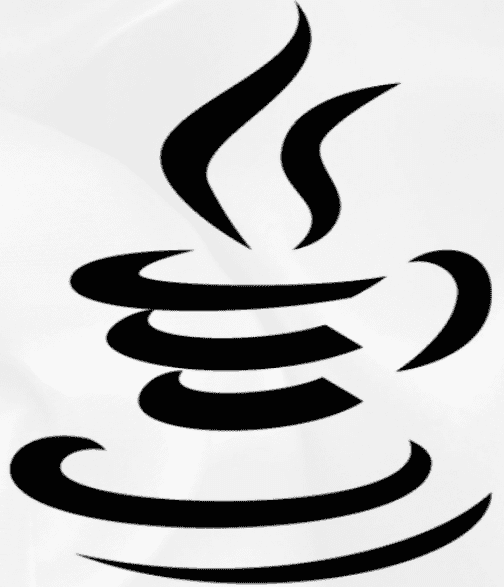

# 初学者也能学会高级 Java 编程

每页都包含实时代码示例，帮助你快速轻松学习 Java 编程。



```java
public class SwitchExample {
  String dayName;
  case 1:
}
```

## Java 简介

Java 的介绍通常从语言及其核心特性开始。

### 1. 概览

- **目的**：Java 是一种多功能、面向对象且平台无关的编程语言。它的设计目标是简单、安全且可以在各种平台之间迁移。
- **起源**：由 `James Gosling` 及其团队在 20 世纪 90 年代中期于 Sun 公司开发，最初是为消费电子设备的编程设计的。

### 2. 面向对象特性

- **对象**：在 Java 中，一切皆被视为对象。对象既有数据（属性），也有可以对数据进行操作的方法（函数）。这种方法鼓励了代码的模块化和可重用。

### 3. 平台无关性

- **一次编写，随处运行 (WORA)**：Java 代码可以在一个平台上编写，无需修改即可在任何其他平台上执行。这是通过使用 `Java` 虚拟机 (`JVM`) 实现的，它在 Java 程序和底层硬件之间提供了一个抽象层。

### 4. Java 虚拟机 (JVM)

- **执行环境**：`JVM` 是 Java 的关键组件，负责解释 Java 字节码并在主机上执行它。这使得 Java 程序能够在不同平台之间进行迁移。

### 5. 语法简单性

- **可读性**：Java 语法设计得清晰且易于阅读。它从 C 和 C++ 中借鉴了大量语法，让许多程序员感到非常熟悉。

### 6. 自动内存管理

- **垃圾回收**：Java 包含一个自动垃圾回收器，可以自动回收不再使用的对象占用内存。这简化了开发者的内存管理。

### 7. 强类型语言

- **数据类型**：Java 是一种强类型语言，这意味着变量必须声明特定的数据类型。这有助于在编译时捕捉错误并增强代码的可靠性。

### 8. 异常处理

- **健壮性**：Java 拥有健壮的异常处理机制，允许开发者优雅地处理运行时错误。这有助于 Java 应用程序的整体稳定性。

### 9. 丰富的标准库

- **API (应用程序编程接口)**：Java 自带了一个庞大且全面的标准库 (`Java API`)，为各种任务提供了预构建的功能。这允许开发者专注于特定的应用程序逻辑，而不是关注底层细节。

### 10. 多线程支持

- **并发执行**：Java 支持多线程，允许开发者创建可以并发执行多个任务的应用程序。这对于构建响应且高效的程序至关重要。

总之，Java 是一种强大且多功能的编程语言，以其平台无关性、面向对象范式、简单性和健壮特性而闻名。它的应用范围从 Web 开发到移动应用开发，使其成为软件开发行业的热门选择。

让我们从一个简单的 Java "Hello, World!" 程序开始：

```java
public class HelloWorld {
  public static void main(String[] args) {
    System.out.println("Hello, World!");
  }
}
```

现在，让我们拆解这个示例：

1. **`public class HelloWorld`**：这一行声明了一个名为 `HelloWorld` 的类。在 Java 中，所有内容都定义在类中，且文件名必须与类名匹配。
2. **`public static void main(String[] args)`**：这是主方法。它是 Java 程序的入口。当你运行 Java 应用程序时，它从 `main` 方法开始执行。
3. **`System.out.println("Hello, World!")`**：这一行向控制台打印字符串 "Hello, World!"。

Java 是一种面向对象的编程语言，理解 OOP（面向对象编程）概念至关重要。封装、继承和多态等概念是编写高效 Java 代码的基础。

### 6. 了解 Java 开发生命周期

- Java 程序通过一个开发生命周期，包括编写代码、使用 `javac` 编译器进行编译，以及使用 Java 解释器执行代码。理解这一周期对于排查故障和调试至关重要。

### 7. 探索 Java 标准库 (Java API)

- Java 自带了一个庞大的标准库，称为 `Java API`（应用程序编程接口）。熟悉 API 提供的类和方法，因为它们在编码时可以节省你的时间和精力。

### 8. 使用版本控制系统

- 像 `Git` 这样的版本控制系统是协作开发不可或缺的一部分。学习 `Git` 的基础知识以管理和跟踪 Java 项目中的更改。

### 9. 加入 Java 社区

- Java 有一个充满活力且支持良好的社区。参与论坛、阅读博客、关注社交媒体频道，以获取经验 Java 开发者提供的最新进展、最佳实践和技巧。

### 10. 实践并构建项目

- 学习 Java 的最佳方法是动手实践。从小项目开始，逐渐增加复杂性。构建现实应用可以增强你的技能并巩固对 Java 概念的理解。

总之，入门 Java 涉及安装 JDK、设置开发环境、选择 IDE、理解 Java 的基本结构和 OOP 概念、探索 `Java API`、使用版本控制、参与社区，最重要的是通过开展项目进行实践。随着经验的积累，你将越来越熟悉 Java 开发，并准备好应对更高级的话题。

## Java 语法

Java 语法是指规定如何编写 Java 程序的一系列规则约定。理解 Java 语法对于创建格式正确且功能良好的 Java 代码至关重要。

### 1. 大小写敏感

- Java 是大小写敏感的，这意味着大写字母和小写字母被视为不同的。例如，`variable` 和 `Variable` 被视为不同的标识符。

### 2. 类声明

- 在 Java 中，程序通常组织成类。类的基本结构包括关键字 `class` 后面跟类名。类体包含在大括号 `{}` 之中。

### 3. 方法声明

- 方法定义了类的行为。方法声明包括返回类型、方法名和参数（如果有）。方法体包含定义方法功能的代码。

### 4. 注释

- Java 中的注释用于为代码添加解释性说明。编译器忽略这些注释，它们是为了开发者服务的。单行注释以 `//` 开头，多行注释包含在 `/*` 和 `*/` 之间。

### 5. 变量和数据类型

- 变量是程序中存储数据的容器。Java 要求显式声明变量，指定数据类型（例如 `int`、`double`）。变量名必须遵循某些命名规范，且不能以数字开头。

### 6. 语句和表达式

- 语句是 Java 中的独立指令，而表达式是变量、运算符和字面量的组合，评估为单个值。语句通常以分号 `;` 结束。

### 7. 控制流语句

- Java 支持各种控制流语句，如 `if`、`else`、`switch`、`for`、`while` 和 `do-while`。这些语句根据某些条件控制程序中的执行流。

### 8. 对象实例化

- 在 Java 中，对象是类的实例。要创建一个对象，使用 `new` 关键字，后跟类构造函数。构造函数初始化对象并分配内存。

### 9. 继承

- 继承是面向对象编程 (OOP) 中的基本概念。在 Java 中，类可以使用 `extends` 关键字从另一个类继承属性和行为。

### 10. 异常处理

- Java 提供了一种处理异常的健壮机制。`try`、`catch`、`finally` 和 `throw` 关键字用于管理代码中的异常情况。

### 11. 包和导入

- Java 使用包将类组织到命名空间中。`package` 关键字用于声明包，`import` 关键字用于将其他包中的类引入到当前作用域。

### 12. 访问修饰符

- Java 使用 `public`、`private` 和 `protected` 等访问修饰符来控制类、方法和变量的可见性。这有助于强制封装和访问控制。

总之，Java 语法包含了定义类、方法、变量、控制流以及 Java 程序其他元素的规则。遵循这些语法规则可以确保代码的可读性、可维护性并按预期运行。

让我们从一个简单的 Java 代码示例开始，然后我将解释 Java 语法的含义：

```java
public class BasicSyntaxExample { 
    public static void main(String[] args) {
        // 变量声明和初始化
        int number = 10; 
        String greeting = "Hello, Java!"; 
        // 条件语句
        if (number > 5) {
            System.out.println(greeting); 
        } else {
            System.out.println("Number is not greater than 5."); 
        }

        // 循环语句
        for (int i = 0; i < 3; i++) {
            System.out.println("Loop iteration: " + i);
        }
    }
}
```

### Java 语法解释

1. **类声明**：在 Java 中，程序通常组织成类。`public class BasicSyntaxExample` 声明了一个名为 `BasicSyntaxExample` 的类。
2. **方法声明**：`public static void main(String[] args)` 声明了 `main` 方法。`main` 方法是 Java 程序的入口。
3. **变量声明和初始化**：在 Java 中，变量使用特定的数据类型进行声明。例如，`int number = 10;` 声明了一个名为 `number` 的整数变量并将其初始化为 10。同样，`String greeting = "Hello, Java";` 声明了一个名为 `greeting` 的字符串变量并将其初始化为一个字符串。
4. **条件语句 (if-else)**：`if (number > 5)` 是一个条件语句。如果条件为真，执行其后续块中的代码；否则，执行 `else` 之后块中的代码。
5. **打印语句**：`System.out.println` 用于向控制台打印输出。在示例中，它根据条件打印 `greeting` 变量的值或一条消息。
6. **循环语句 (for)**：`for (int i = 0; i < 3; i++)` 是一个循环三次的循环。它将变量初始化为 0，当 `i` 小于 3 时执行循环体，并在每次迭代后增加 `i`。

总之，Java 语法是指规定如何编写和结构化 Java 程序的一系列规则。它包含了声明变量、方法和类，使用条件语句和循环等的规则。理解并遵循 Java 语法对于编写正确且可读的 Java 代码至关重要。

## Java 输出

Java 输出是指 Java 程序在执行过程中产生的信息或结果。Java 输出通常生成到控制台，但也可以定向到其他目标，如文件、数据库或图形界面。

### 1. 控制台输出

- Java 程序产生输出最简单的方法是使用 `System.out.println()` 方法。该方法将文本发送到标准输出流（通常是控制台），后跟一个换行符。`println` 代表“打印行”。

### 2. 输出格式化

- Java 提供了各种格式化输出的方法，允许控制文本外观。`printf()` 方法常用于格式化输出，允许为变量提供占位符并指定格式。

### 3. 标准输出和标准错误

- Java 区分了标准输出 (`System.out`) 和标准错误 (`System.err`)。虽然它们通常显示在控制台上，但用途不同。标准输出用于正常程序输出，而标准错误用于错误消息或异常情况。

### 4. 拼接

- Java 输出可以通过拼接字符串来创建。`+` 用于字符串拼接，允许组合文本和变量值形成完整的输出。

### 5. 转义序列

- Java 支持转义序列（以反斜杠开头的特殊字符），用于表示不可打印字符或控制输出格式。例如，`\n` 表示换行符，`\t` 表示制表符。

### 6. 日志输出

- Java 开发者提供了一个日志框架——即 `Java Logging API`，用于捕获各种级别的程序输出。开发者可以使用日志记录器记录不同严重程度的消息，例如信息（info）、警告（warning）和错误（error）。

### 7. 文件输出

- 除了控制台，Java 程序还可以将输出写入文件。这是通过使用 `FileOutputStream` 或高级类如 `PrintWriter` 实现的。将输出写入文件对于记录和数据持久化至关重要。

### 8. GUI 输出

- 在图形用户界面（GUI）应用程序中，输出通常显示在窗口、对话框或其他图形元素中。像 `JavaFX` 或 `Swing` 等 GUI 框架提供了视觉化呈现信息的组件。

### 9. 重定向输出

- Java 允许开发者将标准输出和标准错误重定向到不同的目标。这对于捕获程序输出以便进一步分析或将 Java 程序集成到更大的系统中非常有用。

### 10. 本地化与国际化

- Java 支持本地化和国际化，允许开发者创建不同语言的输出消息，并根据区域习惯调整输出。这是通过资源包（resource bundles）和 `java.util.Locale` 类实现的。

总结，Java 输出涉及 Java 程序对信息的生成和呈现。无论是在控制台上显示、经过格式化、重定向到文件，还是在 GUI 中呈现，理解如何管理输出对于有效的编程和程序结果的交付都至关重要。

让我们从一个涉及输出的简单 Java 代码示例开始，然后我将解释 Java 输出的具体含义：

```java
public class OutputExample {
    public static void main(String[] args) {
        // 使用 println 输出到控制台
        System.out.println("Hello, Java!"); 
        // 使用变量进行输出
        int x = 5; 
        double y = 3.14;
        System.out.println("The value of x is: " + x);
        System.out.println("The value of y is: " + y); 

        // 格式化输出
        System.out.printf("Formatted output: x = %d, y = %.2f\n", x, y);
    }
}
```

### Java 输出说明

1. **打印到控制台 (`System.out.println`)**：`System.out.println` 语句用于向控制台打印一行文本。在示例中，它打印了字符串 "Hello, Java!"。
2. **使用变量输出**：你可以通过拼接或格式化在输出中包含变量值。变量 `x` 和 `y` 的值使用 `+` 运算符进行打印。`+` 运算符将字符串与变量值拼接。
3. **格式化输出 (`System.out.printf`)**：`System.out.printf` 方法允许你使用占位符格式化输出。在示例中，`%d` 是整数 (`x`) 的占位符，`%.2f` 是保留两位小数的浮点数 (`y`) 的占位符。

Java 输出特指程序向用户或系统的其他部分显示的信息。在提供的代码示例中：

- "Hello, Java!" 使用 `System.out.println` 输出到控制台。
- 变量 `x` 和 `y` 的值被整合到输出中，以显示关于这些变量的特定信息。`System.out.printf` 方法用于更具控制且格式化的输出，允许你指定输出字符串中每个值的格式。

理解如何生成输出对于调试、向用户反馈以及在 Java 程序内部通信信息至关重要。它涉及使用各种方法和技术，以可读且有意义的方式显示数据。

## Java 注释

在 Java 中，注释是添加到源代码中的不可执行语句，用于提供解释、文档说明或备注。Java 编译器会忽略注释，不会影响程序的功能。它们是开发者使代码更易读、更易理解的手段。以下是 Java 注释的解释：

### 1. 单行注释

- 单行注释以双斜杠 `//` 开始。同一行中 `//` 之后的任何内容都被视为注释，不会被编译器执行。单行注释适用于单行代码内的简要解释。

### 2. 多行注释

- 多行注释被包含在 `/*` 和 `*/` 之间。这些定界符之间跨多行的任何内容都被视为注释。多行注释适用于提供更详细的解释、记录代码段或临时排除代码块。

### 3. Javadoc 注释

- Javadoc 注释是一种用于文档目的的特定注释类型。它们以 `/**` 开始，以 `*/` 结束。Javadoc 注释可以使用 `Javadoc` 等工具自动生成文档。这些注释通常位于类、方法或字段之前，包含关于目的、参数、返回值和抛出异常的信息。

### 4. 用于阐明代码的注释

- 可以添加注释来澄清复杂的代码，或解释特定设计选择背后的原理。这对于让其他开发者或最初编写代码的人更容易理解代码特别有帮助。

### 5. TODO 注释

- TODO 注释用于标记代码中需要进一步关注或完成的区域。开发者可以使用这些注释来指示未来应该处理的任务。IDE 通常提供一种方便的方法来跟踪和管理 TODO 注释。

### 6. 注释掉代码

- 注释常用于临时“注释掉”或禁用部分代码。这在调试期间或测试替代实现方案时非常有用。与其删除代码，不如将其注释掉以便于恢复。

### 7. 头部注释

- 头部注释通常放置在文件开头，以提供其内容的概览。这可能包括关于作者、创建日期、修改历史或任何其他相关细节的信息。

### 8. 用于调试的注释

- 注释可用于包含调试信息。在调试时，开发者可能会添加注释来突出特定点，或指示某些行代码的用途。

### 9. 避免冗余注释

- 虽然注释很有价值，但尽可能编写自解释的代码是重要的。应该避免那些仅仅是重述显而易见内容的冗余注释，因为它们可能会让代码混乱而不添加任何有意义的信息。

### 10. 简洁代码实践

- 遵循简洁代码实践鼓励开发者以这种方式编写代码：代码清晰易读，而不必过度依赖注释。良好的变量、方法和类命名可以提高代码的清晰度。


# Java 注释

总结，Java 注释在增强代码的可读性和维护性方面起着至关重要的作用。它们为开发者提供了交流意图、记录功能以及使代码库对于未来可能阅读或处理代码的人更易访问的手段。

在 Java 中，注释用于在源代码中提供解释或注解。这些注释不会被 Java 编译器执行，也不会影响程序的功能；它们完全是为了方便开发者理解和记录代码。Java 中有两种类型的注释：单行注释和多行注释。

下面是一个包含两种类型注释的 Java 代码示例：

```java
public class CommentExample {
    // 这是一个单行注释 public
    public static void main(String[] args) {
        /*
          * 这是一个多行注释。
          * 它可以跨越多行，通常用于更详细的解释。
        */
        System.out.println("Hello, World!"); // 这也是一个单行注释 
        // 你可以使用注释来临时禁用或注释掉代码 
        // System.out.println("这一行不会被执行."); 
        // TODO: 这是一个特殊的注释类型，表示一个需要完成的任务 
        // 它通常用于标记需要关注或完成的代码区域
    }
}
```

## Java 注释说明

- **单行注释**：这些注释以 `//` 开始，并持续到行尾。它们通常用于简短的注释或单行内的注解。

- **多行注释**：这些注释以 `/*` 开始并以 `*/` 结束。它们可以跨越多行，适用于提供更详细的解释或注释掉大块代码。

- **注释代码**：你可以使用注释来临时禁用或注释掉某些代码。这在开发过程中非常有用，当你想要在不删除代码的情况下排除某些部分时。

- **TODO 注释**：这些是特殊的注释，通常用于标记代码中需要关注或完成的区域。开发者可以使用工具识别并列出代码库中所有的 TODO 注释，方便跟踪待办任务。

总而言之，Java 注释对于代码文档、可读性以及开发者之间的协作至关重要。它们有助于解释代码的作用，提供对其功能的深入见解，并让其他人（甚至是你未来的自己）更容易理解和维护代码库。

# Java 变量

在 Java 中，变量是存储数据值的容器。它们是编程的基础，用于在程序中持有和操作信息。

## 1. 变量声明

在 Java 中，你通过指定数据类型后跟变量名来声明变量。数据类型指示了变量可以持有的值类型，例如 `int` 表示整数，`double` 表示浮点数，或 `String` 表示文本。

## 2. 数据类型

Java 支持多种数据类型，包括原始数据类型（例如 `int`、`double`、`char`、`boolean`）和引用数据类型（例如 `String`、自定义类）。原始数据类型直接持有简单值，而引用数据类型存储对象的引用。

## 3. 命名规范

Java 中的变量名必须遵循某些命名规范。它们应该以字母开头，后跟字母、数字或下划线。名称是区分大小写的，因此 `myVariable` 和 `myvariable` 被视为不同的变量。

## 4. 初始化

在声明变量后，你可以通过称为“初始化”的过程为其分配一个初始值。这涉及到使用赋值运算符 (`=`) 将值与变量关联。

## 5. 作用域

变量具有作用域，作用域定义了程序中可以访问变量的区域。局部变量声明在特定的方法或块内，作用域有限，而实例变量和类变量具有更广泛的作用域。

## 常量

在 Java 中，你可以使用 `final` 关键字创建常量。常量是那些一旦赋值就不能更改其值的变量。它们通常用于在整个程序过程中应保持不变的值。

## 类型推断（Java 10 及更高版本）

从 Java 10 开始，Java 引入了名为本地变量类型推断的功能。通过此功能，你可以使用 `var` 关键字声明变量，而无需显式指定数据类型。编译器会根据分配的值推断类型。

## 6. 变量命名与可读性

为变量选择有意义且描述性的名称对于代码的可读性至关重要。良好的变量名可以传达其所持有数据的用途或含义，使代码更易理解。

## 7. 变量的可变性

变量的可变性取决于它们的数据类型。某些变量（如原始类型的变量）是不可变的，这意味着一旦赋值，值就无法更改。其他变量（如对象）可以修改其属性。

## 8. 垃圾回收

在 Java 中，内存管理由称为“垃圾回收”的过程处理。未使用的对象和变量会被自动识别并从内存中释放，以释放资源。

总结来说，Java 变量对于程序中存储和处理数据至关重要。它们具有特定的数据类型、命名规范、作用域，并根据其类型可能是或不可变的。理解如何声明、初始化和使用变量是编写高效且可读的 Java 代码的基础。

## 变量示例

在 Java 中，变量是存储数据值的容器。每个变量都有一个数据类型，例如 `int`、`double` 或 `String`，这定义了它可以持有的数据类型。

```java
public class VariableExample {
    public static void main(String[] args) {
        // Declare and initialize variables int
        int age = 25; 
        double height = 5.9;
        String name = "John Doe"; // Print the values of variables
        System.out.println("Name: " + name);
        System.out.println("Age: " + age);
        System.out.println("Height: " + height);
        
        int birthYear = 1995;
        int currentYear = 2024;
        int calculatedAge = currentYear - birthYear;
        System.out.println("Calculated Age: " + calculatedAge);
    }
}
```

### 变量说明

- **声明与初始化**：在 Java 中，你通过指定其数据类型后跟变量名来声明变量。数据类型指示了变量可以持有的值类型。例如，`int age = 25;`

- **数据类型**：Java 支持多种数据类型，包括原始类型（`int`、`double`、`char`、`boolean`）和引用类型。每个数据类型指定了它可以持有的数据种类。

- **打印**：你可以使用 `System.out.println()` 打印变量的值。这是一种常见的做法。

- **更新**：通过为其分配新值来更新变量。例如，`age = 26;`

- **操作**：变量可以用于数学运算或表达式中。例如，`calculatedAge = currentYear - birthYear`。

总结来说，Java 变量是存储数据值的命名存储位置。它们在编程中起着关键作用，允许开发者处理和操作数据。

# Java 数据类型

在 Java 中，数据类型是一个基本概念，定义了变量可以持值的性质。Java 中的每个变量都必须声明的数据类型，该类型指定了它可以存储的数据种类。

## 1. 原始数据类型

- **整数类型**：`byte`、`short`、`int` 和 `long` 用于整数（整数值）。

- **浮点类型**：`float` 和 `double` 用于带小数部分的数字。

- **字符类型**：`char` 用于单个字符。

- **布尔类型**：`boolean` 用于表示真或假。

## 2. 大小与范围

每个原始数据类型都有特定的位大小和定义的可以持有的值范围。例如，`int` 通常是 32 位，其范围是从 -2^31 到 2^31 - 1。

## 3. 引用类型

Java 中的引用类型包括类、接口、数组和枚举。与原始类型不同，这些数据类型不持有实际数据，而是内存中对象的引用。

## 4. 字符串

Java 中的 `String` 类用于表示字符序列。字符串不是原始数据类型，但由于它们在编程中的重要性而被广泛使用。

## 5. 数组

数组是一种引用数据类型，用于存储相同类型元素的集合。它们可以是一维的、多维的或锯数组。

## 6. 自动类型转换（强制转换）

Java 支持某些数据类型的自动类型转换。例如，你可以将一个 `int` 值赋值给 `double` 变量，而无需显式强制转换。然而，在某些类型之间转换时，需要显式强制转换。

## 7. 装箱与拆箱

Java 支持基本类型与其对应的包装类之间的自动转换。这一过程被称为装箱（将基本类型转换为其包装类型）和拆箱（将包装类型转换为其基本类型）。

## 8. 枚举

枚举（`enum`）是一种特殊的数据类型，用于定义一组命名的常量。枚举使代码更具可读性，并提供了一种表示固定值集合的方法。

## 9. 类型安全

Java 是一种静态类型语言，这意味着变量的数据类型必须在编译时已知。这通过在编译过程中捕获与类型相关的错误增强了类型安全性。

## 10. 自定义数据类型

除了内置数据类型外，Java 还允许开发者使用类和接口创建自己的自定义数据类型。这一特性是面向对象编程的基础。

总之，Java 数据类型根据变量可以持有的值类型对变量进行分类。理解不同数据类型的特性、范围和用途对于编写正确且高效的 Java 程序至关重要。

## 数据类型示例

在 Java 中，数据类型用于分类和定义变量可以持有的值类型。Java 支持两种大类数据类型：基本数据类型和引用数据类型。

```java
// 用于引用数据类型示例的自定义类
class Person {
    private String name;
    private int age; 
    public Person(String name, int age) { this.name = name; this.age = age; }

    public String getName() {
        return name;
    }

    public int getAge() {
        return age;
    }
}
```

### 数据类型说明

#### 1. 基本数据类型

- `int`: 表示整数值（例如，42）。
- `double`: 表示浮点数值（例如，3.14）。
- `char`: 表示单个字符（例如，'A'）。
- `boolean`: 表示真或假值（例如，true）。

#### 2. 引用数据类型

- `String`: 表示字符序列（例如，"Hello, Java!"）。
- **数组（引用数据类型）**：数组用于存储相同数据类型的多个值。在示例中，`int[] numbers` 是一个整数数组。
- **自定义类（引用数据类型）**：开发者可以定义自己的类来创建自定义数据类型。在示例中，`Person` 类是一个带有 `name` 和 `age` 属性的自定义类。

理解数据类型在 Java 编程中至关重要，因为有助于确保变量被恰当使用以及操作被正确执行。基本数据类型是构建更复杂结构的基石，而引用数据类型允许创建自定义对象和结构。

# Java 类型转换

Java 类型转换是指将值从一种数据类型转换为另一种数据类型的过程。这种转换可以是显式的也可以是隐式的，取决于是否需要程序员显式地指定转换。

## 1. 隐式强制转换（宽转换）

隐式强制转换也称为宽转换或自动类型转换，发生在转换可以在不丢失任何信息的情况下完成。例如，将 `int` 转换为 `double` 是隐式的，因为 `double` 类型可以表示整数值而不会丢失。

## 2. 显式强制转换（窄转换）

当从较大的数据类型转换为较小的数据类型，或者存在潜在的信息丢失时，需要显式强制转换。例如，将 `double` 转换为 `int` 需要显式强制转换，因为信息可能会由于截断而丢失。

## 3. 基本类型之间的强制转换

在 Java 中，基本类型可以相互强制转换。例如，将 `long` 转换为 `int`，或将 `float` 转换为 `short`。然而，需要注意的是，在不兼容类型或尺寸差异巨大的类型之间进行强制转换可能会导致数据丢失。

## 4. 包装类的强制转换

当使用包装类（例如 `Integer`, `Double`）时，可能需要显式强制转换以在包装类型之间或在包装类型与基本类型之间进行转换。这一过程被称为拆箱和装箱。

## 5. 对象的类型转换

在 Java 中处理对象时，强制转换通常用于将一种类型的对象视为另一种类型的对象。这在涉及继承和多态的场景中尤为常见。

## 6. 类型安全

Java 的类型系统强调类型安全性，强制转换在维护这种安全性方面起着作用。应该谨慎地进行转换，以避免运行时错误和意外行为。编译器在编译过程中检查类型的兼容性。

## 7. 类型兼容性

强制转换只在兼容的类型之间才可能。例如，你可以在数值类型之间进行强制转换，但不能在不相关的类型之间进行强制转换，例如尝试将 `String` 转换为 `int`。

## 8. 枚举的强制转换

枚举（`enum`）是 Java 中的特殊类型，在处理枚举时可能需要强制转换，特别是当你需要将枚举常量转换为其序数（ordinal value）或反之时。

## 9. 基本类型与引用类型

基本类型和引用类型的强制转换过程略有不同。基本类型涉及直接转换，而引用类型涉及在继承层次结构中的类或接口之间转换引用。

## 10. ClassCastException

在强制转换引用类型时，处理潜在的异常（如 `ClassCastException`）至关重要。如果被转换的对象不是指定类型的实例，可能会发生该异常。

总之，Java 类型转换是一种允许开发者在不同类型之间转换值的机制。无论是隐式的还是显式的，强制转换在管理数据类型、确保类型安全以及促进程序部分之间的交互方面起着至关重要的作用。

## 类型转换示例

在 Java 中，类型转换是指将值从一种数据类型转换为另一种数据类型的过程。存在两种类型转换：隐式（自动）转换和显式（手动）转换。

```java
public class TypeCasting {

    public static void main(String[] args) {
        // 隐式强制转换（宽转换） 
        int intValue = 50;
        long longValue = intValue; // 自动将 int 转换为 long
        
        float floatValue = 3.14f;
        double doubleValue = floatValue; // 自动将 float 转换为 double

        System.out.println("隐式转换:");
        System.out.println("float to double: " + doubleValue);

        // 显式强制转换（窄转换） 
        double anotherDoubleValue = 123.456;
        int anotherIntValue = (int) anotherDoubleValue; // 手动将 double 转换为 int
        
        long anotherLongValue = 987654321L;
        int anotherIntValue2 = (int) anotherLongValue; // 手动将 long 转换为 int

        System.out.println("显式转换:");
        System.out.println("double to int: " + anotherIntValue);
        System.out.println("long to int: " + anotherIntValue2);
    }
}
```

### 类型转换说明

#### 1. 隐式强制转换（宽转换）

当将较小的数据类型赋值给较大的数据类型时自动发生。这是安全的，因为不会丢失精度。

#### 2. 显式强制转换（窄转换）

当将较大的数据类型赋值给较小的数据类型时，必须由程序员手动完成。这可能会导致精度丢失。

#### 3. 显式转换的注意事项

在缩小数据类型时，存在丢失信息的风险，特别是当值很大或包含小数时。必须确保被强制转换的值在目标类型的有效范围内，以防止意外结果。

# Java 运算符

在 Java 中，运算符是对变量和值执行操作的符号。它们对于操作数据和控制程序流至关重要。

## 1. 算术运算符

算术运算符执行基础数学运算。这些包括加法 (`+`)、减法 (`-`)、乘法 (`*`)、除法 (`/`) 和取模 (`%`)。取模返回除法的余数。

## 2. 关系运算符

关系运算符用于比较值。常见的关系运算符包括等于 (`==`)、不等于 (`!=`)、大于 (`>`)、小于 (`<`)、大于或等于 (`>=`) 和 小于或等于 (`<=`)。

## 3. 逻辑运算符

逻辑运算符对布尔值执行逻辑操作。逻辑与 (`&&`) 在两个操作数都为真时返回真，逻辑或 (`||`) 在至少有一个操作数为真时返回真，而逻辑非 (`!`) 则返回相反的布尔值。

## 4. 赋值运算符

赋值运算符用于给变量赋值。基础赋值运算符是 `=`。其他赋值运算符包括 `+=`, `-=`, `*=`, `/=`, `%=` ，它们执行某种操作并将结果赋值给变量。

## 5. 自增和自减运算符

自增 (`++`) 和自减 (`--`) 运算符分别增加或减少变量的值 1。它们可以以前缀或后置形式使用，从而影响求值的顺序。

## 6. 位运算符

位运算符在位级别上执行操作。示例包括位与 (`&`)、位或 (`|`)、位异或 (`^`)、位非 (`~`)、左移 (`<<`) 和右移 (`>>`)。

## 7. 条件运算符（三元运算符）

条件运算符（或三元运算符）(`? :`) 是表示 `if-else` 语句的简写方式。它评估一个布尔表达式，并根据表达式的真或假返回两个值之一。

## 8. instanceof 运算符


- `instanceof` 运算符用于测试对象是否是特定类或接口的实例。如果对象是实例，则返回 `true`；否则返回 `false`。

## 9. 等等与标识运算符

- 等等运算符 (`==`) 检查两个值是否相等。标识运算符 (`==` 和 `!=`) 检查两个引用是否指向同一个对象。（注意：在 Java 中，`==` 用于身份标识，而 `.equals()` 用于相等性判断）。

## 10. 字符串拼接运算符

- `+` 运算符用于在 Java 中拼接字符串。当与字符串一起使用时，它将它们合并创建一个新字符串。

## 11. 其他运算符

- Java 还包含其他运算符，例如条件空运算符 (`??`)，如果左侧操作数不空则返回左操作数，否则返回右操作数（在 Java 12 中引入）。

理解这些运算符的工作原理及其优先级对于编写正确且高效的 Java 代码至关重要。运算符是程序中表达计算和决策的基础工具。

在 Java 中，运算符是对变量和值执行操作的符号。Java 中有多种运算符，包括算术、关系、逻辑、赋值、位运算等。

```java
public class OperatorsExample {
    public static void main(String[] args) {
        // 算术运算符
        int num1 = 10;
        int num2 = 5;
        int difference = num1 - num2;
        int sum = num1 + num2;
        int product = num1 * num2;
        int quotient = num1 / num2;
        int remainder = num1 % num2;

        System.out.println("Arithmetic Operators:");
        System.out.println("Sum: " + sum);
        System.out.println("Difference: " + difference);
        System.out.println("Quotient: " + quotient);
        System.out.println("Remainder: " + remainder);

        // 关系运算符
        boolean isEqual = (num1 == num2);
        boolean isNotEqual = (num1 != num2);
        boolean isGreater = (num1 > num2);
        boolean isLessOrEqual = (num1 <= num2);

        System.out.println("\nRelational Operators:");
        System.out.println("Is Equal: " + isEqual);
        System.out.println("Is Not Equal: " + isNotEqual);
        System.out.println("Is Greater: " + isGreater);
        System.out.println("Is Less or Equal: " + isLessOrEqual);

        // 逻辑运算符
        boolean logicalAnd = (true && false);
        boolean logicalOr = (true || false);
        boolean logicalNot = !true;

        System.out.println("\nLogical Operators:");
        System.out.println("Logical AND: " + logicalAnd);
        System.out.println("Logical OR: " + logicalOr);
        System.out.println("Logical NOT: " + logicalNot);

        // 赋值运算符
        int x = 5;
        x += 3; // 等于 x = x + 3
        System.out.println("\nAssignment Operator:");
        System.out.println("Updated x: " + x);

        // 位运算符
        int binaryNum1 = 0b01010; // 二进制字面量 10
        int binaryNum2 = 0b1100; // 二进制字面量 12
        int bitwiseAnd = binaryNum1 & binaryNum2;
        int bitwiseOr = binaryNum1 | binaryNum2;
        int bitwiseXor = binaryNum1 ^ binaryNum2;

        System.out.println("\nBitwise Operators:");
        System.out.println("Bitwise AND: " + bitwiseAnd);
        System.out.println("Bitwise OR: " + bitwiseOr);
        System.out.println("Bitwise XOR: " + bitwiseXor);
    }
}
```

在 Java 中，`String` 是字符的序列。它是 Java 中的一个类，该类的实例表示字符序列。

```java
public class StringsExample {
    public static void main(String[] args) {
        // 创建字符串
        String greeting = "Hello, ";
        String name = "John"; // 字符串拼接
        String welcomeMessage = greeting + name + "!";
        System.out.println("Welcome Message: " + welcomeMessage); //

        int length = welcomeMessage.length();
        System.out.println("Length of Message: " + length); // 访问字符串中的字符
        char firstChar = welcomeMessage.charAt(0);
        char lastChar = welcomeMessage.charAt(length - 1);
        System.out.println("First Character: " + firstChar);
        System.out.println("Last Character: " + lastChar); //

        // 子字符串
        String substring = welcomeMessage.substring(7, 12);
        System.out.println("Substring: " + substring); //

        // 字符串比较
        String anotherName = "john";
        boolean isEqualIgnoreCase = greeting.equalsIgnoreCase(anotherName);
        System.out.println("Is name equal to anotherName (ignore case)? " + isEqualIgnoreCase);

        // 字符串修改（字符串是不可变的）
        String originalString = "abc";
        String modifiedString = originalString.concat("def");
        System.out.println("Original String: " + originalString);
        System.out.println("Modified String: " + modifiedString);
    }
}
```

## Java 字符串说明

### 1. 创建字符串

可以使用双引号创建字符串。例如，`String greeting = "Hello, ";`

### 2. 拼接

可以使用 `+` 运算符拼接字符串。在示例中，`welcomeMessage` 是通过拼接 `greeting`、`name` 和 `"!"` 形成的。

### 3. 字符串长度

使用 `length()` 方法查找字符串的长度。

### 4. 访问字符

`charAt(index)` 方法允许你访问字符串中特定索引处的字符。

### 5. 子字符串

`substring(startIndex, endIndex)` 方法提取字符串的某部分。

### 6. 字符串比较

`equals()` 方法用于区分大小写的字符串比较，而 `equalsIgnoreCase()` 用于不区分大小写的比较。

### 7. 字符串修改（不可变性）

Java 中的字符串是不可变的，这意味着它们的值在创建后无法被更改。像拼接这样的操作会创建新字符串，而不是修改原始字符串。

字符串是 Java 中的基础类型，被广泛用于表示文本。`String` 类提供了各种处理和操作字符串的方法，使其在处理 Java 程序中的文本数据时非常灵活。理解字符串操作对于许多涉及文本处理的编程任务至关重要。

在 Java 中，`Math` 类是 `java.lang` 包的一部分，它提供了一系列执行数学运算的静态方法。这些方法涵盖了广泛的数学函数，对各种应用程序都非常有用。

### 1. 静态方法

`Math` 类中的所有方法都是静态的，这意味着你不需要创建类的实例即可使用它们。你可以直接使用类名调用这些方法。

### 2. 基础算术运算

`Math` 类包含了基础算术运算的方法，例如加法（`addExact()`）、减法（`subtractExact()`）、乘法（`multiplyExact()`）和除法（`floorDiv()`）。这些方法更健壮地处理了溢出和欠溢情况。

### 3. 指数和对数函数

`Math` 类提供了指数函数的方法，如 `exp()` 和 `pow()`，它们将基数提升到指定的幂。它还包含了不同底数的对数函数，如 `log()` 和 `log10()`。

### 4. 三角函数

`Math` 类提供了常用的三角函数，包括 `sin()`、`cos()` 和 `tan()`。

### 5. 舍入

`round()`、`floor()` 和 `ceil()` 等方法用于数值舍入取整。

### 6. 平方根与立方根

`sqrt()` 计算平方根，`cbrt()` 计算立方根。

### 7. 绝对值

`abs()` 方法返回绝对值。

### 8. 最小值与最大值

`min()` 和 `max()` 用于比较两个值。

### 9. 随机数生成

`random()` 方法返回 0.0 到 1.0 之间的随机数。

### 10. 常数

`Math` 类包含了常量，如 `PI` 和 `E`。

### 11. 特殊函数

`hypot()` 用于计算直角三角形斜边，`toDegrees()` 和 `toRadians()` 用于角度和弧度的转换。

### 12. IEEE 754 标准

`Math` 类中的许多方法遵循 IEEE 754 标准进行浮点数运算。

总结来说，`Math` 类提供了在科学和工程领域中常用的数学运算。

在 Java 中，`boolean` 类型表示一种只有两种可能值的数据类型：`true` 和 `false`。布尔值在编程中是基础性的，因为它们通常用于决策、控制程序流以及表达条件。

### 1. 布尔值

布尔变量只能包含两个值中的一个：`true` 或 `false`。这些值代表了布尔变量的两种可能状态。

### 2. 逻辑运算

布尔值常用于逻辑运算。逻辑与 (`&&`)、逻辑或 (`||`) 和逻辑非 (`!`) 运算符通过对布尔值进行操作，并组合产生一个结果。

### 3. 条件语句

在 Java 中，条件语句（如 `if`、`else if` 和 `else`）依赖于布尔表达式来确定执行流。如果布尔表达式求值为 `true`，则执行相应的代码块。

### 4. 比较运算符

比较运算符，例如 `==`（等于）、`!=`（不等于）、`<`（小于）、`>`（大于）、`<=`（小于或等于）和 `>=`（大于或等于），在用于比较值时会产生布尔结果。

### 5. 布尔表达式

布尔表达式是求值为 `true` 或 `false` 的条件。这些表达式经常用于控制流语句、循环条件和决策结构中。

### 6. 控制流

布尔值在控制程序流方面起着至关重要的作用。它们帮助根据某些条件确定应该执行哪些代码分支。

### 7. 决策

布尔值对于程序中的决策至关重要。例如，程序可能决定在条件为 `true` 时执行某项操作，在条件为 `false` 时执行另一个操作。

### 8. 默认值

如果声明了一个布尔变量但没有显式初始化，它的默认值为 `false`。在处理布尔变量时，这是一个重要的考虑因素，可以避免出现意外的行为。

### 9. 逻辑短路

Java 中的逻辑运算符表现出短路行为。例如，在 `&&` 运算中，如果左操作数为 `false`，则右操作数不会被求值，因为结果将始终为 `false`。

### 10. 布尔方法和函数

Java 中的方法和函数通常返回布尔值以指示操作的成功或失败。例如，检查特定条件的方法在满足条件时返回 `true`，否则返回 `false`。

### 11. 标志位变量

布尔变量常作标志位变量，用于信号程序中特定事件或条件的发生或状态。

### 12. 枚举与状态

布尔值经常用于表示二进制状态或枚举，其中 `true` 可能对应一个状态，而 `false` 对应另一个状态。

总结，Java 中的布尔值通过各种结构用于决策、控制流和表达条件。

```java
public class BooleanExample {
    public static void main(String[] args) {
        boolean isEqual = true;
        int x = 10;

        if (isEqual) {
            System.out.println("x is equal");
        } else {
            System.out.println("x is not equal");
        }

        if (x > 5) {
            System.out.println("x is greater");
        } else {
            System.out.println("x is not greater");
        }

        boolean flag = false;
        if (flag) {
            System.out.println("Flag is true");
        } else {
            System.out.println("Flag is false");
        }
    }
}
```

总之，Java 中的 `if...else` 语句允许开发者在代码中创建条件分支，从而根据布尔表达式的求值结果执行不同的代码块。它是 Java 程序中用于决策和控制流的基础结构。

在 Java 中，`if...else` 语句用于条件分支，允许程序根据布尔表达式的求值结果做出决策。


```java
public class IfElseExample {
    public static void main(String[] args) {
        int x = 10; int y = 20;

        //  1: Simple if...else 语句
        if (x > y) {
            System.out.println("x is greater than y.");
        } else {
            System.out.println("x is not greater than y.");
        }

        //  2: if...else ladder 语句
        int grade = 75; 
        if (grade >= 90) {
            System.out.println("Grade is A");
        } else if (grade >= 80) {
            System.out.println("Grade is B");
        } else if (grade >= 70) {
            System.out.println("Grade is C");
        } else if (grade >= 60) {
            System.out.println("Grade is D");
        } else {
            System.out.println("Grade is F");
        }

        // 3: Nested if...else 语句
        int num = -5; 
        if (num > 0) {
            System.out.println("Positive number");
        } else {
            if (num < 0) {
                System.out.println("Negative number");
            } else {
                System.out.println("Zero");
            }
        }
    }
}
```

`if...else` 语句的解释：

1. 简单的 `if...else` 语句：在第一个示例中，程序检查 `x` 是否大于 `y`。如果条件为真，执行第一个代码块中的代码；否则，执行 `else` 块中的代码。

2. `if...else if...else` 梯形：在第二个示例中，程序使用 `if...else if...else` 梯形根据数值分数确定等级。条件按顺序求值，并执行第一个为真的条件的代码块。

3. 嵌套的 `if...else` 语句：在第三个示例中，程序检查数字是正、负还是零。这演示了嵌套，即一个 `if...else` 语句位于另一个 `else` 块内部。

`if...else` 语句允许程序根据布尔表达式的求值结果执行不同的代码块。它是 Java 中基础控制流结构，用于程序逻辑中的决策。`if` 和 `else` 部分是可选的，该结构可以根据特定场景需要尽可能简单或复杂。

## Java Switch

在 Java 中，`switch` 语句是一种控制流语句，提供了一种简洁易读的方式来处理多个条件或情况。它允许程序根据表达式的值执行不同的代码块。

- 1. 表达式求值：
  `switch` 语句以关键字 `switch` 开始，后跟着一个包含在括号内的表达式。该表达式会被求值，其结果决定了将执行哪一个代码块。

- 2. Case 标签：
  `switch` 语句包含多个 `case` 标签，每个标签表示表达式可能拥有的值或值范围。`case` 标签后跟冒号（:）和相关的代码块。

- 3. 匹配与执行：
  当表达式的值与其中一个 `case` 标签匹配时，将执行相应的代码块。`switch` 语句继续执行代码，直到遇到 `break` 语句或到达 `switch` 块的结束。

- 4. 可选的 default 情况：
  `switch` 语句可以包含一个可选的 `default` 情况，当没有任何 `case` 标签匹配表达式的值时，将执行该情况。`default` 情况对于提供默认行为或处理意外情况很有用。

- 5. 穿透（Fall-through）行为：
  与某些编程语言不同，`switch` 语句在遇到 `break` 语句或到达 `switch` 块结束之前继续执行代码。

- 6. Java 7 之前的支持：
  在 Java 7 之前，`switch` 语句不支持字符串。

- 7. Java 7 的增强：
  从 Java 7 开始，`switch` 语句支持了字符串类型。

- 8. Java 12 的增强：
  Java 12 引入了 `switch` 表达式的增强。

- 9. 用例：
  `switch` 语句在有多个可能值需要检查时非常有用。

- 10. 代码组织：
  `switch` 语句在处理多个值的情况时，比一系列 `if...else` 语句更简洁、易读。

总之，Java 中的 `switch` 语句提供了一种简洁易读的方式来处理多个条件或情况。它允许程序根据表达式的值执行不同的代码块。基于情况的标签。

```java
public class SwitchExample {
    public static void main(String[] args) {
        int dayOfWeek = 3;
        String dayName;

        // 使用 switch 确定星期
        switch (dayOfWeek) {
          case 1:
            dayName = "Monday"; break;
          case 2:
            dayName = "Tuesday"; break;
          case 3:
            dayName = "Wednesday"; break;
          case 4:
            dayName = "Thursday"; break;
          case 5:
            dayName = "Friday"; break;
          case 6:
            dayName = "Saturday"; break;
          case 7:
            dayName = "Sunday"; break;
          default:
            dayName = "Invalid day";
        }

        // 显示结果
        System.out.println("Day of the week: " + dayName);

        // 字符的示例
        char grade = 'B'; 
        String result; 
        switch (grade) {
            case 'A':
            case 'B':
                result = "Pass";
                break;
            case 'C':
            case 'D':
                result = "Partial Pass";
                break;
            case 'F':
                result = "Fail";
                break;
            default:
                result = "Invalid grade";
        }

        // 显示结果
        System.out.println("Result: " + result);
    }
}
```

### `switch` 语句的解释：

1. 语法：
   `switch` 语句由选择器表达式（要评估的值）和一组 `case` 标签组成，每个标签都有匹配时执行的代码块。

2. 匹配情况：
   `switch` 内部的表达式会被求值，程序会查找匹配的 `case` 标签。如果找到匹配，则执行该 case 关联的代码块。

3. `break` 语句：
   `break` 语句用于执行 case 后退出 `switch` 块。如果没有 `break`，控制流将穿透到后续的 case。

4. `default` 情况：
   `default` 情况是可选的，当没有任何标签匹配表达式时将执行它。它类似于 `if...else` 语句中的 `else` 部分。

5. 多重情况：
   可以将多个 `case` 组合在一起而不使用 `break` 语句，从而允许多个情况共享同一个代码块。

`switch` 语句当变量有多个可能值且你想根据该变量的值执行不同代码时，非常有用的工具。它为一系列 `if...else if...else` 语句提供了一种更清晰、更高效的替代方案，特别是在处理单个变量的多个值时。

## Java While 循环

在 Java 中，`while` 循环是一种控制流语句，只要指定的布尔表达式求值为 `true`，它就会重复执行一个代码块。

- 1. 条件评估：
  `while` 循环以 `while` 关键字开始，后跟着一个括在括号内的布尔表达式。该表达式在循环的每次迭代之前都会进行评估。

- 2. 入口条件：
  布尔表达式（也称为入口条件）决定了 `while` 循环内部的代码是否会被执行。如果表达式求值为 `true`，则执行循环体；否则，循环终止，控制权移到 `while` 循环之后的下一条语句。

- 3. 循环体：
  `while` 循环的体由由大括号 `{}` 包围的代码块组成。该代码块包含只要入口条件为 `true` 就会重复执行的语句。

- 4. 迭代执行：
  如果入口条件初始为 `true`，则会执行循环体，然后再次评估入口条件。如果条件保持为 `true`，则会再次执行循环体，从而形成一个迭代过程。

- 5. 死循环风险：
  必须确保入口条件最终能够求值为 `false`。否则，`while` 循环可能会导致死循环，即循环内部的代码将无限执行下去。

- 6. 变量初始化：
  使用循环时，在进入循环之前初始化入口条件中使用的任何变量是非常关键的。未能正确初始化变量可能会导致意外行为或死循环。

- 7. 退出条件：
  在循环体内部，开发者通常会包含修改入口条件中所用变量值的语句。这确保了随着时间的推移，条件将变为 `false`，从而允许循环终止。

- 8. 灵活的控制流：
  该循环非常多功能，可以用于各种需要根据指定条件重复执行代码块的场景。当预先不知道迭代次数时，它特别有用。

- 9. 先测试循环：
  这种循环被称为先测试循环，因为条件在执行循环体之前就已经被评估了。如果条件初始为 `false`，则将完全跳过循环体。

- 10. 替代循环结构：
  除了 `while` 循环外，Java 还提供了其他循环结构，例如 `for` 循环和 `do-while` 循环，它们各自有自己的特点和用例。

- 11. 嵌套循环：
  `while` 循环可以嵌套在其他循环或控制流结构中，允许程序中出现更复杂的重复和决策模式。

总结来说，Java 中的 `while` 循环是根据指定条件创建重复执行的基础结构。它在处理迭代次数取决于程序状态的场景时提供了灵活性。仔细考虑入口条件并并在循环体内正确修改变量，对于确保行为正确且可预测至关重要。

在 Java 中，`while` 循环是一种控制流语句，只要指定的条件为 `true`，它就会重复执行一个代码块。

```java
public class WhileLoopExample {
    public static void main(String[] args) {
        // 示例 1: 简单的 while循环
        int i = 1;
        while (i <= 5) {
            System.out.println("Iteration " + i); i++;
        }

        // 示例 2: 使用 break 语句的死循环
        int j = 1;
        while (true) {
            System.out.println("Infinite Loop, Iteration " + j); j++; if (j > 3) {
                break; // 在三次迭代后退出循环
            }
        }

        // 示例 3: 带用户输入的 while循环
        java.util.Scanner scanner = new java.util.Scanner(System.in); System.out.print("Enter a number (0 to exit): ");
        int userInput = scanner.nextInt(); while (userInput != 0) {
            System.out.println("You entered: " + userInput);
            System.out.print("Enter a number (0 to exit): ");
            userInput = scanner.nextInt();
        }

        System.out.println("Exited the loop. Program complete.");
        scanner.close();
    }
}
```

### `while` 循环的解释：

- 1. 语法：
  `while` 循环以 `while` 关键字开始，后跟着括号内的布尔表达式。只要大括号内的布尔表达式为 `true`，其内部代码块就会重复执行。

- 2. 条件：
  只要指定的条件求值为 `true`，循环就会继续执行。如果条件初始为 `false`，则循环内部的代码将永远不会执行。

- 3. 初始化与更新：
  在进入循环之前初始化条件中使用的任何变量是非常关键的，并且应该在循环内部更新条件，以便最终变为 `false` 并退出循环。

- 4. 死循环：
  应小心避免死循环。在第二个示例中，使用了 `break` 语句在满足特定条件后退出循环。

- 5. 用户输入循环：
  第三个示例展示了一个 `while` 循环，它会一直提示用户输入，直到他们输入 0。

当迭代次数预先未知且取决于特定条件时，`while` 循环是合适的。确保条件最终变为 `false` 以防止死循环非常重要。只要条件保持为 `true`，循环就会继续执行，使其成为重复执行代码块的灵活结构。

## Java For 循环

在 Java 中，`for` 循环是一种控制流语句，允许指定的代码块重复执行特定次数。它为执行迭代提供了一种简洁且表达力的方式。

- 1. 初始化：
  `for` 循环以关键字开始，后跟着一组括号。在括号内指定循环的初始化部分。这部分通常包括循环控制变量的初始化。

- 2. 控制变量：
  循环控制变量是用于控制迭代次数的变量。它在 `for` 循环的第一部分初始化，用于跟踪循环的进度。

- 3. 条件：
  `for` 括号内的第二部分包含持续条件。该条件在每次迭代之前进行评估，如果为 `true`，则执行循环体。如果条件为 `false`，循环终止。

- 4. 迭代表达式：
  `for` 括号内的第三部分包含迭代表达式。该表达式在每次循环体之后执行，通常用于更新循环控制变量。

- 5. 循环体：
  `for` 循环的体由大括号 `{}` 包围。只要持续条件为 `true`，其中包含的语句就会重复执行。

- 6. 先测试循环：
  该循环被称为先测试循环，因为条件在执行循环体之前就已经被评估了。如果条件初始为 `false`，则将完全跳过循环体。

- 7. 初始化一次：
  `for` 循环的初始化部分只在循环开始时执行一次。它负责设置循环控制变量的初始状态。

- 8. 灵活的控制流：
  当迭代次数预先已知时，`for` 循环是表达重复执行的一种简洁且生动的方式。它为每次迭代期间初始化、测试和更新变量提供了清晰的结构。

- 9. 增强 `for` 循环（Java 5 及更高版本）：
  除了传统的循环，Java 还引入了增强 `for` 循环（也称为 "foreach" 循环）。这种循环通过消除显式循环控制变量和条件，简化了对数组和集合的迭代。

- 10. 嵌套循环：
  `for` 循环可以嵌套在其他循环或控制流结构中，允许程序中出现更复杂的重复和决策模式。

- 11. 变量作用域：
  在 `for` 循环初始化部分声明的变量作用域有限，仅在循环体内可访问。

- 12. 替代循环结构：
  除了 `for` 循环，Java 还提供了其他的循环结构，如 `while` 循环和 `do-while` 循环，它们各自具有特性和使用场景。

总之，Java 中的 `for` 循环是一种用于迭代操作的强大且表达性构造。它简化了循环和迭代的结构。它提供了一种在每次迭代中初始化、测试和更新变量的清晰方法。`for` 循环广泛用于已知迭代次数的场景。

在 Java 中，`for` 循环是一种控制流语句，允许你按照指定的次数重复执行一段代码块。


```java
public class ForLoopExample {
    public static void main(String[] args) {
        // Example 1: Simple for loop
        for (int i = 1; i <= 5; i++) {
            System.out.println("Iteration " + i);
        }

        // Example 2: Sum of numbers using a for loop
        int sum = 0;
        for (int j = 1; j <= 10; j++) {
            sum += j; // Equivalent to sum = sum + j
            System.out.println("Sum of numbers from 1 to 10: " + sum);
        }
        // Example 3: Nested for loop for a multiplication table
        for (int row = 1; row <= 5; row++) {
            for (int col = 1; col <= 5; col++) {
                System.out.print(row * col + "\t");
            }
            System.out.println();
        }
    }
}
```

## `for` 循环的解释

1.  **语法**：`for` 循环括号内有三个部分：初始化、条件和更新。大括号内的代码块只要条件为真，就会重复执行。
2.  **初始化**：初始化部分在循环开始时执行一次。它通常用于初始化循环控制变量。
3.  **条件**：条件在每次迭代之前进行求值。如果求值为真，则循环继续；否则退出。
4.  **更新**：更新部分在每次迭代之后执行。它通常用于增加或递减循环控制变量。
5.  **循环变量作用域**：循环控制变量的作用范围仅限于 `for` 循环，仅在循环内部可访问。
6.  **嵌套 for 循环**：`for` 循环可以嵌套循环内部。在第三个示例中，使用了嵌套循环来打印乘法表。

`for` 循环是一种遍历值范围的简洁且具表现力的方式。它通常用于预先知道迭代次数的情况。循环控制变量经常用于跟踪循环进度，并可以在循环内部用于各种目的。`for` 循环是 Java 编程中多功能且强大的构造。

## Java Break/Continue

在 Java 中，`break` 和 `continue` 语句是循环内部的控制流语句，用于改变执行的正常流程。

### Java break 语句

1.  **循环终止**：`break` 语句用于提前终止循环的执行。当在循环中遇到 `break` 语句时，会立即退出循环，并将控制转移到循环后的语句。
2.  **提前退出**：`break` 经常在循环中用于根据特定条件提前退出循环。一旦遇到 `break` 语句，循环的剩余迭代将被跳过，程序继续执行循环后的语句。
3.  **switch 语句**：除了循环，`break` 语句还用于 `switch` 语句以退出 `switch` 块。它通常放在每个 `case` 块的末尾，防止穿透到后续的 `case` 块。
4.  **循环嵌套**：处理嵌套循环时，内部循环中的 `break` 语句只会退出该循环，而不是外部循环。如果在外部循环中使用 `break` 语句，将退出外部循环。

### Java continue 语句

1.  **跳过迭代**：`continue` 语句用于跳过循环中当前迭代的剩余代码，并进入下一次迭代。它不会退出循环；而是跳过当前迭代循环体内的剩余语句。
2.  **循环递增/更新**：在遇到 `continue` 语句后，循环的递增或更新表达式会被执行，控制移动到循环的下一次迭代。这允许循环继续下组迭代。
3.  **过滤元素**：`continue` 经常用于过滤循环中的特定元素或条件。例如，如果满足了某个条件，可以使用 `continue` 语句跳过该特定迭代的处理。
4.  **循环嵌套**：与 `break` 语句类似，在嵌套循环的情况下，`continue` 语句仅影响最内层循环。它跳过内部循环当前迭代的剩余代码，并进入该内部循环的下一次迭代。
5.  **在 while 和 do-while 循环中使用**：`continue` 语句可以用于 `while` 和 `do-while` 循环，就像在 `for` 循环中一样，以实现跳过当前迭代剩余代码并移动到下一个的效果。
6.  **标签 continue (Java 8 及更高版本)**：Java 8 引入了在 `continue` 语句使用标签的能力，允许开发者在处理嵌套循环时指定要继续哪个循环。这种带标签的 `continue` 语句在多层嵌套场景下提供了更多控制。

总之，`break` 和 `continue` 语句都是循环中常用的重要控制流构造，用于改变正常执行流。虽然 `break` 用于提前终止循环，而 `continue` 用于跳过当前迭代的剩余代码并进入下一次迭代。谨慎使用 `break` 和 `continue`，它们是用于循环的控制语句。

```java
public class BreakContinueExample {
    public static void main(String[] args) {
        // Example with break
        System.out.println("Example with break:");
        for (int i = 1; i <= 5; i++) {
            if (i == 3) {
                break; // Terminate the loop when i is 3
            }
            System.out.println("Iteration " + i);
        }

        // Example with continue
        System.out.println("\nExample with continue:");
        for (int j = 1; j <= 5; j++) {
            if (j == 2 || j == 4) {
                continue; // Skip the rest
            }
            System.out.println("Iteration " + j);
        }
    }
}
```

### 解释

1.  **break**：在第一个循环中，当 `i` 变为 3 时，遇到 `break` 语句，导致循环终止。
2.  **continue**：在第二个循环中，当 `j` 等于 2 或 4 时，会遇到 `continue` 语句。它跳过了循环体的剩余部分，因此不再打印 "Iteration"。

### 总结

-   **break**：立即终止循环，控制权转移到循环后的语句。
-   **continue**：跳过剩余代码并进入下一次迭代。

## Java 数组

在 Java 中，数组是一种允许在单个变量名下存储多个相同类型值的数据结构。

1.  **同质元素**：Java 数组是同质的，这意味着数组中的所有元素必须是相同类型。例如，你可以有一个整数数组、字符数组或对象数组。
2.  **固定大小**：数组一旦创建，其大小就是固定且不可更改。如果你需要可以增长或缩小的动态集合，可以考虑其他数据结构，如 `ArrayList` 或 `LinkedList`。
3.  **零索引**：数组元素通过索引访问，索引从 0 开始。第一个元素位于索引 0，第二个元素位于索引 1，以此类推。最后一个元素位于 `length-1`，其中 `length` 是数组的大小。
4.  **声明和初始化**：使用方括号 `[]` 声明并初始化数组。例如，`int[] numbers = new int[5];` 声明了一个大小为 5 的整数数组 `numbers`。使用 `new` 关键字为数组分配内存。
5.  **属性**：数组具有 `length` 属性，指示数组中的元素数量。该属性通常用于循环和其他构造，以遍历数组元素。
6.  **随机访问**：数组允许通过索引直接访问任何元素。这使得对元素的随机访问非常高效，访问元素的时间复杂度为常数 O(1)。
7.  **多维数组**：Java 支持多维数组，例如二维数组。访问多维数组元素的语法与一维数组相似，使用多个索引即可。
8.  **内存连续性**：数组元素存储在连续的内存位置。这确保了高效的内存使用，并允许根据索引快速访问元素。
9.  **基本类型数组和对象数组**：数组可以同时持有基本数据类型（例如 `int`、`char`）和对象（例如类的实例）。基本类型数组存储实际值，而对象数组存储的是对象的引用。
10. **增强型 for 循环**：Java 提供了一种增强循环（也称为 for-each 循环），简化了遍历数组元素的过程。该循环会自动处理迭代，不需要显式索引。
11. **Arrays 类**：`java.util.Arrays` 类提供了用于处理数组的工具方法。这些方法包括排序、搜索和其他操作。
12. **数组复制**：可以使用多种方法复制数组，例如 `clone()` 或 `System` 类提供的 `System.arraycopy()`。这些方法允许你创建一个具有相同元素的新数组。

总之，Java 数组是一种基础数据结构，允许你存储和操作多个相同类型的元素。它们提供了一种处理值集合的简单方法，通过索引直接访问元素。以下是一个在 Java 中使用数组的示例：

```java
public class ArraysExample {
    public static void main(String[] args) {
        // 数组的声明和初始化
        int[] numbers = {1, 2, 3, 4, 5};

        // 访问并打印
        System.out.println("Array elements:");
        for (int i = 0; i < numbers.length; i++) {
            System.out.println("numbers[" + i + "] = " + numbers[i]);
        }
    }
}
```

### 解释

使用 `for` 循环遍历数组，并使用方括号 (`[]`) 访问元素。元素被打印到控制台，显示每个索引处的值。总之，Java 数组用于在单个变量中存储相同类型的多个值。`length` 属性有助于确定数组的大小。

## Java 方法

在 Java 中，方法是执行特定任务的代码块，可以从程序的其他部分调用。方法提供了一种结构化和组织代码的方法，促进代码复用，并提高程序的可读性和维护性。

1.  **声明与定义**：使用关键字声明并定义方法，其后跟着返回类型、名称以及封装在花括号 `{}` 中的代码块。返回类型指定了方法返回的值类型，或者如果方法不返回任何值，则指示为 `void`。
2.  **方法签名**：方法名及其参数列表的组合被称为方法签名。它在类中唯一地标识该方法。
3.  **参数**：方法可以接受参数，参数是在调用方法时传递给方法的值。参数指定在方法签名的括号内。
4.  **返回类型**：方法的返回类型指示它产生的值类型。如果方法不返回任何值，则返回类型指定为 `void`。具有除 `void` 外返回类型的方法使用 `return` 语句返回指定类型的值。
5.  **方法调用**：要执行方法中的代码，必须从程序的其他部分调用该方法。方法调用由方法名后包含所需参数的括号组成。
6.  **访问修饰符**：方法可以使用访问修饰符，如 `public`、`private` 或 `protected`，这些符号控制方法对其他类的可见性。缺少访问修饰符意味着包私有可见性。
7.  **静态方法和实例方法**：方法可以是静态方法，也可以是实例方法。静态方法属于类本身，而不是类的实例。实例方法在类的实例上进行操作，并可以访问实例变量。
8.  **方法重载**：Java 支持方法重载，允许同类中的多个方法具有相同名称但不同的参数列表。重载方法为具有不同参数类型的方法调用提供了灵活性。
9.  **递归**：方法可以调用自己，这种概念被称为递归。递归方法是解决可以分解为相同问题较小实例问题的强大技术。
10. **Java 标准库方法**：Java 自带了一套丰富的标准库方法，由 `Math`、`String` 等类提供。任何 Java 程序都可以调用这些方法，而不需要显式的 `import` 语句。
11. **封装**：方法通过允许隐藏实现细节来贡献于封装。可以使用方法仅向外部暴露必要的功能，从而保护对象的内部状态。
12. **代码复用性**：方法通过允许从程序的不同部分调用同一块代码来促进代码复用。这减少了冗余并提高了代码的可维护性。

总之，Java 方法是基本的构建块，它们封装了功能，促进了代码组织并有助于代码复用。它们在构建程序、增强可读性以及支持模块化和可维护的代码开发方面起着关键作用。

在 Java 中，方法是执行特定任务并定义在类中的块。方法用于将代码组织成可复用的单元并促进代码模块化。以下是在 Java 中使用方法的示例：

```java
public class MethodsExample {
    public static void main(String[] args) {
        // 调用带参数并有返回值的方法
        int sum = addNumbers(3, 7);
        System.out.println("Sum: " + sum);

        // 调用无参数并有返回值的方法
        double result = calculateSquareRoot();
        System.out.println("Square root: " + result);

        // 调用带参数且无返回值的方法
        printMessage("Hello, Java Methods!");

        // 调用无参数且无返回值的方法
        displayGreeting();
    }

    // 带参数并有返回值的方法
    public static int addNumbers(int a, int b) {
        return a + b;
    }

    // 无参数并有返回值的方法
    static double calculateSquareRoot() {
        double number = 25.0;
        return Math.sqrt(number);
    }

    // 带参数且无返回值的方法
    static void printMessage(String message) {
        System.out.println(message);
    }

    // 无参数且无返回值的方法
    static void displayGreeting() {
        System.out.println("Welcome to Java Methods!");
    }
}
```

## Java 方法参数

在 Java 中，方法参数是在方法声明中指定的变量，用于在调用方法时将值传递给方法。参数允许方法从调用者接收输入，使方法更具通用性和可重用性。以下是对 Java 方法参数的说明：

### 1. 参数声明

参数在方法签名的括号内声明，位于方法名之后。每个参数通过指定其数据类型后跟参数名称来声明。

### 2. 形式参数

在方法签名中声明的参数通常被称为形式参数。它们充当调用方法时传递给方法的值的占位符。

### 3. 参数的数量和类型

方法可以有零个或多个参数。方法签名中参数的类型和顺序定义了方法的参数列表。调用者必须按照相同的顺序和正确的数据类型为每个参数提供值。

### 4. 实参数

当调用方法时，提供的匹配声明参数的值被称为实参数或参数。这些值在方法调用期间被传递给方法。

### 5. 值传递

在 Java 中，参数是通过值传递的。这意味着实参数值的副本被传递给形式参数。在方法内部对形式参数所做的更改不会影响原始的实参数。

### 6. 默认值

Java 不支持默认参数值。在方法调用期间必须显式地为所有参数提供值。然而，可以使用方法重载通过定义具有不同参数列表的多个方法版本来实现类似的功能。

### 7. 变长参数列表

Java 使用变长参数（varargs）支持变长参数列表。变长参数允许方法接受相同类型的可变数量的参数。变长参数使用省略号 (`...`) 后跟数组类型来声明。

### 8. 不同参数列表的方法重载

方法重载允许类定义多个具有相同名称但参数列表不同的方法。重载方法在接受不同类型或数量的参数时提供了灵活性。

### 9. 顺序和类型非常重要

方法调用中参数的顺序和类型必须与方法签名中声明的参数顺序和类型匹配。类型不匹配或缺少值将导致编译错误。

### 10. 参数的作用域

参数在方法内具有局部作用域。它们仅在方法定义代码块内可访问。一旦方法执行完成，参数将超出作用域。

### 11. 封装与模块化

使用参数允许方法封装功能并促进模块化。通过向同一个方法传递不同的值，你可以使用不同的输入重用该方法逻辑。

### 12. 可读性与可维护性

命名良好的参数有助于代码的可读性和可维护性。描述性的参数名称有助于传达方法的意图和预期值。

总之，Java 中的方法参数提供了一种将值传递到方法的机制，使代码具有灵活性、可重用性和模块化。它们在定义方法的输入需求方面起着至关重要的作用，对 Java 程序的整体设计和结构有所贡献。


在 Java 中，方法参数允许你在调用方法时向方法传递值。这些参数作为方法的输入，使其能够根据提供的值执行操作。以下是一个说明 Java 方法参数的示例：

```java
public class MethodParametersExample {
    public static void main(String[] args) {
        // 调用带参数的方法
        int result1 = add(5, 3);
        System.out.println("Sum: " + result1);

        // 调用带不同参数的方法
        double result2 = multiply(4.5, 2.0);
        System.out.println("Product: " + result2);

        // 调用带字符串的方法
        greet("John");
    }

    // 带有参数（整数）和返回值的方法
    public static int add(int a, int b) {
        return a + b;
    }

    // 带有参数（双精度浮点数）和返回值的方法
    public static double multiply(double x, double y) {
        return x * y;
    }

    // 带有字符串参数且没有返回值的方法
    public static void greet(String name) {
        System.out.println("Hello, " + name + "!");
    }
}
```

解释：

### 1. 带参数的方法声明：

- 在 `add` 方法中，括号内指定了两个整数参数（`int a` 和 `b`）。该方法返回这些参数之和。

- 在 `multiply` 方法中，指定了两个双精度浮点数参数（`double x` 和 `y`）。该方法返回这些参数的乘积。

- `greet` 方法接收单个参数（`String name`）且不返回任何值（`void`）。

### 2. 带参数的方法调用：

- 当调用 `add` 方法时，值 `5` 和 `3` 作为参数传递。这些值被赋值给方法内部的参数 `a` 和 `b`。

- 同样，调用 `multiply` 方法时使用了参数 `4.5` 和 `2.0`，这些值被赋值给参数 `x` 和 `y`。

- 调用 `greet` 方法时使用了参数 `"John"`，该值被赋值给参数 `name`。

### 3. 返回值和输出：

- 方法返回值（`int` 或 `double`），这些值在 `main` 方法的 `println` 语句中被使用。

总之，Java 方法参数提供了一种将值传递到方法的机制，使代码具有灵活性、可重用性和模块化。

# Java 方法重载

Java 中的方法重载是一项特性，允许类定义具有相同名称但参数列表不同的方法。以下是对 Java 方法重载的说明，不提供具体的代码示例：

### 1. 相同的方法名：

- 方法重载发生在类具有多个相同名称的方法时。

### 2. 参数列表：

- 重载方法必须具有不同的参数列表。

### 3. 返回类型：

- 在判断方法是否重载时不考虑返回类型。

### 4. 编译时决策：

- 关于调用哪个重载方法的决策由编译器根据提供的参数在编译时做出。

### 5. 增强可读性：

- 方法重载通过允许对不同变化使用相同名称来增强可读性。这使得代码更加直观。

### 6. 避免命名冲突：

- 通过重载方法，开发者可以避免需要不同的名称。相反，方法名保持不变，差异通过参数列表体现。

### 7. 灵活输入：

- 重载允许方法接受各种输入而无需创建新方法。例如，`calculate` 方法可以重载以接受不同类型的数值参数。

### 8. 常见用例：

- 方法重载的常见用例包括为可选参数提供默认值、支持各种数据类型以及处理多参数场景。

### 9. 构造函数重载：

- Java 中的构造函数也可以被重载。这允许具有不同参数列表的多个构造函数以各种方式初始化对象。

### 10. 局限性：

- 在重载方法时，必须确保参数列表足够不同，以便编译器做出无歧的决策。如果两个方法具有相同数量和类型的参数但顺序不同，则不被视为有效的重载。

### 11. 无变长参数歧义：

- 在重载方法时，变长参数（变长参数列表）被视为与数组不同。这有助于避免具有不同参数类型（包括变长参数）的重载方法之间的歧义。

### 12. 编译时多态：

- 方法重载是编译时多态的一个示例，其中调用哪个方法的决策根据方法签名在编译时解决。

在 Java 中，方法重载允许你在同一个类中定义多个同名但参数列表不同的方法。这些方法可以具有不同数量或类型的参数。以下是 Java 方法重载的示例：

```java
public class MethodOverloadingExample {
    public static void main(String[] args) {
        // 调用重载方法
        displayInfo("Alice");
        displayInfo("Alice", 25);
        displayInfo("Bob", "Engineering");
    }
}
```

```java
// 带一个参数的方法
public static void displayInfo(String name) {
    System.out.println("Name: " + name);
}
```

```java
// 带两个参数的重载方法
public static void displayInfo(String name, int age) {
    System.out.println("Name: " + name + ", Age: " + age);
}
```

```java
// 另一个不同参数类型的重载方法 
public static void displayInfo(String name, String occupation) {
    System.out.println("Name: " + name + ", Occupation: " + occupation);
}
```

解释：

- 1. 方法重载：在示例中，`displayInfo` 方法被重载了三次。第一个版本接受单个参数（`String name`），第二个版本接受两个参数（`String name` 和 `int age`），第三个版本接受两个参数（`String name` 和 `String occupation`）。

- 2. 调用重载方法：在 `main` 方法中，使用不同的参数组合调用了重载的 `displayInfo` 方法。

- 3. 编译解析：在编译期间，Java 编译器根据方法调用中提供的参数数量和类型来决定调用哪个版本的方法。

- 4. 多态：方法重载是 Java 中多态的一种形式，同一个方法名可以根据调用的上下文表示不同的行为。

方法重载对于创建更具可读性和直观的代码非常有益。它允许你对同一逻辑操作的不同变化使用相同的方法名。需要注意的是，方法重载是在编译时确定的，并根据方法签名（参数类型和数量）选择适当的方法。

# 递归

递归是一种编程概念，方法通过直接或间接地调用自己来解决问题。

- 1. 定义：

- 递归是一个过程，方法通过直接或间接地调用自身，并处理相同问题的更小或更简单的实例来解决问题。

- 2. 基准情况（Base Case）：

- 每个递归算法必须有一个基准情况，它代表了无需进一步递归即可解决的最简单形式。基准情况防止递归无限持续。

- 3. 问题拆解：

- 在递归解决方案中，原始问题被拆分为更小的子问题。每个递归调用都处理问题的更小实例，并向基准情况移动。

- 4. 调用堆栈：

- 递归调用会创建一个方法调用栈，其中每个方法调用都会推入栈中。当每个递归调用完成时，它会从栈中弹出，程序继续执行下一次方法调用。

- 5. 执行流：

- 递归解决方案的执行流涉及反复划分问题，直到达到基准情况。一旦达到基准情况，就会将结果组合以解决原始问题。

- 6. 内存占用：

- 递归使用调用栈来跟踪方法调用。每个递归调用都会消耗栈上的内存。过度递归可能导致栈溢出（`stack overflow`），特别是当没有适当终止条件（基准情况）时。

- 7. 直接递归与间接递归：

- 在直接递归中，方法直接调用自己。在间接递归中，方法调用链最终会回到原始方法，在此过程中可能涉及多个方法。

- 8. 数学模型：

- 递归通常用于实现呈现自重复模式的数学模型和算法。示例包括斐波那契数列、阶乘和求解数学方程。

- 9. 递归与迭代解决方案对比：

- 递归是解决问题的迭代（循环）的替代方案。这两种方法都可以用于实现相同的结果，但某些问题使用递归表达会更自然。

- 10. 作为子问题的函数调用：

- 在递归解决方案中，每个函数调用从上上都代表代表一个子问题。递归调用的结果对解决更大的问题做出贡献。

- 11. 可读性与代码结构：

- 递归可以产生简洁且优雅的代码，以镜像问题结构的方式表达解决方案。然而，它需要仔细的设计以确保终止和有效性。

- 12. 递归问题示例：

- 递归解决方案通常用于涉及树形结构、搜索、排序和数学计算的问题。示例包括目录结构、快速排序、合并排序以及二叉树上的问题求解。总结来说，递归是一种编程技术，方法通过调用自己将问题拆分为更小的子问题来解决。它涉及基准情况、递归调用和终止条件，以防止无限递归。递归解决方案可以是优雅且富有表现力的，但适当的设计和对效率的考虑至关重要。

递归是一种编程概念，方法通过调用自己来解决问题的较小实例。在 Java 中，递归通常用于将复杂问题分解为更简单的子问题。以下是 Java 中递归的示例：

```java
public class RecursionExample {
    public static void main(String[] args) {
        // 递归示例：计算 n 的阶乘
        int n = 5; 
        int factorialResult = calculateFactorial(n);
        System.out.println("Factorial of " + n + " is: " + factorialResult);
    }

    // 计算阶乘的递归方法
    static int calculateFactorial(int num) {
        if (num == 0) {
            return 1;
        } else {
            // 递归情况：num - 1
            return num * calculateFactorial(num - 1);
        }
    }
}
```

解释：

- 1. 递归方法 (`calculateFactorial`)：`calculateFactorial` 方法设计用于计算数字的阶乘。

- 2. Main 方法：在 `main` 方法中展示了一个计算 5 的阶乘的示例。

- 3. 递归如何工作：对 `calculateFactorial(5)` 的初始调用触发了后续递减值的调用，直到达到基准情况（`calculateFactorial(0)`）。

- 每个递归调用都对最终结果做出贡献，值在栈向上返回的过程中进行相乘。

- 4. 递归的重要方面：基准情况对于防止无限递归并确保问题简单到可以解决至关重要。

# OOP

面向对象编程（OOP）使用对象（类的实例）来组织和构建代码的编程范式。

- 1. 对象：

- 在 OOP 中，一切都被视为对象。对象是类的实例，代表具有属性（数据）和行为（方法）的现实世界实体。

- 2. 类：

- 类是创建对象的蓝图或模板。它定义了对象将拥有的属性（属性）和行为（方法）。

- 3. 封装：

- 封装是将数据（属性）和操作数据的方法封装在单个单元（即一个类）中。这有助于隐藏对象的内部细节，并只暴露必要的内容。

- 4. 抽象：

- 抽象是通过根据基本属性和行为对类建模来简化复杂系统的过程。它允许程序员关注对象做什么，而无需担心它是如何实现功能的。

- 5. 继承：

- 继承是一种机制，允许一个类（子类或派生类）从另一个类（父类或基类）继承属性和行为。它促进了代码复用并在类之间建立了“是一种”（is-a）的关系。

- 6. 多态：

- 多态允许不同类的对象被视为公共基类的对象。它为代码提供了灵活性和扩展性，允许方法用于不同类型的对象。

- 7. 重载与重写：

- 方法重载是指在类中定义多个同名但参数列表不同的方法。方法重写则发生在子类为其父类中已定义的方法提供特定实现时。

- 8. 模块化：

- OOP 通过将复杂系统划分为更小、易于管理的单元（对象）来促进模块化。每个对象都封装了其数据和行为，使其成为一个自包含的模块。

- 9. 消息传递：

- 对象之间通过发送消息进行通信。这涉及调用一个对象上的方法，从而触发操作或请求信息。

- 10. 实例化：

- 实例化是从类创建对象的过程。当对象被实例化时，会为其属性分配内存，并使其成为一个拥有自身状态的独立实体。

- 11. 构造函数与析构函数：

- 构造函数是类中的一种特殊方法，用于在创建对象时初始化其状态。虽然 Java 中没有显式定义析构函数，但负责在对象销毁前释放资源。

- 12. 接口：

- 接口为类定义了一个合约，规定了实现类必须提供的一组方法。它们在 Java 中支持多继承，并帮助实现抽象层。

总结来说，Java 面向对象编程以对象、类、封装、抽象、继承和多态概念为核心。这些原则有助于组织代码、提高代码复用，并模拟现实世界的实体和关系，从而产生更具模块化、扩展性和可维护性的软件。

面向对象编程（OOP）是一种围绕对象概念的编程范式。在 Java 中，OOP 基于四个主要原则：封装、继承、多态和抽象。以下是一个演示 Java 中基本 OOP 概念的示例：

```java
// 代表 Car 类
class Car {
    // 实例变量（属性）
    String brand;
    String model;
    int year;

    // 构造函数
    public Car(String brand, String model, int year) {
        this.brand = brand;
        this.model = model;
        this.year = year;
    }

    // 显示汽车信息的方法
    void displayInfo() {
        System.out.println("Car: " + brand + " " + model + " (" + year + ")");
    }
}
```

```java
// 代表 SportsCar 类，继承自 Car 类
class SportsCar extends Car {
    // SportsCar 特有的属性
    boolean isConvertible;

    // SportsCar 的构造函数
    public SportsCar(String brand, String model, int year, boolean isConvertible) {
        super(brand, model, year); // 调用基类（Car）的构造函数
        this.isConvertible = isConvertible;
    }

    // 重写 displayInfo 方法以包含 SportsCar 特有的信息
    @Override
    public void displayInfo() {
        super.displayInfo(); // 调用基类（Car）的 displayInfo 方法
        System.out.println("Convertible: " + isConvertible);
    }
}

public class OOPExample {
    public static void main(String[] args) {
        // 创建 Car 和 SportsCar 类的对象
        Car sedan = new Car("Toyota", "Camry", 2022);
        SportsCar sportsCar = new SportsCar("Porsche", "911", 2022, true);
        // 调用对象的方法
        sedan.displayInfo();
        sportsCar.displayInfo();
    }
}
```

解释：

- 1. 类和对象：`Car` 类和 `SportsCar` 类是 Java 中类的示例。

  对象（`sedan` 和 `sportsCar`）是这些类的实例。

- 2. 属性和构造函数：

  类拥有属性（实例变量），如品牌、型号和年份。

  `Car` 类有一个构造函数（`public Car(...)`）来初始化这些属性。

- 3. 继承：

  `SportsCar` 类继承自 `Car` 类。这允许 `SportsCar` 继承 `Car` 的属性和方法。

- 4. 多态：

  在 `SportsCar` 类中重写了 `displayInfo` 方法以提供该方法的特殊版本。

- 5. 封装：

  属性被封装在类内部，对属性的访问通过方法控制，限制了对对象某些组件的直接访问。

- 6. 抽象：

  抽象通过使用类来实现，隐藏了实现的内部细节，只暴露核心特征。

总结来说，Java 中的面向对象编程涉及创建类和对象，利用继承进行代码复用，通过方法重写实现多态，封装属性并促进抽象，以模块化和组织化的方式模拟现实世界的实体。OOP 增强了代码结构、可读性和维护性。

# JAVA 类/对象

在 Java 中，类和对象是面向对象编程（OOP）的基础概念。

- 1. 类：

  - 类是 Java 中创建对象的蓝图或模板。它定义了一组描述该类对象的属性（字段或属性）和行为（方法）。

- 2. 对象：


# 面向对象编程核心概念

- **对象**：类的实例。它代表一个具有类所定义的特征和行为的现实实体。对象根据类提供的结构创建。

- **属性（字段/属性）**：类的数据成员，也称为字段或属性。它们代表对象的状态或特征。从类创建的每个对象都有其自己的一组属性值。

- **行为（方法）**：类的方法或函数。它们代表了对象可以执行的操作。

- **封装**：将操作该数据的方法和数据封装在单一单元中的实践，它限制了对对象某些组件的直接访问。

- **构造函数**：一种特殊方法，用于在创建对象时初始化其状态。

## 解释

1. **类定义 (`Car` 类)**：定义了 `Car` 类，包含属性（品牌、型号、年份）以及一个用于初始化这些属性的构造函数。

2. **对象创建**：使用 `new` 关键字创建 `Car` 类的对象：`Car myCar = new Car("Toyota", "Camry", 2022);`

3. **访问对象属性**：访问并打印 `myCar` 对象的属性（品牌、年份）。

4. **方法调用**：调用 `myCar` 对象的 `displayInfo()` 方法，显示有关汽车的信息。

5. **封装**：`Car` 类的属性被封装在类内部，这意味着它们对直接访问隐藏，只能通过方法进行修改。

总而言之，类定义了创建具有特定属性和行为的对象的蓝图。对象是类的实例，它们封装了数据和行为。类和对象的概念是面向对象编程 (OOP) 的基础，提供了一种基于现实实体进行建模和组织代码的方法。

# Java 类属性

在 Java 中，类属性也称为字段或属性，是在类内部声明的变量，它们定义了从该类创建的对象的状态或特征。

1. **定义**：类属性是属于类的变量。它们代表了与从该类创建的对象相关的数据或状态。类的每个对象都有自己的一组属性值。

2. **对象的状态**：属性定义了对象的状态。它们代表了描述对象身份或当前状况的信息或特征。

3. **数据成员**：类属性也被称为数据成员。它们持有与对象相关的数据，并决定了类实例的属性。

4. **声明**：属性声明在类体内，但在任何方法之外。它们通常带有访问修饰符（例如 `public`、`private`、`protected` 或包私有）来控制它们的可见性。

5. **可访问性**：访问修饰符定义了类属性的可见性和可访问性。例如，使用 `private` 可以确保属性仅在类内部可访问，从而促进封装。

6. **数据类型**：属性具有特定的数据类型，定义了它们可以存储的数据种类。常见的数据类型包括基本类型（例如 `int`、`double`）和对象（例如自定义类、`String`）。

7. **初始化**：类属性可以在声明时或在构造函数内部初始化。初始化在创建对象时设置属性的初始值。

8. **默认值**：如果属性没有被显式初始化，Java 会根据其数据类型分配一个默认值。例如，数值类型的默认值为 0，对象引用的默认值为 `null`。

9. **实例属性 vs 静态属性**：类属性可以是实例的（非静态的），也可以是静态的。实例属性每个对象都有一个单独的副本，而静态属性则由类的所有对象共享。

10. **封装**：属性通过允许类控制对其内部状态的访问，对封装做出贡献。封装通过限制直接访问和修改来保护对象数据的完整性。

11. **访问器和变器方法**：为了与私有属性交互，通常会提供访问器（getter）和变器（setter）方法。访问器方法获取属性的值，而变器方法修改其值。

12. **与方法的关系**：属性与类中的方法紧密相关。方法对存储在属性中的数据进行操作，提供定义类功能的行为。

总而言之，Java 中的类属性定义了从类创建的对象的状态或特征。它们在建模与对象相关的数据方面起着至关重要的作用，并对类的整体结构和行为做出贡献。属性声明在类内部，并可被类内部的方法访问。

## 类属性（静态变量）示例

在 Java 中，类属性是与类关联而非与类的实例（对象）关联的变量。这些属性也被称为类变量或静态变量。类属性在类的所有实例之间共享。

```java
// 类属性（静态变量）
static int numberOfCars = 0;

// 实例变量
String brand;
String model;
int year;

// 初始化实例变量的构造函数
public ClassAttributesExample(String brand, String model, int year) {
    this.brand = brand;
    this.model = model;
    this.year = year;
    // 增加类属性（所有实例共享）
    numberOfCars++;
}

// 显示汽车信息的方法
public void displayInfo() {
    System.out.println("Car: " + brand + " " + model + " (" + year + ")\n");
}

// 显示汽车总数的方法
public static void displayTotalCars() {
    System.out.println("Total number of cars: " + numberOfCars);
}

public static void main(String[] args) {
    // 创建类的对象
    ClassAttributesExample car1 = new ClassAttributesExample("Toyota", "Camry", 2022);
    ClassAttributesExample car2 = new ClassAttributesExample("Honda", "Accord", 2023);

    // 通过对象访问并修改类属性
    System.out.println("Number of cars (through object): " + car1.numberOfCars);

    // 通过类本身访问类属性
    System.out.println("Number of cars (through class): " + ClassAttributesExample.numberOfCars);

    car1.displayInfo();
    car2.displayInfo();
    ClassAttributesExample.displayTotalCars();
}
```

### 解释

1. **类属性 (`numberOfCars`)**：`numberOfCars` 变量带有 `static` 关键字是一个类属性。它在类的实例之间共享。

2. **实例变量 (`brand`, `model`, `year`)**：这些与实例关联的非静态变量。它们代表了每辆汽车的个体特征。

3. **构造函数**：构造函数负责初始化实例变量，并在创建新对象时增加类属性 (`numberOfCars`)。

4. **访问类属性**：类属性可以通过对象 (`car1.numberOfCars`) 也可以通过类本身 (`ClassAttributesExample.numberOfCars`) 直接访问。

5. **静态方法 (`displayTotalCars`)**：`displayTotalCars` 方法是一个静态方法，无需创建类的实例即可调用。它显示了汽车的总数。

总而言之，Java 中的类属性是与类关联而非与类的实例关联的变量。它们在类的所有对象之间共享，并通常使用 `static` 关键字声明。它们通过类名进行访问，对它们的修改会影响所有实例。

## 类属性详细特性

- **访问修饰符**：定义了类属性的可见性和访问权限。例如，使用 `private` 可以确保属性仅在类内部可访问，从而促进封装。

- **数据类型**：属性具有特定的数据类型，定义了它们可以存储的数据种类。常见类型包括基本类型（例如 `int`、`double`）和对象（例如自定义类、`String`）。

- **初始化**：类属性可以在声明时或在构造函数中初始化。初始化在创建对象时为属性设置初始值。

- **默认值**：如果属性没有被显式初始化，Java 会根据其数据类型分配默认值。例如，数值类型的默认值为 0，对象引用的默认值为 `null`。

- **实例 vs 静态**：类属性可以是实例的（非静态的）也可以是静态的。实例属性为每个对象都有一份独立的拷贝，而静态属性在该类的所有对象之间共享。

- **封装**：属性通过允许类控制对其内部状态的访问来促进封装。封装通过限制直接访问和修改来保护对象数据的完整性。

- **访问器和修改器方法**：为了与私有属性交互，通常会提供访问器方法（getter）和修改器方法（setter）。访问器方法获取属性的值，而修改器方法修改其值。

- **与方法的关系**：属性与类内部的方法紧密相关。方法对存储在属性中的数据进行操作，提供定义类功能的行为。

总结来说，Java 中的类属性定义了从类创建的对象的标识或特征。它们在建模与对象相关的数据方面起着至关重要的作用，并对类的整体结构和行为有所贡献。属性在类内部声明，并可以被类内部的方法访问。

# Java 类方法

在 Java 中，类方法与类本身相关，而不是与类的实例（对象）相关。类方法也被称为静态方法，使用 `static` 关键字声明。这些方法可以直接通过类来调用，而无需创建类的实例。

## 示例

```java
public class ClassMethodsExample {
    // 类属性（静态变量）
    static int numberOfCars = 0;

    // 实例变量
    String brand;
    String model;
    int year;

    // 初始化实例变量的构造函数
    public ClassMethodsExample(String brand, String model, int year) {
        this.brand = brand;
        this.model = model;
        this.year = year;
        // 增加类属性（所有实例共享）
        numberOfCars++;
    }

    // 用于显示汽车信息的实例方法
    public void displayInfo() {
        System.out.println("Car: " + brand + " " + model + " (" + year + ")");
    }

    // 显示汽车总数的类方法
    public static void displayTotalCars() {
        System.out.println("Total number of cars: " + numberOfCars);
    }

    public static void main(String[] args) {
        // 创建类的对象
        ClassMethodsExample car1 = new ClassMethodsExample("Toyota", "Camry", 2022);
        ClassMethodsExample car2 = new ClassMethodsExample("Honda", "Accord", 2023);

        // 通过对象访问实例方法
        car1.displayInfo();
        car2.displayInfo();

        // 直接通过类访问类方法
        ClassMethodsExample.displayTotalCars();
    }
}
```

### 解释

1. **类方法 (`displayTotalCars`)**：
   - `displayTotalCars` 方法使用 `static` 关键字声明，使其成为类方法。
   - 类方法可以直接在类上调用，例如 `ClassMethodsExample.displayTotalCars()`。

2. **实例方法 (`displayInfo`)**：
   - `displayInfo` 方法是与类的每个独立对象相关的实例方法。
   - 它在类的实例上调用，例如 `car1.displayInfo()`。

3. **访问类方法**：类方法直接通过类名访问，无需创建类的实例。

4. **静态上下文**：类方法在静态上下文中运行，不能直接访问非静态（实例）变量或方法。

总而言之，Java 中的类方法是属于类本身而不是类实例的方法。它们用 `static` 关键字声明，可以在不创建对象的情况下直接通过类调用。类方法通常用于不依赖于单个对象状态但与类整体相关的操作。

# Java 构造函数

在 Java 中，构造函数是一种特殊的方法类型，用于初始化对象。

1. **初始化**：构造函数用于在创建对象时初始化对象的状态。它们确保对象从一开始开始就具有有效且一致的状态。

2. **特殊方法**：构造函数的名称与它们所属的类相同，且它们没有返回值，甚至 `void` 也没有。它们在实例化对象时会被自动调用。

3. **无显式返回类型**：与普通方法不同，构造函数没有指定显式的返回类型。它们的主要目的是初始化对象，而不是返回值。

4. **默认构造函数**：如果一个类没有显式定义任何构造函数，Java 会提供一个默认构造函数。

5. **参数化构造函数**：构造函数可以接受参数，允许开发者进行自定义初始化。

6. **重载构造函数**：一个类可以有多个构造函数，被称为重载构造函数。

7. **初始化块**：除了构造函数外，Java 还支持初始化块，它们在任何构造函数执行之前运行。

8. **隐式 Super 调用**：如果一个类继承另一个类，父类的构造函数是被隐式调用的。

9. **默认值与初始化**：如果属性没有被显式初始化，Java 会根据数据类型提供默认值。

10. **对象分配**：构造函数在使用 `new` 关键字创建对象时被调用。

11. **访问修饰符**：构造函数拥有访问修饰符（例如 `public`、`private`、`protected` 或包私有），控制它们的可见性。

12. **构造函数链**：构造函数可以使用 `this()` 关键字调用类中的其他构造函数。

总而言之，Java 构造函数是用于初始化对象的特殊方法。它们通过为属性分配初始值来确保对象的状态有效且一致。构造函数可以是参数化的、重载的，并根据提供的值进行自定义初始化。

## 解释

1. **默认构造函数**：该类有一个默认构造函数（`public ConstructorsExample()`），不带任何参数。当在不提供特定值的情况下创建对象时，此构造函数使用默认值初始化实例变量。

2. **带参数构造函数**：还有一个带参数的构造函数（`public ConstructorsExample(String brand, String model, int year)`），它允许你在通过带参数创建对象时，使用特定值初始化实例变量。

3. **`this` 关键字**：该关键字用于引用当前对象的实例变量。它将实例变量与同名的参数区分开。

4. **对象创建**：使用不同的构造函数创建了两个对象（`defaultCar` 和 `customCar`）。

5. **显示方法**：`displayInfo()` 方法用于显示有关汽车的信息。

总而言之，Java 中的构造函数是一个与类名同名的特殊方法，用于初始化对象的状态。构造函数可以是默认的（无参数）也可以是带参数的（接受参数）。当创建对象时，会调用相应的构造函数来设置对象属性的初始值。构造函数在对象初始化中起着至关重要的作用，通常用于确保对象在创建时处于有效状态。

# Java 修饰符

在 Java 中，修饰符是用于控制类、方法、变量和其他程序元素的访问权限、可见性和行为的关键字。

## 1. 访问修饰符

访问修饰符控制类、方法和变量的可见性。Java 中有四种主要的访问修饰符：

- **public**：类或成员可以从任何其他类访问。
- **protected**：类或成员可以在其所在的包和子类中被访问。
- **default（包私有）**：类或成员仅在其所在的包内被访问。
- **private**：类或成员仅在其所在的类内被访问。

## 2. 非访问修饰符

非访问修饰符提供了关于类、方法和变量行为的额外信息。常见的非访问修饰符包括：

- **final**：类、方法或变量不能被子类化或重写。
- **abstract**：类或方法是不完整的，必须由子类或具体类实现。
- **static**：变量或方法属于类而不是类的实例。
- **transient**：当对象持久化时，该变量不应被序列化。
- **volatile**：该变量受线程同步的影响。

## 3. `final` 修饰符

`final` 修饰符用于指示类不能被子类化、方法不能被重写，或者变量在初始化后不能重新赋值。

## 4. `abstract` 修饰符

`abstract` 修饰符用于声明抽象类和抽象方法。抽象类不能实例化，抽象方法必须由具体的子类实现。

## 5. `static` 修饰符

`static` 修饰符用于声明类成员，例如变量和方法。静态成员属于类本身而不是类的实例。

## 6. `transient` 修饰符

`transient` 修饰符用于变量，表示在对象持久化时不应对其序列化。它通常用于存储临时数据或派生数据的变量。

## 7. `volatile` 修饰符

`volatile` 修饰符用于可能被多个线程访问的变量。它确保对变量的读写是原子的，并且对所有线程可见。

## 8. 修饰符组合

可以组合使用多个修饰符。例如，一个方法可以既是 `public` 又是 `static`，一个变量可以既是 `final` 又是 `static`。

## 9. 默认访问

如果没有指定访问修饰符，默认访问级别为包私有。这意味着类或成员仅在其所在的包内可访问。

## 10. 封装


# Java 修饰符

修饰符在封装中起着至关重要的作用，封装是将数据（属性）和方法封装在类中，并控制对对象内部状态的访问。

## 访问权限层级

Java 中的访问权限遵循层级结构：`private < default < protected < public`。该层级定义了不同类和成员之间的访问性关系。

## 安全与设计原则

修饰符对于强制 Java 程序的安全性和设计原则至关重要。它们有助于定义不同组件之间的边界，并促进代码的组织和可维护性。

总而言之，Java 中的修饰符提供了一种控制类、方法和变量访问权限、可见性和行为的方法。它们在封装、安全和维护程序结构完整性方面起着至关重要的作用。

在 Java 中，修饰符是用于定义访问级别、控制继承以及指定类、方法和变量其他特征的关键字。Java 中有多种修饰符，包括访问修饰符（`public`、`private`、`protected` 和包私有/`default`）、非访问修饰符（`static`、`final`、`abstract`、`transient`、`volatile` 和 `synchronized`）。这里是使用修饰符的示例：

```java
public class Modifiers {
    // 公共，任何地方可见
    public int publicNumber = 10;
    // 私有，仅类内可见
    private int privateNumber = 20;
    // 受保护，包内及子类可见
    protected int protectedNumber = 30;
    // 包私有（默认），包内可见
    int packagePrivateNumber = 40;

    // 静态，无需实例化即可调用
    public static void staticMethod() {
        // ...
    }

    // 最终，不可重写
    public final void finalMethod() {
        // ...
    }

    // 抽象，必须由子类实现
    public abstract void abstractMethod();
}
```

### 访问修饰符

- `public`：类或成员可以从任何其他类访问。
- `private`：类或成员仅在其所在的类内被访问。
- `protected`：类或成员可以在其所在的包和子类中被访问。
- `default`（包私有）：类或成员仅在在其所在的包内被访问。

### 非访问修饰符

- `static`：变量或方法属于类而不是类的实例。
- `final`：类、方法或变量不能被子类化或重写。
- `abstract`：类或方法是不完整的，必须由子类实现。

修饰符提供了一种控制类、方法和变量访问权限、可见性和行为的方法。它们在封装、安全和维护程序结构完整性方面起着至关重要的作用。

# Java 封装

封装是面向对象编程（OOP）的基本原则之一，在 Java 中被广泛使用。它涉及将数据（属性）和操作数据的方法（方法或行为）封装在单元中，即类。

## 定义

封装是将数据和操作数据的方法封装在单元或类中。它限制了对对象部分组件的直接访问，防止意外修改对象的状态。

## 访问修饰符

访问修饰符（例如 `public`、`private`、`protected` 或包私有）用于控制类属性和方法的可见性和访问性。这有助于实施封装。

## private 访问修饰符

`private` 访问修饰符通常用于使属性和方法在类内部可见。这意味着类的内部细节对外部是隐藏的。

## 信息隐藏

封装支持信息隐藏的概念，即类的内部实现细节对使用该类的外部代码隐藏。这增强安全性并防止了意外干扰。

## Getter 和 Setter 方法

封装鼓励使用 getter 方法（访问器）和 setter 方法（修改器）来控制对类属性的访问。getter 方法获取属性值，而 setter 方法修改它们。

## Getter 方法

Getter 方法通过提供对属性的只读访问，允许对对象的内部状态进行控制访问。它们通常用于获取私有属性的值。

## Setter 方法

Setter 方法通过提供一种为私有属性设置值的机制，允许对对象的内部状态进行受控修改。Setter 方法可以在接受新值之前强制执行验证逻辑。

## 保护不变性

封装有助于保护类的不变性，不变性是对象在有效状态下必须始终为真的条件或约束。通过控制对属性的访问，封装可以防止不变性被破坏。

## 实现的灵活性

封装允许开发者修改类的内部实现，而不影响使用该类的外部代码。这提高了代码库演进和增强的灵活性。

## 提高可维护性

通过将数据和方法封装在类中，代码变得更加模块化且易于维护。对内部实现的的更改可以在不影响程序其他部分的情况下进行。

## 团队协作与接口稳定性

封装通过向外部世界提供稳定的接口来支持开发人员之间的协作。类的公共方法充当定义良好的接口，保护内部细节不受外部变化的影响。

## 面向对象设计原则

封装是面向对象设计的一项基本原则，它促进了模块化、可维护且安全的软件开发。它有助于构建健壮且可扩展的系统。

总而言之，Java 中的封装涉及将数据和方法封装在类中，控制对内部组件的访问，并为外部代码提供定义良好的接口。它在促进信息隐藏、灵活性可维护性的同时，强制执行安全性并保护对象状态的完整性。

在 Java 中，封装是面向对象编程（OOP）的一个基本概念，它涉及将数据（属性）和操作这些数据的方法（函数）封装在一个名为“类”的单一单元中。对数据的访问受到限制，并且只能通过类中定义的方法进行访问或修改。这有助于控制对象内部状态的可见性，并提供了一种保护数据完整性的方法。以下是一个说明 Java 封装的示例：

```java
public class EncapsulationExample {
    // 私有实例变量（属性）
    private String name;
    private int age;

    // 用于初始化实例变量的公共构造函数
    public EncapsulationExample(String name, int age) {
        this.name = name;
        this.age = age;
    }

    // 获取名称的公共方法
    public String getName() {
        return name;
    }

    // 设置名称的公共方法
    public void setName(String name) {
        this.name = name;
    }

    // 获取年龄的公共方法
    public int getAge() {
        return age;
    }

    // 设置年龄的公共方法
    public void setAge(int age) {
        if (age > 0) {
            this.age = age;
        } else {
            System.out.println("年龄必须为正数.");
        }
    }

    // 显示个人信息
    public void displayInfo() {
        System.out.println("Name: " + name);
    }
}
```

### 解释

#### 私有实例变量

`name` 和 `age` 变量被声明为私有（`private`），这意味着它们只能在 `EncapsulationExample` 类内部访问。

#### 公共 Getter 和 Setter 方法

- Getter 方法（`getName` 和 `getAge`）提供了对私有属性的访问。
- Setter 方法（`setName` 和 `setAge`）允许外部代码修改私有属性，但它们通常包含验证或其他逻辑以控制修改。

#### 构造函数

构造函数用于在创建对象时初始化实例变量。

#### 封装

- `EncapsulationExample` 对象的内部状态（`name` 和 `age`）封装在类内部。
- 外部代码通过定义良好的公共方法与对象交互，提供了对内部数据的一种抽象层次和控制力。

总而言之，Java 中的封装涉及隐藏对象的实现细节，并暴露一个定义良好的接口与对象进行交互。这有助于控制对象内部状态的访问，提供数据验证的机制，并提高代码的可维护性。封装是 OOP 的核心原则之一。

# Java 包 / API

在 Java 中，包和 API（应用程序编程接口）是基础性的概念，它们有助于组织代码、促进代码重用并方便开发人员之间的协作。

## 包

### 定义

Java 中的包是将相关的类和接口组织到单个命名空间中的方法。它有助于防止命名冲突，并为组织代码提供模块化的结构。

### 规范

包的命名使用分层命名规范，通常基于组织的反向域名。如果一家公司拥有 "example.com" 域名，他们的包名可能以 `com.example` 开头。

### 可见性

相同包内的类可以互相访问；包外部必须使用适当的访问修饰符（例如 `public`、`protected` 或默认）来访问包内的类。

### 封装

包通过为类和成员提供边界，可以根据包的可见性进行控制，从而有助于封装。

### 导入语句

要使用来自另一个包的类，Java 代码通常包含 `import` 语句。`import` 语句允许开发者使用类的名称而不是完全限定名来引用类。

### 标准包

Java 自带了一系列标准包（例如 `java.lang`, `java.util`），提供了常用功能。这些包对所有 Java 程序都是自动可用的。

## API

### 定义

Java 中的 API 指一组类、接口和方法，它们提供了一种与库或框架进行交互的方法。

### 重用与抽象

API 提供了抽象层次，允许开发人员在不需要理解实现细节的情况下使用预构建的功能。

### 文档

良好的 API 随带详尽的文档，说明如何使用这些类和方法。文档包含了关于参数、返回值和异常的信息。

### 标准 API

Java 标准版（SE）提供了一套用于常用任务的标准 API，如处理集合（`java.util`）、网络（`java.net`）、输入输出（`java.io`）等。这些标准 API 是 Java 开发包（JDK）的一部分。

### 第三方 API

开发者也可以创建并共享自己的 API；第三方库和框架提供了特定功能的 API。常见的例子包括 JSON 解析、日志记录和 Web 框架。

### 包结构

API 通常组织在包中以提供模块化有序的结构。API 用户根据需要导入特定的包或类。

### 接口设计

API 通常使用接口来定义类必须遵守的约定。这实现了多态并允许不同的实现之间进行切换。

### 版本控制

API 可能会进行版本控制，以在引入新功能或改进的同时确保向后兼容。版本控制有助于在允许演进的同时保持稳定性。

## JavaDocs

### 文档格式

JavaDocs 是一种用于记录 Java 代码（特别是 API）的文档格式。它使用源码中的特殊注释，经过处理后生成 HTML 文档。

### 生成的文档

JavaDocs 为 API 提供了一种标准且一致的记录方式。生成的文档包含了类、方法、参数、返回值和异常的信息。

### 可访问性

JavaDocs 让开发者能够轻松了解如何使用特定的类或方法，而无需查看源码。它作为使用 API 的参考指南。

### IDE 集成

集成开发环境（IDE）通常支持 JavaDocs，允许开发者在编码时快速访问 API 文档。

总而言之，Java 中的包提供了一种组织和构建类的方法，防止了命名冲突并有助于封装。而 API 定义了一组供开发者使用的类和方法暴露功能，促进了代码重用和抽象。良好的文档（如 JavaDocs）对于帮助开发者有效地使用 API 起着至关重要的作用。

在 Java 中，包（package）是将相关的类和接口组织到单个命名空间的方法。它有助于避免命名冲突，并为代码库提供分级结构。Java API（应用程序编程接口）是一组预定义的类和接口的集合，为常见的编程任务提供一系列功能。以下是一个演示包和 Java API 的示例：

```java
// 使用来自 Java API 的导入语句
import java.util.ArrayList;
import java.util.List;

// 自定义包和类
package com.example.myapp;

public class PackagesAPIExample {
    public static void main(String[] args) {
        // 使用 Java API 中的类
        List<String> myList = new ArrayList<String>();
        
        // 显示列表中的项：
        myList.add("Item 1");
        myList.add("Item 2");
        System.out.println("Items in the list:");
        for (String item : myList) {
            System.out.println(item);
        }

        // 使用同一包中的自定义类
        MyCustomClass myCustomObject = new MyCustomClass();
        myCustomObject.displayMessage();
    }
}

// 同一包中的自定义类
package com.example.myapp;
public class MyCustomClass {
    public void displayMessage() {
        System.out.println("This is a custom class in the same package.");
    }
}
```

### 解释

#### Java API

代码开头的导入语句从 Java API 导入类。在这个示例中，`ArrayList` 和 `List` 是 `java.util` 包的一部分。

#### 自定义包和类

创建一个自定义包（`com.example.myapp`）来组织自定义类（`MyCustomClass`）。`PackagesAPIExample` 类和 `MyCustomClass` 属于同一个包。

#### 使用 Java API 中的类

使用了 `java.util` 包中的 `ArrayList` 来创建一个动态列表。`List` 接口用于表示列表，它属于同一个包。

#### 显示列表中的项

将项添加到列表中，然后使用 `for` 循环进行显示。

#### 使用同一包中的自定义类

创建了自定义类 `MyCustomClass` 的对象并调用了其 `displayMessage` 方法。

总结，Java 中的包用于将类组织成模块化和分级的结构，减少命名冲突并提供更好的组织。Java API 是一个预构建类和接口的集合，为开发者提供了常用功能。导入语句用于包含来自当前包之外的类，允许代码访问 Java API 或其他自定义包提供的功能。

# Java 继承

在 Java 中，继承是面向对象编程（OOP）的一项基本概念，允许一个类继承另一个类的属性和行为（字段和方法）。

## 定义

继承是一种机制，允许新类（子类或派生类）从现有类（父类或基类）继承属性和行为。新类可以扩展或专门化现有类的功能。

## 父类和子类

继承属性和行为的类被称为父类。继承父类的新类被称为子类。子类被认为“扩展”或“派生”自父类。

## 代码重用

继承通过允许重用父类中定义的字段和方法来促进代码的重用。这减少了冗余并支持“不要重复自己”（DRY）原则。

## “is-a”关系

继承模拟了类之间的“是一个”的关系。如果类 B 继承自类 A，可以说“B 是 A 的一种”。这种关系增强了代码的清晰度，并反映了现实世界的关系。

## 字段继承

子类从父类继承字段（属性）。这意味着子类自动拥有父类的字段，而无需重新定义它们。

## 方法继承

子类从父类继承方法。它们可以原样使用这些方法，也可以对其进行重写以提供专门的实现，或者引入新方法。

## 访问修饰符

访问修饰符（例如 `public`、`protected`、`private` 或包私有）影响继承成员的可见性。例如，父类中的 `private` 字段在子类中无法直接访问。

## 方法重写

子类可以重写（重新定义）从父类继承的方法。方法重写允许子类在保持方法签名相同的同时提供自己的方法实现。

## 方法重载

在子类中重载方法（具有相同名称但不同参数列表多个方法）不被视为重写。子类中的重载不会替换或覆盖父类的方法。

## 继承构造函数

构造函数不被继承，但在创建子类对象的过程中，它们会被调用。子类可以使用 `super()` 关键字来调用父类的构造函数。

## 多重继承

Java 支持单继承，这意味着一个类只能继承一个父类。这避免了与多重继承相关的复杂性和歧义。

## 抽象类和接口

Java 中的抽象类和接口用于定义多个类的共同结构。抽象类可以提供部分实现，而接口则定义了一个契约。

## final 类和方法

`final` 关键字可以防止类被扩展（final 类）或防止方法被重写（final 方法）。

## 多态

继承与多态紧密相关。多态允许将不同类的对象被视为基类类型的对象，从而实现代码设计和用法的灵活性。

## 面向对象设计


# Java 继承

继承是面向对象设计的关键组件。它允许创建相关类的层级结构，使得建模和理解复杂系统变得更加容易。

总结：Java 继承是一种允许新类继承现有类属性和行为的机制，促进了代码重用、关系建模并支持 OOP 原则。“is-a”关系、代码清晰度和多态都是 Java 继承的优点之一。

## 解释

### 1. Vehicle 类（父类）

- `Vehicle` 类是一个包含 `brand` 和 `model` 字段的父类，有一个用于初始化这些字段的构造函数，以及一个显示车辆信息的 `displayInfo` 方法。

### 2. Car 类（子类）

- `Car` 类是通过 `extends` 关键字继承自 `Vehicle` 类的子类。它有一个汽车特有的额外字段 `year`，一个通过 `super(brand, model)` 调用父类构造函数的构造函数，以及一个重写的 `displayInfo` 方法以包含汽车特有的信息。

### 3. 继承关系

- `Car` 类继承了 `Vehicle` 类的字段和方法。这意味着 `Car` 对象除了具有特定的属性外，还拥有 `Vehicle` 的所有特征。

### 4. 对象创建与方法调用

- 创建一个 `Car` 类对象，并对其调用 `displayInfo` 方法。执行 `Car` 类中被重写的方法。总之，Java 继承允许子类继承父类的属性和方法，促进了代码复用并建立了类的层次结构。子类可以扩展父类的功能、重写方法并添加新的字段或方法。继承是面向对象编程（OOP）中的基本概念，对于构建灵活且模块化的软件系统起着关键作用。

# Java 多态

在 Java 中，多态是面向对象编程（OOP）的一个基本概念，它允许不同类型的对象被视为共同基类型的对象。多态为代码设计和使用提供了灵活性和适应性。

## 1. 定义

- 多态是指单个实体（如方法或类）能够以多种形式存在。在 Java 中，有两种多态：编译时多态（方法重载）和运行时多态（方法重写）。

## 2. 编译时多态（静态绑定）

- 当被调用的方法在编译时确定时，就会发生编译时多态。这是通过方法重载实现的，即在同一个类中共存多个同名但参数列表不同的方法。编译器根据方法调用时提供的参数数量、顺序和类型来决定调用哪种方法。被重载的方法在编译时解析。

## 3. 运行时多态（动态绑定）

- 当被调用的方法在运行时确定时，就会发生运行时多态。这是通过方法重写实现的，即子类为其父类中已经定义的方法提供了特定的实现。调用哪种方法的决定是在程序执行期间根据对象的实际类型动态的。这种灵活性允许对象的可替代性，并支持类之间的“是一个”（is-a）关系。

## 4. 方法重载

- 方法重载是编译时多态的一种形式，同类中的多个方法名称相同但参数列表不同（参数类型、数量或顺序不同）。被重载的方法共享相同的名称，使代码更具读性，并允许开发者使用同一个方法名处理不同输入的相关操作。

## 5. 方法重写

- 方法重写是运行时多态的一种形式，子类为其父类中已经定义的方法提供了特定的实现。子类中被重写的方法必须与父类中的方法具有相同的方法签名。重写允许子类为其继承自父类的方法提供专门的实现。这对于实现代码设计的灵活性和适应性至关重要。

## 6. “IS-A”关系

- Java 中的多态与类之间的“是一个”关系紧密相关。如果类 B 继承自类 A，则类 B 的对象被认为是类 A 的对象。这种关系支持了多态行为。

## 7. 接口多态

- 接口多态允许对象被视为其接口类型的实例。实现接口的对象可以通过其接口类型引用，使得代码能够处理共享共同接口的对象。

## 8. 抽象类多态

- 抽象类也可以参与多态。抽象类可以定义必须由其子类实现的抽象方法，使得在没有直接接口的情况下也能实现某种程度的多态。

## 9. 动态方法分发

- 动态方法分发是在运行时调用重写方法的正确版本的机制。对象的实际类型在运行时确定，并调用子类中对应的方法。

## 10. 灵活性与扩展性

- 多态通过允许在不修改现有代码的情况下引入新类和方法，增强了代码的灵活性和扩展性。这支持了软件设计的开闭原则。

## 11. 方法签名

- 多态基于方法签名，签名包括方法名、返回类型和参数类型。方法签名决定了在方法重载和方法重写期间调用哪种方法。

## 12. 多态的优势

- 多态促进了代码复用、抽象以及对真实世界关系的更自然表示。它简化了代码维护，并允许创建适应性且可扩展的软件系统。

总之，Java 中的多态是指类以多种形式存在的能力。它为代码设计提供了灵活性，支持类与类之间的“is-a”关系，并允许代码能够适应不同类型的对象。多态通过方法重载（编译时多态）和方法重写（运行时多态）实现。

在 Java 中，多态是面向对象编程（OOP）的一个基本概念，允许不同类型的对象被视为共同类型的对象。Java 中有两种多态：编译时多态（方法重载）和运行时多态（方法重写）。多态允许单个接口表示不同类型的对象，并为实现代码的灵活性和扩展性提供了方法。以下是一个同时演示编译时多态和运行时多态的示例：

```java
// Java 多态示例
// 基类
class Shape {
    // 计算面积的方法（占位符，将由子类重写）
    public void calculateArea() {
        System.out.println("Area calculation not implemented for the base class.");
    }
}

// 子类 1: Circle
class Circle extends Shape {
    // Circle 特有的字段
    double radius;
    // Circle 的构造函数
    public Circle(double radius) {
        this.radius = radius;
    }

    // 为 Circle 重写 calculateArea 方法
    @Override
    public void calculateArea() {
        double area = Math.PI * radius;
        System.out.println("Area of Circle: " + area);
    }
}

// 子类 2: Rectangle
class Rectangle extends Shape {
    // Rectangle 特有的字段
    double length;
    double width;

    // Rectangle 的构造函数
    public Rectangle(double length, double width) {
        this.length = length;
        this.width = width;
    }

    // 为 Rectangle 重写 calculateArea 方法
    @Override
    public void calculateArea() {
        double area = length * width;
        System.out.println("Area of Rectangle: " + area);
    }
}

public class PolymorphismExample {
    public static void main(String[] args) {
        // 编译时多态（方法重载）
        printArea(5); // 调用 printArea(int)
        printArea(3.5); // 调用 printArea(double)

        // 运行时多态（方法重写）
        Shape circle = new Circle(4.0);
        Shape rectangle = new Rectangle(5.0, 3.0);

        // 根据对象的实际类型调用重写的 calculateArea 方法
        calculateAndPrintArea(circle);
        calculateAndPrintArea(rectangle);
    }

    public static void printArea(int side) {
        System.out.println("Area of Square: " + (side * side));
    }

    public static void printArea(double side) {
        System.out.println("Area of Square (double): " + (side * side));
    }

    public static void calculateAndPrintArea(Shape shape) {
        // 根据对象的实际类型调用重写的 calculateArea 方法
        shape.calculateArea();
    }
}
```

### 说明

#### 1. 基类 (Shape)

`Shape` 类是一个基类，包含一个 `calculateArea` 方法，该方法作为占位符，供子类重写。

#### 2. 子类 (Circle 和 Rectangle)

`Circle` 和 `Rectangle` 类是 `Shape` 的子类，它们重写了 `calculateArea` 方法。

#### 3. 编译时多态 (方法重载)

`printArea` 方法被重载为两个版本——接受一个 `int` 和另一个接受 `double`。在编译时会根据参数类型选择合适的版本。

#### 4. 运行时多态 (方法重写)

创建 `Circle` 和 `Rectangle` 类的对象并将其赋值给 `Shape` 类型的变量。

`calculateAndPrintArea` 方法演示了运行时多态。它接收一个 `Shape` 参数，而实际调用的方法取决于运行时对象的类型。

#### 5. 输出

该程序演示了多态如何根据上下文调用不同的方法，从而在处理不同类型的对象时提供灵活性。

总之，Java 中的多态允许在编译时（方法重载）或运行时（方法重写）对不同类型的对象调用方法。它提供了一种以更通用方式处理对象的方法，促进了代码复用和软件系统设计的灵活性。

# Java 内部类

在 Java 中，内部类是定义在另一个类中的类。

## 1. 定义

内部类是声明在另一个类内部的类。它是逻辑上对类进行分组的一种方式，可以增加代码的封装性。

## 2. 内部类的类型

Java 支持多种类型的内部类，包括：

- **成员内部类**：非静态内部类，是其外部类的成员。
- **静态嵌套类**：定义在另一个类内部的静态类。它与外部类的实例没有关联。
- **局部内部类**：定义在代码块（如方法）中的类。它可以访问外部类作用域的局部变量。
- **匿名内部类**：没有名字、在单个表达式中定义并实例化的类。通常用于一次性使用，例如事件处理。

## 3. 成员的访问

内部类可以访问其外部类的成员（字段和方法），包括私有成员。这使得内部类与其外部类之间存在紧密的关系。

## 4. 封装性

内部类通过允许将相关的类分组在单个逻辑单元中，有助于封装。它们可以访问外部类的私有成员，从而促进了数据隐藏。

## 5. 代码组织

内部类对于在逻辑上组织代码非常有用。当一个类与另一个类紧密相连且不打算独立使用时，将其定义为内部类是有意义的。

## 6. 回调和事件处理

内部类常用于事件处理场景，在场景中定义一个内部类来处理按钮点击等事件。这促进了关注点的清晰分离。

## 7. 设计模式的实现

内部类经常用于设计模式的实现。例如，迭代器模式（Iterator pattern）可能会使用内部类来封装迭代逻辑。

## 8. 增强可读性

内部类通过将相关的类保持在一起可以增强代码的可读性。这可以使代码更加简洁且易懂。

## 9. 私有实现细节

内部类对于封装不打算暴露给外部类的私有实现细节非常有用。这有助于隐藏类的内部工作机制。

## 10. 避免命名冲突

通过使用内部类，你可以避免类之间潜在的命名冲突。只要在不同的外部类中，内部类可以有相同的名称。

## 11. 实例化和生命周期

内部类的实例始终与其外部类的实例关联。内部类对象的生命周期与外部类对象的生命周期相绑定。

## 12. 局限性

虽然内部类提供了便利，但它们也会引入复杂性并增加代码的冗余。过度使用内部类可能会导致代码更难以阅读。

总而言之，Java 内部类提供了一种在其他类中定义类的方法，促进了封装、代码组织和可读性的提高。它们被用于各种目的，包括访问外部类的私有成员、实现设计模式以及在逻辑上组织代码。使用内部类的选择取决于设计的具体需求和所需的封装程度。

在 Java 中，内部类是定义在另一个类内部的类。内部类可以访问外部类的成员（字段和方法），并可以用于封装功能或在内部类和外部类之间建立关系。Java 中有几种类型的内部类，包括成员内部类、局部内部类、匿名内部类和静态嵌套类。这里是一个演示成员内部类的示例：

```java
// Java内部类示例
class OuterClass {
    private int outerVariable = 10;

    // 成员内部类
    class InnerClass {
        private int innerVariable = 20;

        // 内部类中访问外部类变量的方法
        public void displayValues() {
            System.out.println("Outer Variable: " + outerVariable);
            System.out.println("Inner Variable: " + innerVariable);
        }
    }

    // 外部类中创建并使用内部类实例的方法
    public void useInnerClass() {
        InnerClass innerObject = new InnerClass();
        innerObject.displayValues();
    }
}

public class InnerClassesExample {
    public static void main(String[] args) {
        // 创建外部类的实例
        OuterClass outerObject = new OuterClass();
        // 使用方法使用内部类
        outerObject.useInnerClass();
    }
}
```

# Java 抽象

## 7. 关注“是什么”而非“如何做”

抽象鼓励开发者关注对象“是什么”，而不是它“如何”实现功能。这种视角的转变使得理解和处理复杂系统变得更加容易。

## 8. 封装与信息隐藏

抽象与封装（另一个面向对象编程 OOP 原则）密切相关。封装涉及将数据（属性）和操作这些数据的方法（行为）封装在单一单元（类）中。通过封装实现的信息隐藏通过隐藏内部细节为抽象做了贡献。

## 9. 降低复杂性

抽象通过允许开发者使用高级概念和交互进行工作，降低了系统的复杂性。抽象的用户可以与对象交互，而无需理解其实现的复杂细节。

## 10. 可重用性与扩展性

抽象通过创建可以作为程序不同部分构建模块的类和接口，促进了代码的可重用性。它还促进了扩展性，允许在不影响现有代码的情况下添加新功能。

## 11. 为变化而设计

抽象对于设计能够适应变化的软件系统至关重要。通过关注本质属性和行为，抽象允许对系统进行修改和添加，而不会对整个代码库产生连锁效应。

## 12. 客户端-服务器关系

抽象在抽象的使用（客户端）和实际实现（服务器）之间建立了一种客户端-服务器关系。客户端与抽象交互，而无需知道实现的内部细节。

总之，Java 抽象是通过根据现实实体的本质属性和行为对类建模来简化复杂系统的过程。它涉及隐藏实现细节、关注对象做什么，以及在程序内部提供清晰简洁的表示。抽象对于创建可维护、可扩展和适应性强的软件系统至关重要。

在 Java 中，抽象是面向对象编程 (OOP) 中的基本概念，涉及隐藏对象的实现细节并仅暴露本质的特征或功能。抽象类和接口是 Java 中抽象的关键组件。抽象类是无法实例化的类，并可能包含抽象方法，而接口是抽象方法的集合。以下是一个使用抽象类和接口演示抽象的示例：


```java
// Java 抽象示例

// 带有抽象方法的抽象类
abstract class Shape {
    // 抽象方法（由子类实现） 
    abstract void draw(); 

    // 具体方法 
    public void displayInfo() {
        System.out.println("This is a shape.");
    }
}

// Shape 类的具体子类
class Circle extends Shape {
    // 抽象方法的实现
    @Override 
    public void draw() {
        System.out.println("Drawing a circle.");
    }
}

// Shape 类的另一个具体子类
class Rectangle extends Shape {
    // 抽象方法的实现
    @Override 
    public void draw() {
        System.out.println("Drawing a rectangle.");
    }
}
```

```java
// 表示可绘制对象的接口
interface Drawable {
  // 抽象方法（由类实现） 
  void draw();
}

// 实现 Drawable 接口的类
class Triangle implements Drawable {
  // 接口方法的实现
  @Override 
  public void draw() {
    System.out.println("Drawing a triangle.");
  }
}

public class AbstractionExample { 
  public void main(String[] args) {
      // 使用抽象类及其子类
      Shape circle = new Circle(); 
      Shape rectangle = new Rectangle();

      circle.draw();
      circle.displayInfo();

      rectangle.draw(); 
      rectangle.displayInfo(); 

      // 使用接口及其实现类
      Drawable triangle = new Triangle();
      triangle.draw();
  }
}
```

解释：

1. 抽象类 (`Shape`)：

    - `Shape` 抽象类有一个供其子类实现的抽象方法 (`draw`)。

    - 它还有一个具有具体实现的具体方法 (`displayInfo`)。

2. 具体子类 (`Circle` 和 `Rectangle`)：

    - `Circle` 类和 `Rectangle` 类扩展了 `Shape` 抽象类，并为 `draw` 方法提供了具体实现。

3. 接口 (`Drawable`)：

    - `Drawable` 接口声明了一个抽象方法 (`draw`)。

    - 它作为实现它的类的契约。

4. 实现接口的类 (`Triangle`)：

    - `Triangle` 类实现了 `Drawable` 接口，并为 `draw` 方法提供了实现。

5. 对象创建与方法调用：

    - 创建了具体子类和实现类的对象。

    - 在这些对象上调用了 `draw` 方法和 `displayInfo` 方法。

6. 输出：

    - 该程序通过使用抽象类和接口演示了抽象概念。具体类提供了抽象方法的特定实现，而接口为实现类定义了契约。

总而言之，Java 抽象允许你定义抽象类和接口，它们提供了一种隐藏实现细节并为子类或实现类定义通用接口的方法。抽象类和接口对于构建灵活且可扩展的软件系统至关重要，能够实现代码重用并促进清晰的关注点分离。

# Java 接口

在 Java 中，接口是一种基本结构，允许在不指定实现的情况下为类定义契约。以下是在不提供特定代码示例的情况下对 Java 接口的解释：

1. 定义：

    - Java 接口是抽象方法（没有方法体的方法）和常量值（`final` 变量）的集合。它提供了一种声明类必须实现的功能集的方法。

2. 抽象方法：

    - 接口声明抽象方法，即没有方法体的方法。

3. 无实现：

    - 与抽象类不同，接口不包含任何实现。

4. 多重继承：

    - 接口支持多重继承，意味着类可以实现多个接口。

5. 契约协议：

    - 在 Java 中实现接口是类进入契约协议的方式。通过实现接口，类承诺为接口声明的所有方法提供具体实现。

6. 公有修饰符：

    - 接口成员（方法和常量）具有隐式的公有修饰符。这意味着接口中声明的方法对实现它的类是可访问的。

7. 常量 (`final` 变量)：

    - 接口可以声明常量，这些常量是隐式的 `public`、`static` 和 `final`。这些常量提供了一种跨类共享值的方法。

8. 类蓝图：

    - 接口作为实现它的类的蓝图或契约。它定义了类必须提供的方法集，允许与对象交互的标准方式。

9. 实现多重继承：

    - 接口通常用于实现多重继承，避免了继承多个类带来的复杂性。类可以实现多个接口，继承它们的抽象方法。

10. 多态：

    - 接口通过允许不同类的对象被视为通用接口对象来贡献于多态。这使得代码更具通用性和适应性。

11. 代码组织：

    - 接口通过将相关方法组合在一起提供了一种组织代码的方法。这在大型代码库中促进了模块化和有序的结构。

12. Java 8 和默认方法：

    - 从 Java 8 开始，接口还可以拥有默认方法，即具有默认实现的方法。默认方法允许接口在不破坏现有实现的情况下演进。

13. 标记接口：

    - 某些接口作为标记接口，指示类的特殊属性或能力。标记接口不声明任何方法，但用于指示某些特征。

14. 回调与事件处理：

    - 接口常用于回调和事件处理等场景。例如，事件监听接口可能定义在特定事件发生时被调用的方法。

总而言之，Java 接口是一种声明一组抽象方法和常量值的契约。它作为类的蓝图，促进了多重继承、多态和模块化的代码组织。实现接口要求为接口声明的所有方法提供具体实现。

在 Java 中，接口（`interface`）是抽象方法（没有体的方法）和常量的集合。接口提供了一种抽象的方式，为类定义规范，并允许方法签名的多继承。任何实现该接口的类必须为该接口中声明的所有抽象方法提供具体的实现。这里是一个演示 Java 接口使用的示例：

```java
// Example of Java Interface
// 表示可以绘制形状的接口
interface Drawable {
    // 常量（隐式的、static 和 final）
    String COLOR = "Black";
    // 抽象方法（由类实现）
    void draw();
}

// 实现 Drawable 接口的具体类
class Circle implements Drawable {
    @Override
    public void draw() {
        System.out.println("Drawing a circle with color: " + COLOR);
    }
}

// 另一个实现 Drawable 接口的具体类
class Rectangle implements Drawable {
    @Override
    public void draw() {
        System.out.println("Drawing a rectangle with color: " + COLOR);
    }
}

public class InterfaceExample {
    public static void main(String[] args) {
        // 使用接口及其实现类
        Drawable circle = new Circle();
        Drawable rectangle = new Rectangle();
        // 调用实现类对象的 draw 方法
        circle.draw();
        rectangle.draw();
        // 访问接口中的常量
        System.out.println("Default color from interface: " + Drawable.COLOR);
    }
}
```

解释：

1. 接口 (`Drawable`)：

   - `Drawable` 接口声明了一个抽象方法 (`draw`) 和一个常量 (`COLOR`)。

   - `draw` 方法代表了实现类必须遵守的规范，而常量是隐式的 `public`、`static` 和 `final` 的。

2. 具体类 (`Circle` 和 `Rectangle`)：

   - `Circle` 和 `Rectangle` 类实现了 `Drawable` 接口，为 `draw` 方法提供了具体实现。

3. 对象创建与方法调用：

   - 使用接口类型 (`Drawable`) 创建实现类的对象。

   - 在这些对象上调用了 `draw` 方法。

4. 访问接口常量：

   - 直接从接口访问常量 `COLOR`，证明了接口常量是隐式的 `public`、`static` 和 `final`。

5. 输出：

   - 程序演示了如何使用接口为类定义规范。创建了实现类的对象，并调用了它们的 `draw` 方法。还访问了接口常量。

总之，Java 接口是一种通过定义类必须遵守的规范来实现抽象的方法。实现类为接口中声明的抽象方法提供具体实现，从而实现了一致且灵活的设计。接口在 Java 中被广泛用于实现多继承，允许在没有公共基类的情况下创建共享行为的类。

# Java 枚举 (Enums)

在 Java 中，枚举（`enum`）是一种特殊的数据类型，由一组固定的命名值组成。

1. 定义：

   - Java 中的枚举是表示一组固定命名值和常量的一种方式。它提供了一种方便且类型安全的方式来处理预定义的、互不相同的值。

2. 命名常量：

   - 枚举通常用于定义一组命名常量，代表某个特定属性或特征的可能值。这些常量通常是相关的，并且具有定义良好的、有限的范围。

3. 类型安全：

   - 枚举提供了类型安全，意味着编译器在编译时会检查枚举值的有效性。这有助于避免与错误值或未定义值相关的运行时错误。

4. 枚举成员：

   - 枚举由有限的成员列表组成，每个成员代表一个不同的值。成员通常使用大写字母命名，以强调其常量的性质。

5. 有限实例：

   - 枚举的设计旨在具有有限的、预定义的实例数量。与其他类不同，你不能使用 `new` 关键字创建枚举的新实例。

6. 遍历枚举值：

   - 你可以使用 `values()` 方法遍历枚举的值，该方法返回一个包含所有按声明顺序排列的枚举常量的数组。

7. 枚举常量作为对象：

   - 每个枚举常量都是其枚举类型的一个对象。这意味着枚举常量可以拥有关联的方法、字段，甚至实现接口。

8. 提高可读性：

   - 枚举通过提供一种清晰且自文档的方式来表示一组相关值，增强了代码的可读性。与其使用任意的整数或字符串，枚举常量为值赋予了有意义的名字。

9. Switch 语句：

   - 枚举经常与 `switch` 语句配合使用，根据枚举值处理不同情况。这提高了基于 `switch` 的逻辑的可读性和可维护性。

10. 单例模式：

    - 枚举可以用于实现单例模式。通过定义单个枚举常量，你可以确保只存在一个枚举实例。

11. 增强的枚举特性（自 Java 5 起）：

    - 从 Java 5 开始，枚举获得了额外的功能，例如声明构造函数、实例方法和字段的能力。枚举还可以实现接口并重写方法。

12. 改进代码安全性：

    - 枚举通过防止意外使用无效值，有助于提高代码的安全性。通过使用枚举，你可以确信枚举类型的变量只能持有预定义的常量值之一。

13. API 设计中的枚举：

    - 枚举常用于 API 设计，以定义一组相关值并提供稳定的接口。它们有助于避免在方法参数中使用魔术数字或字符串。

14. 带有行为的常量：

    - 枚举将行为与常量封装在一起。每个枚举常量都可以有自己的行为，允许代码结构更加组织化和模块化。

总而言之，Java 枚举是表示一组命名值或常量的一种方式。它们提供了类型安全、有限的实例以及改进的代码可读性。枚举通常用于定义一组相关的常量，提升了 Java 代码的健壮性和可维护性。

广泛用于 Java 以实现多重继承，允许在没有公共基类的情况下创建具有共享行为的类。

## Java 用户输入

在 Java 中，用户输入指的是程序执行过程中从用户接收数据或信息的过程。用户输入对于创建交互式应用程序至关重要，程序可以响应用户的操作。

1. 标准输入：Java 程序通常从标准输入流（`System.in`）读取用户输入。标准输入流代表来自键盘的输入。

2. `Scanner` 类：`Scanner` 类常用于在 Java 中读取用户输入。它提供了从标准输入读取各种类型数据的方法，如整数、双精度浮点数和字符串。

3. 缓冲与标记：在读取用户输入时，采用了缓冲技术来提高效率。`Scanner` 类会对输入进行分词，根据空格或其他分隔符将其分解为较小的单元（标记）。

4. 输入验证：适当的输入验证对于确保用户提供预期且有效的输入非常重要。这可能涉及检查正确的数据类型、范围或格式。

5. `Console` 类（Java 6 及以上版本）：`Console` 类提供了另一种读取用户输入的方法。它允许直接访问控制台进行输入输出操作。该类在 Java 6 及更高版本中可用。

6. `BufferedReader` 类：`BufferedReader` 结合 `InputStreamReader` 可逐行读取用户输入。它提供了如 `readLine()` 等方法来读取文本行。

7. 异常处理：在读取用户输入时，重要的是处理异常（例如 `InputMismatchException` 或 `IOException`），以便优雅地管理意外情况。

8. 用户交互：用户输入通常用于实现与 Java 程序的交互。这包括提供选项、输入用于处理的数据，或响应程序显示的提示和消息。

9. GUI 应用：在图形用户界面（GUI）应用程序中，用户输入通过文本字段、按钮和复选框等各种组件收集。GUI 应用通常使用事件驱动编程来处理用户输入。

10. 命令行参数：Java 程序还可以通过命令行参数接收输入。这些参数在启动程序时接收，并可以通过 `main` 方法中的 `args` 参数访问。

11. 安全考量：在处理用户输入时，安全考量至关重要。应对输入进行清理和验证，以防止注入攻击等安全漏洞。

12. 非阻塞输入：对于某些应用程序，可能需要非阻塞输入，特别是在程序需要在响应用户输入的同时继续执行其他任务的场景。

13. `Scanner` 分隔符：`Scanner` 类允许你设置自定义分隔符对输入进行分词，让你在处理用户输入时更具灵活性。

14. Web 应用中的用户输入：在 Web 应用中，用户输入通常通过 HTML 表单收集。Spring 或 JavaServer Faces (JSF) 等 Java Web 框架提供了处理通过 Web 表单提交的用户输入的机制。

总结，用户输入涉及在程序执行期间读取用户提供的数据。通常通过标准输入完成，使用 `Scanner` 或 `BufferedReader` 等类。适当的输入验证和异常处理对于创建健壮且易于使用的 Java 应用程序至关重要。处理用户输入的特定方法取决于应用程序的类型，是控制台程序、GUI 应用还是 Web 应用。

在 Java 中，可以使用 `Scanner` 类从控制台获取用户输入，该类是 `java.util` 包的一部分。`Scanner` 类提供了从用户处读取各种类型数据的方法。以下是一个演示如何在 Java 中使用用户输入的示例：

```java
import java.util.Scanner;

public class UserInputExample {
    public static void main(String[] args) {
        // 创建一个 Scanner 对象来读取用户输入
        Scanner scanner = new Scanner(System.in);

        // 读取字符串输入
        System.out.print("Enter your name: ");
        String name = scanner.nextLine();

        // 读取整数输入
        System.out.print("Enter your age: ");
        int age = scanner.nextInt();

        // 读取双精度数字输入
        System.out.print("Enter your height (in meters): ");
        double height = scanner.nextDouble();

        // 读取布尔输入
        System.out.print("Are you a student? (true/false): ");
        boolean isStudent = scanner.nextBoolean();

        // 显示用户输入
        System.out.println("\nUser Information: ");
    }
}
```

解释：

### 1. 创建 Scanner 对象

从 `java.util` 包导入了 `Scanner` 类。创建了一个 `Scanner` 对象，并将 `System.in` 作为输入流，它代表标准输入（控制台）。

### 2. 读取字符串输入


使用 `nextLine()` 方法读取用户输入的一行文本，并存储在 `name` 变量中。

### 3. 读取数值输入

使用 `nextInt()` 和 `nextDouble()` 方法分别读取用户输入的整数和双精度浮值。

### 4. 读取布尔输入

使用 `nextBoolean()` 方法读取用户输入的布尔值。

### 5. 显示用户输入

将用户输入显示在控制台上。

### 6. 关闭 Scanner

在使用后关闭 `Scanner` 对象是一个良好的习惯，可以释放系统资源。

### 7. 运行程序

在读取用户输入时，重要的是处理异常（例如 `InputMismatchException` 或 `IOException`），以便优雅地管理意外情况。

总结，用户输入涉及在程序执行期间读取用户提供的数据。通常通过标准输入完成，使用 `Scanner` 或 `BufferedReader` 等类。适当的输入验证和异常处理对于创建健壮且易于使用的 Java 应用程序至关重要。处理用户输入的特定方法取决于应用程序的，是控制台程序、GUI 应用还是 Web 应用。

## Java Date

在 Java 中，`Date` 类是 `java.util` 包的一部分，用于表示日期和时间。然而，重要的是，`Date` 类在很大程度上已被 `java.time` 包所取代。

- 表示时间点：`Date` 类表示一个时间点，包括时间组件。
- 过时方法：`Date` 类中的许多方法已过时，意味着它们不再被推荐使用；鼓励使用 `java.time` 包中的较新类。
- 时区信息：`Date` 类缺乏适当的时区信息。它表示一个不考虑时区的时间点，这在处理需要时区的应用程序时可能会导致问题。
- 可变性：`Date` 类是可变的，这意味着它的值在创建后可以更改。这种可变性可能导致意外后果，并使得以线程安全的方式处理日期变得困难。
- 精度有限：`Date` 类的精度有限，仅精确到毫秒。

### 6. 不足的日期和时间 API

在 Java 8 之前，Java 标准库缺乏处理日期和时间的全面 API。Java 8 引入的 `java.time` 包解决了这个问题，提供了如 `LocalDate`、`LocalTime` 等类。

### 7. Calendar 类

`Date` 类通常与 `Calendar` 类结合使用进行更高级的日期时间操作。然而，`Calendar` 类也有其挑战和复杂性。

### 8. 格式化和解析

`Date` 类依赖 `SimpleDateFormat` 进行日期的格式化和解析。虽然该类可以使用，但没有 Java 8 及更高版本中 `java.time.format` 包提供的格式化和解析工具那样友好和健壮。

### 9. 遗留代码兼容

尽管有局限性，`Date` 类仍然存在于遗留代码库中。在必须与现有代码兼容的情况下，开发者可能会遇到 `Date` 类。

### 10. Java 8 及以后

随着 Java 8 引入了 `java.time` 包，鼓励开发者使用 `LocalDate`、`LocalTime`、`ZonedDateTime` 等类来改进日期和时间的处理。这些类提供了更好的精度、不可变性和更直观的 API。

总之，Java 中传统的 `Date` 类表示时间中的某一点，但具有几个局限性，包括可变性、缺乏适当的时区处理以及已废弃的方法。鼓励开发者使用 Java 8 引入的更现代、全面的 `java.time` 包来改进日期和时间操作。

在 Java 中，`java.util.Date` 类表示时间中的一个特定瞬间，精度为毫秒。然而，需要注意的是 `Date` 类具有一些局限性，并被认为有些过时。在现代 Java 应用中，Java 8 引入的 `java.time` 包被广泛用于处理日期和时间。该包的主要类包括 `LocalDate`、`LocalTime`、`LocalDateTime`、`ZonedDateTime` 等。我将提供一个使用 `java.time` 包中 `LocalDate` 的示例：`import java.time.LocalDate; import java.time.format.DateTimeFormatter; public class DateExample {`

```java
public static void main(String[] args) {
    // Getting the current date
    LocalDate currentDate = LocalDate.now(); // Displaying the current date
    System.out.println("Current Date: " + currentDate); // Parsing a date string
    String dateString = "2022-01-15"; LocalDate parsedDate = LocalDate.parse(dateString); // Displaying the parsed date
    System.out.println("Parsed Date: " + parsedDate); // Formatting a date
    DateTimeFormatter formatter = DateTimeFormatter.ofPattern("MMMM dd, yyyy"); String formattedDate = currentDate.format(formatter); // Displaying the formatted date
    System.out.println("Formatted Date: " + formattedDate);
}
```

解释：

### 1. 获取当前日期

`LocalDate.now()` 方法用于获取当前日期。

### 2. 显示当前日期

在控制台上显示当前日期。

### 3. 解析日期字符串

`LocalDate.parse` 方法用于将格式为 "yyyy-MM-dd" 的日期字符串解析为 `LocalDate` 对象。

### 4. 显示解析后的日期

在控制台上显示解析后的日期。

### 5. 格式化日期

`DateTimeFormatter` 类用于定义自定义的日期格式（"MMMM dd, yyyy"）。

`format` 方法用于根据指定的格式格式化当前日期。

### 6. 显示格式化后的日期

在控制台上显示格式化后的日期。

总之，`java.util.Date` 类提供了一种表示特定瞬间的方法，但它存在缺点，而较新的 `java.time` 包提供了更强大、更灵活的类用于日期和时间操作。在上面的示例中，`LocalDate` 用于表示不包含时间组件的日期，`DateTimeFormatter` 用于解析和格式化日期。`java.time` 包是改进 Java 日期和时间处理广泛努力的一部分，通常建议在新项目中使用。

## Java 数组

让我们结合解释来讨论 Java 中 `ArrayList` 的概念。`ArrayList` 是 Java 集合框架提供的一种动态数组类数据结构。它是 `java.util` 包的一部分。与数组不同，`ArrayList` 的大小可以动态增长或收缩。

- 1. 动态大小调整
  - `ArrayList` 会随着元素的添加或删除自动调整其大小。它不需要像普通数组那样声明固定大小。
- 2. 泛型
  - `ArrayList` 是一个泛型类，意味着它可以存储特定类型的元素。这确保了类型安全，防止在列表中无意中混合不同类型。
- 3. 可调整大小数组
  - 在内部，`ArrayList` 使用可调整大小的数组来存储元素。当数组达到容量时，它会自动重新调整以容纳额外的元素。
- 4. 操作方法
  - `ArrayList` 提供了各种操作元素的方法，如 `add()`、`remove()`、`get()`、`set()`、`size()` 等。这些方法允许你对列表中添加、删除、访问和修改元素。
- 5. 零基索引
  - 与数组一样，`ArrayList` 使用从零开始的索引。第一个元素在索引 0，第二个在索引 1，以此类推。
- 6. 空值
  - `ArrayList` 允许存储 `null` 值，为处理可选或未初始化的元素提供了灵活性。
- 7. 性能考量
  - 虽然 `ArrayList` 提供了动态大小调整，但可能涉及偶尔的调整大小操作，影响性能。对于频繁插入和删除元素的场景，`LinkedList` 类可能更合适。
- 8. 遍历元素
  - 你可以使用迭代器、增强型 for 循环或 Java 8 引入的流操作来遍历 `ArrayList` 的元素。
- 9. 集合框架
  - `ArrayList` 是整个 Java 集合框架的一部分，该框架包含了处理对象集合的各种接口和类。该框架简化了在 Java 中处理集合的过程。
- 10. 增强 for 循环
  - 增强循环（for-each 循环）常用于遍历 `ArrayList` 中的元素，提供了一种简洁且易读的方式来顺序访问每个元素。
- 11. 随机访问
  - `ArrayList` 为元素提供常数时间的随机访问，这意味着无论列表大小如何，通过索引访问元素所需的时间都是相同的。
- 12. List 接口的实现
  - `ArrayList` 实现了 `List` 接口，该接口扩展了 `Collection` 接口。这意味着它支持这些接口定义的所有操作，包括添加、删除和访问元素。
- 13. 装箱和拆箱
  - `ArrayList` 自动处理原始类型与其包装类之间的转换。

总之，`ArrayList` 是 Java 中的一种动态数组实现，为管理元素集合提供了灵活性。它是 Java 集合框架的一部分，并提供了多种方法用于在类似列表结构中添加、访问、删除和操作元素。动态调整大小的能力使其成为集合大小预先未知或在运行时可能更改的场景中一种方便的选择。

# Java LinkedList

Java 中的 `LinkedList` 是 Java 集合框架提供的一个类，表示一个双链表。与数组或 `ArrayList` 不同，`LinkedList` 并不基于连续的内存块。相反，它由节点组成，每个节点包含一个数据元素以及指向列表中前一个和后一个节点的引用。

- 1. 双链结构
  - `LinkedList` 中的每个节点都包含一个数据元素和两个引用：一个指向前一个节点，另一个指向下一个节点。这种双链结构允许在两个方向上进行高效遍历。
- 2. 动态调整大小
  - `LinkedList` 可以随着元素的添加或删除动态地增长或缩小。这使其适用于列表大小可能频繁变化的场景。
- 3. 常数时间插入和删除
  - 与 `ArrayList` 相比，在 `LinkedList` 的头部、末尾或特定索引处的插入和删除可以在常数时间 (O(1)) 内完成，而在 `ArrayList` 中，此类操作可能需要线性时间 (O(n))。
- 4. 无需连续内存
  - 与数组或 `ArrayList` 不同，`LinkedList` 不需要连续的内存块来存储其元素。这种非连续存储允许高效的插入和删除。
- 5. 随机访问较慢
  - 与 `ArrayList` 相比，通过索引访问 `LinkedList` 中的元素较慢。在 `LinkedList` 中，访问特定索引处的元素可能需要从头或尾遍历列表。
- 6. 用于遍历的迭代器
  - `LinkedList` 提供了便于高效遍历列表的迭代器。这些迭代器允许你在元素之间向前或向后移动。
- 7. 支持重复元素
  - `LinkedList` 支持存储重复元素，允许列表中出现多个相同的值。
- 8. 适用于频繁的插入和删除
  - `LinkedList` 非常适用于预期频繁插入和删除的场景。这使其成为实现某些数据结构或算法的良好选择。
- 9. 有限的随机访问
  - 虽然 `LinkedList` 支持随机访问，但在频繁随机访问是主要需求的场景下，它的效率不如 `ArrayList` 高。
- 10. 基于节点的结构
  - `LinkedList` 包含一个内部的节点实现，用于管理元素之间的链接。每个节点包含指向前一个和后一个节点的引用，形成链式结构。
- 11. 可用在 java.util 包
  - `LinkedList` 类是 `java.util` 包的一部分，该包是 Java 集合框架的一部分。该框架提供了一套用于处理对象集合的接口和类。

总结来说，Java 中的 `LinkedList` 是一个具有动态调整大小和高效插入、删除功能的双链表。它适用于列表大小频繁变化且常数时间插入和删除重要的场景。然而，与 `ArrayList` 相比，它的随机访问操作性能较低。`LinkedList` 和 `ArrayList` 之间的选择取决于应用程序的具体需求。

在 Java 中，`LinkedList` 是实现 `List` 接口的类，属于 `java.util` 包。它表示一个双链表，其中列表中的每个元素（节点）都包含数据以及指向下一个和上一个元素的引用。与 `ArrayList` 不同，`LinkedList` 不使用连续内存块来存储元素；相反，它使用分散在内存中的节点，通过引用连接。以下是使用 `LinkedList` 的示例：

```java
import java.util.LinkedList;

public class LinkedListExample {
    public static void main(String[] args) {
        // 创建一个 List<String> 类型的 LinkedList
        LinkedList<String> colors = new LinkedList<>();
        // 向 LinkedList 中添加元素
        colors.add("Red");
        colors.add("Green");
        colors.add("Blue");
        // 使用增强 for 循环显示元素
        System.out.println("Colors in the LinkedList:");
        for (String color : colors) {
            System.out.println(color);
        }

        // 在特定位置添加元素
        colors.add(1, "Yellow");
        // colors.addLast("Purple");
        // 显示更新后的 LinkedList
        System.out.println("\nColors after adding 'Yellow' at index 1 and 'Purple' at end:");
        for (String color : colors) {
            System.out.println(color);
        }

        // 按值删除元素
        colors.remove("Green");
        // 删除 'Green' 后显示 LinkedList
        System.out.println("\nColors after removing 'Green':");
        for (String color : colors) {
            System.out.println(color);
        }

        // 按索引访问元素
        System.out.println("\nElement at index 2: " + colors.get(2));
        // 检查 LinkedList 是否包含特定元素
        String searchColor = "Blue";
        System.out.println("\nDoes the LinkedList contain " + searchColor + " ? " + colors.contains(searchColor));
        // 清除 LinkedList 中的所有元素
        colors.clear();
        // 清空后显示 LinkedList
        System.out.println("\nColors after the LinkedList:");
    }
}
```

解释：

1. 创建 LinkedList(colors)：创建一个用于存储字符串 (`String`) 的 `LinkedList`。
2. 向 LinkedList 添加元素：使用 `add` 方法将元素 ("Red", "Green", "Blue") 添加到 `LinkedList` 中。
3. 使用增强 for 循环显示元素：使用增强 for 循环来遍历 `LinkedList` 并显示其元素。
4. 在特定位置添加元素：使用 `add` 和 `addLast` 方法在索引 1 处添加元素 ("Yellow") 并在末尾添加 "Purple"。
5. 显示更新后的 LinkedList：（见代码）
6. 按值删除元素：使用 `remove` 方法从 `LinkedList` 中删除 "Green"。
7. 删除 'Green' 后显示 LinkedList：（见代码）
8. 按索引访问元素：使用 `get` 方法访问索引为 2 的元素。
9. 检查 LinkedList 是否包含特定元素：使用 `contains` 方法检查 `LinkedList` 是否包含 "Blue"。
10. 清除 LinkedList 中的所有元素：使用 `clear` 方法移除所有元素。
11. 清空后显示 LinkedList：（见代码）

总结来说，`LinkedList` 是 Java 中的一种动态数据结构，允许高效地插入和删除元素，特别是在元素频繁添加或删除场景下。它提供了在链表中添加、删除、访问和操作元素的方法。`ArrayList` 和 `LinkedList` 之间的选择取决于应用程序的具体需求，每者都有自己的优势和权衡。


## HashMap 特性

- **HashMap** 允许使用 `null` 值和单个 `null` 键。这意味着一个键可以与 `null` 值关联，而 `null` 键可以映射到一个值。

## 6. 无序集合

- **HashMap** 中键值对的顺序不保证以任何特定顺序排列。如果顺序非常重要，可以使用 `LinkedHashMap` 类来维护插入顺序。

## 7. 键集视图

- **HashMap** 的 `keySet()` 方法返回包含映射中键的集合视图。同样，`values()` 方法返回值的集合视图。

## 8. 性能特性

- 对于 `get` 和 `put` 等常用操作，**HashMap** 的性能通常很高。然而，实际性能取决于映射的容量（capacity）、负载因子以及哈希函数的质量等因素。

## 9. 迭代

- 可以使用迭代器或增强型 for 循环来遍历 **HashMap** 的键值对。`entrySet()` 方法提供键值对的集合视图，使得迭代非常高效。

## 10. 动态调整大小

- **HashMap** 可以动态调整自身以容纳更多元素。随着元素数量的增加，映射的容量会增加，以保持低负载因子并确保操作的高效。

## 11. 无重复键

- **HashMap** 中的每个键必须是唯一的。如果尝试插入已存在的键，则与该键关联的现有值将被替换。

## 12. 线程安全

- 默认情况下，**HashMap** 不是线程安全的。多个线程的并发访问可能导致未定义行为。如果担心线程安全，可以使用 `Collections.synchronizedMap()` 或 `ConcurrentHashMap` 作为线程安全的替代方案。

总而言之，Java 中的 `HashMap` 是一种键值对数据结构，它通过哈希机制根据键提供值的快速检索。它被广泛用于各种应用程序中的高效数据存储和检索。

## HashMap 示例

在 Java 中，`HashMap` 是实现 `Map` 接口的类，是 `java.util` 包的一部分。它表示键值对的集合，其中每个键必须是唯一的。HashMap 允许你根据其关联的键高效地存储和检索值。以下是使用 HashMap 的示例：

```java
import java.util.HashMap;
import java.util.Map;

public class HashMapExample {
    public static void main(String[] args) {
        // 创建一个具有 Integer 键和 String 值的 HashMap
        Map<Integer, String> studentNames = new HashMap<>();

        // 向 HashMap 添加键值对
        studentNames.put(101, "Alice");
        studentNames.put(102, "Bob");
        studentNames.put(103, "Charlie");
        studentNames.put(104, "David");

        // 使用增强型 for 循环显示元素
        System.out.println("Student Names in the HashMap:");
        for (Map.Entry<Integer, String> entry : studentNames.entrySet()) {
            System.out.println("Student ID: " + entry.getKey() + ", Name: " + entry.getValue());
        }

        // 通过键访问值
        int studentIdToFind = 102;
        String foundName = studentNames.get(studentIdToFind);
        System.out.println("\nName of student with ID " + studentIdToFind + ": " + foundName);
    }
}
```

```java
// 检查 HashMap 是否包含特定的键
int searchId = 103;
System.out.println("\nDoes the HashMap contain student with ID " +
    searchId + " ?" + studentNames.containsKey(searchId));

// 检查 HashMap 是否包含一个特定的值
String searchName = "Charlie";
System.out.println("Does the HashMap contain student with name " + searchName + " ?" +
    studentNames.containsValue(searchName));

// 通过键移除键值对
int studentIdToRemove = 104;
studentNames.remove(studentIdToRemove);

// 显示更新后的 HashMap
System.out.println("\nStudent Names after removing student with ID " +
    studentIdToRemove + ":");
for (Map.Entry<Integer, String> entry : studentNames.entrySet()) {
    System.out.println("Student ID: " + entry.getKey() + ", Name: " + entry.getValue());
}
```

### 代码解释

1.  **创建一个 HashMap(studentNames):** 创建了一个 HashMap 来存储整数键 (`Integer`) 和字符串值 (`String`)。
2.  **向 HashMap 添加键值对:** 使用 `put` 方法向 HashMap 添加代表学生 ID 和名字的键值对。
3.  **使用增强型 for 循环显示元素:** 使用增强循环来遍历 HashMap 并显示其键值对。
4.  **通过键访问值:** 使用 `get` 方法检索与特定键（学生 ID）关联的值。
5.  **检查 HashMap 是否包含特定的键:** 使用 `containsKey` 方法检查 HashMap 是否包含某个特定的键（学生 ID）。
6.  **检查 HashMap 是否包含特定的值:** 使用 `containsValue` 方法检查 HashMap 是否包含某个特定的值（学生名字）。
7.  **通过键移除键值对:** 使用 `remove` 方法根据键（学生 ID）从 HashMap 中移除键值对。
8.  **显示更新后的 HashMap:** 在移除键值对后显示 HashMap。

总而言之，Java 中的 `HashMap` 是一种键值对数据结构，它通过哈希机制根据键提供值的快速检索。它被广泛用于各种应用程序中的高效数据存储和检索。

## Java HashSet

Java 中的 `HashSet` 是集合框架的一部分，表示无序的唯一元素集合。

### 1. 无序集合

- **HashSet** 不维护元素的任何特定顺序。

### 2. 唯一元素

- **HashSet** 中的每个元素必须是唯一的。尝试添加重复元素将不会产生任何变化。

### 3. null 值

- **HashSet** 最多包含一个 `null` 元素。

### 4. 无重复元素

- **HashSet** 的主要目的是确保存储的元素不重复。

### 5. 哈希机制

- 在内部，它使用哈希来高效地组织和检索元素。

### 6. 无索引

- 与 `List` 不同，**HashSet** 不提供通过索引直接访问元素。

### 7. Set 接口实现

- `HashSet` 实现 `Set` 接口，强制了元素的唯一性。

### 8. 性能特性

- `add`、`remove` 和 `contains` 等常用操作通常为常数时间 O(1)。

### 9. 迭代

- 可以使用迭代器或增强型 for 循环进行迭代。

### 10. 动态调整大小

- `HashSet` 可以动态调整自身以容纳更多元素。

### 11. 无顺序保证

- 迭代顺序是不保证的。如果需要顺序，请使用 `LinkedHashSet`。

### 12. 线程安全

- 默认情况下，**HashSet** 不是线程安全的。多个线程的并发访问会导致未定义行为。如果担心线程安全，可以使用 `Collections.synchronizedSet()` 作为线程安全的替代方案。

总结而言，Java 中的 `HashSet` 是一个存储唯一元素的无序集合。它为添加、删除和检查元素的存在提供了快速且常数时间的操作。哈希机制的使用允许根据元素的值高效地组织和检索元素。HashSet 的主要重点是唯一性和对元素的快速访问。

## HashSet 示例

在 Java 中，**HashSet** 是一个实现 `Set` 接口的类，是 `java.util` 包的一部分。它表示一个无序的唯一元素集合，其中不允许重复元素。HashSet 基于哈希表数据结构，为 `add`、`remove`、`contains` 和 `size` 等基本操作提供了常数时间的平均复杂度。以下是使用 HashSet 的示例：


```java
import java.util.HashSet;
import java.util.Iterator;
public class HashSetExample {

    public static void main(String[] args) {
        // 创建一个字符串类型的 HashSet
        Set<String> uniqueColors = new HashSet<String>();
        // 向 HashSet 中添加元素
        uniqueColors.add("Red");
        uniqueColors.add("Red");
        uniqueColors.add("Green");
        uniqueColors.add("Blue");
        uniqueColors.add("Red"); // 重复元素（被忽略）

        // 使用迭代器显示元素
        System.out.println("Colors in the HashSet:");
        Iterator<String> iterator = uniqueColors.iterator();
        while (iterator.hasNext()) {
            System.out.println(iterator.next());
        }

        // 检查 HashSet 是否包含特定元素
        String searchColor = "Green";
        System.out.println("\nDoes the HashSet contain " + searchColor + "? " + uniqueColors.contains(searchColor));

        // 从 HashSet 中删除一个元素
        String colorToRemove = "Blue";
        uniqueColors.remove(colorToRemove);

        // 显示更新后的 HashSet
        System.out.println("\nColors after removing " + colorToRemove + ":");
        for (String color : uniqueColors) {
            System.out.println(color);
        }
    }
}
```

## 解释

1. 创建 `HashSet` (`uniqueColors`)：创建了一个用于存储字符串 (`String`) 的 `HashSet`。

2. 向 `HashSet` 添加元素：
   - 使用 `add()` 方法将元素 ("Red", "Green", "Blue") 添加到 `HashSet` 中。
   - 尝试添加重复元素 ("Red") 的操作会被忽略，因为 `HashSet` 不允许重复。

3. 使用 `Iterator` 显示元素：
   - 使用迭代器（`iterator`）遍历 `HashSet` 并打印其元素。

4. 检查 `HashSet` 是否包含特定元素：
   - 使用 `contains()` 方法检查 `HashSet` 是否包含特定元素 ("Green")。

5. 从 `HashSet` 中删除元素：
   - 使用 `remove()` 方法从 `HashSet` 中删除特定元素 ("Blue")。

6. 显示更新后的 `HashSet`：
   - 在删除元素后显示 `HashSet`。

7. 检查 `HashSet` 的大小：
   - 使用 `size()` 方法获取 `HashSet` 的大小（元素数量）。

8. 清空 `HashSet`：
   - 使用 `clear()` 方法移除 `HashSet` 中的所有元素。

9. 清空后显示 `HashSet`：
   - 在清空后显示 `HashSet`，它应该是空的。

总结来说，`HashSet` 是 Java 中 `Set` 接口的一种广泛使用的实现，提供了一种存储和检索唯一元素的快速、高效的方法。它在需要维护不同值集合的场景中特别有用。`HashSet` 中元素的顺序是不保证的，因为它不维护插入顺序。哈希函数的顺序能够实现快速查找并确保集合中元素的唯一性。

# Java Iterator

Java 中的 `Iterator` 是 Java 集合框架（Java Collections Framework）提供的一个接口。它是 `java.util` 包的一部分，用于顺序遍历集合中的元素。

1. 集合的遍历：
   - `Iterator` 的主要目的是提供一种逐个迭代（遍历）集合中元素的方法，每次处理一个元素。

2. `java.util` 包中的接口：
   - `Iterator` 接口是 Java 集合框架的一部分，该框架包含一组用于处理对象集合的接口和类。

3. 顺序访问：
   - `Iterator` 提供了一种按顺序访问集合元素的机制。它确保元素是按照它们在集合中出现的顺序进行访问。

4. 遍历方法：
   - `Iterator` 接口定义了三个遍历集合的主要方法：
     - `boolean hasNext()`：如果集合中还有元素，则返回 `true`，否则返回 `false`。
     - `E next()`：返回集合中的下一个元素。
     - `void remove()`：从底层集合中移除 `next()` 返回的最后一个元素（可选操作）。

5. 获取迭代器：
   - 要使用 `Iterator`，必须通过在集合上调用 `iterator()` 方法来获取，该方法返回 `Iterator` 接口的实例。

6. 快速失败（Fail-Fast）：
   - `Iterator` 接口的许多实现表现出快速失败行为。如果在使用过程中修改了底层集合，`Iterator` 可能会抛出 `ConcurrentModificationException` 以防止不可预测的行为。

7. 不变迭代器：
   - `Iterator` 接口中的 `remove()` 方法是可选的，并不是所有的迭代器都支持删除。在不支持删除的迭代器上尝试使用 `remove()` 方法可能会导致 `UnsupportedOperationException`。

8. 通用遍历：
   - `Iterator` 接口提供了一种遍历不同类型集合元素的方法。

9. 示例用例：
   - `Iterator` 通常与增强 `for` 循环（`for-each` loop）结合使用以遍历集合，特别是在迭代过程中需要删除元素时。

10. 增强 `for` 循环：
    - 虽然增强 `for` 循环提供了遍历集合的简洁语法，但 `Iterator` 接口对迭代过程提供了更多的控制。

11. 集合类的实现：
    - Java 中的大多数集合类（包括 `ArrayList` 和 `HashSet`）都实现了 `Iterator` 接口以支持元素的遍历。

12. 线程安全考量：
    - 需要注意的是，`Iterator` 本身并不提供线程安全。如果有多个线程并发修改集合，则应该使用外部同步机制。

总结来说，Java 中的 `Iterator` 接口提供了一种顺序遍历集合元素标准方式。它定义了检查是否存在更多元素 (`hasNext()`)、获取下一个元素 (`next()`) 以及可选移除元素 (`remove()`) 的方法。`Iterator` 的使用促进了 Java 集合框架中不同类型集合的统一且受控的遍历。

## 解释

1. 创建一个 `ArrayList` (`fruits`)：
   - 创建一个 `ArrayList` 用于存储字符串 (`String`)。

2. 向 `ArrayList` 添加元素：
   - 使用 `add()` 方法将元素("Apple", "Banana", "Orange", "Grapes") 添加到 `ArrayList` 中。

3. 使用 `Iterator` 遍历 `ArrayList`：
   - 使用 `iterator()` 方法从 `ArrayList` 获取一个 `Iterator`。
   - 使用 `hasNext()` 方法检查集合中是否还有其他元素。
   - 使用 `next()` 方法在每次迭代期间获取下一个元素。

4. 显示 `ArrayList` 中的元素：
   - 使用 `Iterator` 显示 `ArrayList` 中的元素。

5. 从 `ArrayList` 中移除元素：
   - 从 `ArrayList` 获取一个新的 `Iterator`。
   - 在迭代过程中，如果元素是 "Banana"，则使用 `Iterator` 的 `remove()` 方法将其删除。

6. 显示删除元素后的更新 `ArrayList`：
   - 在移除元素 "Banana" 之后，再次显示 `ArrayList`。

总结，`Iterator` 接口提供了一种遍历集合元素的标准化方法，并在 Java 集合框架（Collections Framework）中被广泛使用。它提供了诸如 `hasNext()`（检查是否有更多元素）、`next()`（获取下一个元素）以及在迭代期间移除元素等方法。当你想要遍历集合元素而不暴露集合的内部结构时，`Iterator` 特别有用。它们为遍历不同类型的集合提供了整洁且一致的接口。

# 包装类 (Wrapper Classes)

在 Java 中，包装类是提供了一种将基本数据类型（如 `int`、`char`、`boolean` 等）作为对象使用的类。每个基本数据类型都有一个对应的包装类，它们属于 `java.lang` 包。

1. 基本数据类型：
   - Java 有八种基本数据类型：`byte`、`short`、`int`、`long`、`float`、`double`、`char` 和 `boolean`。这些数据类型不是对象，且不继承自任何公共基类。

2. 对象表示：
   - 包装类作为一种将基本数据类型表示为对象的方法。它们提供了将基本值转换为对象以及反之的机制。

3. 命名规范：
   - 包装类的命名规范是使用基本数据类型的名称，并将首字母大写。例如，`int` 的包装类是 `Integer`，`char` 的包装类是 `Character`，依此类推。

4. 继承 `Object` 类：
   - 所有包装类都继承自 `Object` 类，它是 Java 类层次结构的根类。这意味着包装类可以访问 `Object` 类中定义的方法。

5. 不变性：
   - 包装类通常是不可变的，这意味着在实例化后，它们的值就不能更改。任何看似修改包装对象值的操作实际上都是创建了一个新对象。

6. 自动装箱和拆箱 (Autoboxing and Unboxing)：
   - Java 提供了基本数据类型与其对应的包装类之间的自动转换，这被称为自动装箱（基本到对象的转换）和拆箱（对象到基本类型的转换）。这允许基本类型和对象在 Java 代码中进行无缝集成。

7. 工具方法：
   - 包装类通常提供用于处理基本值的工具方法。例如，`Integer` 类包含了用于解析字符串、在不同数制之间转换以及执行算术操作的方法。

8. 在集合中的用法：
   - 包装类常用于集合以及其他对象的 Java API。集合（如 `ArrayList` 或 `HashSet`）只能存储对象，因此使用包装类允许将基本值包含在这些集合中。

9. 空值 (Null Values)：
   - 包装类还可以表示空值（`null`），而基本数据类型是无法做到的。这在变量需要表示值缺失的场景中特别有用。

10. 类型转换：
    - 包装类提供了在不同数据类型之间转换值的方法。例如，`Integer` 类有如 `intValue()`、`doubleValue()` 等方法用于将其转换为不同的数值类型。

11. 泛型类 (Generic Classes)：
    - 包装类经常在泛型语境中使用。泛型需要对象，使用包装类允许在泛型类和方法中使用基本数据类型。

总结，Java 中的包装类充当了基本数据类型和对象之间的桥梁。它们允许在需要对象的地方使用基本值，实现了类型转换，并为处理相应的数据类型提供了工具方法。包装类在使 Java 的类型系统更加灵活和一致方面起着至关重要的作用。

在 Java 中，包装类是一组提供了基本数据类型对象表示的类。包装类是 `java.lang` 包的一部分，在需要基本类型的对象表示时使用。包装类包括：

- `Byte` 对应 `byte`
- `Short` 对应 `short`
- `Integer` 对应 `int`
- `Long` 对应 `long`
- `Float` 对应 `float`
- `Double` 对应 `double`
- `Character` 对应 `char`
- `Boolean` 对应 `boolean`

这里是一个演示包装类使用的示例：

```java
public class WrapperClassExample {
    public static void main(String[] args) {
        // 使用基本数据类型
        int primitiveInt = 42;
        double primitiveDouble = 3.14;
        char primitiveChar = 'A';
        boolean primitiveBoolean = true;

        // 使用包装类
        Integer wrappedInt = Integer.valueOf(primitiveInt);
        Double wrappedDouble = Double.valueOf(primitiveDouble);
        Character wrappedChar = Character.valueOf(primitiveChar);
        Boolean wrappedBoolean = Boolean.valueOf(primitiveBoolean);

        // 显示值
        System.out.println("primitive int: " + primitiveInt);
        System.out.println("primitive double: " + primitiveDouble);
        System.out.println("Wrapped Integer: " + wrappedInt);
        System.out.println("Wrapped Double: " + wrappedDouble);
        System.out.println("Wrapped Character: " + wrappedChar);
        System.out.println("primitive char: " + primitiveChar);
        System.out.println("primitive boolean: " + primitiveBoolean);
        System.out.println("Wrapped Boolean: " + wrappedBoolean);

        // 从包装类转换为基本类型
        int convertedInt = wrappedInt.intValue();
        double convertedDouble = wrappedDouble.doubleValue();
        char convertedChar = wrappedChar.charValue();
        boolean convertedBoolean = wrappedBoolean.booleanValue();

        // 显示转换后的值
        System.out.println("converted int: " + convertedInt);
        System.out.println("converted double: " + wrappedDouble);
        System.out.println("converted char: " + convertedChar);
        System.out.println("converted boolean: " + convertedBoolean);
    }
}
```

## 解释

1. 基本数据类型：
   - 变量 `primitiveInt`、`primitiveDouble`、`primitiveChar` 和 `primitiveBoolean` 使用基本数据类型声明。

2. 包装类：
   - 使用包装类（`Integer`、`Double`、`Character`、`Boolean`）创建基本类型的对象表示。

3. 转换为包装类：
   - 使用每个包装类的 `valueOf()` 方法从基本值创建对象。

4. 显示值：
   - 显示基本变量和包装对象的值。

5. 从包装类转换为基本类型：
   - 使用 `intValue()`、`doubleValue()`、`charValue()` 和 `booleanValue()` 方法从包装对象中获取基本值。

6. 显示转换后的值：
   - 在从包装对象中提取值后，显示转换后的值。

将基本类型转换为其对应的包装类的过程称为装箱（autoboxing），反向过程称为拆箱（unboxing）。装箱和拆箱由 Java 编译器在需要时自动完成。包装类通常用于需要对象的场景，例如集合和泛型。

# Java 异常

在 Java 中，异常是程序执行过程中发生的事件，它们会中断指令的正常执行流。异常处理是 Java 提供的一种用于处理这些意外情况的机制。

## 1. 异常的类型

Java 中的异常分为两大类：

- 检查异常（Checked Exceptions）：这些是在编译时进行检查的异常。程序员被要求使用 `try-catch` 块处理这些异常，或使用 `throws` 子句声明它们可能抛出这些异常。
- 未检查异常（Unchecked Exceptions / 运行时异常）：这些是在编译时不进行检查的异常。它们通常由于编程错误或意外的运行时状况引起。

## 2. 异常层次结构


# Java 异常处理

## 1. 异常类层级

- Java 中所有的异常类都是 `Exception` 类或 `RuntimeException` 类的子类。`Exception` 类表示检查异常，而 `RuntimeException` 类表示未检查异常。

## 2. try、catch 和 finally 块

- 异常处理通常使用 `try-catch` 块完成。`try` 块包含可能抛出异常的代码。如果发生异常，会被对应的 `catch` 块捕获。如果存在 `finally` 块，无论是否发生异常都会执行。

## 3. 抛出异常

- 除了捕获异常外，Java 还允许程序员使用 `throw` 关键字显式地抛出异常。当方法遇到错误条件并想要指示问题时这非常有用。

## 4. 异常传播

- 当异常在方法内部抛出且未被捕获时，它会沿着调用栈向上传播。这意味着调用当前方法的代码将获得捕获该异常的机会。

## 5. throws 子句

- 当方法可能抛出检查异常时，它必须使用 `try-catch` 块处理异常，或者在方法签名中使用 `throws` 子句声明该异常。这会通知调用代码需要处理或声明该异常。

## 6. try-with-resources 语句

- 在 Java 中，`try-with-resources` 语句用于在不再需要时自动关闭文件、套接字或数据库连接等资源。这是通过实现 `AutoCloseable` 接口实现的。

## 7. 自定义异常

- Java 允许程序员通过扩展现有异常类来创建自己的异常类。当程序遇到标准异常无法充分表示的特定错误条件时，这非常有用。

## 8. 处理未检查异常

- 虽然不是强制捕获未检查异常，但妥善地处理或记录它们是良好的做法。未处理的异常可能导致程序异常终止。

## 9. RuntimeException 子类类型

- `RuntimeException` 的常见子类包括 `NullPointerException`、`ArrayIndexOutOfBoundsException`、`ArithmeticException` 等。这些异常通常指示编程错误或可能无法恢复的运行时状况。

## 10. 检查异常示例

- 检查异常示例包括 `IOException`、`SQLException` 和 `ClassNotFoundException`。这些异常在编译时会被检查，编译器会强制对这些异常进行处理或声明。

## 11. 未检查异常示例

- 未检查异常示例包括 `NullPointerException`、`ArrayIndexOutOfBoundsException` 和 `ArithmeticException`。这些异常在编译时不进行检查，通常会导致程序逻辑中的错误。

## 总结

异常是中断程序执行正常流的事件。它们可以分为检查异常和未检查异常。在 Java 中处理异常涉及使用 `try-catch` 块、使用 `throws` 子句声明异常以及使用 `try-with-resources` 语句处理资源。可以创建自定义异常，且未检查异常通常指示编程错误。处理异常是编写健壮可靠的 Java 程序的重要组成部分。

---

# Java 异常示例

在 Java 中，异常是程序执行过程中发生的并中断指令正常流的事件。当发生错误或异常状况时会抛出异常，异常可以被程序捕获并处理。异常的主要目的是提供一种更加控制和结构化的错误处理方式。

以下是一个在 Java 中使用异常的示例：

```java
import java.util.Scanner;

public class ExceptionExample {
    public static void main(String[] args) {
        Scanner scanner = new Scanner(System.in);
        try {
            // 要求用户输入两个数字
            System.out.print("输入第一个数字: ");
            int num1 = scanner.nextInt();
            System.out.print("输入第二个数字: ");
            int num2 = scanner.nextInt();
            // 执行除法
            int result = divideNumbers(num1, num2);
            // 显示结果
            System.out.println("除法结果: " + result);
        } catch (ArithmeticException e) {
            // 处理算术异常（除以零）
            System.out.println("错误: " + e.getMessage());
        } catch (Exception e) {
            // 处理其他异常
            System.out.println("发生错误: " + e.getMessage());
        } finally {
            // 关闭资源（例如 scanner）
            scanner.close();
        }
    }

    // 执行除法的方法
    private static int divideNumbers(int dividend, int divisor) {
        if (divisor == 0) {
            // 如果除数为 0，则抛出 ArithmeticException
            throw new ArithmeticException("不允许除以零");
        }
        return dividend / divisor;
    }
}
```

### 代码解释

1. **用户输入**：程序使用 `Scanner` 要求用户输入两个数字。
2. **Try 块**：除法操作被放置在 `try` 块中。
3. **Catch 块**：如果发生异常，它会被相应的 `catch` 块捕获。
4. **Finally 块**：`finally` 块用于确保资源（例如 `scanner`）被正确关闭。
5. **带异常的方法**：`divideNumbers` 方法检查除数是否为 0 并抛出一个带消息的 `ArithmeticException`。

**总结**：Java 中的异常允许以结构化的方式处理错误。`try` 块包含可能抛出异常的代码，`catch` 块处理特定类型的异常。

---

# Java 正则表达式

## 1. 转义序列

- 转义序列用于将元字符作为字面字符匹配。例如，`\\` 匹配单个反斜杠，而 `\.` 匹配字面点。

## 2. 边界匹配符

- 边界匹配符用于匹配字符之间的位置，而不是字符本身。默认情况下包括 `^`（行首）、`$`（行尾）、`\b`（单词边界）和 `\B`（非单词边界）。

## 3. 贪婪与懒惰量词

- 正则表达式中的量词默认是**贪婪**的，这意味着它们会匹配尽可能多的内容。通过在量词后添加 `?`，它将变为**懒惰**模式，即匹配尽可能少的内容。

## 4. 分组与捕获

- 括号 `( )` 用于对表达式分组并创建捕获组。捕获组允许你提取匹配文本的部分。

## 5. 预定义字符类

- Java 正则表达式包含了预定义的字符类，如 `\d`（数字）、`\D`（非数字）、`\s`（空白字符）、`\S`（非空白字符）、`\w`（单词字符）和 `\W`（非单词字符）。

## 6. Unicode 与多行支持

- Java 的正则表达式支持 Unicode 字符，并且你可以启用多行模式来匹配多行字符串中每行的开头和结尾。

## 7. 使用 `String.replaceAll()` 替换

- Java 中的 `String` 类提供了 `replaceAll()` 方法，可以配合正则表达式将模式替换为指定的字符串。

## 总结

Java 正则表达式是模式匹配和字符串处理的强大工具。它们被用于根据指定模式搜索、匹配和替换文本。理解正则表达式的语法以及如何在 Java 中结合 `Pattern` 和 `Matcher` 类使用它们，使开发者能够高效地执行高级字符串操作。

---

# Java 正则表达式示例

在 Java 中，正则表达式（regex 或 regexp）是用于模式匹配和字符串处理的强大工具。`java.util.regex` 包提供了用于处理正则表达式的类。正则表达式允许你描述一种可以用于匹配和处理字符串的模式。以下是一个演示 Java 正则表达式使用的示例：

```java
import java.util.regex.Matcher;
import java.util.regex.Pattern;

public class RegexExample {
    public static void main(String[] args) {
        // 示例 1: 匹配模式
        String text = "The quick brown fox jumps over the lazy dog";
        // 定义一个匹配单词 "fox" 的模式
        String patternString = "fox";
        Pattern pattern = Pattern.compile(patternString);
        Matcher matcher = pattern.matcher(text);
        // 检查在文中是否找到了该模式
        if (matcher.find()) {
            System.out.println(" 在文中找到了 '" + patternString + "'");
        } else {
            System.out.println(" 在文中未找到 '" + patternString + "'");
        }

        // 示例 2: 从字符串中提取数字
        String sentence = "The price of the product is $25.99";
        // 定义一个匹配数字的模式
        String digitPattern = "\\d+";
        Pattern digitPatternCompiled = Pattern.compile(digitPattern);
        Matcher digitMatcher = digitPatternCompiled.matcher(sentence);
        // 查找并打印句子中所有数字出现的情况
        System.out.println("Digits found in the sentence: ");
        while (digitMatcher.find()) {
            System.out.println(digitMatcher.group());
        }
    }
}
```

### 代码解释

#### 示例 1: 匹配简单模式

- 使用字符串 "fox" 定义了一个模式。
- 使用 `Pattern` 类编译模式，并为输入文本创建了一个 `Matcher` 对象。
- 使用 `find` 方法检查在文中是否找到了该模式。

#### 示例 2: 从字符串中提取数字

- 使用正则表达式 `\d+` 定义了一个模式，以匹配一个或多个数字。
- 使用 `Pattern` 类编译数字模式，并为输入句子创建了一个 `Matcher` 对象。
- 在循环中使用 `find` 方法查找并打印句子中所有数字出现的情况。

**总结**：Java 正则表达式为处理字符串中的模式提供了一种灵活且强大的方法。它们被用于如搜索、匹配和处理文本等任务。`java.util.regex` 包中的关键类包括用于编译正则表达式的 `Pattern` 和用于执行匹配操作的 `Matcher`。正则表达式由字符和特殊符号组成，定义了字符串匹配的模式。正则表达式的灵活性和表达力使其成为涉及字符串处理和验证任务的宝贵工具。

---

# Java 线程

## 1. 线程定义

- Java 线程是一个轻量级、独立的执行单元。它包含自己的程序计数器、栈和一组寄存器。程序中的多个线程共享相同的内存空间，但独立运行。

## 2. 线程生命周期

- 线程在生命周期内会经历各种状态。这些状态包括：
    - **新建**：线程已创建但尚未启动。
    - **可运行**：线程已就绪，正在等待线程调度器选择。
    - **阻塞**：线程正在等待监视器锁以进入同步块或方法。
    - **等待**：线程等待另一个线程执行特定操作。
    - **定时等待**：线程等待另一个线程执行指定的时间。
    - **终止**：线程已完成执行。

## 3. 线程创建

- 在 Java 中，可以通过继承 `Thread` 类或实现 `Runnable` 接口来创建线程。

## 4. Runnable 接口

- `Runnable` 接口提供了通过实现 `run()` 方法创建线程的方式。`Runnable` 对象可以传递给 `Thread` 构造函数。

## 5. 线程优先级

- 每个线程都有一个优先级，范围从 `Thread.MIN_PRIORITY` 到 `Thread.MAX_PRIORITY`。默认优先级为 `Thread.NORM_PRIORITY`。优先级较高的线程会获得更多的 CPU 时间片。

## 6. 同步

- 在多线程环境中，多个线程可能会访问共享资源。同步是 Java 中控制线程访问共享资源的机制。

## 7. 线程安全

- 线程安全是程序并发执行而不引入数据不一致的属性。适当的同步和锁的使用可以确保线程安全。

## 8. 守护线程

- 守护线程是后台线程，即使它们仍在运行也不会阻止程序终止。所有非守护线程结束时，它们会自动终止。

## 9. 线程中断

- `interrupt()` 方法用于中断线程。当线程被中断时，会抛出 `InterruptedException`，并可以对其正常流进行处理。

## 10. 线程等待

- `join()` 方法用于让一个线程等待另一个线程完成。这对于协调不同线程的活动非常有用。

## 11. 线程间通信

- 线程可以使用 `wait()`、`notify()` 和 `notifyAll()` 等方法相互通信。这些方法用于同步块中协调线程的执行。

## 12. 线程池

- 线程池是用于执行任务的预先初始化线程集合。它们有助于管理线程的生命周期，减少创建和销毁线程的开销。

## 13. 线程本地存储

- 线程本地存储提供存储线程本地数据的方法。每个线程都有该数据的副本，一个线程的修改不会影响其他线程看到的数据。

## 14. volatile 关键字

- 该关键字用于指示变量的值可能会被多个线程同时修改。它确保对变量的更改对所有线程都是可见的。

## 总结

Java 线程允许任务的并发执行，提高了程序的响应能力和性能。理解线程的生命周期、同步机制以及与其他多线程相关的概念，对于开发健壮且高效的 Java 多线程应用程序至关重要。

---

# Java 线程示例

在 Java 中，线程允许程序内多个任务的并发执行。线程是一个轻量级的独立执行单元，拥有它自己的程序计数器、栈和寄存器集。多线程允许你并发执行多个线程，从而提高性能和响应速度。以下是一个演示使用 Java 线程的示例：

```java
class MyThread extends Thread {
    public void run() {
        for (int i = 1; i <= 5; i++) {
            System.out.println(Thread.currentThread().getId() + " - Count: " + i);
            try {
                Thread.sleep(1000); // 睡眠1秒 
            } catch (InterruptedException e) {
                System.out.println(e.getMessage());
            }
        }
    }
}
```

```java
public class ThreadExample {
    public static void main(String[] args) {
        // 创建两个线程
        MyThread thread1 = new MyThread();
        MyThread thread2 = new MyThread(); // 线程
        thread1.start(); 
        thread2.start();
    }
}
```

### 代码解析

1. **创建线程类 (MyThread)**：
   - `MyThread` 类继承了 `Thread` 类，并重写了 `run` 方法。`run` 方法包含了线程启动时将要执行的代码。

2. **线程执行逻辑**：
   - 在 `run` 方法中，使用循环来打印从 1 到 5 的计数，以及当前线程的 ID。
   - `Thread.sleep(1000)` 语句导致线程在每次迭代中睡眠 1 秒，模拟了一个耗时的任务。

3. **主类 (ThreadExample)**：
   - `ThreadExample` 类是包含 `main` 方法的主类。
   - 创建了 `MyThread` 类的两个实例（`thread1` 和 `thread2`）。

4. **启动线程**：
   - 在每个线程实例上调用了 `start` 方法来启动它们的执行。
   - `start` 方法在内部新的执行线程中调用了 `run` 方法。

5. **输出**：
   - 由于线程是并发运行，输出可能会有所不同，但通常会显示两个线程交错的计数结果。


总之，Java 线程提供了一种在程序中实现并发执行的方法，允许多个任务同时运行。通过扩展 `Thread` 类可以创建自定义线程类，`run()` 方法包含了线程执行的代码。`start()` 方法用于初始化线程的执行。线程共享相同的资源，但拥有自己的程序计数器、栈和寄存器。多线程常用于提高需要并发处理的应用程序性能，例如处理多个用户请求或并行化计算密集型任务。

# Java Lambda

在 Java 中，Lambda 表达式提供了一种简洁的方式来表示单方法接口（函数式接口）的实例。Lambda 表达式增强了代码的可读性和灵活性，特别是在处理函数式编程概念时。

1.  **定义**：Lambda 表达式是 Java 中表示匿名函数（没有名字的函数）的简洁方式。它提供了一种表示可以被传递和执行的代码块的方法。

2.  **函数式接口**：Lambda 表达式通常与函数式接口配合使用，函数式接口是只有一个抽象方法的接口。函数式接口允许对 Lambda 表达式进行赋值，为处理单方法接口提供了清晰简洁的语法。

3.  **语法**：Lambda 表达式的语法由参数列表、箭头 `->` 和主体组成。参数列表代表方法的输入参数，箭头将参数列表与主体隔开。

4.  **隐式类型参数**：在许多情况下，Lambda 表达式中的参数类型可以由编译器推断。这允许开发者省略显式的参数类型，使 Lambda 表达式更加简洁。

5.  **函数式接口兼容性**：Lambda 表达式与函数式接口兼容。如果 Lambda 表达式匹配函数式接口的方法签名，就可以将其赋值给该接口类型的变量。

6.  **Lambda 表达式的主体**：Lambda 表达式的主体可以是表达式，也可以是代码块。如果是表达式，它会隐式返回一个值。如果是代码块，它可以包含多个语句，并可以使用显式的返回语句。

7.  **变量捕获**：Lambda 表达式可以捕获其封闭作用域中的变量。这些变量必须是“有效最终的”（effectively final），这意味着它们的值在捕获后不会改变。

8.  **紧凑且可读的语法**：Lambda 表达式为以更函数式的编程风格表示行为提供了紧凑易读的语法。这在处理过滤、映射和减少集合等操作时特别有用。

9.  **常见用例**：Lambda 表达式常用于涉及 `Streams API` 的场景，该 API 提供了一种处理集合的声明式方法。它们还用于事件处理、并发以及其他简洁且表达力强的代码有益的情况。

10. **Java 8 特性**：Lambda 表达式是在 Java 8 中引入的，作为增强语言对函数式编程构造支持工作的一部分。它们有助于开发更具表现力且模块化的代码。

11. **方法引用**：可以使用方法引用进一步简化 Lambda 表达式，方法引用是调用方法时的简写表示法。方法引用为表示 Lambda 表达式提供了一种替代的、通常是更易于读的语法。

12. **简洁性与表现力**：Lambda 表达式通过减少样板代码并允许开发者关注所实现功能的本质，为 Java 代码的简洁性和表现力做了贡献。

总之，Java Lambda 表达式提供了一种简洁且具表现力的方式来表示匿名函数，特别是在函数式接口的背景下。它们有助于开发更具可读性和模块化的代码，特别是在 `Streams API` 中。Lambda 表达式是 Java 8 引入的关键特性，用于支持函数式编程范式。

在 Java 中，Lambda 表达式提供了一种简洁的方式来表示单方法接口（函数式接口）的实例。这些通常被称为匿名函数或闭包。以下是一个演示使用 Lambda 表达式的示例：

```java
// 具有单个抽象方法的函数式接口
interface MyFunctionalInterface {
    void myWeb(String s);
}

public class LambdaExample {
    public static void main(String[] args) {
        // 使用 Lambda 表达式实现函数式接口
        MyFunctionalInterface myLambda = (s) -> System.out.println("Hello, " + s);
        // 使用 Lambda 表达式调用函数式接口定义的方法
        myLambda.myWeb("World");
    }
}
```

**解析：**

*   **函数式接口 (`MyFunctionalInterface`)**：定义了一个带有单个抽象方法 (`myWeb()`) 的接口。
*   **Lambda 表达式**：Lambda 表达式 `(s) -> System.out.println("Hello, " + s)` 代表函数式接口的实现。`(s)` 代表方法的参数，`System.out.println("Hello, " + s)` 是方法体。
*   **创建函数式接口实例**：使用 Lambda 表达式创建了一个名为 `myLambda` 的函数式接口 (`MyFunctionalInterface`) 实例。
*   **调用 Lambda 表达式**：使用 `myLambda` 实例调用函数式接口定义的 `myWeb()` 方法并传入参数 "World"。
*   **输出**：程序的输出为 "Hello, World"，因为 Lambda 表达式打印了一条问候。

总之，Lambda 表达式提供了一种简洁的方式，通过直接表示单抽象方法的实现来实现函数式接口的实例。它消除了对显式匿名内部类的需要，使代码更具可读性和扩展性。Lambda 表达式通常用于函数式编程场景，其中它们可以作为参数传递给方法或存储在变量中。它们是 Java 8 引入的关键特性，用于支持函数式编程范式并使处理函数式接口变得简单。

# Java 文件

在 Java 中，`java.nio.file` 包提供了一套用于文件和文件系统操作的完整类和接口。

1.  **文件和目录抽象**：`java.nio.file` 包引入了 `Path` 接口，它代表指向文件或目录的抽象路径。`Paths` 为文件系统操作提供了一层抽象。
2.  **文件系统交互**：`java.nio.file` 包中的 `Files` 类包含了各种用于处理文件和目录的静态实用程序方法。它提供了复制、移动、删除、读取和写入文件的方法。
3.  **路径解析**：可以通过解析（`resolve()`）路径来获取一个新路径。`resolve()` 方法用于通过追加相对路径或相对于当前路径解析另一个路径来创建一个新路径。
4.  **文件操作**：`Files` 类提供了执行常见文件操作的方法，例如创建目录（`createDirectory()`）、复制文件（`copy()`）、移动文件（`move()`）、删除文件或目录（`delete()`）以及检查文件是否存在（`exists()`）。
5.  **读取和写入文件**：`Files` 类提供了读取和写入文件的方法，例如 `readAllBytes()`、`readAllLines()`、`write()` 和 `newBufferedWriter()`。
6.  **文件属性**：`Files` 类和 `Path` 接口暴露了获取文件属性的方法，例如文件大小、创建时间、最后修改时间和文件权限。
7.  **目录流**：`Files` 类提供了处理目录流的方法，例如用于遍历目录内容的 `newDirectoryStream()`。
8.  **符号链接和硬链接**：Java 通过 `Files` 类支持符号链接和硬链接。`createSymbolicLink()` 和 `createLink()` 方法分别允许创建符号链接和硬链接。
9.  **路径归一化**：`Path` 接口的 `normalize()` 方法可以通过移除冗余元素（如 `.`（当前目录）和 `..`（父目录））来归一化路径。
10. **文件监控服务**：Java 提供了 `WatchService` 接口用于监控文件或目录的变化。它允许应用程序接收文件系统事件通知，例如文件的创建、修改或删除。
11. **文件权限**：`Files` 类提供了设置和检查文件权限的方法，例如 `setPosixFilePermissions()` 和 `getPosixFilePermissions()`。
12. **文件锁定**：Java 使用 `FileChannel` 类支持文件锁定，该类是 `java.nio.channels` 包的一部分。文件锁可以用于协调多个进程对一个文件的访问。
13. **安全性考量**：在处理文件时，考虑安全方面至关重要，例如处理文件权限、验证用户输入以防止路径遍历攻击，以及避免硬编码绝对路径。
14. **异常处理**：Java 中的许多操作可能会抛出受检异常，例如 `IOException`。适当的异常处理对于解决潜在问题（如找不到文件或权限不足）至关重要。

总之，Java 中的 `java.nio.file` 包为处理文件和目录提供了一套强大且灵活的类和方法。无论是读取和写入文件、操作路径还是监控文件系统事件，Java 的文件 I/O 能力为各种文件相关任务提供了全面的解决方案。

在 Java 中，`java.nio.file` 包提供了 `Files` 类，该类包含了许多处理文件和目录的实用方法。这些方法提供了如读取/写入文件、复制/移动文件、创建目录等功能。以下是一个演示使用 Java `Files` 的示例：

```java
import java.nio.file.Files;
import java.nio.file.Path;
import java.nio.file.Paths;
import java.nio.file.StandardCopyOption;
import java.io.IOException;
import java.util.List;

public class FilesExample {
    public static void main(String[] args) {
        // 示例 1：从文件中读取
        try {
            Path filePath = Paths.get("example.txt"); // 读取文件所有行并将其存储在 List<String> 中
            List<String> lines = Files.readAllLines(filePath);
            // 显示文件内容：
            System.out.println("Content of the file:");
            for (String line : lines) {
                System.out.println(line);
            }
        } catch (IOException e) {
            System.out.println("读取文件时发生错误: " + e.getMessage());
        }

        System.out.println();
    }
}
```

```java
// 示例 2：写入文件
try {
    Path filePath = Paths.get("output.txt"); // 要写入文件的内容
    String content = "Hello, Java Files!\nThis is a sample content.";
    // 将内容写入文件
    Files.write(filePath, content.getBytes());
    System.out.println("文件 'output.txt' 创建成功。");
} catch (IOException e) {
    System.out.println("写入文件时发生错误: " + e.getMessage());
}
```

```java
// 示例 3：复制文件
try {
    Path sourcePath = Paths.get("output.txt");
    Path destinationPath = Paths.get("output_copy.txt"); // 将文件复制到新位置
    Files.copy(sourcePath, destinationPath, StandardCopyOption.REPLACE_EXISTING);
    System.out.println("文件 'output.txt' 已成功复制到 'output_copy.txt'。");
} catch (IOException e) {
    System.out.println("复制文件时发生错误: " + e.getMessage());
}
```
