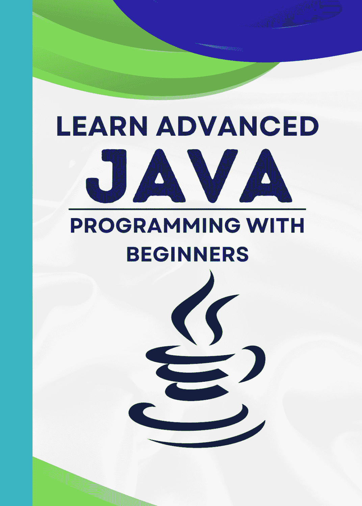

# 初学者进阶 Java 编程指南



# Java 简介

Java 介绍通常从语言的概述及其关键特性开始。

## 1. 总体概述


目的：Java 是一种多功能、面向对象且平台无关的编程语言。它的设计目的是简单、安全，并且可以在各种平台间迁移。

起源：由 James Gosling 及其 Sun Microsystems 团队于 20 世纪 90 年代中期开发，最初

## 2. 面向对象的本质


对象：在 Java 中，一切皆被视为对象。这种方法鼓励了模块化和可重用的代码

## 3. 平台无关性


一次编写，随运行 (WORA)：Java 代码可以在一个平台上编写，并在任何平台上执行。这是通过使用 Java 虚拟机实现的。

## 4. Java 虚拟机 (JVM)


执行：JVM 是一个关键组件，它负责解释 Java 字节码并在宿主机上执行它。

## 5. 语法简单性


可读性：Java 语法设计得清晰且易读。它从 C++ 中借鉴了大量的语法

## 6. 自动内存管理


垃圾回收：Java 包含一个自动垃圾回收器，可以回收不再使用的对象占占内存

## 7. 强类型语言


数据类型：Java 是一种强类型语言，这意味着变量必须用特定类型声明。这有助于在编译时发现错误

## 8. 异常处理


健壮性：Java 拥有健壮的异常处理机制，允许开发者优雅地处理错误。这有助于整体稳定性

## 9. 丰富的标准库


API (应用程序编程接口)：Java 自带有一个庞大的标准库，为各种任务提供了预构建的功能

## 总而言之

Java 是一种强大且多功能的语言，以其平台无关性、面向对象范式、简单性和健壮的特性而闻名。它的应用范围广泛，从 Web 开发到移动应用开发，使其成为一个热门选择

## Java 入门

## Java 语法

# Java 输出

# Java 注释

# Java 变量

# Java 数据类型

# Java 类型转换

# Java 运算符

# Java 字符串

# Java 数学计算

# Java 布尔值

# Java If...Else

# Java Switch

```java
public class SwitchExample {
    String dayName;
    case 1:
    case 2:
    case 3:
    case 4:
    case 5:
    case 6:
}
```

# Java While 循环

# Java For 循环

# Java Break/Continue

# Java 数组

# Java 方法

# Java 方法参数

# Java 方法重载

# Java 递归

# Java OOP (面向对象编程)

# Java 类/对象

# Java 类属性

# Java 类方法

# Java 构造函数

# Java 修饰符

# Java 封装

# Java 包 / API

# Java 继承

# Java 多态

# Java 内部类

# Java 抽象

# Java 接口

# Java 枚举

# Java 日期

# Java ARRAYLIST

# Java LinkedList

# Java HashMap

# Java HashSet

# Java 迭代器

# Java 包装类

# Java 异常

# Java 正则表达式 (RegEx)

# Java 线程

# Java LAMBDA

# Java 文件

## 4. 丰富的标准库

Java 自带了一个功能全面的标准库，为各种常见任务提供了开箱用的类和方法。该库简化了开发过程，减少了开发者从零开始编写一切的需求。

## 5. 安全性

Java 内置了安全功能，例如 Java 沙箱，这有助于保护免受潜在有害代码的影响。这使得 Java 成为开发安全应用程序的热选。

## 6. 社区与生态系统

Java 拥有庞大且活跃的开发者社区，并为 Java 开发者提供了海量的库、框架和工具生态系统。这种社区支持有助于该语言的长期生存和演进。

总的来说，Java 广泛应用于企业级应用、Web 开发、移动应用开发（Android）等领域。它的简单性、可移植性和健壮性使其在软件开发行业中广受欢迎。

## Java 入门

开始学习 Java 涉及理解设置开发环境的关键步骤、掌握基本概念并熟悉你将要使用的工具。

### 1. 安装 Java 开发工具包 (JDK)


第一步是在你的机器上安装 Java 开发工具包（`JDK`）。`JDK` 包含了 Java 运行环境（`JRE`）以及 Java 开发所需的工具。你可以从 Oracle 官网下载 `JDK`，或者使用如 `OpenJDK` 等替代发行版。

### 2. 设置环境变量


安装 `JDK` 后，你需要设置环境变量。这涉及将 `JDK` 的 `"bin"` 目录添加到系统的 `PATH` 变量。这允许命令行识别 Java 命令，例如 `javac`（Java 编译器）和 `java`（Java 解释器）。

### 3. 选择集成开发环境 (IDE)


虽然 Java 代码可以用简单的文本编辑器编写，但大多数开发者更倾向于使用集成开发环境（`IDE`）以获得更高效、功能丰富的编码体验。流行的选择包括 Eclipse、`IntelliJ IDEA` 和 `NetBeans`。

### 4. 理解 Java 的基本结构


Java 程序组织成类。一个类包含数据（字段）和对这些数据的操作（方法）。`main` 方法是 Java 应用程序的入口点，也是程序执行开始的地方。

### 5. 学习面向对象编程 (OOP) 概念


Java 是一种面向对象的编程语言，理解 `OOP` 概念至关重要。封装、继承和多态等概念是编写高效 Java 代码的基础。

### 6. 了解 Java 开发生命周期


Java 程序经历开发生命周期，包括编写代码、使用 `javac` 编译器编译代码以及使用 `java` 解释器执行代码。理解这一周期对于排查故障和调试至关重要。

### 7. 探索 Java 标准库 (Java API)


Java 自带庞大的标准库，被称为 Java `API`（应用程序编程接口）。熟悉 `API` 提供的类和方法，因为它们在编码时可以为你节省时间和精力。

### 8. 使用版本控制系统


像 `Git` 这样的版本控制系统是协作开发不可或缺的一部分。学习 `Git` 的基础以管理和跟踪你 Java 项目中的更改。

### 9. 加入 Java 社区


Java 拥有充满活力且相互支持的社区。参与论坛、阅读博客并关注社交媒体频道，以获取最新进展、最佳实践以及经验丰富的 Java 开发者的技巧。

### 10. 实践并构建项目


学习 Java 的最好方法是动手实践。从小型项目开始，逐渐增加复杂度。构建真实的应用可以增强你的技能并巩固你的理解。

总结来说，通过安装 `JDK`、设置环境、熟悉 `OOP` 概念、探索 `API`、使用版本控制并实践项目，你将更深入地掌握 Java。

## Java 语法

Java 语法指的是规定如何编写 Java 程序的规则和约定。理解语法至关重要。

### 1. 大写敏感


Java 是区分大小写的，这意味着大写字母和小写字母被视为不同的。

### 2. 类声明


在 Java 中，程序组织成类。类声明包括 `class` 关键字以及类名。类的体包含在 `{}` 中。

### 3. 方法声明


方法定义了类的行为。方法声明包括返回类型、方法名和参数（如果有）。

### 4. 注释


Java 中的注释用于为开发者添加说明。它们会被编译器忽略。单行注释以 `//` 开头，多行注释位于 `/*` 和 `*/` 之间。

### 5. 变量与数据类型


变量是存储数据的容器。Java 要求显式声明变量并指定数据类型（例如 `int`, `double`）。变量名不能以数字开头。

### 6. 语句与表达式


语句是 Java 中的指令，表达式是变量、运算符和字面量的组合，计算出一个值。语句通常以分号 `;` 结束。

### 7. 控制流语句


Java 支持各种控制流语句，如 `if`、`else`、`switch`、`for`、`while` 和 `do-while`。这些语句根据某些条件控制程序的执行流。

### 8. 对象实例化


在 Java 中，对象是类的实例。要创建对象，使用 `new` 关键字后跟类构造函数。构造函数初始化对象并分配内存。

### 9. 继承


继承是面向对象编程 (`OOP`) 的基本概念。在 Java 中，类可以使用 `extends` 关键字继承另一个类的属性和行为。

### 10. 异常处理


Java 提供了强大的异常处理机制。`try`、`catch`、`finally` 和 `throw` 关键字用于管理代码中的异常情况。

### 11. 包与导入


Java 使用包将类组织到命名空间中。`package` 关键字用于声明包，`import` 关键字用于将包中的类引入当前作用域。

### 12. 访问修饰符


Java 使用 `public`、`private` 和 `protected` 等访问修饰符来控制类、方法和变量的可见性。这有助于实现封装和访问控制。

总而言之，Java 语法涵盖了定义类、方法、变量、控制流以及 Java 程序其他元素的规则。遵守这些语法规则可以确保代码具有可读性、可维护性，并按预期运行。

让我们从一个简单的 Java 代码示例开始，然后我将解释 Java 语法的含义：

```java
public class BasicSyntaxExample {
    public static void main(String[] args) {
        // 变量声明与初始化
        int number = 10;
        String greeting = "Hello, Java!";

        // 条件语句
        if (number > 5) {
            System.out.println(greeting);
        } else {
            System.out.println("Number is not greater than 5.");
        }

        // 循环语句
        for (int i = 0; i < 3; i++) {
            System.out.println("Loop iteration: " + i);
        }
    }
}
```

### Java 语法解释

1. **类声明**：在 Java 中，程序通常被组织成类。`public class BasicSyntaxExample` 声明了一个名为 `BasicSyntaxExample` 的类。

2. **方法声明**：`public static void main(String[] args)` 声明了 `main` 方法。`main` 方法是 Java 程序的入口点。

3. **变量声明与初始化**：在 Java 中，变量使用特定的数据类型声明。例如，`int number = 10;` 声明了一个名为 `number` 的整数变量并将其初始化为值 `10`。同样，`String greeting = "Hello, Java!";` 声明了一个名为 `greeting` 的 `String` 变量并将其初始化为字符串。

4. **条件语句 (if-else)**：`if (number > 5)` 是一个条件语句。如果条件为真，则执行 `if` 之后块中的代码；否则，执行 `else` 之后块中的代码。

5. **打印语句**：`System.out.println` 用于将输出打印到控制台。在示例中，它根据条件打印 `greeting` 变量的值或消息。

6. **循环语句 (for)**：`for (int i = 0; i < 3; i++)` 是一个循环三次的循环。它将变量 `i` 初始化为 `0`，只要 `i` 小于 `3` 就执行循环体，并在每次迭代后增加 `i`。

总而言之，Java 语法是指规定 Java 程序如何编写和结构的一套规则。它包括声明变量、定义方法和类、使用条件语句和循环等规则。理解并遵循 Java 语法对于编写正确且可读的 Java 代码至关重要。

# Java 输出

Java 输出指的是 Java 程序在执行过程中所产生的信息或结果。Java 中的输出通常生成到控制台，但也可以定向到其他目的地，例如文件、数据库或图形用户界面。

1. **控制台输出**：


Java 程序产生输出最简单的方法是使用 `System.out.println()` 方法。该方法将文本发送到标准输出流（通常是控制台），后跟一个换行符。`println` 代表“print line”（打印行）。

2. **格式化打印**：


Java 提供了多种格式化输出的方法，允许开发者控制文本外观。`printf()` 方法通常用于格式化输出，允许为变量留占位符并指定它们的格式。

3. **标准输出与标准错误**：


Java 区分了标准输出 (`System.out`) 和标准错误 (`System.err`)。虽然两者通常都显示在控制台上，但它们有不同的用途。标准输出用于程序的正规输出，而标准错误用于错误消息或异常情况。

4. **拼接**：


Java 中的输出可以通过拼接（连接在一起）字符串来创建。`+` 运算符用于字符串拼接，允许文本和变量值组合以形成完整的输出。

5. **转义序列**：


Java 支持转义序列（即以反斜杠开头的特殊字符），用于表示不可打印字符或控制输出的格式。例如，`\n` 表示换行符，`\t` 表示制表符。

6. **日志记录**：


Java 提供了一个日志框架——即 Java Logging API，用于捕获各种级别的程序输出。开发者可以使用记录器记录不同严重程度的消息，如信息（info）、警告（warning）和错误（error）。

7. **文件输出**：


除了控制台，Java 程序还可以将输出写入文件。这是通过使用 `FileOutputStream` 类或更高级的类 `PrintWriter` 实现的。将输出写入文件是非常重要的。

8. **GUI 输出**：


在图形用户界面 (GUI) 应用程序中，输出通常显示在窗口中。JavaFX 或 Swing 等 GUI 框架提供了组件。

9. **重定向输出**：


Java 允许开发者将标准输出重定向到不同的目的地。这对于分析很有用。

10. **本地化与国际化**：


Java 支持本地化和国际化。这是通过资源包和 `Locale` 类实现的。

总之，Java 输出涉及程序对信息的生成和呈现。无论显示在控制台上、经过格式化、重定向到文件还是在 GUI 中呈现，管理输出对于有效的编程至关重要。

让我们从一个涉及输出的简单 Java 代码示例开始，然后我将解释 Java 输出的含义：


```java
public class OutputExample {
    public static void main(String[] args) {
        // 使用 println 输出到控制台
        System.out.println("Hello, Java!");

        // 带变量输出
        int x = 5;
        double y = 3.14;
        System.out.println("The value of x is: " + x);
        System.out.println("The value of y is: " + y);

        // 格式化输出
        System.out.printf("Formatted output: x = %d, y = %.2f\n", x, y);
    }
}
```

### Java 输出解释

1. **控制台输出（`System.out.println`）**：

 使用`System.out.println`向控制台输出 "Hello, Java!"。

2. **带变量输出**：

[][](image_rsrc9NG.jpg)变量`x`和`y`的值被包含在输出中，以显示关于这些变量的特定信息。`System.out.printf`方法用于更受控和格式化的输出，允许您指定输出字符串中每个值的格式。

理解如何生成输出对于调试、向用户反馈以及在 Java 程序内部通信信息至关重要。它涉及使用各种方法和技术以一种可读且有意义的方式显示数据。

# Java 注释

在 Java 中，注释是添加到源代码中的非执行语句，用于提供解释、文档或备注。Java 编译器会忽略注释，它们不会影响程序的功能。注释是开发者使代码更具可读性和易于理解的手段。以下是 Java 注释的说明：

1. **单行注释**：

单行注释以双正斜杠`//`开始。同一行中`//`之后的任何内容都被视为注释，不会被编译器执行。单行注释适用于在单行内进行简短解释。

2. **多行注释**：

多行注释包含在`/*`和`*/`之间。这些分隔符之间的任何内容（跨越多行）都被视为注释。多行注释适用于提供更详尽的解释、记录代码段或临时排除代码块。

3. **Javadoc 注释**：

Javadoc 注释是一种用于文档目的的特殊注释类型。它们以`/**`开始，以`*/`结束。Javadoc 注释可以使用 Javadoc 等工具自动生成文档。这些注释通常位于类、方法或字段之前，包含关于目的、参数、返回值和抛出异常的信息。

4. **用于代码说明的注释**：

可以添加注释来澄清复杂的代码，或解释特定设计选择背后的原理。这对于让其他开发者或最初编写代码的人员更容易理解代码特别有帮助。

5. **TODO 注释**：

TODO 注释用于标记需要进一步关注或完成的代码区域。开发者可以使用这些注释来指示未来需要处理的任务。IDE 通常提供一种方便的方法来跟踪和管理 TODO 注释。

6. **代码注释（注释）**：

注释常用于临时“注释掉”或禁用代码段。这在调试或测试替代实现时非常有用。与其删除代码，不如注释掉它以便于恢复。

7. **文件头注释**：

文件头注释通常放在文件的开头，以提供其内容的概览。这可能包括关于作者、创建日期、修改历史或其他任何相关细节的信息。

8. **用于调试的注释**：

注释可以包含调试信息。在调试期间，开发者可能会添加注释来突出特定点或指示某些代码行目的。

9. **避免冗余注释**：

虽然注释很有价值，但尽可能编写自解释性的代码是重要的。应该避免仅仅重复陈述显而易见内容的冗余注释，因为它们会使代码混乱而不会添加任何意义的信息。

10. **洁洁代码实践**：

遵循洁洁代码实践鼓励开发者编写代码，使其清晰可读，而不必过度依赖注释。良好的变量、方法和类命名有助于代码的清晰度。

总之，Java 注释在增强代码的可读性和维护性方面起着至关重要的作用。它们为开发者提供了交流意图、记录功能以及使代码库对于未来可能阅读或处理代码的人更易访问的手段。

在 Java 中，注释用于在源代码中提供解释或注解。这些注释不会被 Java 编译器执行，也不会影响程序的功能；它们完全是为了方便开发者理解和记录代码。Java 中有两种类型的注释：单行注释和多行注释。

以下是一个包含两种类型注释的 Java 代码示例：

```java
public class Example {

    // 这是一个单行注释
    public static void main(String[] args) {

        /*
         * 这是一个多行注释。
         * 它可以跨越多行，通常用于更详尽的解释。
         */
        System.out.println("Hello, World!");  // 这也是一个单行注释
        // 你可以使用注释来临时禁用或注释掉代码
        // System.out.println("这一行不会被执行。");
        // TODO: 这是一个特殊的注释类型，指示一个需要完成的任务
        // 它通常用于标记需要关注或完成的代码区域
    }

}
```

Java 注释说明：

1. **单行注释**：这些注释以`//`开始，一直持续到行尾。

2. **多行注释**：这些注释以`/*`开始，以`*/`结束。它们可以跨越多行，通常用于更详尽的解释。

3. **代码注释**：你可以使用注释来临时禁用或注释掉代码行。

4. **TODO 注释**：这些是通常用于标记代码区域的特殊注释。

# Java 变量

在 Java 中，变量是存储数据的容器。它们是编程的基础，用于在程序内持有处理信息。

1. **变量声明**：

在 Java 中，你通过指定数据类型后跟变量名来声明变量。数据类型指示变量可以包含的值类型，例如用于整数的`int`、用于浮点数的`double`或用于文本的`String`。

2. **数据类型**：

Java 支持多种数据类型，包括基本数据类型（例如`int`、`double`、`char`、`boolean`）和引用数据类型（例如`String`、自定义类）。基本数据类型直接存储简单值，而引用数据类型存储对象的引用。

3. **命名规范**：

Java 中的变量名必须遵循某些命名规范。它们应该以字母开头，后跟字母、数字或下划线。名称对大小写敏感，因此`myVariable`和`myvariable`被视为不同的变量。

4. **初始化**：

声明变量后，你可以通过称为初始的过程为它分配初始值。这涉及使用赋值运算符`=`将值与变量关联。

5. **作用域**：

变量具有作用域，定义了变量可以访问的程序区域。局部变量在特定方法或块中声明，范围有限，而实例变量和类变量具有更广泛的作用域。

在 Java 中，你可以使用`final`关键字创建常量。常量是在赋值后其值就无法更改的变量。它们通常用于在整个程序运行期间都应该保持不变的值。

### 7. 类型推断（Java 10 及更高版本）

从 Java 10 开始，Java 引入了局部局部变量类型推断的功能。通过这一功能，你可以使用`var`关键字声明变量，而无需显式指定数据类型。编译器会根据赋值的值推断类型。

### 8. 变量命名与可读性

为变量选择具有意义且描述性的名称对于代码的可读性至关重要。良好的变量名可以传达其所持数据的用途或含义，使代码更易理解。

### 9. 变量的可变性

变量的可变性取决于其数据类型。某些变量（如基本类型变量）是不可变的，这意味着一旦赋值就无法更改值。其他变量（如对象）则可以修改其属性。

### 10. 垃圾回收

在 Java 中，内存管理由称为“垃圾回收”的过程处理。未使用的对象和变量会被自动识别并从内存中释放，以释放资源。

总结来说，Java 变量对于存储和处理程序的数据至关重要。它们具有特定的数据类型、命名规范、作用域，并根据类型可能是可变的也可能是不可变的。理解如何声明、初始化和使用变量是编写高效且易读的 Java 代码的基础。

在 Java 中，变量是存储数据值的容器。每个变量都有一个数据类型，例如`int`、`double`或`String`，这定义了它可以存储的数据类型。

```java
public class VariableExample {
    public static void main(String[] args) {
        // 声明并初始化变量
        int age = 25;
        double height = 5.9;
        String name = "John Doe";

        // 打印变量的值
        System.out.println("Name:  " + name);
        System.out.println("Age: " + age);
        System.out.println("Height:  " + height);

        // 更新变量的值
        age = 26;

        // 打印更新后的值
        System.out.println("Updated Age: " + age);

        // 使用变量进行操作
        int birthYear = 1995;
        int currentYear = 2024;
        int calculatedAge = currentYear - birthYear;

        // 打印计算出的年龄
        System.out.println("Calculated Age: " + calculatedAge);
    }
}
```

### Java 变量说明

1. **声明与初始化**：在 Java 中，你通过指定数据类型后跟变量名来声明变量。你也可以在同一行内为变量初始化值。例如，`int age = 25;`声明了一个名为`age`的整数变量并将其初始化为值`25`。

2. **数据类型**：Java 支持多种数据类型，包括基本类型如`int`、`double`、`char`、`boolean`，以及引用类型如`String`。每种数据类型都指定了变量可以持有的种类。

3. **打印变量**：你可以使用`System.out.println()`语句打印变量的值。这是调试和向用户显示信息的常见做法。

4. **更新变量**：可以通过给变量分配新值来更新变量。在示例中，`age`变量从`25`更新为`26`。

5. **变量操作**：变量可以用于数学运算或其他表达式。在示例中，变量`calculatedAge`的结果被赋值为`currentYear`减去`birthYear`的结果。

总结来说，Java 变量是用于存储数据值的命名存储位置。它们通过允许开发者处理和操作程序中的数据在编程中起着至关重要的作用。理解数据类型对于在 Java 中正确使用变量非常重要。

# Java 数据类型

在 Java 中，数据类型是一个基本概念，定义了变量可以持值的性质。Java 中的每个变量必须有一个声明的数据类型，这指定了它可以存储的数据种类。

### 1. 基本数据类型

Java 有八种基本数据类型：

- **整数类型**：`byte`、`short`、`int`和`long`用于整数（整数值）。

- **浮点数类型**：`float`和`double`用于带有小数部分的数字。

- **字符类型**：`char`用于单个字符（例如字母、数字）。

- **布尔类型**：`boolean`用于表示`true`（真）或`false`（假）值。

### 2. 大小与范围

每个基本数据类型在位（bits）方面都有特定的大小，并有一个定义的可以取值范围。例如，`int`通常是 32 位，其范围从`-2³¹`到`2³¹ - 1`。

### 3. 引用数据类型

Java 中的引用数据类型包括类、接口、数组和枚举。与基本类型不同，这些数据类型不持有实际数据，而是内存中对象的引用。

### 4. 字符串

Java 中的`String`类用于表示字符序列。字符串不是基本数据类型，但由于它们在编程中的重要性，通常被使用并视为基本类型。

### 5. 数组

数组是一种引用数据类型，用于存储相同类型元素的集合。它们可以是一维的、多维的或锯齿的。

### 6. 类型推断（Java 10 及更高版本）

从 Java 10 开始，局部变量类型推断允许使用`var`关键字声明变量，而不必显式指定数据类型。编译器根据赋值的值推断类型。

### 7. 自动类型转换（强制类型转换）

Java 支持某些数据类型的自动类型转换。例如，你可以将`int`值赋值给`double`变量而无需显式强制转换。然而，在某些类型之间转换时需要显式强制转换。

### 8. 装箱与拆箱

Java 支持基本类型与其相应的包装类之间进行自动转换。这一过程被称为自动装箱（将基本类型转换为包装类型）和自动拆箱（将包装类型转换为基本类型）。

### 9. 枚举

枚举（`enum`）是一种特殊的数据类型，用于定义一组命名常量。枚举使代码更具可读性，并提供了一种表示固定值集合的方法。

### 10. 类型安全

Java 是一种静态类型语言，这意味着变量的数据类型在编译时必须是已知。这通过在编译过程中捕获类型错误增强了类型安全性。

### 11. 用户定义数据类型

除了内置数据类型外，Java 还允许开发者使用类和接口创建自己的用户定义数据类型。这一功能是面向对象编程的基础。

总结来说，Java 数据类型根据变量可以持有的值类型对变量进行分类。理解不同数据类型的特征、范围和用途对于编写正确且高效的 Java 程序至关重要。

```java
System.out.println("Integer Number: " + integerNumber); 
System.out.println("Double Number: " + doubleNumber); 
System.out.println("Character: " + character);  
System.out.println("Flag: " + flag);  
System.out.println("Text: " + text);

// Using arrays (reference data type)
int[] numbers = {1, 2, 3, 4, 5};

System.out.println("Array Element: " + numbers[2]);

// User-defined class (reference data type)
Person person = new Person("Alice", 30);

System.out.println("Person: " + person.getName() + ", Age: " + person.getAge());

// User-defined class for reference data type example
class Person {
    private String name; 
    private int age;

    public Person(String name, int age) { 
        this.name = name;
        this.age = age;
    }

    public String getName() { 
        return name;
    }

    public int getAge() { 
        return age;
    }
}
```

### Java 数据类型说明

1. **基本数据类型（Primitive Data Types）**：

`int`：表示整数值（例如`42`）。

`double`：表示浮点数（例如`3.14`）。`char`：表示单个字符（例如`'A'`）。`boolean`：表示真或假值（例如`true`）。

2. **引用数据类型（Reference Data Type）**：

`String`：表示字符序列（例如`"Hello, Java!"`）。

3. **数组（引用数据类型）**：

数组用于存储相同数据类型的多个值。在示例中，`int[] numbers`是一个整数数组。

4. **用户自定义类（引用数据类型）**：

开发者可以定义自己的类来创建自定义数据类型。在示例中，`Person`类是一个用户自定义类，`name`和`age`是其属性。

理解数据类型在 Java 编程中至关重要，因为它有助于确保变量被恰当使用并确保操作正确执行。基本数据类型是构建复杂结构的基石，而引用数据类型则允许创建自定义对象和结构。


# Java 类型转换（Type Casting）

Java 类型转换是指将值从一种数据类型转换为另一种类型的过程。这种转换可以是显式的或隐式的，取决于是否需要程序员显式指定转换。

1. **隐式转换（宽转换，Widening）**：隐式转换也称为宽转换或自动类型转换，发生在转换可以在不丢失任何信息的情况下完成。例如，将`int`转换为`double`是隐式的，因为`double`类型可以表示整数值而不丢失精度。

2. **显式转换（窄转换，Narrowing）**：当从较大的数据类型转换为较小的数据类型，或者存在潜在信息丢失时，需要显式转换。例如，将`double`转换为`int`需要显式转换，因为可能会由于截断导致信息丢失。

3. **基本类型之间的转换**：在 Java 中，基本类型之间可以相互强制转换。例如，将`long`转换为`int`，或将`float`转换为`short`。然而，重要的是，在不兼容类型或尺寸差异巨大的类型之间转换可能会导致数据丢失。

4. **使用包装类的转换**：在与包装类（例如`Integer`、`Double`）工作时，可能需要显式转换以在包装类型之间或包装类型与基本类型之间进行转换。这一过程被称为拆箱（unboxing）和装箱（boxing）。

### 对象的类型转换

在 Java 中处理对象时，类型转换通常用于将一个类型的对象视为另一个类型的对象。这在涉及继承和多态的场景中特别常见。

6. **类型安全**：Java 的类型系统强调类型安全，转换在维护这种安全性方面起着作用。应该谨慎进行转换以避免运行时错误和意外行为。编译器在编译过程中会检查类型的兼容性。

7. **类型兼容性**：转换仅在兼容的类型之间可行。例如，你可以在数值类型之间转换，但不能在不相关的类型之间转换，例如尝试将`String`转换为`int`。

8. **枚举的类型转换**：枚举（`enum`）是 Java 中的特殊类型，在处理枚举时可能需要转换，特别是当你需要转换一个值时。

9. **基本类型与引用类型**：基本类型和引用类型的转换过程略有不同。基本类型涉及直接转换，而引用类型则涉及类或接口。

10. **ClassCastException**：在转换引用类型时，必须处理潜在的异常，例如`ClassCastException`，如果对象不是指定类型的实例，就会发生该异常。

总结，Java 类型转换是一种允许开发者在不同类型之间转换的机制。无论是隐式的还是显式的，转换在管理数据类型、确保类型安全以及促进顺畅交互方面都起着至关重要的作用。

类型转换是 Java 处理不同数据类型时的一种常用操作。它允许在不同类型的变量之间进行赋值时具有灵活性，但开发者应谨慎，以避免数据丢失或意外行为。

# Java 运算符

在 Java 中，运算符是会对变量和值执行操作的符号。它们对于操作数据和控制程序流至关重要。

### 1. 算术运算符

算术运算符执行基础数学运算。这些包括加法（`+`）、减法（`-`）、乘法（`*`）、除法（`/`）和模（`%`）。模返回除法运算的余数。

### 2. 关系运算符

关系运算符用于比较值。常见的关系运算符包括等于（`==`）、不等于（`!=`）、大于（`>`）、小于（`<`）、大于等于（`>=`）和小于等于（`<=`）。

### 3. 逻辑运算符

逻辑运算符对布尔值执行逻辑操作。逻辑与（`&&`）在两个操作数都为真时返回真，逻辑或（`||`）在至少一个操作数为真时返回真，而逻辑非（`!`）返回相反的布尔值。

### 4. 赋值运算符

赋值运算符用于给变量赋值。基础赋值运算符是`=`。其他赋值运算符包括`+=`、`-=`、`*=`、`/=`和`%=`，它们会执行某种操作并将结果赋值给变量。

### 5. 递增和递减运算符

递增（`++`）和递减（`--`）运算符分别用于增加或减少变量的值。它们可以以前缀或后置形式使用，影响求值顺序。

### 6. 位运算符

位运算符在位层级上执行操作。示例包括按位与（`&`）、按位或（`|`）、按位异或（`^`）、按位非（`~`）、左移（`<<`）和右移（`>>`）。

### 7. 条件运算符（三元运算符）

条件运算符或三元运算符（`? :`）是表示 if-else 语句的简写方式。它评估布尔表达式并根据表达式的真假返回两个值之一。

### 8. instanceof 运算符

`instanceof`运算符用于测试对象是否是特定类或接口的实例。如果对象是实例，则返回 true；否则返回 false。

### 9. 等等和身份运算符

等等运算符（`==`）检查两个值是否相等。身份运算符（`==`和`!=`）检查两个引用是否指向同一个对象。

### 10. 字符串拼接运算符

`+`运算符用于 Java 中的字符串拼接。当与字符串一起使用时，它将它们合并创建一个新字符串。

### 11. 其他运算符

Java 还包含其他运算符，例如条件空运算符（`??`），如果左侧操作数非空则返回左侧操作数，否则返回右侧操作数（Java 12 引入）。

理解运算符的工作原理及其优先级对于编写正确高效的 Java 代码至关重要。运算符是程序中表示计算和决策的基础工具。

在 Java 中，运算符是对变量和值执行操作的符号。Java 中有多种运算符，包括算术、关系、逻辑、赋值、位运算等。

```java
public class OperatorsExample {
    public static void main(String[] args) {
        // Arithmetic operators
        int num1 = 10;
        int num2 = 5;
        int sum = num1 + num2;
        int difference = num1 - num2;
        int product = num1 * num2;
        int quotient = num1 / num2;
        int remainder = num1 % num2;

        System.out.println("Arithmetic Operators:");
        System.out.println("Sum: " + sum);
        System.out.println("Difference: " + difference);
        System.out.println("Product: " + product);
        System.out.println("Quotient: " + quotient);
        System.out.println("Remainder: " + remainder);

        // Relational operators
        boolean isEqual = (num1 == num2);
        boolean isNotEqual = (num1 != num2);
        boolean isGreater = (num1 > num2);
        boolean isLessOrEqual = (num1 <= num2);

        System.out.println("\nRelational Operators:");
        System.out.println("Is Equal: " + isEqual);
        System.out.println("Is Not Equal: " + isNotEqual);
        System.out.println("Is Greater: " + isGreater);
        System.out.println("Is Less or Equal: " + isLessOrEqual);

        // Logical operators
        boolean logicalAnd = (true && false);
        boolean logicalOr = (true || false);
        boolean logicalNot = !true;

        System.out.println("\nLogical Operators:");
        System.out.println("Logical AND: " + logicalAnd);
        System.out.println("Logical OR: " + logicalOr);
        System.out.println("Logical NOT: " + logicalNot);

        // Assignment operators
        int x = 5;
        x += 3;
        System.out.println("\nAssignment Operator: " + x);

        // Bitwise operators
        int binaryNum1 = 0b1010;
        int binaryNum2 = 0b1100;
        int bitwiseAnd = binaryNum1 & binaryNum2;
        int bitwiseOr = binaryNum1 | binaryNum2;
        int bitwiseXor = binaryNum1 ^ binaryNum2;

        System.out.println("\nBitwise Operators:");
        System.out.println("Bitwise AND: " + bitwiseAnd);
        System.out.println("Bitwise OR: " + bitwiseOr);
        System.out.println("Bitwise XOR: " + bitwiseXor);
    }
}
```

运算符说明：

1. 算术运算符：`+`、`-`、`*`、`/`、`%`分别执行加、减、乘、除和模运算。

2. 关系运算符：`==`、`!=`、`>`、`<=`比较值并返回布尔结果。

3. 逻辑运算符：`&&`、`||`、`!`执行逻辑操作并返回布尔结果。

4. 赋值运算符：`=`给变量赋值。复合赋值运算符如`+=`将操作结合赋值。

5. 位运算符：`&`、`|`、`^`在位层级上执行操作。

# Java String

在 Java 中，String 是表示字符序列的类。String 在 Java 编程中广泛用于文本处理、存储和表示。

### 1. 不变性

Java String 的一个关键特性是不变性。一旦创建 String 对象，其值无法更改。任何看似修改 String 的都会创建一个新的 String。

### 2. 字符串字面量与字符串对象

Java 中的字符串可以使用字符串字面量（例如 "Hello"）或通过`new`关键字创建 String 对象。使用字面量更为常见且方便，Java 会自动为字面量创建对象。

### 3. 拼接

Java 中的字符串可以使用`+`运算符进行拼接。该操作创建一个由操作数合并的新字符串。为了提高效率，特别是在循环中拼接时，建议使用`StringBuilder`或`StringBuffer`类。

### 4. 字符串池

Java 维护了一个字符串池，它是内存中唯一字符串字面量的池。当使用字面量创建已存在于池中的新字符串时，将复用现有实例，从而减少内存开销。

### 5. 字符串方法

`String`类提供了许多用于操作和查询字符串的方法。这些方法包括了查找字符串长度、提取子字符串、转换大小写、比较字符串等操作。

## 6. 转义序列

Java 中的字符串支持转义序列来表示特殊字符。例如，`\n`表示换行符，`\t`表示制表符，而`\"`表示双引号。

## 7. 字符串比较

Java 中的字符串比较通过`equals()`或`compareTo()`等方法完成。需要注意的是，`==`比较的是引用，而不是字符串的实际内容。

## 8. 字符串池（String Interning）

字符串池（String interning）是将唯一的`String`字面量放入`String`池的过程，以确保相同的字面量引用同一个`String`对象。可以使用`intern()`方法显式地完成这一点。

## 9. 字符串索引

`String`中的字符索引从 0 开始。使用`charAt()`方法可以访问单个字符。字符串是不可变的，因此修改字符需要创建一个新的`String`。

## 10. Unicode 支持

Java 字符串支持 Unicode，允许它们表示来自各种书系统的字符。这使得 Java 适用于国际化和本地化。

## 11. 正则表达式

Java 通过`String`类和`java.util.regex`包提供了对正则表达式的支持。正则表达式允许强大的字符串匹配和处理。

## 12. StringBuffer 和 StringBuilder

虽然`String`对象是不可变的，但`StringBuffer`和`StringBuilder`类提供了字符串操作的可变替代方案。在涉及频繁修改的场景下，它们的效率更高。

总而言之，Java 字符串是该语言的基础部分，为处理文本数据提供了一种通用且强大的方式。理解`Strings`的不可变性、其方法以及`String`池等相关概念，对于在 Java 程序中进行有效的字符串操作至关重要。

在 Java 中，`String`是字符序列。它是 Java 中的一个类，而该类的实例代表字符序列。


```java
public class StringsExample {

    public static void main(String[] args) {
        // 创建字符串
        String greeting = "Hello, "; 
        String name = "John";

        // 拼接
        String welcomeMessage = greeting + name + "!";  
        System.out.println("Welcome Message: " + welcomeMessage);

        // 字符串长度
        int length = welcomeMessage.length();  
        System.out.println("Length of Welcome Message: " + length);

        // 访问字符串中的字符
        char firstChar = welcomeMessage.charAt(0);
        char lastChar = welcomeMessage.charAt(length - 1);  
        System.out.println("First Character: " + firstChar);  
        System.out.println("Last Character: " + lastChar);

        // 子字符串
        String substring = welcomeMessage.substring(7, 12);  
        System.out.println("Substring: " + substring);

        // 字符串比较
        String anotherName = "john";
        boolean isEqualIgnoreCase = name.equalsIgnoreCase(anotherName);  
        System.out.println("Is name equal to anotherName (ignore case)? " + isEqualIgnoreCase);

        // 字符串字符串（字符串是不可变的）
        String originalString = "abc";
        String modifiedString = originalString.concat("def");  
        System.out.println("Original String: " + originalString);  
        System.out.println("Modified String: " + modifiedString);
    }
}
```

### Java 字符串解释

1. **创建字符串：**

   可以使用双引号创建字符串。例如，`String greeting = "Hello, ";`。

2. **拼接：**

   可以使用 `+` 运算符拼接字符串。在示例中，`welcomeMessage` 是通过拼接 `greeting`、`name` 和 `"!"` 形成的。

3. **字符串长度：**

   使用 `length()` 方法查找字符串的长度。

4. **访问字符：**

   `charAt(index)` 方法允许你访问字符串中特定索引处的字符。

5. **子字符串：**

   `substring(startIndex, endIndex)` 方法提取字符串的一部分。

6. **字符串比较：**

   `equals()` 方法用于区分区分大小写的字符串比较，而 `equalsIgnoreCase()` 用于不区分大小写的比较。

7. **字符串修改（不可变性）：**

   Java 中的字符串是不可变的，这意味着它们的值在创建后无法更改。像拼接这样的操作会创建新字符串，而不是修改原始字符串。

字符串在 Java 中是基础，并被广泛用于表示。

# 数

在 Java 中，`Math` 类是 `java.lang` 的一部分，提供了一系列静态方法。

1. **静态方法：**

   `Math` 中的所有方法都是静态的，这意味着你不需要创建类的实例即可使用它们。

2. **基础算术：**

   `Math` 类包含了用于基础算术的方法，如 `addExact()`、`subtractExact()`、`multiplyExact()` 和 `floorDiv()`。这些方法更稳健地处理溢出和下溢。

3. **指数和对数函数：**

   `Math` 类提供了指数函数的方法，如 `exp()` 和 `pow()`，用于计算指定的幂。它还包含了不同底数的对数函数，如 `log()` 和 `log10()`。

4. **三角函数：**

   `Math` 类提供了常用的三角函数，包括 `sin()`、`cos()` 和 `tan()`。反反函数 `asin()`、`acos()` 和 `atan()`。

5. **取整函数：**

   提供了 `round()`、`floor()` 和 `ceil()` 方法，分别用于四舍五入到整数、向下取整和向上取整。

6. **平方根和立方根：**

   `sqrt()` 方法计算数的平方根，`cbrt()` 方法计算数的立方根。

7. **绝对值：**

   `abs()` 方法返回给定数的绝对值，有效消除了负号。

8. **最小值和最大值：**

   `Math` 提供确定两个值的最小值 (`min()`) 和最大值 (`max()`) 方法。

9. **随机数生成：**

   `Math` 类通过 `random()` 方法支持随机数生成，该方法返回 0.0 到 1.0 之间的伪随机双精度值。

10. **常量：**

    `Math` 类包含了常量 `PI` 和 `E`，分别代表数学常数圆周率 和自然对数的底。

11. **特殊函数：**

    还有特殊的数学函数可用，如 `hypot()`（计算直角形的斜边）以及用于角度和弧度转换的 `toDegrees()`/`toRadians()`。

12. **IEEE 754 标准：**

    `Math` 类中的许多方法遵循 IEEE 754 浮点算术标准，确保在不同平台上的行为一致。

总结，Java 中的 `Math` 类提供了一套全面的数学函数，用于执行常见的数学操作。这些方法被广泛应用于科学计算、工程应用以及其他需要精确数学计算的领域。

在 Java 中，`Math` 类提供了一静态方法用于执行数学操作。这些方法涵盖了一系列常见的数学函数。

```java
public class MathExample {
    public static void main(String[] args) {
        // 基本算术运算
        int a = 5;
        int b = 3;
        double result;

        result = Math.addExact(a, b);
        System.out.println("Addition: " + result);

        result = Math.subtractExact(a, b);
        System.out.println("Subtraction: " + result);

        result = Math.multiplyExact(a, b);
        System.out.println("Multiplication: " + result);

        result = (double) a / b; // 不使用 Math 类的除法
        System.out.println("Division: " + result);

        // 指数和对数函数
        double x = 2.0;

        result = Math.pow(x, 3); // x 的 3 次方
        System.out.println("Power function: " + result);

        result = Math.sqrt(x); // x 的平方根
        System.out.println("Square root: " + result);

        result = Math.log(x); // x 的自然对数
        System.out.println("Natural logarithm: " + result);

        // 三角函数函数
        double angleInDegrees = 45.0;
        double angleInRadians = Math.toRadians(angleInDegrees);

        result = Math.sin(angleInRadians);
        System.out.println("Sine of " + angleInDegrees + " degrees: " + result);

        result = Math.cos(angleInRadians);
        System.out.println("Cosine of " + angleInDegrees + " degrees: " + result);

        result = Math.tan(angleInRadians);
        System.out.println("Tangent of " + angleInDegrees + "degrees: " + result);

        // 常量
        System.out.println("Value of Pi: " + Math.PI);
        System.out.println("Value of Euler's number (e): " + Math.E);
    }
}
```

### Java Math 类解释

1. **基本算术运算**:

    `addExact`、`subtractExact` 和 `multiplyExact` 方法分别执行加法、减法和乘法。如果发生溢出，这些方法会抛出 `ArithmeticException`。

2. **指数和对数函数**:

    `pow` 方法将底数升幂幂。

    `sqrt` 方法计算平方根。

    `log` 方法计算自然对数。

3. **三角函数**:

    `sin`、`cos` 和 `tan` 方法计算弧度单位的角的正弦、余弦和正切。

4. **常量**:

    `Math` 类提供了如 `PI`（π）和 `E`（欧拉数）等常量。

`Math` 类是 Java 标准库的一部分，用于执行复杂的数学计算。它提供了科学和工程应用中常用的各种函数。对于从事涉及数学计算项目的开发人员来说，理解 `Math` 类及其方法是至关重要的。

# Java 布尔值

在 Java 中，`boolean` 类型表示一种只有两个可能值的数据类型：`true` 和 `false`。布尔值在编程中是基础性的，因为它们经常用于用于决策、控制程序流以及表达条件。

1. **布尔值**:

    布尔变量只能持有两个值之一：`true` 或 `false`。这些值代表了布尔变量的两种可能状态。

2. **逻辑运算**:

    布尔值常用于逻辑运算。逻辑与 (`&&`)、逻辑或 (`||`) 和逻辑非 (`!`) 运算符用于对布尔值进行操作，将它们组合起来并产生结果。

3. **条件语句**:

    在 Java 中，条件语句（如 `if`、`else if` 和 `else`）依赖布尔表达式来确定执行流。如果布尔表达式求值为 `true`，则执行相应的代码块。

4. **比较运算符**:

    比较运算符，如 `==` (等于)、`!=` (不等于)、`<` (小于)、`>` (大于)、`<=` (小于或等于) 和 `>=` (大于或等于)，在用于比较值时会产生布尔结果。

5. **布尔表达式**:

    布尔表达式是求值为为 `true` 或 `false` 的条件。这些表达式经常被用于控制流语句、循环条件和决策结构中。

6. **控制流**:

    布尔值在控制流方面起着至关重要的作用。

7. **决策制定**:

    布尔值对于决策至关重要。例如，如果布尔值为 `true` 则执行某种操作，如果是 `false` 则执行另一种操作。

8. **默认值**:

    如果布尔值没有初始化，其默认值为 `false`。

9. **逻辑短路**:

    Java 中的逻辑运算符具有短路特性。例如，在 `&&` 操作中，如果左侧为 `false`，则右侧不会被求值。

10. **方法与函数**:

     方法通常返回布尔值表示成功或失败。例如，方法可能会检查条件是否满足。

11. **标志变量**:

     布尔变量常用作标志来指示事件发生。

12. **枚举与状态**:

     布尔值常用于表示二进制状态，`true` 可能对应一种状态，`false` 对应另一种。

总结，Java 中的布尔值是一种表示二进制状态的原始类型，通常用于条件或逻辑运算。


```java
public class BooleanExample {
    public static void main(String[] args) {
        // 布尔变量
        boolean isJavaFun = true;
        boolean isProgrammingHard = false;

        // 布尔表达式
        int x = 5;
        int y = 10;
        boolean isEqual = (x == y);
        boolean isGreater = (x > y);

        // 条件语句
        if (isJavaFun) {
            System.out.println("Java is fun!");
        } else {
            System.out.println("Java is not fun!");
        }

        if (isProgrammingHard) {
            System.out.println("Programming is hard!");
        } else {
            System.out.println("Programming is not hard!");
        }

        // 在条件中使用布尔表达式
        if (isEqual) {
            System.out.println("x is equal to y.");
        } else {
            System.out.println("x is not equal to y.");
        }

        if (isGreater) {
            System.out.println("x is greater than y.");
        } else {
            System.out.println("x is not greater than y.");
        }

        // 布尔值的逻辑运算符
        boolean a = true;
        boolean b = false;
        boolean andResult = a && b; // 逻辑与
        boolean orResult = a || b;  // 逻辑或
        boolean notResult = !a;     // 逻辑非

        System.out.println("Logical AND: " + andResult);
        System.out.println("Logical OR: " + orResult);
        System.out.println("Logical NOT: " + notResult);
    }
}
```

## 2. 布尔表达式

布尔表达式是评估为布尔值（`true` 或 `false`）的条件或比较。在示例中，`isEqual` 是一个测试相等性的布尔表达式。

## 3. 条件语句

条件语句（如 `if` 和 `else`）允许你根据布尔条件执行不同的代码块。

## 4. 逻辑运算符

逻辑运算符（`&&` 表示与，`||` 表示或，`!` 表示非）用于组合或否定布尔值。

布尔值在编程中是基础性的，因为它们允许程序进行决策和控制流。它们通常用于条件语句和循环中，以根据某些条件确定执行流。理解如何操作布尔值对于在 Java 中编写高效且逻辑严密的代码至关重要。

# Java If...Else

在 Java 中，`if...else` 语句是一种控制流语句，允许程序根据布尔表达式的评估结果执行不同的代码块。

`if...else` 语句以 `if` 关键字开头，随后跟着括在括号内的布尔表达式。该表达式被评估为 `true` 或 `false`。

## 2. 真块执行

如果布尔表达式评估为 `true`，则执行紧随 `if` 语句之后的代码块。该块通常被称为“真块”或“if 块”。

## 3. Else 块

可选情况下，`if...else` 语句可以包含一个 `else` 关键字，后跟另一个代码块。如果 `if` 语句中的布尔表达式评估为 `false`，则执行该代码块。该块通常被称为“else 块”。

## 4. 互斥执行

真块或 `else` 块执行其一，但两者不会同时执行。`if...else` 语句根据条件在两种可选执行路径之间提供互斥选择。

## 5. 嵌套

多个 `if...else` 语句可以嵌套在彼此内部，创建更复杂的决策结构。这允许处理多个条件并根据它们的评估结果执行不同的代码块。

## 6. 链式

多个 `if...else if` 语句可以链在一起，形成一系列条件，每个条件都有其关联的代码块。如果存在 `else` 块，则只有在之前的所有条件都不为真时才执行它。

## 7. 三元运算符作为简写

在某些情况下，可以使用三元条件运算符（`? :`）表示 `if...else` 的简洁形式。该运算符评估布尔表达式，并根据条件是 `true` 还是 `false` 返回两个值之一。

## 8. 代码块作用域

与 `if` 和 `else` 语句相关的代码块定义了一个作用域。在这些块内部声明的变量可见性有限，只能在各自的作用域内访问。

## 9. 常见用例

`if...else` 语句常用于各种场景下的决策，例如验证用户输入、根据条件处理不同情况以及响应事件。

## 10. 错误处理

在错误处理中，可以使用 `if...else` 语句检查异常情况或错误状态。`if` 块处理正常执行路径，而 `else` 块处理错误场景。

## 11. 默认行为

`else` 块通常用于指定当一系列 `if` 和 `else if` 语句中没有一个条件为 `true` 时的默认行为。

## 12. 可读性与可维护性

正确使用 `if...else` 语句通过根据条件组织逻辑，有助于代码的可读性和可维护性，使代码更容易理解和修改。

总结来说，Java 中的 `if...else` 语句允许开发者在代码中创建条件分支，能够根据布尔表达式的评估结果执行不同的代码块。它是 Java 程序中决策和控制流的基础结构。

在 Java 中，`if...else` 语句用于条件分支，允许程序根据布尔表达式的评估结果做出决策。

```java
public class IfElseExample {
    public static void main(String[] args) {
        int x = 10;
        int y = 20;

        // Example 1: Simple if...else 语句
        if (x > y) {
            System.out.println("x is greater than y.");
        } else {
            System.out.println("x is not greater than y.");
        }

        // Example 2: if...else if...else 梯形
        int grade = 75;

        if (grade >= 90) {
            System.out.println("Grade is A");
        } else if (grade >= 80) {
            System.out.println("Grade is B");
        } else if (grade >= 70) {
            System.out.println("Grade is C");
        } else if (grade >= 60) {
            System.out.println("Grade is D");
        } else {
            System.out.println("Grade is F");
        }

        // Example 3: Nested if...else 语句
        int num = -5;
        if (num > 0) {
            System.out.println("Positive number");
        } else {
            if (num < 0) {
                System.out.println("Negative number");
            } else {
                System.out.println("Zero");
            }
        }
    }
}
```

## if...else 语句解释：

1. **Simple if...else 语句**：

第一个示例检查 `x` 是否大于 `y`。如果条件为真，执行第一个块；否则执行 `else` 块中的代码。

2. **if...else if...else 梯形**：

第二个示例使用 `if...else if...else` 梯形根据分数确定等级。按顺序评估条件，并执行第一个真条件的块。

3. **嵌套 if...else 语句**：

第三个示例检查 `num` 是正、负还是零。这演示了嵌套，即 `if...else` 语句位于 `else` 块内部。

`if...else` 语句允许程序根据布尔表达式的评估执行不同的代码块。它是 Java 程序中用于决策的基础控制流结构。

# Java Switch

在 Java 中，`switch` 语句是一种控制流语句，提供了一种简洁易读的方式处理多个条件或情况。它允许程序根据表达式的值执行不同的代码块。

## 1. 表达式评估

`switch` 语句以 `switch` 关键字开头，随后跟着括号内的表达式。该表达式被评估，其结果决定了执行哪个代码块。

## 2. Case Labels

`switch` 语句包含多个 `case` 标签，每个标签表示表达式可能具有的值或值范围。`case` 标签后面跟着冒号（`:`）和关联的代码块。

## 3. 匹配与执行

当表达式的值与某个 `case` 标签匹配时，将执行相应的代码块。`switch` 语句继续执行代码，直到遇到 `break` 语句或到达 `switch` 块的结束。

## 4. 可选的 default

`switch` 语句可以包含一个可选的 `default` 情况，当没有 `case` 标签匹配表达式的值时，将执行该情况。`default` 情况用作提供默认行为或处理意外值。

## 5. 贯穿行为（Fall-Through）

与某些其他编程语言不同，Java 的 `switch` 语句表现出“贯穿”（fall-through）行为。这意味着如果 `case` 块不包含 `break` 语句，控制将贯穿到下一个 `case`。开发者应该在执行完目标代码后使用 `break` 语句退出 `switch` 块。

## 6. 基本类型与枚举

`switch` 语句内的表达式可以是整型类型（`byte`、`short`、`int`、`char`）或枚举类型（`enum`）。这种限制源于 Java 中 `switch` 语句的实现方式。

## 7. Java 7 之前不支持 String

在 Java 7 之前，`switch` 语句不支持 `String` 表达式。在处理基于字符串的条件时，开发者必须依赖其他结构，例如一系列 `if...else if` 语句。从 Java 7 开始，`switch` 语句支持 `String` 表达式。

## 8. Java 12 和 13 中的增强

Java 12 引入了 `switch` 语句的增强，提供了额外的灵活性和简洁性。这些增强包括将 `switch` 作为表达式使用（允许其返回值），并简化了多个标签的语法。

## 9. 用例

当针对单个表达式有多个可能的值或条件需要检查时，`switch` 语句特别有用。在多个 `if...else if` 语句可能很繁琐的场景下，它有助于提高代码的可读性和可维护性。

## 10. 代码组织

`switch` 语句允许根据不同的 `case` 组织代码，这使得更容易理解程序的逻辑和流程，特别是在处理大量条件时。

总之，Java 中的 `switch` 语句是根据表达式的值来处理多个条件的强大工具。它提供了多个 `if...else if` 语句的替代方案，使代码更加简洁易读。

在 Java 中，`switch` 语句是一种控制流语句，它允许程序评估表达式的值并根据匹配的 `case` 标签执行不同的操作。

```java
public class SwitchExample {
    public static void main(String[] args) {
        int dayOfWeek = 3;
        String dayName;

        // 使用 switch 确定名称
        switch (dayOfWeek) {
            case 1:
                dayName = "Monday"; break;
            case 2:
                dayName = "Tuesday"; break;
            case 3:
                dayName = "Wednesday"; break;
            case 4:
                dayName = "Thursday"; break;
            case 5:
                dayName = "Friday"; break;
            case 6:
                dayName = "Saturday"; break;
            case 7:
                dayName = "Sunday"; break;
            default:
                dayName = "Invalid day";
        }

        // 显示结果
        System.out.println("Day of the week: " + dayName);

        // 使用 char 的示例
        char grade = 'B';
        String result;
        switch (grade) {
            case 'A':
                result = "Pass"; break;
            case 'B':
                result = "Pass"; break;
            case 'C':
                result = "Partial"; break;
            case 'D':
                result = "Partial"; break;
            case 'F':
                result = "Fail"; break;
            default:
                result = "Invalid";
        }
        System.out.println("Result: " + result);
    }
}
```

## switch 语句说明：

1. **语法**：`switch` 语句由 `switch` 关键字后跟表达式组成。

2. **匹配 Case**：表达式匹配 `case` 标签。如果找到匹配项，则执行内部的代码。


### 3. `break` 语句

`break` 语句用于退出 `switch`。如果没有它，控制将贯穿。

### 4. `default` Case

`default` 情况是可选的，如果没有任何 `case` 匹配，则执行它。

### 5. 多个 `Case`

`case` 可以组合在一起共享相同的代码。

当一个变量有多个值时，`switch` 语句是一个非常有用的工具。它提供了一系列 `if...else` 语句的替代方案。

# Java While 循环

在 Java 中，`while` 循环是一种控制流语句，只要指定的表达式为真，它就会重复执行代码块。

1. **条件评估**: `while` 循环以 `while` 关键字开始，后面跟着括号内的布尔表达式。

2. **循环体**: `while` 循环的体由大括号 `{}` 包围的块组成。

3. **迭代执行**: 如果入口条件为真，则执行循环体，然后再次评估入口条件。

4. **死循环风险**: 必须确保入口条件最终可以评估为假。否则，`while` 循环可能会导致死循环。

5. **变量初始化**: 使用 `while` 循环时，在进入循环之前初始化入口条件中使用的任何变量。

6. **退出条件**: 在循环体内，开发者通常会包含修改入口条件中使用变量值的语句。这确保了随着时间的推移，条件会变为假，允许循环终止。

7. **灵活的控制流**: `while` 循环是多功能的，可以适用于根据条件重复执行代码块的各种场景。在预先不知道迭代次数的情况下，它特别有用。

8. **预测试循环**: `while` 循环被称为预测试循环，因为在执行循环体之前会先评估条件。如果初始条件为假，则跳过循环体。

9. **替代循环结构**: 除了 `while` 循环外，Java 还提供了其他循环结构，如 `for` 循环和 `do-while` 循环，它们都有自己的特点和用例。

10. **嵌套循环**: `while` 循环可以嵌套在其他循环或控制结构中，允许程序中出现更复杂的重复和决策模式。

总而言之，Java 中的 `while` 循环是用于根据指定条件创建重复执行的一种基础结构。它在处理迭代次数由程序状态决定的场景时提供了灵活性。仔细考虑入口条件并对循环体内部的变量进行适当修改，对于确保行为的正确和可预测至关重要。

在 Java 中，`while` 循环是一种控制流语句，只要指定的条件为真，它就会重复执行一个代码块。

```java
public class WhileLoopExample {
    public static void main(String[] args) {
        // Example 1: Simple while loop
        int i = 1;
        while (i <= 5) {
            System.out.println("Iteration " + i);
            i++;
        }

        // Example 2: Infinite loop with break statement
        int j = 1;
        while (true) {
            System.out.println("Infinite Loop, Iteration " + j);
            j++;
            if (j > 3) {
                break; // Exit the loop after three iterations
            }
        }

        // Example 3: While loop with user input
        java.util.Scanner scanner = new java.util.Scanner(System.in);
        System.out.print("Enter a number (0 to exit): ");
        int userInput = scanner.nextInt();
        while (userInput != 0) {
            System.out.println("You entered: " + userInput);
            System.out.print("Enter a number (0 to exit): ");
            userInput = scanner.nextInt();
        }
        System.out.println("Exited the loop. Program complete.");
        scanner.close();
    }
}
```

### 对 `while` 循环的解释：

1. **语法**:  `while` 循环以关键字 `while` 开始，后面跟着圆括号内的布尔表达式。只要布尔表达式为真，大括号内的代码块就会重复执行。

2. **条件**:  只要指定的条件求值为为真，循环就会继续执行。如果条件初始为假，则循环内部代码将永远不会执行。

3. **初始化与更新**:  在进入循环之前，初始化条件中使用的任何变量是非常关重要的，并且应该在循环内部更新条件，以便最终使其变为假并退出循环。

4. **死循环**:  应该避免死循环。在第二个示例中，使用了 `break` 语句在满足特定条件后退出循环。

5. **用户输入循环**:  第三个示例展示了一个 `while` 循环，它会持续提示用户输入，直到他们输入 0。

当迭代次数预先不可知且取决于特定条件时，`while` 循环非常适用。确保条件最终变为假以防止死循环是非常重要的。只要条件保持为真，循环就会继续执行，这使其成为代码块重复执行的灵活结构。

# Java For 循环

在 Java 中，`for` 循环是一种控制流语句，允许指定的代码块重复执行特定次数。它为执行迭代操作提供了一种简洁且表达力强的方式。

1. **初始化**:  `for` 循环以关键字 `for` 开始，后面跟着一组圆括号。在圆括号内部，指定了循环的初始化部分。该部分通常包含循环控制变量的初始化。

2. **控制变量**:  循环控制变量是用于控制迭代次数的变量。它在 `for` 循环的第一部分初始化，并通常用于跟踪循环的进度。

3. **条件**:  `for` 循环圆括号的第二部分包含循环继续的条件。该条件在每次迭代之前都会进行求值，如果其求值为真，则执行循环体。如果条件为假，则循环终止。

4. **迭代表达式**:  `for` 循环圆括号的第三部分包含迭代表达式。该表达式在循环体每次迭代后后执行，通常用于更新循环控制变量。

5. **循环体**:  `for` 循环的体包含在大括号 `{}` 之中。该代码块包含了只要循环继续条件为真就会被重复执行的语句。

6. **预测试循环**:  `for` 循环被称为预测试循环，因为循环继续的条件是在执行循环体之前进行求值的。如果条件初始为假，则将完全跳过循环体。

7. **初始化一次**:  `for` 循环的初始化部分只在循环开始时执行一次。它负责设置循环控制变量的初始状态。

8. **灵活的控制流**:  当迭代次数预知时，`for` 循环是表达重复执行的一种简洁且高效的方式。它为每次迭代期间的初始化、测试和更新提供了清晰的结构。

9. **增强型 for 循环 (Java 5)**:  除了传统的 `for` 循环外，Java 还引入了增强型 `for` 循环（也称为 `foreach` 循环），以简化数组和集合的迭代。

10. **嵌套循环**:  `for` 循环可以嵌套其他循环内部，以处理复杂的模式。

11. **变量作用域**:  在 `for` 循环初始化部分声明的变量具有有限的作用域，仅在循环内部可访问。

12. **替代循环结构**:  除了 `for` 循环，Java 还提供了其他结构，如 `while` 循环和 `do-while` 循环，它们各有各自的适用场景。

循环控制变量的作用范围限于 `for` 循环，仅在循环内部可访问。

### 6. 嵌套 for 循环

`for` 循环可以嵌套在另一个 `for` 循环内部。在第三个示例中，使用了嵌套循环来打印乘法表。

`for` 循环是遍历值范围的一种简洁且表达力强的方式。通常在预知迭代次数的情况下使用。循环控制变量通常用于跟踪循环进度，并可以在循环内部用于各种目的。`for` 循环是 Java 编程中一种通用且强大的结构。

# Java Break/Continue

在 Java 中，`break` 和 `continue` 语句是控制流语句，用于循环内部以改变执行的正常流程。

### Java `break` 语句

#### 1. 循环终止

`break` 语句用于提前终止循环的执行。当在循环中遇到 `break` 语句时，它会立即退出循环，并将控制转移到循环后的语句。

#### 2. 提前退出

`break` 常用于循环内部，根据特定条件提前退出循环。一旦遇到 `break` 语句，循环的剩余迭代将被跳过，程序将继续执行循环后的语句。

#### 3. Switch 语句

除了循环外，`break` 语句还用于 `switch` 语句以退出 `switch` 块。它通常放置在每个 `case` 块的末尾，防止穿透到后续的 `case` 块。

#### 4. 循环嵌套

处理嵌套循环时，内部循环中的 `break` 语句仅退出该循环，而不是外部循环。如果在外层循环中使用 `break` 语句，它将退出外层循环。

### Java `continue` 语句

#### 1. 跳过当前迭代

`continue` 语句用于跳过循环当前迭代中的剩余代码，并进入下一次迭代。它不会退出循环；而是跳过当前迭代中循环体内的剩余语句。

#### 2. 循环增量/更新

遇到 `continue` 语句后，将执行循环的增量或更新表达式，控制移动到循环的下一次迭代。这允许循环继续进行下一组迭代。

#### 3. 过滤元素

`continue` 常用于过滤循环中的特定元素或条件。例如，如果满足某个条件，可以使用 `continue` 语句跳过该特定迭代的后续处理。

#### 4. 循环嵌套

与 `break` 语句类似，嵌套循环情况下 `continue` 语句只影响最内层的循环。它跳过内部循环当前迭代的剩余代码，并进入该内部循环的下一次迭代。

#### 5. 在 `while` 和 `do-while` 循环中使用

`continue` 语句可以用 `while` 和 `do-while` 循环，就像在 `for` 循环中一样，以实现跳过当前迭代剩余代码并移动到下一个迭代的效果。

#### 6. 标签 `continue` (Java 8 及更高版本)

Java 8 引入了在 `continue` 语句在使用标签的功能，允许开发者在处理嵌套循环时指定要继续哪一个循环。这种标签 `continue` 语句在存在多个嵌套循环的场景下提供了更多的控制。

总结来说，`break` 和 `continue` 语句都是 Java 中重要的控制流结构，通常用于循环内部以改变正常执行流。`break` 用于提前终止循环，而 `continue` 用于跳过当前迭代的剩余代码并移动到循环的下一次迭代。仔细使用这些语句可以增强 Java 程序中循环结构的灵活性和效率。

```java
public class BreakContinueExample {
    public static void main(String[] args) {
        // 使用 break 的示例
        System.out.println("Example with break:"); 
        for (int i = 1; i <= 5; i++) {
            if (i == 3) {
                break; // i 等于 3 时终止循环
            }
            System.out.println("Iteration " + i);
        }

        // 使用 continue 的示例
        System.out.println("\nExample with continue:"); 
        for (int j = 1; j <= 5; j++) {
            if (j == 2 || j == 4) {
                continue;  // 当 j 为 2 或 4 时跳过循环体剩余部分进入下一次迭代
            }
            System.out.println("Iteration " + j);
        }
    }
}
```

### 解析：

1. `break` 语句：在第一个循环中，当 `i` 等于 3 时，遇到 `break` 语句，导致循环立即终止。结果是循环不再执行后续迭代。

2. `continue` 语句：在第二个循环中，当 `j` 等于 2 或 4 时，遇到 `continue` 语句，跳过循环体剩余部分并进入下一次迭代。

总结：

`break`: 终止循环。

`continue`: 跳过当前迭代的剩余代码并进入循环的下一次迭代。

# Java 数组

在 Java 中，数组是一种在单个变量下存储相同类型值的数据结构。

### 1. 同质元素

数组是同质的，这意味着数组中的所有元素必须是相同类型。例如，整数、字符或对象。

### 2. 固定大小

一旦创建数组，其大小是固定的不可更改。如果你需要动态集合，可以考虑其他结构。

#### 3. 零索引

使用索引访问数组元素，索引从 0 开始。第一个元素位于索引 0，第二个位于索引 1，依此类推。最后一个元素位于 `length-1`，其中 `length` 是数组的大小。

### 4. 声明与初始化

使用方括号 `[]` 声明并初始化数组。例如，`int[] numbers = new int[5];` 声明了一个大小为 5 的整数数组 `numbers`。使用 `new` 关键字为数组分配内存。

#### 5. `length` 属性

数组有一个指示数组元素数量的属性。该属性通常用于循环和其他结构来遍历数组元素。

### 6. 随机访问

数组允许通过索引直接访问任何元素。这实现了元素的有效随机访问，访问元素的时间复杂度为常数 O(1)。

#### 7. 多维数组的相似语法

Java 支持多维数组，例如二维数组。访问多维数组元素的语法与一维数组相似，使用多个索引。

#### 8. 内存连续性

数组元素存储在连续的内存位置。这确保了高效的内存利用并允许根据索引快速访问元素。

#### 9. 基本类型与对象数组

数组可以包含基本数据类型（例如 `int`、`char`）和对象（例如类的实例）。基本类型数组存储实际值，而对象数组存储对象的引用。

### 10. 增强 for 循环

Java 提供了一种增强型 `for` 循环（也称为 `for-each` 循环），简化了遍历数组元素的过程。该循环自动处理迭代，不需要显式的索引。

### 11. `Arrays` 类


`java.util.Arrays` 类提供了用于处理数组的实用方法。这些方法包括排序、搜索以及可以在数组上执行的其它操作。

### 12. 复制数组

可以使用多种方法复制数组，例如使用 `clone()` 方法或使用 `System` 类提供的 `System.arraycopy` 方法。这些方法允许你创建一个具有相同元素的新数组。

总结来说，Java 数组是一种基础数据结构，允许你存储和操作多个相同数据类型的元素。它们为处理值集合提供了一种简单且高效的方法，通过索引提供对元素的直接访问，并支持各种数组处理操作。

在 Java 中，数组是一种数据结构，允许你在单个变量名下存储多个相同类型的值。以下是一个在 Java 中使用数组的示例：

```java
public class ArraysExample {

public static void main(String[] args) {

// 整数数组的声明和初始化
int[] numbers = {1, 2, 3, 4, 5};

// 访问并打印数组元素
System.out.println("Array elements:");
for (int i = 0; i < numbers.length; i++) {

System.out.println("Element at index " + i + ": " + numbers[i]);

}

// 字符串数组的声明和初始化
String[] fruits = {"Apple", "Banana", "Orange", "Grapes"};

// 访问并打印数组元素
System.out.println("\nArray elements:");
for (int j = 0; j < fruits.length; j++) {

System.out.println("Element at index " + j + ": " + fruits[j]);

}

}

}
```

### 解析

#### 1. 声明和初始化

`int[] numbers = {1, 2, 3, 4, 5};`: 这一行声明了一个名为 `numbers` 的整数数组，并用值 1, 2, 3, 4 和 5 对其进行了初始化。

`String[] fruits = {"Apple", "Banana", "Orange", "Grapes"};`: 这一行声明了一个名为 `fruits` 的字符串数组，并用字符串值对其初始化。

#### 2. 访问数组元素

Java 中的数组是零索引的，这意味着第一个元素位于索引 0，第二个元素位于索引 1，以此类推。

使用 `for` 循环遍历数组，并使用方括号（`[]`）访问元素。`length` 属性用于确定数组的大小。

#### 3. 打印数组元素

数组元素被打印到控制台上，显示每个索引处的值。

总结来说，Java 数组用于在单个变量中存储多个相同数据类型的值。通过数组内的索引访问元素，`length` 属性有助于确定数组的大小。

# Java 方法 (Methods)

在 Java 中，方法是执行特定任务的代码块，并且可以通过名称从程序的其他部分调用。方法提供了一种结构化和组织代码的方式，促进了代码复用，并提高了 Java 程序的可读性和可维护性。

### 1. 声明和定义

使用 `method` 关键字声明并定义方法，随后是方法的返回类型、名称、括号以及封装在花括号 `{}` 中的代码块。返回类型指定了方法返回的值类型，或者如果方法不返回任何值，则指示 `void`。

## 2. 方法签名 (Method Signature)

方法名及其参数列表的组合被称为方法签名。它在类中唯一标识该方法。返回类型不被视为方法签名的一部分。

### 3. 参数 (Parameters)

方法可以接受参数，参数是在调用方法时传递给方法的值。参数指定在方法签名的括号内。方法调用期间提供的值称为参数（arguments）。

### 4. 返回类型 (Return Type)

方法的返回类型指示方法产生的值类型。如果方法不返回任何值，则返回类型指定为 `void`。具有 `void` 以外返回类型的方法必须使用 `return` 语句返回指定类型的值。

### 5. 方法调用 (Method Call)

要执行方法中的代码，必须从程序的其他部分调用该方法。方法调用由方法名以及包含任何所需参数的括号组成。

## 访问修饰符 (Access Modifiers)

方法可以拥有访问修饰符，如 `public`、`private` 或 `protected`，用于控制方法的可见性。缺少访问修饰符意味着包私有（package-private）。

### 7. 静态方法 (Static and Instance Methods)

方法可以是 `static` 方法或实例方法。`static` 方法属于类而不是实例。实例方法在实例上操作。

## 8. 方法重载 (Method Overloading)

Java 支持方法重载，允许方法具有相同名称但不同的参数列表。重载方法为带有不同参数的方法提供了灵活性。

### 9. 递归 (Recursion)

方法可以调用自己，这种概念被称为递归。递归方法可以解决可以分解为更小问题的。

## 10. Java 标准库方法 (Standard Library Methods)

Java 带有丰富的标准库方法，由 `Math`、`String` 等类提供。这些方法可以在任何 Java 程序中调用，无需显式的导入语句。

### 11. 封装 (Encapsulation)

方法通过允许隐藏实现细节有助于封装。方法可以用于向外部暴露必要的功能，保护对象的内部状态。

## 12. 代码复用 (Code Reusability)

方法通过允许从程序的不同部分调用同一个代码块来促进代码复用。这减少了冗余并提高了代码的可维护性。

```java
// 带参数且无返回值的方法
public static void printMessage(String message) {
    System.out.println(message);
}

// 无参数且无返回值的方法
public static void displayGreeting() {
    System.out.println("Welcome to Java Methods!");
}

}
```

### 解析：

1. **方法声明**:

方法在这里使用 `public static` 修饰符进行声明，但 Java 中有多种访问修饰符可用。

返回类型指定了方法将返回值的类型，如果方法不返回任何值，则可以是 `void`。

2. **方法调用**:

方法可以从 `main` 方法或同一类中的其他方法进行调用。

参数通过括号传递给方法。

3. **返回值**:

方法可以使用 `return` 语句返回一个值。

如果方法的返回类型不是 `void`，则它必须返回该类型的值。

4. **参数**:

方法可以在括号中指定参数（输入值）。

这些参数在方法内部用于执行所需的操作。

总而言之，Java 方法提供了一种将代码封装成可重用且组织良好的块的方法。它们可以接受参数、返回值，或者两者都不具备。使用方法可以提高代码的可读性、可重用性和模块化。

# Java 方法参数

在 Java 中，方法参数是在方法声明中指定的变量，用于在调用方法时将值传递给方法。参数允许方法接收调用者的输入，使方法更具通用性和可重用性。以下是在不提供具体代码示例的情况下对 Java 方法参数的解释：

1. **参数声明**:

参数在方法签名中方法名后的括号内进行声明。每个参数通过指定其数据类型后紧跟参数名称来声明。

2. **形式参数**:

在方法签名中声明的参数通常称为形式参数。它们充当调用方法时传递给方法的值的占位符。

3. **参数的数量和类型**:

一个方法可以有零或多个参数。方法签名中的参数类型和顺序定义了方法的参数列表。调用者必须按照相同的顺序和正确的数据类型为每个参数提供值。

4. **实际参数（实参）**:

当调用方法时，提供的匹配声明参数的值被称为实际参数或实参。这些值在方法调用期间传递给方法。

5. **按值传递**:

在 Java 中，参数是按值传递的。这意味着实际参数值的副本被传递给形式参数。在方法内部对形式参数所做的修改不会影响原始的实际参数。

6. **默认值**:

Java 不支持默认参数值。在调用方法时，必须显式为所有参数提供值。不过，可以使用方法重载，通过定义具有不同参数列表的多个方法版本来实现类似的功能。

7. **变长参数列表 (Varargs)**:

Java 支持使用 varargs 使用变长参数列表。varargs 允许方法接受相同类型的变数量参数。varargs 参数使用省略号 `(...)` 后跟数组类型来声明。

8. **不同参数列表的方法重载**:

方法重载允许类定义多个同名但参数列表不同的方法。重载方法在接受不同类型或数量的参数方面提供了灵活性。

9. **顺序和类型至关重要**:

方法调用中参数的顺序和类型必须与方法签名中声明的参数顺序和类型匹配。类型不匹配或缺少值会导致编译错误。

10. **参数的作用域**:

参数在方法内具有局部作用域。它们仅在方法定义的代码块内可用。一旦方法执行完毕，参数就会超出作用域。

11. **封装与模块化**:

使用参数允许方法封装功能并促进模块化。通过向同一个方法传递不同的值，你可以用不同的输入重用该方法逻辑。

12. **可读性和可维护性**:

命名良好的参数有助于代码的可读性和维护性。描述性的参数名称有助于传达方法的目的和预期输入值。

总而言之，Java 方法参数提供了一种向方法传递值的机制，使代码具有灵活性、可重用性和模块化。它们在定义方法的输入要求方面起着关键作用，并对 Java 程序的整体设计和结构做出贡献。

在 Java 中，方法参数允许你在调用方法时将值传递给方法。这些参数作为方法的输入，使其能够根据提供的值执行操作。以下是一个说明 Java 方法参数的示例：

```java
public class MethodParametersExample {
    public static void main(String[] args) {
        // 调用带参数的方法
        int result1 = add(5, 3);
        System.out.println("Sum: " + result1);

        // 调用不同参数的方法
        double result2 = multiply(4.5, 2.0);
        System.out.println("Product: " + result2);

        // 调用带参数的方法
        greet("John");
    }

    // 带整数参数并有返回值的方法
    public static int add(int a, int b) {
        return a + b;
    }

    // 带浮点数参数并有返回值的方法
    public static double multiply(double x, double y) {
        return x * y;
    }

    // 带字符串参数且无返回值的方法
    public static void greet(String name) {
        System.out.println("Hello, " + name + "!");
    }
}
```

### 解析：

1. **带参数的方法声明**:

`add` 方法指定了两个整数参数 `int a` 和 `int b`。它返回这些参数的和。

`multiply` 方法指定了两个浮点数参数 `double x` 和 `double y`。它返回这些参数的乘积。

`greet` 方法接收一个字符串参数 `String name` 且不返回值（`void`）。

2. **带参数的方法调用**:

当调用 `add` 方法时，传递了值 `5` 和 `3` 作为参数。这些值被赋值给方法内的参数 `a` 和 `b`。

同样，调用 `multiply` 方法使用了 `4.5` 和 `2.0`，它们被赋值给参数 `x` 和 `y`。

调用 `greet` 方法使用了参数 `"John"`，它被赋值给参数 `name`。

3. **返回值与输出**:

方法返回值（`int` 或 `double`），这些值被用于 `main` 方法中的 `println` 语句。

Java 中的方法重载（Method overloading）是一种特性，允许类拥有多个同名但参数列表不同的方法。每个具有不同参数列表的方法版本都被视为一个独立的方法。以下是对 Java 方法重载的解释，不提供具体的代码示例：

### 1. 相同的方法名

当一个类拥有两个或多个同名方法时，就发生了方法重载。

### 2. 不同的参数列表

重载的方法必须具有不同的参数列表。这可能涉及不同的参数数量、不同的参数类型或两者兼有。

### 3. 返回类型

在判断方法是否重载时，不考虑方法的返回类型。不允许具有相同方法名和参数列表但返回类型不同的方法。

### 4. 编译时决策

关于调用哪个重载方法的决策是由编译器在编译时做出的，依据是方法调用中提供的参数的数量和类型。

### 5. 增强可读性

方法重载通过允许开发者对同一任务的不同变体使用相同的方法名来增强代码的可读性。这使得代码更加直观且易于理解。

### 6. 避免命名冲突

通过重载方法，开发者可以避免为相似的操作构建不同的名称。相反，方法名保持不变，差异通过参数列表来体现。

### 7. 灵活输入

重载允许方法接受各种输入，而无需创建多个方法名称。例如，`calculate` 方法可以被重载以接受不同类型的数值参数。

### 8. 常见用例

方法重载的常见用例包括为可选参数提供默认值、支持各种数据类型以及处理多种参数场景。

### 9. 构造函数重载

Java 中的构造函数也可以重载。这允许具有不同参数列表的多个构造函数以多种方式初始化对象。

### 10. 局限性

重载方法时，必须确保参数列表足够独特，以便编译器能够做出明确的决策。如果两个方法具有相同数量和类型的参数，但顺序不同，则不被视为有效的重载。

### 11. 无变长参数歧义

在重载方法时，`varargs`（变长参数列表）被视为与数组不同。这有助于避免具有不同参数类型（包括变长参数）的重载方法之间的歧义。

### 12. 编译时多态

方法重载是编译时多态的一个示例，其中调用哪个方法的决策在编译时根据方法签名解决。


总之，Java 中的方法重载允许开发者对同一任务的不同变使用相同的方法名，使代码更具可读性并保持一致的命名规范。它为处理多种输入场景提供了灵活性，而不会引入命名冲突或破坏代码结构。

在 Java 中，方法重载允许你在同一个类中定义多个同名但参数列表不同的方法。方法可以有不同数量或类型的参数。以下是 Java 方法重载的一个示例：

```java
public class MethodOverloadingExample {
    public static void main(String[] args) {
        // 调用重载方法
        displayInfo("John");
        displayInfo("Alice", 25);
        displayInfo("Bob", "Engineering");
    }

    // 有一个参数的方法
    public static void displayInfo(String name) {
        System.out.println("Name: " + name);
    }

    // 有两个参数的重载方法
    public static void displayInfo(String name, int age) {
        System.out.println("Name: " + name + ", Age: " + age);
    }

    // 另一个不同参数类型的重载方法
    public static void displayInfo(String name, String occupation) {
        System.out.println("Name: " + name + ", Occupation: " + occupation);
    }
}
```

### 解释

#### 1. 方法重载

示例中`displayInfo`方法被重载了三次。

第一个版本接受单个参数（`String name`），第二个版本接受两个参数（`String name`和`int age`），第三个版本接受两个参数（`String name`和`String occupation`）。

#### 2. 调用重载方法

在`main`方法中，使用不同的参数集调用重载的`displayInfo`方法。

#### 3. 编译时解析

在编译期间，编译器确定调用哪个方法。

#### 4. 多态

方法重载是多态的一种形式，根据方法签名解决决策。

## Java 递归

递归是一种编程概念，其中方法直接或间接地调用它自己。

### 1. 定义

递归是一个过程，方法通过直接或间接地调用自身（带有更小的问题实例）来解决问题。

### 2. 基准情形（Base Case）

每个递归算法必须有一个基准情形，它代表可以直接解决的最简单问题形式。基准情形防止递归无限持续。

### 3. 问题的拆解

在递归解决方案中，原始问题被拆分为更小的子问题。每个递归调用处理一个更小的问题实例，向基准情形推进。

### 4. 调用堆栈

递归创建了一个方法调用栈，每个方法调用都被推入栈中。当每个递归调用完成时，它会从栈中弹出，程序继续下一个方法调用。

### 5. 执行流

递归解决方案的执行流涉及反复划分问题直到到达基准情形。一旦到达基准情形，就会将结果组合以解决原始问题。

### 6. 内存使用

递归使用调用栈来跟踪方法调用。每个递归调用都会消耗栈内存。过度递归会导致栈溢出，特别是当没有适当终止条件（基准情形）时。

### 7. 直接递归与间接递归

在直接递归中，方法直接调用自己。在间接递归中，方法调用链最终会回到原始方法，过程中可能涉及多个方法。

### 8. 数学模型

递归通常用于实现具有自相似重复模式的数学模型和算法。示例包括斐波那契数列、阶乘以及求解某些数学方程。

### 9. 递归与迭代解决方案

递归是解决问题的迭代（循环）的替代方案。这两种方法都可以实现相同的结果，但某些问题使用递归来表达会更加自然。

### 10. 作为子问题的函数调用

在递归解决方案中，每个`function call`实际上都代表一个子问题。`recursive call`的结果为解决更大的问题做出了贡献。

### 11. 可读性与代码结构

递归可以产生简洁且优雅的代码，以镜像问题结构的方式表达解决方案。然而，它需要仔细的设计以确保终止的运行和效率。

### 12. 递归问题的示例

递归解决方案通常用于涉及树结构、搜索、排序和数学计算的问题。示例包括遍历目录结构、`quicksort`（快速排序）、`mergesort`（合并排序）以及解决二叉树上的问题。

总之，递归是一种编程技术，其中`method`通过调用自身将问题分解为更小的子问题来解决问题。它涉及`base case`（基本情况）、`recursive calls`（递归调用）和`termination condition`（终止条件）以防止无限递归。递归解决方案可以是优雅且富有表现力的，但适当的设计和对效率的考虑至关重要。

递归是一种编程概念，其中`method`调用自身来解决问题的规模实例。在 Java 中，递归通常用于将复杂问题分解为更简单的子问题。这里有一个 Java 递归示例：

```java
public class RecursionExample {

    public static void main(String[] args) {
        // 递归示例：计算阶乘
        int n = 5;
        int factorialResult = calculateFactorial(n);
        System.out.println("Factorial of " + n + " is: " + factorialResult);
    }

    // 计算阶乘的递归方法
    public static int calculateFactorial(int num) {
        // 基本情况：0 的阶乘为 1
        if (num == 0) {
            return 1;
        } else {
            // 递归情况：num! = num * (num-1)!
            return num * calculateFactorial(num - 1);
        }
    }
}
```

### 解析

1. **递归方法（`calculateFactorial`）**

`calculateFactorial`方法设计用于计算给定数字的阶乘。

它包含一个`base case`：当`num`为`0`时，阶乘为`1`。

`recursive case`表示为`num * calculateFactorial(num - 1)`，将问题分解为更小的实例。

2. **Main 方法**

在`main`方法中展示了一个示例，使用`calculateFactorial`方法计算`5`的阶乘。

3. **递归是如何工作的**

对`calculateFactorial(5)`的初始调用触发了后续递减值的调用，直到达到`base case`（`calculateFactorial(0)`）。

每个`recursive call`都对最终结果做出贡献，值在返回`call stack`（调用栈）的过程中进行相乘。

4. **递归的重要方面**

`base case`对于防止无限递归并确保问题最终变得简单到可以直接解决至关重要。

`Recursive calls`应该朝着`base case`逐渐进展。

递归是一种强大且优雅的技术，但它需要仔细考虑基本情况和终止条件以避免无限循环。它通常用于处理具有递归结构问题的算法中。

## Java OOP

面向对象编程（OOP）是一种使用对象（类的实例）来组织和结构化代码的编程范式。

### 1. 对象

在 OOP 中，一切都被视为一个对象。对象是`class`的实例，代表具有属性（数据）和行为（方法）的真实世界实体。

### 2. 类

`class`是创建对象的蓝图或模板。它定义了其对象将拥有的属性（属性）和行为（方法）。

### 3. 封装

封装是将数据（属性）和操作数据的方法封装在单个单元（即一个`class`）中。这有助于隐藏对象的内部细节，并只暴露必要的内容。

### 4. 抽象

抽象是通过根据基本属性和行为对`classes`进行建模来简化复杂系统的过程。它允许程序员关注对象做什么，而无需担心它是如何实现其功能的。

### 5. 继承

继承是一种机制，允许`class`（子类或派生类）从另一个`class`（父类）继承属性和行为。

### 6. 多态

多态允许不同类的对象被视为共同基类的对象。

### 7. 重载与重写

方法重载涉及定义多个相同名称但不同参数列表的方法。方法重写发生在子类为父类中定义的方法提供特定实现时。

### 8. 模块化

OOP 通过将复杂系统划分为更小、可管理的单元（对象）来促进模块化。每个对象封装了其数据和行为。

### 9. 消息传递

对象通过发送消息相互通信。这涉及调用一个对象上的方法并请求信息。

### 10. 实例化

实例化是从`class`创建对象的过程。当对象实例化时，会为其属性分配内存，并成为一个具有独立状态的实体。

### 11. 构造函数与析构函数

`constructor`是`class`中的特殊方法，用于在创建对象时初始化其状态。析构函数在 Java 中没有显式定义，但负责在对象被销毁之前释放资源。

### 12. 接口

接口定义了`classes`的约定，规定了实现类必须提供的方法集。它们在 Java 中支持多继承并有助于实现抽象层。

总而言之，Java 面向对象编程围绕对象和类、封装、抽象、继承和多态等概念。这些原则有助于组织代码、提高代码重用性并模拟真实的实体和关系，从而构建出更模块化、可扩展且易于维护的软件。

```java
public SportsCar(String brand, String model, int year, boolean isConvertible) {
    super(brand, model, year); // Call the constructor of the base class (Car)
    this.isConvertible = isConvertible;
}

    // Overriding the displayInfo method to include SportsCar-specific information
    @Override
    public void displayInfo() {
        super.displayInfo(); // Call the displayInfo method of the base class (Car)
        System.out.println("Convertible:  " + isConvertible);
    }
}

public class OOPExample {
    public static void main(String[] args) {
        // Creating objects of the Car and SportsCar classes 
        Car sedan = new Car("Toyota", "Camry", 2022);
        SportsCar sportsCar = new SportsCar("Porsche", "911", 2022, true);

        // Calling methods on the objects 
        sedan.displayInfo();
        sportsCar.displayInfo();
    }
}
```

### 解析

1. **类与对象**

   `Car`类和`SportsCar`类是 Java 中类的示例。

   对象（`sedan`和`sportsCar`）是这些类的实例。

2. **属性与构造函数**

   类具有属性（实例变量），`brand`、`model`和`year`。

   `Car`类有一个构造函数（`public Car(...)`）来初始化这些属性。

3. **继承**

   `SportsCar`类继承自`Car`类。这使得`SportsCar`能够继承`Car`的属性和方法。

4. **多态**

   在`SportsCar`类中重写了`displayInfo`方法以提供方法的特殊版本。

5. **封装**

   属性被封装在类内部，并通过方法控制对它们的访问。

6. **抽象**

   通过使用类来实现抽象，隐藏了实现的内部细节，只暴露本质的特征。

总而言之，Java 中的面向对象编程涉及创建类和对象，利用继承进行代码复用，通过方法重写实现多态，封装属性并促进抽象，以模块化和组织化的方式模拟现实世界的实体。OOP 改善了代码结构、可读性和可维护性。

## Java 类/对象

在 Java 中，类和对象是面向对象编程（OOP）的基本概念。

1. **类**

   类是 Java 中创建对象的蓝图或模板。它定义了一组刻画该类对象的属性（字段或属性变量）和行为（方法）。

2. **对象**

   对象是类的实例。它代表一个具有类定义的特征和行为的现实世界实体。对象是根据类提供的结构创建的。

3. **属性（字段/属性）**

   属性是类的数据成员，也称为字段或属性。它们代表对象的状态或特征。从类创建的每个对象都有自己的一组属性值。

4. **行为（方法）**

   行为是在类内部定义的方法或函数。它们代表类对象可以执行的操作或动作。方法可以与对象的属性进行交互。

5. **封装**

   封装是 OOP 的核心原则之一。它将数据（属性）和操作数据的方法封装在单个单元（类）中。这有助于隐藏内部实现细节并只暴露必要的内容。

6. **构造函数**

   构造函数是类中的特殊方法，用于在创建对象时初始化对象的状态。构造函数的名称与类相同，且没有返回类型。

7. **实例化**

   实例化是从类创建对象的过程。它包括为对象分配内存、初始化其属性（使用构造函数）并获取新对象的引用。

8. **类成员**

   类成员包括静态成员和实例成员。静态成员属于类本身，并在所有实例之间共享。实例成员属于特定的对象。

9. **继承**

   继承是另一个 OOP 概念，允许类（子类或子类）从另一个类（父类或基类）继承属性和行为。这促进了代码复用并支持“是一个”关系。

10. **多态**

    多态通过方法重写允许不同的类被视为共同基类的对象。


## 抽象与模块化

**抽象**：抽象是通过关注对象做什么而不是如何做来简化系统的过程。

**模块化**：OOP 通过组织类来促进模块化，使其更容易理解和扩展。

总而言之，类定义了创建具有特定属性和行为对象的蓝图。对象是类的实例，它们封装了数据和行为。类和对象的概念是面向对象编程（OOP）的基础，它提供了一种基于现实实体对代码进行建模和组织的方法。

# Java 类属性

在 Java 中，类属性（也称为字段或属性）是在类内部定义的变量，用于定义从该类创建的对象的状态或特征。

1. **定义**：类属性是属于类的变量。它们代表与从该类创建的对象相关联的数据或状态。该类的每个对象都有自己的一组属性值。

2. **对象的状态**：属性定义了对象的状态。它们代表描述对象身份或当前状况的信息或特征。

3. **数据成员**：类属性也被称为数据成员。它们持有与对象相关的数据，并决定了类实例的属性。

4. **声明**：属性在类体内声明，但在任何方法之外。它们通常带有访问修饰符（例如 `public`、`private`、`protected` 或包私有）来控制它们的可见性。

5. **可访问性**：访问修饰符定义了类属性的可见性和访问权限。例如，使用 `private` 可以确保属性仅在类内部可访问，从而促进封装。

6. **数据类型**：属性具有特定的数据类型，定义了它们可以存储的数据。常见的数据类型包括基本类型（例如 `int`、`double`）和对象（例如自定义类、`String`）。

7. **初始化**：类属性可以在声明时或在构造函数中初始化。初始化在创建对象时为属性设置初始值。

8. **默认值**：如果属性没有显式初始化，Java 将根据其数据类型分配默认值。例如，数值类型的默认值为 `0`，对象引用的默认值为 `null`。

9. **实例属性 vs. 静态属性**：类属性可以是实例（非静态）的或静态的。实例属性每个对象都有一个独立的副本，而静态属性由类的所有对象共享。

10. **封装**：属性通过允许类控制对其内部状态的访问，有助于封装。封装通过限制直接访问和修改来保护对象数据的完整性。

11. **访问器和变异器方法**：为了与私有属性交互，通常提供访问器（getter）和变异器（setter）方法。访问器方法获取属性的值，变异方法修改其值。

12. **与方法的关系**：属性与类中的方法密切相关。方法对存储在属性中的数据进行操作，提供定义类功能的行为。

总而言之，Java 中的类属性定义了从类创建的对象的状态或特征。它们在建模与对象相关的数据方面起着至关重要的作用，对类的整体结构和行为有所贡献。属性在类内部声明，并可供类内部的方法访问。

在 Java 中，类属性是与类关联而非与类的实例（对象）关联的变量。这些属性也被称为类变量或静态变量。类属性在类的所有实例之间共享。下面是一个说明 Java 类属性示例：

```java
public class ClassAttributesExample {
    // 类属性（静态变量）
    static int numberOfCars = 0;

    // 实例变量
    String brand;
    String model;
    int year;

    // 初始化实例变量的构造函数
    public ClassAttributesExample(String brand, String model, int year) {
        this.brand = brand;
        this.model = model;
        this.year = year;
        // 增加类属性（所有实例间共享）
        numberOfCars++;
    }

    // 显示汽车信息的方法
    public void displayInfo() {
        System.out.println("Car: " + brand + " " + model + " (" + year + ")");
    }

    // 显示汽车总数的方法
    public static void displayTotalCars() {
        System.out.println("Total number of cars: " + numberOfCars);
    }

    public static void main(String[] args) {
        // 创建类的对象
        ClassAttributesExample car1 = new ClassAttributesExample("Toyota", "Camry", 2022);
        ClassAttributesExample car2 = new ClassAttributesExample("Honda", "Accord", 2023);

        // 通过对象访问并修改类属性
        System.out.println("Number of cars: " + car1.numberOfCars);
    }
}
```

解释：

1. **类属性 (`numberOfCars`)**：变量 `numberOfCars` 是使用 `static` 关键字声明的类属性。它在实例之间共享。

2. **实例变量 (`brand`, `model`, `year`)**：这些是与类的每个实例关联的非静态变量。它们代表每辆汽车的个体特征。

3. **构造函数**：构造函数负责初始化实例变量，并在创建新对象时增加类属性（`numberOfCars`）。

4. **访问类属性**：类属性可以通过对象（`car1.numberOfCars`）或直接通过类（`ClassAttributesExample.numberOfCars`）访问。

5. **静态方法 (`displayTotalCars`)**：`displayTotalCars` 方法是一个静态方法，无需创建类的实例即可调用。它显示汽车的总数。

属性声明在类体内部但在任何方法之外。它们通常使用访问修饰符（例如 `public`、`private`、`protected` 或 `package-private`）来控制它们的可见性。

### 5. 可访问性

访问修饰符定义了类属性的可见性和可访问性。例如，使用 `private` 可以确保属性仅在类内部可访问，从而促进封装性。

### 6. 数据类型

属性具有特定的数据类型，定义了它们可以存储的数据种类。常见类型包括基本类型（例如 `int`、`double`）和对象（例如自定义类、`String`）。

### 7. 初始化

类属性可以在声明时初始化，也可以在构造函数中初始化。初始化是在创建对象时为属性设置初始值。

### 8. 默认值

如果属性没有显式初始化，Java 会根据其数据类型分配一个默认值。例如，数值类型的默认值为 `0`，而对象引用的默认值为 `null`。

### 9. 实例属性与静态属性

类属性可以是实例（非静态）的或静态的。实例属性为每个对象拥有独立的拷贝，而静态属性在类的所有对象之间共享。

### 10. 封装

属性通过允许类控制对其内部状态的访问，有助于封装。封装通过限制直接访问和修改来保护对象数据的完整性。

### 11. 访问器和变器方法

为了与私有属性交互，通常会提供访问器（getter）和变器（setter）方法。访问器方法获取属性的值，变器方法修改其值。

### 12. 与方法的关系

属性与类中的方法紧密相关。方法对存储在属性中的数据进行操作，提供定义类功能的行为。

总结，Java 中的类属性定义了从类创建的对象的特征。它们在建模与对象相关的数据方面起着至关重要的作用，并对类的整体结构和行为有所贡献。属性在类内部声明，并被该类的方法访问。

在 Java 中，类方法是与类本身关联而非与类的实例（对象）关联的方法。类方法也被称为静态方法，使用 `static` 关键字声明。这些方法可以直接在类上调用，而无需创建类的实例。这里有一个示例来说明 Java 类方法：

```java
public class ClassMethodsExample {
    // 类属性（静态变量）
    static int numberOfCars = 0;

    // 实例变量
    String brand;
    String model;
    int year;

    // 初始化实例变量的构造函数
    public ClassMethodsExample(String brand, String model, int year) {
        this.brand = brand;
        this.model = model;
        this.year = year;

        // 增加类属性（在所有实例间共享）
        numberOfCars++;
    }

    // 显示汽车信息的实例方法
    public void displayInfo() {
        System.out.println("Car: " + brand + " " + model + " (" + year + ")");
    }

    // 显示汽车总数的类方法
    public static void displayTotalCars() {
        System.out.println("Total number of cars: " + numberOfCars);
    }

    public static void main(String[] args) {
        // 创建类的对象
        ClassMethodsExample car1 = new ClassMethodsExample("Toyota", "Camry", 2022);
        ClassMethodsExample car2 = new ClassMethodsExample("Honda", "Accord", 2023);

        // 通过对象访问实例方法
        car1.displayInfo();
        car2.displayInfo();

        // 直接通过类访问类方法
        ClassMethodsExample.displayTotalCars();
    }
}
```

### 解释：

1. **类方法 (`displayTotalCars`)**：`displayTotalCars` 方法使用 `static` 关键字声明，使其成为类方法。类方法可以直接在类上调用，例如 `ClassMethodsExample.displayTotalCars();`。

2. **实例方法 (`displayInfo`)**：`displayInfo` 方法是与类的每个独立对象关联的实例方法。它在类的实例上被调用，例如 `car1.displayInfo();`。

3. **访问类方法**：类方法通过类直接访问。

4. **静态上下文**：类方法在静态上下文中操作。

总结，Java 中的类方法是属于类本身而非属于类实例的方法。它们用 `static` 关键字声明并可以被调用。

# Java 构造函数

在 Java 中，构造函数是一种用于初始化对象的特殊类型方法。

1. **初始化**：构造函数用于初始化对象的状态。

2. **特殊方法**：构造函数的名称与其所属的类相同，且没有返回类型。

3. **无显式返回类型**：与普通方法不同，构造函数没有显式的返回类型。

4. **默认构造函数**：如果类没有显式定义任何构造函数，Java 会自动提供一个默认构造函数。

5. **参数构造函数**：构造函数可以接收参数，允许开发者自定义初始化过程。

6. **重载构造函数**：一个类可以有多个构造函数，即具有不同参数列表的函数。

7. **隐式调用父类构造函数**：如果一个类继承另一个类，父类的构造会在子类的构造函数之前被隐式调用。

8. **默认值与初始化**：构造函数负责为属性分配初始值。

9. **对象分配**：当使用 `new` 关键字创建对象时，会调用构造函数。

构造函数可以拥有访问修饰符（例如 `public`、`private`、`protected` 或 `package-private`），用于控制它们的可见性。访问修饰符的选择决定了构造函数可以在哪里调用。

### 12. 构造函数链

构造函数可以使用 `this()` 调用同一类中的其他构造函数。这允许代码重用，并能够为某些参数提供默认值。

总之，Java 中的构造函数是用于初始化对象的特殊方法。它们通过为属性分配初始值，确保对象具有有效且一致的状态。构造函数可以是参数化的、重载的，并根据对象创建期间提供的值来定制初始化过程。

在 Java 中，构造函数是一种特殊方法，在创建类对象时被调用。它用于初始化对象的状态，通常通过为类的实例变量设置初始值。这里有一个说明 Java 构造函数的示例：

```java
public class ConstructorsExample {
    // 实例变量
    String brand;
    String model;
    int year;

    // 默认构造函数（无参数构造函数）
    public ConstructorsExample() {
        // 默认值
        brand = "Unknown";
        model = "Unknown";
        year = 0;
    }

    // 参数化构造函数
    public ConstructorsExample(String brand, String model, int year) {
        // 使用提供的值初始化实例变量
        this.brand = brand;
        this.model = model;
        this.year = year;
    }

    // 显示汽车信息的方法
    public void displayInfo() {
        System.out.println("Car: " + brand + " " + model + " (" + year + ")");
    }

    public static void main(String[] args) {
        // 使用不同的构造函数创建对象
        ConstructorsExample defaultCar = new ConstructorsExample(); // 使用默认构造函数
        ConstructorsExample customCar = new ConstructorsExample("Toyota", "Camry", 2022); // 使用参数化构造函数

        // 显示汽车信息
        System.out.println("Default Car:");
        defaultCar.displayInfo();

        System.out.println("\nCustom Car:");
        customCar.displayInfo();
    }
}
```

### 解析：

### 1. 默认构造函数

该类有一个没有参数的默认构造函数（`public ConstructorsExample()`）。


当在不提供特定值创建对象时，此构造函数用默认值初始化实例变量。

### 2. 参数化构造函数

还有一个参数化构造函数（`public ConstructorsExample(String brand, String model, int year)`），允许在带参数创建对象时用特定值初始化实例变量。

### 3. this 关键字

`this` 关键字用于引用当前实例。

### 4. 对象创建

创建了对象 `defaultCar` 和 `customCar`。

### 5. 显示方法

使用 `displayInfo` 方法显示。

总之，Java 中的构造函数是用于初始化对象的特殊方法。它们通过为属性分配初始值，确保对象具有有效且一致的状态。构造函数可以是参数化的、重载的，并根据对象创建期间提供的值来定制初始化过程。

# 修饰符

在 Java 中，修饰符是控制类、方法和变量的访问、可见性和行为的关键字。

### 1. 访问修饰符

访问修饰符控制类和成员的可见性。共有四种访问级别：

- `public`：可以从任何类访问。
- `protected`：可以在同一个包内以及子类中访问。
- `default`（包私有）：可以在同一个包内访问。
- `private`：仅在所属类内部访问。

### 2. 非访问修饰符

非访问修饰符为元素提供了额外信息：

- `final`：类不能被继承，方法不能被重写，变量在初始化后不能重新赋值。
- `abstract`：抽象类不能实例化，抽象方法必须由子类实现。
- `static`：成员属于类本身而不是类的实例。
- `transient`：表示在对象持久化时变量不应被序列化。
- `volatile`：用于可能被多个线程访问的变量；确保读写操作是原子的且对所有线程可见。

### 3. 修饰符组合

多个修饰符可以一起使用。例如，一个方法可以同时是 `public` 和 `static`，一个变量可以同时是 `final` 和 `static`。

### 4. 默认访问

如果没有指定访问修饰符，默认访问级别为包私有（package-private）。这意味着该类或成员仅在其包内可访问。

### 5. 封装

修饰符在封装中起着至关重要的作用，封装是将数据（属性）和方法封装在类中，并控制对对象内部状态的访问。

在 Java 中，修饰符是用于定义访问级别、控制继承以及指定类、方法和变量其他特征的关键字。Java 中有多种修饰符，包括访问修饰符（`public`、`private`、`protected` 和包私有/默认）、非访问修饰符（`static`、`final`、`abstract`、`transient`、`volatile` 和 `synchronized`）等。以下是一个演示 Java 中访问修饰符和非访问修饰符使用的示例：

```java
// Java 修饰符使用示例

// 从任何其他类可访问的类 public class ModifiersExample {

// 从任何其他类可访问的公共字段 public int publicNumber = 10;

// 仅在类类内访问的私有字段 private int privateNumber = 20;

// 在此类类及其子类内访问的受保护字段 protected int protectedNumber = 30;

// 在包内可访问的包私有（默认）字段 int packagePrivateNumber = 40;

// 无需实例化即可调用的静态方法（类方法）
public static void staticMethod() {  System.out.println("This is a static method.");

}

// 子类中不能被重写的 final 方法 public final void finalMethod() {

System.out.println("This is a final method.");

}

// 必须由子类实现的抽象方法 public abstract void abstractMethod();

}
```

### 解释：

1. **访问修饰符**：

`public`：带有此修饰符的类、字段或方法可以从任何其他类访问。

`private`：带有此修饰符的类、字段或方法仅在其所属类内部访问。

`protected`：带有此修饰符的类、字段或方法在其所属类及其子类内访问。（默认/包私有）：无修饰符（包私有）的类、字段或方法在所属的包内访问。

2. **非访问修饰符**：

`static`：静态修饰符用于创建类方法和变量。类方法可以在无需创建类实例的情况下调用。

`final`：final 修饰符用于限制类、方法和变量的修改。final 类不能被子类，final 方法不能被重写，final 变量不能被修改。

`abstract`：抽象修饰符用于声明抽象类和方法。抽象类不能实例化，抽象方法必须由子类实现。

修饰符提供了一种控制 Java 中类、方法和变量的可见性、行为和结构的方法。它们在封装、继承和多态中起着至关的作用，有助于定义 Java 程序中不同组件之间的特征和关系。

# Java 封装

封装是面向对象编程（OOP）的四大基本原则之一，也是 Java 中广泛使用的概念。它将数据（属性或字段）和操作这些数据的方法（函数或行为）封装成一个单一单元，称为类。

### 1. 定义：

封装是将数据和操作这些数据的方法封装成一个单一单元或类的过程。它限制了对对象某些组件的直接访问，并防止意外修改对象的状态。

### 2. 访问修饰符：

访问修饰符（例如 `public`、`private`、`protected` 或包私有）用于控制类属性和方法的可见性和可访问性。这有助于实施封装。

### 3. 私有访问修饰符：

`private` 访问修饰符通常用于使属性和方法仅在类内部可访问。这意味着类的内部细节对外部世界是隐藏的。

### 4. 信息隐藏：

封装支持信息隐藏的概念，即类的内部实现细节是隐藏的。

### 5. Getter 和 Setter 方法：

封装支持信息隐藏的概念，即类的内部实现细节是隐藏的。

### 6. Getter 方法：

封装支持信息隐藏的概念，即类的内部实现细节是隐藏的。

### 7. Setter 方法：

封装支持信息隐藏的概念，即类的内部实现细节是隐藏的。

### 8. 保护不变性：

封装支持信息隐藏的概念，即类的内部实现细节是隐藏的。

### 9. 实现的灵活性：

封装支持信息隐藏的概念，即类的内部实现细节是隐藏的。

### 10. 提高维护性：

封装支持信息隐藏的概念，即类的内部实现细节是隐藏的。

### 11. 协作与接口稳定性：

封装支持信息隐藏的概念，即类的内部实现细节是隐藏的。

### 12. 面向对象的设计原则：

封装是面向对象设计的基本原则，有助于模块化、可维护和安全的开发。

总结来说，Java 封装涉及在类内部封装数据和方法，控制对内部组件的访问，并为外部代码提供良好的接口。它在强制安全保护对象状态完整性的同时，促进了信息隐藏、灵活性和维护性。

```java
public class EncapsulationExample {
    // 私有实例变量（属性）
    private String name;
    private int age;

    // 初始化实例变量的公共构造函数
    public EncapsulationExample(String name, int age) {
        this.name = name;
        this.age = age;
    }

    // 获取名称的公共方法
    public String getName() {
        return name;
    }

    // 设置名称的公共方法
    public void setName(String name) {
        this.name = name;
    }

    // 获取年龄的公共方法
    public int getAge() {
        return age;
    }
}
```

```java
// 设置年龄的公共方法
public void setAge(int age) {
    if (age > 0) {
        this.age = age;
    } else {
        System.out.println("Age must be a positive value.");
    }
}

// 显示人的信息
public void displayInfo() {
    System.out.println("Name: " + name + ", Age: " + age);
}

public static void main(String[] args) {
    // 创建该类的对象   
    EncapsulationExample person = new EncapsulationExample("John", 25);

    // 通过方法访问并修改属性
    person.displayInfo();

    // 使用 getter 和 setter 方法
    person.setName("Alice");
    person.setAge(-30); // 由于 setAge 方法中的验证，这不会改变年龄

    // 显示更新后的信息
    person.displayInfo();
}
```

### 解释：

1. **私有实例变量：**

`name` 和 `age` 变量被声明为 `private`，这意味着它们只能在 `EncapsulationExample` 类内部被访问。

2. **公共 Getter 和 Setter 方法：**

Getter 方法（`getName` 和 `getAge`）提供了对私有属性的访问。

Setter 方法（`setName` 和 `setAge`）允许外部代码修改私有属性，但它们通常包含验证逻辑或其他逻辑。

3. **构造函数：**

构造函数用于在创建对象时初始化实例变量。

4. **封装：**

`EncapsulationExample` 对象的内部状态（`name` 和 `age`）封装在类内部。

外部代码通过定义良好的公共方法与对象交互，从而对内部数据提供了层次的抽象和控制。

总结来说，Java 中的封装涉及隐藏对象的实现细节，并暴露定义良好的接口以与对象进行交互。这有助于控制对对象内部状态的访问，为数据验证提供机制，并提高代码的可维护性。封装是面向对象编程（OOP）的核心原则之一。

# Java 包 / API

在 Java 中，包（packages）和 API（应用程序编程接口）是基础概念，有助于组织代码、促进代码复用并方便开发者之间的协作。

### 1. 包 (Packages)：

**定义：** Java 中的包是将相关的类和接口组织到单个命名空间的方法。它有助于防止命名冲突，并为代码组织提供模块化结构。

**命名规范：** 包使用分级命名约定，通常基于组织的反向域名。例如，如果一家公司拥有域名 `"example.com"`，那么它们的包名可能以 `com.example` 开始。

**可见性：** 同一个包中的类可以互相访问，不需要显式的访问修饰符。然而，包外的类必须使用适当的访问修饰符（例如 `public`、`protected` 或默认 `default`）来访问包内的类。

**封装：** 包通过为类提供边界来有助于封装。可以根据包的可见性控制对类和成员的访问。

**导入语句：** 为了使用另一个包中的类，Java 代码通常包含 import 语句。导入语句允许开发者使用类的简单名而不是全限定名来引用类。

**标准包：** Java 自带了一组标准包（例如 `java.lang`、`java.util`），提供了常见的功能。这些包对所有 Java 程序都是自动可用的。

### 2. API (应用程序编程接口)：

**定义：** Java 中的 API 指一组类、接口、方法和常量，它们为开发者提供了一种交互和使用库或框架提供的功能的方法。

**复用与抽象：** API 提供了层次层抽象，允许开发者在不需要理解内部实现细节的情况下使用预构建的功能。这促进了代码复用并加速了开发进程。

**文档：** 良好的 API 附有详尽的文档，解释如何使用提供的类和方法。文档包含了关于参数、返回值、异常和用法示例的详细信息。

**标准 API：** Java 标准版 (SE) 提供了一套用于常见任务的标准 API，例如处理集合 (`java.util`）、网络 (`java.net`）、输入/输出 (`java.io`) 等等。这些标准 API 是 Java 开发工具包（JDK）的一部分。

**第三方 API：** 开发者可以使用第三方库来实现特定功能。

**包结构：** API 通常组织在包中以提供模块化结构。API 的用户可以导入特定的包。

**基于接口的设计：** API 经常使用接口来定义类必须遵守的合约。这实现了多态。

**版本控制：** API 可能会进行版本控制以在引入新功能的同时确保稳定性。

### 3. JavaDocs：

**文档格式：** JavaDocs 是一种用于记录 Java 代码（特别是 API）的文档格式。它使用源代码中的特殊注释，这些注释会被处理并生成 HTML。

**生成的文档：** JavaDocs 提供了一种标准化且一致的 API 文档方法。生成的文档包含了类、方法、参数、返回值和异常的信息。

**可访问性：** JavaDocs 让开发者能够轻松了解如何使用特定的类或方法，而无需检查源代码。

**与 IDE 集成：** 集成开发环境（IDE）通常支持 JavaDocs，允许开发者在编码时快速访问 API 文档。


```java
myList.add("Item  2");

// 显示列表中的项
System.out.println("Items  in  the  list:");
for (String item : myList) {
    System.out.println(item);
}

// 使用同一包下的自定义类
MyCustomClass myCustomObject = new MyCustomClass();
myCustomObject.displayMessage();
```

```java
// 同一个包中的自定义类
package com.example.myapp;

public class MyCustomClass {
    public void displayMessage() {
        System.out.println("This  is  a  custom  class  in  the  same package.");
    }
}
```

### 1. Java API

代码开头的导入语句从`Java API`中导入类。在这个示例中，`ArrayList`和`List`是`java.util`包的一部分。

### 2. 自定义包和类

创建了一个自定义包（`com.example.myapp`）来组织自定义类（`MyCustomClass`）。

`PackagesAPIExample`类和`MyCustomClass`属于同一个包。

### 3. 使用 Java API 中的类

使用了`java.util`包中的`ArrayList`来创建一个动态列表。

还使用了`List`接口来表示列表，它也属于同一个包。

### 4. 显示列表中的项

项被添加到列表中，然后使用`for`循环进行显示。

### 5. 使用同一包下的自定义类

创建了自定义类`MyCustomClass`的对象，并调用了它的`displayMessage`方法。

总结来说，Java 中的包用于将类组织成模块化和层次化的结构，减少了命名冲突并提供了更好的组织方式。`Java API`是预构建的类和接口的集合，为开发者提供了常用功能。导入语句用于包含除当前包之外的包中的类，允许代码访问`Java API`或其他自定义包提供的特性。

# Java 继承

在`Java`中，继承是面向对象编程 (OOP) 的基本概念，它允许一个类继承另一个类的属性和行为（字段和方法）。

### 1. 定义

继承是一种机制，允许新类（`subclass`或派生类）从现有类（`superclass`或基类）继承属性和行为。新类随后可以扩展或专门化现有类的功能。

### 2. 父类和子类

继承属性和行为的现有类被称为`superclass`。继承自`superclass`的新类被称为`subclass`。子类被认为“扩展”了或“派生自”`superclass`。

### 3. 代码重用性

继承通过允许重用在`superclass`中定义的字段和方法来促进代码的重用。这减少了冗余并支持“不要重复自己”(DRY) 原则。

### 4. “是一个”关系

继承模拟了类之间的“是是”（is-a）关系。如果`Class B`继承自`Class A`，那么可以说“B 是 A 的类型”。这种关系增强了代码的清晰性并反映了现实世界的关系。

### 5. 字段继承

子类从`superclass`继承字段（属性）。这意味着子类自动拥有`superclass`的字段，而无需重新定义它们。

### 6. 方法继承

子类从`superclass`继承方法。它们可以直接使用这些方法，也可以重写它们以提供专门的实现，或者引入新方法。

### 7. 访问修饰符

访问修饰符（例如`public`、`protected`、`private`或包私有）会影响继承成员的可见性。例如，`superclass`中的`private`字段在子类中无法直接访问。

### 8. 方法重写

子类可以重写（重新定义）从`superclass`继承的方法。方法重写允许子类在保持方法签名相同的同时，提供该自己的方法实现。

### 9. 方法重载

子类中的方法重载（具有相同名称但不同参数列表的方法方法）被视为重写。子类中的重载不会替换或覆盖`superclass`的方法。

### 10. 继承构造函数

构造函数不被继承，但它们在创建子类对象的过程中会被调用。子类可以使用`super()`关键字调用`superclass`的构造函数。

### 11. 多重继承

Java 支持单继承，这意味着一个类只能继承一个`superclass`。这避免了歧义。

### 12. 抽象类和接口

抽象类和接口用于为类定义通用结构。抽象类可以部分实现，而接口定义约定。

### 13. Final 类和方法

`final`关键字可以防止类被扩展（`final class`）或方法被重写（`final method`）。

### 14. 多态

继承与多态密切相关。多态允许不同类的对象被视为公共基类型的对象，增加了代码设计的灵活性。

### 15. 面向对象设计

继承是面向对象设计的核心组件。它允许层次结构的创建。

总结来说，Java 继承是一种允许新类从现有类继承属性和行为的机制，促进了代码重用、关系建模并支持 OOP 原则。“是一个”关系、代码清晰度和多态都是继承在`Java`中的优点。

```java
// 父类 (superclass)
class Vehicle {
    // 字段（at 属性）
    String brand;
    String model;

    // 构造函数
    public Vehicle(String brand, String model) {
        this.brand = brand;
        this.model = model;
    }

    // 显示车辆信息
    public void displayInfo() {
        System.out.println("Vehicle: " + brand + " " + model);
    }
}

// 继承自 Vehicle 的子类 (subclass)
class Car extends Vehicle {
    // Car 特有的字段
    int year;

    // Car 的构造函数
    public Car(String brand, String model, int year) {
        // 调用父类 (Vehicle) 的构造函数
        super(brand, model);
        this.year = year;
    }

    // 重写方法以包含 Car 特有的信息
    @Override
    public void displayInfo() {
        super.displayInfo(); // 调用父类的 displayInfo 方法
        System.out.println("Year: " + year);
    }
}

public class InheritanceExample {
    public static void main(String[] args) {
        // 创建 Car 类的对象
        Car myCar = new Car("Toyota", "Camry", 2022);

        // 调用 Car 类的 displayInfo 方法
        myCar.displayInfo();
    }
}
```

### 1. 车辆类（父类）

`Vehicle`类是一个父类，拥有`brand`和`model`字段、一个初始化它们的构造函数，以及一个显示车辆信息的`displayInfo`方法。

## 2. 汽车类（子类）

`Car`类是一个使用`extends`关键字继承自`Vehicle`类的子类。

它有一个汽车特有的字段`year`，一个通过`super(brand, model)`调用父类构造函数的构造函数，以及一个重写的`displayInfo`方法，以包含汽车特定的信息。

## 3. 继承关系

`Car`类继承了`Vehicle`类的字段和方法。这意味着`Car`对象除了其特定属性外，还拥有`Vehicle`的所有特征。

## 4. 对象创建与方法调用

创建一个`Car`类的对象，并对其调用`displayInfo`方法。执行`Car`类中重写的方法。

总结来说，Java 继承允许子类继承父类的属性和方法，促进了代码复用并建立了类的层次结构。子类可以扩展父类的功能、重写方法并添加新的字段或方法。继承是面向对象编程（OOP）的基本概念，对于构建灵活且模块化的软件系统起着至关重要的作用。

# Java 多态

在 Java 中，多态是面向对象编程（OOP）的一个基本概念，允许不同类型的对象被视为共同基类型的对象。多态使代码设计和使用具有灵性和适应性。

### 1. 定义

多态是指单个实体（如方法或类）具备多种形式的能力。在 Java 中，多态主要有两种类型：编译时多态（方法重载）和运行期多态（方法重写）。

### 2. 编译时多态（静态绑定）

当被调用的方法在编译时确定时，就会发生编译时多态。这是通过方法重载实现的，在同一个类中存在多个具有相同名称但参数列表不同的方法。

编译器根据方法调用期间提供的参数的数量、顺序和类型来决定调用哪个方法。重载的方法在编译时解析。

### 3. 运行期多态（动态绑定）

当被调用的方法在运行时确定时，就会发生运行期多态。这是通过方法重写实现的，子类为其在父类中已经定义的方法提供了特定的实现。

调用哪个方法的决策是在程序执行期间根据对象的实际类型动态做出的。这种灵活性允许对象的可替换性，并支持类之间的“是一个”（is-a）关系。

### 4. 方法重载

方法重载是编译时多态的一种，其中同一个类中的多个方法具有相同的名称但不同的参数列表（参数的类型、数量或顺序不同）。

重载的方法共享相同的名称，使代码更具读性，并允许开发者使用同一个方法名处理不同输入的相关操作。

### 5. 方法重写

方法重写是运行期多态的一种，子类为其在父类中已经定义的方法提供了特定的实现。子类中重写的方法必须与父类中的方法具有相同的签名。

重写允许子类为其继承自父类的方法提供专门的实现。这对于实现代码设计中的灵性和适应性至关重要。

## 6. “是一个”关系

Java 中的多态与类之间的“是一个”关系密切相关。如果类 B 继承自类 A，则类 B 的对象被视为类 A 的对象。这种关系支持多态行为。

### 7. 接口多态

接口多态允许对象被视为其接口类型的实例。实现接口的对象可以通过其接口类型进行引用，使得代码能够处理共享共同接口的对象。

## 8. 抽象类多态

抽象类也可以参与多态。抽象类可以定义子类必须实现的抽象方法，即使在没有直接接口的情况下也能实现某种程度的多态。

## 9. 动态方法分发

动态方法分发是在运行时调用重写方法的正确版本的机制。对象的实际类型在运行时确定，并调用子类中对应的方法。

## 10. 灵活性与可扩展性

多态通过在不修改现有代码的情况下包含新类和新方法，增强了代码的灵活和可扩展性。这支持软件设计的开闭原则。

## 11. 方法签名

多态基于方法签名，包括方法的名称、返回值和参数类型。方法签名决定了在方法重载和方法重写期间调用哪种方法。

## 12. 多态的好处

多态促进了代码的复用、抽象以及以更自然的方式表示现实世界的关系。它简化了代码维护，并允许创建适应性且可扩展的软件系统。

总结来说，Java 中的多态是指方法或类具备多种形式的能力。它为代码设计提供了灵活性，支持类之间的“是一个”关系，并允许创建适应不同类型对象的代码。多态通过方法重载（编译时多态）和方法重写（运行期多态）实现。

```java
public void calculateArea() {
    double area = length * width;
    System.out.println("Area of Rectangle: " + area);
}
}

public class PolymorphismExample {
    public static void main(String[] args) {
        // 编译时多态（方法重载）
        printArea(5); // 调用 printArea(int)
        printArea(3.5); // 调用 printArea(double)

        // 运行时多态（方法重写）
        Shape circle = new Circle(4.0);
        Shape rectangle = new Rectangle(5.0, 3.0);

        // 根据实际对象类型调用重写的 calculateArea 方法
        calculateAndPrintArea(circle);
        calculateAndPrintArea(rectangle);
    }

    // 编译时多态（方法重载）
    public static void printArea(int side) {
        System.out.println("Area of Square: " + (side * side));
    }

    public static void printArea(double side) {
        System.out.println("Area of Square (double): " + (side * side));
    }

    // 运行时多态（方法重写）
    public static void calculateAndPrintArea(Shape shape) {
        // 根据实际对象类型调用重写的 calculateArea 方法
        shape.calculateArea();
    }
}
```

### 解释：

1. **基类 (Shape):**

`Shape`类是一个基类，包含一个方法`calculateArea`，该方法作为子类重写的占位符。

2. **子类 (Circle 和 Rectangle):**

`Circle`和`Rectangle`类是`Shape`的子类，它们重写了`calculateArea`方法。

3. **编译时多态（方法重载）：**

`printArea`方法被重载了两个版本——一个接受`int`，另一个接受`double`。在编译时会根据参数类型选择合适的版本。

4. **运行时多态（方法重写）：**

创建`Circle`和`Rectangle`类的对象并将其赋值给类型为`Shape`的变量。

`calculateAndPrintArea`方法演示了运行时多态。它接收一个`Shape`参数，实际调用的方法取决于运行时对象的类型。

5. **输出：**

该程序演示了多态如何根据上下文调用不同的方法，从而在处理不同类型的对象时提供了灵活性。

总结，Java 中的多态允许在不同类型的对象上调用方法，既可以在编译时（方法重载），也可以在运行时（方法重写）。它提供了一种以更通用方式处理对象的方法，促进了代码复用和软件系统设计的灵活性。

# Java 内部类


在 Java 中，内部类是定义在另一个类中的类。

1. **定义：**

内部类是在另一个类内部声明的类。它是逻辑上分组类的一种方式，可以增加代码的封装性。

2. **内部类的类型：**

Java 支持多种内部类，包括：

- **成员内部类：** 作为外层类成员的非静态内部类。

- **静态嵌套类：** 定义在另一个类中的静态类。它与外层类的实例没有关联。

- **局部内部类：** 定义在代码块（如方法）内部的类。它可以访问外层作用域的局部变量。

- **匿名内部类：** 没有名字的、在单个表达式中定义并实例化的类。它通常用于一次性使用，例如事件处理。

3. **成员访问：**

内部类可以访问其外层类的成员（字段和方法），包括私有成员。这使得内部类与其外层类之间存在着紧密的关系。

4. **封装：**

内部类通过允许将相关的类分组在单个逻辑单元中，有助于封装。它们可以访问外层类的私有成员，促进了数据隐藏。

5. **代码组织：**

内部类对于逻辑上组织代码非常有用。当一个类与另一个类紧密相关且不打算独立使用时，将其定义为内部类是有意义的。

6. **回调和事件处理：**

内部类常用于事件处理场景，其中定义内部类来处理如按钮点击之类的事件。这促进了良好的分离。

7. **设计模式的实现：**

内部类经常用于设计模式。例如，迭代器模式（Iterator pattern）可能会使用内部类。

8. **增强可读性：**

内部类通过将相关类保持在一起来增强可读性。

9. **私有细节：**

内部类对于封装不希望暴露的私有细节非常有用。

10. **避免冲突：**

通过使用内部类，你可以避免类之间潜在的命名冲突。

11. **实例化与生命周期：**

内部类的实例总是与其外层类的实例关联。内部类的生命周期与外层类的生命周期相绑定。

12. **局限性：**

虽然内部类提供了许多好处，但它们也会引入复杂性并增加冗余。

总结，Java 内部类提供了一种在其他类内部定义类的方法，促进了封装、代码组织和可读性的提高。它们被用于各种目的，包括访问私有成员。使用内部类的取决于设计的特定需求和所需的封装程度。

```java
// Java 内部类示例
// 外层类
class OuterClass {
    private int outerVariable = 10;

    // 成员内部类
    class InnerClass {
        private int innerVariable = 20;

        // 访问外类变量的内部类方法
        public void displayValues() {
            System.out.println("Outer Variable: " + outerVariable);
            System.out.println("Inner Variable: " + innerVariable);
        }
    }

    // 在外类中创建并使用内部类实例的方法
    public void useInnerClass() {
        InnerClass innerObject = new InnerClass();
        innerObject.displayValues();
    }
}

public class InnerClassesExample {
    public static void main(String[] args) {
        // 创建外类的实例
        OuterClass outerObject = new OuterClass();

        // 调用外类中的方法，该方法创建并使用了内部类的实例
        outerObject.useInnerClass();
    }
}
```

### 解释：

1. **外层类 (OuterClass):**

`OuterClass` 包含一个私有变量 (`outerVariable`) 和成员内部类 (`InnerClass`)。

### 2. 成员内部类 (InnerClass)

`InnerClass` 定义在 `OuterClass` 内部，并有自己的私有变量 (`innerVariable`)。

它有一个方法 (`displayValues`)，可以同时访问外部和内部变量。

### 3. 外部类中的方法 (useInnerClass)

`OuterClass` 中的 `useInnerClass` 方法创建了内部类的实例并调用了它的方法。

### 4. 对象创建与方法调用

在 `main` 方法中创建了 `OuterClass` 的实例。

在外部对象调用 `useInnerClass` 方法，该方法反过来创建并使用了内部类的实例。

### 5. 输出

调用内部类的 `displayValues` 方法，显示 `outer` 和 `inner` 变量的值。

总结来说，Java 中的内部类允许你在另一个类中定义类。成员内部类可以访问外部类的成员，在它们之间建立了紧密的关系。内部类有助于封装功能、改进代码组织结构，并在内部类和外部类之间建立清晰的层次结构。

# Java 抽象

抽象是面向对象编程 (OOP) 的四大基本原则之一，在 Java 编程中起着至关重要的作用。

### 1. 定义

抽象是通过根据当前问题相关的核心属性和行为对类进行建模，从而简化复杂系统的过程。它关注对象“做什么”，而不是“如何”实现功能。

### 2. 核心属性与行为

抽象涉及识别现实实体的核心属性（属性或字段）和行为（方法或函数），并在类中对其进行建模。这一过程有助于在程序中为该实体创建一个清晰且简洁的表示。

### 3. 隐藏实现细节

抽象允许向外部世界隐藏不必要的实现细节。它只暴露用户与对象交互所必需的内容，提升了简单性和易用性。

### 4. 抽象类与接口

在 Java 中，抽象通常通过抽象类和接口实现。抽象类可以定义具体子类必须实现的抽象方法，而接口则定义了实现类必须遵守的合约。

### 5. 抽象方法

抽象方法是在抽象类或接口中声明但未提供实现的方法。子类或实现类需要为这些抽象方法提供具体的实现。

### 6. 现实实体建模

抽象允许程序员以与问题领域相关的方式对现实实体进行建模。例如，“汽车”类可能会抽象掉不必要的细节，而关注速度、颜色等核心属性，以及加速和刹车等行为。

### 7. 关注“做什么”而非“如何做”

抽象鼓励开发者关注对象在做什么，而不是它是如何实现其功能的。这种视角的转变使得理解和处理复杂系统变得更加容易。

### 8. 封装与信息隐藏

抽象与另一个 OOP 原则封装密切相关。封装涉及将操作数据（属性）和处理数据的方法（行为）打包成单个单元（类）。通过封装实现的信息隐藏通过隐藏内部细节，有助于抽象。

### 9. 降低复杂度

抽象通过允许开发者使用高层概念和交互来工作，降低了系统的复杂度。抽象的用户可以直接与对象交互，而无需理解其实现的复杂细节。

### 10. 可重用性与扩展性

抽象通过创建可以作为程序各部分构建模块的类和接口，促进代码的可重用。它还有助于扩展性，允许在不影响现有代码的情况下添加新功能。

### 11. 为变化设计

抽象对于设计能够适应变化的软件系统至关重要。专注于核心属性和行为，抽象允许对系统进行修改和添加，而不会对整个代码库产生连锁反应。

### 12. 客户端-服务器关系

抽象在抽象的使用者（客户端）与实现（服务器）之间建立了客户端-服务器关系。总结来说，Java 抽象是通过根据当前问题相关的核心属性和行为对类进行建模，从而简化复杂系统的过程。它关注对象“做什么”，而不是“如何”实现功能。

# Java 接口

在 Java 中，接口是一种基础结构，它允许为类定义一种契约而不指定其具体实现。以下是对 Java 接口的解释，不提供具体的代码示例：

### 1. 定义

Java 接口是抽象方法（没有方法体的方法）和常量值（final 变量）的集合。它提供了一种声明类必须实现的一系列功能。

### 2. 抽象方法

接口声明抽象方法，即没有实现的方法。这些方法充当契约，规定了实现接口的类必须提供的行为。

### 3. 无实现

与抽象类不同，接口不包含任何方法的实现。它们定义了类应该拥有哪些方法，但具体的实现留给了实现类。

### 4. 多重继承

Java 接口支持多重继承，这意味着一个类可以实现多个接口。这允许一个类从多个源继承行为，增强了代码设计的灵活性。

### 5. 契约协议

在 Java 中实现接口是类进入契约协议的一种方式。通过实现接口，类承诺为接口声明的所有抽象方法提供具体的实现。

## 6. 公有访问修饰符

接口成员（方法和常量）具有隐式的 `public` 访问修饰符。这意味着接口中声明的方法对任何实现接口的类可见。

### 7. 常量（final 变量）

接口可以声明常量，这些常量是隐式的 `public`、`static` 和 `final`。这些常量提供了一种在多个类之间定义和共享常用值。

### 8. 类蓝图

接口作为实现类的蓝图或契约。它定义了任何实现类必须提供的一组方法，允许以标准化的方式交互。

### 9. 实现多重继承

Java 接口通常用于实现多重继承，同时避免了继承多个类带来的复杂性。一个类可以实现多个接口，继承它们的抽象方法。

### 10. 多态

接口通过允许不同类的对象被视为共同接口类型的对象，有助于实现多态。这使得代码更通用性和适应性。

### 11. 代码组织

接口提供了一种将相关的抽象方法分组来组织代码的方法。这在大型代码库中促进了模块化和有序结构。

### 12. Java 8 与默认方法

从 Java 8 开始，接口还可以拥有默认方法，即具有默认实现的方法。默认方法允许接口在不破坏现有实现的情况下进行演进。

### 13. 标记接口

某些接口作为标记接口，指示类的特殊属性或能力。标记接口不声明任何方法，但用于信号某些特征。

### 14. 回调与事件处理

接口常用于回调和事件处理等场景。例如，事件监听器可能会定义在特定事件发生时被调用的方法。

总结，抽象允许你定义抽象类和接口，它们提供了一种隐藏实现细节并为子类或实现类定义通用接口的方法。抽象类和接口对于构建灵活且扩展的软件系统至关重要，能够实现代码复用并促进清晰的关注点分离。

## 实现示例

```java
// Java 接口示例
// 表示一个可以绘制的形状的接口
interface Drawable {
    // 抽象方法（由类实现）
    void draw();
    // 常量（隐式的 public, static 和 final）
    String COLOR = "Black";
}

// 实现 Drawable 接口的具体类
class Circle implements Drawable {
    // draw 方法实现
    @Override
    public void draw() {
        System.out.println("Drawing a circle with color: " + COLOR);
    }
}

// 另一个实现 Drawable 接口的具体类
class Rectangle implements Drawable {
    // draw 方法实现
    @Override
    public void draw() {
        System.out.println("Drawing a rectangle with color: " + COLOR);
    }
}

public class InterfaceExample {
    public static void main(String[] args) {
        // 使用接口及其实现类
        Drawable circle = new Circle();
        Drawable rectangle = new Rectangle();

        // 调用实现类对象的 draw 方法
        circle.draw();
        rectangle.draw();

        // 接口中的常量
        System.out.println("Default color from interface: " + Drawable.COLOR);
    }
}
```

## 抽象演示

### 2. 具体子类（圆形和矩形）

`Circle` 和 `Rectangle` 类扩展了抽象类 `Shape`，并为抽象的 `draw` 方法提供了实现。

### 3. 接口 (Drawable)

`Drawable` 接口声明了一个抽象方法 (`draw`)。

它作为实现类的契约。

### 4. 实现接口的类（三角形）

`Triangle` 类实现了 `Drawable` 接口，并为 `draw` 方法提供了实现。

### 5. 对象创建与方法调用

创建了具体子类和实现类的对象。

调用了这些对象的 `draw` 和 `displayInfo` 方法。

### 6. 输出

该程序通过使用抽象类和接口演示了抽象概念。具体类提供了抽象方法的特定实现，而接口为实现类定义了契约。

实现类的对象是通过接口类型 (`Drawable`) 创建的。

在这些对象上调用执行了 `draw` 方法。

### 4. 访问接口常量

直接从接口访问常量 `COLOR`，证明了接口常量是隐式公共、静态且最终的。

### 5. 输出

该程序演示了如何使用接口为类定义合约。创建了实现类的对象，并调用了它们的 `draw` 方法。同时也访问了接口常量。

总结来说，Java `interface` 是一种通过定义类必须遵守的合约来实现逻辑抽象的方法。实现类为为接口中声明的抽象方法提供了具体实现，从而实现了一致且灵活的设计。接口在 Java 中广泛用于实现多重继承，允许在没有共同基类的情况下创建具有共享行为的类。

# Java 枚举 (Enums)

在 Java 中，`enum`（枚举）是一种特殊的数据类型，由一组固定的命名值组成。

### 1. 定义

Java 中的 `enum` 是表示一组固定命名值或常量的方式。它提供了一种方便且类型安全的方式来处理预定义的、不同的值。

### 2. 命名常量

枚举通常用于定义一组命名常量，表示某个属性或特征的可能取值。这些常量通常是相关的，并且具有定义良好的、有限的作用范围。

### 3. 类型安全

枚举提供了类型安全，这意味着编译器会在编译时检查枚举值的有效性。这有助于避免与错误或未定义值相关的运行时错误。

### 4. 枚举成员

枚举由一个有限的成员列表组成，每个成员代表一个不同的值。成员通常使用大写字母进行进行命名，以强调其常量的性质。

### 5. 有限的实例

枚举的设计旨在具有有限的、预定义的实例数量。与其他类不同，你不能使用 `new` 关键字创建枚举的新实例。

### 6. 遍历枚举值

你可以使用 `values()` 方法遍历枚举的值，该方法返回一个包含按声明顺序排列的所有枚举常量的数组。

### 7. 作为对象的枚举常量


每个枚举常量都是其所对应枚举类型的对象。这意味着枚举常量可以拥有关联的方法、字段，甚至实现接口。

### 8. 提高可读性

枚举通过提供一种清晰且自文档的方式来表示一组相关值，增强了代码的可读性。与其使用任意整数或字符串，枚举常量为值赋予了有意义的名字。

### 9. Switch 语句

枚举经常与 `switch` 语句配合使用，根据枚举值处理不同的情况。这提高了基于 `switch` 逻辑的可读性和可维护性。

### 10. 单例模式

枚举可以实现单例模式。通过定义单个枚举常量，你可以确保该枚举类型只存在一个实例。

### 11. 增强的枚举特性（Java 5 起）

从 Java 5 开始，枚举获得了额外的特性，例如声明构造函数、实例方法和字段的能力。枚举还可以实现接口并重写方法。

### 12. 改进代码安全性

枚举通过防止意外使用无效值，有助于提高代码的安全性。有了枚举，你可以确信枚举类型的变量只能持有预定义的常量值之一。

### 13. API 设计中的枚举

枚举常用于 API 设计，以定义一组相关值并提供稳定的接口。它们有助于避免在方法参数中使用“魔数字”或字符串。

### 14. 带有行为的常量

枚举可以将行为与常量封装在一起。每个枚举常量都可以有自己的行为，允许构建更组织化、模块化的代码结构。

总结来说，Java 枚举是表示一组固定命名值或常量的方式。它们提供了类型安全、有限的实例以及改进的代码可读性。枚举通常用于定义一组相关常量，提升了 Java 代码的健壮性和可维护性。

在 Java 中，`interface` 是抽象方法（没有方法体的方法）和常量的集合。接口提供了一种实现抽象、为类定义合约以及允许方法签名多重继承的方法。任何实现 `interface` 的类必须为该接口声明的所有抽象方法提供具体实现。以下是一个演示用法的示例：

```java
// Java 接口示例
interface Drawable {
    // 常量（隐式公共、静态且最终的）
    String COLOR = "Black";
    // 抽象方法（由类实现）
    void draw();
}

// 实现 Drawable 的具体类
class Circle implements Drawable {
    @Override
    public void draw() {
        System.out.println("Drawing a circle with color: " + COLOR);
    }
}

// 另一个实现 Drawable 的具体类
class Rectangle implements Drawable {
    @Override
    public void draw() {
        System.out.println("Drawing a rectangle with color: " + COLOR);
    }
}

public class InterfaceExample {
    public static void main(String[] args) {
        // 使用接口及其实现类
        Drawable circle = new Circle();
        Drawable rectangle = new Rectangle();

        // 在对象上调用 draw 方法
        circle.draw();
        rectangle.draw();

        // 从接口访问常量
        System.out.println("Default from interface: " + Drawable.COLOR);
    }
}
```

### 解析

1. **接口 (`Drawable`)**

`Drawable` 接口声明了一个抽象方法 (`draw`) 和一个常量 (`COLOR`)。

`draw` 方法代表了类必须遵守的合约，而常量是隐式公共、静态且最终的。

2. **具体类 (`Circle` 和 `Rectangle`)**

`Circle` 和 `Rectangle` 类实现了 `Drawable` 接口，为 `draw` 方法提供了具体实现。

3. **对象创建与方法调用**

实现类的对象是通过接口类型 (`Drawable`) 创建的。

在这些对象上调用了 `draw` 方法。

4. **访问接口常量**

直接从接口访问常量 `COLOR`，证明了接口常量是隐式公共、静态且最终的。

在 Java 中，用户输入是指程序执行过程中从用户接收数据或信息的过程。用户输入对于创建交互式应用程序至关重要，程序可以对用户的操作做出响应。

### 1. 标准输入

Java 程序通常从标准输入流（`System.in`）读取用户输入。标准输入流代表来自键盘的输入。

### 2. Scanner 类

`Scanner` 类经常用于在 Java 中读取用户输入。它提供了从标准输入读取各种类型数据的方法，例如整数、双浮点数和字符串。

### 3. 缓冲与令牌

在读取用户输入时，采用了缓冲技术来提高效率。`Scanner` 类对输入进行分词处理，根据空格或其他分隔符将其拆分为较小的单元（令牌）。

### 4. 输入验证

适当的输入验证对于确保用户提供预期且有效的输入非常重要。这可能涉及检查正确的数据类型、范围或格式。

### 5. Console 类（Java 6 及以上版本）

`Console` 类提供了读取用户输入的另一种方式。它允许直接访问控制台进行输入输出操作。该类在 Java 6 及更高版本中可用。

### 6. BufferedReader 类

`BufferedReader` 类结合 `InputStreamReader` 使用，可以逐行读取用户输入。它提供了如 `readLine()` 等方法来读取整行文本。

### 7. 异常处理

在读取用户输入时，处理异常（如 `InputMismatchException` 或 `IOException`）是非常重要的，以便优雅地管理意外情况。

### 8. 用户交互

用户输入通常用于实现与 Java 程序的交互。这包括提供选项、输入用于处理的数据，或响应程序显示的提示和消息。

### 9. GUI 应用程序

在图形用户界面（GUI）应用程序中，用户输入通过文本字段、按钮和复选框等各种组件收集。事件驱动编程通常用于处理 GUI 应用程序用户交互。

### 10. 命令行参数

Java 程序还可以通过命令行参数从命令行接收输入。这些参数在启动程序时提供，可以通过 `main` 方法中的 `args` 参数访问。

### 11. 安全考量

在处理用户输入时，安全考量至关重要。输入应该经过清理和验证，以防止注入攻击等安全漏洞。

### 12. 非阻塞输入

对于某些应用程序，可能需要非阻塞输入，特别是在程序需要在继续执行其他任务的同时响应用户输入的场景下。

### 13. Scanner 分隔符

`Scanner` 类允许你设置自定义分隔符来对输入进行分词，让你处理用户输入时具有更高的灵活性。

### 14. Web 应用程序中的用户输入

在 Web 应用程序中，用户输入通常通过 HTML 表单收集。Java Web 框架如 Spring 或 JavaServer Faces (JSF) 提供了处理通过 Web 表单提交的用户输入的机制。

总之，Java 中的用户输入涉及读取程序执行期间用户提供的数据。它通常通过标准输入完成，使用 `Scanner` 或 `BufferedReader` 等类。适当的输入验证和异常处理对于创建健壮且用户友好的 Java 程序至关重要。处理用户输入的特定方法取决于应用程序的性质，是控制台程序、GUI 应用程序还是 Web 应用程序。

在 Java 中，可以使用 `Scanner` 类从控制台获取输入，它是 `java.util` 包的一部分。`Scanner` 类提供了从用户处读取各种类型数据的方法。这是一个演示如何在 Java 中获取用户输入的示例：

```java
import java.util.Scanner;

public class UserInputExample {

    public static void main(String[] args) {
        // 创建一个 Scanner 对象来读取用户输入
        Scanner scanner = new Scanner(System.in);

        // 读取字符串输入
        System.out.print("Enter your name: ");
        String name = scanner.nextLine();

        // 读取整数输入
        System.out.print("Enter your age: ");
        int age = scanner.nextInt();

        // 读取双浮点数输入
        System.out.print("Enter your height (in meters): ");
        double height = scanner.nextDouble();

        // 读取布尔值输入
        System.out.print("Are you a student? (true/false): ");
        boolean isStudent = scanner.nextBoolean();

        // 显示用户输入
        System.out.println("\nUser Information:");
        System.out.println("Name: " + name);
        System.out.println("Age: " + age);
        System.out.println("Height: " + height + " meters");
        System.out.println("Is a student: " + isStudent);

        // 关闭 Scanner
        scanner.close();
    }
}
```

### 解释：

1. **创建 `Scanner` 对象**：从 `java.util` 包导入 `Scanner` 类。创建一个 `Scanner` 对象，传入 `System.in` 代表标准输入。

2. **读取字符串输入**：使用 `nextLine()` 方法读取用户输入的文本，存储在 `name` 变量中。

3. **读取数值输入**：分别使用 `nextInt()` 和 `nextDouble()` 方法读取用户输入的整数和双浮点数。

4. **读取布尔值输入**：使用 `nextBoolean()` 方法读取用户输入的布尔值。

5. **显示用户输入**：在控制台上显示用户输入。

6. **关闭 `Scanner`**：在使用后关闭 `Scanner` 是一种良好的习惯。

7. **运行程序**：当程序运行时，它提示用户输入，读取输入并显示收集的信息。

### Java Date

在 Java 中，`Date` 类是 `java.util` 包的一部分，用于表示日期和时间。但需要注意的是，`Date` 类大部分已被 Java 8 引入的 `java.time` 包取代，后者提供了一套更全面、灵活的日期时间类。

1. **表示时间点**：Java 中的 `Date` 类表示一个时间点，包括日期时间和部分。它用于在程序中存储和处理日期和时间。

2. **过时的方法**：`Date` 类中的许多方法已过时，这意味着它们不再被推荐，鼓励使用 `java.time` 包中的新类来处理日期时间操作。

3. **时区信息**：`Date` 类缺乏适当的时区信息。它表示一个时间点时不考虑时区，这在处理需要准确时区处理的应用时可能会导致问题。

4. **可变性**

`Date` 类是可变的，这意味着它的值在创建后可以被更改。这种可变性会导致意料之外的后果，并使得以线程安全的方式处理日期变得困难。

### 5. 精度限制

`Date` 类的精度有限，只能表示到最近的毫秒级。在需要更高精度的场景下（例如科学应用或财务计算），`Date` 类可能不再够用。

### 6. 不够的日期和时间 API

在 Java 8 之前，标准 Java 库缺乏用于处理日期和时间的全面 API。Java 8 引入的 `java.time` 包通过提供 `LocalDate`、`LocalTime`、`LocalDateTime` 等类解决了这一局限性。

### 7. Calendar 类

`Date` 类经常与 `Calendar` 类结合使用，以进行更高级的日期和时间操作。然而，`Calendar` 类也有其自身的挑战和复杂性。

### 8. 格式化与解析

`Date` 类依赖 `SimpleDateFormat` 来对日期进行格式化和解析。虽然这个类功能强大，但不如 Java 8 及更高版本中 `java.time.format` 包提供的格式化和解析工具那样友好或健壮。

### 9. 遗留代码兼容性

尽管 `Date` 类存在局限性，它仍然出现在遗留代码库中。在必须与现有代码保持兼容的情况下，开发者可能会遇到 `Date` 类。

### 10. Java 8 及以后

随着 Java 8 引入了 `java.time` 包，开发者被鼓励使用 `LocalDate`、`LocalTime`、`ZonedDateTime` 等类来改进日期和时间处理。这些类提供了更好的精度、不可变性和更直观的 API。

总而言之，Java 中传统的 `Date` 类表示一个时间点，但存在若干局限性，包括可变性、缺乏适当的时区处理以及已弃用的方法。鼓励开发者使用 Java 8 引入的更现代、更全面的 `java.time` 包来改进日期时间操作。

在 Java 中，`java.util.Date` 类表示时间中的特定瞬间，具有毫秒级精度。然而，重要的是，`Date` 类具有某些局限性，并被认为有些过时。在现代 Java 应用中，Java 8 引入的 `java.time` 包常用于处理日期时间。该包中的主要类有 `LocalDate`、`LocalTime`、`LocalDateTime`、`ZonedDateTime` 等。我将提供一个使用 `java.time` 包中 `LocalDate` 的示例：


```java
import java.time.LocalDate;
import java.time.format.DateTimeFormatter;

public class DateExample {
    public static void main(String[] args) {
        // 获取当前日期
        LocalDate currentDate = LocalDate.now();
        // 显示当前日期
        System.out.println("Current Date: " + currentDate);

        // 解析日期字符串
        String dateString = "2022-01-15";
        LocalDate parsedDate = LocalDate.parse(dateString);
        // 显示解析后的日期
        System.out.println("Parsed Date: " + parsedDate);

        // 格式化日期
        DateTimeFormatter formatter = DateTimeFormatter.ofPattern("MMMM dd, yyyy");
        String formattedDate = currentDate.format(formatter);
        // 显示格式化日期
        System.out.println("Formatted Date: " + formattedDate);
    }
}
```

### 解释

1. **获取当前日期：** 使用`LocalDate.now()`方法获取当前日期。
2. **显示当前日期：** 在控制台上显示当前日期。
3. **解析日期字符串：** 使用`LocalDate.parse`方法将格式为"yyyy-MM-dd"的日期字符串解析为`LocalDate`对象。
4. **显示解析后的日期：** 在控制台上显示解析后的日期。
5. **格式化日期：** 使用`DateTimeFormatter`类来定义自定义的日期格式（"MMMM dd, yyyy"）。使用`format`方法根据指定的格式对当前日期进行格式化。
6. **显示格式化日期：** 在控制台上显示格式化后的日期。

总结之，`java.util.Date`类提供了一种表示特定瞬间的方法，但它存在一些缺点，而新的`java.time`包为日期时间操作提供了更强大、更灵活的类。在上面的示例中，使用`LocalDate`来表示不包含时间部分的日期，使用`DateTimeFormatter`用于解析。

# JAVA ArrayList

让我们讨论一下 Java 中`ArrayList`的概念。

1. **动态扩展：** `ArrayList`会随着元素的添加而自动增长或收缩。
2. **泛型：** `ArrayList`是泛型的，这意味着它可以存储特定类型的元素。
3. **可调整数组：** `ArrayList`内部使用可调整的数组来存储元素。当数组达到容量时，它会自动调整大小。
4. **操作方法：** `ArrayList`提供了许多操作元素的方法，如`add()`、`remove()`、`get()`、`set()`等。这些方法允许你添加、删除、访问和修改元素。
5. **零索引：** 像数组一样，`ArrayList`使用零索引。第一个元素位于索引 0，第二个位于索引 1，依此类推。
6. **空值：** `ArrayList`允许存储空值，为处理未元素提供了灵活性。
7. **性能考量：** 虽然`ArrayList`提供动态调整，但它可能涉及频繁的调整操作，影响性能。对于频繁插入删除的场景，`LinkedList`可能更合适。
8. **遍历元素：** 你可以使用迭代器、增强 for 循环或 Java 8 引入的流操作来遍历`ArrayList`的元素。
9. **集合框架：** `ArrayList`是 Java 集合框架的一部分，该框架包含了处理对象集合的各种接口和类。该框架简化了 Java 中处理集合的过程。
10. **增强 for 循环：** 增强 for 循环（for-each 循环）常用于遍历`ArrayList`中的元素，提供了一种简洁易读的方式顺序访问每个元素。
11. **随机访问：** `ArrayList`提供常数时间的随机访问，这意味着根据索引访问元素所需的时间与列表大小无关。
12. **List 接口的实现：** `ArrayList`实现了`List`接口，该接口扩展了`Collection`接口。这意味着它支持这些接口定义的所有操作，包括添加、删除和访问元素。
13. **装箱与拆箱：** `ArrayList`自动处理原始数据类型的装箱和拆箱，允许你存储整数、布尔值和其他原始类型，而无需显式地将它们转换为对应的包装类。

总结来说，Java 中的`ArrayList`是一种动态的、可调整大小的数组类结构，为处理元素集合提供了一种灵活且方便的方法。它广泛适用于集合大小在程序执行期间可能会发生动态变化的场景。泛型使用确保了类型安全，且该类提供了多种用于操纵和访问元素的方法。

在 Java 中，`ArrayList`是`java.util`包的一部分，它提供了一种动态数组实现，允许你存储和操作一个可调整大小的元素列表。与普通数组不同，`ArrayList`可以在运行时动态增长或缩小大小。以下是一个使用`ArrayList`的示例：

```java
import java.util.ArrayList;

public class ArrayListExample {
    public static void main(String[] args) {
        // 创建一个 String 类型的 ArrayList
        ArrayList<String> fruits = new ArrayList<>();

        // 向 ArrayList 添加元素
        fruits.add("Apple");
        fruits.add("Banana");
        fruits.add("Orange");
        fruits.add("Grapes");

        // 使用增强 for 循环显示元素
        System.out.println("Fruits in the ArrayList:");
        for (String fruit : fruits) {
            System.out.println(fruit);
        }

        // 通过索引访问元素
        System.out.println("\nElement at index 1: " + fruits.get(1));

        // 检查 ArrayList 是否包含特定元素
        String searchFruit = "Banana";
        System.out.println("\nDoes the ArrayList contain " + searchFruit + "? " + fruits.contains(searchFruit));

        // 按值删除元素
        fruits.remove("Orange");

        // 显示更新后的 ArrayList
        System.out.println("\nFruits after removing 'Orange':");
        for (String fruit : fruits) {
            System.out.println(fruit);
        }

        // 检查 ArrayList 的大小
        System.out.println("\nSize of the ArrayList: " + fruits.size());

        // 清空 ArrayList 中的所有元素
        fruits.clear();

        // 显示清空后的 ArrayList
        System.out.println("\nFruits after clearing the ArrayList:");
        for (String fruit : fruits) {
            System.out.println(fruit);
        }
    }
}
```

### 解释

1. **创建 ArrayList (`fruits`)：** 创建了一个`ArrayList`来存储字符串（`String`）。
2. **向 ArrayList 添加元素：** 使用`add`方法向`ArrayList`添加元素（"Apple"、"Banana"、"Orange"、"Grapes"）。
3. **使用增强 for 循环显示元素：** 使用增强型 for 循环遍历`ArrayList`并显示其元素。
4. **通过索引访问元素：** 使用`get`方法访问并显示特定索引（索引 1）处的元素。
5. **检查 ArrayList 是否包含特定元素：** 使用`contains`方法检查`ArrayList`是否包含特定元素（"Banana"）。
6. **按值删除元素：** 使用`remove`方法从`ArrayList`中删除元素（"Orange"）。
7. **显示更新后的 ArrayList：** 在删除指定元素后显示`ArrayList`。
8. **检查 ArrayList 的大小：** 使用`size`方法获取`ArrayList`的大小（元素数量）。
9. **清空 ArrayList：** 使用`clear`方法从`ArrayList`中删除所有元素。
10. **清空后显示 ArrayList：** 在清空后显示`ArrayList`，它应该是空的。

总结来说，`ArrayList`是 Java 中的一种动态数组实现，在管理元素集合方面提供了灵活性。它是 Java 集合框架（Java Collections Framework）的一部分，提供了多种方法用于在类列表的结构中添加、访问、删除和操纵元素。动态调整大小的能力使其在预先不知道集合大小或大小在运行时可能变化的场景中成为一种方便的选择。

# Java LinkedList

Java 中的`LinkedList`是 Java 集合框架提供的一个类，表示双向链表。与数组或`ArrayList`不同，`LinkedList`不基于连续的内存块。相反，它由节点组成，每个节点包含一个数据元素以及指向列表中上一个和下一个节点的引用。

1. **双链结构：** `LinkedList`中的每个节点包含一个数据元素和两个引用：一个指向上一个节点，另一个指向下一个节点。
2. **动态扩展：** `LinkedList`可以随着元素的添加动态增长或缩小。这使得它适用于列表大小频繁变化的场景。
3. **常数时间插入和删除：** 在`LinkedList`头部、尾部或特定索引处的插入和删除可以在常数时间 (O(1)) 内完成，而`ArrayList`则可能需要更多时间。
4. **无连续内存要求：** 与数组或`ArrayList`不同，`LinkedList`不需要连续块来存储其元素。这允许高效的插入和删除。
5. **随机访问较慢：** 通过索引访问`LinkedList`中的元素比`ArrayList`慢。在`LinkedList`中访问特定索引可能需要从头或尾遍历。
6. **用于遍历的迭代器：** `LinkedList`提供了方便遍历列表的迭代器。这些迭代器允许你向前向后移动。
7. **支持重复元素：** `LinkedList`支持存储重复元素，允许列表中出现多次相同的值。
8. **适用于频繁插入和删除：** `LinkedList`非常适用于预期会有频繁插入和删除的场景，这使其成为实现某些数据结构或算法的好选择。
9. **随机访问限制：** 虽然`LinkedList`支持随机访问，但在需要频繁随机访问的场景下，其效率不如`ArrayList`。
10. **基于节点的结构：** `LinkedList`类包含一个内部节点实现，用于管理元素之间的链接。每个节点包含指向前一个和下一个节点的引用，形成了链式结构。
11. **位于 java.util 包：** `LinkedList`类是`java.util`包的一部分，该包是 Java 集合框架的一部分。该框架提供了用于处理对象集合的一系列接口和类。

总结来说，Java 中的`LinkedList`是一种具有动态大小和高效插入删除的双向链表。它适用于列表大小频繁变化且常数时间插入删除重要的场景。然而，它在随机访问操作方面的性能比`ArrayList`慢。

在 Java 中，`LinkedList`是实现`List`接口的类，属于`java.util`包的一部分。它表示一个双链表，其中列表中的每个元素（节点）都包含数据以及指向下一个元素和上一个元素的引用。与`ArrayList`不同，`LinkedList`不使用连续的内存块来存储元素；相反，它使用分散在内存中的节点，通过引用相互连接。以下是使用`LinkedList`的示例：


```java
import java.util.LinkedList;

public class LinkedListExample {
    public static void main(String[] args) {
        // 创建一个 String  LinkedList
        LinkedList<String> colors = new LinkedList<>();

        // 向 LinkedList 中添加元素
        colors.add("Red");
        colors.add("Green");
        colors.add("Blue");

        // 使用增强 for 循环显示元素
        System.out.println("Colors in the LinkedList:");
        for (String color : colors) {
            System.out.println(color);
        }

        // 在特定位置添加元素
        colors.add(1, "Yellow");
        colors.addLast("Purple");

        // 显示更新后的 LinkedList
        System.out.println("\nColors after adding 'Yellow' at index 1 and 'Purple' at the end:");
        for (String color : colors) {
            System.out.println(color);
        }

        // 按值删除元素
        colors.remove("Green");

        // 显示删除 "Green" 之后的 LinkedList
        System.out.println("\nColors after removing 'Green':");
        for (String color : colors) {
            System.out.println(color);
        }

        // 按索引访问元素
        System.out.println("\nElement at index 2: " + colors.get(2));

        // 检查 LinkedList 是否包含特定元素
        String searchColor = "Blue";
        System.out.println("\nDoes the LinkedList contain " + searchColor + "? " + colors.contains(searchColor));

        // 清空 LinkedList 中的所有元素
        colors.clear();

        // 显示清空后的 LinkedList
        System.out.println("\nColors after clearing the LinkedList:");
        for (String color : colors) {
            System.out.println(color);
        }
    }
}
```

### 解释：

1. **创建 `LinkedList` (`colors`)：**

 创建了一个 `LinkedList` 来存储字符串（`String`）。

2. **向 LinkedList 中添加元素：**

 使用 `add()` 方法向 `LinkedList` 中添加元素（"Red"、“Green"、"Blue"）。

3. **使用增强 for 循环显示元素：**

 使用增强 for 循环遍历 `LinkedList` 并显示其元素。

4. **在特定位置添加元素：**

 使用 `add()` 和 `addLast()` 方法向 `LinkedList` 中添加元素（索引 1 处的 "Yellow" 和末尾的 "Purple"）。

5. **显示更新后的 `LinkedList`：**

 在特定位置添加元素后显示 `LinkedList`。

6. **按值删除元素：**

 使用 `remove()` 方法从 `LinkedList` 中删除元素（"Green"）。

7. **删除后显示 `LinkedList`：**

 在删除指定元素后显示 `LinkedList`。

8. **按索引访问元素：**

 使用 `get()` 方法访问并显示特定索引（索引 2）处的元素。

9. **检查 `LinkedList` 是否包含特定元素：**

 使用 `contains()` 方法检查 `LinkedList` 是否包含特定元素（"Blue"）。

10. **清空 `LinkedList`：**

 使用 `clear()` 方法从 `LinkedList` 中移除所有元素。

11. **清空后显示 `LinkedList`：**

 清空后显示 `LinkedList`。

总结，`LinkedList` 是 Java 中的一种动态数据结构，允许高效地插入和删除元素，特别是在频繁从列表中间添加或删除元素的场景下。它提供了以链表方式添加、删除、访问和操作元素的方法。在 `ArrayList` 和 `LinkedList` 之间的选择取决于应用程序的具体需求，每种都有自己的优势和权衡。

# Java HashMap

Java 中的 `HashMap` 是 Java 集合框架的一部分，由 `HashMap` 类实现。它提供了一种允许存储键值对的数据结构，其中每个键都与一个对应的值相关联。

1. **键值对存储：**

 `HashMap` 以键值对的形式存储元素。每个键在映射中都是唯一的，并且它映射到一个特定的值。

2. **快速检索：**

 使用 `HashMap` 的主要优势之一是它能够根据键提供快速的检索。

3. **哈希机制：**

 在内部，`HashMap` 使用哈希机制组织元素。

4. **桶与冲突处理：**

 `HashMap` 组织在桶（buckets）中；如果两个键具有相同的哈希码，它们会被放在同一个桶中。

5. **空键与空值：**

 `HashMap` 允许使用空值。这意味着一个键可以映射到一个空值。

6. **无序集合：**

 `HashMap` 中键值对的顺序不保证是特定的。如果顺序很重要，可以使用 `LinkedHashMap` 类。

7. **键集视图：**

 `HashMap` 的 `keySet()` 方法返回键的集合视图。同样，`values()` 返回值的集合视图。

8. **性能特征：**

 `HashMap` 对于常用操作（如 `get()` 和 `put()`）的性能通常很高。然而，实际性能取决于映射的容量、负载因子以及哈希函数的质量等。

9. **迭代：**

 使用迭代器或增强 for 循环对 `HashMap` 的键值对进行迭代。`entrySet()` 方法提供了键值对的集合视图，使得迭代变得高效。

10. **动态调整大小：**

 `HashMap` 可以动态调整大小以容纳更多元素。随着元素数量增加，映射的容量会增加以保持低负载因子并确保操作高效。

11. **无重复键：**

 `HashMap` 中的每个键必须是唯一的。如果尝试插入已存在的键，则会替换该键相关的现有值。

12. **线程安全：**

 默认情况下，`HashMap` 不是线程安全的。多个线程的并发访问会导致未定义行为。如果考虑线程安全，可以使用 `Collections.synchronizedMap()` 或 `ConcurrentHashMap` 作为线程安全的替代方案。

总结来说，Java 中的 `HashMap` 是一种键值对数据结构，它通过哈希机制根据键快速检索值。它被广泛应用于各种应用程序中用于高效的数据存储和检索。

```java
import java.util.HashMap; import java.util.Map;

public class HashMapExample {

    public static void main(String[] args) {
        // 创建一个带有 Integer 键和 String 值的 HashMap
        Map<Integer, String> studentNames = new HashMap<>();

        // 向 HashMap 中添加键值对
        studentNames.put(101, "Alice");
        studentNames.put(102, "Bob");
        studentNames.put(103, "Charlie");
        studentNames.put(104, "David");

        // 使用增强型 for 循环显示元素
        System.out.println("HashMap 中的学生姓名:");

        for (Map.Entry<Integer, String> entry : studentNames.entrySet()) {
            System.out.println("Student ID: " + entry.getKey() + ", Name: " + entry.getValue());
        }

        // 通过键访问值
        int studentIdToFind = 102;
        String foundName = studentNames.get(studentIdToFind);
        System.out.println("\nID 为 " + studentIdToFind + " 的学生姓名: " + foundName);

        // 检查 HashMap 是否包含特定的键
        int searchId = 103;
        System.out.println("\nHashMap 是否包含 ID 为 " + searchId + " 的学生? " + studentNames.containsKey(searchId));

        // 检查 HashMap 是否包含特定的值
        String searchName = "Charlie";
        System.out.println("HashMap 是否包含名为 " + searchName + " 的学生? " + studentNames.containsValue(searchName));

        // 通过键移除键值对
        int studentIdToRemove = 104;
        studentNames.remove(studentIdToRemove);

        // 显示更新后的 HashMap
        System.out.println("\n 移除 ID 为 " + studentIdToRemove + " 的学生后的学生姓名:");
        for (Map.Entry<Integer, String> entry : studentNames.entrySet()) {
            System.out.println("Student ID: " + entry.getKey() + ", Name: " + entry.getValue());
        }

        // 检查 HashMap 的大小
        System.out.println("\nHashMap 的大小:" + studentNames.size());

        // 清除 HashMap 中的所有元素
        studentNames.clear();

        // 显示清空后的 HashMap
        System.out.println("\n 清空 HashMap 后学生姓名:");
        for (Map.Entry<Integer, String> entry : studentNames.entrySet()) {
            System.out.println("Student ID: " + entry.getKey() + ", Name: " + entry.getValue());
        }
    }
}
```

### 解析：

1. 创建一个 `HashMap` (`studentNames`)：

   创建一个 `HashMap` 来存储整数键 (`Integer`) 和字符串值 (`String`)。

2. 向 HashMap 中添加键值对：

   使用 `put()` 方法向 `HashMap` 中添加表示学生 ID 和姓名的键值对。

3. 使用增强型 for 循环显示元素：

   使用增强型 for 循环遍历 `HashMap` 并显示其键值对。

4. 通过键访问值：

   使用 `get()` 方法获取与特定键（学生 ID）关联的值。

5. 检查 HashMap 是否包含特定的键：

   使用 `containsKey()` 方法检查 `HashMap` 是否包含特定的键。

6. 检查 HashMap 是否包含特定的值：

   使用 `containsValue()` 方法检查 `HashMap` 是否包含特定的值。

7. 通过键移除键值对：

   使用 `remove()` 方法根据其键移除键值对。

8. 显示更新后的 HashMap：

   在移除条目后对 `HashMap` 进行更新。

9. 检查 HashMap 的大小：

   使用 `size()` 方法获取 `HashMap` 中的元素数量。

10. 清除 HashMap 中的所有元素：

   使用 `clear()` 方法移除 `HashMap` 中的所有元素。

11. 显示清空后的 HashMap：

    在清空所有元素后显示 `HashMap`。

在 Java 中，`HashSet` 是一个实现了 `Set` 接口的类，是 `java.util` 包的一部分。它表示一个无序唯一元素集合，其中不允许重复元素。`HashSet` 基于哈希表数据结构，为 `add`、`remove`、`contains` 和 `size` 等基本操作提供了平均常数时间复杂度。以下是使用 `HashSet` 的示例：


```java
import java.util.HashSet;
import java.util.Iterator;
import java.util.Set;

public class HashSetExample {
    public static void main(String[] args) {
        // 创建一个 String 的 HashSet
        Set<String> uniqueColors = new HashSet<>();

        // 向 HashSet uniqueColors 添加元素
        uniqueColors.add("Red");
        uniqueColors.add("Green");
        uniqueColors.add("Blue");

        uniqueColors.add("Red"); // 重复元素（被忽略）

        // 使用迭代器显示元素
        System.out.println("Colors in the HashSet:");
        Iterator<String> iterator = uniqueColors.iterator();
        while (iterator.hasNext()) {
            System.out.println(iterator.next());
        }

        // 检查 HashSet 是否包含特定元素
        String searchColor = "Green";
        System.out.println("\nDoes the HashSet contain " + searchColor + "? " + uniqueColors.contains(searchColor));

        // 从 HashSet 中移除元素
        String colorToRemove = "Blue";
        uniqueColors.remove(colorToRemove);

        // 显示更新后的 HashSet
        System.out.println("\nColors after removing " + colorToRemove + ":");
        for (String color : uniqueColors) {
            System.out.println(color);
        }

        // 检查 HashSet 的大小
        System.out.println("\nSize of the HashSet: " + uniqueColors.size());

        // 清空 HashSet 中的所有元素
        uniqueColors.clear();

        // 清空后的 HashSet
        System.out.println("\nColors after clearing the HashSet:");
        for (String color : uniqueColors) {
            System.out.println(color);
        }
    }
}
```

### 解释

1. **创建 `HashSet`（`uniqueColors`）**：创建了一个 `HashSet` 来存储字符串（`String`）。

2. **向 `HashSet` 添加元素**：使用 `add` 方法向 `HashSet` 添加元素（"Red"、"Green"、"Blue"）。尝试添加重复元素（"Red"）的操作会被忽略，因为 `HashSet` 不允许重复项。

3. **使用迭代器显示元素**：使用 `iterator` 遍历 `HashSet` 并显示其元素。

4. **检查 `HashSet` 是否包含特定元素**：使用 `contains` 方法检查 `HashSet` 是否包含特定元素（"Green"）。

5. **从 `HashSet` 中移除元素**：使用 `remove` 方法从 `HashSet` 中移除特定元素（"Blue"）。

6. **显示更新后的 `HashSet`**：在移除元素后显示 `HashSet`。

7. **检查 `HashSet` 的大小**：使用 `size` 方法获取 `HashSet` 的大小（元素数量）。

8. **清空 `HashSet`**：使用 `clear` 方法从 `HashSet` 中移除所有元素。

9. **清空后的 `HashSet`**：清空后显示 `HashSet`，它应该是空的。

总之，`HashSet` 是 `Set` 接口的一种广泛实现，提供了唯一元素的高效存储和检索。

---

# Java Iterator（迭代器）

`Iterator` 是 `java.util` 包中的一个接口，用于遍历集合中的元素。

1. **集合遍历**：`Iterator` 的主要目的是遍历集合。

2. **`java.util` 中的接口**：`Iterator` 接口是 Java 集合框架的一部分。

3. **顺序访问**：它提供了一种通过集合访问元素的机制。

4. **遍历方法**：`Iterator` 接口定义了三个主要方法：
   - `hasNext()`：如果集合中还有元素，则返回 `true`，否则返回 `false`。
   - `next()`：返回下一个元素。
   - `remove()`：移除由 `next()` 返回的最后一个元素（可选）。

5. **获取迭代器**：要使用 `Iterator`，必须从集合中获取，通常是通过调用 `iterator()` 方法，该方法返回一个 `Iterator` 实例。

6. **快速失败行为（Fail-Fast）**：许多 `Iterator` 的实现表现出快速失败行为。如果在使用 `Iterator` 期间修改了底层集合，可能会抛出 `ConcurrentModificationException`。

7. **不变迭代器**：`Iterator` 接口中的 `remove()` 方法是可选的，并不是所有的迭代器都支持移除。在不支持移除的迭代器上使用 `remove()` 方法可能会导致 `UnsupportedOperationException`。

8. **通用遍历**：`Iterator` 接口为不同类型的集合（如列表、集合和映射）提供了统一的元素遍历方式。

9. **用例示例**：`Iterator` 常与增强 `for` 循环配合使用遍历集合，特别是在迭代过程中需要移除元素时。

10. **增强 `for` 循环**：虽然增强 `for` 循环提供了简洁的遍历语法，但 `Iterator` 接口对迭代过程提供了更多控制，例如在遍历期间移除元素。

11. **集合类的实现**：Java 中的大多数集合类，包括 `ArrayList`、`HashSet`、`LinkedList` 等都实现了 `Iterator` 接口，以支持元素的顺序遍历。

12. **线程安全考量**：注意，`Iterator` 本身并不提供线程安全。如果多个线程并发修改底层集合，应使用外部同步机制来确保线程安全。

在 Java 中，`Iterator` 是一个接口，提供了一种顺序遍历集合中元素的方法，允许你逐个访问每个元素，而无需暴露集合实现底底层细节。它是 `java.util` 包的一部分。这里是一个使用 `Iterator` 的示例：

```java
import java.util.ArrayList; import java.util.Iterator; import java.util.List;

public class IteratorExample {

    public static void main(String[] args) {
        // 创建一个字符串类型的 ArrayList
        List<String> fruits = new ArrayList<>();

        // 向 ArrayList 中添加元素
        fruits.add("Apple");
        fruits.add("Banana");
        fruits.add("Orange");
        fruits.add("Grapes");

        // 使用 Iterator 遍历 ArrayList
        Iterator<String> iterator = fruits.iterator();
        System.out.println("ArrayList 中的水果:");

        while (iterator.hasNext()) {
            String fruit = iterator.next();
            System.out.println(fruit);
        }

        // 在迭代过程中删除元素
        iterator = fruits.iterator(); // 获取一个新的迭代器
        while (iterator.hasNext()) {
            String fruit = iterator.next();
            if (fruit.equals("Banana")) {
                iterator.remove(); // 删除元素 "Banana"
            }
        }

        // 显示删除后的更新 ArrayList
        System.out.println("\n 删除 'Banana' 后的水果:");
        for (String fruit : fruits) {
            System.out.println(fruit);
        }
    }
}
```

### 解释

1. **创建一个 `ArrayList`（`fruits`）**：创建了一个 `ArrayList` 来存储字符串（`String`）。

2. **向 `ArrayList` 中添加元素**：使用 `add` 方法将元素（"Apple"、"Banana"、"Orange"、"Grapes"）添加到 `ArrayList` 中。

3. **使用 `Iterator` 遍历 `ArrayList`**：使用 `iterator` 方法从 `ArrayList` 获取一个 `Iterator`。使用 `hasNext` 方法检查集合中是否还有元素。使用 `next` 方法在每次迭代期间获取下一个元素。

4. **显示 `ArrayList` 中的元素**：使用 `Iterator` 显示 `ArrayList` 中的元素。

5. **在迭代过程中删除元素**：从 `ArrayList` 获取一个新的 `Iterator`。在迭代过程中，如果元素是 "Banana"，则使用 `Iterator` 的 `remove` 方法将其删除。

6. **显示删除后更新的 `ArrayList`**：在删除元素 "Banana" 后再次显示 `ArrayList`。

总结来说，`Iterator` 接口提供了一种遍历集合元素的标准方式，它在 Java 集合框架中被广泛使用。它提供了诸如 `hasNext` 用于检查是否有更多元素、`next` 用于获取下一个元素以及 `remove` 用于在迭代期间删除元素的方法。当你想要遍历集合元素而不暴露集合的内部结构时，`Iterator` 特别有用。它们为遍历不同类型的集合提供了一个整洁且一致的接口。

# Java 包装类（Wrapper Classes）

在 Java 中，包装类提供了一种将基本数据类型（如 `int`、`char`、`boolean` 等）用对象表示的方法。每个基本数据类型都有对应的包装类，它们是 `java.lang` 包的一部分。

1. **基本数据类型**：Java 有八种基本数据类型：`byte`、`short`、`int`、`long`、`float`、`double`、`char` 和 `boolean`。这些数据类型不是对象，也不继承自任何公共类。

2. **对象表示**：包装类作为将基本类型表示为对象的方法。它们提供了将基本值转换为对象以及反之的机制。

3. **命名规范**：包装类的命名规范是使用首字母大写的基本类型名称。例如，`int` 的包装类是 `Integer`，`char` 是 `Character`，以此类推。

4. **继承自 `Object` 类**：所有包装类都继承自 `Object` 类，它是 Java 类层次结构中的根类。这意味着包装类可以访问 `Object` 类中定义的方法。

5. **不可变性**：包装类通常是不可变的，这意味着在实例化后它们的值不能更改。任何看似修改包装对象的值的操作实际上都是创建了一个新对象。

6. **自动装箱和拆箱（Autoboxing and Unboxing）**：Java 在基本数据类型与其对应的包装类之间提供了自动转换，被称为"自动装箱"（从基本类型到对象的转换）和"拆箱"（从对象到基本类型的转换）。这允许 Java 代码中基本类型和对象之间的无缝集成。

7. **工具方法**：包装类通常提供用于处理基本值的工具方法。

8. **集合中的用法**：包装类在集合中被广泛使用，因为集合需要对象。

9. **`Null` 值**：包装类可以表示 `null` 值，而基本类型无法做到。

10. **类型转换**：包装类提供了不同数据类型之间的转换。

11. **泛型类**：包装类在泛型中非常有用，因为泛型需要对象。

总结来说，包装类是基本数据类型和对象之间的桥梁。它们允许在需要对象的地方使用基本值，启用类型转换并提供处理相应数据类型的方法。包装类对于使 Java 类型系统更加灵活和一致至关重要。

在 Java 中，包装类是提供基本数据类型对象表示的一类类。它们是 `java.lang` 包的一部分，并在需要基本类型的对象表示时使用。这些包装类包括：

- `Byte` 用于 `byte`
- `Short` 用于 `short`
- `Integer` 用于 `int`
- `Long` 用于 `long`
- `Float` 用于 `float`
- `Double` 用于 `double`
- `Character` 用于 `char`
- `Boolean` 用于 `boolean`

这是一个演示包装类的示例：


```java
public class WrapperClassExample {
    public static void main(String[] args) {
        // 使用基本数据类型
        int primitiveInt = 42;
        double primitiveDouble = 3.14;
        char primitiveChar = 'A';
        boolean primitiveBoolean = true;

        // 使用包装类
        Integer wrappedInt = Integer.valueOf(primitiveInt);
        Double wrappedDouble = Double.valueOf(primitiveDouble);
        Character wrappedChar = Character.valueOf(primitiveChar);
        Boolean wrappedBoolean = Boolean.valueOf(primitiveBoolean);

        // 显示值
        System.out.println("Primitive int: " + primitiveInt);
        System.out.println("Wrapped Integer: " + wrappedInt);
        System.out.println("\nPrimitive double: " + primitiveDouble);
        System.out.println("Wrapped Double: " + wrappedDouble);
    }
}
```

```java
System.out.println("\nPrimitive char: " + primitiveChar);
System.out.println("Wrapped Character: " + wrappedChar);
System.out.println("\nPrimitive boolean: " + primitiveBoolean);
System.out.println("Wrapped Boolean: " + wrappedBoolean);

// 从包装类转换为基本类型
int convertedInt = wrappedInt.intValue();
double convertedDouble = wrappedDouble.doubleValue();
char convertedChar = wrappedChar.charValue();
boolean convertedBoolean = wrappedBoolean.booleanValue();

// 显示转换后的值
System.out.println("\nConverted int: " + convertedInt);
System.out.println("Converted double: " + convertedDouble);
System.out.println("Converted char: " + convertedChar);
System.out.println("Converted boolean: " + convertedBoolean);
}
```

### 解析

1. **基本数据类型**：

   变量（`primitiveInt`、`primitiveDouble`、`primitiveChar`、`primitiveBoolean`）使用基本数据类型声明。

2. **包装类**：

   使用包装类（`Integer`、`Double`、`Character`、`Boolean`）来创建表示相应基本类型的对象。

3. **转换为包装类**：

   使用每个包装类的 `valueOf` 方法从基本类型值创建对象。

4. **显示值**：

   显示基本类型变量和包装对象的值。

5. **从包装类转换为基本类型**：

   使用 `intValue()`、`doubleValue()`、`charValue()` 和 `booleanValue()` 方法从包装对象中获取基本类型值。

6. **显示转换后的值**：

   在从包装对象中提取值后显示转换后的值。

总之，Java 中的包装类提供了基本数据类型的面向对象的表示。它们允许你像处理对象一样处理基本类型，实现额外的功能，如转换、比较以及与需要对象的 Java 集合兼容。将基本类型转换为对应包装类的过程称为`自动装箱`（autoboxing），反过程称为`拆箱`（unboxing）。自动装箱和拆箱由 Java 编译器在需要时自动执行。包装类通常用于需要对象的场景，例如集合和泛型类型。

# Java 异常

在 Java 中，异常是程序执行过程中发生的会中断正常执行流的事件。异常处理是 Java 提供的一种用于处理这些意外情况的机制。

1. **异常的类型**：

   Java 中的异常分为两大类：

   `检查异常（Checked Exceptions）`：这些是在编译时检查的异常。要求程序员要么使用 `try-catch` 块处理这些异常，要么使用 `throws` 子句声明它们可能抛出这些异常。

   `未检查异常（运行时异常）（Unchecked Exceptions）`：这些是在编译时不检查的异常。它们通常由于编程错误或意外的运行时状况引起。

2. **异常层次结构**：

   Java 中所有的异常类都是 `Exception` 类或 `RuntimeException` 类的子类。`Exception` 类表示检查异常，`RuntimeException` 类表示未检查异常。

3. **try、catch 和 finally 块**：

   异常处理通常使用 `try-catch` 块完成。`try` 块包含可能抛异常的代码。如果发生异常，它会被对应的 `catch` 块捕获。如果存在 `finally` 块，无论是否发生异常都会执行。

4. **抛出异常**：

   除了捕获异常外，Java 还允许程序员使用 `throw` 关键字显式抛出异常。这在方法遇到错误条件并想要指示问题时非常有用。

5. **异常传播**：

   当方法内部抛出异常且未被捕获时，它会沿着调用栈传播。这意味着调用当前方法的方法有机会捕获该异常。

6. **throws 子句**：

   当方法可能会抛出检查异常时，它必须使用 `try-catch` 块处理异常，或者在方法签名中使用 `throws` 子句声明该异常。这会通知调用代码它需要处理或声明该异常。

7. **try-with-resources 语句**：

   在 Java 中，`try-with-resources` 语句用于在不再需要时自动关闭文件、套接字或数据库连接等资源。通过实现 `AutoCloseable` 接口实现。

8. **自定义异常**：

   Java 允许程序员通过扩展现有的异常类创建自己的异常类。当程序遇到标准异常无法充分表示特定错误条件时，这非常有用。

9. **处理未检查异常**：

   虽然不是强制捕获未检查异常，但妥善处理或至少记录它们是良好的做法。未处理的异常会导致程序异常终止。

10. **RuntimeException 子类**：

    `RuntimeException` 的常见子类包括 `NullPointerException`、`ArrayIndexOutOfBoundsException`、`ArithmeticException`。这些异常通常表示编程错误或不可恢复的运行时状况。

11. **检查异常示例**：

    检查异常的示例包括 `IOException`、`SQLException` 和 `ClassNotFoundException`。这些异常在编译时进行检查，编译器强制处理或声明此类异常。

12. **未检查异常示例**：

    未检查异常的示例包括 `NullPointerException`、`ArrayIndexOutOfBoundsException` 和 `ArithmeticException`。这些异常在编译时不进行检查，通常由逻辑错误引起。

总之，Java 异常是中断执行流的事件。它们可以分为检查异常和未检查异常。Java 中的异常处理涉及使用 `try-catch` 块、使用 `throws` 子句声明异常以及使用 `try-with-resources` 语句处理资源。可以创建自定义异常，未检查异常通常指示编程错误。处理异常是编写健壮可靠的 Java 程序不可或的一部分。

这是一个演示 Java 中使用异常的示例：

```java
import java.util.Scanner;

public class ExceptionExample {

    public static void main(String[] args) {
        Scanner scanner = new Scanner(System.in);

        try {
            // 请求用户输入两个数字
            System.out.print("输入第一个数字: ");
            int num1 = scanner.nextInt();

            System.out.print("输入第二个数字: ");
            int num2 = scanner.nextInt();

            // 执行除法
            int result = divideNumbers(num1, num2);

            // 显示结果
            System.out.println("除法结果: " + result);

        } catch (ArithmeticException e) {
            // 处理算术异常（除以零）
            System.out.println("Error: " + e.getMessage());

        } catch (Exception e) {
            // 处理其他异常
            System.out.println("An error occurred: " + e.getMessage());
        } finally {
            // 关闭资源（例如 scanner）
            scanner.close();
        }
    }

    // 执行除法的方法
    private static int divideNumbers(int dividend, int divisor) {
        if (divisor == 0) {
            // 如果除数为 0，则抛出 ArithmeticException
            throw new ArithmeticException("Division by zero is not allowed");
        }
        return dividend / divisor;
    }
}
```

### 解析

1. **用户输入**：

   程序要求用户使用 `Scanner` 输入两个数字。

2. **Try 块**：

   用户输入和除法操作被放在 `try` 块中。

   调用 `divideNumbers` 方法执行除法操作。

3. **Catch 块**：

   如果发生异常，它将被相应的 `catch` 块捕获并处理。

   程序针对除以零捕获 `ArithmeticException`，并针对其他意外错误捕获通用 `Exception`。

4. **Finally 块**：

   `finally` 块用于确保资源（例如 `Scanner`）被正确关闭，无论是否发生异常。

5. **带异常的方法**：

   `divideNumbers` 方法检查除数是否为零，并抛出一个带有自定义错误消息的 `ArithmeticException`。

总而言之，Java 异常允许程序以结构化的方式处理错误。`try` 块封装可能抛出异常的代码，`catch` 块处理特定类型的异常。`finally` 块是可选的，用于清理操作。`throw` 语句用于显式抛出异常，而方法签名中的 `throws` 子句用于声明方法可能抛出的异常。异常处理提供了一种优雅处理错误的方法，提高了程序的健壮性并维持了更可控的执行流。

# Java 正则表达式

正则表达式（通常缩写为 `RegEx` 或 `RegExp`）是 Java 等编程语言中用于模式匹配和字符串操作的强大工具。

### 1. 定义

正则表达式是一个形成搜索模式的字符序列。它用于匹配字符串、搜索模式以及将匹配到的模式替换为其他字符串。

### 2. java.util.regex 包

在 Java 中，通过 `java.util.regex` 包支持正则表达式。该包提供了 `Pattern` 类（用于编译正则表达式）和 `Matcher` 类（用于使用编译后的模式在字符串上执行匹配操作）。

### 3. 元字符

正则表达式由普通字符以及称为元字符的特殊字符组成。元字符在正则表达式的特定上下文中具有特殊含义。元字符的示例包括 `^`、`$`、`*`、`+`、`?`、`.`、`\`、`|`、`[ ]` 和 `( )`。

### 4. Pattern 和 Matcher

`Pattern` 类用于将正则表达式编译为模式。然后使用 `Matcher` 类将模式与字符串匹配。`Pattern` 和 `Matcher` 类协同工作，提供强大的模式匹配能力。

### 5. 量词

量词指定字符或字符组出现的次数。常见的量词包括 `*`（0 次或多次）、`+`（1 次或多次）、`?`（0 次或 1 次）以及 `{n}`、`{n,}`、`{n,m}`（`n` 到 `m` 次）。

### 6. 字符类

字符类允许你匹配指定字符集中的任意一个。例如，`[aeiou]` 匹配任何元音，而 `[⁰-9]` 匹配任何非数字字符。

### 7. 转义序列

转义序列用于将元字符作为字面字符匹配。例如，`\\` 匹配单个反斜杠，`\.` 匹配字面上的点。

### 8. 边界匹配器

边界匹配器用于匹配字符之间的位置而非字符本身。示例包括 `^`（行首）、`$`（行尾）、`\b`（单词边界）和 `\B`（非单词边界）。

### 9. 贪婪与懒惰量词

正则表达式中的量词是贪婪的，意味着它们尽可能多匹配。通过在量词后添加 `?`，它会变成懒惰，即尽可能少地匹配。

### 10. 分组与捕获

括号 `( )` 用于分组并创建捕获组。捕获组允许你提取文本的部分。

### 11. 预定义字符类

正则表达式包括预定义的字符类，如 `\d`（数字）、`\D`（非数字）、`\s`（空白字符）、`\S`（非空白字符）、`\w`（单词字符）和 `\W`（非单词字符）。

### 12. Unicode 与多行支持

Java 的正则表达式支持 Unicode 字符，并且你可以开启多行模式来匹配行的开头和结尾。

### 13. 使用 String.replaceAll() 替换

`String` 类提供了 `replaceAll()` 方法，可以配合正则表达式将匹配到的模式替换为指定的字符串。

## 示例 2：从字符串中提取数字

使用正则表达式 `\d+` 定义模式来匹配一个或多个数字。

使用 `Pattern` 类来编译数字模式，并为输入句子创建一个 `Matcher`。

在循环中使用 `find()` 方法来查找并打印句子中所有数字出现的位置。


总结，Java 正则表达式为处理字符串中的模式提供了一种灵活且强大的方式。它们被用于搜索、匹配和文本处理等任务。`java.util.regex` 包中的关键类包括用于编译正则表达式的`Pattern`和用于执行匹配操作的`Matcher`。正则表达式由字符和特殊符号组成，这些符号定义了字符串匹配的模式。正则表达式的灵活性表达力使其成为处理字符串操作和验证任务的价值工具。

# Java 线程 (JAVA THREADS)

在 Java 中，线程是程序中执行的最小单元，多线程是两个或多个线程的并发执行，以实现更好的性能和响应速度。

## 1. 线程定义

Java 线程是一个轻量级、独立的执行单元。它包含自己的程序计数器、栈和一组寄存器。程序中的多个线程共享相同的内存空间，但独立运行。

## 2. 线程生命周期

Java 线程在生命周期内会经历各种状态。这些状态包括：

新建 (New)：线程已创建但尚未启动。

可运行 (Runnable)：线程已就绪，正在等待线程调度器选择它运行。

阻塞 (Blocked)：线程正在等待监器锁以进入同步块或方法。

等待 (Waiting)：线程正在等待另一个线程执行特定的动作。

计时等待 (Timed Waiting)：线程等待另一个线程，持续为指定的时间。

终止 (Terminated)：线程已完成执行。

## 3. 线程创建

在 Java 中，可以通过扩展`Thread`类或实现`Runnable`接口来创建线程。`Thread`类提供了`start()`方法来开始线程的执行。

## 4. Runnable 接口

`Runnable`接口提供了一种通过实现`run()`方法在 Java 中创建线程的方法。可以将`Runnable`对象传递给`Thread`构造函数。

## 5. 线程优先级

Java 每个线程都有一个优先级，范围从`Thread.MIN_PRIORITY`到`Thread.MAX_PRIORITY`。默认优先级是`Thread.NORM_PRIORITY`。高优先级线程比低优先级线程获得更多的 CPU 时间。

## 6. 同步

在多线程环境中，多个线程可能会并发访问共享资源。同步是 Java 中控制多个线程访问共享资源的机制，防止数据损坏并确保线程安全。

## 7. 线程安全

线程安全是程序在并发执行多个线程而不引入数据不一致的属性。适当的同步和锁的使用确保了线程安全。

## 8. 守护线程 (Daemon Threads)

守护线程是后台线程，即使它们仍在运行，也不会阻止程序的终止。当所有非守护线程完成后，它们会自动终止。

## 9. 线程中断

`interrupt()`方法用于中断线程。当线程被中断时，它会接收到一个`InterruptedException`，并据此处理其正常流程。

## 10. 线程等待

`join()`方法用于让一个线程等待另一个线程完成。这对于协调不同线程的活动非常有用。

## 11. 线程间通信

线程可以使用`wait()`、`notify()`和`notifyAll()`等方法相互通信。这些方法用在`synchronized`块中用于协调线程的执行。

## 12. 线程池

线程池是预初始化线程的集合，可以重用于执行任务。它们有助于管理线程的生命周期，减少创建和销毁线程的开销。

## 13. 线程本地存储

线程本地存储提供了一种存储局部于线程的数据的方法。

## 14. volatile 关键字

`volatile`关键字用于指示变量可能会被多个线程更改。

## 示例

```java
class MyThread extends Thread {
    public void run() {
        for (int i = 1; i <= 5; i++) {
            System.out.println(Thread.currentThread().getId() + " - Count: " + i);
            try {
                Thread.sleep(1000); // 睡眠 1 秒
            } catch (InterruptedException e) {
                System.out.println(e.getMessage());
            }
        }
    }
}

public class ThreadExample {
    public static void main(String[] args) {
        // 创建两个线程
        MyThread thread1 = new MyThread();
        MyThread thread2 = new MyThread();

        // 启动线程
        thread1.start();
        thread2.start();
    }
}
```

### 解析

1. **创建线程类 (MyThread)**

`MyThread`类扩展了`Thread`类，并重写了`run()`方法。`run()`方法包含了线程启动时执行的代码。

2. **线程执行逻辑**

在`run()`方法中，使用循环打印从 1 到 5 的计数，以及当前线程的 ID。

`Thread.sleep(1000)`语句导致线程在每次迭代时睡眠 1 秒，模拟耗时任务。

3. **主类 (ThreadExample)**

`ThreadExample`类是包含`main()`方法的主类。

创建了两个`MyThread`类实例（`thread1`和`thread2`）。

4. **启动线程**

对每个线程实例调用`start()`方法以启动它们的执行。

`start()`方法在内部新的新的执行线程中调用`run()`方法。

5. **输出**

由于线程并发运行，输出可能会有所不同，但通常会显示两个线程计数的交织结果。

总而言，Java 线程为程序提供了一种实现并发执行的方法，允许多个任务同时运行。通过扩展`Thread`类可以创建自定义线程类，而`run`方法包含了由线程执行的代码。`start`方法用于启动线程的执行。线程共享相同的资源，但拥有自己的程序计数器、栈和寄存器。多线程通常用于提高需要并发处理的应用性能，例如处理多个用户请求或对计算密集型任务进行并行处理。

# JAVA LAMBDA

在 Java 中，lambda 表达式提供了一种简洁的方式来表达单方法方法接口（函数式接口）的实例。Lambda 表达式增强了代码的可读性和灵活性，特别是在处理函数式编程概念时。

## 1. 定义

Lambda 表达式是 Java 中表示匿名函数（没有名字的函数）的简洁方式。它提供了一种表示可以传递并在稍后执行的代码块的方法。

## 2. 函数式接口

Lambda 表达式通常与函数式接口配合使用，函数式接口是只有一个抽象方法的接口。函数式接口允许将 lambda 表达式赋值给它们，为处理单方法接口提供了清晰且简洁的语法。

## 3. 语法

Lambda 表达式的语法由参数列表、箭头`->`和体组成。参数列表代表方法的输入参数，箭头将参数列表与体隔开。

## 4. 隐式类型参数

在很多情况下，lambda 表达式中的参数类型可以由编译器推断。这允许开发者省略显式的参数类型，使 lambda 表达式更加简洁。

## 5. 函数式接口兼容性

Lambda 表达式与函数式接口兼容。如果 lambda 表达式匹配函数式接口的方法签名，则可以赋值给该接口类型的变量。

## 6. Lambda 表达式的体

Lambda 表达式的体可以是表达式也可以是代码块。如果是表达式，它会隐式返回一个值。如果是代码块，它可以包含多个语句，并可以使用显式的返回语句。

## 7. 变量捕获

Lambda 表达式可以捕获其封闭作用域内的变量。这些变量必须是有效最终的（effectively final），意味着它们的值在被捕获后不会发生变化。

## 8. 压缩且可读的语法

Lambda 表达式提供了压缩且可读的语法，以更函数式的编程风格表达行为。这在处理过滤、映射和减少集合等操作时特别有用。

## 9. 常见用例

Lambda 表达式常用于涉及 Streams API 的场景，提供了一种声明式的集合处理方法。它们还用于事件处理、并发以及其他简洁且表达良好的代码有益的场景。

## 10. Java 8 特性

Lambda 表达式在 Java 8 中引入，作为增强该语言对函数式编程结构支持工作的一部分。它们有助于开发更具表现力且模块化的代码。

## 11. 方法引用

可以使用方法引用进一步简化 lambda 表达式，方法引用是调用方法的简写符号。方法引用为表达 lambda 表达式提供了另一种（通常更易读的）语法。

## 12. 简洁性与表现力

Lambda 表达式通过减少样板代码并允许开发者关注所实现功能的本质，贡献了 Java 代码的简洁性和表现力。

总而言之，Java lambda 表达式提供了一种简洁且高效的方式来表示匿名函数，特别是在函数式接口的背景下。它们有助于开发更易读、模块化的代码，特别是在涉及函数式编程结构和 Streams API 的场景中。Lambda 表达式是 Java 8 引入的一项特性，增强了语言对现代编程范式的支持。

在 Java 中，lambda 表达式提供了一种简洁的方式来表达匿名函数（也称为 lambda 函数或闭包）。lambda 表达式简化了创建函数式接口（只有一个抽象方法的接口）实例所需的语法，这些接口通常在 Java 函数式编程特性的背景下被使用。

这里是一个演示使用 lambda 表达式的示例：

```java
// 具有单个抽象方法的函数式接口
interface MyFunctionalInterface {
    void myMethod(String s);
}

public class LambdaExample {
    public static void main(String[] args) {
        // 使用 lambda 表达式实现函数式接口
        MyFunctionalInterface myLambda = (s) -> System.out.println("Hello, " + s);

        // 使用 lambda 表达式调用函数式接口中定义的方法
        myLambda.myMethod("World");
    }
}
```

解释：

1. **函数式接口 (MyFunctionalInterface):**

函数式接口通过单个抽象方法`myMethod`定义。

2. **Lambda 表达式：**

lambda 表达式`(s) -> System.out.println("Hello, " + s)`代表`myMethod`的实现。

`(s)`代表方法的参数，`System.out.println("Hello, " + s)`是方法体。

3. **创建函数式接口的实例：**

lambda 表达式用于创建名为`myLambda`的`MyFunctionalInterface`实例。

4. **调用 Lambda 表达式：**

使用`myLambda`实例调用函数式接口中定义的方法，并传入参数`"World"`。

5. **输出：**

由于 lambda 表达式打印了问候信息。

总而言之，lambda 表达式提供了一种简洁的方式，通过直接表达单方法的实现来实现创建函数式接口的实例。它消除了对显式内部类的需求，使代码更具可读性和表现力。lambda 表达式通常用于函数式编程，可以作为方法的参数传递或存储在变量中。它们是 Java 8 引入的一项关键特性。

# JAVA Files

在 Java 中，`java.nio.file`包提供了一套用于文件和文件系统的操作类和接口。

## 1. 文件和目录抽象

`java.nio.file`包引入了`Path`接口，它表示文件或目录的抽象路径。路径为文件系统操作提供了抽象层。

## 2. 文件系统交互

`java.nio.file`包中的`Files`类包含了各种处理文件和目录的静态实用方法。它提供了复制、移动、删除、读取和写入文件的方法。

## 3. 路径解析

路径可以解析以获取新路径。`resolve()`方法用于通过追加相对路径或相对于当前路径解析另一个路径来创建新路径。

## 4. 文件操作

`Files`类提供了执行常见文件操作的方法，例如创建目录 (`createDirectory()`)、复制文件 (`copy()`)、移动文件 (`move()`)、删除文件或目录 (`delete()`) 以及检查文件是否存在 (`exists()`)。

## 5. 读写文件

`Files`类提供了读写文件的方法，例如`readAllBytes()`、`readAllLines()`、`write()`和`newBufferedWriter()`。

## 6. 文件属性

`Files`类和`Path`接口暴露了获取文件属性的方法，例如文件大小、创建时间、最后修改时间以及文件权限。

## 7. 目录流

`Files`类提供了处理目录流的方法，例如用于遍历目录内容的`newDirectoryStream()`。

## 8. 符号链接与硬链接

Java 通过`Files`类支持符号链接和硬链接。`createSymbolicLink()`和`createLink()`方法分别允许创建符号链接和硬链接。

## 9. 路径规范化

`Path`接口的`normalize()`方法可通过移除冗余元素来规范路径，例如`.`（当前目录）和`..`（父目录）。

## 10. 文件监控服务

Java 提供了`WatchService`接口用于监控文件或目录的变化。它允许应用程序接收文件系统事件通知，例如文件的创建、修改或删除。

## 11. 文件权限

`Files`类提供了设置和检查文件权限的方法，例如`setPosixFilePermissions()`和`getPosixFilePermissions()`。

## 12. 文件锁定

Java 使用`FileChannel`类（它是`java.nio.channels`包的一部分）支持文件锁定。文件锁可用于协调多个进程对文件的访问。

## 13. 安全考量


在处理文件时，考虑安全因素非常重要，例如处理文件权限、验证用户输入以防止路径遍历攻击，以及避免硬编码的绝对路径。

## 14. 异常处理

Java 中的许多文件操作可能会抛出受检异常，如`IOException`。适当的异常处理对于解决潜在问题（如找不到文件或权限不足）至关重要。

总之，Java 中的`java.nio.file`包提供了一套强大且灵活的类和方法用于处理文件和目录。无论是读写文件、操作路径还是监控文件系统事件，Java 的文件 I/O 能力都为各种文件任务提供了全面的解决方案。

在 Java 中，`java.nio.file`包提供了`Files`类，该类包含了用于处理文件和目录的各种实用方法。这些方法提供了如读/写文件、复制/移动文件、创建目录等功能。以下是一个演示如何 Java `Files`类的示例：

```java
import java.nio.file.Files; import java.nio.file.Path; import java.nio.file.Paths;
import java.nio.file.StandardCopyOption; import java.io.IOException;
import java.util.List;

public class FilesExample {
    public static void main(String[] args) {
        // Example 1: Reading from a File 
        try {
            Path filePath = Paths.get("example.txt");
            // 读取文件中所有的行并将其存储在 List 中
            List<String> lines = Files.readAllLines(filePath);
            // 显示文件内容 
            System.out.println("Content of the file:");
            for (String line : lines) {
                System.out.println(line);
            }
        } catch (IOException e) {
            System.out.println("An error occurred while reading the file: " + e.getMessage());
        }
        System.out.println();

        // Example 2: Writing to a File 
        try {
            Path filePath = Paths.get("output.txt");
            // 要写入文件的内容
            String content = "Hello, Java Files!\nThis is a sample content.";
            // 将内容写入文件 
            Files.write(filePath, content.getBytes());
            System.out.println("File 'output.txt' created successfully.");
        } catch (IOException e) {
            System.out.println("An error occurred while writing to the file: " + e.getMessage());
        }
        System.out.println();

        // Example 3: Copying a File 
        try {
            Path sourcePath = Paths.get("output.txt");
            Path destinationPath = Paths.get("output_copy.txt");
            // 将文件复制到新位置
            Files.copy(sourcePath, destinationPath, StandardCopyOption.REPLACE_EXISTING);
            System.out.println("File 'output.txt' copied to 'output_copy.txt' successfully.");
        } catch (IOException e) {
            System.out.println("An error occurred while copying the file: " + e.getMessage());
        }
    }
}
```

解释：

1. 示例 1：从文件中读取：

`Paths.get("example.txt")`方法用于创建表示文件的`Path`对象。

`Files.readAllLines(filePath)`读取文件中所有的行并将其存储在`List<String>`中。

随后显示文件的内容。

2. 示例 2：写入文件：

`Paths.get("output.txt")`创建要写入文件的`Path`对象。

要写入的内容存储在`String`中，`Files.write(filePath, content.getBytes())`将内容写入文件。

3. 示例 3：复制文件：

`Paths.get("output.txt")`和`Paths.get("output_copy.txt")`为源文件和目标文件创建`Path`对象。

`Files.copy(sourcePath, destinationPath, StandardCopyOption.REPLACE_EXISTING)`将内容从源文件复制到目标文件。
