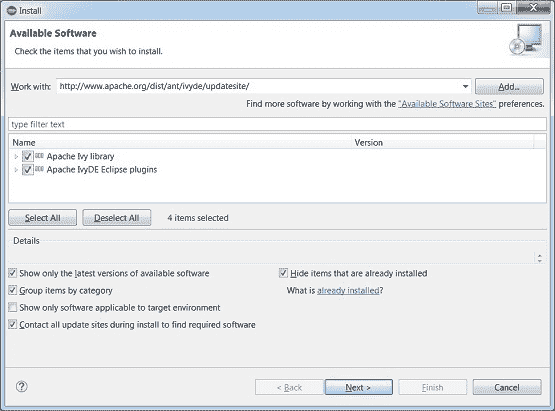
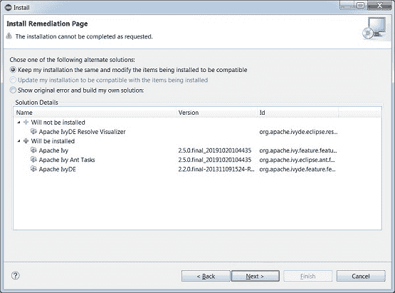
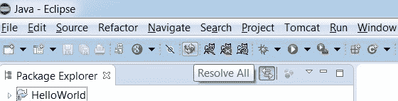

# Learn Apache Avro [Java 技术]


我想将这本书献给将使用这本书的学生们。祝愿你们未来职业成功，并希望你们永不停学习。

# 概述

Apache Ivy 是一个非常流行且强大的依赖管理工具，用于以类似于 Apache Maven 管理依赖的方式，管理基于 ANT (ANT based projects) 项目的依赖。

Apache Ivy 基于 Apache ANT，遵循相同的设计原则，是 Apache ANT 的子项目，并由 Apache ANT 社区积极管理和支持。

## 特性

以下是 Apache Ivy 的重要特性。

- **基于 ANT** — Apache Ivy 为基于 ANT 的项目提供了依赖管理能力。它用起来非常简单。
- **依赖报告** — Apache Ivy 提供了选项，以 html 格式以及报告格式打印依赖图。
- **非侵入性** — Apache Ivy 不会作为发行的一部分施加任何限制。即使是构建文件也不依赖于 Apache Ivy。
- **高度灵活** — Apache Ivy 提供了许多默认配置，可以根据需要非常容易地配置。
- **可扩展** — Apache Ivy 可以很容易地扩展。你可以定义自己的仓库、冲突解析器和最新策略。
- **性能** — Apache Ivy 针对性能而构建。它维护了已下载库的缓存。在解析依赖时，首先查找本地仓库，然后查找其他仓库。
- **传递性依赖** — 如果一个项目或库依赖于另一个库，而后者可能还需要另一个库，Apache Ivy 会自动管理传递性依赖。
- **Maven 仓库** — Apache Ivy 遵循类似于 Maven 仓库的约定。Apache Ivy 可以使用 maven 全局仓库解析依赖。
- **Maven 2 POM** — Apache Ivy 可以读取 Maven 2 POMs 作为模块描述符，并将 ivy 设置为模块描述符。因此，将现有项目迁移到 IVY 管理的项目变得简单。
- **发布** — Apache Ivy 提供了发布项目的支持，并简化了多项目环境的部署过程。
- **免费使用** — Apache Ivy 是开源的，可以免费使用。
- **文档** — Apache Ivy 有非常详细的文档和教程供学习。

# 环境搭建

Apache Ivy 的唯一要求是在你的机器上安装 Java 和 ANT。

Apache Ant 根据 Apache 软件许可分发，这是一种由开源倡议认证的完全开源许可。

最新的 Apache Ant 版本，包括其完整源代码、类文件和文档可以在`http://ant.apache.org`找到。

## 安装 Apache Ant

假设你已经在计算机上下载并安装了 Java 开发包 (JDK)。如果没有，请遵循此处的说明。

- 确保环境变量`JAVA_HOME`设置为安装 JDK 的文件夹。
- 从`https://ant.apache.org`下载二进制文件。
- 使用 Winzip、winRAR、7-zip 或类似工具将 zip 文件解压到方便的路径`c:\folder`。
- 创建名为`ANT_HOME`的新环境变量，指向 Ant 的安装文件夹，在本例中为`c:\apache-ant-1.9.14-bin`文件夹。
- 将 Apache Ant 批处理文件的路径添加到`PATH`环境变量。在我们的案例中，这将是`c:\apache-ant-1.9.14-bin`文件夹。

## 验证 Apache Ant 安装

要验证在计算机上成功安装 Apache Ant，请在命令提示符上输入`ant`。

你应该能看到类似下面的输出 —

```
C:\>ant -version
Apache Ant(TM) version 1.9.14 compiled on March 12 2019
```

如果你没有看到上述输出，请验证你是否正确遵循了安装步骤。

## 安装 Apache Ivy

- 从`https://ant.apache.org/ivy`下载二进制文件。
- 使用 Winzip、winRAR、7-zip 或类似工具将 zip 文件解压到方便的路径`c:\folder`。
- 将`ivy-2.5.0.jar`复制到`c:\apache-ant-1.9.14-bin/lib`文件夹。

## 验证 Apache Ivy 安装

要验证在计算机上成功安装 Apache Ivy，请在文件夹`E: > ivy`中创建以下构建文件。

```xml
<project name = "test ivy installation" default = "test" xmlns:ivy = "antlib:org.apache.ivy.ant" >
  <target name = "test" description = "Test ivy installation" >
    <ivy:settings />
  </target>
</project>
```

你应该看到类似下面的输出 —

```
C:\>ant
Buildfile: E:\ivy\build.xml
test:
BUILD SUCCESSFUL
Total time: 2 seconds
```

## 安装 Eclipse

本教程还涵盖了 Ant 与 Eclipse 的集成。如果你还没有安装 Eclipse，请下载并安装。

安装 Eclipse —

- 从`www.eclipse.org`下载最新的 二进制文件。
- 将二进制文件解压到方便的路径，例如`c:\folder`。
- 运行`c:\eclipse\eclipse.exe`

# 术语

参考以下`ivy.xml`示例来理解 Ivy 术语。

```xml
<?xml version = "1.0" encoding = "ISO-8859-1" ?>
<ivy-module version = "2.0" xmlns:xsi = "http://www.w3.org/2001/XMLSchema-instance" xsi:noNamespaceLocation = "http://ant.apache.org/ivy/schemas/ivy.xsd" >
  <info organisation = "com.tutorialspoint" module = "ivy-test" status = "integration" >
  </info>
  <dependencies>
    <dependency org = "commons-lang" name = "commons-lang" rev = "2.6" />
  </dependencies>
</ivy-module>
```

## Ivy 术语

以下是 Ivy 生态系统的重要术语。

- **组织 (Organisation)** — 如其名，它指的是创建项目或库的公司、个人开发者或团队名称。例如`com.tutorialspoint`。
- **模块 (Module)** — 如其名，它指的是复用单元或模块。模块通常附有一个版本号。例如`commons-lang`或`ivy-test`等。
- **模块描述符 (Module Descriptor)** — 模块描述符指的是描述模块的`ivy.xml`文件。模块描述符包含标识符、发布的制品、配置和依赖。
- **制品 (Artifact)** — 制品指的是单个交付文件。例如`jar`文件。制品可以是`zip`或`gz`类型。Jar、Source Jar、Javadoc Jar 是模块的各种制品。
- **类型 (Type)** — 类型识别制品类别，如`jar`、`war`、`src`、`doc`等。
- **制品文件名后缀 (Artifact file name extension)** — 品的后缀，如`.jar`、`.zip`、`.gz`等。
- **模块修订 (Module Revision)** — 模块唯一修订号或版本号。
- **修订状态 (Status of Revision)** — 修订状态指示修订的稳定性。以下是状态的重要值 —
  - **集成 (integration)** — 代表持续开发、每日构建等。
  - **里程碑 (milestone)** — 代表已发布但尚未最终确定。
  - **发布 (release)** — 代表测试并完成，主版本。
- **仓库 (Repository)** — 类似于 Maven 仓库，仓库代表一个 ivy 可以在其中搜索库、构件、模块等的分发站点。仓库可以是公共的、私有的或共享的。
- **Ivy 设置 (Ivy Settings)** — Apache Ivy 遵循 Maven 原则，并带有许多默认配置。可以通过定义`ivysettings.xml`文件来覆盖默认设置。

# 设置文件

Apache Ivy 遵循 Maven 原则，并带有许多默认配置。可以通过定义`ivysettings.xml`文件来覆盖默认设置。

```xml
<ivysettings>
<properties file = "${ivy.settings.dir}/ivysettings-file.properties" />
<settings defaultCache = "${cache.dir}" defaultResolver = "ibiblio" checkUpToDate = "false" />
<resolvers>
 <ibiblio name = "ibiblio" />
 <filesystem name = "internal" >
  <ivy pattern = "${repository.dir}/[module]/ivy-[revision].xml" />
  <artifact pattern = "${repository.dir}/[module]/[artifact]-[revision].[ext]" />
 </filesystem>
</resolvers>
<modules>
 <module organisation = "tutorialspoint" name = ".*" resolver = "internal" />
</modules>
</ivysettings>
```

## Ivy 设置文件的标签

以下是 Ivy 设置文件中重要的标签。

- **property** — 用于设置 ivy 变量。基数：0..n
- **properties** — 用于使用属性文件设置 ivy 变量。基数：0..n
- **settings** — 使用默认值配置 ivy。基数：0..1
- **include** — 包含另一个设置文件。基数：0..n
- **classpath** — 在类路径中添加一个用于加载插件的路径。基数：0..n
- **typedef** — 在 ivy 中定义新类型。基数：0..n
- **lock-strategies** — 定义锁策略。基数：0..1
- **caches** — 定义仓库缓存管理器。基数：0..1
- **latest-strategies** — 定义最新策略。基数：0..1
- **parsers** — 定义模块描述符解析器。基数：0..1
- **version-matchers** — 定义新的版本匹配器。基数：0..1
- **triggers** — 在 ivy 事件上注册触发器。基数：0..1
- **namespaces** — 定义新的命名空间。基数：0..1
- **macrodef** — 定义一个新的宏解析器。基数：0..n
- **resolvers** — 定义依赖解析器。基数：0..1
- **conflict-managers** — 定义冲突管理器。基数：0..1
- **modules** — 定义模块与依赖解析器之间的规则。基数：0..1
- **outputters** — 定义可用的报告输出器列表。基数：0..1
- **statuses** — 定义可用的状态列表。基数：0..1

# Eclipse Ivy 插件

IvyDE 是由 Apache 提供的 Eclipse 插件。要安装 IvyDE，启动 Eclipse 并导航到 Help（帮助） > Install New Software（安装新软件）。它会显示可用软件（Available Softwares）窗口。输入 IvyDE 更新站点`http://www.apache.org/dist/ant/ivyde/updatesite/`并按回车。它将显示以下插件。



点击 Next（下一步），你将看到以下界面。



如果在安装插件时遇到任何错误，只需重新开始过程。安装成功后，你将在 eclipse 中看到该插件。



现在你可以使用 Eclipse 和 Ivy 进行依赖管理。

# Resolve 任务 (Resolve Task)

Resolve 任务用于解析 ivy.xml 中描述的依赖，下载并将它们放入 ivy 缓存。

让我们首先在`E: > ivy > src > com > tutorialspoint`文件夹中创建一个 java 文件`Tester.java`，它将作为 ant 项目的源代码文件夹。

```java
package com . tutorialspoint ;

import org . apache . commons . lang . StringUtils ;

public class Application {
public static void main ( String [] args ) {
String string = StringUtils . upperCase ( "Ivy Beginner Guide" );
System . out . println ( string );
}
}
```

上述类使用了 apache commons lang 库中的其类`StringUtils`。Ivy 需要下载此库，因此它应该在 ivy.xml 的 dependencies 部分下定义。以下是在`E: > ivy`文件夹中创建的`ivy.xml`。

```xml
<? xml version = "1.0" encoding = "ISO-8859-1" ?>
<ivy-module version = "2.0" xmlns:xsi = "http://www.w3.org/2001/XMLSchema-instance"
xsi:noNamespaceSchemaLocation = "http://ant.apache.org/ivy/schemas/ivy.xsd" >
<info
organisation = "com.tutorialspoint"
module = "test"
status = "integration" >
</info>
<dependencies>
<dependency org = "org.apache.commons" name = "commons-lang3" rev = "3.9" />
</dependencies>
</ivy-module>
```

以下是重要的术。

- **ivy-module** — 识别 ivy 的根元素。
- **info** — 包含模块信息的元素。
- **organisation** — 组织名称。
- **module** — 模块名称。
- **status** — 状态。
- **dependencies** — 包含依赖项的部分。
- **org** — 依赖的组织。
- **name** — 依赖名称。
- **rev** — 版本。
- **project** — 项目根元素。
- **target** — 目标元素。

```xml
<project name = "test" default = "resolve" xmlns:ivy="antlib:org.apache.ivy" >
<target name="resolve">
  ivy:settings defaultCache = "${cache.dir}" defaultResolver = "ibiblio" checkUpToDate = "false" />
  <resolvers>
     <ibiblio name = "ibiblio" />
     <filesystem name = "internal" >
      <ivy pattern = "${repository.dir}/[module]/ivy-[revision].xml" />
      <artifact pattern = "${repository.dir}/[module]/[artifact]-[revision].[ext]" />
     </filesystem>
  </resolvers>
  <modules>
     <module organisation = "tutorialspoint" name = ".*" resolver = "internal" />
  </modules>
  <ivy:retrieve pattern="lib/[artifact]-[revision].[ext]"/>
</target>
</project>
```

构建项目 (Building the project)

我们已准备好所有文件。只需进入`E: > ivy`文件夹并运行`ant`命令。

`E: > ivy >`将执行操作，解析依赖，你将看到以下结果。


```
Buildfile: E:\ivy\build.xml
[ivy:resolve] Apache Ivy 2.5.0 - 20191024435 :: https://ant.apache.org/ivy/
[ivy:resolve] :: loading settings :: jar:E:/Apache/ant-1.9.14/lib/ivy-2.5.0.jar!/org/ivy/core/settings/ivysettings.xml
[ivy:resolve] :: resolving dependencies :: com.tutorialspoint;test@Acer
[ivy:resolve] confs: [default]
[ivy:resolve] found commons-lang;2.6 in public
[ivy:resolve] found junit;3.8.1 in public
[ivy:resolve] :: resolution report :: resolve 375ms :: artifacts 79ms
-------------------------------------
| | modules || artifacts |
| conf | number|search|dwnlded|evicted|| number|dwnlded|
-------------------------------------
| default | 2 | 2 | 0 | 0 || 4 | 0 |
-------------------------------------
[ivy:retrieve] :: retrieving :: com.tutorialspoint#test [sync]
[ivy:retrieve] confs: [default]
[ivy:retrieve] 0 artifacts copied, 2 already retrieved (0kB/101ms)
BUILD SUCCESSFUL
Total time: 1 second
E:\ivy>
```

以下是重要的术语。

* **conf** — 配置，在我们的案例中我们使用默认配置。
* **modules** — 表示模块的总数、下载的模块等。
* **artifacts** — 表示构件的总数、下载的构件等。

你可以在 ivy 缓存的默认位置验证下载的文件，位于 `${ivy.default.ivy.user_dir} > .ivy2 > cache` 文件夹。而 `${ivy.default.ivy.user_dir}` 默认是用户目录：`$HOME`。

# 安装任务 (Install Task)

`Install` 任务用于将模块及其依赖安装到解析器中。当需要下载公共构件并用于私有仓库时使用它。默认情况下，用户本地仓库是用户的私有仓库，存在于 `${ivy.default.ivy.user_dir}/local`。

按照 `IVY - Resolve Task` 章节中的描述创建 `Tester.java`、`build.xml` 和 `ivy.xml`。

更新 `build.xml` 使用 `ivy` `install` 任务。

```xml
<project name = "test" default = "resolve" xmlns:ivy = "antlib:org.apache.ivy.ant" >
  <target name = "resolve" description = "resolve dependencies" >
    <ivy:resolve />
  </target>
  <target name = "install" description = "install dependencies" >
    <ivy:install organisation = "commons-lang" module = "commons-lang"
      revision = "2.6" transitive = "true" overwrite = "false"
      from = "public" to = "local" />
  </target>
</project>
```

以下是重要的术语。

* `organisation` — 组织名称。
* `module` — 项目的模块名称。
* `revision` — 项目版本。
* `from` — 源仓库类型。
* `to` — 目标仓库类型。

## 构建项目

既然我们已经准备好了所有文件，只需进入控制台。进入 `E: > ivy` 文件夹并运行 `ant` 命令。

```bash
E:\ivy > ant install
```

Ivy 将开始工作解析依赖，你将看到以下结果。

```bash
Buildfile: E:\ivy\build.xml
install:
[ivy:install] :: Apache Ivy 2.5.0 - 20191020104435 :: https://ant.apache.org/ivy
/ ::
[ivy:install] :: loading settings :: url = jar:file:/E:/Apache/apache-ant-1.9.14
/lib/ivy-2.5.0.jar!/org/apache/ivy/core/settings/ivysettings.xml
[ivy:install] :: installing commons-lang#commons-lang;2.6 ::
[ivy:install] :: resolving dependencies ::
[ivy:install] found commons-lang#commons-lang;2.6 in public
[ivy:install] found junit#junit;3.8.1 in public
[ivy:install] :: downloading artifacts to cache ::
[ivy:install] :: installing in local ::
[ivy:install] published commons- lang to C:\Users\Acer\.ivy2\local\commons-lang
\commons-lang\2.6.part\sources\commons-lang.jar
[ivy:install] published commons- lang to C:\Users\Acer\.ivy2\local\commons-lang
\commons-lang\2.6.part\jars\commons-lang.jar
[ivy:install] published commons- lang to C:\Users\Acer\.ivy2\local\commons-lang
\commons-lang\2.6.part\javadocs\commons-lang.jar
[ivy:install] published ivy to C:\Users\Acer\.ivy2\local\commons-lang\commons-
lang\2.6.part\ivys\ivy.xml
[ivy:install] publish committed: moved C:\Users\Acer\.ivy2\local\commons-lang\
commons-lang\2.6.part
[ivy:install] to C:\Users\Acer\.ivy2\local\commons-lang\commons-lang\2
.6
[ivy:install] published junit to C:\Users\Acer\.ivy2\local\junit\junit\3.8.1.p
art\jars\junit.jar
[ivy:install] published ivy to C:\Users\Acer\.ivy2\local\junit\junit\3.8.1.par
t\ivys\ivy.xml
[ivy:install] publish committed: moved C:\Users\Acer\.ivy2\local\junit\junit\3
.8.1.part
[ivy:install] to C:\Users\Acer\.ivy2\local\junit\junit\3.8.1
[ivy:install] :: install resolution report ::
[ivy:install] :: resolution report :: resolve 0ms :: artifacts dl 21ms
---------------------------------------------------------------------
| | modules || artifacts |
| conf | number|search|dwnlded|evicted|| number|dwnlded|
---------------------------------------------------------------------
| default | 2 | 0 | 0 | 0 || 4 | 0 |
---------------------------------------------------------------------
BUILD SUCCESSFUL
Total time: 43 seconds
```

你可以在 ivy 缓存的默认本地仓库位置 `${ivy.default.ivy.user.dir} > .ivy2 > local` 目录中验证下载的文件。

## Retrieve Task

`retrieve` 任务用于将依赖解析到项目工作区的指定位置。

按照 `IVY - Resolve Task` 章节中的描述创建 `Tester.java`、`build.xml` 和 `ivy.xml`。

更新 `build.xml` 使用 `ivy` `retrieve` 任务。

```xml
<project name = "test" default = "resolve" xmlns:ivy = "antlib:org.apache.ivy.ant" >
  <target name = "resolve" description = "resolve dependencies" >
    <ivy:resolve />
    <ivy:retrieve sync = "true" type = "jar" />
  </target>
</project>
```

以下是重要的术语。

* `sync` — `sync` `true` 确保 `lib` 目录是最新的，任何多余的文件会被删除。
* `type` — 项目类型。

## 构建项目

既然我们已经准备好了所有文件，只需进入控制台。进入 `E: > ivy` 文件夹并运行 `ant` 命令。

## Cache Task

`cachepath` 任务用于将依赖解析到项目工作区的指定位置。

按照 `IVY - Resolve Task` 章节中的描述创建 `Tester.java`、`build.xml` 和 `ivy.xml`。

更新 `build.xml` 使用 `ivy` `retrieve` 任务。

```xml
<project name = "test" default = "resolve" xmlns:ivy = "antlib:org.apache.ivy.ant" >
  <target name = "resolve" description = "resolve dependencies" >
    <ivy:resolve />
    <ivy:cachepath pathid="new.classpath" />
  </target>
  <target name = "compile" depends = "resolve" description = "Compile" >
    <mkdir dir="build/classes" />
    <javac srcdir="src" destdir="build/classes" >
      <classpath refid="new.classpath" />
    </javac>
  </target>
</project>
```

以下是重要的术语。

* `pathid` — 包含缓存 jar 包的路径 ID。

编译：

```
[ javac ] E:\ivy\build.xml:13: warning: 'includeantruntime' was not set, defaulting to build.sysclasspath=last; set to false for repeatable builds
[ javac ] Compiling 1 source file to E:\ivy\build\classes
BUILD SUCCESSFUL
Total time: 3 seconds
You can verify the compiled class file in project build directory.
```

# 发布任务 (Publish Task)

`publish` 任务用于将当前产物及其解析后的描述文件发布到指定的仓库。

让我们按照 **IVY - 解析任务 (IVY - Resolve Task)** 章节中的描述创建 `Tester.java`、`build.xml` 和 `ivy.xml`。

更新 `build.xml` 以使用 `ivy publish` 任务。首先我们将创建一个 jar 文件，然后将其发布。

`build.xml`

```xml
<project name = "test" default = "resolve" xmlns:ivy = "antlib:org.apache.ivy.ant" >
  <property name = "build.dir" value = "build" />
  <target name = "resolve" description = "resolve dependencies" >
    <ivy:resolve />
  </target>
  <target name = "jar" >
    <jar destfile = "${build.dir}/lib/application.jar" basedir = "${build.dir}/classes" >
      <manifest>
        <attribute name = "Main-Class" value = "com.tutorialspoint.Application" />
      </manifest>
    </jar>
  </target>
  <target name = "publish" depends = "jar" >
    <ivy:resolve />
    <ivy:publish resolver = "local" pubrevision = "1.0" overwrite = "true" >
      <artifacts pattern = "${build.dir}/lib/[artifact].[ext]" />
    </ivy:publish>
  </target>
</project>
```

以下是重要的术语。

- `resolver` — 用于发布的解析器。
- `pattern` — 用于定定产物的模式。

此发布任务首先构建 jar 包，然后解析依赖，设置信息，最后将产物发布到本地仓库。

## 构建项目

既然我们已经准备好了所有文件，只需进入控制台。导航到 **E: > ivy** 文件夹并运行 `ant` 命令。

```
E:\ivy > ant publish
```

Ivy 将开始作用解析依赖，你将看到如下结果。


在 `E:\ivy` 目录下执行 `ant publish` 命令，输出如下：

```
E:\ivy > ant publish
Buildfile: E:\ivy\build.xml
jar:
publish:
[ivy:resolve] :: Apache Ivy 2.5.0 - 20191020104435 :: https://ant.apache.org/ivy/ ::
[ivy:resolve] :: loading settings :: url = jar:file:/E:/Apache/apache-ant-1.9.14/lib/ivy-2.5.0.jar!/org/apache/ivy/core/settings/ivysettings.xml
[ivy:resolve] :: resolving dependencies :: com.tutorialspoint#test;1.0.0
[ivy:resolve] confs: [default]
[ivy:resolve] found commons-lang#commons-lang;2.6 in public
[ivy:resolve] found junit#junit;3.8.1 in public
[ivy:resolve] :: resolution report :: resolve 121ms :: artifacts dl 15ms
---------------------------------------------------------------------
| | modules || artifacts |
| conf | number| search|dwnlded|evicted|| number|dwnlded|
---------------------------------------------------------------------
| default | 2 | 2 | 0 | 0 || 4 | 0 |
---------------------------------------------------------------------
[ivy:publish] :: publishing :: com.tutorialspoint#test
[ivy:publish] published application to C:\Users\Acer\.ivy2\local\com.tutorialspoint\test\1.0\jars\application.jar
[ivy:publish] published ivy to C:\Users\Acer\.ivy2\local\com.tutorialspoint\test\1.0\ivys\ivy.xml
BUILD SUCCESSFUL
Total time: 1 second
```

你可以在本地仓库中验证发布的 Ivy 产物。

# 信息任务 (Info Task)

`info` 任务用于在文件中设置 Ivy 特有的信息，并可以在任何依赖解析的情况下使用。

让我们按照 **IVY - 解析任务 (IVY - Resolve Task)** 章节中的描述创建 `Tester.java`、`build.xml` 和 `ivy.xml`。

更新 `build.xml` 以使用 `ivy publish` 任务。首先我们将创建一个 jar 文件，然后将其发布。在发布任务之前，我们已经使用 `info` 任务设置了所需的 Ivy 信息。

`build.xml`：

```xml
<project name = "test" default = "resolve" xmlns:ivy = "antlib:org.apache.ivy.ant" >
  <property name = "build.dir" value = "build" />
  <target name = "resolve" description = "resolve dependencies" >
    <ivy:resolve />
  </target>
  <target name = "jar" >
    <jar destfile = "${build.dir}/lib/application.jar" basedir = "${build.dir}/classes" >
      <manifest>
        <attribute name = "Main-Class" value = "com.tutorialspoint.Application" />
      </manifest>
    </jar>
  </target>
  <target name = "publish" depends = "jar" >
    <ivy:info file = "ivy.xml" />
    <ivy:publish resolver = "local" pubrevision = "1.0" overwrite = "true" >
      <artifacts pattern = "${build.dir}/lib/[artifact].[ext]" />
    </ivy:publish>
  </target>
</project>
```

此发布任务首先构建 jar 包，然后解析依赖，设置信息，最后将产物发布到本地仓库。

| ID | Name | Description |
| :--- | :--- | :--- |
| 8 | VFS (Standard) | 在可以使用 Apache Commons VFS 访问的仓库定位 Ivy 文件和产物。 |
| 9 | SSH (Standard) | 在可以使用 SSH 访问的仓库定位 Ivy 文件和产物。 |
| 10 | SFTP (Standard) | 在可以使用 SFTP 访问的仓库定位 Ivy 文件和产物。 |
| 11 | Jar (Standard) | 在 jar 包内的仓库定位 Ivy 文件和产物。 |
| 12 | Chain (Composite) | 将搜索委托给一个子解析器链。 |
| 13 | Dual (Composite) | 将搜索委托给一个解析器，将产物委托给另一个。 |
| 14 | OBR (Standard) | 将 OSGi `obr.xml` 列出的模块解析为 OSGi 束包。 |
| 15 | Eclipse updatesite (Standard) | 将托管在 Eclipse 更新站点上的模块解析为 OSGi 束包。 |
| 16 | OSGi-agg (Composite) | 将搜索委托给一个支持 OSGi 束包的子解析器链。 |

让我们在 `E: > ivy2` 文件夹下的新项目中创建 `Tester.java`、`build.xml` 和 `ivy.xml`，类似于 `IVY - Resolve Task` 章节中描述的。在 `E: > ivy2` 下创建一个 `settings` 文件夹。在 settings 文件夹中创建 `ivysettings.xml`。

### `build.xml`

```xml
<project name = "test" default = "resolve" xmlns:ivy = "antlib:org.apache.ivy.ant">
  <property name = "build.dir" value = "build" />
  <property name = "base.dir" value = "" />
  <target name = "resolve" description = "resolve dependencies">
    <ivy:resolve />
  </target>
  <target name = "compile" depends = "resolve" description = "Compile">
    <mkdir dir = "build/classes" />
    <javac srcdir = "src" destdir = "build/classes">
      <classpath refid = "new.classpath" />
    </javac>
  </target>
</project>
```

### `ivy.xml`

```xml
<?xml version = "1.0" encoding = "ISO-8859-1"?>
<ivy-module version = "2.0" xmlns:xsi = "http://www.w3.org/2001/XMLSchema-instance" xsi:noNamespaceSchemaLocation = "http://ant.apache.org/ivy/schemas/ivy.xsd">
  <info organisation = "org.apache" module = "chained-resolvers" />
  <dependencies>
    <dependency org = "commons-lang" name = "commons-lang" rev = "2.6" conf = "default" />
    <dependency org = "com.tutorialspoint" name = "test" rev = "1.0" />
  </dependencies>
</ivy-module>
```

在这里我们添加了两个依赖：一个是 `commons-lang` 库，另一个是在 `IVY - Publish Task` 章节中发布的 `test`。

### `ivysettings.xml`

```xml
<ivysettings>
  <settings defaultResolver = "multiresolver" />
  <resolvers>
    <chain name = "multiresolver">
      <filesystem name = "libraries">
        <artifact pattern = "${ivy.settings.dir}/repository/[artifact]-[revision].[ext]" />
      </filesystem>
      <ibiblio name = "ibiblio" m2compatible = "true" />
    </chain>
  </resolvers>
</ivysettings>
```

在这里我们使用 `chain` 解析器创建了一个复合解析器，它包含两个解析器：一个名为 `libraries`，用于在本地仓库定位库；另一个名为 `ibiblio`，用于在 Maven 公共仓库定位。

## 构建项目

既然所有文件都已就绪，只需进入控制。导航到 `E: > ivy2` 文件夹并运行 `ant` 命令。

```bash
E:\ivy > ant
```

Ivy 将开始解析依赖，你将看到以下结果。

```text
Buildfile: E:\ivy2\build.xml
resolve:
[ivy:resolve] :: Apache Ivy 2.5.0 - 20191020104435 :: https://ant.apache.org/ivy
/ ::
[ivy:resolve] :: loading settings :: url = jar:file:/E:/Apache/apache-ant-1.9.14/lib/ivy-2.5.0.jar!/org/apache/ivy/core/settings/ivysettings.xml
[ivy:resolve] :: resolving dependencies :: org.apache#chained-resolvers;working@Acer-PC
[ivy:resolve] confs: [default]
[ivy:resolve] found commons-lang#commons-lang;2.6 in public
[ivy:resolve] found com.tutorialspoint#test;1.0 in local
[ivy:resolve] found junit#junit;3.8.1 in public
[ivy:resolve] downloading C:\Users\Acer\.ivy2\local\com.tutorialspoint\test\1.0\jars\application.jar ...
[ivy:resolve] .. (1kB)
[ivy:resolve] .. (0kB)
[ivy:resolve] [ SUCCESSFUL ] com.tutorialspoint#test;1.0!application.jar (13ms)
[ivy:resolve] :: resolution report :: resolve 1085ms :: artifacts dl 22ms
---------------------------------------------------------------------
| | modules || artifacts |
| conf | number|search|dwnlded|evicted||
---------------------------------------------------------------------
| default | 3 | | 1 ||
---------------------------------------------------------------------
BUILD SUCCESSFUL
Total time: 1.1 seconds
```

```xml
<settings defaultResolver = "default" />
<include url = "${ivy.default.settings.dir}/ivysettings-public.xml" />
<include url = "${ivy.default.settings.dir}/ivysettings-shared.xml" />
<include url = "${ivy.default.settings.dir}/ivysettings-local.xml" />
<include url = "${ivy.default.settings.dir}/ivysettings-main-chain.xml" />
<include url = "${ivy.default.settings.dir}/ivysettings-default-chain.xml" />
</ivysettings>
```

要覆盖共享存储库设置，请更新 `ivysettings-shared.xml` 的内容。

### `ivysettings-shared.xml`

```xml
<ivysettings>
<property name = "ivy.shared.default.root" value = "${ivy.default.ivy.user.dir}/shared" override = "false" />
<property name = "ivy.shared.default.ivy.pattern" value = "[organisation]/[module]/[revision]/[type]s/[artifact].[ext]" override = "false" />
<property name = "ivy.shared.default.artifact.pattern" value = "[organisation]/[module]/[revision]/[type]s/[artifact].[ext]" override = "false" />
<resolvers>
<filesystem name = "shared" >
<ivy pattern = "${ivy.shared.default.root}/${ivy.shared.default.ivy.pattern}" />
<artifact pattern = "${ivy.shared.default.root}/${ivy.shared.default.artifact.pattern}" />
</filesystem>
</resolvers>
</ivysettings>
```

# 公共存储库

公共存储库是指可以通过互联网访问并包含第三方模块的存储库。默认情况下，m2 兼容模式下的 `ibiblio` 是公共存储库。它也被 maven 2 公共存储库。

## 覆盖 ivysettings 默认设置

默认情况下，Ivy 在 `ivy.jar` 中的 `ivysettings.xml` 中包含配置。

### `ivysettings.xml`

```xml
<ivysettings>
<settings defaultResolver = "default" />
<include url = "${ivy.default.settings.dir}/ivysettings-public.xml" />
<include url = "${ivy.default.settings.dir}/ivysettings-shared.xml" />
<include url = "${ivy.default.settings.dir}/ivysettings-local.xml" />
<include url = "${ivy.default.settings.dir}/ivysettings-main-chain.xml" />
<include url = "${ivy.default.settings.dir}/ivysettings-default-chain.xml" />
</ivysettings>
```

要覆盖公共存储库设置，请更新 `ivysettings-public.xml` 的内容，或者在项目的设置文件夹中创建 `ivysettings.xml`。

### `ivysettings.xml`


```xml
<ivysettings>
<settings defaultResolver = "default" />
<include url = "http://customserver/ivy/ivysettings-public.xml" />
<include url = "${ivy.default.settings.dir}/ivysettings-shared.xml" />
<include url = "${ivy.default.settings.dir}/ivysettings-local.xml" />
<include url = "${ivy.default.settings.dir}/ivysettings-main-chain.xml" />
<include url = "${ivy.default.settings.dir}/ivysettings-default-chain.xml" />
</ivysettings>
```

更新默认的`ivysetting-public.xml`内容。

### 原始 - `ivysetting-public.xml`

```xml
<ivysettings>
<resolvers>
<ibiblio name = "public" m2compatible = "true" />
</resolvers>
</ivysettings>
```

### 更新 - `ivysetting-public.xml`

```xml
<ivysettings>
<resolvers>
<filesystem name = "public" >
<ivy pattern = "/path/to/my/public/rep/[organisation]/[module]/ivy-[revision].xml" />
<artifact pattern = "/path/to/my/public/rep/[organisation]/[module]/[artifact]-[revision].[ext]" />
</filesystem>
</resolvers>
</ivysettings>
```
