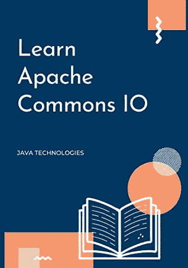

# Learn Apache Commons IO [Java 技术]



我想将这本书献给使用它的学生们。祝愿你们未来职业成功，并希望你们永停止学习。

# 目录

- 概述
- 环境搭建
- IOUtils
- FileUtils
- FilenameUtils
- FileSystemUtils
- IOCase
- LineIterator
- NameFileFilter
- WildcardFileFilter
- SuffixFileFilter
- PrefixFileFilter
- OrFileFilter
- AndFileFilter
- FileEntry
- FileAlterationObserver
- FileAlterationMonitor
- NameFileComparator
- SizeFileComparator
- LastModifiedFileComparator
- TeeInputStream
- TeeOutputStream

# 概述

Apache Commons IO 库提供了各种工具类，用于涵盖广泛用例的常见文件 I/O 操作。它可以帮助避免编写样板代码。Apache Commons IO 库提供了以下类别的类：

## 类

Apache Commons IO 库提供了以下类别的类：

字体 工具类

`org.apache.commons.io` 包下的这些类提供了文件和字符串比较。以下是某些示例。

* `IOUtils` ― 提供了读取、写入和拷贝文件的工具方法。这些方法适用于 `InputStream`、`OutputStream`、`Reader` 和 `Writer`。
* `FilenameUtils` ― 提供了在不使用 `File` 对象的情况下处理文件名的方法。它在不同的操作系统上以类似的方式工作。
* `FileUtils` ― 提供了操作文件的方法，如移动、打开、检查存在性、读取文件等。这些方法使用 `File` 对象。
* `IOCase` ― 提供了字符串操作和比较的方法。
* `FileSystemUtils` ― 提供了获取磁盘驱动器上可用空间的方法。
* `LineIterator` ― 提供了一种处理基于行的文件的灵活方式。

### 过滤器类

`org.apache.commons.io.filefilter` 包下的过滤器类提供了根据逻辑标准过滤文件的方法，而不是基于字符串的繁琐比较。以下是某些示例。

* `NameFileFilter` ― 根据名称过滤文件名。
* `WildcardFileFilter` ― 使用提供的通配符过滤文件。
* `SuffixFileFilter` ― 根据后缀过滤文件。这用于检索所有特定类型的文件。
* `PrefixFileFilter` ― 根据前缀过滤文件。
* `OrFileFilter` ― 在文件过滤器列表之间提供条件或（OR）逻辑。如果列表中的任何过滤器返回 true，则返回 true。否则，返回 false。
* `AndFileFilter` ― 在文件过滤器列表之间提供与（AND）逻辑。如果列表中的任何过滤器返回 false，则返回 false。否则，返回 true。

### 文件监控类

`org.apache.commons.io.monitor` 包下的文件监控类提供了跟踪特定文件或文件夹变化的控制，并允许根据更改采取相应。以下是某些示例。

* `FileEntry` ― 提供了文件或目录在某一时刻的状态，即 `File` 属性。
* `FileAlterationObserver` ― 代表根目录下的文件状态，检查文件系统并通知监听器创建、更改或删除事件。
* `FileAlterationMonitor` ― 代表一个产生监控线程的线程，触发任何已注册的 `FileAlterationObserver`。

### 比较器类

文件监控类跟踪特定的文件或文件夹。以下是示例。

* `NameFileComparator` ― 比较文件名。
* `SizeFileComparator` ― 比较文件大小。
* `LastModifiedFileComparator` ― 比较最后修改时间。

### 输入流类

`org.apache.commons.io.input` 包下的这些类提供了多种实现。以下是某些示例。

* `NullInputStream` ― 吸收所有数据。
* `TeeInputStream` ― 将输出发送到两个流。
* `ByteArrayInputStream` ― JDK 的版本。
* `CountingInputStream` ― 计数字节数。
* `ProxyInputStream` ― 更改代理流。
* `LockableInputStream` ― 创建锁并。

# 环境搭建

在本章中，我们将学习 Apache Commons IO 的本地设置以及如何设置 Windows 2000/XP、Windows ME 等。我们还将了解一些 Java 编辑器以及如何下载 Commons IO。

## 本地设置

如果你仍然愿意为 Java 设置环境，本节将指导你如何设置。请按照下面的步骤设置。

Java SE 可以从 https://www.oracle.com/java/technologies/archiveddownloads.html 免费获取，根据你的操作系统下载。按照说明运行 `.exe` 在你的机器上安装 Java。一旦在机器上安装了 Java，你需要设置环境变量指向正确的目录 ―

### Windows 2000/XP

我们假设你将 Java 安装在 `C:\Program Files\java\jdk` 目录下

* 右键点击“我的电脑”，选择“属性”。
* 点击“高级”选项卡下的“环境变量”按钮。
* 现在，修改 `Path` 变量，使其也包含 Java 可执行文件的路径。例如，如果路径当前设置为 `C:\WINDOWS\SYSTEM32`，请将路径更改为 `C:\WINDOWS\SYSTEM32;C:\Program Files\java\jdk\bin`。

### Windows 95/98/ME

我们假设你将 Java 安装在 `C:\Program Files\java\jdk` 目录下

* 编辑 `C:\autoexec.bat` 文件，并在末尾添加以下行 `SET PATH=%PATH%;C:\Program Files\java\jdk\bin`

### Linux, UNIX, Solaris, FreeBSD

环境变量 `PATH` 应指向 Java 安装位置。如果这样做有问题，请参考你的 shell 文档。

例如，如果你使用 bash 作为你的 shell，那么你会在 `.bashrc` 的末尾添加以下行：

```bash
export PATH=/path/to/java:$PATH
```

## 流行的 Java 编辑器

要编写 Java 程序，你需要一个文本编辑器。市场上有很多先进的集成开发环境 (IDE)。但目前，你可以考虑以下以下之一 ―

* `Notepad` ― 在 Windows 机器上，你可以使用任何简单的文本编辑器，如记事本（本教程推荐）、TextPad。
* `Netbeans` — 这是一个开源且免费的 Java IDE，可以从 `https://www.netbeans.org/index.html` 下载。
* `Eclipse` — 同样也是一个由 eclipse 开源社区开发的 Java IDE，可以从 `https://www.eclipse.org/` 下载。

## 下载 Common IO 归包

从 `commons-io-2.8.0-bin.zip` 下载最新版本的 Apache Common IO jar 文件。在编写本教程时，我们已经下载了 `commons-io-2.8.0-bin.zip` 并将其复制到 `C:\>Apache` 文件夹。

| OS | 存档名称 |
| :--- | :--- |
| Windows | `commons-io-2.6-bin.zip` |
| Linux | `commons-io-2.6-bin.tar.gz` |
| Mac | `commons-io-2.6-bin.tar.gz` |

## 设置 Apache Common IO 环境

将 `APACHE_HOME` 环境变量指向机器上存储 Apache jar 文件的基础目录位置。假设我们已经在不同的操作系统上按如下方式解压了 `commonsio-2.8.0-bin.zip`。

| OS | 输出 |
| :--- | :--- |
| Windows | 设置环境变量 `APACHE_HOME` 为 `C:\Apache` |
| Linux | `export APACHE_HOME=/usr/local/Apache` |
| Mac | `export APACHE_HOME=/Library/Apache` |

## 设置 CLASSPATH 变量

将 `CLASSPATH` 环境变量指向 Common IO jar 位置。假设你已经在不同的操作系统上按如下方式存储了 `commons-io-2.8.0-bin.zip`。

| OS | 输出 |
| :--- | :--- |
| Windows | 设置环境变量 `CLASSPATH` 为 `%CLASSPATH%;%APACHE_HOME%\commons-io-2.6.jar;.;` |
| Linux | `export CLASSPATH=$CLASSPATH:$APACHE_HOME/commons-io-2.6.jar:.` |
| Mac | `export CLASSPATH=$CLASSPATH:$APACHE_HOME/commons-io-2.6.jar:.` |

# IOUtils

提供了读取、写入和复制文件的实用方法。这些方法适用于 `InputStream`、`OutputStream`、`Reader` 和 `Writer`。

## 类声明

以下是 `org.apache.commons.io.IOUtils` 类的声明——

```java
public class IOUtils
extends Object
```

## IOUtils 的特性

`IOUtils` 的特性如下：

* 提供输入/输出操作的静态实用方法。
* `toXXX()` — 从流中读取数据。
* `write()` — 将数据写入流。
* `copy()` — 将所有数据从一个流复制到另一个流。
* `contentEquals` — 比较两个流的内容。

## IOUtils 类示例

这是我们需要解析的输入文件——

Welcome to TutorialsPoint. Simply Easy Learning.

IOTester.java

```java
import java.io.BufferedReader;
import java.io.FileInputStream;
import java.io.IOException;
import java.io.InputStream;
import java.io.InputStreamReader;
import org.apache.commons.io.IOUtils;

public class IOTester {
    public static void main(String[] args) {
        try {
            //Using BufferedReader
            readUsingTraditionalWay();
            //Using IOUtils
            readUsingIOUtils();
        } catch (IOException e) {
            System.out.println(e.getMessage());
        }
    }

    // 使用 buffered reader 逐行读取文件
    public static void readUsingTraditionalWay() throws IOException {
        try (BufferedReader bufferReader = new BufferedReader(new InputStreamReader(
                new FileInputStream("input.txt")))) {
            String line;
            while ((line = bufferReader.readLine()) != null) {
                System.out.println(line);
            }
        }
    }

    // 使用 IOUtils 一性读取文件
    public static void readUsingIOUtils() throws IOException {
        try (InputStream in = new FileInputStream("input.txt")) {
            System.out.println(IOUtils.toString(in, "UTF-8"));
        }
    }
}
```

## 输出

它将打印以下结果：

Welcome to TutorialsPoint. Simply Easy Learning.

Welcome to TutorialsPoint. Simply Easy Learning.

# FileUtils

提供了操作文件的方法，如移动、打开、检查存在性、读取文件等。这些方法使用 `File` 对象。

## 类声明

以下是 `org.apache.commons.io.FileUtils` 类的声明——

```java
public class FileUtils
extends Object
```

## FileUtils 的特性

`FileUtils` 的特性如下：

* 写入文件的方法。
* 从文件读取的方法。
* 创建包含父目录在内的目录的方法。
* 复制文件和目录的方法。
* 删除文件和目录的方法。
* 与 URL 方法的方法。
* 按过滤器和扩展名列出文件和目录的方法。
* 比较文件内容的方法。
* 设置文件修改日期的方法。
* 计算校验和的方法。

## FileUtils 类示例

这是我们需要解析的输入文件——

Welcome to TutorialsPoint. Simply Easy Learning.

IOTester.java

```java
import java.io.BufferedReader;
import java.io.FileInputStream;
import java.io.IOException;
import java.io.InputStream;
import java.io.InputStreamReader;
import org.apache.commons.io.IOUtils;

public class IOTester {
    public static void main(String[] args) {
        try {
            //Using BufferedReader
            readUsingTraditionalWay();
            //Using IOUtils
            readUsingIOUtils();
        } catch (IOException e) {
            System.out.println(e.getMessage());
        }
    }

    // 使用 buffered reader 逐行读取文件
    public static void readUsingTraditionalWay() throws IOException {
        try (BufferedReader bufferReader = new BufferedReader(new InputStreamReader(
                new FileInputStream("input.txt")))) {
            String line;
            while ((line = bufferReader.readLine()) != null) {
                System.out.println(line);
            }
        }
    }

    // 使用 IOUtils 一性读取文件
    public static void readUsingIOUtils() throws IOException {
        try (InputStream in = new FileInputStream("input.txt")) {
            System.out.println(IOUtils.toString(in, "UTF-8"));
        }
    }
}
```

（注：此处根据原文逻辑保持代码块不变，但上方已翻译注释）


* **Netbeans** — 这是一个开源且免费的 Java IDE，可以从 `https://www.netbeans.org/index.html` 下载。
* **Eclipse** — 同样也是一个由 eclipse 开源社区开发的 Java IDE，可以从 `https://www.eclipse.org/` 下载。

## 下载 Common IO 归包

从 `commons-io-2.8.0-bin.zip` 下载最新版本的 Apache Common IO jar 文件。在编写本教程时，我们已经下载了 `commons-io-2.8.0-bin.zip` 并将其复制到 `C:\>Apache` 文件夹。

| OS | 存档名称 |
| :--- | :--- |
| Windows | `commons-io-2.6-bin.zip` |
| Linux | `commons-io-2.6-bin.tar.gz` |
| Mac | `commons-io-2.6-bin.tar.gz` |

## 设置 Apache Common IO 环境

将 `APACHE_HOME` 环境变量指向机器上存储 Apache jar 文件的基础目录位置。假设我们已经在不同的操作系统上按如下方式解压了 `commonsio-2.8.0-bin.zip`。

| OS | 输出 |
| :--- | :--- |
| Windows | 设置环境变量 `APACHE_HOME` 为 `C:\Apache` |
| Linux | `export APACHE_HOME=/usr/local/Apache` |
| Mac | `export APACHE_HOME=/Library/Apache` |

## 设置 CLASSPATH 变量

将 `CLASSPATH` 环境变量指向 Common IO jar 位置。假设你已经在不同的操作系统上按如下方式存储了 `commons-io-2.8.0-bin.zip`。

| OS | 输出 |
| :--- | :--- |
| Windows | 设置环境变量 `CLASSPATH` 为 `%CLASSPATH%;%APACHE_HOME%\commons-io-2.6.jar;.;` |
| Linux | `export CLASSPATH=$CLASSPATH:$APACHE_HOME/commons-io-2.6.jar:.` |
| Mac | `export CLASSPATH=$CLASSPATH:$APACHE_HOME/commons-io-2.6.jar:.` |

# IOUtils

提供了读取、写入和复制文件的实用方法。这些方法适用于 `InputStream`、`OutputStream`、`Reader` 和 `Writer`。

## 类声明

以下是 `org.apache.commons.io.IOUtils` 类的声明——

```java
public class IOUtils
extends Object
```

## IOUtils 的特性

`IOUtils` 的特性如下：

* 提供输入/输出操作的静态实用方法。
* `toXXX()` — 从流中读取数据。
* `write()` — 将数据写入流。
* `copy()` — 将所有数据从一个流复制到另一个流。
* `contentEquals` — 比较两个流的内容。

## IOUtils 类示例

这是我们需要解析的输入文件——

Welcome to TutorialsPoint. Simply Easy Learning.

IOTester.java

```java
import java.io.BufferedReader;
import java.io.FileInputStream;
import java.io.IOException;
import java.io.InputStream;
import java.io.InputStreamReader;
import org.apache.commons.io.IOUtils;

public class IOTester {
    public static void main(String[] args) {
        try {
            //Using BufferedReader
            readUsingTraditionalWay();
            //Using IOUtils
            readUsingIOUtils();
        } catch (IOException e) {
            System.out.println(e.getMessage());
        }
    }

    // 使用 buffered reader 逐行读取文件
    public static void readUsingTraditionalWay() throws IOException {
        try (BufferedReader bufferReader = new BufferedReader(new InputStreamReader(
                new FileInputStream("input.txt")))) {
            String line;
            while ((line = bufferReader.readLine()) != null) {
                System.out.println(line);
            }
        }
    }

    // 使用 IOUtils 一性读取文件
    public static void readUsingIOUtils() throws IOException {
        try (InputStream in = new FileInputStream("input.txt")) {
            System.out.println(IOUtils.toString(in, "UTF-8"));
        }
    }
}
```

## 输出

它将打印以下结果。

Welcome to TutorialsPoint. Simply Easy Learning.
Welcome to TutorialsPoint. Simply Easy Learning.

# FileUtils

提供了操作文件的方法，如移动、打开、检查存在性、读取文件等。这些方法使用 `File` 对象。

## 类声明

以下是 `org.apache.commons.io.FileUtils` 类的声明——

```java
public class FileUtils
extends Object
```

## FileUtils 的特性

`FileUtils` 的特性如下：

* 写入文件的方法。
* 从文件读取的方法。
* 创建包含父目录在内的目录的方法。
* 复制文件和目录的方法。
* 删除文件和目录的方法。
* 与 URL 方法的方法。
* 按过滤器和扩展名列出文件和目录的方法。
* 比较文件内容的方法。
* 设置文件最后修改日期的方法。
* 计算校验和的方法。

## FileUtils 类示例

这是我们需要解析的输入文件——

Welcome to TutorialsPoint. Simply Easy Learning.

IOTester.java

```java
import java.io.BufferedReader;
import java.io.FileInputStream;
import java.io.IOException;
import java.io.InputStream;
import java.io.InputStreamReader;
import org.apache.commons.io.IOUtils;

public class IOTester {
    public static void main(String[] args) {
        try {
            //Using BufferedReader
            readUsingTraditionalWay();
            //Using IOUtils
            readUsingIOUtils();
        } catch (IOException e) {
            System.out.println(e.getMessage());
        }
    }

    // 使用 buffered reader 逐行读取文件
    public static void readUsingTraditionalWay() throws IOException {
        try (BufferedReader bufferReader = new BufferedReader(new InputStreamReader(
                new FileInputStream("input.txt")))) {
            String line;
            while ((line = bufferReader.readLine()) != null) {
                System.out.println(line);
            }
        }
    }

    // 使用 IOUtils 一性读取文件
    public static void readUsingIOUtils() throws IOException {
        try (InputStream in = new FileInputStream("input.txt")) {
            System.out.println(IOUtils.toString(in, "UTF-8"));
        }
    }
}
```


*(注：原文中 `FileUtils` 示例后的代码块确实重复了 `IOUtils` 的内容，此处按要求保留。)*

## 输出

它将打印以下结果。

```
Welcome to TutorialsPoint. Simply Easy Learning.
Welcome to TutorialsPoint. Simply Easy Learning.
```

# FilenameUtils

提供了处理文件名的方法，无需使用 `File` 对象。它适用于不同的操作系统。

## 类声明

以下是 `org.apache.commons.io.FileUtils` 类的声明——

```java
public class FileUtils
extends Object
```

## FilenameUtils 的特性

该类定义了文件名中的六个部分。考虑一个示例位置 `C:\dev\`，这些部分为：

* 前缀 `C:\`
* 相对路径 `dev\`
* 绝对路径 `C:\dev\`
* 文件名 `file.txt`
* 基础文件名 `file`
* 扩展名 `txt`

要识别目录，请为文件名添加分隔符。

## FilenameUtils 类示例

`IOTester.java`

```java
import java.io.IOException;
import org.apache.commons.io.FilenameUtils;

public class IOTester {
    public static void main(String[] args) {
        try {
            //Using FilenameUtils
            usingFilenameUtils();
        } catch (IOException e) {
            System.out.println(e.getMessage());
        }
    }

    public static void usingFilenameUtils() throws IOException {
        String path = "C:\\dev\\project\\file.txt";
        System.out.println("Full Path: " + FilenameUtils.getFullPath(path));
        System.out.println("Relative Path: " + FilenameUtils.getPath(path));
        System.out.println("Prefix: " + FilenameUtils.getPrefix(path));
        System.out.println("Extension: " + FilenameUtils.getExtension(path));
        System.out.println("Base: " + FilenameUtils.getBaseName(path));
        System.out.println("Name: " + FilenameUtils.getName(path));

        String filename = "C:/commons/io/../lang/project.xml";
        System.out.println("Normalized Path: " + FilenameUtils.normalize(filename));
    }
}
```

## 输出

它将打印以下结果。

```
Full Path: C:\dev\project\file.txt
Relative Path: dev\project\
Prefix: C:\
Extension: txt
Base: file
Name: file.txt
Normalized Path: C:\commons\lang\project.xml
```

以下是 `FileSystemUtils` 类的示例 −

```java
IOTester.java

import java.io.IOException;
import org.apache.commons.io.FileSystemUtils;

public class IOTester {
    public static void main(String[] args) {
        try {
            System.out.println("Free Space " + FileSystemUtils.freeSpaceKb("C:/") + " Bytes");
        } catch (IOException e) {
            System.out.println(e.getMessage());
        }
    }
}
```

## 输出

它将打印以下结果。

```
Free Space 61355640 kb
```

# IOCase

IO 大写敏感性的枚举。不同的操作系统对文件名的大小写敏感性有不同的规则。例如，Windows 对文件名是不区分大小写的，而 Unix 是区分大小写的。`IOCase` 捕获了这种差异，提供了一个枚举来控制如何执行文件名比较。它还提供了使用该枚举来执行比较的方法。

## 枚举声明

以下是 `org.apache.commons.io.IOCase` 枚举的声明 −

```java
public enum IOCase
extends Enum<IOCase> implements Serializable
```

## IOCase 枚举示例

以下是 `IOCase` 枚举的示例 −

```java
IOTester.java

import java.io.IOException;
import org.apache.commons.io.IOCase;

public class IOTester {
    public static void main(String[] args) {
        try {
            usingIOCase();
        } catch (IOException e) {
            System.out.println(e.getMessage());
        }
    }

    public static void usingIOCase() throws IOException {
        String text = "Welcome to TutorialsPoint. Simply Easy Learning.";
        String text1 = "WELCOME TO TUTORIALSPOINT. SIMPLY EASY LEARNING.";

        System.out.println("Ends with Learning (case sensitive): " +
            IOCase.SENSITIVE.checkEndsWith(text1, "Learning."));
        System.out.println("Ends with Learning (case insensitive): " +
            IOCase.INSENSITIVE.checkEndsWith(text1, "Learning."));
        System.out.println("Equality Check (case sensitive): " +
            IOCase.SENSITIVE.checkEquals(text, text1));
        System.out.println("Equality Check (case insensitive): " +
            IOCase.INSENSITIVE.checkEquals(text, text1));
    }
}
```

## 输出

它将打印以下结果。

```
Ends with Learning (case sensitive): false
Ends with Learning (case insensitive): true
Equality Check (case sensitive): false
Equality Check (case insensitive): true
```

# LineIterator

提供了一种处理基于行的文件的灵活方法。

## 类声明

以下是 `org.apache.commons.io.LineIterator` 类的声明 −

```java
public class LineIterator
extends Object implements Iterator<String>, Closeable
```

## LineIterator 类示例

这里是我们需要解析的输入文件 −

```
Welcome to TutorialsPoint. Simply Easy Learning.
Learn web technologies,
prepare exams,
code online,
all at one place.
```

```java
IOTester.java

import java.io.File;
import java.io.IOException;
import org.apache.commons.io.FileUtils;
import org.apache.commons.io.LineIterator;

public class IOTester {
    public static void main(String[] args) {
        try {
            usingLineIterator();
        } catch (IOException e) {
            System.out.println(e.getMessage());
        }
    }

    public static void usingLineIterator() throws IOException {
        //获取文件对象
        File file = FileUtils.getFile("input.txt");
        try (LineIterator lineIterator = FileUtils.lineIterator(file)) {
            System.out.println("Contents of input.txt");
            while (lineIterator.hasNext()) {
                System.out.println(lineIterator.next());
            }
        }
    }
}
```

## 输出

它将打印以下结果。

```
Contents of input.txt
Welcome to TutorialsPoint. Simply Easy Learning.
Learn web technologies,
prepare exams,
code online,
all at one place.
```

# NameFileFilter

根据名称过滤文件名。

## 类声明

以下是 `org.apache.commons.io.filefilter.NameFileFilter` 类的声明 −

```java
public class NameFileFilter
extends AbstractFileFilter implements Serializable
```

## NameFileFilter 类示例

这里是我们需要解析的输入文件 −

```
Welcome to TutorialsPoint. Simply Easy Learning.
```

打印当前目录下的所有文件和目录，然后过滤一个名为 `Input.txt` 的文件。

```java
IOTester.java

import java.io.File;
import java.io.IOException;
import org.apache.commons.io.IOCase;
import org.apache.commons.io.filefilter.NameFileFilter;

public class IOTester {
    public static void main(String[] args) {
        try {
            usingNameFileFilter();
        } catch (IOException e) {
            System.out.println(e.getMessage());
        }
    }

    public static void usingNameFileFilter() throws IOException {
        //获取当前目录
        File currentDirectory = new File(".");
        //获取当前目录下所有文件和目录的名称
        String[] files = currentDirectory.list();
        System.out.println("All files and Folders.\n");
        for (int i = 0; i < files.length; i++) {
            System.out.println(files[i]);
        }

        System.out.println("\nFile with name input.txt\n");
        String[] acceptedNames = {"input", "input.txt"};
        String[] filesNames = currentDirectory.list(new NameFileFilter(acceptedNames, IOCase.INSENSITIVE));
        for (int i = 0; i < filesNames.length; i++) {
            System.out.println(filesNames[i]);
        }
    }
}
```

## 输出

它将打印以下结果。

```
All files and Folders.
.classpath
.project
.settings
bin
input.txt
src
File with name input.txt
```

# WildcardFilter

使用通配符过滤文件。

## 类声明

以下是 `org.apache.commons.io.filefilter.WildcardFilter` 类的声明 −

```java
public class WildcardFilter
extends AbstractFileFilter implements Serializable
```

## WildcardFilter 类示例

这里是我们需要解析的输入文件 −

```
Welcome to TutorialsPoint. Simply Easy Learning.
```

打印当前目录下的所有文件和目录，然后过滤一个以 `t` 结尾的文件。

```java
IOTester.java

import java.io.File;
import java.io.IOException;
import org.apache.commons.io.filefilter.WildcardFilter;

public class IOTester {
    public static void main(String[] args) {
        try {
            usingWildcardFilter();
        } catch (IOException e) {
            System.out.println(e.getMessage());
        }
    }

    public static void usingWildcardFilter() throws IOException {
        //获取当前目录
        File currentDirectory = new File(".");
        //获取当前目录下所有文件和目录的名称
        String[] files = currentDirectory.list();
```


# 文件过滤器与文件监控

## SuffixFileFilter

根据后缀过滤文件。用于检索特定类型的文件。

### 类声明

以下是`org.apache.commons.io.filefilter.SuffixFileFilter`类的声明 −

```java
public class SuffixFileFilter
extends AbstractFileFilter implements Serializable
```

### SuffixFileFilter 类示例

这里是我们需要解析的输入文件 −

```
Welcome to TutorialsPoint. Simply Easy Learning.
```

打印当前目录下的所有文件和目录，然后过滤一个扩展名为`txt`的文件。

```java
import java.io.File;
import java.io.IOException;
import org.apache.commons.io.filefilter.SuffixFileFilter;

public class IOTester {

    public static void main(String[] args) {
        try {
            usingSuffixFileFilter();
        } catch (IOException e) {
            System.out.println(e.getMessage());
        }
    }

    public static void usingSuffixFileFilter() throws IOException {
        //获取当前目录
        File currentDirectory = new File(".");
        //获取当前目录下所有文件和目录的名称
        String[] files = currentDirectory.list();
        System.out.println("All files and Folders.\n");
        for (int i = 0; i < files.length; i++) {
            System.out.println(files[i]);
        }
        System.out.println("\nFile ending with t.\n");
        String[] filesNames = currentDirectory.list(new WildcardFilter("*t"));
        for (int i = 0; i < filesNames.length; i++) {
            System.out.println(filesNames[i]);
        }
    }
}
```

### 输出

它将打印以下结果。

```
All files and Folders.
.classpath
.project
.settings
bin
input.txt
src
File ending with t
.project
input.txt
```

## PrefixFileFilter

根据前缀过滤文件。

### 类声明

以下是`org.apache.commons.io.filefilter.PrefixFileFilter`类的声明 −

```java
public class PrefixFileFilter
extends AbstractFileFilter implements Serializable
```

### PrefixFileFilter 类示例

这里是我们需要解析的输入文件 −

```
Welcome to TutorialsPoint. Simply Easy Learning.
```

让我们打印当前目录下的所有文件和目录，然后过滤出以`input`开头的文件。

```java
import java.io.File;
import java.io.IOException;
import org.apache.commons.io.filefilter.PrefixFileFilter;

public class IOTester {

    public static void main(String[] args) {
        try {
            usingPrefixFileFilter();
        } catch (IOException e) {
            System.out.println(e.getMessage());
        }
    }

    public static void usingPrefixFileFilter() throws IOException {
        //获取当前目录
        File currentDirectory = new File(".");
        //获取当前目录下所有文件和目录的名称
        String[] files = currentDirectory.list();
        System.out.println("All files and Folders.\n");
        for (int i = 0; i < files.length; i++) {
            System.out.println(files[i]);
        }
        System.out.println("\nFile starting with input\n");
        String[] filesNames = currentDirectory.list(new PrefixFileFilter("input"));
        for (int i = 0; i < filesNames.length; i++) {
            System.out.println(filesNames[i]);
        }
    }
}
```

### 输出

它将打印出以下结果。

```
All files and Folders.
.classpath
.project
.settings
bin
input.txt
src
File with extenstion txt
input.txt
```

## OrFileFilter

跨文件过滤器列表提供条件“或”（OR）逻辑。如果列表中的任何过滤器返回`true`，则返回`true`。否则，返回`false`。

### 类声明

以下是`org.apache.commons.io.filefilter.OrFileFilter`类的声明 −

```java
public class OrFileFilter
extends AbstractFileFilter implements ConditionalFileFilter, Serializable
```

### OrFileFilter 类示例

这里是我们需要解析的输入文件 −

```
Welcome to TutorialsPoint. Simply Easy Learning.
```

让我们打印当前目录下的所有文件和目录，然后过滤出以`.`开头或以`t`结尾的文件。

```java
import java.io.File;
import java.io.IOException;
import org.apache.commons.io.filefilter.OrFileFilter;
import org.apache.commons.io.filefilter.PrefixFileFilter;
import org.apache.commons.io.filefilter.WildcardFileFilter;

public class IOTester {

    public static void main(String[] args) {
        try {
            usingOrFileFilter();
        } catch (IOException e) {
            System.out.println(e.getMessage());
        }
    }

    public static void usingOrFileFilter() throws IOException {
        //获取当前目录
        File currentDirectory = new File(".");
        //获取当前目录下所有文件和目录的名称
        String[] files = currentDirectory.list();
        System.out.println("All files and Folders.\n");
        for (int i = 0; i < files.length; i++) {
            System.out.println(files[i]);
        }
        System.out.println("\nFile starting with . or ends with t\n");
        String[] filesNames = currentDirectory.list(
            new OrFileFilter(new PrefixFileFilter("."), new WildcardFileFilter("*t")));
        for (int i = 0; i < filesNames.length; i++) {
            System.out.println(filesNames[i]);
        }
    }
}
```

### 输出

它将打印出以下结果。

```
All files and Folders.
.classpath
.project
.settings
bin
input.txt
src
File starting with . or ends with t
.classpath
.project
.settings
input.txt
```

## AndFileFilter

跨文件过滤器列表提供条件“与”（And）逻辑。如果列表中的所有过滤器都返回`true`，则返回`true`。否则，返回`false`。

### 类声明

以下是`org.apache.commons.io.filefilter.AndFileFilter`类的声明 −

```java
public class AndFileFilter
extends AbstractFileFilter
```

### AndFileFilter 示例

这里是我们需要解析的输入文件 −

```
Welcome to TutorialsPoint. Simply Easy Learning.
```

让我们打印当前目录下的所有文件和目录，然后过滤出以`.`开头且以`t`结尾的文件。

```java
import java.io.File;
import java.io.IOException;
import org.apache.commons.io.filefilter.AndFileFilter;
import org.apache.commons.io.filefilter.PrefixFileFilter;
import org.apache.commons.io.filefilter.WildcardFileFilter;

public class IOTester {

    public static void main(String[] args) {
        try {
            usingAndFileFilter();
        } catch (IOException e) {
            System.out.println(e.getMessage());
        }
    }

    public static void usingAndFileFilter() throws IOException {
        //获取当前目录
        File currentDirectory = new File(".");
        //获取当前目录下所有文件和目录的名称
        String[] files = currentDirectory.list();
        System.out.println("All files and Folders.\n");
        for (int i = 0; i < files.length; i++) {
            System.out.println(files[i]);
        }
        System.out.println("\nFile starting with . and ends with t\n");
        String[] filesNames = currentDirectory.list(
            new AndFileFilter(new PrefixFileFilter("."), new WildcardFileFilter("*t")));
        for (int i = 0; i < filesNames.length; i++) {
            System.out.println(filesNames[i]);
        }
    }
}
```

### 输出

它将打印出以下结果。

```
All files and Folders.
.classpath
.project
.settings
bin
input.txt
src
File starting with . and ends with t
.classpath
.project
.settings
input.txt
```

## FileEntry

提供文件或目录的状态、特定时间点的文件属性。

### 类声明

以下是`org.apache.commons.io.monitor.FileEntry`类的声明 −

```java
public class FileEntry
```


# FileEntry

`extends Object implements Serializable`

## 特性

`FileEntry` 类对象提供特定时间点的以下文件属性。

- `getName()` – 文件名。
- `exists()` – 检查文件是否存在。
- `isDirectory()` – 检查是否为目录。
- `lastModified()` – 最后修改时间。
- `listFiles()` – 目录内容。

## FileEntry 类示例

这里是我们需要解析的输入文件：

```
Welcome to TutorialsPoint. Simply Easy Learning.
```

`IOTester.java`

```java
import java.io.File;
import java.io.IOException;
import org.apache.commons.io.FileUtils;
import org.apache.commons.io.monitor.FileEntry;

public class IOTester {
    public static void main(String[] args) {
        try {
            usingFileEntry();
        } catch (IOException e) {
            System.out.println(e.getMessage());
        }
    }

    public static void usingFileEntry() throws IOException {
        //获取文件对象
        File file = FileUtils.getFile("input.txt");
        FileEntry fileEntry = new FileEntry(file);
        System.out.println("Monitored File: " + fileEntry.getFile());
        System.out.println("File name: " + fileEntry.getName());
        System.out.println("Is Directory: " + fileEntry.isDirectory());
    }
}
```

它将打印以下结果：

```
监控的文件：input.txt
文件名：input.txt
是否为目录：false
```

# FileAlterationObserver

代表根目录下的文件状态，检查文件系统并通知监听器创建、更改或删除事件。

## 类声明

以下是 `org.apache.commons.io.monitor.FileAlterationObserver` 类的声明：

```java
public class FileAlterationObserver
extends Object implements Serializable
```

## FileAlterationObserver 类示例

这里是我们需要解析的输入文件：

```
Welcome to TutorialsPoint. Simply Easy Learning.
```

`IOTester.java`

```java
import java.io.File;
import java.io.IOException;
import org.apache.commons.io.FileDeleteStrategy;
import org.apache.commons.io.FileUtils;
import org.apache.commons.io.monitor.FileAlterationListenerAdaptor;
import org.apache.commons.io.monitor.FileAlterationMonitor;
import org.apache.commons.io.monitor.FileAlterationObserver;

public class IOTester {
    public static void main(String[] args) {
        try {
            usingFileAlterationObserver();
        } catch (IOException e) {
            System.out.println(e.getMessage());
        }
    }

    public static void usingFileAlterationObserver() throws IOException {
        //get the file object
        File inputFile = FileUtils.getFile("input.txt");
        String absolutePath = inputFile.getAbsolutePath();
        String parent = absolutePath.substring(0, absolutePath.indexOf("input.txt"));
        File parentDirectory = FileUtils.getFile(parent);
        FileAlterationObserver observer = new FileAlterationObserver(parentDirectory);
        observer.addListener(new FileAlterationListenerAdaptor() {
            @Override
            public void onDirectoryCreate(File file) {
                System.out.println("Folder created: " + file.getName());
            }

            @Override
            public void onDirectoryDelete(File file) {
                System.out.println("Folder deleted: " + file.getName());
            }

            @Override
            public void onFileCreate(File file) {
                System.out.println("File created: " + file.getName());
            }

            @Override
            public void onFileDelete(File file) {
                System.out.println("File deleted: " + file.getName());
            }
        });

        //create a monitor to check changes after every 500 ms
        FileAlterationMonitor monitor = new FileAlterationMonitor(500, observer);
        try {
            monitor.start();
            //create a new directory
            File newFolder = new File("test");
            File newFile = new File("test1");
            newFolder.mkdirs();
            Thread.sleep(1000);
            newFile.createNewFile();
            Thread.sleep(1000);
            FileDeleteStrategy.NORMAL.delete(newFolder);
            Thread.sleep(1000);
            FileDeleteStrategy.NORMAL.delete(newFile);
            Thread.sleep(1000);
            monitor.stop(10000);
        } catch (IOException e) {
            System.out.println(e.getMessage());
        } catch (InterruptedException e) {
            System.out.println(e.getMessage());
        } catch (Exception e) {
            System.out.println(e.getMessage());
        }
    }
}
```

## 输出

它将打印以下结果：

```
Folder created: test
File created: test1
Folder deleted: test
File deleted: test1
```

# FileAlterationMonitor

代表一个产生监控线程的线程，按指定的间隔触发任何注册的 `FileAlterationObserver`。

## 类声明

以下是 `org.apache.commons.io.monitor.FileAlterationMonitor` 类的声明：

```java
public final class FileAlterationMonitor
extends Object implements Runnable
```

## FileAlterationMonitor 类示例

这里是我们需要解析的输入文件：

```
Welcome to TutorialsPoint. Simply Easy Learning.
```

`IOTester.java`

```java
import java.io.File;
import java.io.IOException;
import org.apache.commons.io.FileDeleteStrategy;
import org.apache.commons.io.FileUtils;
import org.apache.commons.io.monitor.FileAlterationListenerAdaptor;
import org.apache.commons.io.monitor.FileAlterationMonitor;
import org.apache.commons.io.monitor.FileAlterationObserver;

public class IOTester {
    public static void main(String[] args) {
        try {
            usingFileAlterationMonitor();
        } catch (IOException e) {
            System.out.println(e.getMessage());
        }
    }

    public static void usingFileAlterationMonitor() throws IOException {
        //get the file object
        File inputFile = FileUtils.getFile("input.txt");
        String absolutePath = inputFile.getAbsolutePath();
        String parent = absolutePath.substring(0, absolutePath.indexOf("input.txt"));
        File parentDirectory = FileUtils.getFile(parent);
        FileAlterationObserver observer = new FileAlterationObserver(parentDirectory);
        observer.addListener(new FileAlterationListenerAdaptor() {
            @Override
            public void onDirectoryCreate(File file) {
                System.out.println("Folder created: " + file.getName());
            }

            @Override
            public void onDirectoryDelete(File file) {
                System.out.println("Folder deleted: " + file.getName());
            }

            @Override
            public void onFileCreate(File file) {
                System.out.println("File created: " + file.getName());
            }

            @Override
            public void onFileDelete(File file) {
                System.out.println("File deleted: " + file.getName());
            }
        });

        //create a monitor to check changes after every 500 ms
        FileAlterationMonitor monitor = new FileAlterationMonitor(500, observer);
        try {
            monitor.start();
            //create a new directory
            File newFolder = new File("test");
            File newFile = new File("test1");
            newFolder.mkdirs();
            Thread.sleep(1000);
            newFile.createNewFile();
            Thread.sleep(1000);
            FileDeleteStrategy.NORMAL.delete(newFolder);
            Thread.sleep(1000);
            FileDeleteStrategy.NORMAL.delete(newFile);
            Thread.sleep(1000);
            monitor.stop(10000);
        } catch (IOException e) {
            System.out.println(e.getMessage());
        } catch (InterruptedException e) {
            System.out.println(e.getMessage());
        } catch (Exception e) {
            System.out.println(e.getMessage());
        }
    }
}
```

以下是 `org.apache.commons.io.comparator.SizeFileComparator` 类的声明：

```java
```


# `SizeFileComparator`

`SizeFileComparator` 类声明如下：

```java
public class SizeFileComparator
extends Object implements Serializable
```

## `SizeFileComparator` 类示例

这里是我们需要解析的输入文件：

欢迎来到 TutorialsPoint。简单易学。

`IOTester.java`

```java
import java.io.File;
import java.io.FileFilter;
import java.io.IOException;
import org.apache.commons.io.comparator.SizeFileComparator;
import org.apache.commons.io.filefilter.FileFileFilter;

public class IOTester {
    public static void main(String[] args) {
        try {
            usingSizeFileComparator();
        } catch (IOException e) {
            System.out.println(e.getMessage());
        }
    }

    public static void usingSizeFileComparator() throws IOException {
        //获取当前目录
        File currentDirectory = new File(".");
        SizeFileComparator comparator = new SizeFileComparator();
        File[] sortedFiles = comparator.sort(currentDirectory.listFiles((FileFilter) FileFileFilter.FILE));
        System.out.println("Sorted By Size: ");
        for (File file : sortedFiles) {
            System.out.println(file.getName() + ", size(kb) :" + file.length());
        }
    }
}
```

## 输出

它将打印以下结果：

```
Sorted By Size:
input.txt, size:124
.project, size:382
.classpath, size:441
```

# `LastModifiedFileComparator`

比较两个文件/目录的最后修改日期。`LastModifiedFileComparator` 可以根据最后修改日期对文件/目录列表或数组进行排序。

## 类声明

以下是 `org.apache.commons.io.comparator.LastModifiedFileComparator` 类的声明：

```java
public class LastModifiedFileComparator
extends Object implements Serializable
```

## `LastModifiedFileComparator` 类示例

这里是我们需要解析的输入文件：

欢迎来到 TutorialsPoint。简单易学。

`IOTester.java`

```java
import java.io.File;
import java.io.FileFilter;
import java.io.IOException;
import java.util.Date;
import org.apache.commons.io.comparator.LastModifiedFileComparator;
import org.apache.commons.io.filefilter.FileFileFilter;

public class IOTester {
    public static void main(String[] args) {
        try {
            usingLastModifiedFileComparator();
        } catch (IOException e) {
            System.out.println(e.getMessage());
        }
    }

    public static void usingLastModifiedFileComparator() throws IOException {
        //获取当前目录
        File currentDirectory = new File(".");
        LastModifiedFileComparator comparator = new LastModifiedFileComparator();
        File[] sortedFiles = comparator.sort(currentDirectory.listFiles((FileFilter) FileFileFilter.FILE));
        System.out.println("Sorted By Last Modified date: ");
        for (File file : sortedFiles) {
            System.out.println(file.getName() + ", Modified on: " + new Date(file.lastModified()));
        }
    }
}
```

## 输出

它将打印以下结果：

```
Sorted By Last Modified date:
.project, Modified on: Thu Oct 12 19:06:45 IST 2017
.classpath, Modified on: Mon Nov 20 13:09:55 IST 2017
input.txt, Modified on: Mon Nov 20 19:27:55 IST 2017
```

# `TeeInputStream`

它是一个 `InputStream` 代理，可以透明地将从代理流中读取的所有字节的副本写入给定的 `OutputStream`。当调用此代理的 `close()` 方法时，被代理的输入流会被关闭。它可以同时共同操作两个流。

## 类声明

以下是 `org.apache.commons.io.input.TeeInputStream` 类的声明：

```java
public class TeeInputStream
extends ProxyInputStream
```

## `TeeInputStream` 类示例

在此示例中，关闭一个 `TeeInputStream` 会同时关闭 `TeeInputStream` 和 `TeeOutputStream` 对象。

`IOTester.java`

```java
import java.io.ByteArrayInputStream;
import java.io.ByteArrayOutputStream;
import java.io.IOException;
import org.apache.commons.io.input.TeeInputStream;
import org.apache.commons.io.output.TeeOutputStream;

public class IOTester {
    private static final String SAMPLE = "Welcome to TutorialsPoint. Simply Easy Learning.";

    public static void main(String[] args) {
        try {
            usingTeeInputStream();
        } catch (IOException e) {
            System.out.println(e.getMessage());
        }
    }

    public static void usingTeeInputStream() throws IOException {
        TeeInputStream teeInputStream = null;
        TeeOutputStream teeOutputStream = null;
        try {
            ByteArrayInputStream inputStream = new ByteArrayInputStream(SAMPLE.getBytes("US-ASCII"));
            ByteArrayOutputStream outputStream1 = new ByteArrayOutputStream();
            ByteArrayOutputStream outputStream2 = new ByteArrayOutputStream();
            teeOutputStream = new TeeOutputStream(outputStream1, outputStream2);
            teeInputStream = new TeeInputStream(inputStream, teeOutputStream, true);
            teeInputStream.read(new byte[SAMPLE.length()]);
            System.out.println("Output stream 1: " + outputStream1.toString());
            System.out.println("Output stream 2: " + outputStream2.toString());
        } catch (IOException e) {
            System.out.println(e.getMessage());
        } finally {
            //teeIn.close() closes teeIn and teeOut which in turn closes the out1 and out2.
            try {
                teeInputStream.close();
            } catch (IOException e) {
                System.out.println(e.getMessage());
            }
        }
    }
}
```

## 输出

它将打印以下结果：

```
Output stream 1: Welcome to TutorialsPoint. Simple Easy Learning.
Output stream 2: Welcome to TutorialsPoint. Simple Easy Learning.
```

# `TeeOutputStream`

`TeeOutputStream` 分分 `OutputStream`。它以 unix `tee` 命令命名。它允许将流分支到两个流。

## 类声明

以下是 `org.apache.commons.io.output.TeeOutputStream` 类的声明：

```java
public class TeeOutputStream
extends ProxyOutputStream
```

## `TeeOutputStream` 类示例

在此示例中，`TeeOutputStream` 接收两个输出流作为参数并将数据传递到两个输出流。

`IOTester.java`

```java
import java.io.ByteArrayInputStream;
import java.io.ByteArrayOutputStream;
import java.io.IOException;
import org.apache.commons.io.input.TeeInputStream;
import org.apache.commons.io.output.TeeOutputStream;

public class IOTester {
    private static final String SAMPLE = "Welcome to TutorialsPoint. Simply Easy Learning.";

    public static void main(String[] args) {
        try {
            usingTeeInputStream();
        } catch (IOException e) {
            System.out.println(e.getMessage());
        }
    }

    public static void usingTeeInputStream() throws IOException {
        TeeInputStream teeInputStream = null;
        TeeOutputStream teeOutputStream = null;
        try {
            ByteArrayInputStream inputStream = new ByteArrayInputStream(SAMPLE.getBytes("US-ASCII"));
            ByteArrayOutputStream outputStream1 = new ByteArrayOutputStream();
            ByteArrayOutputStream outputStream2 = new ByteArrayOutputStream();
            teeOutputStream = new TeeOutputStream(outputStream1, outputStream2);
            teeInputStream = new TeeInputStream(inputStream, teeOutputStream, true);
            teeInputStream.read(new byte[SAMPLE.length()]);
            System.out.println("Output stream 1: " + outputStream1.toString());
            System.out.println("Output stream 2: " + outputStream2.toString());
        } catch (IOException e) {
            System.out.println(e.getMessage());
        } finally {
            //teeIn.close() closes teeIn and teeOut which in turn closes the out1 and out2.
            try {
                teeInputStream.close();
            } catch (IOException e) {
                System.out.println(e.getMessage());
            }
        }
    }
}
```
