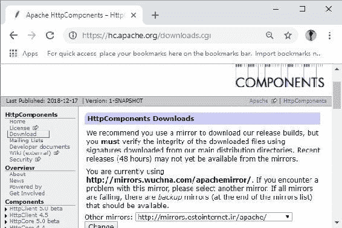

# 学习 Apache HTTP Client (JAVA 技术)

我想将这本书献给将使用它的学生们。祝愿你们未来的职业取得成功，希望你们永不停学习。

# 概述

超文本传输协议 (HTTP) 是一种用于分布式、协作、超媒体信息系统的应用程序协议。自 1990 年以来，它是万维网（即互联网）数据通信的基础。HTTP 是一种通用且无状态的协议，可以通过扩展其请求方法、错误代码和请求头用于其他用途。

简单来说，HTTP 是一种基于 TCP/IP 的通信协议，用于在万维网上传输数据（HTML 文件、图像文件、查询结果等）。默认端口是 TCP 80，但也可以使用其他端口。它为计算机之间的通信提供了标准化方法。HTTP 规范定义了客户端请求数据如何构建并发送到服务器，以及服务器如何响应这些请求。

## 什么是 Http Client

`HttpClient` 是一个传输库，它位于客户端，负责发送和接收 HTTP 消息。它提供了最新的、功能丰富且高效的实现，符合最近 HTTP 标准。

此外，使用客户端库可以构建基于 HTTP 的应用程序，如 Web 浏览器、Web 服务客户端等。

## Http Client 的特性

以下是 `HttpClient` 的显著特性：

- `HttpClient` 库实现了所有可用的 HTTP 方法。
- `HttpClient` 库提供了使用安全套接层（SSL）协议保护请求的 API。
- 使用 `HttpClient`，你可以通过代理建立连接。
- 你可以使用 Basic、Digest、NTLMv1、NTLMv2、NTLM2 Session 等认证方案对连接进行认证。
- `HttpClient` 库支持通过多线程发送请求。它使用 `ClientConnectionPoolManager` 管理从各个线程建立的多个连接。
- 使用 Apache `HttpClient` 库，你可以设置连接超时。

# 环境搭建

在本章中，我们将解释如何在 Eclipse IDE 中为 `HttpClient` 设置环境。在继续安装之前，请确保你的系统中已经安装了 Eclipse。如果没有，请下载并安装 Eclipse。

有关 Eclipse 的更多信息，请参阅我们的 `Eclipse 教程`。

## 第一步 - 下载依赖 JAR 文件

打开 `HttpClient`（组件）网站的官方`首页`并进入下载页面。



然后，下载最新版本的 `HttpClient`。在整个教程中，我们使用的版本是 4.5.6，因此下载文件 `4.5.6.zip`。

在下载的文件夹中，你会找到一个名为 `lib` 的文件夹，其中包含了需要添加到项目类路径（classpath）的所需的 Jar 文件，以便 `HttpClient` 正常工作。

## 第二步 - 创建项目并设置构建路径

打开 Eclipse 并创建一个项目。右键点击项目，选择所示的 `Build Path → Configure Build Path`。


在 `Java Build Path` 窗口中，点击 `Libraries` 选项卡。


选择 `lib` 文件夹中的所有 jar 文件，然后点击 `Apply and Close`。


# Http Get 请求

`GET` 方法用于从指定的服务器检索信息。使用 `GET` 只会检索数据而不产生其他影响。

## 第一步 - 创建 HttpClient 对象

`HttpClients` 的 `createDefault()` 方法返回一个 `CloseableHttpClient` 对象。

```java
CloseableHttpClient httpclient = HttpClients.createDefault();
```

## 第二步 - 创建 HttpGet 对象

该类的构造函数接受代表 URI 的字符串值。

```java
HttpGet httpget = new HttpGet("http://www.tutorialpoint.com/");
```

## 第三步 - 执行 Get 请求

`CloseableHttpClient` 的 `execute()` 方法接受一个 `HttpRequest` 对象并返回一个 `HttpResponse`。

```java
HttpResponse httpresponse = httpclient.execute(httpget);
```

### 示例

下面的示例演示了使用 `HttpClient` 库执行 HTTP GET 请求。

```java
import java.util.Scanner;
import org.apache.http.HttpResponse;
import org.apache.http.client.HttpGet;
import org.apache.http.impl.client.CloseableHttpClient;
import org.apache.http.impl.client.HttpClients;

public class HttpGetExample {
    public static void main(String[] args) throws Exception {
        // 创建 HttpClient 对象
        CloseableHttpClient httpclient = HttpClients.createDefault();

        // 创建 HttpGet 对象
        HttpGet httpget = new HttpGet("https://www.tutorialpoint.com/");

        // 打印方法
        System.out.println("Request Type: " + httpget.getMethod());

        // 执行 Get 请求
        HttpResponse httpresponse = httpclient.execute(httpget);
        Scanner sc = new Scanner(httpresponse.getEntity().getContent());

        // 打印状态行
        System.out.println(httpresponse.getStatusLine());
        while (sc.hasNext()) {
            System.out.println(sc.nextLine());
        }
    }
}
```

#### 输出

上面的程序产生以下输出：

```
Request Type: GET
<!DOCTYPE html>
<!--[if IE 8]><html class = "ie8"> <![endif]-->
<!--[if IE 9]><html class = "ie9"> <![endif]-->
<!--[if gt IE 9]><!-->
<html lang = "en-US"> <!--<!endif]-->
...
```

# Http Post 请求

POST 请求用于向服务器发送数据；例如使用 HTML 表单发送客户信息、文件上传等。

`HttpClient` API 提供一个名为 `HttpPost` 的类，该类表示 POST 请求。

请按照下面提供的步骤，使用 `HttpClient` 库发送 HTTP POST 请求。

## 步骤 1 - 创建 HttpClient 对象

`HttpClients` 类的 `createDefault()` 方法返回一个 `CloseableHttpClient` 类的对象，该类是 `HttpClient` 接口的基础实现。

使用该方法可以创建一个 `HttpClient` 对象。

```java
CloseableHttpClient httpClient = HttpClients.createDefault();
```

## 步骤 2 - 创建 HttpPost 对象

`HttpPost` 类表示 `HTTP POST` 请求。它使用 URI 发送所需的数据并获取指定服务器的信息。

通过实例化 `HttpPost` 类来创建此请求，并将代表 URI 的字符串值作为参数传递给构造函数。

```java
HttpPost httpPost = new HttpPost("http://www.tutorialspoint.com/");
```

## 步骤 3 - 执行 Post 请求

`CloseableHttpClient` 对象的 `execute()` 方法接受一个 `HttpUriRequest`（接口）对象（即 `HttpGet`、`HttpPost`、`HttpPut`、`HttpHead` 等）并返回响应对象。

```java
HttpResponse httpResponse = httpclient.execute(httpPost);
```

### 示例

下面是一个演示如何使用 `HttpClient` 库执行 HTTP POST 请求的示例。

```java
import org.apache.http.HttpResponse;
import org.apache.http.client.methods.HttpPost;
import org.apache.http.impl.client.CloseableHttpClient;
import org.apache.http.impl.client.HttpClients;

public class HttpPostExample {
    public static void main(String args[]) throws Exception {
        //Creating a HttpClient object
        CloseableHttpClient httpclient = HttpClients.createDefault();
        //Creating a HttpPost object
        HttpPost httppost = new HttpPost("https://www.tutorialspoint.com/");
        //Printing the method used
        System.out.println("Request Type: " + httppost.getMethod());
        //Executing the Post request
        HttpResponse httpresponse = httpclient.execute(httppost);
        Scanner sc = new Scanner(httpresponse.getEntity().getContent());
        //Printing the status line
        System.out.println(httpresponse.getStatusLine());
        while (sc.hasNext()) {
            System.out.println(sc.nextLine());
        }
    }
}
```

#### 输出

上述程序将生成以下输出。

```
Request Type: POST
<!DOCTYPE html>
<!--[if IE 8]><html class = "ie8"> <![endif]-->
<!--[if IE 9]><html class = "ie9"> <![endif]-->
<!--[if gt IE 9]><!-->
<html lang = "en-US"> <!--<!endif]-->
...
```

# 响应处理器

`HttpClient` 库提供了一个名为响应处理器（Response Handler）的机制，用于处理 HTTP 响应。使用响应处理器可以简化响应处理过程，避免手动管理连接和资源。

## 示例

下面是一个演示如何使用响应处理器处理 HTTP 响应的示例。

```java
class MyResponseHandler implements ResponseHandler<String> {

    public String handleResponse(final HttpResponse response) throws IOException {
        //Get the status of the response
        int status = response.getStatusLine().getStatusCode();
        if (status >= 200 && status < 300) {
            HttpEntity entity = response.getEntity();
            if (entity == null) {
                return "";
            } else {
                return EntityUtils.toString(entity);
            }
        } else {
            return "" + status;
        }
    }
}

public class ResponseHandlerExample {
    public static void main(String args[]) throws Exception {
        //Create an HttpClient object
        CloseableHttpClient httpclient = HttpClients.createDefault();
        //instantiate the response handler
        ResponseHandler<String> responseHandler = new MyResponseHandler();
        //Create an HttpGet object
        HttpGet httpget = new HttpGet("http://www.tutorialspoint.com/");
        //Execute the Get request by passing the response handler object and HttpGet object
        String httpresponse = httpclient.execute(httpget, responseHandler);
        System.out.println(httpresponse);
    }
}
```

上述程序生成了以下输出 −

```html
<!DOCTYPE html>
<!--[if IE 8]><html class = "ie ie8"> <![endif]-->
<!--[if IE 9]><html class = "ie ie9"> <![endif]-->
<!--[if gt IE 9]><!-->
<html lang = "en-US"> <!--<!endif]-->
<head>
<!-- Basic -->
<meta charset = "utf-8">
<meta http-equiv = "X-UA-Compatible" content = "IE = edge">
<meta name = "viewport" content = "width = device-width,initial-scale = 1.0,userscalable = yes">
<link href = "https://cdn.muicss.com/mui-0.9.39/extra/mui-rem.min.css" rel = "stylesheet" type = "text/css" />
<link rel = "stylesheet" href = "/questions/css/home.css?v = 3" />
<script src = "/questions/js/jquery.min.js"></script>
<script src = "/questions/js/fontawesome.js"></script>
<script src = "https://cdn.muicss.com/mui-0.9.39/js/mui.min.js"></script>
</head>
. . . . . . . . . . . .
<script>
window.dataLayer = window.dataLayer || [];
function gtag() {dataLayer.push(arguments);}
gtag('js', new Date());
gtag('config', 'UA-232293-17');
</script>
</body>
```

# 关闭连接

如果你是手动处理 HTTP 响应而不是使用响应处理器，你需要手动关闭所有的 http 连接。本章解释了如何手动关闭连接。

在手动关闭 HTTP 连接时请遵循以下步骤 −

## 第 1 步 - 创建 HttpClient 对象

`HttpClients` 类的 `createDefault()` 方法返回 `CloseableHttpClient` 类的对象，它是 `HttpClient` 接口的基础实现。

使用此方法创建如下所示的 `HttpClient` 对象 −

```java
CloseableHttpClient httpClient = HttpClients.createDefault();
```

## 第 2 步 - 启动 try-finally 块

启动一个 try-finally 块，将程序中的剩余代码写入 try 块，并在 finally 块中关闭 `CloseableHttpClient` 对象。

```java
CloseableHttpClient httpClient = HttpClients.createDefault();
try {
    //剩余代码 . . . . . . . . . . . .
} finally {
    httpClient.close();
}
```

## 第 3 步 - 创建 HttpGet 对象

创建 `HttpGet` 对象，指定要访问的 URI。

```java
HttpGet httpGet = new HttpGet("http://www.tutorialspoint.com/");
```


`HttpGet`类表示 HTTP GET 请求，它使用 URI 获取给定服务器的信息。

通过传递表示 URI 的字符串实例化`HttpGet`类来创建 HTTP GET 请求。

```java
HttpGet httpGet = new HttpGet("http://www.tutorialspoint.com/");
```

## 第 4 步 - 执行 Get 请求

`CloseableHttpClient`对象的`execute()`方法接受`HttpUriRequest`（接口）对象（例如`HttpGet`、`HttpPost`、`HttpPut`、`HttpHead`等）并返回响应对象。

使用给定的方法执行请求 −

```java
HttpResponse httpResponse = httpclient.execute(httpGet);
```

## 第 5 步 - 启动另一个（嵌套）try-finally

启动另一个 try-finally 块（嵌套在之前的 try-finally 块中），将程序中的剩余代码写入此 try 块，并在 finally 块中关闭`HttpResponse`对象。

```java
CloseableHttpClient httpclient = HttpClients.createDefault();
try {
    . . . . . . .
    . . . . . . .
    CloseableHttpResponse httpresponse = httpclient.execute(httpget);
    try {
        . . . . . . .
        . . . . . . .
    } finally {
        httpresponse.close();
    }
} finally {
    httpclient.close();
}
```

每当你创建/获取如请求之类的对象时，启动一个 try-finally 块，在 try 内部编写剩余代码并在 finally 块中关闭相应的对象，如下例所示所示 −

（注意：下方的示例代码已集成到上述描述的逻辑中）。

### 示例

如果你观察下面的示例，我们创建了一个`HttpGet`请求，使用`getMethod()`打印了使用的请求格式。

然后，我们使用同一个请求执行了另一次操作。再次使用第 1 次执行打印了状态行。最后，打印了第二次执行的状态行。

如前所述，第 1 次执行（abort 方法之前的执行）的响应将被打印（包括在 abort 方法之后写入的第二次状态行），并且在 abort 方法之后对当前请求的所有后续执行将失败并抛出异常。

```java
import org.apache.http.HttpResponse;
import org.apache.http.client.methods.HttpGet;
```

执行上述程序后，会生成如下输出 −

```
GET
HTTP/1.1 200 OK
-1
Exception in thread "main" org.apache.http.impl.execchain.RequestAbortedException:
Request aborted
at org.apache.http.impl.execchain.MainClientExec.execute(MainClientExec.java:180)
at org.apache.http.impl.execchain.ProtocolExec.execute(ProtocolExec.java:185)
at org.apache.http.impl.execchain.RetryExec.execute(RetryExec.java:89)
at org.apache.http.impl.execchain.RedirectExec.execute(RedirectExec.java:110)
at org.apache.http.impl.client.InternalHttpClient.doExecute(InternalHttpClient.java:185)
at org.apache.http.impl.client.CloseableHttpClient.execute(CloseableHttpClient.java:83)
at org.apache.http.impl.client.CloseableHttpClient.execute(CloseableHttpClient.java:108)
at HttpGetExample.main(HttpGetExample.java:32)
```

## 拦截器

拦截器（Interceptors）是用于拦截或更改请求或响应的。协议拦截器通常作用于特定的头信息或一组相关的头。`HttpClient`库提供了对拦截器的支持。

## 请求拦截器

`HttpRequestInterceptor`接口表示请求拦截器。该接口包含一个名为`process`的方法，你需要在其中编写拦截请求的代码块代码。

在客户端，此方法在将请求发送到服务器之前对其进行验证/处理；在服务器端，此方法在评估请求体之前被执行。

### 创建请求拦截器

你可以按照下面的步骤创建请求拦截器。

#### 步骤 1 - 创建`HttpRequestInterceptor`对象

通过实现其抽象方法`process`来创建`HttpRequestInterceptor`接口的实例。

```java
HttpRequestInterceptor requestInterceptor = new HttpRequestInterceptor() {
    @Override
    public void process ( HttpRequest request , HttpContext context ) throws HttpException , IOException {
        //方法实现 . . . . . .
    }
};
```

#### 步骤 2 - 实例化`CloseableHttpClient`对象

通过将上面创建的拦截器添加到其中（如下所示），构建自定义的`CloseableHttpClient`对象 −

```java
// 创建一个 CloseableHttpClient 对象
CloseableHttpClient httpclient =
HttpClients.custom().addInterceptorFirst(requestInterceptor).build();
```

使用该对象，你可以像往常一样执行请求。

### 示例

下面的示例演示了请求拦截器的用法。在此示例中，我们创建了一个 HTTP GET 请求对象，并为其添加了三个头：`sample-header`、`demoheader`和`test-header`。

在拦截器的`processor()`方法中，我们正在验证所发送请求的头；如果这些头中的任何一个是`sample-header`，我们将尝试移除它并显示该特定请求的头列表。

```java
import java . io . IOException ;
import org . apache . http . Header ;
import org . apache . http . HttpException ;
import org . apache . http . HttpRequest ;
import org . apache . http . HttpRequestInterceptor ;
import org . apache . http . HttpResponse ;
import org . apache . http . client . methods . HttpGet ;
import org . apache . http . impl . client . CloseableHttpClient ;
import org . apache . http . impl . client . HttpClients ;
import org . apache . http . message . BasicHeader ;
import org . apache . http . protocol . HttpContext ;

public class InterceptorsExample {
    public static void main ( String args []) throws Exception {
        // 创建一个 HttpRequestInterceptor
        HttpRequestInterceptor requestInterceptor = new HttpRequestInterceptor () {
            @Override
            public void process ( HttpRequest request , HttpContext context ) throws HttpException , IOException {
                if ( request . containsHeader ( "sample-header" )) {
                    System . out . println ( "Contains header sample-header, removing it.." );
                    request . removeHeaders ( "sample-header" );
                }
                // 打印剩余的头列表
                Header [] headers = request .getAllHeaders ();
                for ( int i = 0 ; i < headers . length ; i ++) {
                    System . out . println ( headers [ i ].getName ());
                }
            }
        };

        // 创建一个 CloseableHttpClient 对象
        CloseableHttpClient httpclient =
        HttpClients . custom () . addInterceptorFirst ( requestInterceptor ). build ();

        // 创建一个请求对象
        HttpGet httpget1 = new HttpGet ( "https://www.tutorialspoint.com/" );

        // 为其设置头
        httpget1 . setHeader ( new BasicHeader ( "sample-header" , "My first header" ));
        httpget1 . setHeader ( new BasicHeader ( "demo-header" , "My second header" ));
        httpget1 . setHeader ( new BasicHeader ( "test-header" , "My third header" ));

        // 执行请求
        HttpResponse httpresponse = httpclient . execute ( httpget1 );

        // 打印状态行
        System . out . println ( httpresponse . getStatusLine ());
    }
}
```

#### 输出

执行上述程序后，生成的如下输出 −

```
Contains header sample-header, removing it..
demo-header
test-header
HTTP/1.1 200 OK
```

## 响应拦截器

`HttpResponseInterceptor`接口表示响应拦截器。该接口包含一个名为`process()`的方法。在此方法中，你需要编写拦截响应的代码。

在服务器端，此方法在将响应发送到客户端之前对其进行验证/处理；在客户端，此方法在评估响应体之前被执行。

### 创建响应拦截器

你可以按照下面的步骤创建响应拦截器：

#### 步骤 1 - 创建`HttpResponseInterceptor`对象

通过实现其抽象方法`process`来创建`HttpResponseInterceptor`接口的实例。

```java
HttpResponseInterceptor responseInterceptor = new HttpResponseInterceptor() {
    @Override
    public void process ( HttpResponse response , HttpContext context ) throws HttpException , IOException {
        //方法实现 . . . . . . .
    }
};
```

#### 步骤 2 - 实例化`CloseableHttpClient`对象

通过将上面创建的拦截器添加到其中（如下所示），构建自定义的`CloseableHttpClient`对象 −

```java
// 创建一个 CloseableHttpClient 对象
CloseableHttpClient httpclient =
HttpClients.custom().addInterceptorFirst(responseInterceptor).build();
```

使用该对象，你可以像往常一样执行请求。

### 示例

下面的示例演示了响应拦截器的用法。在此示例中，我们在处理器中为响应添加了三个头：`sample-header`、`demo-header`和`test-header`。

在执行请求并获取响应后，我们使用`getAllHeaders()`方法打印了响应的所有头信息。

在输出中，你可以看到列表中有三个头的名称。

```java
import java . io . IOException ;
import org . apache . http . Header ;
import org . apache . http . HttpException ;
import org . apache . http . HttpResponse ;
import org . apache . http . HttpResponseInterceptor ;
```


```java
import org.apache.http.client.methods.HttpGet;
import org.apache.http.impl.client.CloseableHttpClient;
import org.apache.http.impl.client.HttpClients;
import org.apache.http.protocol.HttpContext;

public class ResponseInterceptorsExample {

    public static void main(String args[]) throws Exception {
        //Creating an HttpRequestInterceptor
        HttpResponseInterceptor responseInterceptor = new HttpResponseInterceptor() {
            @Override
            public void process(HttpResponse response, HttpContext context) throws
            HttpException, IOException {
                System.out.println("Adding header sample_header, demo-header, test_header to the response");
                response.setHeader("sample-header", "My first header");
                response.setHeader("demo-header", "My second header");
                response.setHeader("test-header", "My third header");
            }
        };

        //Creating a CloseableHttpClient object
        CloseableHttpClient httpclient = HttpClients.custom().addInterceptorFirst(responseInterceptor).build();

        //Creating a request object
        HttpGet httpget1 = new HttpGet("https://www.tutorialspoint.com/");

        //Executing the request
        HttpResponse httpresponse = httpclient.execute(httpget1);

        //Printing remaining list of headers
        Header[] headers = httpresponse.getAllHeaders();
        for (int i = 0; i < headers.length; i++) {
            System.out.println(headers[i].getName());
        }
    }
}
```

执行上述程序后，会生成以下结果 −

执行上述程序会生成以下输出。

```
Adding header sample_header, demo-header, test_header to the response

Accept-Ranges

Access-Control-Allow-Headers

Access-Control-Allow-Origin

Cache-Control

Content-Type

Date

Expires

Last-Modified

Server

Vary

X-Cache

sample-header

demo-header

test-header
```

# 用户身份验证

使用`HttpClient`，你可以连接到需要用户名和密码的网站。本章将解释如何针对要求用户名和密码的站点执行客户端请求。

## 步骤 1 - 创建 CredentialsProvider 对象

`CredentialsProvider`接口维护一个用于用户登录凭据的集合。你可以通过实例化`BasicCredentialsProvider`类来创建它的对象，它是该接口的默认实现。

`CredentialsProvider credentialsPovider = BasicCredentialsProvider();`

## 步骤 2 - 设置凭据

你可以使用`setCredentials()`方法为`CredentialsProvider`对象设置所需的凭据。

该方法接受如下所示两个对象 −

*   `AuthScope object` — 身份验证范围，指定主机名、端口号和身份验证方案名称等细节。

*   `Credentials object` — 指定凭据（用户名、密码）。

如下所示，使用`setCredentials()`方法为主机和代理设置凭据 −

`credsProvider.setCredentials(new AuthScope("example.com", 80), new UsernamePasswordCredentials("user", "mypass"));`

`credsProvider.setCredentials(new AuthScope("localhost", 8000), new UsernamePasswordCredentials("abc", "passwd"));`

## 步骤 3 - 创建 HttpClientBuilder 对象

使用`HttpClients`类的`custom()`方法创建一个`HttpClientBuilder`。

```java
//Creating the HttpClientBuilder
HttpClientBuilder clientbuilder = HttpClients.custom();
```

## 步骤 4 - 设置 credentialsPovider

你可以使用`setDefaultCredentialsProvider()`方法将上述创建的`credentialsPovider`对象设置到`HttpClientBuilder`中。

如下所示，将上一步创建的`CredentialProvider`对象通过传递给`CredentialsProvider object()`方法设置到客户端构建器中。

`clientbuilder = clientbuilder.setDefaultCredentialsProvider(credsProvider);`

## 步骤 5 - 构建 CloseableHttpClient

使用`HttpClientBuilder`类的`build()`方法构建`CloseableHttpClient`对象。

`CloseableHttpClient httpclient = clientbuilder.build()`

## 步骤 6 - 创建 HttpGet 对象并执行它

通过实例化`HttpGet`类来创建`HttpRequest`对象。使用`execute()`方法执行此请求。

```java
//Creating a HttpGet object
HttpGet httpget = new HttpGet("https://www.tutorialspoint.com/ ");
//Executing the Get request
HttpResponse httpresponse = httpclient.execute(httpget);
```

### 示例

以下是一个示例程序，演示了如何针对需要用户验证的目标站点执行 HTTP 请求。

```java
import org.apache.http.Header;
import org.apache.http.HttpResponse;
import org.apache.http.auth.AuthScope;
import org.apache.http.auth.Credentials;
import org.apache.http.auth.UsernamePasswordCredentials;
import org.apache.http.client.CredentialsProvider;
import org.apache.http.client.methods.HttpGet;
import org.apache.http.impl.client.BasicCredentialsProvider;
import org.apache.http.impl.client.CloseableHttpClient;
import org.apache.http.impl.client.HttpClientBuilder;
import org.apache.http.impl.client.HttpClients;

public class UserAuthenticationExample {
    public static void main(String args[]) throws Exception {
        //Create an object of credentialsProvider
        CredentialsProvider credentialsPovider = new BasicCredentialsProvider();
        //Set the credentials
        AuthScope scope = new AuthScope("https://www.tutorialspoint.com/questions/", 80);
        Credentials credentials = new UsernamePasswordCredentials("USERNAME", "PASSWORD");
        credentialsPovider.setCredentials(scope, credentials);
        //Creating the HttpClientBuilder
        HttpClientBuilder clientbuilder = HttpClients.custom();
        //Setting the CredentialProvider
        clientbuilder = clientbuilder.setDefaultCredentialsProvider(credentialsPovider);
        //Building the CloseableHttpClient object
        CloseableHttpClient httpclient = clientbuilder.build();
        //Creating a HttpGet object
        HttpGet httpget = new HttpGet("https://www.tutorialspoint.com/questions/index.php");
        //Printing the method used
        System.out.println(httpget.getMethod());
        //Executing the Get request
        HttpResponse httpresponse = httpclient.execute(httpget);
        //Printing the status line
        System.out.println(httpresponse.getStatusLine());
        int statusCode = httpresponse.getStatusLine().getStatusCode();
        System.out.println(statusCode);
        Header[] headers = httpresponse.getAllHeaders();
        for (int i = 0; i < headers.length; i++) {
            System.out.println(headers[i].getName());
        }
    }
}
```

#### 输出

执行上述程序后，会生成以下输出。

```
GET

HTTP/1.1 200 OK

200
```

# 使用代理

代理服务器是客户端和互联网之间的中间服务器。代理服务器提供以下基本功能 −

*   防火墙和网络数据过滤

*   网络连接共享

*   数据缓存

使用`HttpClient`库，你可以通过代理发送 HTTP 请求。遵循下述步骤 −

## 步骤 1 - 创建 HttpHost 对象

通过向构造函数传递代表代理主机名称（你需要发送请求的主机）的字符串参数，实例化`org.apache.http`包中的`HttpHost`类。

```java
//Creating an HttpHost object for proxy
HttpHost proxyHost = new HttpHost("localhost");
```

同样，创建另一个`HttpHost`对象来表示需要请求的目标主机。

```java
//Creating an HttpHost object for target
HttpHost targetHost = new HttpHost("google.com");
```

## 步骤 2 - 创建 HttpRoutePlanner 对象

`HttpRoutePlanner`接口计算指定节点的路由。通过实例化`DefaultProxyRoutePlanner`类（该接口的实现）来创建该接口的对象。在它的构造函数参数中，传递上述创建的代理主机 −

```java
//creating a RoutePlanner object
HttpRoutePlanner routePlanner = new DefaultProxyRoutePlanner(proxyhost);
```

## 第 3  - 将路由规划器设置客户端构建器

使用`HttpClients`类的`custom()`方法创建一个`HttpClientBuilder`对象，并使用`setRoutePlanner()`方法为该对象之前创建的路由规划器。

```java
//将路由规划器设置到 HttpClientBuilder 对象
HttpClientBuilder clientBuilder = HttpClients.custom();
clientBuilder = clientBuilder.setRoutePlanner(routePlanner);
```

## 第 4  - 构建 CloseableHttpClient 对象

通过`build()`方法构建`CloseableHttpClient`对象。

```java
// 构建一个 CloseableHttpClient
CloseableHttpClient httpClient = clientBuilder.build();
```

## 第 5  - 创建一个 HttpGet 对象

通过实例化`HttpGet`类来创建一个 HTTP GET 请求。

```java
// 创建一个 HttpGet 对象
HttpGet httpGet = new HttpGet("/");
```

## 第 6  - 执行请求

`execute()`方法的一个变体接受`HttpHost`和`HttpRequest`对象并执行请求。使用此方法执行请求 ——

```java
// 执行 Get 请求
HttpResponse httpResponse = httpclient.execute(targetHost, httpGet);
```

### 示例

以下示例演示了如何通过代理向服务器发送 HTTP 请求。在示例中，我们通过`localhost`向`google.com`发送了一个 HTTP GET 请求。我们打印了响应的头信息和响应正文。


```java
import org.apache.http.Header;
import org.apache.http.HttpEntity;
import org.apache.http.HttpHost;
import org.apache.http.HttpResponse;
import org.apache.http.client.methods.HttpGet;
import org.apache.http.conn.routing.HttpRoutePlanner;
import org.apache.http.impl.client.CloseableHttpClient;
import org.apache.http.impl.client.HttpClientBuilder;
import org.apache.http.impl.client.HttpClients;
import org.apache.http.impl.conn.DefaultProxyRoutePlanner;
import org.apache.http.util.EntityUtils;

public class RequestViaProxyExample {
    public static void main(String args[]) throws Exception {
        // 为代理创建一个 HttpHost 对象
        HttpHost proxyhost = new HttpHost("localhost");
        // 为目标创建一个 HttpHost 对象
        HttpHost targethost = new HttpHost("google.com");
        // 创建一个 RoutePlanner 对象
        HttpRoutePlanner routePlanner = new DefaultProxyRoutePlanner(proxyhost);
        //将路由规划器设置到 HttpClientBuilder 对象
        HttpClientBuilder clientBuilder = HttpClients.custom();
        clientBuilder = clientBuilder.setRoutePlanner(routePlanner);
        // 构建一个 CloseableHttpClient
        CloseableHttpClient httpclient = clientBuilder.build();
        // 创建一个 HttpGet 对象
        HttpGet httpget = new HttpGet("/");
        // 执行 Get 请求
        HttpResponse httpresponse = httpclient.execute(targethost, httpget);
        // 打印状态行
        System.out.println(httpresponse.getStatusLine());
        // 打印响应的所有头信息
        Header[] headers = httpresponse.getAllHeaders();
        for (int i = 0; i < headers.length; i++) {
            System.out.println(headers[i]);
        }
        // 打印响应正文
        HttpEntity entity = httpresponse.getEntity();
        if (entity != null) {
            System.out.println(EntityUtils.toString(entity));
        }
    }
}
```

#### 输出

执行上述程序后将生成如下输出 ——

```text
HTTP/1.1 200 OK
Date: Sun, 23 Dec 2018 10:21:47 GMT
Server: Apache/2.4.9 (Win64) PHP/5.5.13
Last-Modified: Tue, 24 Jun 2014 10:46:24 GMT
ETag: "2e-4fc92abc3c000"
Accept-Ranges: bytes
Content-Length: 46
Content-Type: text/html
<html><body><h1>It works!</h1></body></html>
```

# 代理认证

在本章中，我们将通过示例学习如何使用用户名和密码创建经过认证的 `HttpRequest`，并通过代理将其隧道到目标主机。

## 第 1 - 创建一个 CredentialsProvider 对象

`CredentialsProvider` 接口维护一个存储用户登录凭据的集合。你可以通过实例化 `BasicCredentialsProvider` 类（该接口的默认实现）来创建其对象。

```java
CredentialsProvider credentialsPovider = new BasicCredentialsProvider();
```

## 第 2 - 设置凭据

你可以使用 `setCredentials()` 方法为 `CredentialsProvider` 对象设置所需的凭据。该方法接受两个对象 ——

- `AuthScope` 对象 – 认证范围，指定主机名、端口号和认证方案名称等详细信息。
- `Credentials` 对象 – 指定凭据（用户名、密码）。如下所示，使用 `setCredentials()` 方法为主机和代理设置凭据。

```java
credsProvider.setCredentials(new AuthScope("example.com", 80), new UsernamePasswordCredentials("user", "mypass"));
credsProvider.setCredentials(new AuthScope("localhost", 8000), new UsernamePasswordCredentials("abc", "passwd"));
```

## 第 3 - 创建一个 HttpClientBuilder 对象

如下所示，使用 `HttpClients` 类的 `custom()` 方法创建一个 `HttpClientBuilder` 对象。

```java
// 创建 HttpClientBuilder
HttpClientBuilder clientBuilder = HttpClients.custom();
```

## 第 4 - 设置 CredentialsProvider

使用 `setDefaultCredentialsProvider()` 方法为 `HttpClientBuilder` 对象设置 `CredentialsProvider` 对象。将之前创建的 `CredentialsProvider` 对象传递给此方法。

```java
clientBuilder = clientBuilder.setDefaultCredentialsProvider(credsProvider);
```

## 第 5 - 构建 CloseableHttpClient

通过 `build()` 方法构建 `CloseableHttpClient` 对象。

```java
CloseableHttpClient httpclient = clientBuilder.build();
```

## 第 6 - 创建代理和目标主机

通过实例化 `HttpHost` 类创建目标和代理主机。

```java
// 创建目标和代理主机
HttpHost target = new HttpHost("example.com", 80, "http");
HttpHost proxy = new HttpHost("localhost", 8000, "http");
```

## 第 7 - 设置代理并构建 Request 对象

使用 `custom()` 方法创建一个 `RequestConfig.Builder` 对象。使用 `setProxy()` 方法将之前创建的 `proxyHost` 对象设置给 `RequestConfig.Builder`。最后，使用 `build()` 方法构建 `RequestConfig` 对象。

```java
RequestConfig.Builder reqconfigconbuilder = RequestConfig.custom();
reqconfigconbuilder = reqconfigconbuilder.setProxy(proxyHost);
RequestConfig config = reqconfigconbuilder.build();
```

## 第 8 - 创建 HttpGet 请求对象并为其设置配置对象

通过实例化 `HttpGet` 类创建一个 `HttpGet` 对象。使用 `setConfig()` 方法将上一步创建的 `config` 对象设置给该对象。

```java
// 创建 HttpGet 请求对象
HttpGet httpGet = new HttpGet("/");
// 将配置设置为请求
httpget.setConfig(config);
```

## 第 9 - 执行请求

通过将 `HttpHost` 对象（目标）和请求（`HttpGet`）作为参数传递给 `execute()` 方法来执行请求。

```java
HttpResponse httpResponse = httpclient.execute(targetHost, httpget);
```

```java
public static void main(String[] args) throws Exception {

  //Creating the CredentialsProvider object
  CredentialsProvider credsProvider = new BasicCredentialsProvider();

  //Setting the credentials
  credsProvider.setCredentials(new AuthScope("example.com", 80),
  new UsernamePasswordCredentials("user", "mypass"));

  credsProvider.setCredentials(new AuthScope("localhost", 8000),
  new UsernamePasswordCredentials("abc", "passwd"));

  //Creating the HttpClientBuilder
  HttpClientBuilder clientbuilder = HttpClients.custom();

  //Setting the credentials
  clientbuilder = clientbuilder.setDefaultCredentialsProvider(credsProvider);

  //Building the CloseableHttpClient object
  CloseableHttpClient httpclient = clientbuilder.build();

  //Create the target and proxy hosts
  HttpHost targetHost = new HttpHost("example.com", 80, "http");
  HttpHost proxyHost = new HttpHost("localhost", 8000, "http");

  //Setting the proxy
  RequestConfig.Builder reqconfigconbuilder = RequestConfig.custom();
  reqconfigconbuilder = reqconfigconbuilder.setProxy(proxyHost);
  RequestConfig config = reqconfigconbuilder.build();

  //Create the HttpGet request object
  HttpGet httpget = new HttpGet("/");

  //Setting the config to the request
  httpget.setConfig(config);

  //Printing the status line
  HttpResponse response = httpclient.execute(targetHost, httpget);
  System.out.println(response.getStatusLine());
}
```

除了 cookie 的功能外，`ClientCookie` 还可以获取服务器上的原始 cookie。你可以通过实例化 `BasicClientCookie` 类来创建一个客户端 cookie。对于该类的构造函数，你需要传递你想要存储在该特定 cookie 中的键值对。

```java
//Creating client cookie
BasicClientCookie clientCookie = new BasicClientCookie("name","Raju");
```

### 第 3 - 为 cookie 设置值

对于客户端 cookie，你可以使用相应的方法设置/移除路径（path）、值、版本、过期日期、域名、注释和属性。

```java
Calendar myCal = new GregorianCalendar(2018, 9, 26);
Date expiryDate = myCal.getTime();
clientcookie.setExpiryDate(expiryDate);
clientcookie.setPath("/");
clientcookie.setSecure(true);
clientcookie.setValue("25");
clientcookie.setVersion(5);
```

### 第 4 - 将 cookie 添加到 cookie 存储

你可以使用 `BasicCookieStore` 类的 `addCookie()` 方法将 cookie 添加到 cookie 存储中。

将所需的 cookie 添加到 `Cookiestore` 中。

```java
//Adding the created cookies to cookie store
cookiestore.addCookie(clientcookie);
```

### 示例

以下示例演示了如何创建 cookie 并将其添加到 cookie 存储中。在这里，我们创建了一个 cookie 存储，通过设置域名和路径值创建了一组 cookie，并将这些 cookie 添加到 cookie 存储中。


```java
import org.apache.http.client.CookieStore;
import org.apache.http.impl.client.BasicCookieStore;
import org.apache.http.impl.cookie.BasicClientCookie;

public class CookieHandlingExample {
    public static void main(String args[]) throws Exception {
        //Creating the CookieStore object
        CookieStore cookiestore = new BasicCookieStore();
        //Creating client cookies
        BasicClientCookie clientcookie1 = new BasicClientCookie("name", "Raju");
        BasicClientCookie clientcookie2 = new BasicClientCookie("age", "28");
        BasicClientCookie clientcookie3 = new BasicClientCookie("place", "Hyderabad");
        //Setting domains and paths to the created cookies
        clientcookie1.setDomain(".sample.com");
        clientcookie2.setDomain(".sample.com");
        clientcookie3.setDomain(".sample.com");
        clientcookie1.setPath("/");
        clientcookie2.setPath("/");
        clientcookie3.setPath("/");
        //Adding the created cookies to cookie store
        cookiestore.addCookie(clientcookie1);
        cookiestore.addCookie(clientcookie2);
    }
}
```

## 获取 cookie

使用`BasicCookieStore`类的`getCookies()`方法从 cookie 存储中获取 cookie。该方法返回一个包含 cookie 的列表。

你可以使用`Iterator`遍历该列表，示例代码如下：

```java
Iterator cookie = list.iterator();
while (it.hasNext()) {
    System.out.println(it.next());
}
```

### 示例

以下示例演示了如何从 cookie 存储获取 cookie。在这里，我们通过`getCookies()`方法获取 cookie。

```java
import org.apache.http.client.CookieStore;
import org.apache.http.impl.client.BasicCookieStore;
import org.apache.http.impl.cookie.BasicClientCookie;

public class CookieHandlingExample {
    public static void main(String args[]) throws Exception {
        //Creating the CookieStore object
        CookieStore cookiestore = new BasicCookieStore();
        //Creating client cookies
        BasicClientCookie clientcookie1 = new BasicClientCookie("name", "Raju");
        BasicClientCookie clientcookie2 = new BasicClientCookie("age", "28");
        BasicClientCookie clientcookie3 = new BasicClientCookie("place", "Hyderabad");
        //Setting domains and paths to the created cookies
        clientcookie1.setDomain(".sample.com");
        clientcookie2.setDomain(".sample.com");
        clientcookie3.setDomain(".sample.com");
        clientcookie1.setPath("/");
        clientcookie2.setPath("/");
        clientcookie3.setPath("/");
        //Adding the created cookies to cookie store
        cookiestore.addCookie(clientcookie1);
        cookiestore.addCookie(clientcookie2);
    }
}
```

## 多线程

多线程程序包含两个或多个部分，可以同时运行并充分利用可用资源。

你可以通过编写多线程`HttpClient`程序来执行请求。如果你需要顺序执行 cookie 线程，你需要创建一个`ConnectionManager`。它根据路由维护一个连接池。

执行多线程请求的步骤如下：

### 第 1 步 - 创建连接池管理器

通过实例化`PoolingHttpClientManager`类创建连接池管理器。

```java
PoolingHttpClientManager connManager = new PoolingHttpClientManager();
```

### 第 2 步 - 设置最大连接数

使用`setMaxTotal()`方法设置池中的最大连接数。

```java
connManager.setMaxTotal(100);
```

### 第 3 步 - 创建 ClientBuilder 对象

通过`setConnectionManager()`方法设置连接管理器创建一个`ClientBuilder`对象：

```java
HttpClientBuilder clientbuilder = HttpClients.custom().setConnectionManager(connManager);
```

### 第 4 步 - 创建 HttpGet 请求对象

通过将所需的`URI`传递给其构造函数来实例化`HttpGet`类。

```java
HttpGet httpget1 = new HttpGet("URI1");
HttpGet httpget2 = new HttpGet("URI2");
```

### 第 5 步 - 实现 run 方法

确保你创建一个类（通过扩展`Thread`类或实现`Runnable`接口）并实现`run`方法。

```java
public class ClientMultiThreaded extends Thread {
    public void run() {
        //Run method implementation
    }
}
```

### 第 6 步 - 创建线程对象

通过实例化上述的`Thread`类（`ClientMultiThreaded`）创建线程对象。将`HttpClient`对象、相应的`HttpGet`对象以及代表 ID 的整数传递给这些线程。

```java
ClientMultiThreaded thread1 = new ClientMultiThreaded(httpclient,httpget1, 1);
ClientMultiThreaded thread2 = new ClientMultiThreaded(httpclient,httpget2, 2);
```

### 第 7 步 - 启动并合并线程

使用`start()`方法启动所有线程，并使用`join()`方法合并它们。

```java
thread1.start();
thread2.start();
thread1.join();
thread2.join();
```

#### 输出

执行此程序将产生以下输出：

以下示例演示了如何从多个线程同时执行 HTTP 请求。在这个示例中，我们尝试从不同的线程执行各种请求，并尝试打印每个客户端的状态和读取的字节数。

```java
import org.apache.http.HttpEntity;
import org.apache.http.client.methods.CloseableHttpResponse;
import org.apache.http.client.methods.HttpGet;
import org.apache.http.impl.client.CloseableHttpClient;
import org.apache.http.impl.client.HttpClientBuilder;
import org.apache.http.impl.client.HttpClients;
import org.apache.http.impl.conn.PoolingHttpClientConnectionManager;
import org.apache.http.util.EntityUtils;

public class ClientMultiThreaded extends Thread {
    CloseableHttpClient httpClient;
    HttpGet httpget;
    int id;

    public ClientMultiThreaded(CloseableHttpClient httpClient, HttpGet httpget, int id) {
        this.httpClient = httpClient;
        this.httpget = httpget;
        this.id = id;
    }

    @Override
    public void run() {
        try {
            //Executing the request
            CloseableHttpResponse httpresponse = httpClient.execute(httpget);
            //Displaying the status of the request.
            System.out.println("status of thread " + id + ":" + httpresponse.getStatusLine());
            //Retrieving the HttpEntity and displaying the no.of bytes read
            HttpEntity entity = httpresponse.getEntity();
            if (entity != null) {
                System.out.println("Bytes read by thread thread " + id + ":" + EntityUtils.toByteArray(entity).length);
            }
        } catch (Exception e) {
            System.out.println(e.getMessage());
        }
    }

    public static void main(String[] args) throws Exception {
        //Creating the Client Connection Pool Manager by instantiating the PoolingHttpClientConnectionManager class.
        PoolingHttpClientConnectionManager connManager = new PoolingHttpClientConnectionManager();
        //Set the maximum number of connections in the pool
        connManager.setMaxTotal(100);
        //Create a ClientBuilder Object by setting the connection manager
        HttpClientBuilder clientbuilder = HttpClients.custom().setConnectionManager(connManager);
        //Build the CloseableHttpClient object using the build() method.
        CloseableHttpClient httpclient = clientbuilder.build();
        //Creating the HttpGet requests
        HttpGet httpget1 = new HttpGet("http://www.tutorialspoint.com/");
        HttpGet httpget2 = new HttpGet("http://www.google.com/");
        HttpGet httpget3 = new HttpGet("https://www.qries.com/");
        HttpGet httpget4 = new HttpGet("https://in.yahoo.com/");
        //Creating the Thread objects
        ClientMultiThreaded thread1 = new ClientMultiThreaded(httpclient, httpget1, 1);
        ClientMultiThreaded thread2 = new ClientMultiThreaded(httpclient, httpget2, 2);
        ClientMultiThreaded thread3 = new ClientMultiThreaded(httpclient, httpget3, 3);
        ClientMultiThreaded thread4 = new ClientMultiThreaded(httpclient, httpget4, 4);
        //Starting all the threads
        thread1.start();
        thread2.start();
        thread3.start();
        thread4.start();
        //Joining all the threads
        thread1.join();
        thread2.join();
        thread3.join();
        thread4.join();
    }
}
```

#### 输出

执行上述程序后，产生以下输出：

```
status of thread 1: HTTP/1.1 200 OK
Bytes read by thread thread 1: 36907
status of thread 2: HTTP/1.1 200 OK
Bytes read by thread thread 2: 13725
status of thread 3: HTTP/1.1 200 OK
Bytes read by thread thread 3: 17319
status of thread 4: HTTP/1.1 200 OK
Bytes read by thread thread 4: 127018
```

# 自定义 SSL Context

使用安全套层（Secure Socket Layer），你可以在客户端和服务器之间建立一个安全的连接。这有助于保护敏感信息，如信用卡号、用户名、密码、密码码等。

你可以使用`HttpClient`库创建自己的 SSL 上下文来使连接更加安全。

请按照以下步骤使用`HttpClient`库自定义`SSLContext`：

## 步骤 1 - 创建 SSLContextBuilder 对象

`SSLContextBuilder`是用于构建`SSLContext`对象的构建器。使用`SSLContexts`类的`custom()`方法创建其对象。

```java
// 创建 SSLContextBuilder 对象
SSLContextBuilder SSLBuilder = SSLContexts.custom();
```


## 步骤 2 - 加载密钥库

在路径`Java_home_directory/jre/lib/security/`下，你可以找到一个名为`cacerts`的文件。将其保存为你的密钥库文件（扩展名为`.jks`）。使用`SSLContextBuilder`类的`loadTrustMaterial()`方法加载密钥库文件及其密码（默认为`changeit`）。

```java
// 加载密钥库文件
File file = new File("mykeystore.jks");
SSLBuilder = SSLBuilder.loadTrustMaterial(file, "changeit".toCharArray());
```

## 步骤 3 - 构建 SSLContext 对象

`SSLContext`对象代表安全套接协议的实现。使用`build()`方法构建`SSLContext`。

```java
// 构建 SSLContext
SSLContext sslContext = SSLBuilder.build();
```

## 步骤 4 - 创建 SSLConnectionFactory

`SSLConnectionFactory`是用于 TLS 和 SSL 连接的层级套接字。通过它，你可以验证 Https 服务器。

你可以通过多种方式创建它。根据创建方式的不同，允许所有主机、允许自签名证书、仅允许特定协议等。要仅允许特定协议，可以通过向其构造函数传递`SSLContext`、代表支持的协议的字符串数组、代表支持的加密套件的字符串数组以及`HostnameVerifier`对象来创建`SSLConnectionFactory`对象。（注意：步骤描述遵循逻辑流）。

## 步骤 5 - 创建 HttpClientBuilder 对象

使用`HttpClients`类的`custom()`方法创建`HttpClientBuilder`对象。

```java
// 创建 HttpClientBuilder
HttpClientBuilder clientbuilder = HttpClients.custom();
```

## 步骤 6 - 设置 SSLConnectionFactory 对象

使用`setSSLSocketFactory()`方法将`SSLConnectionFactory`对象设置到`HttpClientBuilder`。

```java
// 设置 SSLConnectionFactory
clientbuilder = clientbuilder.setSSLSocketFactory(sslConSocFactory);
```

## 步骤 7 - 构建 CloseableHttpClient 对象

调用`build()`方法构建`CloseableHttpClient`对象。

```java
// 构建 CloseableHttpClient
CloseableHttpClient httpclient = clientbuilder.build();
```

## 步骤 8 - 创建 HttpGet 对象

`HttpGet`类代表使用 URI 获取给定服务器信息的 HTTP GET 请求。通过实例化`HttpGet`类并传递代表 URI 的字符串创建 HTTP GET 请求。

```java
// 创建 HttpGet 请求
HttpGet httpget = new HttpGet("https://example.com/");
```

## 步骤 9 - 执行请求

使用`execute()`方法执行请求。

```java
// 执行请求
HttpResponse httpresponse = httpclient.execute(httpget);
```

### 示例

以下示例演示了 SSL 的自定义：

```java
import java.io.File;
import javax.net.ssl.SSLContext;
import org.apache.http.HttpEntity;
import org.apache.http.HttpResponse;
import org.apache.http.client.methods.HttpGet;
import org.apache.http.conn.ssl.NoopHostnameVerifier;
import org.apache.http.conn.ssl.SSLConnectionSocketFactory;
import org.apache.http.impl.client.CloseableHttpClient;
import org.apache.http.impl.client.HttpClientBuilder;
import org.apache.http.impl.client.HttpClients;
import org.apache.http.ssl.SSLContextBuilder;
import org.apache.http.ssl.SSLContexts;
import org.apache.http.util.EntityUtils;

public class ClientCustomSSL {
    public final static void main(String[] args) throws Exception {
        // Creating SSLContextBuilder object
        SSLContextBuilder SSLBuilder = SSLContexts.custom();

        // Loading the Keystore file
        File file = new File("mykeystore.jks");
        SSLBuilder = SSLBuilder.loadTrustMaterial(file, "changeit".toCharArray());

        // Building the SSLContext using the build() method
        SSLContext sslcontext = SSLBuilder.build();

        // Creating SSLConnectionSocketFactory object
        SSLConnectionSocketFactory sslConSocFactory = new SSLConnectionSocketFactory(sslcontext, new NoopHostnameVerifier());

        // Creating HttpClientBuilder
        HttpClientBuilder clientbuilder = HttpClients.custom();

        // Setting the SSLConnectionSocketFactory
        clientbuilder = clientbuilder.setSSLSocketFactory(sslConSocFactory);

        // Building the CloseableHttpClient
        CloseableHttpClient httpclient = clientbuilder.build();

        // Creating the HttpGet request
        HttpGet httpget = new HttpGet("https://example.com/");

        // Executing the request
        HttpResponse httpresponse = httpclient.execute(httpget);

        // Printing the status line
        System.out.println(httpresponse.getStatusLine());

        // Retrieving the HttpEntity and displaying the no.of bytes read
        HttpEntity entity = httpresponse.getEntity();
        if (entity != null) {
            System.out.println(EntityUtils.toByteArray(entity).length);
        }
    }
}
```

```java
HttpUriRequest multipartRequest = reqbuilder.build();
// 执行请求
HttpResponse httpresponse = httpclient.execute(multipartRequest);
// 打印响应的状态和内容
System.out.println(EntityUtils.toString(httpresponse.getEntity()));
System.out.println(httpresponse.getStatusLine());
```

#### 输出

执行上述程序后，将生成如下输出：

```json
{
  "args": {},
  "data": "",
  "files": {
    "image": "data:application/octets66PohrH3IWNk1FzpohfdXPIfv9X3490FGcuXsHn9X0piCwomF/xdgADZ9GsfSyvLYAAAAAFTkSuQmCC"
  },
  "form": {
    "sample_text": "This is the text part of our file"
  },
  "headers": {
    "Accept-Encoding": "gzip,deflate",
    "Connection": "close",
    "Content-Length": "11104",
    "Content-Type": "multipart/form-data;boundary=UFJbPHT7mTwpVq70LpZgCi5I2nvxd1g-I8Rt",
    "Host": "httpbin.org",
    "User-Agent": "Apache-HttpClient/4.5.6 (Java/1.8.0_91)"
  },
  "json": null,
  "origin": "117.216.245.180",
  "url": "http://httpbin.org/post"
}
```

```text
HTTP/1.1 200 OK
```
