# Learn Apache POI-PPT：Java PPT 库

简单易懂的学习

## 关于教程

本教程提供了对 Apache POI 库及其特征的基础介绍。在这里，我们将学习如何使用 Java 程序读取、写入和管理 MS-PowerPoint 文档。

## 目标读者

本教程专为所有从事 Java 开发的读者设计，特别是那些希望使用 Java 创建、读取、写入和修改 PPT 文件的读者。

## 前提条件

具备 JDK 1.5 或更高版本的 Java 编程通用知识以及 Java 中的 IO 概念是理解本教程的先决条件。

Apache POI API 包含许多方法和类。在本教程中，我们为了演示目的使用了其中一些。我们鼓励读者参考完整的 API 文档以获得全面的理解。

## 1. APACHE POI – 概述

很多时候，需要应用程序生成 Microsoft 格式的报告。有时，应用程序还需要接收 MS-Office 文件作为输入。

任何希望输出 MS Office 文件的 Java 程序员必须使用预定义的只读 API。

### 什么是 Apache POI？

Apache POI 是一个流行的 API，允许程序员使用 Java 程序创建、修改和显示 MS-Office 文件。它是由 Apache Software Foundation 开发并发布的开源库。它包含了将用户输入数据或文件解码为 MS Office 文档的类和方法。

### Apache POI 的组件

Apache POI 包含处理所有 MS-Office OLE2 复合文档的类和方法。API 的组件列表如下：

- **POIFS**：该组件是所有其他 POI 元素的要素。它用于显式读取不同的文件。
- **HSSF**（糟糕的表格格式）：用于读取和写入 MS-Excel 文件的 `.xls` 格式。
- **XSSF**（XML 表格格式）：用于 MS-Excel 的 `.xlsx` 文件格式。
- **HPSF**（糟糕的属性集格式）：用于提取 MS-Office 文件的属性集。
- **HWPF**（糟糕的文字处理器格式）：用于读取和写入 MS-Word 的 `.doc` 扩展文件。
- **XWPF**（XML 文字处理器格式）：用于读取和写入 MS-Word 的 `.docx` 扩展文件。
- **HSLF**（糟糕的幻灯片布局格式）：用于读取、创建和编辑 PowerPoint 演示。
- **HDGF**（糟糕的图表格式）：包含 MS-Visio 二进制文件的类和方法。
- **HPBF**（糟糕的出版格式）：用于读取和写入 MS-Publisher 文件。

### Apache POI – PPT

本教程将引导你如何使用 Java 处理 Microsoft PowerPoint 幻灯片。因此，讨论范围局限于 XSLF 组件。

> 注意：旧版本的 POI 支持二进制文件格式，如 doc、xls、ppt 等。从 3.5 版本开始，POI 支持 MS-Office 的 OOXML 文件格式，如 docx、xlsx、pptx 等。

## 2. JAVA PPT API 的各种变体

本章将带你了解 Java PowerPoint API 的某些变体及其特性。有许多供应商提供与 Java PPT 相关的 API；本章涵盖了其中一些。

### Aspose Slides for Java

Aspose slides for Java 是一种纯授权许可的 Java PPT API，由供应商 Aspose 开发和分发。该 API 的最新版本是 8.1.2，于 2014 年 7 月发布。它是一个丰富且重量级的 API（结合了纯 Java 类和 AWT 类），用于设计可以读取、写入和管理幻灯片的 PPT 组件。该 API 的常见用途如下：

- 构建动态幻灯片
- 渲染和打印高保真幻灯片
- 生成、编辑和打印幻灯片

### Apache POI

Apache POI 是由 Apache 基金提供的 100% 开源库。大多数中小型开发者严重依赖 Apache POI (XSLF) 库；然而，渲染和文本提取是它的主要功能。下面是 Apache POI 的架构，它支持 PPT 的所有基本功能。

## 3. APACHE POI 安装

本章将带你了解在 Windows 和 Linux 系统上设置 Apache POI 的过程。遵循几个简单的步骤，Apache POI 可以轻松安装并集成到你当前的 Java 环境中，无需任何复杂的配置程序。

### 系统要求

| 要求 | 值 |
| :--- | :--- |
| JDK | Java SE 1.5 或以上 |
| 内存 | 1 GB RAM (推荐) |
| 磁盘空间 | 无限制 |
| 操作系统 | Windows XP 或以上 |

### 第 1 步：验证你的 Java 安装

首先，你需要在系统中安装 Java 开发工具包 (SDK)。要验证这一点，请根据平台执行以下任意命令。如果 Java 安装正确，它将显示你当前 Java 安装的版本号。下表给示例输出。

| 平台 | 命令 | 示例输出 |
| :--- | :--- | :--- |
| Windows | 打开控制台输入：`java -version` | Java version "1.7.0_60" (TM) SE Runtime Environment (HotSpot TM 64-Bit Server VM, build-60-19) |
| Linux | 打开终端并输入：`java -version` | Java version "1.7.0_60" (TM) SE Runtime Environment (HotSpot TM 64-Bit Server VM, build-60-25) |

- Java 64 位虚拟机 (混合模式)
- 我们假设本教程的读者已经在系统中安装了 Java 1.7.0_60 版本。
- 如果你没有 Java SDK，请从 http://www.oracle.com/javase/downloads/index.html 下载当前版本并安装。

### 第 2 步：设置你的 Java 环境

设置环境变量 `JAVA_HOME` 指向机器上安装 Java 的基础目录。例如，将 Java 编译器位置的完整路径添加到系统 Path 中。

| 平台 | 描述 |
| :--- | :--- |
| Windows | 将 `JAVA_HOME` 设置为 `C:\Program Files\java\jdk.7.0_60`，并将字符串 `"C:\Program Files\java\jdk.7.0_60\bin"` 添加到系统变量 PATH 的末尾。 |
| Linux | 执行 `export JAVA_HOME=/usr/local/java-current` 和 `export PATH=$PATH:$JAVA_HOME/bin/` |

如上所示，从命令提示符执行 `java -version` 命令。

### 第 3 步：安装 Apache POI 库

从 http://poi.apache.org/download.html 下载最新版本的 Apache POI，并将其解压到文件夹中，以便所需的库可以链接到你的 Java 程序。让我们假设文件收集在 C 盘的一个文件夹中。

## 4. 核心类与方法

### 类: `XSLFSlideLayout`

**包:** `org.apache.poi.xslf.usermodel`

| 序号 | 方法及描述 |
|---|---|
| 1 | `void copyLayout(XSLFSlide slide)` <br> 此方法将从当前布局将占位符复制到给定的幻灯片。 |

### 文本段落

你可以使用 `XSLFTextParagraph` 类向幻灯片写入内容。以下是该类的一些重要方法。

**类:** `XSLFTextParagraph`

**包:** `org.apache.poi.xslf.usermodel`

| 序号 | 方法及描述 |
|---|---|
| 1 | `XSLFTextRun addLineBreak()` <br> 在段落中插入换行符。 |
| 2 | `XSLFTextRun addNewTextRun()` <br> 在段落中添加一个新的文本块（run）。 |
| 3 | `void setBulletAutoNumber(ListAutoNumber scheme, int startAt)` <br> 为段落应用自动编号的项目符号。 |
| 4 | `void setIndent(double value)` <br> 设置段落中文本的缩进。 |
| 5 | `void setLeftMargin(double value)` <br> 此方法用于添加段落的左边距。 |
| 6 | `void setLineSpacing(double linesacing)` <br> 此方法用于设置段落的行间距。 |
| 7 | `void setTextAlign(TextAlign align)` <br> 此方法用于设置段落的对齐方式。 |

### 文本块 (Text Run)

这是正文中文本分离的最低级别。你使用 `XSLFTextRun` 类来管理段落中的文本块。以下是该类的一些重要方法。

**类:** `XSLFTextRun`

**包:** `org.apache.poi.xslf.usermodel`

| 序号 | 方法及描述 |
|---|---|
| 1 | `XSLFHyperlink createHyperlink()` <br> 在演示文稿中创建一个超链接。 |
| 2 | `XSLFHyperlink getHyperlink()` <br> 此方法用于获取超链接。 |
| 3 | `java.lang.String getText()` <br> 返回此文本节点的值。 |
| 4 | `void setBold(boolean bold)` <br> 此方法用于将文本加粗。 |
| 5 | `void setCharacterSpacing(double spc)` <br> 设置文本块内字符之间的间距。 |
| 6 | `void setFontColor(java.awt.Color color)` <br> 设置文本的字体颜色。 |
| 7 | `void setFontSize(double fontSize)` <br> 设置文本的字体大小。 |
| 8 | `void setItalic(boolean italic)` <br> 此方法用于将段落设为斜体。 |
| 9 | `void setStrikethrough(boolean strike)` <br> 此方法用于将文本块格式化为删除线。 |
| 10 | `void setSubscript(boolean flag)` <br> 此方法用于将文本格式化为下标。 |
| 11 | `void setSuperscript(boolean flag)` <br> 此方法用于将文本块中的文本格式化为上标。 |
| 12 | `void setText(java.lang.String text)` <br> 此方法用于设置文本块中的文本。 |
| 13 | `void setUnderline(boolean underline)` <br> 此方法用于为文本块中的文本添加下划线。 |

### 文本形状 (Text shape)

在 PPT 中，我们有包含内容的形状。我们可以使用 `XSLFTextShape` 类进行管理。以下是该类的一些方法。

**类:** `XSLFTextShape`

**包:** `org.apache.poi.xslf.usermodel`

| 序号 | 方法及描述 |
|---|---|
| 1 | `void setPlaceholder(Placeholder)` <br> 使用此方法可以选择一个占位符。 |
| 2 | `Placeholder getTextType()` <br> 返回当前占位符的类型。 |
| 3 | `void clearText()` <br> 清除当前文本形状的文本区域。 |
| 4 | `XSLFTextParagraph addNewParagraph()` <br> 向形状中添加新的段落块。 |
| 5 | `void drawContent(java.awt.Graphics2D graphics)` <br> 此方法允许你在幻灯片上绘制任何内容。 |

### 超链接

POI 库有一个名为 `XSLFHyperlink` 的类，通过它你可以在演示文稿中创建超链接。以下是该类的一些重要方法。

**类:** `XSLFHyperlink`

**包:** `org.apache.poi.xslf.usermodel`

| 序号 | 方法及描述 |
|---|---|
| 1 | `java.net.URI getTargetURL()` <br> 返回演示文稿幻灯片中的 URL。 |
| 2 | `void setAddress(java.lang.String address)` <br> 此方法用于设置 URL 地址。 |
| 3 | `void setAddress(XSLFSlide slide)` <br> 设置演示文稿幻灯片中的 URL。 |

## 5. 演示文稿 (PRESENTATION)

通常，我们使用 MS-PowerPoint 创建演示文稿。现在让我们学习如何使用 Java 创建演示文稿。完成本章后，你将能够使用 Java 程序创建新的 MS-PowerPoint 演示文稿并打开现有的 PPT。

### 创建空白演示文稿

创建一个空白演示文稿，你需要实例化 `org.apache.poi.xslf.usermodel` 包中的 `XMLSlideShow` 类：

```java
XMLSlideShow ppt = new XMLSlideShow();
```

使用 `FileOutputStream` 类将更改保存到 PPT 文档中：

```java
File file = new File("C://PPT/Examples/example1.pptx");
FileOutputStream out = new FileOutputStream(file);
ppt.write(out);
```

下面是创建一个空白 MS-PowerPoint 演示文稿的完整程序。

```java
import java.io.FileOutputStream;
import java.io.IOException;
import org.apache.poi.xslf.usermodel.XMLSlideShow;
import org.apache.poi.xslf.usermodel.XSLFSlide;

public class CreatePresentation {
    public static void main(String[] args) throws IOException {
        // 创建一个新的空白幻灯片
        XMLSlideShow ppt = new XMLSlideShow();

        // 创建一个 FileOutputStream 对象
        File file = new File("C://PPT/Examples/example1.pptx");
        FileOutputStream out = new FileOutputStream(file);

        // 将更改保存到文件
        ppt.write(out);
        System.out.println("Presentation created successfully");
        out.close();
    }
}
```

将上面的 Java 代码保存为 `CreatePresentation.java`，然后从命令行按如下方式编译并执行它：

```
$ javac CreatePresentation.java
$ java CreatePresentation
```

如果你的系统环境配置了 POI 库，它将编译并执行，在当前目录下生成一个名为 `example1.pptx` 的空白 PPT 文件，并在命令行上显示以下输出：

```
Presentation created successfully
```

### 编辑现有的演示文稿

要打开现有的演示文稿，实例化 `XMLSlideShow` 类，并将要编辑文件的 `FileInputStream` 对象作为参数传递给 `XMLSlideShow` 构造函数。

```java
File file = new File("C://PPT/Examples/example1.pptx");
FileInputStream inputStream = new FileInputStream(file);
XMLSlideShow ppt = new XMLSlideShow(inputStream);
```

你可以使用 `org.apache.poi.xslf.usermodel` 包中 `XMLSlideShow` 类的 `createSlide()` 方法向演示文稿中添加幻灯片。


```java
XSLFSlide slide1 = ppt.createSlide();
XSLFSlide slide2 = ppt.createSlide();
```


带有新增幻片的 PPT 文档输出如下：

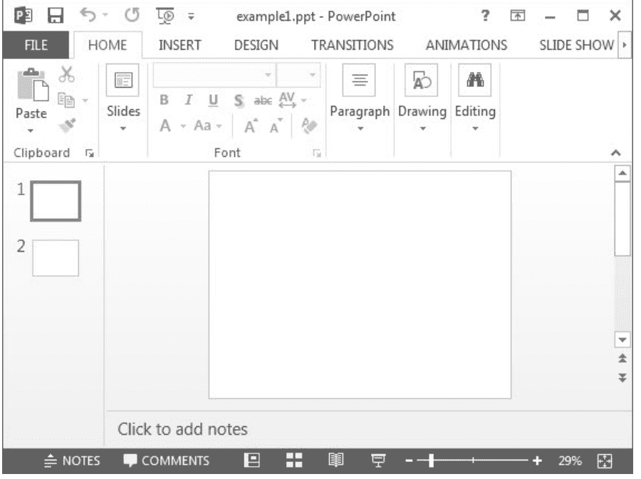

在 PPT 中添加幻片后，你可以对幻片进行添加、执行、读取和写入操作。

在上一节中，你已经看到如何创建空幻片以及如何向其中添加幻片。在本节中，你将学习如何获取可用幻片的列表，以及如何使用不同布局创建幻片。

## 可用幻片布局

PowerPoint 演示文稿有幻片布局，你可以选择所需的布局来编辑幻片。首先，让我们找到所有可用幻片布局的列表。

- 有不同的幻片母版，每个幻片母版都有多个幻片布局。
- 你可以使用 `XMLSlideShow` 类的 `getSlideMasters()` 方法获取幻片母版列表。
- 你可以使用 `XSLFMaster` 类的 `getSlideLayouts()` 方法从每个幻片母版获取幻片布局列表。
- 你可以使用 `XSLFSlideLayout` 类的 `getType()` 方法从布局对象获取幻片布局名称。

> 注意：所有这些类都属于 `org.apache.poi.xslf.usermodel` 包。

下面是获取 PPT 中可用幻片布局列表的完整程序：

```java
import java.io.FileInputStream;
import java.io.FileNotFoundException;
import java.io.IOException;
import org.apache.poi.xslf.usermodel.XMLSlideShow;
import org.apache.poi.xslf.usermodel.XSLFSlideLayout;
import org.apache.poi.xslf.usermodel.XSLFSlideMaster;
```

```java
public class SlideLayouts {
    public static void main(String[] args) throws IOException {
        // 创建一个空演示文稿
        XMLSlideShow ppt = new XMLSlideShow();
        System.out.println("Available slide layouts:");
        // 获取所有幻片母版的列表
        for (XSLFSlideMaster master : ppt.getSlideMasters()) {
            // 获取每个幻片母版中的布局列表
            for (XSLFSlideLayout layout : master.getSlideLayouts()) {
                // 获取可用幻片的列表
                System.out.println(layout.getType());
            }
        }
    }
}
```

将上述 Java 代码保存为 `SlideLayouts.java`，然后在命令行中编译并执行它：

```bash
$ javac SlideLayouts.java
```


```bash
$ java SlideLayouts
```

它将编译并执行，生成以下输出：

```
Available slide layouts:
TITLE
PIC_TX
VERT_TX
TWO_TX_TWO_OBJ
BLANK
VERT_TITLE_AND_TX
TITLE_AND_CONTENT
TITLE_ONLY
SECTION_HEADER
TWO_OBJ
OBJ_TX
```

下面显示了 MS-Office 360 2013 版本可用的一些示例幻片布局。

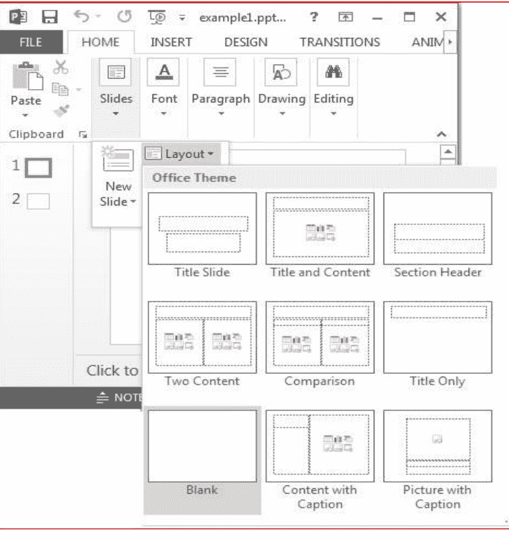

## 标题布局

让我们使用标题布局在 PPT 中创建一个幻片。按照下面的步骤进行操作：

**步骤 1：** 通过实例化 `XMLSlideShow` 类创建一个空演示文稿，如下所示：

```java
XMLSlideShow ppt = new XMLSlideShow();
```

**步骤 2：** 使用 `getSlideMasters()` 方法获取幻片母版列表。随后，使用索引选择所需的幻片母版，如下所示：

```java
XSLFSlideMaster master = ppt.getSlideMasters()[0];
```

这里我们获取默认幻片母版，位于幻片母版数组的第 0 个位置。

**步骤 3：** 使用 `XSLFSlideMaster` 类的 `getLayout()` 方法获取所需的布局。该方法接受一个参数，你必须传递 `SlideLayout` 类中的静态变量之一，它代表我们所需的布局。该类中有多个变量，每个变量代表一种幻片布局。下面提供的代码片段显示了如何创建幻片布局：

```java
XSLFSlideLayout titleLayout = master.getLayout(SlideLayout.TITLE);
```

**步骤 4：** 通过传递幻片布局对象作为参数创建一个新幻片。

```java
XSLFSlide slide = ppt.createSlide(titleLayout);
```

**步骤 5：** 使用 `XSLFSlide` 类的 `getPlaceholder()` 方法选择占位符。该方法接受一个整数参数。通过向它传递 0，你将获得 `XSLFTextShape` 对象，通过它你可以访问幻片的标题区域。如下所示使用 `setText()` 方法设置标题：

```java
XSLFTextShape title1 = slide.getPlaceholder(0);
// 设置标题
title1.setText("Title");
```

下面是在演示文稿中使用标题布局创建幻片的完整程序：

```java
import java.io.File;
import java.io.FileOutputStream;
import java.io.IOException;
import org.apache.poi.xslf.usermodel.SlideLayout;
import org.apache.poi.xslf.usermodel.XMLSlideShow;
import org.apache.poi.xslf.usermodel.XSLFSlide;
import org.apache.poi.xslf.usermodel.XSLFSlideLayout;
import org.apache.poi.xslf.usermodel.XSLFSlideMaster;
import org.apache.poi.xslf.usermodel.XSLFTextShape;
```


```java
public class TitleLayout {
    public static void main(String[] args) throws Exception {
        // 创建演示文稿
        XMLSlideShow ppt = new XMLSlideShow();
        // 获取幻片母版对象
        XSLFSlideMaster master = ppt.getSlideMasters()[0];
        // 获取所需的幻片布局
        XSLFSlideLayout titleLayout = master.getLayout(SlideLayout.TITLE);
        // 创建带有标题布局的幻片
        XSLFSlide slide1 = ppt.createSlide(titleLayout);
        // 选择其中的占位符
        XSLFTextShape title1 = slide1.getPlaceholder(0);
        // 设置标题
        title1.setText("Title");
        // 创建文件对象
        File file = new File("C:\\PPT\\Examples\\Titlelayout.pptx");
        FileOutputStream out = new FileOutputStream(file);
        // 保存演示文稿更改
        ppt.write(out);
        System.out.println("created successfully");
        out.close();
    }
}
```

```java
// 创建演示
XMLSlideShow ppt = new XMLSlideShow();
// 获取幻灯母对象
XSLFSlideMaster slideMaster = ppt.getSlideMasters()[0];
// 从指定的列表中选择一个布局
XSLFSlideLayout slidelayout = slideMaster.getLayout(SlideLayout.TITLE_AND_CONTENT);
// 创建一个带有标题和内容布局的幻片
XSLFSlide slide = ppt.createSlide(slidelayout);
// 选择标题占位符
XSLFTextShape title = slide.getPlaceholder(0);
// 在其中设置标题
title.setText("introduction");
// 选择正文占位符
XSLFTextShape body = slide.getPlaceholder(1);
// 清空幻片中现文本
body.clearText();
```

```java
// 添加新段落
body.addNewTextParagraph().addNewTextRun().setText("这是我的第一个幻片正文");
```

```java
// 创建文件对象
File file = new File("C://PPT//Examples//contentlayout.pptx");
FileOutputStream out = new FileOutputStream(file);
// 将更改保存到文件中
ppt.write(out);
System.out.println("幻片创建成功");
out.close();
```

将上述 Java 代码保存为 `TitleLayout.java`，然后从命令行中编译并执行它：

```bash
$ javac TitleLayout.java
$ java TitleLayout
```

它将编译并执行，生成以下输出：

```
幻片创建成功
```

新添加标题布局幻片的 PPT 文档所示：

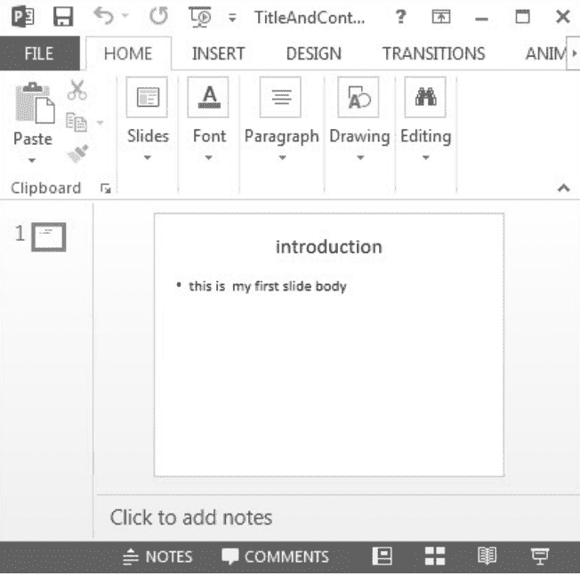

同样地，你也可以创建不同布局的幻片。


完成本章后，你将能够对幻片进行删除、重排序以及执行读取和写入操作。

# 修改幻灯片

我们可以使用 `XMLSlideShow` 类的 `setPageSize()` 方法更改幻灯片的页面大小。

首先创建一个所示的演示文稿：

```java
File file = new File("C://PPT//Examples//TitleAndContentLayout.pptx");
// 创建演示文稿
XMLSlideShow ppt = new XMLSlideShow(new FileInputStream(file));
```

使用 `XMLSlideShow` 类的 `getPageSize()` 方法获取当前幻片的大小。

```java
java.awt.Dimension pgsize = ppt.getPageSize();
```

使用 `setPageSize()` 方法设置页面大小。

```java
ppt.setPageSize(new java.awt.Dimension(1024, 768));
```

下面是更改幻灯片大小的完整程序：

```java
import java.io.File;
import java.io.FileOutputStream;
import java.io.IOException;
import org.apache.poi.xslf.usermodel.XMLSlideShow;

public class ChangingSlideSize {
    public static void main(String args[]) throws IOException {
        // 创建文件对象
        File file = new File("C://PPT//Examples//TitleAndContentLayout.pptx");
        // 创建演示文稿
        XMLSlideShow ppt = new XMLSlideShow();
        // 获取当前页面大小
        java.awt.Dimension pgsize = ppt.getPageSize();
        int pgw = pgsize.width; // 幻灯片宽度（磅值）
        int pgh = pgsize.height; // 幻灯片高度（磅值）
        System.out.println("PPT 当前页面大小为：");
        System.out.println("width :" + pgw);
        System.out.println("height :" + pgh);
        // 设置新页面大小
        ppt.setPageSize(new java.awt.Dimension(2048, 1536));
        // 创建文件对象
        FileOutputStream out = new FileOutputStream(file);
        // 将更改保存到文件中
        ppt.write(out);
        System.out.println("幻片大小已更改为给定尺寸 ");
        out.close();
    }
}
```

将上述 Java 代码保存为 `ChangingSlide.java`，然后按照如下从命令行编译并执行：

```bash
$ javac ChangingSlide.java
$ java ChangingSlide
```

它将编译并执行，生成以下输出：

```
演示文稿当前页面大小为：
width :720
height :540
幻片大小已更改为给定尺寸
```

下面是更改幻灯片大小之前的演示文稿快：

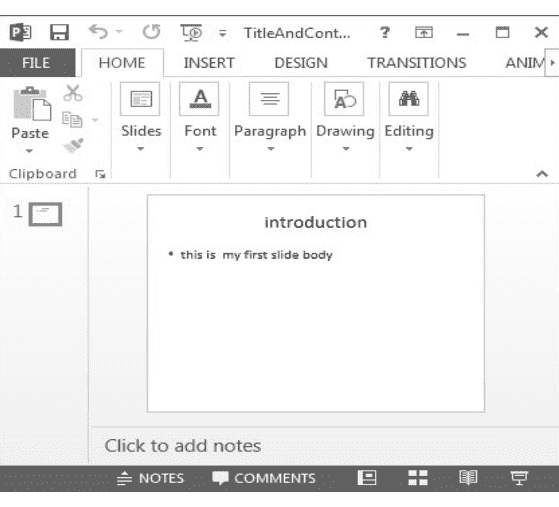

更改大小后，幻灯片所示：

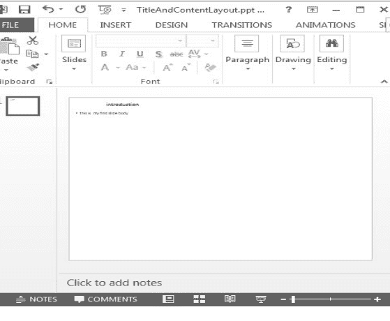

# 重排序幻灯片

你可以使用 `setSlideOrder()` 方法设置幻灯片顺序。下面是设置幻灯片顺序的步骤。

打开所示的现有 PPT 文档：

```java
File file = new File("C://PPT//Examples//example1.pptx");
XMLSlideShow ppt = new XMLSlideShow(new FileInputStream(file));
```

如下所示使用 `getSlides()` 方法获取幻片：

```java
XSLFSlide[] slides = ppt.getSlides();
```

从幻灯片数组中选择一个 `slideOrder`，并如下所示使用 `setSlideOrder()` 方法更改顺序：

```java
// 选择第四张幻灯片
XSLFSlide selectedslide = slides[3];
// 将其移到顶部
ppt.setSlideOrder(selectedslide, 0);
```

下面是重排序演示文稿中幻灯片的完整程序：

```java
import java.io.File;
import java.io.FileInputStream;
import java.io.FileOutputStream;
import java.io.IOException;
import org.apache.poi.xslf.usermodel.XMLSlideShow;
import org.apache.poi.xslf.usermodel.XSLFSlide;

public class ReorderSlide {
    public static void main(String args[]) throws IOException {
        // 打开现有演示文稿
        File file = new File("C://PPT//Examples//example1.pptx");
        XMLSlideShow ppt = new XMLSlideShow(new FileInputStream(file));
        // 获取幻灯片
        XSLFSlide[] slides = ppt.getSlides();
        // 选择第四张幻灯片
        XSLFSlide selectedslide = slides[3];
        // 将其移到顶部
        ppt.setSlideOrder(selectedslide, 0);
    }
}
```


下面是重排序幻片之前的演示文稿快照：


重排序后，幻灯片所示：


# 删除幻灯片

你可以使用 `removeSlide()` 方法删除幻灯片。下面是删除幻灯片的步骤。

打开所示的现有 PPT 文档：

```java
File file = new File("C://PPT//Examples//image.pptx");
XMLSlideShow ppt = new XMLSlideShow(new FileInputStream(file));
```

如下所示使用 `getSlides()` 方法获取幻片：

```java
XSLFSlide[] slides = ppt.getSlides();
```

从幻灯片数组中选择一个 `slideOrder`，并如下所示使用 `removeSlide()` 方法进行它：

```java
// 选择第四张幻灯片
XSLFSlide selectedslide = slides[3];
// 删除它
ppt.removeSlide(selectedslide);
```

下面是删除演示文稿中幻灯片的完整程序：

```java
import java.io.File;
import java.io.FileInputStream;
import java.io.FileOutputStream;
import java.io.IOException;
import org.apache.poi.xslf.usermodel.XMLSlideShow;
import org.apache.poi.xslf.usermodel.XSLFSlide;

public class DeleteSlide {
    public static void main(String args[]) throws IOException {
        // 打开现有演示文稿
        File file = new File("C://PPT//Examples//image.pptx");
        XMLSlideShow ppt = new XMLSlideShow(new FileInputStream(file));
        // 获取幻灯片
        XSLFSlide[] slides = ppt.getSlides();
        // 选择第四张幻灯片
        XSLFSlide selectedslide = slides[3];
        // 删除它
        ppt.removeSlide(selectedslide);
        // 将更改保存到文件中
        FileOutputStream out = new FileOutputStream(file);
        ppt.write(out);
        out.close();
    }
}
```

下面是删除幻灯片之前的演示文稿快照：

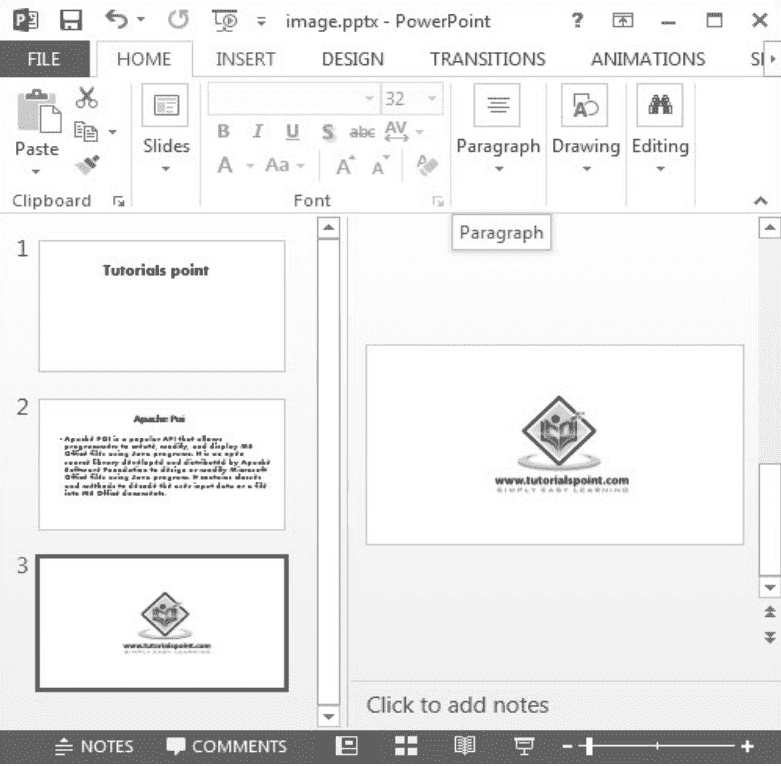

删除后，幻灯片所示：


删除幻灯片后，演示文显示如下：

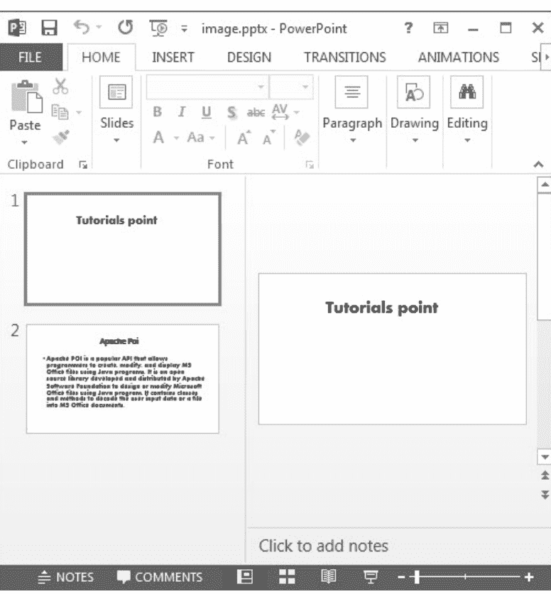

## 8. 图像

在本章中，你将学习如何向 PPT 中添加图片，以及如何从 PPT 中读取图片。

### 添加图片

你可以使用 `XSLFSlide` 的 `createPicture()` 方法向演示文中添加图片。该方法接受字节数组格式的图像。因此，你必须为要添加到演示文的图片创建一个字节数组。

按照给定步骤向演示文添加图片。如下所示，使用 `XMLSlideShow` 创建一个空幻灯片：

```java
XMLSlideShow ppt = new XMLSlideShow();
```

使用 `createSlide()` 在其中创建一个空幻灯片。

```java
XSLFSlide slide = ppt.createSlide();
```

读取要添加的文件，并使用 `IOUtils` 类中的 `IOUtils.toByteArray()` 将其转换为字节数组，如下所示：

```java
// reading an image
File image = new File("C://PPT//boy.jpg");
// converting it into a byte array
byte[] picture = IOUtils.toByteArray(new FileInputStream(image));
```

使用 `addPicture()` 向演示文添加图片。该方法接受两个变量：要添加的图片的字节数组格式，以及代表图片格式的静态变量。`addPicture()` 方法的用法如下：

```java
int idx = ppt.addPicture(picture, XSLFPictureData.PICTURE_TYPE_PNG);
```


如下所示，使用 `createPicture()` 将图片嵌入到幻灯片：

```java
XSLFPictureShape pic = slide.createPicture(idx);
```

下面是向演示文幻灯片中添加图片的完整程序：

```java
import java.io.File;
import java.io.FileInputStream;
import java.io.FileOutputStream;
import java.io.IOException;
import org.apache.poi.util.IOUtils;
import org.apache.poi.xslf.usermodel.XMLSlideShow;
import org.apache.poi.xslf.usermodel.XSLFPictureData;
import org.apache.poi.xslf.usermodel.XSLFPictureShape;
import org.apache.poi.xslf.usermodel.XSLFSlide;

public class AddingImage {
    public static void main(String[] args) throws IOException {
        // creating a presentation
        XMLSlideShow ppt = new XMLSlideShow();
        // creating a slide in it
        XSLFSlide slide = ppt.createSlide();
        // reading an image
        File image = new File("C://POIPPT/boy.jpg");
        // converting it into a byte array
        byte[] picture = IOUtils.toByteArray(new FileInputStream(image));
        // adding the image to the presentation
        int idx = ppt.addPicture(picture, XSLFPictureData.PICTURE_TYPE_PNG);
        // creating a slide with given picture on it
        XSLFPictureShape pic = slide.createPicture(idx);
        // creating a file object
        File file = new File("C://POIPPT//Examples//addingimage.pptx");
        FileOutputStream out = new FileOutputStream(file);
        // saving the changes to a file
        ppt.write(out);
        System.out.println("image added successfully");
        out.close();
    }
}
```

将上述 Java 代码保存为 `AddingImage.java`，然后按照命令行提示符所示编译并执行它：

```bash
$ javac AddingImage.java
$ java AddingImage
```

它将编译并执行，生成以下输出：

带有新添加图片的演示文显示如下：

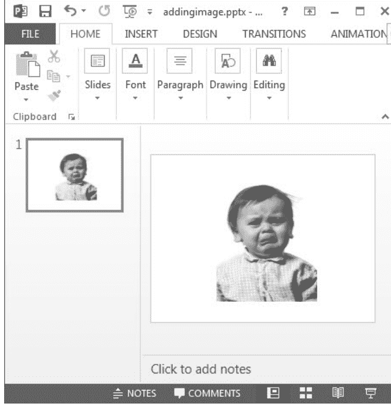

### 读取图片

你可以使用 `XMLSlideShow` 类的 `getAllPictures()` 方法获取所有图片的数据。以下程序从演示文中读取图片：

```java
import java.io.File;
import java.io.FileInputStream;
import java.io.FileOutputStream;
import java.io.IOException;
import org.apache.poi.xslf.usermodel.XMLSlideShow;
import org.apache.poi.xslf.usermodel.XSLFPictureData;

public class Readingimage {
    public static void main(String[] args) throws IOException {
        // open an existing presentation
        File file = new File("C://POIPPT//Examples//addingimage.pptx");
        XMLSlideShow ppt = new XMLSlideShow(new FileInputStream(file));
        // reading all the pictures in the presentation
        for (XSLFPictureData data : ppt.getAllPictures()) {
            byte[] bytes = data.getData();
            String fileName = data.getFileName();
            int pictureFormat = data.getPictureType();
            System.out.println("picture name: " + fileName);
            System.out.println("picture format: " + pictureFormat);
        }
        // saving the changes to a file
        FileOutputStream out = new FileOutputStream(file);
        // ppt.write(out);
        out.close();
    }
}
```

正文中包含链接的新幻幻灯片所示：

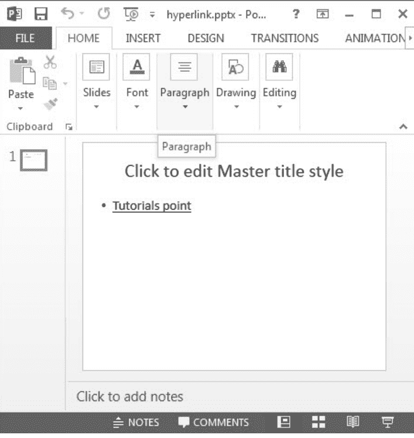

# 10. 读取形状

## 从演示文稿读取形状

你可以使用 `XSLFShape` 类的 `getShapeName()` 方法来获取演示文稿使用的形状数量。以下是从演示文稿中读取形状的程序：

```java
import java.io.File;
import java.io.FileInputStream;
import java.io.FileOutputStream;
import java.io.IOException;
import org.apache.poi.xslf.usermodel.XMLSlideShow;
import org.apache.poi.xslf.usermodel.XSLFShape;
import org.apache.poi.xslf.usermodel.XSLFSlide;

public class ReadingShapes {
    public static void main(String[] args) throws IOException {
        File file = new File("C://POIPPT//Examples//shapes.pptx");
        XMLSlideShow ppt = new XMLSlideShow(new FileInputStream(file));
        // 获取幻灯片
        XSLFSlide[] slide = ppt.getSlides();
        // 获取演示文稿中的形状
        System.out.println("Shapes in the presentation:");
        for (int i = 0; i < slide.length; i++) {
            XSLFShape[] sh = slide[i].getShapes();
            for (int j = 0; j < sh.length; j++) {
                // 形状的名称
                System.out.println(sh[j].getShapeName());
            }
        }
        FileOutputStream out = new FileOutputStream(file);
        ppt.write(out);
        out.close();
    }
}
```

将上述 Java 代码保存为 `ReadingShapes.java`，然后在命令行提示符中如下方式编译并执行：

```bash
$ javac ReadingShapes.java
$ java ReadingShapes
```

它将编译并执行，生成以下输出。

Shapes in the presentation:
Rectangle 1
Oval 1
Isosceles Triangle 1


带有各种形状的新幻幻灯片所示：

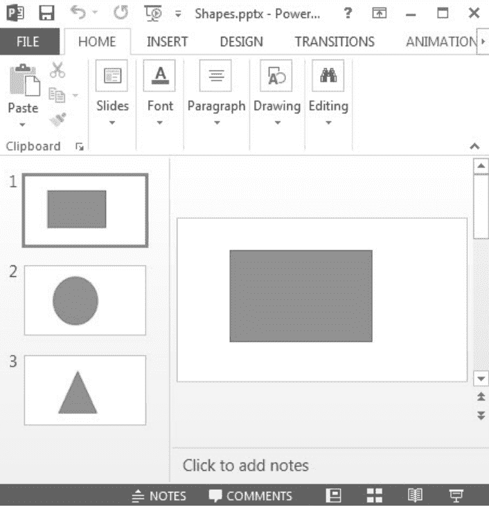

# 11. 文本格式化

## 演示文稿中的文本格式化

演示文稿中的文本可以使用 `XSLFTextRun` 类的方法进行格式化。为此，你必须通过选择所示的幻灯片布局之一来创建一个 `XSLFTextRun` 类对象：

```java
// 创建一个空的演示文稿
XMLSlideShow ppt = new XMLSlideShow();
// 获取幻灯片母对象
XSLFSlideMaster slideMaster = ppt.getSlideMasters()[0];
// 从指定列表中选择一个布局
XSLFSlideLayout slidelayout = slideMaster.getLayout(SlideLayout.TITLE_AND_CONTENT);
// 创建一个带有标题和内容布局的幻灯片
XSLFSlide slide = ppt.createSlide(slidelayout);
// 选择标题占位符
XSLFTextShape body = slide.getPlaceholder(1);
// 清除幻灯片中的现有文本
body.clearText();
// 添加新段落
XSLFTextParagraph paragraph = body.addNewTextParagraph();
// 创建文本运行对象
XSLFTextRun run = paragraph.addNewRun();
```

你可以使用 `setFontColor()` 和 `setFontSize()` 设置演示文稿中文本的字体大小。

```java
run.setFontColor(java.awt.Color.red);
run.setFontSize(24);
```

下面的代码段展示了如何对演示文稿中的文本应用不同的格式样式（粗体、斜体、下划线、删除线）。

```java
// 将文本改为粗体格式
run.setBold(true);
// 将文本更改为斜体格式
run.setItalic(true);
// 给文本添加删除线
run.setStrikethrough(true);
// 给文本添加下划线
run.setUnderline(true);
```

若要在段落之间换行，请如下所示使用 `XSLFTextParagraph` 类的 `addLineBreak()` 方法：

```java
paragraph.addLineBreak();
```

以下是使用所有上述方法格式化文本的完整程序：

```java
import java.io.FileOutputStream;
import java.io.IOException;
import org.apache.poi.xslf.usermodel.SlideLayout;
import org.apache.poi.xslf.usermodel.XMLSlideShow;
import org.apache.poi.xslf.usermodel.XSLFSlide;
```


# 10. 读取形状

## 从演示文稿读取形状

你可以使用 `XSLShape` 类的 `getShapeName()` 方法来获取演示文稿使用的形状数量。以下是从演示文稿中读取形状的程序：

```java
import java.io.File;
import java.io.FileInputStream;
import java.io.FileOutputStream;
import java.io.IOException;
import org.apache.poi.xslf.usermodel.XMLSlideShow;
import org.apache.poi.xslf.usermodel.XSLShape;
import org.apache.poi.xslf.usermodel.XSLFSlide;

public class ReadingShapes {
    public static void main(String[] args) throws IOException {
        File file = new File("C://POIPPT//Examples//shapes.pptx");
        XMLSlideShow ppt = new XMLSlideShow(new FileInputStream(file));

        //获取幻灯片
        XSLFSlide[] slide = ppt.getSlides();

        //获取演示文稿中的形状
        System.out.println("Shapes in the presentation:");
        for (int i = 0; i < slide.length; i++) {
            XSLFShape[] sh = slide[i].getShapes();
            for (int j = 0; j < sh.length; j++) {
                //形状的名称
                System.out.println(sh[j].getShapeName());
            }
        }

        FileOutputStream out = new FileOutputStream(file);
        ppt.write(out);
        out.close();
    }
}
```

将上述 Java 代码保存为 `ReadingShapes.java`，然后在命令行提示符中如下方式编译并执行：

```bash
$ javac ReadingShapes.java
$ java ReadingShapes
```

它将编译并执行，生成以下输出。

```text
Shapes in the presentation:
Rectangle 1
Oval 1
Isosceles Triangle 1
```

带有各种形状的新幻灯片所示：


# 11. 文本格式化

## 演示文稿中的文本格式化

演示文稿中的文本可以使用 `XSLTextRun` 类的方法进行格式化。为此，你必须通过选择所示的幻灯片布局之一来创建一个 `XSLFTextRun` 类对象：

```java
//创建一个空的演示文稿
XMLSlideShow ppt = new XMLSlideShow();

//获取幻灯片母对象
XSLFSlideMaster slideMaster = ppt.getSlideMasters()[0];

//从指定列表中选择一个布局
XSLFSlideLayout slidelayout = slideMaster.getLayout(SlideLayout.TITLE_AND_CONTENT);

//创建一个带有标题和内容布局的幻灯片
XSLFSlide slide = ppt.createSlide(slidelayout);

//选择标题占位符
XSLFTextShape body = slide.getPlaceholder(1);

//清除幻灯片中的现有文本
body.clearText();

//添加新段落
XSLFTextParagraph paragraph = body.addNewTextParagraph();

//创建文本运行对象
XSLFTextRun run = paragraph.addNewRun();
```

你可以使用 `setFontColor()` 和 `setFontSize()` 设置演示文稿中文本的字体颜色和大小。

```java
run.setFontColor(java.awt.Color.red);
run.setFontSize(24);
```

下面的代码段展示了如何对演示文稿中的文本应用不同的格式样式（粗体、斜体、下划线、删除线）。

```java
//将文本改为粗体格式
run.setBold(true);

//将文本更改为斜体格式
run.setItalic(true);

//给文本添加删除线
run.setStrikethrough(true);

//给文本添加下划线
run.setUnderline(true);
```

若要在段落之间换行，请如下所示使用 `XSLFTextParagraph` 类的 `addLineBreak()` 方法：

```java
paragraph.addLineBreak();
```

以下是使用所有上述方法格式化文本的完整程序：

```java
import java.io.FileOutputStream;
import java.io.IOException;
import org.apache.poi.xslf.usermodel.SlideLayout;
import org.apache.poi.xslf.usermodel.XMLSlideShow;
import org.apache.poi.xslf.usermodel.XSLFSlide;
import org.apache.poi.xslf.usermodel.XSLFSlideMaster;
import org.apache.poi.xslf.usermodel.XSLFTextParagraph;
import org.apache.poi.xslf.usermodel.XSLFTextRun;
import org.apache.poi.xslf.usermodel.XSLFTextShape;

public class TextFormatting {
    public static void main(String[] args) throws IOException {
        //创建一个空的演示文稿
        XMLSlideShow ppt = new XMLSlideShow();

        //获取幻灯片母对象
        XSLFSlideMaster slideMaster = ppt.getSlideMasters()[0];

        //从指定列表中选择一个布局
        XSLFSlideLayout slidelayout = slideMaster.getLayout(SlideLayout.TITLE_AND_CONTENT);

        //创建一个带有标题和内容布局的幻灯片
        XSLFSlide slide = ppt.createSlide(slidelayout);

        //选择内容占位符
        XSLFTextShape body = slide.getPlaceholder(1);

        //清除幻灯片中的现有文本
        body.clearText();

        //添加新段落
        XSLFTextParagraph paragraph = body.addNewTextParagraph();

        //格式化第一行
        XSLFTextRun run1 = paragraph.addNewRun();
        run1.setText("This is a colored line");

        //为文本设置颜色
        run1.setFontColor(java.awt.Color.red);

        //为文本设置字体大小
        run1.setFontSize(24);

        //移动到下一行
        paragraph.addLineBreak();

        //格式化第二行
        XSLFTextRun run2 = paragraph.addNewRun();
        run2.setText("This is a bold line");
        run2.setFontColor(java.awt.Color.CYAN);

        //使文本加粗
        run2.setBold(true);
        //使文本斜体
        run2.setItalic(true);
        //添加删除线
        run2.setStrikethrough(true);
        //添加下划线
        run2.setUnderline(true);
    }
}
```

# 将 PPT 转换为图片

```java
BufferedImage img = new BufferedImage(pgsize.width, pgsize.height, BufferedImage.TYPE_INT_RGB);
Graphics2D graphics = img.createGraphics();

//clear the drawing area
graphics.setPaint(Color.white);
graphics.fill(new Rectangle2D.Float(0, 0, pgsize.width, pgsize.height));

// render
slide[i].draw(graphics);

// creating an image file as output
FileOutputStream out = new FileOutputStream("C:\\POIPPT\\ppt_image.png");
javax.image.io.ImageIO.write(img, "png", out);
ppt.write(out);
System.out.println("Image successfully created");
out.close();
```

将上述 Java 代码保存为 `PpttoPNG.java`，然后在命令行中按照以下方式编译并执行：

```bash
$ javac PpttoPNG.java
$ java PpttoPNG
```

它将编译并执行生成以下输出：

```text
Image created successfully
```

以下快照显示了输入的演示文稿：

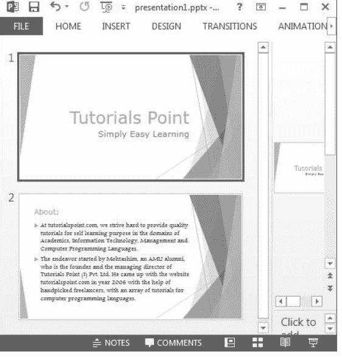

# 关于

- 在 tutorialpoint.com，我们致力于为学术、信息技术、管理和计算机编程语言领域提供高质量的自学教程。
- 该项目由 AMU 校友 Mohtashim 发起，他同时是 Tutorials Point (l) Pvt. Ltd. 的创始人兼总经理。他在 2006 年在精选自由职业者的帮助下创建了 tutorialpoint.com 网站，提供系列常用编程语言的教程。
