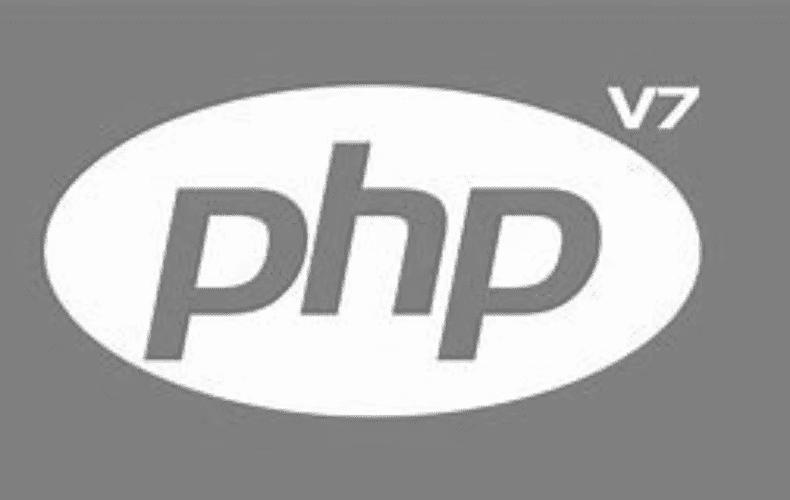
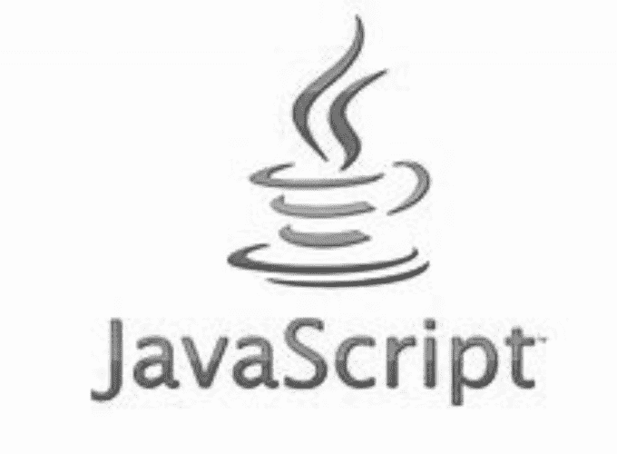
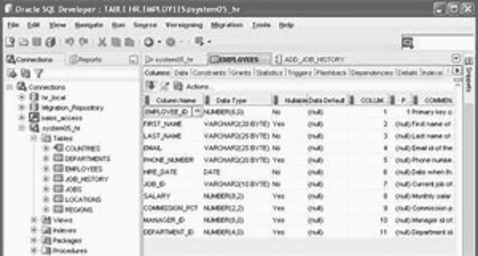
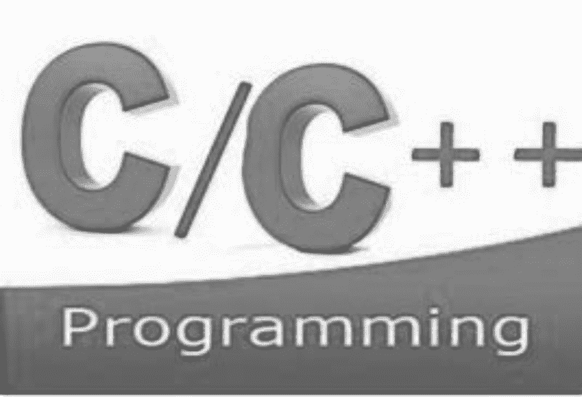
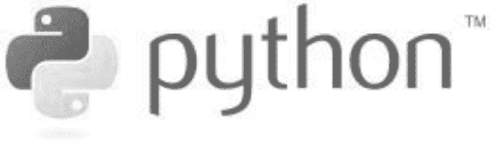

# 学习编程：Python、Java、PHP 完整指南以及其他当下最推荐的编程语言初学者指南

## 描述

恭喜购买《学习》（Learn），感谢您的支持。接下来的章节将讨论当我们准备好处理新语言时需要处理的所有内容。我们想要编程的原因有很多，而我们希望确保在第一次选择时就选择正确的语言。

在本指南中，我们将花一些时间向后追溯。对于某些人来说，仅仅是编程这个想法就会让他们感到困惑，我们将花时间讨论一些可以使用的基础知识。作为本指南的开始，我们将花时间查看最常用语言附带的基础知识，这是非常重要的。我们希望在本指南的帮助下，我们能够完成任务并尽快帮到你。

当你准备好学习编程时需要的一些基础知识，并且想看看作为一个初学者可以取得多大的成功时，请务必查看本指南以帮助你起步。市场上有许多关于这个主题的书，再次感谢你选择这一本！我们已尽力确保它包含尽可能有用的信息，请尽情享受！

## 第一章：了解基础

当我们谈论“编码”（coding）这个词时，我们会很快发现这是一个非常庞大丰富的世界。它不会只包含一或两个部分。它将包含成百种语言、数千个软件程序以及更多。例如，你在桌面电脑和笔记本电脑上使用的所有软件，甚至是游戏。

接下来我们需要探索的是我们在开始学习任何语言时可能会看到的所有主要特性。我们将查看一些可以使用的常见部分，包括`arrays`、`data types`、`comments`和`statements`。有些语言会有自己的特殊部分，我们将花时间查看这些。

接下来，我们需要花时间看看不同的语言，以及我们可以对它们做什么。有很多流行的选项，有些不那么常见，但可以为我们提供一些功能。我们将在本章中讨论所有的语言，你可以对它们做什么，以及选择该语言的优势。

### 常用编程术语

我们需要探索的是我们在开始学习任何语言时可能会看到的所有主要特性。我们将查看一些可以使用的常见部分，包括`arrays`、`data types`、`comments`和`statements`。有些语言会有自己的特殊部分，我们将花时间查看这些。

思考这些良好方法是了解它们是如何工作的以及它们何不同。这正是本指南可以提供的帮助。在本指南中，我们将花一些时间向后追溯。对于某些人来说，仅仅是编程这个想法就会让他们感到困惑，我们将花时间讨论一些可以使用的基础知识。

作为本指南的开始，我们将花时间查看最常用语言附带的基础知识，这是非常重要的。我们希望在本指南的帮助下，我们能够完成任务并尽快帮到你。

当你准备好学习编程时需要的一些基础知识，并且想看看作为一个初学者可以取得多大的成功时，请务必查看本指南以帮助你起步。市场上有许多关于这个主题的书，再次感谢你选择这一本！我们已尽力确保它包含尽可能有用的信息，请尽情享受！

（注：原文后续部分存在大量重复内容，此处已按原文结构完成翻译）

- **椭圆（开始和结束）**：椭圆（或椭圆形）将是一个告诉我们程序流开始和结束的符号。为了保持流程图尽可能简单，你只需要使用这两个椭圆，一个表示开始，一个表示结束。不过，如果你的程序设计为有多个结束点，也可以使用多个椭圆。

- **箭头**：这是我们用来帮助连接流程图中各个形状的线条，箭头头部用于告诉我们程序流的运行方向。这有助于避免像你之前编写算法时那样需要输入带编号的步骤。箭头为你的图表逻辑增加了一些灵活性，并在程序变得更复杂时减少一些杂乱内容。

- **平行四边形（输入和输出）**：这有助于我们看到输入或输出的操作。每当你想在程序中从用户处接受一个值（输入）或显示一个值（输出）时，请确保出现平行四边形。

- **矩形（处理过程）**：这将帮助我们看到计算机在内部执行的任何操作。基本上，任何不接受输入或不显示输出的直接操作都需要用这种矩形来表示。例如，类似于模运算的计算可以使用这种符号。

- **菱形（判定）**：这是一种用于帮助分支程序流或帮助处理条件语句的符号。它仍然被视为一个过程，因为计算机会在内部执行操作，但它必须根据你设置的条件进行判断并选出正确的路径。

这些符号将受到程序员以及其他从事编码的人的通用认可，因此请确保在绘制这些图表之一时，你在此过程中也使用了正确的符号。

### 程序员、编码员和开发者

在我们想要从事的某些编码工作中，如果不花时间提到编程和软件开发，我们是不可能取得多远进展的。从对这些事物有基础知识的人的角度来看，开发、编程、编码和计算这些概念似乎都是同一种，并且可以以互换的方式使用。

然而，需要重要的是，那些花费大量时间编写代码并在更具技术层面上进行这些工作的人实际上会知道，开发者、编码员和程序员是非常不同的概念。思考它们的一种好方法是将它们看作不同的等级。编码员（Coder）是入门，或者说是最基础的级别，然后是程序员（Programmer），最后是开发者（Developer）。

在整个过程中，编码员的角色将保持相当基础。你会被设定或赋予一个你想要实现的问题或目标，然后你可以利用你所选择的编程语言知识来完成工作。一旦你学会了所选编程语言的一些基础知识并开始产出代码，且这些代码确实可以运行，那么你就被认为是一个编码员。

但也有其他级别。程序员会知道，编码仅仅是软件开发过程中的一个阶段，一个可能永远不会结束的阶段。花费大量时间改进之前讨论过的流程图和算法是一个优秀程序员的重要部分。编码员将专门负责将某些算法翻译成代码，但程序员将花时间确保他们让算法更好，并检查任何可能破坏程序的严重错误。

最后我们可以以开发者来结束。这为我们看到的某些编码工作增加了另一个层次。开发者更多地看作是程序背后的真正大脑，他们将进行尽可能必要的工作和研究，以制定稳健的流程图和算法。他们将识别目标市场以及他们必须解决的所有潜在问题，并提供一系列解决方案。

这些开发者还可能管理一个程序员团队来处理一些较大的项目，并确保无论开发者的愿景如何，工作都能符合预期。这些人是对编码和编程最了解的人，他们将确保为这些程序编写的代码是高级的且能够正常运行的。

### 编程语言

只有当你使用正确的语言时，编译器才能理解你发送的指令。在提供这里所需的命令和指令之前，你必须预先知道计算机的编程语言。好消息是，你可以通过安装各种程序让你的计算机变得智能，这些程序将帮助机器理解你想要的任何编程语言。我们将在本指南的后续部分花时间学习一些常用语言以及我们能用它们做什么。

### 源码编辑器

这种编辑器是一种特殊的文本编辑器，其设计旨在帮助编码员编写他们想要的某些代码。在如`Mac OS`的`TextEdit`和`Windows Notepad`这样的基础文本编辑器的帮助下，你可以自由输入、创建甚至编辑源码，无论使用什么语言，然后根据我们正在使用的编程语言提供文件的正确扩展名。

然而，我们必须知道，某些普通的文本编辑器将缺乏你在源码编辑器中想要发现的功能。例如，你将无法发现代码是否存在错误。`Microsoft Word`的设置可以帮助我们检查是否存在某些拼写错误或语法错误，类似于源码编辑器能够预见你编写的代码是否会向你提供错误。

请记住，你的代码越复杂、功能越强大，调试、编辑和改进你拥有的代码就越困难。源码编辑器也将帮助我们这一点，因为它可以自动缩进正确的位置以帮助你查看程序的不同部分，突出显示元素，并将帮助我们看到更多的代码。选择正确的编辑器对于确保你能够让它们尽可能地工作至关重要。

### 解释器和编译器

在需要翻译代码时，解释器和编译器将采取不同的方法。编译器的原理是获取整个源码，进行必要的翻译，然后将程序输出为可执行的程序。这个过程取决于你使用的处理器或`CPU`速度以及程序中的代码行数，可能需要一些时间。取决于你决定使用的编程语言或编译器，即使你发现代码中存在一些关键错误和漏洞，这个过程也可以很好地完成。

然而，这正是我们发现解释器实用的地方。解释器不需要承担整个源码并构建翻译后的输出，而是编译第一行代码，当每一步翻译完成后，语句就会被执行。然后解释器将移动到下一行并重复此过程，直到操作结束或发现错误。

由于编译和执行过程是逐行发生的，程序的运行速度会变慢，如果你使用的是速度较慢的`CPU`，那么这种感觉会更加明显。但使用这种工具的优势是，你不需要等待整个程序编译就可以进行测试，并且许多工具还带有帮助你确定主要问题所在位置的界面。

### 调试器

我们接下来需要查看的是调试器。这是一个外部程序，旨在检测程序和代码中出现的漏洞和错误。它将具有解释器的一些相同功能，但通常还带有一些额外功能，例如当命令在语法上可能是正确的但会产生错误输出时，暂停你的某些操作。

上面的例子仍然会被视为一个漏洞，因为这不是理想的输出，所以调试器会在那里停下你，并允许你花足够的时间纠正代码并在问题得到解决后让操作继续。你使用的某些调试器可能包含一个你可以运行的虚拟环境，让你能够充分检查长度和复杂的代码，而无需考虑编译。

### IDE

`IDE`将是一个基础的源代码编辑器，但通过`IDE`，即集成开发环境，你将被置于一个沙盒中，手里带有一个水桶，里面包含了你为了立即构建一些严肃代码而需要使用的所有工具。你通常将拥有完成任务所需的所有物品，以便能够完成代码。你想要使用的大多数现代`IDE`都是易于使用的，并且包含调试器、解释器等。其中一些能够帮助支持多种编程语言。你可以根据喜好选择想要在其中运行的`IDE`类型，以获得你想要的结果。

### 库（Library）

在库中处理我们的部分代码总是比在程序本身中处理要高效得多。库不仅能帮助我们理清程序中可能更复杂的不同组件，还能让编写其他程序时变得更简单。也许你正在处理的两个程序在编码方面会有某些相似之处，正因如此，你会发现使用同一个库进行编码会更高效。这可以帮助你自己在从零构建每个程序时避免重复劳动。当你能够在代码中实现一些最常用的库时，你将获得更多可以使用的工具，而无需从头开始构建。

### 框架（Framework）

取决于你想要制作的程序，并不是所有人都会喜欢使用我们之前说过的`IDE`。即使你手头拥有了所有的工具和库，并且规划好了算法，你也会发现启动某些编码项目会更具挑战性。框架是你可以用来处理这一问题的一种方法。框架基本上是一组相关的库的集合，可以帮助我们减少实现某些目标所需的代码量。有很多框架供你使用，它们根据你的需求支持各种类型的语言。

正如我们在这里看到的，为了开始我们想要实现的某些编码，我们需要了解许多不同的术语和定义。充分理解这些内容是如何运作的以及我们能用它们做什么，在我们开始编写我们想要的代码时将至关重要。希望这为我们提供了一些正在寻找的介绍，我们能够借此帮助学习更多编程知识，并发现这些信息实际上并不像我们过去可能认为的那样困难和可怕。编程也可以很简单，有时随之而来的困难性更多源于我们的脑海，而非其他任何地方。

## 第 2 章：编程语言共有的常见特性

编程的魅力之处在于有很多你可以使用的编程语言。有时这看起来是混乱的，因为每种语言处理的都是不同的内容，并且它们有需要考虑的优点和缺点。有些语言会稍微容易上手，而有些则较难。而且每种语言都适用于你想要进行的许多不同类型的编程。

这里的好消息是，无论你想使用哪种编程语言，你都需要了解一些这些语言之间共享的共同特性和组件。我们在这里记住的一些部分将：

### 语句（The statements）

你将要处理的每一行代码都被称为语句。有时这些语句很长，你需要将它们拆分以使其运行，有时它们又会稍微长一点。有时编程语言会要求你在末尾有一个特殊字符（通常是分号），以帮助表示命令在此时已完成。

你可以将这些语句变成你喜欢的任何形式。它们可以是一个短句，也可以是对你希望在某些编码中发生什么事情的完整解释。在开始接触现有的某些编程语言之前，没多久，你就会注意到这些语句对你的编码来说是多么普遍。

### 注释（The Comment）

注释是我们在编码时可以使用的另一种工具。你可以添加这些注释来描述代码某部分正在发生什么，并在编写过程中为你或其他程序员留一条简短信息，说明你正在编写的代码中某些部分是怎么样的。如果你愿意，可以在代码中添加许多此类注释，但保持最少化对于确保过程持续运行是重要的。

每种语言都会有一个特殊的符号，你需要将其放在所编写的注释之前，以确保编译器知道这是一条注释。如果你使用了正确的符号，编译器将跳过该语句，而不会尝试执行它或破坏你的代码。

这的一个很好的例子是 Python 语言。如果你想在该语言中编写注释，只需在前面添加`#`符号即可。如果注释占据了多行代码，那么你也可以在你正在处理的每行代码之前添加该符号。虽然其他编码语言将使用不同类型的符号来完成工作，但你会发现每种语言的情况其实非常相似，并且你会发现它们之间这一点是非常相似的。

### 语法（The Syntax）

语法基本上是关于如何编写代码部分的规则。每段代码都有根据编译器如何读取而产生的语法。语法通常是我们在语言中遵循的规则，但它更直接且通常有更严格的规则。你需要通过练习学习语法在某些代码中是如何运作的。语法是我们必须遵循的规则，如果你在处理你正在做的代码时漏掉了某些语法，那么编译器将无法处理某些部分。语法是你在工作任何语言时应该关注的事情之一。你应该快速掌握语法，但要了解它是如何运作的仍然需要时间，你会发现每种语言在这一点上是非常相似的。

### 数据类型（Data type）

对于大多数编码语言，你会发现数据类型是重要的。你需要根据预期的用户输入来选择什么类型的数据。数据是计算机中预留的存储该值的空间。在学习如何编码时，数据类型非常重要，例如，你会注意到有很多数据类型，如列表、字典、浮点数、元组等。数组也会出现在我们使用的某些编程中，因为它们擅长组织数据。例如，数组可以帮助存储结果。

### 变量和常量（Variables and constants）

这些应该是很容易学习的。常量是你放入程序中但不会改变的值，你为它分配一个特殊的名称，以便将来引用它。然后是变量，它们是随着数据类型改变的内容。

这里的另一点需要注意的是，定义变量或数据类型被称为“声明”（declaration）。但第一次为常量或变量设置值被称为“初始化”（initialization）。只需记住，声明对于每种编程语言都是必要的，所以你必须查看该语言的文档。关于这些变量，需要记住的一点是它们包含了：它们占据计算机内存中的一个特定位置。如果你在代码中放入一个变量，基本上只是在那个内存中预留一个空白处。给变量赋值是一个简单的过程。在你可以选择的任何编码语言中，将`=`放在变量和值之间即可。这告诉编译器你放置变量的特定值需要进入内存中那个特定位置。在以后运行程序时，你可以调用变量将其取出。

### 数组（The arrays）

数组并不是给初学者使用的，但当正确使用时，你会发现它们让程序更高效。如果你发现自己花费了太多时间创建许多存储相似数据的变量，可能会发现通过在一个将这些值存储在单元中的数组可以简化这一切。这有助于进一步组织事物，并确保将所有内容放在一个地方。这些数组听起来可能复杂，但你会发现它们在你编写的代码中被频繁使用，因此我们需要在它们上花一点时间。首先，我们会发现数组可以使用数据结构之一。它包含一组你选择的元素。在大多数情况下，你会发现这些元素是相同类型的数据，例如字符串或整数。数组出现在我们使用的某些编程中，因为它们擅长组织数据。例如，如果我们使用搜索引擎，我们可能会找到数组的示例来帮助存储结果。

### 函数、参数和对象（Functions, parameters, and objects）

现在我们将进入几个会组合在一起但也需要讨论的部分：`functions`（函数）、`parameters`（参数）和`objects`（对象）。

### 条件（Conditionals）

记得我们之前在流程图中看到的菱形吗？当它翻译成代码时，我们称之为条件。我们的每种现代编码语言现在都有这些，并且可能会出现多次，因为程序必须根据用户的输入来做出决策。如果用户输入这个，那么就会发生`A`。如果他们输入另一个，那么就会发生`B`。当我们谈论计算机编程时，条件是指条件语句，有时也称为决策控制语句。这些是重要的，因为它们可以帮助我们执行各种计算或操作，而且通常这取决于布尔条件的评估结果为`true`或`false`。

### 编程语言

- **图像语言**：这些语言是经过大幅精简的语言。这允许我们在此过程中通过操作各种图像来学习编程的一些基础概念。

- **块级语言**：这类语言通常被称为“泡泡语言”。这类编程语言允许用户通过遍历和拼接代码部分，而不是由自己编写代码。这是一种视觉化的方式，因为图像语言会让你看到实际的代码，让你直观看到发生了什么，但你不需要亲手去输入它们。

- **真正的编程语言**：这些是你能够使用的一些更传统的代码语言，在这些语言中，你必须亲自逐行编写并输入。你会发现像`Java`、`Lua`、`PHP`、`JavaScript`和`Python`这样的语言都属于这一范畴。

在这里必须记住，你选择的编程语言不应该基于你自己的年龄。你会发现有些孩子已经准备好立即投入并开始使用`Java`语言了，特别是如果他们想在早阶段为`Minecraft`做一些工作。也有成年人，如果发现以视觉化的方式而不是文本模型进行学习对他们来说是最佳选择，他们会更倾向于使用基于块的工具。但在选择语言时我们必须考虑的一点是，无论你选择许多出色的编程语言中的哪一种，你开始使用的语言都应该基于你的舒适程度。你不应该强迫自己的任何编程技能，尤其是作为一个初学者，要学会在这个过程中遵循一种更自然的进展。尽管如此，让我们来看你能够使用的一些最常见的代码语言，以及你使用每种语言可以做到的事情。这可以让我们很好地了解这些语言是如何运作的，以及在此过程中我们用它们来实现什么。

### HTML 和 CSS

`HTML`（即超文本标记语言）和`CSS`（即级联样式表）将是你准备创建你想要的某些网页时，能够学习的两种最重要的技术之一。`HTML`将帮助确保你所在的网页将具有正确的结构，这可以涵盖从图像、表格、列表、标题、超链接、声音、视频以及你想要添加到页面中的任何其他元素，只要你在代码内部以正确的方式对它们进行标记即可。

然后，`HTML`将作为一种正确工作的语言，帮助我们使用的网络浏览器理解我们所创建的元素，并随后以适当的方式显示网站的一些文件。

接着我们可以转向`CSS`语言。这是我们需要配合`HTML`一起使用的语言，因为它能够改变`HTML`的外观，用户可以对其编辑以自定义字体、布局、颜色和呈现效果。这将确保无论你使用什么设备或依赖多大尺寸的屏幕，网站的呈现效果都是正确的。

我们将通过 `CSS` 看到的最重要的事情之一，以及它如何帮助我们的，就是它可以布局我们所有的图像、元素、`CSS` 样式以及我们想要放在页面上的其他部分。虽然 `HTML` 和 `CSS` 在很多情况下是一起使用的语言，但也可以看到这两种语言独立运行。事实上，正是这种独立性使得用户能够共享样式表，即使页面不是 `HTML` 格式，或者是任何基于 `XML` 的语言也可以。

为了让这两种语言中的任何一种正常工作，你需要准备好几样。这包括一个网络浏览器（可以是你喜欢的任何现代网络浏览器），以及市面上任何简单的文本编辑器，它们可以帮助你保存在此期间决定创建的一些文件。

如果你打算从事任何类型的网络开发，可能会发现稍微琢磨一下 `HTML` 语言是你能够使用的最佳选择之一。这至少是一件你可以花时间去学习更多的好事，以防你将来需要为个人或业务用途处理某些网页。另一方面，有些人发现他们更喜欢偏向网页的设计，那么他们会更倾向于使用 `CSS`。

## PHP

我们将看到的第二种语言是 `PHP` 语言，全称为超文本预处理器（Hypertext Preprocessors）。这是一种服务器端开源脚本语言，将与 `CSS` 和 `HTML` 一起使用，来处理你想实现的某些任务自动化。`PHP` 允许我们真正整合我们希望网站具有的一些高级功能，例如为在线商店提供购物车、论坛，以及你需要的更大更复杂的图像库库等。

当你使用 `PHP` 时，你还可以创建许多可以在网站上使用的应用程序，例如单位转换器、待办事项列表、`RSS` 阅读器等。我们也可以很容易地在 `HTML` 代码中嵌入所需的 `PHP`，以便我们能够连接到想要从中提取信息的各种数据库，如 `Oracle` 和 `MySQL`。

`HTML` 和 `PHP` 之间的主要区别在于脚本完成的位置。`HTML` 代码更多是在用户的浏览器上完成的，即在客户端；而 `PHP` 编码将在服务器上完成，就在它实际在用户的浏览器上发布之前。当我们想要处理某些 `PHP` 代码时，需要准备好几件事。首先，我们需要确保自己有一点 `HTML` 知识。你还需要以下两样之一：

* 一个支持 `PHP` 语言的 Web 托管。

* `PHP` 以及安装在电脑上的 Web 服务器。你可以在网上找到许多免费的此类工具。

除了这些，我们发现还有一些需要学会使用的 `PHP` 不同规则。首先：

* 你需要在记事本上写出所需的 `PHP` 代码，然后最后以 `.php` 扩展名保存它们。

* 你不应该使用 Word 处理器之类的软件，因为它们无法像你希望的那样处理代码中的某些内容。相反，最好坚持使用记事本。

* 像 `HTML` 一样，`PHP` 语法通过闭合标签来帮助编译器识别所有不同的部分。

* 在 `PHP` 语法中，空白字符并不重要。

* `HTML` 可以包含在 `PHP` 文件中，并且它们可以正常工作，但你无法反过来这样做。

如你上面的示例所示，你可以使用 `PHP` 语法通过任何你需要的小型项目来定制网页，然后结合 `HTML` 元素来帮助组织整个网页，使其按照你想要的方式运行。

你会发现，使用 `PHP` 语言将是你可以使用的最广泛支持的服务器端语言之一，即使有其他语言可以与之竞争，并且在某些工作上表现得更好、更高效。事实上，有许多程序员会认为 `PHP` 并不安全，甚至用起来也不好用，但你会发现这门语言自初诞生以来已经有了许多改进。而当你想要创建一些比以往任何时候都具有交互性和动态性的网页时，这门语言的较新版本已经变成了强大的工具。

## JavaScript 语言

我们列表中下一个需要花时间研究的下一种语言是 `JavaScript` 语言。这种语言非常流行。事实上，根据 2018 年的一项 StackOverflow 调查，当时约有 62.5% 的受访者在使用 `JavaScript`。

这是一门最初于 1995 年的语言，旨在解决困扰互联网早期几年的兼容性问题。但从那时起，它已被用于扩展到网站开发甚至某些基于 Web 的应用程序之外领域。现在，我们能够将其应用于今天可用的一些更现代的技术中，例如服务器、机器人技术、手机 App 等。

如果你花时间在 Instagram 或 Facebook 上点赞，或者你曾在某个网站上填写过表单，那么在所有这一切背后的代码，以及确保这些任务实际执行的代码，很可能涉及到一些 `JavaScript` 语言。你会发现，为了让这些运行得更好，熟悉一些如 `PHP`、`CSS` 和 `HTML` 等其他编程语言也是好主意。

如果你已经花时间学习了我们之前提到的 `CSS` 和 `HTML` 语言，并已将这些技术掌握了你自己在 Web 开发的一些技能，那么你会发现 `JavaScript` 语言将是你下一个逻辑学习如何使用的语言之一。这是因为 `JavaScript` 语言将负责我们在网站上所看到的行为。一个很好的例子是，`JavaScript` 能够告诉我们在填写表单时是否发生了某种错误，以及某个字段是否没有被正确处理。

`JavaScript` 也会被用于网络浏览器之外的其他地方。我们可以很容易看到，它将出现在各种类型的硬件、软件和移动应用中。这就是为什么它真的发生了变化，变得比过去更像一种通用语言的原因。

## CoffeeScript

这一个可能不像其他某些选项那么知名，但它仍然是一个我们需要花时间考虑的选项。这门语言处理我们某些工作的方式与列表上的其他一些编程语言略有不同。它不是通过以人类可读的方式编译我们正在使用的代码然后切换到机器可读的代码，这门语言将把代码编译并在 `JavaScript` 中运行。

这种语言是为那些想要用 `JavaScript` 编写代码，但不喜欢其中所有规则和语法的程序员准备的。它更容易操作，因为与 `JavaScript` 原有的代码相比，你在这个过程中不需要编写那么多代码。考虑这门语言的一种好方法是，它结合了我们在 `Python` 和 `Ruby` 中看到的某些优点，同时仍带给我们通过 `JavaScript` 得到的最终结果。

这使得我们需要进行的运行时调试在整体上变得更具挑战性。但你会发现有很多在线资源可以处理这个问题，而且许多游戏和交互式代码编辑器都能支持这种功能，这可以作为一个小证明，这门语言将为那些学习传统的 `JavaScript` 语言编程感到头疼的人提供。

## SQL

我们列表中的下一种语言被称为 `SQL`，即结构化查询语言。这是一种能够与关系型数据库系统进行通信的语言。`SQL` 查询将指的是这种特定语言中将使用的某些语句。这些语句能够我们做很多方面的事情，并可以处理许多不同的任务，包括：

*   `UPDATE`：这用来更新你数据库中找到的数据。

*   `INSERT`：这将向你正在工作的数据库中插入一些新数据。

*   `DELETE`：它可以删除你数据库中不再需要的某些数据。

*   `SELECT`：这等同于从数据库中检索你想要的一些数据。

当然，这些只是你能够使用 `SQL` 语言执行的少数命令。任何你能够通过操作数据库来让其运行得更好、确保其中包含你所需的信息，并能够根据你的意愿对其进行必要更改的操作，都可以通过 `SQL` 语言的帮助迅速完成。考虑到这一点，我们还可以使用像 `Drop` 和 `Create` 等其他命令来执行真正修改数据库所需的其他任务。

在这里请记住，你想要操作的每种关系型数据库系统都包含一个或多个被称为“表”（tables）的对象。就像我们在电子表格和文档中使用的表格一样，表会有名称、属性、行和列。

`SQL` 看起来似乎像是一种有很多限制的语言，但你会发现许多编程专业人士会认为深入学习这种语言是非常值得的。例如，数据工程师、数据科学家和数据分析师可以使用 `SQL` 来帮助他们组织和评估数据，特别是在处理成千上万个数据点时。它对研究人员和营销人员也有帮助。这种语言可能比我们我们将提到的其他一些语言更容易处理，但这并不意味着它在使用过程中不会带来一些收益。

## C 和 C++

`C` 将是我们在这里能够使用的第一种语言，它是由 Dennis Ritchie 在 1972 年为贝尔电话公司开发的。这种语言最初被用作帮助编写操作系统的语言，因为 `C` 不依赖于其他程序，也不需要为硬件或操作系统进行重写。`C` 还具有高效的内存管理功能，这允许程序员完全控制何时、在何处以及如何分配他们拥有的内存。

程序员喜欢使用 `C`，因为与某些其他语言相比，它允许他们获得他们所需的灵性和控制力。事实上，它是如此受欢迎，以至于 Ritchie 在发布后一年与 Ken Thompson 一起工作，并使用 `C` 编程语言重写了 `UNIX` 操作系统的大部分部分。当时，操作系统大多是用汇编语言编写的，虽然运行良好，但它为我们产生成了只能在特定类型 CPU 上运行的程序。有了这种操作系统，你即使在不同类型的计算机上使用它，也可以重新编译内容。

接着在 1979 年，Bjarne Stroustrup 在贝尔实验室开发了 `C++`，作为对 `C` 语言的升级或扩展。这种语言还为原始的 `C` 语言增加了一些新功能。现在我们会发现 `C++` 经常用于嵌入式软件、视频游戏、需要大量内存的应用、音视频处理等。

许多其他语言，包括 `C#`、`Java` 和 `.NET`，都是从 `C` 和 `C++` 语言派生的。正因如此，你会发现当你足够精通这两种语言时，你能够完成大量的项目，大部分是在系统软件领域。

如果你正在考虑严肃的编程职业，`C` 将是我们入门的一个很好的语言，因为它遵循了一些你可能希望从事的更传统的编程方法。在你开始使用它时可能会觉得有点奇怪，但记住，这两种都是 80 年代或更早的语言，但从 2020 年开始的一些未来更新可能会让它们变得更容易处理。

## Objective C

我们能够使用的另一种选项被称为 `Objective C`。这种语言从 80 年代某时候起就存在，但并没有立即获得很大普及。它被原始程序员在 1988 年卖给了 NeXT，后者将其用于该操作系统。随后它在 1996 年被 Apple 收购，并迅速成为 Mac 操作系统以及 iPad、iPod touch 和 iPhone 编程的主要语言。

这种语言是 `C` 的超集。对于我们来说，这意味着这种编程语言能够超越我们原始对应语言的能力。它意味着任何你用 `C` 编写并编写的代码都可以用于 `Objective C` 程序，而无需你对其中任何内容进行重写或修改。

这里需要注意的一点是，你无法向后回溯。`C` 程序在 `Objective C` 中可以运行良好，但 `Objective C` 程序无法在更传统的 `C` 程序中运行。这主要是因为 `Objective C` 带有许多新增的功能。我们还可以查看这种语言的两种特定变体，它们包括：

*   `Objective C++`：这是我们可以在某些 `Objective C` 应用程序中处理 `C++` 代码。

*   `Objective C 2`：它的工作方式与该语言的原始版本类似，但它添加了一些新功能，包括自动内存管理。

如果你对开发可以在各种 Apple 产品上运行的应用程序感兴趣，你可能会发现在代码中混合使用 `Objective C` 和 `Swift`，然后利用它们为 Apple 产品创建大量应用程序是实现这一目标的最佳方式。

## Java

尽管名字听起来相似，但你会发现 `Java` 与 `JavaScript` 之间并没有联系。`Java` 的许多原则实际上基于我们之前讨论过的 `C++` 语言构建并在此基础上改进的，但你会发现，大多数程序员普遍认为 `Java` 语言整体上更符合用户习惯。

`Java` 是一种静态类型语言，这允许程序员用英语命令的形式来写出他们想要的指令，而不是依赖数值代码。它确实包含了一套规则，即语法，你需要遵循这些规则。但它是一种“编写一次，随处运行”的语言，这意味着专家和新手都能上手这门语言并看到一些成果。

`Java` 自 20 世纪 90 年代初一直存在。它是 James Gosling 及其团队为 Sun Microsystems 开发的一种语言，最初设计用于当时的移动设备。但在 1996 年发布期间，它的用途转向到了互联网，为程序员提供了一种创建比以前更具动画效果网页的方法。

今天我们将看到 `Java` 既用于离线也用于在线，估计财富 500 强公司中有 90% 将使用基于 `Java` 的应用程序来帮助完成某些日常运营。程序员们会喜欢使用这种语言，因为它非常安全、可靠、可维护、稳定，并且可以扩展到我们想要的任何类型的项目。

你会发现 `Java` 可以用于许多应用程序，无论我们谈论的是桌面应用还是移动端应用。它通常在大型企业应用中使用率最高，所以如果一家医院或银行有一位他们想要合作的内部 `Java` 开发者，你不必感到太惊讶。如果你想从事任何计算机科学方面的工作，那么 `Java` 将是你的最佳选择之一。

## Python

首先，这门语言是以著名的喜剧剧《蒙提派剧团》（Monty Python）命名的。`Python` 被认为是初学者最容易学习的语言之一，因为它不需要某些其他语言所具备的所有部分，你不需要处理一堆花哨的 0 和 1 就能看到它运行。它拥有简洁良好的语法，允许用户用英语写出他们想要的命令。

今天已经有很多公司在使用 `Python` 了，包括 Yahoo Maps、Dropbox 和 YouTube。除了其他特性外，`Python` 语言还将关注空白，这意味着你不需要花费所有时间编写成千上万行代码来让代码运行起来。还有许多 `Python` 库是现成的，你可以导入并将其作为模板使用。有时，这些库对于获取灵感并帮助你开始项目非常有帮助。

仅举几角，`Python` 将是机器学习、人工智能、网络安全和数据科学等领域的首选语言。这就是为什么包括迪士尼和谷歌在内的许多公司在这些领域处于领先地位。它也是一门可以被使用的编程语言，对于从事数值计算项目的科学家，或者专注于市场上某些视频游戏和 Web 框架的程序员来说，是非常理想的。`Python` 对我们来说非常容易设置并按照我们想要的方式运行。我们只需要从 `www.python.org` 网站下载并安装软件，就可以在我们喜欢的任何操作系统上使用它。一旦安装，你就可以开始你的一些初始项目了。

许多专家会向那些刚开始编程且过去从未做过此类工作的人推荐 `Python` 语言。这是因为 `Python` 能够教会我们一些高度结构化的编写问题和解决方案的方法。然而，我们必须注意，与其他编程语言一样，你会发现 `Python` 的学习曲线也会较高。所以，如果你已经学习了其他的某种语言，你可能会发现立即转向 `Python` 也会带来一些挑战。

如果你是因为职业变动而选择一种语言来编写代码，那么 `Python` 语言将是适合你的。至少懂一点 `Python` 的程序员，特别是那些能够精通 `Python` 语言的人，在美国在该领域的收入位列第二高。唯一超过他们的是那些知道如何使用我们接下来要讨论的 `Ruby` 语言的程序员。

## Ruby

这是另一门我们可以花时间了解的语言。`Ruby` 是松本裕弘（Yukihiro Matsumoto）在 1995 年创建的语言。这是一门非常棒的通用型语言，意味着它有足够的灵活性来完成你想要的工作，从连接数据库到运行 Google 的任何工具，甚至于创建几个用于在线和网站的应用程序。

`Ruby` 将与 `Rails` 框架联系在一起，这就是为什么“Ruby on Rails”这个短语听起来可能有些熟悉。这是因为当我们把它们结合时，`Rails` 和 `Ruby` 可以轻松将想法转化为现实世界的应用程序。使用 `Ruby` 的知名网站列表包括 Airbnb、Hulu、Twitter、GitHub、Zendesk、Treehouse 和 Urban Dictionary。有些人可能担心 `Ruby` 很难使用，因为它可能不像其他语言那样对新手友好，但事实并非如此。你不仅发现 `Ruby` 的语法与其他某些编程语言（包括 `C+`）相似，我们还会发现 `Ruby` 是灵活编程语言的许多其他原因，包括：

*   它拥有简洁易读的语法，非常适合初学者。命令非常通俗易懂。

*   `Ruby` 有内置函数，初级开发者可以直接在他们的 `Ruby` 脚本中使用。

*   可以嵌入 HTML 并连接到其他数据库选项，包括 `DB2`、`MySQL`、`Sybase` 和 `Oracle`。

*   你可以在 Windows 上安装它。

*   适用于构建互联网和内网应用程序。

*   它们具有高度的可扩展性。这意味着你可以从小开始，并在准备好后扩大规模。

*   它将支持许多你喜欢的 GUI 工具。

你会发现 `Ruby` 对于初学者和高级程序员来说都是理想的选择。它目前是一个非常活跃的社区，仅 `GitHub` 上就有 3500 人，而且它的魔力不断让编码人员和公司感到惊叹。`Ruby` 的这种魔力也是许多用户最大的抱怨之一；他们担心这种语言太强大，以至于简单一行代码就能让一个项目变成功能完备的状态，而编码员并不真正理解它是如何发生的。这就是为什么你可能需要加入一个社区或类似的组织，帮助你更多地学习这种编程语言及其工作原理。

## C#

`C#` 是我们另一种可以进一步了解的语言。它由 Anders Hejlsberg 及其团队为微软开发。由于 `C#` 在发布时与 `Java` 极其相似，它曾被认为是 `Java` 的克隆版本。但今天，`C#` 已经是一种在许多应用程序和行业中广泛使用的编程语言。

在 3D 游戏开发领域，`C#` 是最流行的语言之一，但你也可以用它来帮助创建一些动态网站。`C#` 吸收了 `C++` 和 `Java` 的一些特性，然后剥离了它们所有有问题的特性，包括移除宏、模板和多继承。这使得它更加现代、更容易上手、更简洁，并且是一种非常高效的语言。`C#` 是一种非常灵活的语言，这就是为什么它是 `Windows`、游戏、Web 应用程序和其他程序的入门语言的良好选择。由于它源自其他一些 `C` 类语言，你会发现，如果你花时间精通这种语言，学习其他语言的速度也会一样快。

## Swift

`Swift` 是一种深受 `Apple` 开发者喜爱的编程语言。它的开发用于 `Linux`、`watchOS`、`tvOS`、`iPadOS`、`macOS` 和 `iOS` 等。与之前某些可能是静态类型的语言相比，`Swift` 是一种快得多且更简洁的语言。

与其他语言相比，`Swift` 是一种较新的语言，因为它用于许多客户熟悉并喜爱的 `Apple` 产品。只要你监控功能以满足你的需求，它也可以用于其他类型的产品。对于那些兴趣为 `iOS`、`macOS`、`watchOS` 和 `tvOS` 创建应用程序，或将其与任何 `Apple` 产品一起使用的人来说，`Swift` 是完美的。它对于初学者也是理想的，不仅是因为 `Swift` 的写法接近英语，还因为 `XCode` 会自动检查用于构建应用的代码。

# Kotlin

下一个选项是 `Kotlin` 编程语言。`Kotlin` 是一种基于 `Java Virtual Machine`（Java 虚拟机）的开源编程语言。当 `Google` 在 2019 年 5 月宣布 `Kotlin` 是 `Android` 开发者的首选语言时，它在开发者社区中获得了广泛关注。

`Kotlin` 的设计并不是为了直接取代 Android 开发中的 `C++` 和 `Java`，但在 `Google` 对这种语言的支持下，`Android` 开发者可以放心地追求前沿，因为知道这种语言在未来几年内将获得支持，而且学习曲线更容易上手。`Java` 是一门老老的语言，尽管它维护得很好，但 `Kotlin` 仍在尝试减少完成操作所需的代码量。现有的 `Java` 开发者会发现这种过渡是平滑且容易的，因为这两者在很多情况下是可以协同工作的。

# Rust

最后要查看的语言是 `Rust`。与其他一些语言相比，这是一种更底层的语言，但它在我们的列表中仍有一席之地。`Rust` 是由 `Mozilla Foundation` 开发的一种较新的语言。它就像 `C++` 语言的重生，但与其他语言相比，它有一些有趣的改进。

与其他底层编程语言一样，`Rust` 的内存占用很低，这使得它比 `Java` 快。这是我们预期的，因为混合了较少的类英语语句使得它更容易被翻译成所需的机器代码。同时，`Rust` 解决了在 `C++` 和 `C` 中发现的主要缺点，例如安全性。基本上，`Rust` 带有许多安全措施，以确保你在运行代码时不会遇到错误。由于内存占用低，考虑使用 `Rust` 开发 Web 应用程序和嵌入式设备变得更容易。`Rust` 的社区目前较小，但如果你有 `C` 或 `C++` 经验，它是一门很好的学习语言，且易于操作。

# 入门

编程世界中初学者的益处之一是，你可以根据任何喜欢的标准来选择编程语言，例如确定与其他语言相比，你有多喜欢某一种语言。如果你用一种语言开始一个项目，发现自己不喜欢这项工作，可以切换到另一种。尝试几种语言并找出哪种最适合你很容易。

# 第 4 章：为编码做准备

现在我们已经查看了编码的基本术语，是时候做好准备了。我们将深入探讨所需的准备工作。

## 准备愿景

首先需要关注的是如何准备你的愿景。对于许多新程序员来说，这从确定他们最初为什么想学习开始。有很多激励因素需要考虑，例如制作游戏、为像 `Apple` 这样的大公司工作或建立作品集。你应该考虑你想要达到的总体目标。准备愿景通常是最困难的部分之一，但它将帮助你专注于目标。

## 获取程序结构

在早前的章节中，我们讨论了算法的重要性。虽然在很多情况下这不是绝对要求，但从一开始就拥有良好的结构是一个好主意。有时取决于你的偏好，有时重要的是选择满足你需求的结构。

## 如何准备硬件

编码中酷酷的一点是，你不需要昂贵的电脑就可以开始。只要软件准备就绪，你甚至可以使用旧的 `Windows` 笔记本电脑完成编码。编码并不是一项巨大的投资。你的硬件选择通常取决于你计划花费的时间。如果你在家里或办公室工作，你可能需要一台台式电脑。这些更便宜，功能更强大，并且更易操作。芯片组和移动组件更贵；当你同时运行多个应用程序时，性能很重要。当你编译程序、使用调试器 `debugger` 或解释器 `interpreter` 或运行复杂程序时，性能至关重要。核心数越多越好。如果你在 `AMD` 或 `Intel` 之间选择，主频越高越好。8 GB 的 `RAM` 是最好的，但更多更好。显示器的分辨率越高越好。

## 准备软件

为了节省成本，我们将查看适用于你选择语言的免费或低成本选项。

## 流程图

如果你想画流程图，`http://draw.io` 是一个帮助你工作的良好选项。

## C++ 和 HTML

`C++` 是一个学习基础的良好语言，如果你想动手，可以使用沙盒。如果你想处理 `HTML`，你可以使用 `https://codeeditor.com`。界面不像其他选项优雅，但它提供了一个实时预览，让你更容易编写代码。

## 源代码编辑器

无论是采取原始编码路线还是想要一个功能全的 `IDE`，拥有一个都是好意。有些编辑器不是很重的，你可以使用免费版本并看到相同的结果。你也可以考虑像“花哨哨”这样的功能。

## IDE

当我们转向 `HTML` 等可以在线完成的内容时，许多语言需要一个 `IDE` 来完成工作。这些是编写 `Python` 等语言的环境。当你下载时，通常有免费的 `IDEs`。这降低成本并提供了许多功能。

## 操作系统

如果你在使用旧操作系统，`Linux` 可能是一个良好的选项。如果你需要虚拟机，`VMware Player` 是在系统上运行 `Linux` 的良好方法。

## 游戏化

为了保持动力，有些人使用 `Habitica`，这是一种使用游戏化方法帮助你编码的工具。让编码过程更有趣的一种方法。

## 命令行

如果你在编码时遇到问题，可以使用 `SpeedCrunch`。与其他计算器不同，它提供了一个可以在其中输入方程的命令行框。

## 项目管理

如果你正在做一个大项目，你需要一种方法来跟踪工作状态，特别是多人参与时。`Trello` 是一个帮助解决问题的良好工具。

# 第 6 章：让编码成功的提示和技巧

是时候关注你自己了。无论你是初学者还是开发者，这些提示都会帮助你进步并减少挫败感。

## 有信赖的备份系统

第一件事是备份系统。我们已经到了丢失数据不是选项的地步。使用与操作系统集成的云计算 `cloud computing` 来确保源代码已备份。大多数源文件很小，你可以使用 `WinRAR` 等应用程序将其进一步压缩。

在 `Windows` 上工作时，在 `OneDrive` 文件夹中创建一个文件夹，并将所有项目和代码放在那里。如果你看到绿色复选标记，说明代码已备份到云端。如果没有，从开始菜单启动 `OneDrive` 并登录你的 `Microsoft` 账户。此外，将文件拷贝到优 盘或外部硬盘以备万一。

不要把所有的鸡蛋放在一个篮子里。许多程序员依赖多个服务。`Dropbox` 是一个类似于 `OneDrive` 的良好选项。你可以在后台运行两者进行在线存储。一旦你变得更专业，考虑将代码上传到 `GitHub`。云服务也方便你与他人分享代码。

## 使用虚拟桌面整理工作区

另一件事是你如何组织你的空间。虚拟桌面可以提高你的效率。在 `Windows` 中，你可以使用快捷键在它们之间移动。在 `Mac` 上，你使用 `Spaces`。你可以使用触控板上的手势或键盘快捷键。在 `Windows` 中，使用 `Ctrl` + `Windows Key` + `左` 或 `右` 在桌面之间切换。

## 打印（准备）你的代码单

当你学习基础时，这些是良好的语言。

## 需要时寻求帮助

在之前，写下以下内容：

1. 列出你想要什么。

2. 解释问题是如何发生的（哪里开始的）。

3. 列出你已经尝试过的内容。

# 第 7 章：如何选择我们的语言

本章关于根据个人偏好、职业目标或数据科学等领域来选择语言。

## 你想做什么样的项目？

有些语言适用于特定的项目。

- **网站**：`HTML` 或 `JavaScript`。

- **游戏**：`C#` 或 `C++`。

- **通用**：`Python` 是许多任务的良好选择。

从一开始理解你的项目需求。

## 你想做数据吗？

如果你对数据科学、机器学习或人工智能感兴趣，请寻找支持这些语言。`Python` 在这里很常见。

## 哪一个能吸引你？

如果你阅读了第三章，你会看到许多优秀的语言。寻找一个因以下原因脱颖出的：

- 它提供了许多选项吗？

- 它对你的项目有帮助？

- 语法符合你吗？

- 它有更好的资源吗？

即使你是因为职业选择语言也没关系。每个人都有自己的旅程。在开始之前研究以比较特性、优点和缺点。

## 有针对特定领域的语言吗？

很多人是为了特定领域学习的。

- **移动**：寻找应用特定的工具。

- **Web**：使用基于 Web 的语言。

你可能需要学习 `Python` 或 `Java`，但你可以快速掌握基础。

# 结论

感谢阅读到最后。我们希望本指南具有启发性。编码是一段旅程，从基础是关键。如果你不确定使用哪种语言，这里提供的工具应该帮助你实现目标。
