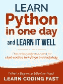
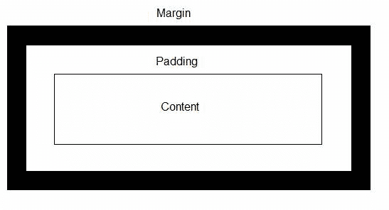
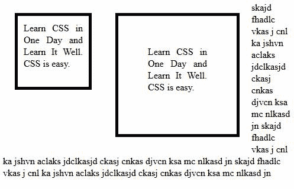
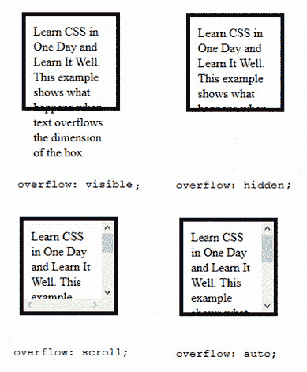
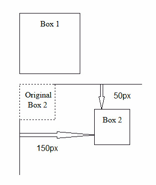
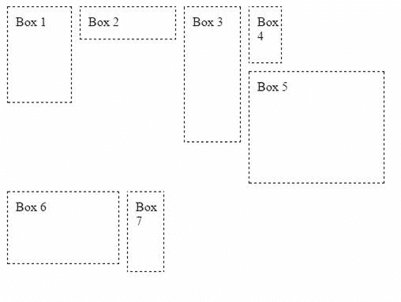
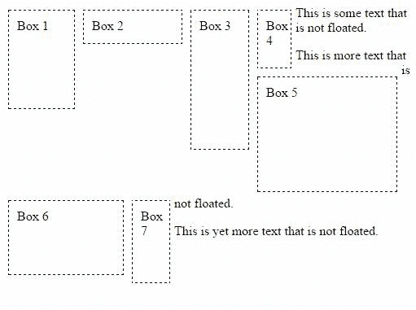
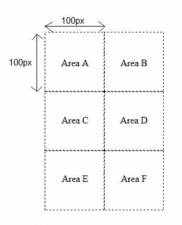
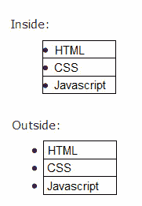
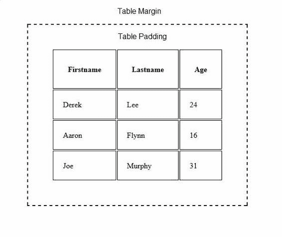

# 一天学会并精通 CSS（包含 HTML5）：带实战项目的 CSS 初学者实用指南。你开始 CSS 编程所需的唯一书籍……（通过实战项目快速开发）（第 2 卷）

## 前言

本书的编写目的是帮助你**快速**学习 CSS 并**精通**它。

本书不假设你具备任何编程背景。如果你是一个完全的初学者，你会发现这本书以易于理解的方式解释了复杂的概念。如果你是一个经验丰富的程序员，但刚接触 CSS，这本书将为你提供足够的深度，让你能够立即开始编写 CSS 代码。

书中的所有示例和图像都经过仔细挑选，以演示每个概念，以便你对该语言有更深入的理解。每个 CSS 章节末尾都有一个练习题。这些练习旨在帮助你进一步加强理解。所有练习的源代码可以在书末的附录中找到。

此外，正如查德·布兰森（Richard Branson）所说：“学习任何东西最好的方法就是实践”。本书附带了一个额外的奖励项目，引导你从零开始编写一个网页。该项目使用了书中涵盖的概念，并让你有机会看到所有内容是如何整合在一起的。

你可以在此处下载奖励项目和所有练习的源代码：

[`www.learncodingfast.com/css`](http://www.learncodingfast.com/css)。

## 联系信息

我非常期待听到你的反馈。

如有反馈或疑问，你可以通过 jamie@learncodingfast.com 与我联系。

## Jamie 的其他书籍



[Python：一天学会并精通 Python](http://mybook.to/Python)

```
注意哪个段落既有黄色背景又有下划线。这是因为该段落有两个类：`myClassPara` 和 `mySecondPara`。
16. 最后，让我们尝试在所有 `<p>` 元素的结尾添加叹号。使用 `after` 伪元素来实现。在 `</style>` 之前添加以下 CSS 代码：
```css

p::after{

    content: "!";

}

```

## 第 4 章：CSS Box 模型

到为止，我们涵盖了 HTML 和 CSS 的基础。在本章中，我们将开始编写实际的 CSS 代码。具体来说，我们将学习 CSS 盒模型（Box Model），并如何修改盒的外观。

### 什么是 CSS 盒模型

在 CSS 中，所有元素都被视为盒子。CSS 盒子由外边距、边框、内边距和实际内容组成，如下所示。



粗黑线是边框（border）。边界内部是内边距（padding）和实际内容。边界外部是盒子的外边距（margin）。内边距、边框和外边距的厚度都可以通过 CSS 修改。为了理解这个盒模型是如何工作的，让我们分析下面的代码。你可以在 [`learncodingfast.com/css`](http://learncodingfast.com/css) 下载这段代码。

```html

<!doctype html>

<html>

<head><title>Chapter 4 - CSS Box Model</title>

<style type="text/css">

#box1 {

margin: 20px;

padding: 10px;

border: 5px solid black;

width: 100px;

height: 100px;

text-align: justify;

float: left;

}

#box2 {

margin: 20px;

padding: 50px;

border: 5px solid black;

width: 100px;

height: 100px;

text-align: justify;

float: left;

}

</style></head>

<body>

<div id="box1">Learn CSS in One Day and Learn It Well. CSS is easy.</div>

<div id="box2">Learn CSS in One Day and Learn It Well. CSS is easy.</div>

<p>skajd fhadlc vkas j cnl ka jshvn aclaks jdclkasjd ckasj cnkas djvcn ksa mc nlkasd jn skajd fhadlc vkas j cnl ka jshvn aclaks jdclkasjd ckasj cnkas djvcn ksa mc nlkasd jn skajd fhadlc vkas j cnl ka jshvn aclaks jdclkasjd ckasj cnkas djvcn ksa mc nlkasd jn</p>

</body>

</html>

```

如果你运行这段代码，你将看到下面的盒子。盒子旁边和下方的乱码文本被添加是为了显示外边距（margin）。



这段代码定义了两个宽度和高度均为 100 像素的盒子。这个宽度和高度仅指内容区域的尺寸。

第一个盒子 (`box1`）在内容区域周围有 10 像素（px）的内边距。在内边距周围，它有一个 5px 的黑色实线框。`box1` 的总宽度（包括边框）为 100（内容区域）+10*2（两侧内边距）+5*2（两侧边框）= 130 px。高度也是如此。

第二个盒子 (`box2`）有 50px 的内边距。尽管 `box2` 比 `box1` 大得多，但注意看“Learn CSS in One Day and Learn It Well. CSS is easy.”这段文字仍然占据相同的区域吗？这是因为内容区域是由宽度和高度属性决定的，而不是内边距。`box2` 的总宽度为 100+50*2+5*2 = 210px。它的高度也是 210px。

在边框外部，两个盒子都有 20px 的外边距。注意到乱码文本和盒子之间有一些空间吗？那就是外边距。

尝试稍微修改代码，更改宽度、高度、内边距、外边距和边框属性的值。观察每个变化影响了哪些部分。你应该注意到宽度和高度影响内容区域。外边距影响边框外的区域，而内边距影响内部的区域。边框当然是盒子的边界。我们接下来将详细介绍这些属性。

### 宽度和高度属性

CSS 盒子的 `width` 和 `height` 属性指定内容区域的尺寸（不包括内边距、边框和外边距）。值通常以像素或百分比给出。例如，我们示例中的代码将 `box1` 和 `box2` 的宽度和高度设置为 100px。你也可以将宽度设置为 80%。这样盒子的内容区域将占据页面宽度的 80%。最后，你可以将高度和宽度设置为 `auto`。在这种情况下，浏览器将根据显示盒子内内容所需的空间自动计算这些值。

### Overflow 属性

有时，内容区域的宽度和高度可能太小，无法容纳盒子内部的内容。默认情况下，内容将溢出盒子并与其他内容叠加。这会导致网页格式非常糟糕。如果你不希望这种情况发生，可以使用 `overflow` 属性。下面的图显示了如何使用 `overflow` 属性的不同值（`visible`、`hidden`、`scroll` 和 `auto`）显示内容。



### 内边距和外边距属性

内边距和外边距都是透明的。因此我们无法更改它们的颜色。但是我们可以指定它们的宽度。指定宽度最常用的单位是像素。如果你希望外边距为 10 像素，编写 `margin: 10px;`。10 和 px 之间不应有任何空格。

下面的示例显示了指定外边距宽度的四种不同语法。内边距也一样。只需将属性名从 `margin` 更改为 `padding` 即可。

语法 1:
```

margin: 25px;

```
语法 2:
```

margin: 25px 50px;

```
语法 3:
```

margin-top: 25px;

```
语法 4:
```

margin: 25px 50px 60px 10px;

```

除了使用 RGB 表示法，你还可以使用十六进制法，它使用 6 位数字来表示颜色。前两个数字代表“红色”强度的十六进制值，接下来两个代表“绿色”，最后两个代表“蓝色”。通常会使用颜色工具来生成这些十六进制值。访问 [`instant-eyedropper.com/`](http://instant-eyedropper.com/) 网站获取这样一个免费工具。

或者，你可以访问 [`html-color-codes.info/`](http://html-color-codes.info/)，那里有一张颜色表供你选择选择的颜色。点击它，你就会得到相应的十六进制值。

### 示例：

```

border-color: rgb(255, 0, 0);

```
将设置所有边框为红色。

```

border-color: red green;

```
将顶部和底部的边框设置为红色，左侧和右侧的边框设置为绿色。

```

border-top-color: #12005F;

```
将设置顶部边框设置为 #12005F。

### border-style（边框样式）

要设置边框样式，你使用 `border-style` 属性。接受的值有：`none`、`dotted`、`dashed`、`solid`、`double`、`groove`、`ridge`、`inset` 和 `outset`。例如，如果你写：

```

border-style: solid dotted;

```
顶部和底部边框将为实线，而左右为虚线。如果你想单独设置样式，可以写：

```

border-top-style: solid;

```

```

border-left-style: dotted;

```

### border-radius（圆角）

`border-radius` 属性用于创建圆角边框。该值通常以像素或百分比给出。

可以为四个角单独设置圆角。这四个角分别是 `top-left`、`top-right`、`bottom-right` 和 `bottom-left`。

### 示例：

```

border-radius: 5px;

```
将所有角的圆角半径设置为 5px。

```

border-radius: 10px 20px;

```
将左上角和右下角（即对角线的两个角）的半径设置为 10px，右上角和左下角的半径设置为 20px。

```

border-radius: 25px 5px 0 50px;

```
从左上角开始按顺时针方向继续设置各个角的值。

```

border-top-left-radius: 10px;

```
将左上角的边框半径设置为 10px。

如果该元素的宽度和高度为 100px，内边距为 20px，边框宽度为 50px（总宽度和总高度 = 100 + 20*2 + 50*2 = 240px），将圆角设置为 120px（240 除以 2）将得到一个圆而不是正方形。

### Border Shorthand（边框简写）

`border` 属性是在单行内指定边框宽度、样式和颜色的简写，而不是分开进行。只需写道：

```

border: 5px solid green;

```
这些值分别代表宽度 (5px)、样式 (solid) 和颜色 (green)。此简写中不包含圆角。

### 练习 4

从 [`learncodingfast.com/css`](http://learncodingfast.com/css) 下载此练习的源代码并解压文件。此练习的源代码可以在 "Chapter 4 - CSS Box Model" 文件夹中找到。

### 练习 4.1

1. 在你的浏览器和文本编辑器中同时打开 `Chapter 4 - CSS Box Model.html`。
2. 调整浏览器窗口大小，观察乱码文本是如何绕过更大的框流动的。
3. 通过修改 `box1` 的 CSS 声明，将 `width: 100px;` 和 `height: 100px;` 分为以下每一项：
   (a) `width: 200px; height: 200px;`
   (b) `width: 60%;`
   (c) `height: auto; width: auto;`
   在编辑器中保存文件并在浏览器中刷新页面。注意每种情况下 `box1` 发生了什么。
4. 现在将 `box1` 的宽度和高度改回 100px，并将标签 `<div id="box1">...</div>` 之间的文本更改为：
   “一天内学会 CSS 并学好它。此示例展示了当文本溢出框尺寸时会发生什么。”
   接下来，在 `box1` 的 CSS 声明中添加以下每一项，并注意每种情况下发生了什么：
   (a) `overflow: visible;`
   (b) `overflow: hidden;`
   (c) `overflow: scroll;`
   (d) `overflow: auto;`
5. 修改 `box1` 的 CSS 声明，将 `margin: 20px;` 改为以下每一项，并注意每种情况下 `box1` 周围空间发生了什么：
   (a) `margin: 50px;`
   (b) `margin: -50px;`
   (c) `margin: 25px 200px;`
   (d) `margin: 25px;`
6. 在 `box1` 的 CSS 声明中添加以下每一项，并注意每种情况下发生了什么：
   (a) `border: 5px solid red;`
   (b) `border: 5px dashed blue;`
   (c) `border: 5px dotted green;`
   (d) `border: 5px double yellow;`
7. 修改 `box1` 的 CSS 声明，将 `margin: 20px;` 改为以下每一项，并注意 `box1` 周围空间发生了什么：
   (a) `margin: 50px;`
   (b) `margin: -50px;`
   (c) `margin: 25px 200px;`
   (d) `margin: 25px;`
8. 在 `box1` 的 CSS 声明中添加以下每一项，并注意每种情况下发生了什么：
   (a) `border: 5px solid red;`
   (b) `border: 5px dashed blue;`
   (c) `border: 5px dotted green;`
   (d) `border: 5px double yellow;`
9. 修改 `box1` 的 CSS 声明，将 `margin: 20px;` 改为以下每一项，并注意 `box1` 周围空间发生了什么：
   (a) `margin: 50px;`
   (b) `margin: -50px;`
   (c) `margin: 25px 200px;`
   (d) `margin: 25px;`

有四种定位元素的方法。为了理解这四种方法的工作原理，我强烈建议你尝试本章末尾的。如果不通过实践，这个主题很难理解。

### 静态定位 (Static Positioning)

第一种定位方法是 `static` 定位。静态并没有特殊含义，它意味着元素是根据页面的正常流进行定位。所有的 HTML 元素默认都使用这种方法定位。如果你想指定使用 `static` 定位（例如覆盖同一元素的其他定位规则），可以写：

```css

position: static;

```

### 相对定位 (Relative Positioning)

定位元素的第二种方法是 `relative` 定位。这种方法相对于元素的正常位置进行定位。正常位置是指元素在未指定定位规则或使用 `static` 定位时的默认位置。

假设我们有两个盒子，`box1` 和 `box2`，且没有指定定位。如果在 HTML 代码中我们在 `box1` 之后创建 `box2`，那么 `box2` 默认将定位在 `box1` 下方（参见下面的代码）。

```html

<!DOCTYPE html>

<html>

<head>

<style>

#box1 {

  /*一些 box1 的样式规则*/

}

#box2 {

  /*一些 box2 的样式规则*/

}

</style>

</head>

<body>

  <div id="box1">Box 1</div>

  <div id="box2">Box 2</div>

</body>

</html>

```

现在假设我们为 `box2` 的 CSS 声明添加了以下规则：

```css

position: relative;

left: 150px;

top: 50px;
```


我们所做是将`box2`的定位更改为`relative`定位。



上面的图片显示了使用`relative`定位时`box2`的位置。添加了一个白色虚线框来显示`box2`的原始位置。

当应用`relative`定位时，`box2`会相对于其正常位置发生移动。`top: 50px;`行将盒子距离原始位置的顶部移动 50px，而`left: 150px;`行则将其向左侧移动 150px。

你也可以使用`right`和`bottom`属性来定位`box2`。例如，`bottom: 50px;`将将`box2`从原始底部向上移动 50px，而`right: 50px;`将将其从`box2`的原始右边缘向左移动 50px。此外，你还可以使用负像素来定位盒子（例如`left: -50px`）。

尝试第 5 章的练习，并调整这些值来观察它们是如何工作的。

请注意，当使用`relative`定位时，元素可能会与其他元素发生重叠。

如果你想指定哪个元素在前面，就必须使用`z-index`属性。`z-index`属性适用于任何定位为`relative`、`fixed`或`absolute`的元素（即不是`static`）。`z-index`值较大的元素将定位在`z-index`值较小的元素前面。

假设你有两个盒子，`greenBox`和`redBox`，并且它们相互重叠。如果你将`greenBox`的`z-index`为

```css
z-index: 1;
```

并将`redBox`的`z-index`为

```css
z-index: 2;
```

那么`redBox`将位于`greenBox`之上，因为它的`z-index`值更大。

### 固定定位 (Fixed Positioning)

第三种定位方法是`fixed`定位。顾其名，使用`fixed`方法定位的元素将始终保持在其分配的位置上；即使页面滚动，它也不会移动。固定定位通常用于在网页侧边定位社交分享按钮。要使用`fixed`定位，我们写：

```css
position: fixed;
```

使用`fixed`定位时，我们可以使用`top`属性指定盒子距离页面顶部的像素数，而`left`属性指定它距离页面左侧的像素数。

除了`top`和`left`，还有`right`和`bottom`属性，它们分别指定了盒子距离页面右侧和底部的像素数。

### 绝对定位 (Absolute Positioning)

最后一种方法是`absolute`定位。

当使用`absolute`定位时，元素相对于第一个非`static`定位的父元素进行定位。如果没有找到这样的元素，它将相对于页面进行定位。

例如，假设我们有以下 HTML 代码：

```html
<div id="box1">Content in Box 1</div>
<div id="box2">Content in Box 2</div>
```

以及以下 CSS 声明：

```css
#box1 {
  position: relative;
}

#box2 {
  position: absolute;
  top: 50px;
  left: 150px;
}
```

假设`box2`不是任何具有非静态定位元素的子元素，它将相对于页面进行定位。

### 浮动定位 (Floating Positioning)

*注意：提供的文本包含了一个关于浮动的描述，但这里是为了完整性。*

浮动是一种用于在页面上排列元素的技术。为了查看它是如何工作的，假设我们有以下代码：

```html
<!doctype html>
<html>
<head>
<title>Float</title>
<style type="text/css">
div {
  padding: 10px;
  border: 1px black;
  margin: 5px;
  float: left;
}

#box1 {
  width: 60px;
  height: 100px;
}

#box2 {
  width: 100px;
  height: 20px;
}

#box3 {
  width: 50px;
  height: 150px;
}

#box4 {
  width: 20px;
  height: 50px;
}

#box5 {
  width: 150px;
  height: 120px;
}

#box6 {
  width: 120px;
  height: 70px;
}

#box7 {
  width: 25px;
  height: 80px;
}
</style>
</head>
<body>
  <div id="box1">Box 1</div>
  <div id="box2">Box 2</div>
  <div id="box3">Box 3</div>
  <div id="box4">Box 4</div>
  <div id="box5">Box 5</div>
  <div id="box6">Box 6</div>
  <div id="box7">Box 7</div>
</body>
</html>
```

如果我们运行这段代码，将得到类似下面图片的结果。



注意盒子是如何从上到下从左到右排列的。由于盒子 5 太厚无法放入第一行，CSS 将其放置在上一个盒子的下方。

现在假设在 7 个盒子之外，我们还有以下想要在网站上显示的文本：

```html
<p>This is some text that is not floated.</p>
<p>This is more text that is not floated.</p>
<p>This is yet more text that is not floated.</p>
```

如果这些段落位于`div`盒子之后并在 HTML 文档中，我们将得到下面的图表。这些段落将仅仅“挤进”任何可用空间。



如果你不希望发生这种情况，可以使用`clear: both`属性来清除浮动。要实现这一点，请在 CSS 声明中添加以下内容：

```css
.clearFloat { clear: both; }
```

要使用此类，我们将其添加到第一个`<p>`标签中：

```html
<p class="clearFloat">这是一段没有浮动的文本。</p>
```

你只需要在第一个`<p>`标签上添加`clearFloat`类。一旦你清除了浮动，文本将不再环绕盒子显示。

这就是 CSS 中定位和浮动工作原理的要点。我强烈建议你尝试本章的练习题，以更好地理解这两个概念。

### 练习 5

从[`learncodingfast.com/css`](http://learncodingfast.com/css)下载此练习的源代码并解压文件。此练习的源代码可以在“第 5 章 - 定位与浮动”文件夹中找到。

### 练习 5.1

> 1. 在浏览器和文本编辑器中同时打开`Chapter 5 - Positioning.html`文件。
>
> 2. 为`#box1`和`#box2`的 CSS 声明添加`position: static;`规则，并观察两个盒子的位置发生了什么变化。
>
> 没有变化，对吧？这是因为所有 HTML 元素默认都使用`static`定位。
>
> 3. 从`#box1`和`#box2`的 CSS 声明中移除`position: static;`规则。在`#box2`的 CSS 声明中添加以下行。

```css
position: relative;
top: 50px;
left: 70px;
```

> 观察第二个盒子位置的变化。3. 它现在距离正常位置顶部 50px，距离左侧 10px。
>
> 尝试为`top`和`left`属性使用不同的值，看看`box2`的位置发生了什么变化。也尝试负值。你也可以尝试使用`right`和`bottom`属性。
>
> 4. 现在将`#box2`的 CSS 声明改回

```css
position: relative;
top: 50px;
left: 70px;
```

> 注意到文本被红色盒子部分遮住了？
>
> 如果你想让文本出现在红色盒子前面，请在`p`的 CSS 声明中添加以下行。

```css
position: relative;
z-index: 2;
```

> 你可以将位置设置为`relative`、`absolute`或`fixed`。只要它不是`static`，就没有关系。
>
> 下一步，在`#box2`的 CSS 声明中添加行`z-index: 1;`。刷新页面。文本现在应该在红色盒子前面，因为文本的`z-index`大于红色盒子的`z-index`。
>
> 如果你想让红色盒子出现在文本前面，只需将`#box2`的`z-index`改为大于 2 的值即可。
>
> 5. 现在，将`#box1`的高度改为`5000px`，并将`#box2`的定位改为`fixed`（`position: fixed;`）。
>
> 滚动页面。5. 红色盒子现在使用固定定位，因此它不会移动。
>
> 6. 将`#box2`的定位改回`relative`，并将`#box1`的高度改回`100px`。在文件底部 HTML 代码中的`<p>`标签之前添加以下行。

```html
<div id="box3"></div>
```

> 现在添加以下 CSS 声明来样式化`box3`。

```css
#box3 {
  position: absolute;
  top: 50px;
  left: 150px;
  background-color: yellow;
  width: 50px;
  height: 50px;
  padding: 20px;
  border: 5px dotted black;
  margin: 10px;
}
```

> `box3`使用了`absolute`定位，由于它不是任何`<div>`元素的子元素，因此它是相对于页面进行定位的。也就是说，它距离页面顶部 50px，距离左侧 150px。
>
> 7. 现在将三个盒子的`<div>`代码更改为以下：

```html
<div id="box1"></div>
<div id="box2">
    <div id="box3"></div>
</div>
```

> `box3`现在是`box2`的子元素。因此，它现在相对于`box2`定位，所以它距离`box2`顶部 50px，距离左侧 150px。

### 练习 5.2

> 1. 在浏览器和文本编辑器中同时打开`Chapter 5 - Floating.html`文件。
>
> 2. 调整你的浏览器窗口，看看当`<div>`元素没有足够的空间时会发生什么。
>
> 3. 通过将`float: left;`改为`float: right;`来修改`div`的 CSS 声明。
>
> 4. 使用`float: left;`，在 HTML 代码中的`</body>`标签上方添加以下代码。

```html
<p>这是一段没有浮动的文本。</p>
<p>这是另一个没有浮动的文本。</p>
<p>这是更多没有浮动的文本。</p>
```

> 刷新页面并调整浏览器窗口，看看当宽度变窄时会发生什么。
>
> 5. 接下来，在`</style>`标签上方添加以下代码

```css
.clearFloat { float: both; }
```

> 将第一个`<p>`标签改为`<p class="clearFloat">`看看发生了什么。
>
> 你只需要在第一个`<p>`标签上添加`clearFloat`类。一旦你清除了浮动，文本将不再环绕盒子显示。
>
> 这就是 CSS 中定位和浮动工作原理的概要。我强烈建议你尝试本章的练习题，以更好地理解这两个概念。

### 练习 6

从[`learncodingfast.com/css`](http://learncodingfast.com/css)下载此练习的源代码并解压文件。此练习的源代码可以在“第 6 章 - 显示与可见性”文件夹中找到。

### 练习 6.1

> 1. 在浏览器和文本编辑器中同时打开`Chapter 6 - Display and Visibility.html`文件。
>
> 2. 更改`#displaydemo`的高度和宽度，看看黄色盒子发生了什么变化。
>
> 没有任何变化，对吧？黄色框被声明为内联级元素。因此，它只会占据它所需的宽度和高度。事实上，你可以移除高度和宽度属性，什么都不会改变。
>
> 3. 现在将`#displaydemo`的`display`属性从`display: inline;`改为`display: block;`。发生了什么？
>
> 黄色框现在以块级元素的形式显示。它会在新行开始并结束。如果你声明了它的宽度和高度，那么宽度和高度将是你指定的值。如果你没有指定宽度和高度，黄色框将占据页面的整个宽度。它将占据它所需的高度。
>
> 4. 尝试更改`#displaydemo`的 CSS 声明中的高度和宽度。观察发生了什么。
>
> 5. 现在，让我们来看一下`visibility`属性。将`#magic`的 CSS 声明从`display: inline;`改为`visibility: hidden;`。观察蓝色句子中单词“magic”发生了什么变化。
>
> 6. 接下来，将`#magic`的 CSS 声明从`visibility: hidden;`改为`display: none;`。观察发生了什么。

## 第 7 章：背景

在本章中，我们将学习如何更改元素的背景属性。这些属性包括更改它的背景颜色和背景图像。

首先，让我们先看看如何更改背景颜色。

## 背景颜色

要声明元素的背景颜色，我们使用`background-color`属性。类似于我们指定 CSS 框的边界颜色一样，我们可以使用三种表示法之一声明元素的背景颜色：颜色名称、rgb 表示法或十六进制表示法。

示例：

```
background-color: green;
```

```
background-color: rgb(0, 255, 0);
```

```
background-color: #00FF00;
```

## 背景图像

如果你觉得仅使用颜色作为元素的背景太单调，你可以选择使用图像。CSS 允许我们在图像显示方面具有极大的灵活性。

### background-image

要使用图像作为背景，我们使用`background-image`属性指定图片的 URL。

示例：

```
background-image: url("image1.jpg");
```

### background-repeat

默认情况下，背景图像位于元素的左上角，并在垂直和水平方向上重复。如果你不希望背景图像重复，可以使用`background-repeat`属性进行更改。以下列表显示了`background-repeat`属性的一些常用值：

- `repeat`: 这是默认值。图像将在水平和垂直方向上重复。
- `repeat-x`: 图像仅在水平方向上重复。
- `repeat-y`: 图像仅在垂直方向上重复。
- `no-repeat`: 图像不重复。

示例：

```
background-repeat: repeat-x;
```

### background-attachment

`background-attachment`属性指定背景图像应该是固定还是随页面滚动。两个常用的值是`fixed`和`scroll`。默认值是`scroll`。尝试本章末的练习来查看它是如何工作的。

示例：

```
background-attachment: scroll;
```

### background-position

如果你想指定显示背景图像的哪个区域，`background-position`属性将非常有用。

假设你有一个宽度和高度均为 100px 的元素。如果你使用的背景图像宽度为 200px，高度为 300px，那么只有背景图像的一部分将显示，因为图像大于元素的尺寸。



例如，如果你使用上面的图像（200px 比 300px）作为 100px 比 100px 元素的背景图像，默认只会显示区域 A（左上角）。如果你想显示区域 F 呢？要这样做，你需要更改`background-position`属性的值。

指定`background-position`值的最常用方法是使用像素。语法为：

```
background-position: xpos ypos;
```

为了理解这种语法如何工作，让我们想象有一块中心有一个 100px 比 100px 洞的纸板。纸板上的这个洞代表 HTML 元素。现在想象你的背景图像在在那块纸板下方。默认情况下，图像将对齐，使得区域 A 通过纸板上的孔显示出来。如果你想显示区域 F，你必须将图像（而不是纸板）向左移动 100px 并向上移动 200px。要用 CSS 实现这一点，你这样写道：

```
background-position: -100px -200px;
```


第一个数字（`-100px`）水平移动图像。如果这个数字是正数，图像向右移动。如果是负数，它向左移动。

第二个数字（`-200px`）垂直移动图像。如果这个数字是正数，图像向下移动。如果是负数，它向上移动。

理解这个概念的最佳方法是尝试本章的练习。我强烈建议你在进入第 8 章之前完成它们。

## 练习 7

从 [`learncodingfast.com/css`](http://learncodingfast.com/css) 下载此练习的源代码并解压文件。此练习的源代码可以在章节中找到。

### 练习 7.1

1. 从 [`learncodingfast.com/css`](http://learncodingfast.com/css) 下载此练习的源代码并解压文件。此练习的源代码可以在章节中找到。
2. 在浏览器中打开`7 - Background.html`文件。观察`body`发生了什么。
3. 在`body`中，将`background-attachment: fixed;`改为`background-attachment: scroll;`。刷新页面并观察发生了什么。
4. 在`body`中，将`background-repeat: repeat;`改为：
   - `repeat-x`
   - `no-repeat`
   - `repeat-y`
   观察每种情况发生了什么。
5. 在`body`中，将`background-color: white;`改为`background-color: #000FF;`。这将页面背景颜色改为蓝色。
6. 最后，我们将查看`background-position`属性。示例中的图像是相同文件夹中的`backgroundposition.png`。在继续之前看一眼。
7. 注意，当`background-position`设置为`0 0`（默认值）时，显示区域 A。更改`background-position`属性将相对于区域 A 移动图像。
8. 在`#box1`的 CSS 声明中，将`background-position: 0 0;`改为：
   - `background-position: -100px 0;`
   - `background-position: 100px 0;`
   - `background-position: 0 -100px;`
   - `background-position: 0 100px;`
   - `background-position: -100px -100px;`
   尝试弄清楚你会得到哪个区域。

## 第 8 章：文本与字体

CSS 中的文本和字体属性用于格式化网页上单词和文本的外观。`font`属性关注字符的外观，例如是“粗”还是“细”、“大”还是“小”，以及使用什么字体。`text`属性用于样式化其他属性。在本章中，我们将涵盖常用的`text`和`font`属性。

## 字体属性

### font-family

`font-family`属性用于设置字体类型。

字体类型主要三大类：衬线字体（serif）、无衬线字体（san serif）和等宽字体（monospace）。

衬线字体在某些字符的末端有一个小笔画。示例包括“Times New Roman”和 Georgia。

无衬线字体在字符的末端没有笔画。示例包括 Arial 和 Verdana。

等宽字体对所有字符都使用相同的空间。例如，字母‘i’的宽度与字母‘a’相同。等宽字体的示例包括“Courier New”和“Lucida Console”。

在指定`font-family`属性时，你应该始终包含多个字体名称，这样如果浏览器不支持第一个字体，它就会尝试下一个字体，直到找到它支持的字体为止。从更具体的字体（如“Times New Roman”）开始，并以一个通用的字体族结束。如果字体名称包含多个单词，应使用引号。

示例：

```
font-family: "Times New Roman", Times, serif;
```

## font-size

`font-size`属性设置文本的大小。字体大小可以使用像素（`px`）、em、百分比（%）或使用关键字来设置。

### 使用 px

大多数浏览器上使用的默认字体大小是 16 像素。如果你想让网站以不同的字体大小显示，可以这样指定：

```
font-size: 20px;
```

### 使用 em

一个 em 等于当前字体大小。如果该元素是另一个元素的子元素，则当前字体大小是父元素的字体大小。如果该元素不是任何元素的子元素，则当前字体大小是浏览器的默认字体大小。如上述，大多数浏览器上使用的默认字体大小是 16px。因此，默认情况下`1em = 16px`。

然而，可以通过更改浏览器设置来更改默认字体大小。例如，要更改 Firefox 默认字体大小，点击菜单按钮（最右侧的三条横线按钮），选择“选项 (Options)”，最后选择“内容 (Content)”选项卡。然后你可以在“字体与颜色 (Fonts & Colors)”部分更改当前字体大小。

如果用户将默认字体大小设置为 20px，`1em`变为 20px。如果你想让字体大小变为当前字体大小的 1.5 倍，只需编写`1.5em`。em 是大多数开发者首选的单位大小，因为默认字体大小可以由用户自定义。

### 使用百分比

百分比与 em 类似。200% 简单意味着当前字体大小的 2 倍。因此，`200% = 2em`。

### 使用关键字

指定字体大小的最后方法是使用关键字。常用的关键字有`xx-small`、`x-small`、`small`、`medium`（默认值）、`large`、`x-large`和`xx-large`。

示例：

```
font-size: 40px;
font-size: 1.5em;
font-size: 120%;
font-size: large;
```

## font-style

`font-style`属性用于指定斜体文本。两个常用值为`normal`和`italic`。`normal`以正常文本显示文本，而`italic`以斜体显示文本。

示例：

```
font-style: italic;
```

## font-weight

`font-weight`属性是`font-style`的对应项。虽然`font-style`用于指定斜体文本，但`font-weight`用于指定粗体文本。常用的值包括`normal`、`bold`、`bolder`和`lighter`。或者，你也可以使用 100 的倍数的数字指定字符的粗细，从 100（最细）到 900（最粗）。400 是正常粗细，700 与`bold`相同。

然而请注意，大多数网页浏览器只支持`normal`和`bold`字体权重。在这种情况下，100-500 对应`normal`，而 600 及以上对应`bold`。

示例：

```
font-weight: bold;
font-weight: 300;
```

## Text Properties

CSS `text`属性允许你设置与文本字体无关的属性。常用属性包括文本颜色、文本对齐、文本装饰、字间距、词间距和行高。

### color

CSS `color`属性指定文本颜色。与我们在第 4 章中学习的`border-color`属性类似，文本颜色可以通过三种方式指定：使用颜色名称、RGB 值或十六进制值。

示例：

```
color: blue;
color: #00ff00;
color: rgb(255,0,0);
```

### text-alignment

`text-alignment`属性允许我们指定文本是居中、左对齐、右对齐还是两端对齐。常用的值为`left`、`right`、`center`和`justify`。

示例：

```
text-align: center;
```

### text-decoration

`text-decoration`属性主要用于指定文本是否用线条进行装饰。常用的值为`none`（即：普通文本，无装饰）、`underline`（下划线）、`overline`（文本上方的线）和`line-through`（贯穿线）。

此属性通常用于移除链接的下划线。默认情况下，大多数浏览器将以蓝色显示链接并带有下划线。你可以使用代码`text-decoration: none;`来移除装饰。

示例：

```
text-decoration: none;
```

### letter-spacing

字间距用于增加或减少字符之间的间距。可以使用像素（`px`）或相对单位`em`来指定。

示例：

```
letter-spacing: 2px;
```

### word-spacing

词间距另一方面用于增加或减少单词之间的间距。与`letter-spacing`类似，可以使用像素（`px`）或相对单位`em`来指定。

示例：

```
word-spacing: 2px;
```

### line-height

行高用于设置行之间的间距。可以使用数字、长度或百分比来设置。使用数字时，它是字体大小的倍数。

示例：

```
line-height: 1.5;
line-height: 24px;
```

## Exercise

为了更好地理解每个属性的作用，请尝试下面的练习。

### Exercise 8

从 [`learncodingfast.com/css`](http://learncodingfast.com/css) 下载此练习的源代码。此练习的源代码可以在第 8 章中找到。

### Exercise 8.1

1. 同时在浏览器和文本编辑器打开`Chapter 8 - Font and Text.html`。
2. 修改`font-family`属性并观察文本的变化。当前字体族是无衬线字体。尝试以下各项：
   - a) `font-family: Verdana, Arial, Helvetica, sans-serif;`
   - b) `font-family: Courier, "Lucida Console", monospace;`
3. 修改`font-size`属性并观察每种情况下示例文本的变化。尝试：
   - a) `font-size: 40px;`
   - b) `font-size: 1.5em;`
   - c) `font-size: x-small;`
   - d) `font-size: 120%;`
4. 修改`font-style`属性并观察文本的变化。尝试：
   - a) `font-style: italic;`
5. 修改`font-weight`属性并观察文本的变化。尝试：
   - a) `font-weight: bold;`
   - b) `font-weight: 300;`
6. 修改`color`属性并观察文本的变化。尝试：
   - a) `color: blue;`
   - b) `color: #00ff00;`
   - c) `color: rgb(255,0,0);`

## 7. 修改 CSS 属性`text-align`并观察示例文本的变化。默认情况下，此段落的文字是左对齐的。现在尝试以下各项：

(a) `text-align: justify;`
(b) `text-align: right;`
(c) `text-align: center;`

## 8. 修改 CSS 属性`text-decoration`并观察示例文本的变化。尝试：

(a) `text-decoration: underline;`
(b) `text-decoration: overline;`
(c) `text-decoration: line-through;`

## 9. 修改 CSS 属性`letter-spacing`并观察示例文本的变化。尝试：

(a) `letter-spacing: 5px;`
(b) `letter-spacing: -5px;`

## 10. 将`letter-spacing`改回`0px`。修改 CSS 属性`word-spacing`并观察示例文本的变化。尝试：

(a) `word-spacing: 10px;`
(b) `word-spacing: -20px;`

## 11. 将`word-spacing`改回`0px`。修改 CSS 属性`line-height`并观察示例文本的变化。尝试：

(a) `line-height: 2;`
(b) `line-height: 25px;`
(c) `line-height: 30%;`

## 第 9 章：列表、链接与导航栏

在本章中，我们将学习用于设置超链接和列表样式的 CSS 属性。此外，我们将结合这两个概念，讨论如何创建网页上常见的导航栏。准备好了吗？让我们先从 CSS 列表开始。

## CSS 列表

回想一下在 HTML 中我们可以创建两种类型的列表：有序列表和无序列表。我们可以使用 CSS 列表属性对这些列表进行样式设置。

### list-style-type

`list-style-type`属性允许你为列表设置列表项目标记。列表项目标记是指每个列表项目左侧的那些符号/数字/字母。

对于有序列表，我们可以指定想要使用的数字或字母类型作为标记。例如，如果我们想使用罗马数字（如 i, ii, iii）作为项目标记，可以编写`list-style-type: lower-roman;`。

其他常用的标记还包括：

`decimal`（这是默认值），
`decimal-leading-zero`（带有前导零的数字，例如 01, 02..），
`lower-alpha`（例如 a, b, c..），
`lower-greek`（例如 α, β, γ..），
`upper-alpha`（例如 A, B, C..）以及
`upper-roman`（例如 I, II, III…）。

对于无序列表，你可以指定想要作为项目符号的形状。默认标记是`disc`（实心圆）。你可以将其改为`square`（正方形）或`circle`（圆形）。

此外，你也可以选择不为列表使用任何项目标记。要这样做，你需要编写`list-style-type: none;`。这在创建导航栏时非常常见。

示例：

`list-style-type: lower-roman;`
`list-style-type: circle;`
`list-style-type: none;`

### list-style-image

如果你不喜欢提供的任何列表样式，可以选择使用图像作为列表项目标记。要这样做，你可以使用`list-style-image`属性来指定使用的图像 URL。

示例：

`list-style-image: url('myMarker.gif');`

### list-style-position

`list-style-position`属性用于指定列表项目标记应该出现在内容流的内部还是外部。有两个接受的值：`inside`和`outside`。

默认情况下，列表项目带有一定的缩进显示。如果`list-style-position`设置为`inside`，则列表项目标记将在缩进之后。缩进由下方图中框的左边缘表示。如果`list-style-position`设置为`outside`，则标记将在缩进之前显示

换句话说，`list-style-position: inside`产生的缩进比`list-style-position: outside`更多。默认位置是`outside`。

示例：

`list-style-position: outside;`

### list-style

`list-style`是一个简写属性，用于在一个声明中设置所有的列表属性（即`list-style-type`、`list-style-position`和`list-style-image`）。如果缺少任何值，将使用该缺失属性的默认值。

示例：

`list-style: square inside url("myMarker.gif");`

## CSS 链接

可以使用之前章节讨论过的任何 CSS 属性对超链接进行样式设置。你可以使用`background-color`属性设置背景颜色，这将使链接具有高亮外观。你还可以使用第 8 章涵盖的文本和字体属性来更改字体大小、字体样式、文本颜色、文本装饰等。

此外，我们还可以根据状态对超链接进行样式设置。链接有四种状态：

`link`（未访问的链接）
`visited`（已访问的链接）
`hover`（用户鼠标悬停在其上方时）
`active`（链接被点击时）

要指定状态，我们使用以下伪类：

```
a:link
a:visited
a:hover
a:active
```

示例：

```css
a:link { color: blue; }
a:visited { color: purple; }
a:hover { color: red; }
a:active { color: yellow; }
```

## 导航栏

导航栏通常作为无序列表创建。让我们尝试制作自己的菜单。

```html
<ul>
  <li><a href="home.html">首页 (Home)</a></li>
  <li><a href="html.html">HTML 教程 (HTML Tutorial)</a></li>
  <li><a href="csstutorial.html">CSS 教程 (CSS Tutorial)</a></li>
</ul>
```

接下来，我们需要对列表设置样式。我们使用 CSS 移除列表符号。

```css
ul {
  list-style-type: none;
}
```


现在我们必须对链接设置样式。我们将为链接使用块级显示（block display）。

```css
a {
  display: block;
  width: 160px;
  text-align: center;
  text-decoration: none;
  background-color: #00FF00;
}
```

最后，如果我们希望导航栏水平排列，我们需要让列表项目向左浮动。

```css
li {
  float: left;
}
```

完成！我们刚刚了一个简单的水平导航栏。此导航栏的代码作为本章练习的一部分给出。你可以尝试调整它并使其看起来更美观。你可以为四种链接状态指定样式。

## 练习 9

从 [`learningfast.com/css`](http://learningfast.com/css) 下载此练习源码并解压文件。练习源码可以在 Chapter 9 - Lists and Navigation Bars 文件夹找到。

### 练习 9.1

1. 在浏览器和编辑器中同时打开文件 `Chapter 9 - List and Links.html`。
2. 修改 `ol` 的 CSS 声明并观察有序列表的变化。尝试以下各项：
   (a) `list-style-type: decimal-leading-zero;`
   (b) `list-style-type: lower-roman;`
   (c) `list-style-type: upper-roman;`
   (d) `list-style-type: upper-alpha;`
   (e) `list-style-type: lower-alpha;`
   (f) `list-style-type: lower-greek;`
   (g) `list-style-type: none;`
3. 修改 `ul` 的 CSS 声明并观察无序列表的变化。尝试以下各项：
   (a) `list-style-type: circle;`
   (b) `list-style-type: square;`
   (c) `list-style-type: none;`
   (d) `list-style-type: disc;`
4. 在 `ul` 的 CSS 声明中添加以下规则：

```css
list-style-position: outside;
```

> 刷新浏览器。没有任何变化对吧？那是因为 `list-style-position: outside;` 是默认值。现在将 `list-style-position: outside;` 改为 `list-style-position: inside;`。你会发现无序列表向右稍微移动了（即缩进增加了）。

> 5. 移除 `ul` 的 `list-style-type` 属性，并添加以下内容：

> (a) `list-style-image: url("myMarker.gif");`

> 观察“Cars Unordered List”发生了什么变化。
> 6. 现在让我们来看看如何为超链接样式。尝试在指定的选择器中添加以下规则：

> (a) 在 `a:link{}` 中添加 `color: green;`
> 并观察“Click Me”链接发生了什么变化。

> (b) 在 `a:active{}` 中添加 `font-size: 2em;`
> 并点击该链接。

> (c) 在 `a:hover{}` 中添加 `background-color: red;`
> 并鼠标悬停在链接上。

### 练习 9.2

> 1. 在浏览器和文本编辑器中同时打开 `Chapter 9 - Navigation Bar.html` 文件。
> 2. 此页面展示了如何使用列表和链接的 CSS 规则创建一个水平导航栏的示例。书中解释了这些步骤。学习代码并尝试修改 CSS 声明以改进此导航栏的设计。

## 第 10 章：表格

HTML 表格默认外观并不好看。然而，通过一些简单的 CSS 样式设置，我们可以轻松地将其转换为精美的表格。在本章中，我们将学习如何实现。

## 边框、内边距和外边距

我们将查看的第一组属性是 `border`、`padding` 和 `margin` 属性。还记得我们在讨论 CSS 盒模型时提到过这些属性吗？HTML 表格（`<table>`）和表格单元格（`<th>` 和 `<td>`）遵循与其他 CSS 元素相同的盒模型，因此可以使用这些属性进行样式设置。

为了理解这些是如何运作的，请参考下图（“Table Margin”和“Table Padding”字样仅供参考，在实际表格中并不）。



该表格的 CSS 规则如下：

```css
table {
  border: dashed 1px black;
  padding: 50px;
  margin: 60px;
}

th {
  border: solid 1px black;
  padding: 30px;
  text-align: center;
}

td {
  border: solid 1px black;
  padding: 20px;
}
```

虚线是表格的边框（border）。虚边框周围的空间是表格的外边距（margin，声明为 60px），虚边框内部的空间是它的内边距（padding，50px）。

第一行（Firstname, Lastname, Age）使用 `<th>` 标签定义为表格表头。“Firstname”、“Lastname”和“Age”单词周围的空间是 `<th>` 元素的内边距（30px）。

第二、第三和第四行使用 `<td>` 标签定义。诸如“Derek”、“Aaron”和“31”等单词周围的空间是 `<td>` 元素的内边距（20px）。

`<th>` 和 `<td>` 元素没有声明外边距，因为外边距对表格单元格会被忽略。因此，我们无法指定单元格之间的间距。默认情况下，单个表格单元格之间会有很小的间隙。此外，即使你将表格内边距设置为 0px，表格边框（虚线）与单元格边框（实线）之间也存在一个间隙。如果你只需要一个边框，必须使用 `border-collapse` 属性：

```css
border-collapse: collapse;
```

在我们进行本章的练习时，将有机会尝试 `border`、`padding` 和 `margin` 属性。现在，让我们继续下一个属性。

## 高和宽

表格的宽度和高度可以使用 `width` 和 `height` 属性进行设置。值通常以像素或百分比的形式给出。例如，下面的代码将表格宽度设置为父元素宽度的 100%，高度设置为 500px。

```css
table {
  width: 100%;
  height: 500px;
}
```

你也可以在 `tr`、`th` 或 `td` 级别使用 `height` 属性。例如，如果你想让表头行的高度为 100px，你可以写：

```css
th {
  height: 100px;
}
```

此外，你可以在表格单元格级别设置 `width` 属性（即针对 `td` 和 `th` 元素）。如果你想让表格单元格的宽度为 200px，你可以写：

```css
th {
  width: 200px;
}
```

如果你想对单独的列设置样式，可以使用 `id`/`class` 属性。例如，如果你有下面的表格结构：

```html
<table>
  <tr>
    <th id="firstColumn">First Column</th>
    <th id="secondColumn">First Column</th>
  </tr>
  <tr>
    <td>Some data</td>
    <td>More data</td>
  </tr>
</table>
```

你可以单独设置列的宽度。

```css
#firstColumn {
  width: 40%;
}

#secondColumn {
  width: 60%;
}
```

## 文字对齐

表格单元格内的文字可以使用 `text-align` 属性进行水平对齐，使用 `vertical-align` 属性进行垂直对齐。`text-align` 的常用值有 `center`、`left` 和 `right`。`vertical-align` 的常用值有 `top`、`middle` 和 `bottom`。

```css
th {
  text-align: center;
  vertical-align: middle;
}
```

## 背景、字体和文字

表格还可以使用第 7 和 8 章中的属性设置样式。例如，下面的代码将 `<th>` 元素设置为绿色背景。

```css
th {
  background-color: green;
}
```

## nth-child 选择器

有时表格非常难以阅读。提高可读性的一种方法是交替行上色。对于偶数行，我们写：

```css
tr:nth-child(even) {
  background-color: lightgray;
}
```

对于奇数行，我们写：

```css
tr:nth-child(odd) {
  background-color: lightblue;
}
```

### 练习 10

> 1. 在浏览器和文本编辑器中同时打开 `Chapter 9 - Navigation Bar.html` 文件。
> 2. 此页面展示了如何使用列表和链接的 CSS 规则创建一个水平导航栏的示例。书中解释了这些步骤。学习代码并尝试修改 CSS 声明以改进此导航栏的设计。

### 练习 10.1

> 1. 在浏览器和文本编辑器中同时打开 `Chapter 10 - Tables.html` 文件。
> 2. 修改 `table` 的声明并观察表格发生了什么。尝试添加以下内容：

> (a) `padding: 50px;`
> (b) `margin: 30px;`
> (c) `border-collapse: collapse;`
> (d) 将 `border: dashed 1px black;` 改为 `border: 2px green;`
> 3. 修改 `th` 的声明并观察表格发生了什么。尝试添加：

> (a) `padding: 50px;`
> (b) `margin: 30px;`（外边距规则会被忽略，试试看）
> 对 `td` 执行同样的操作。
> 4. 移除第 3 部分中 `td` 和 `th` 的 `padding` 和 `margin` 属性。修改 `table` 的声明并观察表格发生了什么。尝试添加以下：

> (a) `width: 300px;`
> (b) `width: 50%;`
> 注意现在表格的宽度是红色框的 50%。
> (c) `height: 500px;`
> (d) `height: 80%;`
> 注意现在表格的高度是红色框的 80%。
> 5. 移除第 4 部分中 `table` 的 `height` 和 `width` 属性。修改 `th` 的声明并观察表格发生了什么。尝试将 `height` 属性更改为：

> (a) `height: 100px;`
> 从 `th` 中移除 `height` 属性并将其添加到 `td` 中。观察发生了什么。对 `tr` 执行同样的操作。
> 6. 修改 `th` 的声明并观察表格发生了什么。尝试将 `width` 属性更改为：

> (a) `width: 100px;`
> 从 `th` 中移除 `width` 属性并将其添加到 `td` 中。观察发生了什么。应该没有区别，因为无论你在 `th` 还是 `td` 级别设置表格单元格的宽度，该宽度都会影响这两个元素。

## 7. 分别在第一个、第二个和第三个 `<th>` 开始标签添加 `id="firstColumn"`、`id="secondColumn"` 和 `id="thirdColumn"` 属性。接下来，添加以下 CSS 规则来分别调整三列的宽度：

```css
#firstColumn {
  width: 100px;
}

#secondColumn {
  width: 200px;
}

#thirdColumn {
  width: 50px;
}
```

刷新页面并观察发生了什么。尝试用不同的值调整宽度。

## 8. 修改 `tr` 的 CSS 声明并观察表格发生了什么。尝试添加：

(a) `text-align: center;`
(b) `vertical-align: top;`

从 `tr` 中移除上述属性并将它们加到 `th` 中。观察发生了什么。对 `td` 重复相同的操作。如果你没有看到任何区别，请尝试增加表格的宽度和或行的高度。

## 9. 修改 `tr` 的 CSS 声明并观察表格发生了什么。尝试添加：

(a) `background-color: green;`
(b) `color: white;`

从 `tr` 中移除上述属性并将它们加到 `th` 中。观察发生了什么。

现在，从 `th` 中移除这些属性并将它们加到 `td` 中。

## 10. 最后，让我们尝试交替行上色。首先从 `td` 中移除 `background-color` 和 `color` 规则。接下来，添加以下代码并观察发生了什么。

```css
tr:nth-child(even) {
  background-color: lightgreen;
}

tr:nth-child(odd) {
  background-color: lightgray;
}
```

## Bonus 项目

恭喜你！我们现在涵盖了足够的 CSS（以及 HTML）基础知识，可以从零开始编写我们的第一个网页了。学习 CSS 的最佳方法是实践。因此，我在书中包含了一个额外项目，你将在该项目的指导下为一个虚拟旅行旅行社编写网页。你可以在 [`www.learncodingfast.com/demo/jetspeed.html`](http://www.learncodingfast.com/demo/jetspeed.html) 查看该项目的演示。

最初我打算将项目放在书的最后。但考虑到 CSS 的图形化特性，我决定在 Kindle 书中包含项目的所有指令和图像并不是理想的。因此，我为项目创建了一个单独的 PDF 文件，可以在 [`learncodingfast.com/css`](http://learncodingfast.com/css) 下载。

我强烈建议你尝试这个项目，因为它将让你有机会看到在书中学习的所有概念是如何联系的。完成这个项目将帮助巩固你的学习并填补你可能存在的任何漏洞。

编码愉快！

## 感谢

我们已经到了书的结尾。感谢你阅读这本书，希望你喜欢它。更重要的是，我衷心希望这本书帮助你掌握了 CSS 的基础知识。

我知道你可以从几十本关于 CSS 的书中进行选择，但你选择了这本书。再次感谢你下载这本书并一直读到最后。请尝试练习和额外项目。你将在实践中学到很多。

现在我想请你帮个“小”忙。你能否花一两分钟时间[在亚马逊上为这本书留评](http://www.amazon.com/review/create-review/ref=cm_cr_dp_wrt_summary?ie=UTF8&asin=B00UI2QHQG&channel=detail-glance&nodeID=133140011&store=digital-text)？

这些反馈对我非常有帮助，并将帮助我继续编写更多编程指南。如果你喜欢这本书或有任何改进建议，请告诉我。我将深胜感激 :)

最后但同样重要的是，记住你可以在 [`www.learncodingfast.com/css`](http://www.learncodingfast.com/css) 下载项目和练习的源代码。

你也可以通过 jamie@learncodingfast.com 联系我。

## 录录：练习源代码

### 练习 3.1

```html
<!doctype html>
<html>
<head><title>第 3 章 - CSS 基础</title>
<style>
p {
  background-color: yellow;
}
</style>
</head>
<body>
<h1>第 3 章 - CSS 基础</h1>
<h2>CSS 选择器</h2>
<p>这个练习使用背景颜色来帮助我们确定正在选择哪个元素。这个段落没有 class 或 id。</p>
<p id="myIDPara">这个段落有 id = "myIDPara".</p>
<p class="myClass">这个段落有 class = "myClass".</p>
<p class="myClass mySecondPara">这个段落有 class = "myClass" 且 class = "mySecondPara".</p>
<div>
  div 中包含一些文本。
  <p>这个段落是 'div' 的第一个子元素。</p>
  <p>这个段落是 'div' 的第二个子元素。</p>
  <p>这个段落是 'div' 的第三个子元素。</p>
</div>
<a href="http://www.learncodingfast.com">快速学习</a>
</body>
</html>
```

### 练习 4.1

```html
<!doctype html>
<html>
<head><title>第 4 章 - 模型</title>
<style>
div {
  width: 100px;
  height: 100px;
  padding: 20px;
  margin: 10px;
  border: 5px solid black;
}
</style>
</head>
<body>
```


# 第 4 章 - 模型

这是一个盒子模型。

## 练习 5.1

```html
<!doctype html>
<html>
<head><title>第 5 章 - 定位</title>
<style>
.box {
    position: absolute;
    top: 50px;
    left: 50px;
    background-color: red;
    width: 100px;
    height: 100px;
}
</style>
</head>
<body>
<h1>第 5 章 - 定位</h1>
<div class="box"></div>
</body>
</html>
```

## 练习 5.2

```html
<!doctype html>
<html>
<head><title>第 5 章 - 浮动</title>
<style>
div {
    float: left;
    padding: 10px;
    border: 1px dashed black;
}
#box1 {
    background-color: green;
    width: 60px;
    height: 100px;
}
#box2 {
    background-color: red;
    width: 100px;
    height: 20px;
}
</style>
</head>
<body>
<h1>第 5 章 - 浮动</h1>
<div id="box1">盒子 1</div>
<div id="box2">盒子 2</div>
<p>这是文字。</p>
</body>
</html>
```

这个`<span id="displaydemo">黄色框</span>`用于演示行内级元素和块级元素之间的区别。

“这简直就像`<span id="magic">魔法</span>`一样。你可以让文字消失。”

## 练习 7.1

```html
<!doctype html>
<html>
<head>
<title>第 7 章 - 背景</title>
<style type="text/css">
body {
    background-color: white;
    background-image: url("learncodingfast.png");
    background-repeat: repeat-x;
    background-attachment: fixed;
}
#box1 {
    width: 100px;
    height: 100px;
    background-repeat: no-repeat;
    background-color: blue;
    background-image: url("backgroundposition.png");
    background-position: 0 0;
}
#box2 {
    height: 1000px;
}
</style>
</head>
<body>
    <div id="box1"></div>
    <div id="box2"></div>
</body>
</html>
```

## 练习 8.1

```html
<!doctype html>
<html>
<head>
<title>第 8 章 - 字体与文本</title>
<style type="text/css">
#sampletext{
width: 300px;
border: 1px solid black;
padding: 20px;
font-family: Times, "Times New Roman", Georgia, serif;
font-size: 1em;
font-style: normal;
font-weight: normal;
color: black;
text-align: left;
text-decoration: none;
letter-spacing: 0px;
word-spacing: 0px;
line-height: 1;
}
</style>
</head>
<body>
    <h3>示例文本</h3>
    <p id="sampletext">这段文本用于演示各种字体和文本属性的效果。修改“sampletext”的 CSS 声明，并观察这段文本发生了什么变化。这段文本添加了边框，以显示“两端对齐（justify）”的效果。</p>
</body>
</html>
```

## 练习 9.1

```html
<!doctype html>
<html>
<head>
<title>第 9 章 - 列表与链接</title>
<style type="text/css">
body { padding-left: 20px; }
div { font-weight: bold; text-decoration: underline; font-size: 1.2em; padding-top: 5px;}
ol {
    list-style-type: decimal;
}
ul { 
    list-style-type: disc;
}
a { text-decoration: none;}
a:link { }
a:visited { }
a:hover { }
a:active { }
</style>
</head>
<body>
<div>设置 HTML 列表样式</div>
<p>本节用于演示如何在 CSS 中设置有序列表和无序列表样式</p>
汽车有序列表
<ol>
    <li>福特</li>
    <li>本田</li>
    <li>丰田</li>
</ol>
汽车无序列表
<ul>
    <li>福特</li>
    <li>本田</li>
    <li>丰田</li>
</ul>
<hr>
<div>设置超链接样式</div>
<p>本节用于演示如何在 CSS 中设置超链接样式</p>
<a href="some.html">点击我</a>
</body>
</html>
```

## 练习 9.2

```html
<!doctype html>
<html>
<head>
<title>第 9 章 - 导航栏</title>
<style>
ul{
list-style-type: none;
}
a {
display: block;
width: 160px;
text-align: center;
text-decoration: none;
background-color: #00FF00;
}
li {
float: left;
}
</style>
</head>
<body>
<ul>
    <li><a href="home.html">首页</a></li>
    <li><a href="htmltutorial.html">HTML 教程</a></li>
    <li><a href="csstutorial.html">CSS 教程</a></li>
    <li><a href="javascripttutorial.html">Javascript 教程</a></li>
</ul>
</body>
</html>
```

## 练习 10.1

```html
<!doctype html>
<html>
<head>
<title>第 10 章 - 表格</title>
<style>
div{
    width: 100%;
    height: 600px;
    border: red solid 1px;
}
table{
border: dashed 1px;
}
th{
    border: solid 1px black;
}
td{
    border: solid 1px black;
}
tr{
}
</style>
</head>
<body>
下方的表格是红框的子元素。添加红框是为了显示“table”属性的高度和宽度属性的效果。<br><br>
<div>
<table>
    <tr><th>名</th><th>姓</th><th>年龄</th></tr>
    <tr><td>Derek</td><td>Lee</td><td>24</td></tr>
    <tr><td>Aaron</td><td>Flynn</td><td>16</td></tr>
    <tr><td>Joe</td><td>Murphy</td><td>31</td></tr>
</table>
</div>
</body>
</html>
```
