# Eclipse [Java 技术] 入门指南

我想将此本书献给使用它的学生们。祝愿你们职业道路成功，并希望你们永停止学习。

# 概述

## 什么是 Eclipse？

在计算领域，Eclipse 是一个集成开发环境（IDE），用于使用 Java 编程语言以及 C/C++、Python、PERL、Ruby 等其他语言开发应用程序。

Eclipse 平台为 Eclipse IDE 提供了基础，由插件组成，并设计为可以使用额外的插件进行扩展。Eclipse 平台使用 Java 开发，可用于开发富客户端、集成开发环境和其他工具。只要有相应的插件，Eclipse 就可以作为任何编程语言的 IDE 使用。

Java 开发工具（`JDT`）项目提供了一个允许 Eclipse 用作 Java IDE 的插件；PyDev 是允许 Eclipse 用作 Python IDE 的插件；C/C++ 开发工具（`CDT`）是一个允许 Eclipse 用于使用 C/C++ 开发应用程序的插件；Eclipse Scala 插件允许 Eclipse 作为开发 Scala 应用的 IDE；而 PHPeclipse 是一个为 PHP 提供完整开发工具的插件。

## 许可

Eclipse 平台及其他插件是 Eclipse。

## Eclipse 版本

| 代号 | 年份 | 版本 |
| :--- | :--- | :--- |
| Callisto | 2006 | 3.2 |
| Europa | 2007 | 3.3 |
| Ganymede | 2008 | 3.4 |
| Galileo | 2009 | 3.5 |
| Helios | 2010 | 3.6 |
| Indigo | 2011 | 3.7 |
| Juno | 2012 | 3.8 |
| Kepler | 2013 | 4.2 |
| Luna | 2014 | 4.3 |

# 安装

## 下载 Eclipse

Eclipse 平台及其他插件可以从 http://www.eclipse.org/ 下载。

![Images/image014.jpeg)

## 安装 Eclipse

Eclipse 平台及其他插件有：

* `7-zip`
* `PeZip`
* `IZArc`

![Images/image045.jpeg)

## 启动 Eclipse

Eclipse 平台及其他插件通过 `eclipse.exe` 启动。

![Images/image046.jpeg)

# 探索窗口

## Eclipse 窗口部分

Eclipse 窗口的主要可见部分有：

* 视图
* 编辑器（均显示在一个编辑器区域）
* 菜单栏
* 工具栏

![Images/image047.jpeg)

## 使用多窗口

可以同时打开多个 Eclipse 窗口。要打开新窗口，点击 `Windows` 菜单并选择 `New Window` 菜单项。

# 探索菜单

## 菜单

Eclipse 窗口菜单栏上的典型菜单有：

* 文件菜单
* 编辑菜单
* 导航菜单
* 搜索菜单
* 项目菜单
* 运行菜单
* 窗口菜单
* 帮助菜单

![Images/image049.jpeg)

## 菜单简述

- **文件 (File)**：`File` 菜单允许你打开文件进行编辑、关闭编辑器、保存编辑器内容以及重命名文件。除其他功能外，它还允许你导入导出工作空间内容并关闭 Eclipse。

- **编辑 (Edit)**：`Edit` 菜单提供了复制和粘贴等项。

- **源 (Source)**：`Source` 菜单仅在打开 Java 编辑器时才可见。它提供了许多与编辑 Java 源代码相关的有用菜单项。

- **导航 (Navigate)**：`Navigate` 菜单允许你快速定位资源并导航到它们。

- **搜索 (Search)**：`Search` 菜单提供的项可以在工作空间中搜索包含特定数据的文件。

- **项目 (Project)**：与构建项目相关的菜单项可以在 `Project` 菜单中找到。

- **运行 (Run)**：`Run` 菜单上的项允许你以运行模式或调试模式启动程序。它还提供了允许你调试代码的菜单项。

- **窗口 (Window)**：`Window` 菜单允许你打开和关闭视图和视角。它还允许你调出 `Preferences`（首选项）对话框。

- **帮助 (Help)**：`Help` 菜单可用于调出 `Help`（帮助）窗口、`Eclipse Marketplace` 或安装新插件。`about Eclipse` 菜单项提供版本信息。

## 自定义菜单

菜单上可见的菜单项取决于已安装的插件以及使用 `Customize Perspective`（自定义视角）对话框进行的自定义。

# 探索视图

## 关于视图

Eclipse 视图（views）允许用户查看项目元数据的图形化表示。例如，项目导航视图（project navigator）显示与项目相关的文件夹和文件的图形化表示，而属性视图（properties view）显示另一个视图或编辑器中选中元素的图形化表示。

一个 Eclipse 视角可以显示任意数量的视图和编辑器。所有的编辑器实例出现在单个编辑器区域，而视图被放置在视图文件夹中。工作窗口可以显示任意数量的视图文件夹。每个视图文件夹可以显示一个或多个视图。

## 组织视图

下面的图片显示了视图文件夹中的四个视图。

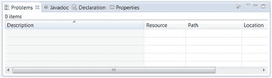

下方提供的图片显示了排列在两个视图文件夹中的相同四个视图。

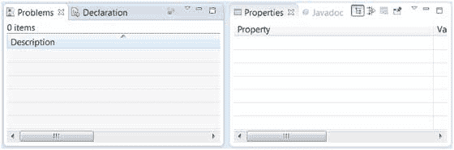

## 移动视图

要将视图从一个视图文件夹移动到另一个，只需点击视图标题并将其拖动到另一个视图文件夹的标题栏区域。下方显示的绿线是将 `Properties` 视图的标题栏从一个视图文件夹拖到另一个视图文件夹的标题栏区域的结果。通过释放鼠标按钮并发送丢落事件，可以将 `Properties` 视图移动到绿线所在的位置。

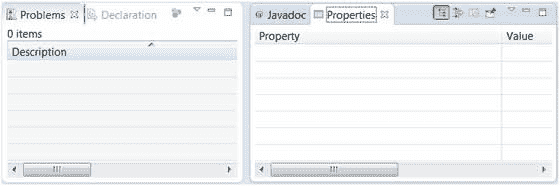

## 创建视图文件夹

可以通过将视图的标题栏拖到编辑器区域以外的任何地方或其他视图文件夹的标题栏来动态创建视图文件夹。当你拖动标题栏时，绿线将指示新视图文件夹将创建的确切位置。

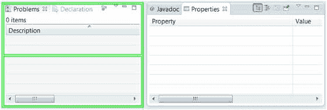

将拖动图标移动到窗口底部可以创建一个跨越整个窗口宽度的视图文件夹。将拖动图标移动到窗口的左边缘或右边缘可以创建一个跨越整个窗口高度的视图文件夹。

## 打开视图

要打开视图，点击 `Window` 菜单并选择 `Show View`（显示视图）菜单项。

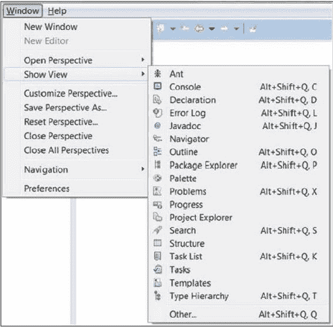

点击 `Other` 菜单项会调出 `Show View` 对话框，允许你定位并激活视图。

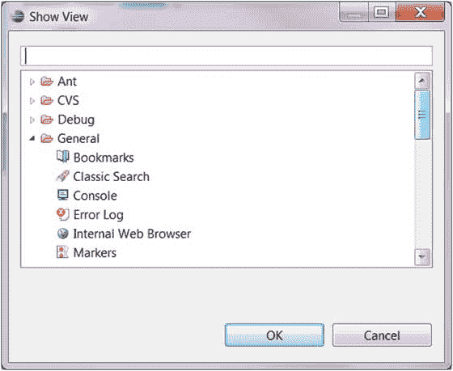

视图按类别组织。要快速定位视图，只需在过滤器文本框中输入视图名称。要打开视图，请选择它并点击 `OK` 按钮。本教程的后续页面将向你介绍许多实用的视图。

# 视角 (Perspectives)

## 什么是视角？

Eclipse 视角（perspective）是对视图和编辑器区域初始集合和排列的命名。默认视角称为 `java`。一个 Eclipse 窗口可以打开多个视角，但在任何时刻只有一个视角是激活状态。用户可以在已打开的视角之间切换，或者打开一个新的视角。激活的视角控制某些菜单和工具栏中显示的内容。

## 打开视角

要打开新视角，点击 `Windows` 菜单并选择 `Open Perspective`（打开视角）→ `Other`。

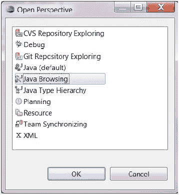

`Open Perspective` 对话框显示所有可用的视角。也可以点击工具栏上的 `Open Perspective` 按钮（）来调出相同的对话框。

## 切换视角

Java 开发中最常用的视角是 `Java` 视角和 `Debug` 视角。用户可以通过点击工具栏上的 `Perspective` 名称在已打开的视角之间切换。

## 关闭视角

要关闭视角，右键点击工具栏上的视角名称并选择 `Close`（关闭）菜单项。

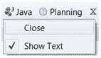

## 自定义视角

可以使用 `customize perspective`（自定义视角）对话框来自定义视角。自定义视角意味着：

- 确定在视角激活时在工具栏上可见的图标。
- 确定在视角激活时可见的菜单项。
- 确定 `New` 子菜单、`Show View` 子菜单和 `Open Perspective` 子菜单中的菜单项。

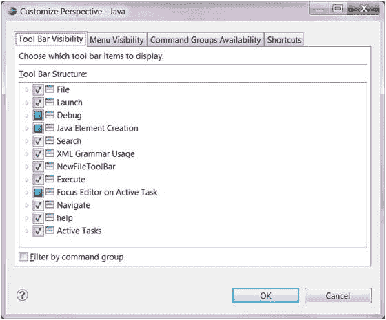

`customize perspective` 的选项卡描述如下：

- `Tool Bar Visibility` 选项卡用于在视角激活时在工具栏上显示哪些图标。
- `Menu Visibility` 选项卡用于在视角激活时显示哪些菜单项。
- `Command Groups Availability` 选项卡用于控制工具图标和菜单项的可见性。
- `Shortcuts` 选项卡用于确定 `New` 子菜单、`Show View` 子菜单和 `Open Perspective` 子菜单中的项。

根据下方图片的 `Shortcuts` 选择，要调出 `New Project from Ant File` 对话框，用户必须调出 `New` 菜单，点击 `Other`，展开 `Java` 类别然后选择 `Java Project from Ant File`。另一方面，要启动 `New Class` 对话框，他们可以调出 `New` 菜单并选择 `Class` 项（如下所示）。通过勾选 `Java Project from Ant File` 复选框，该项也会出现在 `New` 菜单下。

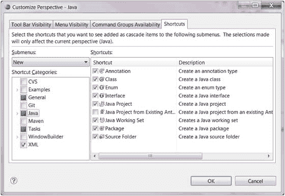

# 工作空间 (Workspaces)

## 关于工作空间

Eclipse 工作空间包含以下资源：

- 项目
- 文件
- 文件夹

工作空间具有分级结构。项目位于顶层，内部包含文件和文件夹。插件使用 `resources` 插件提供的 API 来管理工作空间中的资源。

## 管理工作空间的 UI 元素

用户使用视图、编辑器和向导提供的功能在工作空间中创建和管理资源。显示工作内容的视图之一是 `Project Explorer` 视图。

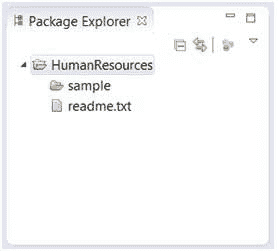

`File` 向导（`File` → `New` → `File`）用于创建新文件。

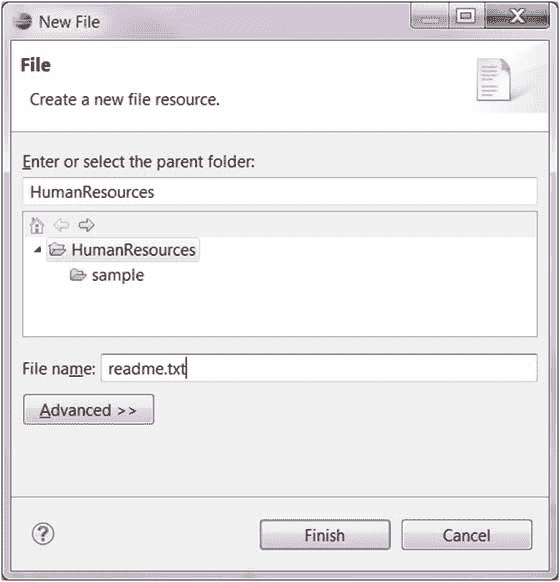

`Folder` 向导（`File` → `New` → `Folder`）用于创建新文件夹。

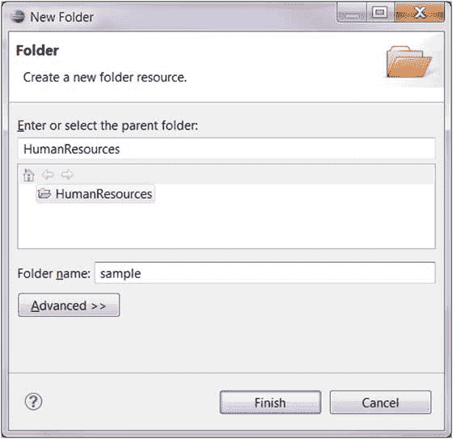

# 创建 Java 项目

## 打开 New Java Project 向导

`New Java Project` 向导可用于创建新的 Java 项目。有许多方法可以打开此向导：

- 点击 `File` 菜单并选择 `New` → `Java Project`。
- 在 `Project Explorer` 任意位置右键点击并选择 `New` → `Java Project`。
- 点击工具栏上的 `New` 按钮（）并选择 `Java Project`。

## 使用新建 Java 项目向导

新建 Java 项目向导有两个页面。在第一页上：

- 输入项目名称
- 选择 Java 运行时环境 (`JRE`) 或保持默认值
- 选择项目布局，这决定了是否会为源代码和类文件创建独立的文件夹。推荐的选项是为源码和类文件创建单独文件夹。

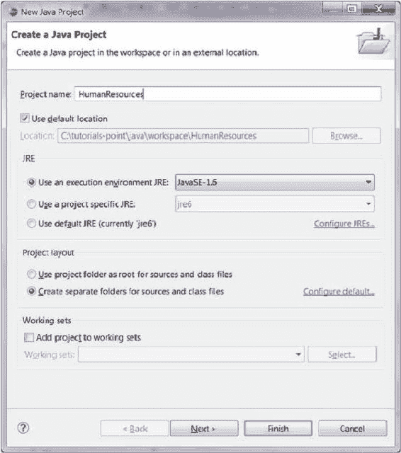

你可以点击 `Finish`（完成）按钮来创建项目，或点击 `Next`（下一步）按钮更改 Java 构建设置。

在第二页中，你可以更改 `Java Build Settings`，例如设置项目依赖（如果存在多个项目）以及向构建路径添加额外的 jar 文件。

## 查看新创建的项目

包管理器（package explorer）显示了新创建的 Java 项目。代表项目的图标带有一个 `J` 装饰，以显示它是一个 Java 项目。文件夹图标带有一个装饰，以显示它是一个 Java 源码文件夹。

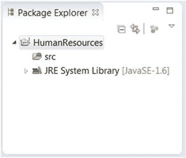

# 创建 Java 包

## 打开新建 Java 包向导

你可以使用新建 Java 包向导来创建 Java 包。Java 包向导可以通过不同的方式打开：

- 点击 `File`（文件）菜单并选择 `New`（新建）→ `Package`（包）。
- 在包管理器中右键点击并选择 `New` → `Package`。
- 点击工具栏上的包图标（）。

如果你正在创建子包，在打开 Java 包向导之前请选择父包，这样名称字段就可以有一个默认值。

## 使用新建 Java 包向导

一旦 Java 包向导出现：

- 输入/确认源文件夹名称。
- 输入包名。
- 点击 `Finish`（完成）按钮。

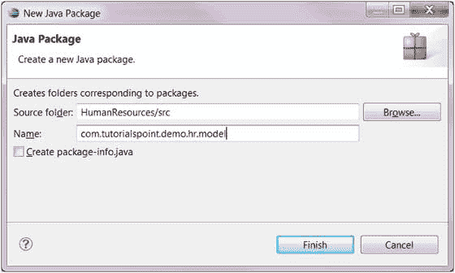

## 查看新创建的包

包管理器将在源文件夹下显示新创建的包。

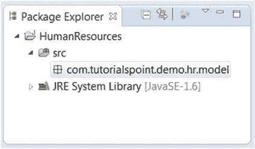

# 创建 Java 类

## 打开新建 Java 类向导

你可以使用新建 Java 类向导来创建 Java 类。Java 类向导可以通过不同的方式调用：

- 点击 `File`（文件）菜单并选择 `New` → `Class`（类）。
- 在包管理器中右键点击并选择 `New` → `Class`。
- 点击类下拉按钮（）并选择 class（）。

在调出新建 Java 类向导之前，如果可能，请选择要创建该类的包，这样向导就可以自动为你填写包名。

## 使用新建 Java 类向导

一旦 java 类向导出现：

- 确保源文件夹和包是正确的。
- 输入类名。
- 选择合适的类修饰符。
- 输入超类名或点击 `Browse`（浏览）按钮搜索已有的类。
- 点击 `Add`（添加）按钮选择此类实现的接口。
- 检查并修改与方法存根（method stubs）和注释相关的复选框。

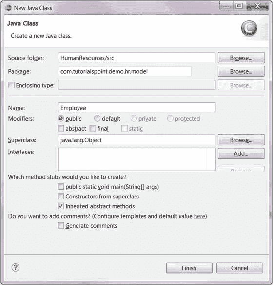

- 点击 `Finish`（完成）按钮。

## 查看新创建的 Java 类

新创建的类应该出现在包管理器视图中，并且一个允许你修改新类的 Java 编辑器实例。它应该出现在编辑器区域。

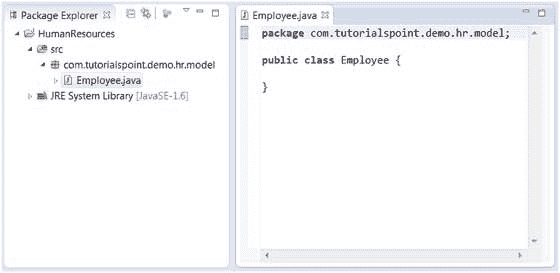

# 创建 Java 接口

## 打开新建 Java 接口向导

新建 Java 接口向导可创建新的 java 接口。有许多方法打开此向导：

- 点击 `File`（文件）菜单并选择 `New` → `Interface`（接口）。
- 在包管理器中右键点击并选择 `New` > `Interface`。
- 点击工具栏上的类下拉按钮（）并选择 Interface（）。

在调出新建 Java 接口向导之前，如果可能，请选择要创建接口的包，这样向导就可以自动为你填写包名。

## 使用新建 Java 接口向导

一旦 java 接口向导出现：

- 确保源文件夹和包是正确的。
- 输入接口名称。
- 点击 `Add`（添加）按钮选择扩展的接口。
- 如果你想生成注释，请勾选 `Generate comments`（生成注释）复选框。
- 点击 `Finish`（完成）按钮。

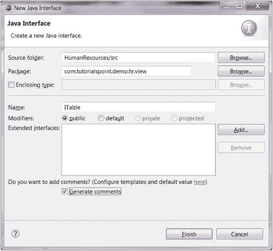

## 查看新创建的 Java 接口

新创建的接口应该出现在包管理器视图中，一个允许你修改新接口的 Java 编辑器实例应该出现在编辑器区域。

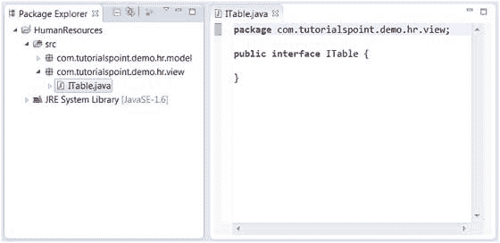

# 创建 XML 文件

## 打开新建 XML 文件向导

你可以使用新建 XML 文件向导来创建 XML 文件。要调用此向导：

- 点击 `File`（文件）菜单并选择 `New` → `Other`（其他）或
- 点击新的下拉框（）选择 other（其他）或
- 按下 `ctrl` + `N`

一旦“选择向导（Select a wizard）”对话框出现：

- 在过滤文本框中输入 `xml`，这将仅显示与 xml 相关的向导。
- 展开 XML 分类并选择 `XML File`。

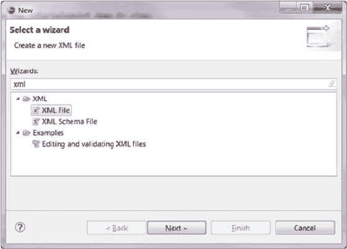

- 点击 `Next`（下一步）调出 XML 向导。

## 注意

如果打开了 XML 视图，可以通过以下方式调用 XML 向导：

- 点击 `File`（文件）菜单并选择 `New` → `XML File`。
- 点击工具栏上的 `XML File` 按钮（）

## 使用 XML 向导

一旦 XML 向导出现：

- 输入或选择父文件夹。
- 输入文件名。

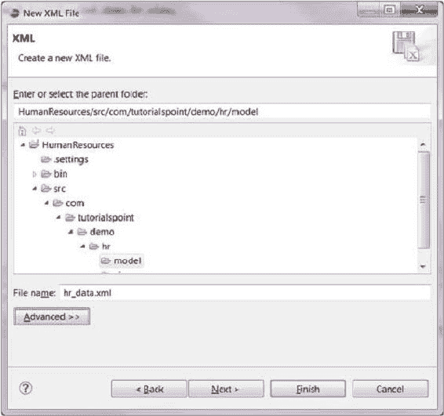

- 点击 `Next` 基于 DTD xml 文件，否则点击 `Finish`（完成）。

## 查看新创建的 XML 文件

新创建的 XML 文件应该出现在包管理器中，一个允许你修改新文件的 java 编辑实例应该出现在编辑器区域。

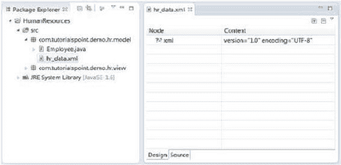

XML 编辑器允许使用设计（Design）视图或源（Source）视图编辑 XML 文件。

# Java 构建路径

## 设置 Java 构建路径

Java 构建路径用于编译 Java 项目时发现依赖。它由以下项目组成：

* 源文件夹中的代码。
* 与项目相关的 jar 和类文件夹。
* 此项目引用的项目出的类。

可以通过 Java 项目属性对话框的 Java Build Path 页面查看并修改 Java 构建路径。要调出 Java 项目属性对话框，在包管理器视图中右键点击 Java 项目并选择 `Properties`（属性）菜单项。在左侧树中选择 `Java Build Path`。

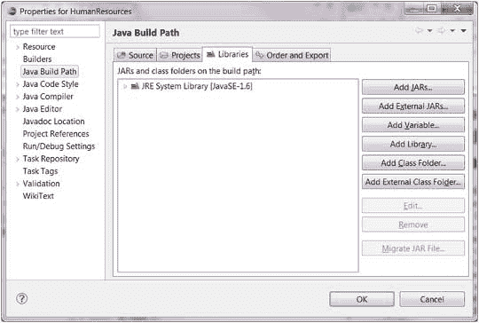

开发 java 应用时常见的需求是将现有的 jar 添加到 Java 构建路径。可以通过 Libraries 标签页来实现。在 Libraries 标签页，如果 jar 已在 Eclipse 工作区中，点击 `Add JARs`；如果 jar 在文件系统的其他地方，点击 `Add External JARs`。

# 运行配置

## 创建和使用运行配置

Run Configurations 对话框允许创建多个运行配置。每个运行配置都可以启动应用程序。可以通过选择 Run 菜单中的 Run Configurations 菜单项来调用 Run Configurations 对话框。

要为 Java 应用创建运行配置，请从左侧列表中选择 `Java Application` 并点击 `New`（新建）按钮。在弹出对话框的主页中指定：

* 运行配置名称。
* 项目名称。
* 主类名称。

在 arguments 标签页指定：

* 零或多个程序参数。
* 零或多个虚拟机参数。

Common（公共）选项卡提供了常用选项，例如为标准输入和输出分配控制台。

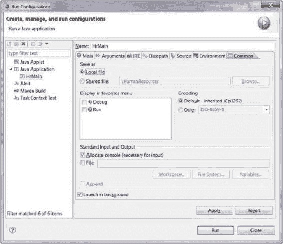

要保存运行配置，点击 Apply（应用）按钮；启动应用程序，点击 Run（运行）按钮。

# 运行程序

## 运行 Java 程序

运行 Java 程序最快的方法是使用包管理器（Package Explorer）视图。

在包管理器视图中：

* 右键点击包含 main 方法的类。
* 选择 `Run As`（运行方式）→ `Java Application`（Java 程序）。

也可以通过包管理器视图选择包含 main 方法的并点击 `Alt + Shift + X, J` 执行相同的操作。

上述操作都会创建一个新的 `Run Configuration`（运行配置）并使用它启动 Java 应用程序。

如果已经创建了 `Run` 配置，可以通过从 `Run`（运行）菜单选择 `Run Configurations`（运行配置），点击运行配置名称，然后点击 `Run`（运行）按钮来启动 Java 应用程序。

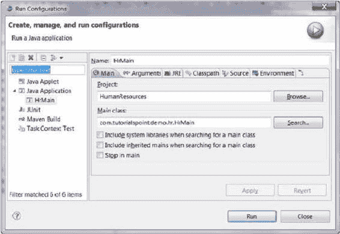

`Run` 菜单上的 `Run` 项目可以重启之前启动的 Java 应用程序。

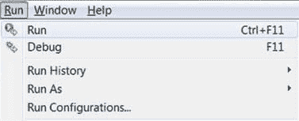

启动之前运行过的 Java 程序的快捷键是 `Ctrl + F11`。

# 创建 Jar 文件

## 打开 Jar 文件向导

可以使用 Jar 文件向导将项目内容导出为 jar 文件。要打开 Jar 文件向导：

* 在包管理器中选择你想要导出的项目。如果你想导出项目中的所有类和资源，只需选择该项目。
* 点击 `File`（文件）菜单并选择 `Export`（导出）。
* 在导出向导第一页的过滤器文本框中输入 `JAR`。

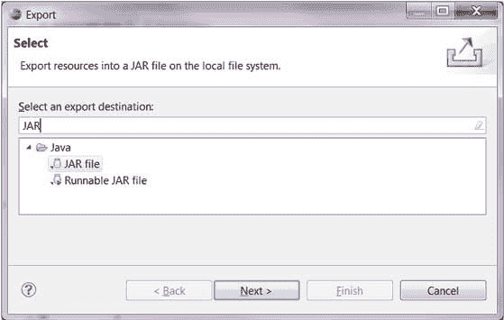

* 在 Java 类别下选择 `JAR` file。
* 点击 `Next`（下一步）。

## 使用 Jar 文件向导

在 Jar File 规范页面：

* 输入 JAR 文件名和文件夹。
* 默认只导出类。要同时导出源代码，点击 `Export Java source files and resources`（导出 Java 源代码和资源）复选框。

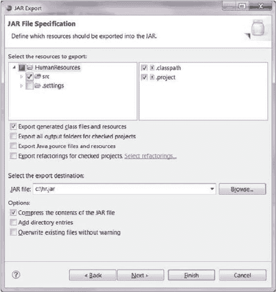

* 点击 `Next`（下一步）更改 JAR 打包选项。
* 点击 `Next`（下一步）更改 JAR Manifest 规范。
* 点击 `Finish`（完成）。

# 关闭项目

## 为什么要关闭项目？

一个 eclipse 工作空间（workspace）可以包含任意数量的项目。项目可以是打开状态或关闭状态。

打开的项目：

* 消耗内存。
* 占用构建时间，特别是当使用 `Clean All Projects`（`Project → Clean all projects`）并带有 `Start a build immediately`（立即启动构建）选项时。

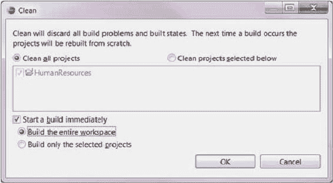

## 如何关闭项目？

如果项目未处于开发状态，可以将其关闭。要关闭项目，从 `Project`（项目）选择 `Close Project`（关闭项目）菜单项。

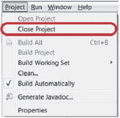

## 包管理器中的关闭项目

关闭的项目在包管理器视图中可见，但无法使用 Eclipse 用户界面编辑其内容。此外，打开的项目不能依赖于关闭的项目。包管理器视图使用不同的图标来表示关闭的项目。

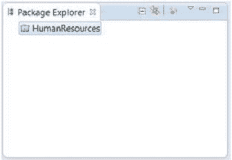

# 重新打开项目

## 重新打开关闭的项目

要重新打开关闭的项目，在包管理器视图中选择该项目，点击 `Project`（项目）菜单并选择 `Open Project`（打开项目）。

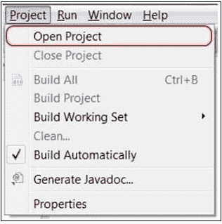

项目打开后，可以使用 Eclipse 用户界面编辑其内容。

# 构建项目

## 构建 Java 项目

项目可以关联零或多个构建器（builders）。Java 项目与一个 java builder 关联。要查看与项目关联的构建器：

* 在包管理器视图中右键点击项目并选择 `Properties`（属性）。
* 在左侧树中点击 `Builders`（构建器）。

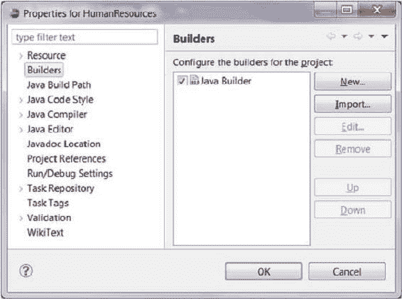

正是 java builder 区分了 Java 项目与其他类型的项目。通过点击 `New`（新建）按钮，你可以将 `Ant` 构建器与 java 项目关联。java builder 负责编译 java 源代码并生成类。

java builder 会被工作空间资源的变化的变化并自动编译 java 代码。要禁用自动编译，从 `Project`（项目）菜单中取消勾选 `Build Automatically`（自动构建）选项。

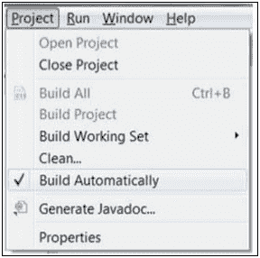

如果禁用了自动编译，你可以通过选择 `Project` 菜单上的 `Build Project`（构建项目）菜单项来显式构建项目。如果选择了 `Build Automatically` 菜单项，则 `Build Project` 菜单项将被禁用。

# 调试配置

## 创建和使用调试配置

eclipse 调试配置类似于运行配置，但它用于以调试模式启动应用程序。由于程序是以调试模式启动的，用户会被提示切换到调试视图（debug perspective）。调试视图提供了许多适用于调试应用程序的视图。

可以通过从 `Run`（运行）菜单选择 `Debug Configurations`（调试配置）菜单项调用调试配置对话框。

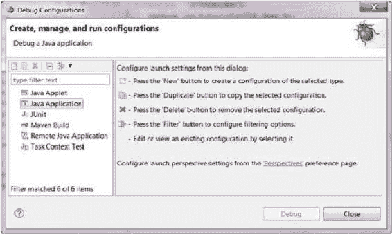

要为 Java 应用程序创建调试配置，从左侧列表选择 `Java Application` 并点击 `New` 按钮。在弹出的主标签页对话框中指定：

* 调试配置名称。
* `Project`（项目）名称。
* 类名称。

在 arguments（参数）标签页中指定：

* 多个程序参数。
* 多个虚拟机参数。

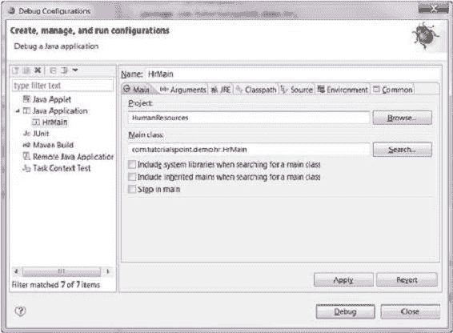

要保存配置，点击 Apply（应用）按钮；以调试模式启动，点击 Debug 按钮。

# 调试程序

## 调试 Java 程序

调试 Java 程序最快的方法是通过包管理器视图。在包管理器视图中：

* 右键点击包含 main 方法的类。
* 选择 `Debug As`（调试方式）→ `Java Application`（Java 程序）。

也可以通过包管理器视图选择包含 main 方法的并点击 `Alt + Shift + X, J` 执行相同的操作。

上述操作都会创建一个新的 `Debug Configuration`（调试配置）并使用它启动 Java 应用程序。

如果已经创建了 `Debug` 配置，可以通过从 `Run` 菜单选择 `Debug Configurations`，点击调试配置名称，然后点击 `Debug` 按钮来启动 Java 应用程序。

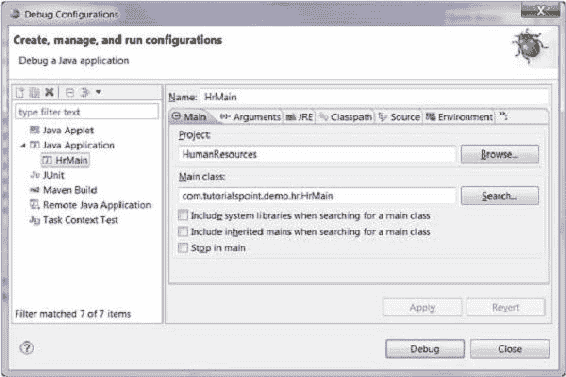

`Run` 菜单上的 `Debug` 项目可以重启之前以调试模式启动的 Java 应用程序。

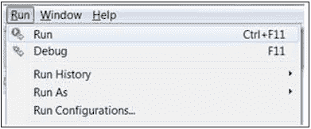

启动之前运行过的 Java 程序的调试模式启动快捷键是 `F11`。当 java 程序以调试模式启动时，用户会被提示切换到调试视图（debug perspective）。调试视图提供了许多用于排错应用程序的视图。

java 编辑器允许用户在 java 代码中放置断点。要设置断点，在编辑器区域右键点击标记栏并选择 `Toggle Breakpoint`（切换断点）。

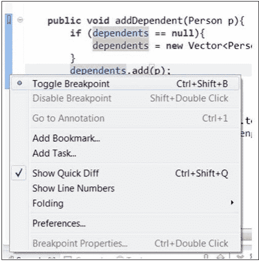

断点显示在标记栏上。在 `Breakpoints`（断点）视图中也可见。

当代码执行到达断点时，JVM 会挂程序执行。此时，你可以检查内存并按控制执行程序。

当程序执行暂停时，可以使用 `debug`（调试）视图检查调用堆栈。

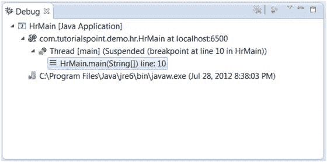

`variables`（变量）视图可以检查变量的值。

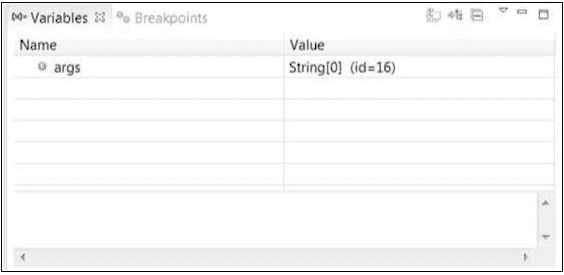

`run` 菜单拥有菜单项，允许你恢复执行、跳过行代码、进入函数等。

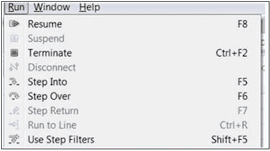

给出的图片显示了与 Resume（恢复）、Step Into（进入）和 Step Over（跳过）等操作相关的快捷键。

# 偏好

## 设置偏好

偏好对话框允许 Eclipse 用户管理其偏好。此对话框由框架管理，但任何插件都可以向对话框添加多个页面。

要调用此对话框，请点击 `Window`（窗口）菜单并选择 `Preferences`（偏好）菜单项。

偏好页面按类别组织。您可以通过展开对话框左侧树形结构的节点来定位偏好页面。

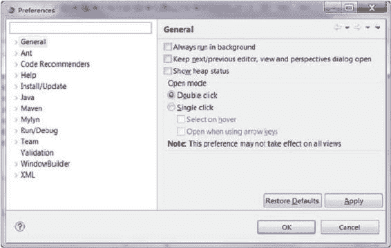

左上角的过滤文本框允许您快速定位偏好页面。当您在过滤文本框中输入字符时，左侧树形中显示的项将经过过滤。例如，输入 `font` 即可快速找到 `Font`（字体）偏好页面。

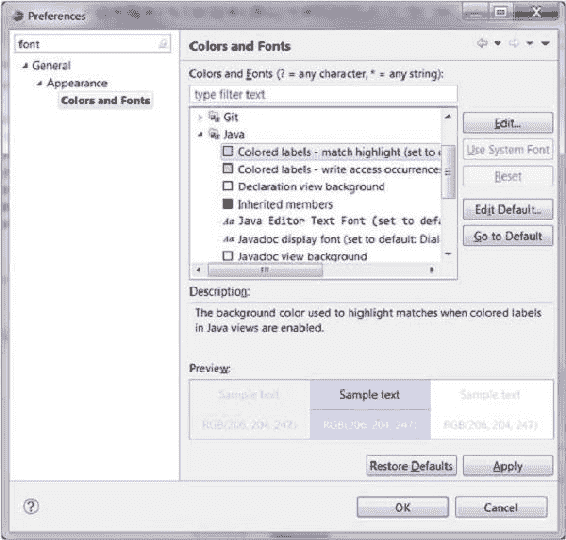

在对相应的偏好进行更改后，点击 `OK` 按钮保存更改并关闭对话框，或点击 `Cancel`（取消）按钮丢弃更改并关闭对话框。

# 内容辅助

## 使用内容辅助

在编辑器中，内容辅助通过通过为已输入的字符提供上下文敏感的可能补全列表，来帮助减少输入的字符。可以通过点击 `Ctrl` + `Space` 来调用内容辅助。

如果您正在 Java 编辑器中编辑方法体，并在新行上按 `Ctrl` + `Space`，它将弹出一个对话框显示：

* 类变量
* 类方法
* 父类方法
* 其他相关类

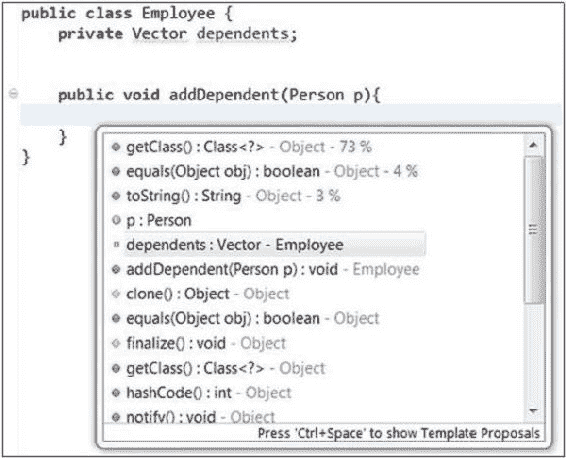

要从列表中选择项，只需使用上或下方向键高亮该项并按回车键。

如果您输入一些字符然后按 `Ctrl` + `space`，对话框将仅显示以输入的字符开头的项。

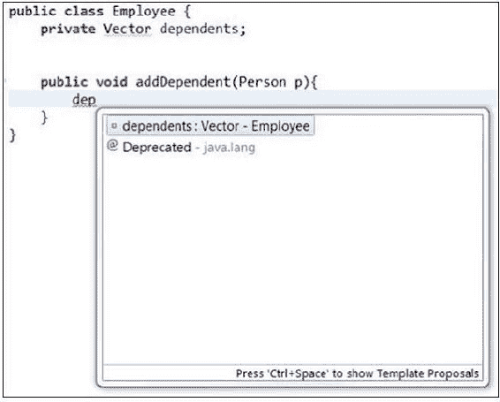

# 快速修复

## 使用快速修复

当您在 Eclipse 编辑器中输入字符时，它会分析文档内容以检测潜在的错误和警告。Java 编辑器使用 Java 语法检测代码中的错误。当它发现错误或警告时，它：

* 使用红色波浪线突出显示错误。
* 使用黄色波浪线突出显示警告。
* 在 Problem（问题）视图中显示错误和警告。
* 在垂直标尺上添加带有警告符号或错误符号的灯泡。

快速修复对话框提供了可能的更正列表。可以通过以下方式调用快速修复对话框：

* 将鼠标指针置在波浪线线上。
* 点击灯泡。
* 将光标置于高亮文本中，从 Edit（编辑）菜单中选择 Quick fix（快速修复）或点击快捷键 `Ctrl` + `1`。

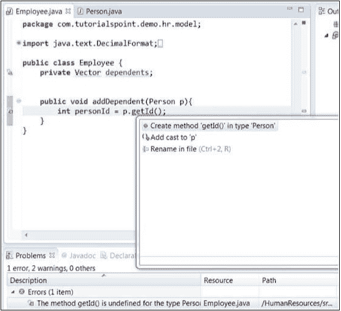

在上面的图中，`getId` 被高亮是因为 `Person` 类没有名为 `getId()` 的方法。选择 `Create method 'getId()' in type 'Person'` 将导致 `getId()` 方法添加到 `Person` 类中。

快速修复对话框也可以通过右键点击 Problems 视图中的错误项并选择 `Quick Fix`（快速修复）菜单项来显示。

# 悬停帮助

## 使用悬停帮助

Java 编辑器与不同类型的悬停相关。悬停提供了有关鼠标指针下元素的额外信息。所有与 Java 编辑器相关的悬停都可以在 Java editor Hovers 偏好页面中查看。

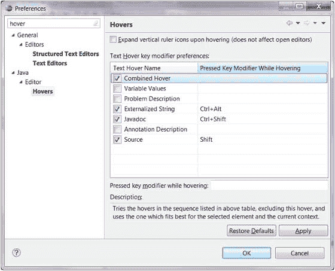

在 Java 编辑器中，将鼠标指针悬停在导入的类上会显示与该类相关的 JavaDoc。

将鼠标指针停在方法上会显示该方法的 Java 文档。

# 搜索菜单

## 搜索工作空间

Eclipse 搜索对话框允许您在整个工作空间、一组项目、特定项目或包资源管理器视图中选择的文件夹中，搜索包含字面量或字符模式的文件。

可以通过以下方式调用搜索对话框：

* 点击 `Search`（搜索）菜单并选择 `Search` 或 `File`（文件）或 `Java`。
* 点击 `Ctrl` + `H`。

File Search（文件搜索）页面允许您搜索任何类型的文件，但 Java Search（Java 搜索）页面仅专注于 Java 文件。

例如，在 Java Search 页面中搜索 `Person` 类型的使用情况：

* 在 `search box`（搜索框）中输入 `Person`。
* 将 `Search For` 按钮设置为 `Type`（类型）。
* 将 `Limit To` 按钮设置为 `References`（引用）。
* 点击 `Search`（搜索）。

搜索结果出现在 Search 视图中。

# 导航

## 导航 Eclipse 工作空间

导航菜单提供了许多菜单项，允许您快速定位并导航到资源。

其中，`Open Type`（打开类型）、`Open Type in Hierarchy`（在层次结构中打开类型）和 `Open Resource`（打开资源）菜单项非常有用。

## Open Type

Open Type 菜单项弹出一个对话框，允许您定位 Java 类型。在过滤文本框中输入类的全限定名或名称。可以使用 `*`（代表 0 或多个字符）和 `?`（代表单个字符）来指定模式。对话框将显示所有匹配给定模式的名称。

选择您感兴趣的类型并点击 `OK`。

Eclipse 将打开编辑器显示所选类型。如果类型没有源代码，它将使用 Class File 显示字节码。

您可以使用 Attach Source 按钮指定源代码的位置。

随发行提供的源代码位于 java 目录下的 `src.zip`。

## Open Type in Hierarchy

Open Type in Hierarchy 菜单项允许在层次视图中打开类型。Open Type in Hierarchy 对话框用于定位构建路径中的任何类型。

一旦选择了类型，其层次结构将在 Hierarchy 视图中显示。

Type Hierarchy 是学习类型的极佳视图。在左侧面板中可以看到父类型和子类型。在右侧面板中可以看到可选类型的属性和方法。

## Open Resource

Open Resource 菜单项用于定位工作空间中的文件。可以使用 `*`（代表 0 或多个字符）和 `?`（代表单个字符）来指定模式。对话框将显示所有匹配给定模式的名称。

选择您要在编辑器中打开的文件并点击 OK 按钮。

# 重构

## 使用 Eclipse 进行重构

重命名在项目中广泛使用的类可能花费大量时间，但 Eclipse 重构向导通过自动检测对重命名类的所有依赖并进行修改，使工作变得更加简单。

可以通过以下方式打开重构菜单：

* 在包资源管理器视图中右键点击 Java 元素并选择 Refactor（重构）菜单项。
* 在 Java 编辑器中右键点击 Java 元素并选择 Ref 构菜单项。
* 在包资源管理器或 Java 编辑器中选择 Java 元素并点击 `Shift` + `Alt` + `T`。

重构菜单显示了支持所选 Java 元素的所有更改。要重命名类，选择`Rename`（重命名）菜单项。

点击`Next`按钮查看更改预览（可用）。然后点击`Finish`让向导完成工作。

要设置书签，请右键点击要设置书签行附近的垂直标尺，并选择`添加书签 (Add Bookmark)`。在`添加书签`对话框中为书签输入一个名称。

垂直标尺上会出现书签图标。此外，书签视图（`Bookmarks view`）中的表格会增加出一行。

## 打开书签视图

要打开书签视图 −

*   点击`窗口 (Window)`菜单并选择`显示视图 → 其他 (Show View → Other)`。

*   在过滤器文本框中输入`Bookmark`。

*   在`常规 (General)`下，选择`书签 (Bookmarks)`。

*   点击`确定 (OK)`。

## 使用书签视图

书签视图显示放置在工作区资源中的书签。

使用书签视图，你可以通过双击书签或右键点击书签并选择“转到 (`Go to`)”菜单项来导航到书签。

# 任务管理

## 管理任务

程序员喜欢在代码中放置`TODO`标记，作为对需要完成的任务的提醒。Java 代码中包含`TODO`单词的注释会被识别为任务，并显示在标记栏和任务（`Tasks`）视图中。

可以通过右键点击标记栏并选择`添加任务 (Add Task)`，使用 Eclipse 编辑器将任务与正在编辑的文件关联。在弹出的对话框中，输入任务描述，从优先级下拉列表中选择一个优先级，然后点击`确定 (OK)`按钮。

要使用 Eclipse 编辑器删除任务，请右键点击标记栏中的任务图标，并选择`删除任务 (Remove Task)`菜单项。

## 打开任务视图

要打开任务视图 −

*   点击`窗口 (Window)`菜单并选择`显示视图 → 其他 (Show View → Other)`。

*   在过滤器文本框中输入`Tasks`。

*   在`常规 (General)`下，选择`任务 (Tasks)`。

*   点击`确定 (OK)`。

## 使用任务视图

任务视图可查看所有任务，并添加未与任何资源的任务。

它还可以用于 −

*   更改与任务关联的优先级。

*   将任务标记为已完成。

*   删除某个任务或所有已完成的任务。

# 安装插件

## 查找并安装插件

为 Eclipse IDE 提供基础的 Eclipse 平台由插件组成，并设计为可以使用附加插件进行扩展。

有数百个插件可用。每个插件都为 Eclipse 增加了更多功能。你可以通过搜索 Eclipse 市场（`http://marketplace.eclipse.org/`）来查找提供特定功能的插件。例如，你可以找到允许 Eclipse 作为 Python IDE 使用的插件。

在 Eclipse IDE 内部，你可以使用`Eclipse 市场 (Eclipse Marketplace)`对话框搜索市场，该对话框可以通过点击`帮助 (Help)`菜单并选择`Eclipse Marketplace`来调用。

在上面的截图中，要安装`PyDev-Python IDE for Eclipse`，只需点击`安装 (Install)`按钮。使用弹出的对话框即可安装插件。

你也可以通过从`帮助 (Help)`菜单访问的`安装新软件 (Install New Software)`菜单项（`帮助 → 安装新软件`）来安装插件。

在这种情况下，你必须知道可以下载插件的远程站点 URL。你可以点击`添加 (Add)`按钮来提供此 URL。

`安装 (install)`对话框显示远程站点可用的插件组件，并允许你安装它们。

# 代码模板

## 使用代码模板

代码模板通过向编辑器中插入代码来减少打字时间。每个代码模板都给出了短的字面量。在编辑器窗口中输入该字面量并按`Ctrl + Space`就会弹出一个对话框，从中可以选择与该字面量相关的代码模板。

在 Java 编辑器窗口的方法体内输入`for`并点击`Ctrl + space`，会显示与`for`相关的代码模板。

选择`for - iterate over array`会插入遍历方法体中早早声明的`depArray`代码。

另一个实用的代码模板字面量是`sysout`，它可以插入`System.out.println()`方法调用。

## 修改/添加代码模板

你可以使用`偏好 (Preferences)`对话框添加新的代码模板。通过点击`窗口 (Windows)`菜单并选择`偏好 (Preferences)`菜单项来打开`偏好`对话框。要找到`模板 (Templates)`页面，在过滤器文本框中输入`Templates`。

你可以通过阅读 Eclipse 帮助来了解更多关于用于自定义插入代码的变量。要打开帮助窗口，点击`帮助 (Help)`菜单并选择`帮助 (Help)`。

## 快捷键

你可以仅使用键盘导航 Eclipse 用户界面 −

*   使用菜单项的助记符。

*   使用对话框或视图控件的助记符。

*   使用工具栏操作的加速。

通过`Ctrl + Shift + L`调用`快捷键辅助 (Key Assist)`操作可以显示所有可用快捷键。

操作的组合键可以使用`按键 (Keys)`偏好页面进行更改。许多命令或操作都有快捷键。此偏好页面允许。

例如，要将`Alt + C`指定为触发`新建类 (New Class)`对话框的快捷键，在命令列表中选择`New Class`，导航到`绑定 (Bindings)`文本框，然后从`when`下拉列表中选择上下文。确保所选按键没有冲突并点击`确定 (OK)`按钮。

现在你可以按`Alt + C`打开`新建类 (New Class)`向导。

# 重启选项

## 重启 Eclipse

重启选项允许用户重启 Eclipse。要重启 Eclipse，点击`文件 (File)`菜单并选择`重启 (Restart)`菜单项。

在安装插件后，用户将会被提示重启 Eclipse。如果他们选择现在不重启，以后可以使用重启选项重启 Eclipse。如果 Eclipse 用户界面运行异常，用户可能希望使用此选项重启 Eclipse。

# 技巧与心得

技巧 #1 发现快捷键

*   按`Ctrl + Shift + L`打开显示所有可用快捷键的小部件。

技巧 #2 – 内容辅助

*   在 Java 编辑器中按`Ctrl + Space`查看建议的完成内容。点击`Ctrl + Space`之前输入一个或多个字符将缩小列表。

技巧 #3 – 参数提示

*   当光标在方法参数中时，按`Ctrl + Shift + Space`查看参数提示列表。

技巧 #4 – 代码完成支持驼峰命名

*   代码完成支持驼峰模式。输入`NPE`并点击`Ctrl + Space`将建议`NullPointerException`和`NoPermissionException`。

技巧 #5 创建 Getter 和 Setter

*   点击`源 → 生成 Getter 和 Setter`打开允许你生成 getter 和 setter 方法的向导。

技巧 #6 生成 hashCode() 和 equals() 方法

*   点击`源 → 生成 hashCode() 和 equals()`为 Java 类生成这些方法。

# 提示 #7 − 为代码块添加代码

* 选择一段代码并按`Alt+Shift+Z`即可显示菜单，其中包含`if statement`、`for loop`、`try/catch`等选项，可用于包裹所选的代码块。

# 提示 #8 − 定位匹配括号

* 选择一个左括号或右括号并按`Ctrl+Shift+P`查找与之匹配的括号。

# 提示 #9 − 智能 Javadoc

* 输入`/**`并按`Enter`自动添加 Javadoc 注释模板。

# 提示 #10 − 组织导入

* 按`Ctrl+Shift+O`整理所有导入项。

# 提示 #11 − 激活菜单栏

* 按`F10`激活菜单栏。

# 提示 #12 − 使视图/编辑器激活

* 按`Ctrl+F7`查看打开的视图和编辑器区域列表，并切换到其中一个。

# Web 浏览器

## 内部浏览器

内部浏览器视图允许你直接直接在 Eclipse Workbench 窗口内浏览互联网。要激活内部浏览器视图，请点击`Window`并选择`Show View → Other`。

在`Show View`对话框的过滤器文本框中输入`browser`。从树中选择`Internal Web Browser`并点击`OK`。

要跳转到网页，在内部浏览器视图的 URL 文本框中输入该网页的 URL。

