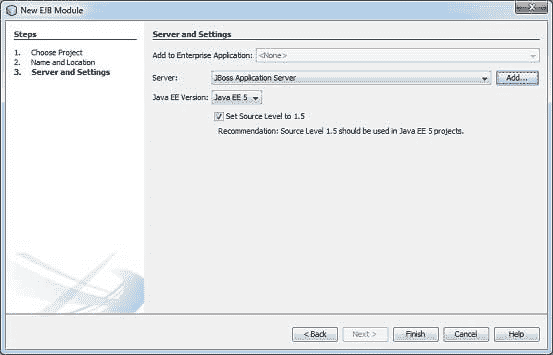
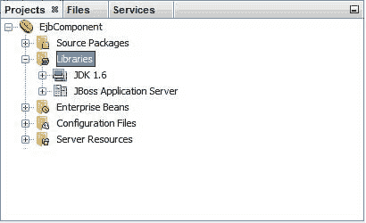
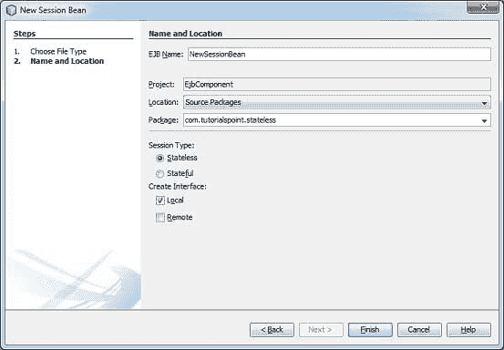
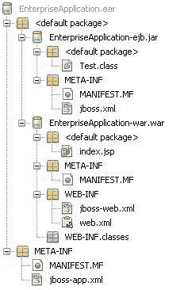
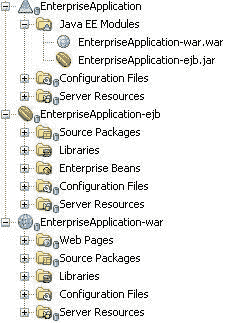

# Enterprise Java Beans 入门指南 [Java 技术]


版权 © 版权所有

未经出版者明确书面许可，本书的任何部分不得复制、存储在检索系统中，或以任何形式或手段（电子、机械、复印、录音或其他）进行传输。

我想将此本书献给将使用它的学生们。祝愿你们未来职业成功，并希望你们永不停上学习。

# 目录

- 概述
- 环境配置
- 创建应用
- 无状态 Bean
- 有状态 Bean
- 持久化
- 消息驱动 Bean
- 注解
- 回调函数
- 定时器服务
- 依赖注入
- 拦截器
- 嵌入对象
- 大二进制对象/大字符对象
- 事务
- 安全
- JNDI 绑定
- 实体关系
- 访问数据库
- 查询语言
- 异常处理
- Web 服务
- 应用打包

# 概述

EJB 代表 **Enterprise Java Beans**（企业级 Java Bean）。EJB 是 J2EE 平台不可或缺的一部分。J2EE 平台具有基于组件的架构，用于为企业级应用提供多层、分布式和高事务的特性。

EJB 提供了一种架构，用于开发和部署考虑了健壮性、高扩展性和高性能的基于组件的企业级应用。EJB 应用可以部署在任何符合 J2EE 1.3 标准规范的应用程序服务器上。

我们将在本教程中详细讨论 EJB 3.0。

## 类型

EJB 主要分为三类；下表列出了它们的名称及简要描述：

| 序号 | 类型与描述 |
| :--- | :--- |
| 1 | 会话 Bean (Session Bean)。会话 Bean 为单个会话存储特定用户的数据。它可以是 `stateful`（有状态）或 `stateless`（无状态）。与实体 Bean 相比，它的资源消耗较低。会话 Bean 在用户会话结束时立即销毁。 |
| 2 | 实体 Bean (Entity Bean)。**实体 Bean** 代表持久数据存储。用户数据可以通过实体 Bean 保存到数据库，稍后可以通过实体 Bean 从数据库中检索。 |
| 3 | 消息驱动 Bean (Message Driven Bean)。**消息驱动 Bean** 用于 JMS（Java 服务）上下文。消息驱动 Bean 可以从外部实体消费 JMS 消息并采取相应的行动。 |

## 优势

以下是 EJB 的重要优势：

- 简化了大型企业级应用的开发。
- 应用程序服务器/EJB 容器提供了大多数系统级服务，如事务处理、日志记录、负载均衡、持久化机制、异常处理等。开发者只需关注应用的业务逻辑。
- EJB 容器管理 EJB 实例的生命周期，因此开发者无需担心何时创建/删除 EJB 对象。

# 环境配置

EJB 是一个 Java 框架，因此首要要求是在你的机器上安装了 **Java 开发工具包** (JDK)。

## 系统要求

| 项目 | 值 |
| :--- | :--- |
| JDK | 1.5 或更高版本。 |
| 内存 | 无最低要求。 |
| 磁盘空间 | 无最低要求。 |
| 操作系统 | 无最低要求。 |

### 步骤 1 - 验证系统中的 Java 安装

现在打开控制台并执行以下 `java` 命令。

| 操作系统 | 任务 | 命令 |
| :--- | :--- | :--- |
| Windows | 打开命令控制台 | `c:\> java -version` |
| Linux | 打开命令行终端 | `$ java -version` |
| Mac | 打开终端 | `machine:~ joseph$ java -version` |

让我们验证所有操作系统的输出结果：

| 操作系统 | 输出 |
| :--- | :--- |
| Windows | `java version "1.6.0_21"` `Java(TM) SE Runtime Environment (build 1.6.0_21-b11)` `Java HotSpot(TM) 64-Bit Server VM (build 23.21-b01, mixed mode)` |
| Linux | `java version "1.6.0_21"` `Java(TM) SE Runtime Environment (build 1.6.0_21-b11)` `Java HotSpot(TM) 64-Bit Server VM (build 23.21-b01, mixed mode)` |
| Mac | `java version "1.6.0_21"` `Java(TM) SE Runtime Environment (build 1.6.0_21-b11)` `Java HotSpot(TM) 64-Bit Server VM (build 23.21-b01, mixed mode)` |

如果尚未安装 Java，请从 **oracle.com** 安装 Java。

### 步骤 2 - 设置 Java 环境

将 `JAVA_HOME` 环境变量指向 Java 安装的目录。

| 操作系统 | 路径 |
| :--- | :--- |
| Windows | `C:\Program Files\Java\jdk1.6.0_21` |
| Linux | `/usr/lib/jvm/jdk1.6.0_21` |
| Mac | `/Library/Java/JavaVirtualMachines/jdk1.6.0_21.jdk/Contents/Home` |

将 `JAVA_HOME` 的 `bin` 目录添加到系统的 `PATH` 变量中。

### 步骤 3 - 下载并安装 NetBeans

从 **oracle.com** 下载最新版本的 NetBeans。本教程使用的是 7.3 版本。

### 步骤 4 - 设置 JBoss 应用程序

你可以从 **jboss.org** 下载最新版本的 JBoss 服务器。将压缩包解压到机器上的任何位置。

### 步骤 5 - 为 NetBeans 配置 JEE 插件

使用 `Tools > Plugins` 打开插件窗口。打开 "Available Plugin" 标签卡，并在 "Java Web" 分类下选择 "Java EE Base" 和 "EJB and EAR"。点击安装按钮。NetBeans 将下载并安装相应的插件。使用 "Installed" 标签卡验证插件。

### 步骤 6 - 在 NetBeans 中配置 JBoss 服务器

进入 Services 标签并右键点击 servers 添加服务器。打开 Add Server Instance 向导。选择 JBoss 并在下一步输入相关信息以在 NetBeans 中配置服务器。

### 步骤 7 - 安装数据库服务器 (PostGreSql)

从 **postgresql.org** 下载最新版本的 PostGreSql 数据库服务器。

# 创建应用

创建一个简单的 EJB 模块，我们将使用 NetBeans 的 "New project" 向导。在下例示例中，我们将创建一个名为 `Component` 的 EJB 模块项目。

## 创建项目

在 NetBeans IDE 中，选择 `File > New Project >`。在类别 `Java EE` 下选择项目类型，项目类型选择 `EJB Module`。点击 `Next >`。



选择 Server 为 **JBoss Application Server**。点击 **Finish** 按钮。你将看到 NetBeans 创建了以下项目。



## 创建示例 EJB

要创建一个简单的 EJB，我们将使用 NetBeans 的“New”（新建）向导。在下例示例中，我们将在 `EjbComponent` 项目下创建一个名为 `librarySessionBean` 的无状态 EJB 类。

在项目资源管理器窗口中选择 `EjbComponent` 项目并右键点击它。选择 **New > Session Bean**。你将看到 **New Session Bean**（新建会话豆）向导。



输入会话豆名称和包名。点击 **Finish** 按钮。你将看到 NetBeans 创建了以下 EJB 类。

- `LibrarySessionBean` — 无状态会话豆
- `LibrarySessionBeanLocal` — 会话豆的本地接口

我正在将本地接口改为远程接口，因为我们将在基于控制台的应用程序中访问 EJB。远程/本地接口用于暴露 EJB 必须实现的业务方法。

`LibrarySessionBeanLocal` 被重命名为 `LibrarySessionBeanRemote`，且 `LibrarySessionBean` 实现了 `LibrarySessionBeanRemote` 接口。

### LibrarySessionBeanRemote

```java
package com.tutorialspoint.stateless;

import java.util.List;

import javax.ejb.Remote;

@Remote
public interface LibrarySessionBeanRemote {
    void addBook(String bookName);
    List getBooks();
}
```

### LibrarySessionBean

```java
package com.tutorialspoint.stateless;

import java.util.ArrayList;
import java.util.List;

import javax.ejb.Stateless;

@Stateless
public class LibrarySessionBean implements LibrarySessionBeanRemote {
    List<String> bookShelf;

    public LibrarySessionBean() {
        bookShelf = new ArrayList<String>();
    }

    public void addBook(String bookName) {
        bookShelf.add(bookName);
    }

    public List<String> getBooks() {
        return bookShelf;
    }
}
```

## 构建项目

- 在 Project Explorer 窗口中选择 `EjbComponent` 项目。
- 右键点击它打开右键菜单。
- 选择 clean and build（清理并构建）。

你将在 NetBeans 控制台输出看到以下输出。

```
ant -f C:\\EJB\\EjbComponent clean dist

init:

undeploy-clean:

deps-clean:

Deleting directory C:\EJB\EjbComponent\build
Deleting directory C:\EJB\EjbComponent\dist

clean:

init:

deps-jar:

Created dir: C:\EJB\EjbComponent\build\classes
Copying 3 files to C:\EJB\EjbComponent\build\classes\META-INF
Created dir: C:\EJB\EjbComponent\build\empty
Created dir: C:\EJB\EjbComponent\build\generated-sources\ap-source-output
Compiling 2 source files to C:\EJB\EjbComponent\build\classes
warning: [options] bootstrap class path not set in conjunction with -source 1.6

Note: C:\EJB\EjbComponent\src\java\com\tutorialspoint\stateless
\LibraryPersistentBean.java uses unchecked or unsafe operations.
Note: Recompile with -Xlint:unchecked for details.
1 warning

compile:

library-inclusion-in-archive:

Created dir: C:\EJB\EjbComponent\dist
Building jar: C:\EJB\EjbComponent\dist\EjbComponent.jar

dist:

BUILD SUCCESSFUL (total time: 3 seconds)
```

## 启动应用程序服务器

- 在 Services 窗口的 Servers 下选择 JBoss application server。
- 右键点击它打开右键菜单。
- 选择 start（启动）。

你将在 NetBeans 的 JBoss Application Server 输出下看到以下输出。

```
Calling C:\jboss-5.1.0.GA\bin\run.conf.bat

=========================================================================
JBoss Bootstrap Environment
JBOSS_HOME: C:\jboss-5.1.0.GA
JAVA: C:\Program Files (x86)\Java\jdk1.6.0_21\bin\java
JAVA_OPTS: -Dprogram.name=run.bat -Xms128m -Xmx512m -server
CLASSPATH: C:\jboss-5.1.0.GA\bin\run.jar
=========================================================================
16:25:50,062 INFO [ServerImpl] Starting JBoss (Microcontainer)...
16:25:50,062 INFO [ServerImpl] Release ID: JBoss
[The Oracle] 5.1.0.GA (build: SVNTag=JBoss_5_1_0_GA date=200905221634)
...
16:26:40,420 INFO [TomcatDeployment] deploy, ctxPath=/admin-console
16:26:40,485 INFO [config] Initializing Mojarra (1.2_12-b01-FCS) for context '/admin-console'
16:26:42,362 INFO [TomcatDeployment] deploy, ctxPath=/
16:26:42,406 INFO [TomcatDeployment] deploy, ctxPath=/jmx-console
16:26:42,471 INFO [Http11Protocol] Starting Coyote HTTP/1.1 on http-127.0.0.1-8080
16:26:42,487 INFO [AjpProtocol] Starting Coyote AJP/1.3 on ajp-127.0.0.1-8009
16:26:42,493 INFO [ServerImpl] JBoss (Microcontainer)
[5.1.0.GA (build: SVNTag=JBoss_5_1_0_GA date=200905221634)] Started in 52s:427ms
```

## 部署项目

- 在 Project Explorer 窗口中选择 `EjbComponent` 项目。
- 右键点击它打开右键菜单。
- 选择 Deploy（部署）。

你将在 NetBeans 控制台看到以下输出。

```
ant -f C:\\EJB\\EjbComponent -DforceRedeploy=true -Ddirectory.deployment.supported=false -Dnb.wait.for.caches=true run

init:

deps-clean:

library-inclusion-in-archive:

Created dir: C:\EJB\EjbComponent\dist
Building jar: C:\EJB\EjbComponent\dist\EjbComponent.jar

dist:

BUILD SUCCESSFUL
```

## 创建访问 EJB 的客户端

- 在 NetBeans IDE 中，选择 **File > New Project >**。
- 在类别 **Java** 下选择项目类型，项目类型选择 **Java Application**。点击 `Next >` 按钮。
- 输入项目名称和位置。点击 `Finish >` 按钮。我们选择名称为 `EjbTester`。
- 在项目资源管理器（Project explorer）窗口中右键点击项目名称。选择 `properties`。
- 在 `compile` 标签页下，使用 `Add Project` 按钮将早先创建的 EJB 组件项目添加到 libraries。
- 在 `compile` 标签页下，使用 `Add jar/folder` 按钮添加 jboss 库。Jboss 库位于 `<jboss installation folder>> client folder`。

在名为 `EjbTester` 的项目下创建 `jndi.properties`。


# jndi.properties

```properties
java.naming.factory.initial=org.jnp.interfaces.NamingContextFactory
java.naming.factory.url.pkgs=org.jboss.naming:org.jnp.interfaces
java.naming.provider.url=localhost
```

创建包`com.tutorialspoint.test`并在其下创建`EJBTester.java`类。

# EJBTester.java

```java
package com.tutorialspoint.test;

import com.tutorialspoint.stateless.LibrarySessionBeanRemote;

import java.io.BufferedReader;
import java.io.FileInputStream;
import java.io.IOException;
import java.io.InputStreamReader;
import java.util.List;
import java.util.Properties;
import javax.naming.InitialContext;
import javax.naming.NamingException;

public class EJBTester {
    BufferedReader brConsoleReader = null;
    Properties props;
    InitialContext ctx;

    {
        props = new Properties();
        try {
            props.load(new FileInputStream("jndi.properties"));
        } catch (IOException ex) {
            ex.printStackTrace();
        }
        try {
            ctx = new InitialContext(props);
        } catch (NamingException ex) {
            ex.printStackTrace();
        }
        brConsoleReader = new BufferedReader(new InputStreamReader(System.in));
    }

    public static void main(String[] args) {
        EJBTester ejbTester = new EJBTester();
        ejbTester.testStatelessEjb();
    }

    private void showGUI() {
        System.out.println("**********************");
        System.out.println("Welcome to Book Store");
        System.out.println("**********************");
        System.out.print("Options \n1\. Add Book\n2\. Exit \nEnter Choice: ");
    }

    private void testStatelessEjb() {
        try {
            int choice = 1;
            LibrarySessionBeanRemote libraryBean = (LibrarySessionBeanRemote)ctx.lookup("LibrarySessionBean/remote");
            while (choice != 2) {
                String bookName;
                showGUI();
                String strChoice = brConsoleReader.readLine();
                choice = Integer.parseInt(strChoice);
                if (choice == 1) {
                    System.out.print("Enter book name: ");
                    bookName = brConsoleReader.readLine();
                    libraryBean.addBook(bookName);
                } else if (choice == 2) {
                    break;
                }
            }
            List<String> booksList = libraryBean.getBooks();
            System.out.println("Book(s) entered so far: " + booksList.size());
            for (int i = 0; i < booksList.size(); ++i) {
                System.out.println((i+1)+". " + booksList.get(i));
            }
            LibrarySessionBeanRemote libraryBean1 = (LibrarySessionBeanRemote)ctx.lookup("LibrarySessionBean/remote");
            List<String> booksList1 = libraryBean1.getBooks();
            System.out.println("***Using second lookup to get library stateless object***");
            System.out.println("Book(s) entered so far: " + booksList1.size());
            for (int i = 0; i < booksList1.size(); ++i) {
                System.out.println((i+1)+". " + booksList1.get(i));
            }
        } catch (Exception e) {
            System.out.println(e.getMessage());
            e.printStackTrace();
        } finally {
            try {
                if (brConsoleReader != null) {
                    brConsoleReader.close();
                }
            } catch (IOException ex) {
                System.out.println(ex.getMessage());
            }
        }
    }
}
```

# 运行客户端以访问 EJB

在项目资源管理器中找到`EJBTester.java`。右键点击`EJBTester`类并选择`run file`。

在 Netbeans 控制台中核实以下输出。

```text
run:
**********************
Welcome to Book Store
**********************
Options
1\. Add Book
2\. Exit
Enter Choice: 1
Enter book name: Learn Java
**********************
Welcome to Book Store
**********************
Options
1\. Add Book
2\. Exit
Enter Choice: 2
Book(s) entered so far: 1
1\. Learn Java
***Using second lookup to get library stateless object***
Book(s) entered so far: 0
BUILD SUCCESSFUL (total time: 13 seconds)
```

在接下来的章节中，我们将涵盖此完整 EJB 应用的多个方面。

# 无状态 Bean (Stateless Bean)

无状态会话豆（Stateless session bean）是企业豆的一种，通常用于执行独立操作。正如其名，无状态会话豆没有关联的客户端状态，但它可以保留其实例状态。EJB 容器通常会创建一个池。

# 创建无状态豆的步骤

创建无状态豆的步骤如下：

- 在`compile`标签页下，使用`Add Project`按钮将早先创建的 EJB 组件添加到 libraries。
- 在`compile`标签页下，使用`Add jar/folder`按钮添加 jboss 库。Jboss 库位于`<jboss installation folder>> client folder`。

在项目`EjbTester`下创建`jndi.properties`。

```properties
java.naming.factory.initial=org.jnp.interfaces.NamingContextFactory
java.naming.factory.url.pkgs=org.jboss.naming:org.jnp.interfaces
java.naming.provider.url=localhost
```

创建包`com.tutorialspoint.test`并在其下创建`EJBTester.java`类。

# EJBTester.java

```java
package com.tutorialspoint.test;

import com.tutorialspoint.stateless.LibrarySessionBeanRemote;

import java.io.BufferedReader;
import java.io.FileInputStream;
import java.io.IOException;
import java.io.InputStreamReader;
import java.util.List;
import java.util.Properties;
import javax.naming.InitialContext;
import javax.naming.NamingException;

public class EJBTester {
    BufferedReader brConsoleReader = null;
    Properties props;
    InitialContext ctx;

    {
        props = new Properties();
        try {
            props.load(new FileInputStream("jndi.properties"));
        } catch (IOException ex) {
            ex.printStackTrace();
        }
        try {
            ctx = new InitialContext(props);
        } catch (NamingException ex) {
            ex.printStackTrace();
        }
        brConsoleReader = new BufferedReader(new InputStreamReader(System.in));
    }

    public static void main(String[] args) {
        EJBTester ejbTester = new EJBTester();
        ejbTester.testStatelessEjb();
    }

    private void showGUI() {
        System.out.println("**********************");
        System.out.println("Welcome to Book Store");
        System.out.println("**********************");
        System.out.print("Options \n1\. Add Book\n2\. Exit \nEnter Choice: ");
    }

    private void testStatelessEjb() {
        try {
            int choice = 1;
            LibrarySessionBeanRemote libraryBean = (LibrarySessionBeanRemote)ctx.lookup("LibrarySessionBean/remote");
            while (choice != 2) {
                String bookName;
                showGUI();
                String strChoice = brConsoleReader.readLine();
                choice = Integer.parseInt(strChoice);
                if (choice == 1) {
                    System.out.print("Enter book name: ");
                    bookName = brConsoleReader.readLine();
                    libraryBean.addBook(bookName);
                } else if (choice == 2) {
                    break;
                }
            }
            List<String> booksList = libraryBean.getBooks();
            System.out.println("Book(s) entered so far: " + booksList.size());
            for (int i = 0; i < booksList.size(); ++i) {
                System.out.println((i+1)+". " + booksList.get(i));
            }
            LibrarySessionBeanRemote libraryBean1 = (LibrarySessionBeanRemote)ctx.lookup("LibrarySessionBean/remote");
            List<String> booksList1 = libraryBean1.getBooks();
            System.out.println("***Using second lookup to get library stateless object***");
            System.out.println("Book(s) entered so far: " + booksList1.size());
            for (int i = 0; i < booksList1.size(); ++i) {
                System.out.println((i+1)+". " + booksList1.get(i));
            }
        } catch (Exception e) {
            System.out.println(e.getMessage());
            e.printStackTrace();
        } finally {
            try {
                if (brConsoleReader != null) {
                    brConsoleReader.close();
                }
            } catch (IOException ex) {
                System.out.println(ex.getMessage());
            }
        }
    }
}
```

# 运行客户端以访问 EJB

在项目资源管理器中找到`EJBTester.java`。右键点击`EJBTester`类并选择`run file`。

在 Netbeans 控制台中核实以下输出。


```text
run:
**********************
Welcome to Book Store
**********************
Options
1\. Add Book
2\. Exit
Enter Choice: 1
Enter book name: Learn Java
**********************
Welcome to Book Store
**********************
Options
1\. Add Book
2\. Exit
Enter Choice: 2
Book(s) entered so far: 1
1\. Learn Java
***Using second lookup to get library stateless object***
Book(s) entered so far: 0
BUILD SUCCESSFUL (total time: 13 seconds)
```

在接下来的章节中，我们将涵盖此完整 EJB 应用的多个方面。

## 无状态 Bean (Stateless Bean)

无状态会话豆是企业豆的一种，通常用于执行独立操作。无状态会话豆正如其名，没有关联的客户端状态，但它可以保留其实例状态。EJB 容器通常会创建一个池。

## 创建无状态豆的步骤

创建无状态豆的步骤如下：

*   在 `compile` 标签页下，使用 `Add Project` 按钮将早先创建的 EJB 组件项目添加到 libraries。
*   在 `compile` 标签页下，使用 `Add jar/folder` 按钮添加 jboss 库。Jboss 库位于 `<jboss installation folder>> client folder`。

### 示例豆 (Bean)

创建无状态豆的步骤如下：

*   在 `com.tutorialspoint.stateless` 包下创建一个名为 `EjbComponent` 的无状态豆。
*   使用 `@Stateless` 注解来标识它。
*   为会话豆创建一个远程接口（Remote Interface）。在 `com.tutorialspoint.stateless` 包下使用 `@Remote` 注解，如果客户端在不同的环境中。

### 远程接口 (Remote Interface)

```java
package com.tutorialspoint.stateless;

import java.util.List;

@Remote
public interface LibrarySessionBean {
    void addBook(String bookName);
    List getBooks();
}
```

### 无状态豆 (Stateless Bean)

```java
package com.tutorialspoint.stateless;

import java.util.ArrayList;
import java.util.List;
import javax.ejb.Stateless;

@Stateless
public class LibrarySessionBean {
    List<String> bookShelf;

    public LibrarySessionBean() {
        bookShelf = new ArrayList<>();
    }

    public void addBook(String bookName) {
        bookShelf.add(bookName);
    }

    public List<String> getBooks() {
        return bookShelf;
    }
}
```

## 示例应用 (Example Application)

让我们为无状态豆创建一个示例应用。

| 步骤 | 描述 |
| :--- | :--- |
| 1 | 在 `com.tutorialspoint.stateless` 包下创建一个名为 `EjbComponent` 的项目。 |
| 2 | 创建 `LibrarySessionBean.java` 和 `LibraryRemote.java`。保持其他文件不变。 |
| 3 | 编译应用以确保业务逻辑正常。 |
| 4 | 最后，以 jar 文件的形式部署到 JBoss。如果 JBoss 服务器未启动，它将启动。 |
| 5 | 现在以相同的方式创建 EJB 客户端，一个控制台应用程序。**访问 EJB**。 |

### EJB 模块 (EJB Module)

### LibraryRemote.java

```java
package com.tutorialspoint.stateless;

import java.util.List;
import javax.ejb.Remote;

@Remote
public interface LibrarySessionBean {
    void addBook(String bookName);
    List getBooks();
}
```

### LibrarySessionBean.java

```java
package com.tutorialspoint.stateless;

import java.util.ArrayList;
import java.util.List;
import javax.ejb.Stateless;

@Stateless
public class LibrarySessionBean {
    List<String> bookShelf;

    public LibrarySessionBean() {
        bookShelf = new ArrayList<>();
    }

    public void addBook(String bookName) {
        bookShelf.add(bookName);
    }

    public List<String> getBooks() {
        return bookShelf;
    }
}
```

### 客户端应用 (Client Application)

创建一个名为 `EJBTester` 的客户端。

```java
package com.tutorialspoint.test;

import com.tutorialspoint.stateless.LibrarySessionBeanRemote;

import java.io.BufferedReader;
import java.io.FileInputStream;
import java.io.IOException;
import java.io.InputStreamReader;
import java.util.List;
import java.util.Properties;
import javax.naming.InitialContext;
import javax.naming.NamingException;

public class EJBTester {
    BufferedReader brConsoleReader = null;
    Properties props;
    InitialContext ctx;

    {
        props = new Properties();
        try {
            props.load(new FileInputStream("jndi.properties"));
        } catch (IOException ex) {
            ex.printStackTrace();
        }
        try {
            ctx = new InitialContext(props);
        } catch (NamingException ex) {
            ex.printStackTrace();
        }
        brConsoleReader = new BufferedReader(new InputStreamReader(System.in));
    }

    public static void main(String[] args) {
        EJBTester ejbTester = new EJBTester();
        ejbTester.testStatelessEjb();
    }

    private void showGUI() {
        System.out.println("**********************");
        System.out.println("Welcome to Book Store");
        System.out.println("**********************");
        System.out.print("Options \n1\. Add Book\n2\. Exit \nEnter Choice: ");
    }

    private void testStatelessEjb() {
        try {
            int choice = 1;
            LibrarySessionBeanRemote libraryBean = (LibrarySessionBeanRemote)ctx.lookup("LibrarySessionBean/remote");
            while (choice != 2) {
                String bookName;
                showGUI();
                String strChoice = brConsoleReader.readLine();
                choice = Integer.parseInt(strChoice);
                if (choice == 1) {
                    System.out.print("Enter book name: ");
                    bookName = brConsoleReader.readLine();
                    libraryBean.addBook(bookName);
                } else if (choice == 2) {
                    break;
                }
            }
            List<String> booksList = libraryBean.getBooks();
            System.out.println("Book(s) entered so far: " + booksList.size());
            for (int i = 0; i < booksList.size(); ++i) {
                System.out.println((i+1)+". " + booksList.get(i));
            }
            LibrarySessionBeanRemote libraryBean1 = (LibrarySessionBeanRemote)ctx.lookup("LibrarySessionBean/remote");
            List<String> booksList1 = libraryBean1.getBooks();
            System.out.println("***Using second lookup to get library stateless object***");
            System.out.println("Book(s) entered so far: " + booksList1.size());
            for (int i = 0; i < booksList1.size(); ++i) {
                System.out.println((i+1)+". " + booksList1.get(i));
            }
        } catch (Exception e) {
            System.out.println(e.getMessage());
            e.printStackTrace();
        } finally {
            try {
                if (brConsoleReader != null) {
                    brConsoleReader.close();
                }
            } catch (IOException ex) {
                System.out.println(ex.getMessage());
            }
        }
    }
}
```

### jndi.properties

```properties
java.naming.factory.initial=org.jnp.interfaces.NamingContextFactory
java.naming.factory.url.pkgs=org.jboss.naming:org.jnp.interfaces
java.naming.provider.url=localhost
```

### jndi.properties 输出

```text
jndi.properties not found
```

16:30:02,723 INFO [SessionSpecContainer] Starting jboss.j2ee:jar=EjbComponent.jar,name=LibrarySessionBean,service=EJB3

16:30:02,723 INFO [EJBContainer] STARTED EJB: com.tutorialspoint.stateless.LibrarySessionBeanRemote ejbName: LibrarySessionBean

16:30:02,731 INFO [JndiSessionRegistrarBase] Binding the following Entries in Global JNDI:

LibrarySessionBean/remote - EJB3.x Default Remote Business Interface

LibrarySessionBean/remote-com.tutorialspoint.stateless.LibrarySessionBeanRemote - EJB3.x Remote Business Interface

...

## EJBTester (EJB )

### jndi.properties

```properties
java.naming.factory.initial=org.jnp.interfaces.NamingContextFactory
java.naming.factory.url.pkgs=org.jboss.naming:org.jnp.interfaces
java.naming.provider.url=localhost
```

* 这些属性用于初始化 java 命名服务的 `InitialContext` 对象。
* `InitialContext` 对象将用于查找无状态会 Bean。

### EJBTester.java


```java
package com.tutorialspoint.test;

import com.tutorialspoint.stateful.LibrarySessionBeanRemote;
import java.io.BufferedReader;
import java.io.FileInputStream;
import java.io.IOException;
import java.io.InputStreamReader;
import java.util.List;
import java.util.Properties;
import javax.naming.InitialContext;
import javax.naming.NamingException;

public class EJBTester {
    BufferedReader brConsoleReader = null;
    Properties props;
    InitialContext ctx;

    {
        props = new Properties();
        try {
            props.load(new FileInputStream("jndi.properties"));
        } catch (IOException ex) {
            ex.printStackTrace();
        }
        try {
            ctx = new InitialContext(props);
        } catch (NamingException ex) {
            ex.printStackTrace();
        }
        brConsoleReader = new BufferedReader(new InputStreamReader(System.in));
    }

    public static void main(String[] args) {
        EJBTester ejbTester = new EJBTester();
        ejbTester.testStatelessEjb();
    }

    private void showGUI() {
        System.out.println("**********************");
        System.out.println("Welcome to Book Store");
        System.out.println("**********************");
        System.out.print("Options \n1\. Add Book\n2. Exit \nEnter Choice: ");
    }

    private void testStatelessEjb() {
        try {
            int choice = 1;
            LibrarySessionBeanRemote libraryBean = (LibrarySessionBeanRemote)ctx.lookup("LibrarySessionBean/remote");
            while (choice != 2) {
                String bookName;
                showGUI();
                String strChoice = brConsoleReader.readLine();
                choice = Integer.parseInt(strChoice);
                if (choice == 1) {
                    System.out.print("Enter book name: ");
                    bookName = brConsoleReader.readLine();
                    Book book = new Book();
                    book.setName(bookName);
                    libraryBean.addBook(book);
                } else if (choice == 2) {
                    break;
                }
            }
            List<Book> booksList = libraryBean.getBooks();
            System.out.println("Book(s) entered so far: " + booksList.size());
            int i = 0;
            for (Book book:booksList) {
                System.out.println((i+1)+". " + book.getName());
                i++;
            }
            LibrarySessionBeanRemote libraryBean1 = (LibrarySessionBeanRemote)ctx.lookup("LibrarySessionBean/remote");
            List<String> booksList1 = libraryBean1.getBooks();
            System.out.println("***Using second lookup to get library stateless object***");
            System.out.println("Book(s) entered so far: " + booksList1.size());
            for (int i = 0; i < booksList1.size(); ++i) {
                System.out.println((i+1)+". " + booksList1.get(i));
            }
        } catch (Exception e) {
            System.out.println(e.getMessage());
            e.printStackTrace();
        } finally {
            try {
                if(brConsoleReader !=null) {
                    brConsoleReader.close();
                }
            } catch (IOException ex) {
                System.out.println(ex.getMessage());
            }
        }
    }
}
```

`EJBTester` 执行以下任务：

* 从`jndi.properties`加载属性并初始化`InitialContext`对象。
* 在`testStatelessEjb()`方法中，通过名称`"LibrarySessionBean/remote"`进行 jndi 查找以获取远程业务对象（无状态 ejb）。
* 随后向用户显示书商店用户界面并要求其输入选择。
* 如果用户输入 1，系统会提示书名并使用无状态会 Bean 的`addBook()`方法保存书籍。会 Bean 将书籍存储在其实例变量中。
* 如果用户输入 2，系统使用无状态会 Bean 的`getBooks()`方法检索书籍并退出。

## 运行客户端到 EJB

* 从`jndi.properties`加载属性并初始化`InitialContext`对象。
* 在`testStatelessEjb()`方法中，通过名称`"LibrarySessionBean/remote"`进行 jndi 查找以获取远程业务对象（无状态 ejb）。
* 随后向用户显示书商店用户界面并要求其输入选择。
* 如果用户输入 1，系统会提示书名并使用无状态会 Bean 的`addBook()`方法保存书籍。会 Bean 将书籍存储在其实例变量中。
* 如果用户输入 2，系统使用无状态会 Bean 的`getBooks()`方法检索书籍并退出。

## 再次运行客户端到 EJB

* 从`jndi.properties`加载属性并初始化`InitialContext`对象。
* 在`testStatelessEjb()`方法中，通过名称`"LibrarySessionBean/remote"`进行 jndi 查找以获取远程业务对象（无状态 ejb）。
* 随后向用户显示书商店用户界面并要求其输入选择。
* 如果用户输入 1，系统会提示书名并使用无状态会 Bean 的`addBook()`方法保存书籍。会 Bean 将书籍存储在其实例变量中。
* 如果用户输入 2，系统使用无状态会 Bean 的`getBooks()`方法检索书籍并退出。
* 上述输出可能取决于 JBoss 维护的无状态对象数量。
* 在维护单个无状态对象的情况下，每次查找后都会看到相同的列表。
* EJB 容器每次查找都会返回相同的无状态对象。

# 有状态 Bean

有状态 Bean 是企业 Bean 类型，与客户端保持会话状态。有状态 Bean 将关联的状态保存在其实例变量中。EJB 容器创建一个有状态 Bean 来处理客户端请求。一旦请求范围结束，有状态 Bean 就会被销毁。

## 创建有状态 Bean 的步骤

所需的步骤如下：

* 创建暴露业务方法的远程/本地接口。
* 该接口将供 EJB 客户端使用。
* 如果 EJB 客户端与 Bean 位于同一环境，请使用`@Local`。
* 如果 EJB 客户端与 Bean 位于不同环境，请使用`@Remote`。
* 实现上述接口的有状态 Bean。
* 使用`@Stateful`注解标记为有状态 Bean。EJB 容器在部署期间通过读取该注解自动创建所需的配置或接口。

### 远程接口

```java
import javax.ejb.Remote;

@Remote
public interface LibraryStatefulSessionBeanRemote {
    //添加业务方法声明
}
```

### 有状态 EJB

```java
import javax.ejb.Stateful;

@Stateful
public class LibraryStatefulSessionBean implements LibraryStatefulSessionBeanRemote {
    //实现业务方法
}
```

## 示例应用程序

让我们创建一个应用程序来测试有状态 EJB。

| 步骤 | 描述 |
|---|---|
| 1 | 根据 *EJB – Create Application* 章节在`com.tutorialspoint.stateful`包下创建一个名为`EjbComponent`的项目。你也可以按照 *EJB - Create Application* 章节创建的项目来理解有状态 EJB 概念。 |
| 2 | 根据 *EJB – Create Application* 章节创建`LibraryStatefulSessionBean.java`和`LibraryStatefulSessionBean`。保持其他文件不变。 |
| 3 | 清理并构建应用程序，确保业务逻辑符合要求。 |
| 4 | 最后，将应用程序以 jar 文件的形式部署在`JBoss Application Server`上。如果`JBoss Application server`尚未启动，它将自动启动。 |
| 5 | 现在创建`EJB`客户端，其创建方式与 *EJB - Create Application* 章节下 *Create Client to access EJB* 题目的解释方式相同，这是一个控制台应用程序。 |

## EJBComponent (EJB Module)

### `LibraryStatefulSessionBeanRemote.java`

```java
package com.tutorialspoint.stateful;

import java.util.List;

import javax.ejb.Remote;

@Remote

public interface LibraryStatefulSessionBeanRemote {
void addBook(String bookName);

List getBooks();
}
```

### `LibraryStatefulSessionBean.java`

```java
package com.tutorialspoint.stateful;

import java.util.ArrayList;

import java.util.List;

import javax.ejb.Stateful;

@Stateful

public class LibraryStatefulSessionBean implements LibraryStatefulSessionBeanRemote {
List<String> bookShelf;

public LibraryStatefulSessionBean() {
bookShelf = new ArrayList<String>();
}

public void addBook(String bookName) {
bookShelf.add(bookName);
}

public List<String> getBooks() {
return bookShelf;
}
}
```

* 一只要你将`EjbComponent`项目部署到`JBOSS`上，请注意`jboss log`。
* `JBoss`已自动为我们的会话 Session 豆创建了一个`JNDI`条目 —— `LibraryStatefulSessionBean/remote`。
* 我们将使用此查找字符串来获取类型为`com.tutorialspoint.stateful.LibraryStatefulSessionBeanRemote`的远程业务对象。

### JBoss Application Server Log 输出

```text
...

16:30:01,401 INFO [JndiSessionRegistrarBase] Binding the following Entries in Global JNDI:
LibraryStatefulSessionBean/remote - EJB3.x Default Remote Business Interface
LibraryStatefulSessionBean/remote-com.tutorialspoint.stateful.LibraryStatefulSessionBeanRemote - EJB3.x Remote Business Interface
16:30:02,723 INFO [SessionSpecContainer] Starting jboss.j2ee:jar=EjbComponent.jar,name=LibraryStatefulSessionBean,service=EJB3
16:30:02,723 INFO [EJBContainer] STARTED EJB: com.tutorialspoint.stateful.LibraryStatefulSessionBeanRemote ejbName: LibraryStatefulSessionBean
16:30:02,731 INFO [JndiSessionRegistrarBase] Binding the following Entries in Global JNDI:
LibraryStatefulSessionBean/remote - EJB3.x Default Remote Business Interface
LibraryStatefulSessionBean/remote-com.tutorialspoint.stateful.LibraryStatefulSessionBeanRemote - EJB3.x Remote Business Interface
...
```

## EJBTester (EJB Client)

### `jndi.properties`

```text
java.naming.factory.initial = org.jnp.interfaces.NamingContextFactory
java.naming.factory.url.pkgs = org.jboss.naming:org.jnp.interfaces
java.naming.provider.url = localhost
```

* 这些属性用于初始化`java naming service`的`InitialContext`对象。
* `InitialContext`对象将被用于查找会话 Session Bean。

### `EJBTester.java`


```java
package com.tutorialspoint.test;

import com.tutorialspoint.stateful.LibraryStatefulSessionBeanRemote;
import java.io.BufferedReader;
import java.io.FileInputStream;
import java.io.IOException;
import java.io.InputStreamReader;
import java.util.List;
import java.util.Properties;
import javax.naming.InitialContext;
import javax.naming.NamingException;

public class EJBTester {
BufferedReader brConsoleReader = null;
Properties props;
InitialContext ctx;
{
props = new Properties();
try {
props.load(new FileInputStream("jndi.properties"));
} catch (IOException ex) {
ex.printStackTrace();
}
try {
ctx = new InitialContext(props);
} catch (NamingException ex) {
ex.printStackTrace();
}
brConsoleReader =
new BufferedReader(new InputStreamReader(System.in));
}

public static void main(String[] args) {
EJBTester ejbTester = new EJBTester();
ejbTester.testStatelessEjb();
}

private void showGUI() {
System.out.println("**********************");
System.out.println("Welcome to Book Store");
System.out.println("**********************");
System.out.print("Options \n1\. Add Book\n2. Exit \nEnter Choice: ");
}

private void testStatelessEjb() {
try {
int choice = 1;
LibraryStatefulSessionBeanRemote libraryBean =
(LibraryStatefulSessionBeanRemote)ctx.lookup("LibraryStatefulSessionBean/remote");
while (choice != 2) {
String bookName;
showGUI();
String strChoice = brConsoleReader.readLine();
choice = Integer.parseInt(strChoice);
if (choice == 1) {
System.out.print("Enter book name: ");
bookName = brConsoleReader.readLine();
Book book = new Book();
book.setName(bookName);
libraryBean.addBook(book);
} else if (choice == 2) {
break;
}
}
List<Book> booksList = libraryBean.getBooks();
System.out.println("Book(s) entered so far: " + booksList.size());
int i = 0;
for (Book book:booksList) {
System.out.println((i+1)+". " + book.getName());
i++;
}
LibraryStatefulSessionBeanRemote libraryBean1 =
(LibraryStatefulSessionBeanRemote)ctx.lookup("LibraryStatefulSessionBean/remote");
List<String> booksList1 = libraryBean1.getBooks();
System.out.println(
***Using second lookup to get library stateful object***");
System.out.println(
"Book(s) entered so far: " + booksList1.size());
for (int i = 0; i < booksList1.size(); ++i) {
System.out.println((i+1)+". " + booksList1);
}
} catch (Exception e) {
System.out.println(e.getMessage());
e.printStackTrace();
}
finally {
if(brConsoleReader !=null) {
brConsoleReader.close();
}
}
}
} catch (IOException ex) {
System.out.println(ex.getMessage());
ex.printStackTrace();
}
}
}
```

- `EntityManager` - 持久化接口，用于对持久化对象（实体）执行添加/删除/更新/查找数据操作。它还可以帮助使用 `Query` 接口执行查询。
- `Persistence unit (persistence.xml)` - 持久单元描述持久化机制的属性。
- `Data Source (*ds.xml)` - 数据源描述与数据存储相关的属性，如连接 URL、用户名、密码等。

为了演示 EJB 持久化机制，我们需要完成以下任务：

- `Step 1` - 在数据库中创建表。
- `Step 2` - 创建与表对应的实体类（Entity class）。
- `Step 3` - 创建数据源（Data Source）和持久化单元（Persistence Unit）。
- `Step 4` - 创建一个拥有 `EntityManager` 实例的无状态 EJB。
- `Step 5` - 更新无状态 EJB。添加通过 entity manager 从数据库添加和获取记录的方法。
- `Step 6` - 创建一个控制台应用程序客户端访问无状态 EJB 以将数据持久化到数据库中。

## Create Table

在默认数据库 `postgres` 中创建一个名为 `books` 表。

```sql
CREATE TABLE books (
id integer PRIMARY KEY,
name varchar(50)
);
```

## Create Entity class

```java
// 使用 `Entity` 注解将其标记为实体
// 使用 `Table` 注解映射表名
@Entity
@Table(name="books")
public  class  Book  implements  Serializable{
    private  int id;
    private  String name;
    public  Book()  {
    }
    // 将 id 标记为具有自动生成值的主键
    // 将数据库列 id 映射到 id 字段
    @Id
    @GeneratedValue(strategy=  GenerationType.IDENTITY)
    @Column(name="id")
    public  int getId()  {
        return id;
    }
...
}
```

## CreateDataSource and Persistence Unit

### DataSource (jboss-ds.xml)

```xml
<?xml version =  "1.0" encoding =  "UTF-8"?>
<datasources>
<local-tx-datasource>
<jndi-name>PostgresDS</jndi-name>
<connection-url>jdbc:postgresql://localhost:5432/postgres</connection-url>
<driver-class>org.postgresql.driver</driver-class>
<user-name>sa</user-name>
<password>sa</password>
<min-pool-size>5</min-pool-size>
<max-pool-size>20</max-pool-size>
<idle-timeout-minutes>5</idle-timeout-minutes>
</local-tx-datasource>
</datasources>
```

### Persistence Unit (persistence.xml)

```xml
<persistence  version  =  "1.0" xmlns  =  "http://java.sun.com/xml/ns/persistence"  xmlns:xsi  =  "http://www.w3.org/2001/XMLSchema-instance"  xsi:schemaLocation="http://java.sun.com/xml/ns/persistence http://java.sun.com/xml/ns/persistence/persistence_1_0.xsd">
<persistence-unit  name  =  "EjbComponentPU"  transaction-type  =  "JTA">
<jta-data-source>java:/PostgresDS</jta-data-source>
<exclude-unlisted-classes>false</exclude-unlisted-classes>
<properties/>
</persistence-unit>
<persistence-unit  name  =  "EjbComponentPU2"  transaction-type  =  "JTA">
<provider>org.hibernate.ejb.HibernatePersistence</provider>
<jta-data-source>java:/PostgresDS</jta-data-source>
<exclude-unlisted-classes>false</exclude-unlisted-classes>
<properties>
<property  name="hibernate.hbm2ddl.auto"  value="update"/>
</properties>
</persistence-unit>
</persistence>
```

## Create Stateless EJB Having EntityManager Instance

```java
@Stateless
public  class  LibraryPersistentBean  implements  LibraryPersistentBeanRemote  {
    // 将持久化单元传递给 entityManager。
    @PersistenceContext(unitName="EjbComponentPU")
    private  EntityManager entityManager;
    public  void addBook(Book book)  {
        entityManager.persist(book);
    }
    public  List<Book> getBooks()  {
        return entityManager.createQuery("From Books").getResultList();
    }
...
}
```

构建 EJB 模块后，我们需要一个客户端来访问无状态豆，我们将在下一节中创建它。

## Example Application

让我们创建一个测试 EJB 应用程序来测试 EJB 持久化机制。

| Step | Description |
| :--- | :--- |
| 1 | 在 `com.tutorialspoint.entity` 包下创建一个名为 `EjbComponent` 的项目，如 `EJB - Create Application` 章节所示。你也可以直接使用在 `EJB - Create Application` 章节中创建的项目作为本章节的示例，用以理解 EJB 持久化概念。 |
| 2 | 在 `com.tutorialspoint.entity` 包下创建 `Book.java` 并按如下所示进行修改。 |
| 3 | 按照 `EJB - Create Application` 章节所示创建 `LibraryPersistentBean.java` 和 `LibraryPersistentBeanRemote`，并按如下所示进行修改。 |
| 4 | 在 `src/main/resources` 下创建 `jboss-ds.xml` 和 `persistence.xml`。 |
| 5 | 构建项目生成 EJB 模块。 |
| 6 | 将 EJB 模块部署到 JBoss 服务器。 |
| 7 | 创建控制台应用程序客户端访问无状态豆。 |

## EJB (EJB Module)

### Book.java

```java
package com.tutorialspoint.entity;
import java.io.Serializable;
import javax.persistence.*;

@Entity
@Table(name="books")
public  class  Book  implements  Serializable{
    private  int id;
    private  String name;
    public  Book()  {
    }
    @Id
    @GeneratedValue(strategy=  GenerationType.IDENTITY)
    @Column(name="id")
    public  int getId()  {
        return id;
    }
    public  void setId(int id)  {
        this.id = id;
    }
    public  String getName()  {
        return name;
    }
    public  void setName(String name)  {
        this.name = name;
    }
}
```

### LibraryBeanRemote.java

```java
package com.tutorialspoint.stateless;
import com.tutorialspoint.entity.Book;
import java.util.List;
import javax.ejb.Remote;

@Remote
public  interface LibraryPersistentBeanRemote {
    void addBook(Book book);
    List<Book> getBooks();
}
```

### LibraryPersistentBean.java

```java
package com.tutorialspoint.stateless;
import com.tutorialspoint.entity.Book;
import java.util.List;
import javax.ejb.Stateless;
import javax.persistence.EntityManager;
import javax.persistence.PersistenceContext;

@Stateless
public  class  LibraryPersistentBean  implements  LibraryPersistentBeanRemote  {
    @PersistenceContext(unitName="EjbComponentPU")
    private  EntityManager entityManager;
    public  void addBook(Book book)  {
        entityManager.persist(book);
    }
    public  List<Book> getBooks()  {
        return entityManager.createQuery("From Books").getResultList();
    }
}
```

`java.naming.factory.initial=org.jnp.interfaces.NamingContextFactory`

`java.naming.factory.url.pkgs=org.jboss.naming:org.jnp.interfaces`

`java.naming.provider.url=localhost`

- 这些属性用于初始化 java 命名服务的 `InitialContext` 对象。


`InitialContext` 对象将用于查找无状态会话豆（stateless session bean）。

### EJBTester.java

```java
package com.tutorialspoint.test;

import com.tutorialspoint.stateless.LibraryPersistentBeanRemote;
import java.io.BufferedReader;
import java.io.FileInputStream;
import java.io.IOException;
import java.io.InputStreamReader;
import java.util.List;
import java.util.Properties;
import javax.naming.InitialContext;
import javax.naming.NamingException;

public class EJBTester {
    BufferedReader brConsoleReader = null;
    Properties props;
    InitialContext ctx;

    {
        props = new Properties();
        try {
            props.load(new FileInputStream("jndi.properties"));
        } catch (IOException ex) {
            ex.printStackTrace();
        }
        try {
            ctx = new InitialContext(props);
        } catch (NamingException ex) {
            ex.printStackTrace();
        }
        brConsoleReader = new BufferedReader(new InputStreamReader(System.in));
    }

    public static void main(String[] args) {
        EJBTester ejbTester = new EJBTester();
        ejbTester.testEntityEjb();
    }

    private void showGUI() {
        System.out.println("**********************");
        System.out.println("Welcome to Book Store");
        System.out.println("**********************");
        System.out.print("Options \n1\. Add Book\n2\. Exit \nEnter Choice: ");
    }

    private void testEntityEjb() {
        try {
            int choice = 1;
            LibraryPersistentBeanRemote libraryBean = (LibraryPersistentBeanRemote)ctx.lookup("LibraryPersistentBean/remote");
            while (choice != 2) {
                String bookName;
                showGUI();
                String strChoice = brConsoleReader.readLine();
                choice = Integer.parseInt(strChoice);
                if (choice == 1) {
                    System.out.print("Enter book name: ");
                    bookName = brConsoleReader.readLine();
                    Book book = new Book();
                    book.setName(bookName);
                    libraryBean.addBook(book);
                } else if (choice == 2) {
                    break;
                }
            }
            List<Book> booksList = libraryBean.getBooks();
            System.out.println("Book(s) entered so far: " + booksList.size());
            int i = 0;
            for (Book book:booksList) {
                System.out.println((i+1)+". " + book.getName());
                i++;
            }
        } catch (Exception e) {
            System.out.println(e.getMessage());
            e.printStackTrace();
        } finally {
            try {
                if(brConsoleReader !=null) {
                    brConsoleReader.close();
                }
            } catch (IOException ex) {
                System.out.println(ex.getMessage());
            }
        }
    }
}
```

`EJBTester` 执行了以下任务。

*   从 `jndi.properties` 加载属性并初始化 `InitialContext` 对象。

*   在 `testStatefulEjb()` 方法中，使用名称 `"LibraryStatefulSessionBean/remote"` 进行 jndi 查找，以获取远程业务对象（有状态 ejb）。

*   然后向用户显示书店用户界面，并要求其输入选择。

*   如果用户输入 1，系统会提示书名并使用无状态会话豆的 `addBook()` 方法保存书籍。Session Bean 通过调用 `EntityManager` 在数据库中持久化书籍。

*   如果用户输入 2，系统使用有状态会话豆的 `getBooks()` 方法检索书籍并退出。

*   然后再次使用名称 `"LibraryStatelessSessionBean/remote"` 进行另一个 jndi 查找，以再次获取远程业务对象（无状态 EJB）并列出书籍。

## 运行客户端以访问 EJB

在项目管理器中找到 `EJBTester.java`。右键点击 `EJBTester` 类并选择 `run file`。

在 Netbeans 控制台中核实以下输出：

```
run:
**********************
Welcome to Book Store
**********************
Options
1\. Add Book
2\. Exit
Enter Choice: 1
Enter book name: Learn Java
**********************
Welcome to Book Store
**********************
Options
1\. Add Book
2\. Exit
Enter Choice: 2
Book(s) entered so far: 1
1\. learn java
BUILD SUCCESSFUL (total time: 15 seconds)
```

## 再次运行客户端以访问 EJB

在访问 EJB 之前重启 JBoss。

在项目管理器中找到 `EJBTester.java`。右键点击 `EJBTester` 类并选择 `run file`。

在 Netbeans 控制台中核实以下输出：

```
run:
**********************
Welcome to Book Store
**********************
Options
1\. Add Book
2\. Exit
Enter Choice: 1
Enter book name: Learn Spring
**********************
Welcome to Book Store
**********************
Options
1\. Add Book
2\. Exit
Enter Choice: 2
Book(s) entered so far: 1
1\. learn java
BUILD SUCCESSFUL (total time: 15 seconds)
```


# 运行客户端以访问 EJB

在访问 EJB 之前重启 JBoss。

在项目管理器中找到`EJBTester.java`。右键点击`EJBTester`类并选择`run file`。

在 Netbeans 控制台中核实以下输出。

```
run:
**********************
Welcome to Book Store
**********************
Options
1\. Add Book
2\. Exit
Enter Choice: 1
Enter book name: Learn Java
**********************
Welcome to Book Store
**********************
Options
1\. Add Book
2\. Exit
Enter Choice: 2
Book(s) entered so far: 1
1\. learn java
BUILD SUCCESSFUL (total time: 15 seconds)
```

## 再次运行客户端以访问 EJB

在访问 EJB 之前重启 JBoss。

在项目管理器中找到`EJBTester.java`。右键点击`EJBTester`类并选择`run file`。

在 Netbeans 控制台中核实以下输出。

```
run:
**********************
Welcome to Book Store
**********************
Options
1\. Add Book
2\. Exit
Enter Choice: 1
Enter book name: Learn Spring
**********************
Welcome to Book Store
**********************
Options
1\. Add Book
2\. Exit
Enter Choice: 2
Book(s) entered so far: 1
1\. learn java
BUILD SUCCESSFUL (total time: 15 seconds)
```

## 项目步骤

1. 按照`EJB - Create Application`章节中的说明，在包`com.tutorialspoint.entity`下创建一个名为`EjbComponent`的项目。你也可以直接使用`EJB - Create Application`章节中创建的项目作为本章节的示例，以理解 EJB 持久化概念。

2. 在`com.tutorialspoint.entity`包下创建`Book.java`，如在`EJB-Persistence`章节中创建所示。

3. 按照`EJB-Persistence`章节创建`LibraryPersistentBean.java`和`LibraryPersistentBeanRemote`。

4. 在`EjbComponent > setup`文件夹下创建`jboss-ds.xml`，并在`EjbComponent > src > conf`文件夹下创建`persistence.xml`。在 Netbeans 的文件标签中可以看到这些文件夹，如在`EJB-Persistence`章节中创建所示。

5. 在`com.tutorialspoint.messagebean`包下创建`LibraryMessageBean.java`并按如下所示进行修改。

6. 如上所述，在 Jboss 中创建`BookQueue`队列。

7. 清理并构建（Clean and Build）应用程序，确保业务逻辑按照要求运行。

8. 最后，以 jar 文件形式将应用程序部署到 JBoss 应用服务器。如果 JBoss 应用服务器尚未启动，它会自动启动。

9. 现在，按照`EJB - Create Application`章节中`Create Client to access EJB`主题下的说明，创建一个 EJB 客户端（基于控制台的应用程序）。按如下所示进行修改。

## EJBComponent (EJB 模块)

### LibraryMessageBean.java

```java
package com.tutorialspoint.messagebean;

import com.tutorialspoint.entity.Book;

import com.tutorialspoint.stateless.LibraryPersistentBeanRemote;

import javax.annotation.Resource;

import javax.ejb.ActivationConfigProperty;
import javax.ejb.EJB;
import javax.ejb.MessageDriven;
import javax.ejb.MessageDrivenContext;
import javax.jms.JMSException;
import javax.jms.Message;
import javax.jms.MessageListener;
import javax.jms.ObjectMessage;

@MessageDriven(
name =  "BookMessageHandler",
activationConfig =  {
@ActivationConfigProperty( propertyName =  "destinationType",
propertyValue =  "javax.jms.Queue"),
@ActivationConfigProperty( propertyName =  "destination",
propertyValue ="/queue/BookQueue")
}
)
public  class  LibraryMessageBean  implements  MessageListener {
@Resource
private  MessageDrivenContext mdctx;

@EJB
LibraryPersistentBeanRemote libraryBean;

public  LibraryMessageBean()  {
}

public  void onMessage(Message message)  {
ObjectMessage objectMessage =  null;
try  {
objectMessage =  (ObjectMessage) message;
Book book =  (Book) objectMessage.getObject();
libraryBean.addBook(book);
}  catch  (JMSException ex)  {
mdctx.setRollbackOnly();
}
}
}
```

## EJBTester (EJB 客户端)

### EJBTester.java

```java
package com.tutorialspoint.test;

import com.tutorialspoint.entity.Book;
import com.tutorialspoint.stateless.LibraryPersistentBeanRemote;
import java.io.BufferedReader;
import java.io.FileInputStream;
import java.io.IOException;
import java.io.InputStreamReader;
import java.util.List;
import java.util.Properties;
import javax.jms.ObjectMessage;
import javax.jms.Queue;
import javax.jms.QueueConnection;
import javax.jms.QueueConnectionFactory;
import javax.jms.QueueSender;
import javax.jms.QueueSession;
import javax.naming.InitialContext;
import javax.naming.NamingException;

public  class  EJBTester  
BufferedReader brConsoleReader =  null;
Properties props;
InitialContext ctx;
{
props =  new  Properties();
try  {
props.load(new  FileInputStream("jndi.properties"));
}  catch  (IOException ex)  {
ex.printStackTrace();
}
try  {
ctx =  new  InitialContext(props);
}  catch  (NamingException ex)  {
ex.printStackTrace();
}
brConsoleReader =
new  BufferedReader(new  InputStreamReader(System.in));
}

public  static  void main(String[] args)  {
EJBTester ejbTester =  new  EJBTester();
ejbTester.testMessageBeanEjb();
}

private  void showGUI()  {
System.out.println("**********************");
System.out.println("Welcome to Book Store");
System.out.println("**********************");
System.out.print("Options \n1\. Add Book\n2\. Exit \nEnter Choice: ");
}

private  void testMessageBeanEjb()  {
try  {
int choice =  1;
Queue queue =  (Queue) ctx.lookup("/queue/BookQueue");
QueueConnectionFactory factory =
(QueueConnectionFactory) ctx.lookup("ConnectionFactory");
QueueConnection connection = factory.createConnection();
QueueSession session = connection.createSession(false, QueueSession.AUTO_ACKNOWLEDGE);
QueueSender sender = session.createSender(queue);
while (choice != 2)  {
showGUI();
String strChoice = brConsoleReader.readLine();
choice =  Integer.parseInt(strChoice);
if (choice == 1)  {
System.out.print("Enter book name: ");
bookName = brConsoleReader.readLine();
Book book = new  Book();
book.setName(bookName);
ObjectMessage objectMessage = session.createObjectMessage(book);
sender.send(objectMessage);
}  else if (choice == 2)  {
break;
}
}
LibraryPersistentBeanRemote libraryBean = (LibraryPersistentBeanRemote) ctx.lookup("LibraryPersistentBeanRemote");
List<Book> booksList = libraryBean.getBooks();
System.out.println("Book(s) entered so far: " + booksList.size());
int i = 0;
for (Book book:booksList)  {
System.out.println((i+1)+". " + book.getName());
i++;
}
}  catch (Exception e)  {
System.out.println(e.getMessage());
e.printStackTrace();
}
finally  {
try  {
if(brConsoleReader !=null)  {
brConsoleReader.close();
}
}  catch (IOException ex)  {
System.out.println(ex.getMessage());
}
}
}
}
```

## 运行客户端以访问 EJB

在项目资源管理器中找到`EJBTester.java`。右键点击`EJBTester`类并选择`run file`。

在 Netbeans 控制台中验证以下输出：

```
run:
**********************
Welcome to Book Store
**********************
Options 
1. Add Book
2. Exit
Enter Choice: 1
Enter book name: Learn EJB
**********************
Welcome to Book Store
**********************
Options 
1. Add Book
2. Exit
Enter Choice: 2
Book(s) entered so far: 2
1. learn java
1. learn EJB
BUILD SUCCESSFUL (total time: 15 seconds)
```

上述输出表明消息驱动 Bean（Message driven bean）正在接收消息并存储在持久化存储中，并且从数据库中检索书籍。

# 注解 (Annotations)

注解是在 Java 5.0 中引入的。注解的作用是在代码中的类或类的元数据中附加信息。在 EJB 3.0 中，注解用于描述 EJB 类的配置元数据。通过这种方式，EJB 3.0 消除了在配置 XML 文件中描述数据的需要。

EJB 容器使用编译器工具通过读取注解来生成所需的制品（如接口、部署描述）。以下是常用的注解列表。

| 序号 | 名称 | 描述 |
| :--- | :--- | :--- |
| 1 | `javax.ejb.Stateless` | 指定给定的 EJB 类为无状态会话豆（stateless session bean）。 |
| | | 属性： |
| | | * `name` — 用于指定会话豆（session bean）的名称。 |
| | | * `mappedName` — 用于指定会话豆的 JNDI 名称。 |
| | | * `description` — 用于提供会话豆的描述。 |
| 2 | `javax.ejb.Stateful` | 指定指定的 EJB 类是有状态的会话豆（stateful session bean）。 |
| | | 属性： |
| | | * `name` — 用于指定会话豆的名称。 |
| | | * `mappedName` — 用于指定会话豆的 JNDI 名称。 |
| | | * `description` — 用于提供会话豆的描述。 |
| 3 | `javax.ejb.MessageDrivenBean` | 指定指定的 EJB 类是消息驱动豆（message driven bean）。 |
| | | 属性： |
| | | * `name` — 用于指定消息驱动豆的名称。 |
| | | * `messageListenerInterface` — 用于指定消息驱动豆的消息监听接口。 |
| | | * `activationConfig` — 用于指定消息驱动豆在运行环境中的配置细节。 |
| | | * `mappedName` — 用于指定会话豆的 JNDI 名称。 |
| | | * `description` — 用于提供会话豆的描述。 |
| 4 | `javax.ejb.EJB` | 用于将依赖作为 EJB 实例指定或注入另一个 EJB 中。 |
| | | 属性： |
| | | * `name` — 用于指定名称，该名称将用于在环境中定位被引豆。 |
| | | * `beanInterface` — 用于指定被引用豆的接口类型。 |
| | | * `beanName` — 用于提供被引用豆的名称。 |
| | | * `mappedName` — 用于指定被引用豆的 JNDI 名称。 |
| | | * `description` — 用于提供被引用豆的描述。 |
| 5 | `javax.ejb.Local` | 用于指定会话豆的本地接口。此本地接口声明了会话豆的业务方法（豆可以是无状态的或有状态的）。此接口用于将业务方法暴露给运行在与 EJB 相同部署/应用程序中的本地客户端。 |
| | | 属性： |
| | | * `value` — 以接口数组的形式指定本地接口列表。 |
| 6 | `javax.ejb.Remote` | 用于指定会话豆的远程接口。此远程接口声明了会话豆的业务方法（豆可以是无状态的或有状态的）。此接口用于将业务方法暴露给运行在与 EJB 不同部署/应用程序中的远程客户端。 |
| | | 属性： |
| | | * `value` — 以接口数组的形式指定远程接口列表。 |
| 7 | `javax.ejb.ActivationConfigProperty` | 用于指定消息驱动豆所需的属性。例如，端点、目标地、消息选择器等。此注解作为参数传递给`javax.ejb.MessageDrivenBean`注解的`activationConfig`属性。 |
| | | 属性： |
| | | * `propertyName` — 属性名称。 |
| | | * `propertyValue` — 属性值。 |


| 8 | `javax.ejb.PostActivate` | 用于指定 EJB 生命期的回调方法。当 EJB 容器刚刚激活/重新激活豆实例时，该方法会被调用。此接口用于将业务方法暴露给运行在与 EJB 相同部署/应用程序中的本地客户端。 |

# 回调

回调是一种可以拦截企业级豆（enterprise bean）生命机的机制。EJB 3.0 规范规定了回调，并为这些回调创建了回调处理方法。EJB 容器会调用这些回调。我们可以在 EJB 类本身或单独的类中定义回调方法。EJB 3.0 为回调提供了许多注解。

以下是无状态豆（stateless bean）的回调注解列表：

| Annotation | Description |
| :--- | :--- |
| `@PostConstruct` | 在豆第一次创建时调用。 |
| `@PreDestroy` | 在豆从豆池中移除或被销毁时调用。 |

以下是有状态豆（stateful bean）的回调注解列表：

| Annotation | Description |
| :--- | :--- |
| `@PostConstruct` | 在豆第一次创建时调用。 |
| `@PreDestroy` | 在豆从豆池中移除或被销毁时调用。 |
| `@PostActivate` | 在豆被加载使用时调用。 |
| `@PrePassivate` | 在豆被放回豆池时调用。 |

以下是消息驱动豆（message driven bean）的回调注解列表：

| Annotation | Description |
| :--- | :--- |
| `@PostConstruct` | 在豆第一次创建时调用。 |
| `@PreDestroy` | 在豆从豆池中移除或被销毁时调用。 |

以下是实体豆（entity bean）的回调注解列表：

| Annotation | Description |
| :--- | :--- |
| `@PrePersist` | 在实体在数据库中创建时调用。 |
| `@PostPersist` | 在实体在数据库中创建后调用。 |
| `@PreRemove` | 在实体从数据库中删除时调用。 |
| `@PostRemove` | 在实体从数据库中删除后调用。 |
| `@PreUpdate` | 在实体要在数据库中更新之前调用。 |
| `@PostLoad` | 当从数据库获取记录并加载到实体中时调用。 |

## 示例应用程序

让我们创建一个测试 EJB 应用来测试 EJB 中的各种回调。

| Step | Description |
| :--- | :--- |
| 1 | 创建一个名为 `EjbComponent` 的项目。 |
| 2 | 在 `com.tutorialspoint.stateless` 下创建 `LibrarySessionBean.java`。 |
| 3 | 如所示使用 `LibrarySessionBean.java`。 |
| 4 | 在 `com.tutorialspoint.callback` 下创建 `CallbackListener.java`。 |
| 5 | 清理并构建应用程序。 |
| 6 | 最后，以 jar 的形式在 JBoss 服务器上部署应用程序。 |
| 7 | 现在创建 EJB 客户端进行访问。 |

## EJBComponent (EJB 模块)

### CallbackListener.java

```java
package com.tutorialspoint.callback;

import javax.persistence.PrePersist;
import javax.persistence.PostLoad;
import javax.persistence.PostPersist;
import javax.persistence.PostRemove;
import javax.persistence.PostUpdate;
import javax.persistence.PreRemove;
import javax.persistence.PreUpdate;
import com.tutorialspoint.entity.Book;

public class CallbackListener {

    @PrePersist
    public void prePersist(Book book) {
        System.out.println("CallbackListener.prePersist:"
            + be created with book id: " + book.getId());
    }

    @PostPersist
    public void postPersist(Object book) {
        System.out.println("CallbackListener.postPersist:"
            + created with book id: " + ((Book)book).getId());
    }

    @PreRemove
    public void preRemove(Book book) {
        System.out.println("CallbackListener.preRemove:"
            + " About to delete Book: " + book.getId());
    }

    @PostRemove
    public void postRemove(Book book) {
        System.out.println("CallbackListener.postRemove:"
            + " Deleted Book: " + book.getId());
    }

    @PreUpdate
    public void preUpdate(Book book) {
        System.out.println("CallbackListener.preUpdate:"
            + " About to update Book: " + book.getId());
    }

    @PostUpdate
    public void postUpdate(Book book) {
        System.out.println("CallbackListener.postUpdate:"
            + " Updated Book: " + book.getId());
    }

    @PostLoad
    public void postLoad(Book book) {
        System.out.println("CallbackListener.postLoad:"
            + " Loaded Book: " + book.getId());
    }
}
```

### Book.java

```java
package com.tutorialspoint.entity;

import java.io.Serializable;
import javax.persistence.Column;
import javax.persistence.Entity;
```

```java
import javax.persistence.EntityListeners;
import javax.persistence.GeneratedValue;
import javax.persistence.GenerationType;
import javax.persistence.Id;
import javax.persistence.Table;

@Entity
@Table(name="books")
public class Book implements Serializable {
    private int id;
    private String name;

    public Book() {
    }

    @Id
    @GeneratedValue(strategy= GenerationType.IDENTITY)
    @Column(name="id")
    public int getId() {
        return id;
    }

    public void setId(int id) {
        this.id = id;
    }

    public String getName() {
        return name;
    }

    public void setName(String name) {
        this.name = name;
    }
}
```

### LibraryStatefulSessionBean.java

```java
package com.tutorialspoint.stateful;

import java.util.ArrayList;
import java.util.List;
import javax.annotation.PostConstruct;
import javax.annotation.PreDestroy;
import javax.ejb.PostActivate;
import javax.ejb.PrePassivate;
import javax.ejb.Stateful;

@Stateful
public class LibraryStatefulSessionBean implements LibraryStatefulSessionBeanRemote {
    List<String> bookShelf;

    public LibraryStatefulSessionBean() {
        bookShelf = new ArrayList<String>();
    }

    public void addBook(String bookName) {
        bookShelf.add(bookName);
    }

    public List<String> getBooks() {
        return bookShelf;
    }

    @PostConstruct
    public void postConstruct() {
        System.out.println("LibraryStatefulSessionBean.postConstruct::" + " bean created.");
    }

    @PreDestroy
    public void preDestroy() {
        System.out.println("LibraryStatefulSessionBean.preDestroy:" + " bean removed.");
    }

    @PostActivate
    public void postActivate() {
        System.out.println("LibraryStatefulSessionBean.postActivate:" + " bean activated.");
    }

    @PrePassivate
    public void prePassivate() {
        System.out.println("LibraryStatefulSessionBean.prePassivate:" + " bean passivated.");
    }
}
```

### LibraryStatefulSessionBeanRemote.java

```java
package com.tutorialspoint.stateful;

import java.util.List;
import javax.ejb.Remote;

@Remote
public interface LibraryStatefulSessionBeanRemote {
    void addBook(String bookName);
    List getBooks();
}
```

### LibraryPersistentBean.java

```java
package com.tutorialspoint.stateless;

import com.tutorialspoint.entity.Book;
import java.util.List;
import javax.annotation.PostConstruct;
import javax.annotation.PreDestroy;
import javax.ejb.Stateless;
import javax.persistence.EntityManager;
import javax.persistence.PersistenceContext;

@Stateless
public class LibraryPersistentBean implements LibraryPersistentBeanRemote {
    public LibraryPersistentBean() {}

    @PersistenceContext(unitName="EntityEjbPU")
    private EntityManager entityManager;

    public void addBook(Book book) {
        entityManager.persist(book);
    }

    public List<Book> getBooks() {
        return entityManager.createQuery("From Book")
        .getResultList();
    }

    @PostConstruct
    public void postConstruct() {
        System.out.println("postConstruct:: LibraryPersistentBean session bean created with entity Manager object: ");
    }

    @PreDestroy
    public void preDestroy() {
        System.out.println("preDestroy: LibraryPersistentBean session bean is removed ");
    }
}
```

### LibraryPersistentBeanRemote.java

```java
package com.tutorialspoint.stateless;

import com.tutorialspoint.entity.Book;
import java.util.List;
import javax.ejb.Remote;

@Remote
public interface LibraryPersistentBeanRemote {
    void addBook(Book bookName);
    List<Book> getBooks();
}
```

- 一旦你在 JBOSS 上部署了 `EjbComponent` 项目，请注意 jboss 日志。
- JBoss 已自动为我们的会话 Bean 创建 JNDI 条目 - `LibraryPersistentBean/remote`。
- 我们将使用这个查找字符串来获取类型为 `com.tutorialspoint.stateless.LibraryPersistentBeanRemote` 的远程业务对象。

### JBoss 应用程序服务器日志输出

```
16:30:01,401 INFO [JndiSessionRegistrarBase] Binding the following Entries in Global JNDI:
LibraryPersistentBean/remote - EJB3.x Default Remote Business Interface
LibraryPersistentBean/remote-com.tutorialspoint.stateless.LibraryPersistentBeanRemote - EJB3.x Remote Business Interface
16:30:02,723 INFO [SessionSpecContainer] Starting jboss.j2ee:jar=EjbComponent.jar,name=LibraryPersistentBean,service=EJB3
16:30:02,723 INFO [EJBContainer] STARTED EJB: com.tutorialspoint.stateless.LibrarySessionBeanRemote ejbName: LibraryPersistentBean
```

## EJBTester (EJB 客户端)

### jndi.properties

```properties
java.naming.factory.initial=org.jnp.interfaces.NamingContextFactory
java.naming.factory.url.pkgs=org.jboss.naming:org.jnp.interfaces
```

### EJBTester.java


```java
package com.tutorialspoint.test;

import com.tutorialspoint.stateful.LibraryStatefulSessionBeanRemote;
import com.tutorialspoint.stateless.LibraryPersistentBeanRemote;
import com.tutorialspoint.entity.Book;
import java.util.List;
import java.io.*;
import javax.naming.*;

public class EJBTester {
    BufferedReader brConsoleReader;
    Properties props;

    public static void main(String[] args) {
        EJBTester ejbTester = new EJBTester();
        ejbTester.testEntityb();
    }

    private void showGUI() {
        System.out.println("**********************");
        System.out.println("Welcome to Library Store");
        System.out.println("**********************");
        System.out.println("Options \n1. Add Book\n2. Exit");
        System.out.print("Enter Choice: ");
    }

    private void testEntityb() {
        try {
            props = new Properties();
            props.load(new FileInputStream("jndi.properties"));
            InitialContext ctx = new InitialContext();
            LibraryPersistentBeanRemote libraryBean = (LibraryPersistentBeanRemote) ctx.lookup("LibraryPersistentBean/remote");

            int choice = 1;
            while (choice != 2) {
                showGUI();
                if (brConsoleReader == null) brConsoleReader = new BufferedReader(new InputStreamReader(System.in));
                String strChoice = brConsoleReader.readLine();
                choice = Integer.parseInt(strChoice);
                if (choice == 1) {
                    System.out.print("Enter book name: ");
                    String bookName = brConsoleReader.readLine();
                    Book book = new Book();
                    book.setName(bookName);
                    libraryBean.addBook(book);
                } else if (choice == 2) {
                    break;
                }
            }
            List<Book> booksList = libraryBean.getBooks();
            System.out.println("Book(s) entered so far: " + booksList.size());
            int i = 0;
            for (Book book : booksList) {
                System.out.println((i + 1) + ". " + book.getName());
                i++;
            }
        } catch (Exception e) {
            System.out.println(e.getMessage());
            e.printStackTrace();
        } finally {
            try {
                if (brConsoleReader != null) {
                    brConsoleReader.close();
                }
            } catch (IOException ex) {
                System.out.println(ex.getMessage());
            }
        }
    }
}
```

*注：原文中的 `EJBTester` 代码是碎片化的，我已将其重组成完整的 Java 类结构，并保留了所有逻辑和变量。*

## 运行客户端以访问 EJB

在项目管理器中找到 `EJBTester.java`。右键点击 `EJBTester` 类并选择**运行文件 (run file)**。

在 Netbeans 控制台中验证以下输出。

```
run:

**********************
Welcome to Library Store
**********************
Options 
1. Add Book
2. Exit
Enter Choice: 1
Enter book name: Learn Java
**********************
Welcome to Library Store
**********************
Options 
1. Add Book
2. Exit
Enter Choice: 2
Book(s) entered so far: 1
1. Learn Java
```

# 1. 学习 Java

构建成功（总耗时: 13 秒）

### JBoss 服务器日志输出

你可以在 JBoss 日志中找到以下回调项

```
14:08:34,293 INFO [STDOUT] postConstruct:: LibraryPersistentBean session bean created with entity Manager object
...
16:39:09,484 INFO [STDOUT] BookCallbackListener.prePersist:: Book to be created with book id: 0
16:39:09,531 INFO [STDOUT] BookCallbackListener.postPersist:: Book created with book id: 1
16:39:09,900 INFO [STDOUT] BookCallbackListener.postLoad:: Loaded Book: 1
...
```

# 定时服务 (Timer Service)

定时服务是构建调度应用程序的机制。例如，在每月 1 号生成工资单。EJB 3.0 规范规定了 `@Timeout` 注解，它有助于在无状态豆或消息驱动豆中编写 EJB 服务。EJB 容器会调用被 `@Timeout` 注解标记的方法。

EJB 定时服务是由 EJB 容器提供的服务，有助于创建定时器并在定时器过期时调度回调。

## 创建定时器的步骤

使用 `@Resource` 注解在豆中注入 `SessionContext` −

```java
@Stateless
public class TimerSessionBean {
    @Resource
    private SessionContext context;
    ...
}
```

使用 `SessionContext` 对象获取 `TimerService` 并创建定时器。传递毫秒级时间和消息。

```java
public void createTimer(long duration) {
    context.getTimerService().createTimer(duration, "Hello World!");
}
```

## 使用定时器的步骤

对方法使用 `@Timeout` 注解。返回类型应为 `void` 并传递一个类型为 `Timer` 的参数。我们在第一次执行后取消定时器，否则它将在固定间隔后继续运行。

```java
@Timeout
public void timeOutHandler(Timer timer) {
    System.out.println("timeoutHandler : " + timer.getInfo());
    timer.cancel();
}
```

## 示例应用程序

让我们创建一个测试 EJB 应用程序来测试 EJB 中的定时服务。

| 步骤 |  |

| :--- | :--- |

| 1 | 如 `EJB - Create Application` 章节所示，在包 `com.tutorialspoint.timer` 下创建一个名为为 `EjbComponent` 的项目。 |

| 2 | 如 `EJB - Create Application` 章节所示，创建 `TimerSessionBean.java` 和 `TimerSessionBeanRemote`。保持其他文件不变。 |

| 3 | 清理并构建应用程序，确保业务逻辑符合要求。 |

| 4 | 最后，以 jar 文件的形式在 JBoss 服务器上部署应用程序。如果 JBoss 服务器尚未启动，它将自动启动。 |

| 5 | 现在，按照 `EJB - Create Application` 章节中 `Create Client to access EJB` 主题所述的方法，创建一个 EJB 客户端（基于控制台的应用程序）。 |

## EJBComponent (EJB 模块)

### TimerSessionBean.java

```java
package com.tutorialspoint.timer;

import javax.annotation.Resource;
import javax.ejb.SessionContext;
import javax.ejb.Timer;
import javax.ejb.Stateless;
import javax.ejb.Timeout;

@Stateless
public class TimerSessionBean implements TimerSessionBeanRemote {
    @Resource
    private SessionContext context;

    public void createTimer(long duration) {
        context.getTimerService().createTimer(duration, "Hello World!");
    }

    @Timeout
    public void timeOutHandler(Timer timer) {
        System.out.println("timeoutHandler : " + timer.getInfo());
        timer.cancel();
    }
}
```

### TimerSessionBeanRemote.java

```java
package com.tutorialspoint.timer;

import javax.ejb.Remote;

@Remote
public interface TimerSessionBeanRemote {
    public void createTimer(long milliseconds);
}
```

* 一旦你在 JBOSS 上部署了 `EjbComponent` 项目，请注意 jboss 日。

* JBoss 已自动为我们的会豆创建了一个 JNDI 条目 − `TimerSessionBean/remote`。

* 我们将使用此查找字符串来获取类型为 `com.tutorialspoint.timer.TimerSessionBeanRemote` 的远程业务对象。

### JBoss 服务器日志输出

```
16:30:01,401 INFO [JndiSessionRegistrarBase] Binding the following Entries in Global JNDI:
TimerSessionBean/remote - EJB3.x Default Remote Business Interface
TimerSessionBean/remote-com.tutorialspoint.timer.TimerSessionBeanRemote - EJB3.x Remote Business Interface
16:30:02,723 INFO [SessionSpecContainer] Starting jboss.j2ee:jar=EjbComponent.jar,name=TimerSessionBean,service=EJB3
16:30:02,723 INFO [EJBContainer] STARTED EJB: com.tutorialspoint.timer.TimerSessionBeanRemote ejbName: TimerSessionBean
...
```

## EJBTester (EJB 客户端)

### jndi.properties

```properties
java.naming.factory.initial=org.jnp.interfaces.NamingContextFactory
java.naming.factory.url.pkgs=org.jboss.naming:org.jnp.interfaces
```

`java.naming.factory.initial=org.jnp.interfaces.NamingContextFactory`

`java.naming.factory.url.pkgs=org.jboss.naming:org.jnp.interfaces`

* `java.naming.factory.initial=org.jnp.interfaces.NamingContextFactory`

* `java.naming.factory.url.pkgs=org.jboss.naming:org.jnp.interfaces`

### EJBTester.java


```java
package com.tutorialspoint.timer;

import java.util.Date; // Added
import java.io.BufferedReader;
import java.io.FileInputStream;
import java.io.InputStreamReader;
import java.util.List;
import java.util.Properties;
import javax.naming.InitialContext;
import javax.naming.NamingException;

public class EJBTester {
    BufferedReader brConsoleReader = null;
    Properties props;
    InitialContext ctx;

    public static void main(String[] args) {
        EJBTester ejbTester = new EJBTester();
        ejbTester.showGUI();
    }

    private void showGUI() {
        System.out.println("**********************");
        System.out.println("Welcome to Book Store");
        System.out.println("**********************");
        System.out.println("Options \n1. Add Book\n2. Exit ");
        System.out.print("Enter Choice: ");
    }

    private void testTimerService() {
        try {
            props = new Properties();
            props.load(new FileInputStream("jndi.properties"));
            ctx = new InitialContext(props);
            TimerSessionBeanRemote serviceBean = (TimerSessionBeanRemote)ctx.lookup("TimerSessionBean/remote");
            System.out.println("[" + new Date().toString() + "]timer created.");
            serviceBean.createTimer(2000);
        } catch (NamingException ex) {
            ex.printStackTrace();
        }
    }
}
```

`EJBTester` 正在执行：

- 从`jndi.properties`加载属性并初始化`InitialContext`。
- 使用`InitialContext`对象查找豆。
- 在`testTimerService()`中，通过名称`TimerSessionBean/remote`获取远程业务对象（定时器 EJB）。
- 然后调用`createTimer`并传递 2000 毫秒作为调度时间。
- EJB 容器在 2 秒后调用`timeoutHandler`方法。

## 运行访问 EJB

在项目管理器中找到`EJBTester.java`。右键点击`EJBTester`类并选择**运行文件**。

在 Netbeans 控制台中验证以下输出。

```
run:
[Wed Jun 19 11:35:47 2013]timer created.
构建成功（总耗时: 0 秒）
```

# 依赖注入 (Dependency Injection)

EJB 3.0 规范提供了注解，可以字段或 setter 方法以注入依赖。EJB 容器使用全局 JNDI 注册表来定位依赖。EJB 3.0 中用于依赖注入的注解有：

- `@EJB` — 用于注入其他 EJB 引用。
- `@Resource` — 用于注入数据源或单例服务，如`sessionContext`、`timerService`等。

## 使用 @EJB 的步骤

`@EJB`可以如下应用于字段或方法：

```java
public class LibraryMessageBean implements MessageListener {
    //在字段上注入
    @EJB
    LibraryPersistentBeanRemote libraryBean;
    ...
}
```

```java
public class LibraryMessageBean implements MessageListener {
    LibraryPersistentBeanRemote libraryBean;
    //在方法上注入
    @EJB
    public void setLibraryBean(LibraryPersistentBeanRemote libraryBean) {
        this.libraryBean = libraryBean;
    }
}
```

```java
@EJB(beanName="com.tutorialspoint.stateless.LibraryPersistentBean")
public void setLibraryPersistentBean(LibraryPersistentBeanRemote libraryBean) {
    this.libraryBean = libraryBean;
}
...
}
```

## 使用 @Resource 的步骤

`@Resource`通常用于注入 EJB 容器提供的单例。

```java
public class LibraryMessageBean implements MessageListener {
    @Resource
    private MessageDrivenContext mdctx;
    ...
}
```

## 示例应用程序

让我们创建一个测试 EJB 应用程序，以测试 EJB 中的依赖注入服务（Dependency Injection Service）。

| 步骤 | 描述 |
| :--- | :--- |
| 1 | 在`com.tutorialspoint.timer`包下创建一个名为`EjbComponent`的项目，如`EJB - Create Application`章节中解释的。 |
| 2 | 使用`EJB - Message Driven Bean`（消息驱动会豆）章节中创建的 Beans。保持其他文件不变。 |
| 3 | 清理并构建应用程序，以确保业务逻辑符合要求。 |
| 4 | 最后，将应用程序以 jar 文件格式部署在 JBoss 服务器上。如果 JBoss 服务器尚未启动，它将自动启动。 |
| 5 | 现在按照`EJB - Create Application`章节中`Create Client to access EJB`主题下的解释，创建 EJB 客户端（一个基于控制台的应用程序）。 |

## EJBComponent (EJB 模块)

### LibraryMessageBean.java

```java
package com.tuturialspoint.messagebean;

import com.tutorialspoint.entity.Book;
import com.tutorialspoint.stateless.LibraryPersistentBeanRemote;
import javax.annotation.Resource;
import javax.ejb.ActivationConfigProperty;
import javax.ejb.EJB;
import javax.ejb.MessageDriven;
import javax.ejb.MessageDrivenContext;
import javax.jms.JMSException;
import javax.jms.Message;
import javax.jms.MessageListener;
import javax.jms.ObjectMessage;

@MessageDriven(
    name = "BookMessageHandler",
    activationConfig = {
        @ActivationConfigProperty(propertyName = "destinationType", propertyValue = "javax.jms.Queue"),
        @ActivationConfigProperty(propertyName = "destination", propertyValue = "/queue/BookQueue")
    }
)
public class LibraryMessageBean implements MessageListener {
    @Resource
    private MessageDrivenContext mdctx;

    @EJB
    LibraryPersistentBeanRemote libraryBean;

    public LibraryMessageBean() {
    }

    public void onMessage(Message message) {
        ObjectMessage objectMessage = null;
        try {
            objectMessage = (ObjectMessage) message;
            Book book = (Book) objectMessage.getObject();
            libraryBean.addBook(book);
        } catch (JMSException ex) {
            mdctx.setRollbackOnly();
        }
    }
}
```

## EJBTester (EJB 客户端)

### EJBTester.java

```java
package com.tutorialspoint.test;

import com.tutorialspoint.entity.Book;
import com.tutorialspoint.stateless.LibraryPersistentBeanRemote;
import java.io.BufferedReader;
import java.io.FileInputStream;
import java.io.IOException;
import java.io.InputStreamReader;
import java.util.List;
import java.util.Properties;
import javax.jms.ObjectMessage;
import javax.jms.Queue;
import javax.jms.QueueConnection;
import javax.jms.QueueConnectionFactory;
import javax.jms.QueueSender;
import javax.jms.QueueSession;
import javax.naming.InitialContext;
import javax.naming.NamingException;

public class EJBTester {
    BufferedReader brConsoleReader = null;
    Properties props;
    InitialContext ctx;

    {
        props = new Properties();
        try {
            props.load(new FileInputStream("jndi.properties"));
        } catch (IOException ex) {
            ex.printStackTrace();
        }
        try {
            ctx = new InitialContext(props);
        } catch (NamingException ex) {
            ex.printStackTrace();
        }
        brConsoleReader = new BufferedReader(new InputStreamReader(System.in));
    }

    public static void main(String[] args) {
        EJBTester ejbTester = new EJBTester();
        ejbTester.testMessageBeanEjb();
    }

    private void showGUI() {
        System.out.println("**********************");
        System.out.println("Welcome to Book Store");
        System.out.println("**********************");
        System.out.print("Options \n1\. Add Book\n2\. Exit \nEnter Choice: ");
    }

    private void testMessageBeanEjb() {
        try {
            int choice = 1;
            Queue queue = (Queue) ctx.lookup("/queue/BookQueue");
            QueueConnectionFactory factory = (QueueConnectionFactory) ctx.lookup("ConnectionFactory");
            QueueConnection connection = factory.createQueueConnection();
            QueueSession session = connection.createQueueSession(false, QueueSession.AUTO_ACKNOWLEDGE);
            QueueSender sender = session.createSender(queue);
            while (choice != 2) {
                String bookName;
                showGUI();
                String strChoice = brConsoleReader.readLine();
                choice = Integer.parseInt(strChoice);
                if (choice == 1) {
                    System.out.print("Enter book name: ");
                    bookName = brConsoleReader.readLine();
                    Book book = new Book();
                    book.setName(bookName);
                    ObjectMessage objectMessage = session.createObjectMessage(book);
                    sender.send(objectMessage);
                } else if (choice == 2) {
                    break;
                }
            }
            LibraryPersistentBeanRemote libraryBean = (LibraryPersistentBeanRemote) ctx.lookup("StatefulSessionBean/remote");
            List<Book> booksList = libraryBean.getBooks();
            System.out.println("Book(s) entered so far: " + booksList.size());
            int i = 0;
            for (Book book : booksList) {
                System.out.println((i + 1) + ". " + book.getName());
                i++;
            }
        } catch (Exception e) {
            e.printStackTrace();
        }
    }
}
```


`EJBTester` 执行以下任务：

- 从`jndi.properties`加载属性并初始化`InitialContext`。
- 在`testMessageBeanEjb()`中，通过 JNDI 查找`/queue/BookQueue`获取 JBoss 中可用的队列。然后使用`queue session`创建`sender`。
- 然后向用户显示书商店界面并要求输入选择。
- 如果用户输入`1`，系统请求书名并通过`sender`将书发送到队列。当 JBoss 容器接收到队列中的此消息时，会调用消息驱动豆的`onMessage`方法。我们的消息驱动豆随后使用状态豆的`addBook()`方法保存书籍。状态豆通过`EntityManager`调用将书籍持久化到数据库。
- 如果用户输入`2`，则再次通过 JNDI 查找`StatefulSessionBean/remote`获取远程业务对象（状态豆 EJB）并列出书籍。

## 运行客户端以访问 EJB

在项目管理器中找到`EJBTester.java`。右键点击`EJBTester`类并选择 **run file**。

在 Netbeans 控制台中验证以下输出。

```
run:
**********************
Welcome to Book Store
**********************
Options
1\. Add Book
2\. Exit
Enter Choice: 1
Enter book name: Learn EJB
**********************
Welcome to Book Store
**********************
Options
1\. Add Book
2\. Exit
Enter Choice: 2
Book(s) entered so far: 1
1\. Learn EJB
BUILD SUCCESSFUL (total time: 15 seconds)
```

上述输出表明，我们的消息驱动豆正在接收消息并将其存储在持久化存储存储器中，并且从数据库中检索书籍。

我们的消息驱动豆使用`@EJB`注解注入的`LibraryPersistentBean`，并在异常情况下使用`MessageDrivenContext`对象回滚事务。

# 拦截器 (Interceptors)

EJB 3.0 提供了使用带有`@AroundInvoke`注解的方法拦截业务方法调用的规范。拦截器方法在`ejbContainer`调用被拦截的业务方法之前执行。以下是拦截器方法的示例签名

```java
@AroundInvoke
public Object methodInterceptor(InvocationContext ctx) throws Exception {
    System.out.println("*** Intercepting call to LibraryBean method: " + ctx.getMethod().getName());
    return ctx.proceed();
}
```

拦截器方法可以在三个级别上应用或绑定。

- **Default（默认）** — 部署中的每个 bean 都会被默认拦截器调用。默认拦截器只能通过 xml（`ejb-jar.xml`）应用。
- **Class（类）** — 类级拦截器会为 bean 的每个方法被调用。类级拦截器既可以通过注解也可以通过 xml（`ejb-jar.xml`）应用。
- **Method（方法）** — 方法级拦截器为 bean 的特定方法被调用。方法级拦截器既可以通过注解也可以通过 xml（`ejb-jar.xml`）应用。

在这里我们讨论类级拦截器。

### 拦截器类 (Interceptor Class)

```java
package com.tutorialspoint.interceptor;

import javax.interceptor.AroundInvoke;
import javax.interceptor.InvocationContext;

public class BusinessInterceptor {

    @AroundInvoke
    public Object methodInterceptor(InvocationContext ctx) throws Exception {
        System.out.println("*** Intercepting call to LibraryBean method: "
        + ctx.getMethod().getName());
        return ctx.proceed();
    }
}
```

### 远程接口 (Remote Interface)

```java
import javax.ejb.Remote;

@Remote
public interface LibraryBeanRemote {
    //添加业务方法声明
}
```

### 被拦截的无状态 EJB (Intercepted Stateless EJB)

```java
@Interceptors ({BusinessInterceptor.class})
@Stateless
public class LibraryBean implements LibraryBeanRemote {
    //实现业务方法
}
```

## 示例应用程序 (Example Application)

让我们创建一个测试 EJB 应用程序来测试被拦截的无状态 EJB。

| 步骤 | 描述 |
| :--- | :--- |
| 1 | 按照 *EJB - Create Application* 章节中的说明，在包`com.tutorialspoint.interceptor`下创建一个名为`EjbComponent`的项目。你也可以直接使用 *EJB - Create Application* 章节中创建的项目用于本章节，以理解被拦截 EJB 的概念。 |
| 2 | 按照 *EJB - Create Application* 章节中的说明，在`com.tutorialspoint.interceptor`包下创建`LibraryBean.java`和`LibraryBeanRemote`。保持其他文件不变。 |
| 3 | 清理并构建应用程序，以确保业务逻辑符合要求。 |
| 4 | 最后，将应用程序以 jar 文件的形式部署在 JBoss 应用服务器上。如果 JBoss 应用服务器尚未启动，它会自动启动。 |
| 5 | 现在，按照 *EJB - Create Application* 章节中 **Create Client to access EJB** 主题下的说明，同样创建一个 ejb 客户端（一个基于控制台的应用程序）。 |

## EJBComponent (EJB 模块)

### LibraryBeanRemote.java

```java
package com.tutorialspoint.interceptor;

import java.util.List;
import javax.ejb.Remote;

@Remote
public interface LibraryBeanRemote {
    void addBook(String bookName);
    List<String> getBooks();
}
```

### LibraryBean.java

```java
package com.tutorialspoint.interceptor;

import java.util.ArrayList;
import java.util.List;
import javax.ejb.Stateless;
import javax.interceptor.Interceptors;

@Interceptors ({BusinessInterceptor.class})
@Stateless
public class LibraryBean implements LibraryBeanRemote {
    List<String> bookShelf;

    public LibraryBean() {
        bookShelf = new ArrayList<String>();
    }

    public void addBook(String bookName) {
        bookShelf.add(bookName);
    }

    public List<String> getBooks() {
        return bookShelf;
    }
}
```

- 一旦你在 JBOSS 上部署了`EjbComponent`项目，请注意 jboss 日志。
- JBoss 已自动为我们的会 bean 创建了一个 JNDI 条目——`LibraryBean/remote`。
- 我们使用此查找字符串来获取类型为`com.tutorialspoint.interceptor.LibraryBeanRemote`的远程业务对象。

### JBoss 应用服务器日志输出

```
...
16:30:01,401 INFO [JndiSessionRegistrarBase] Binding the following Entries in Global JNDI:
LibraryBean/remote - EJB3.x Default Remote Business Interface
LibraryBean/remote-com.tutorialspoint.interceptor.LibraryBeanRemote - EJB3.x Remote Business Interface
16:30:02,723 INFO [SessionSpecContainer] Starting jboss.j2ee:jar=EjbComponent.jar,name=LibraryBean,service=EJB3
16:30:02,723 INFO [EJBContainer] STARTED EJB: com.tutorialspoint.interceptor.LibraryBeanRemote ejbName: LibraryBean
16:30:02,731 INFO [JndiSessionRegistrarBase] Binding the following Entries in Global JNDI:
LibraryBean/remote - EJB3.x Default Remote Business Interface
LibraryBean/remote-com.tutorialspoint.interceptor.LibraryBeanRemote - EJB3.x Remote Business Interface
...
```

## EJBTester (EJB 客户端)

### jndi.properties

```properties
java.naming.factory.initial=org.jnp.interfaces.NamingContextFactory
java.naming.factory.url.pkgs=org.jboss.naming:org.jnp.interfaces
java.naming.provider.url=localhost
```

- 这些属性用于初始化 java 命名服务的`InitialContext`对象。
- `InitialContext`对象将用于查找。

### EJBTester.java

```java
package com.tutorialspoint.test;

import org.jnp.interfaces.NamingContextFactory;
// ... (省略部分以保持结构一致)
```

### JBoss Application Server 日输出

在 JBoss Application server 日输出中验证以下输出。

```
09:55:40,741 INFO [STDOUT] *** Intercepting call to LibraryBean method: addBook

09:55:43,661 INFO [STDOUT] *** Intercepting call to LibraryBean method: getBooks
```

# 可嵌入对象

`EJB` `3.0` 提供了将`JAVA POJO`（普通 Java 对象）嵌入到实体豆（entity bean）中的选项，并允许将列名映射到嵌入 POJO 类的方法。要嵌入的 Java POJO 必须标记为`@Embeddable`。

```java
@Embeddable
public class Publisher implements Serializable {
    private String name;
    private String address;
    ...
}
```

可以使用`@Embedded`注解来嵌入上述类。

```java
@Entity
public class Book implements Serializable {
    private int id;
    private String name;
    private Publisher publisher;
    ...
    @Embedded
    @AttributeOverrides({
        @AttributeOverride(name = "name", column = @Column(name = "PUBLISHER")),
        @AttributeOverride(name = "address", column = @Column(name = "PUBLISHER_ADDRESS"))
    })
    public Publisher getPublisher() {
        return publisher;
    }
    ...
}
```

## 示例应用程序

让我们创建一个测试 EJB 应用程序来测试`EJB` `3.0`中的嵌入对象。

| 步骤 | 描述 |
| :--- | :--- |
| 1 | 在`com.tutorialspoint.entity`包下创建一个名为`EjbComponent`的项目，如`EJB - Create Application`章节所示。请在本章中使用在`EJB - Persistence`章节中创建的项目，以便于理解`EJB`概念中的嵌入对象。 |
| 2 | 在`com.tutorialspoint.entity`包下创建`Publisher.java`，如`EJB - Create Application`章节所示。保持其他文件不变。 |
| 3 | 在`com.tutorialspoint.entity`包下创建`Book.java`。参考`EJB - Persistence`章节。保持其他文件不变。 |
| 4 | 清理并构建应用程序，确保业务逻辑按照要求运行。 |
| 5 | 最后，以`jar`文件的形式将应用程序部署到 JBoss Application Server。如果 JBoss Application server 尚未启动，它将自动启动。 |
| 6 | 现在按照`EJB - Create Application`章节中`Create Client to access EJB`主题下的说明，创建 EJB 客户端（一个基于控制的应用程序）。 |

### 创建/修改 Book 表

```sql
CREATE TABLE book (
    id integer PRIMARY KEY,
    name varchar(50);
);

Alter table book add publisher varchar(100);
Alter table book add publisher_address varchar(200);
```

## EJBComponent (EJB 模块)

### Publisher.java

```java
package com.tutorialspoint.entity;

import java.io.Serializable;
import javax.persistence.Embeddable;

@Embeddable
public class Publisher implements Serializable {
    private String name;
    private String address;

    public Publisher() {}
    public Publisher(String name, String address) {
        this.name = name;
        this.address = address;
    }

    public String getName() {
        return name;
    }

    public void setName(String name) {
        this.name = name;
    }

    public String getAddress() {
        return address;
    }

    public void setAddress(String address) {
        this.address = address;
    }

    public String toString() {
        return name + "," + address;
    }
}
```

### Book.java


```java
package com.tutorialspoint.entity;

import com.tutorialspoint.callback.BookCallbackListener;
import java.io.Serializable;
import javax.persistence.AttributeOverride;
import javax.persistence.AttributeOverrides;
import javax.persistence.Column;
import javax.persistence.Embedded;
import javax.persistence.Entity;
import javax.persistence.EntityListeners;
import javax.persistence.GeneratedValue;
import javax.persistence.GenerationType;
import javax.persistence.Id;
import javax.persistence.Table;

@Entity
@Table(name="book")
public class Book implements Serializable {
    private int id;
    private String name;
    private Publisher publisher;

    public Book() {}

    @Id
    @GeneratedValue(strategy= GenerationType.IDENTITY)
    @Column(name="id")
    public int getId() {
        return id;
    }

    public void setId(int id) {
        this.id = id;
    }

    public String getName() {
        return name;
    }

    public void setName(String name) {
        this.name = name;
    }

    @Embedded
    @AttributeOverrides({
        @AttributeOverride(name = "name", column = @Column(name = "PUBLISHER")),
        @AttributeOverride(name = "address", column = @Column(name = "PUBLISHER_ADDRESS"))
    })
    public Publisher getPublisher() {
        return publisher;
    }

    public void setPublisher(Publisher publisher) {
        this.publisher = publisher;
    }
}
```

### LibraryPersistentRemote.java

```java
package com.tutorialspoint.entity;

import com.tutorialspoint.entity.Book;
import java.util.List;
import javax.ejb.Remote;

@Remote
public interface LibraryPersistentRemote {
    void addBook(Book book);
    List<Book> getBooks();
}
```

### LibraryPersistentBean.java

```java
package com.tutorialspoint.entity;

import com.tutorialspoint.entity.Book;
import java.util.List;
import javax.ejb.Stateless;
import javax.persistence.EntityManager;
import javax.persistence.PersistenceContext;

@Stateless
public class LibraryPersistentBean implements LibraryPersistentRemote {
    @PersistenceContext(unitName="EjbComponent")
    private EntityManager entityManager;

    public void addBook(Book book) {
        entityManager.persist(book);
    }

    public List<Book> getBooks() {
        return entityManager.createQuery("").getResultList();
    }
}
```

```java
private void showGUI() {
    System.out.println("**********************");
    System.out.println("Welcome to Book Store");
    System.out.println("**********************");
    System.out.print("Options \n1\. Add Book\n2\. Exit \nEnter Choice: ");
}

private void testEmbeddedObjects() {
    try {
        int choice = 1;
        LibraryPersistentBeanRemote libraryBean = (LibraryPersistentBeanRemote) ctx.lookup("LibraryPersistentBean/remote");
        while (choice != 2) {
            String bookName;
            String publisherName;
            String publisherAddress;
            showGUI();
            String strChoice = brConsoleReader.readLine();
            choice = Integer.parseInt(strChoice);
            if (choice == 1) {
                System.out.print("Enter book name: ");
                bookName = brConsoleReader.readLine();
                System.out.print("Enter publisher name: ");
                publisherName = brConsoleReader.readLine();
                System.out.print("Enter publisher address: ");
                publisherAddress = brConsoleReader.readLine();
                Book book = new Book();
                book.setName(bookName);
                book.setPublisher(new Publisher(publisherName, publisherAddress));
                libraryBean.addBook(book);
            } else if (choice == 2) {
                break;
            }
        }
        List<Book> booksList = libraryBean.getBooks();
        System.out.println("Book(s) entered so far: " + booksList.size());
        int i = 0;
        for (Book book : booksList) {
            System.out.println((i + 1) + ". " + book.getName());
            System.out.println("Publication: " + book.getPublisher());
            i++;
        }
    } catch (Exception e) {
        System.out.println(e.getMessage());
        e.printStackTrace();
    } finally {
        try {
            if (brConsoleReader != null) {
                brConsoleReader.close();
            }
        } catch (IOException ex) {
            System.out.println(ex.getMessage());
        }
    }
}
```

`EJBTester` 执行了以下任务：

- 从 `jndi.properties` 加载属性并初始化 `InitialContext` 对象。
- 在 `testInterceptedEjb()` 方法中，使用名称 `"LibraryPersistenceBean/remote"` 进行 jndi 查找以获取远程业务对象（无状态 EJB）。
- 随后，向用户显示图书店用户界面并要求其输入选择。
- 如果用户输入 1，系统会询问书名并使用无状态会话 bean `addBook()` 方法保存书籍。会话 bean 会将书籍存储在数据库中。
- 如果用户输入 2，系统使用无状态会话 bean `getBooks()` 方法检索书籍并退出。

## 运行客户端访问 EJB

在项目资源管理器中找到 `EJBTester.java`。右键点击 `EJBTester` 类并选择 **run file**（运行文件）。

在 Netbeans 控制台中验证以下输出内容。

```
run:
**********************
Welcome to Book Store
**********************
Options
1\. Add Book
2\. Exit
Enter Choice: 1
Enter book name: learn html5
Enter publisher name: SAMS
Enter publisher address: DELHI
**********************
Welcome to Book Store
**********************
Options
1\. Add Book
2\. Exit
Enter Choice: 2
Book(s) entered so far: 1
1\. learn html5
Publication: SAMS,DELHI
BUILD SUCCESSFUL (total time: 21 seconds)
```

## Blobs/Clobs

EJB 3.0 通过 `@Lob` 注解支持 `Blob` 和 `Clob` 类型。以下 Java 类型可以使用 `@Lob` 注解进行映射：

- `java.sql.Blob`
- `java.sql.Clob`
- `byte[]`
- `String`
- `Serializable Object`

```java
@Entity
@Table(name="books")
@EntityListeners(BookCallbackListener.class)
public class Book implements Serializable {
    ...
    private byte[] image;
    @Lob @Basic(fetch=FetchType.EAGER)
    public byte[] getImage() {
        return image;
    }
    ...
}
```

## 示例应用程序

让我们创建一个测试 EJB 应用程序来测试 EJB 3.0 对 blob/clob 的支持。

| 步骤 | 描述 |
| :--- | :--- |
| 1 | 如 *EJB - Create Application* 章节解释的那样，在包 *com.tutorialspoint.entity* 下创建一个名为 *EjbComponent* 的项目。本章节中请使用 *EJB - Persistence* 章节中创建的项目，以便在本章节中理解 ejb 概念中的 clob/blob 对象。 |
| 2 | 在包 *com.tutorialspoint.entity* 下创建 *Book.java*。请以 *EJB - Persistence* 章节为参考。保持其他文件不变。 |
| 3 | 清理并构建应用程序，以确保业务逻辑符合要求。 |
| 4 | 最后，以 jar 格式将应用程序部署到 JBoss 应用服务器上。如果 JBoss 应用服务器尚未启动，它将自动启动。 |
| 5 | 现在按照 **EJB - Create Application** 章节中 **Create Client to access EJB**（创建客户端以访问 EJB）主题下的说明，创建一个 EJB 客户端（一个基于控制台的应用程序）。 |

### 创建/修改书籍表

```sql
CREATE TABLE
  id integer PRIMARY KEY,
  name varchar(50),
  image bytea,
  xml text
```

### EJB Component

#### `Book.java`

```java
package com.tutorialspoint.entity;

import java.io.Serializable;
import javax.persistence.*;

@Entity
@Table(name="books")
public class Book implements Serializable {
    @Id
    @GeneratedValue(strategy=GenerationType.IDENTITY)
    private int id;

    private String name;

    @Lob
    @Basic(fetch=FetchType.EAGER)
    private byte[] image;

    @Lob
    @Basic(fetch=FetchType.EAGER)
    private String xml;

    public int getId() { return id; }
    public void setId(int id) { this.id = id; }
    public String getName() { return name; }
    public void setName(String name) { this.name = name; }
    public byte[] getImage() { return image; }
    public void setImage(byte[] image) { this.image = image; }
    public String getXml() { return xml; }
    public void setXml(String xml) { this.xml = xml; }
}
```

#### `PersistenceRemote.java`

```java
package com.tutorialspoint.stateless;

import com.tutorialspoint.entity.Book;
import java.util.List;
import javax.ejb.Remote;

@Remote
public interface PersistenceBeanRemote {
    void addBook(Book bookName);
    List<Book> getBooks();
}
```

#### `PersistenceBean.java`


```java
package com.tutorialspoint.stateless;

import com.tutorialspoint.entity.Book;
import java.util.List;
import javax.ejb.Stateless;
import javax.persistence.EntityManager;
import javax.persistence.PersistenceContext;

@Stateless
public class PersistenceBean implements PersistenceBeanRemote {

    @PersistenceContext(unitName="EjbComponentPU")
    private EntityManager entityManager;

    public void addBook(Book book) {
        entityManager.persist(book);
    }

    public List<Book> getBooks() {
        return entityManager.createQuery("From Book").getResultList();
    }
}
```

- 一旦你在 JBOSS 上部署了 `EjbComponent` 项目，请注意 `jboss` 日志。
- JBoss 已自动为我们的会话 bean 创建了 JNDI 目录 - `PersistenceBean/remote`。
- 我们将使用此查找字符串来获取类型为 `com.tutorialspoint.stateless.PersistenceBeanRemote` 的远程业务对象。

### JBoss 应用服务器日志

```
...
16:30:01,401 INFO [JndiSessionRegistrarBase] Binding the following Entries in Global JNDI:

PersistenceBean/remote - EJB3.x Default Remote Business Interface

PersistenceBean/remote-com.tutorialspoint.stateless.PersistenceBeanRemote - EJB3.x Remote Business Interface

16:30:02,723 INFO [SessionSpecContainer] Starting jboss.j2ee:jar=EjbComponent.jar,name=PersistenceBean,service=EJB3

16:30:02,723 INFO [EJBContainer] STARTED EJB: com.tutorialspoint.stateless.PersistenceBeanRemote ejbName: PersistenceBean
```

`LibraryPersistentBean/remote-com.tutorialspoint.interceptor.LibraryPersistentBeanRemote` - EJB3.x 远程业务接口

## EJBTester (EJB)

### jndi.properties

```properties
java.naming.factory.initial=org.jnp.interfaces.NamingContextFactory
java.naming.factory.url.pkgs=org.jboss.naming:org.jnp.interfaces
java.naming.provider.url=localhost
```

- 这些属性用于初始化 java 命名服务的 `InitialContext` 对象。
- `InitialContext` 对象将用于查找无状态会话 bean（stateless session bean）。

### EJBTester.java

```java
package com.tutorialspoint.test;

import com.tutorialspoint.stateful.LibraryBeanRemote;
import java.io.BufferedReader;
import java.io.FileInputStream;
import java.io.IOException;
import java.io.InputStreamReader;
import java.util.List;
import java.util.Properties;
import javax.naming.InitialContext;
import javax.naming.NamingException;

public class EJBTester {
    BufferedReader brConsoleReader = null;
    Properties props;
    InitialContext ctx;

    {
        props = new Properties();
        try {
            props.load(new FileInputStream("jndi.properties"));
        } catch (IOException ex) {
            ex.printStackTrace();
        }
        try {
            ctx = new InitialContext(props);
        } catch (NamingException ex) {
            ex.printStackTrace();
        }
        brConsoleReader = new BufferedReader(new InputStreamReader(System.in));
    }

    public static void main(String[] args) {
        EJBTester ejbTester = new EJBTester();
        ejbTester.testBlobClob();
    }

    private void showGUI() {
        System.out.println("**********************");
        System.out.println("Welcome to Book Store");
        System.out.println("**********************");
        System.out.print("Options \n1\. Add Book\n2. Exit \nEnter Choice: ");
    }

    private void testBlobClob() {
        try {
            int choice = 1;
            LibraryPersistentBeanRemote libraryBean = (LibraryPersistentBeanRemote) ctx.lookup("LibraryPersistentBean/remote");
            while (choice != 2) {
                String bookName;
                String publisherName;
                String publisherAddress;
                showGUI();
                String strChoice = brConsoleReader.readLine();
                choice = Integer.parseInt(strChoice);
                if (choice == 1) {
                    System.out.print("Enter book name: ");
                    bookName = brConsoleReader.readLine();
                    String xml = "<book><name>"+bookName+"</name></book>";
                    Book book = new Book();
                    book.setName(bookName);
                    byte[] imageBytes = {0x32, 0x32,0x32, 0x32,0x32, 0x32,0x32, 0x32, 0x32, 0x32,0x32, 0x32, 0x32, 0x32, 0x32, 0x32, 0x32, 0x32, 0x32, 0x32, 0x32};
                    book.setImage(imageBytes);
                    book.setXml(xml);
                    libraryBean.addBook(book);
                } else if (choice == 2) {
                    break;
                }
                List<Book> booksList = libraryBean.getBooks();
                System.out.println("Book(s) entered so far: " + booksList.size());
                int i = 0;
                for (Book book:booksList) {
                    System.out.println((i+1)+". " + book.getName());
                    byte[] imageByts = book.getImage();
                    if(imageByts != null) {
                        System.out.print("image bytes: [");
                        for(int j = 0; j < imageByts.length; j++) {
                            System.out.print("0x" + String.format("%x", imageByts[j]) + " ");
                        }
                        System.out.println("]");
                    }
                    System.out.println(book.getXml());
                    i++;
                }
            }
        } catch (Exception e) {
            System.out.println(e.getMessage());
            e.printStackTrace();
        } finally {
            try {
                if(brConsoleReader != null) {
                    brConsoleReader.close();
                }
            } catch (IOException ex) {
                System.out.println(ex.getMessage());
            }
        }
    }
}
```

`EJBTester` 执行以下任务：

- 从 `jndi.properties` 加载属性并初始化 `InitialContext` 对象。
- 在 `testBlobClob()` 方法中，通过名称 `"LibraryPersistenceBean/remote"` 进行 jndi 查找以获取远程对象（无状态 EJB）。
- 然后向用户显示库接口并要求输入选择。
- 如果用户输入 1，系统会请求书名并使用无状态 bean `addBook()` 保存书籍。Session Bean 将书籍存储在数据库中。
- 如果用户输入 2，系统将使用无状态 bean `getBooks()` 获取书籍并退出。

## 运行

运行 `EJBTester` 执行以下任务：

```
**********************
Welcome to Book Store
**********************
Options 
1. Add Book
2. Exit 
 Choice: 1
Enter book name: [Java Programming]
**********************
Welcome to Book Store
**********************
Options 
1. Add Book
2. Exit 
 Choice: 2
Book(s) entered so far: 1
1. [Java Programming]
image bytes: [0x32 0x32 0x32 0x32 0x32 0x32 0x32 0x32 0x32 0x32 0x32 0x32 0x32 0x32 0x32 0x32 0x32 0x32 0x32 0x32 0x32 ]
<book><name>Java Programming</name></book>
**********************
Welcome to Book Store
**********************
Options 
1. Add Book
2. Exit 
 Choice: 2
```

```java
import javax.ejb.TransactionManagement;
import javax.ejb.TransactionManagementType;
import javax.transaction.UserTransaction;

@Stateless
@TransactionManagement(value=TransactionManagementType.BEAN)
public class AccountBean implements AccountBeanLocal {

    @Resource
    private UserTransaction userTransaction;

    public void transferFund(Account fromAccount, double fund, Account toAccount) throws Exception {
        try {
            userTransaction.begin();
            confirmAccountDetail(fromAccount);
            withdrawAmount(fromAccount, fund);
            confirmAccountDetail(toAccount);
            depositAmount(toAccount, fund);
            userTransaction.commit();
        } catch (InvalidAccountException exception) {
            userTransaction.rollback();
        } catch (InsufficientFundException exception) {
            userTransaction.rollback();
        } catch (PaymentException exception) {
            userTransaction.rollback();
        }
    }

    private void confirmAccountDetail(Account account) throws InvalidAccountException {
    }

    private void withdrawAmount() throws InsufficientFundException {
    }

    private void depositAmount() throws PaymentException {
    }
}
```

在这个示例中，我们使用了 `UserTransaction` 接口通过调用 `userTransaction.begin()` 方法来标记事务的开始。我们通过使用 `userTransaction.commit()` 方法标记事务的完成，如果在事务期间发生任何异常，则通过调用 `userTransaction.rollback()` 方法回滚整个事务。

# 安全性

安全性是任何企业级应用的主要关注点。它包括对访问应用程序的用户或系统进行标识。根据标识，它允许或拒绝对应用程序内资源的访问。EJB 容器管理标准的安全问题，或者也可以进行自定义以处理任何特定的安全问题。

## 安全核心术语

- **身份验证 (Authentication)** − 确保访问系统或应用程序的用户身份真实的过程。


## 授权与用户管理

- **授权（Authorization）**：确保经过验证的用户具有相应权限级别访问系统资源的过程。
- **用户（User）**：用户代表访问应用程序的客户端或系统。
- **用户组（User Groups）**：用户可能是具有特定权限的组的一部分，例如管理员组。
- **用户角色（User Roles）**：角色定义了用户拥有的权限级别或访问系统资源的权限。

## 容器管理的安全性（Container Managed Security）

EJB 3.0 指定了以下安全属性/注解，由 EJB 容器实现。

- **DeclareRoles**：指明该类将接受声明的角色。注解应用于类级别。
- **RolesAllowed**：指明该方法可以被指定角色的用户访问。它可以应用于类级别，导致类中的所有方法都可以被指定角色的用户访问。
- **PermitAll**：指明业务方法对所有人可见。它可以应用于类级别，也可以应用于方法级别。
- **DenyAll**：指明业务方法无法被类级别或方法级别指定的任何用户访问。

### 示例

```java
package com.tutorialspoint.security.required;

import javax.ejb.*

@Stateless
@DeclareRoles({"student" "librarian"})
public class LibraryBean implements LibraryRemote {

    @RolesAllowed({"librarian"})
    public void delete(Book book) {
        //delete book
    }

    @PermitAll
    public void viewBook(Book book) {
        //view book
    }

    @DenyAll
    public void deleteAll() {
        //delete all books
    }
}
```

## 安全配置

在配置文件中映射角色和用户组。

```xml
<?xml version="1.0" encoding="UTF-8"?>
<!DOCTYPE sun-ejb-jar PUBLIC "-//Sun Microsystems, Inc.//DTD Application Server 9.0 EJB 3.0//EN" "http://www.sun.com/software/appserver/dtds/sun-ejb-jar_3_0-0.dtd">
<ejb-jar>
    <security-role-mapping>
        <role-name>student</role-name>
        <group-name>student-group</group-name>
    </security-role-mapping>
    <security-role-mapping>
        <role-name>librarian</role-name>
        <group-name>librarian-group</group-name>
    </security-role-mapping>
    <enterprise-beans/>
</ejb-jar>
```

## JNDI 绑定

JNDI 代表 Java Naming and Directory Interface（Java 命名和目录接口）。它是一组 API 和服务接口。Java 应用程序使用 JNDI 进行命名和目录服务。在 EJB 语境中，有两个术语。

- **绑定（Binding）**：指给 EJB 对象分配一个名称，以便以后使用。
- **查找（Lookup）**：指查找并获取 EJB 对象。

在 Jboss 中，session beans 默认以以下格式绑定到 JNDI 中：

- **local**：`EJB-name/local`
- **remote**：`EJB-name/remote`

如果 EJB 封装在 `<application-name>.ear` 文件中，则默认格式如下：

- **local**：`application-name/ejb-name/local`
- **remote**：`application-name/ejb-name/remote`

## 默认绑定示例

请参考 `Default Binding`。

我们将在这里演示多对多（ManyToMany）映射的使用。为了表示多对多关系，需要以下三张表：

- `Book`：书籍表，存储书籍记录。
- `Author`：作者表，存储作者记录。
- `Book_Author`：书籍作者表，存储上述书籍表和作者表之间的关联。

## 创建表

在默认数据库 `postgres` 中创建表 `book`、`author`、`book_author`。

```sql
CREATE TABLE book (
book_id integer,
name varchar(50)
);

CREATE TABLE author (
author_id integer,
name varchar(50)
);

CREATE TABLE book_author (
book_id integer,
author_id integer
);
```

## 创建实体类

```java
@Entity
@Table(name="author")
public class Author implements Serializable{
    private int id;
    private String name;
    ...
}

@Entity
@Table(name="book")
public class Book implements Serializable{
    private int id;
    private String title;
    private Set<Author> authors;
    ...
}
```

在 `Book` 实体中使用 `@ManyToMany` 注解。

```java
@Entity
public class Book implements Serializable{
    ...
    @ManyToMany(cascade = {CascadeType.PERSIST, CascadeType.MERGE}, fetch = FetchType.EAGER)
    @JoinTable(table = @Table(name = "book_author"),
        joinColumns = {@JoinColumn(name = "book_id")},
        inverseJoinColumns = {@JoinColumn(name = "author_id")})
    public Set<Author> getAuthors() {
        return authors;
    }
    ...
}
```

## 示例应用程序

让我们创建一个测试 EJB 应用程序来测试 EJB 3.0 中的实体关系对象。

| 步骤 | 说明 |
| :--- | :--- |
| 1 | 如 `EJB - Create Application` 章节所述，在包 `com.tutorialspoint.entity` 下创建一个名为 `EjbComponent` 的项目。请在本章节中使用 `EJB - Persistence` 章节中创建的项目，以便理解 EJB 概念中的嵌入对象。 |
| 2 | 如 `EJB - Create Application` 章节所述，在包 `com.tutorialspoint.entity` 下创建 `Author.java`。保持其他文件不变。 |
| 3 | 在包 `com.tutorialspoint.entity` 下创建 `Book.java`。以 `EJB - Persistence` 章节为参考。保持其他文件不变。 |
| 4 | 清理并构建应用程序，以确保业务逻辑符合要求。 |
| 5 | 最后，以 jar 文件的形式将应用程序部署到 JBoss 应用服务器上。如果 JBoss 应用服务器尚未启动，它将自动启动。 |
| 6 | 现在，按照 `EJB - Create Application` 章节中**创建客户端以访问 EJB** 主题所述的方法，创建一个 EJB 客户端（一个基于控制台的应用程序）。 |

## EJBComponent（EJB 模块）

### Author.java

```java
package com.tutorialspoint.entity;

import java.io.Serializable;
import javax.persistence.Column;
import javax.persistence.Entity;
import javax.persistence.GeneratedValue;
import javax.persistence.GenerationType;
import javax.persistence.Id;
import javax.persistence.Table;

@Entity
@Table(name="author")
public class Author implements Serializable{
    private int id;
    private String name;

    public Author() {}

    public Author(int id, String name) {
        this.id = id;
        this.name = name;
    }

    @Id
    @GeneratedValue(strategy= GenerationType.IDENTITY)
    @Column(name="author_id")
    public int getId() {
        return id;
    }

    public void setId(int id) {
        this.id = id;
    }

    public String getName() {
        return name;
    }

    public void setName(String name) {
        this.name = name;
    }

    public String toString() {
        return id + name;
    }
}
```

### Book.java

```java
package com.tutorialspoint.entity;

import java.io.Serializable;
import javax.persistence.Column;
import javax.persistence.Entity;
import javax.persistence.GeneratedValue;
import javax.persistence.GenerationType;
import javax.persistence.Id;
import javax.persistence.Table;

@Entity
@Table(name="book")
public class Book implements Serializable{
    private int id;
    private String title;
    private Set<Author> authors;

    public Book() {}

    @Id
    @GeneratedValue(strategy= GenerationType.IDENTITY)
    @Column(name="book_id")
    public int getId() {
        return id;
    }

    public void setId(int id) {
        this.id = id;
    }

    public String getName() {
        return title;
    }

    public void setTitle(String title) {
        this.title = title;
    }

    @ManyToMany(cascade = {CascadeType.PERSIST, CascadeType.MERGE}, fetch = FetchType.EAGER)
    @JoinTable(table = @Table(name = "book_author"),
        joinColumns = {@JoinColumn(name = "book_id")},
        inverseJoinColumns = {@JoinColumn(name = "author_id")})
    public Set<Author> getAuthors() {
        return authors;
    }
}
```


```java
ejbTester.testEmbeddedObjects();

}

private void showGUI() {
    System.out.println("**********************");
    System.out.println("Welcome to Book Store");
    System.out.println("**********************");
    System.out.print("Options \n1\. Add Book\n2\. Exit \nEnter Choice: ");
}

private void testEmbeddedObjects() {
    try {
        int choice = 1;
        LibraryPersistentBeanRemote libraryBean =
            (LibraryPersistentBeanRemote)
            ctx.lookup("LibraryPersistentBean/remote");
        while (choice != 2) {
            String bookName;
            String authorName;
            showGUI();
            String strChoice = brConsoleReader.readLine();
            choice = Integer.parseInt(strChoice);
            if (choice == 1) {
                System.out.print("Enter book name: ");
                bookName = brConsoleReader.readLine();
                System.out.print("Enter author name: ");
                authorName = brConsoleReader.readLine();
                Book book = new Book();
                book.setName(bookName);
                Author author = new Author();
                author.setName(authorName);
                Set<Author> authors = new HashSet<Author>();
                authors.add(author);
                book.setAuthors(authors);
                libraryBean.addBook(book);
            } else if (choice == 2) {
                break;
            }
        }
        List<Book> booksList = libraryBean.getBooks();
        System.out.println("Book(s) entered so far: " + booksList.size());
        int i = 0;
        for (Book book:booksList) {
            System.out.println((i+1) + ". " + book.getName());
            System.out.print("Author: ");
            Author[] authors = (Author[])books.getAuthors().toArray();
            for(int j=0;j<authors.length;j++) {
                System.out.println(authors[j]);
            }
            i++;
        }
    } catch (Exception e) {
        System.out.println(e.getMessage());
        e.printStackTrace();
    } finally {
        try {
            if(brConsoleReader !=null) {
                brConsoleReader.close();
            }
        } catch (IOException ex) {
            System.out.println(ex.getMessage());
        }
    }
}
}
```

`EJBTester` 执行了以下任务：

* 从`jndi.properties`加载属性并初始化`InitialContext`对象。
* 在`testInterceptedEjb()`方法中，使用名称`"LibraryPersistenceBean/remote"`进行 JNDI 查找，以获取远程业务对象（无状态 EJB）。
* 随后向用户显示一个书商店用户界面，并要求其输入选项。
* 如果用户输入 1，系统会提示书名并使用无状态会话 Bean 的`addBook()`方法保存书籍。Session Bean 将书籍存储在数据库中。
* 如果用户输入 2，系统使用无状态会话 Bean 的`getBooks()`方法检索书籍并退出。

## 运行客户端访问 EJB

在项目资源管理器中找到`EJBTester.java`。右键点击`EJBTester`类并选择 **run file**（运行文件）。

在 Netbeans 控制台中核实以下输出。

```
run:
**********************
Welcome to Book Store
**********************
Options
1\. Add Book
2\. Exit
Enter Choice: 1
Enter book name: learn html5
Enter Author name: Robert
**********************
Welcome to Book Store
**********************
Options
1\. Add Book
2\. Exit
Enter Choice: 2
Book(s) entered so far: 1
1\. learn html5
Author: Robert
BUILD SUCCESSFUL (total time: 21 seconds)
```

## 访问数据库

在 EJB 3.0 中，使用持久化机制来访问数据库，由容器管理与数据库的操作。开发者可以直接在 EJB 业务方法中使用 JDBC API 调用用来访问数据库。

为了演示 EJB 中的数据库访问，我们需要执行以下任务：

* **步骤 1** — 在数据库中创建表。
* **步骤 2** — 创建一个具有业务方法的无状态 EJB。
* **步骤 3** — 更新无状态 EJB。添加通过实体管理器从数据库添加和获取记录的方法。
* **步骤 4** — 一个基于控制的应用程序客户端将访问无状态 EJB 以将数据持久化到数据库中。

## 创建表

在默认数据库`postgres`中创建表`books`。

```sql
CREATE TABLE books (
id integer PRIMARY KEY,
name varchar(50)
);
```

## 创建模型类

```java
public class Book implements Serializable{
    private int id;
    private String name;

    public Book() {
    }

    public int getId() {
        return id;
    }
    ...
}
```

## 创建无状态 EJB

```java
@Stateless
public class LibraryPersistentBean implements LibraryPersistentBeanRemote {
    public void addBook(Book book) {
        //using jdbc calls 持化书籍
    }

    public List<Book> getBooks() {
        //using jdbc calls 获取书籍
    }
    ...
}
```

构建 EJB 模块后，我们需要一个客户端来访问无状态 Bean，我们将在下一节创建它。

## 示例应用程序

让我们创建一个测试 EJB 应用程序来测试 EJB 数据库访问机制。

| 步骤 | 描述 |
| :--- | :--- |
| 1 | 创建一个名为 EjbComponent 的项目 |
| 2 | 在包下创建`Book.java` |
| 3 | 如下所示创建`LibraryPersistenceRemote.java` |
| 4 | 如下所示创建`LibraryPersistentBean.java` |
| 5 | 最后，将应用程序部署在 JBoss 服务器上 |
| 6 | 现在创建 EJB 客户端 |

## EJB (模块)

### Book.java

```java
while (rs.next()) {
    book = new Book();
    book.setId(rs.getInt(1));
    book.setName(rs.getString(2));
    books.add(book);
}
} catch (SQLException ex) {
    ex.printStackTrace();
} catch (InstantiationException ex) {
    ex.printStackTrace();
} catch (IllegalAccessException ex) {
    ex.printStackTrace();
} catch (ClassNotFoundException ex) {
    ex.printStackTrace();
}
return books;
}
}
```

* 一旦你在`JBOSS`上部署了`EjbComponent`项目，请注意 jboss 日志。
* `JBoss`已经自动为我们的会话 bean 创建了一个`JNDI`条目 - `LibraryPersistentBean/remote`。
* 我们将使用此查找字符串来获取类型为`com.tutorialspoint.stateless.LibraryPersistentBeanRemote`的远程业务对象。

### JBoss 应用服务器日志输出

...

```
16:30:01,401 INFO [JndiSessionRegistrarBase] Binding the following Entries in Global JNDI:

LibraryPersistentBean/remote - EJB3.x Default Remote Business Interface

LibraryPersistentBean/remote-com.tutorialspoint.stateless.LibraryPersistentBeanRemote - EJB3.x Remote Business Interface

16:30:02,723 INFO [SessionSpecContainer] Starting jboss.j2ee:jar=EjbComponent.jar,name=LibraryPersistentBeanRemote,service=EJB3

16:30:02,723 INFO [EJBContainer] STARTED EJB: com.tutorialspoint.stateless.LibraryPersistentBeanRemote ejbName: LibraryPersistentBean

16:30:02,731 INFO [JndiSessionRegistrarBase] Binding the following Entries in Global JNDI:

LibraryPersistentBean/remote - EJB3.x Default Remote Business Interface

LibraryPersistentBean/remote-com.tutorialspoint.stateless.LibraryPersistentBeanRemote - EJB3.x Remote Business Interface

...
```

### EJBTester (EJB Client)

#### jndi.properties

```
java.naming.factory.initial=org.jnp.interfaces.NamingContextFactory
java.naming.factory.url.pkgs=org.jboss.naming:org.jnp.interfaces
java.naming.provider.url=localhost
```

* 这些属性用于初始化 java 命名服务的`InitialContext`对象。
* `InitialContext`对象将用于查找无无会话 bean。

#### EJBTester.java


现在创建 EJB 客户端，这是一个基于控制台的应用程序，方法与 *EJB - 创建应用程序* 章节中 *创建访问 EJB 的客户端* 主题下解释的一样。按照所示对其进行修改。

## EJBComponent (EJB 模块)

### Book.java

```java
package com.tutorialspoint.entity;

import java.io.Serializable;

public class Book implements Serializable {

    private int id;
    private String name;

    public Book() {

    }

    public int getId() {
        return id;
    }

    public void setId(int id) {
        this.id = id;
    }

    public String getName() {
        return name;
    }

    public void setName(String name) {
        this.name = name;
    }
}
```

### LibraryPersistentBeanRemote.java

```java
package com.tutorialspoint.stateless;

import com.tutorialspoint.entity.Book;
import java.util.List;
import javax.ejb.Remote;

@Remote
public interface LibraryPersistentBeanRemote {
    void addBook(Book bookName);
    List<Book> getBooks();
}
```

### LibraryPersistentBean.java

```java
package com.tutorialspoint.stateless;

import com.tutorialspoint.entity.Book;
import java.util.List;
import javax.ejb.Stateless;
import javax.persistence.EntityManager;
import javax.persistence.PersistenceContext;
import javax.persistence.Query;

@Stateless
public class LibraryPersistentBean implements LibraryPersistentBeanRemote {
    public LibraryPersistentBean() {

    }

    @PersistenceContext(unitName="EntityEjbPU")
    private EntityManager entityManager;

    public void addBook(Book book) {
        entityManager.persist(book);
    }

    public List<Book> getBooks() {
        //create an ejbql expression
        String ejbQL = "From Book b where b.name like ?1";
        //create query
        Query query = entityManager.createQuery(ejbQL);
        //substitute parameter.
        query.setParameter(1, "%test%");
        //execute the query
        return query.getResultList();
    }
}
```

* 一旦你将`EjbComponent`项目部署到`JBOSS`上，请注意`jboss`日志。

* `JBoss`已自动为我们的会话 bean 创建了一个`JNDI`条目 —— `LibraryPersistentBean/remote`。

* 我们将使用此查找字符串来获取类型为`com.tutorialspoint.stateless.LibraryPersistentBeanRemote`的远程业务对象。

### JBoss 服务器日志输出

```
...
16:30:01,401 INFO [JndiSessionRegistrarBase] Binding the following Entries in Global JNDI:
LibraryPersistentBean/remote - EJB3.x Default Remote Business Interface
LibraryPersistentBean/remote-com.tutorialspoint.stateless.LibraryPersistentBeanRemote - EJB3.x Remote Business Interface
16:30:02,723 INFO [SessionSpecContainer] Starting jboss.j2ee:jar=EjbComponent.jar,name=LibraryPersistentBeanRemote,service=EJB3
16:30:02,723 INFO [EJBContainer] STARTED EJB: com.tutorialspoint.stateless.LibraryPersistentBeanRemote ejbName: LibraryPersistentBean
16:30:02,731 INFO [JndiSessionRegistrarBase] Binding the following Entries in Global JNDI:
LibraryPersistentBean/remote - EJB3.x Default Remote Business Interface
LibraryPersistentBean/remote-com.tutorialspoint.stateless.LibraryPersistentBeanRemote - EJB3.x Remote Business Interface
...
```

## EJBTester (EJB 客户端)

### jndi.properties

```properties
java.naming.factory.initial=org.jnp.interfaces.NamingContextFactory
java.naming.factory.url.pkgs=org.jboss.naming:org.jnp.interfaces
java.naming.provider.url=localhost
```

* 这些属性用于初始化`java`命名服务的`InitialContext`对象。

* `InitialContext`对象将被用于查找无会话 bean。

### EJBTester.java

```java
package com.tutorialspoint.test;

import com.tutorialspoint.stateless.LibraryPersistentBeanRemote;
import java.io.BufferedReader;
import java.io.FileInputStream;
import java.io.IOException;
import java.io.InputStreamReader;
import java.util.List;
import java.util.Properties;
import javax.naming.InitialContext;
import javax.naming.NamingException;

public class EJBTester {
    BufferedReader brConsoleReader = null;
    Properties props;
    InitialContext ctx;

    {
        props = new Properties();
        try {
            props.load(new FileInputStream("jndi.properties"));
        } catch (IOException ex) {
            ex.printStackTrace();
        }
        try {
            ctx = new InitialContext(props);
        } catch (NamingException ex) {
            ex.printStackTrace();
        }
        brConsoleReader = new BufferedReader(new InputStreamReader(System.in));
    }

    public static void main(String[] args) {
        EJBTester ejbTester = new EJBTester();
        ejbTester.testEntityEjb();
    }

    private void showGUI() {
        System.out.println("**********************");
        System.out.println("Welcome to Book Store");
        System.out.println("**********************");
        System.out.print("Options \n1\. Add Book\n2\. Exit \nEnter Choice: ");
    }

    private void testEntityEjb() {
        try {
            int choice = 1;
            LibraryPersistentBeanRemote libraryBean = (LibraryPersistentBeanRemote) ctx.lookup("LibraryPersistentBean/remote");
            while (choice != 2) {
                String bookName;
                showGUI();
                String strChoice = brConsoleReader.readLine();
                choice = Integer.parseInt(strChoice);
                if (choice == 1) {
                    System.out.print("Enter book name: ");
                    bookName = brConsoleReader.readLine();
                    Book book = new Book();
                    book.setName(bookName);
                    libraryBean.addBook(book);
                } else if (choice == 2) {
                    break;
                }
            }
            List<Book> booksList = libraryBean.getBooks();
            System.out.println("Book(s) entered so far: " + booksList.size());
            int i = 0;
            for (Book book:booksList) {
                System.out.println((i+1)+". " + book.getName());
                i++;
            }
        } catch (Exception e) {
            System.out.println(e.getMessage());
            e.printStackTrace();
        } finally {
            try {
                if(brConsoleReader != null) {
                    brConsoleReader.close();
                }
            } catch (IOException ex) {
                System.out.println(ex.getMessage());
            }
        }
    }
}
```


```java
package com.tutorialspoint.test;

import com.tutorialspoint.stateless.LibraryPersistentBeanRemote;
import java.io.BufferedReader;
import java.io.FileInputStream;
import java.io.IOException;
import java.io.InputStreamReader;
import java.util.List;
import java.util.Properties;
import javax.naming.InitialContext;
import javax.naming.NamingException;

public class EJBTester {
    BufferedReader brConsoleReader = null;
    Properties props;
    InitialContext ctx;

    {
        props = new Properties();
        try {
            props.load(new FileInputStream("jndi.properties"));
        } catch (IOException ex) {
            ex.printStackTrace();
        }
        try {
            ctx = new InitialContext(props);
        } catch (NamingException ex) {
            ex.printStackTrace();
        }
        brConsoleReader = new BufferedReader(new InputStreamReader(System.in));
    }

    public static void main(String[] args) {
        EJBTester ejbTester = new EJBTester();
        ejbTester.testEntityEjb();
    }

    private void showGUI() {
        System.out.println("**********************");
        System.out.println("Welcome to Book Store");
        System.out.println("**********************");
    }

    private void testEntityEjb() {
        try {
            int choice = 1;
            LibraryPersistentBeanRemote libraryBean = (LibraryPersistentBeanRemote) ctx.lookup("LibraryPersistentBean/remote");
            while (choice != 2) {
                String bookName;
                showGUI();
                String strChoice = brConsoleReader.readLine();
                choice = Integer.parseInt(strChoice);
                if (choice == 1) {
                    System.out.println("Enter book name: ");
                    bookName = brConsoleReader.readLine();
                    Book book = new Book();
                    book.setName(bookName);
                    libraryBean.addBook(book);
                } else if (choice == 2) {
                    break;
                }
            }
            List<Book> booksList = libraryBean.getBooks();
            System.out.println("Book(s) entered so far: " + booksList.size());
            int i = 0;
            for (Book book : booksList) {
                System.out.println((i+1) + ". " + book.getName());
                i++;
            }
        } catch (Exception e) {
            System.out.println(e.getMessage());
            e.printStackTrace();
        } finally {
            try {
                if (brConsoleReader != null) {
                    brConsoleReader.close();
                }
            } catch (IOException ex) {
                System.out.println(ex.getMessage());
            }
        }
    }
}
```

`EJBTester` 执行以下任务：

- 从`jndi.properties`加属性并初始化`InitialContext`对象。
- 在`testEntityEjb()`方法中，通过名称`"LibraryPersistentBean/remote"`查找获取远程业务对象（会话）。
- 然后向用户显示书商店界面，并要求其输入一个选择。
- 如果用户输入`1`，系统询问书名并使用无会话 bean `addBook()`方法保存书籍。
- 如果用户输入`2`，系统使用无会话 bean `getBooks()`方法检索书籍并退出。
- 然后再次通过名称`"LibraryPersistentBean/remote"`查找获取远程业务对象（会话 EJB）并列出书籍。

## 运行客户端访问 EJB

在项目资源管理器找到`EJBTester.java`。右键点击`EJBTester`类并选择运行文件。

在 Netbeans 控制台中验证以下输出。

```
run:
**********************
Welcome to Book Store
**********************
Options
1. Add Book
2. Exit
Enter Choice: 1
Enter book name: Learn Testing
**********************
Welcome to Book Store
**********************
Options
1. Add Book
2. Exit
Enter Choice: 2
Book(s) entered so far: 1
1. learn Testing

BUILD SUCCESSFUL (total time: 15 seconds)
```

# 异常处理

EJB 是企业级应用程序的一部分，通常基于分布式环境。因此，除了可能发生的异常外，还可能出现通信故障、安全权限、服务器宕机等异常。

EJB 容器以两种方式考虑异常：

- **应用异常** —— 如果违反了业务规则或在执行业务逻辑时发生异常。
- **系统异常** —— 任何不是由业务逻辑或业务代码引起的异常。`RuntimeException`、`RemoteException`都是系统异常。例如，查找 EJB 期间错误。`RuntimeException`、`RemoteException`都是系统异常。

当`Application Exception`发生时，EJB 容器会拦截该异常，但将其原样返回给客户端。除非在代码中通过`EJBContext.setRollBackOnly()`方法明确指定，否则不会回滚事务。在发生`Application Exception`的情况下，EJB 容器不会对异常进行封装。

当`System Exception`发生时，EJB 容器会拦截该异常、回滚事务并启动清理任务。它会将异常封装进`RemoteException`并抛抛给客户端。

## 处理应用程序异常

应用程序异常通常在 Session EJB 方法中抛出，因为这些方法负责执行业务逻辑。应用程序异常应该在业务方法的`throws`子句中声明，并在业务逻辑失败时被抛出。

```java
@Stateless
public class LibraryPersistentBean implements LibraryPersistentBeanRemote {
    ...
    public List<Book> getBooks() throws NoBookAvailableException {
        List<Book> books =
            entityManager.createQuery("From Books").getResultList();
        if(books.size == 0)
            throw NoBookAvailableException("No Book available in library.");
        return books;
    }
    ...
}
```

## 处理系统异常

系统异常可能发生在任何时候，例如命名查找失败、获取数据时发生 SQL 错误。在这种情况下，此类异常应该封装在`EJBException`下并返回给客户端。

```java
@Stateless
public class LibraryPersistentBean implements LibraryPersistentBeanRemote {
    ...
    public List<Book> getBooks() {
        try {
            List<Book> books =
                entityManager.createQuery("From Books").getResultList();
        } catch (CreateException ce) {
            throw (EJBException) new EJBException(ce).initCause(ce);
        } catch (SqlException se) {
            throw (EJBException) new EJBException(se).initCause(se);
        }
        return books;
    }
    ...
}
```

在客户端，处理`EJBException`。

```java
public class EJBTester {
    private void testEntityEjb() {
        ...
        try {
            LibraryPersistentBeanRemote libraryBean =
                (LibraryPersistentBeanRemote)ctx.lookup("LibraryPersistentBean/remote");
            List<Book> booksList = libraryBean.getBooks();
        } catch(EJBException e) {
            Exception ne = (Exception) e.getCause();
            if(ne.getClass().getName().equals("SqlException")) {
                System.out.println("Database error: "+ e.getMessage());
            }
        }
        ...
    }
}
```

# Web Services

EJB 3.0 提供了一个将 Session EJB 暴露为 Web 选项。使用`@WebService`注解标记类为 Web 服务端点，并使用`@WebMethod`将方法暴露为给客户端的 Web 方法。

```java
@Stateless
@WebService(serviceName="LibraryService")
public class LibraryPersistentBean implements LibraryPersistentBeanRemote {
    ...
    @WebMethod(operationName="getBooks")
    public List<Book> getBooks() {
        return entityManager.createQuery("From Books").getResultList();
    }
    ...
}
```

## 示例应用程序

让我们创建一个测试 EJB 应用程序来测试 EJB 3.0 对 blob/clob 的支持。

| 步骤 | 描述 |
| :--- | :--- |
| 1 | 在包`com.tutorialspoint.entity`下创建一个名为`EjbComponent`的项目，如 EJB - Create Application 章节所示。请使用 EJB - Persistence 章节中创建的项目，以便在本章节中理解 EJB 概念中的 clob/blob 对象。 |
| 2 | 在包`com.tutorialspoint.stateless`下创建`LibraryPersistentBean.java`。参考 EJB - Persistence 章节。保持其他文件不变。 |
| 3 | 清理并构建应用程序，确保业务逻辑按照要求运行。 |
| 4 | 最后，以 jar 文件的形式将应用程序部署到 JBoss 应用服务器上。如果 JBoss 应用服务器尚未启动，它将自动启动。 |

### LibraryPersistentBean.java

```java
package com.tutorialspoint.stateless;

import com.tutorialspoint.entity.Book;
import java.util.List;
import javax.ejb.Stateless;
import javax.jws.WebMethod;
import javax.jws.WebService;
import javax.persistence.EntityManager;
import javax.persistence.PersistenceContext;

@Stateless
@WebService(serviceName="LibraryService")
public class LibraryPersistentBean implements LibraryPersistentBeanRemote {
    public LibraryPersistentBean() {
    }

    @PersistenceContext(unitName="EjbComponentPU")
    private EntityManager entityManager;

    public void addBook(Book book) {
        entityManager.persist(book);
    }

    @WebMethod(operationName="getBooks")
    public List <Book> getBooks() {
        return entityManager.createQuery("From Book").getResultList();
    }
}
```

### JBoss 应用服务器日志输出


```text
10:51:37,271 INFO [EJBContainer] STARTED EJB: com.tutorialspoint.stateless.LibraryPersistentBean ejbName: LibraryPersistentBean
10:51:37,287 INFO [JndiSessionRegistrarBase] Binding the following Entries in Global JNDI:
LibraryPersistentBean/remote - EJB3.x Default Remote Business Interface
LibraryPersistentBean/remote-com.tutorialspoint.stateless.LibraryPersistentBeanRemote - EJB3.x Remote Business Interface
10:51:37,349 INFO [EJBContainer] STARTED EJB: com.tuturialspoint.messagebean.LibraryMessageBean ejbName: BookMessageHandler
10:51:37,443 INFO [DefaultEndpointRegistry] register: jboss.ws:context=EjbComponent,endpoint=LibraryPersistentBean
10:51:38,191 INFO [WSDLFilePublisher] WSDL published to: file:/D:/Jboss-5.0.1/server/default/data/wsdl/EjbComponent.jar/
LibraryService3853081455302946642.wsdl
```

## 创建客户端访问作为 Web EJB

在 NetBeans IDE 中，选择 `File > New Project >`。在类别下选择项目类型 `Java`，项目类型选择 `Java Application`。点击 `Next >` 按钮。输入项目名称和位置。点击 `Finish >` 按钮。我们选择名称 `EJBWebServiceClient`。

在项目资源管理器中右键点击项目名称。选择 `New > WebService Client`。

### EJBWebServiceClient.java

```java
package ejbwebserviceclient;

public class EJBWebServiceClient {
    public static void main(String[] args) {
    }
}
```

## 运行客户端

在项目资源管理器中右键点击项目名称。选择 `Run`。Netbeans 将构建客户端并运行它。验证以下输出。

使用 EJB 3.0 打包应用程序的要求与 J2EE 平台相似。EJB 组件被封装成 `jar` 文件的模块，并封装成 `ear` 文件的企业级应用归档。

任何企业级应用主要包含三个组件——

- `jar` — Java 应用程序归档，包含 EJB 模块、EJB 客户端模块和工具类模块。

- `war` — Web 应用程序归档，包含 Web 模块。

- `ear` — 企业级应用程序归档，包含 `jars` 模块和 `war` 模块。



在 NetBeans 中，创建、开发、打包和部署 J2EE 非常简单。

在 NetBeans IDE 中，选择 `File > New Project >`。在类别 `Java EE` 下选择项目类型，将项目类型选择为 `Enterprise Application`。点击 `Next >` 按钮。输入项目名称和位置。点击 `Finish >` 按钮。我们选择名称为 `EnterpriseApplicaton`。

选择服务器和设置。勾选 `Create EJB Module` 和 `Create Web Application Module` 并保留提供的默认名称。点击 finish 按钮。NetBeans 将在项目窗口中创建以下结构。



在项目资源管理器中右键点击项目 `Enterprise Application` 并选择 Build（构建）。

```text
ant -f D:\SVN\EnterpriseApplication dist

pre-init:
init-private:
init-userdir:
init-user:
init-project:
do-init:
post-init:
init-check:
init:
deps-jar:
deps-j2ee-archive:
EnterpriseApplication-ejb.init:
EnterpriseApplication-ejb.deps-jar:
EnterpriseApplication-ejb.compile:
EnterpriseApplication-ejb.library-inclusion-in-manifest:
Building jar: D:\SVN\EnterpriseApplication\EnterpriseApplication-ejb\dist\EnterpriseApplication-ejb.jar
EnterpriseApplication-ejb.dist-ear:
EnterpriseApplication-war.init:
EnterpriseApplication-war.deps-module-jar:
EnterpriseApplication-war.deps-ear-jar:
EnterpriseApplication-ejb.init:
EnterpriseApplication-ejb.deps-jar:
EnterpriseApplication-ejb.compile:
EnterpriseApplication-ejb.library-inclusion-in-manifest:
EnterpriseApplication-ejb.dist-ear:
EnterpriseApplication-war.deps-jar:
EnterpriseApplication-war.library-inclusion-in-archive:
EnterpriseApplication-war.library-inclusion-in-manifest:
EnterpriseApplication-war.compile:
EnterpriseApplication-war.compile-jsps:
EnterpriseApplication-war.do-ear-dist:
Building jar: D:\SVN\EnterpriseApplication\EnterpriseApplication-war\dist\EnterpriseApplication-war.war
EnterpriseApplication-war.dist-ear:
pre-pre-compile:
pre-compile:
Copying 1 file to D:\SVN\EnterpriseApplication\build
Copying 1 file to D:\SVN\EnterpriseApplication\build
do-compile:
post-compile:
compile:
pre-dist:
do-dist-without-manifest:
do-dist-with-manifest:
Building jar: D:\SVN\EnterpriseApplication\dist\EnterpriseApplication.ear
post-dist:
dist:
BUILD SUCCESSFUL (total time: 1 second)
```

在这里你可以看到，Netbeans 首先准备 Jar，然后是 War，最后是包含 jar 和 war 文件的 ear 文件。每个 jar、war 和 ear 文件都包含一个 `meta-inf` 文件夹，以便根据 J2EE 规范包含元数据。
