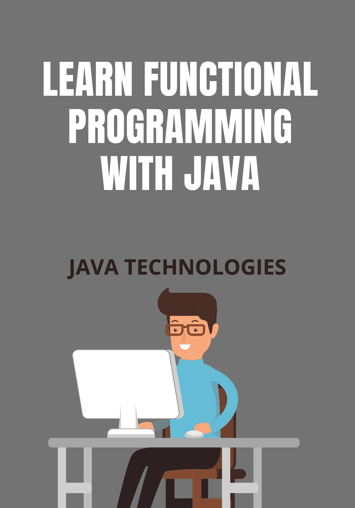

# Java 泛式编程学习



我想将本书献给将使用这本书的学生们。祝你们未来职业成功，希望你们永不停止学习。

# 函数式编程 - 概述

在函数式编程范式中，应用程序主要使用纯函数编写。这里的纯函数是指没有副作用的函数。副作用的一个示例是从函数返回值时修改实例级变量。

以下是函数式编程的关键方面。

- **函数（Functions）** – 函数是执行特定任务的语句块。函数接受数据、处理数据并返回结果。编写函数主要是为了支持重用性概念。一旦写好函数，就可以轻松地调用它，而无需反复编写相同的代码。

函数式编程围绕一等函数、纯函数和高阶函数展开。

- **一等函数（First Class Function）**是指使用一等实体（如`String`、数字）的函数，这些实体可以作为参数传递、返回或赋值给变量。

- **高阶函数（High Order Function）**是指既可以接受函数作为参数，也可以返回一个函数的函数。

- **纯函数（Pure Function）**是指在执行过程中没有副作用的函数。

- **函数组合（Functional Composition）** – 在命令式编程中，函数被用于组织可执行的代码，重点在于代码的组织。但在函数式编程中，重点在于函数是如何组织和组合的。数据和函数通常作为参数传递并返回。这使得编程更具能力和表现力。

- **链式接口（Fluent Interfaces）** – 链式接口有助于组合易于编写和理解的表达式。这些接口在每个方法的返回类型再次被重用时有助于方法的链式调用。例如 –

```java
LocalDate futureDate = LocalDate.now().plusYears(2).plusDays(3);
```

- **及早求值与惰性求值（Eager vs Lazy Evaluation）** – 及早求值意味着表达式一旦遇到就会求值，而惰性求值是指延迟执行直到满足特定条件。例如，Java 8 中的函数式编程支持流。

- **持久性数据结构（Persistent Data Structure）** – 持久性数据结构维护其版本。每当数据更改时，都会创建一个新副本因此是不可变的。此类集合是线程安全的。

- **递归（Recursion）** – 函数可以通过调用自己来实现。Java 的函数式编程支持递归。

- **并行（Parallelism）** 没有副作用的函数可以任何顺序调用，因此是并行的。

- **Optionals** – `Optional`是一个永远不返回`null`的特殊类。返回的对象具有`isPresent()`方法。

# Java 函数式编程 – 函数

函数是执行特定任务的语句块。函数接受数据、处理数据并返回结果。编写函数主要是为了支持重用性。

函数式编程围绕一等函数、纯函数和高阶函数展开。

- **一等函数（First Class Function）**是指使用一等实体（如`String`、数字）的函数，这些实体可以作为参数传递、返回或赋值给变量。

- **高阶函数（High Order Function）**是指既可以接受函数作为参数，也可以返回一个函数的函数。

- **纯函数（Pure Function）**是指在执行过程中没有副作用的函数。

## 一等函数 (First Class Function)

一等函数可以被视为变量。这意味着它可以作为参数传递给函数、由函数返回或赋值给变量。Java 使用 Lambda 表达式支持一等函数。Lambda 表达式类似于匿名函数。见下例：

```java
public class FunctionTester {
    public static void main(String[] args) {
        int[] array = {1, 2, 3, 4, 5};
        SquareMaker squareMaker = item -> item * item;
        for(int i = 0; i < array.length; i++){
            System.out.println(squareMaker.square(array[i]));
        }
    }
}

interface SquareMaker {
    int square(int item);
}
```

### 输出

1

4

9

16

25

在这里我们使用 Lambda 表达式创建了平方函数的实现并赋值给变量`squareMaker`。

## 高阶函数 (High Order Function)

高阶函数要么接受函数作为参数，要么返回一个函数。在 Java 中，我们可以传递或返回 Lambda 表达式来实现这种功能。

```java
import java.util.function.Function;

public class FunctionTester {
    public static void main(String[] args) {
        int[] array = {1, 2, 3, 4, 5};
        Function<Integer, Integer> square = t -> t * t;
        Function<Integer, Integer> cube = t -> t * t * t;
        for(int i = 0; i < array.length; i++){
            print(square, array[i]);
        }
        for(int i = 0; i < array.length; i++){
            print(cube, array[i]);
        }
    }

    private static <T, R> void print(Function<T, R> function, T t) {
        System.out.println(function.apply(t));
    }
}
```

### 输出

1

4

9

16

25

1

8

27

64

125

纯函数不会修改任何全局变量，也不会修改作为参数传递给它的引用。因此，它没有副作用。当用相同的参数调用时，它总是返回相同的值。这类函数非常有用并且是线程安全的。在示例中，`sum`是一个纯函数。

```java
public class FunctionTester {
    public static void main(String[] args) {
        int a, b;
        a = 1;
        b = 2;
        System.out.println(sum(a, b));
    }
    private static int sum(int a, int b){
        return a + b;
    }
}
```

### 输出

3

# Java 函数式编程 – 组合

函数组合是指是一种将多个函数组合成单个函数的技术。我们可以组合 lambda 表达式组合。Java 通过`Predicate`和`Function`类提供了内置支持。以下示例展示了如何使用谓词方法组合两个函数。

```java
import java.util.function.Predicate;

public class FunctionTester {
    public static void main(String[] args) {
        Predicate<String> hasName = text -> text.contains("name");
        Predicate<String> hasPassword = text -> text.contains("password");
        Predicate<String> hasBothNameAndPassword = hasName.and(hasPassword);
        String queryString = "name=test;password=test";
        System.out.println(hasBothNameAndPassword.test(queryString));
    }
}
```

### 输出

true

`Predicate`提供了`and()`和`or()`方法来组合函数。而`Function`提供了`compose`和`andThen`方法来组合函数。以下示例展示了如何使用`Function`方法组合两个函数。

```java
import java.util.function.Function;

public class FunctionTester {
    public static void main(String[] args) {
        Function<Integer, Integer> multiply = t -> t * 3;
        Function<Integer, Integer> add = t -> t + 3;
        Function<Integer, Integer> FirstMultiplyThenAdd = multiply.compose(add);
        Function<Integer, Integer> FirstAddThenMultiply = multiply.andThen(add);
        System.out.println(FirstMultiplyThenAdd.apply(3));
        System.out.println(FirstAddThenMultiply.apply(3));
    }
}
```

### 输出

18

12

# 饿求值 vs 懒求值

饿求值意味着表达式在遇到时立即求值，而懒求值是指在需要时对表达式进行求值。查看以下示例以理解该概念。

```java
import java.util.function.Supplier;

public class FunctionTester {
    public static void main(String[] args) {
        String queryString = "password=test";
        System.out.println(checkInEagerWay(hasName(queryString), hasPassword(queryString)));
        System.out.println(checkInLazyWay(() -> hasName(queryString), () -> hasPassword(queryString)));
    }
    private static boolean hasName(String queryString) {
        System.out.println("Checking name: ");
        return queryString.contains("name");
    }
    private static boolean hasPassword(String queryString) {
        System.out.println("Checking password: ");
        return queryString.contains("password");
    }
    private static String checkInEagerWay(boolean result1, boolean result2) {
        return (result1 && result2) ? "all conditions passed": "failed.";
    }
    private static String checkInLazyWay(Supplier<Boolean> result1, Supplier<Boolean> result2) {
        return (result1.get() && result2.get()) ? "all conditions passed": "failed.";
    }
}
```

### 输出

Checking name:

Checking password:

failed.

Checking name:

failed.

在这里`checkInEagerWay()`函数首先评估参数然后执行其语句。而`checkInLazyWay()`执行其语句并根据需要评估参数。由于`&&`是短路运算符，`checkInLazyWay`只评估了第一个为 false 的参数，完全没有评估第二个参数。

# 持久化数据结构

如果一个数据结构能够将其之前的更新作为独立版本维护，并且每个版本都可以相应地访问和更新，则称它是持久化的。这使得数据结构变得不可变且线程安全。例如，Java 中的`String`类对象是不可变的。当我们对字符串进行任何更改时，JVM 都会创建一个新的字符串对象，分配新值并保留旧值作为旧字符串对象。

持久化数据结构也称为函数式数据结构。考虑以下情况——

## 非持久化方式

```java
public static Person updateAge(Person person, int age) {
    person.setAge(age);
    return person;
}
```

## 持久化方式

```java
public static Person updateAge(Person pPerson, int age) {
    Person person = new Person();
    person.setAge(age);
    return person;
}
```

# Java 函数式编程 – 递归

递归是在函数中调用同一个函数，直到满足某些条件。它有助于将大问题分解为较小的问题。递归也让代码更具读性和表达力。

## 过程式 vs 递归

以下示例展示了使用这两种技术计算自然数的和。

```java
public class FunctionTester {
    public static void main(String[] args) {
        System.out.println("Sum using imperative way. Sum(5) : " + sum(5));
        System.out.println("Sum using recursive way. Sum(5) : " + sumRecursive(5));
    }
    private static int sum(int n) {
        int result = 0;
        for (int i = 1; i <= n; i++) {
            result += i;
        }
        return result;
    }
    private static int sumRecursive(int n) {
        if (n <= 0)
            return 0;
        else
            return n + sumRecursive(n - 1);
    }
}
```

### 输出

Sum using imperative way. Sum(5) : 15

Sum using recursive way. Sum(5) : 15

使用递归，我们通过 n-1 的自然数来得到所需的结果。

## 尾递归

尾递归是指递归调用应该位于末尾。以下示例展示了使用尾递归打印序列。

```java
public class FunctionTester {
    public static void main(String[] args) {
        printTailRecursion(5);
    }
    public static void printTailRecursion(int n) {
        if (n == 0)
            return;
        else
            System.out.println(n);
            printTailRecursion(n - 1);
    }
}
```

### 输出

5

4

3

2

1

## 头递归

头递归是指递归调用位于代码开头。以下示例展示了使用头递归打印数字序列。

```java
public class FunctionTester {
    public static void main(String[] args) {
        printHeadRecursion(5);
    }
    public static void printHeadRecursion(int n) {
        if (n == 0)
            return;
        else {
            printHeadRecursion(n - 1);
            System.out.println(n);
        }
    }
}
```

### 输出

1

2

3

4

5

# Java 函数式编程 – 并行

并行是函数式编程的核心概念，通过将大任务分解为较小的独立任务，然后以并行方式完成这些小任务，最后组合完整结果。随着多核处理器的出现，这种技术有助于加快代码执行。Java 有基于线程的并行处理支持，但学习非常困难且难以实现 Bug。Java 8 之后，`stream`提供了`parallel()`方法，集合提供了`parallelStream()`方法来并行方式完成任务。查看下例：


```java
import java.util.ArrayList;
import java.util.Arrays;
import java.util.List;

public class FunctionTester {
    public static void main(String[] args) {
        Integer[] intArray = {1, 2, 3, 4, 5, 6, 7, 8};
        List<Integer> listOfIntegers = new ArrayList<>(Arrays.asList(intArray));
        System.out.println("List using Serial Stream:");
        listOfIntegers
            .stream()
            .forEach(e -> System.out.print(e + " "));
        System.out.println("");

        System.out.println("List using Parallel Stream:");
        listOfIntegers
            .parallelStream()
            .forEach(e -> System.out.print(e + " "));
        System.out.println("");

        System.out.println("List using Another Parallel Stream:");
        listOfIntegers
            .stream()
            .parallel()
            .forEach(e -> System.out.print(e + " "));
        System.out.println("");

        System.out.println("List using Parallel Stream but Ordered:");
        listOfIntegers
            .parallelStream();
    }
}
```

```java
.forEachOrdered(e ->  System.out.print(e +  " "));

System.out.println("");

}
```

### Output

使用顺序流的列表：

1 2 3 4 5 6 7 8

使用并行流的列表：

6 5 8 7 3 4 2 1

使用另一个并行流的列表：

6 2 1 7 4 3 8 5

使用并行但有序的流列表：

1 2 3 4 5 6 7 8

# Optionals 和 Monads

Monad 是函数式编程中的一个核心概念。Monad 是一种有助于表示缺失值的设计模式。它允许包装潜在的空值，允许在其周围进行转换，并在存在时提取实际值。根据定义，一个 monad 包含以下参数：

*   `一个泛型类型` − `M<T>`

*   `一个 unit 函数` − `T -> M<T>`

*   `一个 bind 操作` − `M<T> bind T -> M<U> = M<U>`

## 关键操作

*   `左恒等 (Left Identity)` − 如果一个函数在一个特定值的 monad 上进行 bind，那么其结果将与函数作用于该值的结果相同。

*   `右恒等 (Right Identity)` − 如果 monad 的返回方法与原始值的 monad 相同。

*   `结合律 (Associativity)` − 函数可以按任何顺序应用于 monad 上。

## Optional 类

Java 8 引入了作为 monad 的 `Optional` 类。它提供了与 monad 等效的操作。例如，`return` 是一个接收值并返回 monad 的操作。`Optional.of()` 接收参数并返回 `Optional` 对象。在类似的基础上，`bind` 是将函数绑定到 monad 以产生新 monad 的操作。`Optional.flatMap()` 是在 `Optional` 上执行操作并将结果作为 `Optional` 返回的方法。

*   `一个泛型类型` − `Optional<T>`

*   `一个 unit 函数` − `Optional.of()`

*   `一个 bind 操作` − `Optional.flatMap()`

### 示例 − 左恒等

以下示例展示了 `Optional` 类如何遵守左恒等规则。

```java
import java.util.Optional;
import java.util.function.Function;

public class FunctionTester {
    public static void main(String[] args) {
        Function<Integer, Optional<Integer>> addOneToX = x -> Optional.of(x + 1);
        System.out.println(Optional.of(5).flatMap(addOneToX).equals(addOneToX.apply(5)));
    }
}
```

### Output

true

### 示例 − 右恒等

以下示例展示了 `Optional` 类如何遵守右恒等规则。

```java
import java.util.Optional;
public class FunctionTester {
    public static void main(String[] args) {
        System.out.println(Optional.of(5).flatMap(Optional::of).equals(Optional.of(5)));
    }
}
```

### Output

true

### 示例 - 结合律

以下示例展示了 `Optional` 类如何遵守结合律规则。

```java
import java.util.Optional;
import java.util.function.Function;

public class FunctionTester {
    public static void main(String[] args) {
        Function<Integer, Optional<Integer>> addOneToX = x -> Optional.of(x + 1);
        Function<Integer, Optional<Integer>> addTwoToX = x -> Optional.of(x + 2);
        Function<Integer, Optional<Integer>> addThreeToX = x -> addOneToX.apply(x).flatMap(addTwoToX);
        Optional.of(5).flatMap(addOneToX).flatMap(addTwoToX).equals(Optional.of(5).flatMap(addThreeToX));
    }
}
```

### Output

true

# Java 函数式编程 – 闭包

闭包（Closure）是函数与其周围环境状态的组合。闭包函数通常可以访问外部函数的作用域。在下面的示例中，我们创建了一个函数 `getWeekDay(String[] days)`，它返回一个可以返回星期几文本内容的函数。这里，`getWeekDay()` 是一个闭包，它返回一个围绕调用函数作用域的函数。

以下示例展示了闭包的工作原理。

```java
import java.util.function.Function;

public class FunctionTester {
    public static void main(String[] args) {
        String[] weekDays = {"Monday", "Tuesday", "Wednesday", "Thursday", "Friday", "Saturday", "Sunday"};
        Function<Integer, String> getIndianWeekDay = getWeekDay(weekDays);
        System.out.println(getIndianWeekDay.apply(6));
    }

    public static Function<Integer, String> getWeekDay(String[] weekDays) {
        return index -> index >= 0 ? weekDays[index % 7] : null;
    }
}
```

### Output

Sunday

# Java 函数式编程 – 柯里化 (Currying)

柯里化是一种将多参数函数调用替换为多个少参数方法调用的技术。

参见下等式：

`(1 + 2 + 3) = 1 + (2 + 3) = 1 + 5 = 6`

从函数的角度来看：

```java
import java.util.function.Function;

public class FunctionTester {
    public static void main(String[] args) {
        Function<Integer, Function<Integer, Integer>> add = x -> y -> x + y;
        System.out.println(add.apply(1).apply(2).apply(3));
    }
}
```

*(注：提示中关于柯里化的文本不完整，我根据描述重构了逻辑).*

# Java 函数式编程 – 归约 (Reducing)

柯里化是将多参数函数调用替换为多个少参数方法调用的技术。

参见下等式：

`(1 + 2 + 3) = 1 + (2 + 3) = 1 + 5 = 6`

在函数的角度来看：

```java
import java.util.function.Function;

public class FunctionTester {
    public static void main(String[] args) {
        Function<Integer, Function<Integer, Integer>> add = x -> y -> x + y;
        System.out.println(add.apply(1).apply(2).apply(3));
    }
}
```

*(注：提示中关于柯里化的文本不完整，我根据描述重构了逻辑).*

# Java 函数式编程 – 归约 (Reducing)

柯里化是将多参数函数调用替换为多个少参数方法调用的技术。

参见下等式：

`(1 + 2 + 3) = 1 + (2 + 3) = 1 + 5 = 6`

在函数的角度来看：

```java
import java.util.function.Function;

public class FunctionTester {
    public static void main(String[] args) {
        Function<Integer, Function<Integer, Integer>> add = x -> y -> x + y;
        System.out.println(add.apply(1).apply(2).apply(3));
    }
}
```

*(注：提示中关于柯里化的文本不完整，我根据描述重构了逻辑).*

```java
interface MathOperation {
    int operation(int a, int b);
}

interface GreetingService {
    void sayMessage(String message);
}

private int operate(int a, int b, MathOperation mathOperation) {
    return mathOperation.operation(a, b);
}
```

### 验证结果

使用 `javac` 编译器按照如下编译类 −

`C:\JAVA>javac Java8Tester.java`

现在如下如下运行 `Java8Tester` −

`C:\JAVA>java Java8Tester`

它应该产生如下输出 −

10 + 5 = 15

10 - 5 = 5

10 x 5 = 50

10 / 5 = 2

Hello Mahesh

Hello Suresh

以下是上述示例中需要考虑的重要点。

- `Lambda expressions` 主要用于定义函数式接口的内联实现，即只有一个方法的接口。在上面的示例中，我们使用了各种类型的 lambda 表达式来定义 `MathOperation` 接口的 `operation` 方法。然后，我们定义了 `GreetingService` 接口的 `sayMessage` 方法实现。

- `Lambda expression` 消除了对匿名类的需求，并为 Java 提供了非常简单且强大的函数编程能力。

## 范围

使用 lambda 表达式，你可以引用任何 final 变量或有效 final 变量（effectively final variable，即只被赋值一次的变量）。如果变量被第二次赋值，lambda 表达式将抛出编译错误。

### 范围示例

使用你选择的任何编辑器在例如 `C:\> JAVA` 中创建以下 Java 程序。

`Java8Tester.java`

```java
public class Java8Tester {
    final static String salutation = "Hello! ";

    public static void main(String args[]) {
        GreetingService greetService1 = message ->
            System.out.println(salutation + message);
        greetService1.sayMessage("Mahesh");
    }

    interface GreetingService {
        void sayMessage(String message);
    }
}
```

### 验证结果

使用 `javac` 编译器按照如下编译类 −

`C:\JAVA>javac Java8Tester.java`

现在如下运行 `Java8Tester` −

`C:\JAVA>java Java8Tester`

它应该产生如下输出 −

Hello! Mahesh

# 函数式编程 - 默认方法

Java 8 在接口中引入了默认方法实现的新概念。添加此功能是为了向后兼容，以便旧接口可以用来利用 Java 8 的 lambda 表达式能力。

例如，`List` 或 `Collection` 接口没有 `forEach` 方法声明。因此，添加此类方法将直接破坏集合框架的实现。Java 8 引入了默认方法，使得 `List/Collection` 接口可以拥有 `forEach` 方法的默认实现，而实现这些接口的类不需要再次实现它。

## 语法

```java
public interface vehicle {
    default void print() {
        System.out.println("I am a vehicle!");
    }
}
```

## 多默认方法

由于接口中有默认函数，一个类可能会实现具有相同默认方法的接口。以下代码解释了如何解决这种冲突。

```java
public interface vehicle {
    default void print() {
        System.out.println("I am a vehicle!");
    }
}

public interface fourWheeler {
    default void print() {
        System.out.println("I am a four wheeler!");
    }
}

// 第一个解决方案是创建一个自己的方法来覆盖默认实现。
public class car implements vehicle, fourWheeler {
    public void print() {
        System.out.println("I am a four wheeler car vehicle!");
    }
}

// 第二个解决方案是使用 super 调用指定的默认方法。
public class car implements vehicle, fourWheeler {
    default void print() {
        vehicle.super.print();
    }
}
```

## 静态默认方法

从 Java 8 开始，接口也可以拥有静态辅助方法。

```java
public interface vehicle {
    default void print() {
        System.out.println("I am a vehicle!");
    }
    static void blowHorn() {
        System.out.println("Blowing horn!!!");
    }
}
```

## 默认方法示例


使用你选择的任何编辑器在例如`C:\> JAVA`中创建以下 Java 程序。

### Java8Tester.java

```java
public class Java8Tester {
    public static void main(String args[]) {
        Vehicle vehicle = new Car();
        vehicle.print();
    }
}

interface Vehicle {
    default void print() {
        System.out.println("I am a vehicle!");
    }
    static void blowHorn() {
        System.out.println("Blowing horn!!!");
    }
}

interface FourWheeler {
    default void print() {
        System.out.println("I am a four wheeler!");
    }
}

class Car implements Vehicle, FourWheeler {
    public void print() {
        Vehicle.super.print();
        FourWheeler.super.print();
        Vehicle.blowHorn();
        System.out.println("I am a car!");
    }
}
```

### 验证结果

使用`javac`编译器按照如下编译类 −

`C:\JAVA>javac Java8Tester.java`

现在如下运行`Java8Tester` −

`C:\JAVA>java Java8Tester`

它应该产生如下输出 −

```
I am a vehicle!

I am a four wheeler!

Blowing horn!!!

I am a car!
```

## 函数式接口

函数式接口只有一个方法。函数式接口定义在`java.util.function`包中。

## 函数式接口示例

`Predicate<T>`接口是一个接收单个输入并返回 Boolean 的函数式接口。该接口表示对对象的测试。

使用你选择的任何编辑器在例如`C:\> JAVA`中创建以下 Java 程序。

### Java8Tester.java

```java
import java.util.Arrays;
import java.util.List;
import java.util.function.Predicate;

public class Java8Tester {
    public static void main(String args[]) {
        List<Integer> list = Arrays.asList(1, 2, 3, 4, 5, 6, 7, 8, 9);

        // Predicate<Integer> predicate = n -> true
        // 无论 n 取什么值都返回 true。
        System.out.println("Print all numbers:");
        eval(list, n -> true);

        // Predicate<Integer> predicate1 = n%2 == 0
        // 当 n%2 为零时返回 true。
        System.out.println("Print even numbers:");
        eval(list, n -> n%2 == 0);

        // Predicate<Integer> predicate2 = n > 3
        // 当 n 大于 3 时返回 true。
        System.out.println("Print numbers greater than 3:");
        eval(list, n -> n > 3);
    }

    public static void eval(List<Integer> list, Predicate<Integer> predicate) {
        for (Integer n : list) {
            if (predicate.test(n)) {
                System.out.println(n + " ");
            }
        }
    }
}
```

### 验证结果

使用`javac`编译器按照如下编译类 −

`C:\JAVA>javac Java8Tester.java`

现在如下运行`Java8Tester` −

`C:\JAVA>java Java8Tester`

它应该产生如下输出 −

```
Print all numbers:

1

2

3

4

5

6

7

8

9

Print even numbers:

2

4

6

8

Print numbers greater than 3:

4

5

6

7

8

9
```

## 函数式编程 - 方法引用

方法引用帮助通过方法名称指向方法。方法引用使用`::`符号描述。方法引用可以指向以下类型的方法 −

- **静态方法**：可以使用`ClassName::Method name`符号引用静态方法。

- **实例方法**：可以使用`Object::Method name`符号引用实例方法。

以下示例展示了 Java 8 及更高版本中方法引用（Method references）的工作方式。

```java
interface Factory {
    Vehicle prepare(String make, String model, int year);
}

class Vehicle {
    private String make;
    private String model;
    private int year;
    Vehicle(String make, String model, int year) {
        this.make = make;
        this.model = model;
        this.year = year;
    }
    public String toString() {
        return "Vehicle[" + make + ", " + model + ", " + year + "]";
    }
}

class VehicleFactory {
    static Vehicle prepareVehicleInStaticMode(String make, String model, int year) {
        return new Vehicle(make, model, year);
    }
    Vehicle prepareVehicle(String make, String model, int year) {
        return new Vehicle(make, model, year);
    }
}

public class FunctionTester {
    public static void main(String[] args) {
        //方法引用 - 静态方式
        Factory vehicle_factory_static = VehicleFactory::prepareVehicleInStaticMode;
        Vehicle carHyundai = vehicle_factory_static.prepare("Hyundai", "Verna", 2018);
        System.out.println(carHyundai);

        //方法引用 - 实例方式
        Factory vehicle_factory_instance = new VehicleFactory()::prepareVehicle;
        Vehicle carTata = vehicle_factory_instance.prepare("Tata", "Harrier", 2019);
        System.out.println(carTata);
    }
}
```

### 输出

```
Vehicle[Hyundai, Verna, 2018]
Vehicle[Tata, Harrier, 2019]
```

## 构造方法引用（Constructor References）

构造方法引用有助于指向构造方法。使用`::new`符号访问构造引用。

```java
//构造方法引用
Factory vehicle_factory = Vehicle::new;
```

以下示例展示了 Java 8 及更高版本中构造方法引用的工作方式。

```java
interface Factory {
    Vehicle prepare(String make, String model, int year);
}

class Vehicle {
    private String make;
    private String model;
    private int year;
    Vehicle(String make, String model, int year) {
        this.make = make;
        this.model = model;
        this.year = year;
    }
    public String toString() {
        return "Vehicle[" + make + ", " + model + ", " + year + "]";
    }
}

public class FunctionTester {
    static Vehicle factory(Factory factoryObj, String make, String model, int year) {
        return factoryObj.prepare(make, model, year);
    }
    public static void main(String[] args) {
        //构造方法引用
        Factory vehicle_factory = Vehicle::new;
        Vehicle carHonda = factory(vehicle_factory, "Honda", "Civic", 2017);
        System.out.println(carHonda);
    }
}
```

### 输出

```
Vehicle[Honda, Civic, 2017]
```

# Java 函数式编程 – 集合（Collections）

从 Java 8 开始，Java 引入了流（streams），并向集合添加了方法以获取流。一旦从集合中获取了流对象，我们就可以在集合上应用各种过滤、映射、还原等函数式编程特性。参见下例 −

```java
import java.util.Arrays;
import java.util.List;
import java.util.stream.Collectors;

public class FunctionTester {
    public static void main(String[] args) {
        List<Integer> numbers = Arrays.asList(3, 2, 2, 3, 7, 3, 5);
        // 映射 (Mapping)
        // 获取唯一平方列表
        List<Integer> squaresList = numbers.stream().map( i -> i*i)
            .distinct().collect(Collectors.toList());
        System.out.println(squaresList);

        // 过滤 (Filtering)
        // 获取非空字符串列表
        List<String> strings = Arrays.asList("abc", "", "bc", "efg", "abcd", "", "jkl");
        List<String> nonEmptyStrings = strings.stream()
            .filter(string -> !string.isEmpty()).collect(Collectors.toList());
        System.out.println(nonEmptyStrings);

        // 还原 (Reducing)
        int sum = numbers.stream().reduce((num1, num2) -> num1 + num2).orElse(-1);
        System.out.println(sum);
    }
}
```

### 输出

```
[1, 4, 9, 49, 25]
[abc, bc, efg, abcd, jkl]
25
```

# 函数式编程 - 高阶函数（High Order Functions）

如果一个函数满足以下任何条件，则被视为高阶函数：

* 它接受一个或多个函数作为参数。

* 它在执行后返回一个函数。

Java 8 的`Collections.sort()`方法是高阶函数的一个理想示例。它接受一个参数。参见示例 −

```java
import java.util.Arrays;
import java.util.Collections;
import java.util.Comparator;
import java.util.List;
import java.util.stream.Collectors;

public class FunctionTester {
    public static void main(String[] args) {
        List<Integer> numbers = Arrays.asList(3, 4, 6, 7, 9);
        // 将函数作为 lambda 表达式传递
        Collections.sort(numbers, (a,b) ->{ return a.compareTo(b); });
    }
}
```

*(注：由于原文在结尾处截断，此处仅根据提供的文本片段完成翻译。若需完整翻译，请提供完整文本。)*

在这里`sum()`是一个纯函数，因为它在不同时间传入 2 和 3 作为参数时它总是返回 5，并且没有副作用。

## 示例- 不纯函数

```java
public class FunctionTester {
    private static double valueUsed = 0.0;

    public static void main(String[] args) {
        double result = randomSum(2.0,3.0);
        System.out.println(result);
        result = randomSum(2.0,3.0);
        System.out.println(result);
    }

    static double randomSum(double a, double b) {
        valueUsed = Math.random();
        return valueUsed + a + b;
    }
}
```

### 输出

```
5.919716721877799
5.4830887819586795
```

在这里`randomSum()`是一个不纯函数，因为它在不同时间传入 2 和 3 作为参数时它会返回不同的结果，并且会修改实例变量的状态。

# 函数式编程 - 类型推断

类型推断是一种编译器自动推断传递的参数类型或方法返回类型的技术。从 Java 8 开始，Lambda 表达式显著地使用了类型推断。

请看下方的示例以明确类型推断。

## 示例- 类型推断


```java
public class FunctionTester {
    public static void main(String[] args) {
        Join<Integer,Integer,Integer> sum = (a,b) -> a + b;
        System.out.println(sum.compute(10,20));
        Join<String, String, String> concat = (a,b) -> a + b;
        System.out.println(concat.compute("Hello ","World!"));
    }

    interface Join<K,V,R> {
        R compute(K k , V v);
    }
}
```

### 输出

```
30
Hello World!
```

Lambda 表达式最初将每个参数及其返回类型视为 `Object`，然后据此推断数据类型。在第一种情况下，推断出的类型是 `Integer`；在第二种情况下推断出的类型是 `String`。

# Lambda 表达式中的异常处理

当函数抛出检查异常（checked exception）时，Lambda 表达式很难编写。见下例：

```java
import java.net.URLEncoder;
import java.util.Arrays;
import java.util.stream.Collectors;

public class FunctionTester {
    public static void main(String[] args) {
        String url = "www.google.com";
        System.out.println(encodedAddress(url));
    }

    public static String encodedAddress(String... address) {
        return Arrays.stream(address)
            .map(s -> URLEncoder.encode(s, "UTF-8"))
            .collect(Collectors.joining(","));
    }
}
```

上面的代码无法编译，因为`URLEncoder.encode()`抛出了`UnsupportedEncodingException`，而该异常无法被`encodedAddress()`方法抛出。

一种可能的解决方案是将`URLEncoder.encode()`提取到单独的方法并在那里处理异常。

```java
import java.io.UnsupportedEncodingException;
import java.net.URLEncoder;
import java.util.Arrays;
import java.util.stream.Collectors;

public class FunctionTester {
    public static void main(String[] args) {
        String url = "www.google.com";
        System.out.println(encodedAddress(url));
    }

    public static String encodedString(String s) {
        try {
            URLEncoder.encode(s, "UTF-8");
        } catch (UnsupportedEncodingException e) {
            e.printStackTrace();
        }
        return s;
    }

    public static String encodedAddress(String... address) {
        return Arrays.stream(address)
            .map(s -> encodedString(s))
            .collect(Collectors.joining(","));
    }
}
```

但当我们有多个此类抛出异常的方法时，上述方法并不好。请看以下使用函数接口和包装方法的泛化解决方案。

```java
import java.net.URLEncoder;
import java.util.Arrays;
import java.util.function.Function;
import java.util.stream.Collectors;

public class FunctionTester {
    public static void main(String[] args) {
        String url = "www.google.com";
        System.out.println(encodedAddress(url));
    }

    public static String encodedAddress(String... address) {
        return Arrays.stream(address)
            .map(wrapper(s -> URLEncoder.encode(s, "UTF-8")))
            .collect(Collectors.joining(","));
    }

    private static <T, R, E extends Exception> Function<T, R>
    wrapper(FunctionWithThrows<T, R, E> fe) {
        return arg -> {
            try {
                return fe.apply(arg);
            } catch (Exception e) {
                throw new RuntimeException(e);
            }
        };
    }
}

@FunctionalInterface
interface FunctionWithThrows<T, R, E extends Exception> {
    R apply(T t) throws E;
}
```

### 输出

```
www.google.com
```

# 中间方法

Stream API 在 Java 8 中引入，是为了方便 Java 中的函数式编程。Stream API 旨在以函数式方式处理对象集合。根据定义，Stream 是一个 Java 组件，可以对对象集合进行处理。

## 示例 - 中间方法

```java
import java.util.Arrays;
import java.util.List;
import java.util.stream.Stream;

public class FunctionTester {
    public static void main(String[] args) {
        List<String> stringList = Arrays.asList("One", "Two", "Three", "Four", "Five");
        System.out.println("Example - Filter\n");
        Stream<String> longStrings = stringList.stream()
            .filter(s -> {return s.length() > 3; });
        longStrings.forEach(System.out::println);

        System.out.println("\nExample - Map\n");
        stringList.stream()
            .map(s -> s.toUpperCase())
            .forEach(System.out::println);

        System.out.println("\nExample - flatMap\n");
        List<String> sentenceList = Arrays.asList("I am Mahesh.", "I love Java 8 Streams.");
        sentenceList.stream()
            .flatMap(s -> { return (Stream<String>) Arrays.asList(s.split(" ")).stream(); })
            .forEach(System.out::println);

        System.out.println("\nExample - distinct\n");
        stringList.stream()
            .distinct()
            .forEach(System.out::println);

        System.out.println("\nExample - limit\n");
        stringList.stream()
            .limit(2)
            .forEach(System.out::println);
    }
}
```

### 输出

```
Example - Filter
Three
Four
Five

Example - Map
ONE
TWO
THREE
FOUR
FIVE

Example - flatMap
I
am
Mahesh.
I
love
Java
8
Streams.

Example - distinct
One
Two
Three
Four
Five

Example - limit
One
Two
```

# 函数式编程 - 终端方法

当在 Stream 上调用终端方法时，迭代将在流以及任何其他链式流上开始。终端方法不返回`Stream`，因此一旦在 Stream 上调用了终端方法，其非终端方法或中间方法的链式就会停止/终止。

通常，终端操作方法返回单个值，并在流的每个元素上调用。以下是`Stream`接口中一些重要的终端操作方法。每个终端函数接收一个谓词函数，启动元素的迭代，并对每个元素应用该谓词。

- `anyMatch` — 如果任意一个元素满足谓词（返回 `true`），则返回 `true`。如果没有元素匹配，则返回 `false`。
- `allMatch` — 如果任意一个元素不满足谓词（返回 `false`），则返回 `false`。如果所有元素都匹配，则返回 `true`。
- `noneMatch` — 如果没有元素匹配，则返回 `true`，否则返回 `false`。
- `collect` — 将每个元素存储到传入的集合中。
- `count` — 返回通过中间方法的元素计数。
- `findAny` — 返回包含任意一个元素的`Optional`实例，或者返回空实例。
- `findFirst` — 在`Optional`实例下返回第一个元素。对于空流，返回空实例。
- `forEach` — 在每个元素上应用消费者函数。用于打印流的所有元素。
- `min` — 返回流中最小的元素。根据传递的比较器谓词对元素进行比较。
- `max` — 返回流中最大的元素。根据传递的比较器谓词对元素进行比较。
- `reduce` — 使用传递的谓词将所有元素还原为单个元素。
- `toArray` — 返回流元素的数组。

## 示例 - 终端方法

```java
import java.util.Arrays;
import java.util.List;
import java.util.stream.Collectors;

public class FunctionTester {
    public static void main(String[] args) {
        List<String> stringList = Arrays.asList("One", "Two", "Three", "Four", "Five", "One");

        System.out.println("Example - anyMatch\n");
        //anyMatch - 检查 Two 是否存在?
        System.out.println("Two is present: " + stringList.stream().anyMatch(s -> { return s.contains("Two");}));

        System.out.println("\nExample - allMatch\n");
        //allMatch - 检查每个字符串的长度是否大于 2.
        System.out.println("Length > 2: " + stringList.stream().allMatch(s -> { return s.length() > 2;}));

        System.out.println("\nExample - noneMatch\n");
        //noneMatch - 检查每个字符串的长度是否大于 6.
        System.out.println("Length > 6: " + stringList.stream().noneMatch(s -> { return s.length() > 6;}));

        System.out.println("\nExample - collect\n");
        System.out.println("List: " + stringList.stream().filter(s -> { return s.length() > 3;}).collect(Collectors.toList()));

        System.out.println("\nExample - count\n");
        System.out.println("Count: " + stringList.stream().filter(s -> { return s.length() > 3;}).count());

        System.out.println("\nExample - findAny\n");
        System.out.println("findAny: " + stringList.stream().findAny().get());

        System.out.println("\nExample - findFirst\n");
        System.out.println("findFirst: " + stringList.stream().findFirst().get());

        System.out.println("\nExample - forEach\n");
        stringList.stream().forEach(System.out::println);

        System.out.println("\nExample - min\n");
        System.out.println("min: " + stringList.stream().min((s1, s2) -> { return s1.compareTo(s2);}));

        System.out.println("\nExample - max\n");
        System.out.println("min: " + stringList.stream().max((s1, s2) -> { return s1.compareTo(s2);}));

        System.out.println("\nExample - reduce\n");
        System.out.println("reduced: " + stringList.stream().reduce((s1, s2) -> { return s1 + ", "+ + s2;}).get());
    }
}
```

### 输出

```
Example - anyMatch
Two is present: true

Example - allMatch
Length > 2: true

Example - noneMatch
Length > 6: true

Example - collect
List: [Three, Four, Five]

Example - count
Count: 3

Example - findAny
findAny: One

Example - findFirst
findFirst: One

Example - forEach
One
Two
Three
Four
Five
One

Example - min
min: Optional[Five]

Example - max
min: Optional[Two]

Example - reduce
reduced: One, Two, Three, Four, Five, One
```


# 函数式编程 - 无限流

集合（Collections）是内存数据结构，包含集合中的所有元素，我们通过外部迭代来遍历集合；而`Stream`是一种固定数据结构，元素按需计算，`Stream`具有内置迭代来遍历每个元素。下面的示例显示了如何从数组创建`Stream`。

```java
int[] numbers = {1, 2, 3, 4};
Stream numbersFromArray = Arrays.stream(numbers);
```

可以使用`Stream.iterate()`或`Stream.generate()`方法创建`Stream`，这些方法可以传递条件。考虑我们需要 3 的倍数列表的情况。

## 示例 - 无限流

```java
import java.util.stream.Stream;

public class FunctionTester {
    public static void main(String[] args) {
        //创建一个 3 的倍数的流
        Stream<Integer> numbers = Stream.iterate(0, n -> n + 3);
        numbers.limit(10)
               .forEach(System.out::println);
    }
}
```

### 输出

```
0
3
6
9
12
15
18
21
24
27
```

为了对无限流进行操作，我们使用了`Stream`的`limit()`方法，当计数达到 10 时限制数字迭代。

# 函数式编程 - 固定长度流

有多种方法可以创建固定长度流。

- 使用`Stream.of()`方法
- 使用`Collection.stream()`方法
- 使用`Stream.builder()`方法

下面的示例显示了所有创建固定长度流的方法。

## 示例 - 固定长度流

```java
import java.util.Arrays;
import java.util.List;
import java.util.stream.Stream;

public class FunctionTester {
    public static void main(String[] args) {
        System.out.println("Stream.of():");
        Stream<Integer> stream = Stream.of(1, 2, 3, 4, 5);
        stream.forEach(System.out::println);

        System.out.println("Collection.stream():");
        Integer[] numbers = {1, 2, 3, 4, 5};
        List<Integer> list = Arrays.asList(numbers);
        list.stream().forEach(System.out::println);

        System.out.println("StreamBuilder.build():");
        Stream.Builder<Integer> streamBuilder = Stream.builder();
        streamBuilder.accept(1);
        streamBuilder.accept(2);
        streamBuilder.accept(3);
        streamBuilder.accept(4);
        streamBuilder.accept(5);
        streamBuilder.build().forEach(System.out::println);
    }
}
```

### 输出

```
Stream.of():
1
2
3
4
5

Collection.stream():
1
2
3
4
5

StreamBuilder.build():
1
2
3
4
5
```
