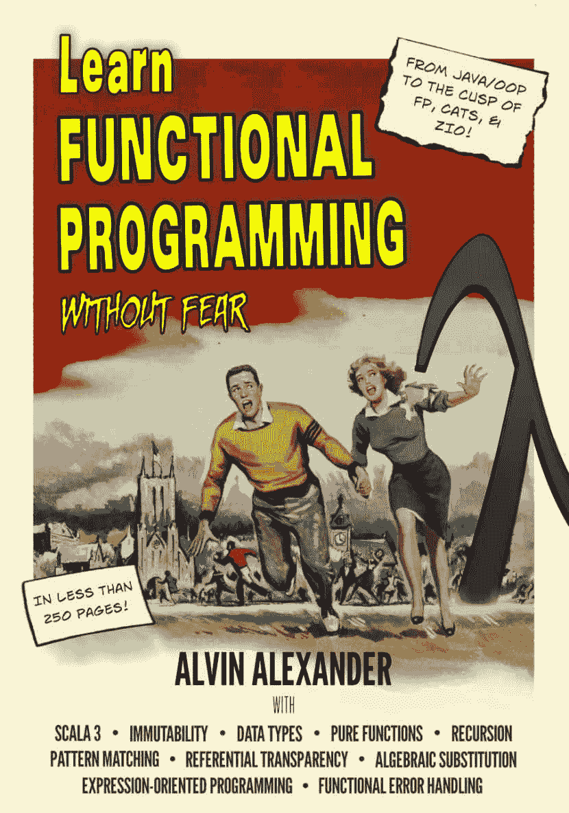
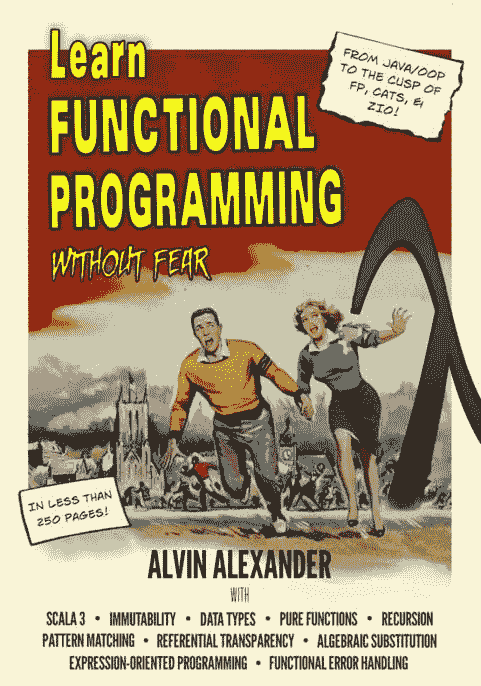

# 无畏学习函数式编程：前 Java/OOP 老师带你领略 Scala FP 库实战



购买书籍并反馈问题：[alvinalander.com/scala/learn-functional-programming-book](https://alvinalander.com/scala/learn-functional-programming-book)

## 其他书籍

Alvin Alexander 的其他书籍：

* [Scala Cookbook](https://amzn.to/3du1pMR) (700+ 页)
* 畅销且高分的书籍：[Functional Programming, Simplified](https://alvinalander.com/scala/functional-programming-simplified-book) (同样 700+ 页)
* 我的新作：[Learn Scala 3 The Fast Way!](https://amzn.to/3L4YwR4)

## 感谢

我想感谢每一位让 `Scala` 成为如此优秀的编程语言的人。编写关于它的内容是一件很有趣的事。

我还要感谢 Sriram Natarajan，他在本书的早期版本中自愿写了三页精彩的评论。

我还要感谢我的妻子，因为至少没有她的支持，这本书绝对是不可能实现的。

最后，我应该感谢所有让我保持脚踏实地的朋友和家人。如果不是因为你们，我可能还在阿拉斯加的山脉里冥想呢。:)

# 1. 本书的目标

本书有一个雄心勃勃的目标：尽可能简单地演示以下内容的用处：

* 不变变量（代数变量）
* 不变数据结构
* 纯函数
* 表达式导向编程
* 函数式错误处理

本书的前提是，一旦你熟悉了这些概念，你就会发现自己正在编写函数式编程 (FP) 代码。在书末，我通过展示几个使用 `ZIO` 的示例来演示这一点，`ZIO` 是 `Scala` 两个主要的 FP 库之一（另一个是 `Cats Effect`）。

更明确地说：本书让你准备好开始 `ZIO` 和 `Cats Effect`。当你读完这本书后，你应该能够查看它们的文档并想：“啊，我知道他们在做什么，以及为什么要这样做。”

## 面向 OOP 开发者：Java、Kotlin、Python 等

此外，我专门为那些具有面向对象编程（OOP）背景的人编写了这本书。我教了多年 `Java` 和 `OOP` 课程，并且仍然为 iPhone 和 Android 应用编写大部分 OOP 代码的代码（分别使用 `Flutter/Dart` 和 `Kotlin`），因此我非常熟悉 `OOP`，以及 `OOP` 开发者学习 FP 需要了解的知识。

在接触过 `Java`、`Kotlin`、`Swift`、`Python`、`C++`、`Dart` 和 `Ruby` 后，我相信这本书对于使用这些语言并对学习 FP 感兴趣的开发者非常有帮助。

我在 250 页以内实现了这一目标，重点关注如何利用上述五个主要概念编写几个小型应用程序，并在编写过程中不断解释这些概念。

> 这是一本特意编写的、关于 FP 的小书，希望读起来轻松。如果你更倾向于读一本关于 FP 的大而详尽的书，我写过畅销且高评价的[简化函数式编程](https://alvinalexander.com/scala/functional-programming-simplified-book)，它超过 720 页。虽然它长得多，但那本书的优点在于它通过 100 多个短小课程涵盖了大量的背景信息和细节。（明确一下，那本书的*纸质版*有 720 多页，但 PDF 和 Kindle 电子版超过 1000 页。）

# 2. 关于我

对于那些不认识我的人，我叫 Alvin Alexander，以下我的 `Java`、`OOP`、`Kotlin`、`Scala` 和 `FP` 背景：

* 过去，我向 `GE`、`UPS`、`Papa Johns` 等许多客户教授过 `C`、`Java` 和 `OOP` 课程
* 我创立了一家小型软件咨询公司并发展到 20 名员工，我们主要为客户编写 `Java/OOP` 代码
* 我写过两个版本的[Scala 食谱](https://amzn.to/3du1pMR)，最近的是 2021 年 9 月发布的第 2 版（每本 700 多页）
* 我写过畅销且高评价的书籍[简化函数式编程](https://alvinalexander.com/scala/functional-programming-simplified-book)（同样 700 多页）
* 我写过一本名为《Hello, Scala》的书，它成为了 `Scala` 官方网站“Scala 之书”的基础
* 随后，我为 `Scala` 官方网站合写了[Scala 3 教程](https://docs.scala-lang.org/scala3/book/introduction.html)
* 2022 年，我发布了一本名为[快速学习 Scala 3!](https://amzn.to/3L4YwR4) 的书
* 我用 `Java` 和 `Kotlin` 写过 Android 应用，并用 `Flutter` 和 `Dart` 写过跨平台的 iOS/Android 应用
* 我的关于编程的网站 [alvinalexander.com](https://alvinalexander.com) 每年接收数百万页面访问

我提到其中一些书的页数是因为对我来说，这是一本短书。我特意让它尽可能简洁，同时用简单、口语化的风格来编写，就像我正坐在你身边工作，或者在教室里指导你一样。

# 3. 欢迎！

欢迎！对我来说，这是一本非常不同的书。我的*最初计划*是创建一个小册子，标题将定为《用类型思考》或《用纯函数解决问题》。这个想法是展示你如何使用这些编程技术写出非常稳健、易读且易于维护的代码：

* 纯函数
* 不可变变量（*代数*变量）
* 不可变数据类型（如 `String` 和 `List`）
* 表达式导向编程 (EOP)
* 函数式错误处理

但当我开始编写大纲和示例时，我意识到这些代码与编写纯*函数式编程*（FP）代码是多么接近。从那时起，我从写小册转变为尝试写一本尽可能小的书，将 `OOP` 开发者带到使用 `Scala` FP 库的边缘。

所以，尽管这是一本很小的书，但我希望通过带你走到 FP 道路的很远，能提供巨大的价值。我的希望当你读完这本书后，可以直接去查看 `ZIO` 和 `Cats Effect` 的文档并想：“噢，我知道他们在做什么，以及为什么要这么做。”

## 这本书是给谁的

我为 `OOP` 开发者写了这本书，但它实际上适用于任何以下情况的人：

* 对上述列出的编程概念感兴趣
* 刚开始接触这些概念
* 已经接触了一点 FP 但发现它极其混乱、令人困惑
* 其他方面对改进代码感兴趣

请注意，书中的代码示例是使用 *Scala 3* 编写的，但我没有使用任何“Scala 魔法技巧”。正如你很快会看到的，代码是用简单的风格编写的。

## 我假设你了解

出于这本书的目的，我假设你了解一点 `Scala`，但从实际来说，`Scala` 的基础非常直观，我认为如果你熟悉 `Java`、`Kotlin`、`Python`、`Swift`、`Dart`、`C++` 或其他语言，你会做得很好。正如我提到的，我没有在书使用任何花哨的 `Scala` 技术。

* `TDL`: 以 `TDL` 开头的章节意味着该章节与 `To-Do List`（待办列表）应用程序有关。

## 大纲

接下来，如果你想知道这本书其余部分将要涉及的内容，请阅读以下大纲，它就像是后续内容的一份地图。

相反，如果你**不想**知道我们将进入什么领域，并且更倾向于保持惊喜，请跳过本章的剩余部分。

大纲的内容如下：

* 我首先回顾了自己过去在 `Java/OOP` 中很少使用数据类型
* 然后我对比了我在 `Scala/OOP` 和 `Scala/EOP` 中**确实**使用了多少数据类型

之后，我将展示：

* 使用数据类型并不是坏事，事实上，这是一件非常好的事情
* 不可变对象（变量和数据结构）的重要性
* 纯函数的重要性：特别是你可以信任它们，因为它们绝不会撒谎
* 不可变对象和纯函数的概念自然地引向了 EOP

然后我将展示如何使用这些概念编写一个 `Word Count`（字数统计）应用程序。在编写该程序的过程中，我们将发现其他一些事情。

之后，我会对 `Java/OOP` 代码与你在 `Word Count` 示例中看到的 `Scala/EOP` 代码进行简单回顾。

随后，我们将进入下一个重要主题：函数式错误处理：

* 我将解释函数式错误处理背后的原理
* 我们将查看 `Scala` 的三种`错误处理数据类型`：`Option`、`Try` 和 `Either`
* 我将展示如何使用 `Try` 实现 `Word Count` 应用程序
* 然后我们将使用所有概念构建一个更大的 `To-Do List`（待办列表）应用程序
* 该应用程序使用了模拟数据库，因此你可以看到在访问远程数据库或 `REST API` 时将使用的技术

最后，我将向你展示使用如 `ZIO` 和 `Cats Effect` 等 FP 库**离你有多近**。

现在，如果你准备好了，让我们开始吧！

# 5. 回顾 Java/OOP 代码与数据类型

在我的 `Java` 编程时代，我很少使用泛型数据类型，事实上，我几乎不考虑过数据类型。为了说明这一点，我将回到我常用的示例之一：为披萨店编写一个收银点应用程序。

在继续之前，有两点：

* `Java` 和 `Scala` 中的 `generic`（泛型）类型通常是方法声明中使用的字符，如 `T` 或 `A`。你使用泛型类型表示：“在这里使用的具体类型稍后填充。”例如，`Scala` 中的 `List[A]` 之后可以是 `List[Int]`、`List[String]` 等。随着书籍的深入，我将编写更多关于泛型的内容。

* 在这些示例中，请注意我的 `Java` 代码可能并非 100% 正确。我没有将这些代码放入 IDE 中或尝试编译它们。因为我假设你熟悉 `Java` 或其他的 `OOP` 语言，我的意图只是快速演示我多年多年的 `Java/OOP` 方法。

## 建模披萨店应用程序

### 一些枚举

为了开始为披萨店建模收银点应用程序，我首先需要我的枚举：

```
enum Topping {
  Cheese,
  Pepperoni,
  BlackOlives
}
```

```
enum CrustSize {
  Small,
  Medium,
  Large
}
```

```
enum CrustType {
  Regular,
  Thin,
  Thick
}
```

### 披萨类

基于这些，让我们创建一个 `Pizza` 类。但在此之前，让我们列出 OOP 披萨的属性和行为。属性基本上是我用那些枚举列出的内容：

* 饼底尺寸
* 饼底类型
* 配料类型

行为对应于这些：

* 添加配料
* 移除配料
* 设置饼底尺寸
* 设置饼底类型

如果我也保留价格相关的信息，披萨还可以计算自己的价格，但由于配料和饼底属性并不带有价格，这基本上就是这个 `Pizza` 的所有行为了。

在经过几次练习后，我知道我想让披萨中所有与食物相关的项目——面包棒、汽水等——都继承自一个基础 `Product` 类：

```
public interface Product {}
```

在现实世界中，`Product` 将具有成本等属性，可能还有销售价格，但为了本次练习，我将将其留为标记接口（marker interface）。

鉴于这个 `Product` —— 以及我 `Pizza` 的属性和行为，`Java/OOP` 类的初始代码如下：

```
public class Pizza implements Product {
  private List<Topping> toppings = new ArrayList<>();
  private CrustSize crustSize;
  private CrustType crustType;

  public Pizza(CrustSize crustSize, CrustType crustType) {
    this.crustSize = crustSize;
    this.crustType = crustType;
  }
}
```

该 `Pizza` 类将包含以下一系列 getter 和 setter 方法，其类型签名如下：

```
public CrustSize getCrustSize()
public CrustType getCrustType()
public List<Topping> getToppings()
public void setCrustSize(CrustSize crustSize)
public void setCrustType(CrustType crustType)
public void setToppings(List<Topping> toppings)
```

> *type signature*（类型签名）一词指的是函数的 (a) 输入参数和 (b) 返回类型。

## 讨论

这里需要注意的是，这些都是简单的代码。getter 不接受任何输入参数并返回基本数据类型，而 setter 都返回 `void`。我写这样的 `Java` 代码超过了 12 年。

事实上，如果我写更多代码（例如一个 `Order` 类），你会发现这种模式是相同的，都是非常简单的代码：

```
public class Order {
  private List<Product> lineItems = new ArrayList<>();
  public Order() {}
  public void addItem(Product p)
  public void removeItem(Product p)
  public List<Product> getItems()
  public String getPrintableReceipt()
  public BigDecimal getTotalPrice()
}
```

在那段代码中，我最接近使用泛型类型的就是这些类型：

* `List<Topping>`
* `List<Product>`

# 6. Java/OOP 总结

所以，这快速回顾了我在教 `Java` 课程时使用的 `Java/OOP` 代码。当然，我展示的并不多，仅足以传达基本思想。

## 总结第一部分

总结一下你看到的代码：

* 我的 `Java/OOP` 代码没有泛型类型
* 许多方法返回 `void`
* 许多方法没有输入参数
* 我**总是**使用可变数据结构
* 可变数据结构是像 `ArrayList` 这样可以调整大小且其元素可以更新的结构。我们说这种结构可以被*变异*（mutate），意思就是“改变”。

## 总结第二部分

关于这段代码还有一些事情可以说明，请记住，我只是在讨论自己的代码。

**要点 1**：我在编写 `Java/OOP` 代码时并没有意识到，但所有那些返回 `void` 且不接受输入参数的方法都会扭曲你的大脑。你无法通过类型签名判断方法的作用，所以你要么 (a) 信任方法命名良好，要么 (b) 你必须查看源代码来看它们在做什么。

为了说明我的意思，**我曾信任自己的代码**，因为我知道所有的 getter 和 setter 都只是样板代码。但有一次当我与一名新手开发者调试问题时，发现他写了这样的 setter 方法：

```
public void setFoo(Foo newFoo) {
  openTheGarageDoor();
  walkTheDog();
  buyGroceries();
  solveWorldPeace();
  this.foo = newFoo + 1;
}
```

它并没有那么详尽，但里面确实**有很多**操作。请记住，这一切都发生在一个具有这种类型签名的“简单 setter 方法”之中：

```
public void setFoo(Foo newFoo)
```

我从中吸取的教训是：

* 该开发者需要更多的培训
* 我不能信任方法类型签名，我必须查看代码

**观点 2：** 我在披萨例子中没有展示的第二点是，许多 `Java` 方法可能会抛出异常，当它们可能发生时，你必须考虑 (a) 处理“成功”情况，以及 (b) 处理“失败”情况，对我而言，这意味着要用 `try`/`catch` 包装起来方法调用。

这让大脑变得异常痛苦，以至于我发展到了这种程度——使用模型/视图/控制器（MVC）范式——我只在顶层控制器中处理异常。我在异常发生的地方记录异常，但直接让它们向上冒泡到我的控制器中，并在那里进行处理。

那时我对函数式编程一无所知，也想不出更好的方法来处理潜在错误——无效数据、服务器宕机等——所以我就是这样处理异常的。

关于我的 MVC 方法的更多细节，请参阅我的博客文章：

* [一张完美的 MVC 图表](https://alvinalexander.com/uml/uml-model-view-controller-mvc-diagram/)
* [模型/视图/控制器定义与示例](https://alvinalexander.com/uml/model-view-controller-mvc-definitions-examples/)
* [一个 Java 模型视图控制器示例](https://alvinalexander.com/ooa-ood/java-model-view-controller-mvc-example-1/)

# 7. Java/OOP 代码真的那么简单吗？统计学视角

当我写这本书时，我已经很长时间没有写过 `Java` 代码了，我知道我的记忆并不总是准确，我在想：“我的代码真的那么简单吗？”


为了验证我刚刚向你分享的一切，我搜索了三个旧的 `Java` 代码库——它们都是当时生产环境的项目。我只是简单地搜索了 `<.*>` 模式——为了寻找任何 `<String>`、`<String, Integer>` 等数据类型——并发现了这三个项目的 `*.java` 文件中这些出现的百分比：

```
USAGE %    LINES FOUND    TOTAL NUMBER OF LINES
-------    -----------    ---------------------
  0.2         118                74,200
  1.4         686                49,189
  1.2         313                27,083
```

因此，在约 150,000 行 `Java/OOP` 代码中，有 1,117 行包含 `<.*>` 模式，总百分比为 0.74。（注意，这些行数包含了空行和注释行，因此实际百分比会更高。）

然后我手动查看了所有这些 `<.*>` 输出行，发现这几行是最难读的：

```
SortedMap<String, Integer> wordCountMap = new TreeMap();
public Class<?> getColumnClass(int columnIndex) {
```

## 即将到来……

所以，目前我在此不再做更多评论，这就是对某些 `Java/OOP` 代码中使用数据类型的回顾。

在接下来的几章节中，我们将开始查看一些 `Scala` 代码——特别是如何使用 `Scala` 和纯函数来解决问题。但在那，我需要介绍一点背景材料，以帮助这种方法听起来更合理。

# 8. 我学习 Scala 的路径

在跳入 `Scala` 代码之前，提到我是如何学习 `Scala` 的很重要。我的时间线如下：

我曾教过几年的 `Java` 和 `OOP` 课程。我拥有一家小型咨询公司，我们为大多数客户编写 `Java/OOP` 代码，并为他们提供培训和指导服务。

出于个人好奇，我开始学习了一点 `Python`，甚至是更多的 `Ruby`。我喜欢 `Ruby`（以及 Ruby on Rails），然后非常喜欢 `JRuby`，它让我在编写 `Ruby` 代码时可以使用 `Java` 库。

然后一个朋友给我展示了[Learn You a Haskell for Great Good!](http://amzn.to/1POaUCv) 这本书，但在读完书中的基础介绍部分后，我完全不知道作者在说什么。像[类型类](https://docs.scala-lang.org/scala3/book/types-type-classes.html) 这样的概念完全难倒我，我放弃了将函数式编程（FP）仅仅视为一种好奇。

2010 年底，我卖掉了公司，在阿拉斯加州闲荡时发现了 `Scala`。由于并不了解它，我开始把它当作一种“更好的 Java”，这意味着我用 `Scala` 编写 `OOP` 代码（即 `Scala/OOP`）。

我还花了很多时间尝试在 `Scala` 中使用 `Java` 集合类，这简直是极大的时间浪费。不是因为你不能使用它们——你可以使用——但如果你那样做，你就没有拥抱 `Scala` 带来的风格和最佳实践。

> 这就像一个朋友开始学习 `Java`，由于他有 Visual Basic 的背景，他试图在 `Java` 中写 VB 代码。你做某件事是因为你对 VB 熟悉，但你并没有拥抱 Java；你只是在用 Java 的语言结构写 VB 代码。

随着时间的推移，我找到了《[Programming in Scala](https://amzn.to/3eqkTzi)》这本书，并学习了 Martin Odersky 关于 `Scala` 是 OOP 和 FP 融合的观点。（我也了解到 Odersky 先生被认为是“Java 泛型编译器的之父”。）

当我尝试实现那本书中的概念时，我开始将纯函数混合到我的 `OOP` 代码中。我发现纯函数是极棒的，因为 (a) 输出仅取决于输入，(b) 没有副作用。它们易于编写、阅读和测试。

我了解到像 `Option`、`Try` 和 `Either` 等处理错误的数据类型是抛出异常的极佳替代方案。我不再需要考虑异常的短路问题。

# 9. JIT: 不变项

作为第一课“即时”（Just In Time）课程，我需要涵盖的首要概念是我所谓的“不变项”：

*   不可变变量（不可变的代数变量）

*   不可变数据结构

## 不变变量（代数变量）

*不可变变量*这个词听起来像是个矛盾，但它仅仅意味着我们将以*代数*意义创建变量。例如，在代数中，你写这样一个方程：

`x = a + b + c`

在该方程中，假设所有变量都是不可变的——它们不能被改变。也就是说，你**不会**这样写代数：

```
x = a + b + c
a = 42 // 错误
x = 11 // 错误
```

所示，最后两行是错误：代数中的变量永远不会重新赋值。Scala 对应的等方法是使用 `val` 关键字创建代数变量：

`val x = a + b + c`

当你使用 `val` 创建变量时，它就像 Java 中的 `final`；它永远无法被重新赋值。你可以在 Scala REPL 中看到这一点：

```
scala> val x = 1
val x: Int = 1
scala> x = 2
-- [E052] Type Error: --
1 |x = 2
  |^^^^^
  Reassignment to val x
```

尝试将 `x` 重新赋值为新值会产生“Reassignment”（重赋值）错误。因此，我们在书中创建变量的方式：作为代数变量，并使用 `val` 关键字。

> 注意：在 Scala/OOP 中，你*可以*使用 `var` 关键字创建可变变量，但本书不会使用这些变量。

## 不变数据结构

本书也只使用*不可变数据结构*，例如 `String`、`List` 和 `Seq` 类，以及默认的 `Map` 类（也是不可变的）。当你使用不可变数据结构时，无法修改它。

> 提示：Java 开发者知道 Java 的 `String` 是不可变的。因此只需将所有其他数据类型想象为与 `String` 工作方式相同：你永远不会修改 `String`；而是调用它的方法创建一个新的 `String`。这些就像 Java 9 中引入的不可变集合类，例如在 Java 9+ 中使用 `List.of()`。

由于你不能改变 `List`、`Seq` 和 `Map` 等 Scala 集合类，一旦你创建了这样一个序列：

```scala
val xs = Seq(1, 2, 3)
```

从它创建一个新 `Seq` 的唯一方法是将其结果重新赋值给新变量：

```scala
// 创建一个序列：
val a = Seq(1, 2, 3)

// 基于初始序列创建新序列：
val b = a ++ Seq(4, 5)     // b: List(1, 2, 3, 4, 5)
val c = b.filter(_ > 2)    // c: List(3, 4, 5)
```

如果这看起来很有局限性——不要担心！FPers（函数式程序员）每天都这样写代码。不可变性是一个核心概念，它让你的代码更容易维护，并且对于并行编程是安全的。

# 10. JIT: 纯函数

我们需要涵盖的下一个 JIT 背景信息碎片是纯函数的定义。一个*纯函数*是指这样的函数：

*   其来自外部世界的唯一参数是其函数签名中定义的输入参数。（我将输入参数列表称为函数的*正门*。）

*   不修改这些输入参数。

*   不修改可能通过*侧门*访问的其它“隐藏”变量，例如类中的可变变量或任何其他全局变量。

*   不与外部世界通信。它完全没有任何 I/O：没有文件访问、没有互联网访问、没有数据库访问、没有量子纠缠，什么都没有。

*   给定相同的输入时，总是返回相同的输出。例如，`sum(2, 2)` 始终是 `4`。

*   对所有可能的输入值返回输出。

*   不抛出异常。

由于最后两个属性，FPers 说一个函数是*全的*（total），意味着它总是返回一个值。

纯函数的示例包括：

*   获取字符串的长度或校验和

*   计算整数列表 (`List[Int]`) 的和

*   许多数学函数

关于纯函数需要注意的一点是它们*总是*有输入参数，并且永远不返回 `Unit`：

```scala
def stringLength(s: String): Int
                  ---------   ---
                     Input     Return
                  Parameters  Type

// 更多纯函数签名：
def sum(xs: List[Int]): Int
def add(a: Int, b: Int): Int
def cos(x: Double): Double
```

## 纯函数的签名告诉你它做了什么

由于 Scala 中的纯函数签名始终包含 (a) 输入参数的*数据类型*和 (b) 函数结果，你通常只需通过查看其类型签名就能猜出函数的作用，即使函数名没有意义。例如，你认为这个函数是做什么的：

```scala
def f(s: String): Int = ???
```

因为函数接收一个 `String` 输入参数并返回一个 `Int` —— 也因为你可以 100% 确定它是一个*纯函数* —— 该函数只能做几件事：

*   计算字符串的长度

*   计算字符串的某种校验和或哈希值

即使不知道函数的名称，你也可以从其类型签名很好地了解它可能做什么。这很酷。

事实上，这*非常*酷。这是纯函数的伟大之处之一：当函数是纯的时，你只需看一眼它们的类型签名就能对它们的作用有一个很好的感觉。

对我来说，一旦我看到这一点，我开始希望所有函数都能以某种方式变成纯函数。

### 它不能“String 转 Int”

回到那个例子，当我勾勒它的函数签名时，我想了一会儿，函数可能做的另一件事是将 `String` 转换为 `Int` ... 但那是错的。因为尝试将 `String` 转换为 `Int` 的过程：

```scala
def f(s: String): Option[Int]
def f(s: String): Try[Int]
def f(s: String): Either[Throwable, Int]
```

正如你将在接下来的内容中所看到的，每当你看到 `Option`、`Try` 或 `Either`，就意味着可能会出错。

> 正如你将在书中看到的，将纯函数组合在一起也就像代数一样。（关于我所说的“组合函数”的更多信息，请参阅本书术语表中的 *composition*（组合）一词。）

另一件事：我发现我喜欢*阅读**别人编写*的纯函数签名。与 OOP 风格的方法（它们可以返回 `void` 且/或不接受输入参数——这使得它们的类型签名毫无意义）不同，当我查看一个纯函数的类型签名时，我可以一眼看出在发生什么。

## 另一个小测验

这里有另一个小测验：已知这个函数是纯的，它可能可以做什么：

```scala
def f(list: List[Int]): Int = ???
```

如果你是 Scala 的初学者，这段代码定义了一个接收整数列表作为输入并返回一个整数作为结果的函数：

* `def f` 告诉你这是一个名为 `f` 的函数。

* 它接受一个我命名为 `list` 的输入参数，其类型为 `List[Int]`，意味着它是一个整数的序列（列表）。

* 该函数返回一个整数（`Int`）。

我鼓励你写下你认为这个纯函数可能做的一切。

作为第二个问题，这里是相同的函数签名，但使用了泛型。同样，它可能可以做什么：

```scala
def gA: A = ???
```

如果你不熟悉泛型，这这意味着该函数可以接收整数列表（`List[Int]`）、字符串列表（`List[String]`）、人员列表（`List[Person]`）等。`List` 内部的数据类型对算法并不重要；算法只需要关注它被给了一个列表这一事实。

`A` 作为返回类型意味着函数返回一个单个元素，该元素的类型与列表中包含的数据类型相同。因此，如果函数接收一个 (`List[Int]`）作为输入，它必须返回一个 `Int`；如果它得到一个 (`List[Person]`)，它必须返回一个 `Person`，依此类推。

再次，我鼓励你写下你认为这个函数可能做的一切。

## 关键点

总结一下，最后这两章中有有几个关键点：

* 纯函数减少了你的认知负载。当你编写它们时，你只需要考虑它们的输入、输出和算法。

* 你可以信任纯函数，它们不会撒谎。它们的签名准确地告诉了它们可以（以及不能）做什么。

另外——我会在书中反复提到这一点——但使用纯函数（以及不可变对象）编写代码感觉就像写代数一样。你从编写几个这样的纯函数开始：

```scala
def add(i: Int, j: Int): Int
def multiply(i: Int, j: Int): Int
```

然后你像这样将它们组合在一起：

```scala
val x = add(1, 1)
val y = multiply(x, 2)
```

或者这样：

```scala
val z = multiply(add(1, 1), 2)
```

或者，如果你喜欢架构和工程，这种编程风格就像创建蓝图。你正在将管道和线路连接在一起，因为纯函数不会抛出异常，所有这些管道和梁“只需连接”在一起。（你不需要担心函数抛出异常并破坏你的设计。）

# 12. JIT: 表达式导向编程 (EOP)

在我们开始编写代码之前，我们需要看另一个一个 JIT 主题：*表达式导向编程*（Expression-Oriented Programming），或 EOP。为了理解 EOP，我们需要明确编程中表达式（expressions）和语句（statements）之间的区别。

## 语句 vs 表达式

在编程中，*语句*（statement）是一个不返回结果的代码块，仅用于它的副作用效应。例如，以下两行代码都是语句，因为它们不返回结果：

```scala
println(a)
if a == b then println(a)
```

像这样的代码行仅用于副作用，在这些示例中，它们的副作用是打印到标准输出（STDOUT）。

相反，*纯表达式*（pure expression）是一个会返回结果的代码块，且没有副作用。Scala 的非常棒的一点是，每一行代码都可以是一个表达式。这是因为所有这些 Scala 结构都会返回结果：

* `if`/`then`/`else`

* `match` 表达式

* `for` 表达式

* 甚至 `try`/`catch`/`finally` 也会返回值

为了解释这一点，让我们看看如何将 `if`/`then`/`else` 结构当作表达式。

### 补充：快速说明

对于纯主义者来说，更准确的说法是这段代码没有返回一个*有用*的结果：

```scala
if a == b then println(a)
```

它确实返回了某些东西——名为 `Unit` 的类型，类似于其他语言中的 `void`。但在这种情况下，我们通常不在乎它的返回值。

> 正如我之前提到的，`Unit` *类型*在 Scala 中只有一个*值*（或实例），该值由符号 `()` 表示。因此，这种类型没有意义或无法提供信息，当我们对该返回结果不感兴趣时，我们将其用作函数的返回类型。

## 将 `if/then/else` 作为表达式

如所述，`if`、`match`、`for` 和 `try` 都可以作为表达式使用。对于 `if`，这意味着 `if`/`then`/`else` 会产生结果：

```scala
val c = if a < b then a else b
```

这段代码可以读作：如果 `a` 小于 `b`，将 `a` 赋值给 `c`；否则，赋值 `b`。

## 其他结构

好了，让我们看看其他结构如何作为表达式使用。这个示例展示了 `match` 如何产生值：

```scala
val evenOdd = i match
  case 1 | 3 | 5 | 7 => "odd"
  case 2 | 4 | 6 | 10 => "even"
```

这是一个 `for` 表达式：

```scala
val result = for i <- 10 if i > 5 yield i
```

如果你不熟悉该语法，`result` 将包含这个值：`Vector(6, 7, 8, 9)`

> `Vector` 是 `Seq` 的特定类型——具有高性能特性，并在 Scala 中常用。

当你刚开始 Scala 时，可能倾向于显式声明 `result` 的类型，如下：

```scala
val result: Seq[Int] = for i <- 10 if i > 5 yield i
```

最后，甚至 `try`/`catch`/`finally` 块也被用于编写表达式：

```scala
def makeInt(s: String): Int =
  try
    s.toInt
  catch
    case e: Exception => 0
  finally
    // 执行你需要的操作
```

注意，这不是编写此函数的推荐方法——在获取异常时返回 `0` 是错误的，我稍后会展示更好的写法——但这确实展示了 `try`/`catch`/`finally` 会产生值。你可以这样使用这个 `makeInt` 函数：

```scala
makeInt("11") // 11
makeInt("eleven") // 0
```

## EOP 代码看起来像什么样

正如我在 [Scala Cookbook](https://amzn.to/3du1pMR) 中所示，当你使用 EOP 编写代码时，你的代码变得易写、易读且易测试。它是一系列使用不可变变量、不可变数据结构和纯函数的表达式：


```scala
// 一系列表达式
val symbol = "AAPL"
val url = buildUrl(symbol)
val html = getUrlContent(url) // 一个不纯函数
val price = getPrice(html)
val volume = getVolume(html)
val high = getHigh(html)
```

```scala
val low = getLow(html)
val date = getDate() // 一个不纯函数

// StockInstance 是接收这些参数的类：
val stockInstance = StockInstance(symbol, date, price, volume, high, low)
```

尽管这个示例使用了两个不纯函数与外部世界通信，但它让你对 EOP（表达式式编程）代码的样子有了初步了解。（关于 `getUrlContent` 函数，我将在接下来的章节中展示一种更好的写法。）

## EOP 的益处

由于表达式（expressions）总是返回一个结果且通常没有副作用，因此 EOP 有几个益处：

- 代码更容易编写、读取和测试。输入进入一个纯函数，返回一个结果，将其赋值给一个不可变变量，并且没有副作用。
- 结合 Scala 的语法，EOP 能够产生简洁且富有表现力的代码。
- 尽管在这些示例中仅提到这一点，但表达式通常可以按任何顺序执行。这个微妙的特性允许你并行执行表达式，这在你尝试利用多核 CPU 的优势时是一个巨大的奖励。

如果你对更多细节感兴趣，我在 [函数式编程，简明版](https://alvinalexander.com/scala/functional-programming-simplified-book) 中写了所有这些益处（该书约 40% 是免费的）。

## 开始编码！

有了这些背景，是时候开始编写演示纯函数、不可变对象和 EOP 优势的代码了！

# 13. 示例 #1：使用纯函数和 EOP 解决问题

这样的 Scala 代码变得非常像代数，你完全可以想象阿尔伯特·爱因斯坦正在黑板上写，逐个跟随他的方程，直到他最后将它们全部整合在一起。

为了演示这一点，让我们通过仅使用纯函数、不可变变量、不可变数据结构和 EOP 来编写一个“单词出现次数”算法。我认为你会发现，我们可以简单地通过勾勒一系列纯函数签名来讨论这个问题——就像在黑板上写代数一样。

> 这个示例的灵感来自一本 Haskell 的书籍。我想给它荣誉，但我不记得是在哪本书里看到的了。

## 源代码

如果你想处理这个示例的源代码，可以在这本书的 Github 仓库中找到它，位于 `WordCount` 文件夹下：

- [github.com/alvinj/LearnFunctionalProgrammingBook](https://github.com/alvinj/LearnFunctionalProgrammingBook)

## 问题描述

任何解决问题工作的第一步都是写一个清晰的问题描述：

> 给定一个用单个 Scala `String` 表示的文档，统计该文档中每个单词出现的次数。

除了该陈述外，我们还展示了算法的输出应该如下，第一列是单词，第二列是出现次数：

`the    543`

`an     210`

`or     99`

`(这里有更多单词 ...)`

好了，目前这看起来足够了。那么，我们如何开始呢？

## 入门

首先可以说，我们将编写一个功能像“单词出现次数”或“单词计数”的的纯函数。我不想一直写“出现次数”这个词，所以为了保持简单，我将其称为单词计数函数，并将其命名为 `wc`：

```scala
def wc
```

接下来，我根据问题描述知道它将接受文档作为 `String` 输入参数：

```scala
def wc(document: String)
```

现在，如果我查看示例输出，对我来说那看起来确实是一个 `Map`。更具体地说，一个键为字符串、值为整数的的 map：

`Map[String, Int]`

例如，在 Scala 中，该示例数据看起来像这个 `Map`：

```scala
Map(
  "the" -> 543,
  "an" -> 210,
  "or" -> 99
)
```

另外注意输出是按排序打印的，因此我们希望返回一个 `VectorMap`，告诉其他人这个 map 有特殊之处：

`VectorMap[String, Int]`

`VectorMap` 是一种特定的不可变 `Map` 类型，允许我们按排序顺序返回 map 的值。

知道此后，我们可以这样完成主函数签名的勾勒：

```scala
def wc(document: String): VectorMap[String, Int]
```

好了，这就是我们主函数的签名。现在我们要唯一做的就是勾勒出该函数将要调用的其他纯函数。

## 下一步工作

我们接下来有几种*可以*继续的方法，但由于要求只是将一个 `String` 转换为 `Map`，因此不需要将该 `String` 视为段落和句子来处理。相反，我们可以按原样处理它。

## 移除换行符

我将做的第一件事是从 `String` 中删除所有的换行符。我的想法是可以将所有换行符替换为空格，然后在几刻后，将所有连续的空格减少为单个空格。

当你考虑“移除换行符”函数如何工作时，你可以想象它接收现有的 `String` 作为输入，所以我从这里开始：

```scala
def replaceNewlines(s)
```

接下来，我知道我想返回一个替换了所有换行符的 `String`，所以我添加 `String` 类型：

```scala
def replaceNewlines(s: String): String
```

这就是该函数的勾勒。此时，我觉得这是我 `wc` 函数的第一步，所以我将其添加：

```scala
def wc(document: String): VectorMap[String, Int] =
  val stringWithoutNewlines = replaceNewlines(document)
```

注意我会在 `wc` 中包装表达式，是因为 (a) 我刻意使用了长且有意义的函数名，以及 (b) 很难打印。

## 移除格式字符

我接下来需要做的事情是从字符串中移除所有的格式字符——例如句号、感叹号、问号、分号、冒号和破折号。因此再次，这将是一个接收 `String` 输入并返回 `String` 的函数，所以我勾勒如下：

```scala
def stripFormattingCharacters(s: String): String
```

目前我真的不想让你考虑算法——只需考虑签名。但如果你发现自己在考虑算法，这个函数可以删除所有格式字符或将它们替换为空格；任何方法都可行。

当我将这个函数添加到 `wc` 的体中，它现在看起来是：

```scala
def wc(document: String): VectorMap[String, Int] =
  val stringWithoutNewlines = replaceNewlines(document)
  val stringWithoutFormatting = stripFormattingCharacters(stringWithoutNewlines)
```

## 消除多个空格

此时我想不起对初始字符串进行任何其他更改。我们仍然在处理 `String`，并且所有的单词应该由一个或多个空格分隔，因此这是创建一个将多个空格转换为单个空格函数的好时机。再次，我们有一个 `String` 输入和一个一个 `String` 输出，所以我这样勾勒这个函数：

```scala
def squeezeBlankSpaces(s: String): String
```

然后将该函数调用添加到 `wc` 中以得到：

```scala
def wc(document: String): VectorMap[String, Int] =
  val stringWithoutNewlines = replaceNewlines(document)
  val stringWithoutFormatting = stripFormattingCharacters(stringWithoutNewlines)
```

```scala
val stringWithSingleBlanks =
    squeezeBlankSpaces(stringWithoutFormatting)
    ...
```

## 从字符串到 Seq[String]

现在，我们的 `String` 应该不再包含标点符号了，每个单词之间用一个空格隔开。因此，下一步是将其转换为单词列表，在 Scala 中，这可以被表示为 `Seq[String]`、`List[String]` 或 `Vector[String]`。一旦我们得到了这个单词列表，稍后就可以将其转换为单词计数的 `Map`。

> `Seq`、`List` 和 `Vector` 都是不可变列表（序列），它们适用于略有不同的用途，但只要我们处理的是一份相对较小的文档，它们中的任何一个一个都可以胜任。

因此，该函数接受一个 `String` 作为输入并返回一个 `Seq[String]`，所以它的签名看起来如下：

```scala
def convertStringToListOfWords(s: String): Seq[String]
```

当我把它添加到 `wc` 中，它的函数体现在看起来是这样的：

```scala
def wc(document: String): VectorMap[String, Int] =
    val stringWithoutNewlines =
        replaceNewlinesWithBlanks(document)
    val stringWithoutFormatting =
        stripFormattingCharacters(stringWithoutNewlines)
    val stringWithSingleBlanks =
        squeezeBlankSpaces(stringWithoutFormatting)
    val listOfWords =
        convertStringToListOfWords(stringWithSingleBlanks)
    ...
```

## 将单词转换为相同大小写

现在我们已经有了单词列表，还需要再做一件事：要么 (a) 将它们全部转换为相同大小写——小写或大写——或者 (b) 在稍后统计单词时对它们进行不区分大小写的比较。我们需要这样做是为了确保我们把“Do”和“do”视为同一个单词。

为了偷懒，我打算现在就将所有单词转换为小写。由于我们现在处理的是 `Seq[String]` ——即我们的单词列表——我将勾勒这个函数，让它接受 `Seq[String]` 作为输入，并返回一个 `Seq[String]`：

```scala
def lowerCaseAllWords(listOfWords: Seq[String]): Seq[String]
```

加上这个函数后，我们的 `wc` 函数看起来如下：

```scala
def wc(document: String): VectorMap[String, Int] =
    val stringWithoutNewlines =
        replaceNewlinesWithBlanks(document)
    val stringWithoutFormatting =
        stripFormattingCharacters(stringWithoutNewlines)
    val stringWithSingleBlanks =
        squeezeBlankSpaces(stringWithoutFormatting)
    val listOfWords =
        convertStringToListOfWords(stringWithSingleBlanks)
    val lcListOfWords =
        lowerCaseAllWords(listOfWords)
    ...
```

## 从 Seq[String] 到 Map

现在我们已经有了单词列表，我们快要大功了。下一步是创建一个函数，将单词列表转换为 `Map`，其中该 `Map` 包含每个唯一的单词作为键，并将该单词出现的次数作为值。

我们现在不需要考虑那个算法，只需要勾勒出函数签名。我们知道它应该接受 `Seq[String]` 作为输入，并返回一个 `Map[String, Int]`，所以它的签名看起来如下：

```scala
def convertWordListToWordCount(listOfWords: Seq[String]): Map[String, Int]
```

现在 `wc` 看起来如下：

```scala
def wc(document: String): VectorMap[String, Int] =
    val stringWithoutNewlines =
        replaceNewlinesWithBlanks(document)
    val stringWithoutFormatting =
        stripFormattingCharacters(stringWithoutNewlines)
    val stringWithSingleBlanks =
        squeezeBlankSpaces(stringWithoutFormatting)
    val listOfWords =
        convertStringToListOfWords(stringWithSingleBlanks)
    val lcListOfWords =
        lowerCaseAllWords(listOfWords)
    val initialMap =
        convertWordListToWordCount(lcListOfWords)
    ...
```

## 排序 Map

作为最后一步，我们现在只需要按值对该 `Map` 进行降序排序。例如，`Map` 现在可能像这样：

```scala
Map(
    "or" -> 99,
    "the" -> 543,
    "an" -> 210
)
```

而我们希望它看起来像这样：

```scala
Map(
    "the" -> 543,
    "an" -> 210,
    "or" -> 99
)
```

因此，我们需要一个接受 `Map[String, Int]` 作为输入并返回 `Map[String, Int]` 的函数，但是，返回的 map 需要是排序过的。Scala 的 `VectorMap` 可以用于此，所以我勾勒了这个函数：

```scala
def sortMapByValue(map: Map[String, Int]): Map[String, Int]
```

然后我把它添加到 `wc` 中：

```scala
def wc(document: String): VectorMap[String, Int] =
    val stringWithoutNewlines =
        replaceNewlinesWithBlanks(document)
    val stringWithoutFormatting =
        stripFormattingCharacters(stringWithoutNewlines)
    val stringWithSingleBlanks =
        squeezeBlankSpaces(stringWithoutFormatting)
    val listOfWords =
        convertStringToListOfWords(stringWithSingleBlanks)
    val lcListOfWords =
        lowerCaseAllWords(listOfWords)
    val initialMap =
        convertWordListToWordCount(lcListOfWords)
    val sortedMap =
        sortMapByValue(initialMap)
    sortedMap
```

## 代码可读吗？

现在我们已经有了单词列表，我们还需要再做一件事：要么 (a) 将它们全部转换为相同大小写——小写或大写——或者 (b) 在稍后统计单词时对它们进行不区分大小写的比较。我们需要这样做是为了确保我们把“Do”和“do”视为同一个单词。

为了偷懒，我打算现在就将所有单词转换为小写。由于我们现在处理的是 `Seq[String]` ——即我们的单词列表——我将勾勒这个函数，让它接受 `Seq[String]` 作为输入，并返回一个 `Seq[String]`：

```scala
def lowerCaseAllWords(listOfWords: Seq[String]): Seq[String]
```

加上这个函数后，我们的 `wc` 函数看起来如下：


```scala
def wc(document: String): VectorMap[String, Int] =
    val stringWithoutNewlines =
        replaceNewlinesWithBlanks(document)
    val stringWithoutFormatting =
        stripFormattingCharacters(stringWithoutNewlines)
    val stringWithSingleBlanks =
        squeezeBlankSpaces(stringWithoutFormatting)
    val listOfWords =
        convertStringToListOfWords(stringWithSingleBlanks)
    val lcListOfWords =
        lowerCaseAllWords(listOfWords)
    ...
```

## 讨论

现在我们已经有了单词列表，我们快要大功告成了。下一步是创建一个函数，将单词列表转换为`Map`，其中该`Map`包含每个唯一的单词作为键，并将该单词出现的次数作为值。

我们现在不需要考虑那个算法，只需要勾勒出函数签名。我们知道它应该接受`Seq[String]`作为输入，并返回一个`Map[String, Int]`，所以它的签名看起来如下：

```scala
def convertWordListToWordCount(listOfWords: Seq[String]): Map[String, Int]
```

现在`wc`看起来如下：

```scala
def wc(document: String): VectorMap[String, Int] =
    val stringWithoutNewlines =
        replaceNewlinesWithBlanks(document)
    val stringWithoutFormatting =
        stripFormattingCharacters(stringWithoutNewlines)
    val stringWithSingleBlanks =
        squeezeBlankSpaces(stringWithoutFormatting)
    val listOfWords =
        convertStringToListOfWords(stringWithSingleBlanks)
    val lcListOfWords =
        lowerCaseAllWords(listOfWords)
    val initialMap =
        convertWordListToWordCount(lcListOfWords)
    val sortedMap =
        sortMapByValue(initialMap)
```

## 两点说明

在写完这一节后，我想到了两点。

### 1) 成为数学家或建筑师

第一个说明是重申我已经说过的：FP 喜欢将这种编程风格看作数学，或者说是创建蓝图。因此，与其说是一个程序员，你更像是一个数学家或建筑师，在处理方程或蓝图。正因如此，你也会听到 FP 说诸如“推理代码”，因为他们查看这些函数签名以及它们是如何组合的。

正如你在整本书中所看到的，当你的函数是纯的且你的值是不可变的时，你可以这样做。

### 2) 使用 Scala 类型可以做更多

我需要提到的第二点是，通过 Scala 类型系统，你可以做一些操作让代码更易读。例如，在我的代码中，我从函数返回一个`VectorMap`，但如果你考虑那个签名，它可以更有意义，不是吗？

我的意思是我写了：

```scala
VectorMap[String, Int]
```

但通过 Scala 的类型系统，我可以这样写那个返回类型：

```scala
MapSortedByValueDesc[String, Int]
```

Scala 允许你像这样创建更具意义的类型名称，在这种情况下，任何现在看到这段代码的人都能立刻读出这是一个按值排序的`Map`。这非常酷。

而且，你还可以更进一步，让该函数的签名看起来像这样：

`MapSortedByValueDesc[Word, Count]`

哇，这简直酷极了。有了这些新名称，任何路人走过时都能准确地看出这个`Map`发生了什么。而这一切都可以用 Scala 实现。

正如我在[Scala 烹食指南（第 2 版）](https://amzn.to/3du1pMR)中讨论的那样，这种命名过程用于领域驱动设计（Domain-Driven Design），它让你的类型更具意义。

这也引出了一个有趣的问题：如果你进入别人的代码库，对于这个特定问题，你更愿意看到以下哪种选项，为什么：

*   `Map[String, Int]`
*   `VectorMap[String, Int]`
*   `MapSortedByValueDesc[String, Int]`
*   `MapSortedByValueDesc[Word, Count]`

答案完全取决于你，但是，我鼓励你对此形成自己的观点。你也可以把它展示给同事开发者看，问问他们更愿意看到哪种，以及为什么。

## 全部完成！

到此为止，我们已经完成了。嗯，至少我们完成了解决此问题所需的纯函数的草拟。我们现在要做的就是为这些函数的体编写算法。

到目前为止，是思考函数签名的时间。现在是思考如何实现这些算法了。

我会说把这部分留给“读者的练习”，但你可以在这本书的 Github 仓库中找到这些函数的实现。

# 14. 还有件事：代数代换

在我们继续这个单词计数示例之前，我需要添加一个非常重要的点：由于我编写`wc`时只使用了纯函数和不可变值，你和编译器都可以自由地简化这段代码。

这意味着在上一节结束时，我有这样一个函数：

```scala
def wc(document: String): VectorMap[String, Int] =
    val stringWithoutNewlines =
        replaceNewlinesWithBlanks(document)
    val stringWithoutFormatting =
        stripFormattingCharacters(stringWithoutNewlines)
    val stringWithSingleBlanks =
        squeezeBlankSpaces(stringWithoutFormatting)
    val listOfWords =
        convertStringToListOfWords(stringWithSingleBlanks)
    val lcListOfWords =
        lowerCaseAllWords(listOfWords)
    val initialMap =
        convertWordListToWordCount(lcListOfWords)
    val sortedMap =
        sortMapByHighestValue(initialMap)
    sortedMap
```

但由于`initialMap`（在函数末尾）完全等于`convertWordListToWordCount(lcListOfWords)`——并且永远如此，因为值是不可变的且函数是纯的——你可以将倒数第二行的`initialMap`替换为等等的函数调用，如下：

```scala
def wc(document: String): VectorMap[String, Int] =
    val stringWithoutNewlines =
        replaceNewlinesWithBlanks(document)
    val stringWithoutFormatting =
        stripFormattingCharacters(stringWithoutNewlines)
    val stringWithSingleBlanks =
        squeezeBlankSpaces(stringWithoutFormatting)
    val listOfWords =
        convertStringToListOfWords(stringWithSingleBlanks)
    val lcListOfWords =
        lowerCaseAllWords(listOfWords)
    // ELIMINATED 'initialMap'
    val sortedMap =
        sortMapByHighestValue(convertWordListToWordCount(lcListOfWords))
    sortedMap
```

同样的理由，`lcListOfWords`完全等于：

`lowerCaseAllWords(listOfWords)`所以我可以消除这个中间变量：

```scala
def wc(document: String): VectorMap[String, Int] =
    val stringWithoutNewlines =
        replaceNewlinesWithBlanks(document)
    val stringWithoutFormatting =
        stripFormattingCharacters(stringWithoutNewlines)
    val stringWithSingleBlanks =
        squeezeBlankSpaces(stringWithoutFormatting)
    val listOfWords =
        convertStringToListOfWords(stringWithSingleBlanks)
    // ELIMINATED 'lcListOfWords'
    val sortedMap =
        sortMapByHighestValue(
            convertWordListToWordCount(lowerCaseAllWords(listOfWords))
        )
    sortedMap
```

接下来，`listOfWords`完全等于`convertStringToListOfWords(stringWithSingleBlanks)`并且永远如此，所以我可以移除`listOfWords`作为中间变量：

```scala
def wc(document: String): VectorMap[String, Int] =
    val stringWithoutNewlines =
        replaceNewlinesWithBlanks(document)
    val stringWithoutFormatting =
        stripFormattingCharacters(stringWithoutNewlines)
    val stringWithSingleBlanks =
        squeezeBlankSpaces(stringWithoutFormatting)
    // ELIMINATED 'listOfWords'
    val sortedMap =
        sortMapByHighestValue(
            convertWordListToWordCount(
                lowerCaseAllWords(
                    convertStringToListOfWords(stringWithSingleBlanks)
                )
            )
        )
    sortedMap
```

同样的情况适用于`stringWithBlanks`，它是`squeezeBlankSpaces(stringWithoutFormatting)`所以再次简化代码：

```scala
def wc(document: String): VectorMap[String, Int] =
    val stringWithoutNewlines =
        replaceNewlinesWithBlanks(document)
    val stringWithoutFormatting =
        stripFormattingCharacters(stringWithoutNewlines)
    // ELIMINATED 'stringWithBlanks'
    val sortedMap =
        sortMapByHighestValue(
            convertWordListToWordCount(
                lowerCaseAllWords(
                    convertStringToListOfWords(
                        squeezeBlankSpaces(stringWithoutFormatting)
                    )
                )
            )
        )
    sortedMap
```

然后对`stringWithoutFormatting`执行同样的操作：

```scala
def wc(document: String): VectorMap[String, Int] =
    val stringWithoutNewlines =
        replaceNewlinesWithBlanks(document)
    // ELIMINATED 'stringWithoutFormatting'
    val sortedMap =
        sortMapByHighestValue(
            convertWordListToWordCount(
                lowerCaseAllWords(
                    convertStringToListOfWords(
                        squeezeBlankSpaces(
                            stripFormattingCharacters(stringWithoutNewlines)
                        )
                    )
                )
            )
        )
    sortedMap
```

对于`stringWithoutNewlines`：

```scala
def wc(document: String): VectorMap[String, Int] =
    // ELIMINATED 'stringWithoutNewlines'
    val sortedMap =
        sortMapByHighestValue(
            convertWordListToWordCount(
                lowerCaseAllWords(
                    convertStringToListOfWords(
                        squeezeBlankSpaces(
                            stripFormattingCharacters(
                                replaceNewlinesWithBlanks(document)
                            )
                        )
                    )
                )
            )
        )
    sortedMap
```

如果你愿意，你还可以消除`sortedMap`：

```scala
def wc(document: String): VectorMap[String, Int] =
    // ELIMINATED 'sortedMap'
    sortMapByHighestValue(
        convertWordListToWordCount(
            lowerCaseAllWords(
                convertStringToListOfWords(
                    squeezeBlankSpaces(
                        stripFormattingCharacters(
                             replaceNewlinesWithBlanks(document)
                            )
                        )
                    )
                )
            )
        )
    )
```

我们将这一过程称为*代数代换*（algebraic substitution），它之所以有效是因为：

*   函数是纯的
*   变量是不可变的
*   数据结构是不可变的

当代码像这样编写时，你和编译器都可以自由地以这些方式中的任何一种来编写，而且你始终能得到相同的结果。

> 关键：但如果你使用可变变量、可变数据类型和不纯方法，情况就不如此了。


## 技术细节：“引用透明性”

如果你喜欢代数，你也会喜欢引用透明性。我们说一个表达式是*引用透明的*（referentially transparent, RT），如果它可以被替换为它的结果而不改变程序的行为。无论该表达式位于程序的哪个位置，这一点都必须成立。所以这基本上是用来表达：“在这里可以进行代数代换。”

我在上一个示例中所做的实际上恰恰相反——我用表达式替换了中间变量——但这正是酷酷的地方：所有这些中间变量及其纯函数调用都是 100% 等价的。

最后，请注意我并没有在代码中编写任何“花哨的 FP（函数式编程）”操作。我只是在使用不可变变量、不可变数据类型和纯函数编写 EOP（面向表达式编程）代码。

# 15. 并行编程概览

代数代换重要的第一个原因是，正如我提到的，这样编写的代码更容易编写、读取和测试。这句话写起来很简单，但在实践中，这是一个巨大的收益，能让你的生活变得更简单。（单单这一点我就可以写好几章。）

另一个重要原因是，你可以使用代数代换，按照我刚才展示的任何方式来编写代码。我展示的第二种方法，即你的代码看起来像这样：

```
doE(
  doD(
    doC(
      doB(
        doA(someData)
      )
    )
  )
)
```

也可以格式化为这样：

```
doE(doD(doC(doB(doA(someData)))))
```

无论哪种方法，这都很趣，因为这就像在写 Lisp 代码，你从内向外读取它。（少量量的情况下，我喜欢这种风格。）

但关于 EOP 和代数代换，还有一个更重要的点：

> 当你的表达式（方程）不需要按照特定顺序求值时，编译器可以完全自由地并行求值它们，然后在之后的某个时候将它们合并为一个结果。我只用过几周 Haskell，但我读过 Haskell 编译器的工作原理就是这样，它能够这样做是因为 Haskell 代码被保证是 FP 代码。

## 开启并行编程

为了演示我的意思，这里有一个示例，你仍然可以假设所有函数都是纯的，且变量和数据类型是不可变的：

```
val a = f1(x)
val b = f2(y)
val c = f3(z)
val d = f(a, b, c)
```

因为前三个表达式之间没有依赖关系，智能编译器可以完全自由地在不同的线程（或者是最近的*纤/fibers*）上运行这些函数。所以，如果每个函数的运行需要 20 秒，你不需要等待它们串行运行 60 秒；它们可以并行运行，你在 20 秒内就能获得最终结果。

从视觉上看，这意味着与其拥有这种缓慢的串行代码：

```
// 代码串行运行，每个 20 秒，总共 60 秒
val a = f1(x)                                            
<<<<<<<                                                  
  >>> val b = f2(y)                                     
<<<<<<<                                                  
      >>> val c = f3(z)                                 
<<<<<<<                                                  
        >>> val d = f(a, b, c)
```

你可以拥有这种并行运行的高性能代码：

```
// 代码并行运行，总共 20 秒
val a = f1(x)                            
<<<<<<<                                                  
val b = f2(y)                            
<<<<<<<                                                  
val c = f3(z)                            
<<<<<<<                                                  
val d = f(a, b, c)                       
``` 

当你需要高性能代码时——而且谁不想要呢——这是一个巨大的胜利。为了获得这些收益，你只需要使用：

*   不可变变量

*   不可变数据结构

*   纯函数

*   表达式（而不是语句）

## 这对可变对象无效

必须明确一点是，当你使用可变变量、可变数据结构和不纯函数时，编译器无法为你做这些。

也许演示这一点最简单的方法是假设你有以下三行代码，它们由两个语句和一个带有副作用的函数组成：

```
println("What’s your name?")               // 语句
val name = readLine()                      //Effects
println(s"You said your name")
```

另一个例子是，假设你有三个函数 `g1`、`g2` 和 `g3`，它们各都会修改共享状态。如果 `g1` 写入一个 `g2` 读取的变量，而 `g2` 写入一个 `g3` 读取的变量，这些操作确实需要按照那个顺序发生。

但如果 `g1`、`g2` 和 `g3` 是并行运行的——那么，事情发生的顺序就没有保证了。我们说从这种情况下得到的结果是*不确定的*（indeterminate）。

有一次我在为一个客户工作，他们遇到了一个问题，偶尔会出现客户数据不一致的情况。他们的用户名和街道地址可能是正确的，但城市、州或邮政编码与用户名和地址不匹配。

在不可变变量、不可变数据结构和纯函数的情况下，这种情况不会发生。

## 代码推理

你有时会听到 FP 程序员说他们喜欢“推理他们的代码”。当然，在 OOP 中我们也这样做，但当 FP 程序员说这句话时，意味着我们像观察代数一样观察代码，并确保它们能够按照我们想要合并。

如果它们可以并行运行，很好，那太棒了。但如果它们不能，你会看到我们*确保*它们按串行运行，通常使用 `for` 表达式：

```
val result =
  for
    a <- g1(x)
    b <- g2(y)
    c <- g3(z)
    yield
      // 这里是对 a, b, 和 c 的使用
      g4(a, b, c)
```

这是一个有些为了意的例子，但我将在本书的后部分演示这种技术的实际用途。

# 16. 总结：Java/OOP vs 纯函数

当我开始这本书的这个章节时，我展示了在超过 15 万行的生产级 Java 代码中的最复杂的两个类型声明：

```java
SortedMap<String, Integer> wordCountMap = new TreeMap();
public Class<?> getColumnClass(int columnIndex) {
```

相反，正如你在字数计数（Word Count）示例中所看到的，当我使用纯函数在 Scala 中规划该应用时，我已经在处理此类数据类型了：

`Seq[String]`

`VectorMap[String, Int]   // or: MapSortedByValueDesc[Word, Count]`

这暗示了在 Scala 中，我们对*类型（types）*的使用比开发者在 Java/OOP 中习惯的使用要得多。

作为一个乐于帮助想要学习更多 Scala 程序员的人，承认这与 Java/OOP 是一个不同的世界至关重要。在 Java 世界中，除非你是一个库开发者，否则你通常只会处理这类类型；但在 Scala 世界中，所有层级的开发者都会使用它们。因此，我认为承认这种差异很重要。

尽管如此，我想问问：你觉得字数计数示例难理解吗？我怀疑——也希望——它并不难。正如你所看到的，我只是勾勒了一系列纯函数及其类型签名。

## 益处

这种只使用纯函数、不可变变量和不可变数据结构的方法有很多益处。首先，这里是你已经看到的一些内容：

* 你编写纯函数。

* 编写纯函数几乎是到了极致简单。你不需要担心整个应用程序的状态，你只需要考虑的是 (a) 输入了什么，以及 (b) 输出了什么。由于这些属性，你可以像我刚才那样勾勒出解决方案。只需将解决方案勾勒成系列纯函数，然后填充函数体即可。

* 你可以信任纯函数的类型签名，它们不会撒谎。它们的签名告诉你是正在发生什么。

* 正因如此，你可以信任其他开发者编写的纯函数。

* 到目前为止我简要提到了这一点，但如果你查看一个纯函数的签名并看到 `Option`、`Try` 或 `Either` 作为返回类型，你会立刻：“这里可能会出问题。（很快会进行详细介绍。）”

除了这些益处之外：

* 纯函数不仅更容易写，而且更容易读。只需查看纯函数的类型签名，你就能对该函数可能做什么有一个很深刻的认识。

* 你将开始把解决问题看作代数，或者像建筑师或工程师一样创建蓝图。

* 正如你在字数计数示例中看到的，问题的最终解决方案只是组合你的纯函数，就像代数方程一样。

* 遵循所有这些逻辑，*测试*纯函数也变得更容易。你所做的只是设置前门输入的内容，以及你期望从后门输出的内容。你不需要担心应用程序其他地方（侧门）的可变状态。

## 下一步

在我们完全离开字数计数示例之前，让我们为它添加一个现实场景：你的老板来找你并请求更改。

# 17. 对 wc 程序的更改

所以更改是，你的老板来找你说：“嗯，呃，是的，关于那个字数计数应用我搞错了。你不会得到一个代表文档的 `String`，你将得到一个你需要读取的文件名称的 `String`，它包含了文档。”

这不是一个巨大的变化，但它确实引发了一些有趣的问题；如果出现以下情况该怎么办：

* 文件不存在？

* 文件不可读？

在 Java/OOP 中——甚至是 Scala/OOP 中——你可能会抛出异常，然后让代码的调用者来处理它们。但在 Scala/EOP 和 Scala/FP 中，我们不做这些事情。我们不抛出异常，因为那些会短路我们的代数方程或破坏我们的蓝图。

相反，我们使用一种不同的技术，被称为*函数式错误处理（functional error handling）*和*错误处理数据类型*。我们接下来将查看它们。

# 18. 函数式错误处理 (FEH)

在 Scala 中，处理潜在错误的正确解决方案是使用 Scala 的*错误处理数据类型*。简而言之，这意味着一个可能失败的函数应该返回 `Option`、`Try` 或 `Either` 类型之一：

`def wc(f: File): Option[?]`

`def wc(f: File): Try[?]`

`def wc(f: File): Either[?]`

基本思想是返回一个错误处理数据类型，以考虑到该函数可能发生错误的情况。

## 这些类型是包装器

错误处理类型基本上是*包装器（wrappers）*，在它们的包装内部包含了两种可能性之一：

* 函数执行成功，你可以访问它的成功值

* 函数执行失败，你可以访问它的错误值

所以这就像是你从函数那里拿回容器：

```
┏━━━━━━━━━━━━━━━━━━━━┓
      Option
   Success OR Failure
┗━━━━━━━━━━━━━━━━━━━━┛
```

如所示，当你从函数那里获得容器时，它将包含一个成功值或两者两者兼具。这种方法的一个非常棒的一点是，与异常不同，它们不会短路你的代码：你只是在处理另一个数据类型。你将此结果视为值，并像代数一样继续你的代码。`Option`、`Try` 和 `Either` 错误处理类型的方法略有不同，但这是它们的本质。

让我们看看它们是如何工作的

暂时用 OOP 思考，这些中的每一个都是父类型，每个类型有两个子类型。对于这三个值，这些是父类型及其子类型：

* `Option`、`Some` 和 `None`

* `Try`、`Success` 和 `Failure`

* `Either`、`Right` 和 `Left`

它们的类层次结构是基础 OOP，看起来如下：

```
┏━━━━┳┓
  Option
  Some
None
┗━━━━┻┛
```

```
┏━━━━┳┓
  Try
  Success
Failure
┗━━━━┻┛
```

```
┏━━━━┳┓
  Either
  Right
Left
┗━━━━┻┛
```

# 19. FEH: Option

我喜欢的第一个函数式错误处理类型是 `Option`，以及它的伴侣 `Some` 和 `None`。我这样做是因为 (a) 它类似于 Java 的 `Optional` 类型，并且 (b) 它比 `Try` 和 `Either` 更基础一点。

## 在事情可能出错的世界里……

回到我们的字数计数应用程序，我们的老板刚刚过来告诉我们，我们得到的不是一个代表文档的 `String`，而是一个包含该文档的文件名的 `String`。

任何有经验的开发者都知道，当你编写某些函数时，可能会出错。当你开始处理文件 I/O、网络 I/O 和数据库 I/O 时情况尤其如此。在这个世界里，文件可能是不可读的，网络可能会中断，服务器可能会宕机等，这些情况必须在考虑范围内。

在其他编程语言中编写这些函数时，你可能会抛出异常或返回空值，但在 Scala 中我们不做这些事情。如所述，我们使用*错误处理数据类型*。

> 正如我多年前[在这篇博客文章](https://alvinalexander.com/scala/best-practice-eliminate-null-values-from-code-scala-idioms/)中所写的那，`null` 引用的发明者 Tony Hoare 在追溯到 1965 年将 `null` 值的创建称为他的“十亿美元错误”。

## 一个更简单的问题：将 String 转换为 Int

我会把字数计数应用程序再推迟一会儿，相反我想处理一个稍微简单一点的问题。我将展示如何*安全地*将一个 `String` 转换为 `Int`。这是一个相对简单的问题，所以我们可以专注于我们的错误处理类型，而不是丢失的文件或宕机的服务器。（我们会在书的后部分处理这些问题。）

所以，将 `String` 转换为 `Int` 的问题在于，它有时成功，有时却失败。当它失败时，过程会抛出一个异常。Scala REPL 展示了该过程如何成功以及如何失败：

```
scala> "1".toInt
val res0: Int = 1

scala> "one".toInt
java.lang.NumberFormatException: For input string: "one"
```

在第一个示例中，字符串正确地表示了一个整数—— `"1"`——所以转换过程成功了。但在第二个示例中，当字符串无法转换为整数时，过程因 `NumberFormatException` 而崩溃了。

代码崩溃是很糟糕的。当你的方程可能会爆炸时，你无法编写代数算式。

## 第一次尝试

如果我们*没有*错误处理类型，我们可能会首先尝试写如下这样的 `makeInt` 函数：

```scala
def makeInt(s: String): Int =
    try
        s.toInt
    catch
        case e: NumberFormatException => 0
```

该函数始终返回一个 `Int`，但问题是它在所有实例中都不是准确的。例如，所有这些函数调用都会返回 `0`，这是不正确的：

```
makeInt("0")
makeInt("")
makeInt("one")
```

在第一个示例中，返回的值是正确的，但在第二个和第三个示例中，`0` 不是答案。那么，正确的解决方案是什么？

## 正确的解决方案

这就是 Scala 的错误处理数据类型大显身场的地方。与其返回一个 `Int`，正确的方法是让它返回一个*封装*了成功或失败可能的数据类型。如，我想先处理 `Option` 类型以及它的子类型 `Some` 和 `None`。

通用的解决方案是：(a) 定义你的函数返回一个 `Option`，该类型包装了你的函数在成功时产出的类型——在本例中是 `Int`。然后在函数体中，你 (b) 对于*成功*情况返回一个 `Some`，并在 (c) 对于*失败*情况返回一个 `None`：

```scala
def makeInt(s: String): Option[Int] =
    try
        Some(s.toInt)
    catch
        case e: NumberFormatException => None
```

如所示，`Some` 包装了你能够成功计算的数据类型，而在错误情况下，你返回一个 `None`。（`None` 类型不包含任何内容，它只是向你函数的调用者指示出了某些问题。）

当你调用该函数时，你将看到 `Some` 和 `None` 类型作为它的返回值：

```scala
// 成功案例
makeInt("1")      // Some(1)
makeInt("2")      // Some(2)

// 失败案例
makeInt("")       // None
makeInt("one")    // None
```

该解决方案的关键是 `Option` 是基础类型，而 `Some` 和 `None` 是它的子类型：

```
  Option
  / \
Some None
```

所以你声明该函数返回父类型：`Option`，或者在本例中具体为 `Option[Int]`。然后函数体返回其子类型：成功情况返回 `Some`，失败情况返回 `None`。当你写这个函数时，这就是你需要做的所有。

## 使用该函数

现在 `makeInt` 写成了这样，硬币的另一面问题是：“作为此函数的调用者，我该如何处理这种类型？”

### 模式匹配

处理 `Option` 的常见方法之一是在 `match` 表达式中使用*模式匹配*：


```scala
makeInt(s) match
    case Some(i) => println(s"转换成功！i = $i")
    case None    => println("转换失败.")
```

如所示，`match` 表达式允许你处理两种可能的情况，`Some` 和 `None`。当你处理 `Some` 时，你可以从从中提取出 `Int`，而当你处理 `None` 时，它只是一个指示，说明出了某些问题。

### for 表达式

使用该函数的另一种常用方法是把它放在 `for` 表达式中，特别是当你有多个函数调用时。这段代码展示了当字符串可以转换为整数的结果：

```scala
val maybeSum: Option[Int] =
    for
        i <- makeInt("1")
        j <- makeInt("2")
        k <- makeInt("3")
    yield
        i + j + k
// 结果：maybeSum == Some(6)
```

有些开发者喜欢在接收错误处理类型时使用“maybe”（可能）这个词，因为值“可能”是一个成功类型，也可能不是。接下，这段*完全相同的代码*展示了当一个或多个字符串无法转换为整数时的情况：

```scala
val maybeSum: Option[Int] =
    for
        i <- makeInt("1")
        j <- makeInt("Hi!")
        k <- makeInt("3")
    yield
        i + j + k
// 结果：maybeSum == None
```

如所示，在这种情况下，`maybeSum` 是 `None` 而不是 `Some`。然而，注意在这一点上你并不关心是否失败了，你只需要像所示那样编写代码，它处理了成功和失败两种情况。

## 纯函数不能撒谎

在继续之前，关于纯函数的签名，值得再次这一点：*它们不能撒谎*。

正如你在这个示例中所看到的，`makeInt` 函数清晰地大喊着：“如果一切顺利，我会给你一个 `Int`，但请注意这里可能会出问题”：

```scala
def makeInt(s: String): Option[Int] = ???
```

每当你看到 `Option` 作为纯函数的返回类型时，你就知道该函数内部可能会出问题。

## makeInt 可以更简洁

对于熟悉 Scala 的人来说，我想指出，是的，`makeInt` 可以写得更简洁。但为了这些课程的目的，我使用了这种较长的形式。（我稍后会展示更短的形式。）

# 20. FEH: 尝试 (Try)

现在你已经知道了 `Option` 是如何工作的，让我们来看看 `Try` 作为 `Option` 的替代方案。

`Try` 几乎和 `Option` 一一样，但它允许你返回更有意义的错误值。这有助于函数调用者理解函数内部发生了什么错误。

就像 `Option` 有两个子类型一样，`Try` 也有两个子类型 —— `Success` 和 `Failure` —— 这两种数据类型的比较关系如下：

`Option <=> Try`

`Some <=> Success`

`None <=> Failure`

所以基本上，你以前使用 `Option` 的地方现在都可以使用 `Try`。在以前使用 `Some` 的地方你现在使用 `Success`，而用 `Failure` 代替 `None`。

但大区别的区别在于，当发生错误时，`Failure` 包含一个异常 —— 在函数内部发生的异常。这是你的函数告诉调用者函数内部到底发生了什么错误的方法。正因如此，在处理 I/O 函数时，`Try` 通常比 `Option` 更有用。

让我们来看看它是什么样的。

## Try/Success/Failure

这是一个 `makeInt` 的新版本，它使用 `Try` 而不是 `Option`：

```scala
// 你必须先导入这些类型：
import scala.util.{Try, Success, Failure}

def makeInt(s: String): Try[Int] =
    try
        Success(s.toInt)
    catch
        case e: NumberFormatException => Failure(e)
```

现在当你调用 `makeInt` 时，你会在成功和失败的情况下看到这些结果：

```scala
// 成功情况
makeInt("1")      // Success(1)
// 失败情况
makeInt("one")    // Failure(java.lang.NumberFormatException:
                                      For input string: "one")
```

所示：

- 当转换成功时，你会得到一个 `Success`。`Success` 是包含 `Int` 的包装器。

- 当过程失败时，你会得到一个 `Failure`。`Failure` 包含了异常消息。

作为函数的消费者，`Failure` 情况现在变得有趣得多了，因为它告诉了我函数内部发生了什么错误。

## 处理结果

与 `Option` 一样，你使用 `match` 表达式和 `for` 表达式来处理 `Try`。

### 模式匹配 (pattern matching)

这是 `Try` 使用 `match` 表达式的形式：

```scala
makeInt(aString) match
    case Success(i) => println(s"Success: i = $i")
    case Failure(e) => println(s"Failed: msg = ${e.getMessage}")
```

### for 表达式 (for expressions)

这是 `Try` 在 `for` 表达式中使用多个*可以*转换为整数的字符串时的形式：

```scala
val maybeSum: Try[Int] =
    for
        i <- makeInt("1")
        j <- makeInt("2")
        k <- makeInt("3")
    yield
        i + j + k
// 结果：  maybeSum == Success(6)
```

而当它们*不能*转换时，看起来是这样的：

```scala
val maybeSum: Try[Int] =
    for
        i <- makeInt("1")
        j <- makeInt("Hi mom!")
        k <- makeInt("3")
    yield
        i + j + k
// 结果：
maybeSum == Failure(java.lang.NumberFormatException:
                     For input string: "Hi mom!")
```

再次强调——就像 `Option` 一样——无论你从 `for` 表达式得到 `Success` 还是 `Failure`，你都在 `match` 表达式中处理它的结果：

```scala
maybeSum match
    case Success(i) => println(s"Success: i = $i")
    case Failure(e) => println(s"Failed: msg = ${e.getMessage}")
```

所示，`Try` 和 `Option` 的用法是相同的。

## 该内容的更短版本

我稍后会展示如何用 `Option`、`Try` 和 `Either` 写出更多版本的 `makeInt`，但 `Try` 有点独特之处，你可以简单地将抛出异常的算法传递给 `Try` 的构造函数：

```scala
import scala.util.{Try, Success, Failure}
def makeInt(s: String): Try[Int] = Try(s.toInt)
```

因为 `Try` 返回你的代码可能抛出的异常，它的创建者意识到没有理由让你在函数体中写一个 `try/catch` 表达式。你只需要将抛出异常的代码封装在 `Try` 内部，如果抛出了该异常，它会为你捕获它并返回一个 `Failure`。

同样，如果你的抛出异常的算法需要多行代码，只需像这样写，在代码块周围使用大括号：

```scala
import scala.util.{Try, Success, Failure}
def makeInt(s: String): Try[Int] = Try {
    // 某些复杂的算法
    s.toInt
}
```

最后，如果你熟悉 Scala，你会知道我展示的可能是 (a) `Try` 的构造函数，也可能是 (b) `apply` 方法。

纯函数不能撒谎 (Pure functions)

在继续之前，我所展示的 `Try` 的工作方式与 `Option` 是一样的。

```scala
def makeInt(s: String): Try[Int] =
    try
        Success(s.toInt)
    catch
        case e: NumberFormatException => Failure(e)
```

所示，`Try` 和 `Option` 的用法是相同的。

# 21. FEH: Either

Scala 内置的最后一个错误处理类型是 `Either`。就像 `Option` 和 `Try` 一样，`Either` 有两个子类型 —— `Left` 和 `Right` —— 这两组数据类型的比较如下：

`Option <=> Either`

`Some <=> Right`

`None <=> Left`

所以基本上，你以前使用 `Option` 的地方现在都可以使用 `Either`。在以前使用 `Some` 的地方你现在使用 `Right`，而用 `Left` 代替 `None`。

但大区别在于，当发生错误时，`Left` 包含一个错误值。这有助于函数调用者理解函数内部发生了什么错误。正因如此，在处理 I/O 函数时，`Either` 通常比 `Option` 更有用。

让我们来看看它是什么样的。

## 使用 makeInt

这是一个 `makeInt` 的新版本，它使用 `Either` 而不是 `Option`：

```scala
// 你必须先导入这些类型：
import scala.util.{Try, Success, Failure}

def makeInt(s: String): Either[String, Int] =
    try
        Right(s.toInt)
    catch
        case e: NumberFormatException => Left(e.getMessage)
```

现在当你调用 `makeInt` 时，你会在成功和失败的情况下看到这些结果：

```scala
// 成功情况
makeInt("1")  // Right(1)
// 失败情况
makeInt("one") // Left(For input string: "one")
```

所示：

- 当转换成功时，你会得到一个 `Right`。`Right` 是包含 `Int` 的包装器。

- 当过程失败时，你会得到一个 `Left`。`Left` 包含了错误消息。

作为函数的消费者，`Left` 情况现在变得有趣得多了，因为它告诉了我函数内部发生了什么错误。

## 处理结果

与 `Option` 一样，你使用 `match` 表达式和 `for` 表达式来处理 `Either`。

### 模式匹配 (pattern matching)

这是 `Either` 使用 `match` 表达式的形式：

```scala
makeInt(aString) match
    case Right(i) => println(s"Success: i = $i")
    case Left(e) => println(s"Failed: msg = $e")
```

### for 表达式 (for expressions)

这是 `Either` 在 `for` 表达式中使用多个*可以*转换为整数的字符串时的形式：

```scala
val maybeSum: Either[String, Int] =
    for
        i <- makeInt("1")
        j <- makeInt("2")
        k <- makeInt("3")
    yield
        i + j + k
// 结果：  maybeSum == Right(6)
```

而当它们*不能*转换时，看起来是这样的：

```scala
val maybeSum: Either[String, Int] =
    for
        i <- makeInt("1")
        j <- makeInt("Hi mom!")
        k <- makeInt("3")
    yield
        i + j + k
// 结果：
maybeSum == Left(For input string: "Hi mom!")
```

再次强调——就像 `Option` 一样——无论你从 `for` 表达式得到 `Right` 还是 `Left`，你都在 `match` 表达式中处理它的结果：

```scala
maybeSum match
    case Right(i) => println(s"Success: i = $i")
    case Left(e) => println(s"Failed: msg = $e")
```

所示，`Either` 和 `Option` 的用法是相同的。

## 该内容的更短版本

我稍后会展示如何用 `Option`、`Try` 和 `Either` 写出更多版本的 `makeInt`，但 `Try` 有点独特之处，你可以简单地将抛出异常的算法传递给 `Try` 的构造函数：

```scala
import scala.util.{Try, Success, Failure}
def makeInt(s: String): Try[Int] = Try(s.toInt)
```

因为 `Try` 返回你的代码可能抛出的异常，它的创建者意识到没有理由让你在函数体中写一个 `try/catch` 表达式。你只需要将抛出异常的代码封装在 `Try` 内部，如果抛出了该异常，它会为你捕获它并返回一个 `Failure`。

同样，如果你的抛出异常的算法需要多行代码，只需像这样写，在代码块周围使用大括号：

```scala
import scala.util.{Try, Success, Failure}
def makeInt(s: String): Try[Int] = Try {
    // 某些复杂的算法
    s.toInt
}
```

最后，如果你熟悉 Scala，你会知道我展示的可能是 (a) `Try` 的构造函数，也可能是 (b) `apply` 方法。

纯函数不能撒谎 (Pure functions)

在继续之前，我所展示的 `Try` 的工作方式与 `Option` 是一样的。

```scala
def makeInt(s: String): Try[Int] =
    try
        Success(s.toInt)
    catch
        case e: NumberFormatException => Failure(e)
```

如注释所示，在这种情况下，`maybeSum` 的值为 `Right(6)`。这段代码展示了当一个或多个字符串无法转换为整数时，“异常路径”（Unhappy Path）是什么样的：

```scala
val maybeSum: Either[Exception, Int] =
    for
        i <- makeInt("1")
        j <- makeInt("Hi mom!")
        k <- makeInt("3")
    yield
        i + j + k
// result:
maybeSum == Left(java.lang.NumberFormatException: For input string: "Hi mom!")
```

在这里，`maybeSum` 是一个 `Left`，它包含了 `NumberFormatException`。

就像 `Option` 和 `Try` 一样，无论 `for` 表达式返回 `Right` 还是 `Left`，你都可以在 `match` 表达式中处理它的结果：

```scala
maybeSum match
    case Right(i) => println(s"Success: i = $i")
    case Left(e)  => println(s"Failed: msg = ${e.getMessage}")
```

注意，当你使用 `Either` 时，`Right` 和 `Left` 都是容器，分别包含成功值和错误值。

### 读取 Either 签名

在 `makeInt` 函数的第二个版本中，返回值 `Either[Exception, Int]` 可以读为：“如果计算成功，我将得到一个封装在 `Right` 中的 `Int`；如果失败，我将会在 `Left` 中得到异常。” 两种可能返回类型的声明使得 `Either` 比 `Option` 和 `Try` 类型更灵活。

### 两个技术要点

关于 [`Either` 数据类型](https://www.scala-lang.org/api/current/scala/util/Either.html)，至少有两个值得了解的技术要点。


首先，正如该 Scaladoc 页面所提到的，`Either` 代表两种可能类型之一的值，这在技术上被称为“不相交联合”（disjoint union）。

其次，`Either` 是**右偏置**的。Scaladoc 指出：“这意味着 `Right` 被假设为默认的操作情况。”当你像我展示的那样在 `match` 和 `for` 表达式中使用 `Either` 时，这并不重要。但当你想要直接处理 `maybeSum` 时（例如对它调用 `map` 方法），这一点就很重要了。

关键在于，当你对 `maybeSum` 调用 `map` 且它是 `Left` 时，`map` 将返回原始不变的 `Left` 值，如 REPL 所示：

```scala
// when maybeSum is a Left:
scala> maybeSum.map(_ * 10)
val res0: Either[Exception, Int] =
    Left(java.lang.NumberFormatException: For input string: "Hi mom!")
```

相反，当 `maybeSum` 是 `Right` 时，`map` 和其他方法会按预期工作：

```scala
// when maybeSum is a Right:
scala> maybeSum.map(_ * 10)
val res1: Either[Exception, Int] = Right(60)
```

### 纯函数不会撒谎

我再次重申关于纯函数类型签名的这一点：它们不会撒谎。在这里所示，`makeInt` 函数清晰地大喊道：“如果一切顺利，我将在 `Right` 位置给你一个 `Int`，但如果出错了问题，你将在 `Left` 中得到一个 `Exception`”：

```scala
def makeInt(s: String): Either[Exception, Int]
                     ----------------------
```

总结：每当你看到 `Either`、`Try` 或 `Option` 作为函数的返回值时，你就知道该函数内部可能会出错。

## 22. FEH: allCatch

在我们离开这些错误处理课程并回到我们 `wc` 程序的变更请求之前，我想展示你如何更简洁地编写那些 `makeInt` 函数。

### 更简洁的 makeInt 函数

你可以使用一个名为 `allCatch` 的 Scala 类型使我之前展示的大多数 `makeInt` 函数更加简洁。直奔主题地，让 `makeInt` 短很多的解决方案如下：

```scala
import scala.util.{Try, Success, Failure}
// allCatch 类型定义在这里:
import scala.util.control.Exception.allCatch

// Option
def makeInt(s: String): Option[Int] =
    allCatch.opt(s.toInt)

// Either
def makeInt(s: String): Either[Throwable, Int] =
    allCatch.either(s.toInt)

// Try (Version 1: 之前显示的方法（推荐）)
def makeInt(s: String): Try[Int] =
    allCatch.withTry(s.toInt)

// Try (Version 2)
def makeInt(s: String): Try[Int] =
    allCatch(s.toInt)
```

如 `import` 语句所示，`allCatch` 定义在 `scala.util.control` 包中。

现在让我们来看这个新文件读取函数的体部。

### Try 解决方案

同样，如果我们只关注 `Try` 解决方案——对于 I/O 相关的函数，我更倾向于使用它而不是 `Option`，因为我们在需要时可以看到异常——我将首先将这个新的顶层函数重名为 `wcFromFile`：

```scala
def wcFromFile(filename: String): Try[VectorMap[String, Int]]
```

正如你可以想象的，你在这个函数内部做的第一件事就是调用一个读取文件的函数。到目前为止我知道我会给该函数传递文件名，它是一个 `String`：

```scala
def readFile(filename: String)
```

你还知道另外两点：

*   我刚刚提到我倾向于在 I/O 函数中使用 `Try`，所以这个函数应该返回 `Try`

*   该函数需要返回它从该文件名读取的文档，而该文档是一个 `String`

这两点使我们能够完成函数的类型签名：

```scala
def readFile(filename: String): Try[String]
```

现在我们已经知道了 `readFile` 的样子，我们将它作为第一行添加到我们新的 `wcFromFile` 函数中：

```scala
def wcFromFile(filename: String): Try[VectorMap[String, Int]] =
  val maybeDocument: Try[String] = readFile(filename)
  ...
```

### 冗长的解决方案

现在 `maybeDocument` 要么包含 (a) 文档的 `String` 版本，要么包含 (b) 一个异常。处理 `maybeDocument` 的冗长方法是我之前在 `makeInt` 错误处理课程中使用的方法，使用 `match` 表达式：

```scala
def wcFromFile(filename: String): Try[VectorMap[String, Int]] =
  val maybeDocument: Try[String] = readFile(filename)
  maybeDocument match
    case Success(docAsString) => Success(wc(docAsString))   // [1]
    case Failure(e)           => Failure(e)                // [2]
```

正如注释 1 所示，在 `Success` case，我将文档 (`docAsString`) 传递给旧的 `wc` 函数。如果你回头看那个函数，你会发现它的类型签名是 `VectorMap[String, Int]`。正如你现在所知，这意味着 `wc` 不可能失败。因为 `wcFromFile` 需要返回一个 `Try` 类型，我将这个 map 封装在 `Success` 类型中。

然后在 `Failure` case 中（注释 2），我返回一个新的 `Failure` 实例，其中包含尝试读取文件时发生的异常。

虽然这个解决方案有效，但它的问题在于我是从 `readFile` 获取了一个 `Try`，然后我将其解包为 `Success` 或 `Failure`，然后在 `match` 表达式中将其重新封装回这些类型。我可以做得更好。

### 更简洁的解决方案

更简洁的解决方案是使用 `Success` 和 `Failure` 类型可用的 `map` 方法。`map` 的工作方式是，如果它作用于：

*   `Failure`，它返回异常

*   `Success`，`map` 允许你以任何想要的方式对成功值进行操作

所以，函数体的第一步仍然保持不变：

```scala
def wcFromFile(filename: String): Try[VectorMap[String, Int]] =
  val maybeDocument: Try[String] = readFile(filename)
  ...
```

之后，我用在 `maybeDocument`（这是一个 `Try`）上的 `map` 方法调用替换 `match` 表达式。在 `map` 内部，我将文档传递给 `wc` 函数：

```scala
def wcFromFile(filename: String): Try[VectorMap[String, Int]] =
  val maybeDocument: Try[String] = readFile(filename)
  maybeDocument.map(doc => wc(doc))
```

该表达式的结果类型为 `Try[VectorMap[String, Int]]`，这与我们函数的返回类型匹配。

如果你倾向不使用中间变量，可以更简洁地编写此解决方案，如下：

```scala
def wcFromFile(filename: String): Try[VectorMap[String, Int]] =
  readFile(filename).map(doc => wc(doc))
```

或者这个，使用 Scala 匿名函数中的下划线快捷：

```scala
def wcFromFile(filename: String): Try[VectorMap[String, Int]] =
  readFile(filename).map(wc(_))
```

无论你喜欢哪种方法，这里的关键是 `Success` 和 `Failure` 都实现了 `map` 方法。

同样，如果我们只关注 `Try` 解决方案——对于 I/O 相关的函数，我更倾向于使用它而不是 `Option`，因为我们在需要时可以看到异常——我将首先将这个新的顶层函数重名为 `wcFromFile`：

```scala
def wcFromFile(filename: String): Try[VectorMap[String, Int]]
```

正如你可以想象的，你在这个函数内部做的第一件事就是调用一个读取文件的函数。到目前为止我知道我会给该函数传递文件名，它是一个 `String`：

```scala
def readFile(filename: String)
```

你还知道另外两点：

*   我刚刚提到我倾向于在 I/O 函数中使用 `Try`，所以这个函数应该返回 `Try`

*   该函数需要返回它从该文件名读取的文档，而该文档是一个 `String`

这两点使我们能够完成函数的类型签名：

```scala
def readFile(filename: String): Try[String]
```

现在我们已经知道了 `readFile` 的样子，我们将它作为第一行添加到我们新的 `wcFromFile` 函数中：

```scala
def wcFromFile(filename: String): Try[VectorMap[String, Int]] =
  val maybeDocument: Try[String] = readFile(filename)
  ...
```

### Either 解决方案

由于 `Either` 也是 I/O 函数的一个很好的解决方案，让我们看看它是如何工作的。首先，它的签名如下：

```scala
def readFile(filename: String): Either[Throwable, String]
```

接下来，它的顶层函数如下：

```scala
def wcFromFile(filename: String): Either[VectorMap[String, Int]]
```

最后，它的体如下：

```scala
def wcFromFile(filename: String): Either[VectorMap[String, Int]] =
  val maybeDocument: Try[String] = readFile(filename)
  maybeDocument.map(doc => wc(doc))
```

### 最后一点点

我之前展示过这个，所以我简单提一下：

```scala
def wcFromFile(filename: String): Try[VectorMap[String, Int]]
```

```scala
def readFile(filename: String): Try[String]
```

```scala
def wcFromFile(filename: String): Try[VectorMap[String, Int]]
```

```scala
def wcFromFile(filename: String): Either[VectorMap[String, Int]]
```

基于上述背景，这里与 TDL 的简单交互如下：我使用 `a` 命令添加了两个任务，然后使用 `d` 命令删除了第一个：

`(Commands: a "task", d 1, v, q, h)`

`Yo: a wake up`

`1. wake up`

`(Commands: a "task", d 1, v, q, h)`

`Yo: a brush teeth`

`1. wake up`

`2. brush teeth`

`(Commands: a "task", d 1, v, q, h)`

`Yo: a make coffee`

`1. wake up`

`2. brush teeth`

`(Commands: a "task", d 1, v, q, h)`

`Yo: d 1`

`1. brush teeth`

这就是该应用的工作方式。

## 编写编写的规则

为了编写 TDL 应用，我将使用到本书为止为止遵循的相同规则。它将使用：

* 不变变量

* 不可变数据结构

* 纯函数

* 表达式导向编程

* 函数式错误处理

我还会添加这条规则：

* 任何与外部世界交互的函数必须返回一个 `Try` 值

我在“字数计数”示例从文件中读取文档时用过这种技术，但现在这是一条硬性规定。

## 扁文件数据库

我最初开始使用 SQL 数据库和 Scala 数据库库来创建此应用。然而，当我深入研究 Scala 数据库库时，我发现它们几乎都直接进入了函数式编程（FP）概念。由于我们仍在逐步构建这些概念，我决定不使用那种方法。

相反，此应用程序将使用“扁文件数据库”。这并不是一个真正的数据库，只是一个文件。对于 TDL 应用，它将包含一个分行的“待办”事项列表，如下：

```
Wake up
Make the coffee
Brush my teeth
Take a shower
```

然而，如果你对扁文件数据库的高级用法感兴趣，一种常见的方法是使用字段分隔符（如符号）来分隔文件中的字段。当你这样做时，你的行看起来像这样：

```
|Alvin|Alexander|Talkeetna
|Fred|Flintstone|Bedrock
|Mary|Bailey|Bedford Falls
```

因此，我们将在接下来的章节中编写此数据库代码，这样做的好处是，你将在应用程序边界使用 `Try` 与外部世界通信，并了解它是如何与代码的其他部分协作的。

## 26 TDL：Database 类

当我思考 TDL 的 `main` 方法如何启动时，我认为它首先需要执行的操作是创建一个 `Database` 类的实例：

```
@main
def ToDoList =
    val db = Database("./ToDoList.dat")
    ...
```

在代码代码中，我向 `Database` 传递了它应该作为扁文件数据库的文件名。这立即告诉我，我需要一个接受文件名输入参数的 `Database` 类：

```scala
class Database(val dbFilename: String):
    // 方法在此 ...
end Database
```

正如你将在后续课程中看到的，我们将在类内部定义这些函数，以模拟 SQL 函数的工作方式：

* `insert`

* `delete`

* `selectAll`

> 注意：编写这段代码与编写 OOP 代码相同，即你有一个接收构造函数参数（`dbFilename`）的类，然后该类中的方法使用该参数。唯一的区别是我不会修改该参数，因此，如所示，我定义它为 `val` 参数。

## 关于 ‘Try’ 规则

回想我的规则：任何连接到外部世界的函数必须返回 `Try` 错误处理类型。对于扁文件数据库来说这有些过度设计了，但如果你能记住真实的数据库代码通常会访问另一个服务器（或集群），该服务器在你调用时可能运行也可能不运行，这就有帮助。这就像跨越可能可用也不可用的网络调用 REST API 一样。

在这些情况下，健壮的代码必须返回像 `Try` 或 `Either` 的错误处理类型，对于我们的目的，我将使用 `Try`。

## 这如何影响 Database

根据这条规则，我勾勒了 `Database` 类，具有以下类型签名的方法：

```scala
class Database(dbFilename: String):
    def insert(record: String): Try[Unit] = ???
    def selectAll(): Try[Seq[String]] = ???
    def delete(indexToDelete: Int): Try[Int] = ???
end Database
```

我将在后续章节中解释这些代码，简而言之：

* `insert` 返回 `Try[Unit]`，其 `Success` 和 `Failure` 结果告诉我们它是否执行成功

* `selectAll` 返回 `Try[Seq[String]]`，它是 `Try` 内部的字符串列表。

* `delete` 返回 `Try[Int]`，其 `Int` 值表示删除的数量。

在所有情况下，如果服务器宕机，我们会得到 `Failure`。如果服务器正常，我们会得到 `Success`。

## 方法 vs 函数

最后的说明：

* 当你在类内部定义时，我称之为方法（methods）。

* 在任何其他地方，我称之为函数（functions）。

## 27 TDL：Database 类


快速提醒一下，在接下来的课程中，我们将创建一个这样的结构：

```scala
class Database(dbFilename: String):
    def insert = ???
    def selectAll = ???
    def delete = ???
end Database
```

## insert

我们需要第一个 `Database` 函数是 `insert` 函数。因为这是一个扁文件数据库，该函数将向数据库添加一条记录。因此，我知道它接受一个字符串作为输入，并开始这样勾勒 `insert` 函数：

```scala
def insert(record: String)
```

接下来 —— 因为我已经经历了这个过程 —— 我知道我想让这个函数使用 `writeToFile` 来执行写入。我知道是因为我在后续课程中编写的 `delete` 和 `update` 函数要求我读取整个文件然后重写。所以 `writeToFile` 需要能够 (a) 追加文件和 (b) 完全覆盖文件。

因此，让我们暂时忘记 `insert` 函数，先处理 `writeToFile` 函数。

## writeToFile

`writeToFile` 将是 `Database` 类内部的另一个函数，由于 `Database` 外部不需要访问它，我首先将其设私有：

```scala
private def writeToFile
```

接下来，因为我知道 `delete` 和 `update` 要求我完全重写文件，我定义它接受一个字符串列表，在 Scala 中最泛义的形式是 `Seq[String]`：

```scala
private def writeToFile(lines: Seq[String])
```

我还知道在调用此函数时想设置一个布尔 `append` 标志。这让我声明我是要覆盖文件还是追加文件：

```scala
private def writeToFile(lines: Seq[String], append: Boolean)
```

现在最后需要考虑的是它的返回类型。正如我在规则中提到的，任何与外部世界通信的函数必须返回一个 `Try` 值，所以这得到了：

```scala
private def writeToFile(lines: Seq[String], append: Boolean): Try[
```

现在唯一的问题是，“`Try` 内部的成功值应该是什么？”

由于我在写文件时不需要返回任何数据——我只需要一个 `Success`（成功）或 `Failure`（失败）来判断操作是否成功——所以这个类型可以是 `Unit`。（如前所述，这意味着我不在乎返回类型。）因此，我这样完成函数签名：

```scala
private def writeToFile(lines: Seq[String], append: Boolean): Try[Unit] =
```

### 实现 writeToFile

接下来，我将要做一些有争议的事情，并违反了我的两个规则：我将使用一个 `var` 字段和 `null` 值。然而，我**仅**这样做是因为：

*   我怀疑正在读这本书的许多人对 Java 和 Kotlin 等语言很熟悉，因此他们会使用 Java 的类和方法来写入文件。

*   更正确的解决方案需要额外的一些 Scala 知识，而我还不想深入介绍这部分。（我会在附录的 `Using` 课程中分享这个更正确的解决方案。）

因此，由于这是使用 `java.io.*` 类的 Java/OOP 代码，我像这里所示编写了函数体，并用注释描述了重要部分：

```scala
import java.io.*
import scala.util.{Try, Success, Failure}

/**
 * 注意 `dbFilename` 是通过侧门传入的。
 */
private def writeToFile(lines: Seq[String], append: Boolean): Try[Unit] =
  // 我在 'try' 块之前创建这个变量，是因为我需要在
  // 'finally' 块中访问它：
  var bw: BufferedWriter = null
  try
      // 这基本上是用于创建 BufferedWriter 
      // 的标准 Java 代码：
      bw = BufferedWriter(FileWriter(File(dbFilename), append))
      // 在这里我遍历 'lines' 中的每一个 String，并将每个
      // String（一次一个）写入文件。每个 String
      // 后面都紧跟着一个换行符：
      for line <- lines do bw.write(s"$line\n")
      // 如果之前的代码没有抛出异常，流
      // 将来到这里，我们将返回这个 Success：
      Success(true)
  catch
      // 如果之前的代码确实抛出了异常，控制
      // 将来到这里，我们将返回一个 Failure：
      case e: Throwable => Failure(e)
  finally
      // 'finally' 块总是执行，所以这里是
      // 释放/关闭我们打开的地方。注意你需要
      // 检查 'bw' 是否为 null，因为之前的代码
      // 可能在 'bw' 绑定到 BufferedWriter 之前就崩溃了：
      if bw != null then bw.close
```

我在里面添加了很多注释来解释这些代码是如何工作的。这样你就可以更轻松地阅读该函数了，这里是不带那些注释的重复版本：

```scala
private def writeToFile(lines: Seq[String], append: Boolean): Try[Unit] =
  var bw: BufferedWriter = null
  try
      bw = BufferedWriter(FileWriter(File(dbFilename), append))
      for line <- lines do bw.write(s"$line\n")
      Success(true)
  catch
      case e: Throwable => Failure(e)
  finally
      if bw != null then bw.close
```

再次，这是一个解决该问题的非常 Java/OOP 的解决方案，如果你想看 Scala 的解决方案，请参阅附录中的 `Using` 课程。

### 回到 insert 函数

现在我有了 `writeToFile` 函数，我需要做的就是完成 `insert` 函数。我已经勾勒了这部分的草稿：

```scala
def insert(record: String)
```

现在我想调用 `writeToFile`，我知道 `insert` 的函数体应该像这样：

```scala
def insert(record: String) ...
  writeToFile(List(record), true)
```

在该代码中，我将接收到的 `String` 包装在 `List` 中，因为 `writeToFile` 期望接收一个 `Seq[String]`。因为我知道 `writeToFile` 返回一个 `Try[Unit]`，而且我也想让 `insert` 返回一个 `Try`，所以我也将它作为该函数的返回类型：

```scala
def insert(record: String): Try[Unit] =
  writeToFile(List(record), true)
```

这就完成了 `insert` 函数。

# 28. TDL：selectAll 数据库函数

接下来，`selectAll` 函数基本上是一个“读取文本文件”函数，所以它的工作方式与 `insert` 函数非常相似，只是我们将读取而不是写入。由于代码与上一节相似，我会快一点过这里。

首先，我们知道我们需要一个 `selectAll` 函数，它需要返回一个 `Try`：

```scala
def selectAll(): Try
```

因为该函数返回文件中的所有行，这意味着成功值是一个 `Seq[String]`：

```scala
def selectAll(): Try[Seq[String]]
```

在上一节中我创建了一个 `writeToFile` 函数，但在这一节中这没有必要，所以我将把读取文件的代码直接添加到 `selectAll` 中。从概念上讲，这段代码与上一节相同，只是我们是在读取而不是写入：

```scala
/**
 * 注意 `dbFilename` 是通过侧门传入的。
 */
def selectAll(): Try[Seq[String]] =
  var bufferedSource: scala.io.BufferedSource = null
  try
      bufferedSource = Source.fromFile(dbFilename)
      val lines = for line <- bufferedSource.getLines yield line
      Success(lines.toList)
  catch
      case t: Throwable => Failure(t)
  finally
      if bufferedSource != null then bufferedSource.close
```

> 再次，这段代码是用 OOP 编写的，你可以查看附录中的“Using”课程。

我测试了这个函数，在 `Success` 情况下它返回如下：

`Success(List("a", "b", "c", "d"))`

在 `Failure` 情况下它返回：

`Failure(java.io.FileNotFoundException: No such file or directory)`

现在我们有了 `insert` 和 `selectAll` 函数。我可以开始处理 UI 了，但为了完整，我们在切换到 UI 之前写一个 `delete` 函数。

# 29. TDL：delete 函数

当你思考时，`delete` 函数应该接收 (a) 用户想要删除的任务字符串，或者 (b) 一个应该被删除的索引（行号）。两种方法都可以，但在处理了一段时间 UI 后，我决定采用索引的方法，所以我分享这种。

## delete

到目前为止我们知道我们需要一个接收索引的 `delete` 函数，所以我们：

```scala
def delete(indexToDelete: Int)
```

我们也知道因为它访问了外部世界，它应该返回一个 `Try`，所以我加上它：

```scala
def delete(indexToDelete: Int): Try
```

最后，因为 SQL `delete` 查询返回被删除的行数，我们将同样这样做，在 `Try` 中返回该计数：

```scala
def delete(indexToDelete: Int): Try[Int] =
```

技术上我们只允许用户一次删除一个任务，所以这个信息并不特别有用。但是，如果你想更改应用程序让用户一次删除多个任务，这个值将会变得有用。

### 编写函数体

在写了之前的函数后，我知道函数体应该像这样工作：

*   将整个纯文本数据库读取到字符串列表中

*   从该列表中删除匹配的字符串（使用索引值）

*   将剩余列表写回文件（覆盖文件而不是追加）

有几种方法可以实现这一点，但一种方法是使用 `for` 表达式。因为我还没有怎么展示过它们，所以我在这里使用这种方法。在这种情况下，我将分享完整的解决方案，然后描述它是如何工作的：

```scala
def delete(indexToDelete: Int): Try[Int] =
  val maybeNumRowsDeleted = for
      rows <- selectAll()
```

```
newRows = CollectionUtils.removeElementByIndex(rows, indexToDelete)
numRowsDeleted = rows.size - newRows.size
_ <- writeToFile(newRows, false)
yield
numRowsDeleted
maybeNumRowsDeleted
```

如果你以前没见过这种代码 —— 别担心！我会向你解释它的工作原理。

暂时不考虑函数签名，代码从将一个 `for` 表达式的结果赋值给变量开始：

```scala
val maybeNumRowsDeleted = for
```

我知道这个 `for` 表达式返回的是 `Try[Int]` 类型，所以我也可以在这里显式地声明它：

```scala
val maybeNumRowsDeleted: Try[Int] = for
                          --------
```

不过，在接下来的示例中我将省略它。

### 作为一个 for 表达式的主体

正如在 `for` 表达式的课程中提到的，`for` 表达式总是以*生成器*（generator）开始，在我们的案例中，`selectAll` 函数充当了该生成器：

```scala
val maybeNumRowsDeleted = for
  // 从生成器开始：
  rows           <- selectAll()
```

回想 `selectAll` 返回一个 `Try[Seq[String]]`，所以此时会发生两种情况之一：

*   该 `Try` 是 `Failure`，那么 `for` 表达式在这里停止，`maybeNumRowsDeleted` 将拥有该 `Failure` 值。

*   `Try` 是 `Success`，那么变量 `rows` 就是一个 `Seq[String]`。

对于 `Failure` 情况，我们无能为力，它已经为我们处理好了，所以我们假设接收到了 `Success` 并继续编写代码，沿着顺利路径（happy path）继续下去。

我接下来想做的是根据索引值删除该 `Seq[String]` 中的元素。（回想一下，这个函数会将索引传给我们。）所以现在我在 `for` 表达式内部做的是从 `rows` 中移除该元素。这个过程产生了一个新的 `Seq[String]`，我将其命名为 `newRows`：

```scala
val maybeNumRowsDeleted = for
  rows           <- selectAll()
  // 使用其索引值删除所选的行：
  newRows        = CollectionUtils.removeElementByIndex(rows, indexToDelete)
```

如果我的需求不同，我*可以*直接将 `newRows` 写回数据库文件，然后就结束了。但我的需求是需要返回被删除的行数。简单的方法是从 `rows` 的大小减去 `newRows` 的大小。理论上 —— 因为这个函数只接受一个索引值，`newRows` 应该总是少一行 —— 但如果该索引出现问题，结果可能是 `0` 而不是 `1`。

回到 `for` 表达式，我添加了一个表达式来计算实际删除的行数：

```scala
val maybeNumRowsDeleted = for
  rows           <- selectAll()
  newRows        = CollectionUtils.removeElementByIndex(rows, indexToDelete)
  // 计算删除的行数：
  numRowsDeleted = rows.size - newRows.size
```

最后，我可以将 `newRows` 写入数据库文件。记住 `writeToFile` 返回一个 `Try`，因此在实际代码中，你需要注意这个结果。但对于这个 `for` 表达式来说，我认为展示如果你*不在乎 for 表达式内部表达式的返回值*时该做什么会更有趣，所以我写了这些：

```scala
  _              <- writeToFile(newRows, false)
```

该表达式左侧的下划线字符是 Scala 的写法，表示在 `for` 表达式内部，“我不在乎这个结果，所以你可以直接丢弃它。”同样，在现实世界中，你会对那个 `Try` 更感兴趣，但我想展示这种技术。

当我添加这些内容后，`for` 表达式现在看起来像这样：

```scala
val maybeNumRowsDeleted = for
  rows           <- selectAll()
  newRows        = CollectionUtils.removeElementByIndex(rows, indexToDelete)
  numRowsDeleted = rows.size - newRows.size
  // 忽略结果：
  _              <- writeToFile(newRows, false)
```

最后，因为我们的 `delete` 函数需要返回被删除的行数，我们从 `for` 表达式中*yield* 该值，并绑定到变量 `maybeNumRowsDeleted`：


```scala
val maybeNumRowsDeleted = for
  rows           <- selectAll()
  newRows        = CollectionUtils.removeElementByIndex(rows, indexToDelete)
  numRowsDeleted = rows.size - newRows.size
  _              <- writeToFile(newRows, false)
  // yield 行数计数：
  yield
  numRowsDeleted
```

注意，如果你愿意，你也可以这样显式地声明 `maybeNumRowsDeleted` 的类型：

```scala
val maybeNumRowsDeleted: Try[Int] = for ...
                          --------
```

我发现现代 IDE 会为你显示该类型，所以这在代码中不是必须的。但当你从书中阅读这段代码时，看到该类型可能会更有帮助。

在此之后 —— 在 `delete` 函数的最后一行 —— 我返回这个计数：`maybeNumRowsDeleted`

从技术上讲，不需要 `maybeNumRowsDeleted` 变量。如果你想*不使用*它，可以直接返回 `for` 表达式的结果，如下：

```scala
def delete(indexToDelete: Int): Try[Int] =
  for
    rows           <- selectAll()
    newRows        = CollectionUtils.removeElementByIndex(rows, indexToDelete)
    numRowsDeleted = rows.size - newRows.size
    _              <- writeToFile(newRows, false)
  yield
  numRowsDeleted
```

这就是 `delete` 函数。

### Note

如果你想看 `removeByIndex` 函数是如何实现的，请参见 `CollectionUtils` 对象中的“泛型”章节。

# 30. TDL UI: 提示用户

现在我已经展示了程序的*内部* —— 即读取和写入数据库文件的函数 —— 我将切换视角，查看函数的*外部*：即与用户交互的 UI 代码。

在代码中，我们将继续遵循任何与外部世界交互的函数必须返回 `Try` 的规则。对于数据库代码，这种方法很有帮助，这里也是如此：你可以想象我们正在编写 REST API 并从远程源获取输入。

> 注意：我曾想创建一个 REST 示例，但这引入了许多与我们主要目标无关的内容。所以我使用了下面的“命令行 UI”方法，以便在处理返回 `Try` 值的函数时保持简单。

## 我们的 main 函数

正如我之前提到的，TDL 的 `main` 方法如下：

```scala
@main
def ToDoList() =
```

并将该代码保存为 `ToDoList.scala` 文件。之后，我添加对 `Database` 类的调用：

```scala
@main
def ToDoList() =
  val db = Database("./ToDoList.dat")
```

现在应用程序需要的下一件事是提示用户输入。所以我们需要一个 `promptUser` 函数。

### promptUser

由于 `promptUser` 扩展到了外部世界，它需要返回一个 `Try`。但由于向 STDOUT 打印几个字符串实际上不会失败（除非你的电脑出了严重问题），我不会使用 `try`/`catch`/`finally` 结构。

相反，我将使用之前展示过的 `Try` 快捷方法，你只需将代码块传递给 `Try` 的构造函数即可。包含必要的 `import` 语句，该代码如下：

```scala
import scala.io.StdIn
import scala.util.{Try, Success, Failure}

def promptUser(): Try[Unit] = Try {
```

```scala
println("\n(Commands: a \"task\", d 1, u 1, h, q, v)")
print("Yo: ")
}
```

在上述代码中：

- `promptUser` 函数需要所示的两个 `import`语句

- `promptUser` 不需要任何输入参数

- 根据规则，它需要返回一个 `Try`

- 因为它实际上不会失败，我声明它在 `Try` 内部返回 `Unit`

- 开头的 `Try {...` 代码告诉我们，后续的代码将将传递给 `Try` 的构造函数

- 在该代码块中，我通过 `println` 调用来提示用户，随后是一个 `print` 调用

- 我在第二行使用 `print` 是因为它不会在字符串后添加换行符；这样用户的提示符就会和字符串保持在同一行

## 组织代码

这就是提示用户输入所需的所有内容。然而，由于我知道我还需要其他几个与 I/O（输入/输出）相关的函数，我想将这些代码从我的主文件中提取出来。由于这些函数都与 I/O 有关，让我们创建一个名为 `IOHelper.scala` 的新文件。然后我们在其中创建一个 `IOHelper` 对象，该对象将包含我的函数：

```scala
import scala.io.StdIn
import scala.util.{Try, Success, Failure}

object IOHelper:
  def promptUser(): Try[Unit] = Try {
      println("\n(Commands: a \"task\", d 1, u 1, h, q, v)")
      print("Yo: ")
  }
end IOHelper
```

## 返回主程序

现在我可以回到 `ToDoList.scala` 文件并将这段代码放入其中：

```scala
import IOHelper.*
@main def ToDoList() =
    val db = Database("./ToDoList.dat")
    promptUser()
```

此时，我忽略了 `promptUser` 返回 `Try` 的事实，但我很快会回到这个问题。在此之前，让我们写一个函数来读取用户的输入。

# 31. TDL UI: 读取输入

要从用户处读取输入，我们使用 `scala.io.StdIn` 数据类型中的 `readLine` 函数。同样——假设我们正在 REST 服务中读取输入——我们知道想要返回一个 `Try`：

```scala
def readInput(): Try
```

因为 `readLine` 返回一个 `String`，所以函数返回 `Try[String]`，完整的函数看起来如下：

```scala
def readInput(): Try[String] = Try {
    StdIn.readLine()
}
```

现在我将此函数添加到 `IOHelper` 对象中：

```scala
import scala.io.StdIn
import scala.util.{Try, Success, Failure}

object IOHelper:
  def promptUser(): Try[Unit] = Try {
      println("\n(Commands: a \"task\", d 1, u 1, h, q, v)")
      print("Yo: ")
  }
  def readInput(): Try[String] = Try {
      StdIn.readLine()
  }
end IOHelper
```

此时，如果我只是想提示用户一次然后读取他们的输入，我可以将 `readInput` 添加到我的主方法中，所示：

```scala
import IOHelper.*
@main def ToDoList() =
    val db = Database("./ToDoList.dat")
    promptUser()
    val input: Try[String] = readInput()
```

之后，我会处理 `input` 值，最可能是在 `match` 表达式中处理。

*然而*，这并不是我想要的。我真正想要在某种循环内部不断提示用户。但首先，在我们还在这个区域附近时，让我们再写一个 I/O 函数。

# 32. TDL UI: 显示帮助

我们在这个区域附近时我想写的另一个函数是“帮助”函数。它与 `promptUser` 类似，因为它只是打印到标准输出（STDOUT），所以我遵循相同的配方：

- 它是一个返回 `Try[Unit]` 的函数

- 我使用 `Try` 的构造函数创建函数（将 `println` 放入 `Try{...}` 中。）

以下是 `IOHelper` 对象中新的 `showHelp` 函数：

```scala
import scala.io.StdIn
import scala.util.{Try, Success, Failure}

object IOHelper:
  def promptUser(): Try[Unit] = Try {
      println("\n(Commands: a \"task\", d 1, u 1, h, q, v)")
      print("Yo: ")
  }
  def readInput(): Try[String] = Try {
      StdIn.readLine()
  }
  def showHelp(): Try[Unit] = Try {
      val text = """
|Possible commands
|----------------
|a <task>   - add a-do item
|h         - show this text
|d [task number] - delete a task by its number
|v         - view the list of tasks
|q         - quit
""".stripMargin.trim
      println(text)
  }
end IOHelper
```

## 多行字符串

此函数中的新变化是它使用了多行 `String`。使用三引号创建多行字符串，所示：

```
|Possible commands
|----------------
|a <task>   - add a-do item
|h         - show this text
|d [task number] - delete a task by its number
|v         - view the list of tasks
|q         - quit
```

通过 `stripMargin` 和 `trim` 将它变成：

```
Possible commands
----------------
a <task>   - add a-do item
h         - show this text
d [task number] - delete a task by its number
v         - view the list of tasks
q         - quit
```

第一个关键点是每个 `for` 循环都从一个生成器（generator）开始。`generator` 是数据源，例如列表或流。最简单的生成器如下：

```scala
for i <- 1 to 3 do println(i)    // 第 1 个示例
val xs = List(1, 2, 3)           // 第 2 个示例
for x <- xs do println(x)
```

这些是 `for` 循环。它们被称为循环（loops）而不是表达式（expressions），因为它们是为了某些副作用（在本例中是打印）而对这些值进行循环操作。

相反，`for`/`yield` 组合被称为表达式（expressions），因为它们会 `yield`（产生）一个值，而你通常会将该值赋值给变量：

```scala
val xs = List(1, 2, 3)
val ys = for x <- xs yield x * 2
```

你经常使用 `for`/`yield` 表达式来写一个函数：

```scala
def double(xs: List[Int]): List[Int] =
     for x <- xs yield x * 2
```

当你刚接触这种语法时，这种风格可能更易读：

```scala
def double(xs: List[Int]): List[Int] =
     for
          x <- xs
     yield
          x * 2
```

## 多个生成器

`for` 循环和表达式可以根据你的算法需要任意数量的生成器：

```scala
val rez =
     for
          i <- 1 to 2
          j <- 3 to 4
          k <- 5 to 6
     yield
          i + j + k
// rez: Vector(9, 10, 10, 11, 10, 11, 11, 12)
```

如注释所示，这个 `for` 表达式的结果是一个包含所示整数列表的 `Vector`。（`Vector` 是一种特定类型的序列（`Seq`），它是它是不可变的，并且在许多不同情况下通常具有非常性能。）

## 守卫（Guards）

`Guards` 基本上是你添加到 `for` 循环和表达式第一部分的 `if` 条件，它们看起来如下：

```scala
val newValues =
     for
          i <- 1 to 5
          j <- 6 to 10
          if i > 3
          if j < 7
     yield
          i + j
// newValues: Vector(10, 11)
```

如所示，你可以根据算法需要添加任意数量的生成器和守卫。

> 正如我在其他书书中提到的，Scala 的 `for` 语法的好处在于它将你的生成器和守卫（在第一部分）与你的业务逻辑（在第二部分，在 `do` 和 `yield` 关键字之后）隔离开来。

# 35. JIT: 代码块（闭包）

在进入下一个 TDL 课程之前，我需要介绍一个 Scala 语言特性，我称之为 `code blocks`（代码块）或 `blocks of code`（代码段）。我在其他语言中见过这种特征可以被称为 `closure`（闭包，但我认为该术语有多种定义）。

简而言之，你在 Scala 中使用大括号创建一个代码块，如下：

```scala
val a = {
     // 一块代码
     println("hi mom")
     42
}
```

代码块的结果是它的最终值。在这个示例中，该值是整数 `42`，所以如果你想显式声明 `a` 的类型，它是 `Int`：

```scala
val a: Int = {        // <== 显式设置类型
     // 一块代码
     println("hi mom")
     42
}
```

注意，任何合法的 Scala 代码都可以放在该代码块中，例如打印到 STDOUT 的副作用。但从 Scala 的角度来看，它的返回类型是 `Int`。

你可以在 Scala REPL 中通过将代码块传递给 `:type` 命令来亲自演示这一点：

```scala
scala> :type { println("hi"); 42 }
Int
scala> :type { println("hi"); "dude" }
String
```

再次注意，代码块的 `type` 是它返回的最后一个值。而且如果这个最后一个值是产生 `Unit` 的东西，那么这就是该块的类型：

```scala
scala> :type { val a = 7; println("hi") }
Unit
```

在我们准备下一节课时，意识到代码块是你需要的一点。

# 36. JIT: 递归

在下一节课之前，你必须具备意识的另一种编程技术是 `recursion`（递归）。递归非常有趣，而且是一项重要的 FP 技术，因此我在 [Functional Programming Simplified](https://alvinalander.com/functional-programming-simplified) 中花了 50 多页来解释它。

## 编写递归函数

简而言之，递归函数是调用自身的函数。为了演示这一点，让我们创建一个“计数到” `0` 的递归函数。想法是给它一个整数，它会一直打印到 `0`，如 REPL 所示：

```scala
scala> countdown(3)
3
2
1
```

你立刻可以看到这个函数接受一个 `Int` 参数：

```scala
def countdown(i: Int)
```

你还可以看到它打印了结果，而不返回任何内容，所以它的返回类型是 `Unit`（类似于 `void`）：

```scala
def countdown(i: Int): Unit =
  if (i <= 0)
    ()
  else {
    println(i)
    countdown(i - 1)
  }
```

回到 `sum` 函数，求和算法的单位元（identity element）告诉我递归的停止条件是返回值 `0`：

```scala
def sum(list: List[Int]): Int = list match
    case Nil => 0
```

接下来，我需要添加递归调用。使用 `match` 表达式实现此操作如下：


```scala
def sum(list: List[Int]): Int = list match
    case Nil =>
        0
    case head :: tail =>
        head + sum(tail)
```

这是它的工作原理：

- 在`case`的左侧，我将`list`拆分为两个元素：`head`（头部）和`tail`（尾部）。
- 注意它们是通过`::`符号分隔的。
- 在处理`List`时，这意味着`head`是一个包含单个元素（`Int`）的变量，而`tail`是一个包含列表剩余部分的变量（`List[Int]`）。
- 此之后，最后这一行代码可以读为：“将`head`元素与所有剩余元素的和相加”：

```scala
head + sum(tail)
```

现在，如果你将该函数连同示例`List[Int]`粘贴到 REPL 中，你会看到如下结果：

```scala
scala> sum(List(1,2,3))
val res0: Int = 6
```

## 尾递归

当你接触递归时，你也会想学习尾递归（tail recursion），如果你在 JVM 上编程，你将确保自己熟悉栈（stacks）和栈帧（frames）。我在我的书中超过 50 页的递归内容涵盖了所有这些内容，[函数式编程简化版](https://alvinalexander.com/scala/functional-programming-simplified-book）。

# 37. TDL UI：处理用户输入

现在你已经了解了代码块和递归的背景知识，是时候编写一个循环了，我们在循环中：(a) 提示用户输入，(b) 读取该输入，(c) 处理它，然后再次提示他们。

正如你在我在数据库代码中写的`delete`函数中看到的，我使用了`for`表达式来处理`Try`值。如果你离上次看那段代码有一段时间了，我建议你现在回去看看它是如何运行的，因为我们正要进行类似的操作。

## 循环；输入

现在我们几乎拥有了提示用户并读取其输入所需的所有内容。我们还没有处理其输入的方法，但目前可以对其进行模拟处理。我现在真正想做的是专注于如何创建一个循环，以便我们可以根据用户的意愿留在这个循环中：

1. 提示用户输入
2. 读取他们的输入
3. 处理该输入（假设通过调用我们的数据库函数）
4. 回到步骤 1

由于`promptUser`和`readInput`都返回`Try`值，我们在 Scala 中的做法是使用`for`表达式执行该循环。到目前为止，我们的主方法开头如下：

```scala
@main
def ToDoList =
    val datafile = "./ToDoList.dat"
    val db = Database(datafile)
    val processor = InputProcessor(db)
```

之后，我将在这里定义一个命名为`mainLoop`的方法：

```scala
def mainLoop(): Try[Unit] = for
```

根据过去的经验，我知道`mainLoop`不需要任何输入参数，它还将返回一个封装在`Try`中的`Unit`。我稍后会详细解释这一点，但我们现在继续。

## 提示输入

现在我们的心态是正在编写主循环。因此，我们想做的第一件事是提示用户输入，所以我添加了这一行：

```scala
def mainLoop(): Try[Unit] = for
    _ <- promptUser()
```

我之前展示过这种语法，所以我只需说这可以读作：“提示用户输入。因为`promptUser`返回的是`Try`内部的`Unit`值，我不在乎那个值，所以忽略它。”我们在`<-`操作符的左侧使用字符`_`来表示“我不在乎这个值”。

## 读取输入

我们在循环中想做的下一件事是读取用户的输入，所以我把它加进去：

```scala
def mainLoop(): Try[Unit] = for
    _ <- promptUser()
    input <- readInput()
```

这会将用户的输入绑定到我命名为`input`的变量上。他们在按下 [Enter] 键之前输入的任何内容都将是一个赋值给`input`变量的`String`。

## 处理输入

接下来，应用程序需要处理用户的输入。正如我在这个待办事项示例的引言中所示，用户输入以下内容来添加一个值为`"Wake up"`的新任务：

```text
a Wake up
```

他们输入以下内容来删除第一个任务：

```text
d 1
```

以此类推；他们使用我们允许的其他命令。

所以现在我们需要某种处理器或处理程序来处理收到的这些字符串。目前我不会实现这个处理器；我只会创建一个具有正确签名的“什么都不做”的函数。

如往常，我开始草拟目标函数的签名。我将此函数命名为`handleUserInput`，它将接收一个字符串输入：

```scala
def handleUserInput(input: String)
```

在此处——为了完成函数签名——你需要稍微思考一下：`handleUserInput`将接收字符串输入，尝试处理它，并与我们的数据库交互。由于我们的数据库函数都返回`Try`，此函数也应该返回`Try`，所以我加上了：

```scala
def handleUserInput(input: String): Try[Unit]
    // ... 实现
```

实际上，看原文：

`def handleUserInput(input: String): Try`

`Unit`

让我们正确格式化签名：

```scala
def handleUserInput(input: String): Try[Unit]
    // todo:
    println("handleUserInput")
```

## 回到主函数

现在我们将该函数添加到`mainLoop`中，如下：

```scala
def mainLoop(): Try[Unit] = for
    _ <- promptUser()
    input <- readInput()
    _ <- {
        handleUserInput(input)
        mainLoop()
    }
yield ()
```

## 问题

然而，我们现在的问题是，如果现在调用`main`，它并不会真正循环；它运行一次。它提示用户、读取输入、处理，然后退出。我们仍然需要让循环循环的方法。

当你处理不可变变量时，解决这个问题的方法几乎相同：递归。在我们的`for`表达式中，我们只需要调用`main`，让它再次自调用。我将格式化该代码使其看起来像这样：

```scala
def mainLoop(): Try[Unit] = for
    _ <- promptUser()
    input <- readInput()
    _ <- {
        handleUserInput(input)
        mainLoop()
    }
yield ()
```

你可以用不同的方式格式化它，但重要的是这段代码：

```scala
_ <- {
    handleUserInput(input)
    mainLoop()
}
```

正是我们需要的。

可以理解为：“大括号内的所有内容都是一个代码块。在该块内部，首先处理用户的输入。然后，当函数返回时，再次调用`mainLoop`。”

现在`mainLoop`再次被调用，它启动了一个`for`表达式，它的第一步是再次提示用户输入。

而且这是一个需要知道的关键点：

> 当你处理不可变变量并需要执行循环时，你应该使用递归来代替。

在其他“循环”场景下，你可以使用 Scala 的集合方法来代替递归，但对于像这种情况，递归是答案。

## 完整的 'main' 代码

现在我们可以查看完整的`main`方法。我在这里添加的唯一新内容是对`mainLoop`的初始调用，以让程序运行起来。我在代码底部附近用注释说明了这一点。

```scala
@main

def ToDoList =
    val db = Database("./ToDoList.dat")
    val processor = InputProcessor(db)
    def mainLoop(): Try[Unit] =
        for
            _     <- promptUser()
            input <- readInput()
            _     <- {
                        handleUserInput(input)
                        mainLoop()
                    }
     yield
        ()
    // 这启动程序的运行：
    mainLoop()
end ToDoList
```

注意，我在`ToDoList`函数内部定义了`mainLoop`，这是我们应用程序的“主方法”。并没有必要在`ToDoList`内部定义`mainLoop`，但我这样做是为了向你展示你可以用 Scala 编写的其他操作。

这段代码的工作原理是：

* Scala 在`ToDoList`方法之前看到了`@main`，并将其识别为主方法
* 主方法是应用程序的入口点，因此该函数开始运行
* 前几行被读取
* `mainLoop`函数的定义被读取
* `mainLoop`函数作为`ToDoList`的最后一行执行，这启动了提示用户并读取其输入的进程

现在我们已经有了循环，可以回去继续处理用户的输入工作了。

# 38. InputProcessor 类

由于“输入处理”可以被视为一个整体——一个概念——我将创建一个`InputProcessor`类来处理所有的输入处理：

```scala
class InputProcessor
```

此外，因为我知道这段代码将需要我的数据库函数，我会将其作为一个构造参数添加：

```scala
class InputProcessor(db: Database)
```

并且因为我知道数据库函数返回`Try`错误处理数据类型，我在代码中添加了该`import`语句：

```scala
import scala.util.{Try, Success, Failure}

class InputProcessor(db: Database)
```

## 处理用户输入

现在我们需要一个`handleUserInput`函数。我之前创建了一个只包含`println`语句的占位函数，但现在我将展示它真正需要做什么，我把它放在了`InputProcessor`类中：

```scala
class InputProcessor(db: Database):
    def handleUserInput(input: String): Try[Unit] = input match
        case "q" =>
            ???
        case "h" =>
            ???
        case "v" | "l" =>
            ???
        case add if add.startsWith("a ") =>
            ???
        case del if del.startsWith("d ") =>
            ???
        case _ =>
            ???
    end handleUserInput
    // 更多代码 ...
end InputProcessor
```

如所示，我的计划是使用`match`表达式来处理用户可以输入的不同命令。在该表达式内部，每个`case`处理用户可以输入的不同命令（注意：还有其他处理这种情况的方法，但我试图保持代码简单）。

所以现在接下来的任务是实现这些`case`的每一个代码（或者 Scala 中使用`match`表达式来实现模式匹配）。

> 这里需要注意的一点是，`InputProcessor`类拥有`db`构造参数——它是`Database`类的实例——所有这些函数都可以访问该`db`参数。此外，该实例在传递到此类之前，已经在主方法中完全初始化了。

# 39. TDL UI：实现 handleUserInput

既然我们知道需要一个`handleUserInput`函数，让我们开始编写它吧。按照惯例，我从函数签名的草图开始，我们在课程中已经知道了：

`def handleUserInput(input: String): Try[Unit]`

这个函数需要根据用户输入分支到不同的方向。正如我在 To-Do List 介绍中所示，它被编写为接受这些命令：

* `q`，退出
* `a`，添加新项目
* `d`，删除项目
* `h`，显示帮助
* `v`或`l`（小写`L`），列出项目

在其他语言中你可能会用`if`/`then`/`else`结构来处理这些，在 Scala 中你可以这样做，但也有另一种方法：`match`表达式。`match`表达式允许你对给定值进行模式匹配，当`match`作为函数体时，它的工作方式是像这样开头：`def handleUserInput(input: String): Try[Unit] = input match`

这相当于说：“我们正准备对`input`变量执行一些模式匹配。”

然后你要做的是开始编写想要匹配的`cases`。对于我们的函数，我们知道想要匹配哪些字符串，所以我像这样草拟了这些 cases：

```scala
def handleUserInput(input: String): Try[Unit] = input match
    case "q" =>
        ???
    case "h" =>
        ???
    case "v" | "l" =>
        ???
    case add if add.startsWith("a ") =>
        ???
    case del if del.startsWith("d ") =>
        ???
    case _ =>
        ???
```

信不信，这实际上就是完整的函数体，只是我们现在需要填充那些`???`区域。

## 解释 cases

这里是对每个`case`的简要讨论。前两个`case`最简单的，它们可以理解为：“当你看到这个完全相同的字符串时，执行`=>`符号右侧的操作：

```scala
case "q" =>
case "h" =>
```

所以如果`input`是`"q"`，则执行第一件事，但如果它是`"h"`，则执行第二件事。

> 就像其他编程语言一样，像`"q"`和`"h"`这样的字符串被称为字符串字面量。

第三个`case`与前两个类似，但可以理解为：“如果`input`是`"v"`或`"l"`，执行`=>`符号右侧的操作：

```scala
case "v" | "l" =>
```

使用这种语法连接任意数量的选项，所以如果你也想接受`"s"`（代表 show），就写：

```scala
case "v" | "l" | "s" =>
```

在下一个模式中，情况变得有趣起来：

`case add if add.startsWith("a ") =>`

这并不是这种语法的完美用例，但目前你可以将其理解为：“从变量`input`创建一个变量`add`，如果字符串`add`以字母`a`后接空格开头，执行`=>`符号右侧的操作。”然后你在表达式的右侧使用变量`add`。

这种语法真正大放异彩的地方在于你创建一个与`input`不同的`add`时。虽然我们在这里不需要这样做，但我想将其作为 Scala 工具箱技巧展示。

```scala
case del if del.startsWith("d ") =>
```

最后一个`case`看起来像这样，意思是“匹配所有其他”：

```scala
case _ =>
```

所以如果`input`不匹配之前的任何`case`，控制就会来到这个`case`，`=>`符号右侧的任何内容都将被执行。这是一个“全捕”`case`，在我们的代码中，当用户输入允许命令之外的任何内容时，控制就会来到这里。

在 Scala 中，`=>`曾被一些人称为“火箭”符号，尽管这种称法并没有真正流行。但正如我在我的其他书中描述的那样，它实际上是一个*转换器*（transformer）符号。每当你看到它时，它意味着左侧的内容正在被转换为右侧的内容，因此在`match`表达式中，我们匹配左侧的分支（cases），并将它们转换为`=>`右侧的值。

## 记住 EOP（表达式结束）

同样重要的一点是，Scala 中的每一行代码都是一个表达式。因此，对于`match`表达式，每个`=>`右侧的值就是该表达式返回的值。

在这个函数中，由于我之前已经声明了该函数返回`Try[Unit]`：

```scala
def handleUserInput(input: String): Try[Unit]
                                     ---------
```

这意味着我的预期是这些`=>`符号右侧的每一个表达式都会返回`Try[Unit]`。我们将在接下来的课程中通过实现每个用例，来看看它是如何运作的。

# 40. TDL UI：处理“退出 (Quit)”


在`handleUserInput`中要做的第一件事是处理“退出”分支。基本上，我们要做的就是在看到用户输入了字母`"q"`时，调用`System.exit(0)`。然而，由于`handleUserInput`返回的是`Try[Unit]`，我们需要将该调用封装在`Try`中，如下所示：

```scala
def handleUserInput(input: String): Try[Unit] = input match
    case "q" =>
        Try(System.exit(0))     // <== 新代码
    // 这里还有更多分支 ...
```

由于`System.exit`返回的是`Unit`，所以这种运行符合预期。

## 一个 Scala REPL 小贴士

注意，你可以使用 Scala REPL 的`:type`命令来验证`System.exit`返回的是`Unit`：

```scala
scala> :type System.exit(0)
Unit
```

这就是我们在“退出”用例需要做的所有工作。

# 41. TDL UI：处理“帮助 (Help)”

我们可以完成的另一个相对简单的`case`分支是“帮助”用例。当用户输入字母`"h"`来查看我们的帮助文本时。

由于我们之前在`IOHelper`对象中实现了`showHelp`函数，而且该函数返回`Try[Unit]`，我们所做的就是在在第二个`case`语句中调用它：

```scala
def handleUserInput(input: String): Try[Unit] = input match
    case "q" =>
        Try(System.exit(0))
    case "h" =>
        IOHelper.showHelp()     // <== 新代码
```

该函数使用`println`语句将我们的“帮助文本”打印到标准输出（STDOUT）——而且由于该函数遵循我们的规则，即每当我们访问外部世界时，都会返回`Try`——所以该函数在这里“能够正常工作”。

# 42. TDL UI：处理“视图 (View)”

接下来，“视图”用例比前两个稍微复杂一点。基本上，这段代码需要尝试读取数据库，然后从那里采取两种可能的操作之一：

*   在成功的情况下，它会打印待办事项列表

*   在失败的情况下，它会打印一条关于数据库无法访问的错误信息

这很容易就能实现，因为我们之前已经写了`selectAll`数据库方法，并且它返回一个`Try`值，所以我们只需要在`match`表达式中处理它的`Success`和`Failure`分支即可。

下面是实现我刚才描述的代码，带有一些注释以使这些步骤清晰：

```scala
def handleView(): Try[Unit] = Try {
    // 尝试从数据库读取所有任务。
    // 此函数返回一个字符串列表，封装在 Try
    // 内部：
    val res: Try[Seq[String]] = db.selectAll()
    // 处理 Success 和 Failure 分支：
    res match
        case Success(tasks) =>
            // 在 Success 分支中，我们得到了一个任务列表（字符串），
            // 所以以良好的格式打印它们：
            printTasks(tasks)
        case Failure(t) =>
            // 在 Failure 分支中（即无法访问数据库时），
            // 打印从 selectAll 获取的异常（Throwable）：
            System.err.println(t)
}
private def printTasks(tasks: Seq[String]): Unit =
    for
        (task, count) <- tasks.zip(Stream from 1)
    do
        println(s"${count}. $task")
```

这是一个不带注释的`handleView`简短版本：

```scala
def handleView(): Try[Unit] = Try {
    val res: Try[Seq[String]] = db.selectAll()
    res match
        case Success(tasks) =>
            for
                (task, count) <- tasks.zip(Stream from 1)
            do
                println(s"${count}. $task")
        case Failure(t) =>
            System.err.println(t)
}
```

注意，`match`表达式的分支打印到标准输出（STDOUT）和标准错误（STDERR），因此它们的返回类型都是`Unit`。由于整个函数体都被封装在一个`Try`构造函数中：

```scala
def handleView(): Try[Unit] = Try { // 函数体在此 }
```

这意味着该函数的两个分支都能正确导致返回`Try[Unit]`类型。

再次，如果任何操作出现问题，请想象我们正在访问远程数据库或服务，在现实世界中这些是可能的。

# 43. TDL UI：处理“添加 (Add)”

接下来，“添加”用例比之前的稍微复杂一点。回到 UI，我们知道当用户想要添加新任务时，他们会输入如下内容来触发`add`命令：

`a wake up`

`a brush teeth`

`a take long shower`

我们要第一件事是将这个*添加*命令与字符串的其余部分分离。得益于 Scala 的集合方法，我们可以使用`drop`方法来实现这一点：

*   `"a wake up".drop(2)` // "wake up"

*   `"a brush teeth".drop(2)` // "brush teeth"

*   `"a take long shower".drop(2)` // "take long shower"

`drop`方法是因为`String`也是一个列表，具体来说是`Seq[Char]`。

这种方法看起来良好，可以将字符串传递给另一个函数，以便该函数将字符串添加到我们的数据库。所以，只看“添加”分支，我这样写：

```scala
case add if add.startsWith("a ") =>
    handleAdd(add.drop(2))
```

## handleAdd

现在我们需要编写`handleAdd`函数，我已经知道了关于它的三点信息：

*   它将接收一个`String`作为输入

*   它需要将该任务插入我们的数据库

*   因为它将访问数据库，所以它需要返回`Try`

因此，我可以开始勾勒它的签名：

```scala
def handleAdd(task: String): Try
```

由于我之前已经写了数据库代码，我知道`handleAdd`只需要一个数据库对象的引用即可执行插入。记住这个函数是在`InputProcessor`类内部，该类被定义为接收一个`Database`引用，如下：

```scala
class InputProcessor(db: Database)
```

现在`handleAdd`可以访问这个`db`引用。

在这种情况下，函数拥有*侧门*是可以接受的：即该函数声明在一个此类引用的类内部。（但是，如果你不喜欢，还有其他编写此代码的方法来确保`Database`引用是通过函数的正门（即其输入参数列表）传入的）。

回到`handleAdd`函数，我知道 (a) 我想要调用`db`引用的`insert`函数，(b) 它返回`Try[Unit]`。现在我们这样写`handleAdd`：

```scala
def handleAdd(taskName: String): Try[Unit] =
    db.insert(taskName)
```

此时，`handleUserInput`函数中`match`表达式的这个分支代码可以作为该分支的结束：

```scala
case add if add.startsWith("a ") =>
    handleAdd(add.drop(2))
```

然而，因为我通过测试应用程序知道，我想在发出`add`命令后看到我的任务长什么样，所以我知道现在也需要运行`view`函数。因此，我在`handleAdd`之后添加了它：

```scala
case add if add.startsWith("a ") =>
    handleAdd(add.drop(2))
    handleView()
```

由于`handleView`返回`Try[Unit]`，所以这个`case`的返回类型与`handleUserInput`的返回类型匹配。现在`handleUserInput`的`match`表达式中包含了这些情况：

```scala
def handleUserInput(input: String): Try[Unit] = input match
    case "q" =>
        Try(System.exit(0))
    case "h" =>
        IOHelper.showHelp()
    case "v" | "l" =>
        handleView()
    case add if add.startsWith("a ") =>    // <== 新代码
        handleAdd(add.drop(2))
        handleView()
    // 更多情况 ...
```

# 44. TDL UI: 处理“删除”操作

“删除”用例与“添加”情况非常相似，但`a`命令后面不再是字符串，而`d`命令后面将是一个整数。为了清晰起见，删除命令看起来如下：

```text
d 1
d 3
```

这些命令分别意味着“删除第一个任务”和“删除第三个任务”。

## 处理输入

就像上一节课一样，我们需要做的第一件事是将删除命令——字母`d`——与字符串的其他部分分离。我们再次使用`drop`方法来实现这一点：

```scala
"d 1".drop(2)    // "1"
"d 3".drop(2)    // "3"
```

然后我们使用这种方法将该字符串传递给`handleDelete`函数：

```scala
case del if del.startsWith("d ") =>
    handleDelete(del.drop(2))
```

## handleDelete

现在我需要写一个`handleDelete`函数，我已经知道了关于它的三点：

- 它将接受一个`String`作为输入

- 它需要根据用户看到的任务 ID 尝试从数据库中删除该任务

- 因为它要访问数据库，它可能需要返回一个`Try`

因此，我可以开始这样勾画它的函数签名：

```scala
def handleAdd(taskIdString: String): Try
```

由于此函数接受一个代表用户看到的任务 ID 的字符串——例如`"1"`或`"3"`——所以函数的算法应该是：

- 尝试将给定的字符串转换为整数。

- 如果失败，函数此时应该进行短路处理。

- 如果转换成功，从该值减去`1`以得到真实的索引。这是因为 Scala 列表是从 0 开始索引的，就像其他编程语言中的数组和列表一样。（我的意思是用户看到的第一个任务是数字`1`，所以他们输入那个数字。而这个`1`对应于序列的索引`0`。）

- 此函数应该返回删除的行数。因为我只允许用户删除一个任务，这应该始终是`1`。

- 像常一样，由于我们要访问外部世界，函数应该返回一个封装该整数的`Try`。

这是该算法的实现，并添加了一些注释：

```scala
def handleDelete(taskIdString: String): Try[Int] = Try {
    // 将输入的 String 转换为 Int。如果此尝试失败，
    // 将抛出异常，因此代码将在此处短路，
    // 并返回一个包装了异常的 Failure：
    val taskId = taskIdString.toInt
    // 我们显示的任务-id 从 1 开始，
    // 所以这里在此处减去 1，
    // 因为序列是从 0 开始索引的：
    val maybeCount = db.delete(taskId - 1)
    maybeCount.get
}
```

为了更易读，这里是去掉了所有注释的同一个函数：

```scala
def handleDelete(taskIdString: String): Try[Int] = Try {
    val taskId: Int = taskIdString.toInt
    val maybeCount = db.delete(taskId - 1)
    maybeCount.get
}
```

我几乎从不在`Try`值上调用`get`方法，但我这样做有两个原因：

- `handleDelete`函数被封装在`Try`中，所以如果`get`抛出异常，它将返回一个`Failure`。如果它抛出异常，那意味着`delete`内部发生了某些情况。

- 我相信对于 Scala 的初学者来说，这段代码相对易读

###如既往，如果需要，你可以缩短该函数：

```scala
def handleDelete(taskIdString: String): Try[Int] = Try {
    val taskId: Int = taskIdString.toInt
    db.delete(taskId - 1).get
}
```

## 返回 handleUserInput

现在`handleDelete`可以工作了，它的`case`*可以*在此结束：

```scala
case del if del.startsWith("d ") =>
    handleDelete(del.drop(2))
```

但再次，我知道我想在删除命令后看到我的待办事项列表，所以我在这里添加了`handleView`调用：

```scala
case del if del.startsWith("d ") =>
    handleDelete(del.drop(2))
```

由于`handleView`返回`Unit`，所以这个`case`的返回类型与`handleUserInput`的返回类型匹配。现在`handleUserInput`的`match`表达式包含了这些情况：

```scala
def handleUserInput(input: String): Try[Unit] = input match
    case "q" =>
        Try(System.exit(0))
    case "h" =>
        IOHelper.showHelp()
    case "v" | "l" =>
        handleView()
    case add if add.startsWith("a ") =>
        handleAdd(add.drop(2))
        handleView()
    case del if del.startsWith("d ") =>
        handleDelete(del.drop(2))
        handleView()
```

# 45. TDL UI: 处理默认情况（Catch-All）

最后，我们只需要处理“默认情况”情况。这是由于`a`命令后面不再是字符串，而`d`命令后面将是一个整数。为了清晰起见，删除命令看起来如下：

```text
d 1
d 3
```

这些命令分别意味着“删除第一个任务”和“删除第三个任务”。

## 处理输入

就像上一节课一样，我们需要做的第一件事是将删除命令——字母`d`——与字符串的其他部分分离。我们再次使用`drop`方法来实现这一点：

```scala
"d 1".drop(2)    // "1"
"d 3".drop(2)    // "3"
```

然后我们使用这种方法将该字符串传递给`handleDelete`函数：

```scala
case del if del.startsWith("d ") =>
    handleDelete(del.drop(2))
```

## handleDelete

现在我需要写一个`handleDelete`函数，我已经知道了关于它的三点：

- 它将接受一个`String`作为输入

- 它需要根据用户看到的任务 ID 尝试从数据库中删除该任务

- 因为它要访问数据库，它可能需要返回一个`Try`

因此，我可以开始这样勾画它的函数签名：

```scala
def handleAdd(taskIdString: String): Try
```

由于此函数接受一个代表用户看到的任务 ID 的字符串——例如`"1"`或`"3"`——所以函数的算法应该是：

- 尝试将给定的字符串转换为整数。

- 如果失败，函数此时应该进行短路处理。

- 如果转换成功，从该值减去`1`以得到真实的索引。这是因为 Scala 列表是从 0 开始索引的，就像其他编程语言中的数组和列表一样。（我的意思是用户看到的第一个任务是数字`1`，所以他们输入那个数字。而这个`1`对应于序列的索引`0`。）


# 45. TDL UI: 处理默认情况（Catch-All）

最后，我们只需要处理“默认情况”情况。这是由于 `a` 命令后面不再是字符串，而 `d` 命令后面将是一个整数。为了清晰起见，删除命令看起来如下：

```text
d 1
d 3
```

这些命令分别意味着“删除第一个任务”和“删除第三个任务”。

## 处理输入

就像上一节课一样，我们需要做的第一件事是将删除命令——字母 `d`——与字符串的其他部分分离。我们再次使用 `drop` 方法来实现这一点：

```scala
"d 1".drop(2)    // "1"
"d 3".drop(2)    // "3"
```

然后我们使用这种方法将该字符串传递给 `handleDelete` 函数：

```scala
case del if del.startsWith("d ") =>
    handleDelete(del.drop(2))
```

## handleDelete

现在我需要写一个 `handleDelete` 函数，我已经知道了关于它的三点：

- 它将接受一个 `String` 作为输入
- 它需要根据用户看到的任务 ID 尝试从数据库中删除该任务
- 因为它要访问数据库，它可能需要返回一个 `Try`

因此，我可以开始这样勾画它的函数签名：

```scala
def handleAdd(taskIdString: String): Try
```

由于此函数接受一个代表用户看到的任务 ID 的字符串——例如 `"1"` 或 `"3"`——所以函数的算法应该是：

- 尝试将给定的字符串转换为整数。
- 如果失败，函数此时应该进行短路处理。
- 如果转换成功，从该值减去 `1` 以得到真实的索引。这是因为 Scala 列表是从 0 开始索引的，就像其他编程语言中的数组和列表一样。（我的意思是用户看到的第一个任务是数字 `1`，所以他们输入那个数字。而这个 `1` 对应于序列的索引 `0`。）
- 此函数应该返回删除的行数。因为我只允许用户删除一个任务，这应该始终是 `1`。
- 像常一样，由于我们要访问外部世界，函数应该返回一个封装该整数的 `Try`。

这是该算法的实现，并添加了一些注释：

```scala
def handleDelete(taskIdString: String): Try[Int] = Try {
    // 将输入的 String 转换为 Int。如果此尝试失败，
    // 将抛出异常，因此代码将在此处短路，
    // 并返回一个包装了异常的 Failure：
    val taskId = taskIdString.toInt
    // 我们显示的任务-id 从 1 开始，
    // 所以这里在此处减去 1，
    // 因为序列是从 0 开始索引的：
    val maybeCount = db.delete(taskId - 1)
    maybeCount.get
}
```

为了更易读，这里是去掉了所有注释的同一个函数：

```scala
def handleDelete(taskIdString: String): Try[Int] = Try {
    val taskId: Int = taskIdString.toInt
    val maybeCount = db.delete(taskId - 1)
    maybeCount.get
}
```

我几乎从不在 `Try` 值上调用 `get` 方法，但我这样做有两个原因：

- `handleDelete` 函数被封装在 `Try` 中，所以如果 `get` 抛出异常，它将返回一个 `Failure`。如果它抛出异常，那意味着 `delete` 内部发生了某些情况。
- 我相信对于 Scala 的初学者来说，这段代码相对易读

如既往，如果需要，你可以缩短该函数：

```scala
def handleDelete(taskIdString: String): Try[Int] = Try {
    val taskId: Int = taskIdString.toInt
    db.delete(taskId - 1).get
}
```

## 返回 handleUserInput

现在 `handleDelete` 可以工作了，它的 `case` *可以* 在此结束：

```scala
case del if del.startsWith("d ") =>
    handleDelete(del.drop(2))
```

但再次，我知道我想在删除命令后看到我的待办事项列表，所以我在这里添加了 `handleView` 调用：

```scala
case del if del.startsWith("d ") =>
    handleDelete(del.drop(2))
    handleView()
```

由于 `handleView` 返回 `Unit`，所以这个 `case` 的返回类型与 `handleUserInput` 的返回类型匹配。现在 `handleUserInput` 的 `match` 表达式中包含了这些情况：

```scala
def handleUserInput(input: String): Try[Unit] = input match
    case "q" =>
        Try(System.exit(0))
    case "h" =>
        IOHelper.showHelp()
    case "v" | "l" =>
        handleView()
    case add if add.startsWith("a ") =>
        handleAdd(add.drop(2))
        handleView()
    case del if del.startsWith("d ") =>
        handleDelete(del.drop(2))
        handleView()
```


# 45. TDL UI: 处理默认情况（Catch-All）

最后，我们只需要处理“默认情况”情况。这是由于 `a` 命令后面不再是字符串，而 `d` 命令后面将是一个整数。为了清晰起见，删除命令看起来如下：

```text
d 1
d 3
```

这些命令分别意味着“删除第一个任务”和“删除第三个任务”。

## 处理输入

就像上一节课一样，我们需要做的第一件事是将删除命令——字母 `d`——与字符串的其他部分分离。我们再次使用 `drop` 方法来实现这一点：

```scala
"d 1".drop(2)    // "1"
"d 3".drop(2)    // "3"
```

然后我们使用这种方法将该字符串传递给 `handleDelete` 函数：

```scala
case del if del.startsWith("d ") =>
    handleDelete(del.drop(2))
```

## handleDelete

现在我需要写一个 `handleDelete` 函数，我已经知道了关于它的三点：

- 它将接受一个 `String` 作为输入
- 它需要根据用户看到的任务 ID 尝试从数据库中删除该任务
- 因为它要访问数据库，它可能需要返回一个 `Try`

因此，我可以开始这样勾画它的函数签名：

```scala
def handleAdd(taskIdString: String): Try
```

由于此函数接受一个代表用户看到的任务 ID 的字符串——例如 `"1"` 或 `"3"`——所以函数的算法应该是：

- 尝试将给定的字符串转换为整数。
- 如果失败，函数此时应该进行短路处理。
- 如果转换成功，从该值减去 `1` 以得到真实的索引。这是因为 Scala 列表是从 0 开始索引的，就像其他编程语言中的数组和列表一样。（我的意思是用户看到的第一个任务是数字 `1`，所以他们输入那个数字。而这个 `1` 对应于序列的索引 `0`。）
- 此函数应该返回删除的行数。因为我只允许用户删除一个任务，这应该始终是 `1`。
- 像常一样，由于我们要访问外部世界，函数应该返回一个封装该整数的 `Try`。

这是该算法的实现，并添加了一些注释：

```scala
def handleDelete(taskIdString: String): Try[Int] = Try {
    // 将输入的 String 转换为 Int。如果此尝试失败，
    // 将抛出异常，因此代码将在此处短路，
    // 并返回一个包装了异常的 Failure：
    val taskId = taskIdString.toInt
    // 我们显示的任务-id 从 1 开始，
    // 所以这里在此处减去 1，
    // 因为序列是从 0 开始索引的：
    val maybeCount = db.delete(taskId - 1)
    maybeCount.get
}
```

为了更易读，这里是去掉了所有注释的同一个函数：

```scala
def handleDelete(taskIdString: String): Try[Int] = Try {
    val taskId: Int = taskIdString.toInt
    val maybeCount = db.delete(taskId - 1)
    maybeCount.get
}
```

我几乎从不在 `Try` 值上调用 `get` 方法，但我这样做有两个原因：

- `handleDelete` 函数被封装在 `Try` 中，所以如果 `get` 抛出异常，它将返回一个 `Failure`。如果它抛出异常，那意味着 `delete` 内部发生了某些情况。
- 我相信对于 Scala 的初学者来说，这段代码相对易读

如既往，如果需要，你可以缩短该函数：

```scala
def handleDelete(taskIdString: String): Try[Int] = Try {
    val taskId: Int = taskIdString.toInt
    db.delete(taskId - 1).get
}
```

## 返回 handleUserInput

现在 `handleDelete` 可以工作了，它的 `case` *可以* 在此结束：

```scala
case del if del.startsWith("d ") =>
    handleDelete(del.drop(2))
```

但再次，我知道我想在删除命令后看到我的待办事项列表，所以我在这里添加了 `handleView` 调用：

```scala
case del if del.startsWith("d ") =>
    handleDelete(del.drop(2))
    handleView()
```

由于 `handleView` 返回 `Unit`，所以这个 `case` 的返回类型与 `handleUserInput` 的返回类型匹配。现在 `handleUserInput` 的 `match` 表达式中包含了这些情况：

```scala
def handleUserInput(input: String): Try[Unit] = input match
    case "q" =>
        Try(System.exit(0))
    case "h" =>
        IOHelper.showHelp()
    case "v" | "l" =>
        handleView()
    case add if add.startsWith("a ") =>
        handleAdd(add.drop(2))
        handleView()
    case del if del.startsWith("d ") =>
        handleDelete(del.drop(2))
        handleView()
```


# 45. TDL UI: 处理默认情况（Catch-All）

最后，我们只需要处理“默认情况”情况。这是由于 `a` 命令后面不再是字符串，而 `d` 命令后面将是一个整数。为了清晰起见，删除命令看起来如下：

```text
d 1
d 3
```

这些命令分别意味着“删除第一个任务”和“删除第三个任务”。

## 处理输入

就像上一节课一样，我们需要做的第一件事是将删除命令——字母 `d`——与字符串的其他部分分离。我们再次使用 `drop` 方法来实现这一点：

```scala
"d 1".drop(2)    // "1"
"d 3".drop(2)    // "3"
```

然后我们使用这种方法将该字符串传递给 `handleDelete` 函数：

```scala
case del if del.startsWith("d ") =>
    handleDelete(del.drop(2))
```

## handleDelete

现在我需要写一个 `handleDelete` 函数，我已经知道了关于它的三点：

- 它将接受一个 `String` 作为输入
- 它需要根据用户看到的任务 ID 尝试从数据库中删除该任务
- 因为它要访问数据库，它可能需要返回一个 `Try`

因此，我可以开始这样勾画它的函数签名：

```scala
def handleAdd(taskIdString: String): Try
```

由于此函数接受一个代表用户看到的任务 ID 的字符串——例如 `"1"` 或 `"3"`——所以函数的算法应该是：

- 尝试将给定的字符串转换为整数。
- 如果失败，函数此时应该进行短路处理。
- 如果转换成功，从该值减去 `1` 以得到真实的索引。这是因为 Scala 列表是从 0 开始索引的，就像其他编程语言中的数组和列表一样。（我的意思是用户看到的第一个任务是数字 `1`，所以他们输入那个数字。而这个 `1` 对应于序列的索引 `0`。）
- 此函数应该返回删除的行数。因为我只允许用户删除一个任务，这应该始终是 `1`。
- 像常一样，由于我们要访问外部世界，函数应该返回一个封装该整数的 `Try`。

这是该算法的实现，并添加了一些注释：

```scala
def handleDelete(taskIdString: String): Try[Int] = Try {
    // 将输入的 String 转换为 Int。如果此尝试失败，
    // 将抛出异常，因此代码将在此处短路，
    // 并返回一个包装了异常的 Failure：
    val taskId = taskIdString.toInt
    // 我们显示的任务-id 从 1 开始，
    // 所以这里在此处减去 1，
    // 因为序列是从 0 开始索引的：
    val maybeCount = db.delete(taskId - 1)
    maybeCount.get
}
```

为了更易读，这里是去掉了所有注释的同一个函数：

```scala
def handleDelete(taskIdString: String): Try[Int] = Try {
    val taskId: Int = taskIdString.toInt
    val maybeCount = db.delete(taskId - 1)
    maybeCount.get
}
```

我几乎从不在 `Try` 值上调用 `get` 方法，但我这样做有两个原因：

- `handleDelete` 函数被封装在 `Try` 中，所以如果 `get` 抛出异常，它将返回一个 `Failure`。如果它抛出异常，那意味着 `delete` 内部发生了某些情况。
- 我相信对于 Scala 的初学者来说，这段代码相对易读

如既往，如果需要，你可以缩短该函数：

```scala
def handleDelete(taskIdString: String): Try[Int] = Try {
    val taskId: Int = taskIdString.toInt
    db.delete(taskId - 1).get
}
```

## 返回 handleUserInput

现在 `handleDelete` 可以工作了，它的 `case` *可以* 在此结束：

```scala
case del if del.startsWith("d ") =>
    handleDelete(del.drop(2))
```

但再次，我知道我想在删除命令后看到我的待办事项列表，所以我在这里添加了 `handleView` 调用：

```scala
case del if del.startsWith("d ") =>
    handleDelete(del.drop(2))
    handleView()
```

由于 `handleView` 返回 `Unit`，所以这个 `case` 的返回类型与 `handleUserInput` 的返回类型匹配。现在 `handleUserInput` 的 `match` 表达式中包含了这些情况：

```scala
def handleUserInput(input: String): Try[Unit] = input match
    case "q" =>
        Try(System.exit(0))
    case "h" =>
        IOHelper.showHelp()
    case "v" | "l" =>
        handleView()
    case add if add.startsWith("a ") =>
        handleAdd(add.drop(2))
        handleView()
    case del if del.startsWith("d ") =>
        handleDelete(del.drop(2))
        handleView()
```


# 45. TDL UI: 处理默认情况（Catch-All）

最后，我们只需要处理“默认情况”情况。这是由于 `a` 命令后面不再是字符串，而 `d` 命令后面将是一个整数。为了清晰起见，删除命令看起来如下：

```text
d 1
d 3
```

这些命令分别意味着“删除第一个任务”和“删除第三个任务”。

## 处理输入

就像上一节课一样，我们需要做的第一件事是将删除命令——字母 `d`——与字符串的其他部分分离。我们再次使用 `drop` 方法来实现这一点：

```scala
"d 1".drop(2)    // "1"
"d 3".drop(2)    // "3"
```

然后我们使用这种方法将该字符串传递给 `handleDelete` 函数：

```scala
case del if del.startsWith("d ") =>
    handleDelete(del.drop(2))
```

## handleDelete

现在我需要写一个 `handleDelete` 函数，我已经知道了关于它的三点：

- 它将接受一个 `String` 作为输入
- 它需要根据用户看到的任务 ID 尝试从数据库中删除该任务
- 因为它要访问数据库，它可能需要返回一个 `Try`

因此，我可以开始这样勾画它的函数签名：

```scala
def handleAdd(taskIdString: String): Try
```

由于此函数接受一个代表用户看到的任务 ID 的字符串——例如 `"1"` 或 `"3"`——所以函数的算法应该是：

- 尝试将给定的字符串转换为整数。
- 如果失败，函数此时应该进行短路处理。
- 如果转换成功，从该值减去 `1` 以得到真实的索引。这是因为 Scala 列表是从 0 开始索引的，就像其他编程语言中的数组和列表一样。（我的意思是用户看到的第一个任务是数字 `1`，所以他们输入那个数字。而这个 `1` 对应于序列的索引 `0`。）
- 此函数应该返回删除的行数。因为我只允许用户删除一个任务，这应该始终是 `1`。
- 像常一样，由于我们要访问外部世界，函数应该返回一个封装该整数的 `Try`。

这是该算法的实现，并添加了一些注释：

```scala
def handleDelete(taskIdString: String): Try[Int] = Try {
    // 将输入的 String 转换为 Int。如果此尝试失败，
    // 将抛出异常，因此代码将在此处短路，
    // 并返回一个包装了异常的 Failure：
    val taskId = taskIdString.toInt
    // 我们显示的任务-id 从 1 开始，
    // 所以这里在此处减去 1，
    // 因为序列是从 0 开始索引的：
    val maybeCount = db.delete(taskId - 1)
    maybeCount.get
}
```

为了更易读，这里是去掉了所有注释的同一个函数：

```scala
def handleDelete(taskIdString: String): Try[Int] = Try {
    val taskId: Int = taskIdString.toInt
    val maybeCount = db.delete(taskId - 1)
    maybeCount.get
}
```

我几乎从不在 `Try` 值上调用 `get` 方法，但我这样做有两个原因：

- `handleDelete` 函数被封装在 `Try` 中，所以如果 `get` 抛出异常，它将返回一个 `Failure`。如果它抛出异常，那意味着 `delete` 内部发生了某些情况。
- 我相信对于 Scala 的初学者来说，这段代码相对易读

如既往，如果需要，你可以缩短该函数：

```scala
def handleDelete(taskIdString: String): Try[Int] = Try {
    val taskId: Int = taskIdString.toInt
    db.delete(taskId - 1).get
}
```

## 返回 handleUserInput

现在 `handleDelete` 可以工作了，它的 `case` *可以* 在此结束：

```scala
case del if del.startsWith("d ") =>
    handleDelete(del.drop(2))
```

但再次，我知道我想在删除命令后看到我的待办事项列表，所以我在这里添加了 `handleView` 调用：

```scala
case del if del.startsWith("d ") =>
    handleDelete(del.drop(2))
    handleView()
```

由于 `handleView` 返回 `Unit`，所以这个 `case` 的返回类型与 `handleUserInput` 的返回类型匹配。现在 `handleUserInput` 的 `match` 表达式中包含了这些情况：

```scala
def handleUserInput(input: String): Try[Unit] = input match
    case "q" =>
        Try(System.exit(0))
    case "h" =>
        IOHelper.showHelp()
    case "v" | "l" =>
        handleView()
    case add if add.startsWith("a ") =>
        handleAdd(add.drop(2))
        handleView()
    case del if del.startsWith("d ") =>
        handleDelete(del.drop(2))
        handleView()
```


# 45. TDL UI: 处理默认情况（Catch-All）

最后，我们只需要处理“默认情况”情况。这是由于 `a` 命令后面不再是字符串，而 `d` 命令后面将是一个整数。为了清晰起见，删除命令看起来如下：

```text
d 1
d 3
```

这些命令分别意味着“删除第一个任务”和“删除第三个任务”。

## 处理输入

就像上一节课一样，我们需要做的第一件事是将删除命令——字母 `d`——与字符串的其他部分分离。我们再次使用 `drop` 方法来实现这一点：

```scala
"d 1".drop(2)    // "1"
"d 3".drop(2)    // "3"
```

然后我们使用这种方法将该字符串传递给 `handleDelete` 函数：

```scala
case del if del.startsWith("d ") =>
    handleDelete(del.drop(2))
```

## handleDelete

现在我需要写一个 `handleDelete` 函数，我已经知道了关于它的三点：

- 它将接受一个 `String` 作为输入
- 它需要根据用户看到的任务 ID 尝试从数据库中删除该任务
- 因为它要访问数据库，它可能需要返回一个 `Try`

因此，我可以开始这样勾画它的函数签名：

```scala
def handleAdd(taskIdString: String): Try
```

由于此函数接受一个代表用户看到的任务 ID 的字符串——例如 `"1"` 或 `"3"`——所以函数的算法应该是：

- 尝试将给定的字符串转换为整数。
- 如果失败，函数此时应该进行短路处理。
- 如果转换成功，从该值减去 `1` 以得到真实的索引。这是因为 Scala 列表是从 0 开始索引的，就像其他编程语言中的数组和列表一样。（我的意思是用户看到的第一个任务是数字 `1`，所以他们输入那个数字。而这个 `1` 对应于序列的索引 `0`。）
- 此函数应该返回删除的行数。因为我只允许用户删除一个任务，这应该始终是 `1`。
- 像常一样，由于我们要访问外部世界，函数应该返回一个封装该整数的 `Try`。

这是该算法的实现，并添加了一些注释：

```scala
def handleDelete(taskIdString: String): Try[Int] = Try {
    // 将输入的 String 转换为 Int。如果此尝试失败，
    // 将抛出异常，因此代码将在此处短路，
    // 并返回一个包装了异常的 Failure：
    val taskId = taskIdString.toInt
    // 我们显示的任务-id 从 1 开始，
    // 所以这里在此处减去 1，
    // 因为序列是从 0 开始索引的：
    val maybeCount = db.delete(taskId - 1)
    maybeCount.get
}
```

为了更易读，这里是去掉了所有注释的同一个函数：

```scala
def handleDelete(taskIdString: String): Try[Int] = Try {
    val taskId: Int = taskIdString.toInt
    val maybeCount = db.delete(taskId - 1)
    maybeCount.get
}
```

我几乎从不在 `Try` 值上调用 `get` 方法，但我这样做有两个原因：

- `handleDelete` 函数被封装在 `Try` 中，所以如果 `get` 抛出异常，它将返回一个 `Failure`。如果它抛出异常，那意味着 `delete` 内部发生了某些情况。
- 我相信对于 Scala 的初学者来说，这段代码相对易读

如既往，如果需要，你可以缩短该函数：

```scala
def handleDelete(taskIdString: String): Try[Int] = Try {
    val taskId: Int = taskIdString.toInt
    db.delete(taskId - 1).get
}
```

## 返回 handleUserInput

现在 `handleDelete` 可以工作了，它的 `case` *可以* 在此结束：

```scala
case del if del.startsWith("d ") =>
    handleDelete(del.drop(2))
```

但再次，我知道我想在删除命令后看到我的待办事项列表，所以我在这里添加了 `handleView` 调用：

```scala
case del if del.startsWith("d ") =>
    handleDelete(del.drop(2))
    handleView()
```

由于 `handleView` 返回 `Unit`，所以这个 `case` 的返回类型与 `handleUserInput` 的返回类型匹配。现在 `handleUserInput` 的 `match` 表达式中包含了这些情况：

```scala
def handleUserInput(input: String): Try[Unit] = input match
    case "q" =>
        Try(System.exit(0))
    case "h" =>
        IOHelper.showHelp()
    case "v" | "l" =>
        handleView()
    case add if add.startsWith("a ") =>
        handleAdd(add.drop(2))
        handleView()
    case del if del.startsWith("d ") =>
        handleDelete(del.drop(2))
        handleView()
```


# 44. TDL UI: 处理“删除”操作

“删除”用例与“添加”情况非常相似，但 `a` 命令后面不再是字符串，而 `d` 命令后面将是一个整数。为了清晰起见，删除命令看起来如下：

```text
d 1
d 3
```

这些命令分别意味着“删除第一个任务”和“删除第三个任务”。

## 处理输入

就像上一节课一样，我们需要做的第一件事是将删除命令——字母 `d`——与字符串的其他部分分离。我们再次使用 `drop` 方法来实现这一点：

```scala
"d 1".drop(2)    // "1"
"d 3".drop(2)    // "3"
```

然后我们使用这种方法将该字符串传递给 `handleDelete` 函数：

```scala
case del if del.startsWith("d ") =>
    handleDelete(del.drop(2))
```

## handleDelete

现在我需要写一个 `handleDelete` 函数，我已经知道了关于它的三点：

- 它将接受一个 `String` 作为输入
- 它需要根据用户看到的任务 ID 尝试从数据库中删除该任务
- 因为它要访问数据库，它可能需要返回一个 `Try`

因此，我可以开始这样勾画它的函数签名：

```scala
def handleAdd(taskIdString: String): Try
```

由于此函数接受一个代表用户看到的任务 ID 的字符串——例如 `"1"` 或 `"3"`——所以函数的算法应该是：

- 尝试将给定的字符串转换为整数。
- 如果失败，函数此时应该进行短路处理。
- 如果转换成功，从该值减去 `1` 以得到真实的索引。这是因为 Scala 列表是从 0 开始索引的，就像其他编程语言中的数组和列表一样。（我的意思是用户看到的第一个任务是数字 `1`，所以他们输入那个数字。而这个 `1` 对应于序列的索引 `0`。）
- 此函数应该返回删除的行数。因为我只允许用户删除一个任务，这应该始终是 `1`。
- 像常一样，由于我们要访问外部世界，函数应该返回一个封装该整数的 `Try`。

这是该算法的实现，并添加了一些注释：

```scala
def handleDelete(taskIdString: String): Try[Int] = Try {
    // 将输入的 String 转换为 Int。如果此尝试失败，
    // 将抛出异常，因此代码将在此处短路，
    // 并返回一个包装了异常的 Failure：
    val taskId = taskIdString.toInt
    // 我们显示的任务-id 从 1 开始，
    // 所以这里在此处减去 1，
    // 因为序列是从 0 开始索引的：
    val maybeCount = db.delete(taskId - 1)
    maybeCount.get
}
```

为了更易读，这里是去掉了所有注释的同一个函数：

```scala
def handleDelete(taskIdString: String): Try[Int] = Try {
    val taskId: Int = taskIdString.toInt
    val maybeCount = db.delete(taskId - 1)
    maybeCount.get
}
```

我几乎从不在 `Try` 值上调用 `get` 方法，但我这样做有两个原因：

- `handleDelete` 函数被封装在 `Try` 中，所以如果 `get` 抛出异常，它将返回一个 `Failure`。如果它抛出异常，那意味着 `delete` 内部发生了某些情况。
- 我相信对于 Scala 的初学者来说，这段代码相对易读

如既往，如果需要，你可以缩短该函数：

```scala
def handleDelete(taskIdString: String): Try[Int] = Try {
    val taskId: Int = taskIdString.toInt
    db.delete(taskId - 1).get
}
```

## 返回 handleUserInput

现在 `handleDelete` 可以工作了，它的 `case` *可以* 在此结束：

```scala
case del if del.startsWith("d ") =>
    handleDelete(del.drop(2))
```

但再次，我知道我想在删除命令后看到我的待办事项列表，所以我在这里添加了 `handleView` 调用：

```scala
case del if del.startsWith("d ") =>
    handleDelete(del.drop(2))
    handleView()
```

由于 `handleView` 返回 `Unit`，所以这个 `case` 的返回类型与 `handleUserInput` 的返回类型匹配。现在 `handleUserInput` 的 `match` 表达式中包含了这些情况：

```scala
def handleUserInput(input: String): Try[Unit] = input match
    case "q" =>
        Try(System.exit(0))
    case "h" =>
        IOHelper.showHelp()
    case "v" | "l" =>
        handleView()
    case add if add.startsWith("a ") =>
        handleAdd(add.drop(2))
        handleView()
    case del if del.startsWith("d ") =>
        handleDelete(del.drop(2))
        handleView()
```

# 45. TDL UI: 处理默认情况（Catch-All）

最后，我们只需要处理“默认情况”情况。这是由于 `a` 命令后面不再是字符串，而 `d` 命令后面将是一个整数。为了清晰起见，删除命令看起来如下：

```text
d 1
d 3
```

这些命令分别意味着“删除第一个任务”和“删除第三个任务”。

## 处理输入

就像上一节课一样，我们需要做的第一件事是将删除命令——字母 `d`——与字符串的其他部分分离。我们再次使用 `drop` 方法来实现这一点：

```scala
"d 1".drop(2)    // "1"
"d 3".drop(2)    // "3"
```

然后我们使用这种方法将该字符串传递给 `handleDelete` 函数：

```scala
case del if del.startsWith("d ") =>
    handleDelete(del.drop(2))
```

## handleDelete

现在我需要写一个 `handleDelete` 函数，我已经知道了关于它的三点：

- 它将接受一个 `String` 作为输入
- 它需要根据用户看到的任务 ID 尝试从数据库中删除该任务
- 因为它要访问数据库，它可能需要返回一个 `Try`

因此，我可以开始这样勾画它的函数签名：

```scala
def handleAdd(taskIdString: String): Try
```

由于此函数接受一个代表用户看到的任务 ID 的字符串——例如 `"1"` 或 `"3"`——所以函数的算法应该是：

- 尝试将给定的字符串转换为整数。
- 如果失败，函数此时应该进行短路处理。
- 如果转换成功，从该值减去 `1` 以得到真实的索引。这是因为 Scala 列表是从 0 开始索引的，就像其他编程语言中的数组和列表一样。（我的意思是用户看到的第一个任务是数字 `1`，所以他们输入那个数字。而这个 `1` 对应于序列的索引 `0`。）
- 此函数应该返回删除的行数。因为我只允许用户删除一个任务，这应该始终是 `1`。
- 像常一样，由于我们要访问外部世界，函数应该返回一个封装该整数的 `Try`。

这是该算法的实现，并添加了一些注释：

```scala
def handleDelete(taskIdString: String): Try[Int] = Try {
    // 将输入的 String 转换为 Int。如果此尝试失败，
    // 将抛出异常，因此代码将在此处短路，
    // 并返回一个包装了异常的 Failure：
    val taskId = taskIdString.toInt
    // 我们显示的任务-id 从 1 开始，
    // 所以这里在此处减去 1，
    // 因为序列是从 0 开始索引的：
    val maybeCount = db.delete(taskId - 1)
    maybeCount.get
}
```

为了更易读，这里是去掉了所有注释的同一个函数：

```scala
def handleDelete(taskIdString: String): Try[Int] = Try {
    val taskId: Int = taskIdString.toInt
    val maybeCount = db.delete(taskId - 1)
    maybeCount.get
}
```

我几乎从不在 `Try` 值上调用 `get` 方法，但我这样做有两个原因：

- `handleDelete` 函数被封装在 `Try` 中，所以如果 `get` 抛出异常，它将返回一个 `Failure`。如果它抛出异常，那意味着 `delete` 内部发生了某些情况。
- 我相信对于 Scala 的初学者来说，这段代码相对易读

如既往，如果需要，你可以缩短该函数：

```scala
def handleDelete(taskIdString: String): Try[Int] = Try {
    val taskId: Int = taskIdString.toInt
    db.delete(taskId - 1).get
}
```

## 返回 handleUserInput

现在 `handleDelete` 可以工作了，它的 `case` *可以* 在此结束：

```scala
case del if del.startsWith("d ") =>
    handleDelete(del.drop(2))
```

但再次，我知道我想在删除命令后看到我的待办事项列表，所以我在这里添加了 `handleView` 调用：

```scala
case del if del.startsWith("d ") =>
    handleDelete(del.drop(2))
    handleView()
```

由于 `handleView` 返回 `Unit`，所以这个 `case` 的返回类型与 `handleUserInput` 的返回类型匹配。现在 `handleUserInput` 的 `match` 表达式中包含了这些情况：

```scala
def handleUserInput(input: String): Try[Unit] = input match
    case "q" =>
        Try(System.exit(0))
    case "h" =>
        IOHelper.showHelp()
    case "v" | "l" =>
        handleView()
    case add if add.startsWith("a ") =>
        handleAdd(add.drop(2))
        handleView()
    case del if del.startsWith("d ") =>
        handleDelete(del.drop(2))
        handleView()
```


```scala
def handleUserInput(input: String): Try[Unit] = input match
    case "q" =>
        Try(System.exit(0))
    case "h" =>
        IOHelper.showHelp()
    case "v" | "l" =>
        handleView()
    case add if add.startsWith("a ") =>
        handleAdd(add.drop(2))
        handleView()
    case del if del.startsWith("d ") =>
        handleDelete(del.drop(2))
        handleView()
```

如果你将此书的 Github 仓库克隆到了本地计算机，要运行应用程序，只需要进入该仓库的`ToDoList`目录并运行此命令：

```
$ scala-cli .
```

这是 Scala CLI 的表达方式，意思是：“在本目录的源文件中查找`main method`（主方法）。然后编译所有必要的代码，并运行该主方法。”

当你运行该命令时，你应该会看到应用如所示地提示你：

`(Commands: a "task", d 1, v, q, h)`

`Yo: _`

现在你可以测试它的命令，并根据需要修改代码。

# 47. TDL: 经验总结

在经历了编写字数计数（Word Count）应用程序以及待办事项（To-Do List）应用程序之后，让我们回顾一下你看到的内容。

在我开始时，我说这些是我们的编程的规则，我们只使用：

*   不可变变量 (Immutable variables)
*   不可变数据结构 (Immutable data structures)
*   纯函数 (Pure functions)
*   面向表达式的编程 (Expression-oriented programming)
*   错误处理数据类型 (Error-handling data types)
*   每当我们访问外部世界时使用`Try`

由于这个示例只访问了一个扁文件数据库（由我们实现的），我也要求你发挥想象力，想象我们正在访问远程数据库或远程 REST 服务，这两者都可能在任何时候无法访问。

> 我出于当时给出的理由违反了其中几条规则，即我想确保我编写了 Scala 初学者可以理解的代码。但如果你想看到正确的 Scala 解决方案，请参阅附录中的“Using”章节。

但除了这些违反之处，我严格地遵守了这些规则，你也看到了应用程序是如何组合在一起的。

## 总结时间

此时，我的主要想法是，当这本书开始时，你可能还不习惯使用数据类型，但现在我们已经写了两个小型应用程序，你可能已经熟悉得多了。所以现在是一个很好的提问：你是否觉得所展示的所有技术都有好处？如果是的话，这些好处具体是什么？

## 好处

对我来说，我演示的好处是：

*   你知道你可以信任纯函数；它们的类型签名不会撒谎。
*   当我查看函数签名并看到返回类型为`Option`、`Try`或`Either`时，我立刻就会想：“这个函数中可能会出问题”。
*   当我看到一个函数签名 (a) 没有输入参数或 (b) 具有`Unit`返回类型时，我知道它正在执行某种副作用。
*   即使我不知道函数的名称，当我查看它的签名时，我也可以对它可能做什么有一个很好的了解。

此外：

*   阅读 EOP（面向表达式的编程）可以像代码一样简单：你将纯函数的结果绑定到一个代数变量上。代码易于编写、读取和测试。
*   编写这样的代码就像在写代数，或者创建一个蓝图。
*   将表达式组合在一起就像组合代数方程。

我从经验中知道的但在这里没有展示的其他事情：

*   我知道不可变变量和不可变数据结构在并行和并发编程中是安全的。
*   我知道纯函数比执行副作用的方法更容易测试。

关于测试的这一点，不纯函数可能会执行以下任何一种操作：

*   读取输入，且不警告调用者。
*   写入输出，且不警告调用者。
*   修改给定的参数。
*   修改类内部的变量或全局参数。
*   通过后门访问其他变量。

正因为这些原因，在测试环境中设置它们的状态要困难得多：很难确切知道它们可能还会访问其他什么。

相反，对于纯函数——你知道它访问的唯一变量都是通过正门进来的，而且它没有副作用——你就知道设置它的测试环境将容易得多。

## 关键点

现在，这一切的一个关键点是，如果你一直跟着我——如果我展示的所有内容都很有道理——那么你`真的, 真的接近函数式编程了`（functional programming）。可能比你想象的要近得多。

我们只需要再走几步，我们将在下一步完成。

# 48. TDL: 使用 Either 代替 Try

你学习路径的下一步是，我们现在把 TDL 应用中所有的`Try`实例替换为`Either`实例。

实际上，我不认为值得做*所有*这些替换。相反，我要做的仅仅是在`Database`类中替换它们，然后我想你可以想象如何在应用程序的其他部分使用这些内容。

所以，让我们开始吧，记住以下所有函数都在`Database`类内部：

```
class Database(dbFilename: String):
     // 所有函数都在这里
end Database
```

## insert 函数

我们写的第一个函数是`insert`函数，它目前看起来是这样的：

```scala
def insert(record: String): Try[Unit] =
     writeToFile(List(record), true)
```

所以我们的第一个任务是将那个`Try`替换为`Either`。我们从更新`insert`的函数签名开始：

```scala
def insert(record: String): Either[Throwable, Boolean] =
     writeToFile(List(record), true)
```

复习一下，记住`Either`返回一个`Left`或`Right`，而`Left`持有错误，所以我写了`insert`的返回类型：

```scala
def insert(record: String): Either[Throwable, Boolean] =
```

*   `Either[Throwable, Boolean]`
*   `Left`
*   `Right`

## writeToFile

`writeToFile`函数目前看起来是这样的：

```scala
private def writeToFile(lines: Seq[String], append: Boolean): Try[Unit]
```

并且我们知道它应该看起来这样：

```scala
private def writeToFile(lines: Seq[String], append: Boolean): Either[Throwable, Boolean] =
  var bw: BufferedWriter = null
  try
    bw = BufferedWriter(File(dbFilename), append)
    for line <- lines do bw.write(s"$line\n")
    Right(true)
  catch
    case e: Throwable => Left(e)
  finally
    if bw != null then bw.close
```

## selectAll

同样，`selectAll`的签名目前是这样的：

我们再次将`Try`替换为`Either`：

```scala
def selectAll(): Either[Throwable, Seq[String]] =
  var bufferedSource: scala.io.BufferedSource = null
  try
    bufferedSource = Source.fromFile(dbFilename)
    val lines = for line <- bufferedSource.getLines yield line
    Right(lines.toList())
  catch
    case t: Throwable => Left(t)
  finally
    if bufferedSource != null then bufferedSource.close
```

这里观察到的一点是，`selectAll`的签名有点复杂，因为它的`Right`参数是一个字符串列表，但现在我怀疑你可能已经习惯了这些类型（以及它们的价值）。以下是这些类型的拆解：

```
Either[Throwable, Seq[String]]
 ---------  -----------
    ^            ^
  Possible     Success
  Error        Value
  In           In
  Left         Right
```

如果你能读懂这个，你的表现很好。

## delete

最后，`delete`函数目前返回这个`Try`：

```scala
def delete(indexToDelete: Int): Try[Int] = ...
```

并且我们将其替换为这个`Either`：

```scala
def delete(indexToDelete: Int): Either[Throwable, Int] = ...
                                 ----------------------
```

为了将`delete`转换为返回一个`Either`，一个简单的解决方案是将`maybeNumRowsDeleted`（它目前是一个`Try`）转换为`Either`。你只需要在函数的末尾对`maybeNumRowsDeleted`调用`toEither`即可实现：

```scala
def delete(indexToDelete: Int): Either[Throwable, Int] =
  val maybeNumRowsDeleted = for
      rows           <- selectAll()
      newRows        =  CollectionUtils
                                     .removeElementByIndex(rows, indexToDelete)
      numRowsDeleted =  rows.size - newRows.size
      _              <- writeToFile(newRows, false)
  yield
      numRowsDeleted
  maybeNumRowsDeleted.toEither   // <== 修改处
```

幸运的是，`Try`类型拥有这个`toEither`方法，这使得转换变得简单。

## 关键点

所以就是这样，我们重写了数据库函数，使用`Either`代替`Try`。因为`Either`要求你声明函数可能返回的两种类型，它们的签名读起来稍微长一点，但它们非常显式，而且工作方式也更加灵活。

为了提醒一下最后一点的含义，在我声明的所有数据库函数中，我将`Left`类型定义为`Throwable`，但它们也可以返回`String`、枚举（enum）或任何对当前问题最有意义的数据类型。

而这种灵活性对于我们接下来的学习方向非常重要。

# 49 Either 如何与 ZIO 关联

正如我提到的，如果这一切仍然让你觉得很有道理，那么你现在距离函数式编程（FP）已经非常近了，几乎可以感受到它的味道了。事实是：如果你能处理`Either`，你就能处理 FP。

## 展望 ZIO

如果你以前没听说过它，[ZIO](https://zio.dev) 是 Scala 社区中两个主要的 FP 库之一（另一个名为 [Cats Effect](https://typelevel.org/cats-effect)).这两个库驱动了互联网上一些最繁忙的网站，包括 2022 年的 Disney Streaming、Caesars 以及这里的许多其他网站和应用程序。

我说“你离 FP 近到几乎可以感受到它的味道”是指，如果你查看 2022 年 11 月的 [ZIO 概述文档](https://zio.dev/overview) —— 以及互联网上几乎所有其他的“ZIO 介绍”文章，你会发现所有作者都从这样的描述开始：

> 从概念上说，你可以把`ZIO`类型看作是一个接受泛型`R`数据类型并返回`Either`的函数。

这句话意味着从概念上讲，你可以勾勒出这样的`ZIO`函数签名：

```scala
def ZIO(r: R): Either[E, A]
```

虽然这段代码并不是`ZIO`实际的工作方式，但基本思想是你可以这样理解：

*   `ZIO`类型接受一个泛型`R`类型作为输入参数。
*   它返回一个`Either`。
*   在`Either`内部，你会看到它在`Left`和`Right`位置有两个泛型类型：

```text
Either[E,     A]
       ^      ^
       Left  Right
```

这些泛型类型被命名为`R`、`E`和`A`有非常特定的原因：

*   `R`代表传入的环境（environment）。基本上如果你的代码需要某种环境（如数据库、输入/输出甚至时钟），你将代码所需的依赖项作为`R`参数传入。（将此参数命名为`D`，代表 dependencies，可能会有帮助。）
*   `E`是常用的`Either`错误处理类型，即`Left`位置的类型。在之前的课程中见过`Either`后，你已经知道这意味着什么了。（像通常一样，把它想象成“不愉快”的结果。）
*   同样，`A`是你真正想要的成功数据类型，即`Right`位置的类型。

这种灵活性对于我们接下来的学习方向非常重要。

# 50 什么是 IO？

快回到今天，关于`IO`有三件需要知道的事情：

1.  它们创建是为了以纯粹的方式处理副作用。
2.  我还没有提到的一点是，你可以使用任意数量的`IO`，就像我们使用`Try`或其他副作用类型一样。
3.  为了辅助第 2 点，`IO`类型类似于`Try`和`Either`，但是加强版的。它们比那些类型强大得多，拥有大量的内置功能。

## 简短历史

作为一段简短的历史，在早期，一些聪明人正试图弄清楚 I/O。长话短说，他们发明了一个叫做`IO`的概念。

从概念上说，你可以把`IO`类型看作是一个接受泛型`R`数据类型并返回一个`Either`的函数。这是一种过度简化，但并没有过头：

```scala
def ZIO(r: R): Either[E, A]
```

# 51 IO 与代数代换

关于`IO`类型（如`ZIO`）的第一要点是——它们让你能够继续使用引用透明（RT）和代数代换（AS）的概念来理解你的代码。

## 引用透明是好的

为了演示这一点，这里有一个名为`stringLength`的新函数：

```scala
def stringLength(s: String): Int = s.length
```

技术上 Scala 的`String`类型已经有了`length`方法，但现在忽略这一点，`stringLength`的重点在于它是一个纯函数。因此，在接下来的例子中，`fooLength`和`stringLength("foo")`将永远永远地具有完全相同的值（整数`3`）：

```scala
val fooLength = stringLength("foo")
```

现在现在你可以在代码的任何地方使用`fooLength`、`stringLength("foo")`和值`3`，它们将永远永远地具有相同的值并代表相同的含义。

现在，与之对比的是像`io.StdIn.readLine()`这样的不纯方法：因为人们可以在命令行输入无限的内容，`io.StdIn.readLine()`的返回值几乎总是不同的。

这意味着`readLine`不是引用透明的，我们无法对它使用代数代换。在函数式编程（FP）世界中，这是*糟糕的*，因为我们希望将代码写成代数形式。

那么，我们可以做什么呢？

这就是 Haskell 社区发明`IO`类型的地方。

# IO 来救场

你使用`IO`类型的方式类似于`Try`，在最基础的情况下，看起来像下面这两个示例：

```scala
val input: IO[String] = IO(io.StdIn.readLine())
```

```scala
def printLater(s: String): IO[Unit] = IO {
  println(s)
}
```

这里的关键在于`IO`像是一个封装，而且是一个*惰性*封装：传递给`IO`的代码不会*现在*执行，它将在*以后某个时候*执行。即使在第一种情况下也是如此，因为我将`input`定义为一个`val`字段。

> 因为`IO`是惰性的，我们仍然是将代码写成一份蓝图。*现在*我们描述我们想要的，然后在*以后*某个时候这段代码才会被实际运行。

与其把`IO`想成一个封装，你不如把它想成一个盒子——也是一个小时间机器。现在它什么都不包含，它就像一个贴着标签的盒子，描述了*以后某个时候里面会有什么*。你可以想象盒子上有一个标签，写着：“以后某个时候，这个盒子将包含 (a) 一个`String`或 (b) 一个错误。”


> 提示：`IO` 就像从亚马逊获得的一张收据，显示“你的包裹将送达”，以后某个时候它要么 (a) 顺利送达（`Either` 的*愉快*情况），要么 (b) 损坏（`Either` 的*不愉快*情况）。（它也可能丢失，但不符合我的比喻。）

但现在，作为一个数学家或架构师，你只需要把它认为是一个 `IO`：

```
+------+
|  IO  |
+------+
```

如果你熟悉 Scala 的 `Future`，它与 `Future` 相似，但有一个很大的区别：`Future` 会立即开始运行，而 `IO` 是惰性的，所以现在什么都不会发生。

## 惰性

我们说这样的代码是*惰性的*，或者说是*惰性求值的*。Haskell 以其一切都采用惰性求值的语言而闻名。你可以编写任何想要的 Haskell 代码，但除非你发出“*现在*运行代码”的魔法咒语，否则什么都不会发生。

相反，我以前用 Java 编写的所有代码都是*严格的*，或者说是*严格求值的*。例如，当你这样写 Java 代码时，它会立即运行：

```java
String input = getInput();
```

坦率地说，我这样写 Java 代码写了近十五年，甚至不知道还有其他编写代码的方法。

### 惰性有助于 RT

惰性为我们所做的是，它让我们继续将代码看作代数或蓝图。我们知道我们正在处理一个特定类型的 `IO` —— 例如 `IO[String]` —— 然后我们很愉快地继续创建我们的蓝图，因为现在什么都不会发生。

例如，我们还可以使用我们的惰性 `IO` 值编写 `for` 表达式，同样地，现在什么都没有发生：

```scala
val result = for
  input <- readInputLater()
  _     <- printLater(input)
yield
  ()
```

正如我提到的，Haskell 有一个魔法咒语可以让你说：“好的，我准备好了，现在运行蓝图。”Cats Effect 和 ZIO 库也有类似的咒语，在历史上，这个咒语是一个命名类似于 `runUnsafe` 的函数。这意味着当你准备好运行整个应用程序——或者在这个示例中，只是这个 `for` 表达式时——你这样运行它：

```scala
runUnsafe(result)
```

实际的函数名各不相同，但“unsafe”一词是 FP 中用来表示：“等一下大家，我们现在要执行蓝图了，包括所有不安全的副作用。”*在此之前*，一切都是等式和蓝图，没有任何发生，但*现在*是行动时刻了。

现在，为了结束这节课程，我想添加两个笔记。

## 笔记 1：Future 不是这样的

首先，重要的一点是要明确，Scala 的 `Future` *并不是*这样工作的。例如，如果早的 `input` 值是这样写的：

```scala
val input: Future[String] = Future(doSomeSideEffect())
```

那么 `doSomeSideEffect` 函数将立即运行。这就是 `Future` 的工作方式，它立即运行。

从 FP 的角度来看，这是糟糕的；这是一个设计缺陷。缺陷在于 `Future` 在同一个步骤中将蓝图和动作结合在了一起。作为 FP 开发者，我们能够在我们工作时布局蓝图，而不会让它开始运行。作为一个数学家/架构师，我们能够将“什么”与“何时”分开，将描述与执行分开：`Future` 的动作应该只在以后某个时候才被触发。

## 笔记 2：Call-name

因此，`IO` 类型被创建为一种处理 I/O 和其他副作用的方法。它们具有 `Try` 和 `Either` 的所有优点，但：

* 它们是惰性的，因此我们保留了代数替换模型

* 它们可以在 `for` 表达式中组合

* 它们比这些错误处理类型多**许多**特性

在上一节和本节中，我涵盖了前两个要点，在下一节中，我们将开始观察 `ZIO` 和 Cats Effect 库中工业级 `IO` 类型的一些特性。

# 53. ZIO 和 IO 的力量

就像 [Cats Effect `IO` 类型](https://typelevel.org/cats-effect/docs/2.x/datatypes/io) 一样，`ZIO` 类型是一个极其增强的 `IO` 数据类型。正如提到的，在[函数式编程：简化版](https://alvinalexander.com/scala/functional-programming-simplified-book) 中，我展示了如何用不到一页的代码编写一个*简单*的 `IO` 类型，但工业级 `IO` 类型的创建花费了*多年*时间。

所以，在快速的 JIT 笔记之后，让我们开始编写一些 Scala/FP [ZIO](https://zio.dev) 代码。

## JIT: Scala 2 应用

在进入 ZIO 之前，我们需要一个快速的 JIT 课程，它的内容如下：创建一个 *Scala 2* 应用程序的方法如下：

```scala
object Hello extends App {
    println("Hello")
}
```

在这段代码中，`App` 是由 Scala 2 SDK 提供的类型，如所示，你通过一个 `object` 扩展它来创建一个应用程序。在 Scala 3 中，我在书中展示的 `main` 方法取代了这种 Scala 2 的方法。（还有启动 Scala 2 应用程序的其他方法，但对本节并不重要。）

## ZIO 应用程序

我提到这一点是因为 ZIO 采用了类似的方法，你可以这样创建 ZIO 应用程序：

```scala
import zio.{ZIOAppDefault, Console}

object Zio101 extends ZIOAppDefault:
    def run = Console.printLine("Hello, World!")
```

你所只需要导入必要的 ZIO 类型，然后创建一个扩展了 ZIO 的 `ZIOAppDefault` 类型的 `object`。该类型被描述为 [ZIO runtime](https://zio.dev/reference/core/runtime)，它评估你程序的其余部分。快速回顾，只需：

* 创建一个扩展 `ZIOAppDefault` 的 `object`

* 在该 `object` 内部定义 `run` 方法来启动你的应用程序

* 然后程序的其余部分将作为 ZIO 应用程序被评估，你所有的方程/蓝图开始执行

如果你深入研究 `ZIOAppDefault` 的源码，我怀疑你在那里某处会发现一个名为 `runUnsafe` 的函数。

## ZIO + Scala CLI 101

在代码中，我 ZIO 的 `Console` 类型创建了最简单的 ZIO “Hello, world”应用程序。为了进一步，将此代码保存为名为 `Hello1.scala` 的文件，创建一个完整的 Scala 3 + ZIO + Scala CLI 应用程序：

```scala
//> using scala "3"
//> using lib "dev.zio::zio::2.0.2"
// 像这样运行我：
//     scala-cli Hello1.scala
//     scala-cli Hello1.scala --watch

import zio.{ZIOAppDefault, Console}

object Zio101 extends ZIOAppDefault:
    def run = Console.printLine("Hello, World!")
```

如注释所示，你在操作系统的命令行中使用 `scala-cli` 这样运行它：

```bash
$ scala-cli Hello1.scala
```

如果你以前没有用过 ZIO —— 恭喜！你刚刚运行了第一个 Scala/FP ZIO 应用程序，如果你想想这本书从哪里开始，那是一项了不起成就。

## ZIO + Scala CLI 102

下一个逻辑步骤是演示如何向你的应用程序添加一个 ZIO 变量：

```scala
import zio.{ZIOAppDefault, ZIO, Console}
import java.io.IOException

object Zio102 extends ZIOAppDefault:
    val hello: ZIO[Any, IOException, Unit] =
        Console.printLine("Hello, World!")
    val run = hello
```

此应用程序中的第一个区别是我将 `hello` 创建为 `ZIO` 变量的实例：

```scala
val hello: ZIO[Any, IOException, Unit] =
```

正如我之前提到的，思考 `ZIO` 类型的思维模型是它是工作流的描述，你可以将其视为一个函数，给定一个 `R` 就可以产生 `A` 或 `E`：

```scala
f(r: R): Either[E, A]
```

在在那段代码中：

* `R` 代表传入的环境

* `E` 是错误类型

* `A` 是成功类型

同样因为假设代码可能会抛出异常，我将 `readLine` 代码封装在 `ZIO.attempt` 中。`attempt` 是一个 ZIO 工厂方法，当你真正尝试执行某个可能失败的操作时就会使用它。因为我们假设 `readLine` 可能会失败，所以在这里我们使用了 `attempt`。

正如你很快将看到的，在其他情况下，如果代码块实际上不会失败，我们将使用 `ZIO.succeed` 而不是 `ZIO.attempt` 来封装该代码。（正如我提到的，ZIO 为各种情况提供了许多不同的工厂方法。）

掌握了这一步后，我们的下一个小型 ZIO 应用看起来如下：

```scala
import zio.*
import scala.io.StdIn

object Zio103 extends ZIOAppDefault:
  // 新: 使用 `attempt` 封装可能失败的过程化代码
  val username: ZIO[Any, Throwable, String] =
      ZIO.attempt(StdIn.readLine("What’s your name? "))
  val run = username
```

如果你用 Scala CLI 运行这段代码，你会发现现在可以提示用户输入了。现在我们只需要使用他们的输入。

## ZIO 104: ZIO.attempt, ZIO.succeed

如果我们假设已经有了用户的名字，现在我们需要一种方法以函数式的方式打印该名字。同样，我们假设 ZIO 的 `Console` 类型不存在，所以我们需要自己处理。为了这一点，我将回到书中大部分地方编写函数的方法：一种逐步步进的函数草拟过程。

首先，我们知道最终想要使用 Scala 的 `println` 函数来打印某些文本。你可能还无法得知这一点，但因为我以前做过这件事，我知道我想创建一个基于 ZIO 的打印函数，它的开头如下：

```scala
def printName(name: String): ZIO[???] =
  // 此处对 println 的使用
```

这是一个接收 `String` 输入参数的函数，返回某种 `ZIO` 类型，并在体内部使用了 `println`。

接下来，由于我已经提到了 `ZIO.succeed`，我将进入函数体内部，展示如何用它来封装 `println`：

```scala
def printName(name: String): ZIO[???] =
  ZIO.succeed(println(s"Hello, $name"))
```

正如前面提到的，每当代码块不会失败时，只需封装在 `ZIO.succeed` 中即可。

对我来说，`println` 唯一失败的方法是计算机真的出了什么问题，所以它符合这个定义。更重要的是，它的函数签名并没有声明它会抛出异常。

现在我们唯一做的就是填充函数返回的 `ZIO` 类型。为了做到这一点，我们知道以下几点：

- 函数不需要任何特殊环境（如数据库），因此它的类型是 `Any`。

- 我们表示函数体不会失败——`println` 不抛出任何异常——所以它的错误类型参数是 `Nothing`。在 ZIO 中，任何当函数体不会失败时，你都使用这个 Scala 类型。

- 因为 `println` 打印到 STDOUT，它具有 `Unit` 返回类型，并且因为这是函数的最终值，它就变成了函数的“成功”值，并用作第三个 `ZIO` 参数。

基于上述思考过程，这里是完整的函数：

```scala
def printName(name: String): ZIO[Any, Nothing, Unit] =
  ZIO.succeed(println(s"Hello, $name"))
```

所以现在我们有了提示用户输入、读取输入以及打印输入的方法。现在我们只需要一种方法来按顺序调用这些函数。

### Hello, flatMap

在排除必要的 `import` 语句后，我将直接给出该问题的完整解决方案：

```scala
object Zio104 extends ZIOAppDefault:
  val username: ZIO[Any, Throwable, String] =
      ZIO.attempt(StdIn.readLine("What’s your name? "))
  def printName(name: String): ZIO[Any, Nothing, Unit] =
      ZIO.succeed(println(s"Hello, $name"))
  val run = username.flatMap { name =>
      printName(name)
  }
```

此解决方案中的新代码是：

```scala
val run = username.flatMap { name =>
    printName(name)
}
```

以下是这段代码的关键点：

- `run` 是通常的 `ZIOAppDefault` 代码。它表示：“运行 `=` 右侧的代码作为 ZIO 应用。”

- `flatMap` 是新的、有趣的部分。在 ZIO 中，`flatMap` 是用于运行函数式效果的**机制**。

- 该语句的关键在于，`ZIO` 被描述为“并发工作流的打印”。你可以认为任何 `ZIO` 效果——例如 `username` 和 `printName`——都可能并发运行。

- 因此，`flatMap` 是一种确保在并发环境中，先运行一个效果，然后将其输出传递给下一个运行的效果的方法。我们说这两个效果是按顺序运行的，这就是**顺序组合**。

- 在示例中，使用 `flatMap` 意味着：“运行 `username`，当它完成后，将它的结果作为变量 `name` 传递给下一个运行的效果。”

当你用 Scala CLI 运行这段代码时，你会看到现在可以提示用户输入了：

```
What’s your name? Alice
Hello, Alice
```

```
             _    <- printName(name)
          yield
             ()
```

当你运行这个新的 `Zio105` 应用时，你会发现它的工作方式和 `Zio104` 一样：

```
$ scala-cli Zio105.scala
What’s your name? Alvin
Hello, Alvin
```

> 关于 `for` 表达式如何转换为一系列 `flatMap` 和 `map` 方法的更多细节，请参阅我的书籍[函数式编程简化版](https://alvinalexander.com/scala/functional-programming-simplified-book)。

# ZIO 106: ZIO 别名

现在是在我将你们交给 ZIO（以及 Cats Effect）文档之前，需要演示的最后一个内容：ZIO 频繁使用 Scala *类型别名*（这些常用的 ZIO 别名[在此记录](https://zio.dev/reference/core/zio/uio)）。

## JIT：Scala 类型别名

Scala *类型别名* 只是为另一种类型赋予新名称的方法，希望这个别名比原始类型更短和/或更有意义。在 Scala REPL 中，一个名为 `Money` 的类型别名的基础用法如下：

```
scala> type Money = Double
// defined alias type Money = Double
scala> val oneDollar: Money = 1.00
val oneDollar: Money = 1.0
```

当你处理金融应用时，使用类型名 `Money` 比 `Double` 更有意义，而 Scala 允许你这样做。（请记住，这是一个非常基础的示例，并没有显示真实世界应用所需的所有内容。）

## ZIO 中的类型别名

根据 ZIO 类型别名文档，ZIO 类型别名 `UIO[A]` 是 `ZIO[Any, Nothing, A]` 的类型别名。

在任何情况下你都可以使用这个别名：(a) 环境不重要，(b) 错误类型不重要，唯一重要的类型是“成功类型”`A`。因此，ZIO 将此称为*非异常效果*（an Unexceptional effect*），所以你可以替换我在 `Zio105` 中使用的这个 `ZIO` 返回类型：

```
def printName(name: String): ZIO[Any, Nothing, Unit] =
                              -----------------------
```

使用别名 `UIO`：

```
def printName(name: String): UIO[Unit] =
                             ---------
```


一旦你习惯了这种方法，我相信你会发现这是 [Scala 类型别名](https://alvinalexander.com/scala/scala-type-aliases-syntax-examples/) 的极佳用法。

所以现在，如果你将 `Zio105` 示例中 `printName` 签名中的 `ZIO` 返回类型替换为 `UIO` 返回类型并重新运行程序，你将看到之前完全相同的结果。（这是书籍 Github 仓库中的 `Zio106`。）

现在，在我离开之前，这里是常见的 ZIO 2 类型别名：

```
ALIAS         ORIGINAL/FULL TYPE
----------    ----------------------
IO[E, A]      ZIO[Any, E, A]
Task[A]       ZIO[Any, Throwable, A]
RIO [R, A]     ZIO[R, Throwable, A]
UIO [A]       ZIO[Any, Nothing, A]
URIO[R, A]    ZIO[R, Nothing, A]
```

我喜欢把类型视为运行某个任务的代码，所以 `Task` 别名是一个值得关注的项。

如所示，`Task[A]` 是 `ZIO[Any, Throwable, A]` 的别名，这意味着：

* `Task` 对其环境没有要求 (`Any`)，
* 它可以抛出异常 (`Throwable`)，并且
* 如果它成功，它将返回一个类型为 `A` 的结果。

关于使用这些类型别名的更多信息，请参阅 [ZIO 类型别名文档](https://zio.dev/reference/core/zio/uio)。

# 接下来是什么？

我可以很乐意写一整本书关于 ZIO 和 Cats Effect，但遗憾的是，时候该把你们交给他们的网站了：

* [ZIO](https://zio.dev)
* [Cats Effect](https://typelevel.org/cats-effect)

正如我在书开头提到的，这本书的原因是，你真的需要确保你的“提示用户”代码发生在“读取其输入”代码之前：

```
val input = readInput()
```

为了使其具有意义，这些操作必须按顺序发生，一个接一个执行。在 Haskell 中，你使用它的 `do` 结构来确保表达式按顺序运行；而在 Scala 中，你同样在 `for` 表达式中对它们进行顺序化，如下所示：

```
for
  _     <- promptUser()
  input = readInput()
  // 这里有更多代码 ...
```

如果你记得 `ZIO` 类型是一个“描述并发工作流的蓝图”，你应该想：“如果 `promptUser` 和 `readInput` 同时运行，我需要使用 `for` 表达式或 `flatMap` 来确保这两个函数按照正确的顺序被调用。”

正因如此，有些人将单子 ad（monads）称为“函数式编程中的分号”。它们让我们以保证的顺序运行副作用，因此即使我们的函数旨在并行运行，`flatMap` 和 `for` 表达式也能保证它们是有顺序执行的，就像过程化代码一样。

# Scala 中的 Monad

但再次强调，Scala 的关键在于这些单子数据类型在类内部正确地实现了 `map` 和 `flatMap` 方法，这正是让它们能够在 `for` 表达式使用的原因。我在在这两个资源中详细阐述了这一点：

* 我的博客文章，[如何编写一个可以在 for 表达式使用的 Scala 类](https://alvinalexander.com/scala/fp-book/how-to-write-class-used-in-for-expression/)
* 我的畅销 FP 书籍，[函数式编程，简化版](https://alvinalexander.com/scala/functional-programming-simplified-book)

# 范畴论

对于对 monad（单子）、monoid（半群）、functor（函子）等具有特殊名称的 FP 术语背后理论感兴趣的人，你想要深入研究的内容是范畴论（这也是“Cats Effect”名称的来源）。

你可以在以下位置找到名为《程序员范畴论》（Category Theory for Programmers）的书的免费版：

* [一个 Github 仓库](https://github.com/hmemcpy/milewski-ctfp-pdf)
* [一系列在线博客文章](https://bartoszmilewski.com/2014/10/28/category-theory-for-programmers-the-preface/)

正如我在这书中展示的，你不需要理解范畴论来理解 FP，但当你想知道像“map”这样的名称源自何处，范畴论正是你寻找的。

# 附录 A. Scala 3 快速查表

假设你不熟悉 [Scala 3](https://scala-lang.org/)，这里有一份涵盖其许多主要特快速查表。不过，如果你想看到更多关于 Scala 3 的细节，请参：

* 免费的在线 [Scala 3 教程](https://docs.scala-lang.org/scala3/book/introduction.html)
* 我的书籍，快速学习 Scala 3！](https://alvinalexander.gumroad.com/l/learn-scala3-fast)
* [Scala 食谱（第二版）](https://amzn.to/3du1pMR)

## 核心概念

这些是关于 Scala 3 编程语言的主要点或核心概念：

* 它是一种高级编程语言（类似于 Java、Kotlin 等）
* 它是富有表现力的，具有简洁、易读的语法（类似于 Kotlin）
* 一个区别性特征是它促进了 OOP 和 FP 的融合
* 它是静态类型的，但感觉是动态的
* 它有一套复杂的类型推断系统，因此你很少需要显式声明变量类型
* 函数是一的一等公民值，就像字符串、整数和其他类型一样
* 偏于使用不可变数据结构，但也提供可变数据结构
* Scala 2 非常一致，而 Scala 3 的一致性高得惊人
* 它与其他 JVM 库（Java、Kotlin 等）无缝衔接

更多信息：

* 随着几年前 Scala.js 的创建，Scala 可以用作 JavaScript 的替代品
* 随着 Scala Native（以及 GraalVM）的创建，你可以创建二进制可执行文件
* 新的 [Scala CLI](https://scala-cli.virtuslab.org) 工具让快速上手 Scala 变得简单
* Scala 3 的偏好是使用显著缩进作为默认，但如果你喜欢，也可以使用大括号

从个人角度来看，我预计在十年内几乎每种流行的编程语言都会支持显著缩进。在我看来，它让你的代码变得更整洁、更容易阅读。

## OOP 支持

Scala 是一个完整的 OOP 语言，完全支持：

* 类 (Classes)
* 特质 (Traits / 接口)
* 继承
* 多态
* Scala 中的每个值都是类的实例

## FP 支持

Scala 是一个完整的 FP 语言，完全支持：

* 作为值的函数
* 高阶函数
* Lambda 表达式
* 一切都是返回值的表达式
* 不可变（代数）变量
* 不可变集合（数据结构），带有数十种内置函数式方法

## Hello world

最基本的 Scala 3 "Hello, world" 示例：

```
@main def hello = println("Hello, world")
```

同样的内容，但使用了一个变量：

```
@main def hello =
  val w = "world"
  println(s"Hello, w")
```

```scala
// 更多月份 ...
case 11 => "November"
case 12 => "December"
case _  => "Invalid month"  // 默认值，匹配所有

// 用于副作用：
i match
  case 1 | 3 | 5 | 7 | 9  => println("odd")
  case 2 | 4 | 6 | 8 | 10 => println("even")

// 用 'match' 写的函数：
def isTrueInPerl(a: Matchable): Boolean = a match
  case false | 0 | "" => false
  case _ => true
```

注意：还有*许多*其他使用 `match` 表达式的方法。

### try/catch/finally

Scala 的 `try`/`catch`/`finally` 表达式与 Java 类似，但它们也是返回值的表达式：

```scala
def readTextFile(filename: String): Option[List[String]] =
  try
      Some(Source.fromFile(filename).getLines.toList)
  catch
    case e: Exception => None
  finally
      // 在此处关闭任何资源
```

## Functions

Scala 函数和方法通过 `def` 关键字创建。它们可以写在一行，也可以写成任意行数：

```scala
def sum(a: Int, b: Int): Int = a + b

def max(a: Int, b: Int): Int =
  // 在此处写下你需要的行数
  if a > b then a else b
```

### 默认参数值

函数参数可以有默认值：

```scala
def getUrlData(
    url: String,
    connectionTimeout: Int = 5_000,
    readTimeout: Int = 5_000
): String =
  println(s"cTimeout = $connectionTimeout, rTimeout = $readTimeout")
  // 你的真实代码在这里
  "Here’s the data!"

getUrlData("https...")                   // cTimeout = 5000, rTimeout = 5000
getUrlData("https...", 2_500)            // cTimeout = 2500, rTimeout = 5000
getUrlData("https...", 10_000, 10_000)   // cTimeout = 10000, rTimeout = 10000
```

### 接受函数参数的函数

三步过程。

[1] 定义接受其他函数作为输入参数的函数：

```scala
// callback 是一个“函数输入参数” (FIP):
def sayHello(callback: () => Unit): Unit =
  callback()

// 这定义了一个 FIP，它 (a) 没有输入参数且
// (b) 无返回值（Unit 类似于 void）：
def sayHello(callback: () => Unit): Unit =
                          ----------
```

[2] 定义其他函数：

```scala
def helloAl(): Unit =
  println("Hello, Al")

def holaLorenzo(): Unit =
  println("Hola, Lorenzo")
```

[3] 将这些传递给 `sayHello`：

```scala
sayHello(helloAl)        // 打印 "Hello, Al"
sayHello(holaLorenzo)    // 打印 "Hola, Lorenzo"
```

（关于这如何工作的更多细节，请参阅 [函数式编程简明教程](https://alvinalexander.com/scala/functional-programming-simplified-book)。）

## Functional error handling

Scala 有函数式错误处理和错误处理数据类型的概念。

- 函数*不应该*抛出异常
- *应该*返回函数式错误处理类型：
    - `Option`
    - `Try`
    - `Either`

这在书中的许多地方都有体现，例如 `makeInt` 函数：

```scala
def makeInt(s: String): Option[Int] =
  try
      Some(s.toInt)
  catch
    case e: Exception => None
```

## Domain Modeling (MD)

当以 OOP 风格编程时，你将使用这些构造：

- Traits（特征 trait）
- Enums（枚举）
- Classes（类）

示例：

```scala
class Person(val name: String, age: Int)

class Person(val name: String, age: Int)
  override def toString = s"$name is $age old"
```

当以 FP 风格编程时，你将使用这些构造：

- Traits（特征 trait）
- Enums（枚举）
- Case classes（样例类）

### DM: Classes

OOP 风格的类拥有通过 `var` 创建的参数，因此它们可以被改变（变异）：

```scala
// 单行：
class Person(var firstName: String, var lastName: String)

// 当它变长时：
class Person(
  var firstName: String,
  var lastName: String
)
```

创建一个新实例，然后访问并变异它的参数/字段：

```scala
val p = Person("Reginald", "Dwight")
// 访问字段：
println(p.firstName)  // "Reginald"
println(p.lastName)  // "Dwight"

// 变异它们：
p.firstName = "Elton"
p.lastName = "John"

// 打印新值：
println(p.firstName)  // "Elton"
println(p.lastName)  // "John"
```

带有一些枚举的类：

```scala
enum CrustSize:
  case Small, Medium, Large

enum CrustType:
  case Thin, Thick, Regular

enum Topping:
  case Cheese, Pepperoni
```

一个带有一些枚举的类：

```scala
enum CrustSize:
  case Small, Medium, Large

enum CrustType:
  case Thin, Thick, Regular

enum Topping:
  case Cheese, Pepperoni

class Pizza(
  var toppings: List[Topping],
  var size: CrustSize
)
```

创建一个新实例，然后访问并变异它的参数/字段：

```scala
val p = Person("Reginald", "Dwight")
// 访问字段：
println(p.firstName)  // "Reginald"
println(p.lastName)  // "Dwight"

// 变异它们：
p.firstName = "Elton"
p.lastName = "John"

// 打印新值：
println(p.firstName)  // "Elton"
println(p.lastName)  // "John"
```

一个带有一些枚举的类：

```scala
enum CrustSize:
  case Small, Medium, Large

enum CrustType:
  case Thin, Thick, Regular

enum Topping:
  case Cheese, Pepperoni

class Pizza(
  var toppings: List[Topping],
  var size: CrustSize
)
```


进入`/path/to/xxx`目录，找到`xxx.json`。

在表达式`cvar = avar + bvar`中，加法运算符（`+`）将`avar`与`bvar`相加，得到它们的和`cvar`。

在`List.of(arg0, arg1, arg2)`中，`List`接口的工厂方法`of()`接受一系列的元素，返回包含它们的只读列表。

之后我们这样调用`cmd`命令：`cmd arg0 arg1 arg2`。

```
if (condVar > someVal) {console.log("xxx")}
```

---

# Scala 编程示例

## 枚举与类

```scala
enum CrustSize:
  case Small, Medium, Large

enum CrustType:
  case Thin, Thick, Regular

enum Topping:
  case Cheese, Pepperoni

class Pizza(
  var toppings: List[Topping],
  var size: CrustSize
)
```

创建一个新实例，然后访问并变异它的参数/字段：

```scala
val p = Person("Reginald", "Dwight")
// 访问字段：
println(p.firstName)  // "Reginald"
println(p.lastName)   // "Dwight"

// 变异它们：
p.firstName = "Elton"
p.lastName = "John"

// 打印新值：
println(p.firstName)  // "Elton"
println(p.lastName)   // "John"
```

一个带有一些枚举的类：

```scala
enum CrustSize:
  case Small, Medium, Large

enum CrustType:
  case Thin, Thick, Regular

enum Topping:
  case Cheese, Pepperoni

class Pizza(
  var toppings: List[Topping],
  var size: CrustSize
)
```

## 模式匹配

```scala
// 更多月份 ...
case 11 => "November"
case 12 => "December"
case _  => "Invalid month"  // 默认值，匹配所有

// 用于副作用：
i match
  case 1 | 3 | 5 | 7 | 9  => println("odd")
  case 2 | 4 | 6 | 8 | 10 => println("even")

// 用 'match' 写的函数：
def isTrueInPerl(a: Matchable): Boolean = a match
  case false | 0 | "" => false
  case _ => true
```

注意：还有*许多*其他使用`match`表达式的方法。

### try/catch/finally

Scala 的`try`/`catch`/`finally`表达式与 Java 类似，但它们也是返回值的表达式：

```scala
def readTextFile(filename: String): Option[List[String]] =
  try
    Some(Source.fromFile(filename).getLines.toList)
  catch
    case e: Exception => None
  finally
    // 在此处关闭任何资源
```

## 函数

Scala 函数和方法通过`def`关键字创建。它们可以写在一行，也可以写成任意行数：

```scala
def sum(a: Int, b: Int): Int = a + b

def max(a: Int, b: Int): Int =
  // 在此处写下你需要的行数
  if a > b then a else b
```

### 默认参数值

函数参数可以有默认值：

```scala
def getUrlData(
    url: String,
    connectionTimeout: Int = 5_000,
    readTimeout: Int = 5_000
): String =
  println(s"cTimeout = $connectionTimeout, rTimeout = $readTimeout")
  // 你的真实代码在这里
  "Here’s the data!"

getUrlData("https...")                   // cTimeout = 5000, rTimeout = 5000
getUrlData("https...", 2_500)            // cTimeout = 2500, rTimeout = 5000
getUrlData("https...", 10_000, 10_000)   // cTimeout = 10000, rTimeout = 10000
```

### 接受函数参数的函数

三步过程。

[1] 定义接受其他函数作为输入参数的函数：

```scala
// callback 是一个“函数输入参数” (FIP):
def sayHello(callback: () => Unit): Unit =
  callback()

// 这定义了一个 FIP，它 (a) 没有输入参数且
// (b) 无返回值（Unit 类似于 void）：
def sayHello(callback: () => Unit): Unit =
                          ----------
```

[2] 定义其他函数：

```scala
def helloAl(): Unit =
  println("Hello, Al")

def holaLorenzo(): Unit =
  println("Hola, Lorenzo")
```

[3] 将这些传递给`sayHello`：

```scala
sayHello(helloAl)        // 打印 "Hello, Al"
sayHello(holaLorenzo)    // 打印 "Hola, Lorenzo"
```

（关于这如何工作的更多细节，请参阅[函数式编程简明教程](https://alvinalexander.com/scala/functional-programming-simplified-book)。）

## 函数式错误处理

Scala 有函数式错误处理和错误处理数据类型的概念。

- 函数*不应该*抛出异常
- 他们*应该*返回函数式错误处理类型：
  - `Option`
  - `Try`
  - `Either`

这在书中的许多地方都有体现，例如`makeInt`函数：

```scala
def makeInt(s: String): Option[Int] =
  try
    Some(s.toInt)
  catch
    case e: Exception => None
```

## 领域建模（MD）

当以 OOP 风格编程时，你将使用这些构造：

- Traits（特征 trait）
- Enums（枚举）
- Classes（类）

示例：

```scala
class Person(val name: String, age: Int)

class Person(val name: String, age: Int)
  override def toString = s"$name is $age old"
```

当以 FP 风格编程时，你将使用这些构造：

- Traits（特征 trait）
- Enums（枚举）
- Case classes（样例类）

### DM: Classes

OOP 风格的类拥有通过`var`创建的参数，因此它们可以被改变（变异）：

```scala
// 单行：
class Person(var firstName: String, var lastName: String)

// 当它变长时：
class Person(
  var firstName: String,
  var lastName: String
)
```

创建一个新实例，然后访问并变异它的参数/字段：

```scala
val p = Person("Reginald", "Dwight")
// 访问字段：
println(p.firstName)  // "Reginald"
println(p.lastName)   // "Dwight"

// 变异它们：
p.firstName = "Elton"
p.lastName = "John"

// 打印新值：
println(p.firstName)  // "Elton"
println(p.lastName)   // "John"
```

一个带有一些枚举的类：

```scala
enum CrustSize:
  case Small, Medium, Large

enum CrustType:
  case Thin, Thick, Regular

enum Topping:
  case Cheese, Pepperoni

class Pizza(
  var toppings: List[Topping],
  var size: CrustSize
)
```

## 集合操作

```scala
a.distinct                            // List(10, 20, 30, 40)
a.drop(2)                             // List(30, 40, 10)
a.dropRight(2)                        // List(10, 20, 30)
a.dropWhile(_ < 25)                   // List(30, 40, 10)
a.filter(_ < 25)                      // List(10, 20, 10)
a.filter(_ > 100)                     // List()
a.find(_ > 20)                        // Some(30)
a.slice(2,4)                          // List(30, 40)
a.take(3)                             // List(10, 20, 30)
a.takeRight(2)                        // List(40, 10)
a.takeWhile(_ < 30)                   // List(10, 20)
```

还有更多：

```scala
val evens = List(2, 4, 6)              // List(2, 4, 6)
val odds = List(1, 3, 5)               // List(1, 3, 5)
val fbb = "foo bar baz"                // String = foo bar baz
val firstTen = (1 to 10).toList        // List(1, 2, 3, 4, 5, 6, 7, 8, 9, 10)
val empty = List[Int]()                // List[Int] = List()
val letters = ('a' to 'f').toList      // List(a, b, c, d, e, f)
evens.contains(2)                      // true
firstTen.containsSlice(List(3,4,5))    // true
firstTen.count(_ % 2 == 0)             // 5
firstTen.endsWith(List(9,10))          // true
firstTen.exists(_ > 10)                // false
firstTen.forall(_ < 20)                // true
letters.indexOf('b')                   // 1 (zero-based)
letters.indexOfSlice(List('c','d'))    // 2
firstTen.indexWhere(_ == 3)            // 2
letters.isDefinedAt(1)                 // true
letters.isDefinedAt(20)                // false
letters.isEmpty                        // false
empty.isEmpty                          // true
val fbb = "foo bar baz"
fbb.indexOf('a')                       // 5
fbb.lastIndexOf('a')                   // 9
fbb.lastIndexOfSlice("ar")             // 5
fbb.lastIndexOfSlice(List('a','r'))    // 5
fbb.lastIndexWhere(_ == 'a')           // 9
fbb.lastIndexWhere(_ == 'a', 4)        // -1
fbb.lastIndexWhere(_ == 'a', 5)        // 5
firstTen.max                           // 10
letters.max                            // f
firstTen.min                           // 1
letters.min                            // a
letters.nonEmpty                       // true
empty.nonEmpty                         // false
firstTen.product                       // 3628800
letters.size                           // 6
firstTen.startsWith(List(1,2))         // true
firstTen.startsWith(List(1,2), 0)      // true
firstTen.startsWith(List(1,2), 1)      // false
firstTen.sum                           // 55
```

## fold 和 reduce

```scala
firstTen.fold(100)(_ + _)              // 155
firstTen.foldLeft(100)(_ + _)          // 155
firstTen.foldRight(100)(_ + _)         // 155
firstTen.reduce(_ + _)                 // 55
firstTen.reduceLeft(_ + _)             // 55
firstTen.reduceRight(_ + _)            // 55
firstTen.fold(100)(_ - _)              // 45
firstTen.foldLeft(100)(_ - _)          // 45
firstTen.foldRight(100)(_ - _)         // 95
firstTen.reduce(_ - _)                 // -53
firstTen.reduceLeft(_ - _)             // -53
firstTen.reduceRight(_ - _)            // -5
```

## 元组

*元组*是元素的异构集合，这意味着元组可以包含不同类型的元素：

```scala
val t = (1, "yo")  // (Int, String)
```

包含`Int`、`String`、`Char`和`Double`的元组：

```scala
val t = (1, "1", '1', 1.1)
```

示例：

```scala
val t = (42, "fish")
t(0)    // 42
t(1)    // "fish"
t.size  // 2
```

## 范围

范围允许你创建整数或字符范围：

```scala
1 to 5                   // 包含 1, 2, 3, 4, 5
1 to 10 by 2             // 包含 1, 3, 5, 7, 9
1 to 10 by 3             // 包含 1, 4, 7, 10
```

## 一点点 Scala

这是一个 Scala 3 应用程序：

```scala
import sttp.client.*

@main def doGet =
  val backend = HttpClient.resourceSystem
  val response = backend.get("http://httpbin.org/get").recv
  println(response)
```

- 让你能够轻松在应用和脚本中包含第三方库，例如使用`HTTP`、`JSON`和`HTML`库进行网络相关工作，以及测试库（这样你就可以在代码中包含测试）。


让你能够将项目配置详情导出到如`Sbt`或`Mill`等构建工具，当你觉得它对于`Scala CLI`来说太大了时可以使用。

在编写本文期间，目前有一项努力是将`Scala CLI`成为官方的`Scala`命令（`scala`）。我不知道这是否会完全实现，但如果实现了，你的处境将会非常有利。

由于我在书中使用了`Scala CLI`，因此我想在这里分享一份关于如何使用其基本特性的“速查表”。

> 注意：在编写本文期间，`Scala CLI`版本为`0.1.12`，因此请注意以下某些功能可能会随着时间的推移而变化。

## 编译和运行应用程序

如果你在名为`Hello.scala`的文件中有一个名为`hello`的`@main`方法的应用程序，并且你想运行该程序，运行方式如下：

```
$ scala-cli Hello.scala
```

该命令会一步内同时*编译*并*运行*你的应用程序。如果你想分两个步骤进行，请执行以下操作：

```
$ scala-cli compile Hello.scala
```

```
$ scala-cli run hello
```

你还可以使用`--watch`参数来*持续编译*你的代码：

```
$ scala-cli compile Hello.scala --watch
```

## 编译和运行脚本

`Scala CLI`目前将`Scala`*应用程序*（位于`.scala`文件中）与`Scala`*脚本*（位于以`.sc`结尾的文件中）区分开来。两者之间的主要区别是，脚本不必非有一个`@main`方法；它可以仅由一系列语句和表达式组成。

为了演示如何运行脚本，这里有一个名为`MyScript.sc`的脚本，它包含一行代码：

```
args.foreach(println)
```

在`Scala CLI`脚本中，`args`变量被隐式地提供，因此你可以访问命令行参数。运行该脚本的方式如下：

```
$ scala-cli MyScript.sc -- hello world
```

```
hello
```

```
world
```

注意，在命令行参数之前需要`--`字符。

## `using`指令

`Scala CLI`的优秀特性之一之一是它的“`using`指令”概念。这些指令为你提供了一种控制代码如何运行的方法，包括指定使用的`Scala`版本以及你的应用程序使用了哪些第三方库。

你可以通过这种特殊语法添加这些指令，且必须放在脚本或应用程序中任何其他`Scala`代码之前：

```
//> using scala "3"
```

在你的文件顶部使用此指令后，当你使用`scala-cli`运行应用程序时，它会看到这一行，然后使用最新版本的*Scala 3*（例如`Scala 3.1.1`）解释你代码的其余部分。

除了指定应该使用哪个`Scala`版本外，你还可以指定应用程序所需的依赖项。例如，在我书中分享的某些 HTTP `GET`和`POST`脚本中（参见 [Learn Scala 3 The Fast Way](https://amzn.to/3L4YwR4)），我在开头使用了这两条指令：

```
//> using scala "3"
```

```
//> using lib "com.softwaremill.sttp.client3::core::3.7.2"
```

```
// 后面是其余 Scala 代码 ...
```

通过`using`指令你可以做更多事情。更多详情请参阅 [Scala CLI 网站](https://scala-cli.virtuslab.org/)。

## 更多功能

在这些基础之上，`Scala CLI`还能为你做*许多*事情。除了我展示的，你还可以：

*   创建自包含的脚本
*   包含多个依赖项
*   声明使用的特定`Scala`版本（如`2.12.15`或`3.1.1`）
*   运行测试
*   创建小型项目
*   与你的 IDE 集成
*   打包你的应用程序
*   更多！

所有细节请参阅 [Scala CLI 网站](https://scala-cli.virtuslab.org)。

# 附录 D. 使用泛类型的类

与其他编程语言一样，`Scala`中的*泛型参数*（generic parameter）是*具体*数据类型的占位符，这些类型稍后会在泛型声明的位置提供。

在这种情况下，直接上手是最简单的，因此我将从这个示例开始：

```
class Box[A]
```

这可能是你所创建的具有泛型构造函数参数的最简单的类了。它定义了一个名为`Box`的类，有一个名为`item`的单一构造函数参数，其类型为泛型`A`。注意，`Scala`要求你在构造函数参数列表之前的括号中声明泛型：

```
class Box[A]
```

然后，在参数列表中，你这样表示当创建`Box`的实例时，`item`可以是任何类型：

```
class Box[A](item: A)
```

由于`A`是泛型类型，当创建`Box`的实例时，`item`可以是任何类型：

```scala
names(randomNum)
```

然而，由于函数体中没有任何依赖于`Seq`内部类型为`String`的内容，我可以将此函数设为泛型：

```scala
def randomElement[A](seq: Seq[A]): A =
  val randomNum = util.Random.nextInt(seq.length)
  seq(randomNum)
```

现在它可以处理`Seq`内部的任意类型了：

```scala
randomElement(Seq("Emily", "Hannah", "Mercedes"))
randomElement(Seq(1, 2, 3))
randomElement(Seq.range('a', 'z'))
```

根据经验，每当你的函数体不依赖于输入参数的类型时，你就可以将其类型泛型化。

就像在类中使用泛型类型一样，你在函数定义之前，在括号中声明了类型`A`：

```scala
def randomElement[A](seq: Seq[A]): A =
  -
```

然后你在括号内使用该类型来于一个或多个输入参数：

```scala
def randomElement[A](seq: Seq[A]): A =
                                 -
```

在这种情况下，我还将泛型类型用作函数的返回值，尽管情况并不总是如此：

```scala
def randomElement[A](seq: Seq[A]): A =
                                     -
```

此外，当你有一个函数使用泛型类型`A`作为输入参数，并返回一个可能不同的泛型类型时，请用字母`B`声明第二个类型，并像下面这样写：

```scala
def f[A, B](a: A): B = ???
```

如果函数需要更多泛型类型参数，只需以相同的方式继续添加它们即可：

```scala
def f[A, B, C](a: A): C = ???
```

# 附录 F. 变异性与边界

在本节中，我将快速回顾另外两个泛型概念：*变异性*（variance）和*边界*（bounds）。

## 变异性 (Variance)

在之前关于在类构造函数参数中使用泛型类型的课程中，我展示了这个类：

```scala
class Pair[A, B](a: A, b: B):
  def getKey: A = a
  def getValue: B = b
```

由于这是一个完整的类，且`A`和`B`都只被用于*输出*（*out）位置——意味着它们的值只从方法中输出，而不会通过传入方法的值进行更新——那么使用`+`符号来声明这两个类型参数会更正确，如下所示：

```scala
class Pair[+A, +B](a: A, b: B):
  def getKey: A = a
  def getValue: B = b
```

`+`符号告诉编译器你只打算在类内部的*输出*位置使用这些参数，因此如果你尝试将它们作为方法参数接收，你的代码将无法编译。这是你向编译器表示这些变量是不可变且只读的方式。

使用`+`符号声明泛型参数还有其他好处，我在我的博客文章 [泛型类型参数与变异性](https://alvexander.com/scala-variance-explained/) 中详细说明了这一点。在那篇文章中，我写了`A`、`+A`和`-A`之间的区别。

> 注意：我刻意保持其简短，因为我在这书中不会深入讨论变异性。

## 边界 (Bounds)

你第二个想要知道的是我在博客文章中提到的 [如何定义一个必须扩展基类型的泛型参数](https://alvexander.com/scala/how-define-generic-parameter-must-extend-base-type)。在那篇文章中，我首先展示了这个函数：

```scala
def getName[A <: BaseType](a: A): String
```

`A`必须是`BaseType`的子类：

```scala
def getName[A <: BaseType](a: A): String = a.name
```

在这个例子中，`A`被限制为`BaseType`的子类型，因此你可以安全地调用`BaseType`中定义的方法。

---

# 附录 G. 使用 Using 进行 I/O

## 示例

为了演示`Using`如何工作，这段代码展示了如何重写我们之前使用的`readFile`函数：

```scala
import scala.io.Source
import scala.util.{Try, Using}

def readFile(filename: String): Try[String] =
  Using(Source.fromFile(filename)) { bufferedSource =>
    bufferedSource
      .getLines
      // 需要加回 "\n" 字符
      .map(line => s"$line\n")
      .mkString
  }
```

这是这段代码的作用：

-   `Source.fromFile(filename)`是一个接收文件名`String`参数的方法，返回一个`scala.io.BufferedSource`。
-   该值被传递给`Using`实例。
-   这创建了一个`BufferedSource`实例，并命名为`bufferedSource`传入后续的代码块。
-   `bufferedSource`实例使用`getLines`从文件读取所有行。
-   `map`方法调用为每行添加换行符。
-   `mkString`将这些行转换为单个`String`。
-   `Using`会关闭`bufferedSource`，并封装在`Try`中返回该`String`。

一些额外的说明可能有助于理解：

-   `BufferedSource`类似于 Java 中的`BufferedReader`。它用于读取文本文件。
-   `BufferedSource`是`Source`的子类，它拥有`close`方法。
-   `Using`确保了这些资源会被正确关闭。

既然我已经展示了*首选*的解决方案，你也可以像这样不使用`var`或`null`来解决这个问题：

```scala
import scala.util.Try

def readFile(filename: String): Try[String] = Try {
    val source = scala.io.Source.fromFile(filename)
    try
        source.getLines.map(line => s"$line\n").mkString
    finally
        source.close()
}
```

这段代码与`Using`解决方案几乎相同，但它依赖于你在`finally`块中手动调用`close`方法。（我本可以在书中更早的地方展示这个解决方案，但我当时正尝试使用让 Java 和 Kotlin 开发者熟悉的构造。）

# 附录 H. “按名调用”（Call By-Name）参数（以及多参数组）

如果你对`IO`数据类型的工作原理感兴趣——或者你像几年前的我一样好奇：“这怎么可能行得通！”——关键之一是它们采用了“按名调用”（Call By-Name, CBN）输入参数。对我来说，这是一个不常见的术语，所以在看三个例子之前，让我们先来看看它的含义。

## 按值调用（Call By-Value）

要理解 CBN 参数，首先要知道默认情况下，函数输入参数是“按值调用”（Call By-Value, CBV）参数。《Programming Scala》这本书（由 Martin Odersky 合著）对“按值”参数有如下陈述：

> “通常，函数的参数是按值的参数；也就是说，参数的值在传递给函数之前就已经确定了。”

所以，如果你传递一个名为`x`的变量且其值为`42`，那么传递进去的就是`42`。

## 按名调用（Call By-Name）

相反，“按名”参数与按值参数非常不同。Rob Norris 观察到，你可以这样理解这两种类型的参数：

*   一个*按值*参数就像接收一个`val`字段；它的主体体在参数绑定到函数之前会被求值一次。
*   一个*按名*参数就像接收一个`def`方法；它的主体会在稍后被求值，取决于在函数内部何时被使用。

他接着说这些陈述“并非 100% 准确”，但我认为它们是很好的类比。第二个陈述的重要部分是，按名参数就像一个`def`函数，在你在函数内部引用它之前，该参数不会发生任何操作。如果该参数位于`if`/`else`表达式或`match`表达式中，且代码分支从未被到达，那么这个 CBN 参数将永远不会被执行。

《Scala Puzzlers》这本书证实了这一点，它提到按名参数“仅在函数内部被引用时才被求值”。

## 按名参数更好的名字？

根据维基百科，这些术语可以追溯到一种名为 ALGOL 60 的语言（是的，1960 年）。我并不是针对那种语言，但对我来说，“按名”这个词并没有帮助（尽管我确定它在当时有明确的含义）。

如今发现以下术语更准确且更有意义：

*   访问时求值（Evaluate on access）
*   使用时求值（Evaluate on use）
*   被访问时求值（Evaluate when accessed）
*   引用时求值（Evaluate when referenced）

如果你愿意，可以将这些短语中的“求值”（Evaluate）替换为“执行”（Execute）或“运行”（Run）。

但是，因为我无法回到过去改变这个术语，我将在本节中继续使用缩写 CBN。

## 示例 1

最简单的 CBN 参数示例可能是：


```scala
def exec(blockOfCode: => Unit): Unit =
    blockOfCode
```

在这个例子中，`blockOfCode` 是一个 CBN 参数。注意，“普通”CBV 输入参数与 CBN 参数之间的区别在于在参数定义中使用了 `=>` 转换符号：

```scala
def f(param: Int) ...      // CBV 参数
def f(param: => Int) ...   // CBN 参数
              --
```

因为 `=>` 在 Scala 中始终意味着*转换*（transform），你可以理解在这个例子中，`param` 是*某种*被转换为 `Int` 的东西。

现在，回到 `exec` 函数：

```scala
def exec(blockOfCode: => Unit): Unit =
    blockOfCode
```

我们说它是一个执行传入代码块的函数。关于 `blockOfCode` CBN 参数唯一的一点是它的返回类型是 `Unit`：

```scala
def exec(blockOfCode: => Unit): Unit =
    blockOfCode
```

那么第三个参数组是调用者在两个测试条件都为 `true` 时想要运行的代码块。在我的情况下，我要求它返回 `Unit`，以保持简单：

```scala
def doubleIf(test1: => Boolean)(test2: => Boolean)(codeBlock: => Unit)
```

最后，函数体部分表示：“如果两个测试条件都为 `true`，则运行该代码块”：

```scala
// 为了适应书籍的页宽，将 test1 和 test2 缩写为 t1 和 t2
def doubleIf(t1: => Boolean)(t2: => Boolean)(codeBlock: => Unit): Unit =
    if t1 && t2 then codeBlock
```

现在，如果你将以下代码放入 REPL 中运行，你会看到打印出了“Discount!”文本的文本：

```scala
val age = 20
val numAccidents = 0
doubleIf(age > 18)(numAccidents == 0) {
    println("Discount!")
}
```

但如果这两个条件都不为 `true`，你会发现“Discount!”*没有*被打印。

正如我希望这个例子所展示的，CBN（按需计算）结合多个参数组赋予了你创建自己的控制结构的能力，并最终创建你自己的 DSL（领域特定语言）。

## 关键点

快速回顾一下，这些是关于 CBN 的一些关键点：

- 你使用 `=>` 符号来定义它们

- 你必须指定它们的返回类型

- 在你在函数中调用它们之前，它们不会执行

- 可以在函数的任何地方调用它们

- 可以在函数中被多次调用

- 与多个参数组结合，它们允许我们编写自己的控制结构和 DSL

# 附录 I. 术语表

本术语表包含了书中术语的“简单”描述，以及你在 FP（函数式编程）世界中会听到的其他术语。（我说的“简单”是指不过太技术化或太数学化。）

**代数替换，替换模型 (algebraic substitution, substitution model)**

意味着你可以用结果结果替换函数调用，就像写代数一样。

**匿名函数，lambda (anonymous functions, lambda)**

在 Scala 中，匿名函数（或 `lambda`）是一个*没有绑定到变量的*函数定义。这些通常是传递到其他函数的小代码块，例如在调用 `map` 或 `filter` 时。

**组合，组合，组合器 (compose, composition, combinator)**

在 FP 中，我们说通过将纯函数和表达式等代码组合来*组合*解决方案。其中的关键是，为了让我们能够组合它们，一个函数的输出必须与另一个函数的输入匹配。你可以将其比比类似于编写一个 Unix 命令流水线，例如 `ps aux grep root wc -l`。

**确定性的 (deterministic)**

与引用透明性非常相似（如果不是的话），如果一个函数对于给定的输入总是产生相同的输出，该函数就是确定性的。

**副作用，有副作用的 (effect, effectful)**

（见下文。）

**面向表达式的编程 (expression-oriented programming, EOP)**

一种使用*表达式*而不是*语句*的编程技术，其中*表达式*是一个返回结果的代码块，且没有副作用。

**自由变量 (free variable)**

自由变量就是我所说的、通过“侧门”进入函数的变量。它不是在函数签名（正门）中声明的正式函数输入参数。

**泛子 (functor)**

我没有在书中讨论泛子，但 *Scala 中的泛子*基本上就是一个正确实现了 `map` 方法的类。（这远不止于此，但从实践角度来看，这是一个关键方面。）

**高阶函数 (higher-order function)**

一种 (a) 接收一个函数作为输入参数，或 (b) 返回一个函数作为结果的函数。

**幂等的，幂等性 (idempotent, idempotence)**

与*确定性*和*引用透明性*术语类似，如果一个函数对于给定的输入执行多次的结果与对相同输入执行一次的结果相同，则称该函数是幂等的。

**单元 (monad)**

*Scala 中的单元*基本上就是一个实现了 `map` 和 `flatMap` 方法的类，而且，在正确实现的情况下，这两个方法让你允许你在 `for` 表达式的一系列步骤中使用该类的实例。（再次，这还有更多。）`List`、`Vector`、`Option`、`Try` 和 `Either` 都是单元。*在任何 FP 语言中*，单元保证让你能够顺序地组合副作用，例如通过 `flatMap` 和 `for` 表达式。（更多信息见下文。）

**纯函数 (pure function)**

（见下文。）

**引用透明性 (referential transparency)**

如果一个表达式可以替换为它的结果值而不改变程序的行为，则该表达式是引用透明的。

## Effect, effectful（副作用，有副作用的）

我不认为 *effect*（副作用）和 *effectful* 这两个术语有标准的定义。有些人认为，如果一个函数有副作用（例如处理 I/O），它是有副作用的。

在我的博客文章 [函数编程中的“effect”和“effectful”意味着什么？](https://alvinalexander.com/scala/what-effects-effectful-mean-in-functional-programming/) 中，我写了一些不同的内容，这是从书籍 [函数式响应领域建模](https://amzn.to/2uYGevc) 中学到的。基于那本书，在我的博客文章中以及你在书中看到的，我做出了以下陈述：

- `Option` 建模了*可选性*（某些结果是可选的）副作用

- `Try` 和 `Either` 建模了*失败*副作用

- `Future` 建模了*延迟*副作用

另一个例子是，如果 `IO` 类型只处理 I/O，我们可以说它“建模了副作用。”然而，如前所述，IO 类型的力量远不止于此。）

从这些例子我们可以说副作用是*类型处理的*：当你看到 `Option` 作为函数类型时，你立即认为结果是可选的；当你看到 `Try` 时，你知道可能会出错；以此此类推。

除了这些之外，在各种 ZIO 文档和课程中强调的一点是，副作用是一个可以产生副作用的*蓝图*，正因为它只是蓝图，所以什么都不会立即发生。

同样，Cats Effect 文档](https://typelevel.org/cats-effect/docs/concepts) 规定：“副作用是在评估发生时将采取的动作（或动作）的描述。”

在 Scala 之前，我的背景是工程师、Unix 管理员，然后 Java 程序员。所以当我开始学习 Scala 时，我不知道的是 `Future` 类型并不符合这种描述，因为你一旦调用它的构造函数，它就会运行；它没有将描述与执行分离。因此 (a) `Future` 是一个不是副作用的良好例子，而 (b) FP 人员创建了其他类型（如 `IO` 和 `ZIO`）来替代 `Future`。

Cats Effect 和 ZIO 处理的常见副作用有：

- 并发

- 错误处理

- 资源安全（处理 I/O 时关闭资源）

- 流式

- 追踪/故障排除

> 现在是时候明确一下*类型*是像 `Int` 或 `Option` 这样的，而*值*是像 `1` 或 `Some("foo")` 这样的。

## Monads（示例）

我之前讨论过单元，并在那里提到 `Option` 是一个单元。在 Scala 中，单元基本上是一个正确实现了 `map` 和 `flatMap` 方法的类型，以便用于 `for` 表达式。对于 `Option`，这特别意味着我们可以在 `for` 表达式中顺序组合副作用，这些副作用是为了为建模可选性概念而创建的。

为了说明我的意思，这里有一个在 `for` 表达式顺序使用多个 `Option` 值的示例。首先，是三个返回包含不同类型（`Int`、`Double` 和 `String`）的 `Option` 值的函数：

```scala
def fInt(): Option[Int] = Some(1)
def fDouble(): Option[Double] = Some(1.1)
def fString(): Option[String] = Some("alvin")
```

接下来，这段代码展示了如何在 `for` 表达式中顺序执行这些操作：

```scala
val x = for
    a <- fInt()
    b <- fDouble()
    c <- fString()
yield
    (a, b, c)   // 一个包含三个元素的元组
```

如果你在 REPL 中运行这段代码，你会发现 `x` 具有以下类型和值：

```text
x: Option[(Int, Double, String)] = Some((1,1.1,alvin))
   -----------------------------   -------------------
             x’s type                    x’s value
```

正如我在 Monad（单数）课程中所展示的，你*可以*使用一系列 `flatMap` 调用来编写该代码，但 `for` 表达式通常更易人类阅读。但对于这个术语表来说，我的要点是：a) `Option` 是一个 monad，因为它设计为具有 `map` 和 `flatMap` 方法，使其可以在 `for` 表达式中使用；以及 (b) 因此，我们可以在 `for` 表达式内部组合一系列 `Option` 值。

如果你想尝试这个示例，也可以将其简化为：

```scala
val x = for
    a <- Some(1)
    b <- Some(1.1)
    c <- Some("alvin")
yield
    (a, b, c)
```

## 纯函数

你会在互联网上发现纯函数的定义多得令人惊讶，但对我来说，一个*纯函数*是指满足以下条件的函数：

- 其来自外部世界的唯一参数是在其函数签名中定义的输入参数。（我将输入参数列表称为函数的*正门*。）

- 不修改这些输入参数。

- 不修改可能通过侧门访问的其它“隐藏”变量（*自由*变量），例如其类中的可变变量或任何其他全局变量。

- 不与外部世界通信。它没有任何 I/O：没有文件访问、没有网络访问、没有数据库访问、没有量子纠缠，什么都没有。

- 在给定相同输入时，总是返回相同的输出。例如，`sum(2, 2)` 总是 `4`。

- 对所有可能的输入值都返回输出。

- 不抛出异常。

由于最后两个属性，函数式编程大者（FPers）称一个函数是*全的*（total），意味着它总是返回一个值。FPers 还使用引用透明性、确定性和幂等性等术语来描述纯函数。


