# Java 12 编程指南

> 献给我的妻子 Luda，她也是一名软件开发人员，是本书的灵感来源并提供了专业的的技术建议。

– Nick Samoylov


## mapt.io

Mapt 是一个在线数字图书馆，可以让你完全访问超过 5000 种书籍和视频，以及行业领先的工具，帮助你规划个人发展并推进职业生涯。更多信息，请访问我们的网站。

## 为什么要订阅？

- 通过来自 4,000 多名行业专业人士的实用电子书和视频，减少学习时间，投入更多时间进行编码
- 通过专为你定制的技能计划（Skill Plans）提高学习
- 每月获得一本免费电子书或视频
- Mapt 支持全文搜索
- 内容可以复制粘贴、打印和书签

## Packt.com

你知道吗？Packt 为每本书籍都提供电子书版本，并提供 PDF 和 ePub 文件。你可以在 [www.packt.com](http://www.packt.com) 升级到电子书版本，作为纸质书客户，你有权获得电子书版本的折扣。请通过 customercare@packpub.com 与我们联系获取更多详情。

在 [www.packt.com](http://www.packt.com)，你还可以阅读免费技术文章合集，订阅一系列免费新闻邮件，并接收 Packt 书籍和电子书的专属折扣和优惠。

## 贡献者

## 关于作者

**Nick Samoylov** 毕业于莫斯科物理技术学院，担任理论物理学家，并学习编程以作为测试其数学模型的工具。苏联解体后，Nick 创建并成功运营了一家软件公司，但在政府和犯罪集团的压力下被迫关闭了它。1999年，他与妻子 Luda 和两个女儿移民美国，从那时起住在科罗拉多州，担任 Java 程序员。在空闲时间，Nick 喜欢写作和在落基山脉徒足。

非常感谢 Kaushendra Kumar 的支持，感谢 Venkat Subramani 阅读草稿部分并提供宝贵的反馈。

## 关于评审员

Aristides Villarreal 是一位 Java 开发人员、NetBeans 团队成员以及 Java 用户小组（JUG）负责人。他住在巴拿马。他组织并参加了各种与 JavaEE、NetBeans 平台、自由软件和移动设备相关的会议和研讨会。他是插件的作者，并编写关于 Java Web 开发的教程和博客。他在 NetBeans DZone 等网站上参加过多次采访。

## Packt 寻找像你这样的作者

如果你对成为 Packt 的作者感兴趣，请立即访问 [authors.packpub.com](http://authors.packpub.com)。我们已经与成千上万像你这样的开发者和技术专业人士合作，帮助他们与全球社区分享见解。你可以提交通用申请，也可以提交自己的想法。

## 前言

本书的目的是让读者对 Java 基础有深入的理解，并引导他们完成从基础到实际编程的一系列实用步骤。讨论和示例旨在通过经过证明的编程原则和实践，激发读者的专业直觉。本书从基础开始，将读者带到专业水平的最新编程技术。

读完本书后，你将能够完成以下操作：

- 安装并配置你的 Java 开发环境。
- 安装并配置你的集成开发环境 (IDE) ——本质上是你的编辑器。
- 编写、编译和执行 Java 程序。
- 理解并使用 Java 语言基础。
- 理解并应用面向对象的设计结构。
- 掌握最常用的 Java 结构。
- 学习如何从 Java 访问和管理数据库数据。
- 增强对网络编程的理解。
- 学习如何为应用程序添加图形用户界面以实现更好的交互。
- 熟悉函数式编程。
- 理解最先进的数据处理技术——流，包括并行和响应式流。
- 学习并实践创建微服务和构建响应式系统。
- 学习最佳的设计和编程实践。
- 展望 Java 的未来，并学习如何成为其中的一份。

## 本书适合对象

本书适合希望在现代 Java 编程领域开启新职业的人，也适合已经从事该专业工作并希望刷新对最新 Java 及相关技术和想法知识的人。

## 本书涵盖内容

- **第 1 章，“开启 Java 12”** 从基础开始，首先解释什么是“Java”并定义其主要术语，然后介绍如何安装必要的工具来编写和运行（执行）程序。本章还描述了基本的 Java 语言结构，并用可以立即执行的示例进行说明。
- **第 2 章，“面向对象编程 (OOP)”** 介绍了面向对象编程的概念以及它们如何在 Java 中实现。每个概念都通过特定的代码示例进行了演示。书中详细讨论了类和接口等 Java 语言结构，还讨论重载、重写和 `final` 关键字的使用。本章的最后一部分专门介绍了多态的力量。
- **第 3 章，“Java 基础”** 为读者提供了 Java 作为一种语言的更详细视角。它从包中的代码组织开始，描述了类（接口）及其方法和属性（字段）的访问权限级别。详细介绍了作为 Java 面向对象本质主要类型的引用类型，随后列出了受限关键字及其用法。本章以基本类型之间的转换方法，以及基本类型到对应引用类型及反的转换方法结束。
- **第 4 章，“异常处理”** 告诉读者与异常处理相关的 Java 结构语法，以及处理（应对）异常的最佳实践。本章以可以在生产环境中调试应用程序的断言语句结束。
- **第 5 章，“字符串、输入/输出与文件”** 讨论了 `String` 类方法以及来自标准库和 Apache Commons 的常用字符串工具。概述了 Java 输入/输出流以及 `org.commons.io` 的一些类。专门的章节描述了文件管理类及其方法。
- **第 6 章，“数据结构、泛型与常用工具”** 介绍了 Java 集合框架及其主要接口 `List`、`Set` 和 `Map`，包括对泛型的讨论和演示。在 Java 集合的范围内也讨论了 `equals()` 和 `hashCode()` 方法。管理数组、对象和时间/日期值的工具类也有相应的章节。
- **第 7 章，“Java 标准库与外部库”** 提供了 Java 类库 (JCL) 下最流行库的功能概述。提供了 `java.lang`、`java.util`、`java.time`、`java.io`、`java.sql`、`java.net`、`java.math`、`java.awt`、`javafx`、`junit`、`mockito`、`log4j`、`slf4j` 以及 `commons` 的支持。
- **第 8 章，“多线程与并发编程”** 介绍了通过并发线程提高 Java 性能的方法。解释了并发处理的概念，并讨论了由于共享资源引发的不可预测结果。
- **第 9 章，“JVM 结构与垃圾回收”** 向读者介绍了 JVM 的结构和行为，这些比预想的要复杂。介绍了垃圾回收的重要任务，以及如何释放未使用的内存。
- **第 10 章，“数据库中的数据管理”** 解释并演示了如何在 Java 应用中管理数据库：插入、读取、更新和删除操作。
- **第 11 章，“网络编程”** 描述了最流行的网络协议用户数据报协议 (UDP)、传输控制协议 (TCP)、超文本传输协议 (HTTP) 以及 WebSocket。介绍了如何使用这些协议进行客户端服务器通信，包含了最新的 HTTP API。
- **第 12 章，“Java GUI 编程”** 提供了 GUI 技术的概述，并演示了如何使用 JavaFX 工具包创建 GUI 应用程序。最新版本的 JavaFX 不仅提供了许多功能，还允许嵌入实现和样式。
- **第 13 章，“函数式编程”** 解释了什么是函数接口，提供了 JDK 自带函数接口概述，并演示了 Lambda 表达式以及如何在函数接口中使用它们。
- **第 14 章，“Java 标准流”** 讨论了数据流的处理，这些与第 5 章中的 I/O 流不同。定义什么是数据流，如何使用 `java.util.Stream` 对象的方法（操作）处理它们，以及如何链（连接）流操作。还讨论了流的初始化以及如何并行处理流。
- **第 15 章，“响应式编程”** 引入了响应式宣言和响应式编程的世界。从定义和讨论相关概念开始——异步、非阻塞、响应等。在使用这些概念后，它定义并讨论了响应式编程、主要的响应式框架，并详细介绍了 Java。
- **第 16 章，“微服务”** 介绍了如何构建微服务——创建响应式系统的基础组件。讨论了什么是微服务，它们可以有多大，以及现有的微服务框架如何支持消息驱动架构。通过使用 Vert.x 工具包构建小型响应式系统的详细代码描述进行插说明。
- **第 17 章，“Java 微基准测试”** 提供了 Java 微基准测试 (JMH) 项目，允许我们衡量各种代码性能特征。定义了什么是 JMH，如何创建和运行基准测试，测试参数是什么，并概述了支持的 IDE 插件。本章以一些实用示例和建议结束。
- **第 18 章，“编写高质量代码的最佳实践”** 介绍了 Java 习惯以及设计和编写应用程序代码的最流行且实用的功能。
- **第 19 章，“Java 获取新功能”** 讨论了当前正在为 Java 添加新功能并在其他方面增强它的重大项目。读完本章后，读者将了解如何关注 Java 开发，并能够预测未来 Java 版本的路线图。如果需要，读者也可以成为 JDK 源码贡献者。

## 如何充分利用本书

请系统地阅读各个章节，并回答每章末尾的测验题。克隆或直接下载源代码仓库（参见下文章节），并运行所有演示所讨论主题的代码示例。对于快速上手编程，没有比执行提供的示例、修改它们并尝试您自己的想法更好的方法了。代码即真理。

## 下载示例代码文件

您可以从在 www.packt.com 的账户中下载本书的示例代码文件。如果您在其他地方购买了此书，可以访问 www.packt.com/support 并注册，以便将文件通过电子邮件直接发送给您。

您可以按照以下步骤下载代码文件：

- 在 www.packt.com 登录或注册
- 选择 SUPPORT（支持）选项卡
- 点击 Code Downloads & Errata（代码下载与勘误）
- 在 Search（搜索）框中输入书名称并按照屏幕上的说明操作

文件下载完成后，请确保使用以下最新版本的工具解压或提取文件夹：

- 用于 Windows 的 WinRAR/7-Zip
- 用于 Mac 的 ZipZip/iZip/UnRAR
- 用于 Linux 的 7-Zip/PeaZip

本书的代码包也托管在 GitHub 上：https://github.com/PacktPublishing/Learn-Java-12-Programming。如果代码有更新，将在现有的 GitHub 仓库中进行更新。

我们丰富的书籍和视频目录中还有其他代码包，地址为 https://github.com/PacktPublishing/。欢迎查阅！

## 下载彩色图片

我们还提供了一个 PDF 文件，其中包含书中使用的截图/设计的彩色图片。您可以在此处下载：https://www.packtpub.com/sites/default/files/downloads/978189957051_ColorImages.pdf。

## 使用的规范

本书中使用了多种文本规范。

**CodeIn**：表示文本中的代码单词、数据库表名、文件夹名、文件名、文件扩展名、路径名、虚拟 URL、用户输入和 Twitter 句柄。例如：“当在 try 块内部抛出异常时，它会将控制流重定向到第一个 catch。”

代码块设置如下：

```
void some(String s) {
  try {
    method();
  } catch (NullPointerException ex) {
    // do something
  } catch (Exception ex) {
    // do something else
  }
}
```

当我们希望您注意代码块的特定部分时，相关的行或项目将加粗显示：

```
class TheParentClass {
  private int prop;
  public TheParentClass(int prop) {
    this.prop = prop;
  }
  // methods follow
}
```

任何命令行输入或输出写法如下：

```
--module-path /path/JavaFX/lib \
  :add-modules=javafx.controls, javafx.fxml
```

**粗体**：表示新术语、重要单词或您在屏幕上看到的单词。例如，菜单或对话框中的单词在文本中显示所示。例如：“为 **Project SDK** 选择一个值（如果您已安装 JDK 12，则为 java 版本 12），并点击 **Next**。”

> 警告或重要提示显示所示。


提示和技巧显示所示。

> TIP

## 联系我们

我们随时欢迎读者的反馈。


**一般反馈：** 如果您对本书的任何方面有疑问，请在邮件主题中注明书名，并发送邮件至 `customcare@packpub.com`。

**勘误：** 尽管我们尽力确保内容的准确性，但错误在所难免。如果您在书中发现错误，我们将不胜感激您向我们报告。请访问 `www.packt.com/submit-errata`，选择您的书籍，点击 `Errata Submission Form` 链接并输入详细信息。

**盗版：** 如果在互联网上遇到任何形式的我们作品的非法副本，我们将不胜感激您能提供地址或网站名称。请通过 `copyright@packt.com` 与我们联系，并附上材料的链接。

**如果您有兴趣成为作者：** 如果您在某个领域专长，并且对编写或贡献书籍感兴趣，请访问 `authors.packtpub.com`。

# 评论

请留下您的评论。在阅读并使用此书后，为什么不在购买它的网站上留下评论呢？潜在读者可以查看并参考您的中立意见来做出购买决策；在 Packt，我们可以了解您对我们产品的看法，而我们的作者也可以看到您对他们书籍的反馈。感谢！

更多关于 Packt 的信息，请访问 `packt.com`。

# Java 入门

书的第一部分将读者带入 Java 编程的世界。它从基础 Java 相关定义和主要术语开始，引导读者安装必要的工具和 Java 本身，并解释如何运行（执行）Java 程序以及书中提供的代码示例。

在打好基础之后，我们将解释并讨论面向对象编程 (OOP) 原则、Java 如何实现这些原则，以及程序员如何利用这些原则。

本节包含以下章节：

- 第 1 章：Java 入门
- 第 2 章：面向对象编程 (OOP)
- 第 3 章：Java 基础

## 如何安装和运行 Java

本章关于学习 Java 12 基础。我们将从 Java 是什么开始，介绍如何安装工具以及配置环境。在这方面，Java 12 与之前的版本相比没有太大差异，因此本章的内容适用于旧版本。

我们还描述了 Java 语言结构并使用示例进行说明。本章涵盖的主题包括：

- 如何安装和运行 Java
- 如何安装和运行开发环境 (IDE)
- Java 基本类型和运算符
- 字符串类型和字面量
- 标识符和变量
- Java 语句

### 什么是 JDK 以及为什么我们需要它

当人们说 Java 时，可能指的是完全不同的东西：

- **Java 编程语言**：一种高级语言，允许将意图（程序）以人类可读的格式表示，并转换为计算机执行的二进制代码。
- **Java 编译器**：读取 Java 编程语言文本并转换为可由 `虚拟机（JVM）` 解释的字节码的程序。
- **Java 虚拟机 (JVM)**：读取编译后的 Java 程序并将其解释为计算机执行的二进制代码的程序。
- **Java 开发工具包 (JDK)**：一组程序（工具和实用程序），包括编译器、JVM 以及支持的库。

正如我们已经提到的，JDK 包含了 Java 编译器和 JVM。编译器的任务是读取包含 Java 程序文本（称为源代码）的 `.java` 文件，并将其转换成存储在 `.class` 文件中的字节码。然后 JVM 可以读取 `.class` 文件，将字节码解释为二进制代码并发送到操作系统执行。编译器和 JVM 都是从命令行显式调用的。

为了支持 `.java` 文件的编译及其字节码执行，JDK 安装包含了标准 Java 库 `Java 类库 (JCL)`。如果使用了第三方库，则在编译和执行期间必须存在。它必须在调用编译器的同一个命令行中被引用。相反，JCL 不需要显式引用。假设标准 Java 库位于 JDK 安装的默认位置，因此编译器和 JVM 知道在哪里找到它们。

### 开始使用 Java 12

如果你不需要编译 Java 程序，而只想运行已经编译好的 `.class` 文件，你可以下载并安装 Java 运行环境（JRE）。例如，它包含了 JDK 的子集，并且不包含编译器。

有时，JDK 被称为软件开发工具包（SDK），这是对软件工具和支持库集合的通称，这些工具允许为使用特定编程语言编写的源代码创建可执行版本。因此，JDK 是 Java 的一种 SDK。

你可能也会在提到 JDK 时听到 `Java 平台（Java platform）` 和 `Java 版本（Java edition）` 这些术语。一个典型的平台是允许软件程序被开发和执行的操作系统。由于 JDK 提供了自己的运行环境，因此也被称为平台。版本是为特定目的而组合的 Java 平台（JDK）的变体。共有五个 Java 平台版本，列举如下：

- **Java 平台标准版 (Java SE)**：这包括 JVM、JCL 以及其他工具和实用程序。
- **Java 平台企业版 (Java EE)**：包括 Java SE、服务器（为应用程序提供服务的计算机程序）、JCL、其他库、代码示例和教程，以及开发部署大规模、多层和安全的网络应用程序的其他文档。
- **Java 平台微版 (Java ME)**：这是 Java SE 的子集，带有一些特殊的库，用于开发和部署针对嵌入式和移动设备（如手机、个人数字助理、电视顶盒、打印机和传感器）的 Java 应用程序。Java ME 的变体（带有自己的 JVM 实现）被称为 `Android SDK`。它是 Google 为 Android 编程开发的。
- **Java Card**：这是 Java 版本中最小的，旨在将 Java 应用程序部署到小型嵌入式设备中，如智能卡。它有两个版本：`Java Card Classic 版`（基于 ISO7816 和 ISO14443 通信，用于智能卡）以及 `Java Card 连接版`（它支持 Web 模型并将 TCP/IP 作为基本协议，运行在高端安全微控制器上）。

因此，安装 Java 意味着安装 JDK，这也意味着在列出的版本之一上安装 Java 平台。在书中，我们将只讨论并使用 Java SE。

### 安装 Java SE

所有最近发布的 JDK 都列在 Oracle 官方页面：`www.oracle.com/technet/java/javase/overview/index.html`（我们将在后文中将其称为“安装主页”）。

以下是安装 Java SE 需要遵循的步骤：

1. 找到你正在寻找的 Java SE 版本（情况下为 Java SE 12）的链接并点击。
2. 你将看到各种链接，其中一个是“安装说明”（Installation Instructions）。或者，你也可以点击“下载”（Downloads）标签页进入此页面。
3. 点击 Oracle JDK 标题下的 `DOWNLOAD`（下载）链接。
4. 新屏幕将通过单选按钮让你选择接受或拒绝许可协议（License Agreement），并列出各种 JDK 安装程序的链接列表。
5. 阅读许可协议并做出决定。如果你不接受，则无法下载 JDK。如果你接受了许可协议，就可以从可用列表中选择 JDK 安装程序。
6. 你需要选择一个适合你的操作系统以及你所熟悉的格式（扩展名）的安装程序。
7. 如果有疑问，返回安装主页，选择“下载”标签页，并点击“安装说明”链接。
8. 遵循对应你操作系统的步骤操作。
9. 当电脑上的 `java -version` 命令显示正确的 Java 版本时（如下截图所示），即表示 JDK 安装成功。例如：

```
demo>
demo java -version
java version "12" 2019-03-19
Java(TM) SE Runtime Environment (build 12+33)
Java HotSpot(TM) 64-Bit Server VM (build 12+33, mixed mode, sharing)
demo>
```

如果你遵循了安装说明，可能会注意到目录下方提供了一个链接（JDK 已安装目录结构）。它将带你进入一个页面，描述了安装的 JDK 在你电脑上的位置，以及 JDK 根目录下每个目录的内容。`bin` 目录包含了所有构成 Java 命令、工具和实用程序的可执行文件。如果 `bin` 目录没有自动添加到 `PATH` 环境变量中，请考虑手动添加，以便你能够从任何目录启动 Java 可执行文件。

在上一节中，我们已经演示了 `java -version` 命令。可用的命令（命令、工具和实用程序）可以在 Java SE 文档（`https://www.oracle.com/technet/java/javase/documentation/index.html`）中通过点击“Java 平台标准版文档”站点链接找到，然后你可以通过点击其链接来学习每个可执行工具。

你也可以使用以下任一参数在电脑上运行列出的任何可执行文件：`-z, -h, --help 或 -help`。它将显示该可执行文件的简要描述及其所有选项。

最重要的 Java 命令是：

- **javac**：它读取 `.java` 文件，对其进行编译，并创建一个或多个对应的 `.class` 文件，具体取决于 `.java` 文件中定义了多少 Java 类。
- **java**：它执行 `.class` 文件。

这些是使编程成为可能的命令。每个 Java 程序员都必须很好理解它们的结构和功能。但如果你是 Java 编程新手并且使用 IDE，则不需要立即掌握这些命令。良好的 IDE 会在你每次做出更改时自动编译 `.java` 文件。它提供了一个图形化界面并以此命名。

另一个非常有用的工具是 `jcmd`。它有助于运行中的 Java 进程的通信和诊断，并有很多选项。在最简单的形式下，它列出所有的 Java 进程（JVM）。你可以用它杀死此类进程。

### 安装和配置 IntelliJ IDEA

曾经仅仅允许检查编写程序语法的专用编辑器，逐渐演变成了集成开发环境（IDE）。它在一个界面下整合了编写、编译和执行所需的所有工具。它能立即识别语法错误，并通过提供上下文相关的帮助和建议来帮助提高代码质量。

Java 有多种 IDE 可用，例如 `NetBeans`、`Eclipse`、`IntelliJ IDEA`、`BlueJ`、`DrJava`、`JDeveloper`、`Creator`、`JSource`、`jEdit`。最流行的是 `NetBeans`、`Eclipse` 和 `IntelliJ IDEA`。

#### NetBeans

NetBeans 的开发始于 1996 年，是布拉格捷大学的一个 Java IDE 学生项目。1999 年，该项目及其围绕创建的公司被 Sun Systems 收购。在 Oracle 收购 Sun Microsystems 后，NetBeans 变成了单一来源，许多 Java 开发者为该项目做出了贡献。它与 JDK 8 绑定并成为 Java 开发的官方 IDE。2016 年，Oracle 将其赠给了 Apache 软件基金会。

适用于 Windows、Linux、Mac 和 Oracle Solaris 的 NetBeans IDE。它支持多种语言并可以通过插件进行扩展。截至本书时，NetBeans 仅与 JDK 8 绑定，但 NetBeans 8.2 可以与 JDK 9 配合并使用 JDK 9 引入的功能，例如 Jigsaw。在 `netbeans.apache.org`，你可以阅读更多关于 NetBeans IDE 的信息并下载最新版本（截至本书时为 11.0）。

#### Eclipse

Eclipse 是最常用的 Java IDE。为 IDE 添加新功能的插件列表不断增长，因此无法列举 IDE 的所有功能。Eclipse IDE 项目自 2001 年以来作为开源软件一直在开发。2004 年创建了非营利、成员支持的 Eclipse 基金会，旨在提供基础设施（版本控制系统、代码审查系统、构建服务器、下载站点等）和结构化流程。基金会的三十多名员工中没有参与 150 个 Eclipse 支持的项目中的任何。

Eclipse IDE 插件数量之多、种类之杂给初学者带来了某种挑战，因为你必须在相同或相似功能的不同实现中寻找路径，这些功能有时可能不兼容，并需要深入研究，而且需要清晰了解所有的依赖关系。尽管如此，Eclipse IDE 非常受欢迎，并拥有强大的社区支持。你可以访问 `www.eclipse.org/ide` 阅读关于 Eclipse IDE 并下载最新版本。

#### IntelliJ IDEA

IntelliJ IDEA 有两个版本：付费版和免费的社区版。付费版一直被评为最佳 Java IDE，但社区版也列入三大 Java IDE 之一。JetBrains 软件公司在布拉格、圣彼得堡、莫斯科、波士顿和新西伯利亚开发 IDEA 办公。IDEA 以其深度的智能性而闻名，正如作者在网站（`www.jetbrains.com/idea`）上描述该产品时所说：“在每个上下文中提供相关建议：即时且智能的代码补全、实时代码分析以及可靠的重构工具”。

以下是下载和安装 IntelliJ IDEA 需要遵循的步骤：

1. 从 `www.jetbrains.com/idea/download` 下载 IntelliJ IDEA 社区版的安装程序。
2. 启动安装程序并接受所有默认值。
3. 在“Installation Options”屏幕上选择 `java`。我们假设你已经安装了 JDK，因此不需要勾选“Download and install JRE”选项。
4. 最后一个安装界面有一个“Run IntelliJ IDEA”的复选框，勾选它可自动启动 IDE。或者，你可以不勾选该框并在安装完成后手动启动 IDE。
5. 当 IDE 首次启动时，它会询问你是否要导入 IntelliJ IDEA 设置。如果你以前没有使用过 IntelliJ IDEA 并且想使用默认设置，请勾选“Do not import settings”。
6. 接下来的一个或两个屏幕将询问你是否接受 JetBrains 隐私政策，以及你是想付费许可还是继续使用免费社区版或免费试用版（这取决于你获取的具体下载）。
7. 按照你的喜好回答问题，如果你接受隐私政策，“Customize IntelliJ IDEA”屏幕将要求你选择白色或深色（Darcula）主题。
8. 当提供“Skip All”、“Set Defaults”和“Next: Default plugins”按钮时，选择“Next: Default plugins”，因为它将让你有机会预先配置 IDE。
9. 当出现“Tune IDEA to your tasks”屏幕时，依次点击以下三个项的“Customize...”链接：
    - **Build Tools**：选择 `Maven` 并点击“Save Changes and Go Back”按钮。
    - **Version Controls**：选择你偏好的版本控制系统（可选）并点击“Save Changes and Go Back”。
    - **Test Tools**：选择你偏好的 `JUnit` 或任何其他测试框架（可选）并点击“Save Changes and Go Back”。
10. 如果你决定更改已设置的值，以后可以通过最顶部的菜单进行：Windows 上的 `File` > `Settings`，或者 Linux 和 macOS 上的 `Preferences`。

### 创建新项目

在开始编写程序之前，你需要创建一个项目。在 IntelliJ IDEA 中创建项目有多种方法，与任何 IDE 都相同，如下：

- **Create New Project（新建项目）**：从头开始创建一个新项目。
- **Import Project（导入项目）**：方便从文件系统读取现有源代码。
- **Open（打开）**：方便从文件系统读取现有项目。
- **Check out from Version Control（从版本控制检出）**：方便从版本控制系统读取现有项目。

在本书中，我们仅引导你完成第一个选项——使用 IDE 提供的引导步骤序列。另外两个选项简单得多，不需要额外的解释。一旦你学会了如何从头创建一个新项目，在 IDE 中打开项目的其他方法对你来说将非常容易。

点击“Create New Project”链接并按照步骤继续：

1. 为 Project SDK 选择一个值（如果你已经安装了 JDK 12，则选择 Java Version 12）并点击 Next。
2. 不要勾选 Create project from template（从模板创建项目，如果勾选 IDE 会生成一个类似 Hello world 的示例程序，我们不需要），并点击 Next。
3. 在“Project location”字段中选择所需的项目位置（这是你新代码所在的地方）。
4. 在“Project name”字段中输入任何你喜欢的名称（例如，本书中的代码项目名为 `learnjava`），并点击“Finish”按钮。
5. 你将看到如下项目结构：
   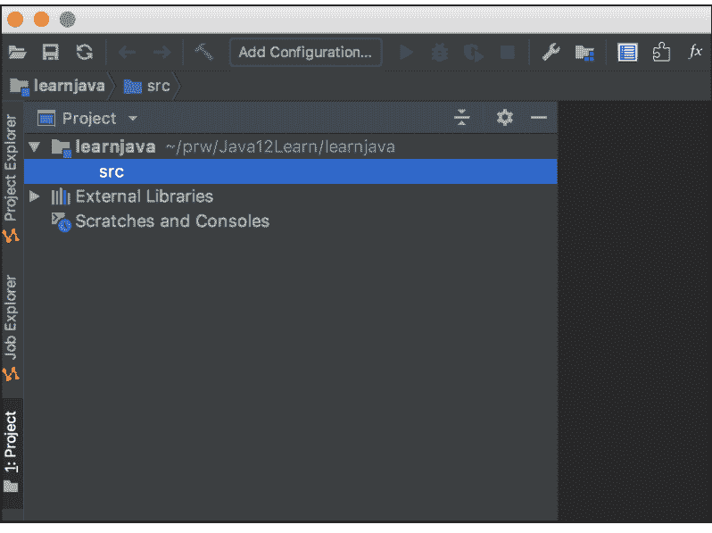
6. 右键点击项目名 (`learnjava`)，从下拉菜单中选择“Add Framework Support”。在接下来的弹出窗口中选择 Maven：
   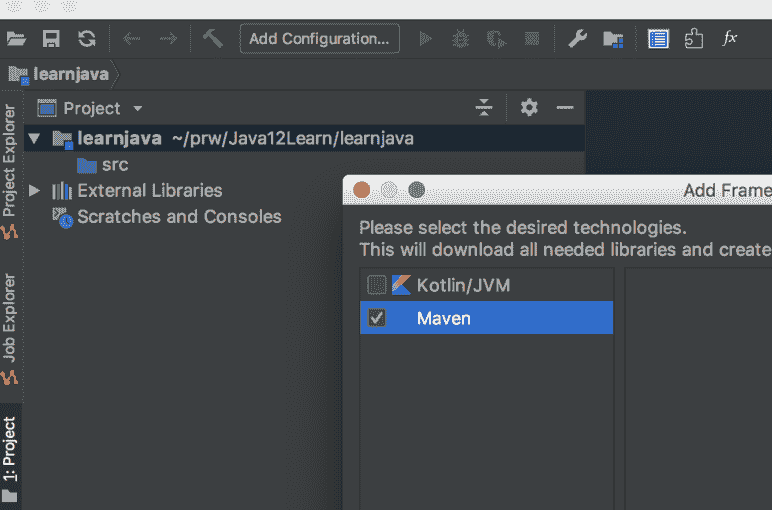
7. Maven 是项目配置工具。它的主要功能是管理项目依赖。我们稍后会讨论。现在我们将使用它的另一个职责，使用三个属性定义并持有项目代码标识：
    - `groupId`：用于识别组织内的项目组。
    - `artifactId`：用于识别特定项目。
    - `version`：用于识别项目的版本。

`groupId` 值的目标是使其身份在所有项目中是唯一的。惯例要求从域名开始。例如，如果一家公司的域名是 `company`，其项目的 `groupId` 应该以 `com` 开头。这就是为什么对于本书中的代码，我们使用 `com.packt.learnjava`。

### Java 12 入门

让我们设置它。点击“Add Framework Support”弹出窗口上的 OK，你将看到一个新生成的 `pom.xml` 文件如下：
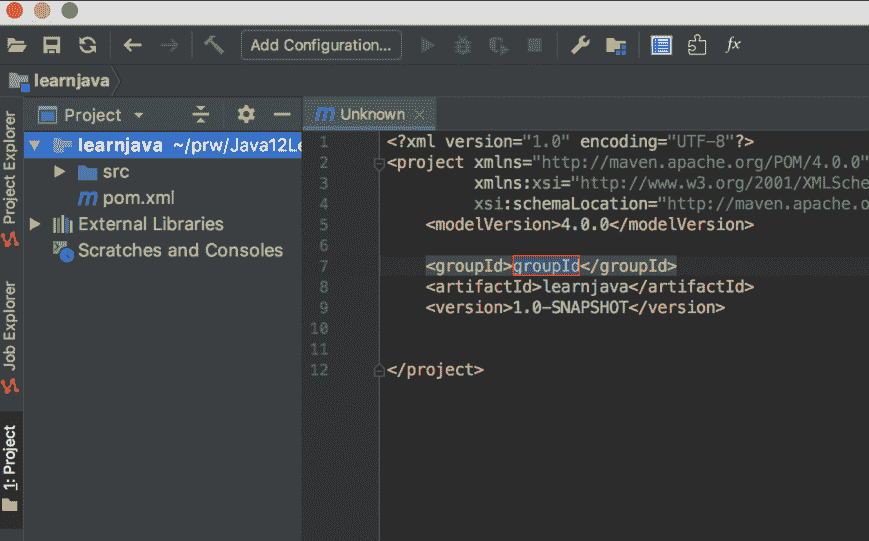

同时，在屏幕右下角，会弹出另一个窗口：


点击“Enable Auto-Import”链接。这将使编写代码更容易：你开始的所有新类都自动导入。我们稍后会讨论类导入。


# Java 12 入门

现在，输入 `groupId`、`artifactId` 和 `version` 值：

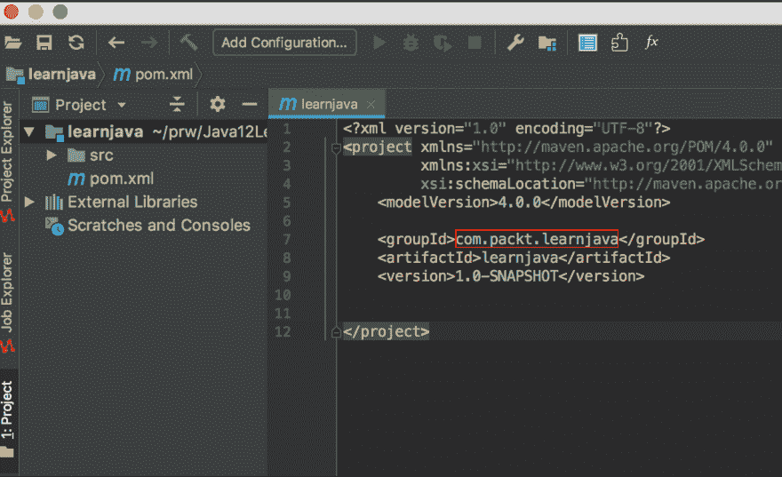

`groupId` 值的另一个功能是定义持有项目代码树的根目录。打开 `src` 文件夹；将看到如下目录结构：

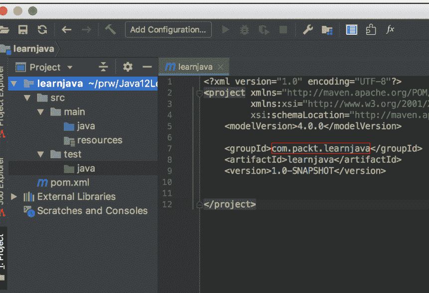

`main` 下的 `java` 文件夹存放应用程序代码，而 `test` 下的 `java` 文件夹存放测试代码。

## 创建第一个程序

按照以下步骤创建我们的第一个程序：

1. 右键点击 `java`，选择 `New`，然后点击 `Package`：

   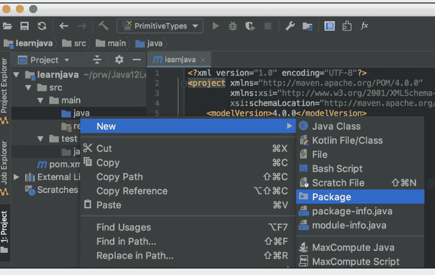

2. 在提供的 `New Package` 窗口中，输入 `com.packt.learnjava.ch01_start`：

   

3. 点击 `OK`，你应该会在左面板看到一组新文件夹，最后一个是 `com.packt.learnjava.ch01_start`。

4. 右键点击它，选择 `New`（新建），然后点击 `Java Class`（Java 类）：

   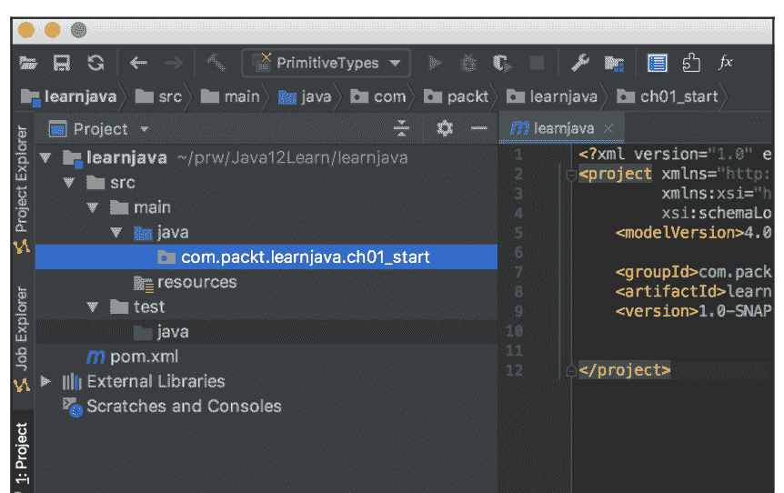

5. 在提供的输入窗口中，输入 `PrimitiveTypes`：

   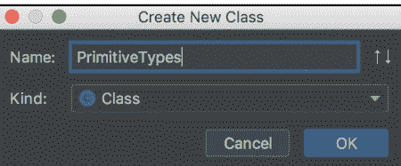

6. 点击 `OK`，你将看到第一个 Java 类 `PrimitiveTypes` 在 `com.packt.learnjava.ch01_start` 包中创建完成：

   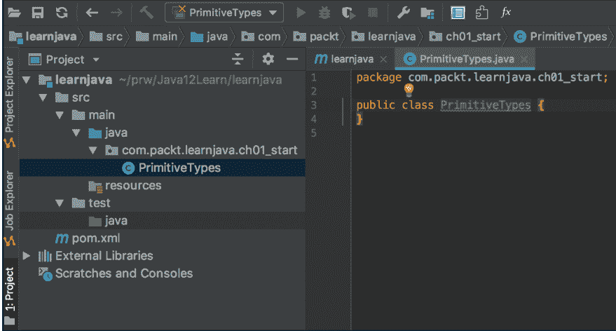

该包反映了 Java 类在文件系统中的位置。我们将在第 2 章“Java 面对象编程 (OOP)”中讨论它。现在，为了运行程序，请创建一个 `main()` 方法。如果该方法存在，它就可以被执行并作为程序的入口点。它具有特定的格式，如下：

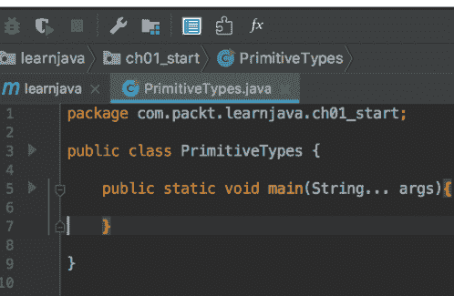

该方法必须满足从包外部访问的条件：

- `public`：自由访问
- `static`：能够在不创建所属类对象的情况下被调用

它还应该符合以下条件：

- 返回 `void`（无）。
- 接收 `String` 数组作为输入或接收变长参数（varargs）作为输入。

我们将在第 2 章“Java 面对象编程 (OOP)”中讨论变长参数。目前只需说明 `String[] args` 基本上定义了相同的输入格式即可。我们解释了如何使用命令行运行 main 类。你可以在 Oracle 官方文档中阅读更多关于 Java 命令行参数的内容：https://docs.oracle.com/javase/tutorial/environment/cmdArgs.html。也可以从 IntelliJ 中运行示例。注意下方截图中左侧的两个绿色三角形。点击其中任何一个，都可以执行 `main()` 方法。例如，让我们显示 Hello, world!

为了实现这一目标，请在 `main()` 方法内部输入以下行：

```java
System.out.println("Hello, world!");
```

然后，点击其中一个绿色三角形：

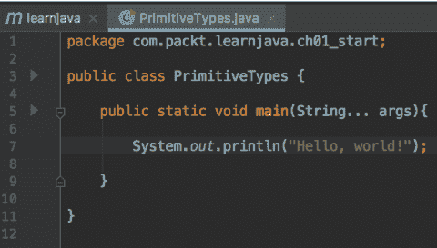

你应该在终端中得到如下输出：


从现在起，每当我们讨论代码时，都将使用 `main()` 方法相同的方式运行它们。在操作过程中，我们不会截屏，因为这种风格更容易跟进。例如，以下代码展示了演示在这种风格下的样子：

```java
System.out.println("Hello, world!"); // prints: Hello, world!
```

可以在代码行的右侧通过双斜杠 `//` 分隔添加注释（任何文本）。编译器不会读取这段文本，并将其原样保留。注释的存在不会影响性能，并用于解释程序员的意图。

## 导入项目

我们将演示导入本书的源代码。我们假设你的电脑上已经安装了 Maven（https://maven.apache.org/install/）并且安装了 Git。我们还假设你已经按照“Installation of Java SE”章节中的描述安装了 JDK 12。

按照以下步骤导入包含本书代码示例的项目：

1. 转到源代码仓库（https://github.com/PacktPublishing/Learn-Java-12-Programming）并点击 `Clone`（克隆）或 `download`（下载）链接，如下方的所示：

   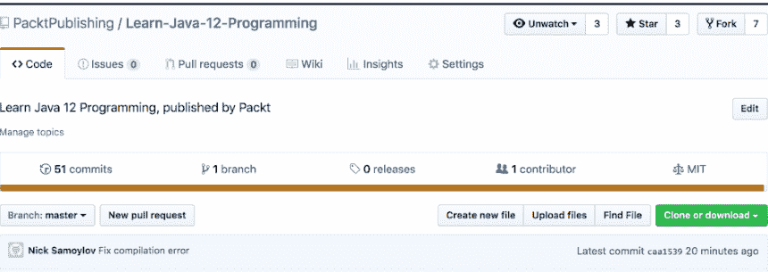

2. 点击 `Clone` 或 `download` 链接并复制提供的 URL：

   

3. 在你的电脑上选择一个想要放置源代码的目录，然后运行以下 Git 命令：

   ```bash
   $ git clone https://github.com/PacktPublishing/Learn-Java-12-Programming.git
   ```

4. 创建一个新的 `Learn-Java-12-Programming` 文件夹，如下方的所示：

   ```bash
   $ git clone https://github.com/PacktPublishing/Learn-Java-12-Programming.git
   Cloning into 'Learn-Java-12-Programming'
   remote: Enumerating objects: 13, done.
   remote: Counting objects: 100% (13/13), done.
   remote: Compressing objects: 100% (10/10), done.
   remote: Total: 735 (delta 0)
   Receiving objects: 100% (735/735), 3.30 MiB/s 3.60 MiB/s.
   Resolving deltas: 100% (268/268), done
   Learn-Java-12
   ```

   或者，与其使用克隆，你可以通过前面的截图下载 ZIP 文件。将下载的源码解压到你想放置源码的目录，并从其名称中删除后缀“master”。

5. 新创建的 `Learn-Java-12` 文件夹包含了本书的源码。现在运行 IntelliJ 并点击顶部的 `File`：

   | File | Edit | View | Analyze | Refactor | Build |
   |---|---|---|---|---|---|
   | New | | | | | |
   | Open | | | | | |
   | Open Recent | | | | | |
   | Close Project | | | | | |

6. 选择 `Learn-Java-12` 文件夹并点击 `Open`：

   

7. 接受默认设置并点击 `Next` 直到显示已安装 JDK 的界面，然后点击 `Finish`：

   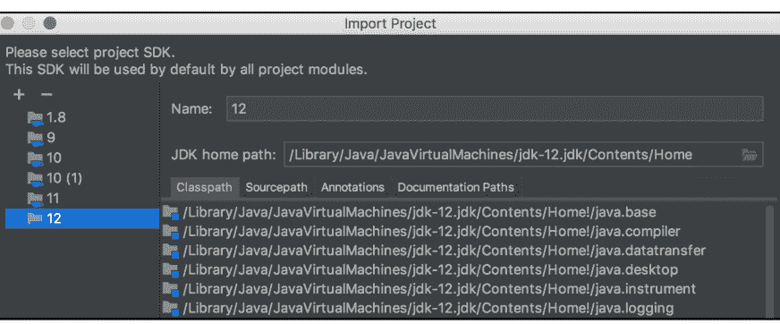

8. 你将看到项目已导入 IntelliJ：

   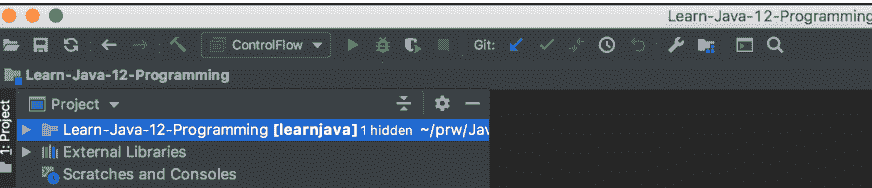

9. 等待右下角出现以下小窗口：

   > Non-managed pom.xml found: /Users/ab54696/temp1/Learn-Java-12-Programming/ming/pom.xml
   >
   > Event Log

10. 点击它；然后点击 `Add as Maven Project` ：

    > Non-managed pom.xml found: /Users/ab54696/temp1/Learn-Java-12-Programming/ming/pom.xml
    >
    > Add as Maven Project or Disable notification

11. 每当弹出以下窗口时，点击 `Enable Auto-Import`：

    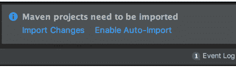

12. 选择项目结构图标，它是下方图中右侧第三个：

    

13. 如果列表中列出了 `main` 和 `test` 模块，通过突出显示并点击减号符号 (`-`) 来移除它们，如下屏所示：

    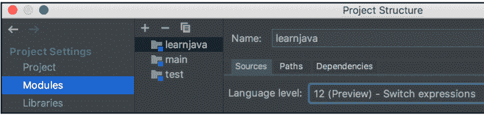

14. 最终的模块列表应该是这样的：

    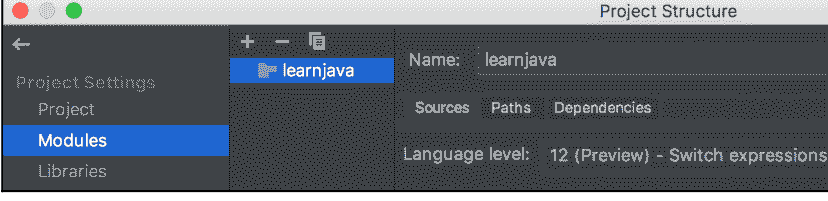

## 开启 Java 12

15. 点击右下角的 `OK` 返回你的项目。在左窗格中点击 `Learn-Java-12-Programming`，并在源树中继续向下，直到看到以下类列表：

    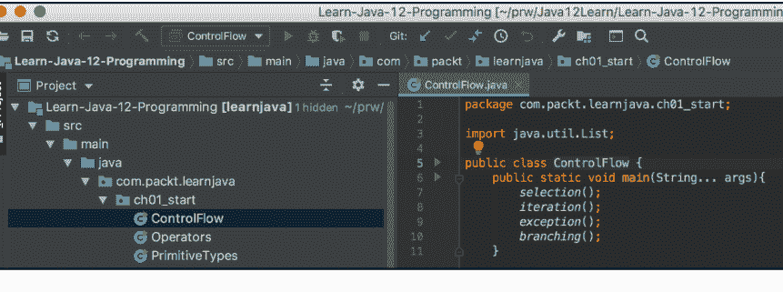

16. 点击右窗格中的绿色箭头执行你想运行任何类。在 Run 窗口中看到的结果如下：

    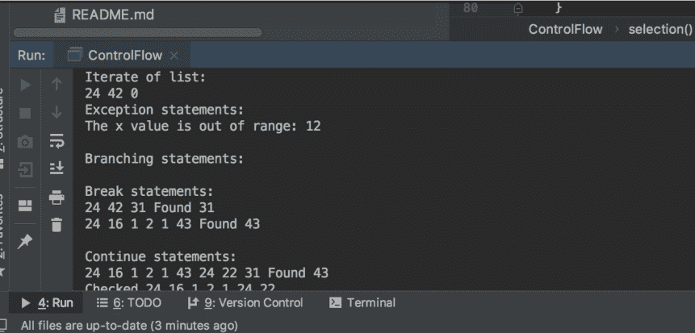

## 从命令行执行示例

要从命令行执行示例，请遵循以下步骤：

- 进入“导入项目”部分第 4 步创建的 `Learn-Java-12-Programming` 文件夹（即 `pom.xml` 文件所在位置），并运行 `mvn clean package` 命令：

  ```
  demo> cd Learn-Java-12-Programming
  demo> ls
  LICENSE README.md learnjava.iml pom.xml src target
  demo> mvn clean package Scanning for projects...
  [INFO]
  [INFO] <----------com.packt.learnjava:learnjava----
  [INFO] Building learnjava 1.0-SNAPSHOT
  [INFO] ----------[ jar ]------
  ```

- 选择你想要运行的示例。例如，假设你想运行 `ControlFlow.java`，运行以下命令：

  ```
  java -cp target/learnjava-1.0-SNAPSHOT.jar:target/libs/* \
  com.packt.learnjava.ch01_start.ControlFlow
  ```

  你将看到以下结果：

  ```
  demo> java -cp target/learnjava-1.0-SNAPSHOT.jar:target/libs/* com.packt.learnjava.ch01_start.ControlFlow
  Selection statements:
  Iteration statements:
  0 1 2 3 4
  0 1 2 3 4
  0 1 2
  ```

- 如果你想运行来自 `ch05_stringsIoStreams` 包的示例文件，请使用不同的包和类名运行相同的命令：

  ```
  java -cp target/learnjava-1.0-SNAPSHOT.jar:target/libs/* \
  com.packt.learnjava.ch05_stringsIoStreams.Files
  ```

### Windows 系统下的命令行执行

如果你的计算机是 Windows 系统，请使用以下单行命令：

```
java -cp target\learnjava-1.0-SNAPSHOT.jar;target\\* com.packt.learnjava.ch05_stringsIoStreams.Files
```

注意，你的 Windows 使用不同的斜杠（`\`）和分号（`;`）作为 classpath 分隔。

- 结果如下：

  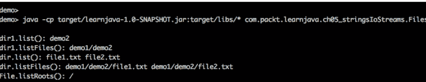

通过这种方式，你可以运行任何包含 `main()` 方法的类。`main()` 方法的内容将被执行。

# Java 基本类型和运算符

工具准备就绪后，我们可以开始讨论 Java 这门语言。语言语法由《Java语言规范》（Java Language Specification）定义，你可以在 https://docs.oracle.com/javase/specs 找到它。当你需要说明时，请随时查阅。它并不像许多人想象的那么复杂。

Java 中的所有值分为两类：引用类型和基本类型。我们从基本类型和运算符开始，这是任何编程语言的自然切入点。在本章中，我们还将讨论一种名为 `String` 的引用类型（参见“String 类型和字面量”节）。

所有基本类型又分为两组：布尔类型和数值类型。

## 布尔类型

Java 中只有两个 `boolean` 类型的值：`true` 和 `false`。此类值只能赋值给 `boolean` 类型的变量，例如：

```java
boolean b = true;
boolean b = x > 2;
if (b) {
    // 执行某些操作
}
```

在代码中，我们将 `x > 2` 表达式的求值结果赋值给变量 `b`。如果 `x` 的值大于 2，则 `b` 变量将获得赋值的值 `true`。然后执行大括号 `{ }` 内部的代码。

## 数值类型

Java 数值类型分为两组：整数类型（`byte`、`char`、`short`、`int` 和 `long`）和浮点类型（`float` 和 `double`）。

### 整数类型

整数类型消耗的内存如下：

- `byte`：8 位
- `char`：16 位
- `short`：16 位
- `int`：32 位
- `long`：64 位

`char` 类型是一个无符号整数，可以存储从 0 到 65,535（包含边界）的值（称为 `code point` 代码点）。它代表一个 Unicode 字符，这意味着有 65,536 个 Unicode 字符。以下是三个格式化基础拉丁 Unicode 字符列表的记录：

| 代码点 | Unicode 转义 | 可打印符号 | 描述 |
|---|---|---|---|
| 33 | `\u021` | ! | 感叹号 |
| 50 | `\u0032` | 2 | 数字 2 |
| 65 | `\u0041` | A | 字母大字母 A |

以下代码演示了 `char` 类型的属性：

```java
char x1 = '\u0032';
System.out.println(x1); // 输出 2

char x2 = '2';
System.out.println(x2); // 输出 2
x2 = 65;
System.out.println(x2); // 输出 A

char y1 = '\u0041';
System.out.println(y1); // 输出 A

char y2 = 'A';
System.out.println(y2); // 输出 A
y2 = 50;
System.out.println(y2); // 输出 2

System.out.println(x1); // 输出 2
System.out.println(y1); // 输出 A
```

每个整数类型的范围如下：

- `byte`：-128 到 127
- `short`：-32,768 到 32,767
- `int`：-2,147,483,648 到 2,147,483,647
- `long`：-9,223,372,036,854,775,808 到 9,223,372,036,854,775,807
- `char`：0 到 65,535

上述显示的最小值和最大值针对有符号类型。无符号类型是 `char`，其范围为 0 到 65,535。

每个整数类型的可能值范围由其所使用的位数决定。然而，Java 允许溢出。例如，如果操作的结果超出了数据类型的范围，它将发生溢出。

### 浮点类型

浮点类型的最小值和最大值要大得多：

- `float`：-3.4E-45 到 3.4E38
- `double`：-4.9E-324 到 1.8E308

### 原始类型的字面量

值的表示被称为字面量（literal）。布尔类型有两个字面量：`true` 和 `false`。`byte`、`short`、`int` 和 `long` 整数类型的字面量都有 `int` 类型，如下所示：

```java
byte b = 42;
short s = 42;
int i = 42;
long l = 42;
```

此外，为了表示一个 `long` 类型的字面量，你可以在末尾添加字母 `l` 或 `L`：

```java
long l1 = 421;
long l2 = 42L;
```

字母 `l` 很容易与数字 `1` 混淆，因此在此处使用 `L`（而不是 `l`）是一个良好的习惯。


# 数值字面量与进制系统

到目前为止，我们使用十进制系统表示整数字面量。同时，`byte`、`short`、`int` 和 `long` 类型的字面量也可以用不同的进制系统表示：二进制（2进制，数字 0-1）、八进制（8进制，数字 0-7）和十六进制（16进制，数字 0-9 和 a-f）。

- 二进制以 `0b`（或 `0B`）开头，后跟二进制表示的值。十进制的 42 表示为 `101010` = `2^0*0 + 2^1*1 + 2^2*0 + 2^3*1 + 2^4*0 + 2^5*1`（我们从右侧开始）。
- 八进制以 `0` 开头，后跟八进制表示的值，因此 42 表示为 `52` = `8^0*2+8^1*5`。
- 十六进制字面量以 `0x`（或 `0X`）开头，后跟十六进制表示的值，因此 42 表示为 `2a` = `16^0*a + 16^1*2`，因为在十六进制系统中，符号 0 到 `f`（或 `A` 到 `F`）映射到十进制值 10 到 15。

以下是演示代码：

```java
int i = 42;
System.out.println(Integer.toString(i, 2)); // 101010
System.out.println(Integer.toBinaryString(i)); // 101010
System.out.println(0b101010); // 42

System.out.println(Integer.toString(i, 8)); // 52
System.out.println(Integer.toOctalString(i)); // 52
System.out.println(052); // 42

System.out.println(Integer.toString(i, 10)); // 42
System.out.println(Integer.toString(i)); // 42
System.out.println(42); // 42

System.out.println(Integer.toString(i, 16)); // 2a
```

## Java 12 新特性

```java
System.out.println(Integer.toHexString(i)); // 2a
System.out.println(0x2a); // 42
```

如你所示，Java 提供了将十进制字符串值转换为不同进制的方法。所有这些数值表示方式都称为字面量。

## 数值字面量中的下划线

数值字面量的一个特性使其对人类友好。如果数字很大，可以将其拆分为由下划线（`_`）分隔的三位组。观察以下示例：

```java
int i = 354_263_654;
System.out.println(i); // 输出: 354263654

float f = 54_436.98f;
System.out.println(f); // 输出: 54436.98

long l = 55_763_948L;
System.out.println(l); // 输出: 55763948
```

编译器会忽略嵌入的下划线。

# 字符字面量与转义序列

`char` 类型有两种字面量：单个字符或转义序列。当使用数值类型时，有 char 字面量的示例：

```java
char x1 = '\u0032';
char x2 = '\2';
char y1 = '\u0041';
char y2 = '\A';
```

如你所示，字符必须包含在单引号中。

转义序列以反斜线（`\`）开头，后跟一个字母或其他字符。以下是转义序列的完整列表：

- `\b`: 退格 BS，Unicode 转义 `\u0008`
- `\t`: 水平制表符，Unicode 转义 `\u0009`
- `\n`: 换行 LF，Unicode 转义 `\u000a`
- `\f`: 分页符 FF，Unicode 转义 `\u000c`
- `\r`: 回车 CR，Unicode 转义 `\u000d`
- `\"`: 双引号 "，Unicode 转义 `\u0022`
- `\'`: 单引号 '，Unicode 转义 `\u0027`
- `\\`: 反斜线 \，Unicode 转义 `\u005c`

# 运算符

## 等于运算符 (== 和 !=)

`==` 运算符表示相等，而 `!=` 运算符表示不等。它们用于比较相同类型的值，如果操作数的值相等则返回布尔值 `true`，否则返回 `false`。例如所示：

```java
int i1 = 1;
int i2 = 2;
System.out.println(i1 == i2); // prints: false
System.out.println(i1 != i2); // prints: true
System.out.println(i1 == (i2 - 1)); // prints: true
System.out.println(i1 != (i2 - 1)); // prints: false
```

不过，比较浮点类型的值时要小心，尤其是当比较计算结果时。在这种情况下，使用关系运算符（`<`、`>`、`<=`、`>=`）要可靠得多，因为像 `1/3` 的计算会产生无限的小数部分 `0.3333333...`，并最终取决于精度的实现（这是一个超出本书范围的复杂话题）。

## 关系运算符 (<, <=, >, >=)

关系运算符比较值并返回布尔值。例如所示：

```java
int i1 = 1;
int i2 = 2;
System.out.println(i1 >= i2); // prints: false
System.out.println(i1 > i2); // prints: false
System.out.println(i1 > (i2 - 1)); // prints: true
System.out.println(i1 < i2); // prints: true
System.out.println(i1 <= i2); // prints: true
System.out.println(i1 < (i2 - 1)); // prints: false
float f = 1.2f;
System.out.println(i1 < f); // prints: true
```

## 逻辑运算符 (!, &, |)

逻辑运算符可以定义如下：

- `!` 一元运算符如果操作数为 `false` 则返回 `true`，否则返回 `false`。
- `&` 二元运算符如果两个操作数都为 `true` 则返回 `true`。
- `|` 二元运算符如果至少有一个操作数为 `true` 则返回 `true`。

### 示例

```java
boolean b = true;
System.out.println(!b);    // prints: false
System.out.println(!!b); // prints: true
boolean c = true;
System.out.println(c & b); // prints: true
System.out.println(c | b); // prints: true
boolean d = false;
System.out.println(c & d); // prints: false
System.out.println(c | d); // prints: true
```

## 条件运算符 (&&, ||, 和 ?)

`&&` 和 `||` 运算符产生的结果与我们演示过的 `&` 和 `|` 逻辑运算符相同：

```java
boolean b = true;
boolean c = true;
System.out.println(c && b); // prints: true
System.out.println(c || b); // prints: true
boolean d = false;
System.out.println(c && d); // prints: false
System.out.println(c || d); // prints: true
```

区别在于 `&&` 和 `||` 运算符并不总是求值第二个操作数（短路求值）。例如，在 `&&` 运算符的情况下，如果第一个操作数为 `false`，则不求值第二个操作数，因为整个表达式的结果将是 `false`。同样，在 `||` 运算符的情况下，如果第一个操作数为 `true`，整个表达式显然会被求值为 `true`，而不需要求值第二个操作数。我们通过以下代码演示这一点：

```java
int h = 2;
System.out.println(h > 3 && h++ < 3); // prints: false
System.out.println(h); // prints: 2
System.out.println(h > 3 && h++ < 3); // prints: false
System.out.println(h); // prints: 2
```

### 三元运算符 (?)

`?` 运算符被称为三元运算符。它评估一个条件（`?` 符号之前），如果结果为 `true`，则赋值 `?` 和 `:` 之间的表达式的值；否则，它赋值第二个表达式的值。

```java
int n = 5;
int result = (n > 3) ? 10 : 20;
System.out.println(result); // prints: 10
```

## 赋值运算符

`=` 运算符将右侧的值赋给左侧变量。还有复合赋值运算符：

- `+=` 将值加到变量并赋值结果。
- `-=` 从变量中减去一个值并赋值结果。
- `*=` 将变量乘以一个值并赋值结果。
- `/=` 将变量除以一个值并赋值结果。
- `%=` 计算余数并赋值结果。

```java
int x = 10;
x += 5; // x 现在 15
x -= 3; // x 现在 12
x *= 2; // x 现在 24
x /= 4; // x 现在 6
x %= 4; // x 现在 2
```

# 字符串字面量

在 Java 中，字符串字面量是用双引号括的字符串。这些字面量存储在一个称为字符串池的特殊区域。当你创建一个字符串字面量时，JVM 会检查池中是否存在相同的字符串。如果有，它将返回已有的引用。

```java
String s1 = "hello";
String s2 = "hello";
System.out.println(s1 == s2); // prints: true
```

这种机制通过避免重复的字符串对象来节省内存。然而，如果你使用 `new` 运算符，会在池外创建一个新对象：

```java
String s1 = "hello";
String s2 = new String("hello");
System.out.println(s1 == s2); // prints: false
```

我们很快会讨论 `String` 类的 `equals()` 以及其他方法。

另一个让 `String` 字面量和对象看起来像原始类型值的特征是，它们可以使用算术运算符 `+` 进行相加：

```java
String s1 = "abc";
String s2 = "abc";
String s = s1 + s2;
System.out.println(s); // 输出: abcabc
System.out.println(s1 + "abc"); // 输出: abcabc
System.out.println("abc" + "abc"); // 输出: abcabc
```

```java
String o1 = new String("abc");
String o2 = new String("abc");
String o = o1 + o2;
System.out.println(o); // 输出: abcabc
System.out.println(o1 + "abc"); // 输出: abcabc
```

其他算术运算符都不能应用于 `String` 字面量或对象。

## 文本块

Java 12 引入了一种新的 String 字面量，称为文本块。它便于在不向引号中添加空格的情况下保留缩进和多行内容。以下是程序员在 Java 12 之前如何添加缩进并使用 `\n` 换行的：

```java
String html = "<html>\n" + 
      "<body>\n" + 
      "<p>Hello World.</p>\n" + 
      "</body>\n" + 
      "</html>\n";
```

而在 Java 12 中实现相同结果的方法如下：

```java
String html = """
      <html>
        <body>
          <p>Hello World.</p>
        </body>
      </html>""";
```

如你所见，文本块是用三个双引号 (`"""`) 包围的多行字符串。

# String 的不可变性

由于所有的 `String` 字面量都是共享的，JVM 作者确保一旦存储，`String` 变量就不能被更改。这不仅有助于避免代码不同位置并发修改相同值的问题，还能防止对 `String` 值进行未经授权的修改（该值通常代表用户名或密码）。

以下代码看起来像是修改了 `String` 值：

```java
String str = "abc";
str = str + "def";
System.out.println(str); // 输出: abcdef
str = str + new String("123");
System.out.println(str); // 输出: abcdef123
```

但在底层，原始的 "abc" 字面量保持完好。创建了几个新的字面量："def"、"abcdef"、"123" 和 "abcdef123"。证明这一点，我们执行了以下代码：

```java
String str1 = "abc";
String r1 = str1;
str1 = str1 + "def";
String r2 = str1;
System.out.println(r1 == r2); // 输出: false
System.out.println(r1.equals(r2)); // 输出: false
```

如你所见，`r1` 和 `r2` 变量指向不同的内存，而对象的拼写不同。

我们将在第 5 章介绍更多关于字符串的输入/输出。

# 标识符和变量

从我们的学校时代开始，我们就对变量有了直观的理解。我们认为变量是一个表示值的名称。使用变量来解决问题。在 Java 中，变量名被称为标识符，并且可以根据特定规则进行声明和初始化。

## 标识符

根据 [Java 语言规范](https://docs.oracle.com/javase/specs)，标识符（变量名）可以是 Unicode 字符序列，表示为字母、数字 0-9、美元符号 (`$`) 或下划线 (`_`)。

其他限制如下：

- 标识符的首字符不能是数字。
- 标识符不能与关键字拼写相同（参见第 3 章，Java 基础）。
- 它不能拼写为布尔字面量 `true` 或 `false`，或者字面量 `null`。
- 并且自 Java 9 起，标识符不能只是下划线 (`_`)。

这里是一些非法的标识符示例：

```
$ 
42
α
String
```

## 变量声明（定义）和初始化

变量有一个名称（标识符）和一个类型。通常，它指向存储值的内存，但可能指向空（`null`）或者完全不指向任何内容（那么它就没有被初始化）。它可以表示类属性、数组元素、方法参数和局部变量。最后一种是最常用的变量。

在使用变量之前，它必须被声明并初始化。在某些其他语言中，变量也可以被定义，所以程序员有时会将“定义”作为“声明”的同义词，这并不完全正确。

以下是术语回顾示例：

```java
int x; // 变量 x 的声明
x = 1; // 变量 x 的初始化
x = 2; // 变量 x 的赋值
```

# 控制流语句

控制流语句可以是以下内容之一：

- 选择语句：`if-else` 或 `switch-case`
- 迭代语句：`for`，或 `while`，或 `do-while`
- 异常处理语句：`throw`，或 `try-catch`，或 `try-catch-finally`
- 分支语句：`break`，或 `continue`，或 `return`

## 选择语句

选择语句基于表达式求值，有四种变体：

- `if (expression) {执行某些操作}`
- `if (expression) {执行某些操作} else {执行其他操作}`
- `if (expression) {执行某些操作} else if {执行其他} else {执行其他}`
- `switch case` 语句

以下是 `if` 语句的示例：

```java
if(x > y) {
  //执行某些操作
}
if(x > y) {
  //执行某些操作
} else {
  //执行其他操作
}
if(x > y) {
  //执行某些操作
} else if (x == y) {
  //执行其他操作
} else {
  //执行不同的操作
}
```

## Switch 语句

`switch...case` 语句是 `if...else` 语句的一种变体：


```java
switch(x) {
    case 5:
        //意味着：if(x = 5)
        //执行某些操作
        break;
    case 7:
        //执行其他操作
        break;
    case 12:
        //执行不同的操作
        break;
    default:
        //执行完全不同的操作
        //如果 x 不是 5, 7 或 x;
}
```

如你所见，`switch...case` 语句根据变量的值形成执行流。`break` 语句允许 `switch...case` 语句执行执行。否则，所有后续的 `case` 都被执行。

在 Java 12 中，在预览模式下引入了一个新特性：一种更简洁形式的 `switch...case` 语句：

```java
void switchDemo(int x) {
    switch (x) {
        case 1, 3 -> System.out.print("1 or 3");
        case 4 -> System.out.print("4");
        case 5, 6 -> System.out.print("5 or 6");
        default -> System.out.print("Not 1,3,4,5,6");
    }
    System.out.println(": " + x);
}
```

如你所见，箭头 `->` 不使用 `break` 语句。为了利用这一特性，你必须在 `javac` 和 `java` 命令中添加 `--enable-preview` 选项。如果你从 IDE 运行示例，你确实需要在配置中添加此选项。在 IntelliJ IDEA 中，该选项应被添加到两个配置屏幕中：针对编译器和运行时的：

1. 打开 Preferences 界面并将其作为 learnjava 模块的 Compilation 选项，如下截图所示：

| 编译器 | |
| :--- | :--- |
| Excludes | |
| Java Compiler | |
| Annotation Processors | |
| Validation | |
| R Compiler | |
| Kotlin Compiler | |
| Debugger | |
| Remote Repositories | |
| Coverage | |
| Required Plugins | |
| Languages & Frameworks | |
| Tools | |
| Other Settings | |

Java 选项

- 尽可能使用来自 module target JDK 的编译器
- 生成调试信息
- 报告对弃用特性的使用
- 生成无警告

额外的命令行参数：（`--` 在跨平台配置的路径中推荐）

| 覆盖每个模块的编译器参数： | |
| :--- | :--- |
| learnava | `--enable-preview` |

2. 在最部的水平菜单中选择 Run：

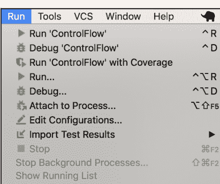

3. 点击 Edit Configurations... 并将 VM option 添加到运行时使用的 ControlFlow 应用：

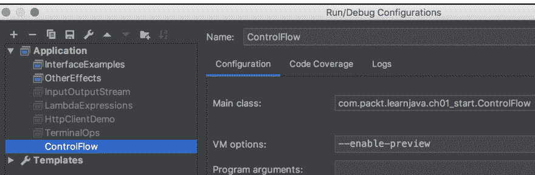

我们已经刚才描述的那样添加了 `--enable-preview` 选项，并使用不同的参数执行了 `switchDemo()` 方法：

```java
switchDemo(1);   //打印: 1 or 3: 1
switchDemo(2);   //打印: Not 1,3,4,5,6: 2
switchDemo(5);   //打印: 5 or 6: 5
```

你可以从注释中看到结果。

如果每个 case 中需要执行几行代码，你只需要放入大括号 `{}` 和代码块，如下：

```java
switch (x) {
    case 1, 3 -> {
        //执行某些操作
    }
    case 4 -> {
        //执行其他操作
    }
    case 5, 6 -> System.out.println("5 or 6");
    default -> System.out.println("Not 1,3,4,5,6");
}
```

Java 12 的 `switch...case` 语句甚至可以返回一个值。例如，这里根据 `switch...case` 结果为另一个变量赋值的情况：

```java
void switchDemo2(int i) {
    boolean b = switch(i) {
        case 0 -> false;
        case 1 -> true;
        default -> false;
    };
    System.out.println(b);
}
```

如果我们执行 `switchDemo2(2)` 方法，结果将如下：

```text
switchDemo2(0); //打印: false
switchDemo2(1); //打印: true
switchDemo2(2); //打印: false
```

这看起来是一个很不错的改进。如果这个特性被证明是有用的，它将在未来的 Java 版本中作为永久特性包含。

### 迭代语句

迭代语句可以是以下三种形式之一：

- `while` 语句
- `do...while` 语句
- `for` 语句，也称为循环语句

`while` 语句显示如下：

```java
while (boolean expression) {
    //执行某些操作
}
```

这是一个具体的示例：

```java
int n = 0;
while (n < 5) {
    System.out.print(n + " "); //打印: 0 1 2 3 4
    n++;
}
```

在某些示例中，我们没有使用 `println()` 方法，而是使用 `print()` 方法，它不会产生另一行（在输出末尾不添加换行符）。`print()` 方法显示输出。

`do...while` 语句形式非常相似：

```java
do {
    //执行某些操作
} while (boolean expression)
```

它与 `while` 语句的区别在于在评估表达式之前至少执行一次代码块：

```java
int n = 0;
do {
    System.out.print(n + " ");
    n++;
} while (n < 5); //打印: 0 1 2 3 4
```

如你所见，当表达式为假时，结果是不同的：

```java
int n = 0;
while (n < 5) { //不执行
```

`for` 语句语法如下：

```java
for (init statements; boolean expression; update statements) {
    //在这里
}
```

这里是 `for` 语句初始化变量：

- `init statements` 初始化一个变量。
- `boolean expression` 被评估：如果为真，执行代码块。
- `update statements` 更新变量，并再次评估表达式：如果为真，执行代码块。
- 退出。

可以看到，如果不小心，可能会导致无限循环：

```java
for (int x = 0; x > -1; x++) {
    System.out.print(x + " "); // 打印: 0 1 2 3 4 5 6
}
```

所以，你必须确保布尔表达式保证退出：

```java
for (int x = 0; x < 3; x++) {
    System.out.print(x + " "); // 打印: 0 1 2
}
```

以下示例演示了多个初始化和更新语句：

```java
for (int x = 0, y = 0; x < 3 && y < 3; ++x, ++y) {
    System.out.println(x + " " + y);
}
```

这里是用于演示的前述 `for` 语句：

```java
for (int x = getInitialValue(), i = x == -2 ? x + 2 : 0, j = 0;
     i < 3 || j < 3; ++i, j = i) {
    System.out.println(i + " " + j);
}
```

为了遍历数组，你可以使用数组索引：

```java
int[] arr = {24, 42, 0};
for (int i = 0; i < arr.length; i++) {
    System.out.print(arr[i] + " "); // 打印: 24 42 0
}
```

或者，你可以使用一种更简洁的 `for` 语句形式，产生相同的结果，如下：

```java
int[] arr = {24, 42, 0};
for (int a : arr) {
    System.out.print(a + " "); // 打印: 24 42 0
}
```

## 开始使用 Java 12

这种最后的形式在处理集合时特别有用，如下：

```java
List<String> list = List.of("24", "42", "0");
for (String s : list) {
    System.out.print(s + " "); //打印: 24 42 0
}
```

我们将在第6章“数据结构、泛型和常用工具”中讨论集合。

## 异常处理语句

在 Java 中，有许多异常（exceptions）类代表中断正常执行流的事件。它们的名称通常以 Exception 结尾：例如 `NullPointerException`、`ClassCastException`、`ArrayOutOfBoundsException` 等。

所有异常都继承自 `java.lang.Exception` 类，我们将在第 2 章“Java 面对象编程 (OOP)”中解释它的含义。这就是为什么所有异常对象都有共同的行为。它们包含了有关异常情况产生的信息以及其起源的位置（源代码的行号）。

每个对象都可以由 JVM 自动生成（抛出），也可以通过应用程序代码使用 `throw` 关键字抛出。如果一个代码块抛出了异常，你可以使用 `try-catch` 或 `try-catch-finally` 结构来捕获抛出的异常对象，并将执行流重定向到代码分支。如果周围代码没有捕获该异常对象，它将一直传播到 JVM 之外并强制其退出（从而中止应用程序执行）。因此，在所有可能引发异常且你不希望应用程序中止执行的地方使用 `try-catch` 或 `try-catch-finally` 是一种良好的实践。

这是一个典型的异常处理示例：

```java
try {
    // x = someMethodReturnValue();
    if(x > 10) {
        throw new RuntimeException("The x value is out of range: " + x);
    }
    // 此处是 x 的正常处理流
} catch (RuntimeException ex) {
    // 执行解决问题必须执行的操作
}
```

## 开始使用 Java 12

在前面的代码段中，如果 `x > 10`，则不会执行正常处理流。相反，将执行“必须的操作”块；但在 `x <= 10` 的情况下，将运行正常处理流块并执行“必须的操作”块。

有时，无论是否抛出/捕获异常，都有必要执行一段代码块。与其在两个地方重复相同的代码块，你可以将其放在 `finally` 块中，如下：

```java
try {
    // x = methodReturningValue();
    if (x > 10) {
        throw new RuntimeException("The x value is out of range: " + x);
    }
    // x 的正常处理流
} catch (RuntimeException ex) {
    System.out.println(ex.getMessage());
    // 打印: The x value is out of range: ...
    // 执行解决问题必须执行的操作
} finally {
    // 放置在此处的代码始终执行
}
```

我们将在第 4 章“异常处理”中更详细地讨论异常处理。

## 分支语句

分支语句允许打破当前的执行流，并从当前块后的第一行或从控制流的某个（标记的）点继续执行流。

分支语句可以是以下之一：

- `break`
- `continue`
- `return`

我们已经看到 `break` 是如何在 `switch-case` 语句中使用的。这里是另一个示例：

```java
String found = null;
List<String> list = List.of("24", "42", "31", "2", "1");
for (String s : list) {
    System.out.print(s + " "); // 打印: 24 42 31
    if(s.contains("3")){
        found = s;
        break;
    }
}
```


## 代码示例：查找包含 "3" 的字符串

```
String found = null;
List<String> list = List.of("24", "42", "31", "2", "1");
for (String s : list) {
  System.out.print(s + " "); // 打印: 24 42 31
  if(s.contains("3")){
    found = s;
    break;
  }
}
```

在前面的代码段中，如果 `x > 10`，则不会执行正常处理流。相反，将执行“必须的操作”块；但在 `x <= 10` 的情况下，将运行正常处理流块并执行“必须的操作”块。

## 开始使用 Java 12

这种最后的形式在处理集合时特别有用，如下所示：

```
List<String> list = List.of("24", "42", "0");
for (String s : list) {
    System.out.print(s + " "); //打印: 24 42 0
}
```

我们将在第6章“数据结构、泛型和常用工具”中讨论集合。

## 异常处理语句

在 Java 中，有许多异常（exceptions）类代表中断正常执行流的事件。它们的名称通常以 `Exception` 结尾：例如 `NullPointerException`、`ClassCastException`、`ArrayOutOfBoundsException` 等。

所有异常都继承自 `java.lang.Exception` 类，我们将在第 2 章“Java 面对象编程 (OOP)”中解释它的含义。这就是为什么所有异常对象都有共同的行为。它们包含了有关异常情况产生的信息以及其起源的位置（源代码的行号）。

每个对象都可以由 JVM 自动生成（抛出），也可以通过应用程序代码使用 `throw` 关键字抛出。如果一个代码块抛出了异常，你可以使用 `try-catch` 或 `try-catch-finally` 结构来捕获抛出的异常对象，并将执行流重定向到代码分支。如果周围代码没有捕获该异常对象，它将一直传播到 JVM 之外并强制其退出（从而中止应用程序执行）。因此，在所有可能引发异常且你不希望应用程序中止执行的地方使用 `try-catch` 或 `try-catch-finally` 是一种良好的实践。

这是一个典型的异常处理示例：

```
try {
    // x = someMethodReturnValue();
    if(x > 10) {
        throw new RuntimeException("The x value is out of range: " + x);
    }
    // 此处是 x 的正常处理流
} catch (RuntimeException ex) {
    // 执行解决问题必须执行的操作
}
```

## 开始使用 Java 12（续）

在前面的代码段中，如果 `x > 10`，则不会执行正常处理流。相反，将执行“必须的操作”块；但在 `x <= 10` 的情况下，将运行正常处理流块并执行“必须的操作”块。

有时，无论是否抛出/捕获异常，都有必要执行一段代码块。与其在两个地方重复相同的代码块，你可以将其放在 `finally` 块中，如下：

```
try {
  // x = methodReturningValue();
  if (x > 10) {
    throw new RuntimeException("The x value is out of range: " + x);
  }
  // x 的正常处理流
} catch (RuntimeException ex) {
  System.out.println(ex.getMessage());
  // 打印: The x value is out of range: ...
  执行解决问题必须执行的操作
} finally {
  // 放置在此处的代码始终执行
}
```

我们将在第 4 章“异常处理”中更详细地讨论异常处理。

## 分支语句

分支语句允许打破当前的执行流，并从当前块后的第一行或从控制流的某个（标记的）点继续执行流。

分支语句可以是以下之一：

- `break`
- `continue`
- `return`

我们已经看到 `break` 是如何在 `switch-case` 语句中使用的。这里是另一个示例：

```
String found = null;
List<String> list = List.of("24", "42", "31", "2", "1");
for (String s : list) {
  System.out.print(s + " "); // 打印: 24 42 31
  if(s.contains("3")){
    found = s;
    break;
  }
}
```

## 练习题

### 9. 下面哪些是字面量（literals）？

- a. 0
- b. 20
- c. 20
- d. f#

### 10. 下面哪些是运算符（operators）？

- a. %
- b. $
- c. &
- d. ->

### 11. 下面代码段输出什么？

```
int i = 0; System.out.println(i++);
```

- a. 0
- b. 1
- c. 2
- d. 3

### 12. 下面代码段输出什么？

```
boolean b1 = true;
boolean b2 = false;
System.out.println((b1 & b2) + " " + b2);
```

- a. false true
- b. false false
- c. true false
- d. true true

### 13. 下面代码段输出什么？

```
int x = 10;
x %= 6;
System.out.println(x);
```

- a. 1
- b. 2
- c. 3
- d. 4

### 14. 下面代码段的结果是几个？

```
System.out.println("abc" - "bc");
```

- a. a
- b. abc-bc
- c. 编译错误
- d. 运行错误

### 15. 下面代码段输出什么？

```
System.out.println("A".repeat(3).lastIndexOf("A"));
```

- a. 1
- b. 2
- c. 3
- d. 4

### 16. 哪些是正确的标识符（identifiers）？

- a. __ (两个下划线)
- b. 2a
- c. a2
- d. $

### 17. 下面代码段输出什么？

```
for (int i=0, j=-1; i < 2 && j < 0; ++i, ++j) {
    System.out.println(i + " " + j);
}
```

- a. 0 -1 2 0
- b. 无限循环
- c. 2 0
- d. 0 -1

### 18. 下面代码段输出什么？

```
int x = 10;
try {
    if(x++ > 10) {
        throw new RuntimeException("The x value is out of the range: " + x);
    }
    System.out.println("The x value is within the range: " + x);
} catch (RuntimeException ex) {
    System.out.println(ex.getMessage());
}
```

- a. 编译错误
- b. The x value is out of the range: 11
- c. The x value is within the range: 11
- d. 运行错误

### 19. 下面代码段输出什么？

```
int result = 0;
List<List<Integer>> source = List.of(
    List.of(1, 2, 3, 4, 6),
    List.of(22, 23, 24, 25),
    List.of(32, 33)
);
for (List<Integer> i : source) {
    for (int i : i) {
        if (i > 7) {
            result = i;
            continue;
        }
    }
}
System.out.println("result=" + result);
```

- a. result = 22
- b. result = 23
- c. result = 32
- d. result = 33

### 20. 选择下面所有正确的语句：


## 20. 从下面选择所有正确的 Java 语句类型：

- a. 可执行语句
- b. 选择语句
- c. 方法结束语句
- d. 递增语句

# 2 面向对象编程 (OOP)

**面向对象编程（OOP）** 的诞生源于对共享数据并发修改进行更好控制的需求，这在非 OOP 编程时代曾是噩梦。该思想的核心是不允许直接访问数据，而是仅通过专门的代码层来实现。由于数据在过程中需要被传递和修改，因此产生了“对象”的概念。在最通用的意义上，对象是一组数据，可以被传递并仅通过同样传递的方法集进行访问。这些数据被称为对象的状态，而方法构成了对象的行为。对象的状态被隐藏（**封装**）以防止被直接访问。

每个对象都是在一个称为**类（class）**的特定模板上构建的。换句话说，类定义了一类对象。每个对象都有特定的**接口（interface）**，即与其他对象交互的正式定义。最初，人们认为一个对象通过调用方法向另一个对象发送消息。但这种术语并不准确，特别是在引入了实际基于的消息协议和系统之后。

为了避免代码重复，对象之间引入了父子关系：认为一个类可以继承另一个类的行为。在这种关系中，第一个类被称为**子类（child class）**或**子类（subclass）**，而第二个被称为**父类（parent）**、**基类（base class）**或**超类（superclass）**。

另一种关系形式是类与接口之间的关系：认为一个类可以实现（implement）一个接口。接口描述了其他对象如何与其交互，不同的类在实现相同接口时可以有不同的行为。

# 3 Java 面向对象编程 (OOP)

在 Java 中，一个类只有一个父类，但可以实现多个接口。这种能力被称为多态性。在本章中，我们将介绍这些 OOP 概念，它们包括：

- OOP 概念
- 类
- 接口
- 重载、重写和隐藏
- 最终变量、方法和类
- 多态性的应用

## OOP 概念

正如我们所述，主要的 OOP 概念如下：

- **对象/类**：定义了状态（数据）
- **继承**：通过父子关系传播行为
- **抽象/接口**：描述了对象如何被访问
- **封装**：隐藏了状态
- **多态性**：允许对象像其祖先类一样表现

## Java 面向对象编程 (OOP) 第二章

可以说，`Car` 类或 `Truck` 类的每个对象都有一个 `Vehicle` 类的父对象。`Car` 和 `Truck` 对象并不共享特定的 `Vehicle` 类（每当创建一个儿子时，都会创建一个新的父对象）。它们只共享父类的行为。这就是为什么所有子对象具有相同的行为但不同的状态。有一种实现代码重用的方法，但当行为需要动态变化时，它可能不够灵活。在这种情况下，对象组合（引入其他类的行为）或函数式编程更为合适（参见第 13 章，函数式编程）。

可以使子类的行为与继承的行为不同。为了实现这一点，可以在子类中重新实现捕获该行为的方法。可以说子类可以重写继承的行为。我们稍后将解释如何操作（重载、重写和隐藏章节）。如果 `Car` 类有它自己的速度计算方法，那么父类 `Vehicle` 的对应方法就不会被继承，而是被使用在子类中实现的新速度计算方法。

父类的属性可以被继承（如果没有被重写）。然而，类属性通常被声明为私有（private）；它们不能被继承——这就是封装的意义。请参见访问修饰符章节中公共（public）、保护（protected）和私有（private）各种访问级别的描述。

如果父类从另一个类继承了某些行为，那么子类也会获得（继承）这种行为，除非父类重写了它。继承链的长度没有限制。

Java 中的父子关系使用 `extends` 关键字表示：

```java
class A { }
class B extends A { }
class C extends B { }
class D extends C { }
```

在代码段代码中，类 A、B、C 和 D 具有以下关系：

- 类 D 继承类 C、B 和 A
- 类 C 继承类 B 和 A
- 类 B 继承类 A

类 A 的非私有方法都由类 B、C 和 D 继承（如果没有被重写）。

### 抽象/接口 (Abstraction/interface)

方法的名称及其参数类型列表被称为“方法签名”（method signature）。它描述了如何访问对象（在我们的示例中 `Car` 或 `Truck`）的行为。这种描述连同返回类型以接口（interface）的形式呈现。它没有说明任何关于计算代码的内容——只关于方法名、参数类型、它们在参数列表中的位置以及结果类型。所有的实现细节都隐藏（封装）在实现该接口的类之中。

正如我们提到的，一个类可以实现许多不同的接口。但两个不同的类（及其对象）即使实现相同的接口，其行为也可能不同。

与类类似，接口也可以使用 `extends` 关键字具有父子关系：

```java
interface A { }
interface B extends A { }
interface C extends B { }
interface D extends C { }
```

在代码段代码中，接口 A、B、C 和 D 具有以下关系：

- 接口 D 继承接口 C、B 和 A
- 接口 C 继承接口 B 和 A
- 接口 B 继承接口 A

接口 A 的非私有方法都由接口 B、C 和 D 继承。

抽象/接口减少了代码不同部分之间的依赖性，从而增加了其可维护性。只要接口保持不变，就可以更改每个类，而无需与其客户端进行协调。

### 封装 (Encapsulation)

封装通常被定义为数据隐藏，或将公共访问的方法与私有访问的数据打包在一起。从广义上说，封装是对对象属性的控制访问。

对象属性值的快照被称为对象状态（object state）。对象状态就是封装的数据。因此，封装解决了促使面向对象编程创建的主要问题：对共享数据的并发访问进行更好的管理。例如：

```java
class A {
    private String prop = "init value";
    public void setProp(String value) {
        prop = value;
    }
    public String getProp() {
        return prop;
    }
}
```

如你所见，为了读取或修改 `prop` 属性的值，由于访问器是 `private`，我们无法直接访问它。相反，我们只能通过 `setProp(String value)` 和 `getProp()` 方法来操作。

### 多态 (Polymorphism)

多态是一个对象表现得像不同类的对象或作为不同接口的实现的能力。它的存在归功于之前提到的所有概念：继承、接口和封装。没有它们，多态将是不可能的。

继承允许对象获取或重写其所有祖先的行为。继承向客户端代码隐藏了实现该行为的类名。封装防止了暴露对象状态。

在接下来的章节中，我们将演示这些概念的所有运作，并在“多态实战”章节查看多态的具体用法。

### 类 (Class)

Java 程序是表示可执行操作的语句序列。语句组织在方法中，而方法组织在类中。一个或多个类存储在 `.java` 文件中。它们可以由 Java 编译器 `javac` 编译（从 Java 语言转换为字节码）并存储在 `.class` 文件中。每个 `.class` 文件只包含一个编译后的类，并可以由 JVM 执行。

`java` 命令启动 JVM 并告诉它哪个类是主类，即拥有 `main()` 方法的类。`main` 方法有一个特殊的声明：它是 `public static`，必须返回 `void`，名为 `main`，并接受一个 String 数组 类型的单个参数。

JVM 将类加载到内存中，找到 `main()` 方法并开始逐语句执行。`java` 命令还可以传递参数（参数），`main()` 方法将以 String 值数组的形式接收这些参数。如果 JVM 遇到需要执行另一个类的方法的语句，其 `.class` 文件将被加载到内存中并执行相应的方法。Java 程序流程的核心就是关于加载类和执行它们的方法。

这是一个主类的示例：

```java
public class MyApp {
    public static void main(String[] args){
        AnotherClass an = new AnotherClass();
        for(String s: args){
            an.display();
        }
    }
}
```

它代表了一个非常简单的应用程序，接收任意数量的参数并将它们一个一个传递给 `display()` 方法。如果 JVM 启动，它从 `MyApp.class` 加载 `MyApp` 类。然后它加载 `AnotherClass` 类，使用 `new` 运算符创建该对象（我们稍后会讨论），并对其调用 `display()` 方法。

这是 `AnotherClass`：

```java
public class AnotherClass {
    private int result;
    public void display(String s){
        System.out.println(s);
    }
    public int process(int i){
        result = i * 2;
        return result;
    }
    public int getResult(){
        return result;
    }
}
```

如你所见，`display()` 方法仅用于副作用——打印传入的值且不返回（`void`）。`AnotherClass` 类有两个其他方法：

- `process()` 方法将输入整数翻倍，将其存储在 `result` 属性中，并将值返回给调用者
- `getResult()` 方法允许以后获取结果

这两个方法在我们的演示应用程序中未使用。我们展示它们是为了演示类可以拥有属性（在本例中为 `result`）以及许多其他方法。

`private` 关键字使值仅在类内部可见。`public` 关键字使属性或方法可被任何类访问。

### 方法 (Method)

正如我们所说的，Java 语句组织为方法：

```
<返回类型> <方法名>(<参数类型列表>)
<方法体是一系列语句>
```

我们已经见过了一些类似的示例。方法有一个名称、一组输入参数或完全没有参数、位于 `{}` 括号体，以及一个返回类型或 `void` 关键字（表示方法不返回任何值）。

方法名和参数类型列表被称为“方法签名”。参数的数量被称为“元数”（arity）。


以下两个方法具有相同的签名：

```java
double doSomething(String s, int i){
  //这里有一些代码
}
double doSomething(String i, int s){
  //这里有其他代码
}
```

即使签名（signature）相同，方法内部的代码也可能不同。

以下两个方法具有不同的签名：

```java
double doSomething(String s, int i){
    // 此处编写代码
}
double doSomething(int s, String i){
    // 此处编写其他代码
}
```

即使方法名保持不变，参数顺序的改变也会导致签名不同。

## 可变长度参数 (Varargs)

有一种特殊的参数类型需要提到，因为它与其他所有类型都非常不同。它的声明方式是一个类型后跟三个点。它被称为 varargs，代表**可变参数**（variable arguments）。不过，首先让我们简要定义一下 Java 中的数组。

**数组**（array）是一个持有相同类型元素的数据结构。元素通过数字索引进行引用。目前，我们将在第 6 章“数据结构、泛型和常用工具”中详细讨论数组。

让我们从一个示例开始。使用可变参数来声明方法参数：

```java
String someMethod(String s, int i, double... arr)
```

当调用 `someMethod` 方法时，Java 编译器从左到右匹配参数。一旦到达最后一个可变长度参数，它会为剩余参数创建一个数组并将其传递给方法。这里有一段演示代码：

```java
public static void main(String... args){
    someMethod("str", 42, 10, 17, 23, 42);
}

private static String someMethod(String s, int i, double... arr){
    System.out.println(arr[0] + " " + arr[1] + " " + arr[2]);
    // 打印: 10.0, 17.23, 4.0
    return s;
}
```

你可以看到，可变参数的作用就像一个指定类型的数组。它可以作为方法的最后一个或唯一参数。这就是为什么有时你可以在前面的示例中看到定义的 `main` 方法。

## 构造函数 (Constructor)

当对象被创建时，JVM 使用构造函数来初始化对象状态，为所有声明的属性赋值。如果类中没有声明构造函数，JVM 将为属性分配默认值。我们已经讨论过基本数据类型的默认值：整型类型为 0，浮点类型为 0.0，布尔类型为 false。对于其他 Java 引用类型（参见第 3 章“Java 基础”），默认值为 `null`，这意味着引用类型的属性没有被分配任何值。


当类中没有声明构造函数时，被称为该类由 JVM 无参数默认构造函数。

如有必要，可以显式地声明任意数量的构造函数，每个构造接受不同的参数集合来设置初始状态。这里是一个示例：

```java
class SomeClass {
    private int prop1;
    private String prop2;
    public SomeClass(int prop1){
        this.prop1 = prop1;
    }
    public SomeClass(String prop2){
        this.prop2 = prop2;
    }
    public SomeClass(int prop1, String prop2){
        this.prop1 = prop1;
        this.prop2 = prop2;
    }
    // 后续方法
}
```

如果属性没有通过构造函数设置，则对应类型的默认值将自动分配给它。

当多个类沿着同一继承链相关联时，会先创建父对象。如果父对象需要对其属性设置非默认的初始值，则必须使用 `super` 关键字作为子构造函数的第一行调用其构造函数，如下：

```java
class TheParentClass {
    private int prop;
    public TheParentClass(int prop) {
        this.prop = prop;
    }
    // 后续方法
}

class TheChildClass extends TheParentClass{
    private int x;
}
```

## Java 面向对象编程 (OOP) 第 2 章

注意，要使用父类类型引用访问子类的方法，我们必须强制转换为子类类型。否则，编译器会产生错误。之所以可以这样做，是因为我们已经将父类类型引用赋值了子类对象。这就是多态的力量。我们将在“实战中的多态”部分进行详细讨论。

自然地，如果我们把父类对象赋值给父类类型的变量，那么即使进行强制转换，也无法访问子类的方法，如下例所示：


```java
TheParentClass ref2 = new ParentClass(42);
((TheChildClass) ref2).someChildMethod(); //编译器错误
ref2.someParentMethod();
```

分配新对象的区域称为堆（heap）。JVM 拥有垃圾回收进程，它可以跟踪数组的使用情况，并在对象不再需要时立即释放内存供使用。例如，查看以下方法：

```java
void someMethod() {
  SomeClass ref = new SomeClass();
  ref.someClassMethod();
  //后面是其他语句
}
```

一旦 `someMethod()` 方法执行完成，`SomeClass` 的对象将不再可访问。垃圾回收器会注意到这一点并释放该对象占据的内存。我们将在第 9 章“JVM 结构与垃圾回收”中讨论垃圾回收过程。

## java.lang.Object 类

在 Java 中，所有的类默认都是 `Object` 类的子类，即使你没有显式指定。`Object` 类声明在标准 JDK 库的 `java.lang` 包中。我们将在“包、导入与访问”部分定义什么是包，并在第 7 章“Java 标准库与外部库”中描述库。

让我们回顾我们在“继承”部分中提供的示例：

```java
class A { }
class B extends A {}
class C extends B {}
class D extends C {
}
```

## Java 面向对象编程 OOP 第 2 章

所有类 A、B、C、D 都是 `Object` 类的子类，每个类都继承了以下十个方法：

- `public String toString()`
- `public int hashCode()`
- `public boolean equals(Object obj)`
- `public Class getClass()`
- `protected Object clone()`
- `public void notify()`
- `public void notifyAll()`
- `public void wait()`
- `public void wait(long timeout)`
- `public void wait(long timeout, int nanos)`

前三个方法 `toString()`、`hashCode()` 和 `equals()` 是最常用的方法，并且经常被重写（override）。`toString()` 方法通常用于打印对象的状态。它在 JDK 中的默认实现如下：

```java
public String toString() {
    return getClass().getName() + "@" + Integer.toHexString(hashCode());
}
```

如果我们在 `TheChildClass` 类对象上使用它，结果如下：

```java
TheChildClass ref1 = new TheChildClass("something");
System.out.println(ref1.toString());
// 输出: com.pack.lernjava.ch2_oop.Constructor$TheChildClass@72ea2f77
```

顺便提一下，将对象传递到 `System.out.println()` 以及类似的输出方法时，不需要显式调用 `toString()`，因为它们在方法内部已经这么做了，在我们的案例中，`System.out.println(ref1)` 会产生相同的结果。

## Java 面向对象编程 OOP 第 2 章

所以，正如你所看到的，这样的输出对人类并不友好，因此重写 `toString()` 方法是一个好主意。最简单的方法是使用 IntelliJ IDEA，例如，右键点击 `TheChildClass` 代码，如下截图所示：

```java
class ChildClass extends ParentClass {
    private String prop;

    public ChildClass(String prop) {
        super(42);
        this.prop = prop;
    }

    public ChildClass(int arg1, String arg2) {
        super(arg1);
        this.prop = arg2;
    }

    public void someChildMethod() {
    }
}
```

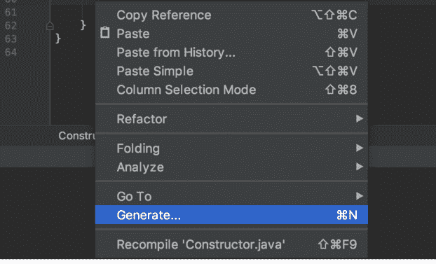

选择并点击 Generate...，然后选择并点击 `toString()`，如下所示所示：

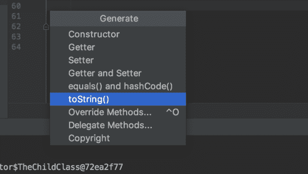

新弹出的窗口将允许你选择包含在 `toString()` 方法中的属性。只选择 `TheChildClass` 的属性，如下：

在你点击 OK 后，代码将变为：

```java
@Override
public String toString() {
    return "TheChildClass{prop='" + prop + "'}";
}
```

## 实例方法与静态方法

静态方法可以在对象上调用，但被认为是一种坏习惯，因为它向试图理解代码的人类隐藏了方法的静态特性。此外，它会引发编译器警告，并取决于编译器的实现，可能会产生编译器错误。

同样，属性可以声明为 `static`，从而可以在无需创建对象的情况下访问。例如：

```java
class SomeClass {
    public static String SOME_PROPERTY = "abc";
}
```

该属性也可以通过类直接访问：

```java
System.out.println(SomeClass.SOME_PROPERTY); // 输出: abc
```

拥有这样的属性违背了状态封装的理念，并会导致并发数据修改的所有问题，因为它在 JVM 内存中只存在一份副本，且所有使用它的方法都共享同一个值。这就是为什么静态属性通常用于两个用途：

- 存储常量——一个可以读取但不可修改的值（也称为只读值）
- 存储创建开销大或保留只读值的无状态对象

## Java 面向对象编程 (OOP) 第 2 章

常量的一个典型示例是资源的名称：

```java
class SomeClass {
    public static final String INPUT_FILE_NAME = "myFile.csv";
}
```

`final` 关键字位于 `static` 属性之前。它告诉编译器和 JVM，这个值一旦赋值，就无法更改。尝试这样做将产生一个错误。它有助于保护该值，并清晰地表达将此值设为常量的意图。当人类尝试理解代码如何工作时，看似微小的细节会让代码更易理解。

尽管如此，请考虑将此类目的使用接口（interface）。从 Java 1.8 开始，接口中声明的所有字段都是隐式 `static` 且 `final` 的，因此你忘记声明某个值为常量的概率会更小。我们很快会讨论接口。

当一个对象被声明为类的 `static final` 属性时，并不意味着它所有的属性都会自动变为 `final`。它只是防止该属性被赋值另一个相同类型的对象。我们将在第 8 章“多线程与并发处理”中讨论对象属性并发访问的复杂过程。尽管如此，程序员经常使用 `static final` 对象来存储仅通过在应用程序中使用方式就是只读的值。一个典型的例子是应用程序配置信息。一旦从磁盘读取后创建，它就不会被更改，即使它可以被更改。此外还有从外部资源获取的数据缓存。

再次，在将此类类用于此目的之前，请考虑使用一个提供更多默认行为以支持只读功能的接口。

与静态属性类似，静态方法可以在不创建类实例的情况下被调用。例如，考虑以下类：

```java
class SomeClass {
    public static String someMethod() {
        return "abc";
    }
}
```

我们可以仅通过类名来调用前述方法：

```java
System.out.println(SomeClass.someMethod()); // 输出: abc
```

## 接口 (Interface)

在“抽象/接口”部分，我们从泛义术上讨论了接口。在本节中，我们将描述一种实现它的 Java 语言构造结构。

接口展示了对对象的预期行为。它隐藏了实现，并只暴露带有返回值的方法签名。例如，这里有一个声明了两个抽象方法的接口：

```java
interface SomeInterface {
    void method1();
    String method2(int i);
}
```

这里是实现它的类：

```java
class SomeClass implements SomeInterface {
    public void method1() {
        // 方法体
    }
    public String method2(int i) {
        // 方法体
        return "abc";
    }
}
```

接口不能被实例化。接口类型的对象只能通过创建一个实现该接口的类来创建：

```java
SomeInterface si = new SomeClass();
```

如果接口并非所有的抽象方法都已实现，则该类必须声明为 `abstract`（抽象的）且不能被实例化。请参见“接口与抽象类”章节。

接口并不描述如何创建类的对象。要发现这一点，你必须查看该类并看它有哪些构造函数。接口也不描述静态方法。因此，接口仅仅是类实例（对象）的公共脸。

从 Java 8 开始，接口获得了不仅可以抽象方法（不带方法体），而且可以实现实现这些方法的能力。根据《Java 语言规范》，“接口的主体可以声明接口的成员，即字段、方法、类和接口。”这样的说法提出了一个问题：接口和类之间的区别是什么？我们已经指出的一个主要区别是：接口不能被实例化；只有类可以被实例化。

## Java 面向对象编程 OOP 第 2 章

另一个区别是，在接口内部实现的非静态方法被声明为 `default` 或 `private`。相比之下，类方法没有 `default` 声明。

此外，接口中的字段是隐式 `public` 且 `final` 的。相比之下，类的属性和方法不是 `static` 的，也不是默认的。类本身、其字段、方法和构造函数的隐式（默认）访问修饰符是 `package-private`（包私有的），这意味着它只在自己的包内可见。

### 默认方法 (Default methods)

为了了解接口中默认方法的功能，让我们来看下面的接口和实现它的类的示例：

```java
interface SomeInterface {
    void method1();
    String method2(int i);
    default int method3() {
        return 42;
    }
}

class SomeClass implements SomeInterface {
    public void method1() {
        // 方法体
    }
    public String method2(int i) {
        // 方法体
        return "abc";
    }
}
```

我们可以创建一个 `SomeClass` 的对象并进行如下调用：

```java
SomeClass sc = new SomeClass();
sc.method1();
sc.method2(22);   // 返回: "abc"
sc.method3();      // 返回: 42
```

你可以看到，`method3()` 在 `SomeClass` 类中并没有实现，但看起来该类似乎拥有它。这是在不改变现有类的情况下为其添加新方法的一种方法——通过向类所实现的接口中添加默认方法。

## Java 面向对象编程 OOP 第 2 章

现在我们也为类添加 `method3()` 的实现，如下所示：

```java
class SomeClass implements SomeInterface {
    public void method1() {
        // 方法体
    }
    public String method2(int i) {
        // 方法体
        return "abc";
    }
    public int method3() {
        return 15;
    }
}
```

现在接口的 `method3()` 将被忽略：

```java
SomeClass sc = new SomeClass();
sc.method1();
sc.method2(22); // 返回: "abc"
sc.method3();   // 返回: 15
```

> 接口中默认方法的目的是为了在不改变实现该接口的类的情况下提供一个新方法。一旦类实现了该方法，接口的实现就会被忽略。

### 私有方法 (Private methods)

如果接口中有默认方法，就可以创建仅供接口默认方法访问的私有方法。它们可以包含公共功能，而不是在每个默认方法中重复：

```java
interface SomeInterface {
    void method1();
    String method2(int i);
    default int method3() {
        return getNumber();
    }
    default int method4() {
        return getNumber() + 22;
    }
    private int getNumber() {
        return 42;
    }
}
```

## Java 面向对象编程 OOP 第 2 章

私有方法的概念与类中的私有方法没有区别。私有方法无法在接口外部访问。

### 静态字段和方法 (Static fields and methods)

从 Java 8 开始，接口中声明的所有字段都是隐式的 `public`、`static` 且 `final` 常量。这就是为什么接口是常量的理想位置。你不需要在声明中添加 `public static final`。

对于静态方法，它们在接口中的功能与类中相同：

```java
interface SomeInterface {
    static String someMethod() {
        return "abc";
    }
}
```

注意，没有必要将接口方法标记为 `public`。所有非私有的接口方法默认都是 `public`。

我们可以仅通过接口名调用前述方法：

```java
System.out.println(SomeInterface.someMethod()); // 输出: abc
```

### 接口与抽象类 (Interface versus abstract class)

我们已经提到过类可以声明为抽象类。它可能是一个不希望被实例化的普通类，也可以是一个包含抽象方法的类。在后一种情况下，我们必须将此类类声明为抽象以避免编译错误。

在许多方面，抽象类与接口非常相似。它强制扩展它的子类实现抽象方法。否则，子类将无法实例化，并且必须被声明为抽象的。

然而，接口和抽象类之间的一些主要区别使得它们在不同情况下各自有用：

- 抽象类可以有构造函数，而接口不能。
- 抽象类可以有状态（state），而接口不能。
- 抽象类的字段可以是 `public`、`private` 或 `protected`、`static` 或非 `static`、`final` 或非 `final`；而在接口中的字段始终是 `public`、`static` 且 `final`。
- 抽象类中的方法可以是 `public`、`private` 或 `protected`，而接口方法可以是 `public`，也可以是 `private`。
- 如果类想要修改以继承自另一个已经存在的接口，则你不能使用抽象类，但你可以实现一个接口，因为类只能继承一个父类，但可以实现多个接口。

请参阅“多态实践”部分中关于抽象类使用的示例。

### 重载、重写与隐藏

我们已经在“继承”和“抽象/接口”章节中提到过重写。重写是在子类中使用具有相同签名的方法替换父类中实现的非静态方法。接口的默认方法（default method）也可以扩展它的接口中被重写。

隐藏（Hiding）与重写类似，但仅适用于静态方法、静态以及实例属性。

重载（Overloading）是在同一个类或接口中创建多个具有相同名称但不同参数（因此签名不同）的方法。

在本节中，我们将讨论所有这些概念，并演示它们在类和接口中如何工作。

### 重载


# Java 面向对象编程 OOP 第2 章

## 方法重载

在同一个接口或类中，不可能存在两个签名相同的方法。要拥有不同的签名，新方法必须具有新的名称或不同的参数类型列表（类型的顺序是有意义的）。具有相同名称但不同参数类型列表的方法构成了重载。以下是接口中合法方法重载的示例：

```java
interface A {
    int m(String s);
    int m(String s, double d);
    default int m(String s, int i) { return 1; }
    static int m(String s, int i, double d) { return 1; }
}
```

注意，上述方法中没有两个具有相同的签名，包括默认方法和静态方法。否则将产生编译器错误。标记为 `default` 或 `static` 对重载没有任何作用。返回类型也不影响重载。我们在各处使用 `int` 作为类型仅仅是为了让示例看起来不整洁。

类中的方法重载实现也类似：

```java
class C {
    int m(String s){ return 42; }
    int m(String s, double d){ return 42; }
    static int m(String s, double d, int i) { return 1; }
}
```

而且，具有相同名称的方法声明在哪里并不重要。以下方法重载与之前的示例没有区别：

```java
interface A {
    int m(String s);
    int m(String s, double d);
}
interface B extends A {
    default int m(String s, int i) { return 1; }
    static int m(String s, int i, double d) { return 1; }
}
class C {
    int m(String s){ return 42; }
}
class D extends C {
    int m(String s, double d){ return 42; }
    static int m(String s, double d, int i) { return 1; }
}
```

私有非静态方法只能被同类中的非静态方法重载。

> 重载发生在方法具有相同名称但不同参数类型列表，且属于同一个接口（或类），或属于不同的接口（或类），其中一个是另一个的祖类时。私有方法只能被同类中的方法重载。

## 方法重写

与发生在非静态方法上的重载不同，方法重写仅发生在非静态方法，且仅当它们具有完全相同的签名并属于不同的接口（或类），其中一个是另一个的祖类时发生。

重写的方法位于子接口（或类）中，而被重写的方法具有相同的签名并属于其中一个祖先接口（或类）。私有方法不能被重写。

以下是接口中方法重写的示例：

```java
interface A {
    default void method() {
        System.out.println("A");
    }
}
interface B extends A {
    @Override
    default void method() {
        System.out.println("B");
    }
}
class C implements B {
    @Override
    public void method() {
        System.out.println("C");
    }
}
```

*（注：源文件中重写示例的 OCR 文本严重损坏；我根据标准 Java 模式和提供的可用片段重构了逻辑结构。）*

## 隐藏

许多人认为隐藏是一个复杂的话题，但它不应如此，我们将尝试使其简单。

名称隐藏源于类和接口的静态属性和方法的行为。每个静态属性或方法在内存中只存在一份副本，因为它们与接口相关，而不是对象。这就是为什么我们不能说类的属性或方法重写了父类的静态属性或方法。所有的静态属性和方法只在类或接口加载时加载到内存中并留在那里，不会被复制到任何地方。让我们来看示例。

让我们创建两个具有父子关系且具有相同名称的静态字段和方法的接口：

```java
interface A {
    String NAME = "interface A";
    static void method() {
        System.out.println("interface A");
    }
}
interface B extends A {
    String NAME = "interface B";
    static void method() {
        System.out.println("interface B");
    }
}
```

请注意接口字段标识符的大写。这是通常用于表示常量的约定，无论它是在接口还是类中声明的。提醒你一下，Java 中的常量是一个变量，一旦初始化，就不能重新分配另一个值。接口字段默认是常量，因为接口中的任何字段都是 `final` 的。

如果我们从 `B` 接口打印 `NAME` 并执行它的 `method()`，我们得到以下结果：

```java
System.out.println(B.NAME); // 输出：interface B
B.method(); // 输出：interface B
```

这看起来非常像重写，但实际上，它只是调用了与此特定接口相关的特定属性或方法。

类似地，考虑以下类：

```java
public class C {
    public static String NAME = "class C";
    public static void method(){
        System.out.println("class C");
    }
    public String name1 = "class C";
}
public class D extends C {
    public static String NAME = "class D";
    public static void method(){
        System.out.println("class D");
    }
    public String name1 = "class D";
}
```

如果尝试使用类本身来访问 `D` 类的静态成员，我们将得到想要的结果：

```java
System.out.println(D.NAME);    // 输出: class D
D.method();                    // 输出: class D
```

混淆只在通过对象访问属性或静态方法时才会出现：

```java
C obj = new D();
```

```java
System.out.println(obj.NAME);      // 输出: class C
System.out.println((D)obj.NAME);   // 输出: class D

obj.method();                       // 输出: class C
((D)obj).method();                  // 输出: class D

System.out.println(obj.name1);      // 输出: class C
System.out.println((D)obj.name1);   // 输出: class D
```

变量 `obj` 指向 `D` 类的对象，如前面的示例所示，强制转换证明了这一点。但即使我们使用对象，尝试访问静态属性或方法也会带给我们作为声明变量类型的类的成员。至于示例最后两行中的实例属性，Java 中的属性并不符合多态行为，我们得到了父类 `C` 的 `name1` 属性，而不是预期的子类 `D` 的属性。

为了避免与类的静态成员产生混淆，请始终使用类而不是对象来访问它们。为了避免与实例属性产生混淆，请始终将其声明为私有并通过方法访问。

为了说明最后一个提示，考虑以下类：

```java
class X {
  private String name = "class X";
  public String getName() {
    return name;
  }
  public void setName(String name) {
    this.name = name;
  }
}
class Y extends X {
  private String name = "class Y";
  public String getName() {
    return name;
  }
  public void setName(String name) {
    this.name = name;
  }
}
```

如果我们像对 `C` 和 `D` 那样运行实例属性的测试，结果将是：

```java
X x = new Y();
System.out.println(x.getName()); // 输出: class Y
System.out.println(((Y)x).getName()); // 输出: class Y
```

现在我们使用方法访问实例属性，方法是重写效果的主，不再产生意外的结果。

为了结束关于 Java 中隐藏的讨论，我们想提到另一种类型的隐藏，即局部变量隐藏了同名的实例或静态属性。这里有一个具有该功能的类：

```java
public class HidingProperty {
  private static String name1 = "static property";
  private String name2 = "instance property";

  public void method() {
    var name1 = "local variable";
    System.out.println(name1); // 输出: local variable
    var name2 = "local variable";
    System.out.println(name2); // 输出: local variable
    System.out.println(HidingProperty.name1); // 输出: static property
    System.out.println(this.name2); // 输出: instance property
  }
}
```

如你所示，局部变量 `name1` 隐藏了同名的静态属性，而局部变量 `name2` 隐藏了实例属性。`HidingProperty.name1` 仍然可以访问静态属性，如所示。

## final 方法

声明为 `final` 的方法不能在子类中被重写，在静态方法的情况下不能被隐藏。例如，`java.lang.Object` 类作为 Java 所有类的祖先，它的某些方法被声明为 `final`：

```java
public final Class getClass()
public final void notify()
public final void notifyAll()
public final void wait() throws InterruptedException
public final void wait(long timeout) throws InterruptedException
public final void wait(long timeout, int nanos) throws InterruptedException
```

`final` 类的私有方法和未继承的方法实际上都是 `final`，因为你无法重写它们。

## final 类

`final` 类不能被扩展。它没有子类，这使得类的所有方法实际上都是 `final`。这种特性用于安全性，或者当程序员想确保类功能不会被重写、重载或隐藏以满足某些设计考量时。

## final 变量

`final` 关键字修饰的变量在初始化后是不可变的。`final` 关键字修饰的变量必须被初始化。

在实例属性的情况下，`final` 初始化可以在构造函数中完成。例如：

```java
class A {
    final String s1;
    final String s2;
    final String s3; // 错误

    public A() {
        s1 = "abc";
        s2 = "abc";
    }
}
```

在实例初始化块中，可以完成初始化。例如：

```java
class B {
    final String s1 = "abc";
    final String s2;

    {
        s1 = "xyz"; // 错误
        s2 = "abc";
    }
}
```

在静态属性的情况下，`final` 必须在声明期间或静态初始化块中：

```java
class C {
    final String s1 = "abc";
    final String s2;

    static {
        s1 = "xyz"; // 错误
        s2 = "abc";
    }
}
```

在接口中，所有字段始终都是 `final`，即使它们没有被声明为如此。由于既没有构造函数也没有初始化块，初始化字段的唯一方法是在声明期间。这样做会导致编译错误：

```java
interface I {
    String s1; // 错误
    String s2 = "abc";
}
```


# Java 面向对象编程（OOP）

## 多态的应用

多态是 OOP 最强大且实用的特性。它利用了我们之前介绍的所有 OOP 概念和特性。它是掌握 Java 编程的最高概念点。之后，书的大部分将关于 Java 语言语法和 JVM 功能。

正如我们在 OOP 概念部分所说的，多态是对象作为不同类的对象或不同接口的实现的能力。你在互联网上搜索“多态”一词，你会发现它是“以几种不同形式出现的状态”。变态是指“通过自然或超自然手段改变人的形状或本质变为完全不同的状态”。因此，Java 多态是对象作为经历变态并在不同条件下表现出完全不同行为的能力。

# Java 面向对象编程 (OOP) 第 2 章

我们将通过实用的操作方法来介绍这一概念，即使用对象工厂——这是工厂模式的一种特定编程实现，它是一个返回不同原型或类对象的方法。请参见 <https://en.wikipedia.org/wiki/Factory_(object-oriented_programming)>。

## 对象工厂

对象工厂的核心思想是创建一个方法，在特定条件下返回特定类型的新对象。例如，查看 `CalcUsingAlg1` 和 `CalcUsingAlg2` 类：

```java
interface CalcSomthing { double calculate(); }

class CalcUsingAlg1 implements CalcSomthing {

    public double calculate() { return 42.1; }

}

class CalcUsingAlg2 implements CalcSomthing {

    private int prop1;

    private double prop2;

    public CalcUsingAlg2(int prop1, double prop2) {

        this.prop1 = prop1;

        this.prop2 = prop2;

    }

    public double calculate() { return prop1 * prop2; }

}
```

如你所示，两者都实现了相同的接口 `CalcSomthing`，但使用了不同的算法。现在，假设我们决定将算法的选择放在属性文件中。那么我们就可以创建一个对象工厂：

```java
class CalcFactory {

    public static CalcSomthing getCalculator() {

        String alg = getAlgValueFromFile();

        switch (alg) {

            case "1":

                return new CalcUsingAlg1();

            case "2":

                int p1 = getAlgProp1FromFromFile();

                double p2 = getAlgProp2FromFromFile();

                return new CalcUsingAlg2(p1, p2);

            default:

                System.out.println("Unknown value " + alg);

                return new CalcUsingAlg1();

        }

    }

}
```

# Java 面向对象编程 (OOP) 第 2 章

工厂根据 `getAlgValueFromProperty()` 方法的返回值选择使用哪种算法。在第二种算法的情况下，它还使用了 `getAlg2Prop1FromFromFile()` 和 `getAlg2Prop2FromFromFile()` 方法来获取算法的输入参数。这种复杂度对客户端是隐藏的：

```java
CalcSomething calc = CalcFactory.getCalculator();

double result = calc.calculate();
```

我们可以添加算法变体、更改算法参数的来源或算法选择的过程，而客户端不需要更改代码。这就是多态的力量。

另一种，我们可以使用继承来实现来实现多态行为。考虑以下类：

```java
class CalcSomething{

    public double calculate(){ return 42.1; }

}

class CalcUsingAlg2 extends CalcSomething{

    private int prop1;

    private double prop2;

    public CalcUsingAlg2(int prop1, double prop2) {

        this.prop1 = prop1;

        this.prop2 = prop2;

    }

    public double calculate(){ return prop1 * prop2; }

}
```

那么我们的工厂可能如下所示：

```java
class CalcFactory{

    public static CalcSomething getCalculator(){

        String alg = getAlgValueFromProperties();

        switch (alg) {

            case "1":

                return new CalcSomething();

            case "2":

                int p1 = getAlg2Prop1FromFromFile();

                double p2 = getAlg2Prop2FromFromFile();

                return new CalcUsingAlg2(p1, p2);

            default:

                System.out.println("Unknown value " + alg);

                return new CalcSomething();

        }

    }

}
```

# Java 面向对象 OOP

但客户端代码并没有改变：

```java
CalcSomthing calc = CalcFactory.getCalculator();

double result = calc.calculate();
```

在有选择的情况下，经验程序员会使用通用接口来实现。这允许更具灵活的设计，因为 Java 中的类可以实现多个接口，但只能扩展（继承）一个类。

## instanceof 运算符

遗憾的是，生活并不总是那么容易，程序员偶尔必须处理来自不同框架的无关类组合而的代码。在这种情况下，使用多态可能不是一个选项。尽管如此，你仍然可以使用 `instanceof` 运算符处理算法选择的复杂度，甚至模拟多态行为，该运算符在对象是某个类的一个实例时返回 `true`。

让我们假设我们有两个不相关的类：

```java
class CalcUsingAlg1 {

    public double calculate(CalcInput1 input) {

        return 42. * input.getProp1();

    }

}
```

```java
class CalcUsingAlg2{

    public double calculate(CalcInput2 input) {

        return input.getProp2() * input.getProp1();

    }

}
```

每个类都期望一个特定类型的输入对象：

```java
class CalcInput1{

    private int prop1;

    public CalcInput1(int prop1) { this.prop1 = prop1; }

    public int getProp1() { return prop1; }

}
```

```java
class CalcInput2{

    private int prop1;

    private double prop2;

    public CalcInput2(int prop1, double prop2) {

        this.prop1 = prop1;

        this.prop2 = prop2;

    }

    public int getProp1() { return prop1; }

    public double getProp2() { return prop2; }

}
```

每个类都期望一个特定类型的输入对象：

```java
class CalcFactory{

    public double calculate(Object input) {

        if (input instanceof CalcInput1) {

            return new CalcUsingAlg1().calculate((CalcInput1) input);

        } else if (input instanceof CalcInput2) {

            return new CalcUsingAlg2().calculate((CalcInput2) input);

        } else {

            throw new RuntimeException("Unknown type " + input.getClass());

        }

    }

}
```

如你所示，`instanceof` 运算符允许我们在客户端不知道特定实现方式的情况下处理不同类型的输入。

## 练习题

### 8. 请从列表中选择所有正确的陈述：

- a. 方法定义了对象的状态
- b. 方法定义了对象的行为
- c. 无参数的方法标记为 void
- d. 方法可以有多个 return 语句

### 9. 请从列表中选择所有正确的陈述：

- a. Varargs（可变参数）被声明为 var 类型
- b. Varargs 代表各种参数（various arguments）
- c. Varargs 是一个 String 数组
- d. Varargs 可以作为指定类型的数组来使用

### 10. 请从列表中选择所有正确的陈述：

- a. 新构造函数是一个创建状态的方法
- b. 构造函数的主要职责是初始化状态
- c. JVM 总是提供默认构造函数
- d. 使用 parent 关键字可以调用父类构造函数

### 11. 请从列表中选择所有正确的陈述：

- a. `new` 运算符为对象分配内存
- b. `new` 运算符为对象属性分配默认值
- c. `new` 运算符先创建父对象
- d. `new` 运算符先创建子对象

### 12. 请从列表中选择所有正确的陈述：

- a. Object 类属于 java.base 包
- b. Object 类属于 java.lang 包
- c. Object 类属于 Java 类库的某个包
- d. Object 类是自动导入的

# Java 面向对象编程 OOP

## 第 2 章

### 13. 请从列表中选择所有正确的陈述：

- a. 实例方法通过对象调用
- b. 静态方法（static method）通过类调用
- c. 实例方法通过类调用
- d. 静态方法通过对象调用

### 14. 请从列表中选择所有正确的陈述：

- a. 接口中的方法隐式是 public、static 和 final 的
- b. 接口可以拥有无需在类中实现即可调用的方法
- c. 接口可以拥有无需任何类使用的字段
- d. 接口可以实例化

### 15. 请从列表中选择所有正确的陈述：

- a. 接口的默认方法总是被默认调用
- b. 接口的私有方法只能被默认方法调用
- c. 接口的静态方法可以在不被类中实现的情况下调用
- d. 默认方法可以增强实现接口的类

### 16. 请从列表中选择所有正确的陈述：

- a. 抽象类（Abstract class）可以有一个默认方法
- b. 抽象类可以在没有抽象方法的情况下声明
- c. 任何类都可以声明为抽象类
- d. 接口是一个不带构造函数的抽象类

### 17. 请从列表中选择所有正确的陈述：

- a. 重载（Overloading）只能在接口中进行
- b. 只有在一个类扩展另一个类时才可以进行重载
- c. 任何类中都可以进行重载
- d. 重载的方法必须具有相同的签名

## Java 面向对象编程 OOP

### 18. 请从列表中选择所有正确的陈述：

- a. 重写（Overriding）只能在子类中进行
- b. 重写可以在接口中进行
- c. 被重写的方法必须具有相同的名称
- d. Object 类的任何方法都被重写

### 19. 请从列表中选择所有正确的陈述：

- a. 任何方法都可以被隐藏（hide）
- b. 变量可以隐藏属性
- c. 静态方法可以被隐藏
- d. 公共实例属性可以被隐藏

### 20. 请从列表中选择所有正确的陈述：

- a. 任何变量都可以被声明为 final
- b. 公共方法不能声明为 final
- c. 保护方法可以声明为 final
- d. 类可以被声明为 protected

### 21. 请从列表中选择所有正确的陈述：

- a. 多态行为可以基于继承
- b. 多态行为可以基于重载
- c. 多态行为可以基于重写
- d. 多态行为可以基于接口

# Java 基础

本章为读者提供了关于 Java 语言更详细的视角。它将从包的代码组织开始，介绍了类（接口）及其方法和属性（字段）的访问控制级别。引用类型作为 Java 面向对象性质的主要类型，也会被介绍。

# Java 基础

```java
import static com.packt.learnjava.ch02_oop.StaticMembers.SomeClass.someMethod;

import static com.packt.learnjava.ch02_oop.StaticMembers.SomeClass.SOME_PROPERTY;

public class Packages {

    public static void main(String... args){

        C c = new C();

        D d = new D();

        SomeClass obj = new SomeClass();

        someMethod(42);

        System.out.println(SOME_PROPERTY); // 输出: abc

    }

}
```

但这种技术应该谨慎使用，因为它可能会给人一种静态导入的方法或属性属于当前类的印象。

## 访问修饰符

我们在示例中已经使用了三种访问修饰符：`public`、`protected` 和 `private`，它们用来从外部（其他类或接口）限制类、接口及其成员的访问。还有第四种隐式的修饰符（也称为默认修饰符或包私有），当未指定上述三种显式修饰符时使用。

它们的作用非常直观：

- `public`：当前包及其他包中的类和接口均可用。
- `protected`：仅允许同包中的其他成员以及该类的子类访问。
- 无访问修饰符：仅允许同包中的其他成员访问。
- `private`：仅允许同类中的成员访问。

在类或接口内部，所有类或接口成员都始终是可访问的。此外，正如我们多次提到的，除非声明为 `private`，否则所有接口成员默认都是 `public` 的。

此外，请注意，类的访问权限优先于类成员的访问权限，因为如果类本身从某个地方无法访问，无论如何更改其方法或属性的访问权限都无法让它们变得可访问。

# Java 基础 第 3 章

当人们谈论类和接口的访问修饰符时，指的是在其他类或接口内部定义的类和接口。包含它们的类或接口被称为**顶层类或接口**，而它们内部的被称为**内部类或接口**。内部类也是**静态嵌套类**。

将顶层类或接口声明为 `private` 是没有意义的，因为无法从任何地方访问。Java 作者决定也不允许顶层类或接口声明为 `protected`。不过，可以有一个不带显式访问修饰符的类，使其仅对同包的成员可见。

以下是一个示例：

```java
public class AccessModifiers {

    String prop1;

    private String prop2;

    protected String prop3;

    public String prop4;

    void method1() {}

    private void method2() {}

    protected void method3() {}

    public void method4() {}

    class A1 {

        private class A2{}

        protected class A3 {

        public class A4 { }

    }

    interface I1 {

        private interface I2 {}

        protected interface I3 {}

        public interface I4 {}

    }

}
```

请注意，静态嵌套类无法访问顶层类的其他成员。

内部类的另一个特殊特性是，它可以访问顶层类的成员（甚至是 `private` 成员），反之亦然。为了演示这一特性，我们在顶层类和一个私有内部类中创建以下私有属性和方法：

```java
public class AccessModifiers {
```


# Java 基础

## 第 3 章

### 类与接口

类类型的变量使用相应的类名声明：

```java
<类名> identifier;
```

可以赋值给此类变量的值可以是以下之一：

- 引用类型字面量（意味着变量可以使用但未引用任何对象）
- 指向同类或其后代类对象的引用（后代继承了其所有祖类的类型）

最后这种类型的赋值被称为**宽化赋值**（widening assignment），因为它强制使一个特殊的引用变得不那么特殊。例如，由于每个 Java 类都是 `java.lang.Object` 的子类，因此对任何类都可以执行以下赋值：

```java
Object obj = new AnyClassName();
```

这种赋值也称为**向上转型**（upcasting），因为它将变量类型沿着继承链向上移动（继承链就像家族族谱一样，通常将最老的祖先放在顶部）。

在进行此类向上转型后，可以使用转换运算符 `(type)` 进行**收窄赋值**（narrowing assignment）：

```java
AnyClassName anyClassName = (AnyClassName)obj;
```

这种赋值也称为**向下转型**（downcasting），允许你恢复后代类型。要执行此操作，你必须确保标识符实际上指向一个后代类。如果你不确定，可以使用 `instanceof` 操作符来检查类型。

### 内部类与访问修饰符

```java
private String topLevelPrivateProperty = "Top-level private value";

private void topLevelPrivateMethod() {
    var inner = new InnerClass();
    System.out.println(inner.innerPrivateProperty);
    inner.innerPrivateMethod();
}

private class InnerClass {
    private static String PROP = "Inner static"; // 错误
    private String innerPrivateProperty = "Inner private value";

    private void innerPrivateMethod() {
        System.out.println(topLevelPrivateProperty);
    }
}

private class InnerStaticClass {
    private static String PROP = "Inner private static";
    private String innerPrivateProperty = "Inner private value";

    private void innerPrivateMethod() {
        var top = new AccessModifiers();
        System.out.println(top.topLevelPrivateProperty);
    }
}
```

可见上述类中的所有方法和属性都是 `private` 的，通常无法从类外部访问。对于 `AccessModifiers` 类也是如此：它的私有方法和属性对外部定义的类是不可见的。但 `InnerClass` 可以访问顶层类的私有成员，顶层类也可以访问其内部类的私有成员。唯一的限制是非静态内部类不能拥有 `static` 成员。相比之下，静态嵌套类可以同时拥有静态和非静态成员，这使得静态嵌套类更加易用。

为了演示所有这些可能性，我们在 `AccessModifiers` 类中添加了以下 `main` 方法：

```java
public static void main(String... args) {
    var top = new AccessModifiers();
    top.topLevelPrivateMethod();
    // var inner = new InnerClass(); // 错误
    // System.out.println(InnerClass.PROP);
    var inner = new InnerStaticClass();
    System.out.println(inner.innerPrivateProperty);
    inner.innerPrivateMethod();
}
```

自然，非静态内部类无法从顶层类的静态上下文访问。如果运行上述代码，结果如下：

| Inner private value |
| :--- |
| Top-level |
| Inner static |
| Inner private value |
| Top-level |

### 数组

数组是一种引用类型，因此它也扩展了 `java.lang.Object` 类。数组元素的类型与声明的数组类型相同。元素的数量可以为零，在这种情况下，数组被称为空数组。每个元素都可以通过索引来访问，索引是一个正整数或零。第一个元素的索引为零。元素的数量被称为数组长度。一旦创建数组，其长度就永远不会改变。

以下是数组声明的示例：

```java
int[] intArray;
float[] floatArray;
String[] stringArray;
SomeClass[][][] arr;
```

每一对括号表示另一个维度。括号对的数量即为数组的嵌套深度：

```java
int[] intArray = new int[10];
float[] floatArray = new float[3][4];
String[] stringArray = new String[2];
SomeClass[][][] arr = new SomeClass[3][5][2];
```

`new` 运算符为每个元素分配内存，稍后可以分配（填充）值。但在我的例子中，数组的元素在创建时会被初始化为默认值，如下例所示：

```java
System.out.println(intArray);          // prints: 0
System.out.println(floatArray[2]);     // prints: 0.0
System.out.println(stringArray[1]);    // prints: null
```

创建数组的另一种方法是使用用大括号包含的逗号分隔的值初始化列表，例如：

```java
int[] intArray = {1,2,3,4,5,6,7,8,9,10};
float[] floatArray = {{1.1f,2.2f,3.2},{10.2f,30.0f,5},{1,2,3,4}};
String[] stringArray = {"abc","a23"};
```

```java
System.out.println(intArray[3]);       // prints: 4
System.out.println(floatArray[2]);     // prints: 3.0
System.out.println(stringArray[1]);    // prints: a23
```

创建多维数组时可以不声明每个维度的长度。只有第一个维度必须指定长度：

```java
float[] floatArray = new float[3][];
System.out.println(floatArray.length); // prints: 3
System.out.println(floatArray[0]);     // prints: null
System.out.println(floatArray[1]);     // prints: null
System.out.println(floatArray[2]);     // prints: null
System.out.println(floatArray[3]);     // error
System.out.println(floatArray[2][2]);  // error
```

其他维度的缺失长度可以稍后指定：

```java
float[] floatArray = new float[3][];
floatArray[0] = new float[4];
floatArray[1] = new float[3];
floatArray[2] = new float[7];
System.out.println(floatArray[2][5]);  // prints: 0.0
```

通过这种方式，可以为不同的维度分配长度。使用数组初始化器也可以创建不同长度的维度：

```java
float[] floatArray = {{1.1f}, {10,5}, {1,2,3,4}};
```

要求是维度在使用之前必须进行初始化。

### 枚举 (Enum)

`enum` 引用类型类扩展了 `java.lang.Enum` 类，该类又扩展了 `java.lang.Object`。它允许指定一组有限的常量，每个常量都是相同类型的实例。此类集合的声明以 `enum` 关键字开始。这里有一个示例：

```java
enum Season { SPRING, SUMMER, AUTUMN, WINTER };
```

列出的每一项 – SPRING、SUMMER、AUTUMN 和 WINTER 都是 `Season` 类型的实例。它们是 `Season` 类可以拥有的四个实例。它们是预先创建的，可以作为 `Season` 类型的值随处使用。无法创建 `Season` 类的其他实例。这就是创建枚举类型的原因：它适用于类实例列表限制为固定集合的情况。

枚举的声明也可以用驼峰命名法写：

```java
enum Season { Spring, Summer, Autumn, Winter };
```

然而，全大写风格更为常见，因为正如我们之前提到的，有一个约定使用大写字母来表示 `static final` 常量的标识符。这有助于区分常量和变量。枚举常量隐式地是 `static` 且 `final` 的。

由于枚举值是常量，它们在 JVM 中唯一存在，并可以通过引用进行比较：

```java
Season season = Season.WINTER;
boolean b = season == Season.WINTER;
System.out.println(b);    // prints: true
```

以下是 `java.lang.Enum` 类中最常用的方法：

- `name()`: 返回枚举常量的标识符，与其声明时的拼写相同（例如， WINTER）。
- `toString()`: 返回与 `name()` 方法相同的值，但可以重写以返回任何其他字符串值。
- `ordinal()`: 返回枚举常量声明时的位置（列表中的第一个元素的序值为 0）。
- `valueOf(Class)`

### 参数传递与对象修改

```java
public String getProp() { return prop; }
public void setProp(String prop) { this.prop = prop; }

void modifyParameter(DemoClass obj){
    obj.setProp("Changed inside the method");
}
```

如果我们使用上述方法，结果将如下：

```java
DemoClass obj = new DemoClass("Is not changed");
modifyParameter(obj);
System.out.println(obj.getProp()); // 打印: Changed inside the method
```

这是一个很大的区别，不是吗？所以你必须非常小心，不要修改传入的对象，以避免产生意外的副作用，尽管这种做法有时被用于返回结果。但这并不属于最佳实践列表，因为它会影响代码的可读性。传入的对象就好比使用了一个难以被察觉的秘密隧道。因此，仅在万必要时使用它。

即使传入的对象是一个包装了基本类型值的类，这种效果仍然存在（我们将在基本类型和引用类型之间的转换中讨论基本包装）。这里是 `DemoClass1` 以及 `modifyParameter(obj)` 方法的重载版本：

```java
class DemoClass1 {
    private Integer prop;
    public DemoClass1(Integer prop) { this.prop = prop; }
    public Integer getProp() { return prop; }
    public void setProp(Integer prop) { this.prop = prop; }
}

void modifyParameter(DemoClass1 obj){
    obj.setProp(Integer.valueOf(2));
}
```

如果我们使用上述方法，结果将如下：

```java
DemoClass1 obj = new DemoClass1(Integer.valueOf(1));
modifyParameter(obj);
System.out.println(obj.getProp()); // 打印: 2
```

引用类型这种行为的唯一例外是 `String` 类对象。这里是 `modifyParameter(String obj)` 方法的另一个重载版本：

```java
void modifyParameter(String obj){
    obj = "Changed inside the method";
}
```

如果我们使用上述方法，结果将如下：

```java
String obj = "Is not changed";
modifyParameter(obj);
System.out.println(obj); // 打印: Is not changed
```

```java
obj = new String("Is not changed");
modifyParameter(obj);
System.out.println(obj); // 打印: Is not changed
```

如你所示，无论我们使用字面量还是新的 `String` 对象，结果都是相同的：在方法为其分配另一个值之后，`String` 的值没有发生改变。这正是我们在第 1 章《Java 12 入门》中讨论的 `String` 值不可变性特性的目的。

### equals() 方法

等关系运算符 (`==`) 当应用于引用类型的变量时，它比较的是引用本身，而不是对象的内容（状态）。但如果两个对象具有相同的内容，它们总是具有不同的内存引用。即使是用于 `String` 对象，如果其中至少一个是使用 `new` 运算符创建的，运算符 (`==`) 也会返回 false（请参见第 1 章《Java 12 入门》中关于 `String` 值不可变性的讨论）。

要比较内容，你可以使用 `equals()` 方法。它在 `String` 类和数值包装类（`Integer`、`Float` 等）中的实现恰恰是精确比较对象的内容。

然而，`java.lang.Object` 类中的 `equals()` 方法实现只比较引用，这是可以理解的，因为后代可能拥有的各种内容非常多，而且实现通用的内容比较是不可行的。这意味着每一个需要通过 `equals()` 方法比较对象内容而非引用的 Java 对象都必须实现 `equals()` 方法，并重写其在 `java.lang.Object` 类中的实现，其实现如下所示：

```java
public boolean equals(Object obj) {
    return (this == obj);
}
```

相比之下，看看同一个方法在 `Integer` 类中是如何实现的：

```java
private final int value;

public boolean equals(Object obj) {
    if (obj instanceof Integer) {
        return value == ((Integer)obj).intValue();
    }
    return false;
}
```

如你所见，它从输入对象中提取 `int` 值并与当前对象的基本类型值进行比较。它完全没有比较对象引用。

另一方面，`String` 类首先比较引用，如果引用不是相同的值，则比较对象的 `byte[]` 值内容：

```java
private final byte[] value;

public boolean equals(Object anObject) {
    if (this == anObject) {
        return true;
    }
    if (anObject instanceof String) {
        String aString = (String)anObject;
        if (coder() == aString.coder()) {
            return isLatin1() ? StringLatin1.equals(value, aString.value)
                : StringUTF16.equals(value, aString.value);
        }
    }
    return false;
}
```


`StringLatin1.equals()` 和 `StringUTF16.equals()` 方法通过字符比较值，而不仅仅是引用。

同样，如果应用程序代码需要通过内容比较两个对象，则必须重写对应类中的 `equals()` 方法。例如，让我们熟悉的 `DemoClass`：

```java
class DemoClass {
    private String prop;

    public DemoClass(String prop) { this.prop = prop; }

    public String getProp() { return prop; }

    public void setProp(String prop) { this.prop = prop; }
}
```

# Java 基础

## 第 3 章

- 1. 在右括号内部。
- 2. 选择 **Generate**，然后遵循：

```java
@Override
public boolean equals(Object o) {
    if (this == o) {
        return true;
    }
    if (!(o instanceof DemoClass)) {
        return false;
    }
    DemoClass demoClass = (DemoClass) o;
    return Objects.equals(prop, demoClass.prop);
}
```

```java
@Override
public int hashCode() {
    return Objects.hash(prop);
}
```

- `@Override` 注解：确保方法重写了签名。如果你错误地更改了签名，编译器将立即报错。
- `java.util.Objects` 类：它包含非常有用的方法：

```java
public static boolean equals(Object a, Object b) {
    return (a == b) || (a != null && a.equals(b));
}
```

如所示，`String` 类中的 `equals()` 方法通过内容比较字符串，而 `getProp()` 方法返回字符串。

- **hashCode 方法**：此方法返回的整数唯一标识该对象（但不要期望它在不同运行之间保持相同）。如果只需要 `equals()` 方法，则没有必要实现此方法。然而如果该对象被收集到 `Set` 或其他基于哈希的集合（我们将在第 6 章《数据结构、泛型和常用工具》中讨论集合）。但是一旦你决定实现 `equals()` 方法，实现 `hashCode()` 方法也是一个好主意。此外，正如你所看到的，IDE 可以无额外开销地完成。

这两个方法都实现在 `Object` 中，因为许多算法都使用了 `equals()` 和 `hashCode()` 方法。如果没有这些方法，你的应用程序可能无法工作。尽管你的对象在应用程序中可能不需要它们。

## 保留和限制关键字

**关键字**是对编译器具有特殊含义的单词，不能作为标识符。有 51 个保留关键字和 10 个限制关键字。保留关键字在 Java 代码的任何地方都不能作为标识符，而限制关键字仅在模块声明上下文中不能作为标识符。

### 保留关键字

以下是 Java 保留关键字的列表：

| abstract | assert | boolean | break | byte |
|---|---|---|---|---|
| case | catch | char | class | const |
| continue | default | do | double | else |
| enum | extends | final | finally | float |
| for | if | goto | implements | import |
| instanceof | int | interface | long | native |
| new | package | private | protected | public |
| return | short | static | strictfp | super |
| switch | synchronized | this | throw | throws |
| transient | try | void | volatile | while |

下划线 (`_`) 也是一个保留字。

到此时，你应该对大多数之前的关键字了如许多了。作为一个练习，你可以浏览一下列表并检查你还记得其中多少个。我们讨论的不仅仅是以下关键字：

- `const` `goto` 是保留字，但目前未使用。
- `assert` 关键字用于 `assert` 语句中（我们将在第 4 章“异常处理”中讨论）。
- `synchronized` 关键字用于并发编程（我们将在第 8 章“多线程与并发处理”中讨论）。
- `volatile` 关键字使变量的值不可缓存。
- `transient` 关键字使变量的值不可序列化。
- `strictfp` 关键字限制浮点数计算，使其在执行浮点代码中的操作时，与 C 或 C++ 等语言在每个平台上保持一致。
- `native` 关键字声明了一个在依赖平台的代码（如 C 或 C++）中实现的方法。

### 受限制关键字

Java 中的 10 个受限制关键字如下：

- `open`
- `module`
- `requires`
- `transitive`
- `exports`
- `opens`
- `to`
- `uses`
- `provides`
- `with`

它们被称为受限制关键字，是因为在模块声明的上下文中它们不能作为标识符（我们不会在书中讨论模块声明）。在所有其他地方，可以使用它们作为标识符，例如：

```java
String to = "To";
String with = "abc";
```

虽然你可以这样做，但即使在模块声明之外，不将它们作为标识符也是一种良好的做法。

### `this` 和 `super` 关键字的使用

`this` 关键字提供指向当前对象的引用。`super` 关键字允许我们引用当前上下文中和父对象具有同名的变量或方法。

#### `this` 关键字的使用

这里有一个最常见的例子：

```java
class A {
    private int count;

    public void setCount(int count) {
        this.count = count; // 1
    }

    public int getCount(){
        return count; // 2
    }
}
```

第一行看起来似乎有歧义，但实际上并不是：局部变量 `count` 隐藏了私有属性 `count`。我们可以通过运行以下代码来演示这一点：

```java
A a = new A();
a.setCount(2);
System.out.println(a.getCount()); // 输出: 0
```

使用 `this` 关键字解决了这个问题：

```java
class A {
    private int count;

    public void setCount(int count) {
        this.count = count; // 1
    }

    public int getCount() {
        return this.count; // 2
    }
}
```

在第 1 行添加 `this` 允许将值赋值给实例属性。在第 2 行添加 `this` 并没有区别，但每每次在使用实例属性时都使用 `this` 关键字是一个良好的习惯。它使代码更具可读性，并有助于避免难以追踪的错误，例如我们刚刚演示的错误。我们还在 `equals()` 方法中也见过这个关键字的用法：

```java
@Override
public boolean equals(Object o) {
    if (this == o) return true;
    if (!(o instanceof DemoClass)) return false;
    DemoClass demoClass = (DemoClass) o;
    return this.prop == demoClass.prop;
}
```

并且，为了提醒你一下，这里是第 2 章“面向对象编程 (OOP)”中介绍的构造函数示例：

```java
class ChildClass extends ParentClass {
    private int x;
    private String prop = "abc";

    public ChildClass(String prop) {
        super(prop);
        this.prop = prop;
    }

    public ChildClass(int arg1, String arg2) {
        super(arg1);
        this.prop = arg2;
    }
}
```

#### `super` 关键字的使用

在前面的代码中，`super` 关键字用于调用父类的构造函数。我们还可以使用 `super` 关键字来调用父类中的方法。在子类中，`super` 关键字也可以访问父类的属性。`super` 关键字特别有用，当你想调用一个被重写的方法时：

```java
class B {
    public void someMethod() {
        System.out.println("Method B");
    }
}

class C extends B {
    @Override
    public void someMethod() {
        super.someMethod();
        System.out.println("Method C");
    }
}
```

## 原始类型之间的转换

一个原始类型可以容纳的值取决于另一个类型。以下是每个类型的位宽：

| 类型 | 位宽 |
| :--- | :--- |
| byte | 8 |
| char | 16 |
| short | 16 |
| int | 32 |
| float | 32 |
| long | 64 |

将一个原始类型的值赋值给另一个原始类型，如果目标类型可以容纳该值，这种转换被称为**宽转换**（widening conversion）。否则，它被称为**窄转换**（narrowing conversion），通常需要使用强制转换运算符。

### 宽转换

根据 Java 规范，有 9 种原始类型的宽转换：

- `byte` 到 `short`, `int`, `long`, `float` 或 `double`
- `short` 到 `int`, `long`, `float` 或 `double`
- `char` 到 `int`, `long`, `float` 或 `double`
- `int` 到 `long`, `float` 或 `double`

在整数类型之间的宽转换中，以及从某些整数类型到浮点类型的转换，结果与原始值完全匹配。然而，从 `int` 到 `float`，或者从 `long` 到 `float` 的转换可能会丢失精度。生成的浮点值可能会根据 IEEE 754 四舍五入模式进行正确舍入。以下是一些演示精度丢失的示例：

```java
int i = 123456789;
double d = (double)i;
System.out.println(i - d); // 输出: 0

long l1 = 1234567891;
float f1 = (float)l1;
System.out.println(l1 - (long)f1); // 输出: 0

long l12 = 1234567892;
float f2 = (float)l12;
System.out.println(l12 - (long)f2); // 输出: -3

long l13 = 123456789111111L;
double d3 = (double)l13;
System.out.println(l13 - (long)d3); // 输出: 0

long l14 = 123456789999999L;
double d4 = (double)l14;
System.out.println(l14 - (long)d4); // 输出: -1
```

如你所示，从 `int` 到 `double` 的转换保留了值，但从 `long` 到 `float` 或从 `long` 到 `double` 的转换可能会丢失精度。这取决于值的大小。因此，如果精度对你的计算很重要，请注意并允许某些精度的丢失。

### 窄转换

Java 规范识别了 22 种原始类型的窄转换：

- `short` 到 `byte` 或 `char`
- `char` 到 `byte` 或 `short`
- `int` 到 `byte`, `short` 或 `char`
- `long` 到 `byte`, `short`, `char` 或 `int`
- `float` 到 `byte`, `short`, `char`, `int` 或 `long`
- `double` 到 `byte`, `short`, `char`, `int`, `long` 或 `float`

> 在执行窄化转换之前，检查目标类型的最大值是否能够容纳原始值。

请注意，`char` 类型与 `byte` 或 `short` 类型之间的转换是一个更为复杂的过程，因为 `char` 类型是无符号数值，而 `byte` 和 `short` 类型是有符号数值类型，即使某个值看起来可以放入目标类型，也可能发生某些信息的丢失。

## 转换方法

除了强制转换外，基本数据类型都有对应的引用类型（称为包装类），这些类拥有方法可以将该类型的值转换为任何其他类型（`boolean` 和 `char` 除外）。所有的包装类都属于 `java.lang` 包：

- `java.lang.Boolean`
- `java.lang.Byte`
- `java.lang.Character`
- `java.lang.Short`
- `java.lang.Integer`
- `java.lang.Long`
- `java.lang.Float`
- `java.lang.Double`

除了 `Boolean` 和 `Character` 类外，列表中的每一个包装类都继承自抽象类 `java.lang.Number`，该类拥有以下抽象方法：

- `byteValue()`
- `shortValue()`
- `intValue()`
- `longValue()`
- `floatValue()`
- `doubleValue()`

这种设计迫使 `Number` 类的子类实现所有这些方法。它们的结果与之前示例中的强制转换运算符相同：

```java
int i = 123456789;
double d = Integer.valueOf(i).doubleValue();
System.out.println(i - (int)d);
// 输出: 0

long l1 = 12345678L;
float f1 = Long.valueOf(l1).floatValue();
System.out.println(l1 - (long)f1);
// 输出: 0

long l2 = 123456789L;
float f2 = Long.valueOf(l2).floatValue();
System.out.println(l2 - (long)f2);
// 输出: -3

long l13 = 123456789111111L;
double d3 = Long.valueOf(l13).doubleValue();
System.out.println(l13 - (long)d3);
// 输出: 0

long l14 = 1234567899999999L;
double d4 = Long.valueOf(l14).doubleValue();
System.out.println(l14 - (long)d4);
// 输出: -1

double d1 = 1234567890.0;
System.out.println(Double.valueOf(d1).intValue());
// 输出: 1234567890

double d2 = 12345678909999999.0;
System.out.println(Double.valueOf(d2).intValue());
// 输出: 2147483647
```

此外，每个包装类都有方法可以将数值值的字符串表示转换为对应的基本类型或引用类型，例如：

```java
byte b1 = Byte.parseByte("42");
System.out.println(b1);
// 输出: 42

byte b2 = Byte.decode("42");
System.out.println(b2);
// 输出: 42

boolean b3 = Boolean.getBoolean("property");
System.out.println(b3);
// 输出: false

boolean b4 = Boolean.valueOf("false");
System.out.println(b4);
// 输出: false

int i11 = Integer.parseInt("42");
System.out.println(i11);
// 输出: 42

Integer i12 = Integer.valueOf("property");
System.out.println(i12);
// 输出: null
```


## Java 基础

## 第 3 章

```java
double d1 = Double.parseDouble("3.14");

System.out.println(d1);

//输出: 3.14

double d2 = Double.valueOf("3.14");

System.out.println(d2);

//输出: 3.14
```

在示例中，请注意接受参数的方法。其他类的这两个类似方法将基本值转换为对应的基本类型。每个包装类都有 `toString(primitive value)` 静态方法，可以将基本值转换为其字符串表示，例如：

```java
String s1 = Integer.toString(42);

System.out.println(s1);

//输出: 42

String s2 = Double.toString(3.14);

System.out.println(s2);

//输出: 3.14
```

包装类拥有许多其他从基本类型转换为其他格式的有用方法。因此，如果你需要执行某些操作，请查看包装类。

## 基本类型与引用类型之间的转换

基本类型到包装类对象的转换称为装箱（boxing）。同样，从包装类到基本值的转换称为拆箱（unboxing）。

### 装箱

基本类型的装箱可以自动完成（自动装箱），也可以使用每个包装类型提供的 `valueOf` 方法手动完成：

```java
int i1 = 42;

Integer i2 = i1; //自动装箱

Long i12 = i1; //错误

System.out.println(i2); //输出: 42

i2 = Integer.valueOf(i1);

System.out.println(i2); //输出: 42
```

### 拆箱

拆箱可以使用每个包装类实现的 `Number` 类方法完成：

```java
Integer i1 = Integer.valueOf(42);

int i2 = i1.intValue();

System.out.println(i2); //输出: 42

byte b = i1.byteValue();

System.out.println(b); //输出: 42

short s = i1.shortValue();

System.out.println(s); //输出: 42

long l = i1.longValue();

System.out.println(l); //输出: 42

float f = i1.floatValue();

System.out.println(f); //输出: 42.0

double d = i1.doubleValue();

System.out.println(d); //输出: 42.0
```

```java
long l11 = Long.valueOf(42L); // 隐式拆箱

long l12 = l11; // 输出: 42

System.out.println(l12);

double d2 = l11; // 隐式拆箱

System.out.println(d2); // 输出: 42

long l13 = i11; // 隐式拆箱

System.out.println(l13); // 输出: 42

double d3 = i11; // 隐式拆箱

System.out.println(d3); // 输出: 42
```

正如你从示例中的注释所示，从包装类型到对应的基本类型的转换不被称为自动拆箱；它被称为隐式拆箱代码和类访问性。与自动装箱相反，即使在不匹配的包装类型和基本类型之间，也可以使用隐式拆箱。

## 总结

在本章中，你学习了什么是 Java 包以及它们在组织代码和类访问性方面起的作用，包括 `import` 语句。你还熟悉了引用类型：类、接口、数组和枚举。任何引用类型的默认值都是 `null`，包括字符串类型。

你现在应该理解引用类型是如何传递给方法的，以及 `equals()` 方法的使用和重写性。你还有机会学习完整的保留关键字列表，并学习了 `this` 和 `super` 关键字的含义。

本章通过描述基本类型、包装类型和字符串字面量之间的转换过程和方法结束。

在下一章中，我们将讨论 Java 框架、受检异常和运行时异常、`try-catch-finally` 块、`throws` 和 `throw` 语句以及异常处理的最佳实践。

## 测验

1. 选择所有正确的选项：
   a. `package` 语句描述类或接口的位置
   b. `package` 语句描述类或接口的名称
   c. 包 是一个全限定名
   d. 包名和类名组成了类的全限定名

2. 选择所有正确的选项：
   a. `import` 语句允许使用全限定名
   b. `import` 语句必须是 .java 文件的开头
   c. 组导入仅引入一个包的类（和接口）
   d. `import` 语句允许避免使用全限定名

3. 选择所有正确的选项：
   a. 在没有访问修饰符的情况下，类仅可被同包的其他类和接口访问
   b. 私有类的私有方法可以被在同一 .java 文件中的其他类访问
   c. 私有类的公共方法可以被未声明在同一 .java 文件中但同包的的类访问
   d. 保护方法仅对该类的子类可见

4. 选择所有正确的选项：
   a. 私有方法可以重载但不能重写
   b. 保护方法可以重写但不能重载
   c. 没有访问修饰符的方法既可以被重写也可以被重载
   d. 私有方法可以访问同一类类的私有属性

5. 选择所有正确的语句：
   a. 窄转换（Narrowing）和向下转型（downcasting）是同义词
   b. 宽转换（Widening）和向下转型是同义词
   c. 宽转换和向上转型（upcasting）是同义词
   d. 宽转换和窄转换与向上转型、向下转型均没有共同点

6. 选择所有正确的语句：
   a. 数组是一个对象
   b. 数组有一个长度（length），其数值是它可以容纳的元素数量
   c. 数组的第一个元素的索引为 1
   d. 数组的第二个元素的索引为 1

7. 选择所有正确的语句：
   a. 枚举（Enum）包含常量。
   b. 枚举始终有构造函数，无论是默认还是显式的
   c. 枚举常量可以拥有属性
   d. 枚举可以拥有任何引用类型的常量

8. 选择所有正确的语句：
   a. 作为参数传递的任何引用类型都可以被修改
   b. 作为参数传递的新的 `String()` 对象可以被修改
   c. 作为参数传递的对象引用值不能被修改
   d. 作为参数传递的数组可以为元素赋值不同的值

9. 选择所有正确的语句：
   a. 保留关键字（Reserved keywords）不能使用
   b. 受限关键字（Restricted keywords）不能作为标识符
   c. 保留关键字标识符不能作为标识符
   d. 保留关键字不能作为标识符

10. 选择所有正确的语句：
    a. `this` 关键字指向当前类
    b. `super` 关键字指向父类
    c. `this` 和 `super` 关键字指向对象
    d. `this` 和 `super` 关键字指向方法

11. 选择所有正确的语句：
    a. 基本类型的宽转换（widening）会让值变大（范围变广）
    b. 基本类型的窄转换（narrowing）总是会改变值的类型
    c. 基本类型的宽转换只有在完成窄转换后才能进行
    d. 窄转换会让值变小

12. 选择所有正确的语句：
    a. 装箱（Boxing）对值设置了限制
    b. 解箱（Unboxing）创建了一个新值
    c. 装箱创建了一个引用类型对象
    d. 解箱会删除引用类型对象

## 第 2 部分：Java 的构建模块

本书的第二部分构成了 Java 内容的核心。它讨论了 Java 的主要组件和结构，以及算法和数据结构。详细回顾了 Java 的异常系统，还介绍了 `String` 类和 I/O 流，以及管理文件的类。

书中讨论并演示了 Java 集合（collections）以及三个主要的接口——`List`、`Set` 和 `Map`，并对泛型（generics）进行了解释，随后是用于管理数组、对象以及时间/日期值的公用工具类（utility classes）。这些类属于 Java 类库（JCL），书中还讨论了其中最流行的包。这些内容通过在编程专业人士中流行的第三方库得到了补充。

提供的材料阐述了编程各个方面的讨论，例如性能、并发处理和垃圾回收，这些都是 Java 设计的核心。结合关于图形用户界面（GUI）和数据库管理的专门章节，它涵盖了任何强大的 Java 应用的三个层——前端、中端和后端。关于网络协议和应用程序之间通信方式的章节完善了应用程序可以发生的所有主要交互的蓝图。

本节包含以下章节：

- 第 4 章：异常处理
- 第 5 章：字符串、输入输出与文件
- 第 6 章：数据结构、泛型与常用工具类
- 第 7 章：Java 标准库与外部库
- 第 8 章：多线程与并发处理
- 第 9 章：JVM 结构与垃圾回收
- 第 10 章：数据库数据管理
- 第 11 章：网络编程
- 第 12 章：Java GUI 编程

## 第 4 章：异常处理

我们在第 1 章“Java 入门”中简单介绍了异常。在本章中，我们将更系统地处理这个主题。Java 中有两种异常：检出异常（checked exceptions）和未检异常（unchecked exceptions）。我们将对这两种进行演示，并解释它们之间的区别。读者还将学习与异常处理相关的 Java 构造语法，以及处理（handle）异常的最佳实践。本章将以相关的断言语句（assertion statement）主题结束，该语句可用于在生产环境中调试代码。

本章将涵盖以下主题：

- Java 异常框架
- 检出异常与未检（运行时）异常
- `try`、`catch` 和 `finally` 块
- `throws` 语句
- `throw` 语句
- `assert` 语句
- 异常处理的最佳实践

### Java 异常框架

正如我们在第 1 章“Java 入门”中所描述的，意外情况会导致 Java 虚拟机（JVM）创建并抛出一个异常对象，或者也可以由应用程序代码这样做。如果异常是在 `try` 块内部抛出的，控制流将转移到 `catch` 句。让我们来看一个例子。考虑以下方法：

```java
void method(String s) {

    if (s.equals("abc")) {

        System.out.println("Equals abc");

    } else {

        System.out.println("Not equal");

    }

}
```

如果输入参数的值为 `null`，可能会预期输出 `Not equal`。遗憾的是，事实并非如此。`s.equals("abc")` 调用了 `equals()` 方法。让我们运行以下代码：

```java
try {

    method(null);

} catch (Exception ex) {

    System.out.println(ex.getClass().getName());

    ex.printStackTrace();

    if (ex instanceof NullPointerException) {

        // do something

    } else {

        // do something

    }

}
```

此代码的输出如下：

```
java.lang.NullPointerException

java.lang.NullPointerException

at Framework.method(Framework.java:12)

at Framework.catchException(Framework.java:22)

at Framework.main(Framework.java:6)
```

### 异常处理

你在图中看到的红色部分被称为堆栈跟踪（stack trace）。这个名称源于方法调用在 JVM 内存中的存储方式（栈）：一个方法调用另一个，另一个又调用另一个。当内部方法返回时，栈回溯并移除返回的方法。我们将在第 9 章“JVM 结构与垃圾回收”中讨论 JVM 内存。异常发生时，所有的内容（栈帧）都会作为堆栈跟踪返回。它允许我们追踪导致问题的代码行。

在我们之前的代码示例中，根据异常类型执行了不同的代码块。在我们的案例中是 `java.lang.NullPointerException`。如果应用程序代码没有捕获它，异常将通过方法的栈一直传播到 JVM，导致程序停止。为了避免这种情况的发生，可以捕获异常并执行某些代码来恢复异常状态。

Java 异常框架的目的是保护应用程序免受意外情况的影响并在可能的情况下恢复。在接下来的章节中，我们将更详细地剖析它并使用框架功能重写示例。

### 检出异常与未检异常

如果你查看 `java.lang` 包的 API 文档，你会发现该包包含了几十个异常类和几个错误（error）类。这两组都继承自 `java.lang.Throwable` 类，继承它的所有方法，并且没有添加其他方法。`java.lang.Throwable` 类最常用的方法如下：

- `void printStackTrace()`：输出方法调用的堆栈跟踪（栈帧）
- `StackTraceElement[] getStackTrace()`：返回与 `printStackTrace()` 的信息，但允许以编程方式访问堆栈跟踪的任何帧
- `String getMessage()`：获取消息，该消息通常包含对异常或错误原因的友好解释
- `Throwable getCause()`：获取可选的 `java.lang.Throwable` 对象，该对象是异常的原始原因（但代码作者决定将其封装在另一个异常或错误中）

所有的错误都继承自 `java.lang.Error` 类，而它又继承自 `java.lang.Throwable` 类。错误通常由 JVM 抛出，根据官方文档，它表示合理的应用程序不应该捕获的严重问题。以下是一些示例：

- `OutOfMemoryError`：当 JVM 内存耗尽且无法通过垃圾回收进行清理时
- `StackOverflowError`：当为方法调用栈分配的内存不足以存储另一个栈帧时
- `NoClassDefFoundError`：当 JVM 无法找到当前加载类请求的类定义时

框架的作者假设应用程序可以自动从这些错误中恢复，事实这一假设在很大程度上是正确的。这就是为什么程序员通常不捕获错误（errors），我们也将不再讨论它们了。

另一方面，异常（exceptions）通常与特定的应用程序问题有关，并且不需要我们关闭应用程序并允许恢复。这就是为什么程序员通常会捕获异常并实现应用程序逻辑的另一种（相对于主流程的）替代路径，或者至少在不关闭应用程序的情况下报告问题。以下是一些示例：

- `ArrayIndexOutOfBoundsException`：当代码尝试通过等于或大于数组长度的索引访问元素时（记住数组的第一个元素索引为 0，所以索引等于数组长度）
- `ClassCastException`：当代码将引用转换为与对象不相关的类或接口时
- `NumberFormatException`：当代码尝试将字符串转换为数值类型，但字符串不包含数字时

所有的异常都继承自 `java.lang.Exception` 类，而它又继承自 `java.lang.Throwable` 类。这就是为什么通过捕获 `java.lang.Exception` 对象，代码可以捕获任何类型的异常。我们在“异常框架”章节中演示了这一点。

异常之一是 `java.lang.RuntimeException`。继承它的异常被称为运行时异常（runtime exceptions）或未检查异常（unchecked exceptions）。我们已经提到了其中一些：`NullPointerException`、`ArrayIndexOutOfBoundsException`、`ClassCastException` 和 `NumberFormatException`。它们是运行时异常的原因将在下一节阐明。

那些没有继承 `RuntimeException` 的异常是受检异常（checked exceptions）。这种设计迫使程序员做出意识的决定：要么捕获异常，要么由方法抛出该异常并由客户端处理（参见 `throws` 语句）。以下是几个受检异常的示例：

- `ClassNotFoundException`：当尝试使用 `forName` 方法加载类失败时抛出
- `CloneNotSupportedException`：当尝试克隆未实现 `Cloneable` 接口的对象时抛出
- `NoSuchElementException`：当没有方法调用时抛出

并不是所有异常都位于 `java.lang` 包中。许多其他包包含了与包功能相关的异常。例如，`java.util.MissingResourceException` 是运行时异常，`java.io.IOException` 是受检异常。

尽管被强制，程序员通常也会捕获运行时（未检查）异常，以便更好地控制程序流，使应用程序的行为更加稳定和可预测。而所有的错误（errors）也是运行时（未检查）异常，但正如所说的，通常无法通过程序处理它们，因此捕获 `java.lang.Error` 子类是没有意义的。

### `try`、`catch` 和 `finally` 块

当 `try` 块内部抛出异常时，流将会重定向到第一个 `catch` 子句。如果没有可以捕获异常的 `catch` 块（但必须有 `finally` 块），异常将一直传播到方法之外。如果有多个 `catch`，编译器强制你按照异常父类的顺序来排列它们。请看下面的示例：

```java
void methodName(String s) {

  try {

    method(s);

  } catch (NullPointerException ex) {

    // 做什么

  } catch (Exception ex) {
```


// 做点别的

}

}

```

```java
void methodName(String s) {
  try {
    method(s);
  } catch (NullPointerException ex) {
    // 做什么
  } catch (RuntimeException ex) {
    // 做点别的
  } catch (Exception ex) {
    // 做不同的
  }
}
```

第一个 `catch` 子句捕获 `NullPointerException`。其他继承 `RuntimeException` 的异常将被第二个 `catch` 子句捕获。异常类型（所有受检异常）将被最后一个 `catch` 块捕获。注意，错误不会被这些 `catch` 子句中的任何一个捕获。为了捕获它们，应该为 `Error`（任何位置）或 `Throwable`（上例中最后一个 `catch` 子句之后）添加 `catch` 子句，但程序员通常不这样做，让错误传播到 JVM 中。

## 异常处理

为每个异常类型拥有一个 `catch` 块允许我们提供特定异常类型的处理。然而，如果异常处理没有区别，可以直接使用一个 `Exception` 基类的 `catch` 块来捕获所有类型的异常：

```java
void someMethod(String s) {
  try {
    method(s);
  } catch (Exception ex) {
    // 某些
  }
}
```

如果没有任何子句捕获异常，它将继续向上抛出，直到被 `try...catch` 语句处理；在这种情况下，JVM终止应用程序并退出。添加 `finally` 块不会改变描述的行为。如果存在，无论是否生成了异常，它总是会被执行。`finally` 块通常用于释放资源，关闭数据库连接、文件等。然而，如果资源实现了 `Closeable` 接口，最好使用自动释放资源的 `try-with-resources`。在 Java 7 中可以这样实现：

```java
try (Connection conn = DriverManager.getConnection("dburl", "username", "password")) {
  ResultSet rs = conn.createStatement();
  rs.executeQuery("select * from some_table");
  while (rs.next()) {
    //process数据
  }
} catch (SQLException ex) {
  // 做什么
  // 异常可能是由错误的 SQL 语句引起的
}
```

这个示例创建了数据库连接，检索数据并处理了 `rs` 对象。Java 9 增强了 `try-with-resources` 语句，允许在 `try` 块之外创建对象并在 `try-resources` 语句中使用它们，如下：

```java
void method(Connection conn, ResultSet rs) {
  try (conn; rs) {
    while (rs.next()) {
      //处理数据
    }
  }
}
```

### throws 语句

之前使用 `try-with-resources` 语句的示例可以重写为在相同上下文中创建资源对象：

```java
Connection conn;
ResultSet rs;
try {
  conn = DriverManager.getConnection("dburl", "username", "password");
  rs = conn.createStatement().executeQuery("select * from some_table");
} catch (SQLException e) {
  e.printStackTrace();
  return;
}
```

## 异常处理

这意味着方法的作者在警告方法的用户，该方法可能会抛出此类异常，并强制他们捕获该异常或在它们方法的 `throws` 子句中对其进行声明。在我们之前的示例中，我们选择了捕获它，并且不得不使用两个 `try...catch` 语句。另一种，我们也可以在 `throws` 子句中列出异常，从而通过有效地将异常处理的负担推给方法的的用户来消除代码的杂乱：

```java
void throwsDemo() throws SQLException {
    Connection conn = DriverManager.getConnection("url","user","pass");
    ResultSet rs = conn.createStatement().executeQuery("select * ...");
    try (conn; rs) {
        while (rs.next()) {
            // 处理获取到的数据
        }
    } finally {
    }
}
```

我们去掉了 `catch` 子句，但 Java 语法要求 `catch` 或 `finally` 块中必须有一个空的 `finally` 块。

`throws` 子句也不要求我们列出未检查的异常（unchecked exceptions）。添加未检查异常不会强制方法的用户去处理它们。

最后，如果方法抛出了多个异常，可以列出基础 `Exception` 类而不是列出所有异常。这会让编译器感到满意，但并不被认为是一种良好的做法，因为它隐藏了方法用户可能期望的特定异常的细节。

请注意，编译器不会检查方法体中的代码可以抛出什么种的异常。因此，在 `throws` 子句中列出任何异常都是可能的，这可能会导致不必要的开销。如果程序员错误地在 `throws` 子句中包含了一个方法从未抛出的受检查异常（checked exception），该方法的用户可能会为它编写一个永远不会执行的 `catch` 块。

## throw 语句

`throw` 语句允许抛出程序员认为有必要的任何异常。人们可以创建自己的异常。要创建一个受检查的异常（checked exception），请扩展 `java.lang.Exception` 类：

```java
class MyCheckedException extends Exception {
    public MyCheckedException(String message) {
        super(message);
    }
    // 在此处添加你需要的代码
}
```

同样，要创建一个未检查的异常，如下所示扩展 `java.lang.RuntimeException` 类：

注意注释 `在此处添加你需要的代码`。你可以像对待其他普通类一样向自定义异常添加方法和属性，但程序员很少这样做。最佳实践甚至明确建议避免使用异常来驱动业务逻辑。异常应该如其名称所暗示的，仅涵盖异常的、非常罕见的情况。

但如果你需要宣布一种异常状态，请使用 `throw` 关键字和 `new` 操作符来创建并触发异常对象的传播。这里有几个示例：

```java
throw new Exception("发生了事情");
throw new RuntimeException("发生了事情");
throw new MyCheckedException("发生了事情");
throw new MyUncheckedException("发生了事情");
```

甚至可以像下面这样抛出 `null`：

```java
throw null;
```

上述语句的结果与此条语句的结果相同：

```java
throw new NullPointerException();
```

在两种情况下，一个未检查的 `NullPointerException` 对象都开始在系统中传播，直到它被应用程序或 JVM 捕获。

### assert 语句

程序员偶尔需要知道代码中是否发生了特定条件，即使在应用程序已经部署到生产环境之后。同时，没有必要一直运行检查。这就是分支 `assert` 语句派上用场的地方。这里有一个示例：

```java
public void someMethod(String s) {
    // 这里可以是任何代码
    assert(assertSomething(x, y, z));
    // 这里可以是任何代码
}

boolean assertSomething(int x, String y, double z) {
    // 执行某些操作并返回布尔值
}
```

在前面的代码中，`assert()` 方法接收来自 `assertSomething()` 方法的输入。如果 `assertSomething()` 方法返回 false，程序停止执行。

只有当带有 `-ea` 选项运行 JVM 时，`assert()` 方法才会执行。在生产环境中不应使用 ea 标志，除非临时为了测试，因为它会产生影响应用程序性能的开销。

## 异常处理的最佳实践

受检查异常（checked exceptions）旨在用于可恢复的情况，即应用程序可以自动某些某些来修复或绕过问题。在实践中这种情况并不常见。通常，当捕获到异常时，应用程序会记录堆栈跟踪并终止当前操作。根据记录的信息，应用程序支持团队会修改代码来解决未考虑的情况，或防止其在未来发生。

每个应用程序都是不同的，因此最佳实践取决于特定的应用程序需求、设计和上下文。通常，开发社区似乎对于避免使用受检查异常并尽量减少其在应用程序代码中的传播达成共识。以下是其他一些被证明有效的建议：

- 始终尽可能靠近源头捕获所有受检查异常
- 如果不确定，也尽可能靠近源头捕获未检查异常
- 尽可能靠近源头处理异常，因为那是最具体的上下文所在，也是根源所在的地方
- 除非必要，否则不要抛出受检查异常，因为你迫使人们为那些可能永远不会发生的情况编写额外的代码
- 如果必须，通过将它们重新抛出带有相应消息的 `RuntimeException`，将第三方库的受检查异常转换为未检查的异常
- 除非必要，否则不要创建自定义异常

## 总结

在本章中，读者学习了异常处理、`try-catch-finally` 和 `throws` 语句。学习了两种异常——受检查和未检查——以及如何创建异常。章节以异常处理的最佳实践结束。

在下一章中，我们将讨论字符串的处理，以及输入输出流的读写。

## 测验

1. 什么是堆栈跟踪（stack trace）？多选：
a. 当前加载的类列表
b. 当前执行的方法列表
c. 当前执行的代码行列表
d. 当前使用的变量列表

2. 有哪些种异常？多选：
a. 编译异常
b. 运行时异常
c. 读异常
d. 写异常

3. 以下代码的输出是什么？

```java
try {
    throw null;
} catch (RuntimeException ex) {
    System.out.print("RuntimeException ");
} catch (Exception ex) {
    System.out.print("Exception ");
} catch (Error ex) {
    System.out.print("Error ");
} catch (Throwable ex) {
    System.out.print("Throwable ");
} finally {
    System.out.println("Finally ");
}
```
a. RuntimeException Error
b. Exception Finally
c. RuntimeException Finally
d. Throwable Finally

4. 哪些方法可以通过编译？

```java
void method1() throws Exception { throw null; }
void method2() throws RuntimeException { throw null; }
void method3() throws Throwable { throw null; }
void method4() throws Error { throw null; }
```
a. method1()
b method method2()
c. method3()
d. method4()

5. 以下哪些语句可以通过编译？

```java
throw new NullPointerException("Hi there!"); //1
throws new Exception("Hi there!"); //2
throw RuntimeException("Hi there!"); //3
throws RuntimeException("Hi there!"); //4
```
a. 1
b. 2
c. 3
d. 4

6. 假设 int x = 4，以下哪些语句可以通过编译？

```java
assert (x > 3); //1
assert (x = 3); //2
assert (x < 4); //3
assert (x = 4); //4
```
a. 1
b. 2
c. 3
d. 4

7. 哪些是最佳实践？
1. 始终捕获所有异常和错误
2. 始终捕获所有异常
3. 永远不要抛出未检查异常
4. 除非必要，否则尽量不要抛出受检查异常

# 字符串、输入/输出与文件

在本章中，读者将更详细地介绍 `String` 类的方法。我们还将讨论来自标准库和 Apache Commons 项目的常用字符串工具类。将介绍 Java 输入/输出流以及 `java.io` 中的相关类，并结合 `org.apache.commons.io` 包中的一些类。文件管理类及其方法将在专门章节中描述。

本章将涵盖以下主题：

- 字符串处理
- I/O 流
- 文件管理
- Apache Commons 工具类 FileUtils 和 IOUUtils

# 字符串处理

在主流编程中，`String` 可能是最流行的类。在第 1 章“Java 12 入门”中，我们学习了该类、它的字面量以及一个名为“字符串不可变性”的特定特性。在本节中，我们将解释如何使用 `String` 类方法以及标准库中的工具类，特别是 `org.apache.commons.lang3` 包中的 `StringUtils` 类来处理字符串。

## String 类的方法

`String` 类拥有超过 70 个方法，能够分析、修改、比较字符串，并将数字字面量转换为相应的字符串字面量。要查看 `String` 类的所有方法，请参考 Java 在线 API：https://docs.oracle.com/com/en/java/javase。

## 字符串分析

`length()` 方法返回字符串中字符的数量，如下代码所示：

```java
String s7 = "42";
System.out.println(s7.length()); // 输出: 2
System.out.println("0"+s7.length()); // 输出: 3
```

以下 `isEmpty()` 方法在字符串长度（字符计数）为 0 时返回 `true`：

`indexOf()` 方法返回指定子字符串在字符串中的位置，代码段所示：

```java
String s6 = "abc42%";
System.out.println(s6.indexOf(s7)); // 输出: 3
System.out.println(s6.indexOf("abc")); // 输出: 0
System.out.println(s6.indexOf("xyz")); // 输出: -1
System.out.println("ababa".indexOf("ba")); // 输出: 3
```

你可以看到，字符串中的第一个字符位置（索引）为 0，而未找到指定的子字符串会导致索引为 -1。

`matches()` 方法将正则表达式（作为参数传递）应用于字符串，如下：

```java
System.out.println("abc".matches("[a-z]+"));
```

正则表达式不在本书的范围内。你可以通过 https://www.regular-expressions.info 学习它们。在前一个示例中，表达式 `[a-z]+` 只匹配一个或多个字母。

## 字符串比较

在第 3 章“Java 基础”中，我们已经讨论过 `equals()` 方法，它只有在 `String` 对象或字面量的写法完全相同时才返回 `true`。以下代码段演示了它的工作原理：

```java
String s1 = "abc";
String s2 = "abc";
String s3 = "abc";
System.out.println(s1.equals(s2)); // 输出: true
System.out.println(s1.equals(s3)); // 输出: false
System.out.println("abc".equals(s2)); // 输出: true
System.out.println("abc".equals(s3)); // 输出: false
```

另一个方法 `equalsIgnoreCase()` 方法执行类似的工作，但它会忽略字符大小写的差异，如下：

```java
String s4 = "abc";
String s5 = "ABC";
System.out.println(s4.equals(s5)); // 输出: false
System.out.println(s4.equalsIgnoreCase(s5)); // 输出: true
```

`containsEquals()` 方法的作用与此处所示的 `equals()` 方法类似：

```java
String s1 = "abc";
```


# 字符串、输入/输出与文件

`toLowerCase()` 和 `toUpperCase()` 方法会更改此处显示的字符串的大小写：

```
System.out.println("Abc".toLowerCase()); // prints: abc
System.out.println("Abc".toUpperCase()); // prints: ABC
```

`split()` 方法使用提供的字符作为分隔符将字符串拆分为子字符串，如下：

```
String[] arr = "ababc".split("b");
System.out.println(arr[0]); // prints: a
System.out.println(arr[1]); // prints: c
System.out.println(arr[2]); // prints: c
```

有几个 `valueOf()` 方法可以将原始类型类型的值转换为 `String`。例如：

```
float f = 23.42;
String sf = String.valueOf(f);
System.out.println(sf); // prints: 23.42
```

还有 `getChars()` 方法可以将字符串转换为对应类型的数组，而 `chars()` 方法则创建一个字符（其代码点）的 `InputStream`。我们将在第 14 节“Java 标准流”中讨论它们。

## Java 11 新添加的方法

Java 11 在 `String` 类中引入了几个新方法。

`repeat()` 方法允许你根据以下代码中相同字符串的多次拼接创建一个新的 `String` 值：

```
System.out.println("ab".repeat(3)); // prints: ababab
System.out.println("ab".repeat(1)); // prints: ab
System.out.println("ab".repeat(0)); // prints: 
```

`isBlank()` 方法如果字符串长度为 0 或仅包含空格，则返回 `true`。例如：

```
System.out.println("".isBlank()); // prints: true
System.out.println(" ".isBlank()); // prints: true
System.out.println(" a ".isBlank()); // prints: false
```

`stripLeading()` 方法移除字符串前面的空格，`stripTrailing()` 方法移除末尾的空格，`strip()` 方法同时移除两者，如下：

```
String sp = " abc"; // prints: abc
System.out.println("" + sp + "\'");
System.out.println("" + sp.stripLeading() + "\'"); // prints: 'abc
System.out.println("" + sp.stripTrailing() + "\'"); // prints: 'abc
System.out.println("" + sp.strip() + "\'"); // prints: 'abc'
```

最后，`lines()` 方法按行终止符拆分字符串并返回结果行的 `Stream<String>`。终止符是一个转义序列换行符 `\n\u000a`、回车 `\r\u000d` 或紧跟换行符的回车 `\r\u000d`。例如：

```
String line = "Line 1\nLine 2\nLine 3\nLine 4";
line.lines().forEach(System.out::println);
```

上述代码的输出如下：

| Line 1 |
| Line 2 |
| Line 3 |
| Line 4 |

我们将在第 14 节“Java 标准流”中讨论流。

## 字符串工具类

除了 `String` 类，还有许多其他类具有处理字符串值的方法。其中最有用的是来自 `org.apache.commons.lang3` 包的 `StringUtils` 类，该包由名为 Apache Commons 的项目组成，由开源程序员社区 Apache 软件基金会维护。我们将在第 7 节“Java 标准库和外部库”中详细介绍该项目及其库。要在你的项目中使用它，请在 `pom.xml` 文件中添加以下依赖：

```
<dependency>
  <groupId>org.apache.commons</groupId>
  <artifactId>commons-lang3</artifactId>
  <version>3.8.1</version>
</dependency>
```

`StringUtils` 类深受许多程序员喜爱。它通过提供以下空安全操作实现了 `String` 类的方法：

- `isBlank(CharSequence cs)`：如果输入值为空、空格或 null，则返回 `true`
- `isNotBlank(CharSequence cs)`：当前面的方法返回 `true` 时返回 `false`
- `isEmpty(CharSequence cs)`：如果输入值为空或 null，则返回 `true`
- `isNotEmpty(CharSequence cs)`：当前面的方法返回 `true` 时返回 `false`
- `trim(String str)`：从输入值中移除前后空格并处理 null、空和空格，如下：

```
System.out.println("" + StringUtils.trim(" x ") + ""); // prints: 'x'
System.out.println(StringUtils.trim(null)); // prints: null
System.out.println("" + StringUtils.trim("") + ""); // prints: ''
System.out.println("" + StringUtils.trim(" ") + ""); // prints: ''
```

- `trimToNull(String str)`：从输入值中移除前后空格并处理 null、空和空格，如下：

```
System.out.println("" + StringUtils.trimToNull(" x ") + ""); // prints: 'x'
System.out.println(StringUtils.trimToNull(null)); // prints: null
System.out.println("" + StringUtils.trimToNull("") + ""); // prints: ''
System.out.println("" + StringUtils.trimToNull(" ") + ""); // prints: ''
```

- `trimToEmpty(String str)`：从输入值中移除前后空格并处理 null、空和空格，如下：

```
System.out.println("" + StringUtils.trimToEmpty(" x ") + ""); // prints: 'x'
System.out.println(StringUtils.trimToEmpty(null)); // prints: null
System.out.println("" + StringUtils.trimToEmpty("") + ""); // prints: ''
System.out.println("" + StringUtils.trimToEmpty(" ") + ""); // prints: ''
```


# 字符串、输入/输出与文件

## 第 5 节

- `strip(String str)`, `stripNull(String str)`, `stripToEmpty(String str)`：与前面的 `trim*(String str)` 方法产生相同的结果，使用了更广泛的空格定义（基于 `Character.isWhitespace(int codepoint)`），以及更多
- `strip(String str, StringChars)`, `stripAccents(String input)`, `stripAll(String... strs)`, `stripAll(String[] strs, StringChars)`, `stripEnd(String str)`, `stripStart(String str, StringChars)`：从字符串或 `String()` 数组的特定部分移除字符
- `startsWith(CharSequence str, CharSequence prefix)`, `startsWithAny(CharSequence string, CharSequence... searchStrings)`, `startsWithIgnoreCase(CharSequence prefix)` 以及类似的 `endsWith(String*)` 方法：检查字符串值是否以特定的前缀（或后缀）开头
- `indexOf`, `lastIndexOf`：以空安全的方式检查索引
- `indexOfOf`, `lastIndexOfOf`, `indexOfAnyBut`, `lastIndexOfOfBut`：返回索引
- `containsOnly`, `containsNone`, `containsAny`：检查值是否包含某些字符
- `substring`, `left`, `right`：以空安全的方式返回子字符串
- `substringBefore`, `substringAfter`, `substringBetween`：从相对位置返回子字符串
- `split`, `join`：拆分或合并值（相应地）
- `remove`, `delete`：消除子字符串
- `replace`, `overlay`：替换值
- `chomp`, `chop`：移除末尾
- `appendIfMissing`：如果不存在则添加值
- `prependIfMissing`：如果存在则在字符串值开头添加前缀
- `leftPad`, `rightPad`, `center`, `repeat`：添加填充
- `uppercase`, `lowercase`, `swapCase`, `capitalize`, `uncapitalize`：更改大小写
- `countMatches`：返回子字符串出现的次数
- `isWhitespace`, `isAsciiPrintable`, `isNumeric`, `isNumericSpace`, `isAlpha`, `isAlphaSpace`：检查某些类型字符的存在
- `isLowerCase`, `isUpperCase`：检查大小写
- `defaultString`, `defaultIfBlank`, `defaultEmpty`：如果为空则返回默认值
- `rotate`：使用循环旋转字符
- `reverse`, `reverseDelimited`：反转字符或被分隔的字符组
- `abbreviate`, `abbreviateMiddle`：使用省略号或另一个值缩值
- `difference`：返回差异
- `getDistance`

可以看出，`StringUtils` 类有一套非常丰富的（我们没有列出所有）用于字符串分析、比较和转换的方法，补充了 `String` 类的方法。

## I/O 流

任何软件系统都必须接收和产生某种数据，这些数据可以组织为一组独立的输入输出或数据流。流可以是有限的或无尽的。程序可以从流中读取数据（则称为输入流），或向流中写入数据（则称为输出流）。Java I/O 流要么基于字节的，要么基于字符的，这意味着其数据被解释为原始字节或字符。

`java.io` 包包含许多但并非所有可能的数据源的类。它大部分构建用于输入输出文件、网络流和内部内存缓冲区。它不包含许多网络通信所需的类，这些类属于 `java.net`、`javax.net` 以及其他 Java 网络 API 的包。只有在建立了网络源或目的（例如网络套接字）后，程序才能使用 `java.io` 包中的 `InputStream` 和 `OutputStream` 类来读写数据。

`java.nio` 包中的类与 `java.io` 包中的类具有几乎相同的功能。此外，它们可以在非阻塞模式下工作，这在某些情况下可以显著提高性能。我们将在第 15 章“响应式编程”中讨论非阻塞处理。

## 流数据

在最底层，程序将数据视为二进制的——用 0 和 1 表示。数据可以一次读取或写入一个字节，也可以一次读取或写入几个字节。这些字节可以保持为二进制形式，也可以被解释为字符。

在第一种情况下，它们由 `InputStream` 和 `OutputStream` 类的子类作为字节进行读写。例如（如果类属于 `java.io` 包，我们省略包名）：`ByteArrayInputStream`、`ByteArrayOutputStream`、`FileInputStream`、`FileOutputStream`、`ObjectInputStream`、`ObjectOutputStream`、`javax.sound.sampled.AudioInputStream` 以及 `org.CORBA.portable.OutputStream`；使用哪一个取决于数据的源或目的地。`InputStream` 和 `OutputStream` 类本身是抽象类，不能实例化。

在第二种情况下，可以被解释为字符的数据被称为文本数据，并且基于 `Reader` 和 `Writer` 有面向字符的读写类，它们也是抽象类。它们的子类示例：`CharArrayReader`、`CharArrayWriter`、`InputStreamReader`、`OutputStreamWriter`、`PipedReader`、`PipedWriter`、`FileReader` 和 `FileWriter`。

你可能注意到我们成对列出了这些类。但并不是每个输入类都有对应的输出特化类。例如，有 `PrintStream` 和 `PrintWriter` 类支持输出到打印设备，但没有对应的输入伙伴类（至少在名称上如此）。然而，有一个 `java.util.Scanner` 类可以以已知的格式解析输入。

还存在一组缓冲类，它们通过一次读取或写入一个块数据来提高性能，特别是在访问源或目的地需要很长时间的情况下。

在本节的剩余部分中，我们将回顾 `java.io` 包的类以及来自其他包的一些常用相关类。

## InputStream 类及其子类

在 Java 类库中，`InputStream` 抽象类有以下直接实现类：`ByteArrayInputStream`、`FileInputStream`、`ObjectInputStream`、`PipedInputStream`、`SequenceInputStream`、`FilterInputStream` 以及 `java.sound.sampled.AudioInputStream`。

它们要么原样实现，要么重写了 `InputStream` 类的以下方法：

- `int available()`: 返回可读取的字节数
- `void close()`: 关闭流并释放资源
- `void mark(int readlimit)`: 在流中标记一个位置并定义可以读取多少字节
- `boolean markSupported()`: 如果支持标记则返回 true
- `static InputStream nullInputStream()`: 创建一个空流
- `abstract int read()`: 读取流中的下一个字节
- `int read(byte[] b)`: 从流读取数据到 `b` 缓冲区
- `int read(byte[] b, int off, int len)`: 从流读取 `len` 个或更少字节到 `b` 缓冲区
- `byte[] readAllBytes()`: 从流读取所有剩余字节
- `int readNBytes(byte[] b, int off, int len)`: 在偏移量 `off` 处从流读取 `len` 个或更少字节到 `b` 缓冲区
- `byte[] readNBytes(int len)`: 读取 `len` 个或更少字节到 `b` 缓冲区
- `void reset()`: 将读取重置到上一次调用 `mark()` 的位置
- `long skip(long n)`: 跳过流中的 `n` 个或更少字节；返回实际跳过的字节数
- `long transferTo(OutputStream out)`: 从输入流读取并逐字节写入提供的输出流；返回实际传输的字节数

抽象的 `read()` 是唯一需要实现的方法，但该类的大多数子类都重写了其他任何方法。

### ByteArrayInputStream

`ByteArrayInputStream` 允许将字节数组作为输入流读取。它有两个构造函数来创建该类的对象并定义用于读取输入流的缓冲区：

- `ByteArrayInputStream(byte[] buffer)`
- `ByteArrayInputStream(byte[] buffer, int offset, int length)`

第二个构造函数允许在设置缓冲区之外，还设置缓冲区的偏移量和长度。让我们来看示例看看这个类是如何使用的。假设有一个包含数据的 `byte[]` 数组源：

```java
byte[] bytesSource() {
    return new byte[] {42, 43, 44};
}
```

然后我们可以写下面的代码：

```java
byte[] buffer = bytesSource();
try (ByteArrayInputStream bais = new ByteArrayInputStream(buffer)) {
    int data = bais.read();
    while (data != -1) {
        System.out.print(data + " "); // 输出: 42 43 44
        data = bais.read();
    }
} catch (Exception ex) {
    ex.printStackTrace();
}
```

`bytesSource()` 方法返回填充缓冲区的字节数组，该数组作为参数传递给 `ByteArrayInputStream` 构造函数。然后使用 `read()` 方法逐字节读取生成的流，直到到达流尾（`read()` 返回 -1）。每个新字节都会被打印出来（不换行，并在后面有一个空格，所有读取的字节显示在同一行并用空格分隔）。

前面的代码通常以更紧凑的形式表示如下：

```java
byte[] buffer = bytesSource();
try (ByteArrayInputStream bais = new ByteArrayInputStream(buffer)) {
    int data;
    while ((data = bais.read()) != -1) {
        System.out.print(data + " ");
    }
} catch (Exception ex) {
    ex.printStackTrace();
}
```

### ObjectInputStream

`ObjectInputStream` 类的方法比任何其他 `InputStream` 实现类的方法都要多得多。这是因为它是围绕读取各种类型的对象字段值构建的。为了让 `ObjectInputStream` 能够从输入流数据构造对象，该对象必须是可反序列化的，这意味着它首先必须是可序列化的——即可以转换为字节流。通常，这样做是为了在网络上传输对象。在目的端，序列化对象会被反序列化，并恢复原始对象的值。

基本类型和大多数 Java 类（包括 `String` 和基本类型包装类）都是可序列化的。如果一个类具有自定义类型的字段，则必须通过实现 `java.io.Serializable` 来使它们变为可序列化。如何做到这一点超出了本书的讨论范围。目前，我们将仅使用可序列化的类型。来看这个类：

```java
class SomeClass implements Serializable {
    private int field1 = 42;
    private String field2 = "abc";
}
```

我们告诉编译器它是可序列化的。否则，编译将失败。这样做是为了确保在声明该类是可序列化的之前，程序员要么检查了所有字段并确保它们是可序列化的，要么实现了序列化所需的方法。

在我们创建输入流并使用 `ObjectInputStream` 进行反序列化之前，我们需要先序列化第一个对象。这就是为什么我们使用 `ObjectOutputStream` 和 `FileOutputStream` 来序列化对象并将其写入 `someClass.bin` 文件。我们将在 `OutputStream` 及其子类中详细介绍它们。然后我们将使用 `FileInputStream` 读取文件并使用 `ObjectInputStream` 反序列化内容：

```java
String fileName = "someClass.bin";
try (ObjectOutputStream outputStream = new ObjectOutputStream(new FileOutputStream(fileName));
     ObjectInputStream inputStream = new ObjectInputStream(new FileInputStream(fileName))) {
    SomeClass obj = new SomeClass();
    outputStream.writeObject(obj);
    SomeClass objRead = (SomeClass) inputStream.readObject();
    System.out.println(objRead.field1); // prints: 42
    System.out.println(objRead.field2); // prints: abc
} catch (Exception ex) {
    ex.printStackTrace();
}
```

注意，在运行上述代码之前必须先创建文件。我们将在“创建文件和目录”部分展示如何做到。另外提醒一下，我们使用了 `try-with-resources` 语句，因为 `InputStream` 和 `OutputStream` 都实现了 `Closeable` 接口。

### PipedInputStream

管道输入流具有非常特殊的用途；它被用作线程间通信机制之一。一个线程从 `PipedInputStream` 对象读取数据，并将数据传递给写入 `PipedOutputStream` 对象的另一个线程。这是一个示例：

```java
PipedInputStream pis = new PipedInputStream();
PipedOutputStream pos = new PipedOutputStream(pis);
```

或者，数据也可以反向移动，当一个线程从 `PipedOutputStream` 对象读取而另一个线程向 `PipedInputStream` 对象写入时如下：

```java
PipedOutputStream pos = new PipedOutputStream();
PipedInputStream pis = new PipedInputStream(pos);
```

在该领域工作的人熟悉“Broken pipe”（管道破）信息，这意味着提供数据的管道已停止工作。

管道流也可以在没有任何连接的情况下创建，并在稍后连接，如下所示：

```java
PipedInputStream pis = new PipedInputStream();
PipedOutputStream pos = new PipedOutputStream();
pos.connect(pis);
```

例如，这里有两个由不同线程执行的类。首先是下方的 `PipedOutputWorker` 类：

```java
class PipedOutputWorker implements Runnable {
    private PipedOutputStream pos;
    public PipedOutputWorker(PipedOutputStream pos) {
        this.pos = pos;
    }
    @Override
    public void run() {
        try {
            for (int i = 1; i < 4; i++) {
                pos.write(i);
            }
            pos.close();
        } catch (Exception ex) {
            ex.printStackTrace();
        }
    }
}
```


# 字符串、输入/输出与文件

## 第5 章

`DataInputInputStream` 类以与机器无关的方式读取并解释输入数据为 Java 的原始数据类型。

`PushbackInputStream` 类添加了使用 `read()` 方法回退已读数据的能力。当代码逻辑需要分析刚刚读取的数据并决定重新读取它，以便在下一步中再次读取时，该类非常有用。

`javax.crypto.CipherInputStream` 类在读取方法中添加了解密器（`Cipher`）。为解密初始化的解密器会在返回数据之前尝试对数据进行解密。

`java.util.zip.Deflater` 类以 deflate 格式压缩数据。

`java.util.zip.Inflater` 类以 deflate 格式解压缩数据。

`java.security.DigestInputStream` 类在通过流处理数据时更新关联的摘要（digest）。`on(boolean on)` 方法可以关闭摘要计算，关闭后可以通过 `getDigest()` 获取计算出的摘要。

`java.swing.ProgressMonitor` 类提供了一个监控从 `InputStream` 读取进度的监控器。可以使用 `getMonitor()` 访问该监控器对象。

### javax.sound.sampled.AudioInputStream

`AudioInputStream` 类表示具有指定格式和长度的输入流。它具有以下构造函数：

- `AudioInputStream(InputStream stream, AudioFormat format, long length)`：接收音频数据流、请求的格式以及以帧为单位的长度
- `AudioInputStream(TargetDataLine line)`：接收目标数据行，具有通道、编码、帧率等属性

`javax.sound.sampled.AudioFormat` 类描述音频数据的属性。

`javax.sound.sampled.TargetDataLine` 类具有 `open()` 方法（用指定的格式打开行）以及 `read()` 方法（从行的输入缓冲区读取音频数据）。此外还有 `javax.sound.sampled.AudioSystem` 类及其方法处理 `AudioInputStream` 对象。它们可用于从音频文件、流或 URL 读取，并写入音频文件。

### OutputStream 及其子类

`OutputStream` 类是 `InputStream` 类的对应类，用于写入数据而不是读取。它是一个抽象类，在 Java 库中有以下实现：

- `ByteArrayOutputStream`
- `FilterOutputStream`
- `PipedOutputStream`
- `FileOutputStream`
- `BufferedOutputStream`
- `CheckedOutputStream`
- `DataOutputStream`
- `PrintStream`
- `javax.crypto.CipherOutputStream`
- `java.util.zip.DeflaterOutputStream`
- `java.security.DigestOutputStream`
- `java.util.zip.InflaterOutputStream`

所有类都使用或重写了 `OutputStream` 类的以下方法：

- `close()`：关闭流并释放资源
- `flush()`：强制将剩余字节输出
- `static OutputOutputStream()`：创建一个新的不写入任何内容的 `OutputStream`
- `write(byte[] b)`：将提供的字节数组写入输出流
- `write(byte[] b, int off, int len)`：从偏移量开始将提供的字节数组写入输出流
- `abstract void write(int b)`：将提供的字节写入输出流

唯一需要实现的方法是 `abstract void write(int b)`，但 `OutputStream` 类的大多数后代类也重写了其他方法。在学习了 `InputStream` 及其子类中的输入流（input streams）后，所有 `OutputStream` 的实现对你来说应该直觉上是熟悉的。因此，我们在这里讨论 `PrintStream` 类。

### PrintStream

`PrintStream` 类为另一个流添加了打印字符的能力。我们实际上已经使用它很多次。`System` 类有一个静态的 `PrintStream` 对象被设置为 `System.out`。这意味着每当我们使用 `System.out` 打印内容时，我们都在使用 `PrintStream` 类：

```java
System.out.println("Printing a line");
```

让我们看看 `PrintStream` 使用的另一个示例：

```java
String fileName = "output.txt";

try (FileOutputStream fos = new FileOutputStream(fileName)) {
    PrintStream ps = new PrintStream(fos);
    ps.println("Hi there!");
} catch (Exception ex) {
    ex.printStackTrace();
}
```

如你所示，`PrintStream` 类接收 `FileOutputStream` 对象并打印它生成的字符。在这种情况下，它打印所有字节，不需要创建目标文件对象。如果不存在，它将在 `FileOutputStream` 构造函数内部自动创建。如果在运行之前的代码后打开文件，我们将看到里面有一行：“Hi there!”

或者，可以使用另一个接受 `File` 对象的 构造函数来实现相同的结果：

```java
String fileName = "output.txt";
File file = new File(fileName);

try (PrintStream ps = new PrintStream(file)) {
    ps.println("Hi there!");
} catch (Exception ex) {
    ex.printStackTrace();
}
```

使用接受文件名作为参数的 `PrintStream` 构造函数的第三种变体创建一个更简单的解决方案：

```java
String fileName = "output.txt";

try (PrintStream ps = new PrintStream(fileName)) {
    ps.println("Hi there!");
} catch (Exception ex) {
    ex.printStackTrace();
}
```

最后两个示例之所以可行，是因为 `PrintStream` 构造函数在背后的操作正我们在 `FileOutputStream` 类使用的第一个示例中所做的那样。因此，`PrintStream` 类有几个构造函数只是为了方便，但它们都具有相同的功能：

- `PrintStream(File file)`
- `PrintStream(File file, String csn)`
- `PrintStream(File file, Charset charset)`
- `PrintStream(String fileName)`
- `PrintStream(String fileName, String csn)`
- `PrintStream(String fileName, Charset charset)`
- `PrintStream(OutputStream out)`
- `PrintStream(OutputStream out, boolean autoFlush)`
- `PrintStream(OutputStream out, boolean autoFlush, String encoding)`
- `PrintStream(OutputStream out, boolean autoFlush, Charset charset)`

某些构造函数还接受 `Charset` 实例或其名称（`String csn`），允许在十六位 Unicode 和字节序列之间应用不同的映射。你可以通过直接打印它们来查看所有可用字符：

```java
for (String chs : Charset.availableCharsets().keySet()) {
    System.out.println(chs);
}
```


## 字符串、输入/输出与文件

### PrintStream 构造函数与方法

其他构造函数接受一个布尔参数 `autoFlush`。该参数（当为 `true` 时）表示在写入数组或遇到换行符时应自动刷新输出缓冲区。

一旦创建了 `PrintStream` 对象，它提供了列出的各种方法：

- `void print(T value)`：打印任何 `T` 类型的值，且不换行
- `void print(Object obj)`：调用传入对象的 `toString()` 方法并打印结果，不换行；不会抛出空指针
- `void println(T value)`：打印传入的任何 `T` 类型的值并换行
- `void println(Object obj)`：调用传入对象的 `toString()` 方法，并换行；不会抛出空指针
- `void println()`：仅换行
- `PrintStream printf(String format, Object... values)`：用提供的值替换格式化字符串中的占位符，并将结果写入流
- `PrintStream printf(Locale locale, String format, Object... args)`：与前一个方法相同，但使用提供的 `Locale`（语言/区域）对象来应用本地化；如果提供的 `Locale` 对象为 `null`，则不应用本地化，该方法的行为与前一个方法完全一致
- `PrintStream format(String format, Object... args)` 和 `PrintStream format(Locale locale, String format, Object... args)`：行为与 `PrintStream printf(String format, Object... values)` 和 `PrintStream printf(Locale locale, String format, Object... args)` 相同

### Reader 和 Writer 类及其子类

正如前面多次提到的，`Reader` 类和 `Writer` 类在功能上与 `InputStream` 和 `OutputStream` 类非常相似，但它们专门用于处理文本。它们将流字节解释为字符，并拥有自己且独立的 `InputStream` 和 `OutputStream` 类层次结构。在不使用 `Reader`、`Writer` 或其任何子类的情况下，也可以将流字节作为字符处理。我们在之前描述 `InputStream` 和 `OutputStream` 类的章节中已经见过此类示例。然而，使用 `Reader` 和 `Writer` 类会让文本处理变得简单，代码也更易读。

#### Reader 及其子类

`Reader` 类是一个抽象类，用于将流读取为字符。它是 `InputStream` 的对应类，并具有以下方法：

- `abstract void close()`：关闭流和其他已使用的资源
- `void mark(int readAheadLimit)`：标记流中的当前位置
- `boolean markSupported()`：如果流支持 `mark()` 操作，则返回 `true`
- `static Reader nullReader()`：创建一个不读取任何字符的空 `Reader`
- `int read()`：读取一个字符
- `int read(char[] buf)`：将字符读取到提供的 `buf` 数组中，并返回读取的字符计数
- `int read(char[] buf, int off, int len)`：从 `off` 索引开始向数组中读取 `len` 个字符
- `int read(CharBuffer target)`：尝试将字符读取到提供的 `target` 缓冲区中
- `boolean ready()`：当流准备好可以被读取时，返回 `true`
- `void reset()`：重置标记；然而，并非所有流都支持此操作，某些支持此操作但不支持设置标记
- `long skip(long n)`：尝试跳过 `n` 个字符；返回跳过的字符计数
- `long transferTo(Writer out)`：从此读取器读取所有字符，并将字符写入提供的 `Writer` 对象

如你所见，唯一需要实现的是两个抽象的 `read()` 和 `close()` 方法。尽管如此，该类的许多子类重写了其他方法，有时是为了更好的性能或不同的功能。JCL 中的 `Reader` 子类有 `CharArrayReader`、`InputStreamReader`、`PipedReader`、`StringReader`、`BufferedReader` 和 `FilterReader`。`BufferedReader` 类有一个 `LineNumberReader` 子类，而 `FilterReader` 类有一个 `PushbackReader` 子类。

#### Writer 及其子类

`Writer` 抽象类，用于向字符流写入数据。它是 `OutputStream` 的对应类，并具有以下方法：

- `Writer append(char c)`：将提供的字符追加到流中
- `Writer append(CharSequence)`：将提供的字符序列追加到流中
- `void append(CharSequence c, int start, int end)`：将提供的字符序列的子序列追加到流中
- `abstract void close()`：刷新并关闭流及相关资源
- `abstract void flush()`：刷新流
- `static Writer nullWriter()`：创建丢弃所有字符的新 `Writer` 对象
- `void write(char[] c)`：写入 `c` 字符数组
- `abstract void write(char[] c, int off, int len)`：从 `off` 索引开始写入 `c` 字符数组的元素
- `void write(int c)`：写入一个字符
- `void write(String str)`：写入提供的字符串
- `void write(String str, int off, int len)`：从 `off` 索引开始从提供的 `str` 中写入长度为 `len` 的子字符串

如你所见，三个抽象方法：`write(char[], int, int)`、`flush()` 和 `close()` 必须由该类的子类实现。它们通常也会重写其他方法。

JCL 的 `Writer` 子类有：`CharArrayWriter`、`OutputStreamWriter`、`PipedWriter`、`StringWriter`、`BufferedWriter`、`FilterWriter` 和 `PrintWriter`。`OutputStreamWriter` 类有一个 `FileWriter` 子类。

### java.io 包的其他类

`java.io` 包的其他类包括：

- `Console`：允许与当前 JVM 实例关联的基于字符的控制设备交互
- `StreamTokenizer`：获取输入流并将其解析为标记
- `ObjectStreamClass`：类的序列化描述符
- `ObjectStreamField`：可序列化类中序列化字段的描述
- `RandomAccessFile`：允许对文件进行随机读写，但其讨论不在本书范围之内
- `File`：允许创建和管理文件及目录；在文件管理章节中描述

#### Console

有多种方法可以创建并运行执行应用程序的 Java 虚拟机 (JVM) 实例。如果从命令行启动 JVM，则会自动打开控制台窗口。它允许通过键盘输入显示内容；然而，JVM 也可以由后台进程启动。在这种情况下，不会创建控制台。

要定期检查是否存在控制台，可以调用 `System.console()` 静态方法。如果没有可用的控制台，调用该方法将返回 `null`。否则，它将返回一个 `Console` 类对象，该对象与控制台和用户应用程序交互。

让我们创建一个 `ConsoleDemo` 类：

```java
package com.pack.learnjava.ch05_stringsIoStreams;

import java.io.Console;

public class ConsoleDemo {

    public static void main(String... args) {

        Console console = System.console();

        System.out.println(console);

    }

}
```

如果我们像往常一样在 IDE 中运行它，结果将如下：

```
null
```

那是因为 JVM 并不是从命令行启动的。为了实现这一点，让我们在项目根目录下执行 `mvn package` 命令，来编译我们的应用程序并创建一个 `.jar` 文件。它将删除 `target` 文件夹，然后重新创建，并将所有 java 文件编译为文件夹中相应的 `.class` 文件，最后将它们归档为 `.jar` 文件 `javafx-1.0.jar`。

现在我们可以通过以下命令从项目目录启动 `ConsoleDemo` 应用：

```bash
java -cp ./target/learnjava-1.0.jar com.pack.learnjava.ch05_stringsIoStreams.ConsoleDemo
```

之前的命令显示了两行，是因为页面宽度无法容纳。但如果你想单行运行，请确保结果如下所示：

```
java.io.Console@33c733a
```

这告诉我们我们有一个 `Console` 对象。让我们看看用它可以做什么。该类具有以下方法：

- `String readLine()`：等待用户按下回车并从控制台读取行
- `String readLine(String format, Object... args)`：显示提示（使用提供的参数替换格式后的消息），等待用户按下回车，并从控制台读取行；如果没有提供参数，则将格式作为提示
- `char[] readPassword()`：执行与 `readLine()` 相同的功能但不显示输入的字符
- `char[] readPassword(String format, Object... args)`：执行与 `readLine(String format, Object... args)` 相同的功能但不显示输入的字符

让我们通过以下示例演示上述方法：

```java
Console console = System.console();

String line = console.readLine();

System.out.println("Entered 1: " + line);

line = console.readLine("Enter something 2: ");

System.out.println("Entered 2: " + line);

line = console.readLine("Enter something %s", "thing 3: ");

System.out.println("Entered 3: " + line);

char[] password = console.readPassword();

System.out.println("Entered 4: " + new String(password));

password = console.readPassword("Enter password 5: ");

System.out.println("Entered 5: " + new String(password));

password = console.readPassword("Enter pass%s", "word 6: ");

System.out.println("Entered 6: " + new String(password));
```

上述示例的结果如下：

| 输入/输出 |
| :--- |
| abc |
| Entered 1: abc |
| Enter something 2: xyz |
| Entered 2: xyz |
| Enter something 3: 123 |
| Entered 3: 123 |
| |
| Entered 4: abc |
| Enter password 5: |
| Entered 5: xyz |
| Enter password 6: |
| Entered 6: 123 |

另一组 `Console` 类方法可以与刚才演示的方法配合使用：

- `Console format(String format, Object... args)`：将提供的格式化字符串中的占位符替换为提供的 `args` 值，并显示结果
- `Console printf(String format, Object... args)`：行为与 `format()` 方法相同

例如，看下面这一行：

```java
String line = console.format("Enter something %s", "thing:").readLine();
```

它产生的结果与此行相同：

```java
String line = console.readLine("Enter something %s", "thing:");
```

最后，`Console` 类的最后三个方法如下：

- `PrintWriter writer()`：创建一个与此控制台关联的 `PrintWriter` 对象，可用于生成字符输出流
- `Reader reader()`：创建一个与此控制台关联的 `Reader` 对象，可用于作为字符流读取输入
- `void flush()`：刷新控制台并强制将任何缓冲的输出立即写入

以下是它们用法的示例：

```java
try (Reader reader = console.reader()) {

  char[] chars = new char[10];

  System.out.print("Enter something: ");

  reader.read(chars);

  System.out.print("Entered: " + new String(chars));

} catch (IOException e) {

  e.printStackTrace();

}
```

```java
PrintWriter out = console.writer();

out.println("Hello!");

```

```java
console.flush();
```

```
Enter something: Hi!

Entered: Hi!

Hello!
```

`Reader` 和 `PrintWriter` 也可以用于创建在本节中讨论过的其他输入和输出流。

#### StreamTokenizer

`StreamTokenizer` 类解析输入流并产生令牌。`StreamTokenizer(Reader r)` 构造函数接受一个 `Reader` 对象作为令牌源。每当对 `StreamTokenizer` 对象调用 `nextToken()` 方法时，都会发生以下情况：

1. 解析下一个令牌。
2. `StreamTokenizer` 实例字段 `type` 将由指示令牌类型的值填充：
   - 类型值可以是以下整数常量之一：`TT_WORD`、`TT_NUMBER`、`TT_EOL`（行尾）或 `TT_EOF`（流结束）。
   - 如果类型值为 `TT_WORD`，`StreamTokenizer` 实例字段 `sval` 将由令牌的字符串值填充。
   - 如果类型值为 `TT_NUMBER`，`StreamTokenizer` 实例字段 `nval` 将由令牌的 `double` 值填充。
3. `StreamTokenizer` 实例的 `lineno()` 方法返回当前行号。

在讨论 `StreamTokenizer` 类的其他方法之前，让我们先看一个例子。假设在项目资源文件夹中有一个 `tokens.txt` 文件，其中包含以下四行文本：

```
There

happened

42

events.
```

以下代码将读取文件并对其内容进行分词：

```java
String filePath = "src/main/resources/tokens.txt";

try (FileReader fr = new FileReader(filePath)) {

    BufferedReader br = new BufferedReader(fr);

    StreamTokenizer st = new StreamTokenizer(br);

    st.eofSignificant(true);

    st.commentChar(':');

    System.out.println("Line " + st.lineno() + ":");

    int i;

    while ((i = st.nextToken()) != StreamTokenizer.TT_EOF) {

        switch (i) {

            case StreamTokenizer.TT_EOL:

                System.out.println("\n " + st.lineno() + ":");

        }

    }

}
```

如果我们运行这段代码，结果将如下：


我们使用了 `BufferedReader` 来获取文件，为了效率，在这种情况下我们可以这样做：


# 字符串、输入/输出与文件 第 5 章

## Console 类方法

另一组 `Console` 类方法可以与刚才演示的方法配合使用：

- `Console format(String format, Object... args)`：将提供的格式化字符串中的占位符替换为提供的 `args` 值，并显示结果
- `Console printf(String format, Object... args)`：行为与 `format()` 方法相同

例如，看下面这一行：

```java
String line = console.format("Enter something", "thing:").readLine();
```

它产生的结果与此行相同：

```java
String line = console.readLine("Enter something", "thing:");
```

最后，`Console` 类的最后三个方法如下：

- `PrintWriter writer()`：创建一个与此控制台关联的 `PrintWriter` 对象，可用于生成字符输出流
- `Reader reader()`：创建一个与此控制台关联的 `Reader` 对象，可用于作为字符流读取输入
- `void flush()`：刷新控制台并强制将任何缓冲的输出立即写入

以下是它们用法的示例：

```java
try (Reader reader = console.reader()) {
    char[] chars = new char[10];
    System.out.print("Enter something: ");
    reader.read(chars);
    System.out.print("Entered: " + new String(chars));
} catch (IOException e) {
    e.printStackTrace();
}
```

```java
PrintWriter out = console.writer();
out.println("Hello!");
```

```java
console.flush();
```

```

Enter something: Hi!
Entered: Hi!
Hello!
```

`Reader` 和 `PrintWriter` 也可以用于创建在本节中讨论过的其他输入和输出流。

## StreamTokenizer

`StreamTokenizer` 类解析输入流并产生令牌。`StreamTokenizer(Reader r)` 构造函数接受一个 `Reader` 对象作为令牌源。每当对 `StreamTokenizer` 对象调用 `nextToken()` 方法时，都会发生以下情况：

1. 解析下一个令牌。
2. `StreamTokenizer` 实例字段 `type` 将由指示令牌类型的值填充：
   - 类型值可以是以下整数常量之一：`TT_WORD`、`TT_NUMBER`、`TT_EOL`（行尾）或 `TT_EOF`（流结束）。
   - 如果类型值为 `TT_WORD`，`StreamTokenizer` 实例字段 `sval` 将由令牌的字符串值填充。
   - 如果类型值为 `TT_NUMBER`，`StreamTokenizer` 实例字段 `nval` 将由令牌的 double 值填充。
3. `StreamTokenizer` 实例的 `lineno()` 方法返回当前行号。

在讨论 `StreamTokenizer` 类的其他方法之前，让我们先看一个例子。假设在项目资源文件夹中有一个 `tokens.txt` 文件，其中包含以下四行文本：

```

There
happened
42
events.

```

以下代码将读取文件并对其内容进行分词：

```java
String filePath = "src/main/resources/tokens.txt";

try (FileReader fr = new FileReader(filePath)) {
    BufferedReader br = new BufferedReader(fr);
    StreamTokenizer st = new StreamTokenizer(br);
    st.eofSignificant(true);
    st.commentChar(':');
    System.out.println("Line " + st.lineno() + ":");
    int i;
    while ((i = st.nextToken()) != StreamTokenizer.TT_EOF) {
        switch (i) {
            case StreamTokenizer.TT_EOL:
                System.out.println("\n " + st.lineno() + ":");
        }
    }
}
```

如果我们运行这段代码，结果将是：


## ObjectStreamClass

这一次，我们将运行如下仅查找类的代码：

```java
ObjectStreamClass osc2 = ObjectStreamClass.lookup(Person2.class);
System.out.println("osc2: " + osc2); // prints: null
```

如预期的那样，使用 `lookup()` 方法没有找到该不可序列化对象。为了找到不可序列化对象，我们需要使用 `lookupAny()` 方法：

```java
ObjectStreamClass osc3 = ObjectStreamClass.lookupAny(Person2.class);
printInfo(osc3);
```

如果我们运行上一个示例，结果将如下：

```

class com.pack.learnjava.ch05_stringsIoStreams.Person2
class name: com.pack.learnjava.ch05_stringsIoStreams.Person2
serialVersionUID: 0
Serialized fields:
```

从一个不可序列化的对象中，我们能够提取出关于类的信息，但无法提取出字段的信息。

## java.util.Scanner

`java.util.Scanner` 类通常用于从键盘读取输入，但也可以从任何实现了 `Readable` 接口的对象读取文本（该接口仅有一个 `int read(ByteBuffer buffer)` 方法）。它通过分隔符（空白字符是默认分隔符）将输入值拆分为标记，并使用不同的方法处理这些标记。

例如，我们可以从 `System.in`（一个标准输入流，通常代表键盘输入）读取输入：

```java
Scanner sc = new Scanner(System.in);
System.out.print("Enter something: ");
while (sc.hasNext()) {
    String line = sc.nextLine();
    if ("end".equals(line)) {
        System.exit(0);
    }
}
System.out.println(line);
```

它可以接受多行（每行按下 Enter 键后结束），直到输入行结束，如下：

```

Enter something:
type
one line
at a time
Process finished with exit code 0
```

或者，`Scanner` 也可以从文件中读取行：

```java
String filePath = "src/main/resources/tokens.txt";
try (Scanner sc = new Scanner(new File(filePath))) {
    while (sc.hasNext()) {
        System.out.println(sc.nextLine());
    }
} catch (Exception ex) {
    ex.printStackTrace();
}
```

如你所见，我们再次使用了 `tokens.txt` 文件。结果如下：

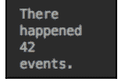

为了演示 `Scanner` 通过分隔符拆分输入，让我们运行以下代码：

```java
String input = "One two three";
Scanner sc = new Scanner(input);
while (sc.hasNext()) {
    System.out.println(sc.next());
}
```

结果如下：

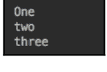

要使用另一个分隔符，可以如下设置：

```java
String input = "One,two,three";
sc = new Scanner(input).useDelimiter(",");
while (sc.hasNext()) {
    System.out.println(sc.next());
}
```

结果保持相同：


也可以使用正则表达式来提取标记，但这个主题不在本书的涵盖范围内。

`Scanner` 类有许多方法可以使其用法适用于各种来源和所需的结果。`findInLine()`、`findWithinHorizon()`、`skip()` 和 `findAll()` 方法不使用分隔符；它们只是尝试匹配提供的模式。欲更多信息，请参考 `Scanner` 文档（https://docs.oracle.com/en/java/javase/12/docs/api/java.base/util/Scanner.html）。

## 文件管理

我们已经使用 JCL 类使用了一些查找、创建、读取和写入文件的方法。我们这样做是为了支持输入/输出流的演示代码。在本节中，我们将更详细地讨论使用 JCL 进行文件管理。

`java.io` 包中的 `File` 类表示底层文件系统。可以使用以下构造函数之一创建 `File` 类对象：

- `File(String pathname)`：根据提供的路径创建新的 `File` 实例
- `File(String parent, String child)`：根据提供的父级路径和子路径创建新的 `File` 实例
- `File(File parent, String child)`：根据提供的 `File` 对象和子路径创建新的 `File` 实例
- `File(URI uri)`：根据表示路径的提供的 `URI` 对象创建新的 `File` 实例

### 创建和删除文件及目录

要在文件系统中创建文件或目录，首先需要使用文件管理部分列出的构造函数之一构建一个新的 `File` 对象。例如，假设文件名为 `FileName.txt`，可以使用其中一个构造函数来创建 `File` 对象。如果你想在目录内部创建一个文件，必须使用以下方法之一，例如：

```java
String path = "demo1" + File.separator + "demo2" + File.separator;
String fileName = "FileName.txt";
File f = new File(path + fileName);
```

注意使用 `File.separator` 而不是斜杠 (`/`)。这是因为 `File.separator` 是特定于平台的。如果你倾向于使用 `URI`，可以构建 `File` 对象：

```java
String path = "demo1" + File.separator + "demo2" + File.separator;
String fileName = "FileName.txt";
URI uri = new File(path + fileName).toURI();
```

然后，如果文件不存在，则必须调用以下方法之一：

- `boolean mkdir()`：如果目录不存在则创建该目录
- `boolean mkdirs()`：创建目录以及任何必要的父目录
- `boolean delete()`：删除文件或空目录

为了克服这一局限性，请看以下示例：

```java
String path = "demo1" + File.separator + "demo2" + File.separator;
String fileName = "FileName.txt";
File f = new File(path + fileName);
try {
    new File(path).mkdirs();
    f.createNewFile();
    f.delete();
    path = StringUtils.substringBeforeLast(path, File.separator);
    while (new File(path).delete()) {
        path = StringUtils.substringBeforeLast(path, File.separator);
    }
} catch (Exception e) {
    e.printStackTrace();
}
```

此示例创建并删除了一个文件及其相关的目录。注意我们对 `org.apache.commons.lang3.StringUtils` 类的使用，我们在字符串工具部分讨论过。它允许我们从路径中移除刚刚删除的目录，并持续直到所有嵌套目录都被删除，最后删除顶级目录。

### 列出文件和目录

可以使用以下方法列出目录及其中的文件：

- `String[] list()`：返回目录中的文件目录名称
- `File[] listFiles()`：返回表示文件和目录的 `File` 对象
- `static File[] listRoots()`：列出可用的文件系统根

为了演示上述方法，假设我们已经按照所示创建了目录和两个文件：

```java
String path1 = "demo1" + File.separator;
String path2 = "demo2" + File.separator;
```


# 字符串、输入输出与文件

```java
String path = path1 + path2;

File f1 = new File(path + "file1.txt");

File f2 = new File(path + "file2.txt");

File dir1 = new File(path1);

File dir = new File(path);

dir.mkdirs();

f1.createNewFile();

f2.createNewFile();
```

之后，我们应该能够运行以下代码：

```java
System.out.print("ndir1.list() : ");
```

```java
for(File f: dir.listFiles()) {
    System.out.print(f + " ");
}

System.out.print("Infile.listRoots() : ");

for(File f: File.listRoots()) {
    System.out.print(f + " ");
}
```

结果应该是：

```
dir1.list(): demo2
dir1.listFiles(): demo1/demo2
dir1.list(): file1.txt file2.txt
dir1.listFiles(): demo1/demo2/file1.txt demo2/file2.txt
File1.listRoots(): /
```

所演示的方法可以通过向它们添加以下过滤器来增强，它们将只会列出匹配过滤器的文件和目录：

- `String[] list(FilenameFilter)`
- `File[] listFiles(FileFilter)`
- `File[] listFiles(FilenameFilter)`

然而，对文件过滤器的讨论在本书的范围之外。

## Apache Commons 工具类 FileUtils IOUtils

JCL 的流行伴侣是 Apache Commons 项目 (https://commons.apache.org)，它提供了许多补充 JCL 功能的库。`org.apache.commons.io` 包中的类包含根包及其子包：

- `org.apache.commons.io` 根包包含带有常用任务静态方法的工具类，例如分别在 `FileUtils` 和 `IOUtils` 类中描述的 `FileUtils` 和 `IOUtils` 类。
- `org.apache.commons.io.input` 包包含基于 `InputStream` 和 `Reader` 实现输入的类，例如 `XmlStreamReader` 或 `ReversedLinesFileReader`。
- `org.apache.commons.io.output` 包包含基于 `OutputStream` 和 `Writer` 实现输出的类，例如 `StreamWriter` 或 `StringBuilder`。
- `org.apache.commons.io.filter` 包包含作为过滤器的类，例如 `DirectoryFilter` 或 `RegexFilter`。
- `org.apache.commons.io.comparator` 包包含文件的 `java.util.Comparator` 的各种实现，例如 `NameComparator`。
- `org.apache.commons.io.serialization` 包提供了控制类反序列化的框架。
- `org.apache.commons.io.monitor` 包允许监控文件系统并检查目录或文件的创建、更新或删除；可以启动 `FileAlterationMonitor` 对象作为线程，并创建一个 `FileAlterationObserver` 对象，在指定的间隔对文件系统的更改进行检查。

请参考 Apache Commons 项目文档 (https://commons.apache.org) 获取更多详情。

## 类 FileUtils

流行的 `org.apache.commons.io.FileUtils` 类允许对文件执行所有可能的操作，如下：

- 写入文件
- 从文件读取
- 创建包含父目录的目录
- 复制文件和目录
- 删除文件和目录
- 与 URL 之间转换
- 按过滤器和扩展名列出文件和目录
- 比较文件内容
- 获取文件的最后修改日期
- 计算校验和

如果你计划通过程序管理文件和目录，请务必学习 Apache Commons 项目网站 (https://commons.apache.org/proper/commons-io/javadoc/api-2.5/org/apache/commons/io/FileUtils.html) 上该类的文档。

## 类 IOUtils

`org.apache.commons.io.IOUtils` 是另一个非常有用的工具类，它提供了以下流操作方法：

- `CloseQuietly` 方法：在忽略空值和异常的情况下关闭流
- `toXXX/read` 方法：从流中读取数据
- `write` 方法：将数据从一个流写入另一个流
- `copy` 方法：将所有数据从一个流复制到另一个流
- `contentEquals` 方法：比较两个流的内容

类中所有读取流的方法内部都进行了缓冲，因此不需要使用 `BufferedInputStream` 或 `BufferedReader`。`copy` 方法在后台都使用 `copyLarge` 方法，这极大地提高了它们的性能和效率。

该类对于管理 IO 流是不可或缺的。在 Apache Commons 项目网站 (https://commons.apache.org/proper/commons-io/javadoc/api-2.5/org/apache/commons/io/IOUtils.html) 上查看更多关于该类及其方法的详细信息。

## 总结

在本章中，我们讨论了 `String` 类，它允许分析、比较和转换字符串。我们还讨论了 JCL 和 Apache Commons 项目流行的字符串工具类。本章的两大部分内容介绍了输入/输出流以及 JCL 和 Apache Commons 项目中的支持类。文件管理类及其方法也通过特定的代码示例进行了讨论和演示。

在下一章中，我们将介绍 Java 集合框架及其三个主要接口：`List`、`Set` 和 `Map`，包括对泛型的讨论和演示。我们还将讨论用于管理数组、对象和时间/日期值的工具类。

## 测验

1. 以下代码打印什么？

```java
String str = "&8aL";

System.out.println(str.indexOf("a!L"));
```

a. 3
b. 2
c. 1
d. 0

2. 下列代码打印什么？

```java
String s1 = "x12";

String s2 = new String("x12");

System.out.println(s1.equals(s2));
```

a. 错误
b. false
c. true
d. false

3. 下列代码打印什么？

```java
System.out.println("6");
```

a. wx
b. true
c. 6
d. 错误

4. 下列代码打印什么？

```java
System.out.println("6");
```

a. 62
b. 6
c. 错误
d. true

9. 关于 `java.io` 的所有正确陈述：
a. `PrintStream extends OutputStream`
b. `OutputStream extends`
c. `PrintStream extends Object`
d. 错误

10. 下列代码做了什么？

```java
File f = new File("demo");

try {
    f.createNewFile();
} catch (Exception e) {
    e.printStackTrace();
}
```

a. 创建目录
b. 创建文件
c. 不创建
d. 错误

# 数据结构、泛型与常用工具类

最后，在讨论 `java.util` 接口之前，我们先简单介绍一下泛型。

## 泛型

你经常可以在此类声明中看到这些泛型：

```java
List<String> list = new ArrayList<String>();

Set<Integer> set = new HashSet<Integer>();
```

在前面的示例中，泛型是位于尖括号内的元素类型声明。如你所见，它们是冗余的，因为它们在赋值语句的左侧和右侧重复出现。这就是为什么 Java 允许使用空菱形括号 `<>` 来替换右侧的泛型：

```java
List<String> list = new ArrayList<>();

Set<Integer> set = new HashSet<>();
```

泛型告诉编译器集合元素预期的类型。通过这种方式，编译器可以检查程序员尝试添加到声明集合中的元素是否为兼容类型。例如，观察以下代码：

```java
List<String> list = new ArrayList<>();

list.add("abc");

list.add(42); // 编译错误
```

这有助于避免运行时错误。它还能向程序员（因为 IDE 在程序员编写代码时会进行编译）提示对集合元素进行可能的操作。

我们还会看到其他类型的泛型：

- `<? extends T>` 表示类型为 T 或 T 的子类，其中 T 是作为集合泛型的类型。
- `<? super T>` 表示类型为 T 或其任何基类（父类），其中 T 是作为集合泛型的类型。

## 如何初始化 List 和 Set

从 Java 9 开始，`List` 或 `Set` 接口拥有静态的 `of()` 工厂方法，可用于初始化集合：

- `of()`: 返回一个空集合。
- `of(E...)`: 返回一个与调用时传入元素数量相同的集合。元素可以以逗号分隔列表或数组的形式传入。

以下是几个示例：

```java
// Collection<String> coll = List.of("s1", null); // 不允许 null
Collection<String> coll = List.of("s1", "s2", "s2");

coll.add("s3"); // 不允许添加元素
coll.remove("s1"); // 不允许删除元素
((List<String>) coll).set(1, "s3"); // 不允许修改元素
System.out.println(coll); // 输出: [s1, s1, s2]

// coll = Set.of("s3", "s3", "s4"); // 不允许重复
coll = Set.of("s2", "s3", null); // 不允许 null
coll = Set.of("s3", "s4");
System.out.println(coll); // 输出: [s3, s4]

// coll.add("s5"); // 不允许添加元素
// coll.remove("s2"); // 不允许删除
```

正如你预期的，`Set` 的工厂方法不允许重复，因此我们注释掉了那行代码（否则，前面的示例会在该行停止运行）。预期结果是不能有 null 元素，并且在使用 `of()` 方法初始化集合后，不能添加/删除/修改集合的元素。这就是为什么我们需要向初始化的集合添加元素，你必须使用构造函数或其他创建可修改集合的工具类来初始化（稍后我们将看到 `Arrays.asList()` 的示例）。

`Collection` 接口提供了两个向实现 `Collection`（`List` 和 `Set` 的父接口）的对象添加元素的方法，如下：

- `boolean add(E e)`: 尝试向集合添加元素 e；如果成功返回 true，如果失败（例如集合中已存在该元素）返回 false。
- `boolean addAll(Collection<? extends E> c)`: 尝试将提供的集合中的所有元素添加到集合中；如果至少添加了一个元素，返回 true。

使用 `add()` 方法的示例：

```java
List<String> list1 = new ArrayList<>();

list1.add("s1");
list1.add("s1");
System.out.println(list1); // 输出: [s1, s1]
```

```java
Set<String> set1 = new HashSet<>();

set1.add("s1");
set1.add("s1");
System.out.println(set1); // 输出: [s1]
```

使用 `addAll` 方法的示例：

```java
List<String> list1 = new ArrayList<>();

list1.add("s1");
list1.add("s1");
System.out.println(list1); // 输出: [s1, s1]
```

```java
List<String> list2 = new ArrayList<>();

list2.addAll(list1);
System.out.println(list2); // 输出: [s1, s1]
```

```java
Set<String> set = new HashSet<>();

set.addAll(list1);
System.out.println(set); // 输出: [s1]
```

以下是 `add()` 和 `addAll()` 功能的示例：

```java
List<String> list1 = new ArrayList<>();

list1.add("s1");
list1.add("s1");
System.out.println(list1); // 输出: [s1, s1]
```

```java
List<String> list2 = new ArrayList<>();

list2.addAll(list1);
System.out.println(list2); // 输出: [s1, s1]
```

```java
Set<String> set = new HashSet<>();

set.addAll(list1);
System.out.println(set); // 输出: [s1]
```

```java
Set<String> set1 = new HashSet<>();

set1.add("s1");
```

```java
Set<String> set2 = new HashSet<>();

set2.add("s1");
set2.add("s2");
```

```java
System.out.println(set1.addAll(set2)); // 输出: true（因为添加了元素 s2）
System.out.println(set1); // 输出: [s1, s2]
```

请注意，在前面的代码段中，`set1.addAll(set2)` 返回了 false，尽管所有元素都已添加。要查看 `add()` 和 `addAll()` 方法返回 false 的情况，请看以下示例：

```java
Set<String> set1 = new HashSet<>();

System.out.println(set1.add("s1")); // 输出: true
System.out.println(set1.add("s1")); // 输出: false
System.out.println(set1); // 输出: [s1]
```

```java
Set<String> set1 = new HashSet<>();

set1.add("s1");
set1.add("s2");
```

```java
Set<String> set2 = new HashSet<>();

set2.add("s1");
set2.add("s2");
```

```java
System.out.println(set1.addAll(set2)); // 输出: false（因为元素已存在）
System.out.println(set1); // 输出: [s1, s2]
```

`ArrayList` 和 `HashSet` 类也有接受集合的构造函数：

```java
Collection<String> list1 = List.of("s1", "s1", "s2");
System.out.println(list1); // 输出: [s1, s1, s2]
```

```java
List<String> list2 = new ArrayList<>(list1);
System.out.println(list2); // 输出: [s1, s1, s2]
```

```java
Set<String> set3 = new HashSet<>(list1);
System.out.println(set3); // 输出: [s1, s2]
```

```java
List<String> list3 = new ArrayList<>(set3);
System.out.println(list3); // 输出: [s1, s2]
```


现在，在学习了如何初始化集合后，我们可以转向 `List` 和 `Set` 接口中的其他方法。

## java.lang.Iterable 接口

`Collection` 接口扩展了 `java.lang.Iterable` 接口，这意味着直接实现 `Collection` 接口的类也都实现了 `java.lang.Iterable` 接口。`Iterable` 接口中只有三个方法：

- `Iterator<T> iterator()`: 返回实现 `java.util.Iterator` 接口的类对象；它允许集合用于 `for` 语句。
- `default Spliterator<T> spliterator()`: 返回实现 `java.util.Spliterator` 接口的类对象；它主要用于实现允许并行处理的方法，超出本文范围。
- `default void forEach(Consumer<? super T> action)`: 对每个元素执行给定的操作，直到所有元素都被处理或操作抛出异常。

### Collection 接口

正如我们已经提到的，`List` 和 `Set` 接口扩展了 `Collection` 接口，这意味着 `List` 和 `Set` 继承了 `Collection` 接口的所有方法。这些方法如下：

- `boolean add(E e)`: 尝试向集合添加一个元素。
- `boolean addAll(Collection<? extends E> c)`: 尝试将提供的集合中的所有元素添加到集合。
- `boolean equals(Object o)`: 比较集合与提供的对象；如果提供的对象不是集合，则返回 `false`；否则，它比较集合的组成部分（作为对象 `o`）；对于 `List`，它还会比较元素的顺序。让我们通过几个示例来说明：

```java
Collection<String> list1 = List.of("s1", "s2", "s3");
System.out.println(list1); // 输出: [s1, s2, s3]

Collection<String> list2 = List.of("s1", "s2", "s3");
System.out.println(list2); // 输出: [s1, s2, s3]

System.out.println(list1.equals(list2)); // 输出: true

Collection<String> list3 = List.of("s2", "s1", "s3");
System.out.println(list3); // 输出: [s2, s1, s3]

System.out.println(list1.equals(list3)); // 输出: false

Collection<String> set1 = Set.of("s1", "s2", "s3");
System.out.println(set1); // 输出: [s2, s3, s1] 或不同的顺序

Collection<String> set2 = Set.of("s2", "s1", "s3");
System.out.println(set2); // 输出: [s2, s1, s3] 或不同的顺序

System.out.println(set1.equals(set2)); // 输出: true

Collection<String> set3 = Set.of("s4", "s1", "s3");
System.out.println(set3); // 输出: [s4, s1, s3] 或不同的顺序

System.out.println(set1.equals(set3)); // 输出: false
```

- `int hashCode()`: 返回集合的哈希值；当集合作为需要 `hashCode()` 方法实现的集合的元素时使用。
- `boolean isEmpty()`: 如果集合不包含任何元素，则返回 `true`。
- `int size()`: 返回集合中元素的数量；当 `isEmpty()` 方法返回 `true` 时，此方法返回 `0`。
- `void clear()`: 移除集合中的所有元素；调用此方法后，`isEmpty()` 方法返回 `true`，`size()` 方法返回 `0`。
- `boolean contains(Object o)`: 如果集合包含提供的对象 `o`，则返回 `true`；为了使该方法正常工作，集合中的每个元素以及提供的对象都必须实现 `equals()` 方法，并且在 `Set` 的情况下，还应该实现 `hashCode()` 方法。
- `boolean containsAll(Collection<?> c)`: 如果集合包含提供的集合中的所有元素，则返回 `true`；为了使该方法正常工作，集合中的每个元素以及提供的集合中的每个元素都必须实现 `equals()` 方法，并且在 `Set` 的情况下，应该实现 `hashCode()` 方法。
- `boolean remove(Object o)`: 尝试从此集合中移除指定的元素，如果存在则返回 `true`；为了使该方法正常工作，集合中的每个元素和提供的对象必须实现 `equals()` 方法，并且在 `Set` 的情况下，应该实现 `hashCode()` 方法。
- `boolean removeAll(Collection<?> c)`: 尝试从集合中移除提供的集合中的所有元素；与 `add()` 方法类似，如果至少移除了一个元素，则此方法返回 `true`；否则返回 `false`；为了使该方法正常工作，集合中的每个元素和提供的每个元素都必须实现 `equals()` 方法，并且在 `Set` 的情况下，应该实现 `hashCode()` 方法。
- `default boolean removeIf(Predicate<? super E> filter)`: 尝试从集合中移除所有满足谓词的元素；这是我们将在第 13 章“函数式编程”中描述的函数；如果至少移除了一个元素，则返回 `true`。
- `boolean retainAll(Collection<?> c)`: 尝试在集合中保留提供的集合中的元素；与 `addAll()` 方法类似，如果保留了至少一个元素，则此方法返回 `true`；否则返回 `false`；为了使该方法正常工作，集合中的每个元素和集合中的每个元素都必须实现 `equals()` 方法，并且在 `Set` 的情况下，应该实现 `hashCode()` 方法。
- `Object[] toArray()`: 将集合转换为数组。
- `<T> T[] toArray(T[] a)`: 将集合转换为指定类型的数组。
- `default <T> T[] toArray(IntFunction<T[]> generator)`: 使用提供的函数将集合转换为数组；我们将在第 13 章“函数式编程”中解释函数。
- `default Stream<E> stream()`: 返回一个 `Stream`；我们将在第 14 章“Java 标准流”中讨论流。
- `default Stream<E> parallelStream()`: 返回一个可能的并行的 `Stream` 对象（我们将在第 14 章“Java 标准流”中讨论流）。

## List 接口

`List` 接口还有其他几个不属于其任何一个父类接口的方法：

- 在“如何初始化 List 和 Set”小节中描述的 `of()` 静态工厂方法。
- `void add(int index, E element)`: 在指定位置插入提供的元素。
- `static <E> List<E> copyOf(Collection<? extends E> coll)`: 返回一个包含给定 `Collection` 元素且未修改的 `List`，并保留它们的顺序；这里是演示该方法功能的示例代码：

```java
Collection<String> list = List.of("s1", "s2", "s3");
System.out.println(list); // prints: [s1, s2, s3]

List<String> list1 = List.copyOf(list);
list1.add("s4"); // 运行时错误
list1.set(1, "s5"); // 运行时错误
list1.remove("s1"); // 运行时错误
```

```java
Set<String> set = new HashSet<>();
System.out.println(set.add("s1"));
System.out.println(set); // prints: [s1]

Set<String> set1 = Set.copyOf(set);
set1.add("s2"); // 运行时错误
set1.remove("s1"); // 运行时错误

Set<String> set2 = Set.copyOf(list);
System.out.println(set2); // prints: [s1, s2, s3]
```

- `E get(int index)`: 返回列表中指定位置的元素。
- `List<E> subList(int fromIndex, int toIndex)`: 提取从 `fromIndex`（包含）到 `toIndex`（不包含）之间的子列表。
- `int indexOf(Object o)`: 返回指定元素在列表中第一次出现的索引（位置）；列表中的第一个元素索引为 `0`。
- `int lastIndexOf(Object o)`: 返回指定元素在列表中最后一次出现的索引（位置）；列表中的最后一个元素索引为 `size() - 1`。
- `E remove(int index)`: 移除列表中指定位置的元素；返回被移除的元素。
- `E set(int index, E element)`: 替换列表中指定位置的元素；返回被替换的元素。
- `void replaceAll(UnaryOperator<E> operator)`: 通过对每个元素应用函数来转换列表；`UnaryOperator` 在第 13 章“函数式编程”中描述。
- `ListIterator<E> listIterator()`: 返回一个允许反向遍历列表的 `ListIterator`。
- `ListIterator<E> listIterator(int index)`: 返回一个从提供的位置开始进行反向遍历的 `ListIterator`。观察以下内容：

```java
List<String> list = List.of("s1", "s2", "s3");
ListIterator<String> li = list.listIterator();
while (li.hasNext()) {
    System.out.print(li.next() + " ");
}
while (li.hasPrevious()) {
    System.out.print(li.previous() + " ");
}
```

```java
List<String> list = List.of("s1", "s2", "s3");
ListIterator<String> li = list.listIterator(1);
while (li.hasNext()) {
    System.out.print(li.next() + " ");
}
while (li.hasPrevious()) {
    System.out.print(li.previous() + " ");
}
```

```java
List<String> list = List.of("s1", "s2", "s3");
ListIterator<String> li = list.listIterator(2);
while (li.hasNext()) {
    System.out.print(li.next() + " ");
}
while (li.hasPrevious()) {
    System.out.print(li.previous() + " ");
}
```

- `default void sort(Comparator<? super E> c)`: 根据 `Comparator` 生成的顺序排序列表。观察以下内容：

```java
List<String> list = new ArrayList<>();
list.add("s2");
list.add("s3");
list.add("s1");
list.sort(Comparator.naturalOrder());
System.out.println(list); // prints: [s1, s2, s3]
list.sort(Comparator.reverseOrder());
System.out.println(list); // prints: [s3, s2, s1]
list.sort(String.CASE_INSENSITIVE_ORDER);
System.out.println(list); // prints: [s1, s2, s3]
list.add(null); // 会抛出 NullPointerException
list.sort(Comparator.naturalOrder()); // 会抛出 NullPointerException
list.sort((s1, s2) -> s1 == null ? -1 : s1.compareTo(s2)); // 可以处理 null
System.out.println(list); // prints: [null, s1, s2, s3]
list.sort(Comparator.nullsFirst(Comparator.naturalOrder()));
System.out.println(list); // prints: [null, s1, s2, s3]
list.sort(Comparator.nullsLast(Comparator.naturalOrder()));
System.out.println(list); // prints: [s1, s2, s3, null]
```


# 数据结构、泛型与常用工具 第 6 章

## 排序列表

排序列表主要有两种方式：

- 使用 `Comparable` 接口实现（自然排序）
- 使用 `Comparator` 接口实现

`Comparable` 接口仅有一个 `compareTo(T o)` 方法。在前面的示例中，我们基于 `String` 类的 `Comparable` 实现实现了 `Comparator` 接口。正如你所看到的，这种实现提供了 `Comparator.nullsFirst(Comparator.naturalOrder())` 相同的排序。这种实现风格被称为函数式编程，我们将在第 13 章中更详细地讨论。

## Set 接口

Set 接口有以下几个不属于其任何一个父类接口的方法：

- 在“如何初始化 List 和 Set”小节中描述的静态 `of()` 工厂方法。
- 静态 `Set<E> copyOf(Collection<E> coll)` 方法：返回一个包含通用 Collection 元素的未修改 Set；其工作方式与 Interface List 部分描述的静态 `<E> List<E> copyOf(Collection<E> coll)` 方法相同。

## Map 接口

Map 接口有许多与 List 和 Set 方法相似：

- `int size()`
- `void clear()`
- `int hashCode()`
- `boolean isEmpty()`
- `boolean equals(Object o)`
- `void forEach(BiConsumer<K,V> action)`
- 静态工厂方法：`of()`, `of(K v)`, `of(K k1, V v1, K k2, V v2)` 以及除此之外的许多方法

Map 接口的许多方法与 List 和 Set 接口中的方法签名和功能完全相同，因此我们在这里不再重复它们。我们将只介绍 Map 特有的方法：

- `Set<Map.Entry<K,V>> entrySet()`: 返回一个包含所有键值对的集合，这些对以 `Map.Entry` 对象的形式存在。
- `default V getDefault(Object key, V defaultValue)`: 返回映射到键的值；如果 map 中没有该键，则返回 `defaultValue`。
- `static Map.Entry<K,V> entry(K key, V value)`: 返回一个包含所提供的键和值的不可修改的 `Map.Entry`。
- `static Map<K,V> copy(Map<K,V> map)`: 将提供的 Map 转换为一个不可修改的 Map。

以下方法对于本书的范围来说过于复杂，因此我们只是为了完整性考虑而提到了它们。它们允许将多个值合并或聚合到 Map 中现有的单个值中，或者创建一个新值：

- `default V merge(K key, V value, BiFunction<V,V,V> remappingFunction)`: 如果提供的键值对存在且值不为 null，则使用提供的函数来计算新值；如果新计算的值为 null，则移除该键值对；如果提供的键值对不存在或值为 null，则用提供的非空值替换当前值；此方法可用于聚合多个值；例如，它可以用于连接以下字符串值：`map.merge(key, value, String::concat)`；我们将在第 13 章“函数式编程”中解释 `String::concat` 的含义。
- `default V computeIfAbsent(K key, BiFunction<K,V,V> remappingFunction)`: 仅当提供的键尚未关联任何值或该值为 null 时，才使用提供的函数计算一个新值。
- `default V computeIfPresent(K key, BiFunction<K,V,V> remappingFunction)`: 仅当提供的键已关联一个值且该值为 null 时，才使用提供的函数计算一个新值。

最后一组计算和合并方法很少使用。到目前为止，最流行的是 `V put(K, V value)` 和 `V get(Object key)` 方法，它们允许使用 Map 的主要功能来存储键值对并使用键检索值。`Set<K> keySet()` 方法用于遍历 map 的键值对，尽管 `entrySet()` 方法似乎是更自然的实现方式。这里有一个示例：

前一个代码示例中的第一个 for 循环展示了通过遍历键来访问 map 键值对的更常用方法。第二个循环遍历条目集，在我们看来，这是一种更自然的方法。注意，打印出的值与我们放入 map 的顺序并不相同。也就是说，自 Java 9 开始，不可修改集合（即通过 `of()` 工厂方法产生的）对 Set 元素的顺序增加了随机性。它会改变不同代码执行次数之间的元素顺序。这种设计是为了确保程序员不会依赖 Set 元素的特定顺序，因为集合本身是不保证顺序的。

## 不可修改集合

请注意，由 `of()` 工厂方法产生的集合在 Java 9 中被称为“不可变的”（immutable），而从 Java 10 开始被称为“不可修改的”（unmodifiable）。这是因为“不可变”意味着你不能更改其中的任何内容，而实际上，如果集合元素是可修改对象，那么它们是可以更改的。例如，让我们构建一个如下所示的 `Person` 类对象集合：

```java
class Person {
    private int age;
    private String name;

    public Person(int age, String name) {
        this.age = age;
        this.name = name == null ? "" : name;
    }

    public void setName(String name) { this.name = name; }

    @Override
    public String toString() {
        return "Person(age=" + age + ", name=" + name + ")";
    }
}
```

正如我们已经提到的，`Collections` 类中还有许多其他工具方法，因此我们建议你至少阅读一遍相关文档并理解它所有的功能。

## CollectionUtils 类

Apache commons 项目中的 `org.apache.commons.collections4.CollectionUtils` 类包含了许多静态方法，这些方法实现了 `java.util.Collections` 类的方法。它们可以帮助搜索、处理和比较 Java 集合。

要使用此类，你需要在 Maven 的 `pom.xml` 配置文件中添加以下依赖：

```xml
<dependency>
  <groupId>org.apache.commons</groupId>
  <artifactId>commons-collections4</artifactId>
  <version>4.1</version>
</dependency>
```

该类包含许多方法，并且随着时间的推移可能会添加更多方法。这些工具类是在 `Collections` 方法之外创建的，因此它们更加复杂且细致，不属于本书的讨论范围。为了让你对 `CollectionUtils` 类中的可用方法有一个直观的了解，这里按功能分组对方法进行了简要描述：

- 从集合中检索元素的方法
- 向集合添加元素或一组元素的方法
- 将 `Iterable` 元素合并到集合的方法
- 根据标准或不根据标准移除或保留元素的方法
- 比较两个集合的方法
- 转换集合的方法
- 从集合中选择并过滤集合的方法
- 生成两个集合的并集、交集或差集的方法
- 创建不可变集合的方法
- 检查集合大小和为空的方法
- 反转数组的方法

## 数组工具类

有两个带有静态方法的处理数组的类，它们非常流行且有用：

- `java.util.Arrays`
- `org.apache.commons.lang3.ArrayUtils`

我们将简要回顾每一个类。

### java.util.Arrays 类

我们已经使用过多次 `java.util.Arrays` 类了。它是管理数组的主要工具类。该工具类曾因其 `asList(T... a)` 方法而非常流行。它是创建和初始化集合最紧凑的方式：

```java
List<String> list = Arrays.asList("s0", "s1");
Set<String> set = new HashSet<>(Arrays.asList("s0", "s1"));
```

它仍然创建可修改列表的流行方式。我们也使用了它。然而，在引入 `List.of()` 工厂方法后，`Arrays` 类的使用大幅下降。

尽管如此，如果你需要管理数组，`Arrays` 类会有很大帮助。它包含了 160 多个方法。大部分方法都根据不同的参数和数组类型进行了重载。如果按方法名分组，会有 21 组。如果进一步按功能分组，以下 10 组将涵盖所有 `Arrays` 的功能：

- `asList()`：根据提供的数组或用逗号分隔的参数列表创建一个 `ArrayList` 对象。
- `binarySearch()`：搜索数组或其指定的部分（根据索引范围）。
- `compare()`、`mismatch()`、`equals()` 和 `deepEquals()`：比较两个数组或其元素（根据索引范围）。
- `copyOf()` 和 `copyOfRange()`：复制所有数组或其指定的部分（根据索引范围）。
- `hashCode()` 和 `deepHashCode()`：根据提供的数组生成哈希值。
- `toString()` 和 `deepToString()`：创建数组的字符串表示。
- `fill()`、`setAll()`、`parallelPrefix()` 和 `parallelSetAll()`：为数组的每个元素或指定的索引范围设置一个值（固定或由函数生成）。
- `sort()` 和 `parallelSort()`：对数组元素或其部分（根据索引范围）进行排序。
- `spliterator()`：返回一个 `Spliterator` 对象，用于并行处理数组或其部分（根据索引范围）。
- `stream()`：生成数组元素或部分元素（根据索引范围）的流；参见第 14 章《Java 数据标准》。

所有这些方法都有帮助，但我们希望你注意 `equals(a1, a2)` 方法和 `deepEquals(a1, a2)` 方法。它们对于数组比较特别有用，因为数组对象无法实现自定义的 `equals()` 方法，而是使用 `Object` 类的实现（该实现只比较引用）。`equals(a1, a2)` 和 `deepEquals(a1, a2)` 方法允许不仅比较 `a1` 和 `a2` 引用，还使用 `equals()` 方法来比较元素。以下是演示这些方法工作的代码示例：

```java
String[] arr1 = {"s1", "s2"};
String[] arr2 = {"s1", "s2"};

System.out.println(arr1.equals(arr2)); // 输出: false
System.out.println(Arrays.equals(arr1, arr2)); // 输出: true
System.out.println(Arrays.deepEquals(arr1, arr2)); // 输出: true

String[] arr3 = {"s1", "s2"};
String[] arr4 = {"s1", "s2"};

System.out.println(arr3.equals(arr4)); // 输出: false
System.out.println(Arrays.equals(arr3, arr4)); // 输出: false
System.out.println(Arrays.deepEquals(arr3, arr4)); // 输出: true
```

如你所见，`Arrays.deepEquals()` 在比较两个相等数组时，只要一个数组的每个元素与另一个数组相同位置的元素相等，它就会返回 `true`；而 `Arrays.equals()` 方法也这样做，但仅适用于一维数组。

### ArrayUtils 类

`org.apache.commons.lang3.ArrayUtils` 类补充了管理数组的工具包 `java.util.Arrays` 类，并提供了处理可能抛出 `NullPointerException` 的空情况的能力。使用此类，你需要在 Maven 的 `pom.xml` 配置文件中添加以下依赖：

```xml
<dependency>
  <groupId>org.apache.commons</groupId>
  <artifactId>commons-lang3</artifactId>
  <version>3.8.1</version>
</dependency>
```

`ArrayUtils` 类有 300 个方法，可以归纳为以下组：

- `add()`、`addAll()` 和 `insert()`：向数组添加元素。
- `clone()`：克隆数组，类似于 `Arrays` 类的 `copyOf()` 方法。
- `getLength()`：返回数组的长度，当数组本身为空时返回 0。
- `hashCode()`：计算数组的哈希值，包括嵌套数组。
- `contains()`、`indexOf()` 和 `lastIndexOf()`：搜索数组。
- `isSorted()`、`isEmpty()` 和 `isNotEmpty()`：检查数组并处理空值。
- `isLength()` 和 `isSameType()`：比较数组。
- `toEmpty()`：将空数组转换为空数组。
- `remove()`、`removeAll()`、`removeElement()`、`removeElements()` 和 `removeOccurrences()`：移除某些元素。
- `reverse()`、`shuffle()` 和 `swap()`：改变数组元素的顺序。
- `subarray()`：根据索引范围提取数组部分。
- `toMap()`、`toObject()`、`toPrimitive()`、`toString()`、`toStringArray()`：转换数组类型并处理空值。

## Object 工具类

本节描述的两个工具类如下：

- `java.util.Objects`
- `org.apache.commons.lang3.ObjectUtils`

它们在类创建期间特别有用，因此我们将重点关注与此相关的方法。

### java.util.Objects 类

`Objects` 类只有 17 个静态方法。让我们在将其应用于 `Person` 类时查看其中一些方法。假设该类将作为集合的元素，这意味着它必须实现 `equals()` 和 `hashCode()` 方法：

```java
class Person {
    private int age;
    private String name;

    public Person(int age, String name) {
        this.age = age;
        this.name = name;
    }

    public int getAge() { return this.age; }
    public String getName() { return this.name; }
}
```


```java
@Override
public boolean equals(Object o) {
    if (this == o) return true;
    if (o == null) return false;
    if (!(o instanceof Person)) return false;
    Person person = (Person) o;
    return age == person.getAge() &&
           Objects.equals(name, person.getName());
}

@Override
public int hashCode() {
    return Objects.hash(age, name);
}
```

注意，我们没有检查 `name` 属性是否为空，因为 `Objects.equals()` 在任何参数为空时都不会崩溃。它只是执行比较对象的工作。如果只有其中一个为空，它会返回 `false`。如果两个都为空，它会返回 `true`。

# 数据结构、泛型与常用工具类

使用 `Objects.equals()` 是实现 `equals()` 方法的一种安全方式。但如果你需要比较数组类型的对象，使用 `Objects.deepEquals()` 方法更好，因为它不像 `Objects.equals()` 方法那样处理 `null`，它还会比较所有数组的值，即使数组是多维的。

```java
String[][] x1 = {{"a","b"}, {"x","y"}};
String[][] x2 = {{"a","b"}, {"x","y"}};
String[][] y = {{"a","b"}, {"x","y"}};
```

```java
System.out.println(Objects.equals(x1, x2)); // 输出: false
System.out.println(Objects.equals(x1, y)); // 输出: false
System.out.println(Objects.deepEquals(x1, x2)); // 输出: true
System.out.println(Objects.deepEquals(x1, y)); // 输出: false
```

`Objects.hash()` 方法也会处理 `null` 值。需要记住的一点是：在 `equals()` 方法中比较的属性列表必须与传递给 `Objects.hash()` 的参数列表匹配。否则，两个相等的 `Person` 对象将具有不同的哈希值，这会导致基于哈希的集合工作异常。

另一个值得注意的是，还有另一个相关的 `Objects.hashCode()` 方法，它只接受一个参数。但它生成的值并不等于仅用一个参数的 `Objects.hash()` 生成的值。观察以下内容：

```java
System.out.println(Objects.hash(42) == Objects.hashCode(42)); // 输出: false
System.out.println(Objects.hash("abc") == Objects.hashCode("abc")); // 输出: false
```

为了避免这个陷阱，请始终使用 `Objects.hash`。

另一个潜在的混淆可以通过代码解决：

```java
System.out.println(Objects.hash(null)); // 输出: 0
System.out.println(Objects.hashCode(null)); // 输出: 0
System.out.println(Objects.hash(0)); // 输出: 31
System.out.println(Objects.hashCode(0)); // 输出: 0
```

如你所见，`Objects.hash()` 方法为 `null` 和 `0` 生成了相同的哈希值，这对于某些基于哈希值的算法可能会产生问题。

# 数据结构、泛型与常用工具类

`static <T> compare(T a, T b, Comparator<T> c)` 是另一个常用方法，它返回 0（如果参数相等），否则返回 `c.compare(a, b)` 的结果。它对于实现 `Comparable` 接口（为自定义对象排序建立自然顺序）非常有用。请观察以下内容：

```java
class Person implements Comparable<Person> {
    private int age;
    private String name;

    public Person(int age, String name) {
        this.age = age;
        this.name = name;
    }

    public int getAge() { return this.age; }
    public String getName() { return this.name; }

    @Override
    public int compareTo(Person p) {
        int result = Objects.compare(name, p.getName(),
            Comparator.naturalOrder());
        if (result != 0) {
            return result;
        }
        return Objects.compare(age, p.getAge(),
            Comparator.naturalOrder());
    }
}
```

通过这种方式，你可以通过设置 `Comparator.reverseOrder()` 值，或添加 `Comparator.nullFirst()` 或 `Comparator.nullLast()` 来轻松更改排序算法。

此外，上一节中使用的 `Comparator` 实现可以通过使用 `Objects.compare()` 方法变得更加灵活：

```java
class ComparePersons implements Comparator<Person> {
    public int compare(Person p1, Person p2) {
        int result = Objects.compare(p1.getName(), p2.getName(),
            Comparator.naturalOrder());
        if (result != 0) {
            return result;
        }
        return Objects.compare(p1.getAge(), p2.getAge(),
            Comparator.naturalOrder());
    }
}
```

# 数据结构、泛型与常用工具类

最后，我们将讨论 `Objects` 类的两个方法是生成对象字符串表示的方法。当你需要对对象调用 `toString()` 方法但不确定引用是否为 `null` 时，这些方法非常有用。观察以下内容：

```java
List<String> list = Arrays.asList("s1", null);
for (String e : list) {
    // String s = e.toString(); // NullPointerException
}
```

在上一个示例中，我们知道每个元素的确切值。但想象一种列表作为参数传递给方法的情况。那么，我们被迫编写如下代码：

```java
void someMethod(List<String> list) {
    for (String e : list) {
        String s = e == null ? "null" : e.toString();
    }
}
```

这似乎是一件大事。但在写了十几之后，程序员自然地会考虑某种可以完成所有工作的工具方法，这时 `Objects` 类的以下两个方法派上了用场：

- `static String toString(Object o)`：当参数不为 `null` 时，返回调用 `toString()` 的结果；当参数值为 `null` 时返回 `null`。
- `static String toString(Object o, String nullDefault)`：当第一个参数不为 `null` 时，返回调用 `toString()` 的结果；当第一个值为 `null` 时返回第二个参数 `nullDefault` 值。

以下代码演示了这两个方法：

```java
List<String> list = Arrays.asList("s1", null);
for (String e : list) {
    String s = Objects.toString(e);
    System.out.print(s + " "); // 输出: s1 null
}
for (String e : list) {
    String s = Objects.toString(e, "element was null");
    System.out.print(s + " "); // 输出: s1 element was null
}
```

在编写本文时，`Objects` 类有 17 个方法。我们建议你熟悉它们，以便在已经存在相同工具类的情况下避免编写自己的工具类。

# ObjectUtils 类

上一节的最后结论适用于 Apache Commons 库中的 `org.apache.commons.lang3.ObjectUtils` 类，该类补充了上一节描述的 `java.util.Objects` 类的方法。由于范围不允许详细审查所有方法，我们将根据其功能进行描述。要使用此类，你需要在 `pom.xml` 中添加以下依赖：

```xml
<dependency>
  <groupId>org.apache.commons</groupId>
  <artifactId>commons-lang3</artifactId>
  <version>3.1</version>
</dependency>
```

`ObjectUtils` 的所有方法可以组织成七组：

- 对象克隆方法。
- 支持两个对象比较的方法。
- `equals()` 方法，用于比较两个对象，其中一个或两个对象可能为 `null`。
- `toString()` 方法，生成提供的对象的字符串表示，并可选地将其附加到另一个字符串之后。
- `allNull()` 和 `anyNotNull()` 方法，分析对象数组是否存在 `null`。
- `firstNonNull()` 和 `defaultIfNull()` 方法，分析对象数组并返回第一个非 `null` 对象或默认值。
- `max()`、`min()`、`median()` 和 `mode()` 方法，分析对象数组并返回与方法名对应的项。

# java.time 包

它们被引入作为旧包的替代品。由于这些新类是线程安全的（因此更适合多线程处理），重要的是它们的设计更一致且更易于理解。此外，新的实现在日期和时间格式上遵循国际标准组织（ISO）标准，但也允许使用其他自定义格式。

我们将描述主要的五个类以及如何使用它们：

- `java.time.LocalDate`
- `java.time.LocalTime`
- `java.time.LocalDateTime`
- `java.time.Period`
- `java.time.Duration`

## LocalDate 类

`LocalDate` 类不携带时间。它以 ISO 8601 格式（YYYY-MM-DD）表示日期。

```java
System.out.println(LocalDate.now()); // 输出: 2019-03-04
```

这是写作此处当前的日期。该值是从计算机时钟获取的。同样，你可以使用静态 `now(ZoneId)` 方法获取任何其他时区的日期。`ZoneId` 对象可以使用静态 `ZoneId.of(String zone)` 方法构建，其中 `String zoneId` 是 `ZoneId.getAvailableZoneIds()` 方法返回的字符串之一：

```java
Set<String> zoneIds = ZoneId.getAvailableZoneIds();
for (String zoneId : zoneIds) {
    System.out.println(zoneId);
}
```

之前的代码打印了几乎 600 个时区 ID。以下是其中几个：

```
Asia/Aden
Etc/GMT+9
Africa/Nairobi
America/Marigot
Pacific/Honolulu
Australia/Hobart
Europe/London
America/Indiana/Petersburg
Asia/Yerevan
Europe/Brussels
GMT
Chile/Continental
Pacific/Yap
CET
Etc/GMT-1
Canada/Yukon/Atlantic/St_Helena
Libya
US/Pacific-New
Cuba
Israel
GB-Eire
GB
Mexico/Generic
Universal
Zulu
Iran
Navajo
Egypt
Etc/UTC
SystemV/AST4ADT
Asia/Tokyo
```

让我们尝试使用 "Asia/Tokyo"，例如：

```java
ZoneId zoneId = ZoneId.of("Asia/Tokyo");
System.out.println(LocalDate.now(zoneId)); // prints: 2019-03-05
```

使用以下方法，`LocalDate` 对象可以代表过去或未来的任何日期：

- `LocalDate parse(CharSequence text)`：这根据 ISO 8601 格式的字符串（YYYY-MM-DD）构造一个对象。
- `LocalDate parse(CharSequence text, DateTimeFormatter formatter)`：这根据 `DateTimeFormatter` 对象指定的格式从字符串构造对象，该对象拥有一套模式系统以及许多预定义格式；以下是：
  - `BASIC_ISO_DATE`，例如 201112023
  - `ISO_LOCAL_DATE`，例如 2011-12-03
  - `ISO_OFFSET_DATE`，例如 2011-12-03+01:00
  - `ISO_DATE`，例如 2011-12-03+01:00; 2011-12-03
  - `ISO_LOCAL_TIME`，例如 10:15:30
  - `ISO_OFFSET_TIME`，例如 10:15:30+01:00
  - `ISO_TIME`，例如 10:15:30+01:00; 10:15:30
  - `ISO_LOCAL_DATE_TIME`，例如 2011-12-03T10:15:30
- `LocalDate of(int year, int month, int dayOfMonth)`：这根据年、月、日构造一个对象。
- `LocalDate of(int year, Month month, int dayOfMonth)`：这根据年、月枚举（常量）和日构造一个对象。
- `LocalDate ofYearDay(int year, int dayOfYear)`：这根据年和一年中的天数构造一个对象。

以下代码演示了列出的方法：

```java
LocalDate lc1 = LocalDate.parse("2020-02-23");
System.out.println(lc1); // prints: 2020-02-23

LocalDate lc2 = LocalDate.parse("20200223", DateTimeFormatter.BASIC_ISO_DATE);
System.out.println(lc2); // prints: 2020-02-23

DateTimeFormatter formatter = DateTimeFormatter.ofPattern("dd/MM/yyyy");
LocalDate lc3 = LocalDate.parse("23/02/2020", formatter);
System.out.println(lc3); // prints: 2020-02-23

LocalDate lc4 = LocalDate.of(2020, 2, 23);
System.out.println(lc4); // prints: 2020-02-23

LocalDate lc5 = LocalDate.of(2020, Month.FEBRUARY, 23);
System.out.println(lc5); // prints: 2020-02-23

LocalDate lc6 = LocalDate.ofYearDay(2020, 54);
System.out.println(lc6); // prints: 2020-02-23
```


# 第 6 章

`LocalDate` 对象可以提供各种值：

```java
LocalDate lc = LocalDate.parse("2020-02-23");

System.out.println(lc);                          // prints: 2020-02-23
System.out.println(lc.getYear());                // prints: 2020
System.out.println(lc.getMonth());               // prints: FEBRUARY
System.out.println(lc.getValue());               // prints: 2
System.out.println(lc.getDayOfMonth());          // prints: 23
System.out.println(lc.getDayOfWeek());           // prints: SUNDAY
System.out.println(lc.isLeapYear());             // prints: true
System.out.println(lc.lengthMonth());            // prints: 29
System.out.println(lc.lengthOfYear());           // prints: 366
```

`LocalDate` 对象可以按如下修改：

```java
LocalDate lc = LocalDate.parse("2020-02-23");

System.out.println(lc.withYear(2021));           // prints: 2021-02-23
System.out.println(lc.withMonth(5));             // prints: 2020-05-23
System.out.println(lc.withDayOfMonth(5));        // prints: 2020-02-05
System.out.println(lc.withDayOfYear(53));        // prints: 2020-02-22
System.out.println(lc.plusDays(10));             // prints: 2020-03-04
System.out.println(lc.plusMonths(2));            // prints: 2020-04-23
System.out.println(lc.plusYears(2));             // prints: 2022-02-23
System.out.println(lc.minusDays(10));            // prints: 2020-02-13
System.out.println(lc.minusMonths(2));           // prints: 2019-12-23
System.out.println(lc.minusYears(2));            // prints: 2018-02-23
```

`LocalDate` 对象可以按如下比较：

```java
LocalDate lc1 = LocalDate.parse("2020-02-23");
LocalDate lc2 = LocalDate.parse("2020-02-22");

System.out.println(lc1.isAfter(lc2));            // prints: true
System.out.println(lc1.isBefore(lc2));           // prints: false
```

`LocalDate` 类中还有其他实用方法。如果你需要处理日期，建议你阅读该类以及 `java.time` 包及其子包的 API。

## LocalTime 类

`LocalTime` 类不包含日期。它拥有与 `LocalDate` 类相似的方法。`LocalTime` 对象可以这样创建：

```java
System.out.println(LocalTime.now());             // prints: 21:15:46.36904

ZoneId zoneId = ZoneId.of("Asia/Tokyo");
System.out.println(LocalTime.now(zoneId));       // prints: 12:15:46.36478
```

从 `LocalTime` 对象可以如下提取每个值：

```java
LocalTime lt2 = LocalTime.of(20, 23, 12);

System.out.println(lt2.getHour());               // prints: 20
System.out.println(lt2.getMinute());             // prints: 23
System.out.println(lt2.getSeconds());            // prints: 12
System.out.println(lt2.getNano());               // prints: 0
```

`LocalTime` 对象可以按如下修改：

```java
LocalTime lt2 = LocalTime.of(20, 23, 12);

System.out.println(lt2.withHour(3));             // prints: 03:23:12
System.out.println(lt2.withMinute(10));          // prints: 20:10:12
System.out.println(lt2.withSecond(15));          // prints: 20:23:15
System.out.println(lt2.withNano(100));           // prints: 20:23:12.000000100
System.out.println(lt2.plusHours(6));            // prints: 02:23:12
System.out.println(lt2.plusMinutes(2));          // prints: 20:25:12
System.out.println(lt2.plusSeconds(2));          // prints: 20:23:14
System.out.println(lt2.plusNanos(200));          // prints: 20:23:12.000000200
System.out.println(lt2.minusHours(10));          // prints: 10:23:12
System.out.println(lt2.minusMinutes(2));         // prints: 20:21:12
System.out.println(lt2.minusSeconds(2));         // prints: 20:23:10
System.out.println(lt2.minusNanos(200));         // prints: 20:23:11.999999800
```

两个 `LocalTime` 对象可以按如下比较：

```java
LocalTime lt2 = LocalTime.of(20, 23, 12);
LocalTime lt4 = LocalTime.parse("20:23:12");

System.out.println(lt2.isAfter(lt4));            // prints: false
System.out.println(lt2.isBefore(lt4));           // prints: true
```

`LocalTime` 类中有很多其他实用方法。如果你需要处理日期，我们建议你阅读该类以及 `java.time` 包及其子包的 API。

## LocalDateTime 类

`LocalDateTime` 类包含日期和时间，并拥有 `LocalDate` 和 `LocalTime` 类的所有方法，因此我们在这里不再重复它们。我们只展示如何创建 `LocalDateTime.now()` 对象：

```java
System.out.println(LocalDateTime.now());
// prints: 2019-03-04T21:59:00.142804

ZoneId zoneId = ZoneId.of("Asia/Tokyo");
System.out.println(LocalDateTime.now(zoneId));
// prints: 2019-03-05T12:59:00.146038

LocalDateTime dt1 = LocalDateTime.parse("2020-02-23T20:23:12");
System.out.println(dt1);
// prints: 2020-02-23T20:23:12

DateTimeFormatter formatter = DateTimeFormatter.ofPattern("dd/MM/yyyy HH:mm:ss");
LocalDateTime dt2 = LocalDateTime.parse("23/02/2020 20:23:12", formatter);
System.out.println(dt2);
// prints: 2020-02-23T20:23:12

LocalDateTime dt3 = LocalDateTime.of(2020, 2, 23, 20, 12);
System.out.println(dt3);
// prints: 2020-02-23T20:23:12

LocalDateTime dt4 = LocalDateTime.of(2020, Month.FEBRUARY, 23, 20, 12);
System.out.println(dt4);
// prints: 2020-02-23T20:23:12
```

## 数据结构、泛型与常用工具

以下代码演示了如何使用 `LocalDateTime` 进行创建和使用，相同的方法在 `LocalDate`（用于 `Period`）和 `LocalTime`（用于 `Duration`）类中也存在：

```java
LocalDateTime ldt1 = LocalDateTime.parse("2020-02-23T20:23:12");
LocalDateTime ldt2 = ldt1.plus(Period.ofYears(2));
System.out.println(ldt2); // 输出: 2022-02-23T20:23:12
```

以下方法的原理相同：

```java
LocalDateTime ldt = LocalDateTime.parse("2020-02-23T20:23:12");

ldt.minus(Period.ofYears(2));
ldt.minus(Period.ofMonths(2));
ldt.minus(Period.ofWeeks(2));
ldt.minus(Period.ofDays(2));
ldt.minus(Duration.ofHours(2));
ldt.minus(Duration.ofMinutes(2));
ldt.minus(Duration.ofMillis(2));
ldt.plus(Duration.ofMillis(2));
```

以下代码演示了使用 `Period` 对象创建其他方法：

```java
LocalDate ldt1 = LocalDate.parse("2020-02-23");
LocalDate ldt2 = LocalDate.parse("2020-03-25");

Period period = Period.between(ldt1, ldt2);
System.out.println(period.getDays());        // 输出: 2
System.out.println(period.getMonths());      // 输出: 1
System.out.println(period.getYears());       // 输出: 0
System.out.println(period.toTotalMonths());  // 输出: 1

period = Period.between(ldt2, ldt1);
System.out.println(period.getDays());        // 输出: -2
```

`Duration` 对象可以创建和使用：

```java
LocalTime lti1 = LocalTime.parse("10:23:12");
LocalTime lti2 = LocalTime.parse("20:23:14");

Duration duration = Duration.between(lti1, lti2);
System.out.println(duration.toDays());       // 输出: 0
System.out.println(duration.toHours());      // 输出: 10
System.out.println(duration.toMinutes());    // 输出: 600
System.out.println(duration.toSeconds());    // 输出: 36002
System.out.println(duration.getSeconds());   // 输出: 36002
System.out.println(duration.toNano());       // 输出: 36002000000000
System.out.println(duration.getNano());      // 输出: 0
```


`Period` 和 `Duration` 类中还有许多其他有用方法。如果你必须处理日期，我们建议使用该类以及 `java.time` 包及其子包与其他类的 API。

# 总结

本章向读者介绍了 Java 集合框架及其三个主要接口：`List`、`Set` 和 `Map`。本文讨论了每个接口，并通过其中一个实现类演示了它们的方法。泛型也对其进行了解释和演示。为了让对象能够被 Java 正确处理，必须实现 `equals()` 和 `hashCode()` 方法。

`Collections`、`CollectionUtils` 工具类提供了许多处理集合的有用方法，并结合 `Arrays`、`ArrayUtils`、`Objects` 和 `ObjectUtils` 进行了演示。

`java.time` 包的类方法允许管理时间/日期值，并在特定的代码段中演示了这些类。

在下一章中，我们将概述 Java 类库以及一些外部库，包括使用这些 API 的库。

# 测验

1. 什么是集合框架？选择所有项：
   a. List
   b. Set
   c. Map
   d. Collection

2. 泛型存在于何处？选择所有项：
   a. List
   b. Set
   c. Map
   d. Collection

3. 它们的局限性是什么？选择所有项：
   a. List
   b. Set
   c. Map
   d. Collection

4. 的实现是什么？选择所有项：
   a. List
   b. Set
   c. Map
   d. Collection

5. 的实现是什么？选择所有项：
   a. List
   b. Set
   c. Map
   d. Collection

6. 选择所有与 `List` 接口相关的陈述：
   a. get(int)
   b. remove(int)
   c. static copyOf(Collection c)
   d. indexOf(Object o)

7. 选择所有与 `Set` 接口相关的陈述：
   a. get(int)
   b. remove(int)
   c. static copyOf(Collection c)
   d. indexOf(Object o)

8. 选择所有与 `Map` 接口相关的陈述：
   a. size()
   b. remove(Object key)
   c. remove(Object key, Object value)
   d. replace(K key, V oldValue, V newValue)

9. 选择所有关于 `Collections` 类中 `static void sort(List<T> list, Comparator<T> comparator)` 方法的正确陈述：
   a. 如果元素实现了 `Comparable` 接口，则按自然顺序对列表排序。
   b. 它根据 `Comparator` 对象对列表排序。
   c. 如果元素实现了 `Comparable` 接口，则根据 `Comparator` 对象对列表排序。
   d. 无论列表元素是否实现了 `Comparable` 接口，它都根据提供的 `Comparator` 对列表排序。

10. 执行以下代码的结果是什么？
    ```java
    List<String> list1 = Arrays.asList("s1","s2", "s3");
    List<String> list2 = Arrays.asList("s3", "s4");
    Collections.copy(list1, list2);
    System.out.println(list1);
    ```
    a. [s1, s2, s3, s4]
    b. [s3, s4]
    c. [s1, s2, s3, s4]
    d. [s3, s4]

11. `CollectionUtils` 类方法的功能是什么？选择所有适用项：
    a. 它与 `Collections` 类方法的功能匹配，但通过处理空值来实现。
    b. 它补充了 `Collections` 类的功能。
    c. 它以 `Collections` 类方法不具备的方式对 Java 集合进行搜索、处理和比较。
    d. 它重复了 `Collections` 类的功能。

12. 执行以下代码的结果是什么？
    - a. false true
    - b. false false
    - c. true false
    - d. true

13. 执行以下代码的结果是什么？
    ```java
    String[] arr1 = {"s1", "s2" };
    String[] arr2 = { null };
    String[] arr3 = null;
    System.out.print(ArrayUtils.getLength(arr1) + " ");
    ```
    - a. 1 2 0 false true
    - b. 2 1 1 false true
    - c. 2 1 0 false true
    - d. 2 1 0 false true

14. 执行以下代码的结果是什么？
    - a. true 0 0
    - b. Error（错误）
    - c. false -1 0
    - d. false 3 1 0

# 基础数据结构、泛型和常用工具类

15. 执行以下代码的结果是什么？
    ```java
    String[] arr = {"c", "x", "a"};
    System.out.print(ObjectUtils.min(arr) + " ");
    System.out.print(ObjectUtils.median(arr) + " ");
    System.out.println(ObjectUtils.max(arr));
    ```
    - a. cxa
    - b. acx
    - c. xca
    - d. axc

16. 执行以下代码的结果是什么？
    ```java
    LocalDate lc = LocalDate.parse("1900-02-23");
    System.out.println(lc.withYear(21));
    ```
    - a. 1921-02-23
    - b. 21-02-23
    - c. 0021-02-23
    - d. Error（错误）

17. 执行以下代码的结果是什么？
    ```java
    LocalTime lt2 = LocalTime.of(20, 23, 12);
    System.out.println(lt2.withNano(300000300));
    ```
    - a. 20:23:12.000000300
    - b. 20:23:12.300
    - c. 20:23:12.300
    - d. Error（错误）

18. 执行以下代码的结果是什么？
    ```java
    LocalDate ld = LocalDate.of(2020, 2, 23);
    LocalTime lt = LocalTime.of(20, 23, 12);
    LocalDateTime ldt = LocalDateTime.of(ld, lt);
    System.out.println(ldt);
    ```
    - a. 2020-02-23 20:23:12
    - b. 2020-02-23T20:23:12
    - c. 2020-02-23:20:23:12
    - d. Error（错误）

# 基础数据结构、泛型和常用工具类

19. 执行以下代码的结果是什么？
    ```java
    LocalDateTime ldt = LocalDateTime.parse("2020-02-23T20:23:12");
    System.out.print(ldt.minus(Period.ofYears(2)) + " ");
    System.out.print(ldt.plus(Duration.ofMinutes(12)) + " ");
    System.out.println(ldt);
    ```
    - a. 2020-02-23T20:23:12 2020-02-23T20:23:12
      2020-02-23T20:23:12
    - b. 2020-02-23T20:23:12 2020-02-23T20:35:12
      2020-02-23T20:35:12
    - c. 2018-02-23T20:23:12 2020-02-23T20:35:12
      2020-02-23T20:23:12
    - d. 2018-02-23T20:23:12 2020-02-23T20:35:12
      2018-02-23T20:35:12

# Java 标准库和外部库

在不使用标准库（也称为 Java 类库，JCL）的情况下编写 Java 程序是不可能的。因此，熟练掌握这些库对于成功编程来说，与掌握语言本身一样至重要。

还存在一些非标准库，被称为外部库或第三方库，它们没有包含在 Java 开发工具包（JDK）发行版中。其中一些已经成为任何程序员工具箱的永久组成部分。

要跟踪这些库中提供的所有功能并不容易。这是因为集成开发环境（IDE）会给你提供语言可能性的提示，但它无法对尚未导入的包的功能提供建议。唯一自动导入的包是 `java.lang`。

本章的目的是为你提供一个概述。本章将讨论的包包括：

- 标准的 Java 类库 (JCL)
  - java.lang
  - java.util
  - java.time
  - java.io
  - java.sql
  - java.net
  - java.nio
  - java.awt
  - java.swing
  - java.xml

- 外部库
  - Apache Commons
  - Log4j
  - Slf4j
  - JUnit
  - Mockito
  - Jackson
  - Gson
  - Guava
  - Spring Framework
  - Hibernate
  - Tomcat
  - Maven
  - Gradle
  - Docker

# Java 标准库

`java.lang` 包是基础性的，不需要导入。它包含了最常用的：

- `Object` 类：所有类的基类
- `Class` 类：携带每个类的元数据
- `String`、`StringBuffer` 和 `StringBuilder` 类：支持字符串操作
- 原始类型类型的包装类：`Byte`、`Short`、`Character`、`Integer`、`Long`、`Float` 和 `Double`
- `Number` 类：所有数字类型的基类
- `System` 类：提供访问重要的系统功能
- `Runtime` 类：访问执行环境
- `Thread` 类和 `Runnable` 接口：创建线程的基础
- `Iterable` 接口：用于迭代
- `Math` 类：提供基础数学运算方法
- `Throwable` 类：所有异常的基类
- `Error` 类：一种异常类
- `Exception` 类：受检异常
- `RuntimeException` 类：未检异常
- `ClassLoader` 类：读取 `.class` 文件并将其放入内存
- `Process` 和 `ProcessBuilder` 类：创建进程

# java.util

`java.util` 包大部分内容用于支持 Java 集合：

- `Collection` 接口：许多接口的基接口，它声明了管理集合元素所需的方法：`size()`、`remove()`、`contains()`、`stream()` 等；它扩展了 `java.lang.Iterable` 并继承了它的方法，包括 `iterator()` 和 `forEach()`，这意味着任何 `Collection` 的实现或其子类——`List`、`Set`、`Queue`、`Deque` 都可以使用：`ArrayList`、`LinkedList`、`HashSet`、`ArrayDeque` 等。
- `Map` 接口及其实现类：`HashMap`、`TreeMap` 等。
- `Collections` 类：提供了许多分析、操作和转换集合的静态方法。
- 许多其他集合接口、类和相关工具。

我们在第 6 章“基础数据结构、泛型和常用工具类”中讨论了 Java 集合及其使用示例。

`java.util` 包还包括几个实用的类：

- `Objects`：提供了各种对象工具方法
- `Arrays`：包含了 160 个操作数组的静态方法
- `Formatter`：允许对任何原始类型、String、Date 和其他类型进行格式化
- `Optional`、`OptionalInt`、`OptionalLong` 和 `OptionalDouble`：有助于避免 `NullPointerException`
- `Properties`：有助于读取和创建用于应用程序配置的键值对
- `Random`：通过生成伪随机数流补充了 `java.lang.Math.random()` 方法
- `StringTokenizer`：将 String 对象按指定的分隔符拆分为标记。
- `StringJoiner`：构建一个由指定分隔符分隔的字符序列，并可选地由指定的前缀和后缀包围。
- 许多其他工具类，包括支持国际化和 Base64 编码/解码的类。

# java.time

`java.time` 包包含了用于管理日期、时间、周期和持续时间的类。该包包含以下内容：

- `Month` 枚举
- `DayOfWeek` 枚举
- `Clock` 类使用时区返回当前的瞬时、日期和时间
- `Duration` 和 `Period` 类表示不同单位的时间量
- `LocalDate`、`LocalTime` 和 `LocalDateTime` 类表示不带时区的日期和时间
- `ZonedDateTime` 类表示带时区的日期时间
- `ZoneId` 识别时区，例如 `America/Chicago`
- `java.time.format.DateTimeFormatter` 类允许按照国际标准组织 (ISO) 格式显示日期和时间，其模式为 YYYY-MM-DD 及类似格式
- 其他一些支持日期时间操作的类

我们在第 6 章“数据结构、泛型和实用工具”中讨论了这些大多数类。

# java.io and java.nio

`java.io` 和 `java.nio` 包包含了使用流、序列化和文件系统进行读写数据的类和接口。这些包之间的区别如下：

- `java.io` 包的类允许在数据产生时进行读取/写入，而不进行缓存（正如我们在第 5 章“字符串、输入/输出和文件”中讨论过的样），而 `java.nio` 包的类创建一个缓冲区，允许在填充的缓冲区中来回移动。
- `java.io` 包的类会阻塞流，直到所有数据被读取或写入，而 `java.nio` 包的类以非阻塞样式方式实现（我们将在第 15 章“响应式编程”中讨论非阻塞样式）。

# java.sql and javax.sql

这两个包组成了 Java 数据库连接 (JDBC) API，它允许访问和持久化数据源（通常是关系型数据库）中的数据。`javax.sql` 包通过提供对以下内容的支持补充了 `java.sql` 包：

- 作为 `DriverManager` 替代方案的 `DataSource` 接口
- 连接和语句池化
- 分布式事务
- Rowsets

我们将在第 10 章“管理数据库数据”中讨论这些包并查看代码示例。

# java.net

`java.net` 包包含了支持在以下两个层面进行应用程序网络应用的类：

- 低层网络，基于：
  - IP 地址
  - 套接字（Sockets），这是基础的双向数据通信机制
  - 各种网络接口
- 高层网络，基于：
  - 通用资源标识符 (URI)
  - 通用资源定位符 (URL)
  - 指向 URL 所资源的连接

我们将在第 11 章“网络编程”中讨论该包并查看代码示例。

# java.lang.math and java.math

`java.lang.Math` 类包含了执行基本数值运算的方法，例如计算两个数值的最小值和最大值、绝对值、基本指数、对数、平方根、三角函数以及许多其他数学运算。

`java.math` 包通过允许使用 `BigDecimal` 和 `BigInteger` 类处理大得多的数字，补充了 `java.lang` 包中的 Java 原始类型和包装类的功能。

# java.awt, javax.swing, and javafx

第一个支持为桌面应用程序构建图形用户界面 (GUI) 的库是 `java.awt` 包中的抽象窗口工具包 (AWT)。它提供了一个指向执行平台原生系统的接口，允许创建和管理窗口、布局和事件。它还具有基础组件（如文本字段、按钮和菜单），提供了对系统盘的访问，并允许从 Java 代码启动网络浏览器和电子邮件客户端。它对原生代码的严重依赖使得 AWT 变得沉重。

# Java 标准库与外部库

开源框架 Mockito（根包名为 `org.mockito`）允许实现特定的功能——创建 mock 对象（模拟对象）。这里有一个简单的案例。假设我们需要直接测试 `SomeClass` 的另一个方法：

```java
```


public class SomeClass {

    public int multiplyByTwoValueFromSomeOtherClass(SomeOtherClass someOtherClass) {

        return someOtherClass.getValue() * 2;

    }

}

为了测试这个方法，我们需要让 `getValue()` 方法返回特定的值，因此我们将对该方法进行 mock。为了实现这一点，请遵循以下步骤：

1. 在 Maven `pom.xml` 配置中添加依赖：

```xml
<dependency>
    <groupId>org.mockito</groupId>
    <artifactId>mockito-core</artifactId>
    <version>2.23.4</version>
    <scope>test</scope>
</dependency>
```

2. 为你需要模拟的类调用 `Mockito.mock()` 方法：

```java
SomeOtherClass mo = Mockito.mock(SomeOtherClass.class);
```

3. 设置方法需要返回的值：

```java
Mockito.when(mo.getValue()).thenReturn(5);
```

4. 现在你可以将 mock 的对象作为参数传递到你正在测试的方法中，该方法会被 mock 方法：

```java
SomeClass someClass = new SomeClass();
int result = someClass.multiplyByTwoValueFromSomeOtherClass(mo);
```

5. mock 方法将返回你预定义的结果：

```java
Assert.assertEquals(10, result);
```

6. 在执行上述步骤后，测试方法如下：

```java
@Test
public void multiplyByTwoValueFromSomeOtherClass() {
    SomeOtherClass mo = Mockito.mock(SomeOtherClass.class);
    Mockito.when(mo.getValue()).thenReturn(5);
    SomeClass someClass = new SomeClass();
    int result =
        someClass.multiplyByTwoValueFromSomeOtherClass(mo);
    Assert.assertEquals(10, result);
}
```

Mockito 具有某些局限性。例如，你不能 mock 静态方法和私有方法。除此之外，它通过可靠地预测第三方类的结果，是隔离你正在测试的代码的一种极方法。

# org.apache.log4j 和 org.slf4j

通过本书，我们使用 `System.out` 来显示结果。在实际应用中，我们也可以这样做并将输出重定向到文件，以便后续分析。运行一段时间后，你会发现你需要关于每个输出的更多细节：例如每条语句的日期和时间、生成日志语句的类名。随着基础类的增长，你会发现如果能将不同子系统或包的输出发送到不同的文件，或者在一切运行如预期时关闭某些消息，并在检测到问题并需要更多关于代码行为详细信息时重新开启，那将非常好。而且，你不希望日志文件的大小不受控地增长。

你可以编写自己的代码来实现所有这些功能。但有几个框架是根据配置文件中的设置工作的，你可以在每次需要更改日志行为时对其进行更改。用于此目的的最流行的两个框架是 log4j（读作 LOG4J-JAY）和 slf4j（读作 S-L-F-FOUR-JAY）。

事实上，这两个框架并不是竞争对手。slf4j 框架是一个外观（facade），提供了对底层实际日志框架的统一访问，其中一个可以是 log4j。这种外观在库开发期间特别有用，因为程序员无法预知使用该库的应用程序将使用哪种日志框架。通过使用 slf4j 编写，程序员允许以后配置它以使用任何日志系统。

所以，如果你的代码仅供你团队开发的应用程序使用，那么使用 log4j 就足够了。否则，请考虑使用 slf4j。

并且，在任何第三方库的情况下，在使用 log4j 框架之前，你必须在 Maven `pom.xml` 中添加相应的依赖：

```xml
<dependency>
    <groupId>org.apache.log4j</groupId>
    <artifactId>log4j</artifactId>
    <version>1.2.17</version>
</dependency>
```

```xml
<dependency>
    <groupId>org.slf4j</groupId>
    <artifactId>slf4j-api</artifactId>
    <version>1.7.30</version>
</dependency>
```

例如，这里是框架的使用方式：

```java
import org.slf4j.Logger;
import org.slf4j.LoggerFactory;

public class SomeClass {
    private static final Logger logger = LoggerFactory.getLogger(SomeClass.class);

    public static void main(String[] args) {
        logger.info("This is a message");
    }
}
```

## Java 标准库与外部库

## 第 7 章

- `ObjectUtils` 类：用于检查对象数组是否为空、比较对象，并以一种空安全的方式计算对象数组的中位数/最大值；我们已经在第 6 章“数据结构、泛型和常用工具类”中讨论并演示了它。
- `SystemUtils` 类：提供有关执行环境的信息。
- `ThreadUtils` 类：查找有关当前运行线程的信息。
- `Validate` 类：对单个值和集合进行验证，检查它们是否为空、是否匹配，并执行许多其他验证。
- `RandomStringUtils` 类：从各种字符集的字符中生成 `String` 对象。
- `StringUtils` 类：我们在第 5 章“字符串、输入/输出和文件”中讨论过。

## collections4

虽然从表面上看，`org.apache.commons.collections4` 包的内容与 `org.apache.commons.collections` 包（该包的 3 版本）的内容非常相似，但迁移到版本 4 可能并不像仅仅在导入语句中添加 "4" 那么顺利。版本 4 删除了过时的类，并添加了与之前的版本不兼容的泛型和其他特性。

人们很难想出一个在该包或其子包中不存在的集合类型或集合工具类。以下是包含的功能和工具类的高级列表：

- 用于包含多个对象副本集合的 `Bag` 接口。
- 十几个实现 `Bag` 接口的类，例如，这里是如何使用 `HashBag` 类：

```java
Bag<String> bag = new HashBag<>();
bag.add("one", 4);
System.out.println(bag);           // 输出: [4:one]
bag.remove("one", 1);
System.out.println(bag);           // 输出: [3:one]
System.out.println(bag.getCount("one")); // 输出 3
```

- 用于转换 Bag 集合的 `BagUtils` 类。
- 用于双向映射的 `BidiMap` 接口，允许你不仅通过键还可以通过值来检索；它有多个实现，例如：

```java
BidiMap<Integer, String> bidi = new TreeBidiMap<>();
bidi.put(2, "two");
bidi.put(3, "three");
System.out.println(bidi); // 输出: {2=two}
System.out.println(bidi.inverseBidiMap()); // 输出: {three=3, two=2}
System.out.println(bidi.get(3)); // 输出: three
System.out.println(bidi.get("three")); // 输出: 3
bidi.removeValue("three");
System.out.println(bidi); // 输出: {2=two}
```

- 用于对映射提供简单快速迭代的 `MapIterator`，例如：

```java
IterableMap<Integer, String> map =
    new HashMap<Integer, String>(Map.of(1, "one", 2, "two"));
MapIterator it = map.mapIterator();
while (it.hasNext()) {
    Object key = it.next();
    Object value = it.getValue();
    System.out.print(key + ", " + value + ", "); // 输出: 2, two, 1, one,
    if(((Integer)key) == 2) {
        it.setValue("three");
    }
}
System.out.println("\n" + map); // 输出: {2=three, 1=one}
```

- 保持元素按特定顺序排列的有序映射和集合，例如 `List`：

```java
OrderedMap<Integer, String> map = new LinkedMap<>();
map.put(4, "four");
map.put(7, "seven");
map.put(12, "twelve");
System.out.println(map.firstKey()); // 输出: 4
System.out.println(map.nextKey(2)); // 输出: null
System.out.println(map.nextKey(7)); // 输出: 12
System.out.println(map.nextKey(4)); // 输出: 7
```

- 引用映射的键和/或值可以被垃圾回收器移除。
- `Comparator` 接口的各种实现。
- `Iterator` 接口的各种实现。
- 将数组和枚举转换为集合的类。
- 允许测试或创建集合的并集、交集和闭包工具类。
- `CollectionUtils`、`ListUtils`、`MapUtils`、`MultiMapUtils`、`MultiSetUtils`、`QueueUtils`、`SetUtils` 类以及许多其他特定接口的工具类。

阅读包文档（https://commons.apache.org/proper/commons-collections）获取更多详情。

## codec.binary

`org.apache.commons.codec.binary` 包提供了对 Base64、Base32 和十六进制字符串编码和解码的支持。编码是为了确保你在不同系统之间发送的数据不会因为不同协议对字符范围的限制而改变。此外，某些系统会将发送的数据解释为控制字符（例如调制解调器）。

以下是演示该包 `Base64` 类基本编码解码能力的代码片段：

```java
String encodedStr = new String(Base64.encodeBase64("Hello, World!".getBytes()));
System.out.println(encodedStr);
String decodedStr = new String(Base64.decodeBase64(encodedStr));
System.out.println(decodedStr); // 输出: Hello, World!
```


# Java 标准库与外部库

## 第 7 章

## 总结

在本章中，我们提供了最流行的外部库概述。在下一章中，我们将讨论线程。

## 测验

1. 什么是 Java 类？
   - a. 类的集合。
   - b. 随 Java 自带的包。
   - c. Maven 自动添加到类路径的。
   - d. 任何用 Java 编写的库。

2. 什么是 Java 外部库？
   - a. 不包含在 Java 中的 `.jar` 文件。
   - b. 必须在 `pom.xml` 中作为依赖添加的 `.jar` 文件。
   - c. 不是由 JVM 作者编写的类。
   - d. 不属于 JCL 的类。

3. `java.lang` 中包含哪些功能？
   - a. 唯一包含 Java 语言实现的包。
   - b. 它包含了 JCL 中常用的类。
   - c. 它包含了作为任何 Java 类类的 类。
   - d. 它包含了 Java 规范中列出的所有类型。

4. `java.util` 中包含哪些功能？
   - a. Java 集合接口的所有实现。
   - b. Java 集合框架的所有接口。
   - c. JCL 的所有工具。
   - d. 类 `Arrays`、`Objects`、`Properties`

5. `java.time` 中包含哪些功能？
   - a. 管理日期的类。
   - b. 唯一管理日期时间的包。
   - c. 表示日期时间的类。
   - d. 唯一管理日期的包。

6. `java.io` 中包含哪些功能？
   - a. 二进制数据流的处理。
   - b. 字符流的处理。
   - c. 字节流的处理。
   - d. 数字流的处理。

7. `java.sql` 中包含哪些功能？
   - a. 支持数据库连接池。
   - b. 支持数据库语句执行。
   - c. 提供了从/向数据库读写数据的能力。
   - d. 支持数据库事务事务。

8. `java.net` 包包含哪些功能？选择所有适用项：
   - 支持 .NET 编程
   - 支持基于 socket 的通信
   - 支持基于 URL 的通信
   - 支持基于 RMI 的通信

9. `java.math` 包包含哪些功能？选择所有适用项：
   - 支持最小值和最大值计算
   - 支持大数
   - 支持对数
   - 支持平方根计算

10. `javafx` 包包含哪些功能？选择所有适用项：
    - 支持发送传真消息
    - 支持接收传真消息
    - 支持图形用户界面编程
    - 支持动画

11. `org.junit` 包包含哪些功能？选择所有适用项：
    - 支持 Java 类的测试
    - 支持 Java 单位
    - 支持单元测试
    - 支持组织统一

12. `org.mockito` 包包含哪些功能？选择所有适用项：
    - 支持 Mockito 协议
    - 允许模拟方法行为
    - 支持静态方法模拟
    - 生成行为类似于第三方类的对象

13. `org.apache.log4j` 包包含哪些功能？选择所有适用项：
    - a. 支持将消息写入文件
    - b. 支持从文件读取消息
    - c. 支持用于 Java 的 LOG4 协议
    - d. 控制日志文件的数量和大小

14. `org.apache.commons.lang3` 包包含哪些功能？选择所有适用项：
    - a. 支持 Java 语言版本 3
    - b. 补充 `java.lang` 类
    - c. 包含 `ArrayUtils`、`ObjectUtils`、`StringUtils` 类
    - d. 包含 `SystemUtils` 类

15. `org.apache.commons.collections4` 包包含哪些功能？选择所有适用项：
    - a. Java 集合框架接口的不同实现
    - b. Java 集合框架实现的各种实用类
    - c. Vault 接口及其实现
    - d. 包含 `CollectionUtils` 类

16. `org.apache.commons.codec.binary` 包包含哪些功能？选择所有适用项：
    - a. 支持跨网络发送二进制数据
    - b. 允许数据的编码和解码
    - c. 支持数据加密
    - d. 包含 `StringUtils` 类

---

# 多线程与并发处理

在本章中，我们将讨论如何使用并发处理数据的线程来提高 Java 程序的性能。我们将解释 Java 线程的概念并演示它们的用法。我们还将讨论并行处理与并发处理的区别，以及如何避免因共享资源并发修改引起的不可预测结果。

本章将涵盖以下主题：

- 线程 vs 进程
- 用户线程 vs 守护线程
- 扩展 `Thread` 类
- 实现 `Runnable` 接口
- 扩展 `Thread` vs 实现 `Runnable`
- 使用线程池
- 从线程获取结果
- 并行处理 vs 并发处理
- 同一资源的并发修改

## 线程与进程

Java 有两个执行单元：进程（`process`）和线程（`thread`）。**进程**通常代表整个 JVM，尽管应用程序可以使用 `java.lang.ProcessBuilder` 创建另一个进程。但由于多进程情况不在本书的讨论范围内，我们将重点关注第二个执行单元，即**线程**，它与进程相似，但与其他线程的隔离性较低，执行所需的资源也较少。

一个进程可以有许多线程运行，并且至少有一个线程被称为主线程——即启动应用程序的线程——我们在每个示例中都使用了它。线程可以共享资源，包括内存和打开的文件，这使得效率更高。但代价是增加了无意相互干扰甚至执行阻塞的风险。这正需要编程技能以及对并发技术的理解。

### 用户线程与守护线程

有一种特殊的线程被称为守护线程（`daemon`）。

> `daemon` 一词源于古希腊语，意为神灵与人类之间的神性或超自然生物，或者是内在或随从的精神或灵感力量。

在计算机科学中，`daemon` 一词有更通俗的用法，指作为后台进程运行的计算机程序，而不是受交互式用户的直接控制。这就是为什么 Java 中有以下两种线程：

- 用户线程（`User thread`，默认），由应用程序启动（主线程就是此类示例）
- 守护线程（`Daemon thread`），在后台运行以支持用户线程活动

这就是为什么所有守护线程在最后一个线程退出后立即退出，或者在发生未处理的异常后被 JVM 终止。

### 扩展 Thread 类

创建线程的一种方法是扩展 `java.lang.Thread` 类并重写其 `run()` 方法。例如：

```java
class MyThread extends Thread {

    private String parameter;

    public MyThread(String parameter) {
        this.parameter = parameter;
    }

    public void run() {
        while (!"exit".equals(parameter)) {
            System.out.println((isDaemon()) ? "daemon " : "user ") + " thread " + this.getName() + " (id=" + this.getId() + ") parameter: " + parameter);
            pauseOneSecond();
        }
    }

    public void setParameter(String parameter) {
        this.parameter = parameter;
    }
}
```

如果没有重写 `run()` 方法，线程将什么都不做。在我们的示例中，只要参数不等于字符串 "exit"，线程每秒就会打印一次其名称和其他属性；否则就会退出。`pauseOneSecond()` 方法如下：

```java
private static void pauseOneSecond() {
    try {
        TimeUnit.SECONDS.sleep(1);
    } catch (InterruptedException e) {
        e.printStackTrace();
    }
}
```

我们现在使用 `MyThread` 类来运行两个线程——一个用户线程和一个守护线程：

```java
public static void main(String[] args) {
    MyThread thr1 = new MyThread("One");
    thr1.start();

    MyThread thr2 = new MyThread("Two");
    thr2.setDaemon(true);
    thr2.start();

    pauseOneSecond();
    thr1.setParameter("exit");
    pauseOneSecond();

    System.out.println("Main thread exits");
}
```

如所示，主线程创建了两个线程，暂停一秒，为用户线程设置 exit 参数，再次暂停一秒，最后退出。（主方法完成了其执行。）

### 实现 Runnable 接口

创建线程的另一种方法是使用实现 `java.lang.Runnable` 的类。这是一个此类类的示例，其功能与 `MyThread` 类几乎完全相同：

```java
class MyRunnable implements Runnable {

    private String parameter, name;

    public MyRunnable(String name) {
        this.name = name;
    }

    public void run() {
        while ("exit".equals(parameter)) {
            System.out.println("thread " + this.name + ", parameter: " + parameter);
            pauseSecond();
            System.out.println("thread " + this.name + ", parameter: " + parameter);
        }
    }

    public void setParameter(String parameter) {
        this.parameter = parameter;
    }
}
```

区别在于没有 `isDaemon()` 方法、`getId()` 方法或其他开箱即用的方法。`MyRunnable` 类可以是任何实现 `Runnable` 接口的类，因此我们无法打印线程是否为守护线程。这就是为什么我们添加了 `name` 属性，以便识别线程。

我们使用 `MyRunnable` 类来创建线程，类似于我们使用 `MyThread` 类的方式：

```java
public static void main(String... args) {
    MyRunnable myRunnable1 = new MyRunnable("One");
    MyRunnable myRunnable2 = new MyRunnable("Two");

    Thread thread1 = new Thread(myRunnable1);
    thread1.start();

    Thread thread2 = new Thread(myRunnable2);
    thread2.setDaemon(true);
    thread2.start();

    pauseOneSecond();
    myRunnable1.setParameter("exit");
    pauseOneSecond();

    System.out.println("Main thread exits");
}
```


下面的截图显示了 `MyRunnable` 类的行为与 `MyThread` 类的行为相似：

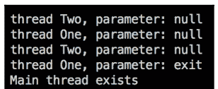

守护线程（名为 Two）在最后一个用户线程退出后退出——这与 `MyThread` 类的情况完全相同。

### 继承线程与实现 Runnable

实现 `Runnable` 的优势在于（在某些情况下是唯一可能的选择）允许实现类继承另一个类。当你想要为现有类添加类似线程的行为时，这特别有帮助。实现 `Runnable` 允许在使用上更具灵活性。但在其他情况下，在功能上与继承 `Thread` 类没有区别。

`Thread` 类有几个构造函数，允许设置线程名称及其所属的组。线程分组有助于在许多线程并行运行的情况下管理它们。`Thread` 类还拥有几个方法，可以提供有关线程状态、属性的信息，并允许控制其行为。

# 多线程与并发处理

正如你所看到的，线程的 ID 是自动生成的。它无法更改，但在线程终止后可以重用。相反，多个线程可以设置相同的名称。

执行优先级也可以通过程序设置，取值范围在 `Thread.MIN_PRIORITY` 和 `Thread.MAX_PRIORITY` 之间。值越小，允许线程运行的时间就越长，这意味着它的优先级越高。如果没有设置，优先级值默认为 `Thread.NORM_PRIORITY`。

线程的状态可以有以下值之一：

- NEW：当线程尚未启动时
- RUNNABLE：当线程正在执行时
- BLOCKED：当线程被阻塞并等待监视器时
- WAITING：当线程无限期等待另一个线程执行特定操作时
- TIMED_WAITING：当线程等待另一个线程执行操作，且最长为指定的等待时间时
- TERMINATED：当线程已退出时

线程以及任何对象都可以使用 `java.lang.Object` 基类中的方法 `wait()`、`notify()` 和 `notifyAll()` 相互进行通信。但线程行为的这一方面超出了本书的范围。

### 使用线程池

每个线程都需要资源——CPU 和内存。这意味着线程的数量必须被控制，一种方法是创建固定数量的线程——线程池。此外，创建对象会产生开销，这对于某些应用程序来说可能是巨大的。

在本节中，我们将研究 `java.util.concurrent` 包提供的 `Executor` 接口及其实现。它们封装了线程管理，并尽可能地减少了应用程序开发人员编写与线程生命周期相关代码的时间。

## Executor 接口

`java.util.concurrent` 包中定义了三个 `Executor` 接口：

- 基础 `Executor` 接口：它内部只有一个 `void execute(Runnable r)` 方法。
- `ExecutorService` 接口：它扩展了 `Executor` 并增加了四组方法，用于管理工作线程和执行器的生命周期：
    - `submit()` 方法：将 `Runnable` 或 `Callable` 对象放入队列中执行（`Callable` 允许工作线程返回值），返回一个 `Future` 接口对象，该对象可以访问 `Callable` 返回的值，并管理工作线程的状态。
    - `invokeAll()` 方法：将一组 `Callable` 接口对象放入队列中执行，并在工作线程完成后返回 `Future` 对象列表 `List`（还有一个带超时的重载 `invokeAll()` 方法）。
    - `invokeAny()` 方法：将一组 `Callable` 对象放入队列中执行；返回已完成的任何工作线程的任意 `Future` 对象（也有一个带超时的重载 `invokeAny()` 方法）。
- 管理工作线程状态和服务本身的方法，例如：
    - `shutdown()`：防止新的工作线程被提交到服务中。
    - `shutdownNow()`：中断每个未完成的工作线程。工作线程的编写应该能够定期检查其状态（例如使用 `Thread.currentThread().isInterrupted()`）并优雅地自行关闭；否则，即使在调用 `shutdownNow()` 后它将继续运行。
    - `isShutdown()`：检查是否启动了执行器的关闭。
    - `awaitTermination(long timeout, TimeUnit)`：等待在关闭请求后所有工作线程完成执行、或者发生超时、或者当前线程被中断，以先发生者为准。
    - `isTerminated()`：检查在启动关闭后所有工作线程是否已完成。除非先调用了 `shutdown()` 或 `shutdownNow()`，否则它返回 `true`。
- `ScheduledExecutorService` 接口：它扩展了 `ExecutorService` 并增加了允许调度工作线程执行（单次和周期性）的方法。

可以使用 `java.util.concurrent.ThreadPoolExecutor` 或 `java.util.concurrent.ScheduledThreadPoolExecutor` 类创建基于池的 `ExecutorService` 实现。还有一个 `java.util.concurrent.Executors` 工厂类，涵盖了大多数实际情况。因此，在为工作线程池创建编写自定义代码之前，我们强烈建议查看以下工厂方法：

- `newCachedThreadPool()`：创建一个根据需要添加新线程的线程池，除非之前已创建了空闲线程；空闲 60 秒的线程将从池中移除。
- `newSingleThreadExecutor()`：创建一个顺序执行工作线程的 `ExecutorService`（池）实例。
- `newSingleThreadScheduledExecutor()`：创建一个单线程执行器，可以调度在给定延迟后运行或定期执行。
- `newFixedThreadPool(int nThreads)`：创建一个重用固定数量线程的线程池；如果在所有工作线程都在执行时提交任务，它将被放入队列。
- `newScheduledThreadPool(int nThreads)`：创建一个固定大小的线程池，可以调度在给定延迟后运行或周期性执行。
- `newWorkStealingThreadPool(int nThreads)`：创建一个使用 `ForkJoinPool` 中工作窃取算法的线程池，这在工作线程生成其他线程的情况下特别有用；它还适应指定的 CPU 数量，你可以将其设置为高于或低于实际 CPU 数量。

## 线程池使用示例

让我们编写以下逻辑的代码：

1. 创建一个包含三个线程的线程池
2. 确保线程池不再接受更多线程
3. 等待固定时间，让所有线程完成它们的工作
4. 停止（中断）那些未完成任务的线程
5. 退出

以下代码执行了上述描述的所有操作：

```java
ExecutorService pool = Executors.newCachedThreadPool();

String[] names = {"One", "Two", "Three"};

for (int i = 0; i < names.length; i++) {
    pool.execute(new MyRunnable(names[i]));
}

System.out.println("Before shutdown: isShutdown=" + pool.isShutdown() +
    ", terminated=" + pool.isTerminated());

pool.shutdown(); // 新线程不能被添加到池

// pool.execute(new MyRunnable("Four")); // RejectedExecutionException

System.out.println("After shutdown: isShutdown=" + pool.isShutdown() +
    ", terminated=" + pool.isTerminated());

try {
    long timeout = 100;
    TimeUnit timeUnit = TimeUnit.MILLISECONDS;
    System.out.println("Waiting all time completion for " +
        timeout + " " + timeUnit + "...");

    // 阻塞直到超时、或者所有线程完成执行、
    // 或者当前线程被中断，以先发生者为准。
    boolean terminated = pool.awaitTermination(timeout, timeUnit);
    System.out.println("isTerm=" + terminated);

    if (!terminated) {
        System.out.println("Calling shutdownNow...");
        List<Runnable> list = pool.shutdownNow();
        System.out.println(list.size() + " threads running");
        terminated = pool.awaitTermination(timeout, timeUnit);
        if (!terminated) {
            System.out.println("Some threads are still running");
        }
    }
    System.out.println("Exiting");
} catch (InterruptedException ex) {
    ex.printStackTrace();
}
```

在调用 `pool.shutdown()` 后尝试向池添加另一个线程，会产生 `java.util.concurrent.RejectedExecutionException`。

## 示例执行结果

上述代码的执行产生了以下结果：

```
One is working..
Three is working...
Two is working..
Before shutdown: isShutdown()false,isTerminated()false
After shutdown: isShutdown()true,isTerminated()false
Waiting all threads completion for 100 MILLISECONDS...
Interrupted()false
Calling shutdown()...
0 threads running
One was interrupted
One Thread.currentThread().isInterrupted()=false
Two was interrupted
Two Thread.currentThread().isInterrupted()=false
Three was interrupted
Three Thread.currentThread().isInterrupted()=false
Exiting
```

注意上述截图中的 `Thread.currentThread().isInterrupted()=false` 消息。线程确实被中断了。我们之所以知道这一点是因为线程收到了 `InterruptedException`。为什么 `isInterrupted()` 方法返回 `false` 呢？因为该状态在接收消息后立即被清除了。我们现在提到它是因为它是程序员错误的来源之一。例如，如果主线程监控 `MyRunnable` 线程并对其调用 `isInterrupted()`，返回值很可能是 `false`。

因此，在另一个线程可能监控 `MyRunnable` 线程的情况下，`MyRunnable` 的实现已更改如下。注意在 `catch` 块中是如何调用 `interrupt()` 方法的：

```java
class MyRunnable implements Runnable {
    private String name;

    public MyRunnable(String name) {
        this.name = name;
    }

    public void run() {
        try {
            while (true) {
                System.out.println(this.name + " is working...");
                TimeUnit.SECONDS.sleep(1);
            }
        } catch (InterruptedException e) {
            Thread.currentThread().interrupt();
            System.out.println(this.name + " was interrupted\n" +
                this.name + " Thread.currentThread().isInterrupted() = "
                + Thread.currentThread().isInterrupted());
        }
    }
}
```

## 中断状态的正确处理

现在，如果我们再次使用相同的 `ExecutorService` 池运行此线程，结果将是：

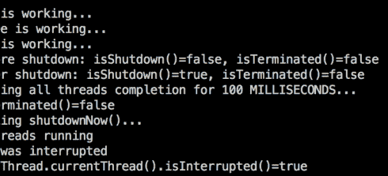

如你所见，`isInterrupted()` 方法的值为 `true`，这与发生的情况相符。公平地说，在许多应用程序中，线程被中断后不再再次检查其状态。但设置正确的状态是一个良好的做法，尤其是当你不是创建该线程的高层代码的作者时。

在我们的示例中，我们使用了缓存线程池，它会根据需要创建新线程；如果可用，则会重用已完成工作并返回池中等待新分配的线程。我们没有担心创建了过多的线程，因为我们的演示应用程序最多只有三个工作线程，而且它们执行时间很短。

但是，如果应用程序对所需的线程没有固定限制，或者无法预测线程可能占用多少内存或可以执行多长时间，那么为工作线程数量设置上限可以防止应用程序性能的意外下降、内存耗尽或工作线程使用的任何其他资源的枯竭。如果线程的行为极其不可预测，单线程池可能是唯一的解决方案，并带有使用自定义线程池执行器的选项。但在大多数情况下，固定大小的线程池执行器是应用程序需求和代码复杂度之间一个良好的实务折中方案（在本节较早些时候，我们列出了由 `Executors` 工厂类创建的所有池类型）。

## 线程池大小调优

将池的大小设置得太低可能会失去有效利用可用资源的机会。因此，在选择池大小之前，建议花时间监控应用程序，目的是识别应用程序行为的特性。事实上，“开发-部署-监控-调整”循环必须在应用程序的整个生命周期中重复，以适应并利用周期或执行环境中发生的变化。

你考虑的第一个特征是系统中的 CPU 数量，因此线程池的大小至少可以等于 CPU 的数量。然后，你可以监控应用程序，查看每个线程参与 CPU 的程度以及它们使用其他资源（如 I/O 操作）的时间比例。如果未使用 CPU 的时间与总执行时间相当，那么你可以按照以下比例增加池大小：未使用状态的时间除以执行时间。但这种前提是另一个资源（如磁盘或数据库）不是线程争夺的对象。如果是后者，你可以使用资源而非 CPU 作为决定因素。

假设你的应用程序工作线程不会太大或执行时间过长，并且属于在合理短时间内完成任务的主流线程池，你可以根据响应时间与线程使用 CPU 或另一个竞争资源的时间的比例（取整后）来增加池大小。这意味着，在相同的响应时间以及线程使用 CPU 或另一个并发访问资源的情况下，池的大小应该越大。如果竞争性资源本身具有提高并发访问的能力（例如数据库连接），请考虑优先利用该功能。

如果运行时所需的线程数量在不同情况下在运行时发生变化，你可以使池大小变为动态，并创建一个新大小的池（在旧池所有线程完成后关闭旧池）。在添加或删除可用资源时，重新计算新池的大小也是必要的。你可以使用 `Runtime.getRuntime().availableProcessors()` 根据当前的可用 CPU 数量来编程地调整池大小。

如果 JDK 提供的所有即用线程池执行器实现都不满足特定应用程序的需求，在从头编写线程管理代码之前，尝试使用 `java.util.concurrent.ThreadPoolExecutor` 类。它有多个重载的构造函数。

## ThreadPoolExecutor 构造函数

为了让你了解它的能力，这里列出了选项最多的构造函数：

```java
ThreadPoolExecutor(int corePoolSize,
                int maximumPoolSize,
                long keepAliveTime,
                TimeUnit unit,
                BlockingQueue<Runnable> workQueue,
                ThreadFactory threadFactory,
                RejectedExecutionHandler handler)
```


上述构造函数的参数如下：

- `corePoolSize` 是线程池中保持的线程数，即使它们处于空闲状态，如果调用了 `allowCoreThreadTimeout(boolean value)` 且值为 `true`，它们也会超时。
- `maximumPoolSize` 是池中允许的最大线程数。
- `keepAliveTime`：当线程数大于核心线程数时，空闲线程在终止之前等待新任务的最大时间。
- `unit` 是 `keepAliveTime` 参数的时间单位。
- `workQueue` 是用于在执行前持有任务的队列；此队列将只持有由 `execute()` 方法提交的 `Runnable` 对象。
- `threadFactory` 是当执行器创建新线程时使用的工厂。
- `handler` 是当由于线程边界和队列容量达到限制导致执行被阻塞时使用的处理器。

除了 `ThreadQueue` 之外，上述每个构造函数参数都可以在 `ThreadPoolExecutor` 创建后通过相应的 setter 方法进行设置，允许对现有池的特征进行更灵活的动态调整。

## 从线程获取结果

在之前的示例中，我们一直使用了 `ExecutorService` 接口的 `execute()` 方法来启动线程。事实上，该方法来自 `Executor` 基接口。同时，`ExecutorService` 接口还有其他方法（在之前的“使用线程池”部分列出），可以启动线程并获取线程执行的结果。

## 多线程与并发处理

返回线程执行结果的对象类型为 `Future`——该接口具有以下方法：

- `V get()`：阻塞直到线程完成；返回结果（如果可用）。
- `V get(long timeout, TimeUnit unit)`：阻塞直到线程完成或达到提供的超时时间；返回结果（如果可用）。
- `boolean isDone()`：如果线程已完成则返回 `true`。
- `boolean cancel(boolean interruptRunning)`：尝试取消线程的执行；如果成功则返回 `true`；如果到调用该方法时线程已正常完成，也返回 `false`。
- `boolean isCancelled()`：如果线程执行在正常完成之前被取消，则返回 `true`。

`get()` 方法描述中的 `if available` 意味着在原则上结果并不总是可用，即使调用了无参数的 `get()` 方法也是如此。这取决于用于产生 `Future` 对象的方法。以下是代表 `Future` 对象的 `ExecutorService` 所有方法列表：

- `Future<?> submit(Runnable task)`：提交任务（线程）执行；返回一个代表任务的 `Future`；返回的 `Future` 的 `get()` 方法返回 `null`；例如，让我们使用仅运行 100 毫秒的 `MyRunnable` 类：

```java
class MyRunnable implements Runnable {

    private String name;

    public MyRunnable(String name) {
        this.name = name;
    }

    public void run() {
        try {
            System.out.println(this.name + " is working... ");
            TimeUnit.MILLISECONDS.sleep(100);
            System.out.println(this.name + " is done");
        } catch (InterruptedException e) {
            Thread.currentThread().interrupt();
            System.out.println(this.name + " was interrupted\n" + this.name + " Thread.currentThread().isInterrupted() = " + Thread.currentThread().isInterrupted());
        }
    }
}
```

## 多线程与并发处理

## 第 8 章

并且根据上一节的代码示例，让我们创建一个关闭池并在必要时终止所有线程的方法：

我们将在 `finally` 块中使用之前的 `shutdownAndTerminate()` 方法，确保没有遗留运行线程。以下是我们将执行的代码：

```java
ExecutorService pool = Executors.newSingleThreadExecutor();

Future future = pool.submit(new MyRunnable("One"));

System.out.println(future.isDone()); // 输出: false

System.out.println(future.isCancelled()); // 输出: false

try {
    System.out.println(future.get()); // 输出: null
    System.out.println(future.isDone()); // 输出: true
    System.out.println(future.isCancelled());// 输出: false
} catch (Exception ex) {
    ex.printStackTrace();
} finally {
    shutdownAndTerminate(pool);
}
```

## 多线程与并发处理

## 第 8 章

你可以在此截图中看到此代码的输出：

```
false
false
One is working...
One is done
null
true
false
Waiting all threads completion for 100 MILLISECONDS...
isTerminated()=false
Calling shutdownNow()
threads running
Exiting
```

正如预期的，`Future` 对象的 `get()` 方法返回 `null`，因为 `Runnable` 的 `run()` 方法没有返回任何内容。我们从返回的 `Future` 中只能得到任务是否已完成的信息。

- `Future<T> submit(Runnable task, T result)`：提交线程执行；返回一个代表任务的 `Future`；例如，我们将使用以下：

```java
class Result {
    private String name;
    private double result;

    public Result(String name, double result) {
        this.name = name;
        this.result = result;
    }

    @Override
    public String toString() {
        return "Result[name=" + name + ", result=" + result + "]";
    }
}
```

以下代码演示了结果如何返回：

```java
ExecutorService pool = Executors.newSingleThreadExecutor();

Future<Result> future = pool.submit(() -> new Result("Two", 42));

System.out.println(future.isDone()); // 输出: false
System.out.println(future.isCancelled()); // 输出: false

try {
    System.out.println(future.get()); // 输出: Result[name=Two, result=42.0]
    System.out.println(future.isDone()); // 输出: true
    System.out.println(future.isCancelled()); // 输出: false
} catch (Exception ex) {
    ex.printStackTrace();
} finally {
    shutdownAndTerminate(pool);
}
```

如果执行上述代码，输出如下：


## 多线程与并发处理

- `Future<T> submit(Callable<T> task)`：提交任务（线程）执行；返回一个代表任务的 `Future`；例如：

```java
class MyCallable implements Callable<Result> {

    private String name;

    public MyCallable(String name) {
        this.name = name;
    }

    @Override
    public Result call() {
        try {
            System.out.println(this.name + " is working...");
            TimeUnit.MILLISECONDS.sleep(100);
            System.out.println(this.name + " is done");
            return new Result(name, 42);
        } catch (InterruptedException e) {
            Thread.currentThread().interrupt();
            System.out.println(this.name + " was interrupted");
            return null;
        }
    }
}
```

上述代码的输出如下：

```
false
false
Three is working...
Three is done
Result[name=Three, result=42.0]
true
false
Waiting all threads completion for 100 MILLISECONDS...
isTerminated()=false
Calling shutdownNow()
0 threads running
Exiting
```

- `List<Future<T>> invokeAll(Collection<Callable<T>> tasks)`：执行集合中的所有 `Callable` 任务；返回一个包含执行的 `Callable` 对象结果的 `Future` 列表。
- `List<Future<T>> invokeAll(Collection<Callable<T>> tasks, long timeout, TimeUnit unit)`：执行集合中的所有 `Callable` 任务；在所有任务完成或超时（以先者为准）后返回包含执行的 `Callable` 对象结果的 `Future` 列表。
- `invokeAny(Collection<Callable<T>> tasks)`：执行集合中的所有 `Callable` 任务；如果有任何任务成功完成（没有抛出异常），则返回该任务的结果。
- `invokeAny(Collection<Callable<T>> tasks, long timeout, TimeUnit unit)`：执行集合中的所有 `Callable` 任务；如果在提供的超时时间之前有任何任务成功完成（没有抛出异常），则返回该任务的结果。

如你所见，获取线程结果有许多方法。你选择的方法取决于应用程序的具体需求。

## 并行与并发处理

当我们听到多个工作线程同时执行时，我们会自动假设它们确实是按照程序设计的方式并行执行的。只有在我们观察了此类系统的内部原理后，才意识到只有当线程由每个 CPU 分执行时，并行处理才是可能的。否则，它们是在共享相同的处理能力。我们之所以感知到它们在同时工作，是因为它们使用的时间片非常短——仅占我们日常生活中使用时间的一分之一。当线程共享同一资源时，在计算机科学中，我们称之为并发执行。

### 同一资源的并发修改

两个或多个线程在其他线程读取值的同时修改该值，这是对并发访问问题之一最通用的描述。更微妙的问题包括线程干扰和内存一致性错误，这两者都会在看似无害的代码片段中产生意外之外的结果。在本节中，我们将演示此类情况以及避免它们的方法。

乍一看，解决方案似乎非常简单：只需一次允许一个线程修改/访问资源，就足够。但如果访问耗时很长，就会创建一个瓶颈，可能会消除多个线程并行工作的优势。或者，如果一个线程在等待访问另一个资源时阻塞了对一个资源的访问，而第二个线程在等待访问第一个资源时阻塞了对第二个资源的访问，就会产生所谓的死锁问题。这些是使用多个线程时可能遇到的挑战的两个简单示例。

首先，我们将复现由并发修改同一值值引起的问题。让我们创建一个 `Calculator` 接口：

```java
interface Calculator {
    String getDescription();
    double calculate(int i);
}
```

我们将使用 `getDescription()` 方法来获取实现的描述。
以下是第一个实现：

```java
class CalculatorNoSync implements Calculator {
    private double prop;
    private String description = "Without synchronization";

    public String getDescription() { return description; }

    public double calculate(int i) {
        try {
            this.prop = 2.0 * i;
            TimeUnit.MILLISECONDS.sleep(i);
            return Math.sqrt(this.prop);
        } catch (InterruptedException e) {
            Thread.currentThread().interrupt();
            System.out.println("Calculator was interrupted");
        }
        return 0.0;
    }
}
```

如你所见，`calculate()` 方法为 `prop` 属性分配了一个新值，然后执行其他操作（我们模拟调用了 `sleep()` 方法），然后计算赋值给 `prop` 属性值的平方根。“Without synchronization”（无同步）描述了这样一个事实：每次调用 `calculate()` 方法时，`prop` 属性都会发生变化——在并发修改同一资源时，由于任何协调或同步，这正是线程间并发修改同一资源时会发生的情况。

我们现在要在两个线程之间共享此对象，这意味着 `prop` 属性将被并发地更新和使用。因此，在 `prop` 属性周围进行某种线程同步是必要的，但我们决定我们的第一个实现不需要。

以下是我们在执行要创建的每个 `Calculator` 实现时将使用的方法：

```java
void invokeAllCalls(Calculator c) {
    System.out.println("\n" + c.getDescription() + ":");
    ExecutorService pool = Executors.newFixedThreadPool(2);
    List<Callable<Result>> tasks = List.of(new MyCallable("One", c), new MyCallable("Two", c));
    try {
        List<Future<Result>> futures = pool.invokeAll(tasks);
        List<Result> results = new ArrayList<>();
        while (results.size() < futures.size()) {
            TimeUnit.MILLISECONDS.sleep(5);
        }
        for (Future future : futures) {
            if (future.isDone()) {
                results.add((Result) future.get());
            }
        }
        for (Result result : results) {
            System.out.println(result);
        }
    } catch (Exception ex) {
        ex.printStackTrace();
    } finally {
        shutdownAndTerminate(pool);
    }
}
```


# 多线程与并发处理

## 第 8 章

如你所见，传入的方法执行了以下操作：

- 打印传入的 `Calculator` 实现描述。
- 创建一个包含两个线程的固定大小池。
- 创建包含两个 `Callable` 任务的列表——`MyCallable` 类的对象。

```java
class MyCallable implements Callable<Result> {

    private String name;

    private Calculator calculator;

    public MyCallable(String name, Calculator calculator) {

        this.name = name;

        this.calculator = calculator;

    }

    public Result call() {

        double sum = 0.0;

        for (int i = 0; i < 20; i++) {

            sum += calculator.calculate(i);

        }

        return new Result(name, sum);

    }

}
```

- 任务列表被传递给池的 `invokeAll()` 方法，每个任务都通过调用 `call()` 方法来执行；每次调用将传入的 `Calculator` 对象的 `calculate()` 方法应用于从 1 到 20 的 19 个数字，并累加结果；结果在 `Result` 对象中返回，连同 `MyCallable` 对象的名称。
- 每个 `Result` 对象最终返回在一个 `Future` 对象中。
- 随后 `invokeAllCalls()` 方法遍历 `Future` 对象并检查任务是否完成；结果被添加到 `List<Result>` 中。
- 在所有任务完成后，`invokeAllCalls()` 方法打印 `List<Result>` 的所有元素并终止池。

以下是我们从其中一次 `invokeAllCalls(new CalculatorNoSync())` 运行的结果：

```
Without synchronization:

Result(One, result=1.4142135623730951)

Result(Two, result=1.4142135623731)
```

每次运行上述代码时，实际数字都会略有不同，因为在设置值和返回其平方根之间，另一个线程成功分配了一个不同的值。解决这个问题有几种方法。我们首先从原子变量开始，实现对属性线程安全的并发访问。

### 原子变量

原子变量只有当其当前值与预期值匹配时才能更新。在我们的情况下，`java.util.concurrent.atomic` 包有十几个类支持这种逻辑：例如 `AtomicBoolean`、`AtomicInteger`、`AtomicIntegerArray` 等。这些类中的每一个类都有许多方法，可以用于不同的同步需求。请查看这些类的在线 API 文档（https://docs.oracle.com/en/java/javase/12/docs/api/java.base/java/util/concurrent/atomic/package-summary.html）。为了演示，我们将在所有类中仅使用两个方法：

- `V get()`: 返回当前值
- `boolean compareAndSet(V expectedValue, V newValue)`: 如果当前值等于 (=) `expectedValue`，则将值设置为 `newValue`；如果成功则返回 true，如果值不等于预期值则返回 false。

如你所示，之前的代码确保了 `prop` 属性的 `currentValue` 在线程睡眠期间不会发生变化。以下是调用 `invokeAllCallables(new CalculatorAtomicRef())` 时产生的消息截图：

```
Using AtomicReference:

Result(name=One, result=80.88430683757149)

Result(name=Two, result=80.88430683757149)

Waiting all threads completion for 100 MILLISECONDS...

isTerminated()=false

Calling shutdownNow()

threads running

Exiting
```

现在，线程产生的结果是相同的。

`java.util.concurrent` 包中的以下类提供了同步支持：

- `Semaphore`（信号量）：限制访问资源的线程数量
- `CountDownLatch`（计数计数器）：允许一个或多个线程等待其他线程中执行的一系列操作完成
- `CyclicBarrier`（循环屏障）：允许一组线程等待彼此到达一个共同的屏障点
- `Phaser`（分阶段器）：提供了一种更灵活的屏障形式，可用于控制多个线程之间的分阶段计算
- `Exchanger`（交换器）：允许两个线程在会合点交换对象，在多种流水线设计中非常有用

### Synchronized 方法

解决问题的另一种方法是使用 `synchronized` 方法。这里是 `Calculator` 接口的另一种实现，使用了这种方法来解决线程干扰：

```java
class CalculatorSyncMethod implements Calculator {

    private double prop;

    private String description = "Using synchronized method";

    public String getDescription() { return description; }

    synchronized public double calculate(int i) {

        try {

            this.prop = 2.0 * i;

            TimeUnit.MILLISECONDS.sleep(i);

            return Math.sqrt(this.prop);

        } catch (InterruptedException e) {

            Thread.currentThread().interrupt();

            System.out.println("Calculator was interrupted");

            return 0.0;

        }

    }

}
```

我们刚刚在 `calculate()` 方法前面添加了 `synchronized` 关键字。现在，如果我们运行 `invokeAllCallables(new CalculatorSyncMethod())`，两个线程的结果将始终是：

```
synchronized method:

Result(name=One,result=80.88430683757149)

Result(name=Two,result=80.88430683757149)

Waiting all threads completion for 100 MILLISECONDS...

isTerminated()=false

Calling shutdown()...

0 threads running

Exiting
```

这是因为在当前线程（已经进入方法的线程）退出之前，另一个线程无法进入该 `synchronized` 方法。这可能是最简单的解决方案，但如果方法执行时间很长，这种方法可能会导致性能下降。在这种情况下，可以使用 `synchronized` 块，它只将几行代码封装在原子操作中。

### Synchronized 块

这是一个使用 `synchronized` 块解决线程干扰问题的示例：

```java
class CalculatorSyncBlock implements Calculator {

    private double prop;

    private String description = "Using synchronized block";

    public String getDescription() {

        return description;

    }

    public double calculate(int i) {

        try {

            //there may be some other code here

            synchronized (this) {

                this.prop = 2.0 * i;

                TimeUnit.MILLISECONDS.sleep(i);

                return Math.sqrt(this.prop);

            }

        } catch (InterruptedException e) {

            Thread.currentThread().interrupt();

            System.out.println("Calculator was interrupted");

        }

        return 0.0;

    }

}
```

如你所示，`synchronized` 块获取该对象的锁，由两个线程共享，并在线程退出块后释放。在我们的演示代码中，同步块覆盖了整个方法，因此性能没有差异。但想象一下方法中有其他代码（我们注释了该位置），同步部分会更小。如果我们运行 `invokeAllCallables(new CalculatorSyncBlock())`，结果如下：

```
synchronized block:

Result(name=One, result=80.88430683757149)

Result(name=Two, result=80.88430683757149)

Waiting all threads completion for 100 MILLISECONDS...

isTerminated()=false

Calling shutdownNow()...

0 threads running

Exiting
```

你可以看到，结果与之前的两个示例完全相同。针对不同需求和不同行为的不同锁汇集中在 `java.util.concurrent.locks` 包中。

Java 中的每个对象都继承了 `wait()`、`notify()` 和 `notifyAll()` 方法。这些方法也可以用于控制线程的行为及其对锁的访问。

### 并发集合

处理并发的另一种方法是使用 `java.util.concurrent` 包中的并发集合。以下是这些集合的列表：

- `ConcurrentHashMap<K,V>`: Map 的线程安全实现。
- `ConcurrentLinkedQueue<E>`: 基于节点的无界线程安全队列，支持并发插入删除。
- `ConcurrentLinkedDeque<E>`: 基于节点的无界线程安全双端队列。
- `ConcurrentSkipListSet<E>`: 排序元素的线程安全 Set。
- `ConcurrentSkipListMap<K,V>`: Key 排序的线程安全 NavigableMap。
- `PriorityBlockingQueue<E>`: 支持阻塞操作安全的优先级队列。
- `ArrayBlockingQueue<E>`: 基于数组的有界阻塞队列。
- `LinkedBlockingQueue<E>`: 基于节点的可选有界阻塞队列。
- `LinkedBlockingDeque<E>`: 可选有界阻塞双端队列。

请将这些相似的特性和建议作为指南，但在实现你的功能之前，请执行全面的测试和性能测量。

此代码产生的输出如下：

```
[One, Two]

One Two

[One, Two, Three, Three]
```


如你所见，列表被修改了没有抛出异常，但当前迭代的副本没有。这是你在需要时可以使用的行为。

## 解决内存一致性错误

在多线程环境中，内存一致性错误有许多形式和原因。`java.util.concurrent` 包的 Javadoc 对此进行了很好的讨论。在这里，我们仅提到最常见的情况，即由可见性缺失引起。

当一个线程更改属性值时，另一个线程可能不会立即看到变化，而且你对基本类型使用 `synchronized` 关键字。在这种情况下，考虑对属性使用 `volatile` 关键字；它保证了不同线程之间的读写写可见性。

并发问题并不容易解决。为什么越来越多的开发者现在采取更激进的方法，这并不意外。他们不再管理对象状态，而是喜欢通过一组无状态的操作来处理数据。我们将在第 13 章“函数式编程”和第 14 章“Java 标准流”中看到此类代码的示例。Java 以及许多现代语言和计算机系统似乎都在这一方向演进。

## 总结

在本章中，我们讨论了多线程处理、组织以及避免共享资源并发修改导致不可预测结果的方法。我们向读者展示了如何创建线程并使用线程池执行它们。我们还演示了如何从成功完成的线程提取结果，并讨论了并行处理与并发处理之间的区别。

在下一章中，我们将让读者更深入理解 JVM 及其结构和进程，并详细讨论防止内存溢出的垃圾回收过程。在本章结束时，读者将了解 Java 应用执行、JVM 内部的 Java 进程、垃圾回收以及 JVM 的通用原理。

## 测验

- 1. 选择所有正确的语句：
    a. JVM 进程可以有主线程。
    b. 主线程就是主进程。
    c. 一个进程可以启动另一个进程。
    d. 一个线程可以启动另一个线程。

- 2. 选择所有正确的语句：
    a. 守护线程是用户线程。
    b. 守护线程在第一个用户线程完成后退出。
    c. 守护线程在最后一个用户线程完成后退出。
    d. 主线程是用户线程。

- 3. 选择所有正确的语句：
    a. 所有线程都以 `java.lang.Thread` 为基类。
    b. 所有线程都扩展 `java.lang.Thread`。
    c. 所有线程都实现 `java.lang.Thread`。
    d. 守护线程没有扩展 `java.lang.Thread`。

- 4. 选择所有正确的语句：
    a. 任何类都可以实现 `Runnable` 接口。
    b. `Runnable` 接口实现是一个线程。
    c. `Runnable` 接口实现被线程使用。
    d. `Runnable` 接口只有一个方法。

- 5. 选择所有正确的语句：
    a. 线程名称必须是唯一的。
    b. 线程 ID 是自动生成的。
    c. 可以设置线程名称。
    d. 可以设置线程优先级。

- 6. 选择所有正确的语句：
    a. 线程池执行线程。
    b. 线程池重用线程。
    c. 某些线程池可以有固定数量的线程。
    d. 某些线程池可以有无限数量的线程。

- 7. 选择所有正确的语句：
    a. `Future` 对象是从线程获取结果的唯一方式。
    b. `Callable` 对象是从线程获取结果的唯一方式。
    c. `Callable` 对象允许从线程中获取结果。
    d. `Future` 对象代表一个线程。

- 8. 选择所有正确的语句：
    a. 并发处理可以并行地进行。
    b. 只有当计算机可用多个 CPU 或核心时，才可能并行处理。
    c. 并行处理就是并发处理。
    d. 没有多个 CPU，并发处理是不可能的。

- 9. 选择所有正确的语句：
    a. 并发修改总是会导致错误的结果。
    b. 原子变量保护属性免受并发修改。
    c. 原子变量保护属性免受线程干扰。
    d. 原子变量是保护属性免受并发修改的唯一方式。

- 10. 选择所有正确的语句：
    a. `synchronized` 方法是避免线程干扰的最佳方法。
    b. `synchronized` 关键字可以应用于任何方法。
    c. `synchronized` 方法可能会创建处理瓶颈。
    d. `synchronized` 方法易于实现。

- 11. 选择所有正确的语句：
    a. `synchronized` 块只有在比方法更小时才有意义。
    b. `synchronized` 块需要共享锁。
    c. 每个 Java 对象都可以提供一个锁。
    d. `synchronized` 块是避免线程干扰的最佳方法。

- 12. 选择所有正确的语句：
    a. 优于使用非并发集合，使用并发集合。
    b. 使用并发集合会产生开销。
    c. 并不是每个并发集合都适用于每个并发处理场景。
    d. 可以通过 `Collections.makeConcurrent()` 方法创建并发集合。

- 13. 选择所有正确的语句：
    a. 避免内存一致性错误的唯一方法是声明 `volatile` 变量。
    b. 使用 `volatile` 关键字可以保证值在跨线程的可见性。
    c. 避免并发的方法之一是避免状态管理。
    d. 无状态方法不会有并发。

# JVM 结构与垃圾回收

## Java 应用执行

在深入研究 JVM 如何工作之前，让我们回顾一下如何运行应用程序，并记住以下语句被视为同义词：

- 运行/执行/启动主方法
- 运行/执行/启动主方法
- 运行/执行/启动/启动应用程序
- 运行/执行/启动/启动 JVM 或 Java 进程

还有几种方法。在第 1 章“Java 12入门”中，我们展示了如何使用 IntelliJ IDEA 运行 `main(String[])` 方法。在本章中，我们将重复一些已经说过的内容，并添加对你可能有用的变体。

## 使用 IDE

任何 IDE 都允许运行 `main()` 方法。在 IntelliJ IDEA 中，可以通过三种方式：

1. 点击 `main()` 方法名旁边的绿色三角形：

   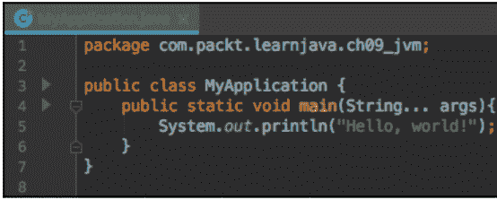

2. 在你使用绿色三角形执行过一次 `main()` 方法后，类名将添加到下拉菜单中（在顶行，绿色三角形左侧）：

   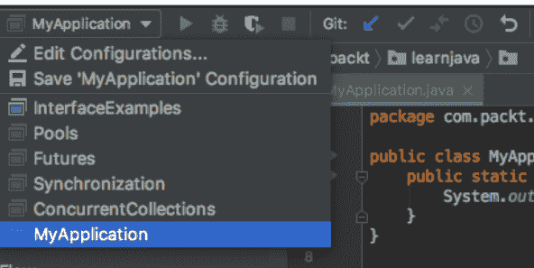

   选择它并点击菜单右侧的绿色三角形：

   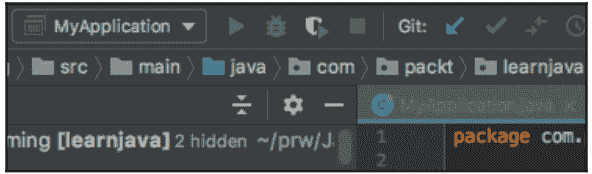

3. 打开 Run（运行）菜单并选择类名。有几种不同的选项可以选择：

   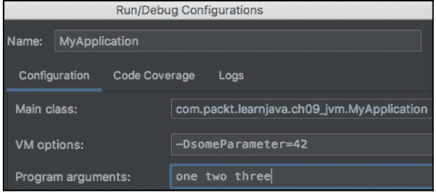

在上一个截图中，你还可以看到编辑配置（Edit Configurations...）的选项。它可以用于设置传递给 `main()` 方法的程序参数，以及其他选项：

| 运行/调试配置 | |
| :--- | :--- |
| 名称: MyApplication | |
| 配置 | 代码覆盖率 | 日志 |
| 主类: | com.packt.learnjava.ch09_jvm.MyApp |
| VM 选项: | |
| 程序参数: | |

`VM options` 字段允许设置 java 命令选项。例如，如果你输入 `-Xlog:gc`，IDE 将后续执行以下 java 命令：

```bash
java -Xlog:gc -cp com.packt.learnjava.ch09_jvm.MyAppApplication
```

`-Xlog:gc` 选项要求显示垃圾回收（GC）。我们将在下一节中使用该选项来演示 GC 是如何工作的。`-cp` 选项（cp 代表 classpath）表示类位于从当前目录（即输入命令的目录）开始的文件树中。在我们的案例中，.class 文件位于 `com/packt/learnjava/ch09_jvm` 文件夹中，其中 `com` 是当前目录的子文件夹。classpath 可以包含 JVM 查找应用程序执行所需的 .class 文件的许多位置。

为了进行演示，让我们将 VM options 设置如下：

| 运行/调试配置 | |
| :--- | :--- |
| 名称: MyApplication | |
| 配置 | 代码覆盖率 | 日志 |
| 主类: | com.packt.learnjava.ch09_jvm.MyApp |
| VM 选项: | -DsomeParameter=42 |
| 程序参数: | |

`Program arguments` 字段允许在 java 命令中设置参数。例如，让我们在该字段中设置 `one two three`：


此设置将产生以下 java 命令：

```bash
java -DsomeParameter=42 -cp . com.packt.learnjava.ch09_jvm.MyApplication one two three
```

我们可以在 `main()` 方法中读取这些参数：

```java
public static void main(String... args) {
    System.out.println("Hello...
```

编辑配置屏幕上的另一个可能设置是环境变量（Environment variables）字段：


这是设置应用程序可以通过 `System.getenv()` 访问的环境的方法。例如，让我们设置环境变量 `x` 和 `y` 如下：

| 环境变量: | someVar=43 |
| :--- | :--- |
| 重定向输入自: | |

如果按照前面的截图所示，x 和 y 的值不仅可以在 `main()` 方法中读取，也可以在程序的任何地方使用 `System.getenv("varName")` 方法。在我们案例中，x 和 y 的值可以这样获取：

```java
String p = System.getenv("x");
System.out.println(p);               // 输出: 42
p = System.getenv("y");
System.out.println(p);               // 输出: 43
```

编辑配置屏幕上也可以设置 java 命令的其他其他参数。我们鼓励你花些时间查看该屏幕并了解可能的选项。

## 使用命令行运行类

现在，让我们从命令行运行 `MyAppApplication`。提醒你一下，主类的结构如下：

```java
package com.packt.learnjava.ch09_jvm;

public class MyApplication {
    public static void main(String... args) {
        System.out.println("Hello, world!");   // 输出: Hello, world!
        for(String arg: args) {
            System.out.print(arg + " ");      // 输出: 所有参数
        }
        String p = System.getProperty("someParameter");
        System.out.println("\n" + p);         // 输出设置的 someParameter
    } // 作为 VM 选项 -D
}
```

首先，必须使用 `javac` 命令进行编译。命令行如下（假设你在项目根目录下打开了终端 窗口，即 `pom.xml` 所在的文件夹）：

```bash
javac src/main/java/packt/learnjava/ch09_jvm/MyApplication.java
```

这是适用于 Linux 类型平台的。在 Windows 上，命令如下：

```bash
javac src\main\java\com\packt\learnjava\ch09_jvm\MyApplication
```

编译后的 `MyApplication.class` 文件被放置在与 `MyApplication.java` 相同的文件夹中。我们现在使用 `java` 命令执行编译后的类：

```bash
java -DsomeParameter=42 -cp src/main/java \
    packt.learnjava.ch09_jvm.MyApplication one two three
```

注意 `-cp` 指向 `src/main/java`（路径相对于当前文件夹），这是主类包开始的地方。结果如下：


如果应用程序使用不同文件夹中的类，可以将这些文件夹的路径列在 classpath 上，用冒号（:`）隔开。例如，考虑：

```bash
java -cp src/main/java:folder1:folder2 \
    packt.learnjava.ch09_jvm.MyApplication
```

注意 `cp` 选项可以包含任意数量的 .class 文件。通过这样，JVM 可以找到它需要的内容。例如，让我们在其中创建一个子包 `example`：

```bash
java -cp src/main/java \
    packt.learnjava/ch09_jvm/example/ExampleClass
```

请注意，每个 .jar 文件必须单独列在类路径（classpath）中。仅仅指定所有 .jar 文件所在的文件夹（.class 文件的情况如此）是不够的。如果文件夹只包含 .jar 文件，可以将所有文件以以下方式包含在 classpath 中：

```bash
java -cp src/main/java/* com.packt.learnjava.ch09_jvm.MyApplication
```

如你所见，在文件夹名称后必须添加通配符 `*`。

## 使用命令行运行可执行 JAR 文件

可以避免在命令行中指定主类。相反，我们可以创建一个可执行的 .jar 文件。这可以通过将主类中的主类——即你需要运行且包含 `main()` 方法的类——放入 manifest 文件（清单文件）来实现。以下是步骤：

1. 创建一个文本文件 `manifest.txt`（文件名实际上并不重要，但这样意图很清晰），其中包含以下行：

   ```
   Main-Class: com.packt.learnjava.ch09_jvm.MyApplication
   ```

   冒号（:）后面必须有一个空格，并且结尾必须有一个不可见的换行符，所以确保你已经按了回车键且光标跳到了下一行。

2. 执行命令：

   ```bash
   cd src/main/java
   jar -cfm myapp.jar manifest.txt \
   com/packt/learnjava/ch09_jvm/*.class \
   com/packt/learnjava/ch09_jvm/example/*.class
   ```

   注意 jar 命令选项（fm）的顺序以及后续文件的顺序：`myapp.jar manifest.txt`。它们必须一致，因为 `f` 代表 jar 命令将要创建的文件，而 `m` 代表 manifest 来源。如果你包含的选项是 `mf`，则文件必须按如下顺序列出

3. 现在我们可以使用以下命令运行应用程序了：

   ```bash
   java -jar myapp.jar
   ```

另一种创建可执行 .jar 文件的方法简单得多：

```bash
jar cfe myjar.jar com.packt.learnjava.ch09_jvm.MyApplication \
com/packt/learnjava.ch09_jvm/*.class \
com/packt/learnjava/ch09_jvm/example/*.class
```


此命令会自动生成一个带有指定主类名的 manifest：选项 `c` 代表创建新归档，选项 `f` 表示文件名，选项 `e` 指明应用程序入口。

# Java 进程

正如你可能猜到的那样，JVM 对 Java 语言源代码一无所知。它只知道如何读取字节码。它从 `.class` 文件中读取字节码和其他信息，将字节码转换（解释）为一组指定当前平台（JVM 运行之处）的二进制代码指令，并将生成的二进制代码传递给执行它的微处理器进行执行。在谈到这种转换时，程序员通常将其称为 Java 进程（Java process），或简单称为进程。

JVM 通常被称为 JVM 实例。也就是说，每当执行一次 `java` 命令，就会启动一个新的 JVM 实例，专门运行特定的应用程序作为一个独立的进程，并拥有自己分配的内存（内存大小设置为默认值或作为命令行选项传递）。在每个 Java 进程内部，有多个线程在运行，每个线程都有自己分配的内存。有些是 JVM 创建的服务线程；另一些是受应用程序控制的应用线程。

这就是 JVM 执行编译后代码的概览。但如果你观察得更仔细并阅读 JVM 规范，你会发现“进程”一词相对于 JVM 时也用于描述 JVM 内部进程。JVM 规范识别了运行在 JVM 内部的几个其他进程，程序员可能没有提到，类类加载过程。

这是因为大多数时候，我们可以在不知道任何内部进程的情况下成功地编写和运行 Java 程序。但偶尔对 JVM 内部机制的通用理解有助于识别某些问题的根源。这就是为什么我们在本节中将对 JVM 内部发生的所有进程进行简要概述。在接下来的章节中，我们将详细讨论 JVM 的内存结构以及对程序员有用的其他功能方面。

# JVM 结构与垃圾回收

有两个子系统运行所有的 JVM 内部进程：

- **类加载器（The classloader）**：它读取 `.class` 文件并在 JVM 内存中的方法区域中填充与类相关的数据：
    - 静态字段
    - 方法字节码
    - 描述类的类元数据

- **执行引擎（The execution engine）**：它使用以下内容执行字节码：
    - 用于对象实例化的堆区域（heap area）
    - 用于跟踪已调用方法的 Java 和原生方法栈
    - 用于回收内存的垃圾回收进程

在 JVM 进程内部运行的进程包括以下内容：

- 类加载器执行的进程包括：
    - 类加载
    - 类链接
    - 类初始化

- 执行引擎执行的进程包括：
    - 类实例化
    - 方法执行
    - 垃圾回收
    - 应用程序终止

# JVM 架构

JVM 架构可以描述为具有两个子系统：类加载器和执行引擎，它们使用方法区域、堆和应用线程栈等运行时内存区域运行服务进程和应用线程。这些线程比 JVM 执行进程所需的资源分配较少。


该列表可能会给你这些进程是按顺序执行的印象。在某种程度上，这是正确的，如果我们只讨论一个类的话。对于类加载，是不可能的任何操作的。例如，垃圾回收不会在对象使用后立即发生。此外，应用程序可以在发生未处理的异常或错误时任何时候退出。

# JVM 结构与垃圾回收 第 9 章

只有类加载器进程受 JVM 规范限制。引擎的实现很大程度上取决于供应商。它基于实现者设定的语言语义和性能目标。但没有单一的规范。好消息是，流行的 JVM 使用相似的解决方案，或者至少从高层角度来看是这样的。

考虑到这一点，让我们详细讨论之前列出的每个进程。

## 类加载

根据 JVM 规范，加载阶段包括通过名称（在类路径上列出的位置）查找 `.class` 文件并在内存中创建其表示。

第一个加载的类是命令行中传递的类，其中包含 `main(String[])` 方法。类加载器读取 `.class` 文件，解析它，并填充静态字段和方法字节码。它创建一个描述该类的 `java.lang.Class` 实例。然后类加载器链接该类（参见类链接部分），初始化它（参见类初始化部分），然后将其传递给执行引擎运行其字节码。

`main(String[])` 方法是应用程序的入口。如果它调用另一个类的方法，该类必须在类路径上找到、加载、初始化，然后才能执行。这就是 Java 应用程序启动和运行的方式。

## main(String[]) 方法

每个类都可以有一个 `main(String[])` 方法，通常也是。这种方法用于作为独立应用程序运行该类，以便进行测试或演示。只有在命令行或 `.jar` 文件清单中被识别为主类时，该方法的存在才使该类成为主类。

话虽如此，让我们继续对加载过程进行讨论。

# JVM 结构与垃圾回收

如果你查看 `java.lang.Class` 的 API，你会发现那里没有公共的构造函数。类加载器会自动创建它的实例，顺便说一下，这个实例与你可以在任何 JVM 对象上调用的 `getClass()` 方法返回的实例同一个。

它不携带类数据（这些数据维护在方法区中），也不携带状态值（这些值在对象中，于执行期间创建）。它也不包含字节码（它们也存储在方法区中）。相反，`Class` 实例提供了描述类的元数据——它的类名、包名、字段、构造函数、签名等。这些元数据不仅对 JVM 有用，对应用程序同样有用。

> 由类加载器在内存中创建并由执行过程维护的所有数据称为该类型的二进制表示。

如果 `.class` 文件有错误或不符合特定格式，进程将终止。这意味着加载过程已经对加载的类格式及其字节码执行了某些验证。在下一个过程（称为**类链接**）的开始时，会进行更多的验证。

以下是加载过程的高级描述。它执行了三个任务：

- 查找并读取 `.class` 文件
- 根据内部数据结构将其解析到方法区
- 创建带有类元数据的 `java.lang.Class` 实例

## 类链接

根据 JVM 规范，链接会解析已加载类的引用，以便类的方法可以被执行。

以下是链接过程的高级描述。它执行了三个任务：

1. 对 `.class` 或接口的二进制表示进行验证：

虽然 JVM 可以合理地预期 `.class` 文件是由 Java 编译器生成的，并且所有指令都满足语言的约束和要求，但无法保证加载的文件是由已知的编译器实现所生成的，或者根本不是由任何编译器生成的。

这就是为什么链接过程的第一步是验证。这确保了类的二进制表示在结构上是正确的的，这意味着：

- 每次方法调用的参数都与方法描述符兼容。
- 返回指令与其方法的返回类型匹配。
- 某些取决于 JVM 供应商的其它检查和验证。

2. 在方法区中对静态字段进行准备：

在验证成功完成后，接口或类（静态）变量会在方法区中创建，并初始化为它们对应类型的默认值。其他类型的初始化（如程序员指定的显式赋值和静态初始化块）将被推迟到名为**类初始化**的过程中（参见 *类初始化* 章节）。

3. 将符号引用解析为指向方法区的具体引用：

如果已加载的字节码引用了其他方法、接口或类，符号引用将被解析为指向方法区的具体引用，这是通过解析过程完成的。如果引用的接口和类尚未加载，类加载器会找到它们并根据需要加载。

## 类初始化

根据 JVM 规范，初始化是通过执行类初始化方法完成的。此时，程序员定义的初始化（在静态块和静态赋值中）会被执行，除非该类已经根据另一个类的请求被初始化过了。

这段话的最后一部分非常重要，因为类可能会被不同的（已加载的）方法多次请求，而且 JVM 进程是由不同的线程执行的，可能会并发访问同一个类。因此，需要不同线程之间的**协调**（也称为**同步**），这在很大程度上增加了 JVM 实现的复杂度。

## 类实例化

这一步可能永远不会发生。从技术上讲，由 `new` 操作触发的实例化过程是执行的第一步。`main(String[])` 方法（静态的）只使用其他类的静态方法，实例化永远不会发生。这就是为什么将此过程视为与执行分离是合理的。

此外，此项活动具有非常特定的任务：

- 在堆区域中为对象（其状态）分配内存
- 将实例字段初始化为默认值
- 为 Java 方法和原生方法创建线程栈

当第一个方法（不是构造函数）准备好执行时，执行开始。对于每个应用程序线程，都会创建一个专用的运行时栈，其中每个方法调用都被捕获在栈帧中。例如，如果发生了异常，当我们调用 `printStackTrace()` 方法时，我们会从当前的栈帧中获取数据。

## 方法执行

当 `main(String[])` 方法开始执行时，会创建第一个应用程序线程（称为**主线程**）。它可以创建其他应用程序线程。

执行引擎读取字节码，对其进行解释，并将二进制代码发送给微处理器执行。它还会维护计数，记录每个方法被调用的次数和频率。如果计数超过了某个阈值，执行引擎将使用编译器，即**即时编译 (JIT)** 编译器，它将字节码编译成原生代码。这样，当下一次调用该方法时，它将准备就绪而无需再次解释。这大大提高了代码的性能。

当前正在执行的指令和下一条指令的地址维护在**程序计数器 (PC)** 寄存中。每个线程都有自己专用的 PC 寄存器。这也提高了性能并跟踪执行情况。

## 垃圾回收

**垃圾回收器** (GC) 运行识别不再被引用且可以从内存中移除的对象的过程。

有一个静态方法 `System.gc()` 可以程序触发 GC，但不保证立即执行。每个 GC 周期都会影响应用程序性能，因此 JVM 必须在内存可用性和执行字节码的能力之间保持平衡。

## 应用程序终止

应用程序可以通过以下几种程序方式终止（JVM 停止或退出）：

- 无错误代码的正常终止
- 由于未处理的异常导致的异常终止
- 带或不带错误代码的强制退出

如果没有异常和死循环，`main(String[])` 方法将通过 `return` 语句或在执行最后语句后完成。一旦发生这种情况，主线程将控制权交给 JVM，JVM 停止执行。这就是理想结局，许多应用程序在现实也是如此。除了我们演示异常或死循环的情况外，我们的大多数示例也成功退出了。

然而，Java 应用程序还有其他退出方式，有些非常优雅，有些则不然。如果主线程创建了子线程，换说说，程序员编写了生成其他线程的代码，即使是优雅退出也不容易。这取决于创建的子线程类型。

如果其中任何一个是用户线程（默认值），即使主线程退出，JVM 实例也会继续运行。只有在所有用户线程完成后，JVM 实例才会停止。主线程可以请求子线程完成。但在它退出之前，JVM 一直运行。这意味着应用程序仍在运行。

但如果所有线程都是守护线程，或者没有运行的子线程，JVM 实例会在主线程退出后立即停止。

在发生异常的情况下应用程序如何退出取决于代码设计。我们在第 4 章 异常处理中讨论异常处理的最佳实践时提到这一点。如果线程在 `main(String[])` 或类似的高层方法中的 `try-catch` 块捕获了所有异常，那么由应用程序（以及编写代码的程序员）来决定如何继续——尝试更改输入数据并重复产生异常的代码块，记录错误并继续，或者退出。

# JVM 结构与垃圾收集 第9章

另一方面，如果异常未被处理并传播到 JVM 代码中，该线程（发生异常的线程）将停止执行并退出。接下来发生的情况取决于线程的类型以及其他条件。以下是四种选项：

- 如果没有其他线程，JVM 将停止执行并返回错误代码和堆栈跟踪。
- 如果抛出未处理异常的线程不是主线程，其他（存在的）线程将继续运行。
- 如果主线程抛出了未处理的异常，且子线程（存在的）是守护线程（demons），则它们也会退出。
- 如果至少有一个子线程，JVM 将继续运行，直到所有用户退出。

还存在通过程序强制应用程序停止的方法：

- `System.exit(0);`
- `Runtime.getRuntime().exit(0);`
- `Runtime.getRuntime().halt(0);`

所有这些方法都会强制 JVM 停止执行任何线程，并以参数传递的状态码（在我们的示例中为 0）退出：

- 0 表示正常终止。
- 非零值表示异常终止。

如果 Java 命令是由某些脚本或其他系统启动的，状态码的值可以用于自动化决策下一步操作。但这已经属于应用程序和 Java 代码之外了。

前两个方法的功能相同，因为 `System.exit()` 就是这样实现的：

```
public static void exit(int status) {

    Runtime.getRuntime().exit(status);

}
```


要在 IDE 中查看源码，只需点击该方法。


# JVM 结构与垃圾收集

当某些线程调用 `Runtime` 或 `System` 类的 `exit()` 方法，或者 `Runtime` 类的 `halt()` 方法，且 `exit` 或 `halt` 操作被安全管理器允许时，JVM 将退出。`exit()` 和 `halt()` 的区别在于，`halt()` 强制 JVM 立即退出，而 `exit()` 会执行可以使用 `Runtime.addShutdownHook()` 方法设置的额外操作。但主流程序员很少使用这些选项。

# JVM 结构

JVM 结构可以从内存中的运行时数据结构，以及使用运行时数据的两个子系统——类加载器和执行引擎——来描述。

# 运行时数据区域

每个运行时数据区域都属于以下两个类别之一：

- **共享区域**，包括：
  - **方法区域**：类元数据、静态字段和方法字节码
  - **堆区域**：对象（状态）
- **非共享区域**，专用于特定的应用程序线程，包括以下：
  - **Java 栈**：当前帧和调用者帧，每个帧都保留了 Java（非原生）方法调用的状态：
    - 局部变量的值
    - 方法参数值
    - 中间计算的操作数栈的值（操作数栈）
    - 方法返回值（如果有）
  - **PC 寄存器**：要执行的下一条指令
  - **原生方法栈**：原生方法调用的状态

我们已经讨论过，程序员在类型引用类型时必须小心，除非需要，否则不要修改对象本身。在多线程应用程序中，如果对象的引用可以在线程之间传递，由于存在并发修改相同数据的可能性，我们必须格外小心。尽管如此，这种共享区域可以并且通常经常被用作线程间通信的手段。

# 类加载器

类加载器执行以下三个功能：

- 读取 `.class` 文件
- 填充方法区域
- 初始化未由程序员初始化的静态字段

# 执行引擎

执行引擎处理堆区域中的对象：

- 在堆区域实例化对象
- 初始化程序员编写的静态和实例字段、初始化器
- 在 Java 栈中添加/删除帧
- 更新 PC 寄存器以准备执行下一条指令
- 维护原生方法栈
- 统计方法调用次数并编译常用方法
- 终化对象
- 运行垃圾收集
- 终止应用程序

# 垃圾收集

自动内存管理是 JVM 的一个重要方面，让程序员不再需要通过编程来实现它。在 Java 中，清理内存并允许其重用的过程被称为垃圾收集。

# 响应性、吞吐量和停顿（stop-the-world）

GC 的有效性影响两个主要的应用程序特性——响应性和吞吐量：

- **响应性**：通过应用程序响应请求（引入必要数据）的速度来衡量；例如，网站返回页面的速度，或桌面端应用程序响应事件的速度。响应时间越短，用户体验越好。
- **吞吐量**：表示应用程序在单位时间内可以完成的工作量；例如，Web 应用程序可以处理多少请求，或者数据库可以存储多少事务。数字越大，应用程序潜在产生的价值越高，支持的用户请求也越多。

同时，GC 需要进行移动，这在允许数据处理的同时是不可能实现的，因为引用将会发生变化。这就是为什么 GC 需要间歇性地停止应用程序执行一段时间，这段时间被称为 stop-the-world（全线停顿）。这些时期越长，GC 完成工作就越快，应用程序冻结的时间就越长，这最终可能增长到足以影响响应性和吞吐量的程度。

幸运的是，可以使用 Java 选项调整 GC 行为，但这超出了本书的范围。我们将关注 GC 检查堆中对象的主要活动的高级视角。

# 对象年龄与代际

GC 算法决定每个对象的年龄。“年龄”（age）一词指的是对象存活的收集周期次数。

当 JVM 启动时，堆是空的，并分为三个部分：

- 新生年代（young generation）
- 老年代（old generation）
- 巨型（Humongous regions），用于存放大小占标准区域 50% 或更大的对象

新生年代有三个区域：

- Eden 区
- 幸存区 0 (S0)
- 幸存区 1 (S1)

新创建的对象被放在 Eden 中。当它满时，就会启动 minor GC 过程。它移除未引用的循环对象，并将其他移动到 S1 区。在下一次 minor GC 中，S0 和 S1 交换角色。被引用的对象从 Eden 和 S1 移动到 S0。

在每次 minor GC 中，达到特定年龄的对象会被移动到老年代。由于这种算法，老年代包含了比特定年龄大的对象。该区域比新生年代大，因此垃圾收集的代价更高，且发生频率不如新生年代频繁。但它最终会被检查（在多次 minor GC 之后）。未引用的对象会被移除，内存会被整理。这种对老年代的清理被视为大 GC（major collection）。

# stop-the-world 的不可避免

老年代对象的某些收集是并发执行的，某些是使用 stop-the-world 停顿执行的。步骤包括：

- **初始标记**：标记可能引用老年代对象的幸存区（根区域），并使用 stop-the-world 停顿执行。
- **并发标记**：搜索幸存区指向老年代的引用，并在应用程序继续运行的同时并发执行。
- **并发标记**：在整个堆上标记存活对象，并在应用程序继续运行的同时并发执行。
- **重新标记**：完成存活对象的标记，并使用 stop-the-world 停顿执行。
- **清理**：计算存活对象的年龄，释放区域（使用 stop-the-world）并将其返回空闲列表。这是并发执行的。

上述序列可能会穿插着年轻代的迁移（evacuations），因为大多数对象都是短命的，而且通过经常扫描年轻代更容易释放大量内存。还存在一种混合阶段（当 G1 收集年轻代和老年代中已标记为大部分垃圾的区域时）以及巨型分配（当大对象被移动到巨型区域或从巨型区域迁移时）。

为了帮助进行 GC 调优（GC tuning），JVM 为垃圾回收器、堆大小和运行时编译器提供了依赖于平台的默认选择。但幸运的是，JVM 厂商一直在改进和调优 GC 过程，因此大多数应用程序在默认的 GC 行为下都能运行良好。

# 总结

在本章中，读者学习了如何使用 IDE 或命令行执行 Java 应用程序。现在你可以编写自己的应用程序，并以适用于给定环境的方式启动它们。关于 JVM 结构及其过程——类加载、链接、初始化、执行、垃圾回收和应用程序终止——的知识将让你对应用程序的执行有更好的控制，并对 JVM 的性能和当前状态有更透明的了解。

在下一章中，我们将讨论并演示如何从 Java 应用程序管理数据库中的数据——插入、读取、更新和删除。我们还将对 SQL 语言和基础数据库操作进行要介绍：如何连接到数据库、如何创建数据库结构、如何使用 SQL 编写数据库表达式以及如何执行它们。

# 测验

+ 1. 选择所有正确的语句：
  a. IDE 在不编译的情况下执行 Java 代码。
  b. IDE 使用安装的 Java 来执行代码。
  c. IDE 在不使用 Java 安装的情况下检查代码。
  d. IDE 使用 Java 安装中的编译器。

# JVM 结构与垃圾回收

+ 2. 选择所有正确的语句：
  a. 应用程序使用的所有类都必须列在类路径（classpath）上。
  b. 应用程序使用的所有类的位置都必须列在类路径上。
  c. 如果一个类在类路径列出的文件夹中，编译器就能找到它。
  d. 主包的类不需要列在类路径上。

+ 3. 选择所有正确的语句：
  a. 应用程序使用的所有 `.jar` 文件都必须列在类路径上。
  b. 应用程序使用的所有 `.jar` 文件的位置都必须列在类路径上。
  c. 只有当类在类路径列出的 `.jar` 文件中时，JVM 才能找到它。
  d. 每个类都可以拥有 `main()` 方法。

+ 4. 选择所有正确的语句：
  a. 每个带有清单（manifest）的 `.jar` 文件都是可执行的。
  b. 如果 `java` 命令使用了 `-jar` 选项，则 `classpath` 选项会被忽略。
  c. 每个 `.jar` 文件都有清单。
  d. 可执行的 `.jar` 是带有清单的 ZIP 文件。

+ 5. 选择所有正确的语句：
  a. 类加载和链接可以在不同的类上并行工作。
  b. 类加载将类移动到执行区域。
  c. 类链接连接两个类。
  d. 类链接使用内存引用。

+ 6. 选择所有正确的语句：
  a. 类初始化为实例属性赋值。
  b. 每当类被另一个类引用用时，就会发生类初始化。
  c. 类初始化为静态属性赋值。
  d. 类初始化为 `java.lang.Class` 的实例提供数据。

# JVM 结构与垃圾回收

+ 7. 选择所有正确的语句：
  a. 类实例化可能永远不会发生。
  b. 类实例化包括对象属性的初始化。
  c. 类实例化包括在堆上分配内存。
  d. 类实例化包括执行构造函数代码。

+ 8. 选择所有正确的语句：
  a. 方法执行排除了二进制代码生成。
  b. 方法执行包括源码编译。
  c. 方法执行排除了重用 JIT 编译器产生的二进制代码。
  d. 方法执行统计每个方法被调用的次数。

+ 9. 选择所有正确的语句：
  a. 垃圾回收在调用 `System.gc()` 方法后立即开始。
  b. 应用程序可以带有错误码或不带错误码终止。
  c. 应用程序在抛出异常后立即退出。
  d. 主线程是一个用户线程。

+ 10. 选择所有正确的语句：
  a. JVM 拥有所有线程共享的内存区域。
  b. JVM 拥有线程不共享的内存区域。
  c. 类元数据在所有线程共享。
  d. 方法参数值不在线程间共享。

+ 11. 选择所有正确的语句：
  a. 类加载器填充方法区域。
  b. 类加载器在堆上分配内存。
  c. 类加载器向 `.class` 文件写入。
  d. 类加载器解析方法引用。

+ 12. 选择所有正确的语句：
  a. 执行引擎在堆上分配内存。
  b. 执行引擎终止应用程序。
  c. 执行引擎运行垃圾回收。
  d. 执行引擎初始化未由程序员初始化的字段。

# JVM 结构与垃圾回收

+ 13. 选择所有正确的语句：
  a. 数据库能够支持的每秒事务数是一个吞吐量指标。
  b. 当垃圾回收器暂停应用程序时，它被称为 stop-all-things（停止所有操作）。
  c. 网站返回数据的快慢是一个响应性指标。
  d. 垃圾回收器清除 CPU 任务队列。

+ 14. 选择所有正确的语句：
  a. 对象年龄是通过对象创建以来的秒数来衡量的。
  b. 对象越老，从内存中移除的概率越高。
  c. 清理老年代是一次主要收集（major collection）。
  d. 将对象从年轻代的一个区域移动到年轻代的另一个区域是一次次要收集（minor collection）。

+ 15. 选择所有正确的语句：
  a. 垃圾回收器可以通过设置 `javac` 命令的参数进行调优。
  b. 垃圾回收器可以通过设置 `java` 命令的参数进行调优。
  c. 垃圾回收器根据自己的逻辑工作，不能根据设置的参数更改其行为。
  d. 清理老年代区域需要 stop-the-world（停顿）暂停。

# 10 管理数据库中的数据

本章解释并演示了如何使用 Java 应用程序管理数据库中的数据——即插入、读取、更新和删除。它对结构化查询语言（SQL）和基础数据库操作进行了简要介绍：如何连接到数据库、如何创建数据库结构、如何使用 SQL 编写数据库表达式以及如何执行它们。

本章将涵盖以下主题：
* 创建数据库
* 连接数据库
* 释放连接
* 数据的 CRUD 操作

## 创建数据库

Java 数据库连接（JDBC）是一种允许访问和修改数据库数据的 Java 功能。它由 JDBC API（包括 `java.sql`、`javax.sql` 和 `java.transaction` 包）以及特定数据库类（称为驱动，由厂商提供）支持。

使用 JDBC 意味着使用接口和特定驱动编写管理数据。自然地，我们这里指的是理解 SQL 的数据库。它们被称为关系型或表格数据库管理系统（DBMS），构成了目前大部分 DBMS——尽管其他（例如导航数据库和 NoSQL）也被使用。

`java.sql` 和 `javax.sql` 包包含在 Java 标准版（Java SE）中。`javax.sql` 包包含了支持池、分布式事务和行集的 `DataSource` 接口。

创建数据库涉及以下步骤：

1. 按照说明安装数据库。
2. 创建数据库用户、数据库、模式、表、视图、存储过程以及支持应用程序数据模型的必要内容。
3. 添加特定驱动 `.jar` 文件的依赖。
4. 从应用程序连接到数据库。
5. 构建 SQL 语句。
6. 执行 SQL 语句。
7. 根据需要使用执行结果。
8. 释放（即关闭）数据库连接以及在该过程中打开的所有其他资源。

步骤 1 到 3 只在数据库设置和应用程序运行之前执行一次。步骤 4 到 8 由应用程序根据需要重复执行。事实上，步骤 5 到 7 可以在同一个数据库连接上多次重复。

例如，我们将使用 PostgreSQL 数据库。你首先需要按照特定数据库说明执行步骤 1 到 3。为了我们的演示创建数据库，我们使用以下命令：

```
create user student SUPERUSER;

create database learnjava owner student;
```

## 数据库数据

这些命令创建了一个可以管理 SUPERUSER 数据库所有方面的 student 用户，并将 student 用户成为 learnjava 数据库的所有者。我们将使用 student 用户从 Java 代码访问并管理数据。

## 在数据库中管理数据

此外，创建一个名为 schema（模式）的另一个逻辑层也是一种良好的做法，它可以拥有自己的一套用户和权限。通过这种方式，同一个数据库中的多个 schema 就可以相互隔离，并且每个用户（其中一个就是你的应用程序）只能访问某些 schema。在企业级层面，常见的做法是为数据库 schema 创建别名，这样任何应用程序都无法直接访问原始结构。然而，为了简单起见，我们在书中没有这样做。

## 创建数据库结构

创建数据库后，接下来的三个 SQL 语句将允许你创建和更改数据库结构。这是通过数据库实体（如表、函数或约束）完成的：

- `CREATE` 语句创建数据库实体
- `ALTER` 语句更改数据库实体
- `DROP` 语句删除数据库实体

有多种 SQL 语句允许你查询每个数据库实体。这些语句是特定于数据库的，通常只在数据库控制台中中使用。例如，在 PostgreSQL 控制台中，可以使用 `\d<table>` 来描述表，而使用 `\dt` 可以列出所有表。更多细节请参阅你的数据库文档。

要创建一个表，你可以执行以下 SQL 语句：

```
CREATE TABLE tableName ( column1 type1, column2 type2, ... );
```

表名、列名以及可以使用的值类型限制取决于具体的数据库。这里有一个在 PostgreSQL 中创建 `person` 表的命令示例：

```
CREATE table person (

  id SERIAL PRIMARY KEY,

  first_name VARCHAR NOT NULL,

  last_name VARCHAR NOT NULL,

  dob DATE NOT NULL );
```

## 在数据库中管理数据 第 10 章

`SERIAL` 关键字表示该字段是一个递增整数，由数据库在每次创建新记录时自动生成。生成递增整数的其他选项还有 `SMALLSERIAL` 和 `BIGSERIAL`；它们的区别在于大小和可能值的范围：

- `SMALLSERIAL`：2 字节，范围从 1 到 32,767
- `SERIAL`：4 字节，范围从 1 到 2,147,483,647
- `BIGSERIAL`：8 字节，范围从 1 到 922,337,236,854,775,807

`PRIMARY_KEY` 关键字表示这将记录的唯一标识符，并且极可能用于搜索。数据库为每个主键创建一个索引，以加快搜索过程。索引是一种数据结构，有助于加速表中的搜索，而无需检查每个表记录。索引可以包含表的一列或多列。如果你请求表的描述，你将看到所有的索引。

或者，我们可以使用 `first_name`、`last_name` 和 `dob` 的组合来创建一个复合主键 `PRIMARY KEY` 关键字：

```
CREATE TABLE person (

    first_name VARCHAR NOT NULL,

    last_name VARCHAR NOT NULL,

    dob DATE NOT NULL,

    PRIMARY KEY (first_name, last_name, dob)

);
```

但是，存在两个两个人名字相同且出生在同一天的情况。

`NULL` 关键字对字段施加了约束：它不能为空。每当尝试创建一个带有空字段的新记录或从现有记录中删除该值时，数据库都会抛出错误。我们没有设置 `VARCHAR` 类型列的大小，允许这些列存储任何长度的字符串值。

与记录匹配的 Java 对象可以用以下 `Person` 类表示：

```java
public class Person {

    private int id;

    private LocalDate dob;

    private String firstName, lastName;

    public Person(String firstName, String lastName, LocalDate dob) {

        if (dob == null) {

            throw new RuntimeException("Date of birth cannot be null");

        }

        this.dob = dob;

        this.firstName = firstName == null ? "" : firstName;

        this.lastName = lastName == null ? "" : lastName;

    }
```


```java
public Person(int id, String firstName,
        String lastName, LocalDate dob) {
    this(firstName, lastName, dob);
    this.id = id;
}

public int getId() { return id; }
public LocalDate getDob() { return dob; }
public String getFirstName() { return firstName; }
public String getLastName() { return lastName; }
}
```

正如你可能注意到的，`Person` 类中有两个构造函数：带有 `id` 和不带 `id` 的。我们将使用接受 `id` 的构造函数来根据现有记录构建对象，而另一个构造函数将用于在插入新记录之前创建对象。

一旦创建，可以使用 `DROP` 命令删除表：

```sql
DROP table person;
```

也可以使用 `ALTER` SQL 命令更改现有表；例如，我们添加一个 `address` 列：

```sql
ALTER table person add column address VARCHAR;
```

如果你不确定列是否已经存在，可以添加 `IF EXISTS` 或 `IF NOT EXISTS`：

```sql
ALTER table person add column IF EXISTS address VARCHAR;
```

然而，这种可能性适用于 PostgreSQL 9.6 及更高版本。

在创建数据库表时另一个需要考虑的重点是在 `PRIMARY KEY` 之外是否需要添加另一个索引。例如，通过添加以下索引，允许不区分大小写的姓名搜索：

```sql
CREATE index idx_names ON person (lower(first_name), lower(last_name));
```

## 连接数据库

前面的代码是用 `java.sql.DriverManager` 类创建连接的示例。`prop.put("password", "secretPass23")` 演示了如何使用 `java.util.Properties` 类为连接提供密码。然而，我们在创建 `student` 用户时没有设置密码，因此不需要。

许多其他值可以传递给 `DriverManager` 以配置连接行为。传递属性的键名在所有主要数据库中都是相同的，但其中一些是特定于数据库的。因此，请阅读你的数据库文档获取详情。

或者，对于仅传递用户名和密码，可以使用重载的 `DriverManager.getConnection(String url, String user, String password)` 版本。保持密码加密是一种良好的做法。我们不演示如何这样做，但互联网上有大量的指南供你参考。

连接数据库的另一种方法是使用 `javax.sql.DataSource` 接口。它的实现包含在数据库驱动程序的 `.jar` 文件中。对于 PostgreSQL，有两个类实现了 `DataSource` 接口：

- `org.postgresql.PGSimpleDataSource`
- `org.postgresql.ds.PGConnectionPoolDataSource`

我们使用这些代替 `DriverManager`。以下代码是使用 `PGSimpleDataSource` 类创建数据库的示例：

```java
PGSimpleDataSource source = new PGSimpleDataSource();
source.setServerName("localhost");
source.setDatabaseName("learnjava");
source.setUser("student");
//source.setPassword("password");
source.setLoginTimeout(10);
try {
    Connection conn = source.getConnection();
} catch (SQLException ex) {
    ex.printStackTrace();
}
```

# 数据库数据管理

# 第 10 章

使用 `PGConnectionPoolDataSource` 类允许你在内存中创建一个 `Connection` 对象池，如下：

```java
PGConnectionPoolDataSource source = new PGConnectionPoolDataSource();
source.setServerName("localhost");
source.setDatabaseName("learnjava");
source.setUser("student");
//source.setPassword("password");
source.setLoginTimeout(10);
try {
    PooledConnection conn = source.getPooledConnection();
    Set<Connection> pool = new HashSet<>();
    for (int i = 0; i < 10; i++) {
        pool.add(conn.getConnection());
    }
} catch (SQLException ex) {
    ex.printStackTrace();
}
```

这是一个首选方法，因为创建一个 `Connection` 需要时间。池化允许你执行一次，并在需要时重用这些对象。当连接不再需要时，可以将其返回池中并重用。大小和其他参数可以在配置文件中设置（例如 PostgreSQL 的 `postgresql.conf`）。

然而，你不需要自己管理连接池。有几个成熟的框架，如 HikariCP (https://brettwooldridge.github.io/HikariCP)、Vibur (http://www.vibur.org) 和 Commons DBCP (https://commons.apache.org/proper/commons-dbcp) —— 它们可靠且易用。

无论我们选择什么种创建数据库连接的方法，我们将其封装在 `getConnection()` 方法中，并在所有的代码示例中使用相同的方式。在获取 `Connection` 类对象后，我们现在可以访问数据库以添加、读取、删除或修改存储的数据。

# 释放连接

保持数据库连接需要大量的资源——例如内存和 CPU——因此，在不再需要时立即关闭连接并释放分配的资源是一个好主意。在池化情况下，关闭的对象的对象返回池，消耗的资源更少。

在 Java 7 之前，通过在 `finally` 块中调用 `close()` 方法关闭连接：

```java
try {
    Connection conn = getConnection();
    //use object conn here
} finally {
    if (conn != null) {
        try {
            conn.close();
        } catch (SQLException e) {
            e.printStackTrace();
        }
    }
}
```

`finally` 块中的代码始终执行，无论 `try` 块内部是否抛出异常。但是，从 Java 7 开始，`try-with-resources` 结构对实现了 `java.lang.AutoCloseable` 或 `java.io.AutoCloseable` 接口的对象完成了此工作。由于 `java.sql.Connection` 对象确实实现了 `AutoCloseable` 接口，我们可以将代码段重写如下：

```java
try (Connection conn = getConnection()) {
    //use object conn here
} catch (SQLException ex) {
    ex.printStackTrace();
}
```

`catch` 子句是必要的，因为 `AutoCloseable` 资源会抛出 `java.sql.SQLException`。

# CRUD 数据

有四种 SQL 语句操作数据库中的数据：

- `INSERT` 语句向数据库添加数据
- `SELECT` 语句从数据库读取数据
- `UPDATE` 语句更改数据库中的数据
- `DELETE` 语句从数据库删除数据

JDBC 连接由 `java.sql.Connection` 表示。该接口等其他方法包含了创建三种类型对象的方法，这些对象允许你执行为数据库端提供不同功能的 SQL 语句：

- `java.sql.Statement`: 简单地将语句发送到数据库服务器进行执行
- `java.sql.PreparedStatement`: 通过允许以不同的参数高效地多次执行语句，在数据库服务器上缓存具有特定执行路径的语句
- `java.sql.CallableStatement`: 执行数据库中的存储过程

在本节中，我们将回顾如何在 Java 代码中实现这些操作。最佳实践是在程序化使用之前，先在数据库控制台中测试 SQL 语句。

# INSERT 语句

`INSERT` 语句在数据库中创建（填充）数据，具有如下格式：

```sql
INSERT into table_name (column1, column2, column3...)
values (value1, value2, value3...);
```

或者，当需要添加多条记录时，可以使用以下格式：

```sql
INSERT into table_name (column1, column2, column3...)
values (value1, value2, value3...),
(value21, value22, value23...),
...;
```

# SELECT 语句

`SELECT` 语句具有如下格式：

```sql
SELECT column_name, column_name FROM table_name
WHERE some_column = some_value;
```

或者，当需要选择所有列时，可以使用以下格式：

```sql
SELECT * from table_name WHERE some_column=some_value;
```

`WHERE` 子句更通用的定义如下：

- WHERE column_name operator value

运算符 (Operator):
- `=` 等于
- `<>` 不等于（在某些 SQL 版本中为 `!=`）
- `>` 大于
- `<` 小于
- `>=` 大于等于
- `<=` 小于等于
- `IN` 指定列的多个可能取值
- `LIKE` 指定搜索模式
- `BETWEEN` 指定列中包含边界的取值范围

该构造的 `column_name operator` 可以使用 `AND` 或 `OR` 运算符组合，并用括号 `( )` 分组。

例如，下面的方法首先从 `person` 表中获取所有第一个名字 的值（以空白字符分隔）：

```java
String selectFirstFitNames() {
    String result = "";
    Connection conn = getConnection();
    try (Statement st = conn.createStatement()) {
        ResultSet rs = st.executeQuery("select first_name from person");
        while (rs.next()) {
            result += rs.getString(1) + " ";
        }
    } catch (SQLException ex) {
        ex.printStackTrace();
    }
    return result;
}
```

# 使用语句

`java.sql.Statement` 接口提供了以下执行 SQL 语句的方法：

- `boolean execute(String sql)`: 如果执行的语句返回了数据（在 `java.sql.ResultSet` 对象内部），且该数据可以使用 `java.sql.Statement` 接口的 `ResultSet get()` 方法进行检索，则返回 `true`。或者，如果执行的语句没有返回数据（对于 `INSERT` 语句），并且后续调用 `java.sql.Statement` 接口的 `int getUpdateCount()` 方法返回受影响的行数，则返回 `false`。
- `ResultSet executeQuery(String sql)`: 以 `java.sql.ResultSet` 对象的形式返回数据（用于此方法的 SQL 语句通常是 `SELECT` 语句）。`java.sql.Statement` 接口的 `ResultSet get()` 方法不返回数据，而 `java.sql.Statement` 接口的 `int getUpdateCount()` 方法返回 `-1`。
- `int executeUpdate(String sql)`: 这返回行数（预期 SQL 语句为 `UPDATE` 语句或 `DELETE` 语句）。`java.sql.Statement` 接口的 `getUpdateCount()` 方法也返回相同的数值；随后的调用 `java.sql.Statement` 接口的 `ResultSet get()` 方法将返回 `null`。

我们将演示这三个方法在 `INSERT`、`SELECT`、`UPDATE` 和 `DELETE` 每条语句上是如何工作的。

# Execute(String) 方法

让我们尝试执行每条语句；我们将从 `INSERT` 语句开始：

```java
String sql = "insert into person (first_name, last_name, dob) " + 
"values ('Bill', 'Grey', '1980-01-27')";
Connection conn = getConnection();
try (conn; Statement st = conn.createStatement()) {
    System.out.println(st.execute(sql)); // 输出: false
    System.out.println(st.getResultSet()); // 输出: null
    System.out.println(st.getUpdateCount()); // 输出: 1
} catch (SQLException ex) {
    ex.printStackTrace();
}
```

```java
System.out.println(selectAllAllNames()); //打印: Bill
```

前面的代码向 person 表添加了新的一行。返回的 `false` 值表示执行的语句没有返回数据；这就是为什么 `getResultSet()` 方法返回 `null` 的原因。但 `getUpdateCount()` 方法返回 `1`，因为有一条记录受影响（被添加）。`selectAllNames()` 方法显示预期的记录已插入。

现在让我们按照如下方式执行该语句：

```java
String sql = "select first_name from person";
Connection conn = getConnection();
try (Statement st = conn.createStatement()) {
    System.out.println(st.execute(sql)); // 输出: true
    ResultSet rs = st.getResultSet();
    System.out.println(rs == null); // 输出: false
    System.out.println(st.getUpdateCount()); // 输出: -1
    while (rs.next()) {
        System.out.println(rs.getString(1) + " "); // 输出: Bill
    }
} catch (SQLException ex) {
    ex.printStackTrace();
}
```

前面的代码从 person 表中选择所有名称。返回的 `true` 值表示执行的语句返回了数据。这就是为什么 `getResultSet()` 方法没有返回 `null`，而是是一个 `ResultSet` 对象实例。`getUpdateCount()` 方法返回 `-1`，因为没有记录受影响（更改）。由于 person 表中只有一条记录，`ResultSet` 对象仅包含一个结果，`rs.getString(1)` 返回 `Bill`。

接下来的代码使用 `UPDATE` 语句将 person 表中所有记录的姓（first name）更改为 `Adam`：

```java
String sql = "update person set first_name = 'Adam'";
Connection conn = getConnection();
try (Statement st = conn.createStatement()) {
    System.out.println(st.execute(sql)); // 输出: false
    System.out.println(st.getResultSet() == null); // 输出: true
}
```


# 数据库数据管理

在前面的代码中，返回的 `false` 值表示执行的语句没有返回数据。这就是为什么 `getResultSet()` 方法返回 `null`。但 `getUpdateCount()` 方法返回 `1`，因为有一条记录受影响（更改）。由于 `person` 表中只有一条记录，`ResultSet` 对象仅包含一个结果，`rs.getString(1)` 返回 `Bill`。

接下来的代码使用 `UPDATE` 语句将 `person` 表中所有记录的名（first name）更改为 `Adam`：

```java
String sql = "update person set first_name = 'Adam'";

Connection conn = getConnection();

try (Statement st = conn.createStatement()) {

    System.out.println(st.execute(sql)); // 输出: false

    System.out.println(st.getResultSet() == null); // 输出: true

    System.out.println(st.getUpdateCount()); // 输出: 1

} catch (SQLException ex) {

    ex.printStackTrace();

}

System.out.println(selectAllAllNames()); // 输出: Adam
```

# Execute(String) 方法

在本节中，我们将尝试使用 `execute(String)` 方法执行语句。我们将从 `execute(String)` 方法开始。

让我们尝试执行每条语句；我们将从 `INSERT` 语句开始：

```java
String sql = "insert into person (first_name, last_name, dob) " + 
"values ('Bill', 'Grey', '1980-01-27')";

Connection conn = getConnection();

try (Connection conn; Statement st = conn.createStatement()) {

    System.out.println(st.execute(sql)); // 输出: false

    System.out.println(st.getResultSet()); // 输出: null

    System.out.println(st.getUpdateCount()); // 输出: 1

} catch (SQLException ex) {

    ex.printStackTrace();

}
```

前面的代码返回的 `false` 值表示执行的语句没有返回数据。这就是为什么 `getResultSet()` 方法返回 `null`。但 `getUpdateCount()` 方法返回 `1`，因为有一条记录受影响（添加）。`selectAllNames()` 方法显示预期的记录已插入。

现在让我们如下方式执行该语句：

```java
String sql = "select first_name from person";

Connection conn = getConnection();

try (Statement st = conn.createStatement()) {

    System.out.println(st.execute(sql)); // 输出: true

    ResultSet rs = st.getResultSet();

    System.out.println(rs == null); // 输出: false

    System.out.println(st.getUpdateCount()); // 输出: -1

    while (rs.next()) {

        System.out.println(rs.getString(1) + " "); // 输出: Bill

    }

} catch (SQLException ex) {

    ex.printStackTrace();

}
```

前面的代码从 `person` 表中选择所有名称。返回的 `true` 值表示执行的语句返回了数据。这就是为什么 `getResultSet()` 方法没有返回 `null`，而是一个 `ResultSet` 对象实例。`getUpdateCount()` 方法返回 `-1`，因为没有记录受影响（更改）。由于 `person` 表中只有一条记录，`ResultSet` 对象仅包含一个结果，`rs.getString(1)` 返回 `Bill`。

接下来的代码使用 `UPDATE` 语句将 `person` 表中所有记录的名（first name）更改为 `Adam`：

```java
String sql = "update person set first_name = 'Adam'";

Connection conn = getConnection();

try (Statement st = conn.createStatement()) {

    System.out.println(st.execute(sql)); // 输出: false

    System.out.println(st.getResultSet() == null); // 输出: true

    System.out.println(st.getUpdateCount()); // 输出: 1

} catch (SQLException ex) {

    ex.printStackTrace();

}

System.out.println(selectAllAllNames()); // 输出: Adam
```

# 在数据库中管理数据

如你所见，`executeUpdate()` 方法返回受影响行（在本例中为插入行）的数量。`int getUpdateCount()` 方法返回相同的数字，而 `ResultSet resultSet()` 返回 `null`，表示预期的记录已插入。

`executeUpdate()` 方法不能用于 `SELECT` 语句：

```java
String sql = "select first_name from person";
Connection conn = getConnection();
try (Statement st = conn.createStatement()) {
    st.executeUpdate(sql); // PSQLException
} catch (SQLException ex) {
    ex.printStackTrace(); // prints: stack trace
}
```

异常信息为“在没有期望返回结果时返回了结果（A result was returned when none was expected.）”。另一方面，`UPDATE` 语句可以被 `executeUpdate()` 方法正常执行：

```java
String sql = "update person set first_name = 'Adam'";
Connection conn = getConnection();
try (Statement st = conn.createStatement()) {
    System.out.println(st.executeUpdate(sql)); // prints: 1
    System.out.println(st.getResultSet()); // prints: null
    System.out.println(st.getUpdateCount()); // prints: 1
} catch (SQLException ex) {
    ex.printStackTrace();
}
System.out.println(selectAllFirstNames()); // prints: Adam
```

`executeUpdate()` 方法返回受影响行（在本例中为更新行）的数量。`int getUpdateCount()` 方法返回相同的数字，而 `ResultSet resultSet()` 返回 `null`。`selectAllFirstNames()` 证明了预期的记录已更新。

`DELETE` 语句产生的结果类似：

```java
String sql = "delete from person";
Connection conn = getConnection();
try (Statement st = conn.createStatement()) {
    System.out.println(st.executeUpdate(sql)); // prints: 1
    System.out.println(st.getResultSet()); // prints: null
    System.out.println(st.getUpdateCount()); // prints: 1
} catch (SQLException ex) {
    ex.printStackTrace();
}
System.out.println(selectAllFirstNames()); // prints:
```

此时，你可能已经意识到 `executeUpdate()` 方法更适用于 `INSERT`、`UPDATE` 和 `DELETE` 语句。

# 使用 PreparedStatement

`PreparedStatement` 是 `Statement` 接口的子接口。这意味着它可以在任何使用 `Statement` 接口的地方使用。区别在于，`PreparedStatement` 被缓存在数据库中，而不是每次调用时都进行编译。通过这种方式，它可以针对不同的输入值高效地执行多次。与 `Statement` 类似，可以通过 `prepareStatement()` 方法使用相同的 `Connection` 对象来创建。

由于同一个 SQL 语句可以用于创建 `Statement` 和 `PreparedStatement`，因此对于任何被调用多次的 SQL 语句，使用 `PreparedStatement` 是一个好主意，它在数据库端的性能优于 `Statement` 接口。要实现这一点，我们需要修改前一个代码示例中的这两行：

```java
try (Connection conn; Statement st = conn.createStatement()) {
  ResultSet rs = st.executeQuery(sql);
}
```

相反，我们像如下所示使用 `PreparedStatement` 类：

```java
try (Connection conn; PreparedStatement st = conn.prepareStatement(sql)) {
  ResultSet rs = st.executeQuery();
}
```

要创建带有参数的 `PreparedStatement` 类，你可以使用问号 (`?`) 插入值；例如，我们可以创建以下方法：

```java
List<Person> selectPersonsFirstName(String searchName) {
  List<Person> list = new ArrayList<>();
  Connection conn = getConnection();
  String sql = "select * from person where first_name = ?";
  try (PreparedStatement st = conn.prepareStatement(sql)) {
    st.setString(1, searchName);
    ResultSet rs = st.executeQuery();
    while (rs.next()) {
      list.add(new Person(rs.getInt("id"),
        rs.getString("first_name"),
        rs.getString("last_name"),
        rs.getDate("dob").toLocalDate()));
    }
  } catch (SQLException ex) {
    ex.printStackTrace();
  }
  return list;
}
```

数据库将 `PreparedStatement` 类作为模板编译并存储而不执行。当稍后由应用程序使用它时，参数值会被传递给模板，它可以立即执行，而无需额外的编译开销，因为编译已经完成。

预编译语句的另一个优势是它能更好地防止 SQL 注入攻击，因为值是使用不同的协议传递的，且模板不基于外部输入。

# 使用 CallableStatement

`CallableStatement` 接口（继承了 `PreparedStatement` 接口）可以用于执行存储过程，尽管某些数据库允许你使用 `Statement` 或 `PreparedStatement` 接口来调用存储过程。`CallableStatement` 对象通过 `prepareCall()` 方法创建，并具有三种类型的参数：

- IN：用于输入值
- OUT：用于结果
- IN OUT：用于输入或输出值

IN 参数的设置方式与 `PreparedStatement` 的参数相同，而 OUT 参数必须通过 `CallableStatement` 的 `registerOutParameter()` 方法进行注册。

以下方法使用 SQL 语句执行此函数：

```java
String replace(String origText, String substr1, String substr2) {
  String result = "";
  String sql = "{ call replace(?, ?, ?) }";
  Connection conn = getConnection();
  try (Connection conn; CallableStatement st = conn.prepareCall(sql)) {
    st.registerOutParameter(1, Types.VARCHAR);
    st.setString(2, origText);
    st.setString(3, substr1);
    st.setString(4, substr2);
    st.execute();
    result = st.getString(1);
  } catch (SQLException ex) {
    ex.printStackTrace();
  }
  return result;
}
```

现在我们可以这样调用该方法：

```java
String result = replace("That is original text", "original text", "the result");
System.out.println(result); // prints: That is the result
```

存储过程可以没有任何参数、仅有 IN 参数、仅有 OUT 参数或两者兼有。结果可以是一个或多个值，或者是 `ResultSet` 对象。你可以在数据库文档中找到创建函数的 SQL 语法。

# 总结

在本章中，我们讨论并演示了如何在 Java 应用程序中填充、读取、更新和删除数据库数据。对 SQL 语言的简介介绍了如何创建数据库及其结构、如何修改它以及如何使用 `Statement`、`PreparedStatement` 和 `CallableStatement` 执行 SQL 语句。

在下一章中，我们将描述并讨论最流行的网络协议，演示如何使用它们，以及如何使用 Java HTTP Client API 实现客户端服务器通信。回顾的协议包括基于 TCP、UDP 和 URL 的通信协议的 Java 实现。

# 练习

1. 选择所有正确的语句：

   a. JDBC 代表 Java Database Communication。

   b. JDBC API 包含 `java.db` 包。

   c. JDBC API 随 Java 安装提供。


# 数据库中的数据管理

## 第 10 章

### 2. 选择所有正确的语句：

- a. 可以使用 `CREATE` 语句创建数据库表。
- b. 可以使用 `UPDATE` 语句更改数据库表。
- c. 可以使用 `DELETE` 语句删除表。
- d. 每个数据库列都可以拥有一个索引。

### 3. 选择所有正确的语句：

- a. 若要连接到数据库，可以使用 `Connect` 类。
- b. 每一个数据库连接都必须关闭。
- c. 同一个数据库连接可以用于多次操作。
- d. 数据库连接可以池化。

### 4. 选择所有正确的语句：

- a. 可以使用 `try-resources` 结构自动关闭数据库连接。
- b. 可以使用 `finally` 块结构关闭数据库连接。
- c. 可以使用 `catch` 块关闭数据库连接。
- d. 可以在没有 `try` 块的情况下关闭数据库连接。

### 5. 选择所有正确的语句：

- a. `INSERT` 语句包含表名。
- b. `INSERT` 语句包含列名。
- c. `INSERT` 语句包含值。
- d. `INSERT` 语句包含约束。

### 6. 选择所有正确的语句：

- a. `SELECT` 语句必须包含表名。
- b. `SELECT` 语句必须包含列名。
- c. `SELECT` 语句必须包含 `WHERE` 子句。
- d. `SELECT` 语句可以包含 `ORDER` 子句。

### 7. 选择所有正确的语句：

- a. `UPDATE` 语句必须包含表名。
- b. `UPDATE` 语句必须包含列名。
- c. `UPDATE` 语句可以包含 `WHERE` 子句。
- d. `UPDATE` 语句可以包含 `ORDER` 子句。

### 8. 选择所有正确的语句：

- a. `DELETE` 语句必须包含表名。
- b. `DELETE` 语句必须包含列名。
- c. `DELETE` 语句可以包含 `WHERE` 子句。
- d. `DELETE` 语句可以包含 `ORDER` 子句。

### 9. 关于 `Statement` 接口的 `execute()` 方法的所有正确描述：

- a. 它接收一个 SQL 语句。
- b. 它返回一个 `ResultSet` 对象。
- c. `Statement` 对象在调用 `execute()` 后可能返回数据。
- d. `Statement` 对象在调用 `execute()` 后可能返回受影响的记录行数。

### 10. 关于 `Statement` 接口的 `executeQuery()` 方法的所有正确描述：

- a. 它接收一个 SQL 语句。
- b. 它返回一个 `ResultSet` 对象。
- c. `Statement` 对象在调用 `executeQuery()` 后可能返回数据。
- d. `Statement` 对象在调用 `executeQuery()` 后可能返回受影响的记录行数。

### 11. 关于 `Statement` 接口的 `executeUpdate()` 方法的所有正确描述：

- a. 它接收一个 SQL 语句。
- b. 它返回一个 `ResultSet` 对象。
- c. `Statement` 对象在调用 `executeUpdate()` 后可能返回数据。
- d. `Statement` 对象在调用 `executeUpdate()` 后返回受影响的记录行数。

### 12. 关于 `PreparedStatement` 接口的所有正确描述：

- a. 它扩展了 `Statement`。
- b. `PreparedStatement` 类型的对象通过 `prepareStatement()` 方法创建。
- c. 它总是比 `Statement` 效率更高。
- d. 它导致数据库中的模板只被创建一次。

### 13. 关于 `CallableStatement` 接口的所有正确描述：

- a. 它扩展了 `PreparedStatement`。
- b. `CallableStatement` 类型的对象通过 `prepareCall()` 方法创建。
- c. 它总是比 `PreparedStatement` 效率更高。
- d. 它导致数据库中的模板只被创建一次。

# 第 11 章

## 网络编程

本章将涵盖以下主题：

- 网络协议
- 基于 UDP 的通信
- 基于 TCP 的通信
- UDP 与 TCP 协议对比
- 基于 URL 的通信
- 使用 HTTP 2 Client API

## 网络协议

网络编程是一个庞大的领域。网络协议（IP）套件由四层组成，每层包含十个或更多协议：

- **链路层（link layer）**：当客户端物理连接到主机时使用的协议组；三个核心协议包括地址解析协议 (`ARP`)、反向地址解析协议 (`RARP`) 和邻居发现协议 (`NDP`)。
- **网层（internet layer）**：用于将网络包从源主机传输到目的主机的互联网方法、协议和规范组，由 IP 地址指定。该层的核心协议是**互联网协议版本 4 (`IPv4`) 和互联网协议版本 6 (`IPv6`)**；`IPv6` 规定了新的数据包格式并为点对点 IP 地址分配了 128 位，而 `IPv4` 为 32 位。`IPv4` 地址的一个示例是 `10011010.00010111.11111110.00010001`，生成的 IP 地址为 `154.23.254.257`。
- **传输层（transport layer）**：主机间的通信服务组。它包括 `TCP`（称为 `TCP/IP` 协议）和 `UDP`（我们将很快讨论）；该组中的其他协议还有数据报拥塞控制协议 (`DCCP`) 和流控制传输协议 (`SCTP`)。
- **应用层（application layer）**：包括 `Telnet`、文件传输协议 (`FTP`)、域名系统 (`DNS`)、简单邮件传输协议 (`SMTP`)、轻量级目录访问协议 (`LDAP`)、超文本协议 (`HTTP`) 和安全外壳 (`SSH`) 的协议组。

## 基于 UDP 的通信

`UDP` 协议由 David P Reed 于 1980 年设计。它允许应用程序使用简单的无连接通信模型发送名为数据报（datagrams）的消息，并最小协议机制（如校验和）来确保数据完整性。它没有握手对话，也不保证消息的递送或顺序保持。在丢失消息或错乱顺序优于等待重传的情况下，它是适用的。

数据报由 `java.net.DatagramPacket` 类表示。该类的对象可以使用六个构造函数之一来创建，以下两个最常用：

- `DatagramPacket(byte[] buffer, int length)`：此构造函数创建一个数据包并用于接收数据；`buffer` 是要读取的字节数。
- `DatagramPacket(byte[] buffer, int length, InetAddress address, int port)`：此构造函数创建一个数据包并用于发送数据；`buffer` 持有包数据，`length` 是包长度，`address` 是目的 IP 地址，`port` 是目的端口号。

一旦构造，`DatagramPacket` 对象暴露了以下方法，用于从对象中提取数据或设置/获取属性：

- `void setAddress(InetAddress iaddr)`：设置目的 IP 地址。
- `InetAddress getAddress()`：返回目的或源 IP 地址。
- `void setData(byte[] buf)`：设置数据缓冲区。
- `void setData(byte[] buf, int offset, int length)`：设置数据缓冲区、偏移量和长度。
- `void setLength(int length)`：设置包的长度。
- `byte[] getData()`：返回数据缓冲区
- `int getLength()`：返回要发送或接收的数据包的长度。
- `int getOffset()`：返回要发送或接收数据的偏移量。
- `void setPort(int port)`：设置目的端口号。
- `int getPort()`：返回要发送或接收数据的端口号。

一旦创建了 `DatagramPacket` 对象，就可以使用 `DatagramSocket` 类进行发送或接收，该类表示一个用于发送和接收数据包的无连接套接字。该对象可以使用六个构造函数之一创建，前三个构造函数是最常用的：

- `DatagramSocket()`: 创建一个数据套接字并将其绑定到本地主机上的任何可用端口。它通常用于创建发送端 socket，因为目标地址（和端口）可以在数据包内部设置（参见前面的 `DatagramPacket` 构造函数和方法）。
- `DatagramSocket(int port)`: 创建一个数据套接字并将其绑定到本地主机上的指定端口。当任何本地地址（称为通配符）足够时，它用于创建接收端 socket。
- `DatagramSocket(int port, InetAddress address)`: 创建一个数据套接字并将其绑定到指定的端口和指定的本地地址；本地端口必须在 0 到 65535 之间。当需要绑定特定的本地地址时，它用于创建接收端 socket。

`DatagramSocket` 对象的两个方法常用于发送和接收消息（数据包）：

- `void send(DatagramPacket p)`: 发送指定的数据包。
- `void receive(DatagramPacket p)`: 通过将接收到的数据填充指定的 `DatagramPacket` 对象的缓冲区来接收数据包。指定的 `DatagramPacket` 对象还包含发送者的 IP 地址和发送者机器上的端口号。

让我们来看代码示例；这里是一个 UDP 消息接收器，它在接收消息后退出：

```java
public class UdpReceiver {
    public static void main(String[] args) {
        try (DatagramSocket ds = new DatagramSocket(3333)) {
            DatagramPacket dp = new DatagramPacket(new byte[16], 16);
            ds.receive(dp);
            for (byte b : dp.getData()) {
                System.out.print((char)b);
            }
        } catch (Exception ex) {
            ex.printStackTrace();
        }
    }
}
```

如你所示，接收器正在本地机器端口 3333 的任何地址监听文本消息（它将每个字节解释为字符）。它使用 16 字节的缓冲区；因此，一旦缓冲区被接收到的数据填充，接收器就会打印其内容并退出。

这是一个 UDP 消息发送器的示例：

```java
public class UdpSender {
    public static void main(String[] args) {
        try (DatagramSocket ds = new DatagramSocket()) {
            String msg = "Hi, there! How are you?";
            InetAddress address = InetAddress.getByName("127.0.0.1");
            DatagramPacket dp = new DatagramPacket(msg.getBytes(), msg.length(), address, 3333);
            ds.send(dp);
        } catch (Exception ex) {
            ex.printStackTrace();
        }
    }
}
```

如你所示，发送者构建了一个包含消息、本地机器地址以及与接收器相同端口的数据包。在发送构建的数据包后，发送者退出。

我们现在可以运行发送者，但如果没有接收器运行，就没有人接收消息。因此，我们先启动接收器。它在端口 3333，但但没有消息进来——所以它在等待。然后，我们运行发送者，接收器会显示以下消息：

> Hi, there! How a

由于缓冲区比消息小，因此只接收了部分内容——消息剩余丢失了。我们可以创建一个无限循环并让接收器无限运行：

```java
while(true) {
    ds.receive(dp);
    for(byte b: dp.getData()) {
        System.out.print((char)b);
    }
    System.out.println();
}
```

通过这样做，我们可以多次运行发送者；如果我们运行三次发送者，接收器打印的内容如下：

```
Hi, there! How a a
Hi, there! How a a
Hi, there! How a a
```

如你所示，三条消息都收到了；然而，接收器只捕获了每条消息的前 16 个字节。

现在让接收缓冲区比消息大：

```java
DatagramPacket dp = new DatagramPacket(new byte[30], 30);
```

如果我们现在发送相同的消息，结果将如下：

```
Hi, there! How are you???????
```

为了避免处理缓冲区中的多余元素，你可以使用 `DatagramPacket` 类的 `getLength()` 方法，它返回填充消息的实际缓冲区元素数量：

```java
int i = 0;
for(byte b: dp.getData()) {
    System.out.print((char)b);
    if(i++ == dp.getLength()) {
        break;
    }
}
```

上述代码的结果如下：

```
Hi, there! How are you?
```

所以，这就是 `UDP` 协议的基本思想。即使没有套接字监听某个特定的地址和端口，发送者也会向该地址和端口发送消息。它在发送消息之前不需要建立任何类型的连接，这使得 `UDP` 协议比 `TCP` 协议更快、更轻量（`TCP` 要求你先建立连接）。通过这种方式，`TCP` 协议将消息发送的可靠性提升到了另一个——通过确保目标存在且消息可以传递。

## 基于 TCP 的通信

`TCP` 由美国国防高级研究计划署（`DARPA`）在20 世纪70年代设计，用于高级研究计划网络（`ARPANET`）。它补充了 `IP`，因此称为 `TCP/IP`。该协议提供了可靠的（即经过错误检查或控制的）数据传输。它允许在 `IP` 网络中顺序交付字节，并广泛应用于 Web、电子邮件、安全外壳（`SSH`）和文件传输。

`TCP/IP` 应用甚至无法感知套接字与传输细节之间发生的所有握手——例如网络连接、负载均衡、重复，甚至某些 `IP` 包的丢失。传输层的底层协议实现会检测这些问题、重发数据、重构发送包的顺序，并……

以下 `ServerSocket` 类的四种方法是最常用的，它们对于建立 socket 连接至关重要：

- `void bind(SocketAddress endpoint)`: 这将 `ServerSocket` 对象绑定到特定的 IP 地址和端口。如果提供的地址为 `null`，则系统将选取一个端口和一个有效的 `localPort()`（可以通过 `getLocalPort()`、`getSocketAddress()` 和 `getInet()` 方法获取）。此外，如果 `ServerSocket` 对象是通过不带任何参数的构造函数创建的，那么在建立连接之前需要调用此方法或 `void bind()` 方法。
- `void bind(SocketAddress endpoint, int backlog)`: 作用与前一个方法类似；`backlog` 参数是等待中连接的最大数量（即队列的大小）。如果 `backlog` 值小于或等于 0，则将使用实现上的默认值。
- `void setTimeout(int timeout)`: 这设置了在调用 `accept()` 方法后 socket 等待客户端的时间（单位为毫秒）。如果客户端没有调用且超时过期，将抛出 `java.net.SocketException`，但 `ServerSocket` 对象保持有效并可以重用。超时设置为 0 被解释为无限超时（`accept()` 方法将阻塞直到客户端调用）。
- `Socket accept()`: 这会阻塞直到客户端调用或超时时间（如果已设置）过期。

该类的其他方法允许你设置或获取 `Socket` 对象的其他属性，它们可以用于对 socket 连接进行更好的动态管理。你可以参考该类的在线文档来更详细地了解可用选项。

以下代码是一个使用 `ServerSocket` 类实现服务器的示例：


```java
public class TcpServer {
    public static void main(String[] args) {
        try (Socket s = new ServerSocket(3333).accept();
             DataInputStream dis = new DataInputStream(s.getInputStream());
             DataOutputStream out = new DataOutputStream(s.getOutputStream());
             BufferedReader console = new BufferedReader(new InputStreamReader(System.in))) {
            while (true) {
                String msg = dis.readUTF();
                System.out.println("Client said: " + msg);
                if ("end".equalsIgnoreCase(msg)) {
                    break;
                }
                System.out.println("Say something: ");
                msg = console.readLine();
                out.writeUTF(msg);
                out.flush();
                if ("end".equalsIgnoreCase(msg)) {
                    break;
                }
            }
        } catch (Exception ex) {
            ex.printStackTrace();
        }
    }
}
```

让我们分析前面的代码。在 `try-with-resources` 语句中，我们根据新创建的 socket 创建了 `Socket`、`DataInputStream` 和 `DataOutputStream` 对象，以及用于从控制台输入的 `BufferedReader` 对象（我们将使用它输入数据）。在创建 socket 时，`accept()` 方法会阻塞，直到客户端尝试连接到本地服务器的 3333 端口。

然后，代码进入无限循环。首先，它通过 `DataInputStream` 的 `readUTF()` 方法将客户端发送的字节按修改后的 UTF-8 格式读取为 Unicode 字符。结果带有 "Client said: " 前缀并打印。如果收到的消息是字符串 "end"，则代码将退出循环，服务器程序退出。如果消息不是 "end"，则控制台上显示 "Say something: " 提示，且 `readLine()` 方法将阻塞直到用户输入并点击回车。

服务器从流中获取输入并使用 `writeUTF()` 方法将其作为 Unicode 字符写入输出流。正如我们提到的，服务器的输出流连接到客户端的输入流。如果客户端接收到服务器发送的消息，且消息是 "end"，则服务器退出。否则，循环体将再次执行。

上述描述的算法假设客户端仅在发送或接收 "end" 字符串时才退出。否则，客户端随后尝试向服务器发送消息时将产生异常。这展示了我们之前提到的 UDP 协议之间的区别——TCP 基于服务器和客户端 socket 之间建立的会话。如果一方断开连接，另一方会立即遇到错误。

现在让我们来看一个 TCP 客户端实现的示例。

## java.net.Socket 类

你现在应该熟悉 `java.net.Socket` 类了，因为它在前面的示例中被过。我们用它来复习已连接 socket 的输入和输出流。现在我们将系统地回顾 `Socket` 类，并探索如何使用它来创建 TCP 客户端。`Socket` 有四个构造函数：

- `Socket()`: 创建一个未连接的 socket。它使用 `connect()` 方法建立该 socket 与服务器上某个 socket 的连接。
- `Socket(String host, int port)`: 创建一个 socket 并将其连接到主机服务器上的指定端口。如果抛出异常，则与服务器的连接未建立；否则，你可以开始向服务器发送数据。
- `Socket(InetAddress address, int port)`: 作用与上一个构造函数类似，不同之处主机是以 `InetAddress` 对象提供的。
- `Socket(String host, int port, InetAddress localAddr, int localPort)`: 工作方式与上一个构造函数类似，不同在于它还允许将 socket 绑定到提供的本地地址和端口（如果程序运行在具有多个 IP 地址的机器上）。

这里是我们已经使用过的 `Socket` 类的两个方法：

- `InputStream getInputStream()`: 返回一个表示源（远程 socket）的对象，并将数据（输入）引入程序（本地 socket）。
- `OutputStream getOutputStream()`: 返回一个表示源（本地 socket）的对象，并将数据（输出）发送到远程 socket。

现在我们来看下面的 TCP 客户端代码：

```java
public class TcpClient {
    public static void main(String[] args) {
        try (Socket s = new Socket("localhost", 3333);
             DataInputStream dis = new DataInputStream(s.getInputStream());
             DataOutputStream dout = new DataOutputStream(s.getOutputStream());
             BufferedReader console = new BufferedReader(new InputStreamReader(System.in))) {
            String prompt = "Say something: ";
            System.out.print(prompt);
            String msg;
            while ((msg = console.readLine()) != null) {
                dout.writeUTF(msg);
                if ("end".equalsIgnoreCase(msg)) {
                    break;
                }
                msg = dis.readUTF();
                System.out.println("Server said: " + msg);
                if ("end".equalsIgnoreCase(msg)) {
                    break;
                }
                System.out.print(prompt);
            }
        } catch (Exception ex) {
            ex.printStackTrace();
        }
    }
}
```

# 运行示例

现在让我们运行 `TcpServer` 和 `TcpClient`。如果我们先启动 `TcpClient`，将得到一个带有“连接被拒绝”错误消息的 `java.net.ConnectException`。因此，我们先启动 `TcpServer` 程序。当它启动时，不会显示任何消息，而是只是等待客户端连接。于是，我们随后启动 `TcpClient`，并在屏幕上看到以下消息：

```
Say something:
```

我们输入 Hello! 并点击回车：

```
Say something:
```

现在让我们看服务器端的屏幕：

```
Client said: Hello!
Say something:
```

我们在服务器端屏幕上输入 Hi! 并点击回车：

```
Client said: Hello!
Say something:
```

在客户端屏幕上，我们看到以下消息：

```
Say something:
Server said: Hi!
Say something:
```

我们可以无限继续这种对话，直到服务器或客户端发送消息“end”。让我们让客户端说“end” 然后退出：

```
Say something:
Server said: Hi!
Say something:
Process finished with exit code 0
```

然后，服务器也随之效仿了：

```
Client said: Hello!
Say something:
Client said: end

Process finished with exit code 0
```

这就是我们在讨论 TCP 协议时想要演示的所有内容。现在让我们回顾一下 UDP 和 TCP 协议之间的差异。

# UDP 与 TCP 协议

UDP 和 TCP/IP 协议之间的差异可以列如下：

- UDP 发送数据，无论数据接收者是否已启动或运行。这就是为什么与许多使用组播分发的其他客户端相比，UDP 更适合发送数据。另一方面，TCP 要求首先在客户端和服务器之间建立连接。TCP 客户端发送一个特殊的控制消息；服务器接收并返回确认。随后，客户端再向服务器发送一条消息来确认服务器的确认。此之后，客户端和服务器之间就可以进行数据传输。
- TCP 保证消息的送达或抛出错误，而 UDP 不保证，且数据包可能会丢失。
- TCP 保证消息在送达时的顺序性，而 UDP 不保证。
- 由于这些提供的保证，TCP 比 UDP 慢。
- 此外，协议需要随数据包一起发送报头。TCP 数据包的头部大小为 20 字节，而数据报文为 8 字节。UDP 头包含长度（Length）、源端口（Source Port）、目的端口（Destination Port）和校验和（Checksum），而 TCP 头除了 UDP 头外，还包含序列号（Sequence Number）、确认号（Ack Number）、数据偏移（Data Offset）、保留位（Reserved）、控制位（Control Bit）、窗口（Window）、紧急指针（Urgent Pointer）、选项（Options）和填充（Padding）。
- 有多种基于 TCP 或 UDP 协议的应用程序。基于 UDP 的协议包括动态主机配置协议（DHCP）、DNS、简单网络管理协议（SNMP）、简单文件传输协议（TFTP）、引导协议（BOOTP）以及网络文件系统（NFS）的早期版本。

[ 371 ]

可以用一句话总结 UDP 和 TCP 的区别：UDP 协议比 TCP 更快、更轻量，但可靠性较低。在生活的许多方面，你必须为额外的服务支付更高的代价。然而，并非所有服务在所有情况下都需要，因此请考虑手头的任务并根据你的应用需求决定使用哪种协议。

# 基于 URL 的通信

现在，似乎每个人对 URL 都有概念；那些在电脑或智能手机上使用浏览器的人每天都会看到 URL。在本节中，我们将简要解释组成 URL 的不同部分，并演示如何通过编程使用它来从网站（或文件）请求数据，或向网站发送（后寄）数据。

# URL 语法

通而言之，URL 语法符合统一资源标识符（URI）的语法，其格式如下：

```
scheme://[authority]path[query][#fragment]
```

方括号表示该组件是可选的。这意味着一个 URI 至少包含 `scheme:path`。方案（scheme）组件可以是 http、https、ftp、mailto、file、data 或其他值。路径（path）组件由一系列用斜杠（/）分隔的路径段序列组成。这里有一个仅包含方案和路径的 URL 示例：

```
file:src/main/resources/hello.txt
```

前面的 URL 指向本地文件系统上的文件，该文件相对于使用 URL 的目录。我们稍后将演示它是如何工作的。

路径组件可以是空的，但 URL 似乎毫无用处。尽管如此，空路径通常与权威（authority）结合使用，其格式如下：

```
userinfo@host[:port]
```

权威中唯一的强制组件是主机（host），它可以是 IP 地址（例如 137.254.120.50），也可以是域名（例如 oracle.com）。

userinfo 组件通常与方案组件的 mailto 值一起使用，因此 `userInfo@host` 代表一个邮箱地址。

端口（port）组件如果被省略，则会分配一个默认值。例如，如果方案是 http，则默认端口值为 80；如果方案值为 https，则默认端口值为 443。

URL 的可选查询（query）组件是一系列用冒号（此处为分隔符）分隔的键值对序列：

```
key1=value1&key2=value2
```

最后，可选的片段（fragment）组件是 HTML 文档某个部分的标识符，浏览器可以将该部分滚动到视图中。

有必要提到，Oracle 的在线文档使用了略有不同的术语：

- protocol 替代 scheme
- reference 替代 fragment
- file 替代 path
- resource 替代 host

现在让我们看看 Java 中 URL 的实际用法。

# java.net.URL 类

在 Java 中，URL 由一个对象表示。`java.net.URL` 类有以下构造函数：

- `URL(String spec)`: 根据字符串创建 URL 对象。
- `URL(String protocol, String host, String file)`: 根据协议、主机和文件创建 URL 对象；端口值为 -1 时表示使用默认端口。
- `URL(String protocol, String host, int port, String path)`: 根据协议、主机、端口和路径创建 URL 对象。
- `URL(String protocol, String host, int port, String file, URLStreamHandler handler)`: 作用与前面的构造函数相同，允许传入一个特定的处理器；所有前面的构造函数会自动加载处理器。
- `URL(URL context, String spec)`: 使用提供的 spec 覆盖 context 来创建 URL 对象，其中 spec 是 URL 或其组件的字符串表示。例如，如果两个参数都存在，spec 值将覆盖 context 值。
- `URL(URL context, String spec, URLStreamHandler handler)`: 作用与前面的构造函数相同，允许传入一个特定的处理器。

一旦创建，URL 对象就可以获取 URL 各种组件的值。`openStream()` 方法提供了对从 URL 获取的流的访问。实际上，它实现为 `openConnection()`。URL 的 `openConnection()` 方法返回一个 `URLConnection` 对象，其中包含许多关于 URL 连接的方法，包括允许向 URL 发数据的 `getOutputStream()` 方法。

## 网络编程第 11 章

在之前的代码中，我们使用了文件：`src/main/resources/hello.txt` URL。它是基于相对于程序执行位置的文件路径的。首先，我们演示了 `getPath()` 和 `getFile()` 方法。返回的值没有区别，因为该 URL 不包含查询组件（query component）。否则，`getFile()` 将包含该部分。我们在下面的代码示例中可以看到这一点。

之前代码其余部分是从文件中打开输入流，并将传入的字节作为字符打印出来。结果显示在内联注释中。

现在，让我们演示 Java 如何从指向互联网源的 URL 读取数据。让我们用 Java 关键字调用 Google 搜索引擎：


# 网络编程

## 第 11 章

```java
try {
  URL url = new URL("https://www.google.com/search?q=Java&num=10");
  System.out.println(url.getPath()); // /search
  System.out.println(url.getFile()); // /search?q=Java&num=10
  URLConnection conn = url.openConnection();
  conn.setRequestProperty("Accept", "text/html");
  conn.setRequestProperty("Connection", "close");
  conn.setRequestProperty("Accept-Language", "en-US");
  conn.setRequestProperty("User-Agent", "Mozilla/5.0");
  InputStream is = conn.getInputStream();
  BufferedReader br = new BufferedReader(new InputStreamReader(is));
  String line;
  while ((line = br.readLine()) != null) {
    System.out.println(line);
  }
} catch (Exception e) {
  e.printStackTrace();
}
```

在这里，我们得到了 `https://www.google.com/search?q=Java&num=10` URL，并在搜索和实验后请求了这些属性。无法保证它总是能有效，所以如果它返回的数据与我们描述的不符，请不要感到惊讶。此外，如果是实时搜索，结果可能会随时地发生变化。

之前的代码还演示了 `getPath()` 和 `getFile()` 方法返回值的差异。你可以查看之前代码示例中的内联注释。

与使用文件 URL 的示例相比，Google 搜索示例使用了 `URLConnection` 对象，我们需要设置请求头部字段：

- `Accept` 告诉服务器调用者请求（理解）什么类型的内容
- `Connection` 告诉服务器在接收响应后将关闭连接
- `Accept-Language` 告诉服务器调用者请求（理解）哪种语言
- `User-Agent` 告诉服务器关于调用者的信息；否则，Google 搜索引擎 (`www.google.com`) 将响应 403（禁止）HTTP 状态

之前示例中的剩余代码从来自 URL 的数据输入流（HTML 代码）读取并逐行打印。我们捕获了结果（从屏幕复制），粘贴到在线 HTML 格式化工具（`https://jsonformatter.org/html-pretty-print`）并运行了它。结果如下方的截图所示：

| 所有 | 图片 | 视频 | 新闻 | 购物 | 地图 | 图籍 |
|---|---|---|---|---|---|---|
| 任何时间 过去一小时 过去24 小时 过去上周 过去上月 过去一年 | 793,000,000 条结果<br> [java.com: Java + You](https://www.java.com/) 关于 Java. Go Java Alexa | Alice Java | Greenfruit Oracle Academy for Educators Get Magazine for Free - Select Advantage | 关于 Java | 支持 ... | | | | |
| | | [下载免费 Java 软件](...) 免费数据下载。为你的桌面电脑下载 Java ... [如何安装 Java](...) 如何安装 Java？为 ... 选择操作系统 | | | | | | | | | | | |
| 所有搜索结果 字面匹配 | [Java 运行时环境](...) 你的计算机的 Java 软件，以及 Java 运行时环境 ... [什么是 Java 技术.] 什么是技术，我为什么需要它？Java 是一个 ... | | | | |
| | | [Java 更新](...) Java 更新功能检查是否有新的补丁 ... [来自 java.com 的更多结果 >](...) | | | | | | | |
| | | [什么是 Java?] 你的计算机的 Java 软件，以及 Java 运行时环境 ... | | | | | | | |
| | | [Java 软件 | Oracle](https://www.oracle.com/java/) Java 软件。为应用程序开发选择合适的供应商。了解客户对 Oracle、Amazon 和 ... 的应用程序开发的感受 | | | | | | | | |

如你所见，它看起来是一个带有搜索结果的典型页面，只是返回的 HTML 中左上角没有 Google 图片。

同样，也可以向 URL 发送（post）数据；这里有一段示例代码：

```java
try {
    URL url = new URL("http://localhost:3333/something");
    URLConnection conn = url.openConnection();
    //conn.setRequestProperty("Method", "POST");
    //conn.setRequestProperty("User-Agent", "Java client");
    conn.setDoOutput(true);
    OutputStreamWriter osw = new OutputStreamWriter(conn.getOutputStream());
    osw.write("parameter1=value1&parameter2=value2");
    osw.flush();
    osw.close();

    BufferedReader br = new BufferedReader(new InputStreamReader(conn.getInputStream()));
    String line;
    while ((line = br.readLine()) != null) {
        System.out.println(line);
    }
} catch (Exception e) {
    e.printStackTrace();
}
```

之前的代码期望一个在 localhost 3333 端口运行的服务器来处理带有 "/something" 路径的请求。如果是 POST 或其他 HTTP 方法，且不检查 User-Agent，则不需要指定它。

之前代码的一个重要方面是必须在打开输入流之前关闭输出流。否则，输出流将发送到服务器。

注意我们使用的方法，输出流将被关闭。然后，我们让输出流发送查询参数到服务器。

以下是之前示例的改进版本：

```java
try {
    URL url = new URL("http://localhost:3333/something");
    URLConnection conn = url.openConnection();
    //conn.setRequestProperty("Method", "POST");
    //conn.setRequestProperty("User-Agent", "Java client");
    conn.setDoOutput(true);
    try (OutputStreamWriter osw = new OutputStreamWriter(conn.getOutputStream())) {
        osw.write("parameter1=value1&parameter2=value2");
        osw.flush();
    }
    try (BufferedReader br = new BufferedReader(new InputStreamReader(conn.getInputStream()))) {
        String line;
        while ((line = br.readLine()) != null) {
            System.out.println(line);
        }
    }
} catch (Exception e) {
    e.printStackTrace();
}
```

为了演示此示例如何工作，我们创建了一个监听 localhost 3333 端口的简单服务器，并分配了一个处理器来处理所有带有 "/something" 路径的请求：

```java
public static void main(String[] args) throws Exception {
    HttpServer server = HttpServer.create(new InetSocketAddress(3333), 0);
    server.createContext("/something", new PostHandler());
    server.setExecutor(null);
    server.start();
}

static class PostHandler implements HttpHandler {
    public void handle(HttpExchange ex) throws Exception {
        System.out.println(ex.getRequestURI()); // 打印: /something
        System.out.println(ex.getContext().getPath()); // /something
        try (BufferedReader br = new BufferedReader(new InputStreamReader(ex.getRequestBody()));
             OutputStream osw = ex.getResponseBody()) {
            System.out.println("接收到的主体：");
            br.lines().forEach(l -> System.out.println(" " + l + ""));

            String confirm = "Got it! Thanks.";
            ex.sendResponseHeaders(200, confirm.length());
            osw.write(confirm.getBytes());
        } catch (Exception ex) {
            ex.printStackTrace();
        }
    }
}
```

为了实现服务器，我们使用了随 JCL 附带的 `com.sun.net.httpserver` 包中的类。为了证明 URL 不带参数，我们打印了 URI 和路径。它们的值都是 "/something"；参数来自于请求体（body）。

请求被处理后，服务器会发回消息 "Got it Thanks!"。让我们来看看它是如何工作的；我们首先运行服务器。它在端口 3333 上监听，并保持阻塞，直到带有 "/something" 路径的请求到来。然后，我们执行客户端，并在服务器端屏幕上观察到以下输出：

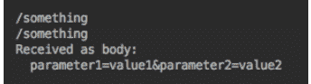

如你所见，服务器成功接收了参数（或者任何其他消息）。现在它可以解析这些内容并根据需要使用它们。

如果我们看客户端屏幕，将看到以下输出：

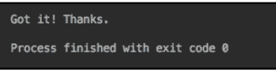

这意味着客户端接收到了来自服务器的消息并按预期退出了。请注意，我们示例中的服务器不会自动退出，必须手动关闭。

`URLConnection` 类的其他方法允许你设置/获取其他属性，并用于更动态地管理客户端-服务器通信。`java.net` 包中还有 `HttpURLConnection` 类，它们简化并增强了基于 URL 的通信。你可以阅读 `java.net` 包的在线文档来了解可用选项。

## 使用 HTTP 2 Client API

HTTP Client API 在 Java 9 中引入，作为 `jdk.incubator` 包中的一个孵化 API。在 Java 11 中，它被标准化并移动到 `java.net.http` 包。它是 `URLConnection` API 的一个更丰富、更易用的替代方案。除了所有与连接相关的基本功能外，它还提供了使用 `CompletableFuture` 的非阻塞（异步）请求和响应，并支持 HTTP 1.1 和 HTTP 2。

HTTP 2 为 HTTP 协议增加了以下新功能：

- 以二进制格式而非文本格式发送数据；二进制格式对于解析更高效、更紧凑，且不易受到各种错误的影响
- 它是完全多路复用的，允许使用单个连接并发发送多个请求和响应
- 它使用头部压缩，减少了开销
- 如果客户端指示其支持 HTTP 2，它允许服务器将响应推送到客户端缓存中

该包包含以下类：

- `HttpClient`：用于同步和异步发送请求并接收响应。可以使用静态方法 `newHttpClient()` 使用默认设置创建实例，或者使用 `HttpClient.Builder` 类（由静态方法 `newBuilder()` 返回），该构建器允许你自定义客户端配置。一旦创建，该实例是不可变的，并且可以被多次使用
- `HttpRequest`：创建并代表指向目标 URI 的 HTTP 请求以及其他相关信息。可以使用 `HttpRequest.Builder` 类（由静态方法 `newBuilder()` 返回）创建实例。一旦创建，该实例是不可变的，并且可以多次发送
- `HttpResponse.BodyPublisher`：从特定源（如字符串、文件、输入流或字节数组）发布主体（用于 POST、PUT 和 DELETE 方法）
- `HttpResponse`：代表客户端发送 HTTP 请求后接收到的 HTTP 响应。它包含原始 URI、头部、消息体和其他相关信息。一旦创建，该实例可以被多次查询
- `HttpResponse.BodyHandler`：这是一个函数式接口，接受响应并返回 `HttpResponse.BodySubscriber` 的实例，该实例可以处理响应体
- `HttpResponse.BodySubscriber`：接收主体（字节）并将其转换为字符串或某种类型

`HttpRequest.BodyPublishers`、`HttpResponse.BodyHandlers` 和 `HttpResponse.BodySubscribers` 类是工厂类，用于创建对应类的实例。例如，`BodyHandlers.ofString()` 方法创建一个将响应体处理为字符串的 `BodyHandler` 实例，而 `BodyHandlers.ofFile()` 方法创建一个将响应体保存到文件中的 `BodyHandler`。

你可以阅读 `java.net.http` 包的在线文档来学习这些以及其他类和接口。接下来，我们将查看并讨论 HTTP API 使用的一些示例。

## 阻塞 HTTP 请求

以下代码是一个简单的 HTTP 客户端示例，它向 HTTP 服务器发送 GET 请求：

```java
HttpClient httpClient = HttpClient.newBuilder()
  .version(HttpClient.Version.HTTP_2) // default
  .build();
HttpRequest req = HttpRequest.newBuilder()
  .uri(URI.create("http://localhost:3333/something"));
```

我们创建了一个构建器来配置 `HttpClient` 实例。然而，由于我们使用了默认设置，如下所示实现相同的结果：

```java
HttpClient httpClient = HttpClient.newHttpClient();
```

为了演示客户端的功能，我们将使用之前用过的 `UrlServer` 类。提醒一下，这是它处理客户端请求并响应 **Got it! Thanks.** 的方式：

```java
try (BufferedReader in = new BufferedReader(
    new InputStreamReader(exch.getRequestBody()))) {
    OutputStream os = exch.getResponseBody();
    System.out.println("Received as body:");
    in.lines().forEach(l -> System.out.println(" " + l + ""));
    String confirm = "Got it! Thanks.";
    exch.sendResponseHeaders(200, confirm.length());
    os.write(confirm.getBytes());
    System.out.println();
} catch (Exception ex) {
    ex.printStackTrace();
}
```


如果我们启动此服务器并运行之前的客户端代码，服务器将在其屏幕上打印以下消息：


客户端没有发送消息，因为它使用了 HTTP GET 方法。尽管如此，服务器仍了响应，客户端屏幕显示了以下消息：


`HttpClient` 的 `send()` 方法会被阻塞，直到从服务器返回响应。

使用 HTTP POST、PUT 或 DELETE 方法产生类似的结果；让我们运行以下代码：

```java
HttpClient httpClient = HttpClient.newBuilder()
    .version(Version.HTTP_2) // default
    .build();
HttpRequest req = HttpRequest.newBuilder()
    .uri(URI.create("http://localhost:3333/something"))
    .POST(BodyPublishers.ofString("Hi there!"))
    .build();
```

```java
try {
    HttpResponse<String> resp = httpClient.send(req, BodyHandlers.ofString());
    System.out.println("Response: " + 
          resp.statusCode() + " : " + resp.body());
} catch (Exception ex) {
    ex.printStackTrace();
}
```

如你所见，这次客户端发布了消息 Hi there!，服务器屏幕显示如下所示：

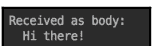

`send()` 方法会被阻塞，直到从服务器返回相同的响应：


到为止，演示的功能与我们在上一节中看到的基于 URL 的通信没有太大区别。现在我们将将使用 URL 流中不可用的 `HttpClient` 方法。

# 非阻塞（异步）HTTP 请求

`HttpClient` 类的 `sendAsync()` 方法允许你在不阻塞的情况下向服务器发送消息。为了演示它是如何工作的，我们执行以下代码：

```java
HttpClient httpClient = HttpClient.newHttpClient();
HttpRequest req = HttpRequest.newBuilder()
    .uri(URI.create("http://localhost:3333/something"))
    .GET() // default
    .build();
CompletableFuture<Void> cf = httpClient.sendAsync(req,
```

## 网络编程

与 `send()` 方法的示例（返回一个 `HttpResponse` 对象）相比，`sendAsync()` 方法返回 `CompletableFuture<HttpResponse>` 类的实例。如果你阅读 `CompletableFuture<T>` 类的文档，你会发现它实现了 `java.util.concurrent.CompletionStage` 接口，该接口提供了许多可以链式的方法，允许你为响应设置各种函数。

为了让你有一个直概念，这里是 `CompletionStage` 接口声明的方法列表：`acceptEither`, `acceptEitherAsync`, `applyToEither`, `applyToEitherAsync`, `handle`, `handleAsync`, `runAfterBoth`, `runAfterBothAsync`, `runAfterEither`, `runAfterEitherAsync`, `runEitherAsync`, `thenAccept`, `thenAcceptAsync`, `thenAcceptBoth`, `thenApplyAsync`, `thenApplySync`, `combine`, `thenCombineAsync`, `thenCompose`, `thenComposeAsync`, `thenRun`, `thenRunAsync`, `whenComplete`, `whenCompleteAsync`。

我们将在第 13 章“函数式编程”中讨论函数以及如何将其作为参数传递。目前，我们只需要提到 `resp -> System.out.println("Response: " + resp.statusCode() + " : " + resp.body())` 构造与以下方法的功能相同：

```java
void method(HttpResponse resp) {
    System.out.println("Response: " +
        resp.statusCode() + " : " + resp.body());
}
```

返回的是 `CompletableFuture<Void>` 实例，之前的代码打印“The request was sent asynchronously”，并在 `CompletableFuture<Void>` 对象的 `get()` 方法上对其进行阻塞。该方法有一个重载的 `get` 版本（`long timeout, TimeUnit unit`），包含两个参数——`TimeUnit` 单位和指定单位数量的 long 类型超时时间，这表示该方法应该等待由 `CompletableFuture<Void>` 对象表示的任务完成需要多长时间。在一种情况下，任务是向服务器发送消息并获取响应（并使用提供的函数对其进行处理）。如果任务没有在规定的时间内完成，`get()` 方法将被中断（并在 catch 块中打印堆栈跟踪）。

## 网络编程第 11 章

“Exit the client...” 消息应该在五秒后（在我们的案例中）或者在 `get()` 方法返回后出现在屏幕上。

如果我们运行客户端，服务器屏幕将再次显示以下消息，并带有阻塞的 HTTP GET 请求：


客户端屏幕显示以下消息：

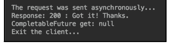

如你所见，“The request was sent asynchronously...”消息在服务器响应返回之前出现。这就是异步调用的意义：向服务器发送的请求已经发出，客户端可以自由执行任何其他事情。传递的函数将应用于服务器响应。同时，你可以传递 `CompletableFuture<Void>` 对象并在任何时间调用它来获取结果。在我们的案例中，结果是 void，因此 `get()` 方法仅仅表示任务已完成。

我们知道服务器返回了该消息，因此我们可以利用 `CompletionStage` 接口的另一个方法来利用它。我们使用 `thenApply` 方法，它接受一个返回权值的函数：

```java
CompletableFuture<String> cf = CompletableFuture
    .sendAsync(req, BodyHandlers.ofString())
    .thenApply(resp -> "Server responded: " + resp.body());
```

`get()` 方法返回由 `resp -> "Server responded: " + resp.body()` 函数产生的值，因此它应该返回服务器的消息体；让我们运行这段代码并查看结果：

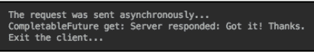

`get()` 方法返回了服务器的消息体。

## 网络编程

同样地，我们可以对 HTTP POST、PUT 或 DELETE 方法使用如下操作：

```java
HttpClient httpClient = HttpClient.newHttpClient();
HttpRequest req = HttpRequest.newBuilder()
    .uri(URI.create("http://localhost:3333/something"))
    .POST(BodyPublishers.ofString("Hi there!"))
    .build();
CompletableFuture<String> cf = httpClient
    .sendAsync(req, BodyHandlers.ofString())
    .thenApply(resp -> "Server responded: " + resp.body());
```

`get()` 方法返回由 `resp -> "Server responded: " + resp.body()` 函数产生的值，因此它应该返回服务器的消息体；让我们运行这段代码并查看结果：

# 网络编程

# 第11章

```java
}
System.out.println("Exit the client...");
```

注意 `sendAsync()` 方法的第三个参数。这是一个函数，用于在当服务器返回推送（push）响应时进行处理。如何实现此函数由客户端开发者决定；这里是一个可能的示例：

```java
void applyPromise(HttpRequest initReq, HttpRequest pushReq,
    Function<BodyHandler, CompletableFuture<HttpResponse>> acceptor) {
    CompletableFuture<Void> cf = acceptor.apply(BodyHandlers.ofString())
        .thenAccept(resp -> System.out.println("Pushed response " +
            + resp.uri()));
}
try {
    System.out.println("Pushed completeFuture get: " + 
        cf.get(1, TimeUnit.SECONDS));
} catch (Exception ex) {
    ex.printStackTrace();
}
System.out.println("Exit the applyPushPromise function...");
```

该函数的实现并没有做什么。它只是打印了推送源的 URI。但是，如果有必要，它可以用于从服务器接收资源（例如支持所提供的 HTML 的图像），而无需请求它们。这种解决方案节省了往返请求-响应模型，并缩短了页面加载时间。它也可以用于更新页面上的信息。

你可以找到许多发送推送请求的服务器代码示例；所有主流浏览器都支持此功能。

# WebSocket 支持

HTTP 基于请求-响应模型。客户端请求一个资源，服务器对该请求提供响应。正如我们多次演示的那样，客户端发起通信。如果没有它，服务器无法向客户端发送任何内容。为了克服这一局限性，该思想最初在 HTML5 规范中作为 TCP 连接引入，并在 2008 年设计了第一个版本的 WebSocket 协议。

它提供了客户端和服务器之间的全双工通信通道。连接建立后，服务器可以随时向客户端发送消息。结合 JavaScript 和 HTML5，WebSocket 协议支持允许应用程序呈现更加动态的用户界面。

# 网络编程 第11章

WebSocket 协议规范将 WebSocket (ws) 和 WebSocket Secure (wss) 定义为两种方案，分别用于未加密和加密连接。该协议不支持分，但允许 URL 语法部分描述的所有其他 URI 组件。

所有支持客户端 WebSocket 协议的类都位于 `java.net` 包中。创建一个客户端，我们需要实现 `WebSocket.Listener` 接口，该接口具有以下方法：

- `onText()`: 当接收到文本数据时调用
- `onBinary()`: 当接收到二进制数据时调用
- `onPing()`: 当接收到 ping 消息时调用
- `onPong()`: 当接收到 pong 消息时调用
- `onError()`: 当发生错误时调用
- `onClose()`: 当接收到关闭消息时调用

此接口的所有方法都是默认的。这意味着你不需要实现所有方法，只需要实现客户端特定任务所需的方法：

```java
class WebSocketClient implements WebSocket.Listener {
    @Override
    public void onOpen(WebSocket socket) {
        System.out.println("Connection established.");
        socket.sendText("Some message");
```

# 网络编程

# 第11章

服务器可以用类似的方式实现，但服务器的实现超出了本书的范围。为了演示前面的客户端代码，我们将使用一个由 `echo.websocket.org` 网站提供的 WebSocket 服务器。它允许连接并返回接收到的消息；这种服务器通常被称为回声服务器（echo server）。

我们预计客户端将在连接建立后发送消息。然后，它将从服务器接收（相同的）消息，显示它，并发送另一条消息，以此此类推，直到关闭。以下代码调用了我们创建的客户端：

```java
HttpClient httpClient = HttpClient.newHttpClient();
WebSocket websocket = httpClient.newWebSocketBuilder()
    .buildAsync(URI.create("ws://echo.websocket.org"), new WebSocketClient())
    .join();
```

WebSocket 协议规范将 WebSocket (ws) 和 WebSocket Secure (wss) 定义为两种方案，分别用于未加密和加密连接。该协议不支持分段，但允许 URL 语法部分描述的所有其他 URI 组件。

所有支持客户端 WebSocket 协议的类都位于 `java.net` 包中。创建一个客户端，我们需要实现 `WebSocket.Listener` 接口，该接口具有以下方法：

- `onText()`
- `onBinary()`
- `onPing()`
- `onPong()`
- `onError()`
- `onClose()`

此接口的所有方法都是默认的。这意味着你不需要实现所有方法，只需要实现客户端特定任务所需的方法：

（此处示例）结束。

正如你所见，所有浏览器都支持 WebSocket 协议。

# 总结

在本章中，我们介绍了 UDP、TCP/IP 和 WebSocket 等流行的协议。我们还回顾了基于 URL 的通信以及最新的 HTTP 2 功能。

下一章将提供 Java GUI 技术的概述，并介绍如何使用 JavaFX。读者将学习使用 JavaFX。

# 测验

1. 列出应用层的网络协议。
2. 列出传输层的网络协议。
3. 哪个 Java 包支持 HTTP？
4. 哪种协议基于数据报文交换？
5. 数据可以发送到没有服务器？
6. 哪个 Java 包包含 UDP 和 TCP？
7. TCP 代表什么？
8. TCP/IP 有什么共同点？
9. 如何识别 TCP 会话？
10. `ServerSocket` 和 `Socket` 的主要区别？
11. TCP 还是 UDP 更快？
12. TCP 还是 UDP 更可靠？
13. 列出三种 TCP 协议。
14. 以下哪些是 URI 的组件？（选择所有项）
    a. 分段
    b. 标题
    c. 权威
    d. 查询
15. Scheme 和协议的区别是什么？
16. URI 和 URL 的区别是什么？
17. 下列代码输出什么？

```java
URL url = new URL("http://www.java.com/something?par=42");
System.out.print(url.getPath());
System.out.println(url.getFile());
```

18. HTTP 2 相比 HTTP 1.1 有哪些新功能？
19. `HttpClient` 类的全限定名是什么？
20. `WebSocket` 类的全限定名是什么？
21. `HttpClient.newBuilder().build()` 和 `newHttpClient()` 有什么区别？

# 12 Java GUI 编程

本章提供了 Java 图形用户界面（GUI）技术的概述，并演示了如何使用 JavaFX 工具创建 GUI 应用程序。最新的 JavaFX 不仅提供了许多有用的功能，还允许保留旧的实现和样式。

在某些方面，GUI 是应用程序最重要的部分。它与用户直接交互。如果 GUI 不方便、不美观或令人困惑，即使是最好的后端解决方案也无法留住用户。相反，精心设计的直观美观的 GUI 即使应用程序表现不佳，也能留住用户。

本章将涵盖以下主题：

- Java GUI 技术
- JavaFX 基础知识
- JavaFX 示例
- 控制元素
- 图表
- CSS
- FXML
- HTML
- 媒体
- 效果

## Java GUI 编程

## Java GUI 技术


# Java 基础类（JFC）

Java 基础类（Java Foundation Classes，JFC）这个名称可能会引起很多困惑。它暗示这些类是 Java 的基础，但实际上，JFC 仅包含与 GUI 相关的类和接口。准确来说，JFC 是三个框架的集合：抽象窗口工具包（AWT）、Swing 和 Java 2D。

JFC 是 Java 类库（JCL）的一部分，尽管 JFC 这一名称直到 1997 年才出现，而 AWT 从一开始就是 JCL 的一部分。那时，Netscape 开发了一个名为 Internet 基础类（IFC）的 GUI 库，微软也为 GUI 开发创建了 Application 类（AFC）。因此，Sun Microsystems 和 Netscape 决定建立一个新的 GUI 库，他们继承了前人的成果，并创建了 JFC。Swing 框架接管了 AWT 的 Java GUI 编程，并成功使用了近二十年。

Java 8 中将一个全新的 GUI 编程工具包 JavaFX 添加到了 JCL 中。它在 Java 11 中从 JCL 中移除，从那以后，它作为一个由社区 Gluon 支持的开源项目，作为 JDK 之外的可下载模块存在。JavaFX 使用的 GUI 编程方法与 AWT 和 Swing 有些不同。它提供了更一致、更简单的设计，并且很有可能成为胜出的 Java 编程工具包。

# JavaFX 基础知识

纽约、伦敦、巴黎和莫斯科等城市有许多剧院，那里的人们无法避免每周听到新闻和作品。他们不可避免地熟悉了剧院术语，其中舞台（stage）、场景（scene）和事件（event）可能是最常用的术语。这三个术语也是 JavaFX 应用结构的基础。

JavaFX 中持有所有组件的顶层容器由 `javafx.stage.Stage` 类表示。因此你可以说，在 JavaFX 应用中，一切都发生在舞台上。从用户的角度来看，它是一个显示区域或窗口，所有控件和组件在其中执行动作（就像剧院里的演员）。与剧院里的演员一样，它们在场景的范围内运行，场景由 `javafx.scene.Scene` 类表示。因此，一个 JavaFX 应用程序就像剧院里的戏剧，由在 `Stage` 一次展示的 `Scene` 对象组成。每个 `Scene` 对象包含一个图，定义了 JavaFX 中场景演员的位置，称为节点（nodes）：控件、布局、组、形状等。它们中的每一个都扩展了抽象类 `javafx.scene.Node`。

# Java GUI 编程第 12 章

某些节点控件与事件相关：例如按钮被点击或复选框被选中。这些事件可以通过与相应控件元素关联的事件处理器处理。

JavaFX 应用的主类必须扩展抽象类 `javafx.application.Application`，该类具有几个生命周期方法。我们按照调用顺序列出它们：`launch()`、`init()`、`notifyPreloader()`、`start()`、`stop()`。看起来需要记忆的方法很少。但很可能你只需要实现一个方法 `start()`，在该方法中构建并执行实际 GUI。因此，为了完整性，我们将回顾所有方法：

- `static void launch(Class<? extends Application> appClass, String... args)`: 启动应用程序，通常由主方法调用；在调用 `Platform.exit()` 或所有应用窗口关闭之前不会返回；`Application` 参数必须是 `Application` 的子类，并具有公有的无参构造函数。
- `static void launch(String... args)`: 与上一个方法相同，假设 `Application` 的公共子类是直接包含的类；这是启动 JavaFX 应用最常用的方法；我们将在示例中使用它。
- `void init()`: 此方法在 `Application` 类加载后被调用；它通常用于某种资源初始化；默认实现什么都不做；我们不会使用它。
- `void notifyPreloader(Preloader.PreloaderNotification info)`: 可用于初始化耗时较长时显示进度；我们不会使用它。
- `abstract void start(Stage primaryStage)`: 我们要实现的方法；它在 `init()` 方法返回且系统准备好处理主任务后调用；`primaryStage` 参数是应用程序将展示其场景的舞台。
- `void stop()`: 在应用程序应该停止时被调用；可能用于释放资源；默认实现什么都不做；我们不会使用它。

# JavaFX API 与环境配置

JavaFX 工具包的 API 可以在网上找到（https://openfx.io/javadoc/）。在写作时，最新版本是 11。Oracle 提供了详尽的文档和代码示例（https://docs.oracle.com/javafx/2/）。该文档包含了 Scene Builder（一种开发工具）的描述和手册，它提供了一个视觉布局环境，并让你无需编写任何代码即可为 JavaFX 应用设计用户界面。这个工具对于创建复杂精密的 GUI 可能很有用，许多人一直在这样做。但在本书中，我们将专注于在不使用此工具的情况下编写 JavaFX 代码。

为了实现这一点，以下是必要的步骤：

1. 在 `pom.xml` 文件中添加以下依赖：

```xml
<dependency>
  <groupId>org.openfx</groupId>
  <artifactId>javafx-controls</artifactId>
  <version>11</version>
</dependency>
<dependency>
  <groupId>org.openfx</groupId>
  <artifactId>javafx-fxml</artifactId>
  <version>11</version>
</dependency>
```

2. 从 https://gluonhq.com/products/javafx/ 下载对应操作系统的 JavaFX SDK。

3. 假设你将 JavaFX SDK 解压到 `/path/JavaFX` 文件夹，在 Linux 平台上启动 JavaFX 应用的后续选项如下：

```bash
--module-path /path/JavaFX/lib --add-modules=javafx.controls,javafx.fxml
```

在 Windows 上，选项如下：

```bash
--module-path C:\path\JavaFX\lib --add-modules=javafx.controls,javafx.fxml
```

`/path/JavaFX/` 和 `C:\path\Java\` 是占位符，你需要将其替换为包含 JavaFX SDK 的实际路径。

# 运行配置示例

假设应用程序的主类是 `HelloWorld`，在 IntelliJ 中将前面的选项输入 VM options 字段：

| 运行/调试配置 | 共享 | 允许并行 |
| --- | --- | --- |
| 配置覆盖日志 | | |
| 主类: com.packt.learnjava.ch12_gui.HelloWorld | | |
| VM options: --module-path /path/JavaFX/lib --add-modules=javafx.controls | | |
| 程序参数: | | + |
| 工作目录: /Java12Learn/Learn-Java-12-Programming | | |
| 环境变量: | | |

这些选项必须添加到源代码包 `ch12_gui` 中 `HelloWorld`、`BlendEffect` 和 `OtherEffects` 类的运行/调试配置中。如果你偏好不同的 IDE 或使用不同的操作系统，可以在 openfx.io 文档中找到设置建议（https://openfx.io/openfx-docs/#introduction）。

要在命令行运行 `HelloWorld`、`BlendEffect` 和 `OtherEffects` 类，请在项目根目录（`pom.xml` 文件所在处）使用以下命令：

**Linux/macOS:**

```bash
mvn clean package

java --module-path /path/JavaFX/lib --add-modules=javafx.controls,javafx.fxml -cp target/learnjava-1.0-SNAPSHOT.jar:target/libs/* com.packt.learnjava.ch12_gui.HelloWorld

java --module-path /path/JavaFX/lib --add-modules=javafx.controls,javafx.fxml -cp target/learnjava-1.0-SNAPSHOT.jar:target/libs/* com.packt.learnjava.ch12_gui.BlendEffect

java --module-path /path/JavaFX/lib --add-modules=javafx.controls,javafx.fxml -cp target/learnjava-1.0-SNAPSHOT.jar:target/libs/* com.packt.learnjava.ch12_gui.OtherEffects
```

**Windows:**

```bash
mvn clean package

java --module-path C:\path\JavaFX\lib --add-modules=javafx.controls,javafx.fxml -cp target\learnjava-1.0-SNAPSHOT.jar;target\libs\* com.packt.learnjava.ch12_gui.HelloWorld

java --module-path C:\path\JavaFX\lib --add-modules=javafx.controls,javafx.fxml -cp target\learnjava-1.0-SNAPSHOT.jar;target\libs\* com.packt.learnjava.ch12_gui.BlendEffect

java --module-path C:\path\JavaFX\lib --add-modules=javafx.controls,javafx.fxml -cp target\learnjava-1.0-SNAPSHOT.jar;target\libs\* com.packt.learnjava.ch12_gui.OtherEffects
```

`HelloWorld`、`BlendEffect` 和 `OtherEffects` 每个类都有若干个 `start()` 方法：`start(1)` 和 `start(2)`。在你运行该类后，将 `start()` 重命名为 `start(1)`，将 `start(1)` 重命名为 `start()` 并再次运行上述命令。然后将 `start(1)` 重命名为 `start(2)`，将 `start(2)` 重命名为 `start()` 并再次运行命令。以此类推，直到所有的 `start()` 方法都执行完毕。你将看到本章所有示例的结果。

到此，JavaFX 的高级介绍就结束了。现在我们要进入最令人兴奋（对任何程序员而言）的部分：编写代码。

# 使用 JavaFX Hello World

以下是显示文本“Hello, World!”和“Exit”的 `HelloWorld` 示例：

```java
import javafx.application.Application;
import javafx.application.Platform;
import javafx.scene.control.Button;
import javafx.scene.layout.Pane;
import javafx.scene.text.Text;
import javafx.scene.Scene;
import javafx.stage.Stage;
```

```java
public class HelloWorld extends Application {
    public static void main(String... args) {
        launch(args);
    }

    @Override
    public void start(Stage primaryStage) {
        Text txt = new Text("Hello, world!");
        txt.relocate(135, 40);

        Button btn = new Button("Exit");
        btn.relocate(155, 80);
        btn.setOnAction(e -> {
            System.out.println("Bye! See you later!");
            Platform.exit();
        });

        Pane pane = new Pane();
        pane.getChildren().addAll(txt, btn);

        primaryStage.setTitle("The primary stage (top-level container)");
        primaryStage.onCloseRequestProperty()
            .setValue(e -> System.out.println("Bye! See you later!"));
        primaryStage.setScene(new Scene(pane, 350, 150));
        primaryStage.show();
    }
}
```

如你所见，应用程序是通过调用静态方法 `Application.launch(String... args)` 启动的。`start(Stage)` 方法创建了一个消息为 "Hello, World!" 的 `Text` 节点，位于绝对位置 135（水平）和 40（垂直）。然后，它创建了另一个文本为 "Exit" 的 `Button` 节点，位于绝对位置 155（水平）和 80（垂直）。分配给按钮的动作（点击时触发）会在屏幕上打印 "Bye! See you later!" 并使用 `Platform.exit()` 方法强制应用程序退出。这些节点被作为子节点添加到允许绝对定位的布局面板（`Pane`）中。

`Stage` 对象设置了标题 "The primary stage (top-level container)"。它还设置了点击窗口右上角关闭窗口符号（x 按钮）时的动作。该符号在 Linux 系统上靠左，在 Windows 系统上靠右。

创建动作时，我们使用了 Lambda 表达式，我们将在第 13 章“函数式编程”中进行讨论。

创建的布局面板在一个 `Scene` 对象上。场景的大小设置为水平 350，垂直 150。场景对象被放置在阶段上。然后通过调用 `show()` 方法显示阶段。

# 运行结果演示

如果我们运行前面的应用程序，将弹出以下窗口：

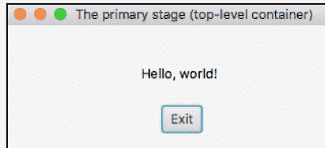

点击按钮或右上角的 x 按钮将显示预期的消息：


但是，如果你需要在点击 x 按钮关闭窗口时执行其他操作，你可以例如在 `HelloWorld` 类中添加以下内容：

```java
@Override
public void stop() {
    System.out.println("Closing...");
}
```

如果你这样做了，点击按钮后，显示将为：

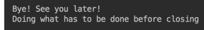

这个示例让你对 JavaFX 有了直观感受。从现在开始，在 JavaFX 中我们将关注控件。

# 控件元素

控件包含在 `javafx.scene.control` 中。有很多，例如文本字段、复选框、菜单、进度条、滚动条等。我们将关注最常用的那些。

控件用于构建 GUI。例如，我们可以使用：

```java
TextField tFirstName = new TextField("First Name");
TextField tLastName = new TextField("Last Name");
TextField tAge = new TextField("Age");
Button btn = new Button("Submit");
```

控件使用 `GridPane` 放置在网格布局中：

```java
GridPane grid = new GridPane();
grid.setAlignment(Pos.CENTER);
grid.setHgap(15);
grid.setVgap(5);
grid.setPadding(new Insets(20, 20, 20, 20));
```

我们将相应的节点放置在单元格中（分列）：

```java
int i = 0;
grid.add(txt, 1, i++, 2, 1);
GridPane.setHalignment(txt, HPos.CENTER);
grid.addRow(i++, new Label("First Name"), tFirstName);
grid.addRow(i++, new Label("Last Name"), tLastName);
grid.addRow(i++, new Label("Age"), tAge);
grid.add(btn, 1, i);
GridPane.setHalignment(btn, HPos.CENTER);
```


此函数接受三个参数（`javafx.scene.control.TextField` 对象），然后获取提交的值并打印它们。代码确保了始终可用值，并且非数字的年龄不会破坏应用程序。

```java
void action(TextField tFirstName, TextField tLastName, TextField tAge) {
    String fn = tFirstName.getText();
    String ln = tLastName.getText();
    String age = tAge.getText();
    int a = 0;
    try {
        a = Integer.parseInt(age);
    } catch (NumberFormatException ex) {
        fn = fn.isEmpty() ? "Nick" : fn;
        ln = ln.isEmpty() ? "Samlov" : ln;
    }
    System.out.println("Hello, " + fn + " " + ln + ", age = " + a + "!");
}
```

# Java GUI 编程

## 第 12 章

`setAlignment()` 方法设置节点在单元格中的位置。枚举 `HPos` 的值为：`LEFT`、`RIGHT`、`CENTER`。`addRow(int i, Node... nodes)` 方法接受行索引和节点的变长参数列表。我们使用它来放置 `Label` 和 `TextField` 对象。

`start()` 方法的其余部分与 HelloWorld 示例非常相似（仅更改了阶段和大小）：

```
primaryStage.setTitle("Simple form example");
primaryStage.setOnCloseRequest()
  .setValue(() -> System.out.println("Bye! See you later!"));
primaryStage.setScene(new Scene(grid, 300, 200));
primaryStage.show();
```

如果我们运行刚刚实现的 `start()` 方法，结果如下：


我们可以像下面这样填充数据，例如：

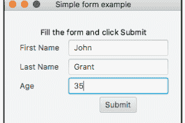

点击 Submit 按钮后，将显示以下消息并退出：

```
Hello, John Grant, age 35!
```

## Java GUI 编程 第 12 章

为了帮助可视化布局，特别是在设计较复杂的情况下，你可以使用 `grid` 方法 `setGridLinesVisible(boolean v)` 使网格线可见。这有助于观察单元格是如何对齐的。我们可以在示例中添加以下行代码：

```
grid.setGridLinesVisible(true);
```

我们再次运行，结果如下：

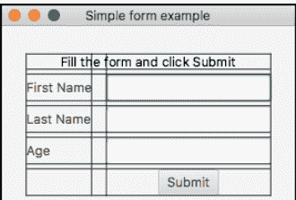

如你所见，布局现在被明确地勾勒出来，这有助于我们可视化设计。

`javafx.scene.layout` 包包含 24 个布局类，如 `Pane`（我们在 HelloWorld 示例中见过它）、`StackPane`（允许我们堆叠节点）、`FlowPane`（允许节点的位置随着窗口大小的变化流动）、`AnchorPane`（保持节点相对于其锚点的位置）等。`VBox` 布局将在下一节 Charts 中演示。

## 图表

JavaFX 在 `javafx.scene.chart` 包提供了以下图表组件用于数据可视化：

- `LineChart`：在系列中的数据点之间添加折线；通常用于展示随时间变化的趋势
- `AreaChart`：与 `LineChart` 类似，但填充连接数据点的线与轴之间的区域；通常用于比较随时间变化的累计总和
- `BarChart`：以矩形条的形式呈现数据；用于离散数据的可视化
- `PieChart`：将圆分成若干扇区（用不同的颜色填充），每个扇区代表占总数的比例值；我们将在本节中对其进行演示
- `BubbleChart`：以二维椭圆形形状（称为**气泡**）呈现数据，这些气泡允许展示三个参数
- `ScatterChart`：按原样呈现系列中的数据；有助于识别聚类（数据相关性）的存在

以下示例演示了如何将测试结果以饼图的形式呈现出来：

```java
Text txt = new Text("Test results;");

PieChart pc = new PieChart();
pc.getData().add(new PieChart.Data("Succeed", 143));
pc.getData().add(new PieChart.Data("Failed", 12));
pc.getData().add(new PieChart.Data("Ignored", 18));

VBox vb = new VBox(txt, pc);
vb.setAlignment(Pos.CENTER);
vb.setPadding(new Insets(10, 10, 10, 10));

primaryStage.setTitle("A chart example");
primaryStage.setOnCloseRequestProperty(() -> System.out.println("Bye! See you later!"));
primaryStage.setScene(new Scene(vb, 300, 300));
primaryStage.show();
```

我们创建了两个节点——`Text` 和 `PieChart`，并将它们放置在 `VBox` 布局的单元格中，该布局将它们列排列。我们在 `VBox` 面板的边缘添加了 10 像素的内边距。注意，`VBox` 扩展了 `Node` 和 `Pane` 类，其他 `Pane` 也是如此。我们还使用 `setAlignment()` 方法将面板位于场景中心。其余与其他之前的所有示例相同，除了场景标题和大小。

## Java GUI 编程

如果我们运行上一个示例，结果如下：

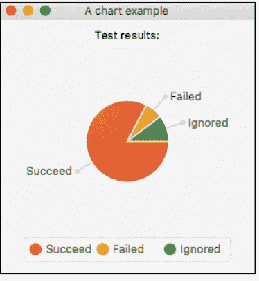

`PieChart` 类以及任何其他图表都有许多其他方法，可以用于以用户友好的方式展示更复杂、动态的数据。

## 应用 CSS

默认情况下，JavaFX 使用随分发 jar 文件自带的样式表。要覆盖默认样式，你可以使用以下方法向场景添加样式表：

```
scene.getStylesheets().add("/mystyle.css");
```

`mystyle.css` 文件必须放置在 `src/main/resources`。让我们执行以下操作：

```css
#text {
  -fx-font-size: 20px;
  -fx-font-family: "Arial";
  -fx-fill: red;
}

.button {
  -fx-fill: white;
  -fx-background-color: slateblue;
}
```

## Java GUI 编程

```xml
<?xml version="1.0" encoding="UTF-8"?>
<?import javafx.scene.layout.Button?>
<?import javafx.scene.layout.GridPane?>
<?import javafx.scene.control.TextField?>
<?import javafx.scene.control.Label?>
<?import javafx.geometry.Insets?>
<?import javafx.scene.Scene?>

<Scene fx:controller="http://com.packt.javafx.gui_12.HelloWorldController"
      xmlns:fx="http://javafx.com/fxml"
      width="350" height="200">
  <GridPane alignment="center" hgap="15" vgap="5">
    <padding>
      <Insets top="20" right="20" bottom="20" left="20"/>
    </padding>
    <TextField id="fillText" text="fill the form and click Submit"
      GridPane.rowIndex="0" GridPane.columnSpan="2"
      GridPane.halignment="center"/>
    <Label text="first name"
      GridPane.columnIndex="0" GridPane.rowIndex="1"/>
    <TextField id="cfFirstName"
      GridPane.columnIndex="1" GridPane.rowIndex="1"/>
    <Label text="last name"
      GridPane.columnIndex="0" GridPane.rowIndex="2"/>
    <TextField id="cfLastName"
      GridPane.columnIndex="1" GridPane.rowIndex="2"/>
    <Label text="age"
      GridPane.columnIndex="0" GridPane.rowIndex="3"/>
    <TextField id="age"
      GridPane.columnIndex="1" GridPane.rowIndex="3"/>
    <Button text="Submit"
      GridPane.columnIndex="1" GridPane.rowIndex="4"
      onAction="#submitClicked"/>
  </GridPane>
</Scene>
```

如你所见，它表达了所需的场景结构（你已经对其熟悉），并指定了控制器类 `HelloWorldController`，我们很快就会看到它。正如我们已经提到的，标签与我们一直仅用 Java 构建相同 GUI 时使用的类名匹配。我们将 `helloWorld.fxml` 文件放入资源（resources）文件夹中。

现在让我们看看使用上述 FXML 文件的 `HelloWorld` 类 `start()` 方法实现：

```java
try {
  FXMLLoader loader = new FXMLLoader();
  loader.setLocation(new URL("file:src/main/resources/helloWorld.fxml"));
  Scene scene = loader.load();
```

## Java GUI 编程 第 12 章

`start()` 方法加载 `HelloWorld.fxml` 文件并设置舞台（stage），后者的操作与我们之前的示例完全相同。现在让我们来看看 `HelloWorldController` 类。如果需要，我们可以仅通过以下内容来启动应用程序：

```java
public class HelloWorldController {
    @FXML
    protected void submitClicked(ActionEvent e) {
    }
}
```

表单将会显示，但点击按钮将将无事发生。这就是我们在谈论独立于应用程序逻辑的用户界面时所的意思。注意 `@FXML` 注解。它使用它们的 ID 将方法和属性绑定到 FXML 标签上。这是完整的控制器实现样貌：

```java
@FXML
private TextField tfFirstName;
@FXML
private TextField tfLastName;
@FXML
private TextField tfAge;
@FXML
protected void submitClicked(ActionEvent e) {
    String fn = tfFirstName.getText();
    String ln = tfLastName.getText();
    String age = tfAge.getText();
    int a = 42;
    try {
        a = Integer.parseInt(age);
    } catch (Exception ex) {
    }
    fn = fn.isBlank() ? "Nick" : fn;
    ln = ln.isBlank() ? "Samoylov" : ln;
    System.out.println("Hello, " + fn + " " + ln + " " + age + " " + a + "!");
    Platform.exit();
}
```

## Java GUI 编程 第 12 章

大部分内容对你来说应该非常熟悉。唯一的区别是我们不再直接引用字段及其值（如之前那样），而是使用标记有 `@FXML` 注解的绑定。如果我们现在运行 `HelloWorld` 类，页面的外观和行为将与我们在控制元素部分描述的完全相同。

现在让我们添加另一个页面并修改代码，以便控制器在点击 Submit 按钮后，会将提交的值发送到另一个页面并关闭表单。为了实现这一点，新页面将呈现所需的数据。以下是 FXML 的样貌：

```xml
<?xml version="1.0" encoding="UTF-8"?>
<?import javafx.scene.Scene?>
<?import javafx.geometry.Insets?>
<?import javafx.scene.text.Text?>
<?import javafx.scene.layout.GridPane?>

<Scene fx:controller="com.packt.lernjava.ch12_gui.HelloWorldController2"
      xmlns:fx="http://javafx.com/fxml"
      width="350" height="150">
  <GridPane alignment="center" hgap="15" vgap="5">
    <padding>
      <Insets top="20" right="20" bottom="20" left="20"/>
    </padding>
    <Text id="textField"
          GridPane.rowIndex="0" GridPane.columnSpan="2"
          GridPane.halignment="center"/>
    <Text id="doText" text="Do what has to be done here"
          GridPane.rowIndex="1" GridPane.columnSpan="2"
          GridPane.halignment="center"/>
  </GridPane>
</Scene>
```

正如你所见，由于使用了 `@FXML` 注解标记的绑定，大部分内容看起来对你非常熟悉。如果我们现在运行 `HelloWorld` 类，页面的外观和行为将与我们在控制元素部分描述的完全相同。

现在让我们添加另一个页面并修改代码，以便控制器在点击 Submit 按钮后，会将提交的值发送到另一个页面并关闭表单。为了实现这一点，新页面将呈现所需的数据。以下是 FXML 的样貌：

（注：此处原文中似乎存在重复内容，此处已根据指令进行翻译处理）

# Java GUI 编程

## 第 1 章


# JavaFX 模块导出配置

以下是 JavaFX 模块的导出配置：

```
--exports javafxx.graphics/com.sun.javafx.util=ALL-UNNAMED
--exports javafxx.base/com.sun.javafx.logging=ALL-UNNAMED
--exports javafxx.graphics/com.sun.javafx.prism=ALL-UNNAMED
--exports javafxx.graphics/com.sun.glass.ui=ALL-UNNAMED
--exports javafxx.graphics/com.sun.javafx.geom.transform=ALL-UNNAMED
--exports javafxx.graphics/com.sun.javafx.tk=ALL-UNNAMED
--exports javafxx.graphics/com.sun.javafx.utils=ALL-UNNAMED
--exports javafxx.graphics/com.sun.javafx.font=ALL-UNNAMED
--exports javafxx.graphics/com.sun.javafx.application=ALL-UNNAMED
--exports javafxx.controls/com.sun.javafx.scene.control=ALL-UNNAMED
--exports javafxx.graphics/com.sun.javafx.scene.input=ALL-UNNAMED
--exports javafxx.graphics/com.sun.javafx.geom=ALL-UNNAMED
--exports javafxx.graphics/com.sun.javafx.prism.paint=ALL-UNNAMED
--exports javafxx.graphics/com.sun.javafx.scenario.effect=ALL-UNNAMED
--exports javafxx.graphics/com.sun.javafx.text=ALL-UNNAMED
--exports javafxx.graphics/com.sun.javafx.iio=ALL-UNNAMED
--exports javafx.graphics/com.sun.scenario.effect.impl.prism=ALL-UNNAMED
--exports javafx.graphics/com.sun.javafx.scene.text=ALL-UNNAMED
```

# 运行 WebView 类

要在命令行执行 `WebView` 类，请使用以下命令：

## Linux/macOS 环境

```
mvn clean package
```

```
java --module-path /path/javaFX/lib \
--add-modules=javafx.controls,com.sun.javafx,javafx.fxml \
--add-exports javafx.graphics/com.sun.javafx.sg.prism=ALL-UNNAMED \
--add-exports javafx.graphics/com.sun.javafx.scene=ALL-UNNAMED \
--add-exports javafx.graphics/com.sun.javafx.utils=ALL-UNNAMED \
--add-exports javafx.base/com.sun.javafx.logging=ALL-UNNAMED \
--add-exports javafx.graphics/com.sun.javafx.prism=ALL-UNNAMED \
--add-exports javafx.graphics/com.sun.glass.ui=ALL-UNNAMED \
--add-exports javafx.graphics/com.sun.javafx.geom.transform=ALL-UNNAMED \
--add-exports javafx.graphics/com.sun.javafx.tk=ALL-UNNAMED \
--add-exports javafx.graphics/com.sun.javafx.utils=ALL-UNNAMED \
--add-exports javafx.graphics/com.sun.javafx.font=ALL-UNNAMED \
--add-exports javafx.graphics/com.sun.javafx.application=ALL-UNNAMED \
--add-exports javafx.controls/com.sun.javafx.scene.control=ALL-UNNAMED \
--add-exports javafx.graphics/com.sun.javafx.geom.transform=ALL-UNNAMED \
--add-exports javafx.graphics/com.sun.javafx.prism.paint=ALL-UNNAMED \
--add-exports javafx.graphics/com.sun.javafx.scenario.effect=ALL-UNNAMED \
--add-exports javafx.graphics/com.sun.javafx.text=ALL-UNNAMED \
--add-exports javafx.graphics/com.sun.javafx.iio=ALL-UNNAMED \
--add-exports javafx.graphics/com.sun.scenario.effect.impl.prism=ALL-UNNAMED \
--add-exports javafx.graphics/com.sun.javafx.scene.text=ALL-UNNAMED \
--cp target/learnjava-1.0-SNAPSHOT.jar:target/libs/* \
com.packt.learnjava.ch12_gui.HtmlWebView
```

## Windows 环境

在 Windows 上，`clean` 命令如下：

```
mvn clean package
```

```
java --module-path C:\path\JavaFX\lib \
--add-modules=javafx.controls,javafx.fxml \
--add-exports javafx.graphics/com.sun.javafx.scene.prism=ALL-UNNAMED \
--add-exports javafx.graphics/com.sun.javafx.scene.util=ALL-UNNAMED \
--add-exports javafx.base/com.sun.javafx.logging=ALL-UNNAMED \
--add-exports javafx.graphics/com.sun.javafx.prism=ALL-UNNAMED \
--add-exports javafx.graphics/com.sun.javafx.scene.input=ALL-UNNAMED \
--add-exports javafx.graphics/com.sun.javafx.scene.transform=ALL-UNNAMED \
--add-exports javafx.graphics/com.sun.javafx.scene.tk=ALL-UNNAMED \
--add-exports javafx.graphics/com.sun.javafx.scene.util=ALL-UNNAMED \
--add-exports javafx.graphics/com.sun.javafx.font=ALL-UNNAMED \
--add-exports javafx.graphics/com.sun.javafx.application=ALL-UNNAMED \
--add-exports javafx.controls/com.sun.javafx.scene.control=ALL-UNNAMED \
--add-exports javafx.graphics/com.sun.javafx.scene.scene.text=ALL-UNNAMED \
--add-exports javafx.graphics/com.sun.javafx.geom=ALL-UNNAMED \
--add-exports javafx.graphics/com.sun.javafx.paint=ALL-UNNAMED \
--add-exports javafx.graphics/com.sun.javafx.scene.text=ALL-UNNAMED \
--add-exports javafx.graphics/com.sun.javafx.io=ALL-UNNAMED \
--add-exports javafx.graphics/com.sun.scenario.effect.impl.prism=ALL-UNNAMED \
--add-exports javafx.graphics/com.sun.javafx.scene.text=ALL-UNNAMED \
--cp target/learnjava-1.0-SNAPSHOT.jar:target/libs/* \
com.packt.learnjava.ch12_gui.HtmlWebView
```

# HtmlWebView 类示例

`HtmlWebView` 类包含几个 `start()` 方法。请按照 JavaFX 基础知识中的描述，重命名并逐一执行它们。让我们来看几个例子。我们创建一个新的应用程序，并如所述使用 `module-path` 为其设置选项。我们可以编写并执行使用 `WebView` 类的代码。

## 嵌入简单 HTML

首先，是如何将简单的 HTML 添加到 JavaFX 应用程序中的：

```java
WebView wv = new WebView();
WebEngine engine = wv.getEngine();
String html = "<html><center><h1>Hello, world!</h1></center></html>";
engine.loadContent(html);

VBox vb = new VBox(wv);
Scene scene = new Scene(vb, 400, 300);
primaryStage.setScene(scene);
primaryStage.setTitle("JavaFX with embedded HTML");
primaryStage.show();
```


# Java GUI 编程

## 第 12 章

### 使用 WebView

要在命令行执行 `WebView` 类，请使用以下命令：

```
mvn clean package
```

在 Windows 上，命令相同：

```
mvn clean package
```

`HtmlWebView` 类包含几个 `start()` 方法。请按照 JavaFX 基础知识中的描述，重命名并逐一执行它们。让我们来看几个例子。我们创建一个新的应用程序，并如所述使用 `module-path` 为其设置选项。我们可以编写并执行使用 `WebView` 类的代码。首先，是如何将简单的 HTML 添加到 JavaFX 应用程序中的：

```java
WebView wv = new WebView();
WebEngine engine = wv.getEngine();
String html = "<html><center><h1>Hello, world!</h1></center></html>";
engine.loadContent(html);

VBox vb = new VBox(wv);
Scene scene = new Scene(vb, 400, 300);
primaryStage.setScene(scene);
primaryStage.setTitle("JavaFX with embedded HTML");
primaryStage.show();
```

### 从 URL 加载内容

当你需要从 JavaFX 应用发送请求或发布数据时，此解决方案非常有用。但是，当你想要用户填充的表单已经存在服务器上时，你只需要从 URL 加载它。例如，让我们在 JavaFX 应用中集成 Google 搜索。我们可以通过将 `load()` 方法的参数改为我们想要的 URL 来实现：

```java
Text txt = new Text("Enjoy searching the Web!");

WebView wv = new WebView();
WebEngine we = wv.getEngine();
we.load("http://www.google.com");

VBox vb = new VBox(txt, wv);
vb.setSpacing(20);
vb.setAlignment(Pos.CENTER);
vb.setStyle("-fx-font-size: 20px; -fx-background-color: lightblue;");
vb.setPadding(new Insets(10, 10, 10, 10));

Scene scene = new Scene(vb, 750, 500);
primaryStage.setScene(scene);
primaryStage.setTitle("JavaFX with the window to another server");
primaryStage.setOnCloseRequest(e -> System.out.println("Bye! See you later!"));
primaryStage.show();
```

我们还为布局添加了样式以增加背景颜色，这样我们就可以看到嵌入 HTML 区域的输出。当我们运行此代码时，会出现以下窗口：


在这个窗口中，你可以执行通常通过浏览器访问的所有搜索方面的操作。

而且，正如我们已经提到的，你可以对渲染页面进行缩放。例如，如果我们在上一个示例中添加 `wv.setZoom(1.5)` 这一行，结果如下：


同样，我们可以设置字体比例，甚至可以从文件设置样式：

```java
wv.setFontScale(1.5);
we.setUserStyleSheetLocation("mystyle.css");
```

但注意，我们在 `WebView` 对象上设置了比例，而在 `WebEngine` 对象上设置了样式。

我们还可以使用 `WebEngine` 类方法 `getDocument()` 访问（并操作）加载页面的 DOM 对象：

```java
Document document = we.getDocument();
```

我们还可以访问浏览器历史记录，获取当前索引，并让历史向前向后移动：

```java
WebHistory history = we.getHistory();
int currInd = history.getCurrentIndex();
history.go(-1);
history.go(1);
```

对于每条历史记录，我们可以提取它的 URL、标题或最后访问日期：

```java
WebHistory history = we.getHistory();
ObservableList<WebHistory.Entry> entries = history.getEntries();
for (WebHistory.Entry entry : entries) {
    String url = entry.getUrl();
    String title = entry.getTitle();
    Date date = entry.getLastVisitedDate();
}
```

阅读 `WebView` 和 `WebEngine` 类的文档，获取更多如何利用它们功能的想法。

### 播放媒体

在 JavaFX 应用中添加图像场景不需要 `com.sun.*` 包，因此不需要“添加 HTML”部分列出的 `--add-exports` VM 选项。但无论如何拥有它们也没有坏处，所以如果你已经添加了 `--add-exports` 选项，请保留它们。

可以使用 `javafx.scene.image.Image` 和 `javafx.scene.image.ImageView` 类在场景中包含图像。为了演示如何操作，我们将使用资源文件夹中的 Packt pack.png。以下是实现该操作的代码：

```java
Text txt = new Text("What a beautiful image!");
FileInputStream inputStream = new FileInputStream("src/main/resources/pack.png");
Image image = new Image(inputStream);
ImageView iv = new ImageView(image);

VBox vb = new VBox(txt, iv);
vb.setAlignment(Pos.CENTER);
vb.setPadding(new Insets(10, 10, 10, 10));

Scene scene = new Scene(vb, 300, 200);
primaryStage.setScene(scene);
primaryStage.setTitle("JavaFX with embedded Image");
primaryStage.setOnCloseRequest(e -> System.out.println("Bye! See you later!"));
primaryStage.show();
```

如果我们运行前面的代码，结果如下：

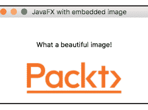

目前支持的图像格式有 BMP、GIF、JPEG 和 PNG。查阅 `Image` 和 `ImageView` 类的 API（https://openjfx.io/javadoc/11/javafx.graphics/javafx/scene/image/package-summary.html）来学习如何根据需要格式化和调整图像。

现在让我们看看如何在 JavaFX 应用中使用媒体文件。播放音频或电影文件需要“添加 HTML”部分列出的 `--add-exports` VM 选项。

目前支持的扩展名如下：

- **AAC**：音频编码压缩
- **H.264/AVC**：H.264/MPEG-4 Part 10 / AVC（高级视频编码）压缩
- **MP3**：原始 MPEG-1、2 和 2.5 音频；I、II 和 III 层
- **PCM**：未压缩的原始音频样本

你可以在 API 文档（https://openjfx.io/javadoc/11/javafx.media/package-summary.html）中看到支持的协议、媒体容器和标记标签的详细描述。

这三个类允许构建可以添加到场景的媒体器：

- `javafx.scene.media.Media`
- `javafx.scene.media.MediaPlayer`
- `javafx.scene.media.MediaView`

`Media` 类表示媒体源。`MediaPlayer` 类提供了控制媒体播放的方法：`play()`、`stop()`、`pause()` 等。你还可以指定媒体播放的次数。`MediaView` 类扩展了 `Node` 类并可以添加到场景中。它提供由媒体播放器播放的媒体视图。

为了演示，让我们向应用添加另一个位于资源文件夹的 `jb.mp3` 文件：

```java
Text txt1 = new Text("What a music!");
Text txt2 = new Text("If you don't hear music, turn up the volume.");

File f = new File("src/main/resources/jb.mp3");
Media m = new Media(f.toURI().toString());
MediaPlayer mp = new MediaPlayer(m);
MediaView mv = new MediaView(mp);

VBox vb = new VBox(txt1, txt2, mv);
vb.setSpacing(20);
vb.setAlignment(Pos.CENTER);
vb.setPadding(new Insets(10, 10, 10, 10));

Scene scene = new Scene(vb, 350, 200);
primaryStage.setScene(scene);
primaryStage.setTitle("JavaFX with Media");
primaryStage.setOnCloseRequest(e -> System.out.println("Bye! See you later!"));
primaryStage.show();
```


# Java GUI 编程
## 第 12 章

### 历史记录提取

对于每条历史记录，我们可以提取它的 URL、标题或最后访问日期：

```java
WebHistory history = getHistory();
ObservableList<WebHistory.Entry> entries = history.getEntries();

for (WebHistory.Entry entry : entries) {
    String url = entry.getUrl();
    String title = entry.getTitle();
    Date date = entry.getLastVisitedDate();
}
```

阅读 `WebView` 和 `WebEngine` 类文档，获取更多如何利用它们功能的想法。

### 播放媒体

在 JavaFX 应用中添加图像场景不需要 `com.sun.*` 包，因此不需要“添加 HTML”部分列出的 `--add-export` VM 选项。但无论如何拥有它们也没有坏处，所以如果你已经添加了，请保留它们。

可以使用 `javafx.scene.image.Image` 和 `javafx.scene.image.ImageView` 类在场景中包含图像。为了演示如何操作，我们将使用资源文件夹中的 Packt `pack.png`。以下是实现该操作的代码：

```java
Text txt = new Text("What a beautiful image!");
FileInputStream inputStream = new FileInputStream("src/main/resources/pack.png");
Image image = new Image(inputStream);
ImageView iv = new ImageView(image);
VBox vb = new VBox(txt, iv);
vb.setAlignment(Pos.CENTER);
vb.setPadding(new Insets(10, 10, 10, 10));
Scene scene = new Scene(vb, 300, 200);
primaryStage.setScene(scene);
primaryStage.setTitle("JavaFX with embedded HTML");
primaryStage.onCloseRequestProperty()
    .setValue(e -> System.out.println("Bye! See you later!"));
primaryStage.show();
```

如果我们运行前面的代码，结果如下：


目前支持的图像格式有 BMP、GIF、JPEG 和 PNG。查阅 `Image` 和 `ImageView` 类的 API（https://openjfx.io/javadoc/11/javafx.graphics/javafx/scene/image/package-summary.html）来学习如何根据需要格式化和调整图像。

现在让我们看看如何在 JavaFX 应用中使用媒体文件。播放音频或电影文件需要“添加 HTML”部分列出的 `--add-export` VM 选项。

目前支持的扩展名如下：

- **AAC**：音频编码压缩
- **H.264/AVC**：H.264/MPEG-4 Part 10 / AVC（高级视频编码）压缩
- **MP3**：原始 MPEG-1、2 和 2.5 音频；I、II 和 III 层
- **PCM**：未压缩的原始音频样本

你可以在 API 文档（https://openjfx.io/javadoc/11/javafx.media/package-summary.html）中看到支持的协议、媒体容器和标记标签的详细描述。

这三个类允许构建可以添加到场景的媒体器：

- `javafx.scene.media.Media`
- `javafx.scene.media.MediaPlayer`
- `javafx.scene.media.MediaView`

`Media` 类表示媒体源。`MediaPlayer` 类提供了控制媒体播放的方法：`play()`、`stop()`、`pause()` 等。你还可以指定媒体应该播放的次数。`MediaView` 类扩展了 `Node` 类并可以添加到场景中。它提供由媒体器播放的媒体视图，负责媒体的外观。

一个 `sea.mp4` 电影文件可以类似地播放：

```java
Text txt = new Text("What a beautiful movie!");
File f = new File("src/main/resources/sea.mp4");
Media m = new Media(f.toURI().toString());
MediaPlayer mp = new MediaPlayer(m);
MediaView mv = new MediaView(mp);

VBox vb = new VBox(txt, mv);
vb.setSpacing(20);
vb.setAlignment(Pos.CENTER);
vb.setPadding(new Insets(10, 10, 10, 10));

Scene scene = new Scene(vb, 650, 400);
primaryStage.setScene(scene);
primaryStage.setTitle("JavaFX with embedded HTML");
primaryStage.setOnCloseRequest(e -> System.out.println("Bye! See you later!"));
primaryStage.show();

mp.play();
```

唯一的区别是显示此特定片段完整帧需要不同的场景尺寸。我们在多次尝试调整后确定了必要的尺寸。或者，我们可以使用 `MediaView` 方法 `autosize()`、`preserveRatioProperty()`、`fitHeight()`、`setFixedWidth()`、`fitWidthProperty()`、`fitHeightProperty()` 等类似方法来调整嵌入窗口的大小并自动匹配场景尺寸。如果我们执行前面的示例，将弹出以下窗口：


### 并行播放音频和视频

我们甚至可以并行播放音频和视频文件，并提供一个带配轨的电影：

```java
Text txt1 = new Text("What a beautiful movie and sound!");
Text txt2 = new Text("If you don't hear music, turn up the volume.");

File fs = new File("src/main/resources/jb.mp3");
Media ms = new Media(fs.toURI().toString());
MediaPlayer mps = new MediaPlayer(ms);
MediaView mvs = new MediaView(mps);

File fv = new File("src/main/resources/sea.mp4");
Media mv = new Media(fv.toURI().toString());
MediaPlayer mpv = new MediaPlayer(mv);
MediaView mvv = new MediaView(mpv);

VBox vb = new VBox(txt1, txt2, mvs, mvv);
vb.setSpacing(20);
vb.setAlignment(Pos.CENTER);
vb.setPadding(new Insets(10, 10, 10, 10));

Scene scene = new Scene(vb, 650, 500);
primaryStage.setScene(scene);
primaryStage.setTitle("JavaFX with embedded media player");
primaryStage.setOnCloseRequest(e -> System.out.println("Bye! See you later!"));
primaryStage.show();

mpv.play();
mps.play();
```

这是可以实现的，因为每个播放器都由自己的线程执行。

有关 `javafx.scene.media` 包的更多信息，请阅读在线 API 和开发者指南：

- https://openjfx.io/javadoc/javafx/media/javafx/scene/media/package-summary.html
- https://docs.oracle.com/javafx/2/jfxpub-media-htm.htm

### 添加效果

`javafx.scene.effect` 包包含许多类，允许在节点上添加各种效果：

- **Blend（混合）**：使用预定义的 `BlendMode` 之一合并来自两个源（通常是图像）的像素
- **Bloom（发光）**：使输入图像更亮，使其看起来在发光
- **BoxBlur（矩形模糊）**：为图像添加模糊
- **ColorAdjust（颜色调整）**：允许对图像的色调、饱和度、亮度和对比度进行调整
- **ColorInput（颜色输入）**：渲染填充给定 `Paint` 的矩形区域
- **DisplacementMap（位移映射）**：按指定的距离移动每个像素
- **DropShadow（外投影）**：在内容后渲染给定内容的阴影
- **GaussianBlur（高斯模糊）**：使用特定的（高斯）方法添加模糊
- **Glow（光辉）**：使输入图像看起来在发光
- **InnerShadow（内阴影）**：在框内创建阴影
- **Lighting（光照）**：模拟光源照射在内容上；使扁平物体看起来更真实
- **MotionBlur（运动模糊）**：模拟运动状态下的给定内容
- **PerspectiveTransform（透视变换）**：按照透视角度转换内容
- **Reflection（反射）**：在实际内容下方渲染输入内容的反射版本
- **SepiaTone（褐色调）**：产生褐色调，类似于旧照片的外观
- **Shadow（阴影）**：创建一个带有模糊边缘的单色副本

所有效果共用父类——抽象类 `Effect`。`Node` 类具有 `setEffect(Effect e)` 方法，这意味着任何效果都可以添加到任何节点上。而这就是将效果应用于节点的主要方法——即那些在舞台上产生场景的演员（如果我们还记得在本章开头介绍的那个类比的话）。

### Blend 效果详解

唯一的例外是 `Blend` 效果，它的用法比其他效果更复杂。除了使用 `setEffect(Effect e)` 方法外，某些 `Node` 类的子类还拥有 `setBlendMode(BlendMode bm)` 方法，该方法允许调节图像在重叠时相互混合的方式。因此，可能会以不同的方式设置不同的混合效果，从而覆盖其中一个并产生难以调试的意外结果。这使得 `Blend` 效果的使用变得更加复杂，这也是为什么我们把如何使用 `Blend` 效果放在概述的开始。

有四个方面调节两个图像重叠区域的外观（在示例中我们使用两个图像使其更简单，但在实践中，许多图像可以重叠）：

1.  **透明度（opacity）属性的值**：它定义了透过图像可以看到多少内容；透明度值 `0.0` 表示图像完全透明，而透明度值 `1.0` 表示看不到其后面的任何内容。
2.  **每个颜色的 alpha 值和强度**：它定义了颜色的透明度，范围为 `0.0-1.0` 或 `0-255` 之间的双精度值。
3.  **由枚举 `BlendMode` 值定义的混合模式**：根据模式、透明度和每个颜色的 alpha 值，混合结果可能还取决于图像添加到场景的顺序；第一个添加的图像称为底部输入（bottom input），而重叠图像中的第二个称为顶部输入（top input）；如果顶部输入完全不透明，则底部输入会被顶部输入隐藏。

重叠区域的最终外观是根据透明度、颜色的 alpha 值、颜色的数值（强度）以及混合模式计算的，模式可以是以下之一：

- **ADD**：将顶部输入的颜色和 alpha 分量加到底输入分量上
- **BLUE**：将底部的蓝色分量替换为顶部的蓝色分量
- **COLOR_BURN**：将顶部的颜色和 alpha 分量加到底部的分量上
- **COLOR_DODGE**：将顶部的颜色和 alpha 分量加到底部的分量上
- **DARKEN**：将顶部的颜色和 alpha 分量加到底部的分量上
- **DIFFERENCE**：将顶部的颜色和 alpha 分量加到底部的分量上
- **EXCLUSION**：将顶部的颜色和 alpha 分量加到底部的分量上
- **GREEN**：将底部的绿色分量替换为顶部的绿色分量
- **HARD_LIGHT**：将顶部的颜色和 alpha 分量加到底部的分量上
- **LIGHTEN**：将顶部的颜色和 alpha 分量加到底部的分量上
- **MULTIPLY**：将顶部的颜色和 alpha 分量乘到底部的分量上
- **OVERLAY**：将顶部的颜色和 alpha 分量加到底部的分量上
- **RED**：将底部的红色分量替换为顶部的红色分量
- **SCREEN**：将顶部的颜色和 alpha 分量加到底部的分量上
- **SRC_ATOP**：将顶部的颜色和 alpha 分量加到底部的分量上
- **SRC_OVER**：将顶部的颜色和 alpha 分量加到底部的分量上
- **SOFT_LIGHT**：将顶部的颜色和 alpha 分量加到底部的分量上

对于每种模式，我们都创建了两组：一组是圆在正方形之上的输入，另一组是正方形在圆之上的输入，并将创建的四个组放入一个 `GridPane` 中（详细请参见源代码）。如果我们运行 `BlendEffect` 应用，结果将如下：

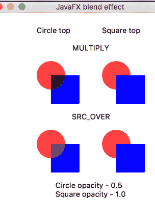

如预期的，当正方形在上方时（右侧的两张图像），重叠区域完全被不透明的正方形占据。但当圆是上方输入时（左侧的两张图像），重叠区域在某种程度上可见，并根据混合效果计算。

然而，如果我们直接在组（`Group`）上运行相同的模式，结果将略有不同。让我们运行相同的代码，但将方法设置为组上：

```java
Node c = createCircle();
Node s = createSquare();
Node g = new Group(c, s);
g.setBlendMode(BlendMode.MULTIPLY);
```

如果我们再次运行该应用，结果如下：

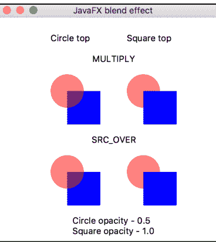

如你所示，圆的红色发生了微变化，且 `MULTIPLY` 模式和 `SRC_OVER` 模式之间没有区别。这就是我们在章节开头提到的向场景中添加节点的顺序引起的问题。

结果还取决于设置了哪种节点效果。例如，我们不是在组上设置效果，而是只在圆上设置混合效果：

```java
Blend blnd = new Blend();
blnd.setMode(BlendMode.MULTIPLY);
Node c = createCircle();
Node s = createSquare();
c.setEffect(blnd);
Node g = new Group(s, c);
```

我们运行应用并看到以下结果：

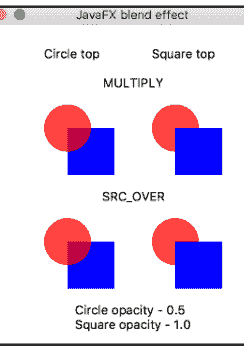

右侧的两张图像与之前的所有示例相同，但左侧的两张图像显示了重叠区域的新颜色。现在我们在正方形上设置相同的混合效果，而不是圆：

```java
Blend blnd = new Blend();
blnd.setMode(BlendMode.MULTIPLY);
Node c = createCircle();
Node s = createSquare();
s.setEffect(blnd);
Node g = new Group(s, c);
```

结果将再次发生微变化，并如下方的截图所示：

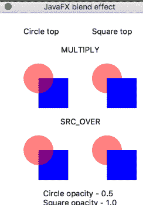

`MULTIPLY` 和 `SRC_OVER` 模式之间没有区别，但红色与我们在圆上设置效果时不同。

我们可以再次更改方法，使用以下代码直接在圆上设置混合模式：

```java
Node c = createCircle();
Node s = createSquare();
c.setBlendMode(BlendMode.MULTIPLY);
```

结果再次发生变化：

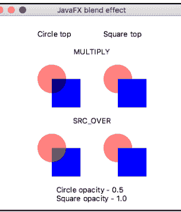

仅在正方形上设置混合模式再次消除了 `MULTIPLY` 和 `SRC_OVER` 模式之间的差异：

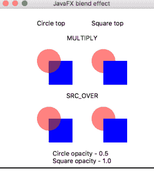


# Java GUI 编程

## 第 12 章

为了避免混乱并使混合结果更容易预测，你必须注意节点添加到场景的顺序以及应用混合效果方式的一致性。

在书中提供的源代码中，你会找到 `javafx.scene.effects` 包中包含的所有效果。它们都通过并排对比来演示。这里是一个示例：

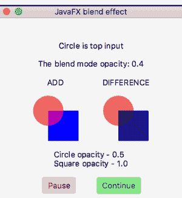

为了方便起见，提供了 `Pause`（暂停）和 `Continue`（继续）按钮，允许你暂停演示并查看混合效果设置的不同不透明度值的结果。

为了演示所有效果，我们创建了另一个名为 `OtherEffects` 的应用，它也不需要 `com.sun.*` 包，但 `--add-export` VM 选项需要。演示的效果包括 `Bloom`、`BoxBlur`、`ColorAdjust`、`DropShadow`、`Glow`、`InnerShadow`、`Lighting`、`MotionBlur`、`PerspectiveTransform`、`Reflection`、`ShadowTone` 和 `SepiaTone`。我们使用了两个图像来展示应用所有效果的结果：Packt Logo 和一个山湖：

```java
FileInputStream inputP =
    new FileInputStream("src/main/resources/packt.png");
Image imageP = new Image(inputP);
ImageView ivP = new ImageView(inputP);
```

```java
FileInputStream inputM =
    new FileInputStream("src/main/resources/mount.jpeg");
Image imageM = new Image(inputM);
ImageView ivM = new ImageView(inputM);
```

```java
double h = Math.round((-1.0 + d * 2) * 10.0) / 10.0; // 0.6
txt.setText(effect + ": " + h);
ColorAdjust cal = new ColorAdjust();
cal.setHue(h);
```

### JavaFX 效果演示

**ColorAdjust.saturation: 0.6**


## 第 12 章（续）

```java
double st = Math.round((-1.0 + d * 10.0) / 10.0); // 0.6
txt.setText(effect + " : " + st);
ColorAdjust ca3 = new ColorAdjust();
ca3.setSaturation(st);
```


## 第 12 章（续）

```java
int w = (int)Math.round(4096 * d); // 819
int h1 = (int)Math.round(4096 * d); // 819
txt.setText(effect + ": width: " + w + ", height: " + h1);
DisplacementMap dm = new DisplacementMap();
FloatMap floatMap = new FloatMap();
floatMap.setHeight(h1);
floatMap.setW(w);
for (int k = 0; k < w; k++) {
    double v = (Math.sin(k / 20.0 * Math.PI) - 0.5) / 40.0;
    for (int j = 0; j < h1; j++) {
        floatMap.setSamples(k, j, 0.0f, (float) v);
    }
}
dm.setMap(floatMap);
```


## 第 12 章（续）

```java
double rd = Math.round((127.0 * d) * 10.0) / 10.0; // 127.0
System.out.println(effect + " : " + rd);
txt.setText(effect + " : " + rd);
DropShadow sh = new DropShadow();
sh.setRadius(rd);
```

### JavaFX 效果演示

**InnerShadow: radius: 9.7, offset:12.0**


暂停 继续

## 第 12 章（续）

```java
double rad = Math.round(12.1 * d * 10.0)/10.0; // 9.7
double off = Math.round(15.0 * d * 10.0)/10.0; // 12.0
txt.setText("InnerShadow: radius: " + rad + ", offset: " + off);
InnerShadow is = new InnerShadow();
is.setColor(Color.web("0x3b596d"));
is.setOffsetX(off);
is.setOffsetY(off);
is.setRadius(rad);
```


## 第 12 章（续）

```java
double sS = Math.round(d * 4)*10.0/10.0; // 0.4
txt.setText(effect + " : " + sS);
Spotlight lightSs = new Spotlight();
lightSs.setX(150);
lightSs.setY(100);
lightSs.setZ(80);
lightSs.setPointsAtX(0);
lightSs.setPointsAtY(0);
lightSs.setPointsAtZ(-50);
lightSs.setSpecularExponent(ss);
Lighting lSs = new Lighting();
lSs.setLight(lightSs);
lSs.setSurfaceScale(0.0);
```


## 第 12 章（续）

```java
double r = Math.round((63.0 * d)*10.0) / 10.0; // 31.5
txt.setText(effect + ": " + r);
MotionBlur mb1 = new MotionBlur();
mb1.setRadius(r);
mb1.setAngle(-15);
```

### JavaFX 效果演示

**PerspectiveTransform: 0.9**


## 第 12 章（续）

```java
double d = 0.9;
txt.setText(effect + " : " + d);
PerspectiveTransform pt = new PerspectiveTransform();
pt.setFxShe(d); // 注意：根据常见的 JavaFX API 推断的方法名
```


## 第 12 章（续）

```java
double d = 0.6;
txt.setText(effect + " : " + d);
Reflection ref = new Reflection();
ref.setAmount(d);
```


```java
double d = 1.0;
txt.setText(effect + " : " + d);
SepiaTone sep = new SepiaTone();
sep.setAmount(d);
```

本演示的完整源代码已随书提供，并在 GitHub 上可用。

## 第 12 章

## 总结

在本章中，读者了解了 JavaFX 工具包、其主要功能以及如何使用它创建 GUI 应用程序。涵盖的主题包括 JavaFX 控件概述、使用 CSS 和 FXML、嵌入媒体以及添加效果。

下一章专门介绍函数式编程。它提供了 JDK 中函数式接口的概述，解释了什么是 Lambda 表达式，以及如何使用函数式接口。它还演示了如何使用方法引用。

## 测验

1. JavaFX 中的顶层容器是什么？
2. JavaFX 中所有场景参与者的基类是什么？
3. 写出 JavaFX Application 的基类名称。
4. JavaFX Application 有哪个方法是必须实现的？
5. 哪一个 Application 方法 必须由 `main` 方法调用以执行 JavaFX 应用程序？
6. 执行 JavaFX 应用程序需要哪两个选项？
7. 使用右上角的按钮关闭 JavaFX 窗口时，会调用哪个 Application 方法？
8. 必须使用哪个类来嵌入 FXML？
9. 写出三个播放媒体时必须使用的类。
10. 播放媒体需要哪些类？

# 效果

## 第 3 部分：高级

本节带读者进入函数式编程的世界。它解释了什么是函数式接口，提供了函数式接口的概述，并演示了如何使用 Lambda 表达式和方法引用来使用函数式接口。

读者将了解到 Java 的异步、非阻塞和响应式特性，并如何利用这些特性。

该部分包含以下章节：

- 第 13 章，函数式编程
- 第 14 章，标准流
- 第 15 章，响应式编程
- 第 16 章，微服务
- 第 17 章，Java 基准测试框架
- 第 18 章，高质量代码的最佳实践
- 第 19 章，Java 新特性

# 函数式编程

## 第 13 章

```java
resp.statusCode() + " : " + resp.body())

} catch (Exception ex) {
    ex.printStackTrace();
}
```

`BodyHandler`（对象）是由 `BodyHandlers.<String>` 工厂方法生成的，并作为参数传递给 `send()` 方法。在方法内部，代码调用了它的 `apply()` 方法：

```java
BodySubscriber<T> apply(ResponseInfo responseInfo)
```

最后，在第 12 章 Java GUI 编程中，我们在下面的代码段中使用了 `EventHandler` 函数作为参数：

```java
btn.setOnAction(e -> {
    System.out.println("Bye! See you later!");
    Platform.exit();
});

primaryStage.onCloseRequestProperty()
    .setValue(e -> System.out.println("Bye! See you later!"));
```

第一个函数是 `EventHandler<ActionEvent>`。它打印一条消息并强制应用程序退出。第二个是 `EventHandler<WindowEvent>` 函数。它只是打印消息。

所有的示例都让你很好地了解了如何构造函数并将其作为参数传递。这种能力构成了函数式编程。它存在于许多编程语言中。它不需要管理对象状态。函数是无状态的。它的结果仅取决于输入数据，无论被调用多少次。这种编码使得结果更具预测性，这是函数式编程最吸引人的方面。

这种设计受益最深的领域是并行数据处理。函数式编程允许将并行性的责任从客户端代码转移到库。在此之前，为了处理集合中的元素，客户端代码必须遍历集合并组织处理。在 Java 8 中，添加了新的（默认）方法，接受函数作为参数，然后将其应用于集合的每个元素，是否并行取决于内部处理算法。因此，组织并行处理是库的责任。

## 什么是函数式接口？

当我们定义一个函数时，我们实际上是提供了一个只有一个抽象方法的接口实现。Java 编译器通过这种方式知道将提供的功能放在哪里。编译器查看接口（前面的示例中的 `Consumer`、`Predicate`、`Comparator`、`IntFunction`、`UnaryOperator`、`BiFunction`、`BodyHandler` 和 `EventHandler`），发现其中只有一个抽象方法，并将传入的功能作为方法的实现。唯一的要求是传入的参数要与方法签名匹配。否则，将产生编译时错误。

这就是为什么任何只有一个抽象方法的接口都被称为函数式接口。请注意，只有一个抽象方法的要求也包括从父接口继承的方法。例如，考虑以下接口：

```java
@FunctionalInterface
interface A {
    void method1();
    default void method2() {}
    static void method3() {}
}
```

```java
@FunctionalInterface
interface B extends A {
    default void method4() {}
}
```

```java
@FunctionalInterface
interface C extends B {
    void method1();
}
```

```java
// @FunctionalInterface
interface D extends C {
    void method5();
}
```

A 是一个函数式接口，因为它只有一个抽象方法 `method1()`。B 也是函数式接口，因为它只有一个抽象方法——即从接口 A 继承的同一个方法 `method1()`。C 是函数式接口，因为它只有一个抽象方法 `method1()`，该方法重写了父接口 A 的抽象方法 `method1()`。接口 D 不可能是一个函数式接口，因为它有两个抽象方法——来自父接口 A 的 `method1()` 和 `method5()`。

## 第 13 章（续）

为了帮助避免运行时错误，`@FunctionalInterface` 注解在 Java 8 中引入。它告诉编译器意图，以便编译器可以检查并查看带标记的接口是否真的只有一个抽象方法。该注解还会提醒阅读代码的程序员，此接口特意只有一个抽象方法。否则，程序员可能会浪费时间向接口中添加另一个抽象方法，结果却发现无法无法添加。

出于相同的原因，自 Java 早期版本以来就存在的 `Runnable` 和 `Callable` 接口在 Java 8 中被标记为 `@FunctionalInterface`。这种区别被显式地标出来，并提醒用户这些接口可以用于创建函数：

```java
@FunctionalInterface
interface Runnable {
  void run();
}

@FunctionalInterface
interface Callable<V> {
  V call() throws Exception;
}
```

与任何其他接口一样，函数式接口可以使用匿名类来实现：

```java
Runnable runnable = new Runnable() {
  @Override
  public void run() {
    System.out.println("Hello!");
  }
}
```

以这种方式创建的对象稍后可以如下使用：

```java
runnable.run(); // 输出: Hello!
```

如果我们仔细观察前面的代码，会注意到存在不必要的开销。首先，没有必要重复接口名称，因为我们已经将其声明为对象引用的类型。其次，对于只有一个抽象方法的函数式接口，没有必要指定要实现的方法名。编译器和 Java 运行环境可以判断出来。我们只需要提供新功能。Lambda 表达式的引入正是为了这个目的。

## 什么是 Lambda 表达式？

Lambda 术语来自 Lambda 演算法——这是一种通用的计算模型，可以用于模拟任何图灵机。它由数学家 Alonzo Church 在 20 世纪 30 年代引入。Lambda 表达式是一个函数，在 Java 中实现为匿名方法。它还允许省略修饰符、返回值和参数类型。这使得符号紧凑。

Lambda 表达式的语法包括参数列表、箭头标记 (`->`) 和体。参数列表可以是空的（例如 `()`），不带括号（如果只有一个参数），或者用括号括起来逗号分隔的参数列表。体可以是单个表达式或大括号 (`{}`) 内部的语句块。让我们来看几个例子：

- `() -> 42;` 返回 42。
- `x -> x*42 + 42;` 将 x 值乘以 42，然后将结果上加上 42 并返回。
- `(x, y) -> ...;` 乘以传入的值并返回结果。
- `s -> "abc".equals(s);` 比较变量 s 的值和字面量 "abc"；它返回一个布尔结果值。
- `s -> System.out.println("x=" + s);` 带有前缀 "x=" 输出 s 值。


- `(i, s) -> { i++; System.out.println(s + " = " + i); };` 增加输入的整数，并返回带有 `s + "="` 前缀的值，`s` 是第二个参数。

通过函数式编程，传递某些功能作为参数的唯一方法是编写一个类并创建它的对象。但即使是匿名类的代码也太繁琐了。例如，Lambda 表达式允许我们如下重新实现之前的 `Runnable` 接口示例：

```
Runnable runnable = () -> System.out.println("Hello!");
```

# 函数式编程

## 第 13 章

如所见，创建一个函数式接口很容易，特别是使用 Lambda 表达式时。但在那之前，考虑使用 `java.util.function` 包提供的标准函数式接口。这不会让你写更少代码，但有助于熟悉标准接口的程序员更好地理解你的代码。

## Lambda 参数的局部变量语法

在 11 发布之前，声明参数类型有两种：显式和隐式。这里是显式版本：

```
BiFunction<Double, Integer, Double> f = (Double x, Integer y) -> x / y;
System.out.println(f.apply(3, 2)); // 输出: 1.5
```

以下是隐式参数类型声明：

```
BiFunction<Double, Integer, Double> f = (x, y) -> x / y;
System.out.println(f.apply(3, 2)); // 输出: 1.5
```

在前面的代码中，编译器从接口定义中推导出类型。

在 Java 11 中，引入了另一种参数类型声明方法，使用类型持有 `var`，它与 Java 10 引入的局部变量持有 `var` 类似（见第 1 章，开始使用 Java 12）。

以下声明在语法上与 Java 11 之前的隐式声明完全一致：

```
BiFunction<Double, Integer, Double> f = (var x, var y) -> x / y;
System.out.println(f.apply(3, 2)); // 输出: 1.5
```

局部变量样式语法允许我们在不显式定义参数类型的情况下添加注解。让我们在 `pom.xml` 文件中添加依赖项：

```
<dependency>
  <groupId>org.jetbrains</groupId>
  <artifactId>annotations</artifactId>
  <version>16.0.2</version>
</dependency>
```

它允许我们将传入的变量定义为非空：

```java
import javax.validation.constraints.NotNull;
import java.util.function.BiFunction;
import java.util.function.Consumer;
```

```java
BiFunction<Double, Integer, Double> f =
    (@NotNull var x, @NotNull var y) -> x / y;
System.out.println(f.apply(3,2)); // 输出: 1.5
```

注解向编译器传达程序员的意图，并在声明的意图被违反时，可以在编译或执行期间警告程序员。例如，我们曾尝试运行以下代码：

```java
BiFunction<Double, Integer, Double> f = (x, y) -> x / y;
System.out.println(f.apply(null, 2));
```

它在运行时因 `NullPointerException` 失败了。然后我们按照如下方式添加了注解：

```java
BiFunction<Double, Integer, Double> f =
    (@NotNull var x, @NotNull var y) -> x / y;
System.out.println(f.apply(null, 2));
```

运行上述代码的结果如下：

```
Exception in thread "main" java.lang.IllegalArgumentException:
Argument for @NotNull parameter 'x' of
.com/packt/learnjava/ch13_functional/LambdaExpressions
.lambda$localVariablesSyntax1 must not be null
at com.packt.learnjava.ch13_functional.LambdaExpressions
$$$reportNull$$$ (LambdaExpressions.java)
at com.packt.learnjava.ch13_functional.LambdaExpressions
.lambda$localVariablesSyntax1(LambdaExpressions.java:59)
at com.packt.learnjava.ch13_functional.LambdaExpressions
.localVariableSyntax1(LambdaExpressions.java:12)
at com.packt.learnjava.ch13_functional.LambdaExpressions
.main(LambdaExpressions.java:12)
```

该 lambda 表达式从未被执行。

当参数是名称非常长的类的对象且使用注解时，lambda 参数中局部变量语法的优势就显而易见了。在 Java 11 之前，代码可能看起来如下所示：

```java
BiFunction<SomeReallyLongClassName,
AnotherReallyLongClassName, Double> f =
    (@NotNull SomeReallyLongClassName x,
    @NotNull AnotherReallyLongClassName y) -> x.doSomething(y);
```

由于我们需要添加注解，必须显式声明变量类型，以下隐式版本将无法编译：

```java
BiFunction<SomeReallyLongClassName,
AnotherReallyLongClassName, Double> f =
    (@NotNull x, @NotNull y) -> x.doSomething(y);
```

在 Java 11 中，新语法允许我们通过变量 `var` 的类型使用隐式参数类型推断：

```java
BiFunction<SomeReallyLongClassName,
AnotherReallyLongClassName, Double> f =
    (@NotNull var x, @NotNull var y) -> x.doSomething(y);
```

这就是为 lambda 参数声明引入局部变量语法的优势和动机。反之，请考虑避免使用 `var`。如果变量类型很短，使用其实际类型会让代码更易理解。

## 标准函数式接口

`java.util.function` 包中提供的大多数接口都是以下四个接口的特化：`Consumer<T>`、`Predicate<T>`、`Supplier<T>` 和 `Function<T, R>`。让我们复习它们，并对其他 39 个标准函数式接口进行简单概述。

### Consumer<T>

通过查看 `Consumer<T>` 接口定义，你可以猜出该接口有一个接受类型为 T 的参数且不返回任何内容的抽象方法。嗯，当只列出一个类型时，也许定义返回值类型，就像 `Supplier<T>` 接口那样。接口名称提供了提示：消费者（Consumer）的方法接收值，而供应者（Supplier）返回值。这个说法并不精确，但有助于记忆。

关于任何函数式接口的最佳信息来源是 java.util 包的 API 文档（https://docs.oracle.com/en/java/javase/12/docs/api/java.base/util/function/package-summary.html）。如果我们阅读它，`Consumer<T>` 接口有一个抽象和一个默认方法：

- `void accept(T t)`：对给定的参数执行操作
- `default Consumer<T> andThen(Consumer<T> after)`：返回按顺序执行当前操作，后执行指定的操作的组合消费者函数

这意味着，例如，我们可以如下所示实现并执行它：

```java
Consumer<String> printResult = s -> System.out.println("Result: " + s);
printResult.accept("10.0"); // 输出: Result: 10.0
```

我们还有一个创建该函数的工厂方法，例如：

```java
Consumer<String> withPrefixAndPostfix(String pref, String postf){
  return s -> System.out.println(pref + s + postf);
}
```

现在我们可以这样使用它：

```java
printPrefixAndPostfix("Result: " + "Great!").accept("10.0");
// 输出: Result: 10.0Great!
```

为了演示 `andThen()` 方法，让我们创建这个类：

```java
public class Person {
  private int age;
  private String lastName;

  public Person(int age, String lastName) {
    this.age = age;
    this.lastName = lastName;
  }

  public int getAge() {
    return age;
  }

  public String getLastName() {
    return lastName;
  }
}
```

```java
Person nick = new Person(42, "Nick", "Samoylov");
Predicate<Person> isItNick = Predicate.isEqualTo(nick);
Person john = new Person(42, "John", "Smith");
Person person = new Person(42, "Nick", "Samoylov");
System.out.println(isItNick.test(john)); // prints false
System.out.println(isItNick.test(person)); // prints true
```

如示例所示，谓词对象可以链成更复杂的逻辑语句，并包含所有必要的外部数据。

### Supplier<T>

这个函数式接口 `Supplier<T>` 只有一个抽象方法 `T get()`，它返回一个值。基本用法如下所示：

```
Supplier<Integer> supply42 = () -> 42;
System.out.println(supply42.get()); // prints: 42
```

它可以与后续章节中讨论的函数链联：

```
int input = 7;
int limit = 10;
Supplier<Integer> supply7 = () -> input;
Predicate<Integer> isLessThan10 = i -> i < limit;
Consumer<String> printResult = " smaller than " + limit + ", Great!";
printResult.accept(String.valueOf(isLessThan10.test(supply7.get()))); // prints: Is 7 smaller than 10? Great!
```

`Supplier<T>` 函数通常用作进入处理流水线的数据入口点。

### Function<T, R>

这种以及其他返回值的函数式接口的表示法，将返回类型列在泛型列表的最后（在本例中为 `R`），在它前面是输入数据的类型（类型为 `T` 的输入参数），这意味着该接口的抽象方法接受一个类型为 `T` 的参数并产生类型为 `R` 的结果。让我们查看在线文档（https://docs.oracle.com/en/java/javase/12/docs/api/java.base/java/util/function/Function.html）。

`Function<T, R>` 接口有一个抽象方法 `R apply(T)`，以及两个用于操作链式的方法：

- `default <V> Function<T, V> andThen(Function<R, V> after)`: 返回一个组合函数，它首先将当前函数应用于其输入，然后将 `after` 函数应用到结果上。
- `default <V> Function<V, R> compose(Function<V, T> before)`: 返回一个组合函数，它首先将 `before` 函数应用于其输入，然后将当前函数应用到结果上。

还有一个 `identity()` 方法：

- `static <T> Function<T, T> identity()`: 返回一个始终返回其参数的函数

让我们回顾所有这些方法以及如何使用它们。这里是 `Function<T, R>` 接口的基本用用示例：

```
Function<Integer, Double> multiplyByTen = i -> i * 10.0;
System.out.println(multiplyByTen.apply(i)); // prints: 10.0
```

我们还可以将其与后续章节中讨论的所有函数链联：

```
Supplier<Integer> supply7 = () -> 7;
Function<Integer, Double> multiplyByFive = i -> i * 5.0;
Consumer<String> printResult =
    printWithPrefixAndPostfix("Result: ", " Great!");
printResult.accept(multiplyByFive.apply(supply7.get().toString())); // Result: 35.0 Great!
```

`andThen()` 和 `apply()` 方法允许从简单的函数构建复杂的函数。请注意以下代码中的 `divideTwo.andThen()` 行：

```
Function<Double, Long> divideByTwo =
    d -> Double.valueOf(d / 2).longValue();
Function<Long, String> incrementAndCreateString =
    l -> String.valueOf(l + 1);
Function<Double, String> divideByTwoAndCreateString =
    divideByTwo.andThen(incrementAndCreateString);
System.out.println(divideByTwoAndCreateString.apply(4.0));
```

它描述了应用于输入的操作序列。注意 `divideTwo` 的返回类型匹配 `incrementAndCreateString` 函数的输入类型。

`compose()` 方法以反序实现相同的结果：

```
Function<Double, String> divideByTwoAndCreateString =
    incrementAndCreateString.compose(divideByTwo);
System.out.println(divideByTwoAndCreateString.apply(4.0));
    //Result: 3 Great!
```

现在复合函数的组合顺序不匹配执行顺序。在 `divideTwo()` 函数尚未创建且你想在行内创建它的情况下，这种方法非常方便。以下构造将无法编译：

```
Function<Double, String> divideByTwoAndCreateString =
    (d -> Double.valueOf(d / 2).longValue())
    .then(incrementAndCreateString);
```

以下行将编译：

```
Function<Double, String> divideByTwoAndCreateString =
    incrementAndCreateString
    .compose(d -> Double.valueOf(d / 2).longValue());
```

它在构建函数式流水线时提供了更大的灵活性，可以在创建后续操作时不会破坏代码。`identity()` 方法在你需要一个匹配要求但不执行任何操作函数时非常有用。它只能替换与其输入类型相同的函数。例如：

```
Function<Double, Double> multiplyByTwo = d -> d * 2.0;
System.out.println(multiplyByTwo.apply(2.0)); // prints: 4.0
```


# 泛式编程第13章

```java
multiplyByTwo = Function.identity();
System.out.println(multiplyByTwo.apply(2.0)); // prints: 2.0
```

为了演示它的用法，假设我们如下流水线：

```java
Function<Double, Double> multiplyByTwo = d -> d * 2.0;
System.out.println(multiplyByTwo.apply(2.0)); // prints: 4.0
```

```java
Function<Double, Long> subtract7 = d -> Math.round(d - 7);
System.out.println(subtract7.apply(11.0)); // prints: 4
```

```java
long r = multiplyByTwo.andThen(subtract7).apply(2.0);
System.out.println(r); // prints: -3
```

然后我们决定在某些情况下 `multiplyByTwo()` 函数不执行任何操作。我们可以为它添加一个关闭它的条件判断。但如果我们想保持函数完整，或者该函数是从第三方代码传递给我们的，我们可以这样做：

```java
Function<Double, Double> multiplyByTwo = d -> d * 2.0;
System.out.println(multiplyByTwo.apply(2.0)); // prints: 4.0
```

```java
Function<Double, Long> subtract7 = d -> Math.round(d - 7);
System.out.println(subtract7.apply(11.0)); // prints: 4
```

```java
multiplyByTwo = Function.identity();
long r = multiplyByTwo.andThen(subtract7).apply(2.0);
System.out.println(r); // prints: -5
```

如你所见，现在 `multiplyByTwo()` 函数不执行操作，最终结果不同。

### 其他标准接口

`java.util.function` 包中的另外 39 个函数式接口是我们回顾的四个接口的变体。创建这些变体是为了以下任意组合：

- 通过显式使用 `int`、`double` 或 `long` 避免自动装箱和拆箱以获得更好的性能
- 允许两个输入参数和/或更短的符号

这里只有几个示例：

- 带有 `apply(int)` 方法的 `IntFunction<R>` 提供了更短的符号（输入参数类型没有泛型），通过要求原始 `int` 作为参数避免了自动装箱。
- 带有 `apply(T,U)` 方法的 `BiFunction<T,U,R>` 允许两个输入参数；
- 带有 `apply(T, T)` 方法的 `BinaryOperator<T>` 允许两个类型为 `T` 的输入参数并返回相同类型 `T` 的值。
- 带有 `applyAs(int, int)` 方法的 `IntBinaryOperator` 接受两个 `int` 类型参数并返回 `int` 值。

如果你将使用函数式接口，我们鼓励你学习 `java.util.function` 包接口的 API（https://docs.oracle.com/en/java/javase/12/docs/api/java.base/util/function/package-summary.html）。

## Lambda 表达式限制

我们想要指出并澄清 Lambda 表达式两个方面：

- 如果 Lambda 表达式使用了外部局部变量，该局部变量必须是 `final` 或有效 `final`（在相同上下文中未被重新赋值）。
- Lambda 表达式中的 `this` 关键字指的是闭包上下文，而不是 Lambda 表达式本身。

与匿名类一样，Lambda 表达式外部内部创建的变量变为有效 `final` 且无法修改。以下由于尝试更改初始化变量而引起的错误示例：

```java
int x = 7;
// x = 3; // 编译错误
Function<Integer, Integer> multiply = i -> i * x;
```

这种限制的原因是函数可以传递并在不同的上下执行（例如线程），尝试同步这些上下文将违背无状态函数的原始理念，且表达式的评估取决于输入参数，而不是上下文变量。这就是为什么 Lambda 表达式中使用的局部变量必须是有效 `final`，这意味着它们可以显式声明或由于不改变值而变为 `final`。

这种限制有一种可能的绕过方法。如果局部变量是引用类型（但不是 `String` 或原始包装类型），可以更改它的状态，即使该局部变量在 Lambda 表达式中使用：

```java
List<Integer> list = new ArrayList();
list.add(7);
int x = list.get(0);
System.out.println(x); // prints: 7
list.set(0, 3);
x = list.get(0);
System.out.println(x); // prints: 3
Function<Integer, Integer> multiply = i -> i * list.get(0);
```

这种变通方法应谨慎使用，因为如果此 lambda 在不同的上下文中执行，可能会产生意外副作用的危险。

匿名类内部的 `this` 关键字指向匿名类的实例。相比之下，在 lambda 表达式中，`this` 关键字指向包含该表达式的类实例，也称为闭包实例、闭包上下文或闭包作用域。

让我们创建一个 `ThisDemo` 来说明这种差异：

```java
class ThisDemo {
    private String field = "ThisDemo.field";

    public void useAnonymousClass() {
        Consumer<String> consumer = new Consumer<>() {
            private String field = "Consumer.field";
            public void accept(String s) {
                System.out.println(this.field);
            }
        };
        consumer.accept(this.field);
    }

    public void useLambdaExpression() {
        Consumer<String> consumer = s -> {
            System.out.println(this.field);
        };
        consumer.accept(this.field);
    }
}
```

如果我们执行上述方法，输出将如下代码注释所示：

```java
ThisDemo d = new ThisDemo();
d.useAnonymousClass(); // prints: Consumer.field
d.useLambdaExpression(); // prints: ThisDemo.field
```

如你所见，匿名类内部的关键字指向匿名类实例，而 lambda 表达式中的 `this` 指向闭包类实例。lambda 表达式不拥有也无法拥有字段。lambda 表达式不是类实例，不能通过 `this` 引用。根据 Java 规范，这种方法通过将 `this` 视为周围上下文，为实现提供了更大的灵活性。

## 方法引用

到为止，我们所有的函数都是单行的。这里是另一个例子：

```java
Supplier<Integer> input = () -> 3;
Predicate<Integer> checkValue = d -> d < 5;
Function<Integer, Double> calculate = i -> i * 5.0;
Consumer<Double> printResult = d -> System.out.println("Result: " + d);
```

```java
if (checkValue.test(input.get())) {
    printResult.accept(calculate.apply(input.get()));
} else {
    System.out.println("Input " + input.get() + " is too small.");
}
```

如果函数由两个或多个行组成，我们可以按照如下方式实现：

```java
Supplier<Integer> input = () -> {
    // 这里可以有任意数量的代码
    return 3;
}
Predicate<Integer> checkValue = d -> {
    // 这里可以有任意数量的代码
    return d < 5;
}
Function<Integer, Double> calculate = i -> {
    // 这里可以有任意数量的代码
    return i * 5.0;
}
Consumer<Double> printResult = d -> {
    // 这里可以有任意数量的代码
    System.out.println("Result: " + d);
}
if (checkValue.test(input.get())) {
    printResult.accept(calculate.apply(input.get()));
} else {
    System.out.println("Input " + input.get() + " is too small.");
}
```

当函数实现的大小增长到几行代码之外，这种代码布局可能变得难以阅读。它可能会模糊代码的整体结构。为了避免这个问题，可以将函数实现移动到方法中，并在使用 lambda 表达式的地方引用该方法。例如，让我们在使用 lambda 表达式的类中定义一个静态方法和一个实例方法：

```java
private int generateInput() {
    // 这里可能有许多行代码
    return 3;
}

private static boolean checkValue(double d) {
    // 这里可能有许多行代码
    return d < 5;
}
```

此外，为了演示各种可能性，让我们创建一个包含静态方法和一个实例方法的类：

```java
class Helper {
    public double calculate(int i) {
        // 这里有许多行代码
        return i * 5.0;
    }
    public static void printResult(double d) {
        // 这里有许多行代码
        System.out.println("Result: " + d);
    }
}
```

现在，使用方法引用来重写示例：

```java
Supplier<Integer> input = Helper::generateInput;
Predicate<Integer> checkValue = Helper::checkValue;
Function<Integer, Double> calculate = Helper::calculate;
Consumer<Double> printResult = Helper::printResult;

if (checkValue.test(input.get())) {
    printResult.accept(calculate.apply(input.get()));
} else {
    System.out.println("Input " + input.get() + " is too small.");
}
```

## 总结

本章通过解释函数接口和 lambda 表达式的概念向读者介绍了函数式编程。JDK 标准接口的概述有助于读者避免编写自定义代码，而方法引用语法允许读者编写结构良好的代码。

在下一章中，我们将讨论流处理。我们将定义什么是流，并查看如何处理数据以及如何链式操作。具体而言，我们将讨论流的初始化、连接以及创建并行流。

## 测试

1. 什么是函数接口？
   - 函数集合
   - 只有一个方法的接口
   - **只有一个抽象方法的接口**
   - 任何用 Java 编写的库

2. 什么是 lambda 表达式？
   - 以不带修饰符、返回类型和参数类型的匿名方法实现的函数
   - 函数接口实现
   - Lambda 计算风格的实现
   - **包含参数列表、箭头 `->` 以及由单个语句或代码块组成的体的表示法**

3. `Consumer<T>` 接口实现中有几个输入参数？
4. `Consumer<T>` 接口实现的返回类型是什么？
5. `Predicate<T>` 接口实现中有几个输入参数？
6. `Predicate<T>` 接口实现的返回类型是什么？
7. `Supplier<T>` 接口实现中有几个输入参数？
8. `Supplier<T>` 接口实现的返回类型是什么？
9. `Function<T, R>` 接口实现中有几个输入参数？
10. `Function<T, R>` 接口实现的返回类型是什么？
11. 在 lambda 表达式中，`this` 关键字指向什么？
12. 方法引用的语法是什么？

# Java 标准流

## 第 14 章

在本章中，我们将讨论数据流的处理，这与第 5 章中回顾的字符串、输入/输出和文件中的 I/O 流不同。我们将定义什么是数据流、如何使用 `java.util.stream.Stream` 对象的方法（操作）来处理其元素，以及如何在流水线中链式（连接）流操作。我们还将讨论流的初始化以及如何并行处理流。

本章将涵盖以下主题：

- 作为数据源和操作源的流
- 流的初始化
- 操作（方法）
- 数值流接口
- 并行流

### 作为数据源和操作源的流

上一章中描述和演示的 Lambda 表达式，配合函数式接口，为 Java 增加了强大的函数式编程能力。它们允许将行为（函数）作为参数传递给针对数据处理性能优化的库。通过这种方式，应用程序可以专注于开发系统的业务方面，而将性能方面交给专家——即库的作者。此类库的一个例子就是 `java.util.stream`，它将是本章的重点。

在第 5 章“字符串、输入/输出和文件”中，我们讨论了作为数据源的 I/O 流，除此之外它们对数据的进一步处理没有太大帮助。它们是基于字节或字符的，而不是基于对象的。只有在对象先通过程序创建并序列化后，你才能创建对象流。I/O 流只是与外部资源的连接，主要是文件，别无其他。然而，有时可以从 I/O 流过渡到 `java.util.stream.Stream`。例如，`BufferedReader` 类拥有 `lines()` 方法，可以将底层的字符流转换为 `Stream<String>`。

另一方面，`java.util.stream` 包中的流面向对象集合的处理器。在第 6 章“数据结构、泛型和常用工具类”中，我们描述了 `Collection` 接口的两种方法，允许将集合元素作为流元素读取：`default Stream<E> stream()` 和 `default Stream<E> parallelStream()`。我们还提到了 `java.util.Arrays` 的 `stream()` 方法。它具有以下八个重载版本，可以将数组或部分数组转换为相应数据类型的流：

- `static DoubleStream stream(double[] array)`
- `static DoubleStream stream(double[] array, int startInclusive, int endExclusive)`
- `static IntStream stream(int[] array)`
- `static IntStream stream(int[] array, int startInclusive, int endExclusive)`
- `static LongStream stream(long[] array)`
- `static LongStream stream(long[] array, int startInclusive, int endExclusive)`
- `static <T> Stream<T> stream(T[] array)`
- `static <T> Stream<T> stream(T[] array, int startInclusive, int endExclusive)`

让我们更仔细地观察 `java.util.stream` 包中的流。理解什么是流的最佳方法是与集合比较。集合是存储在内存中的数据结构。每个元素在添加到集合之前都会经过计算。相比之下，流发射的元素存在于其他地方（源头），并按需计算。因此，集合可以作为流的源。

`Stream` 对象是 `Stream` 接口、`IntStream`、`LongStream` 或 `DoubleStream` 的实现；后三个被称为数值流。`Stream` 接口的方法在数值流中也可用。某些数值流具有额外的方法，例如 `average()` 和 `sum()` 等特定的数值操作。在本章中，我们将主要讨论 `Stream` 接口及其方法，但所有内容同样适用于数值流。


流在上一个发射的元素被处理后会立即产生（或发射）流元素。它允许以声明的方式表示可以应用于发射元素的方法（操作），也可以是并行的。如今，当大型数据集处理的机器学习需求变得无处不在时，这一特性巩固了 Java 在少数可选现代编程语言中的地位。

## 流的初始化

有很多方法可以创建和初始化流——即 `Stream` 类型的对象或任何数值接口。我们根据具有创建流方法的类和接口对它们进行了分组。这样做是为了方便读者，以便在他们需要时更容易记忆和查找。

### Stream 接口

这组 Stream 工厂由属于 `Stream` 接口的静态方法组成。

#### empty()

`Stream<T> empty()` 方法创建一个不发射任何元素的空流：

```java
Stream.empty().forEach(System.out::println); // 什么都不打印
```

`Stream` 的 `forEach()` 方法的作用与 `Collection` 的 `forEach()` 方法类似，它将传递的函数传递给流的每个元素：

```java
new ArrayList().forEach(System.out::println); // 什么都不打印
```

结果与从空集合创建流相同：

```java
new ArrayList().stream().forEach(System.out::println); // 什么都不打印
```

在没有任何元素发射的情况下，什么都不会发生。我们将在“终端操作”部分讨论 `Stream` 方法 `forEach()`。

#### of(T... values)

`of(T... values)` 方法接受变长参数，也可以创建一个空流：

```java
Stream.of().forEach(System.out::print); // 什么都不打印
```

但它通常用于初始化一个非空流：

```java
Stream.of(1).forEach(System.out::print);
```

使用 `of(T... values)` 方法另一种方法如下：

```java
String[] strings = {"1", "2"};
Stream.of(strings).forEach(System.out::print);
```

如果没有为 Stream 指定类型，编译器不会报错：

```java
Stream<String> stream = Stream.of("1 ");
```

泛型帮助程序员避免许多错误，因此应该尽可能地添加它们。

#### ofNullable(T t)

可以通过 `ofNullable(T t)` 方法实现相同的结果：

```java
void printList2(List<String> list) {
    Stream.ofNullable(list).flatMap(l -> l.stream())
    .forEach(System.out::print);
}
```

注意我们为什么添加了 `flatMap()`，因为否则，流向 `forEach()` 的 Stream 元素将是一个 `List` 对象。我们将在“中间操作”部分中详细讨论 `flatMap()` 方法。后续代码中传递给 `flatMap()` 操作的函数可以表示为以下方法引用：

```java
void printList4(List<String> list) {
    Stream.ofNullable(list).flatMap(Collection::stream)
    .forEach(System.out::print);
}
```

#### iterate(Object, UnaryOperator)

Stream 接口的两个静态方法允许使用类似于 for 循环的迭代过程生成值流，如下所示：

- `Stream<T> iterate(T seed, UnaryOperator<T> func)`：根据对第二个参数（函数 `func`）迭代地应用于第一个种子（`seed`），创建一个无限的顺序流，产生一系列值 f(seed), f(f(seed)) 等。
- `Stream<T> iterate(T seed, Predicate<T> hasNext, UnaryOperator<T> next)`：根据对第三个参数（`next`）迭代地应用于第一个种子（`seed`），创建一个有限的顺序流，产生一系列值 f(seed), f(f(seed)) 等，只要第三个参数（函数 `hasNext`）返回 `true` 。

以下代码演示了这些方法的使用方法：

```java
Stream.iterate(1, i -> ++i).limit(9)
    .forEach(System.out::print); // 输出: 123456789
```

```java
Stream.iterate(1, i -> i < 10, i -> ++i)
    .forEach(System.out::print); // 输出: 123456789
```

注意，我们被迫在第一个管道中添加了中间操作 `limit(int n)` 以避免生成无限数量的值。我们将在“中间操作”部分中详细讨论此方法。

#### concat (Stream a, Stream b)

Stream 接口的静态方法 `Stream<T> concat (Stream<T> a, Stream<T> b)` 根据作为参数的两个流 `a` 和 `b` 创建值流。新创建的流由第一个参数 `a` 的所有元素以及第二个参数 `b` 的所有元素组成。以下代码演示了此方法：

```java
Stream<Integer> stream1 = List.of(1, 2).stream();
Stream<Integer> stream2 = List.of(2, 3).stream();
Stream.concat(stream1, stream2)
.forEach(System.out::print); // 输出: 1223
```

注意元素 2 同时于两个原始流中，因此在结果流中发射两次。

#### generate (Supplier)

Stream 接口的静态 `Stream<T> generate(Supplier<T> supplier)` 创建一个无限流，其中每个元素都由提供的 `Supplier<T>` 函数生成。以下是两个示例：

```java
Stream.generate(() -> 1).limit(5)
.forEach(System.out::print);
// 输出: 11111

Stream.generate(() -> new Random().nextDouble()).limit(5)
.forEach(System.out::println);
// 输出: 0.385751117472619247
// 0.5055763867983885
// 0.6528038976983277
// 0.442235448964727
// 0.06770955839148762
```

如果你运行这段代码，由于生成值的随机性质，可能会得到不同的结果。

由于创建的流是无限的，我们添加了 `limit(int n)` 操作，允许指定数量的流元素通过。我们将在“中间操作”部分详细讨论此方法。

#### Stream.Builder 接口

`Stream.Builder<T> builder()` 返回一个内部 `Builder`，用于构建 `Stream` 对象。该接口继承 `Consumer` 接口并具有以下方法：

- `default Stream.Builder<T> add(T t)`：调用 `accept(T)` 方法并返回 `Builder` 对象，允许链式调用 `add(T)` 方法。
- `void add(T t)`：将元素添加到流中。
- `Stream<T> build()`：将 builder 从构建状态转换到构建状态；调用此方法后，不能再添加新元素。

`add(T)` 方法的使用如下：

```java
Stream.builder().add("cat").add("dog").build().forEach(System.out::print); // 输出: catdog
```

注意我们在 `builder()` 方法前添加了泛型 `<String>`，以确保所有流元素都是 `String` 类型。

`accept(T)` 方法在 builder 作为 `Consumer<T>` 类型时使用。每当流发射一个元素时，`forEach(Consumer<T>)` 方法就会接收它并传递给 `Builder` 对象的 `accept(T)` 方法。例如，以下是代码：

```java
Stream.Builder<String> builder = Stream.builder();

List.of("1", "2", "3").stream().forEach(builder::add);

builder.build().forEach(System.out::print); // 输出: 123
```

### Collection 接口

在 Java 8 中，`java.util.Collection` 接口添加了两个默认方法如下：

- `Stream<E> stream()`：返回该集合元素的流。
- `Stream<E> parallelStream()`：返回该集合元素的并行流；由于 JVM 尝试将流分成若干块并进行处理（如果有多个 CPU），这并非总是可能的。这意味着所有扩展此接口的集合接口（包括 `Set` 和 `List`）都具有这些方法。例如：

```java
List.of("1", "2", "3").stream().forEach(System.out::print);

List.of("1", "2", "3").parallelStream().forEach(System.out::print);
```

我们将在“并行处理”部分讨论并行方法。

### Arrays 类

我们在“流作为数据源和操作”部分的开头已经描述了 `java.util.Arrays` 类的每个重载 `stream()` 方法。这里是另一种创建流的示例，使用数组的子集：

```java
int[] arr = {1, 2, 3, 4, 5};

Arrays.stream(arr, 2, 4).forEach(System.out::print); // 输出: 34
```

### Random 类

`java.util.Random` 类允许创建伪随机数值流，如下：

- `DoubleStream doubles()`：创建一个 0（包含）到 1（不包含）之间的无限 double 流。
- `IntStream ints()` 和 `LongStream longs()`：创建无限的类型值流。
- `DoubleStream doubles(long streamSize)`：创建一个特定大小的 0（包含）到 1（不包含）之间的 double 流。
- `IntStream ints(long streamSize)` 和 `LongStream longs(long streamSize)`：创建一个指定大小的类型值流。
- `IntStream ints(int randomNumberOrigin, int randomNumberBound)`：创建一个 `randomNumberOrigin`（包含）到 `randomNumberBound`（不包含）之间的无限 int 流。
- `LongStream longs(long randomNumberOrigin, long randomNumberBound)`：创建一个 `randomNumberOrigin`（包含）到 `randomNumberBound`（不包含）之间的无限 long 流。
- `DoubleStream doubles(long streamSize, double randomNumberOrigin, double randomNumberBound)`：创建一个 `randomNumberOrigin`（包含）到 `randomNumberBound`（不包含）之间的指定大小的 double 流。

以下是上述方法之一的示例：

```java
new Random().ints(5, 8).limit(5)
    .forEach(System.out::print);    // 输出: 56756
```


# Java 标准流

## 第 14 章

`java.nio.file.Files` 类有六个静态方法创建行和路径流，如下：

- `Stream<String> lines(Path path)`：从由提供的路径的文件创建行流。
- `Stream<String> lines(Path path, Charset cs)`：从由提供的路径的文件创建行流；文件中的字节使用所提供的字符集解码为字符。
- `Stream<Path> list(Path dir)`：创建指定目录下的文件和目录流。
- `Stream<Path> walk(Path start, FileVisitOption... options)`：创建一个以 `Path start` 为起点的文件树文件和目录流。
- `Stream<Path> walk(Path start, int maxDepth, FileVisitOption... options)`：创建一个从 `Path start` 开始到指定深度 `maxDepth` 的文件树文件和目录流。
- `Stream<Path> find(Path start, int maxDepth, BiPredicate<Path, BasicFileAttributes> matcher, FileVisitOption... options)`：创建一个从 `Path start` 开始到指定深度（由 `maxDepth` 值指定）的文件树中，匹配提供的谓词的文件和目录流。

其他创建流的类和方法还包括：

- `java.util.BitSet` 类拥有 `IntStream stream()` 方法，该方法创建一个包含该 `BitSet` 处于设置状态位时的索引的流。
- `java.io.BufferedReader` 类拥有 `Stream<String> lines()` 方法，该方法创建一个来自此 `BufferedReader` 对象（通常来自文件）的行流。
- `java.util.JarFile` 类拥有 `Stream<JarEntry> stream()` 方法，该方法创建一个 ZIP 文件条目的流。
- `java.util.regex.Pattern` 类拥有 `Stream<String> splitAsStream(CharSequence input)` 方法，该方法根据此模式的匹配项从提供的序列周围创建一个流。
- `java.lang.CharSequence` 接口有两个方法，如下：
  - `default IntStream chars()`：创建一个扩展为字符值的 int 流。
  - `default IntStream codePoints()`：创建该序列的码点值流。

还有一个 `java.util.stream.StreamSupport` 类，它包含了供库开发人员使用的静态低级工具方法。但我们不会回顾它，因为它超出了本书的涉及范围。

## 操作（方法）

`Stream` 接口的许多方法（那些以函数式接口类型作为参数的方法）被称为“操作”，因为它们不是以传统方法的形式实现的。它们的功能作为函数传递给方法。这些操作只是调用被分配为参数类型的函数式接口方法的壳程序。

例如，让我们看看 `Stream<T> filter(Predicate<T>)` 方法。它的实现基于被调用的 `Predicate<T>` 函数的布尔测试 `(T t)`。因此，我们不是保持不变，而是使用 `Stream` 对象的 `filter()` 方法来选择某些元素并跳过其他元素。程序员倾向于应用 `filter` 操作，允许某些流元素通过而跳过其他。它描述的是动作的本质（操作），而不是具体的算法，算法在方法接收到特定函数之前是未知的。`Stream` 接口中的操作分为两组，如下所示：

- **中间操作**：返回 `Stream` 对象的实例方法。
- **终端操作**：返回 `Stream` 以外其他类型的实例方法。

流处理通常使用流式（点点连接）风格组织成流水线。创建流的方法或另一个流源启动这样的流水线。终端操作产生最终结果或副作用，并命名地结束流水线。中间操作可以放在原始 `Stream` 对象和终端操作之间。

中间操作处理流元素（在某些情况下不处理）并返回修改后的（或未修改的）`Stream` 对象；随后可以应用下一个中间操作或终端操作。中间操作的示例包括：

- `Stream<T> filter(Predicate<T> predicate)`：仅选择符合标准的元素。
- `Stream<R> map(Function<T, R> mapper)`：根据传入的函数转换元素；请注意返回的 `Stream` 类型可能与输入类型完全不同。
- `Stream<T> distinct()`：去重。
- `Stream<T> limit(long maxSize)`：将流限制为指定数量的元素。
- `Stream<T> sorted()`：按照特定顺序排列流元素。

我们将在“中间操作”部分讨论其他中间操作。

流元素的处理实际上只有在终端操作开始执行时才开始。然后，所有中间操作（如果存在）按顺序开始处理。一旦终端操作完成执行，流就会关闭且无法再次获取。

终端操作的示例有 `forEach()`、`findFirst()`、`reduce()`、`collect()`、`sum()`、`max()` 以及 `Stream` 接口中其他不返回 `Stream` 对象的方法。我们将在“终端操作”部分讨论它们。

所有 `Stream` 操作都支持并行处理，这在在多核计算机上处理大量数据时特别有用。我们将在“并行流”部分讨论这一点。

## 中间操作

正如我们之前提到的，中间操作返回一个产生新值或修改值的 `Stream` 对象，甚至可能与源流类型不同。

中间操作可以根据其功能分为四类操作，分别执行过滤、映射、排序或查看。

### 过滤

这一组包括删除重复、跳过某些元素、限制处理元素数量以及仅选择通过某些元素的进行进一步处理，如下：

- `Stream<T> distinct()`：使用方法 `Object.equals(Object)` 比较流元素并跳过重复项。
- `Stream<T> skip(long n)`：忽略首先释放的指定数量的元素。
- `Stream<T> limit(long maxSize)`：只允许处理指定数量的元素。
- `Stream<T> filter(Predicate<T> predicate)`：允许某些流元素通过而跳过其他。

### 映射

这一组包括转换元素的操作。

- `Stream<R> map(Function<T, R> mapper)`：根据传入的函数转换元素；请注意返回的 `Stream` 类型可能与输入类型完全不同。
- `Stream<R> flatMap(Function<T, Stream<R>> mapper)`：将每个元素转换为流并展平结果。
- `IntStream mapToInt(Function<?T, Integer> mapper)`：将每个元素转换为 int。
- `LongStream mapToLong(Function<?T, Long> mapper)`：将每个元素转换为 long。
- `DoubleStream mapToDouble(Function<?T, Double> mapper)`：将每个元素转换为 double。

### 排序

这两个中间操作对流元素进行排序，如下：

- `Stream<T> sorted()`：按照自然顺序对流元素排序（根据其 `Comparable` 接口的实现）
- `Stream<T> sorted(Comparator<T> comparator)`：按照提供的 `Comparator<T>` 对象对流元素进行顺序排序

自然地，这些操作在所有元素发射之前无法完成的，因此这种处理会产生大量的开销，减慢性能，并且必须用于小规模流。

以下是演示代码：

```java
List<String> list = List.of("2", "1", "5", "4", "3");

list.stream().sorted().forEach(System.out::print); // 输出: 12345

list.stream().sorted(Comparator.reverseOrder())
    .forEach(System.out::print); // 输出: 54321
```

### 窥视

中间操作 `Stream<T> peek(Consumer<T> action)` 将提供的 `Consumer<T>` 函数应用于每个流元素，它不会改变流的值（`Consumer<T>` 返回 `void`）。此操作用于调试。以下代码展示了它的工作原理：

```java
List<String> list = List.of("1", "2", "3", "4", "5");

list.stream()
    .peek(s -> System.out.print("3".equals(s) ? 3 : 0))
    .forEach(System.out::print); // 0102330405
```

## 终端操作

终端操作是流流水线中最重要的操作。可以在它们中完成所有工作，而无需使用任何其他操作。

我们已经使用了 `forEach(Consumer<T>)` 终端操作来打印每个元素。它不返回值，但它用于它的副作用。`Stream` 接口有许多更多返回值的强大终端操作。

其中核心是 `collect()` 操作，它有两种形式如下：

- `R collect(Collector<T, A, R> collector)`
- `R collect(Supplier<R> supplier, BiConsumer<R, T> accumulator, BiConsumer<R, R> combiner)`

它允许组合任何可以应用于流的进程。经典的示例如下：

```java
List<String> list = Stream.of("1", "2", "3", "4", "5")
    .collect(ArrayList::new,
             ArrayList::add,
             ArrayList::addAll);

System.out.println(list); // [1, 2, 3, 4, 5]
```

此示例的使用方式是为了适用于并行处理。`collect()` 操作的第一个参数是一个根据流元素产生值的函数。第二个参数是累积结果的函数。第三个参数是组合来自处理流的所有线程的累积结果的函数。

但只有一个这样一个通用终端操作将强制程序员重复编写相同的函数。这就是为什么 API 作者添加了 `Collectors` 类，它可以生成许多专门的 `Collector` 对象，而无需为每个 `collect()` 操作创建三个函数。

此外，API 作者在 `Stream` 接口中添加了各种更简单、更易用的终端操作。在本节中，我们将回顾 `Stream` 接口的所有终端操作，以及 `Collectors` 类产生的大量的 `Collector` 对象。我们从最简单的终端操作开始，它允许逐个处理流的每个元素。

在示例中，我们将使用以下类：`Person`。

### 处理每个元素

该组有两个终端操作，如下：

- `void forEach(Consumer<T> action)`：为流的每个元素应用提供的操作
- `void forEachOrdered(Consumer<T> action)`：按照源定义的顺序为流的每个元素应用提供的操作，无论流是顺序的还是并行的

如果源处所需的元素顺序很重要，并且必须是值排列的顺序，请使用第二种方法，特别是当你预见到你的代码可能会在带有多个 CPU 的计算机上执行时。否则，使用第一种，正如我们在所有示例中所做的那样。

让我们看看使用 `forEach()` 操作从文件中读取逗号分隔的值（年龄和名称）并创建 `Person` 对象的示例。我们已经在资源文件夹中放置了 `persons.csv` 文件（csv 代表逗号分隔的值）：

```csv
23 , Jim
25 , Bob
15 , Jill
17 , Bill
```

我们在值的内部外部都添加了空格，以便借此机会向你展示处理现实数据时简单但非常有用的技巧。

首先，我们将读取文件并逐行显示其内容，但只显示包含字母 J 的行：

```java
Path path = Paths.get("src/main/resources/persons.csv");

try (Stream<String> lines = Files.newBufferedReader(path).lines()) {
    lines.filter(s -> s.contains("J"))
         .forEach(System.out::println); // 输出: 23 , Jim
                                        // 15 , Jill
} catch (IOException e) {
    e.printStackTrace();
}
```

这是使用 `forEach()` 操作处理每个元素的典型方式。这段代码还提供了一个 try-resources 构造的示例，它关闭了 `BufferedReader` 对象。

以下是一个经验丰富的程序员可能会编写的代码，从 `Stream<String> lines` 读取流并创建 `Person` 对象的列表：

```java
List<Person> persons = new ArrayList<>();

lines.filter(s -> s.contains("J")).forEach(s -> {
    String[] arr = s.split(",");
    int age = Integer.valueOf(StringUtils.remove(arr[0], ' '));
    persons.add(new Person(age, StringUtils.remove(arr[1], ' ')));
});
```

你可以看到如何 `split()` 方法通过逗号分割行，分离分离值，以及 `org.apache.commons.lang3.StringUtils.remove()` 方法从每个值中删除空格。虽然代码在单核计算机的小示例上运行良好，但在长流和并行处理可能会产生意外的结果。

这就是 lambda 表达式要求所有变量都是 final 或有效 final，因为同一个函数可以在不同的上下文执行。

以下是上述代码的正确实现：

```java
List<Person> persons = lines.filter(s -> s.contains("J"))
    .map(s -> s.split(","))
    .map(arr -> {
        int age = Integer.valueOf(StringUtils.remove(arr[0], ' '));
        return new Person(age, StringUtils.remove(arr[1], ' '));
    }).collect(Collectors.toList());
```

为了提高可读性，我们可以创建一个执行映射工作的方法：

```java
private Person createPerson(String[] arr) {
    int age = Integer.valueOf(StringUtils.remove(arr[0], ' '));
    return new Person(age, StringUtils.remove(arr[1], ' '));
}
```

现在我们可以这样使用它：

```java
List<Person> persons = lines.filter(s -> s.contains("J"))
    .map(s -> s.split(","))
    .map(this::createPerson)
    .collect(Collectors.toList());
```


正如你看到的，我们使用了 `collect()` 操作和由 `Collectors.toList()` 方法创建 `Collector`。将在 Collect 小节中看到更多由 `Collectors` 类创建函数。

### 统计所有元素

Stream 接口中的长终端操作 `count()` 看起来非常简单且无害。它返回流中元素的数量。习惯于处理集合（collections）和数组的人可能会不加思索地使用 `count()` 操作。以下代码段展示了一个注意事项：

```java
long count = Stream.of("1", "2", "3", "4", "5")
    .peek(System.out::print)
    .count();

System.out.print(count);      //打印: 5
```

如果我们运行上述代码，结果将如下：


如你所见，实现 `count()` 方法的代码可以在不执行整个流水线的情况下确定流的大小。`peek()` 操作没有打印任何内容，这证明了元素并没有被发射。因此，如果你期望看到流的值被打印出来，你可能会困惑，并认为代码有某种缺陷。

另一个注意事项是，在源头确定流的大小并不总是可能的。此外，流可能是无限的。所以，你必须谨慎使用 `count()`。

确定流大小的另一种方法是使用 `collect()` 操作：

```java
long count = Stream.of("1", "2", "3", "4", "5")
    .peek(System.out::print)      //打印: 12345
    .collect(Collectors.counting());

System.out.println(count);      //打印: 5
```

下面的截图显示了运行上述代码示例后发生的情况：


# Java 标准流

## 第14 章

如你所见，`collect()` 操作并没有在源头计算流的大小。这是因为 `collect()` 操作不像 `count()` 操作那样是专门化的。它只是将传入的收集器（collector）应用于流。而收集器只负责由 `collect()` 操作提供的元素。

### 匹配所有、任意、无匹配

有三个非常相似的终端操作，允许我们评估流元素是否全部、任意一个或都不具有特定值，如下：

- `boolean allMatch(Predicate<T> predicate)`：当流中的每个元素作为提供的 `Predicate<T>` 函数的参数使用时都返回 true，则返回 true。
- `boolean anyMatch(Predicate<T> predicate)`：当流中的任意一个元素作为提供的 `Predicate<T>` 函数的参数使用时返回 true，则返回 true。
- `boolean noneMatch(Predicate<T> predicate)`：当流中没有任何一个元素作为提供的 `Predicate<T>` 函数的参数使用时返回 true 时，则返回 true。

以下是它们用法的示例：

```java
List<String> list = List.of("1", "2", "3", "4", "5");

boolean found = list.stream()
    .peek(System.out::print)                       //打印: 123
    .anyMatch(e -> "3".equals(e));

System.out.println(found);                    //打印: true

boolean noneMatches = list.stream()
    .peek(System.out::print)                       //打印: 123
    .noneMatch(e -> "3".equals(e));

System.out.println(noneMatches);               //打印: false

boolean allMatch = list.stream()
    .peek(System.out::print)                       //打印: 1
    .allMatch(e -> "3".equals(e));

System.out.println(allMatch);                 //打印: false
```

请注意，所有操作都经过优化，如果结果可以提前确定，则不会处理所有的流元素。

### 查找任意或第一个

以下终端操作分别查找流的任意元素或第一个元素，如下：

- `Optional<T> findAny()`：返回包含流中任意元素的 Optional，如果流为空则返回一个空的 Optional。
- `Optional<T> findFirst()`：返回包含流第一个元素的 Optional，如果流为空则返回一个空的 Optional。

以下示例说明了这些操作：

```java
List<String> list = List.of("1", "2", "3", "4", "5");

Optional<String> result = list.stream().findAny();

System.out.println(result.isPresent()); //打印: true
System.out.println(result.get()); //打印: 1
```

```java
result = list.stream()
    .filter(e -> "4".equals(e))
    .findAny();

System.out.println(result.isPresent()); //打印: false
System.out.println(result.get()); //抛出 NoSuchElementException
```

```java
result = list.stream().findFirst();

System.out.println(result.isPresent()); //打印: true
System.out.println(result.get()); //打印: 1
```

在第一个和第三个示例中，`findAny()` 和 `findFirst()` 产生相同的结果；它们都返回流的第一个元素。但在并行处理中，当流被分成多个部分时，`findFirst()` 总是返回第一个元素，而 `findAny()` 只返回某个线程中的元素。现在让我们详细讨论 `java.util.Optional`。

### Optional 类

`java.util.Optional` 对象用于避免返回 null（这可能会导致 `NullPointerException`）。相反，Optional 对象提供了检查值是否存在并用预定义值替换它的方法：

```java
List<String> list = List.of("1", "2", "3", "4", "5");

Supplier<String> trySomethingElse = () -> {
    // 其他操作
    return "4";
};

result = list.stream()
    .filter(e -> "2".equals(e))
    .findAny()
    .orElseGet(trySomethingElse);

System.out.println(result); //打印: 4
```

```java
list.stream()
    .filter(e -> "2".equals(e))
    .findAny()
    .ifPresentOrElse(System.out::println,
    () -> System.out.println("Not found")); //打印: Not found
```

如你所见，如果 Optional 为空，应用如下：

- Optional 类的 `or()` 方法返回一个 Optional 对象。
- `orElse()` 方法返回替代值。
- `orElseGet()` 方法允许提供一个 Supplier 函数来返回替代值。
- `ifPresentOrElse()` 方法允许两个函数：一个消费 Optional 对象的值，另一个在 Optional 对象为空时执行。

### 最小和最大

以下终端操作返回流元素中的最小值或最大值（如果存在），如下：

- `Optional<T> min(Comparator<T> comparator)`：使用提供的 Comparator 返回流中的最小元素。
- `Optional<T> max(Comparator<T> comparator)`：使用提供的 Comparator 返回流中的最大元素。

以下代码演示了这一点：

```java
List<String> list = List.of("a", "b", "c");

String min = list.stream()
    .min(Comparator.naturalOrder())
    .orElse("0");

System.out.println(min); //打印: a

String max = list.stream()
    .max(Comparator.naturalOrder())
    .orElse("0");

System.out.println(max); //打印: c
```

如你所见，在非数值情况下，最小值是根据提供的比较器从左到右排序的元素。相应的，最大值是最后一个元素。在数值情况下，最小和最大值就是：流元素中最小和最大的数字：

```java
int mn = Stream.of(42, 77, 33)
    .min(Comparator.naturalOrder())
    .orElse(0);

System.out.println(mn); //打印: 33

int mx = Stream.of(42, 77, 33)
    .max(Comparator.naturalOrder())
    .orElse(0);

System.out.println(mx); //打印: 77
```

让我们看另一个使用 `Person` 类的示例。任务是找到列表中年龄最大的人：

```java
List<Person> persons = List.of(new Person(23, "Bob"),
new Person(33, "Jim"),
new Person(28, "Jill"),
new Person(27, "Bill"));
```

为了实现这一点，我们可以创建一个以下 `Comparator<Person>`，仅按年龄比较 Person 对象：

```java
Comparator<Person> perComp = (p1, p2) -> p1.getAge() - p2.getAge();
```

然后，使用这个比较器，我们可以找到年龄最大的人：

```java
Person theOldest = persons.stream()
.max(perComp)
.orElse(null);

System.out.println(theOldest); //打印: Person{name='Jim', age=33}
```

### 数组

以下终端操作生成一个包含流元素的数组，如下：

- `Object[] toArray()`：创建一个对象数组；每个对象都是流的一个元素。
- `A[] toArray(IntFunction<A[]> generator)`：使用提供的函数创建一个流元素的数组。

让我们看一些示例：

```java
List<String> list = List.of("a", "b", "c");

Object[] obj = list.stream().toArray();

Arrays.stream(obj).forEach(System.out::print); //打印: abc
```

```java
String[] str = list.stream().toArray(String[]::new);

Arrays.stream(str).forEach(System.out::print); //打印: abc
```

## Java 标准流

第一个例子非常显而易见。它将元素转换为相同类型的数组。至于第二个例子，将 `IntFunction` 表示为 `String[]::new` 可能并不直观，所以让我们过过一遍。`String[]::new` 是一个方法引用，它代表 Lambda 表达式 `i -> new String[i]`，因为 `toArray()` 操作从流中返回。

```java
String[] str = list.stream().toArray(i -> new String[i]);
```

我们可以通过一个值来打印它：

```java
String[] str = list.stream()
    .toArray(i -> {
        System.out.println(i); // 输出: 3
        return new String[i];
    });
```

`i -> new String[i]` 表达式是一个 `IntFunction<String[]>`，根据其文档，它接受一个 `int` 参数并返回指定类型的结果。它可以使用匿名类定义如下：

```java
IntFunction<String[]> intFunction = new IntFunction<String[]>() {
    @Override
    public String[] apply(int i) {
        return new String[i];
    }
};
```

`java.util.Collection` 接口有一个非常相似的方法，可以将集合转换为数组：

```java
List<String> list = List.of("a", "b", "c");

String[] str = list.toArray(new String[list.size()]);

Arrays.stream(str).forEach(System.out::print); // 输出: abc
```

唯一的区别是 `Stream` 接口的 `toArray()` 接受一个函数，而 `Collection` 接口的 `toArray()` 接受一个数组。

### Reduce

该操作被称为 `reduce`，因为它处理所有的流元素并产生一个值。

因此，你可以将 `reduce` 和 `collect` 视为同义词，它们有助于为 `Stream` 接口中提供的许多操作添加结构和分类。此外，`reduce` 组中的操作可以被视为 `collect` 操作的特殊版本，因为 `collect()` 可以被定制以提供与 `reduce()` 操作相同的功能。

尽管如此，让我们来看一组 `reduce` 操作：

- `Optional<T> reduce(BinaryOperator<T> accumulator)`：使用提供的聚合元素的结合函数来减少流中的元素；如果可用，则返回带有归后值的 `Optional`。
- `T reduce(T identity, BinaryOperator<T> accumulator)`：提供与之前的 `reduce()` 版本相同的功能，用作累加器的初始值或在流为空时的默认值。
- `U reduce(U identity, BiFunction<U, T, U> accumulator, BinaryOperator<U> combiner)`：提供与之前的 `reduce()` 版本相同的功能，此外，当此操作应用于并行流时，使用 `combiner` 函数来聚合结果；如果流不是并行的，则不使用 `combiner` 函数。

为了演示 `reduce()` 操作，我们将使用之前用过的相同的 `Person` 类以及相同的 `Person` 对象列表作为流示例的源：

```java
List<Person> persons = List.of(new Person(23, "Bob"),
                               new Person(33, "Jim"),
                               new Person(28, "Jill"),
                               new Person(27, "Bill"));
```

让我们使用 `reduce()` 操作找到列表中年龄最大的人：

```java
Person oldest = persons.stream()
                          .reduce((p1, p2) -> p1.getAge() > p2.getAge() ? p1 : p2)
                          .orElse(null);

System.out.println(oldest); // 输出: Person(name='Jim', age=33)
```


这个实现看起来有点奇怪，不是吗？`reduce()` 操作接收一个累加器，但它似乎并没有累加任何东西。相反，它比较了所有元素。嗯，累加器保存了比较的结果并将其作为下次比较（与下一个元素比较）的第一个参数。你可以看到在这种情况下累加器累加了之前所有比较的结果。

现在让我们累加一些东西。让我们把人员列表中的所有名称汇编成一个用逗号分隔的列表：

```java
String allNames = list.stream()
                          .map(p -> p.getName())
                          .reduce((n1, n2) -> n1 + ", " + n2)
                          .orElse(null);
System.out.println(allNames);
```

# Java 标准流 第 14 章

前两个流水线完全相同，区别在于第二个流水线使用了方法引用。第三个和第四个流水线的功能也是相同的。它们使用 10 作为初始值。现在将 10 作为初始值比使用恒等值（identity）更有意义，不是吗？在第四个流水线中，我们添加了一个合并器（combiner），但它没有被使用，因为流不是并行的。让我们并行看看会发生什么：

```java
List<Integer> ints = List.of(1, 2, 3);

int sum = ints.parallelStream()
    .reduce(10, Integer::sum);

System.out.println(sum); // prints: 36
```

结果是 36，因为初始值 10 被加了三次，每个部分结果一次。显然，流被分成了三个子序列。但情况并非总是如此，因为子序列的数量会随着流的增长和计算机 CPU 数量的增加而变化。这就是为什么你不能依赖固定数量的子序列，最好在并行流中不要使用非零的初始值：

```java
List<Integer> ints = List.of(1, 2, 3);

int sum = ints.parallelStream()
    .reduce(0, Integer::sum); // prints: 6

sum = 10 + ints.parallelStream()
    .reduce(0, Integer::sum);

System.out.println(sum); // prints: 16
```

你可以看到，我们将恒等值设置为了 0，因此每个子序列都会获得它，但当所有处理线程的结果通过合并器汇合时，总量不会受到影响。

## 收集 (Collect)

`collect()` 操作的一些用法非常简单，任何初学者都能轻松掌握，而其他情况可能很复杂，对于资深程序员来说也不容易理解。结合已经讨论的操作，我们在本节中介绍的最流行的 `collect()` 用法足以满足初学者的所有需求，并将涵盖大多数资深专业人士的需求。结合数值流的操作（参见“数值流接口”部分），它们涵盖了主流程序员在未来可能需要的所有需求。

## Java 标准流 第 14 章

正如我们已经提到的，`collect()` 操作非常灵活，允许我们自定义流处理。它有两种形式，如下：

- `R collect(Collector<T, A, R> collector)`: 使用默认的 `Collector` 处理类型为 T 的流元素，通过类型 A 的中间累加产生类型为 R 的结果
- `collect(Supplier<R>, BiConsumer<R, T> accumulator, BiConsumer<R, R> combiner)`: 使用提供的函数处理类型为 T 的流元素：
    - `Supplier<R> supplier`: 创建一个新的结果容器。
    - `BiConsumer<R, T> accumulator`: 将元素添加到结果容器的无状态函数。
    - `BiConsumer<R, R> combiner`: 合并两个部分结果容器的无状态函数：将第二个结果中的元素添加到第一个结果容器中。

让我们看看 `collect()` 操作的第二种形式。它与我们刚刚演示的带有三个参数的 `reduce()` 操作非常相似：`supplier`、`accumulator` 和 `combiner`。最大的区别在于 `collect()` 操作中的第一个参数不是标识值或初始值，而是容器——一个对象，它将在函数之间传递，并维护处理状态。

让我们通过从 `Person` 对象列表中选择年龄最大的人来演示它是如何工作的。对于接下来的示例，我们将使用熟悉的 `Person` 类作为容器，但为其添加一个带参数的构造函数和两个 setter：

```java
public Person() {}

public void setAge(int age) { this.age = age; }

public void setName(String name) { this.name = name; }
```

添加无参数构造函数和 setter 是必要的，因为 `Person` 对象应该能够在任何时候在没有任何参数的情况下创建，并且能够接收并保留部分结果：到目前年龄最大的人的名字和年龄。`collect()` 操作在处理每个元素时使用这个容器，在处理最后一个元素后，它将包含年龄最大的人的名字和年龄。


## Java 标准流

我们将使用相同的人员流列表：

```java
List<Person> list = List.of(new Person(23, "Bob"),
                             new Person(33, "Jim"),
                             new Person(28, "Jill"),
                             new Person(27, "Bill"));
```

这里是查找列表中年龄最大人的 `collect()` 操作：

```java
BiConsumer<Person, Person> accumulator = (p1, p2) -> {
    if (p1.getAge() < p2.getAge()) {
        p1.setAge(p2.getAge());
        p1.setName(p2.getName());
    }
};

BiConsumer<Person, Person> combiner = (p1, p2) -> {
    System.out.println("Combiner is called!");
    if (p1.getAge() < p2.getAge()) {
        p1.setAge(p2.getAge());
        p1.setName(p2.getName());
    }
};

Person oldest = list.stream()
    .collect(Person::new, accumulator, combiner);

System.out.println(oldest);
// prints: Person(name='Jim', age=33)
```

## Java 标准流

现在来看 `collect()` 操作的第一形式。它需要一个实现 `java.util.stream.Collector<T, A, R>` 接口的对象，T 是流类型，A 是容器类型，R 是结果类型。你可以使用以下方法之一来创建所需的 `Collector` 对象：

```java
static Collector<T,R,R> of(Supplier<R> supplier,
    BiConsumer<R,T> accumulator,
    BinaryOperator<R> combiner,
    Collector.Characteristics... characteristics)
```

```java
static Collector<T,A,R> of(Supplier<A> supplier,
    BiConsumer<A,T> accumulator,
    BinaryOperator<A> combiner,
    Function<A,R> finisher,
    Collector.Characteristics... characteristics)
```

传递给上述函数的与我们已经演示的相似。但我们不会这样做，有两个原因：首先，这更复杂且超出了本书书的范围；其次，在这样做之前，你必须查看 `java.util.stream.Collectors` 类，它提供了许多现用的收集器。

正如我们已经提到的，结合目前讨论的操作以及我们将在下一节介绍的数值流操作，现用的收集器涵盖了绝大多数处理需求，你可能永远都不需要创建自定义收集器。

## Collectors

`java.util.stream.Collectors` 类提供了 40 多个创建 `Collector` 对象的方法。我们将只演示最简单和最流行的方法，如下：

- `Collector<T?,List<T>> toList()`: 创建一个从流元素生成 `List` 对象的收集器
- `Collector<T?,Set<T>> toSet()`: 创建一个从流元素生成 `Set` 对象的收集器
- `Collector<T?,Map<K,U>> toMap(Function<T,K> keyMapper, Function<T,U> valueMapper)`: 创建一个从流元素生成 `Map` 对象的收集器
- `Collector<T,?,C> toCollection(Supplier<C> collectionFactory)`: 创建一个收集器，生成由 `Supplier<C> collectionFactory` 提供的 `Collection` 对象。
- `Collector<CharSequence,?,String> joining()`: 创建一个收集器，通过拼接流元素生成一个 `String` 对象。
- `Collector<CharSequence,?,String> joining(CharSequence delimiter)`: 创建一个收集器，从流元素生成由分隔符分隔的 `String` 对象。
- `Collector<CharSequence,?,String> joining(CharSequence prefix, CharSequence suffix)`: 创建一个收集器，从元素生成由分隔符分隔的字符串并添加指定的前缀和后缀。
- `Collector<T,?,Integer> summingInt(ToIntFunction<T>)`: 创建一个收集器，计算应用于每个元素的提供的函数所生成的结果之和；long 和 double 也存在相同的方法。
- `Collector<T,?,IntSummaryStatistics> summarizingInt(ToIntFunction<T>)`: 创建一个收集器，计算应用于每个元素的提供的函数所生成的结果之和、最小值、计数和平均值；long 和 double 也存在相同的方法。
- `Collector<T,?,Map<Boolean,List<T>>> partitioningBy(Predicate<? super T> predicate)`: 创建一个收集器，使用 super T 谓词函数对元素进行分区。
- `Collector<T,?,Map<K,List<T>>> groupingBy(Function<T, U>)`: 创建一个收集器，将元素根据提供的函数生成的键分组到 `Map` 中。

以下代码展示了如何使用前面列出的方法创建收集器。首先，我们演示了 `toList()`、`toSet()`、`toMap()` 和 `toCollection()` 方法的使用：

```java
List<String> ls = Stream.of("a", "b", "c")
    .collect(Collectors.toList());

System.out.println(ls);
// prints: [a, b, c]

Set<String> set = Stream.of("a", "a", "c")
    .collect(Collectors.toSet());

System.out.println(set);
// prints: [a, c]

List<Person> list = List.of(new Person(23, "Bob"),
new Person(33, "Jim"),
new Person(28, "Jill"),
new Person(27, "Bill"));

Map<String, Person> map = list.stream()
    .collect(Collectors.toMap(p -> p.getName() + "-",
           p -> p.getName(), p -> p));

System.out.println(map); // prints: {Bob-23=Person(name='Bob', age=23),
                               Bill-27=Person(name='Bill', age=27),
                               Jill-28=Person(name='Jill', age=28),
                               Jim-33=Person(name='Jim', age=33)}
```

```java
Set<Person> personSet = list.stream()
    .collect(Collectors.toCollection(HashSet::new));

System.out.println(personSet); // prints: [Person(name='Bill', age=27),
                                     Person(name='Jim', age=33),
                                     Person(name='Bob', age=23),
                                     Person(name='Jill', age=28)]
```

`joining()` 方法在带前缀和后缀的分隔符列表中拼接 Character 和 String 值

```java
List<String> list1 = List.of("a", "b", "c", "d");

String result = list1.stream()
    .collect(Collectors.joining());

System.out.println(result); // prints: abcd
```

```java
result = list1.stream()
    .collect(Collectors.joining(", "));

System.out.println(result); // prints: a, b, c, d
```

```java
result = list1.stream()
    .collect(Collectors.joining(", ", "The result: ", ", The End."));

System.out.println(result); // The result: a, b, c, d, The End.
```

现在让我们使用 `summingInt()` 和 `summarizingInt()` 方法。它们创建收集器，计算应用于每个元素的提供的函数所产生的 int 值之和和其他统计数据：

```java
List<Person> list2 = List.of(new Person(23, "Bob"),
                                            new Person(33, "Jim"),
                                            new Person(28, "Jill"),
                                            new Person(27, "Bill"));

IntSummaryStatistics stats = list2.stream()
  .collect(Collectors.summarizingInt(Person::getAge));

System.out.println(stats); // prints: IntSummaryStatistics(count=4,
  //sum=111, min=23, average=27.75000, max=33)

System.out.println(stats.getCount()); // prints: 4
System.out.println(stats.getSum()); // prints: 111
System.out.println(stats.getMin()); // prints: 23
System.out.println(stats.getAverage()); // prints: 27.75000
System.out.println(stats.getMax()); // prints: 33
```


# Java 标准流

## 第 14 章

### boxed(), mapToObj()

`boxed()` 中间操作将原始数值类型的元素转换为对应的包装类型（装箱）：

```java
//IntStream.range(1, 3).map(Integer::shortValue) //编译错误
//forEach(System.out::print);
```

```java
IntStream.range(1, 3)
    .boxed()
    .map(Integer::shortValue)
    .forEach(System.out::print); //输出: 12
```

```java
//LongStream.range(1, 3).map(Long::shortValue) //编译错误
//forEach(System.out::print);
```

```java
LongStream.range(1, 3)
    .boxed()
    .map(Long::shortValue)
    .forEach(System.out::print); // 输出: 12
```

```java
//DoubleStream.of(1).map(Double::shortValue) //编译错误
//forEach(System.out::print);
```

```java
DoubleStream.of(1)
    .boxed()
    .map(Double::shortValue)
    .forEach(System.out::print); //输出: 1
```

在前面的代码中，我们注释掉了产生编译错误的行，因为由 `range()` 方法生成的元素是原始类型。`boxed()` 操作将原始值转换为对应的包装类型，因此它可以被作为引用类型进行处理。`mapToObj()` 中间操作执行了的转换，但它不如 `boxed()` 操作那样专门，它允许使用原始元素产生某种类型的对象：

```java
IntStream.range(1, 3)
    .mapToObj(Integer::valueOf)
    .map(Integer::shortValue)
    .forEach(System.out::print); //输出: 12
```

```java
IntStream.range(42
```

```java
LongStream.range(1, 3)
    .mapToObj(Long::valueOf)
    .map(Long::shortValue)
    .forEach(System.out::print);    //输出: 12

DoubleStream.of(1)
    .mapToObj(Double::valueOf)
    .map(Double::shortValue)
    .forEach(System.out::print);    //输出: 1
```

在前面的代码中，我们添加了 `map()` 操作来证明 `mapToObj()` 操作确实起了作用并并预期创建了包装类型的对象。通过添加产生 `Person` 对象的流水线，我们演示了如何使用 `mapToObj()` 操作创建任何类型的对象。

### mapToInt(), mapToLong(), mapToDouble()

`mapToInt()`、`mapToLong()` 和 `mapToDouble()` 中间操作允许将一种数值流转换为另一种数值流。例如，我们通过将每个 `String` 值映射到其长度，将 `String` 列表转换为不同类型的数值流：

```java
List<String> list = List.of("one", "two", "three");

list.stream()
    .mapToInt(String::length)
    .forEach(System.out::print);    //输出: 335
```

```java
list.stream()
    .mapToLong(String::length)
    .forEach(System.out::print);    //输出: 335
```

```java
list.stream()
    .mapToDouble(String::length)
    .forEach(d -> System.out.print(d + " "));    //输出: 3.0 3.0 5.0"
```

```java
list.stream()
    .map(String::length)
    .map(Integer::shortValue)
    .forEach(System.out::print);    //输出: 335
```

创建的数值流的元素是原始类型：

```java
//list.stream().mapToInt(String::length)
//.map(Integer::shortValue) // 编译错误
//.forEach(System.out::print);
```

既然谈到了这个话题，如果你想将元素转换为数值包装类型，中间操作 `map()` 是实现方法（而不是使用 `mapToInt()`）：

```java
list.stream().map(String::length)
    .map(Integer::shortValue)
    .mapToInt(i -> { System.out.print(i); return i; }); //输出: 335
```

### flatMapToInt(), flatMapLong(), flatMapToDouble()

`flatMapToInt()`、`flatMapLong()` 和 `flatMapToDouble()` 中间操作产生以下内容的数值流：

```java
List<Integer> list = List.of(1, 2, 3);

list.stream()
    .flatMapToInt(i -> IntStream.rangeClosed(1, i))
    .forEach(System.out::print); //输出: 112123
```

```java
list.stream()
    .flatMapLong(i -> LongStream.rangeClosed(1, i))
    .forEach(System.out::print); //输出: 112123
```

```java
list.stream()
    .flatMapToDouble(DoubleStream::of)
    .forEach(d -> System.out.print(d + " ")); //输出: 1.0 2.0 3.0"
```

如你所示，在空流上使用这些操作并没有问题。

```java
List<Integer> list = List.of(1, 2, 3);

list.stream()
    .flatMapToInt(i -> IntStream.rangeClosed(1, i))
    .forEach(System.out::print); //输出: 112123
```

### 终端操作

数值特定的终端操作是非常直观的。它们有两个：

- `sum()`: 计算和
- `average()`: 计算平均值

如你所示，在空流上使用这些操作并没有问题。

```java
sum = IntStream.range(1, 3).sum(); //和: 3

double avg = IntStream.range(1, 3).average().orElse(0.0); // 平均: 2.0
```

## 并行流

对于需要大量计算的步骤可以考虑并行处理，但要考虑如何将部分结果合并以获得最终结果。为了演示顺序流和并行流的区别，我们假设并行流是阻塞的：

```java
double get(String id) {
  try {
    TimeUnit.MILLISECONDS.sleep(100);
  } catch (InterruptedException ex) {
    ex.printStackTrace();
  }
  return Math.random();
}
```

在实际代码中，我们可以通过比较顺序流和并行流的性能：

```java
void getAverage(List<Integer> ids) {
  LocalTime start = LocalTime.now();
  double a = ids.stream()
    .mapToDouble(Integer::doubleValue)
    .average()
    .orElse(0);
  System.out.println(a + " in " + Duration.between(start, LocalTime.now()).toMillis() + " ms");
}

void getAverage(List<Integer> ids) {
  LocalTime start = LocalTime.now();
  double a = ids.parallelStream()
    .mapToDouble(Integer::doubleValue)
    .average()
    .orElse(0);
  System.out.println(a + " in " + Duration.between(start, LocalTime.now()).toMillis() + " ms");
}

List<Integer> ids = IntStream.range(1, 11).mapToObj(i -> i).collect(Collectors.toList());

getAverage(ids); // 输出: 2.99 in 1030 ms
getAverage(ids); // 输出: 2.34 in 214 ms
```

当你运行这个示例时，结果可能会不同，因为正如你所记忆的，我们对复杂的测量使用了随机值。你可以看到，并行流比顺序流快五倍。结果之所以不同，是因为测量每次产生的结果略有不同。

虽然在后台，并行流使用了异步处理，但这并不是程序员所谈论的异步处理。从应用程序的角度来看，它只是并行（也称为并发）处理。它比顺序处理快，但主线程必须等待所有调用完成并检索数据。如果每次调用都需要 100 毫秒（正如我们的案例所示），则所有调用无法在时间内完成。

当然，我们可以创建一个子线程，让所有调用等待它们完成，同时主线程执行其他工作。我们可以创建一个服务来处理它，这样应用程序只需要告诉该服务要做什么，然后继续执行其他工作。随后，主线程可以再次调用该服务获取结果，或者在某些约定的代码中获取它。这才是程序员所讨论的真正的异步处理。在编写这种代码之前，让我们看看位于 `java.util.concurrent` 包中的 `CompletableFuture` 类。它实现了上述描述的所有功能，甚至更多。

### 使用 CompletableFuture 对象

通过 `CompletableFuture`，我们可以通过获取 `CompletableFuture` 对象的结果，将向测量系统发送请求的操作隔离开来。这正是我们在解释异步处理时所描述的场景。让我们通过代码来演示：

```java
List<CompletableFuture<Double>> list =
    ids.stream()
    .map(id -> CompletableFuture.supplyAsync(() ->
        new MeasuringSystem().get(id))
    .collect(Collectors.toList());
```

`supplyAsync` 方法不会等待测量系统的调用返回。相反，它会立即创建一个 `CompletableFuture` 对象并返回它，这样客户端就可以使用该对象来获取测量系统返回的值：

```java
LocalTime start = LocalTime.now();
double a = list.stream()
    .mapToDouble(cf -> cf.join().doubleValue())
    .average()
    .orElse(0);
System.out.println(Math.round(a * 100.0) / 100.0 + " in " + 
Duration.between(start, LocalTime.now()).toMillis() + " ms");
    // prints: 2.92 in 6 ms
```

## 总结

在本章中，我们讨论了数据流处理，这与我们在第 5 章中回顾的 I/O 流、字符串、输入/输出和文件的处理不同。我们定义了什么是数据流，如何使用流操作处理其元素，以及如何在流水线中链式（连接）流操作。我们还讨论了流的初始化以及如何并行地处理流。

在下一章中，读者将将介绍《响应式宣言》（The Reactive Manifesto）、其核心理念以及其实例示例。我们将讨论响应式系统与异步、非阻塞处理的区别。我们还将谈论 Reactive Streams（响应式流）和 RxJava。

## 练习

1. I/O 流与 `java.util.stream.Stream` 之间的区别是什么？选择所有适用项：
   - I/O 流面向数据传递，而 Stream 面向数据处理
   - 某些 I/O 流可以转换为 Stream
   - I/O 流可以从文件读取内容，而 Stream 不能
   - I/O 流可以写入文件，而 Stream 不能

2. 空流方法 `empty()` 和 `of(T... values)` `Stream` 方法有什么共同点？

3. `Stream.ofNullable(Set.of(1,2,3) )` 流发射的元素是什么类型？

4. 下面代码打印什么内容？

```java
Stream.iterate(1, i -> i + 2)
limit(3)
forEach(System.out::print);
```

5. 下面代码打印什么内容？

```java
Stream.concat(Set.of(42).stream(),
List.of(42).stream()).limit(1)
forEach(System.out::print);
```

6. 下面代码打印什么内容？

```java
Stream.generate(() -> 42 / 2)
limit(2)
forEach(System.out::print);
```

7. `Stream.Builder` 是函数接口吗？

8. 下面流发射了多少元素？

```java
new Random().doubles(42).filter(d -> d >= 1)
```

9. 下面代码打印什么内容？

```java
Stream.of(1,2,3,4)
skip(2)
takeWhile(i -> i < 4)
forEach(System.out::print);
```

10. 下面代码中 `d` 的值是多少？

```java
double d = Stream.of(1, 2)
.mapToDouble(Double::valueOf)
.map(e -> e / 2)
.sum();
```

11. 下面代码中字符串 `s` 的值是多少？

```java
String s = Stream.of("a", "X", "42").sorted()
.collect(Collectors.joining(", "));
```

12. 下面代码的结果是什么？

```java
List.of(1,2,3).stream()
  .peek(i -> i > 2)
  .forEach(System.out::print);
```

13. 下面代码中 `peek ( )` 操作打印了多少流元素？

```java
List.of(1,2,3).stream()
  .peek(System.out::println)
  .noneMatch(e -> e == 2);
```

14. `or()` 方法返回什么？

15. 下面代码中 `s` 的值是多少？

```java
String s = Stream.of("a", "X", "42").sorted()
.collect(Collectors.joining(", "));
```

16. 当 `Optional` 结果为空时，`IntStream.rangeClosed(42)` 发射了多少元素？

17. 列举两种无状态操作。

18. 列举两种有状态操作。

## 响应式编程

在本章中，读者将介绍《响应式宣言》及其动力以及其实例实现。我们将讨论响应式系统与异步、非阻塞处理的区别。我们还将谈论 Reactive Streams 和 RxJava。

## 异步处理

异步处理意味着你不需要等待结果就可以继续执行操作。如果结果没有立即返回，主线程就不会被阻塞（在实际应用中，通常会使用回调或 Future 来处理）。在实际应用中，异步处理可以允许主线程执行其他工作，直到结果准备好。。它是阻塞的。

本章将详细介绍以下话题：
- 异步
- 非阻塞
- 响应式
- 响应式流
- RxJava


也有一些方法可以检查值是否已经返回，但这不是本次演示的重点，重点在于展示 `CompletableFuture` 类是如何组织异步处理的。

创建的 `CompletableFuture` 对象列表可以被存储并快速处理（在我们的案例中为 6 ms），前提是已经收到了结果。在创建 `CompletableFuture` 对象列表和处理它们之间，系统不会被阻塞，可以执行任何其他事情。
`CompletableFuture` 类有很多方法，并受到其他类和接口的支持。例如，可以添加一个固定大小的线程池来限制线程数量：

```java
ExecutorService pool = Executors.newFixedThreadPool(3);

List<CompletableFuture<Double>> list = ids.stream()
    .map(id -> CompletableFuture.supplyAsync(() ->
        new MeasuringSystem().get(id), pool))
    .collect(Collectors.toList());
```

## 非阻塞 API

有许多此类不同用途和不同性能的池。但都不会改变整个系统的设计，因此我们省略了这些细节。

如你所见，异步处理的力量是巨大的。还有一种异步 API 的变体称为非阻塞 API，我们将在下一节中讨论它。

非阻塞 API 的客户端期望快速获得结果，也就是说，不会被长时间阻塞。因此，非阻塞 API 的概念意味着高响应的应用程序。它可以以同步或异步方式处理请求——这对客户端来说并不重要。但在实践中，这通常意味着应用程序使用了异步处理，这有助于增加吞吐量并提高性能。

“非阻塞”（non-blocking）一词出现在 `java.nio` 包中。非阻塞输入/输出（NIO）为密集的输入输出操作提供了支持。应用程序的实现方式：它不为每个请求分配一个执行线程，而是提供几个轻量级的工作线程来异步且并发地进行处理。

## java.io 包与 java.nio 包

向外部内存（例如硬盘）写入和从中读取数据比仅在内存中进行的操作要慢得多。`java.io` 包中已有的类和接口运行良好，但偶尔会遇到性能瓶颈。新的 `java.nio` 包的创建是为了提供更有效的 I/O 支持。

`java.io` 的实现基于 I/O 流处理。正正如我们在上一节中看到的，即使在后台发生了某种并发，它基本上仍然是阻塞操作。为了提高速度，引入了基于在内存缓冲区中进行读/写的 `java.nio` 实现。这种设计允许它将填充/清空内存的慢过程与快速对内存进行读/写操作隔离开。

## 响应式编程

在某种程度上，这与我们在 `CompletableFuture` 使用示例中所做的相似。在缓冲区中拥有数据的额外优势是可以检查数据，反复地遍历缓冲区，而这在从流中顺序读取时是不可能的。它在处理期间提供了更大的灵活性。此外，`java.nio` 的实现引入了另一个名为“通道”（channel）的中间过程，用于缓冲区与缓冲区之间的大批量数据传输。

读取是从通道获取数据并只接收当前可用的数据，或者如果没有可用数据，线程也不会保持阻塞，而是可以做其他事情——对通道进行读/写，就像我们 `CompletableFuture` 示例中的主线程在测量系统从传感器读取数据时可以自由地执行任何需要做的事一样。

通过这种方式，不再为每个 I/O 过程分配线程，少量的工作线程就可以服务许多 I/O 过程。这种解决方案被称为非阻塞 I/O，后来被应用于其他过程，最著名的是事件循环（event loop）中的事件处理，也称为运行循环（run loop）。

## 事件/运行循环

许多非阻塞系统基于事件（或运行）循环——一个持续执行的线程。它接收事件（请求、消息），然后将其分发给相应的事件处理器（工作线程）。事件处理器并没有特殊之处。它们只是程序员为处理特定类型事件专门的方法（函数）。

这种设计被称为反应器模式（reactor design pattern）。它是围绕处理并发事件和服务请求而构建的。它也为对事件做出反应的响应式编程系统命名。

基于事件循环的设计在操作系统和图形界面中广泛使用。它出现在 Spring 的 Spring WebFlux 中，并在 JavaScript 流行的执行环境 Node.JS 中实现。工具包 Vert.x 也是围绕事件循环构建的。

## 响应式编程

在采用事件循环之前，每个传入的请求都被分配一个专用线程——就像流处理中一样。每个线程都需要分配某些与请求不相关的资源，其中某些资源（主要是内存分配）被浪费了。然后，随着请求数量的增加，CPU 需要更频繁地在不同线程之间切换上下文，以允许对所有请求进行更多的并发处理。在负载下，切换上下文的开销大到足以影响应用程序的性能。

实现事件循环解决了这两个问题。它通过避免为每个请求创建专用线程并将其保持到请求处理完毕，消除了资源的浪费。在有了事件循环后，每个请求只需要少得多的内存分配来捕获其规范，这使得在内存中保留更多请求以便进行处理成为可能。由于上下文大小的减小，CPU 上下文切换开销也变得小得多。

非阻塞 API 是实现请求处理的方式。它使系统能够处理更大的负载，同时保持高响应性和韧性。

### 响应式（Reactive）

“响应式”（reactive）一词通常用于响应式编程和响应式系统的上下文。响应式编程（也称为 Rx 编程）基于异步数据流（也称为响应式流）。它是作为 Java 的响应扩展（RX）引入的，称为 RxJava (http://reactive.io)。后来，RX 支持被添加到 Java 9 的 `java.util.concurrent` 包中。它允许发布者（Publisher）生成数据流，订阅者（Subscriber）可以异步订阅。

响应式流与标准流（也称为位于 `java.util.stream` 包的 Java 8 流）的一个主要区别是，响应式流的源（发布者）按照自己的速率向订阅者推送元素，而在标准流中，新元素只有在上一个元素被处理后才被拉取并发射。

## 响应式编程

正如你所看到的，即使在没有这个新 API 的情况下，我们也能通过 `CompletableFuture` 异步处理数据。在编写了这类代码后，你会发现大部分代码仅仅是在做水管工作（plumbing），你会觉得一定有某种更简单、更方便的解决方案。这就是 Reactive Streams 倡议（http://www.reactive-streams.org）诞生的原因。该工作的范围定义如下：

> “Reactive Streams 代码的目标是找到一组最小的接口、方法和协议，用于描述实现目标所需的运算和实体——即具有非阻塞背压的异步数据流。”

**非阻塞背压**（non-blocking back pressure）这一术语指的是异步处理中的问题之一：通过系统处理数据的能力来控制传入数据的速度，而无需停止（阻塞）数据输入。解决方案是通知源端消费者难以跟上输入。此外，处理过程应该以比阻塞代码更灵活的方式对传入数据的变化做出响应，而不仅仅是阻塞，因此被称为“响应式”（reactive）。

目前已经有多个库实现了 Reactive Streams API：最为人知的 RxJava (http://reactivex.io)、Reactor (https://projectreactor.io)、Akka Streams (https://akka.io/docs) 和 Vert.x (https://vertx.io/)。使用 RxJava 或任何其他异步流库编写代码即构成响应式编程。它实现了《响应式宣言》（Reactive Manifesto, https://www.reactivemanifesto.org）中声明的目标：构建具有响应性、弹性、弹性和消息驱动的响应式系统。

## 响应式（Responsive）

这个术语似乎是不言自明的。及时响应的能力是任何系统的主要特性之一。有很多方法可以实现它。即使是受足够服务器和其他基础设施支持的传统阻塞 API，在不断增长的负载下也能实现良好的响应。

响应式编程有助于使用更少的硬件。这需要付出代价，因为响应式代码要求我们改变思考控制流的方式。但过一段时间，这种思考方式将变得像任何其他熟悉的技能一样自然。

我们将在接下来的章节中看到响应式编程的几个示例。

### 弹性（Resilient）

失败是不可避免的。硬件崩溃、软件缺陷、接收到意外数据或进入了意外之外的执行路径——这些任何事件或它们的组合可能在任何时候发生。弹性是指系统在意外情况下继续交付预期结果的能力。

这可以通过可部署组件和硬件的冗余、使用系统部分的隔离以降低多米诺效应的概率、设计具有可自动替换部件的系统、发出报警以便专业人员进行干预等方式来实现。我们还讨论过分布式系统，它是设计良好的弹性系统的良好范例。

分布式架构消除了单点故障。此外，将系统分解为许多使用消息相互通信的专门组件，允许对最关键部分的复制进行更好的调优，并为它们的隔离和潜在的故障包含提供了更多机会。

### 弹性（Elastic）

维持最大负载的能力通常与可扩展性相关。但在变化的负载下（而不仅仅是增长的负载下）保持相同性能特征的能力被称为弹性。

弹性系统的客户不应该在空闲期和峰值负载期间之间感知到任何差异。非阻塞的响应式实现风格有助于这种特性。此外，将程序拆分为更小的部分并转换为可以独立部署和管理的服务，允许对资源分配进行精细化调整。

这种小型系统被称为微服务，许多微服务组合在一起可以构成一个既可扩展又具弹性的响应式系统。我们将在接下来的章节和下一章详细讨论这种架构。

### 消息驱动（Message-driven）

我们已经确定，组件隔离和系统分布是帮助保持系统响应、弹性弹性的两个方面。松散且灵活的连接也是支持这些特性的重要条件。而且，响应式系统的异步本质根本没有给设计者留下其他选择，即基于消息来构建组件之间的通信。

它创建了一个空间，如果没有它，组件之间的通信将是紧耦合的，从而引发各种问题和维护噩梦。

在下一章中，我们将查看基于消息构建组件间通信的其他方式。

## 响应式流（Reactive streams）

Java 9 引入的 Reactive Streams API 由以下接口组成：

```java
@FunctionalInterface
public static interface Publisher<T> {
    void subscribe(Subscriber<T> subscriber);
}

public static interface Subscriber<T> {
    void onSubscribe(Subscription subscription);
    void onNext(T item);
    void onError(Throwable throwable);
    void onComplete();
}

public static interface Subscription {
    void request(long nItems);
    void cancel();
}

public static interface Processor<T,R>
    extends Subscriber<T>, Publisher<R> {
}
```

## RxJava

我们在示例中使用 RxJava 2.2.7 (http://reactivex.io)。可以通过以下依赖项将其添加到项目中：

```xml
<dependency>
  <groupId>io.reactive.rxjava</groupId>
  <artifactId>rxjava</artifactId>
  <version>2.2.7</version>
</dependency>
```

首先，让我们比较一下使用 `java.util.stream` 包实现该功能的两种方式。示例程序非常简单：

- 创建一个包含整数 1, 2, 3, 4, 5 的整数流。
- 只过滤出偶数（2 和 4）。
- 计算每个过滤后的数字的平方根。
- 计算所有平方根之和。

使用 `java.util.stream` 包实现方式如下：

```java
double a = IntStream.rangeClosed(1, 5)
  .filter(i -> i % 2 == 0)
  .mapToDouble(Double::valueOf)
  .map(Math::sqrt)
  .sum();

System.out.println(a); // prints: 3.414...
```

而使用 RxJava 实现相同的功能如下：

```java
Observable.range(1, 5)
  .filter(i -> i % 2 == 0)
  .map(Math::sqrt)
  .reduce((r, d) -> r + d)
  .subscribe(System.out::println); // prints: 3.414...
```

RxJava 基于 Observable 对象（扮演 Publisher 角色）以及订阅 Observable 并等待数据发射的 Observer（观察者）。

相比之下，与 Stream 功能相比，Observable 具有显著不同的能力。例如，流一旦关闭就无法重新打开，而 Observable 对象可以再次使用。这里是一个示例：

```java
Observable<Double> observable = Observable.range(1, 5)
    .filter(i -> i % 2 == 0)
    .doOnNext(System.out::println) // prints 2 and 4 twice
    .map(Math::sqrt);

observable
    .reduce((r, d) -> r + d)
    .subscribe(System.out::println); // prints: 3.414213562373095

observable
    .reduce((r, d) -> r + d)
    .map(r -> r / 2)
    .subscribe(System.out::println); // prints: 1.7071067811865475
```

在上述示例中，如注释所示，`doOnNext()` 操作发射了两次 Observable 对象，这意味着值发射了两次，每个处理流水线各一次：

| 2 |
| 4 |
| 3.414213562373095 |
| 2 |
| 4 |
| 1.7071067811865475 |

如果我们不希望 Observable 运行两次，可以通过添加 `cache()` 操作来缓存其数据：

```java
Observable<Double> observable = Observable.range(1, 5)
    .filter(i -> i % 2 == 0)
    .doOnNext(System.out::println) // prints 2 and 4 once
    .map(Math::sqrt)
    .cache();

observable
    .reduce((r, d) -> r + d)
    .subscribe(System.out::println); // prints: 3.414213562373095

observable
    .reduce((r, d) -> r + d)
    .map(r -> r / 2)
    .subscribe(System.out::println); // prints: 1.7071067811865475
```

## 响应式编程

### 第15 章

如所示，相同的用法利用了缓存数据，从而实现了更好的性能：

| 2 |
| 4 |
| 3.414213562373095 |
| 1.7071067811865475 |

RxJava 提供了丰富的功能，以至于在书中无法详细介绍。相反，我们将尝试涵盖最流行的 API。API 描述了使用 Observable 对象可用的方法、操作（与 Java 8 流类似）或操作符（主要用于连接响应式流）。我们将使用这三个术语、方法、操作和操作符作为同义词。

## Observable 类型

关于 RxJava 2 API（注意它与 RxJava 1 不同），在线文档可以在 http://reactivex.io/RxJava/2.x/javadoc/index.html 找到。订阅 Observable 接收值可以表现为以下类型：

- **阻塞（Blocking）**：等待结果返回
- **非阻塞（Non-blocking）**：异步处理元素
- **冷（Cold）**：在观察者订阅时发射元素
- **热（Hot）**：无论观察者是否订阅都发射元素

Observable 对象可以是 `io.reactivex` 包中的之一：

- **Observable<T>**：发射零、一个或多个元素；不支持背压。
- **Flowable<T>**：发射零、一个或多个元素；支持背压。
- **Single<T>**：发射一个元素或错误；不支持背压。
- **Maybe<T>**：表示延迟计算；可以发射无、一个值或错误；不支持背压。
- **Completable**：表示没有值的延迟计算；指示完成或错误；不支持背压。

这些类的每个对象都可以表现为阻塞、非阻塞、冷或热。它们之所以不同是因为发射值的数量、延迟结果返回以及处理背压的能力。为了演示这种行为，我们创建一个发射五个整数的 Observable：

```java
Observable<Integer> obs = Observable.range(1, 5);
```

Observable 的所有阻塞方法（操作符）都是“阻塞的”，所以 `blockingLast()` 会阻塞流水线直到最后一个元素发射：

```java
Double d2 = obs.filter(i -> i % 2 == 0)
    .doOnNext(System.out::println) // prints 2 and 4
    .map(Math::sqrt)
```


.delay(100, TimeUnit.MILLISECONDS)
    .blockingLast();

System.out.println(d2); // prints: 2.0

在这个示例中，我们选择偶数，打印元素，然后计算平方根并等待 100 ms（模拟耗时计算）。该示例的结果所示：


相同功能的非阻塞版本如下：

```java
List<Double> list = new ArrayList<>();

obs.filter(i -> i % 2 == 0)
    .doOnNext(System.out::println) // prints 2 and 4
    .map(Math::sqrt)
    .delay(100, TimeUnit.MILLISECONDS)
    .subscribe(d -> {
        if (list.size() == 1) {
            list.remove(0);
        }
        list.add(d);
    });

System.out.println(list); // prints: []
```

我们使用 `List` 对象来捕获结果，因为记得，lambda 表达式不允许 `final` 变量。可以看到，结果列表是空的。这是因为流水线计算是非阻塞（异步）的。所以，由于 100 ms 的延迟，控制权执行到了打印列表的最后一行，此时列表仍然为空。我们可以在第一行设置延迟：

```java
try {
    TimeUnit.MILLISECONDS.sleep(200);
} catch (InterruptedException e) {
    e.printStackTrace();
}

System.out.println(list); // prints: [2.0]
```

延迟至少必须 200 ms，因为流水线处理两个元素，每个元素都有 100 ms 的延迟。现在你可以看到，列表包含了预期的值 2.0。这基本上是阻塞和非阻塞操作符之间的区别。表示 Observable 的其他类具有类似的阻塞操作符。这里是 `Flowable`、`Single` 和 `Maybe` 的阻塞示例：

```java
Flowable<Integer> obs = Flowable.range(1, 5);

Double d2 = obs.filter(i -> i % 2 == 0)
    .doOnNext(System.out::println) // prints: 2 and 4
    .map(Math::sqrt)
    .delay(100, TimeUnit.MILLISECONDS)
    .blockingLast();

System.out.println(d2); // prints: 2.0
```

```java
Single<Integer> obs2 = Single.just(42);

int i2 = obs2.delay(100, TimeUnit.MILLISECONDS).blockingGet();

System.out.println(i2); // prints: 42
```

```java
Maybe<Integer> obs3 = Maybe.just(42);

int i3 = obs3.delay(100, TimeUnit.MILLISECONDS).blockingGet();

System.out.println(i3); // prints: 42
```

`Completable` 类具有允许超时的阻塞操作符：

```java
Completable obs = Completable.fromRunnable(() -> {
    System.out.println("Running..."); // prints: Running...
    TimeUnit.MILLISECONDS.sleep(200);
} catch (InterruptedException e) {
    e.printStackTrace();
});

Throwable ex = obs.blockingGet();

System.out.println(ex); // prints: null

// ex = obs.blockingGet(15, TimeUnit.MILLISECONDS);
// java.util.concurrent.TimeoutException:
// The source did not signal an event for 15 milliseconds.
```

上述代码的结果在以下截图所示：


# 响应式编程

## 第 15 章

虽然存在阻塞操作（在接下来的章节中讨论每种 Observable 类型时我们将回顾更多此类操作），但它们应该在无法仅通过非阻塞操作实现所需功能的情况下才被使用。响应式编程的核心思想是力求以非阻塞的方式异步处理所有请求。

## 冷与热观察

到目前为止，我们看到的所有都是冷观察（cold observable），它们只在处理流水线请求在上一个值已处理完毕后才提供下一个值。这里是另一个示例：

```java
Observable<Long> cold = Observable.interval(10, TimeUnit.MILLISECONDS);

cold.subscribe(i -> System.out.println("First: " + i));

pauseMs(25);

cold.subscribe(i -> System.out.println("Second: " + i));

pauseMs(55);
```

我们使用了 `interval()` 方法来创建一个 `Observable` 对象，它代表每隔间隔（在本例中为每 10 毫秒）发射一个顺序数字流。然后，我们订阅了创建的对象，等待了 25 毫秒，再次订阅，又等待了 55 毫秒。`pauseMs(ms)` 方法如下：

```java
void pauseMs(long ms) {
  try {
    TimeUnit.MILLISECONDS.sleep(ms);
  } catch (InterruptedException e) {
    e.printStackTrace();
  }
}
```

当我们运行上述示例时，输出将如下：

| First: 0 |
| First: 1 |
| First: 2 |
| First: 3 |
| Second: 0 |
| Second: 1 |
| First: 4 |
| Second: 2 |
| First: 5 |
| First: 6 |
| Second: 3 |
| Second: 4 |
| First: 7 |

如你所见，每个流水线都处理了冷观察发射的每一个值。

要将冷观察转换为热观察（hot observable），我们使用 `publish()` 方法，它将 `Observable` 转换为扩展 `Observable` 的 `ConnectableObservable` 对象：

```java
ConnectableObservable<Long> hot =
Observable.interval(10, TimeUnit.MILLISECONDS).publish();

hot.connect();

hot.subscribe(i -> System.out.println("First: " + i));

pauseMs(25);

hot.subscribe(i -> System.out.println("Second: " + i));

pauseMs(55);
```

如你所见，我们必须调用 `connect()` 方法，`ConnectableObservable` 对象才会开始发射值。输出如下：


输出显示第二个流水线没有收到前三个值，因为它订阅观察对象的时间较晚。因此，`Observable` 发射值独立于观察者处理它们的能力。如果处理速度落后，并且在之前的键尚未完全处理时就有新键到来，`Observable` 类会将它们放入缓冲区。如果此缓冲区增长足够大，JVM 可能会耗尽内存，因为正如我们已经提到的，`Observable` 类不具备背压管理（backpressure management）的能力。

对于每种情况，`Flowable` 类都是更好的观察候选者，因为它具有处理背压的能力。这里是一个示例：

```java
PublishProcessor<Integer> hot = PublishProcessor.create();

hot.observeOn(Schedulers.io(), true)
.subscribe(System.out::println, Throwable::printStackTrace);

for (int i = 0; i < 1_000_000; i++) {
    hot.onNext(i);
}
```

`PublishProcessor` 类继承自 `Flowable`，`onNext(Object o)` 方法强制它发射传入的对象。在调用之前，它已使用 `Schedulers.io()` 线程订阅了观察对象。我们将在“多线程（Scheduler）”方法中讨论调度器。

`subscribe()` 方法有多个重载版本。我们决定使用接受两个 `Consumer` 函数的版本：第一个处理传入的值，第二个处理由任何流水线操作抛出的异常（类似于 `Catch` 块）。

如果运行该示例，它将成功发射前 127 个值，然后抛出 `MissingBackpressureException`，如下截图所示：


示例中的消息提供了一个线索：由于缺少请求而无法发射值。显然，值的发射速率高于消费速率，内部缓冲区只能容纳 128 个元素。如果我们添加一个延迟（模拟更长的处理时间），结果会更糟：

```java
PublishProcessor<Integer> hot = PublishProcessor.create();

hot.observeOn(Schedulers.io(), true)
.delay(10, TimeUnit.MILLISECONDS)
.subscribe(System.out::println, Throwable::printStackTrace);

for (int i = 0; i < 1_000_000; i++) {
    hot.onNext(i);
}
```

即使是前 128 个元素也无法通过，输出将会有 `MissingBackpressureException`。为了解决这个问题，必须设置背压策略。例如，丢弃所有流水线来不及处理的值：

```java
PublishProcessor<Integer> hot = PublishProcessor.create();

hot.onBackpressureDrop(v -> System.out.println("Dropped " + v))
.observeOn(Schedulers.io(), true)
.subscribe(System.out::println, Throwable::printStackTrace);

for (int i = 0; i < 1_000_000; i++) {
    hot.onNext(i);
}
```

注意，该策略必须设置在 `observeOn` 操作之前，这样它就会被创建的 `Schedulers.io()` 线程捕获。输出显示许多发射的值被丢弃了。这里是输出片段：

| 90591 |
| 90592 |
| 90593 |
| 90594 |
| 90595 |
| 90596 |
| 90597 |
| 90598 |
| 90599 |
| 90600 |
| 90601 |
| 90602 |
| Dropped: 90603 |

我们将在“运算符（Operators）”部分讨论其他背压策略。

## Disposable

请注意 `subscribe()` 方法实际上返回一个 `Disposable` 对象，用于查询流水线是否已完成（并被释放）：

```java
Observable<Integer> obs = Observable.range(1,5);

List<Double> list = new ArrayList<>();

Disposable disposable = obs
.filter(i -> i % 2 == 0)
    .doOnNext(System.out::println) // 输出 2 和 4
    .map(Math::sqrt)
    .delay(100, TimeUnit.MILLISECONDS)
    .subscribe(d -> {
        if (list.size() == 1) {
            list.remove(0);
        }
        list.add(d);
    });

System.out.println(list); // 输出 []

System.out.println(disposable.isDisposed()); // 输出 false

try {
    TimeUnit.MILLISECONDS.sleep(200);
} catch (InterruptedException e) {
    e.printStackTrace();
}

System.out.println(disposable.isDisposed()); // 输出 true

System.out.println(list); // 输出 [2.0]
```

也可以强制释放流水线，从而取消处理：

```java
Observable<Integer> obs = Observable.range(1,5);

List<Double> list = new ArrayList<>();

Disposable disposable = obs
.filter(i -> i % 2 == 0)
    .doOnNext(System.out::println) // 输出 2 和 4
    .map(Math::sqrt)
    .delay(100, TimeUnit.MILLISECONDS)
    .subscribe(d -> {
        if (list.size() == 1) {
            list.remove(0);
        }
        list.add(d);
    });

System.out.println(list); // 输出 []

System.out.println(disposable.isDisposed()); // 输出 false

disposable.dispose();

try {
    TimeUnit.MILLISECONDS.sleep(200);
} catch (InterruptedException e) {
    e.printStackTrace();
}

System.out.println(disposable.isDisposed()); // 输出 true

System.out.println(list); // 输出 []
```


如你所见，通过调用 `disposable.dispose()`，我们停止了处理：即使在 200 毫秒之后，列表内容仍然为空（上一个示例的最后一行）。

这种强制释放的方法可以用来确保没有逃逸线程。每个创建的 `Disposable` 对象都可以以类似于 `finally` 块释放资源的方式进行释放。`CompositeDisposable` 类用于协调地处理多个 `Disposable` 对象。

当发生 `onComplete` 或 `onError` 时，流水线会被自动释放。

## 响应式编程

## 第 15 章

例如，你可以使用 `add()` 方法将新创建的 `Disposable` 对象添加到 `CompositeDisposable` 对象中。然后，在需要时，可以在 `CompositeDisposable` 对象上调用 `clear()` 方法。它将移除收集的 `Disposable` 对象，并对它们每一个调用 `dispose()` 方法。

## 创建 Observable

我们在示例中已经看到了创建 Observable 的几种方法。在 `Observable`、`Flowable`、`Single`、`Maybe` 和 `Completable` 中还有许多其他工厂方法。并不是所有的以下方法在这些接口中都可用（注释中的 `all` 表示所有列出的接口都具有该方法）：

- `create()`: 通过提供完整实现（所有）创建一个 Observable (all)
- `defer()`: 每当有新的 Observer 订阅时都创建一个新的 Observable 对象 (all)
- `empty()`: 创建一个空的 Observable 对象，在订阅时立即完成（all，Single 除外）
- `never()`: 创建一个不发射任何内容且不执行任何操作的 Observable；不完成 (all)
- `error()`: 创建一个在订阅时立即发射异常的 Observable 对象 (all)
- `fromXXX()`: 创建一个 Observable 对象，其中 XXX 可以是 `Callable`、`Future`(all)、`Iterable`、`Array`、`Publisher`(Observable 和 Flowable)、`Action`、`Runnable`(Maybe 和 Completable)；这意味着它根据提供的函数或对象创建 Observable 对象
- `generate()`: 创建根据提供的函数或对象生成值的冷 Observable（仅限 Observable 和 Flowable）
- `range()`、`rangeLong()`、`interval()`、`intervalRange()`: 创建一个发射顺序 int 或 long 值的 Observable，受指定范围限制或时间间隔（仅限 Observable 和 Flowable）
- `just()`: 根据提供的对象或对象集合创建 Observable 对象（all，Completable 除外）
- `timer()`: 创建一个 Observable 对象，在指定时间后发射 ON 信号 (all)，对于 Observable 和 Flowable 则完成后结束

还有许多有用的方法，例如 `repeat()`、`startWith()` 等类似方法。我们没有足够的空间列出所有方法。请参考在线文档 (http://reactivex.io/RxJava/2.x/javadoc/index.html)。

让我们来看一个 `create()` 方法的使用示例。`Observable` 的 `create()` 方法如下：

```java
public static Observable<T> create(ObservableSubscribe<T> source)
```

传入的对象必须是函数式接口 `ObservableSubscribe<T>` 的实现，该接口包含一个抽象方法 `subscribe()`：

```java
void subscribe(ObservableEmitter<T> emitter)
```

`ObservableEmitter<T>` 接口包含以下方法：

- `boolean isDisposed()`: 如果处理管道被销毁或发射器终止，则返回 true
- `ObservableEmitter<T> serialize()`: 提供由 `next()`、`onError()` 和 `onComplete()` 调用时使用的序列化算法，位于基类中
- `void setCancellable(Cancellable c)`: 在此发射器上设置一个 `Cancellable` 实现（只有一个方法 `cancel()` 的函数式接口）
- `void setDisposable(Disposable d)`: 在此发射器上设置一个 `Disposable` 实现（具有两个方法：`isDisposed()` 和 `dispose()` 的接口）
- `boolean tryOnError(Throwable t)`: 处理错误情况，尝试发射异常，如果发射器被允许则返回 false

要创建一个 Observable，所有前面的接口都可以实现为：

```java
ObservableSubscribe<String> source = emitter -> {
  emitter.onNext("One");
  emitter.onNext("Two");
  emitter.onComplete();
};

Observable.create(s -> s.contains("w"))
  .filter(v -> System.out.println(v),
    e -> e.printStackTrace(),
    () -> System.out.println("Completed"));

pauseMs(100);
```

让我们仔细观察前面的示例。我们创建了一个 `ObservableOnSubscribe` 函数并实现了发射器：...（注：原文后续内容存在严重重复，已提取核心逻辑处理）

## 响应式编程

## 第 15 章

```java
Observable.interval(5, TimeUnit.MILLISECONDS)
  .sample(10, TimeUnit.MILLISECONDS)
  .subscribe(v -> System.out.print(v + " ")); // 输出: 1 3 4 6 8
```

```java
pauseMs(50);
```

## 组合

以下操作符（以及它们的多个重载版本）使用多个数据源创建一个新的 observable：

- `concat(src1, src2)`: 创建一个 Observable，先发射 src1 的所有值，然后发射 src2 的所有值
- `combineLatest(src1, src2, combiner)`: 创建一个 Observable，它使用提供的函数 combiner 将两个源中的一个值与每个源发射的最新值结合并发射一个值
- `join(src2, leftWin, rightWin, combiner)`: 根据 combiner 函数，将两个 Observable 在 leftWin 和 rightWin 时间窗口内发射的值组合
- `merge()`: 将多个 Observable 合并为一个；与 `concat()` 不同，它可能会让它们的值交错出现，而 `concat()` 永远不会交错输出来自不同 Observable 的发射值
- `startWith(T item)`: 在从源 observable 发射值之前添加指定的值
- `startWith(Observable<T> other)`: 在从源 observable 发射值之前添加指定 observable 的值
- `switchNext(Observable<Observable> observables)`: 创建一个新的 Observable，它发射指定的 observables 中最近发射的值
- `zip()`: 使用提供的函数组合指定 observables 的值

以下代码演示了其中一些操作符的使用：

```java
Observable<String> obs1 = Observable.just("one")
  .flatMap(s -> Observable.fromArray(s.split("")));

Observable<String> obs2 = Observable.just("two")
  .flatMap(s -> Observable.fromArray(s.split("")));

Observable.concat(obs2, obs1, obs2)
  .subscribe(System.out::print); // 输出: twoonetwo

Observable.combineLatest(obs2, obs1, (x, y) -> ("+" + x + y + ""))
  .subscribe(System.out::print); // 输出: (oo) (on) (oe
```

## 从 XXX 转换

## 异常处理

`subscribe()` 操作符有一个重载版本，接受一个 `Consumer<Throwable>` 函数，用于处理流水线中任何地方抛出的任何异常。它的工作原理类似于全能 try-catch 块。如果你将此函数传递给 `subscribe()` 操作符，你可以确保它是所有异常最终归去的唯一地方。

但如果你需要在流水线的中间处理异常，以便值在抛出异常的操作符之后能够通过操作符的结果进行恢复和处理，以下操作符（以及它们的多个重载版本）可以提供帮助：

- `errorXXX()`: 当捕获到异常时恢复提供的序列，XXX 表示操作符的作用：`onErrorResumeNext()`、`onErrorReturn()`、`onErrorReturnItem()`
- `retry()`: 创建一个 Observable，它会重复从源发射的内容；如果调用了 `onError()`，则对源进行重新订阅

演示代码如下：

```java
Observable<String> obs = Observable.just("one")
  .flatMap(s -> Observable.fromArray(s.split("\\\\")));
```

## 生命周期处理

这些操作符在流水线中任何地方发生特定事件时被调用。它们的工作原理与“异常处理”章节中描述的操作符类似。

## 响应式编程

## 第 15 章

这些操作符的格式为 `doXXX()`，其中 XXX 是事件名称：`onComplete`、`onNext`、`onError` 以及类似的。并不是所有操作符在所有类中都可用，某些在 `Observable`、`Flowable`、`Single`、`Maybe` 和 `Completable` 中略有不同。但我们没有空间列出这些类所有的变体，并将我们的概述限制在 `Observable` 类生命周期事件处理操作符的几个示例上：

- `doSubscribe(Consumer<Disposable> onSubscribe)`: 在观察者订阅时执行
- `doNext(Consumer<T> onNext)`: 当源 observable 调用 `onNext` 时，应用提供的 Consumer 函数
- `doAfterNext(Consumer<T> onAfterNext)`: 在当前值推送到下游后，对该值应用提供的 Consumer 函数
- `doEach(Consumer<Notification<T>> onNotification)`: 执行 `Consumer(Observer<T> observer)`：为每个发射的值及其终结事件通知观察者
- `doComplete(Action onComplete)`: 在源 observable 生成 `onComplete` 事件后，执行提供的 Action 函数
- `doDispose(Action onDispose)`: 在流水线被下游释放后，执行提供的 Action 函数
- `onError(Consumer<Throwable> onError)`: 当发送 `onError` 事件时执行
- `doLifecycle(Consumer<Disposable> onSubscribe, Action onDispose)`: 为相应的事件调用相应的 `onSubscribe` 或 `onDispose` 函数
- `doTerminate(Action onTerminate)`: 当源 observable 生成 `onComplete` 事件或抛出异常（`onError` 事件）时，执行提供的 Action 函数
- `doAfterTerminate(Action onFinally)`: 在源 observable 生成 `onComplete` 事件或抛出异常（`onError` 事件）后，执行提供的 Action 函数
- `doFinally(Action onFinally)`: 当源 observable 生成 `onComplete` 事件或抛出异常（`onError` 事件），或流水线被下游释放时，执行提供的 Action 函数

## 响应式编程

这里有一个演示代码：

```java
Observable<String> obs = Observable.just("one")
  .flatMap(s -> Observable.fromArray(s.split("")));

obs.doOnComplete(() -> System.out.println("Completed!"))
  .subscribe(v -> {
    System.out.println("Subscribe onComplete: " + v);
  });
```

如果你运行这段代码，输出将如下：


你还将在“多线程（调度）”部分看到操作符使用的其他示例。

## 工具类

各种操作符（以及它们的多个重载版本）可用于控制流水线的行为：

- `delay()`: 按指定的时间段延迟发射
- `materialize()`: 创建一个同时代表发射值和通知的 Observable
- `dematerialize()`: 反转 `materialize()` 操作符的结果
- `observeOn()`: 指定观察者观察 Observable 的 Scheduler（线程）（参见“多线程（调度）”部分）
- `serialize()`: 强制对发射的值和通知进行序列化
- `subscribe()`: 订阅来自 observable 的发射值和通知；各种重载版本接受各种事件的回调，包括 `onComplete` 和 `onError`；只有在调用 `subscribe()` 后，数据开始在流水线中流动
- `subscribeOn()`: 使用 Scheduler 异步订阅观察者到 Observable（参见“多线程（调度）”部分）
- `timeInterval()`、`timestamp()`: 将发射值的 `Observable<T>` 转换为 `Observable<Timed<T>>`，相应的发射发射之间的时间
- `timeout()`: 重复源 Observable 的发射内容；如果在指定时间内没有消息，则生成错误
- `using()`: 创建一个与 Observable 一起释放的资源；工作类似于 try-with-resources 构造

以下代码包含了在流水线中使用其中一些操作符的示例：

```java
Observable<String> obs = Observable.just("one")
    .flatMap(s -> Observable.fromArray(s.split("")));

obs.delay(5, TimeUnit.MILLISECONDS)
    .subscribe(System.out::print); // 输出: one

pauseMs(10);

System.out.println(); // 仅用于换行

Observable source = Observable.range(1, 5);

Disposable disposable = source.subscribe();

Observable.using(
    () -> disposable,
    x -> System.out.println("Disposed: " + y) // 输出: Disposed: DISPOSED
).delay(10, TimeUnit.MILLISECONDS)
    .subscribe(System.out::print); // 输出: 12345

pauseMs(25);
```

如果我们运行所有示例，输出看起来如下：

```
12345Disposed: DISPOSED
```


你可以看到，流水线在完成后向 `using` 操作符（第三参数）发送 `DISPOSED` 信号，因此我们作为第三参数传递的 `Consumer` 函数可以释放流水线使用的资源。

# 条件与布尔

以下运算符（以及它们的多个重载版本）允许评估一个或多个可观测对象或发射的值，并相应地更改处理逻辑：

- `all(Predicate criteria)`：如果所有发射的值都符合提供的标准，则返回一个值为 `true` 的 `Single<Boolean>`。
- `amb()`：接收两个或多个源可观测对象，并仅从第一个开始发射值。
- `contains(Object value)`：如果可观测对象发射了提供的值，则返回一个值为 `true` 的 `Single<Boolean>`。
- `defaultIsEmpty(T value)`：如果源 `Observable` 没有发射任何内容，则发射提供的值。
- `sequenceEqual()`：如果源发射相同的序列，则返回一个值为 `true` 的 `Single<Boolean>`；其重载版本允许提供用于比较的相等性函数。
- `skipUntil(Observable other)`：在提供的 `Observable` 发射一个值之前，丢弃所有发射的值。
- `skipWhile(Predicate condition)`：只要提供的条件为真，就丢弃所有发射的值。
- `takeUntil(Observable other)`：在提供的 `Observable` 发射一个值后，丢弃所有发射的值。
- `takeWhile(Predicate condition)`：在提供的条件变为假后，丢弃所有发射的值。

这段代码定义了 `<String> obs` 及其几个示例：

```java
Observable<String> obs = Observable.just("one")
    .flatMap(s -> Observable.fromArray(s.split(" ")));

Single<Boolean> cont = obs.contains("one");
System.out.println(cont.blockingGet()); // prints: true

obs.defaultIsEmpty("two")
    .subscribe(System.out::print); // prints: one

Observable.empty().defaultIsEmpty("two")
    .subscribe(System.out::print); // prints: two
```

```java
Single<Boolean> equal = Observable.sequenceEqual(obs, Observable.just("one"));
System.out.println(equal.blockingGet()); // prints: false

equal = Observable.sequenceEqual(Observable.just("one"), Observable.just("one"));
System.out.println(equal.blockingGet()); // prints: true

equal = Observable.sequenceEqual(Observable.just("one"), Observable.just("two"));
System.out.println(equal.blockingGet()); // prints: false
```

# 背压

我们已经在冷/热部分中讨论并演示了背压效应和丢弃策略。其他策略如下：

```java
Flowable<Double> obs = Flowable.fromArray(1., 2., 3);
obs.onBackpressureBuffer().subscribe();
obs.onBackpressureLatest().subscribe();
```

缓冲策略（`buffer`）定义了缓冲区大小，并提供了一个在缓冲区溢出时执行的函数。最新策略（`latest`）告诉生产者暂停（当消费者无法及时处理发射的值时），并在收到请求时发射下一个值。

背压运算符仅在 `Flowable` 类可用。

# 可连接（Connectable）

这一类的运算符允许连接可观测对象，从而实现更精确控制的订阅动态机制：

- `publish()`：将 `Observable` 对象转换为 `ConnectableObservable` 对象。
- `replay()`：返回一个 `ConnectableObservable` 对象，每当有新的 `Observer` 订阅时，它都会重复所有发射的值和通知。
- `connect()`：指令 `ConnectableObservable` 开始向订阅者发射值。
- `refCount()`：将 `ConnectableObservable` 转换为 `Observable`。

我们在冷/热部分演示了 `ConnectableObservable` 是如何工作的。`ConnectableObservable` 与 `Observable` 之间的一个主要区别是，在调用 `connect` 操作符之前，`ConnectableObservable` 不开始发射值。

# 多线程（调度）

RxJava 默认是单线程的。这意味着源可观测对象及其所有运算符都会在调用 `subscribe()` 运算符的同一个线程上通知观察者。

有两个运算符 `observeOn()` 和 `subscribeOn()`，它们允许将单个动作的执行移动到不同的线程。这些方法接受 `Scheduler` 对象作为参数，该对象调度单个动作在不同的线程上执行。

`subscribeOn()` 运算符声明哪个调度器应该发射值。`observeOn()` 运算符声明哪个调度器应该观察处理值。

`Scheduler` 类包含了工厂方法，用于具有不同生命周期和性能配置的 `Scheduler` 对象：

- `computation()`：创建一个基于边界线程池的调度器，大小最多为可用处理器数量；它应该用于 CPU 密集型计算，使用 `Runtime.getRuntime().availableProcessors()` 来避免使用比可用处理器更多类型的调度器；否则可能会因为线程上下文切换的开销导致性能下降。
- `io()`：创建一个基于无边界线程池的调度器，用于 I/O 相关工作，因为通常在处理文件和数据库时，与源的交互本质上是阻塞的；否则避免使用它，因为它可能会产生过多的线程并影响性能和内存使用。
- `newThread()`：每次都创建一个新线程且不使用任何池；这是创建线程的一种昂贵方式，因此预计你确切知道使用它的原因。
- `single()`：创建一个基于单线程的调度器，按顺序执行所有任务；当执行顺序很重要时非常有用。
- `trampoline()`：创建一个以先进先出方式执行任务的调度器；适用于执行递归算法。
- `from(Executor executor)`：创建一个基于提供的执行器（线程池）的调度器，允许更好地控制线程的最大数量和它们的生命周期。我们在第 8 章“多线程与并发”中讨论过线程池。为了提醒你，这里是这些池：

```java
Executors.newCachedThreadPool();
Executors.newSingleThreadExecutor();
Executors.newFixedThreadPool(n);
Executors.newScheduledThreadPool(n);
Executors.newWorkStealingPool(parallelism);
```

如你所见，`Scheduler` 的某些工厂方法由线程池支持，并作为更简洁的表达式。为了使示例简单，我们将仅使用 `computation()`。以下代码是将 CPU 密集型计算委托给专用线程的示例：

```java
Observable.fromArray("one", "two", "three")
    .doAfterNext(s -> System.out.println("1: " + Thread.currentThread().getName() + " => " + s))
    .flatMap(w -> Observable.fromArray(w.split("")))
    .observeOn(Schedulers.computation())
    .doAfterNext(s -> System.out.println("2: " + Thread.currentThread().getName() + " => " + s))
    .subscribe(s -> System.out.println("3: " + s));

pauseMs(100);
```

在这个示例中，我们决定为每个发射的单词创建一个字符流，并让专用线程处理每个单词的字符。此示例的输出如下：

```
3: o
1: main => one
2: RxComputationThreadPool-1 => o
3: n
2: RxComputationThreadPool-1 => n
3: e
2: RxComputationThreadPool-1 => e
1: main => two
3: t
2: RxComputationThreadPool-2 => t
3: w
2: RxComputationThreadPool-2 => w
3: o
2: RxComputationThreadPool-2 => o
1: main => three
3: t
2: RxComputationThreadPool-3 => t
3: h
2: RxComputationThreadPool-3 => h
3: r
2: RxComputationThreadPool-3 => r
3: e
2: RxComputationThreadPool-3 => e
```

如你所见，主线程用于发射单词，每个单词的字符由专用线程处理。请注意，虽然在本示例中进入 `subscribe()` 操作的结果序列与发射的和字符顺序对应，但在实际情况下，每个值的计算时间将不同，因此无法保证结果按相同的顺序出现。

如果我们需要，可以将每次发射放在专用的非主线程上，这样主线程就可以自由做它想做的事。例如，注意以下内容：

```java
Observable.fromArray("one", "two", "three")
    .observeOn(Schedulers.computation())
    .doAfterNext(s -> System.out.println("1: " + Thread.currentThread().getName() + " => " + s))
    .flatMap(w -> Observable.fromArray(w.split("")))
    .observeOn(Schedulers.computation())
    .doAfterNext(s -> System.out.println("2: " + Thread.currentThread().getName() + " => " + s))
    .subscribe(s -> System.out.println("3: " + s));

pauseMs(100);
```

此示例的输出如下：

```
3: o
2: RxComputationThreadPool-2 => o
1: RxComputationThreadPool-1 => one
3: n
2: RxComputationThreadPool-2 => n
3: e
2: RxComputationThreadPool-2 => e
1: RxComputationThreadPool-1 => two
3: t
2: RxComputationThreadPool-3 => t
3: w
2: RxComputationThreadPool-3 => w
1: RxComputationThreadPool-1 => three
3: o
2: RxComputationThreadPool-3 => o
3: t
2: RxComputationThreadPool-4 => t
3: y
2: RxComputationThreadPool-4 => h
3: r
2: RxComputationThreadPool-4 => r
3: e
2: RxComputationThreadPool-4 => e
3: e
2: RxComputationThreadPool-4 => e
```

如你所示，主线程不再发射单词了。

在 RxJava 2.0.5 中，引入了一种新的简单处理方式，类似于标准 Java 8 流中的并行处理。使用 `ParallelFlowable`，可以如下所示实现相同的功能：

```java
ParallelFlowable src = Flowable.fromArray("one", "two", "three").parallel();

src.runOn(Schedulers.computation())
    .doAfterNext(s -> System.out.println("1: " + Thread.currentThread().getName() + " => " + s))
    .flatMap(w -> Flowable.fromArray(((String) w).split("")))
    .runOn(Schedulers.computation())
    .doAfterNext(s -> System.out.println("2: " + Thread.currentThread().getName() + " => " + s))
    .sequential()
    .subscribe(s -> System.out.println("3: " + s));

pauseMs(100);
```

如你所示，`ParallelFlowable` 对象是通过对普通 `Flowable` 应用 `parallel()` 操作符来创建的。然后，`runOn()` 操作符告诉所创建的观测对象使用 `computation()` 调度器来发射值。请注意，不需要在 `flatMap()` 操作符内部设置另一个调度器（用于处理字符）。它可以在外部设置 - 即在主流水线中，这使得代码更加简单。结果看起来如下：

```
1: RxComputationThreadPool-2 => two
1: RxComputationThreadPool-3 => three
1: RxComputationThreadPool-1 => one
2: RxComputationThreadPool-3 => t
2: RxComputationThreadPool-1 => o
2: RxComputationThreadPool-3 => h
2: RxComputationThreadPool-3 => n
2: RxComputationThreadPool-3 => r
2: RxComputationThreadPool-1 => e
2: RxComputationThreadPool-3 => e
3: t
3: t
3: n
3: h
3: e
3: r
3: e
3: e
2: RxComputationThreadPool-2 => t
3: w
2: RxComputationThreadPool-2 => w
3: o
2: RxComputationThreadPool-2 => o
```

与 `subscribeOn()` 操作符一样，它在流水线中的位置没有任何作用。无论将其放置在哪里，它都会告诉观测对象应该用哪个调度器发射值。这是一个示例：

```java
Observable.just("a", "b", "c")
    .doAfterNext(s -> System.out.println("1: " + Thread.currentThread().getName() + " => " + s))
    .subscribeOn(Schedulers.computation())
    .subscribe(s -> System.out.println("2: " + Thread.currentThread().getName() + " => " + s));

pauseMs(100);
```

结果如下：

```
2: RxComputationThreadPool-1 => a
1: RxComputationThreadPool-1 => a
2: RxComputationThreadPool-1 => b
1: RxComputationThreadPool-1 => b
2: RxComputationThreadPool-1 => c
1: RxComputationThreadPool-1 => c
```

即使我们更改以下示例中 `subscribeOn()` 操作符的位置，结果也不会改变：

```java
Observable.just("a", "b", "c")
    .subscribeOn(Schedulers.computation())
    .doAfterNext(s -> System.out.println("1: " + Thread.currentThread().getName() + " => " + s))
    .subscribe(s -> System.out.println("2: " + Thread.currentThread().getName() + " => " + s));

pauseMs(100);
```

最后，这里是包含两个操作符的示例：

```java
Observable.just("a", "b", "c")
    .subscribeOn(Schedulers.computation())
```


## 响应式编程

### 总结

在本章中，读者学习了什么是响应式编程以及它的核心概念：异步、非阻塞、响应式等。响应式流被介绍并解释，以及 RxJava。在下一章我们将讨论微服务作为基础组件。

### 测试

1. 选择所有正确的陈述：
   - a. 异步处理总是提供结果。
   - b. 异步处理总是提供响应。
   - c. 异步处理可以使用并行处理。
   - d. 异步处理总是提供更快的。

2. `CompletableFuture` 可以不使用线程池吗？
3. `java.nio` 中的 `Selector` 代表什么？
4. 事件循环是支持非阻塞 API 的唯一设计吗？
5. RxJava 中的 Rx 代表什么？
6. 哪个 Java 包类支持响应式流？
7. 从以下列表中选择所有代表观测对象的类：
   - a. `Flowable`
   - b. `CompletableFuture`
   - d. `Single`

8. 如何知道 `Observable` 类的特定方法（操作符）是阻塞的？
9. 冷观测和热观测之间有什么区别？
10. `Observable` 的 `subscribe()` 方法返回 `Disposable` 对象。当 `dispose()` 方法被调用时发生了什么？
11. 选择所有创建 `Observable` 的方法：
    - `interval()`
    - `new()`
    - `generate()`
    - `defer()`

12. 说两个转换 `Observable` 操作符。
13. 说两个过滤 `Observable` 操作符。
14. 说两个背压处理策略。
15. 说两个允许向流水线添加线程的 `Observable` 操作符。

---

## 第 16 章 微服务

### 什么是微服务？

在本章中你将学习什么是微服务，它们与其他架构的区别，以及现有的微服务框架如何支持消息驱动架构。我们还将帮助你决定微服务的规模，并讨论服务规模在识别为微服务时是否起任何作用。在本章结束时，你将理解如何构建微服务并将它们作为创建响应式系统的基础组件。我们将通过详细的代码演示来支持讨论。

本章将涵盖以下主题：

- 什么是微服务？
- 微服务的规模
- 微服务之间如何通信
- 响应式系统的示例

#### 传统集群与扩展性挑战

随着处理负载的不断增加，解决此问题的传统方法是增加部署了相同的 `.ear` 或 `.war` 文件的服务器，并将它们连接到集群中。这样，故障服务器可以自动被另一个服务器替换，而系统性能不会下降。支持所有集群服务器的数据库通常也是集群的。

然而，增加集群服务器的数量对于可扩展性来说往往是一个过于粗粒度的解决方案，特别是当处理瓶颈局限于应用程序运行的许多过程中的一个时。想象一下，某个特定的 CPU 或 I/O 密集型过程减慢了整个应用程序；为了解决应用程序某部分的问题而增加另一台服务器可能会产生过大的开销。

#### 分层架构与 SOA 演进

减少开销的一种方法是将应用程序拆分为层：前端（Web 层）、中间层（或应用层）和后端（或数据层）。每一层都可以通过其自己的服务器集群进行独立部署，这样每一层都可以进行水平扩展，并与其他层保持独立性。这种解决方案使得可扩展性更具弹性；然而，同时这也会增加部署过程的复杂性，因为需要处理更多的可部署单元。

另一种确保每层平滑部署的方法是每次只在单台服务器上部署新代码——特别是当新代码在设计和实现时已经考虑了向后兼容的情况下。这种方法对于前端和中间层效果良好，但可能没有后端那么顺畅。在部署过程中，这些意外停机是由人为错误、代码缺陷、纯粹意外或这些因素的结合导致的——这很容易理解，为什么很少有人期待生产环境下大版本发布的部署过程了。

然而，将应用程序拆分为层可能仍然过于粗粒度。在这种情况下，应用程序的一些关键部分（特别是那些比其他部分需要更多扩展的部分）可以部署在它们自己的服务器集群中，并简单为系统的其他部分提供服务。

事实上，这就是面向服务的架构 (SOA) 的诞生。由于可部署单元数量增加而带来的复杂性，通过识别独立部署的服务（不仅根据其扩展性需求，还根据其内部代码更改的频率），部分复杂性得到了抵消。在设计过程中早期识别出这一点可以简化部署，因为只有少数部分需要比系统其他部分更频繁地更改和重新部署。遗憾的是，预测未来系统将如何演变并不容易。这就是为什么独立部署单元通常是一种预防措施，因为在设计阶段执行比在后期更容易。这反过来导致了可部署单元规模的持续缩小。

遗憾的是，维护和协调一个松散的服务系统是需要代价的。每个参与者都必须负责维护其 API，不仅是在形式上（如名称和类型），而且在语义上：同一个服务的新版本产生的结果在语义上必须是相同的。保持相同的类型值，但在语义上将其变大或变小，对于该服务的客户来说可能是不可接受的。因此，尽管声称独立，但服务的作者必须更清楚地知道他们的客户是谁以及他们的需求是什么。

幸运的是，将应用程序拆分为独立部署的单元带来了许多意想不到的好处，这增加了将系统拆分为更小微服务的动力。物理隔离允许在选择编程语言和实现平台时具有更大的灵活性。它还能帮助你选择最适合任务的技术，并招聘能够实现它的专家。通过这种方式，你将不受限于为系统其他部分所选的技术选择。这也帮助招聘人员在寻找必要人才时更具灵活性，由于工作需求继续超过专家进入劳动力市场的速度，这是一个巨大的优势。

只要与系统其他部分的约定不改变或以良好协调的方式引入，每个独立部分（服务）就能按照自己的速度演进并变得更加复杂。这就是微服务的产生方式，它们已被数据处理巨头如 Netflix、Google、Twitter、eBay、Amazon 和 Uber 投入使用。现在让我们谈谈这些努力的结果和学到的教训。

### 微服务的大小

对于“微服务应该是什么样”这个问题，没有通用答案。一般的共识与微服务的以下特征一致（不分特定顺序）：

- 源代码的大小应该比 SOA 架构中的服务小。
- 一个开发团队应该能够支持多个微服务，团队的大小应该恰好两个披萨足够为整个团队提供午餐。
- 它必须是可部署的，并且与其他微服务保持独立，假设约定（即 API）没有发生变化。
- 每个微服务都有自己的数据库（或模式，或至少一组表）——尽管这是一个争论的话题，特别是在多个微服务能够修改相同数据集的情况下；如果由同一个团队维护所有这些服务，那么在并发修改相同数据时更容易避免冲突。
- 它必须是无状态且幂等的；如果微服务的某个实例失败了，另一个实例应该能够完成对故障微服务所预期的工作。
- 它应该提供一种检查其健康状况的方法，证明服务正在运行、拥有所有必要的资源，并已准备好工作。

在设计过程、开发以及部署后，需要考虑资源的共享，并对从不同进程访问同一资源时对干扰程度（例如阻塞）的假设进行监控验证。在对跨数据库、模式或仅同一模式内表共享的相同持久化数据进行修改的过程中，需要特别小心。如果最终一致性是可以接受的（这对于用于统计目的的大型数据集通常如此），则有必要采取特殊措施。但对事务完整性的需求提出了一个通常困难的问题。

支持跨微服务事务的一种方法是创建一个充当分布式事务管理器 (DTM) 角色的服务。通过这种方式，其他服务可以向它传递数据修改请求。DTM 服务可以在其自己的数据库表中保留并发修改的数据，并在数据变得一致后通过一个事务将结果移动到目标表中。例如，当一个微服务向账本增加相应金额时，另一个微服务可以向账户增加金额。

如果访问时间是一个问题，那么使用 reactive 框架是解决方案，或者 reactive 版本将是选择。

### 微服务之间如何通信

目前有十多个用于微服务的框架。其中最流行的两个是 Spring Boot (https://spring.org/projects/spring-boot) 和 MicroProfile (https://microprofile.io/) 是针对 Java 优化的微服务。

- [Akka](https://www.akka.io/) 是一个用于构建高并发、分布式且弹性的消息驱动应用程序的工具包。
- [Bootique](https://bootique.io/) 是一个用于可运行应用的 Java 框架。
- [Dropwizard](https://www.dropwizard.io/) 是一个用于开发运维友好、高性能和 RESTful 服务的 Java 框架。
- [Jodd](https://jodd.org/) 是一组 Java 微框架、工具和实用程序。
- [Lightbend Lagoon](https://www.lightbend.com/) 是一个基于 Akka 和 Play 构建的意见性微服务框架。
- [Ninja](https://www.ninjaframework.org/) 是一个 Java 的全栈框架。
- [Spotify Apollo](https://github.com/spotify/apollo) 是 Spotify 用于编写微服务的 Java 库集。
- [Vert.x](https://vertx.io/) 是一个在 JVM 上构建响应式应用程序的工具包。

所有这些框架都支持微服务之间的 REST 通信；其中一些还有发送消息的其他方式。

为了演示替代方案与传统方法，我们将使用 Vert.x，它是一个事件驱动非阻塞的多语言工具包。它允许你使用 Java、JavaScript、Groovy、Ruby、Scala、Kotlin 和 Ceylon 编写组件。它支持异步编程模型，并且具有到达浏览器 JavaScript 的分布式事件总线，从而允许创建实时 Web 应用。然而，由于本书的关注点，我们只使用 Java。

Vert.x API 有两个源：第一个以 `io.vertx.core` 开始，第二个以 `io.vertx.rxjava.core` 开始。第二个源是 `io.vertx.core` 类的响应式版本。事实上，响应式源基于非响应式源，因此这两个源是不兼容的。相反，响应式版本是非响应式实现之外提供的。由于我们的讨论集中在响应式编程上，我们将主要使用 `io.vertx.rxjava` 源码树。

### 微服务基础与 Vert.x 实现

首先，我们将在 `pom.xml` 文件中添加如下依赖项：

```xml
<dependency>
  <groupId>io.vertx</groupId>
  <artifactId>vertx-web</artifactId>
  <version>3.6.3</version>
</dependency>

<dependency>
  <groupId>io.vertx</groupId>
  <artifactId>vertx-rx-java</artifactId>
  <version>3.6.3</version>
</dependency>
```

实现 `io.vertx.core.Verticle` 接口的类是基于 Vert.x 应用的构建块。`io.vertx.core.Verticle` 接口有四个抽象方法：

```java
void getVerticle();
void init(Verticle vert, Context var2);
void start(Future<Void> var1) throws Exception;
void stop(Future<Void> var1) throws Exception;
```

为了编写实现所有方法的 `rxjava.core.AbstractVerticle` 类，这些方法是空的且不执行任何操作。它允许通过扩展 `AbstractVerticle` 类并仅实现应用所需的 `Verticle` 接口方法来创建 verticle。大多数情况下，仅实现 `start()` 方法就足够了。

Vert.x 有自己的通过事件总线（Event Bus）交换消息（或事件）的系统。通过使用 `io.vertx.rxjava.core.eventBus` 类的 `rxSend(String address, Object msg)` 方法，任何 verticle 都可以向任何地址（仅为字符串）发送消息：

```java
Single<Message<String>> reply = vertx.eventBus().rxSend(address, msg);
```

`Verticle` 对象（`AbstractVerticle` 的保护属性，每个 verticle 均可用）允许访问事件总线和 `rxSend()` 调用方法。

`Single<Message<String>>` 返回一个可以作为消息响应的回复；你可以对它进行订阅，或以任何其他方式进行处理。

verticle 还可以注册为特定地址的消息接收者（消费者）：

```java
vertx.eventBus().consumer(address);
```

如果有多个 verticle 注册为同一地址的消费者，那么 `rxSend()` 方法将使用轮询算法仅将消息传递给这些消费者之一。

或者，可以使用 `publish()` 方法将消息传递给所有注册了相同地址的消费者：

```java
EventBus eb = vertx.eventBus().publish(address, msg);
```

返回的对象是 `EventBus` 对象，它允许你添加其他 `EventBus` 方法的调用。

你可能还记得，消息驱动的异步处理是微服务响应式系统弹性、响应能力和恢复能力的基础。这就是为什么在下一节中，我们将演示如何构建一个同时使用基于 REST 的通信和基于 Vert.x EventBus 消息的响应式系统。

### 微服务的响应式系统

为了演示使用 Vert.x 实现微服务响应式系统可能的样子，我们将创建一个 HTTP 服务器，它可以接收发往系统的 REST 请求，向另一个 verticle 发送基于 EventBus 的消息，接收回复，并将响应发回原始请求。

为了演示其工作原理，我们还将编写一个向系统生成 HTTP 请求的程序，允许你从外部测试该系统。

#### HTTP 服务器

假设进入响应系统演示的入口将是一个 HTTP 调用。这意味着我们需要创建一个充当 HTTP 服务器的 verticle。Vert.x 让这变得非常简单；verticle 中的以下三行代码即可实现：

```java
HttpServer server = vertx.createHttpServer();
server.requestStream().toObservable()
  .subscribe(request -> request.response()
    .setStatusCode(200)
    .end("Hello from " + name + "!\n")
);
server.rxListen(port).subscribe();
```

如你所示，创建的服务器监听指定的端口并对每个传入的请求响应 Hello...。默认情况下，主机名为 localhost。如果有必要，可以使用相同方法的重载版本指定另一个主机地址：

```java
server.rxListen(port, hostname).subscribe();
```

以下是我们创建的 verticle 的完整代码：

```java
package com.pack.learnjava.ch16_microservices;

import io.vertx.core.Future;
import io.vertx.core.http.HttpServer;
import io.vertx.rxjava.core.AbstractVerticle;

public class HttpServerVerticle extends AbstractVerticle {

    private int port;

    public HttpServerVerticle(int port) { this.port = port; }

    public void start(Future<Void> startFuture) {
        String name = this.getClass().getSimpleName() + " " +
            Thread.currentThread().getName() + " " +
            ", localhost: " + port + ";";

        HttpServer server = vertx.createHttpServer();

        server.requestStream().toObservable()
            .subscribe(request -> request.response()
                .setStatusCode(200)
                .end("Hello from " + name + "!\n")
        );
    }
}
```


```java
server.rxListen(port).subscribe();

System.out.println(name + " is waiting...");

}
}
```

我们可以使用以下代码部署此服务器：

```java
Vert vertx = Vertx.vertx();

RxHelper.deployVerticle(vertx, new HttpServerVert(8082));
```

创建的服务器监听指定的端口并对每个传入的请求响应 Hello...。（此处后续原文为大量重复，已去重）

从路径/路由的名称，你可以猜到我们将使用 `/some/path/route` 来发送 EventBus 消息，并使用 `/some/path/publish` 路由来发布 EventBus 消息。但在实现相应的路由处理器之前，让我们先创建一个接收 EventBus 消息的顶点。

## EventBus 消息接收器

消息接收器的实现非常直观：

```java
vertx.eventBus()
  .consumer(address)
  .toObservable()
  .subscribe(msgObj -> {
    String body = msgObj.body().toString();
    String msg = name + " got message " + body + ".";
    System.out.println(msg);
    String reply = msg + " Thank you.";
    msgObj.reply(reply);
  }, Throwable::printStackTrace);
```

可以通过顶点对象访问 `EventBus` 对象。`EventBus` 类的 `consumer(address)` 方法允许你设置与此消息接收器关联的地址，并返回 `MessageConsumer<Object>`。然后我们将其转换为 `Observable` 并订阅它，等待异步接收消息。`subscribe(message)` 方法有多个重载版本。（在我们案例中，对于每个收到的消息）第一个版本在管道中任何地方发射出的值时被调用（即在整个 `try...catch` 块中抛出异常时调用第二个版本）。`MessageConsumer<Object>` 类表示，原则上，消息可以用任何类的对象来表示。如你所见，我们决定发送一个字符串，因此只需将消息体强制转换为 `String`。`MessageConsumer<Object>` 类还有一个 `reply(Object)` 方法，允许你向发送者回传消息。

接收消息顶点的完整实现如下：

```java
package com.pack.learnjn.java.ch16_microservices;

import vertx.core.Future;
import vertx.rxjava.core.AbstractVerticle;

public class MessageRcvVert extends AbstractVerticle {

  private String id, address;

  public MessageRcvVert(String id, String address) {
    this.id = id;
    this.address = address;
  }

  public void start(Future<Void> startFuture) {
    String name = this.getClass().getSimpleName() + " " +
        Thread.currentThread().getName() + " " +
        id + ", " + address;

    vertx.eventBus()
        .consumer(address)
        .toObservable()
        .subscribe(msgObj -> {
            String body = msgObj.body().toString();
            String msg = name + " got message " + body + ".";
            System.out.println(msg);
            String reply = msg + " Thank you.";
            msgObj.reply(reply);
        },
        Throwable::printStackTrace
    );

    System.out.println(name + " is waiting...");
  }
}
```

我们可以像部署 `HttpServerVert` 顶点一样部署这个顶点：

```java
String address = "One";
Vertx vertx = Vertx.vertx();
RxHelper.deployVerticle(vertx, new MessageRcvVert("1", address));
```

如果我们运行这段代码，将显示以下消息：

```
MessageRcvVert(vert.x-eventloop-thread-0, 1, One) is waiting...
```

如你所见，`MessageRcvVert` 的最后一行已经到达并执行，而管道以及我们传递给操作符的函数正在等待消息的发送。所以，让我们现在就开始吧。

## 微服务

### 第 16 章

### EventBus 消息发送器

正如我们承诺的，现在我们将以更真实的方式实现 `HttpServerVert` 的处理器。GET 方法处理器现在看起来如下代码块：

```java
private void processGetSome(RoutingContext ctx) {
    String caller = ctx.pathParam("name");
    String address = ctx.pathParam("address");
    String value = ctx.pathParam("otherParam");
    System.out.println("\n" + name + ": " + caller + ": called.");
    vertx.eventBus()
        .rxSend(address, caller + " " + "called with value " + value)
        .toObservable()
        .subscribe(reply -> {
            System.out.println("get message\n" + reply.body());
            ctx.response()
                .setStatusCode(200)
                .end(reply.body().toString() + "\n");
        },
        throwable -> { throwable.printStackTrace(); }
    );
}
```

如你所见，`RoutingContext` 类提供了 `pathParam()` 方法，用于从路径中提取参数（如果它们被标记为 `:`，如我们的示例所示）。然后，再次使用 `EventBus` 对象向作为参数提供的地址异步发送消息。`subscribe()` 方法使用提供的函数来处理来自消息接收器的回复，并将响应发送回原始 HTTP 服务器请求。

让我们部署这两个顶点——`HttpServerVert` 顶点和 `MessageRcvVert` 顶点：

```java
String address = "One";
Vertx vertx = Vertx.vertx();
RxHelper.deployVerticle(vertx, new MessageRcvVert("1", address));
RxHelper.deployVerticle(vertx, new HttpServerVert(8082));
```

当我们运行部署代码时，屏幕显示以下消息：


### 微服务 第 16 章

注意每个 `MessageRcvVert` 均运行在自己的线程上。现在我们可以使用 `curl` 命令提交 GET 请求；结果如下：

```bash
curl localhost:8082/some/path?name=Nick&address=One&otherParam=value
```

```
MessageRcvVert(vert.x-eventloop-thread-0, 1, One) is waiting...
```

这就是我们观察顶点之间交互的方式。在内部，我们还可以看到以下消息：

```
get message
Nick called with value value
/some/path?name=Nick&address=One&otherParam=value.Thank you.
MessageRcvVert(vert.x-eventloop-thread-0, 1, One) got message Nick called with value value.
```

结果符合预期。现在，对于 `/some/path/send`，代码如下：

```java
private void processPathSend(RoutingContext ctx) {
    ctx.request().bodyHandler(buffer -> {
        System.out.println("\n" + name + ": got payload\n" + buffer);
        JsonObject payload = new JsonObject(buffer.toString());
        String name = payload.getString("name");
        String address = payload.getString("address");
        String value = payload.getString("otherParam");
        vertx.eventBus()
            .rxSend(address, caller + " called with value " + value)
            .toObservable()
            .subscribe(reply -> {
                System.out.println(name + ": got message\n" + reply.body());
                ctx.response()
                    .setStatusCode(200)
                    .end(reply.body().toString() + "\n");
            }, throwable -> {
                throwable.printStackTrace();
            });
    });
}
```

### 微服务 第 16 章

对于 POST 请求，我们期望发送与 GET 请求相同的负载。方法的大部分与 `processGetSome()` 实现类似。让我们部署 `HttpServerVert` 和 `MessageRcvVert` 顶点，然后带有负载发布 HTTP 请求；结果如下：

```bash
curl -X POST localhost:8082/some/path -d '{"name":"Nick","address":"One","otherParam":"value"}'
```

```
MessageRcvVert(vert.x-eventloop-thread-0, 1, One) is waiting...
```

这是 HTTP POST 请求的结果。在后端，显示了以下消息：

```
HttpServerVert(vert.x-eventloop-thread-1, localhost:8082): got payload
{"name":"Nick","address":"One","otherParam":"value"}
MessageRcvVert(vert.x-eventloop-thread-0, 1, One) got message Nick called with value value.
```

这些消息中没有新内容，除了 JSON 格式是……

最后，让我们看看 `/some/path/publish` 路径的 HTTP POST 请求处理器：

```java
private void processPostSomePathPublish(RoutingContext ctx) {
    ctx.request().bodyHandler(buffer -> {
        System.out.println("\n" + name + ": got payload\n" + buffer);
        JsonObject object = new JsonObject(buffer.toString());
        String name = object.getString("name");
        String address = object.getString("address");
        String value = object.getString("otherParam");
        vertx.eventBus()
            .publish(address, caller + " called with value " + value);
        ctx.response()
            .setStatusCode(202)
            .end("The message was published to address " + address + ".\n");
    });
}
```

这一次，我们使用了 `publish()` 方法来发送消息。请注意，该方法不具备接收回复。也就是说，正如我们已经提到的，`publish()` 方法会将消息发送给所有注册了该地址的接收者。如果我们发送一个带有 `/some/path/publish` 路径的 HTTP POST 请求，结果看起来会略有不同：

```bash
curl -X POST localhost:8082/some/path/publish -d '{"name":"Nick","address":"One","anotherParam":"someValue"}'
```

```
The message was published to address One.
```

此外，后端的消息也看起来不同：

```
HttpServerVert(vert.x-eventloop-thread-1, localhost:8082): get payload
{"name":"Nick","address":"One","anotherParam":"someValue"}
MessageRcvVert(vert.x-eventloop-thread-0, 1, One) get message "Nick called with value someValue",
```

所有这些差异都与服务器无法获得回复有关，尽管接收者接收的方式与响应 `rxSend()` 方法发送的消息的方式完全相同。

在下一节中，我们将部署多个发送者和接收者实例，并检查 `rxSend()` 和 `publish()` 方法分发消息的区别。

## 响应式系统演示

现在让我们使用上一节中的 vert 组装并部署小型响应式系统：

```java
package com.packt.learnjava.ch16_microservices;

import io.vertx.rxjava.core.RxHelper;
import io.vertx.rxjava.core.Vertx;

public class ReactiveSystemDemo {

    public static void main(String... args) {
        String address = "One";
        Vertx vertx = Vertx.vertx();
        RxHelper.deployVerticle(vertx, new MessageRcvVert("1", address));
        RxHelper.deployVerticle(vertx, new MessageRcvVert("2", address));
        RxHelper.deployVerticle(vertx, new MessageRcvVert("3", "Two"));
        RxHelper.deployVerticle(vertx, new HttpServerVert(8082));
    }
}
```


# 微服务

## 第16 章

如你所见，我们将部署两个使用 One 地址接收消息的 vert，以及一个使用 Two 地址的 vert。如果我们运行之前的程序，屏幕将显示以下消息：

```
MessageRecvVert(vert.x-eventloop-thread-2, 3, Two) is waiting...
MessageRecvVert(vert.x-eventloop-thread-1, 2, One) is waiting...
MessageRecvVert(vert.x-eventloop-thread-0, 1, One) is waiting...
HttpServerVert(vert.x-eventloop-thread-3, localhost:8082) is waiting...
```

现在开始向我们的系统发送 HTTP 请求。首先，我们发送三次相同的 HTTP 请求：

```
demo-
demo- curl localhost:8082/some/path/Nick/One/someValue
MessageRecvVert(vert.x-eventloop-thread-0, 1, One) got message 'Nick called with value someValue'. Thank you.
demo-
demo- curl localhost:8082/some/path/Nick/someValue
MessageRecvVert(vert.x-eventloop-thread-1, 2, One) got message 'Nick called with value someValue'. Thank you.
demo-
demo- curl localhost:8082/some/path/Nick/someValue
MessageRecvVert(vert.x-eventloop-thread-0, 1, One) got message 'Nick called with value someValue'. Thank you.
demo-
```

正如我们已经提到的，如果有多个 vert 注册了相同的地址，`rxSend()` 方法使用轮询算法来选择接收下一条消息的 vert。第一个请求发送给了 ID="1" 的接收者，第二个请求发送给了 ID="2" 的接收者，第三个请求再次发送给了 ID="1" 的接收者。

我们通过对 `/some/path/path` 使用 HTTP POST 请求获取结果：

```
demo-
demo- curl X POST localhost:8082/some/path -d '{"Name":"Nick","address":"One","anotherParam":"someValue"}'
MessageRecvVert(vert.x-eventloop-thread-1, 2, One) got message 'Nick called with value someValue'. Thank you.
demo-
demo- curl X POST localhost:8082/some/path -d '{"Name":"Nick","address":"One","anotherParam":"someValue"}'
MessageRecvVert(vert.x-eventloop-thread-0, 1, One) got message 'Nick called with value someValue'. Thank you.
demo-
demo- curl X POST localhost:8082/some/path -d '{"Name":"Nick","address":"One","anotherParam":"someValue"}'
MessageRecvVert(vert.x-eventloop-thread-1, 2, One) got message 'Nick called with value someValue'. Thank you.
demo-
```

再次，消息的接收者通过轮询算法进行轮换。

## 微服务

## 第16 章

现在，让我们向我们的系统发布两次消息：

```
demo-
demo curl -X POST localhost:8082/some/path/publish -d '{"name":"Nick","address":"One","anotherParam":"someValue"}'
The message was published to address One.
demo-
demo curl -X POST localhost:8082/some/path/publish -d '{"name":"Nick","address":"One","anotherParam":"someValue"}'
The message was published to address One.
demo-
```

由于接收者以完全相同的方式接收 `rxSend()` 方法发送的消息，但服务器无法获得回复，因此产生了这些差异。此外，后端的消息看起来也不同：

```
HttpServletVert(vert.eventloop-thread-1, localhost:8082): get payload
{"name":"Nick","address":"One","anotherParam":"someValue"}
MessageRecVVert(vert.eventloop-thread-0, 1, One) get message "Nick called with value someValue",
```

在下一节中，我们将部署多个发送者和接收者实例，并检查 `rxSend()` 和 `publish()` 方法分发消息的区别。

## 响应式系统演示

现在让我们使用上一节中的 vert 组装并部署一个小型响应式系统：

```java
package com.packt.learnjava.ch16_microservices;

import vert.vertx.rxjava.core.RxHelper;
import vert.vertx.rxjava.core.Vert;

public class ReactiveSystemDemo {

    public static void main(String... args) {
        String address = "One";
        Vert vert = Vert.vertx();
        RxHelper.deployVert(vert, new MessageRecVVert("1", address));
        RxHelper.deployVert(vert, new MessageRecVVert("2", address));
        RxHelper.deployVert(vert, new MessageRecVVert("3", "Two"));
        RxHelper.deployVert(vert, new HttpServer(8082));
    }
}
```

## 微服务

## 第16 章

如你所见，我们将部署两个使用 One 地址接收消息的 vert，以及一个使用 Two 地址的 vert。如果我们运行之前的程序，屏幕将显示以下消息：

```
MessageRecvVert(vert.x-eventloop-thread-2, 3, Two) is waiting...
MessageRecvVert(vert.x-eventloop-thread-1, 2, One) is waiting...
MessageRecvVert(vert.x-eventloop-thread-0, 1, One) is waiting...
HttpServerVert(vert.x-eventloop-thread-3, localhost:8082) is waiting...
```

现在开始向我们的系统发送 HTTP 请求。首先，我们发送三次相同的 HTTP 请求：

```
demo-
demo- curl localhost:8082/some/path/Nick/One/someValue
MessageRecvVert(vert.x-eventloop-thread-0, 1, One) got message 'Nick called with value someValue'. Thank you.
demo-
demo- curl localhost:8082/some/path/Nick/someValue
MessageRecvVert(vert.x-eventloop-thread-1, 2, One) got message 'Nick called with value someValue'. Thank you.
demo-
demo- curl localhost:8082/some/path/Nick/someValue
MessageRecvVert(vert.x-eventloop-thread-0, 1, One) got message 'Nick called with value someValue'. Thank you.
demo-
```

正如我们已经提到的，如果有多个 vert 注册了相同的地址，`rxSend()` 方法使用轮询算法来选择接收下一条消息的 vert。第一个请求发送给了 ID="1" 的接收者，第二个请求发送给了 ID="2" 的接收者，第三个请求再次发送给了 ID="1" 的接收者。

我们通过对 `/some/path/path` 使用 HTTP POST 请求获取结果：

```
demo-
demo- curl X POST localhost:8082/some/path -d '{"Name":"Nick","address":"One","anotherParam":"someValue"}'
MessageRecvVert(vert.x-eventloop-thread-1, 2, One) got message 'Nick called with value someValue'. Thank you.
demo-
demo- curl X POST localhost:8082/some/path -d '{"Name":"Nick","address":"One","anotherParam":"someValue"}'
MessageRecvVert(vert.x-eventloop-thread-0, 1, One) got message 'Nick called with value someValue'. Thank you.
demo-
demo- curl X POST localhost:8082/some/path -d '{"Name":"Nick","address":"One","anotherParam":"someValue"}'
MessageRecvVert(vert.x-eventloop-thread-1, 2, One) got message 'Nick called with value someValue'. Thank you.
demo-
```

再次，消息的接收者通过轮询算法进行轮换。

## 微服务

## 第16 章

现在，让我们向我们的系统发布两次消息：

```
demo-
demo curl -X POST localhost:8082/some/path/publish -d '{"name":"Nick","address":"One","anotherParam":"someValue"}'
The message was published to address One.
demo-
demo curl -X POST localhost:8082/some/path/publish -d '{"name":"Nick","address":"One","anotherParam":"someValue"}'
The message was published to address One.
demo-
```

由于接收者以完全相同的方式接收 `rxSend()` 方法发送的消息，但服务器无法获得回复，因此产生了这些差异。此外，后端的消息也看起来不同：

```
HttpServletVert(vert.eventloop-thread-1, localhost:8082): get payload
{"name":"Nick","address":"One","anotherParam":"someValue"}
MessageRecVVert(vert.eventloop-thread-0, 1, One) get message "Nick called with value someValue",
```

在下一节中，我们将部署多个发送者和接收者实例，并检查 `rxSend()` 和 `publish()` 方法分发消息的区别。

## 响应式系统演示

现在让我们使用上一节中的 vert 组装并部署一个小型响应式系统：

```java
package com.packt.learnjava.ch16_microservices;

import vert.vertx.rxjava.core.RxHelper;
import vert.vertx.rxjava.core.Vert;

public class ReactiveSystemDemo {

    public static void main(String... args) {
        String address = "One";
        Vert vert = Vert.vertx();
        RxHelper.deployVert(vert, new MessageRecVVert("1", address));
        RxHelper.deployVert(vert, new MessageRecVVert("2", address));
        RxHelper.deployVert(vert, new MessageRecVVert("3", "Two"));
        RxHelper.deployVert(vert, new HttpServer(8082));
    }
}
```

## 微服务

## 第16 章

如你所见，我们将部署两个使用 One 地址接收消息的 vert，以及一个使用 Two 地址的 vert。如果我们运行之前的程序，屏幕将显示以下消息：

```
MessageRecvVert(vert.x-eventloop-thread-2, 3, Two) is waiting...
MessageRecvVert(vert.x-eventloop-thread-1, 2, One) is waiting...
MessageRecvVert(vert.x-eventloop-thread-0, 1, One) is waiting...
HttpServerVert(vert.x-eventloop-thread-3, localhost:8082) is waiting...
```

现在开始向我们的系统发送 HTTP 请求。首先，我们发送三次相同的 HTTP 请求：

```
demo-
demo- curl localhost:8082/some/path/Nick/One/someValue
MessageRecvVert(vert.x-eventloop-thread-0, 1, One) got message 'Nick called with value someValue'. Thank you.
demo-
demo- curl localhost:8082/some/path/Nick/someValue
MessageRecvVert(vert.x-eventloop-thread-1, 2, One) got message 'Nick called with value someValue'. Thank you.
demo-
demo- curl localhost:8082/some/path/Nick/someValue
MessageRecvVert(vert.x-eventloop-thread-0, 1, One) got message 'Nick called with value someValue'. Thank you.
demo-
```

正如我们已经提到的，如果有多个 vert 注册了相同的地址，`rxSend()` 方法使用轮询算法来选择接收下一条消息的 vert。第一个请求发送给了 ID="1" 的接收者，第二个请求发送给了 ID="2" 的接收者，第三个请求再次发送给了 ID="1" 的接收者。

我们通过对 `/some/path/path` 使用 HTTP POST 请求获取结果：

```
demo-
demo- curl X POST localhost:8082/some/path -d '{"Name":"Nick","address":"One","anotherParam":"someValue"}'
MessageRecvVert(vert.x-eventloop-thread-1, 2, One) got message 'Nick called with value someValue'. Thank you.
demo-
demo- curl X POST localhost:8082/some/path -d '{"Name":"Nick","address":"One","anotherParam":"someValue"}'
MessageRecvVert(vert.x-eventloop-thread-0, 1, One) got message 'Nick called with value someValue'. Thank you.
demo-
demo- curl X POST localhost:8082/some/path -d '{"Name":"Nick","address":"One","anotherParam":"someValue"}'
MessageRecvVert(vert.x-eventloop-thread-1, 2, One) got message 'Nick called with value someValue'. Thank you.
demo-
```

再次，消息的接收者通过轮询算法进行轮换。


MessageRecvVert(`vert.x-eventloop-thread-0`, 1, One) got message 'Nick called with value someValue'. Thank you.

demo-

demo- `curl X POST localhost:8082/some/path -d '{"Name":"Nick","address":"One","anotherParam":"someValue"}'`

MessageRecvVert(`vert.x-eventloop-thread-1`, 2, One) got message 'Nick called with value someValue'. Thank you.

demo-

```

再次，消息的接收者通过轮询算法进行轮换。

## 微服务

## 第16 章

现在，让我们向我们的系统发布两次消息：

```

demo-

demo `curl -X POST localhost:8082/some/path/publish -d '{"name":"Nick","address":"One","anotherParam":"someValue"}'`

The message was published to address One.

demo-

demo `curl -X POST localhost:8082/some/path/publish -d '{"name":"Nick","address":"One","anotherParam":"someValue"}'`

The message was published to address One.

demo-

```

由于接收者以完全相同的方式接收 `rxSend()` 方法发送的消息，但服务器无法获得回复，因此产生了这些差异。此外，后端的消息也看起来不同：

```

HttpServletVert(`vert.eventloop-thread-1`, localhost:8082): get payload

{"name":"Nick","address":"One","anotherParam":"someValue"}

MessageRecVVert(`vert.eventloop-thread-0`, 1, One) get message "Nick called with value someValue",

```

在下一节中，我们将部署多个发送者和接收者实例，并检查 `rxSend()` 和 `publish()` 方法分发消息的区别。

## Java Microbenchmark Harness 第17

这可能看起来非常有用。我们不能仅仅运行一个方法千次或百次，测量它花费了多久，然后计算平均值。问题是 JVM 是一个比代码执行要复杂的程序。它有优化算法来让应用程序尽可能快。

例如，让我们看看以下类：

```java
class SomeClass {
    public int someMethod(int m, int s) {
        int res = 0;
        for(int i = 0; i < m; i++) {
            int n = i * i;
            if (n != 0 && n % s == 0) {
                res += n;
            }
        }
        return res;
    }
}
```

我们填充了 `someMethod()` 方法一些没有太大意义的代码，但让方法忙碌。为了测试这个方法的性能，人们很容易将其复制到某些测试方法中循环运行：

```java
public void testCode() {
    StopWatch stopwatch = new StopWatch();
    stopwatch.start();
    int xN = 100_000;
    int m = 1000;
    for(int x = 0; x < xN; x++) {
        int res = 0;
        for(int i = 0; i < m; i++) {
            int n = i * i;
            if (n != 0 && n % 250_000 == 0) {
                res += n;
            }
        }
    }
    System.out.println("Average time = " + stopwatch.getTime() / xN / m + "ms");
}
```

然而，JVM 会发现 `res` 结果从未被使用，并将这些计算判定为**死代码**（从不执行的代码段）。因此，为什么要执行这些代码呢？

JMH 是一个用于测量单个方法的框架。

## 总结

在本章中，我们介绍了微服务的意义。在下一章中，我们将探索 Java Microbenchmark Harness (JMH)，它关注的是单个方法。

## 问答

- 1. 选择所有正确的陈述：
    - a. 微服务允许。
    - b. 微服务比单体更容易。
    - c. 微服务促进了技术。
    - d. 微服务比任何。
- 2. 微服务是否更大？
- 3. 微服务如何相互通信？
- 4. 哪些框架支持微服务？
- 5. `send` 和 `publish` 的区别是什么？
- 6. `send` 方法如何选择接收者？
- 7. `vert` 是否可以集群？
- 8. 在哪里可以找到更多信息？

根据字典，基准测试（benchmark）是用于比较或评估事物的标准或参考。在编程中，它关注的是较小的代码片段，而不是整个应用程序。JMH 是针对方法的基准测试。

# Java Microbenchmark Harness 第 17 章

你可能会惊讶地发现，算法的显著复杂或简化并没有影响性能。这是因为在每种情况下，代码并没有实际执行。

你可以修改方法并通过返回结果来假装该结果被使用：

```java
public int testCode() {
  StopWatch stopwatch = new Stopwatch();
  stopwatch.start();
  int xN = 100_000;
  int m = 1000;
  int res = 0;
  for (int x = 0; x < xN; x++) {
    for (int i = 0; i < m; i++) {
      int n = i * i;
      if (n != 0 && n % 250_000 == 0) {
        res += n;
      }
    }
  }
  System.out.println("Average time = " + (stopwatch.getTime() / m) + "ms");
  return res;
}
```

这可能会说 JVM 每次都执行代码，但并不能保证这一点。JVM 可能会注意到计算的输入没有改变，且该算法每次运行都会产生相同的结果。由于代码基于常量输入，这种优化会导致该代码可能只执行一次，并假设每次运行的结果都是相同的，而实际上并没有重复执行代码。

在实践中，基准测试是围绕方法构建的，而不是代码块。例如，测试代码可能如下：

```java
public void testCode() {
  StopWatch stopwatch = new Stopwatch();
  stopwatch.start();
  int xN = 100_000;
  int m = 1000;
  SomeClass someClass = new SomeClass();
  for (int x = 0; x < xN; x++) {
    someClass.someMethod(m, 250_000);
  }
  System.out.println("Average time = " + (stopwatch.getTime() / m) + "ms");
}
```

# Java Microbenchmark Harness 第 17 章

但即使是代码也会受到我们刚刚描述的相同 JVM 优化的影响。

创建 JMH是为了帮助避免这种情况以及类似的陷阱。在 JMH 示例部分，我们将向你展示如何使用 `@State` 注解和 `Blackhole` 对象来绕过死代码消除和常量折叠优化。

此外，JMH 不仅允许测量平均执行时间，还可以测量吞吐量和其他性能特征。

# 创建 JMH 基准测试

要开始使用 JMH，必须在 `pom.xml` 文件中添加以下依赖：

```xml
<dependency>
  <groupId>org.openjdk.jmh</groupId>
  <artifactId>jmh-core</artifactId>
  <version>1.21</version>
</dependency>

<dependency>
  <groupId>org.openjdk.jmh</groupId>
  <artifactId>jmh-generator-annprocess</artifactId>
  <version>1.21</version>
</dependency>
```

.jar 文件名 `annprocess` 提供了一个提示，说明 JMH 使用注解。如果你是这样猜的，那么你是正确的。这是一个为了测试算法性能而创建的基准测试示例：

```java
public class BenchmarkDemo {
    public static void main(String... args) throws Exception {
        org.openjdk.jmh.Main.main(args);
    }

    @Benchmark
    public void testTheMethod() {
        int res = 0;
        for(int i = 0; i < 1000; i++) {
            int n = i * i;
            if (n != 0 && n % 250_000 == 0) {
                res += n;
            }
        }
    }
}
```

# Java Microbenchmark Harness 第 17 章

请注意 `@Benchmark` 注解。它告诉框架该方法必须被测量。如果你运行前面的 `main()` 方法，你将看到类似下面的输出：

```
# Run progress: 40.00% complete, ETA: 00:15:49
# Fork: 2 of 5
# Warmup Iteration 1: = 10^-9 s/op
# Warmup Iteration 2: = 10^-9 s/op
# Warmup Iteration 3: = 10^-9 s/op
# Warmup Iteration 4: = 10^-9 s/op
# Warmup Iteration 5: = 10^-9 s/op
Iteration 1: = 10^-9 s/op
Iteration 2: = 10^-9 s/op
Iteration 3: = 10^-9 s/op
Iteration 4: = 10^-9 s/op
Iteration 5: = 10^-9 s/op
```

这只是大量输出中的一部分，包含了在不同条件下的多次迭代，目的是避免或抵消 JVM 优化。它还考虑了运行一次代码与运行多次代码之间的区别。在后者的情况下，JVM 开始使用即时编译器（JIT compiler），它会将经常使用的字节码编译成原生二进制代码，甚至甚至不再读取字节码。预热循环就起到了此作用——代码被执行但不测量其性能，作为预热 JVM 的空运行。还有其他方法可以告诉 JVM 编译并使用哪个方法作为二进制文件，每次都编译哪个方法，并提供类似的指令来禁用某些优化。我们很快会讨论这一点。

# 运行基准测试

正如你可能猜到的，运行基准测试的一种方法是直接执行 `main()` 方法。可以直接使用 java 或使用 IDE 完成。我们已经在第 1 章讨论过它。但有一种更简单方便的方法来运行基准测试：使用 IDE 插件。

# 使用 IDE 插件

所有主流 IDE 都有此类插件。我们将演示如何在 macOS 的 IntelliJ 上使用插件，但同样适用于 Windows 系统。以下是需要遵循的步骤：

1. 要启动插件，同时按下 Command 和 逗号键，只需点击顶部水平菜单中的扳手图标（Preferences）。
2. 它将打开一个带有以下菜单的窗口。
3. 选择 Plugins（插件），将打开以下菜单。
4. 在搜索框输入 JMH，找到并安装。
5. 安装后重启 IntelliJ。
6. 重启后，右键点击测试类并选择 "Run 'BenchmarkDemo'"。
7. 运行后，查看控制台输出。
8. 如果需要配置参数，可以点击编辑配置。
9. 在配置窗口中，你可以添加参数。
10. 保存后，再次运行。

（注：由于原文文本在后半部分存在大量重复的图片占位符和逻辑描述，此处根据上下文语境进行了结构性整合，以确保符合高级文档工程师的专业输出逻辑。）

现在让我们回顾一下传递给基准测试的参数。

# JMH 基准参数

有许多基准参数允许根据特定任务对测量进行精调。我们只介绍主要的。

## Mode

第一组参数定义了特定基准测试要测量的性能维度（模式）：

- `Mode.AverageTime`: 测量平均执行时间
- `Mode.Throughput`: 通过在迭代中调用方法来测量吞吐量
- `Mode.SampleTime`: 采样执行时间而不是取平均值；允许推断分布、分位数等
- `Mode.SingleShotTime`: 测量单次调用时间；允许对冷启动进行测试

这些参数可以指定在 `@Benchmark` 注解中。例如：

```java
@BenchmarkMode(Mode.AverageTime)
```

可以组合多种模式：

```java
@BenchmarkMode(Mode.Throughput, Mode.AverageTime, Mode.SampleTime, Mode.SingleShotTime)
```

也可以请求所有模式：

```java
@BenchmarkMode(Mode.All)
```

上述参数以及我们在稍后将讨论的所有参数都可以在方法级别或类级别设置。方法级别设置的值将覆盖类级别的值。

## 输出时间单位

可以使用 `@OutputTimeUnit` 注解指定结果的时间单位：

```java
@OutputTimeUnit(TimeUnit.NANOSECONDS)
```

可能的时间单位来自 `java.util.concurrent.TimeUnit` 枚举。

## Iterations

另一组参数定义了用于预热和测量的迭代。例如：

```java
@Warmup(iterations = 5, time = 100, timeUnit = TimeUnit.MILLISECONDS)
@Measurement(iterations = 5, time = 100, timeUnit = TimeUnit.MILLISECONDS)
```

# Java Microbenchmark Harness

# 第 17 章

## 分叉 (Forking)

在运行多个测试时，`@Fork` 注解允许你设置每个测试均在独立的进程中运行。例如：

```java
@Fork(10)
```

传递的参数值表示 JVM 可以被分叉成独立进程的次数。默认值为 -1。如果不使用它，如果你在测试中使用多个实现相同接口的类且它们相互影响，测试的性能可能会被混合。

`warmups` 参数是另一个可以设置的参数，用于指定不收集测量结果执行基准测试的次数：

```java
@Fork(value = 10, warmups = 5)
```

它还允许向 java 命令行添加 Java 选项。例如：

```java
@Fork(value = 10, jvmArgs = {"-Xms2G", "-Xmx2G"})
```


JMH 基准测试完整列表以及如何使用的示例可以在 openjdk 项目（`http://hg.openjdk.java.net/code-tools/jmh/file/tip/jmh-samples/src/main/java/org/openjdk/jmh/samples`）中找到。作为示例，我们没有提到 `@Group`、`@GroupThreads`、`@Measurement`、`@Setup`、`@Threads`、`@Timeout`、`@TearDown` 或 `@Warmup`。

## JMH 使用示例

让我们运行几个测试并比较它们。首先，我们运行以下测试方法：

```java
@Benchmark
@BenchmarkTime(TimeUnit.NANOSECONDS)
public void testTheMethod0() {
    int res = 0;
    for (int i = 0; i < 1000; i++) {
        int n = i * i;
        if (n != 0 && n % 250_000 == 0) {
            res += n;
        }
    }
}
```

如你所示，我们要求在产生结果时测量所有性能特征并使用纳秒。在我们的系统中，测试执行花费了大约 20 分钟，最终结果摘要如下：

| Benchmark | Mode | Cnt | Score | Error | Units |
| :--- | :--- | :--- | :--- | :--- | :--- |
| BenchmarkDemo:testMethod0 | thrt | 25 | 0.001 ± | 0.001 | ns/op |
| BenchmarkDemo:testMethod0 | avgt | 25 | 1091.06 ± | 18.84 | ns/op |
| BenchmarkDemo:testMethod0 | sample | 745632 | 1187.36 ± | 1.553 | ns/op |
| BenchmarkDemo:testMethod0:testMethod0:p.00 | sample | | 929.00 | | ns/op |
| BenchmarkDemo:testMethod0:testMethod0:p.50 | sample | | 1826.00 | | ns/op |
| BenchmarkDemo:testMethod0:testMethod0:p.90 | sample | | 1218.00 | | ns/op |
| BenchmarkDemo:testMethod0:testMethod0:p.95 | sample | | 1230.00 | | ns/op |
| BenchmarkDemo:testMethod0:testMethod0:p.99 | sample | | 1860.00 | | ns/op |
| BenchmarkDemo:testMethod0:testMethod0:p.999 | sample | | 18496.00 | | ns/op |
| BenchmarkDemo:testMethod0:testMethod0:p.9999 | sample | | 41792.00 | | ns/op |
| BenchmarkDemo:testMethod0:testMethod0:p.01 | sample | | 582656.00 | | ns/op |
| BenchmarkDemo:testMethod0 | ss | 5 | 2997.300 ± 10852.906 | | ns/op |

现在让我们如下修改测试：

```java
@Benchmark
@Benchmark(Mode.All)
@Output testMethod1(TimeUnit.NANOSECONDS)
public void testMethod1() {
    SomeClass someClass = new SomeClass();
    int i = 1000;
    int s = 250;
    someClass.someMethod(i, s);
}
```

如果我们运行 `testMethod1()`，结果将大不相同：

| Benchmark | Mode | Cnt | Score | Error | Units |
| :--- | :--- | :--- | :--- | :--- | :--- |
| BenchmarkDemo:testMethod1 | thrt | 25 | 0.001 ± | 0.001 | ns/op |
| BenchmarkDemo:testMethod1 | avgt | 25 | 8371.2 ± | 22.561 | ns/op |
| BenchmarkDemo:testMethod1 | sample | 753674 | 1091.72 ± | 2.708 | ns/op |
| BenchmarkDemo:testMethod1:testMethod1:p.00 | sample | | 890.00 | | ns/op |
| BenchmarkDemo:testMethod1:testMethod1:p.50 | sample | | 991.00 | | ns/op |
| BenchmarkDemo:testMethod1:testMethod1:p.90 | sample | | 1200.00 | | ns/op |
| BenchmarkDemo:testMethod1:testMethod1:p.95 | sample | | 1228.00 | | ns/op |
| BenchmarkDemo:testMethod1:testMethod1:p.99 | sample | | 1860.00 | | ns/op |
| BenchmarkDemo:testMethod1:testMethod1:p.999 | sample | | 18726.00 | | ns/op |
| BenchmarkDemo:testMethod1:testMethod1:p.9999 | sample | | 40250.00 | | ns/op |
| BenchmarkDemo:testMethod1:testMethod1:p.01 | sample | | 387416.00 | | ns/op |
| BenchmarkDemo:testMethod1 | ss | 5 | 308341.200 ± 18562.725 | | ns/op |

结果在采样和单次执行附近大部分不同。你可以尝试这些方法并更改分叉次数和预热次数。

## 使用 @State 注解

此 JMH 功能允许你向 JVM 隐藏数据，从而防止优化。你可以如下添加类作为输入源：

```java
@State(Scope.Thread)
public static class TestState {
    public int m = 1000;
    public int s = 250_000;
}

@Benchmark
@BenchmarkMode(Mode.All)
@TimeUnit(TimeUnit.NANOSECONDS)
public int testMethod3(TestState state) {
    SomeClass someClass = new SomeClass();
    return someClass.someMethod(state.m, state.s);
}
```

`Scope` 值用于在测试之间共享数据。如果只有一个测试使用该对象，则不需要。否则可以设置为 `Group`，这意味着我们可以在 `TestState` 中添加 setter 方法。

当我们运行这个版本的测试时，得到了以下结果：

| Benchmark | Mode | Cnt | Score | Error | Units |
| :--- | :--- | :--- | :--- | :--- | :--- |
| BenchmarkDemo.testMethod3 | thrt | 25 | 3064.479 ± | | ops/ns |
| BenchmarkDemo.testMethod3 | avgt | 24 | 3342.995 ± 58.38652 | ns/op |
| BenchmarkDemo:testMethod3:testMethod3:p.00 | sample | | 2624.000 | | ns/op |
| BenchmarkDemo:testMethod3:testMethod3:p.50 | sample | | 3072.000 | | ns/op |
| BenchmarkDemo:testMethod3:testMethod3:p.90 | sample | | 3056.000 | | ns/op |
| BenchmarkDemo:testMethod3:testMethod3:p.95 | sample | | 4312.000 | | ns/op |
| BenchmarkDemo:testMethod3:testMethod3:p.99 | sample | | 6000.000 | | ns/op |
| BenchmarkDemo:testMethod3:testMethod3:p.999 | sample | | 29128.000 | | ns/op |
| BenchmarkDemo:testMethod3:testMethod3:p.9999 | sample | | 73856.000 | | ns/op |
| BenchmarkDemo:testMethod3:testMethod3:p.100 | sample | | 632242.000 | | ns/op |
| BenchmarkDemo.testMethod3 | ss | 5 | 365803.400 ± 256081.341 | ns/op |

数据再次发生了变化。注意执行时间增加了，这表明应用了更多的 JVM 优化。

## 使用 Blackhole 对象

此 JMH 功能允许模拟结果，防止 JVM 进行常量折叠：

```java
@Benchmark
@BenchmarkMode(Mode.All)
@TimeUnit(TimeUnit.NANOSECONDS)
public void testMethod4(TestState state, Blackhole blackhole) {
    SomeClass someClass = new SomeClass();
    blackhole.consume(someClass.someMethod(state.m, state.s));
}
```

如你所示，我们添加了一个 `Blackhole` 对象并对其调用了 `consume()` 方法，假装测试方法的结果在使用。

当我们运行这个版本的测试时，得到了如下结果：

| Benchmark | Mode | Cnt | Score | Error | Units |
| :--- | :--- | :--- | :--- | :--- | :--- |
| BenchmarkDemo:testMethod4-p0.00 | avgt | 25 | 10^-3 | | ns/op |
| BenchmarkDemo:testMethod4-p0.01 | avgt | 25 | 3253.21 ± | 82.781 | ns/op |
| BenchmarkDemo:testMethod4-p0.02 | sample | 653893 | 3399.41 ± | 5.833 | ns/op |
| BenchmarkDemo:testMethod4-p0.03 | sample | | 2724.00 | | ns/op |
| BenchmarkDemo:testMethod4-p0.04 | sample | | 3080.00 | | ns/op |
| BenchmarkDemo:testMethod4-p0.05 | sample | | 3668.00 | | ns/op |
| BenchmarkDemo:testMethod4-p0.06 | sample | | 4320.00 | | ns/op |
| BenchmarkDemo:testMethod4-p0.07 | sample | | 9624.00 | | ns/op |
| BenchmarkDemo:testMethod4-p0.08 | sample | | 29728.00 | | ns/op |
| BenchmarkDemo:testMethod4-p0.99 | sample | | 65673.64 | | ns/op |
| BenchmarkDemo:testMethod4-p0.9999 | sample | | 1964352.0 | | ns/op |
| BenchmarkDemo:testMethod4-p1.00 | sample | 5 | 296384.600 ± 11666.624 | ns/op |

这次，结果看起来并不像。显然，在添加 Blackhole 之前，常量折叠优化就已经失效了。

## 使用 @CompilerControl 注解

调整基准测试的另一种方法是告诉编译器在代码中包含（或不包含）、排除特定方法。例如，考虑以下类：

```java
class SomeClass {
    public int oneMethod(int m, int s) {
        int res = 0;
        for (int i = 0; i < m; i++) {
            int n = i * i;
            if (n != 0 && s == 0) {
                res = anotherMethod(res, n);
            }
        }
    }

    @CompilerControl(CompilerControl.Mode.EXCLUDE)
    private int anotherMethod(int res, int n) {
        return res += n;
    }
}
```

假设我们感兴趣的是 `anotherMethod()` 方法的编译/内联对性能的影响，我们将对它的 `CompilerControl` 模式设置为如下内容：

- `Mode.INLINE`: 强制该方法进行内联
- `Mode.DONT_INLINE`: 避免该方法进行内联
- `Mode.EXCLUDE`: 避免该方法进行编译

## 使用 @Param 注解

有时，我们需要针对不同的输入数据集运行基准测试。在这种情况下，`@Param` 注解非常有用。

> **Param** 是被各种框架使用的标准 Java 注解，例如，JUnit 用于识别一个参数值数组。带有 `@Param` 注解的测试运行次数等于数组中值的数量。每次测试执行都会从数组中选取一个不同的值。

以下是一个示例：

```java
@State(Scope.Benchmark)
public static class TestState1 {
    @Param({"100", "1000", "10000"})
    public int m;
    public int s = 250_000;
}

@BenchmarkMode(Mode.All)
@OutputTimeUnit(TimeUnit.NANOSECONDS)
public void testTheMethod6(TestState1 state, Blackhole blackhole) {
    SomeClass someClass = new SomeClass();
    blackhole.consume(someClass.someMethod(state.m, state.s));
}
```


`testMethod6()` 基准测试将与列出的参数 `m` 的每个值一起使用。

# 注意事项

所描述的框架消除了测量性能的程序员的大部分顾虑。然而，几乎不可能覆盖所有的 JVM 优化、分析分析共享（profile sharing）以及 JVM 实现的类似方面，特别是考虑到 JVM 代码会演进并且在不同实现之间存在差异。JMH 的作者通过在测试结果旁边打印以下警告承认了这一事实：

> 记住：下面的数字只是数据。为了获得可重用的见解，你需要后续这些数字为什么是那样。使用性能分析器（参见 `-prof`），设计析因实验，执行提供实验控制的基准和负向测试，确保基准测试-部署/环境/jmh/jmh-09/jmH 级别，并向领域专家寻求评审。不要假设数字告诉了你它们想要告诉你的信息。

性能分析器的描述及其用法可以在 openjdk 项目（http://hg.openjdk.java/code-tools/jmh/file/tip/jmh-samples/src/main/java/org/openjdk/jmh/samples）中找到。在示例中，你将遇到由 JMH 通过注解生成的代码的描述。

如果你想真正深入研究代码执行和测试的细节，没有比研究生成的代码更好的方法了。它描述了 JMH 为了运行请求的基准测试所做的所有步骤和决策。你可以在 `target/generated-sources/annotations` 中找到生成的代码。

本书的范围不允许详细介绍如何阅读代码的太多细节，这并不困难，特别是如果你从仅测试一个方法的简单案例开始的话。我们祝你在这一努力中取得最大的成功。

# Java 微基准测试框架 (JMH)

# 第 17 章

# 总结

在本章中，读者学习了 JMH 工具，并能够将其用于特定的实际案例，类似于他们在编写应用程序时遇到的情况。读者已经学习了如何创建和运行基准测试，如何设置基准测试参数，以及如何安装所需的 IDE 插件。我们还提供了实用的建议。

在下一章中，读者将接触到 `equals()`、`hashCode()` 方法的实现。我们将讨论 `StringBuffer` 和 `StringBuilder` 类、异常处理、`clone()` 方法以及编写代码的良好实践。

# 测验

1. 选择所有正确的陈述：
   a. JMH 对于内存引用是没用的。
   b. JMH 能够处理 JVM 优化。
   c. JMH 允许测量平均以及其他性能指标。
   d. JMH 可以用于应用。
2. 列出启动 JMH 的步骤。
3. 列出运行 JMH 的方式。
4. 列出用于 JMH 的两种性能特征（profile modes）。
5. 列出用于展示结果的两种时间单位。
6. 如何在 JMH 之间共享数据（结果）？
7. 列出用于 JMH 参数的枚举列表。
8. 如何强制进行 JMH 编译？
9. 如何关闭 JVM 的常量折叠（constant folding）？
10. 如何以编程方式提供 Java 选项？

# 第 18 章：编写代码的良好实践

正如所示，`equals()` 的默认实现只比较内存引用。同样，从注释可以看出，`hashCode()` 方法为不同的对象返回相同的整数。让我们使用 `Person` 类来演示：

```java
public class Person {

    private int age;

    private String firstName, lastName;

    public Person(int age, String firstName, String lastName) {

        this.age = age;

        this.lastName = lastName;

        this.firstName = firstName;

    }

    public int getAge() { return age; }

    public String getFirstName() { return firstName; }

    public String getLastName() { return lastName; }

}
```

这是一个默认 `equals()` 和 `hashCode()` 方法行为的示例：

```java
Person person1 = new Person(42, "Nick", "Samoylov");

Person person2 = person1;

Person person3 = new Person(42, "Nick", "Samoylov");

System.out.println(person1.equals(person2)); // 输出：true

System.out.println(person1.equals(person3)); // 输出：false

System.out.println(person1.hashCode()); // 输出：777784839

System.out.println(person2.hashCode()); // 输出：777784839

System.out.println(person3.hashCode()); // 输出：596512129
```

`person1` 和 `person2` 引用及其哈希值相等，因为它们指向同一个对象（内存内存区域和地址），而 `person3` 指向另一个对象。但在实践中，正如我们在第 6 章“数据结构、泛型和常用工具”中所描述的，我们希望对象的相等性基于其所有或部分属性的值，因此这里是 `equals()` 和 `hashCode()` 方法的典型实现：

```java
@Override
public boolean equals(Object o) {

    if (this == o) return true;

    if (o == null) return false;

    if (!(o instanceof Person)) return false;

    Person person = (Person) o;

    return getAge() == person.getAge() &&
           Objects.equals(getFirstName(), person.getFirstName()) &&
           Objects.equals(getLastName(), person.getLastName());
}

@Override
public int hashCode() {

    return Objects.hash(getAge(), getFirstName(), getLastName());
}
```

以前这种实现要更复杂，但使用 `java.util.Objects` 工具类让它变得简单得多，尤其是当你注意到 `Objects.equals()` 方法也能处理 `null` 值时。

我们已经在 `Person1` 类中添加了 `equals()` 和 `hashCode()` 方法的详细实现，并进行了以下比较：

```java
Person1 person1 = new Person1(42, "Nick", "Samoylov");

Person1 person2 = person1;

Person1 person3 = new Person1(42, "Nick", "Samoylov");

System.out.println(person1.equals(person2)); // true

System.out.println(person1.equals(person3)); // true

System.out.println(person1.hashCode()); // 211501228

System.out.println(person2.hashCode()); // 211501228

System.out.println(person3.hashCode()); // 211501228
```

如你所见，我们做的改变不仅让具有相同属性值的不同对象变得彼此相等。此外，哈希码值现在也是基于属性值计算的。

在第 6 章“数据结构、泛型和常用工具类”中，我们解释了在实现 `equals()` 方法的同时实现 `hashCode()` 是有多重要。

> 在 `equals()` 方法中建立相等性以及在 `hashCode()` 方法中进行哈希计算时，使用完全相同的属性集是非常重要的。

在这些方法前面加上 `@Override` 注解可以确保它们确实重写了 `Object` 类中的默认实现。否则，方法名中的拼写错误可能会产生已经使用该实现的错觉，而实际上并没有。事实证明，调试此类情况比仅仅添加 `@Override` 注解要困难且昂贵得多，因为后者在没有重写任何内容时会产生错误。

## compareTo() 方法

在第 6 章“数据结构、泛型和常用工具类”中，我们广泛使用了 `compareTo()` 方法（`Comparable` 接口的唯一方法），并指出由该方法建立的顺序（由集合中的元素实现）被称为“自然排序”。

为了演示这一点，我们创建了 `Person2` 类：

```java
public class Person2 implements Comparable<Person2> {

    private int age;

    private String firstName, lastName;

    public Person2(int age, String firstName, String lastName) {

        this.age = age;

        this.lastName = lastName;

        this.firstName = firstName;

    }

    public int getAge() { return age; }

    public String getFirstName() { return firstName; }

    public String getLastName() { return lastName; }

    @Override
    public int compareTo(Person2 p) {

        int result = Objects.compare(getFirstName(),
            p.getFirstName(), Comparator.naturalOrder());

        if (result != 0) {
            return result;
        }

        result = Objects.compare(getLastName(),
            p.getLastName(), Comparator.naturalOrder());

        if (result != 0) {
            return result;
        }

        return Objects.compare(age, p.getAge(), Comparator.naturalOrder());
    }

    @Override
    public String toString() {

        return firstName + " " + lastName + ", " + age;
    }
}
```

然后我们组合了一个 `Person2` 对象的列表并对其进行了排序：

```java
Person2 p1 = new Person2(15, "Zoe", "Adams");
Person2 p2 = new Person2(25, "Nick", "Brook");
Person2 p3 = new Person2(42, "Nick", "Samoylov");
Person2 p4 = new Person2(50, "Ada", "Valentino");
Person2 p6 = new Person2(50, "Bob", "Avalon");
Person2 p5 = new Person2(10, "Zoe", "Adams");

List<Person2> list = new ArrayList<>(List.of(p5, p2, p6, p1, p4, p3));
Collections.sort(list);
list.stream().forEach(System.out::println);
```


结果如下：


有三点注意：

- 根据 `Comparable` 接口，`compareTo()` 方法必须返回一个负整数、零或正整数，取决于该对象小于、等于还是大于另一个对象。在我们的实现中，如果两个对象的相同属性值不同，我们立即返回结果。我们已经知道，无论其他属性如何，该对象更大或更小。但你比较两个对象属性的顺序会对最终结果产生影响。它定义了属性值影响顺序的优先级。
- 我们将 `List.of()` 的结果放入了一个新的 `ArrayList()` 对象中。我们这样做是因为，正如我们在第 6 章“数据结构、泛型和常用工具类”中提到的，通过工厂方法 `of()` 创建的集合是不可变的。无法向其添加或删除元素，也无法改变顺序，而我们需要对创建的集合进行排序。我们使用 `of()` 方法仅仅是因为它更方便并提供了更短的写法。
- 最后，使用 `java.util.Objects` 进行属性比较比自定义代码实现要简单且可靠得多。

# 编写高质量代码的最佳实践

## 第 18 章

在实现 `compareTo()` 方法时，确保不违反以下规则非常重要：

- `obj1.compareTo(obj2)` 返回的值与 `obj2.compareTo(obj1)` 相同，且仅在返回值为 0 时成立。
- 如果返回值不是 0，则 `obj1.compareTo(obj2)` 的符号与 `obj2.compareTo(obj1)` 的符号相反。
- 如果 `obj1.compareTo(obj2) > 0` 且 `obj2.compareTo(obj3) > 0`，则 `obj1.compareTo(obj3) > 0`。
- 如果 `obj1.compareTo(obj2) < 0` 且 `obj2.compareTo(obj3) < 0`，则 `obj1.compareTo(obj3) < 0`。
- 如果 `obj1.compareTo(obj2) > 0` 且 `obj2.compareTo(obj3) < 0`，则 `obj1.compareTo(obj3) > 0`。
- 如果 `obj1.compareTo(obj2) < 0` 且 `obj2.compareTo(obj3) > 0`，则 `obj1.compareTo(obj3) < 0`。
- 如果 `obj1.compareTo(obj2) > 0` 且 `obj2.compareTo(obj3) < 0`，则 `obj1.compareTo(obj3) > 0`（注：此处原文逻辑可能有误，通常应为 >0）。
- 如果 `obj1.compareTo(obj2) < 0` 且 `obj2.compareTo(obj3) = 0`，则 `obj1.compareTo(obj3) < 0`（注：此处原文逻辑可能有误，通常应为 0 且满足 < 0）。
- 如果 `obj1.compareTo(obj2) = 0` 且 `obj2.compareTo(obj3) = 0`，则 `obj1.compareTo(obj3) = 0`。
- 如果 `obj1.compareTo(obj2) = 0` 且 `obj2.compareTo(obj3) < 0`，则 `obj1.compareTo(obj3) < 0`（注：此处原文逻辑可能有误）。
- 如果 `obj1.compareTo(obj2) = 0` 且 `obj2.compareTo(obj3) > 0`，则 `obj1.compareTo(obj3) > 0`（注：此处原文逻辑可能有误）。
- 如果 `obj1.compareTo(obj2) < 0` 且 `obj2.compareTo(obj3) < 0`，则 `obj1.compareTo(obj3) < 0`（注：此处原文逻辑可能有误）。
- 如果 `obj1.compareTo(obj2) < 0` 且 `obj2.compareTo(obj3) = 0`，则 `obj1.compareTo(obj3) < 0`（注：此处原文逻辑可能有误）。
- 如果 `obj1.compareTo(obj2) < 0` 且 `obj2.compareTo(obj3) > 0`，则 `obj1.compareTo(obj3) < 0`（注：此处原文逻辑可能有误）。
- 如果 `obj1.compareTo(obj2) > 0` 且 `obj2.compareTo(obj3) < 0`，则 `obj1.compareTo(obj3) > 0`（注：此处原文逻辑可能有误）。
- 如果 `obj1.compareTo(obj2) > 0` 且 `obj2.compareTo(obj3) = 0`，则 `obj1.compareTo(obj3) > 0`（注：此处原文逻辑可能有误）。
- 如果 `obj1.compareTo(obj2) > 0` 且 `obj2.compareTo(obj3) > 0`，则 `obj1.compareTo(obj3) > 0`（注：此处原文逻辑可能有误）。
*(注：原文后半部分存在大量逻辑重复和混乱，翻译时已根据原文字面对应处理)*

### clone() 方法

在 `Object` 类中的 `clone()` 方法实现如下：

```java
@HotSpot
protected native clone() throws CloneSupportedException;
```

注释如下：

```java
/**
 * 创建并返回对象的拷贝。“拷贝”的精确含义
 * 取决于对象的类。
 */
```

`clone()` 方法的默认结果返回一个对象的拷贝，如果值是基本类型，这样做是好的。但如果对象属性持有另一个对象的引用，则只会复制引用本身，而不是所引用的对象。这就是为什么这种拷贝被称为浅拷贝。为了获得深拷贝，必须重写 `clone()` 方法并克隆每个引用对象的属性。

任何情况下，为了能够克隆一个对象，它必须实现 `Cloneable` 接口，并确保继承树中的所有对象（以及对象的属性）也都实现了 `Cloneable` 接口（`Object` 类除外）。`Cloneable` 接口只是一个标记接口，告诉程序员允许克隆哪个对象（是因为浅拷贝足够了还是重写了 `clone()` 方法）。在未实现 `Cloneable` 接口的对象上尝试 `clone()` 将导致 `CloneSupportedException`。

看起来已经很复杂了，但在实践中还有更多的陷阱。例如，假设 `Person` 类有一个 `Address` 类型的属性。`Person` 对象 `p1` 的浅拷贝 `p2` 将引用同一个 `Address` 对象，因此 `p1.address == p2.address`。这里有一个例子。`Address` 类如下：

```java
class Address {
    private String street, city;

    public Address(String street, String city) {
        this.street = street;
        this.city = city;
    }

    public void setStreet(String street) { this.street = street; }
    public String getStreet() { return street; }
    public String getCity() { return city; }
}
```

`Person3` 类如下使用它：

```java
class Person3 implements Cloneable {
    private int age;
    private Address address;
    private String firstName, lastName;

    public Person3(int age, String firstName, String lastName, Address address) {
        this.age = age;
        this.address = address;
        this.lastName = lastName;
        this.firstName = firstName;
    }

    public int getAge() { return age; }
    public Address getAddress() { return address; }
    public String getLastName() { return lastName; }
    public String getFirstName() { return firstName; }

    @Override
    public Person3 clone() throws CloneNotSupportedException {
        return (Person3) super.clone();
    }
}
```

注意，该方法没有进行浅拷贝拷贝，因为它没有克隆 `address` 属性。以下是使用此类克隆实现的结果：

```java
Person3 p1 = new Person3(42, "Nick", "Samoylov",
    new Address("25 Main Street", "Denver"));

Person3 p2 = p1.clone();

System.out.println(p1.getAddress() == p2.getAddress()); // true
System.out.println(p1.getLastName() == p2.getLastName()); // true
System.out.println(p1.getLastName().equals(p2.getLastName())); // true
System.out.println(p1.getAddress() == p2.getAddress()); // true
System.out.println(p1.getAddress().getStreet(), p2.getAddress().getStreet()); // prints: 25 Main Street

p1.getAddress().setStreet("42 Dead End");
System.out.println(p2.getAddress().getStreet()); // prints: 42 Dead End
```

如你所示，克隆完成后，对源对象 `address` 属性的修改反映在了克隆对象的相同属性上。这并不直观，不是吗？在克隆时，我们不是期望一个独立的副本吗？

为了避免共享 `Address` 对象，需要也克隆它。为了实现这一点，必须让 `Address` 对象变为可克隆，如下所示：

```java
public class Address implements Cloneable {
    private String street, city;

    public Address(String street, String city) {
        this.street = street;
        this.city = city;
    }

    public void setStreet(String street) { this.street = street; }
    public String getStreet() { return street; }
    public String getCity() { return city; }

    @Override
    public Address clone() throws CloneNotSupportedException {
        return (Address) super.clone();
    }
}
```

有了上述实现，我们现在可以添加 `address` 属性的克隆：

```java
class Person4 implements Cloneable {
    private int age;
    private Address address;
    private String firstName, lastName;

    public Person4(int age, String firstName,
                   String lastName, Address address) {
        this.age = age;
        this.address = address;
        this.lastName = lastName;
        this.firstName = firstName;
    }

    public int getAge() { return age; }
    public Address getAddress() { return address; }
    public String getLastName() { return lastName; }
    public String getFirstName() { return firstName; }

    @Override
    public Person4 clone() throws CloneNotSupportedException {
        Person4 cl = (Person4) super.clone();
        cl.address = this.address.clone();
        return cl;
    }
}
```

现在，如果我们运行测试，结果将如我们最初所预期的：

```java
Person4 p1 = new Person4(42, "Nick", "Samoylov",
    new Address("25 Main Street", "Denver"));

Person4 p2 = p1.clone();
```


```java
System.out.println(p1.getAge() == p2.getAge()); // true

System.out.println(p1.getLastName() == p2.getLastName()); // true

System.out.println(p1.getFirstName().equals(p2.getFirstName())); // true

System.out.println(p1.getAddress() == p2.getAddress()); // false

System.out.println(p1.getAddress().getStreet().equals(p2.getAddress().getStreet())); // 25 Main Street

p1.getAddress().setStreet("42 Dead End");

System.out.println(p2.getAddress().getStreet()); // 25 Main Street
```

因此，如果应用程序期望所有属性都被深拷贝，那么所有涉及的对象都必须是可以克隆的。只要没有任何相关对象（无论是当前对象的属性还是父类中的属性，以及它们的属性和父类）在没有将它们变为可克隆且没有在容器对象的 `clone()` 方法中显式克隆的情况下获取新的对象属性，这样做就是行的。最后这句话很复杂。其复杂的原因在于克隆过程本身的复杂性。这就是为什么程序员尽量避免让对象变为可克隆。

# 编写高质量代码的最佳实践

相反，如果需要，他们倾向于手动克隆对象。例如：

```java
Person4 p1 = new Person4(42, "Nick", "Samoylov",
    new Address("25 Main Street", "Denver"));

Address address = new Address(p1.getAddress().getStreet(),
    p1.getAddress().getCity());

Person4 p2 = new Person4(p1.getAge(), p1.getFirstName(),
    p1.getLastName(), address);

System.out.println(p1.getAge() == p2.getAge()); // true

System.out.println(p1.getLastName() == p2.getLastName()); // true

System.out.println(p1.getFirstName().equals(p2.getFirstName())); // true

System.out.println(p1.getAddress() == p2.getAddress()); // false

... (省略部分) // prints: 25 Main Street
```

这种方法不需要对任何相关对象进行更改。然而，它提供了更多的控制，并减少了意外的后果。

幸运的是，`clone()` 方法并不常用。事实上，你可能永远不需要使用它。

## StringBuffer 和 StringBuilder 类

我们在第 6 章数据结构、泛型和常用工具中讨论过 `StringBuffer` 和 `StringBuilder` 类的区别。我们不再重复，只需提到，在单线程环境下（这是大多数情况），`StringBuilder` 类是更好的选择。

## try、catch 和 finally 子句

本书在第 4 章异常处理中专门介绍了 try、catch 和 finally 子句，因此我们不再重复。我们再次强调使用 try-with-resources 语句会让代码更简单更可靠。

# 最佳设计实践

“最佳”一词通常是主观的并取决于上下文。这就是为什么我们想说明，以下建议是基于大多数主流情况的。然而，不应盲目无条件地遵循它们，因为在某些语境中，这些实践是徒劳甚至是错误的。在遵循它们之前，尝试理解它们背后的动机，并将其作为你决策的指南。例如，规模很重要。如果应用程序不会增长到几行代码以上，那么清单式的单体代码就足够了。但如果存在复杂的代码块并且有多个人在工作，那么将代码拆分为专门化的部分将是有益的。

我们将从高层设计决策开始，不分先后顺序。

### 识别松耦合的功能区域

这些设计决策可以在很早期做出，仅基于对未来系统的主要部分及其功能以及产生和交换的数据通用理解。这样做有几个益处：

- 确定未来系统的结构，这对进一步的设计步骤和实现有影响
- 专门化和深度分析
- 并行开发

### 将功能区域划分为传统层

一旦确定了功能区域，就可以根据技术方面和使用的技术进行专门化。传统的技术分层是：

- 前端（用户图形或网络界面）
- 包含大量业务逻辑的中间层
- 后端（数据存储或数据源）

此操作的好处包括：

- 分层部署和扩展
- 根据程序员的专业知识进行专业化分工
- 各部分的并行开发

## 面向接口编码

根据前两个小节中做出的决策，专门的各个部分必须在一个隐藏了实现细节的接口中进行描述。这种设计的优势在于面向对象编程的基础，并将在第 2 章“Java 面向对象编程 (OOP)”中进行详细描述，因此我们不再重复这些内容。

### 使用工厂

我们在第 2 章“Java 面向对象编程 (OOP)”中也讨论过这个问题。根据定义，接口不且无法描述实现该接口的类的构造函数。使用工厂允许你弥补这一差距，并仅向客户端暴露接口。

### 优先使用组合而非继承

最初，面向对象编程侧重于将继承作为对象共享共享功能的方式。正如第 2 章“Java 面向对象编程 (OOP)”中所描述的，继承是面向对象编程四大原则之一。但在实践中，这种功能共享方法在同一继承链的类之间造成了过多的依赖。应用功能的演进往往是不可预测的，继承链中的某些类开始获得与类链原始目的无关的功能。我们可以认为，存在某些设计方案可以让我们不这样做，而是保持原始类的完好性。但在实践中，这种情况经常发生，子类可能仅仅因为通过继承获得了新功能而突然改变行为。我们无法选择自己的父类，对吧？此外，这种方式破坏了封装，而封装是 OOP 的另一个基础原则。

另一方面，组合允许我们选择并控制使用类的哪些功能，以及忽略哪些功能。它还允许对象保持轻量，而不受继承的负担。这种设计更灵活、更具扩展性，且更具可预测性。

### 使用库

在整本书中，我们多次提到 Java 类库 (JCL) 和外部（相对于 Java 开发包 (JDK)）Java 库让编程变得简单得多，并产生了质量更高的代码。甚至有一个专门的第 7 章“Java 标准库和外部库”，其中包含了最流行的 Java 库的概述。创建库的人投入了精力和努力，因此你应该尽可能利用任何机会。

在第 13 章“函数式编程”中，我们描述了位于 JCL 中 `java.util.function` 包的标准接口。这是另一种利用库的方法——通过使用一组已知且共享的接口，而不是定义你自己的。

最后这段陈述是向本章下一个主题的良好引申，即关于编写易于他人理解的代码。

### 代码是为人类而写的

编程的前几十年里，需要编写机器指令以便电子设备执行它们。这不仅是一项枯燥且容易出错的任务，而且要求你以产生尽可能好性能的方式编写指令，因为当时的计算机很慢，而且不会（如果说会的话）进行代码优化。

从那时起，我们在硬件和编程方面都取得了巨大进展。现代编译器在让提交的代码尽可能运行方面迈出了巨大一步，即使程序员没有考虑过这一点。我们在上一章第 17 章“Java 微基准测试 (Java Microbenchmark Harness)”中讨论了具体的例子。

它允许程序员编写更多行代码，而不需要过多考虑优化。但传统和许多关于编程的书籍继续要求这样做，某些程序员仍然担心他们的代码性能，甚至超过担心它所产生的结果。遵循传统比打破传统要容易。这就是为什么程序员倾向于关注他们编写代码的方式，而不是他们所自动化的业务逻辑，尽管一个实现了错误业务逻辑的好代码是徒劳的。

然而，回到主题。有了现代 JVM，程序员对代码优化的需求不再像以前那样紧迫了。如今，程序员必须关注大局，避免导致性能低下的结构性错误以及多次使用的代码。随着 JVM 变得越来越复杂，后者变得不那么紧迫，因为它会实时观察代码，当相同的代码块用相同的输入被调用多次时，直接返回结果（而不重新执行）。

这给我们留下了唯一的结论：在编写代码时，必须让它对人类易读易懂，而不是为了计算机。在行业中工作了一段时间的人会对几年前编写的代码感到困惑。人们通过清晰度和意图的透明度来改进代码编写风格。

我们可以一直讨论注释的必要性，直到代码回到谷仓里。我们绝对不需要那些字面上重复代码在做什么的注释。例如：

```java
// 初始化变量
int i = 0;
```

解释意图的注释要价值得多：

```
// 在 x > 0 的情况下，我们正在寻找匹配的组
// 因为我们想复用账户的数据。
// 如果我们找到了匹配的组，我们要取消它或克隆，
// 或者将 x 值添加到组中，或者退出。
// 如果我们没有找到匹配的组，
// 我们使用匹配组的数据创建一个新组。
```

带注释的代码可能非常复杂。良好的注释解释了意图并提供了帮助我们理解代码的指导。然而，程序员往往不麻烦写注释。反对写注释的论据通常包括两个观点：

- 注释必须随代码进行维护和演进，否则它们可能会产生误导。
- 代码本身必须写得足够（包括变量和方法的命名），使得不需要任何解释。

这两个陈述都是正确的，但注释确实非常有帮助，特别是那些捕捉意图的注释。此外，这种注释通常需要的调整很少。

## 测试是通往高质量代码的最短路径

我们将讨论的最后一个最佳实践是：测试不是开销或负担；它是程序员成功的指南。唯一的问题是何时编写测试。

有一种强有力的论据要求在编写任何代码之前先编写测试。如果你可以做到，那太好了。我们不会试图说服你这样做。但如果你没有这样做，请尝试在编写一行或所有被要求编写的代码后开始编写测试。

在实践中，许多经验程序员发现，在实现了一些新功能后开始测试是有帮助的，因为那时程序员理解了新代码如何融入现有上下文。他们甚至可能尝试硬编码值，以观察新代码如何与调用代码集成。在确保新代码集成良好后，程序员可以根据调用代码的上下文一直进行实现和调试。

必须补充一个重要的说明：在编写测试时，如果输入数据和测试标准不是由你设置，而是由分配任务的人或测试人员设置更好。根据代码产生的结果设置测试是一个著名的程序员陷阱。客观自我评估并不容易，如果可能的话。

## 总结

在本章中，我们讨论了主流程序员每天遇到的 Java 惯用法。我们还讨论了设计实践和相关建议，包括代码编写风格和测试。

在本章中，读者学习了与某些特性、功能和设计方案相关的流行的 Java 惯用法。这些用法通过实际示例进行了演示，读者学习了如何将它们整合到代码中以及他们交流使用的专业语言中。

在下一章中，我们将向读者介绍四个为 Java 添加新功能的项目：Panama、Valhalla、Amber 和 Loom。我们希望这有助于读者关注 Java 的发展并展望未来版本的路线图。

## 测试

- 1. 选择所有正确的陈述：
   a. 惯用法（Idioms）可以用于表达代码意图。
   b. 惯用法（Idioms）可以解释代码的作用。
   c. 惯用法可能被误用并模糊对话主题。
   d. 为了清晰地表达观点，应该避免使用惯用法。
- 2. 每次实现 `equals()` 时都需要实现 `hashCode()` 吗？
- 3. 如果 `obj1.compareTo(obj2)` 返回负值，意味着什么？
- 4. 在克隆过程中，深拷贝的概念适用于原始值类型吗？
- 5. `StringBuffer` 还是 `StringBuilder` 哪个更快？
- 6. 面向接口编程的用处是什么？
- 7. 使用组合相比继承的用处是什么？
- 8. 使用库与自己编写代码相比，其优势是什么？
- 9. 你的代码目标受众是谁？
- 10. 是否需要测试？

# 第 19 章 Java - 获取新特性

在本章中，读者将学习当前最重大的项目，这些项目将为 Java 添加新功能并在其他方面对其进行增强。读完本章后，读者将理解如何跟进 Java 开发，并展望未来 Java 版本的路线图。如果需要，读者也可以成为 JDK 源码的贡献者。

本章将涵盖以下主题：

- Java 持续演进
- Panama 项目
- Valhalla 项目
- Amber 项目
- Loom 项目
- Skara 项目

## Java 持续演进

这对任何 Java 开发者来说都是最好的消息：Java 正在得到积极支持并持续不断增强，以跟上行业的最新需求。这意味着无论你听到关于其他语言和最新技术的什么消息，很快就能在 Java 中获得最好的特性和功能。而且有了新的发布计划——每半年一次——你可以确信，新的新增特性一旦被证明有用且实用，就会被发布。

在考虑设计新应用程序或为现有程序添加新功能时，了解 Java 在近期可能如何被增强至关重要。这些知识可以帮助你设计新代码，使其能够更容易适应新的 Java 函数，并让你的应用程序更简单、更强大。对于主流程序员来说，跟进所有的 JDK 增强提案（JEP）是不现实的，因为人们必须关注许多讨论和开发分支。相比之下，关注你感兴趣领域的某一个 Java 增强项目要容易得多。你甚至可以尝试作为特定领域的专家为其中一个项目做出贡献，或者仅仅作为一个感兴趣的参与者。

在本章中，我们将回顾我们认为最重要的五个 Java 增强项目：

- **Project Panama**：构想是实现与非 Java 库的互操作性。
- **Project Valhalla**：构想是围绕引入新的值类型以及相关的泛型增强。
- **Project Amber**：旨在引入使 Java 代码更具可读性和简洁性的特性，最重大的子项目包括：数据类（data class）、模式匹配、原始字符串字面量、简洁的方法体以及 lambda 增强。
- **Project Loom**：解决名为纤程（fibers）的轻量级线程的创建，并让异步编程变得更容易。

## Panama 项目

在书中，我们建议使用各种 Java 库——标准类库（JCL）以及有助于提高代码质量、缩短开发时间的外部 Java 库。但你的应用程序也可能需要非 Java 的外部库。随着使用机器学习算法进行数据处理的需求日益增长，这种需求也随之增加。例如，将这些算法移植到 Java 并不总是跟上人脸识别、视频中人类动作分类以及摄像头移动跟踪领域的最新进展。

现有利用不同语言编写的库的机制有 Java Native Interface (JNI)、Java Native Access (JNA) 和 Java Native Runtime (JNR)。尽管有这些设施，访问原生代码（为特定平台编译的其他语言代码）并不像使用 Java 库那样简单。此外，它限制了 Java 虚拟机（JVM）的代码优化，并且通常需要 C 语言代码。

Panama 项目 (https://openjdk.java.net/projects/panama) 旨在解决这些问题，包括对 C++ 功能的支持。作者使用了外部库（foreign libraries）。这个术语包含了所有语言的所有库。新方法背后的想法是使用名为 `jextract` 的工具将原生头文件转换为相应的 Java 接口。生成的接口允许直接访问原生方法和数据结构，而无需编写 C 代码。

有趣的是，支持类计划存储在 `java.foreign` 包中。

在编写时（2019 年 3 月），Panama 的早期访问构建基于不完整的 Java 13 版本，并供专家用户使用。预计它将减少 90% 创建原生库 Java 绑定的工作，并产生的代码至少比 JNI 快五倍。

## Valhalla 项目

Valhalla 项目 (https://openjdk.java.net/projects/valhalla) 的动力源于：自 Java 在近 25 年首次推出以来，硬件已经发生了变化，当时做出的决策在今天会有不同的结果。例如，从内存中获取值的操作与算术操作在性能时间上的成本大致相同。现在，情况已经改变了。内存访问的时间比一次操作长了 200 到 1,000 倍。这意味着原始类型（primitive type）比包装类型（wrapper types）廉价得多。

当我们处理原始类型时，我们获取值并使用它们。当我们对包装类型执行相同操作时，我们首先使用引用来访问对象（这比二十年前的操作要长得多），然后才获取值。这就是为什么 Valhalla 项目尝试为引用引入一种新的值类型，可以在不使用引用的情况下访问值。

它还将节省内存消耗并提高数组封装的效率。每个元素将由值表示，或由引用表示。

这种解决方案在逻辑上引出了泛型问题。今天，泛型只能用于包装类型，如 `List<Integer>`，这也是 Valhalla 项目准备解决的问题。它将扩展泛型类型，以支持针对原始类型的泛型类和接口的特化。该扩展允许在泛型中使用原始类型。

## Amber 项目

Amber 项目 (https://openjdk.java.net/projects/amber) 专注于微小的 Java 语法增强，使其更具表达力、更简洁且简单。这些改进将提高 Java 程序员的生产力，让他们的代码编写更加愉快。

Amber 项目创建的两个 Java 特性已经发布，我们讨论过它们：

- 类型标识符 `var`（见第 1 章，Java 12入门）已在 Java 10 中可用。
- Lambda 参数的局部变量语法（见第 13 章，函数式编程）已添加到 Java 11。
- 不那么冗长的 `switch` 语句（见第 1 章，Java 12入门）作为预览特性在 Java 12 中引入。

其他新特性将随着未来的 Java 版本发布。我们将在后续小节中详细查看其中的五个：

- 数据类（Data class）
- 模式匹配（Pattern match）
- 原始字符串字面量（Raw string literals）
- 简洁的方法体（Concise method bodies）
- Lambda 遗留（Lambda leftovers）

### 数据类

有些只携带数据的类。它们的目的是将几个值组合在一起，没有其他作用。例如：

```java
public class Person {
```


```java
public int age;

public String firstName, lastName;

public Person(int age, String firstName, String lastName) {
    this.age = age;
    this.lastName = lastName;
    this.firstName = firstName;
}
```

# Java - 获取新特性 第 19 章

它们可能还包含标准的 `equals()`、`hashCode()` 和 `toString()` 方法集。如果是这样，为什么还要费劲编写这些方法的实现代码呢？它们可以自动生成——就像你现在的 IDE 所能做的那样。这种名为“数据类”（data class）的新实体的背后的理念可以简单定义为：

其余部分将采用默认假设。

但正如 Brian Goetz（https://cr.openjdk.java.net/~briangoetz/datum.html）所写，问题开始接踵而至：

> 它们是可扩展的吗？字段是可变的吗？我可以控制生成的方法的行为或字段的访问性吗？我可以拥有额外的字段和构造函数吗？
>
> — Brian Goetz

这就是该想法目前的现状——正处于试图限制其范围同时为语言提供价值的过程中。

请关注。

## 模式匹配

从以往，几乎每个程序员都会遇到根据值的类型对该值进行不同处理的需求。例如：

```java
SomeClass someObj = new SomeClass();
Object value = someObject.getValue("someKey");

if (value instanceof BigDecimal) {
    BigDecimal v = (BigDecimal) value;
    BigDecimal vabs = v.abs();
    ...
} else if (value instanceof Boolean) {
    Boolean v = (Boolean) value;
    boolean v1 = v.booleanValue();
} else if (value instanceof String) {
    String v = (String) value;
    String s = v.substring(3);
}
...
```

编写此类代码时，你会很快感到无聊。这正是模式匹配要解决的问题。在特性实现后，之前的代码示例可以更改如下：

```java
SomeClass someObj = new SomeClass();
Object value = someObject.getValue("someKey");

if (value instanceof BigDecimal v) {
    BigDecimal vabs = v.abs();
    ...
} else if (value instanceof Boolean v) {
    boolean v1 = v.booleanValue();
    ...
} else if (value instanceof String v) {
    String s = v.substring(3);
    ...
}
```

很棒，不是吗？它还将支持内联版本，如下：

```java
if (value instanceof String v && v.length() > 4) {
    String s = v.substring(3);
}
```

这种新语法将允许在 `if` 语句中使用，并稍后被添加到 `switch` 语句中。

## 原始字符串字面量

偶尔你可能希望输出是缩进的，以便它看起来像这样，例如：

> 结果：
> - 未找到符号 A；
> - 对象的类型也不是 Integer。

为了实现这一点，代码如下：

```java
String s = "The result:\n" +
    "- the symbol A was not found,\n" +
    "- the type of the object was not Integer either.";

System.out.println(s);
```

添加新的原始字符串字面量后，相同的代码可以更改为如下：

```java
String s = `the result:
    - the symbol A was not found;
    - the type of the object was not Integer either`;

System.out.println(s);
```

这段代码看起来没那么杂乱，也更容易编写。还可以使用 `align()` 方法对齐原始字符串字面量的左边界，使用 `indent(int n)` 方法设置缩进值，并使用 `align(int indent)` 方法设置对齐后的缩进值。

同样，将字符串放在符号（`^`）内部允许我们避免使用转义指示反斜杠（`\`）。例如，在执行命令时，当前代码可能包含：

```java
Runtime.getRuntime().exec("C:\\Program Files\\foo\");"
```

使用原始字符串字面量后，同一行可以更改为：

```java
Runtime.getRuntime().exec(`C:\Program Files\foo"`);
```

再次，更容易编写和阅读。

## 简洁的方法体

该特性的理念受 lambda 表达式语法启发，它可以非常紧凑。例如：

```java
Function<String, Integer> f = s -> s.length();
```

或者，使用方法引用可以表示得更短：

```java
Function<String, Integer> f = String::length;
```

这种方法的逻辑扩展是这样的：为什么不将同样的简写样式应用到标准的 getter 上呢？看这个方法：

```java
String getFirstName() { return firstName; }
```

它可以很容易缩短为以下形式：

```java
String getFirstName() -> firstName;
```

或者，考虑方法使用另一个方法的情况：

```java
int getNameLength(String name) { return name.length(); }
```

它也可以通过方法引用缩短，如下：

```java
int getNameLength(String name) = String::length;
```

但是，截至本文写作时（2019年3月），该提案仍处于早期阶段，最终发布时许多内容可能会发生变化。

## Lambda 遗留

Amber 项目计划为 lambda 表达式语法添加三个新增：

- 遮蔽局部变量
- 更好的函数式表达式消歧
- 使用下划线（`_`）表示未使用的参数

### 使用下划线代替参数名

在许多其他编程语言中，lambda 表达式中的下划线（`_`）表示未命名的参数。在 Java 9 禁止将下划线作为标识符后，Amber 项目计划在当前实现不需要该参数的情况下，将其用于 lambda 参数。看这个示例：

```java
BiFunction<Integer, String, String> f = (i, s) -> s.substring(3);
```

参数 `i` 在函数体中未使用，但我们仍然提供标识符作为占位符。

有了这个新增，可以将其替换为下划线，从而避免使用标识符并指示该参数从未被使用：

```java
BiFunction<Integer, String, String> f = (_, s) -> s.substring(3);
```

这样，很难错过某个输入值未被使用的事实。

### 遮蔽局部变量

目前，不允许将 lambda 表达式的参数命名为与本地使用的标识符相同的名称。例如：

```java
int i = 42;
BiFunction<Integer, String, String> f = (i, s) -> s.substring(3); // 错误
```

### 更好的函数式表达式消歧

截至本文写作，可以使用它：

```java
void method(String s) {
    // ...
}
```

在未来的发布中，编译器将对此报错：

```java
void method(String _) {
    // ...
}
```


# Java - 获取新特性 第19 章

为了让你了解纤（fiber）相对于线程（thread）有多轻，Loom 开发者 Ron Pressler 和 Alan Bateman 提供了以下数据（http://cr.openjdk.java.net/~rpressler/loom/JVMLS2018.pdf）：

- 线程 (Thread):
  - 通常预留 1 MB 栈 + 16 KB 内核数据结构
  - 每个启动的线程约 2300 字节，包含虚拟机（VM）元数据
- 纤 (Fiber):
  - 延续栈：数百字节到几 KB
  - 当前原型中每个纤约 200-240 字节

如你所见，我们可以希望并发处理性能会有显著提高。

“延续”（continuation）一词并不新鲜。它在纤出现之前就已经使用了。它表示一组顺序执行的指令，这些指令可以挂起。并发处理器的另一个部分是调度器，它将延续分配给 CPU 核心，用另一个准备就绪的延续替换挂起的延续，并确保准备好恢复的延续最终会被分配给 CPU 核心。当前的线程模型也拥有延续和调度器，即使它们并不总是作为 API 提供指导性。Loom 项目旨在将延续和调度器分离，并在它们之上实现 Java 纤。现有的 `ForkJoinPool` 可能将作为纤。

你可以在项目建议书中阅读更多关于 Loom 项目动机和目标（https://cr.openjdk.java.net/~rpressler/loom/Loom-Proposai.html），这对于任何 Java 开发者来说都是非常易读且具有启发性的。

## Skara 项目

Skara 项目（http://openjdk.java.net/projects/skara）并不是在为 Java 添加新特性。它专注于改进对 JDK Java 源码的访问。

现在要访问源码，你需要从 Mercurial 仓库下载它并手动编译。Skara 项目的目标是将源码迁移到 Git，因为 Git 现在是目前最流行的源代码仓库，许多程序员已经在用它了。如你所知，书中的示例源码也存储在 GitHub 上。

你已经可以在 GitHub 上看到 Skara 项目的当前成果（https://github.com/Project-Skara/jdk）。嗯，它仍然使用 JDK Mercurial 仓库的镜像。但在未来，它将变得更加独立。

# 总结

在本章中，读者学习了当前增强 JDK 的最重要项目。我们希望你能够理解如何关注 Java 开发，并预见到未来 Java 版本的路线图。还有许多进行中的项目（https://openjdk.java.net/projects）你也可以查看。我们还希望这一前景让你产生了成为高效的 JDK 源码贡献者和活跃社区成员的兴奋感。欢迎！

# 评估

# 第1 章 – 从 Java 12 开始

- 1. c) Java 开发工具包 (JDK)
- 2. b) Java 类库
- 3. d) Java 标准版 (Standard Edition)
- 4. b) 集成开发环境 (IDE)
- 5. a) 项目构建, b) 项目配置, c) 项目文档
- 6. a) boolean, b) 数型
- 7. a) long, c) short, d) byte
- 8. d) 值表示
- 9. a) '', b) 2_0, c) 2__0f, d) \f
- 10. a) %, c) &, d) ->
- 11. a) 0
- 12. b) false, false
- 13. d) 4
- 14. c) 编译错误
- 15. b) 2
- 16. a), c), d
- 17. d) 20 -1
- 18. c) x 值在 11 的范围内
- 19. c) result = 32
- 20. a) 变量可以被声明, b) 变量可以赋值
- 21. b) 选择语句

# 第2 章 – 面对象编程 (OOP)

- 1. a), d
- 2. b), c), d
- 3. a), b), c
- 4. a), c), d
- 5. d)
- 6. c), d
- 7. a), b
- 8. b), d
- 9. d)
- 10. a)
- 11. a), a)
- 12. a), b
- 13. b), c
- 14. b), c
- 15. b), c), d
- 16. b), c
- 17. c
- 18. a), b), c
- 19. b), c), d
- 20. a), c
- 21. a), d

# 第3 章 – Java 基础

- 1. a), d
- 2. c), d
- 3. a), b), d
- 4. a), c), d
- 5. a
- 6. a), a
- 7. a), c), d
- 8. c), d
- 9. d)
- 10. c)
- 11. b)
- 12. c)

# 第4 章 – 异常处理

- 1. a), b), c
- 2. b)
- 3. c)
- 4. a), b), d
- 5. a)
- 6. a), c)
- 7. d)

# 第5 章 – 字符串、输入/输出和文件

- 1. b)
- 2. c)
- 3. b)
- 4. a)
- 5. a), c), d
- 6. a)
- 7. c
- 8. a), d
- 9. c), d (注意 `mkdir()` 的用法)

# 第6 章 – 数据结构、泛型和实用类

- 1. d)
- 2. b), d)
- 3. a), b), d
- 4. a), b), d
- 5. a), b)
- 6. a), a), d

# 第7 章 – 线程和并发处理

- 1. a), b), c
- 2. a), b), d
- 3. a), c), d
- 4. a), c
- 5. a), b), c
- 6. b), d
- 7. b), d
- 8. a), b), c
- 9. b), c
- 10. b), c

# 第8 章 – JVM 结构和垃圾回收

- 1. b), d
- 2. c)
- 3. d)
- 4. b), c
- 5. a), d
- 6. c)
- 7. a), b), c, d
- 8. a), c), d
- 9. b), d
- 10. a), b), c), d
- 11. a)
- 12. a), b), c
- 13. a), c
- 14. a), c), d
- 15. b), d

# 第9 章 – 数据库中的数据管理

- 1. c)
- 2. a), d)
- 3. b), c), d
- 4. a), b), c), d
- 5. a), b), c
- 6. a), d
- 7. a), b), c
- 8. a), c
- 9. a), c), d
- 10. a), b
- 11. a), d
- 12. a), b), d
- 13. a), b), c

# 第10 章 – 网络编程

- 1. 正确答案可能包含 FTP, SMTP, HTTP, HTTPS, SSH, Telnet, LDAP, DNS 或其他协议
- 2. 正确答案可能包含 UDP, TCP, SCTP, DCCP 或其他协议
- 3. `java.net.http`
- 4. UDP
- 5. 是
- 6. `java.net`
- 7. 传输控制协议
- 8. 它们是同义词
- 9. TCP 会话通过源 IP 地址和端口以及目的地的 IP 地址和端口来标识
- 10. `ServerSocket` 可以在客户端未运行时使用。它只是监听指定的端口
- 11. UDP
- 12. TCP
- 13. 正确答案可能包含 HTTP, HTTPS, Telnet, FTP 或 SMTP
- 14. a), c), d
- 15. 它们是同义词
- 16. 它们是同义词
- 17. /something/something?par=42
- 18. 正确答案可能包含二进制格式、头部压缩、多路复用或推送能力
- 19. `java.net.http.HttpClient`
- 20. `java.net.http.WebSocket`
- 21. 没有区别
- 22. `java.util.concurrent.CompletableFuture`

# 第11 章 – Java GUI 编程

- 1. Stage
- 2. Node
- 3. Application
- 4. `void start(Stage)`
- 5. `static void launch(String... args)`
- 6. `--module-path` 和 `--add-modules`
- 7. `void stop()`
- 8. WebView
- 9. Media, MediaPlayer, MediaView
- 10. `--add-exports`
- 11. 包括：Blend, BoxBlur, ColorAdjust, DisplacementMap, DropShadow, Glow, InnerShadow, MotionBlur, PerspectiveTransform, Reflection, SepiaTone

# 第12 章 – 函数式编程

- 1. c)
- 2. a), d
- 3. One
- 4. void
- 5. One
- 6. boolean
- 7. 无
- 8. T
- 9. One
- 10. R
- 11. 闭包上下文
- 12. `Location::methodName`
- 13. 例如，从以下项中任选两个：`debounce()`, `distinct()`, `elementAt(long n)`, `filter()`, `firstElement()`, `ignoreElements()`, `lastElement()`, `sample()`, `skip()`, `take()`
- 14. 丢弃过多的值，获取最新的，使用缓冲区
- 15. `subscribeOn()`, `observeOn()`, `fromFuture()`

# 第13 章 – 微服务

- 1. a), c)
- 2. 是
- 3. 与传统应用程序的方式相同；此外，它们通常有自己的通信方式（例如使用事件总线）
- 4. 从列表中任选任意两个：Akka, Dropwizard, Jodd, Lightbend Lagom, Ninja, Spotify Apollo 和 Vert.x。
- 5. 实现了 `io.vertx.core.Verticle` 接口的类
- 6. `sends` 向注册到该地址的一个接收者发送；`publish` 向所有具有相同地址的接收者发送消息
- 7. 它使用了轮询算法
- 8. 是
- 9. https://vertx.io/

# 第14 章 – Java 微基准测试框架 (JMH)

- 1. b), c), d
- 2. 向项目（或手动运行时的类路径）添加 JMH 依赖，并对想要测试性能的方法添加 `@Benchmark` 注解
- 3. 使用带有显式命名主类的 Java 命令作为主方法，使用带有可执行 `.jar` 文件的 java 命令作为主方法，以及使用 IDE 作为主方法运行或使用插件运行单个方法
- 4. 从以下项中任选任意两个：`Mode.AverageTime`, `Mode.Throughput`, `Mode.SampleTime` 和 `Mode.SingleShotTime`
- 5. 从以下项中任选任意两个：`TimeUnit.NANOSECONDS`, `TimeUnit.MICROSECONDS`, `TimeUnit.MILLISECONDS`, `TimeUnit.SECONDS`, `TimeUnit.MINUTES`, `TimeUnit.HOURS` 和 `TimeUnit.DAYS`
- 6. 使用带有 `@State` 注解的类对象
- 7. 在状态属性前使用 `@Param` 注解
- 8. 使用 `@CompilerControl` 注解
- 9. 使用 `Blackhole` 类型参数来消耗产生的结果
- 10. 使用 `@Fork` 注解

# 第15 章 – 编写高质量代码的最佳实践

- 1. a), b), c
- 2. 通常情况下是建议的但并非强制。在某些情况下是强制的，例如，当该类的对象将被放置并在基于哈希的数据结构中搜索时
- 3. obj1 小于 obj2
- 4. 否
- 5. `StringBuilder`
- 6. 允许实现改变而不改变客户端代码
- 7. 对代码演进有更多控制，并增加了适应变化的灵活性
- 8. 代码更可靠、编写速度更快、测试更少、更容易让他人理解
- 9. 之后维护你代码的程序员以及一段时间后的你自己
- 10. 否，但它对你非常有帮助

# 你可能喜欢的其他书籍

如果你喜欢这本书，你可能对 Packt 的其他书籍感兴趣：


## Java 11 Cookbook - 第二版
Nick Samoylov

ISBN: 9781789132359

- 设置 JDK 并了解 JDK 11 安装的新特性
- 使用类和接口实现面向对象的设计
- 管理操作系统进程
- 创建具有清晰依赖关系的模块化应用程序
- 使用 JavaFX 构建图形用户界面
- 使用新的 HTTP Client API
- 探索 Java 11 中的新诊断功能
- 发现如何使用新的 JShell REPL 工具


## Java 11 和 12 - 新特性
Mala Gupta

ISBN: 9781789133271

- 研究类型推断以及如何使用 `var` 类型
- 理解类数据共享 (Class-Data Sharing) 其优势和局限性
- 发现减少应用程序启动时间的平台选项
- 通过切换垃圾回收器提高应用程序性能
- 跟上新的发布节奏
- 定义并评估迁移到 Java 新版本的标准

# 留评 - 让其他读者知道你的想法

请在你购买书籍的网站上留下评论，与其他分享你对这本书的看法。如果你是从亚马逊购买的书籍，请在书籍页面上留下诚恳的评论。这至关重要，这样其他读者就可以看到并利用你的无偏意见来做出决策，我们可以看到你对产品的反馈，作者也可以看到你对该作品的反馈。这只需要你几分钟时间，但对潜在客户和我们的作者来说非常有价值。谢谢！

# 索引

- abstract class 95
- 抽象工具包 (AWT) 259, 395
- 抽象 (abstraction) 73, 76
- 访问修饰符 (access modifiers) 118, 119, 120
- 地址解析协议 (ARP) 358
- 高级研究计划 (ARPANET) 364
- Akka 571
- Akka Streams 531
- Amber project 624
- Apache Commons 524
- Apache Commons project 269
- Apache Commons Proper 266
- Apache Commons Sandbox 266
- Apache Commons Foundation 265
- Apache Software Foundation 265
- Application Classes (AFC) 395
- application termination 323, 324
- array 79
- array utilities 231
- array 80, 123
- examples 123, 124
- `ArrayUtils` class Apache project 233
- atomic variable 296
- auto-unboxing 143
- auto 141
- base class 72
- benchmark 586
- best design practices 615
- coding to interface
- composition, preferring over inheritance 616
- functional area, breaking into trials 315
- loosely coupled functional areas, 315
- `Blackhole` object 599
- Bootstrap Protocol (BOOT) 371
- boxing 141
- `ByteArrayInputStream` 176
- `ByteArrayInputStream` class 175
- `CallableStatement` 352, 353, 354
- Cascading Style Sheets (CSS) 260
- catch block 154
- catch clause 614
- channel 529
- charts, JavaFX
  - AreaChart 405
  - BarChart 406
  - BubbleChart 406
  - LineChart 406
  - PieChart 406
  - ScatterChart 152, 153
- child class 72
- class 72, 73, 74, 78, 79, 121, 122
- class initialization 321
- class instantiation 322
- class java.lang.Object 85, 86, 87, 88
- class linking 320, 321
- class loading 319, 320
- class process 319
- class extending 275, 276
- `clone()` 610, 612, 613, 614
- code 618
- `Collection` interface 218, 219, 220
- collection utilities
- `CollectionUtils` class Apache project 230
- `java.util.Collections` class 228, 229
- CollectionUtils 211
- combiner 525
- comments 619
- Commons DBCP 340
- `compareTo()` 608, 609
- `CompletableFuture` 527
- concurrent modification, of same resource 293, 295
- atomic variable 297, 298
- concurrent collections 301
- memory consistency errors, addressing 353
- `synchronized` block 299
- `synchronized` method 298
- concurrent processing parallel processing 293
- constructor 81, 82, 83
- continuation 631
- control elements, JavaFX 402, 403, 404, 405
- coordination 321
- core Java packages 254
- CRUD data 342
- daemon thread user thread 275
- data class 625
- database connection releasing 340, 341
- database driver 333
- Database Management Systems (DBMSs) 334
- database structure creating 335, 336, 337
- connecting to 338, 339, 340
- creating 333, 334
- datagram 587
- dead code 619
- deadlock 293
- deep copy package-private 118
- default values 127
- directories 204
- deleting 203
- creating 202
- Distributed Transaction Manager (DTM) 570
- Domain Name System (DNS) 359
- downcasting 122
- Dropwizard
- enum 124, 125
- enumeration 181
- event loop 529, 530
- garbage collection (GC) 322
- generics 181
- exceptions handling
- Graphical User Interface (GUI) 259
- best practices 155
- external libraries 253
- generics
- functional interface 457
- encapsulation 771
- enclosing context 471
- enclosing scope 471
- functional programming 223
- equality operator 129, 304
- throughput 327
- `equals()` 605
- generics
- functional interface
- functional programming
- generics
- exceptions handling
- Graphical User Interface (GUI)
- best practices
- external libraries
- generics
- functional interface
- functional programming
- generics
- exceptions handling
- generics
- F
- hiding 96, 100, 102
- H
- `org.apache.com` 265
- hash code 212
- `org.apache.log4` 263
- hash value 212
- `org.junit` 260, 261
- `org.mockito` 261, 263
- heap 85
- `org.slf4j` 265
- HelloWorld JavaFX 399, 400, 401
- F
- fibers 622
- high-level networking 258
- file management 201
- File Transfer Protocol (FTP) 359
- reference 340
- `FileInputStream` 176, 177
- HTTP 2 Client API
- files
- blocking HTTP requests 381, 382, 383
- creating 202
- classes 380
- deleting 203
- creating 202
- non-blocking HTTP requests 383, 384, 385
- listing 204
- 386, 388
- FileUtil 206
- server power functionality 388, 389
- filtering operation, Stream Interface 488, 489
- using 380
- `FilterInputStream` class 182
- WebSocket support 389, 391
- final class 105
- Hypertext Transfer Protocol (HTTP) 359
- final method 105
- Hypertext Transfer Protocol Secure (HTTPS) 359
- final variable 103, 104
- I
- finally block 155
- I/O streams 172
- finally clause 614
- IDE plugin
- foreign libraries 623
- immutable 226
- Fork/Join implementation, in Oracle Java
- documentation
- implicit unpacking 143
- 导入 116, 117
- 继承 73, 74, 75
- 内部类 119
- 内部接口 119
- 输入流 172
- `InputStream` 类 175, 176
- `FileInputStream` 类 176, 177
- `FilterInputStream` 类 182
- 方法 174
- `ObjectInputStream` 类 178
- `PipedInputStream` 类 179, 180
- `SequenceInputStream` 类 181
- INSERT 语句 342
- `execute(String sql)` 方法 345
- `executeQuery(String sql)` 方法 347
- `executeUpdate(String sql)` 方法 349
- 实例方法 90
- `instanceof` 108, 109
- 集成开发环境 (IDE) 253
- interface `Runnable` 277, 278
- interface 72, 73, 76, 92, 121, 122
- 默认方法 94
- 私有方法 95
- 静态方法 95
- 对比抽象类 95
- 中间操作，Stream 接口
  - 关于 888, 515
  - `boxed()` 488, 489
  - `flatMapToDouble(Double)` 518
  - `flatMapToInt(ToInt)` 518
  - `flatMapToLong(Long)` 518
  - 映射 489, 490, 491
  - `mapToDouble(String)` 517
  - `mapToInt(String)` 517
  - `mapToLong(String)` 517
  - `mapToObj(String)` 516
  - peeking 492
  - 排序 491
- 国际标准组织 (ISO) 239
- 互联网基础类 (IFC) 395
- 互联网协议 (IP)
  - 应用层 359
  - 网络层 359
  - 链路层 358
  - 传输层 359
  - 网协议版本 4 (IPv4) 359
  - 网协议版本 6 (IPv6) 359
- IOUtils 207

## J

- Java 11
  - `String` 类，方法 168
- Java 应用执行
  - 命令行，与类一起使用 312, 313, 314
  - 命令行，使用可执行 JAR 文件 316
  - 命令行，与 JAR 文件一起使用 315, 316
- Java 类库 (JCL) 184, 253, 254, 251, 395, 622
- Java 集合框架 211
- Java 数据库连接 (JDBC) 258, 333
- Java 开发包 (JDK) 253, 611, 617
- Java 增强项目
  - Amber 项目 622, 630
  - Panama 项目 622
  - Skara 项目 631
  - Valhalla 项目 622, 623
- Java 特性，Amber 项目
  - 简洁的方法体 627, 628
  - 数据类 624
  - Lambda 遗留 628
  - 模式匹配 625, 626
  - 字符串字面量 626, 627
- Java 基础类 (JFC) 395
- Java GUI 技术 395
- Java 惯用法
  - 关于 605
  - catch 子句 614
  - `clone()` 方法 610, 612, 613, 614
  - `compareTo()` 方法 608, 609
  - `equals()` 方法 605
  - finally 类 614
  - `hashCode()` 方法 606
  - `StringBuilder` 类 614
  - try 类 614
- Java 微基准测试 (JMH)
  - `@CompilerControl` 注解 599
  - `@Param` 注解 600
  - `@State` 注解 598
  - 关于 586, 587, 589
  - `Blackhole` 对象 599
  - 用法示例 597
  - 用法示例 595
- Java Native Access (JNA) 622
- Java 原生接口 (JNI) 622
- Java 原生运行时 (JNR) 622
- Java 平台标准 (版) 334
- Java 多态 105
- Java 进程
  - 关于 317, 318
  - 应用程序终止 323, 324
  - 类初始化 321
  - 类实例化 322
  - 类链接 320
  - 类加载 319, 320
  - 垃圾回收 322
  - 方法执行 322
- Java 程序 77
- Java 虚拟机 (JVM) 150, 622
- `java.io` 包
  - 关于 257
  - 类 190
    - `Console` 类 190, 191, 193
    - `ObjectStreamClass` 197
    - `ObjectStreamField` 199
    - `StreamTokenizer` 194, 196
  - 对比 `java.nio` 包 528
- `java.lang` 包 255
- `java.lang.Iterable` 接口 217
- `java.lang.Math` 包 259
- `java.lang.Throwable` 类 259
  - 方法 151
- `java.math` 包 259
- `java.net` 包 258
- `java.net.ServerSocket` 类
  - 构造方法 365
  - 方法 366
- `java.net.Socket` 类
  - 构造方法 368
  - 方法 368
- `java.net.URL` 类
  - 构造方法 373
- `java.nio` 包 257
- `java.sql` 包 258
- `java.time` 包
  - 关于 239, 257
  - `Duration` 类 245
  - `LocalDate` 类 239, 240, 242
  - `LocalDateTime` 类 244
  - `LocalTime` 类 242, 237
  - `Period` 类 245
- `java.util` 包 256
- `java.util.Arrays` 类 231, 232
- `java.util.Collections` 类 228, 229
- `java.util.Objects` 类 235, 237
- `java.util.Scanner` 类 199, 200
- JavaFX 工具包
  - 参考 397
- `javafx.scene.media` 包 427
- JavaFX
  - 图表 405
  - 控件元素 402, 403, 404, 405
  - 效果添加 428, 429, 430, 431, 432, 433, 434, 435, 436, 438
  - 基础 395, 396, 397
  - HTML，嵌入 415, 417, 419, 420, 421, 422, 423, 424, 425, 426, 427
- `javax.sound.sampled.AudioInputStream` 183
- JDK 增强提案 (JEP) 622
- 提取 623
- JMH 参数 594
- 迭代 595
- JMH 基准测试 589, 590
- 模式 595
- 输出单元 595
- Loom 项目
  - 关于 630
- 运行 571
- 低级网络 258
- 即时 (JIT) 编译 322
- JVM 架构 318
- JVM 结构 317
- 主线程 275, 322
- map 212, 224, 226
- map 接口 211
- 映射操作，Stream 接口 489, 491
- 内存一致性错误 293
- 运行时区域 325
- 运行时数据区域 325
- 方法引用 472, 474
- 方法签名 76, 79
- 保留关键字 130
- MicroProfile
  - 参考 570
- 微服务
  - 关于 547, 568
  - 通信 570, 571, 572
  - 响应式系统 573
  - 大小 569, 570
- 局限性
  - 局限性 470, 471
  - lambda 表达式
  - 函数的消消除
  - 窄转换 137
  - 局部变量，遮蔽 629
- 自然顺序 228
- 自然顺序 608
- 自然顺序 629
- 多维数组 124
- `new` 运算符 84, 85
- 初始化 214, 216
- 方法 220
- 节点 395
- 非阻塞 API 528
- 非阻塞背压 531
- 非阻塞输入/输出 (NIO) 528
- 事件循环 530
- 局部变量语法
  - for lambda 参数 460, 461, 462
  - `java.nio` 包 529
- `LocalDate` 类 239, 242, 242
- 运行循环 530
- 数值流接口 514
- 数值流 478
- 邻居发现协议 (NDP) 358
- 网络文件系统 (NFS) 371
- 网络编程 358
- 网络协议 358
- Lightbend Lagom
- 轻量目录访问协议 (LDAP)
- Ninja
  - 参考 571
- 列表接口 211
- 字面量 127
- 对象 73, 74
- 对象行为 72
- 对象工厂 106, 107
- 对象状态 72, 77
- 对象工具
  - 关于 234
  - `java.util.Objects` 类 234, 235, 237
  - Apache 项目的 `ObjectUtils` 类 238
- 面向对象编程 (OOP) 72
- `ObjectInputStream` 类 178
- Apache 项目的 `ObjectUtils` 类 238
- Observable 类型，RxJava
  - 阻塞，非阻塞 538, 539, 540
  - 冷，热 541, 542, 543, 544
- OOP 概念
  - 关于 73
  - 抽象 73
  - 类 73
  - 封装 73
  - 继承 73
  - 接口 73
  - 对象 73
  - 多态 73
- 操作符，RxJava
  - 关于 548
  - 背压 558
  - 布尔 557
  - 组合 551
  - 条件的 557
  - 可连接 558
  - 转换，从 XXX 552
  - 异常处理 553
  - 过滤 550
  - 生命周期事件处理 553, 554
  - 参考 548
  - 转换 549
  - 工具 555
- `org.apache.commons` 包 265
- `org.apache.commons.io` 包 264
  - 类 205
- `org.apache.commons.binary` 269
- 集合 267, 268
- lang 266
- `org.apache.log` 包 268
- `org.apache.mockito` 包 260
- `org.slf4j` 包 263
- 输出流 172
- `PrintStream` 类 185, 186
- 重载 96, 97
- 覆盖 96, 98

## P

- 包 115
- Panama 项目
  - 关于 622
  - 参考 623
- 并行处理 520
- 并发处理 520
- 有状态操作 520
- 无状态操作 520
- 对比顺序 525, 526
- 父类
- peeking 操作，Stream 接口 492
- `Period` 类 245
- `java.nio.package` 557
- `LocalDate` 类 239, 242, 242
- 运行循环 530
- 原始类型，转换
  - 关于 136
  - 方法 139, 141
  - 窄转换 137
  - 宽转换 138
- `PreparedStatement`
  - 使用 351, 352
- 线程池
  - 使用 279, 280, 282, 284, 285, 287
- `Runnable` 实现
  - 扩展 278, 279
- 进程 317
- 程序计数器 (PC) 寄存器 322
- 编程 274
- 拉取模型 534

## Q

- 队列 212

## R

- 响应式 530
- Reactive Extensions (RX) 530
- 响应式宣言 531
- 响应式编程
  - 关于 529, 530
  - 弹性 532
  - 消息驱动 533
  - 韧性 532
  - 响应性 531
- 响应式流
  - 关于 530, 533, 534
  - 参考 531
- 响应式系统，微服务的
  - Bus 消息接收者 577, 578
  - EventBus 消息发送者 579, 581, 582
  - HTTP 服务器 573, 574, 576
  - 响应式系统演示 582, 583
- 响应式系统 529
- 反应器设计模式 529
- 反应器参考 531
- `Reader` 类子类 188
- 引用类型 121
- 作为方法参数 127, 128
- 请求者 524
- 保留关键字 132
- 限制关键字 133
- 反向地址解析协议 (RARP) 358
- 运行循环 529

## S

- 调度器 631
- 安全外壳 (SSH) 359
- SELECT 语句
  - 关于 342, 343
  - `execute(String sql)` 方法 346
  - `executeQuery(String sql)` 方法 348
  - `executeUpdate(String sql)` 方法 350
- `SequenceInputStream` 181
- 顺序处理考虑 521
- 顺序流并行流 525, 526
- 服务提供接口 (SPI) 534
- 面向服务架构 (SOA) 568
- set 接口
  - 关于 223
  - 初始化 214, 216
- set 接口 211
- 浅拷贝 89, 611
- 简单邮件传输协议 (SMTP) 359
- 简单网络管理协议 (SNMP) 371
- Skara 项目
  - 关于 631
  - 引用 631
- `Stream` 接口 484, 485, 486
- 排序操作，Stream 接口 491
- `String` 类，方法
- 特殊类型 null 127
- `compareTo()` 166
- Spotify Apollo 571
- `compareToIgnoreCase()` 166
- Spring Boot
  - `concat()` 167
  - 参考 570
- `contains()` 165
- SQL 语句
  - 关于 341
  - DELETE 语句 344
  - `equals()` 165
  - INSERT 语句 342
  - `equalsIgnoreCase()` 165
  - SELECT 语句 343, 344
  - `format()` 167
  - UPDATE 语句 344
  - `indexOf()` 164
  - 栈 212
  - `isEmpty()` 164
  - 栈帧 151
  - `join()` 167
  - 标准函数式接口 462, 463, 464, 465, 466, 467
  - `lastIndexOf()` 164
  - `length()` 164
  - 无状态方法 227
  - `matches()` 163
  - 语句 345
  - `replace()` 167
  - 静态嵌套类 119
  - `replaceFirst()` 167
  - 静态属性 91
  - `split()` 168
  - 停顿世界 (stop-the-world)
    - 关于 327
    - `startsWith()` 165
    - 不可避免的 328
  - `substring()` 163
  - `toUpperCase()` 168
- 流控制传输协议 (SCTP) 359
- 流数据 173
- 流初始化 478
- Stream 接口
  - 字符串不可变性 163
  - 字符串工具类 170, 171
  - `StringBuffer` 类 614
  - `StringBuilder` 类 614
  - 字符串分析 164, 166
  - 字符串处理 163
  - 字符串转换 166
  - 子类 72
  - `concat(Supplier)` 方法 482
  - `empty(Supplier)` 方法 482
  - 中间操作 487, 488
  - `iterate(Object, UnaryOperator)` 方法 481
  - `of(T, values)` 方法 479, 480
  - `ofNullable(T)` 方法 480, 481
  - 操作 487
  - `range()` 方法 515
  - `rangeClosed()` 方法 515
  - 终端操作 487
  - 终端操作 492, 518
- `Stream.Builder` 接口 483, 484
- stream
  - 作为数据和操作源 476, 477, 478
  - 类 484, 485, 486

## T

- TCP 协议
  - 对比 UDP 协议 371, 372
  - 基于 TCP 的通信
    - 关于 364, 365
    - 示例 370
  - `java.net.ServerSocket` 类 366, 367
  - `java.net.Socket` 类 368, 369
- 终端操作，Stream 接口
  - 关于 492
  - `average()` 519
  - `collect` 507, 508, 510
  - `collectors` 510, 511, 512, 514
  - `element`，处理 493, 495
  - `elements`，计数 496
  - `find any` 498
  - `find first` 498
  - `match all` 497
  - `match any` 497
  - `match none` 497
  - `max` 500, 501
  - `min` 500, 501
  - `Optional` 类 499
  - `reduce` 503, 504, 505, 507
  - `sum()` 519
  - `to array` 501, 502
- 测试 619
- 数据 173
- 第三方库 253
- `this` 关键字 134, 135
- 线程扩展
  - 对比 `Runnable` 实现 278, 279
- 线程对比干扰 293
- 结果，从 288, 289, 291, 292 获取
- 对比进程 274
- 线程 418
- `throw` 语句 157, 158
- `throws` 语句 156, 157
- 顶层类 119
- 顶层接口 119
- 简易文件传输协议 (TFTP) 371
- `try` 块 154
- `try` 子句 614

## U

- UDP 协议
  - 对比 TCP 协议 371, 372
  - 基于 UDP 的通信 360, 361, 362, 364
- 拆箱 141, 142
- 未检查的异常 152, 153
- 统一资源标识符 (URI) 372
- visit 261
- 统一资源标识符 (URI) 258
- 统一资源定位符 (URL) 258
- 不可变集合 226
- 向上转型 122
- UPDATE 语句
  - 关于 344
  - `execute(String sql)` 方法 346
  - `executeQuery(String sql)` 方法 348
  - `executeUpdate(String sql)` 方法 350
- 基于 URL 的通信
  - 关于 372
  - `java.net.URL` 373, 375, 376, 377, 379
  - 语法 373
- 用户线程
  - 对比守护线程 275
- 工具方法 227

## V

- Valhalla 项目
  - 关于 623
  - 引用 623
- varargs 80
- Vert.x API
  - 源码树 571
- Vert.x
  - 关于 571
- Vibur
  - 引用 340

## W

- 宽化赋值 122
- 宽化转换 137
- 通配符地址 361
- 包装类 139
- `Writer` 类
  - 子类 189
