# 一周学会 Java 8：Java 编程初学者指南（黑书）

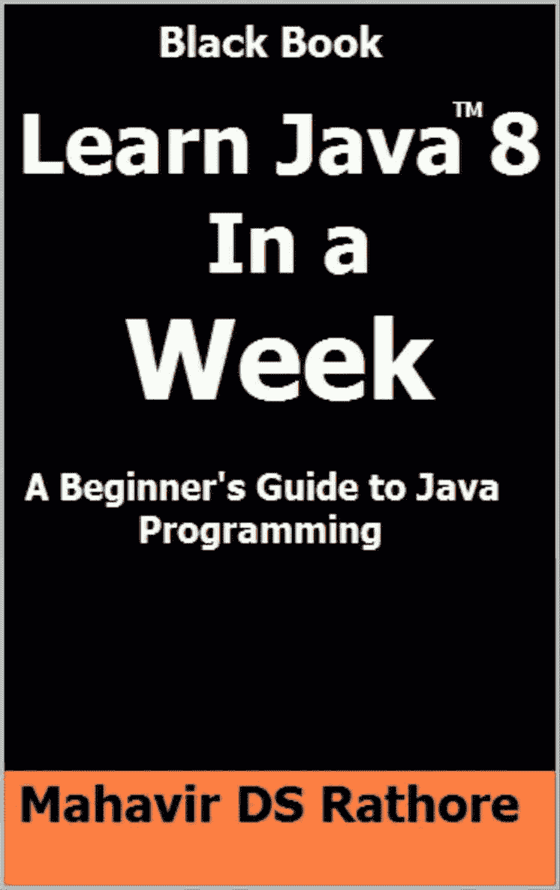

## Mahavir DS Rathore 著作

1. Java 8 异常处理
2. Java 8 异常处理测试

## 版权

`Learn JavaTM 8 in a Week` 由 `Mahavir DS Rathore` 编写。在准备本书时已采取一切预防措施，但作者对书中出现的错误或遗漏，或因使用本文所包含的信息而造成的损害不承担任何责任。

## 关于作者

在过去的 18 年里，我一直在编写和教授 Java 程序。这本书是我记录自己的知识并与世界各地的人分享的努力。我可以在世界上任何地方提供 Java 培训服务。我的邮箱地址是 `gurumahaveer@gmail.com`。

## 谁应该读这本书？

这本书适合已经掌握某些编程语言并热于学习 `Java` 的程序员。

## 所需软件

`Java 8`（`JDK 1.8`）和 `Notepad++` 编辑器。

## 致谢

`Java` 归 Oracle 所有，商标已认可。

## 献词

献给我的导师 `Shri Amrite`。

## 源代码

如需本书的源代码，请发送邮件至 `gurumahaveer@gmail.com`。

## 反馈

请分享您的反馈，这将帮助我改进此书。

## 目录

| 序号 | 章节 | 链接 |
| --- | --- | --- |
| 1 | 什么是 `Java`？ | 跳转 |
| 2 | `JDK` 和 `JRE` | 跳转 |
| 3 | 设置环境变量 | 跳转 |
| 4 | 编译器与解释器 | 跳转 |
| 5 | 第一个程序 | 跳转 |
| 6 | `HelloWorld` 程序 | 跳转 |
| 7 | `HelloWorld` 程序的结构 | 跳转 |
| 8 | 多个 main 方法 | 跳转 |
| 9 | 公共 `Class` 与文件名 | 跳转 |
| 10 | 运行时执行 | 跳转 |
| 11 | 另一种 `HelloWorld` 程序 | 跳转 |
| 12 | 数值数据类型 | 跳转 |
| 13 | 非数值数据类型 | 跳转 |
| 14 | 字面量与常量 | 跳转 |
| 15 | 转义序列 | 跳转 |
| 16 | 不可变 `String` | 跳转 |
| 17 | `StringBuilder` `Class` | 跳转 |
| 18 | 包装类 `Classes` | 跳转 |
| 19 | `If... Else` | 跳转 |
| 20 | `Switch... Case` | 跳转 |
| 21 | `For... Loop` | 跳转 |
| 22 | `While... Loop` | 跳转 |
| 23 | `Break` 与 `Continue` | 跳转 |
| 24 | 转换与类型转换 | 跳转 |
| 25 | 算术与关系运算符 | 跳转 |
| 26 | 逻辑与三元运算符 | 跳转 |
| 27 | `Arrays` | 跳转 |
| 28 | 锯齿数组 `Array` | 跳转 |
| 29 | `For Each Loop` | 跳转 |


# 第 1 章：什么是 `Java`？

## 话题

- 引言
- `Java` 作为平台
- `Java` 作为编程语言
- 影响 `Java` 的语言
- 受 `Java` 影响
- 总结

## 引言

`Java` 归 Oracle 所有，商标已认可。

## 献词

献给我的导师 `Shri Amrite`。

## `Java` 作为平台

在过去的 18 年里，我一直在编写和教授 Java 程序。这本书是我记录自己的知识并与世界各地的人分享的努力。我可以在世界上任何地方提供 Java 培训服务。我的邮箱地址是 `gurumahaveer@gmail.com`。

## 谁应该读这本书？

这本书适合已经掌握某些编程语言并热于学习 `Java` 的程序员。

## 所需软件

`Java 8`（`JDK 1.8`）和 `Notepad++` 编辑器。

## 致谢

`Java` 归 Oracle 所有，商标已认可。

## 源代码

如需本书的源代码，请发送邮件至 `gurumahaveer@gmail.com`。

## 反馈

请分享您的反馈，这将帮助我改进此书。

## `Java` 作为编程语言

`Java` 归 Oracle 所有，商标已认可。

## 影响 `Java` 的语言

`Java` 归 Oracle 所有，商标已认可。

## 受 `Java` 影响

`Java` 归 Oracle 所有，商标已认可。

## 总结

# 第 2 章：`JDK` 和 `JRE`

## 话题

- 引言
- `JDK` 和 `JRE`
- 设置环境变量
- 编译器与解释器
- 第一个程序

## 引言

`Java` 归 Oracle 所有，商标已认可。

## 什么是 `Java`？

`Java` 归 Oracle 所有，商标已认可。

## `Java` 作为平台

`Java` 归 Oracle 所有，商标已认可。

## `Java` 作为编程语言

`Java` 归 Oracle 所有，商标已认可。

## 影响 `Java` 的语言

`Java` 归 Oracle 所有，商标已认可。

## 受 `Java` 影响

`Java` 归 Oracle 所有，商标已认可。

## 总结

JRE 无法用于开发 Java 应用程序，但它被用于执行它们。JRE 由以下组件组成：

- 解释器：它理解二进制 Java 代码（例如 `java.exe`）。
- 工具：它们提供各种功能，如安全、核心服务、国际化、RMI（例如 `keytool`、`rmiregistry`、`javacpl`）。
- 库：Java 应用程序接口（`rt.jar`、`jce.jar`、`jsse.jar`）。

Java 开发工具包（JDK）无非就是 Java 标准版，用于开发桌面、用户界面、通信和 applet 类型的应用程序。

## 3. 工具

它们提供了如 `RMI`、国际化、核心服务、安全等功能。

## 4. 库

可重用的预定义 Java API（`rt.jar`、`jce.jar`、`jsse.jar` 等）。

JDK 是 JRE 的超集。JDK 包含了 JRE 的所有组件，并额外包含一个编译器。

## 安装 JDK

JDK 可以从 `http://www.oracle.com/technetwork/java/javase/downloads/jdk8-downloads151.html` 下载。

JDK 适用于许多操作系统，如 Windows、Linux、Mac OS 和 Solaris 等。在下载时，确保选择正确的 Java 8 架构，JRE 适用于 32/64 位。下载 JDK 后，双击它进行安装。

在 Windows OS 32 位，Java 将安装在 `C:\Program Files (x86)\Jdk1.8.xxx` 文件夹。

在 Windows OS 64 位，Java 将安装在 `C:\Program Files\Jdk1.8.xxx` 文件夹。请确保你已经下载并安装了 JDK。请不要下载 JRE。

## 安装 Notepad++

Notepad++ 是一款通用代码编辑器，支持 20 多种编程语言。最新版本是 v6.9。编辑器可以从 `https://notepad-plus-plus.org/download/v6.9` 下载。

## 总结

JDK 是开发 Java 应用所需的最小环境。JDK 可以从 oracle 网站下载。


# 第 3 章：设置环境变量

## 主题

- 简介
- 什么是环境变量？
- 总结

## 简介

环境变量是特殊的 Windows 变量，具有动态性质。它们包含了程序使用的安装目录、临时文件位置和设置。环境变量的值是可以更改和更新的，因此被称为动态。

一些常见的环境变量有：

1. `%appdata%`：用户 Application Data 文件夹位置。
2. `%commonfiles%`：Common Files 文件夹位置。
3. `%path%`：各 Java 工具的位置。
4. `%programfiles%`：程序安装的位置。
5. `%temp%`：临时文件位置。
6. `%windir%`：Windows 系统文件位置。

`SET` 命令从命令行提供所有环境变量的完整列表。

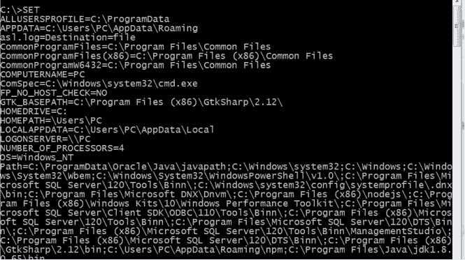

`SET` 后接环境变量将显示该变量的值。

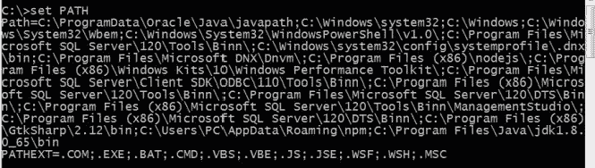

## 设置 “PATH” 变量

`PATH` 变量包含了工具的位置，具体来说 Java 解释器（`Java.exe`）、Java 编译器（`javac.exe`）和 Java 工具链。

PATH 变量可以通过两种方式设置：

1. 命令行
2. 控制面板

### 命令行设置

可以使用 `SET` 命令设置 PATH 变量。`SET` 命令不区分大小写。

此技术仅适用于当前的命令行会话。让我们如何在命令行设置 PATH 变量。

例如：

`Set path="C:\Program Files\Java\jdk1.8.0_65\bin"`

解释：上述命令将用 JDK 1.8 的位置覆盖 PATH 变量。对于包含空格的目录使用双引号。设置 PATH 变量时不需要指定工具名称，只需指定位置。

`Set PATH = "C:\Program Files\Java\jdk1.8.0_65\bin"`

解释：Path 变量不区分大小写。但目录区分大小写。

`Set PATH = %path%; "C:\Program Files\Java\jdk1.8.0_65\bin"`

解释：上述命令会将位置追加到 PATH 变量。

### 使用控制面板设置 PATH

这是设置 PATH 变量优的方法，因为它是永久的。

使用控制面板设置 PATH 变量遵循以下步骤：

1. 打开控制面板 -> 选择系统。
2. 点击高级设置。
3. 在环境变量对话框中选择高级选项卡。
4. 点击环境变量按钮。
5. 找到系统变量中的 Path 变量并编辑值。
6. 如果没有 PATH 变量，则创建一个新的 PATH 并添加值。

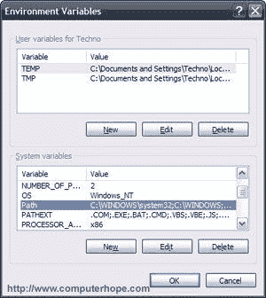

## 总结

Path 环境变量标识了 Java 编译器和 Java 解释器的位置。Path 可以通过命令行或控制面板设置。控制面板的方法比命令行更好，因为它是永久的。


# 第 4 章：Java 编译器和 Java 解释器

## 主题

- 简介
- Java 编译器
- Java 解释器
- 总结

## 简介

Java 程序员使用的最基础的工具是 Java 编译器（`javac.exe`）和 Java 解释器（`java.exe`）。PATH 环境应该设置为 JDK bin 文件夹的位置，该文件夹包含了编译器和解释器。如果你不确定 PATH 是否已设置，请参考上一章关于 PATH 环境变量的内容。

## Java 编译器

Java 编译器用于编译 Java 程序。编译过程产生字节码。字节码是 Java 虚拟机（`JVM`）可识别的二进制代码。

可以通过命令行使用 `javac.exe` 命令来激活 Java 编译器。

一些编译器选项有：

1. `-help`：显示所有编译器。
2. `-version`：返回编译器版本。
3. `-verbose`：输出编译器信息。
4. `-deprecation`：识别已弃用的 API。
5. `-nowarn`：不生成警告。

编译器选项区分大小写。

Java 选项快照。

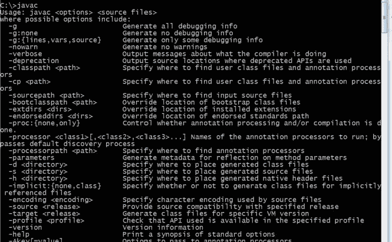

## Java 解释器

它用于执行 Java 程序，即解释器接收字节码作为输入，并通过原生代码执行该代码。

Java 解释器通过 `java` 命令调用。

一些解释器选项有：

1. `-version`：显示解释器版本。
2. `-verbose`：显示解释器信息。
3. `-help`：显示解释器选项。

解释器选项区分大小写。

Java 选项快照。

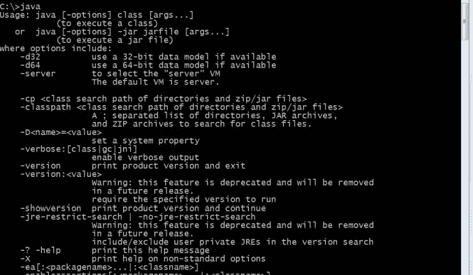

## 总结


Java 编译器通过`javac.exe`命令调用，用于编译 Java 程序。Java 解释器通过`java`命令调用，用于执行 Java 程序。


# 第 5 章

## 第一个程序

## 主题

- 简介
- 第一个程序
- 注释
- 总结

## 简介

Java 程序以`.java`扩展名保存。扩展名区分大小写。Java 程序使用 Java 编译器（`javac.exe`）编译，使用 Java 解释器（`java.exe`）执行。

### 第一个程序

让我们编写第一个 Java 程序并将其保存为`Prg.ca`。没有有效扩展名（`.java`）的 Java 程序会导致编译器产生错误。

```java
// 名称：`Prg.ca`
// 描述：有效的 Java 程序具有 .java 扩展名
class Program {
}
```

`javac Prg.ca`

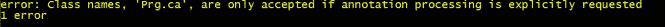

如果 Java 程序以`.jAva`扩展名保存，编译器也会产生错误，因为文件扩展名区分大小写。

```java
// 名称：`Prg.jAva`
// 描述：Java 程序的扩展名区分大小写。
// 正确的扩展名是 .java
class Program {
}
```

`javac Prg.jAva`

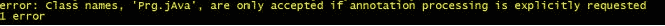

Java 程序的有效扩展名是`.java`。编译器在编译过程中生成`.class`文件。`.class`文件包含由 Java 解释器解释的字节码。现在让我们编写一个命名正确的 Java 程序并研究字节码。

```java
// 描述：有效的 java 程序具有 .java 扩展名。
// 字节码是二进制 java 指令。
// 将此程序保存为 `Prg2.java`
class Program {
}
```

上述程序编译后将生成一个名为`Prg2.class`的`.class`文件。此代码无法执行，因为它没有`main`方法，而`main`方法是程序的入口。

字节码是只有 Java 解释器才能理解的二进制代码。在编辑器中打开`Prg2.class`文件进行检查。

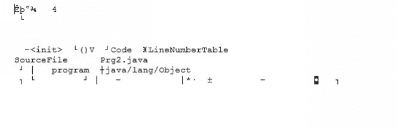

## 注释

Java 程序中的注释有两种方式：

1. 单行注释 - `// This is a comment`
2. 多行注释 –

```java
/*
此注释跨越了
多
行
*/
```

## 总结

Java 程序的扩展名为`.java`。Java 程序编译成字节码。字节码由 Java 解释器处理。


# 第 6 章：HelloWorld 程序

## 话题

- 引言
- HelloWorld 程序
- 总结

## 引言

一个可执行的 Java 程序具有有效签名格式的`main`方法，该方法作为程序的入口。`main`方法必须封装在一个类中。

## HelloWorld 程序

让我们写一个 HelloWorld 程序。写好程序后，使用`Javac.exe`（编译器）对其进行编译，并使用`Java.exe`（解释器）执行它。

```java
//Prg.java
// Description: HelloWorld Program
class Program {
    public static void main(String args[]) {
        System.out.println("Namaskar - HelloWorld - Java");
    }
}
```

命令行中的命令：

1. `Javac Prg.java`
2. `Java Program`

输出：


### 尝试：

1. 将`main`方法改为大写。

结果：编译器错误。

Java 中可以使用的有效`main`方法有：

1. `public static void main(String[] args)`
2. `public static void main(String args[])`
3. `public static void main(String ...a)`

类中一次只能使用上述其中一个`main`方法。

让我们通过示例来验证上述内容。

```java
//Prg2.java
//Description: Helloworld program using “main(String[] args)” method as entry point
class Program {
    public static void main(String args[]) {
        System.out.println("Namaskar - HelloWorld - Java");
    }
}
```

输出：


```java
//Prg3.java
//Description : Using “main(String …a)” method as entry point.
class Program {
    public static void main(String ...a) {
        System.out.println("Namaskar - HelloWorld - Java");
    }
}
```

输出：


### 解释：

1. `main(String …a)`代表 Java 语法，告知编译器允许向`main`方法传递任意数量的字符串参数。

尝试：

1. 创建一个没有有效签名的`main`方法。

结果：程序将编译但不会执行。

## 总结

`main`方法只有在它具有有效签名时才是程序的入口，否则它的行为就像类中的普通方法一样。


# 第 7 章：HelloWorld 程序的内部结构

## 话题

- 引言
- 命令行参数
- Main 方法
- `System.out.println()`的内部结构
- 总结

## 引言

在本章中，你将理解 HelloWorld 程序的内部结构。

## 命令行参数

`main`方法是一个入口，它接收字符串数组作为参数。在 Java 中对数组会进行边界检查。程序员可以在命令行向`main`方法传递任何类型的数据。传递的数据将被捕获为字符串。程序员必须对该数据进行类型转换以进行后续处理。

让我们了解如何在程序中传递命令行参数并捕获它们。

```java
//Prg.java
//Description: Passing and capturing command line arguments
class Program {
    public static void main(String args[]) {
        System.out.println("HelloWorld :" + args[0]); 
        System.out.println("HelloWorld " + args[0] + "," + args[1]);
    }
}
```

输出：

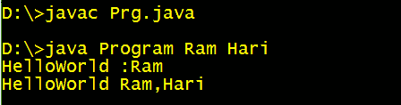

当程序员只传递 "Ram" 作为参数时，Java 解释器会抛出`Array Exception`，因为数组经过了边界检查，即程序预期有两个参数。

输出：

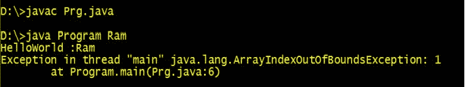

现在让我们通过传递整数来更好地理解`main`方法的行为。传递给`main`方法的所有参数都被接受为字符串。如果传递了整数，则必须进行转换以供后续处理。下一个程序解释了如何实现这一点。

```java
//Prg2.java
//Description: Passing integers at command line
class Program {
    public static void main(String args[]) {
        int i = Integer.parseInt(args[0]); // 字符串转换为整数
        int j = Integer.parseInt(args[1]);
        System.out.println("The sum is :" + (i+j)); 
    }
}
```

输出：

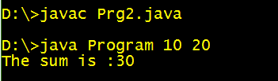

如果传递的参数之一是字符，Java 解释器将抛出异常。这是因为字符无法转换为整数。

输出：

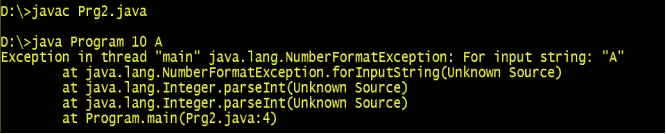

## Main 方法

`main`方法的签名不能更改，即“void”不能放在“static”之前。`main`方法的修饰只能是`public`，即不能是`protected`或`default`。

```java
//Prg3.java
//Description: Using main signature
class Program {
    public void main(String args[]){ // 错误
        System.out.println("Namaskar");
}
```

输出：

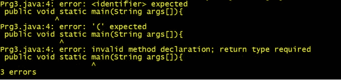

当`main`方法不是`public`时，它将不是入口。如果`main`非公开的，编译器将报告错误。

```java
//Prg4.java
//Description: Using main specifier
class Program {
    protected void main(String args[]){
        System.out.println("Namaskar");
}
```

输出：

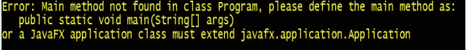

### System.out.println() 的内部结构

`System`是属于`java.lang`包的类。`java.lang`是默认包，因此不需要导入。`out`是`PrintStream`类的一个静态对象。`println`是属于该类的方法，用于在标准输出上打印数据。

## 总结

`main`方法接收字符串数组作为参数。`main`方法必须是`public`。

`java.lang`是默认包。


# 第 8 章：多个 main 方法

## 话题

- 引言
- 单类中的多个 main 方法
- 多个类与方法

## 引言

一个 Java 程序可以包含多个类。当包含多个类的 Java 程序被编译时，它会产生许多`.class`文件，即 Java 中的每个类都会编译成特定的类。`.class`文件名与程序中的类名相同。由于 Java 支持方法重载（类中可以有许多名称相同但签名不同的方法），一个类可以包含多个类，且其中一个将是入口。

## 单类中的多个 main 方法

Java 类可以拥有任意数量的`main`方法，因为 Java 支持方法重载，但只能有一个具有特定签名的入口（参阅第 6 章）。让我们通过示例了解如何在单类中创建多个`main`方法。

```java
//Prg.java
//Description: Multiple Main methods in a single class
class Program {
    // 这是入口
    public static void main(String args[]) {
        System.out.println("Namaskar - Helloworld - Java");
    }

    /* 
    public static void main(String ... args) {
        System.out.println("");
    }
    */

    // 这不是入口
    public static void main() { 
}
```

```java
            System.out.println ("Main() method");

         }

         public void main(String ar) { // 这不是入口点
                             System.out.println("String argument-main");

         }
}
```

上述程序编译并执行时没有任何错误。

输出：


如果取消注释代码的注释，编译器将产生错误，因为一个类中只能有一个入口点。

输出：

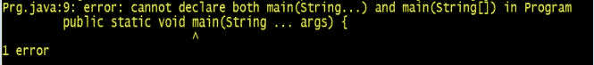

# 多个类与 main 方法

一个 Java 程序可以有多个类，每个类只能有一个入口点，但类可以有许多不作为入口点的`main`方法。程序中的每个类都会被编译成一个`.class`文件。

要执行特定的`main`方法，请执行命令`Java <classname>`。

让我们了解如何在多个类中创建`main`方法。

```java
//Prg2.java

//Description：程序中的多个类

class Program {

public static void main(String args[] ) { // 这是入口点

    System.out.println("Program class - Main method");

}

public static void main() { // 这不是入口点

             System.out.println ("Program class - Main() method");

}

public void main(String ar) { // 这不是入口点

             System.out.println("Program class - String argument-main");

}

}

class Test {

             public static void main(String[] args) { // 这是入口点

                               System.out.println("Test class - Main method");

             }

             public static void main() { // 这不是入口点

                               System.out.println ("Test class-Main() method");

             }

             public void main(String ar) { // 这不是入口点

                               System.out.println("Test2 class-String argument-main");

             }
}

class Test2 {

      public static void main(String[] args) { // 这是入口点

                             System.out.println("Test2 class - Main method");

             }

             public static void main() { // 这不是入口点

                             System.out.println ("Test2 class - Main() method");

             }

             public void main(String ar) { // 这不是入口点

                             System.out.println("Test2 class-String argument-main");

             }
}
```

要执行所需的`main`方法，请使用命令`Java <classname>`。

输出：

1. `Java Program`
2. `Java Test`
3. `Java Test2`

## 总结

一个类只能有一个入口点。程序可以包含多个类，每个类可以有自己的入口点。每个类都编译成独立的类文件。

# 第 9 章 公有类与文件名

## 引言

- 程序中的公有类
- 总结

在本章中，我们将讨论 Java 程序以及其中类的命名规则。

## 程序中的公有类

一个类只能有两种访问修饰符之一，即类可以声明为`public`或`default`（包级）访问修饰符。类不能被声明为`private`或`protected`。

在声明类或为 Java 程序（文件）命名时，必须遵循以下规则：

1. 每个 Java 文件中只能有一个`public`类。
2. `public`类名与 Java 文件名必须相同。
3. Java 文件（名）与类（名）之间的大小写必须匹配。

让我们通过程序来理解这些规则。


```java
//Prg.java
//Description：类不能声明为 private 或 protected

public class Prg { // 公有类名和文件名必须相同
// 程序的名称将是 Prg.java
public static void main(string args[]) {
  System.out.println("Namaste Java");
}

class Test {

    public static void main(string args[]) {
             System.out.println("Test class");
             }
}
```

命令：`Java Prg`

输出：

如果将`Test`类声明为`private`，编译器将报告一个错误。

输出：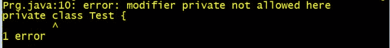

## 总结

类不能被声明为`private`或`protected`。每个 Java 文件中只能有一个`public`类。

# 第 10 章 运行时

## 引言

- Java 解释器的角色

- 什么是 JIT 编译？

- 平台无关性

- 总结

在本章中，我们将讨论程序在运行时的行为，即程序正在执行时的状态。我们还将讨论解释器的作用。了解什么是`JIT`并学习什么让 Java 具有平台无关性。

## Java 解释器的角色

可以通过从命令行执行`Java.exe`命令来激活解释器。解释器也被称为`JVM`（Java 虚拟机）。解释器的职责如下：

1. 接收`bytecode`作为输入。

2. 将`bytecode`处理为原生代码（针对特定操作系统的可执行代码）。

3. 执行原生代码。

## 什么是 JIT 编译？

`JIT`代表 Just In Time compilation（即时编译）。它是`JVM`执行的一项操作，其中`bytecode`被转换为原生代码。由于它是按需执行的，因此被称为即时编译。

代表即时编译的图示

## 平台无关性

当二进制代码不是原生的且不针对特定操作系统时，程序被称为平台无关的。因为 Java 程序被编译成`bytecode`，而不同的操作系统都有相应的`JVM`。这使得 Java 程序具有平台无关性。

代表 Java 平台无关性的图示

## 总结

Java 虚拟机也被称为伪操作系统。JVM 将`bytecode`转换为原生代码。`bytecode`到原生代码的转换被称为`JIT`。

# 第 11 章 HelloWorld 程序

## 引言

- 使用 PrintStream 类

- 总结

在本章中，我们将讨论在屏幕上打印数据的替代方法，即不使用`System.out.println()`方法打印数据。为了实现这一点，我将使用`PrintStream`类。

## 使用 PrintStream 类

要创建`PrintStream`类对象，我们需要将`OutputStream`对象传递给`PrintStream`类的构造函数。输出流句柄是通过`FileDescriptor`类的`out`字段建立的，它是作为`FileInputStream`OutputStream 类的子类）构造函数的参数传递的。让我们通过示例来理解。由于使用的类位于`java.io`包中，因此需要导入该包。

```java
//Prg.java
//Description：替代 World 程序

import java.io.*;

class Program {

public static void main(String args[]) {
             FileOutputStream obj = new FileOutputStream(FileDescriptor.out);
             PrintStream obj2 = new PrintStream(obj);
             obj2.println("Alternative Namaste Java");

}

}
```

输出：

## 总结

`FileDescriptor.out`属性标识标准输出。`PrintStream`在创建时接收`OutputStream`类对象

# 第 12 章 数字数据类型

## 引言

- 什么是变量？

- 数据类型的分类

- 整数类型

- 浮点类型

- 总结

在本章中，将讨论如何创建和使用数值变量。由于 Java 是静态类型语言，变量的类型在编译时已知，因此变量具有类型。核心数据类型也被称为原始类型。Java 支持的原始数据类型为

# 数据类型

1. `char`

2. `byte`

3. `short`

4. `int`

5. `long`

6. `float`

7. `double`

8. `boolean`

根据变量的数据类型，`JVM`将分配内存。

## 数据类型的分类

广泛来说，Java 支持两种类型：

* 原生数据类型（Primitive data types） – 它们是核心数据类型。

* 引用/对象数据类型（Reference/Object data types） – 它们直接或间接继承自`Object`类。

## 整数类型

由于 Java 是静态类型，变量在使用之前必须声明。`Integer`类型只能包含整数。默认的整数类型是`'int'`。支持的整数类型有：

| 数据类型 | 大小(字节) | 符号 |

| :--- | :--- | :--- |

| `Byte` | 1 | 有符号 |

| `Short` | 2 | 有符号 |

| `Int` | 4 | 有符号 |

| `long` | 8 | 有符号 |

让我们通过示例来了解如何使用整数类型。

```java
//Prg.java
//Description : Integer data type behaviour
class Program {
    public static void show() {
      byte b=12;
      short sh= 124;
      int i = 256;
      long l = 459;
      System.out.println("Byte value :"+b);
      System.out.println("Short value :"+sh);
      System.out.println("Int value :"+ i);
      System.out.println("Long value :" + l);
    }
    public static void main(String args[]){
      show();
    }
}
```

输出：

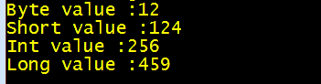

```java
//Prg2.java
//Description : Checking integer data type value range
class Program {
    public static void show() {
      byte b=-128;  // -128 to 127 (包含)
      short sh= 124; //  -32,768 to 32,767
      int i = 256; //  -2³¹ 且最大值为 2³¹-1
      long l = 459; //  -2⁶³ to 2⁶³-1
      System.out.println("Byte value :"+b);
      System.out.println("Short value :"+sh);
      System.out.println("Int value :"+ i);
      System.out.println("Long value :" + l);
    }
    public static void main(String args[]){
      show();
    }
}
```

输出：

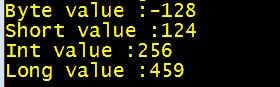

如果为`byte`变量赋值`-129`，它将生成编译器输出。

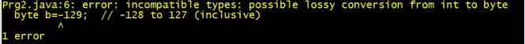

## 浮点类型

浮点数值类型可以包含小数。Java 支持 2 浮点类型，即`float`和`double`。`float`类型必须带有后缀`'f'`，因为默认的浮点类型是`double`。

| 数据类型 | 大小(字节) | 符号 |

| :--- | :--- | :--- |

| `Float` | 4 | 有符号 |

| `Double` | 8 | 有符号 |

让我们通过示例来了解浮点类型的用法。

```java
//Prg3.java
//Description : Checking floating data type
class Program {
    public static void show() {
      float f = 10.10f; // 通过后缀 'f' 识别浮点值
      double d = 20.20d; // double 的后缀 'd' 是可选的
      System.out.println("Byte value :"+f);
      System.out.println("Short value :"+d);
    }
    public static void main(String args[]){
      show();
    }
}
```

输出：

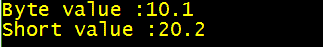

如果浮点变量的值没有带后缀`'f'`，编译器将生成错误。

输出：

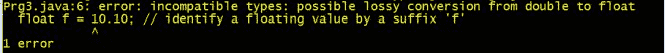

### 同时使用浮点类型和整数类型。

```java
//Prg4.java
//Description: Using float and integer type together
class Program {
    public static void intOps() {
      int i=10;
      byte b=34;
      i= i*b;
      System.out.println("i= i*b :" + i);
    }           
    public static void fltOps() {
      float f = 10.45f;
      double d = 45.5d;
      d = f*d;
      System.out.println("d = f*d :" + d);
    }
    public static void mixedOps() {
      float f = 10.10f;
      int j =10;
      f = f * j;
      System.out.println("f = j :" + f);
    }
    public static void main(String args[]){
      intOps();
      fltOps();
      mixedOps();
    }
}
```

结论：

a. 高类型可以包含表达式的结果。

b. 浮点类型可以包含表达式的结果（整数类型不能）。

输出：

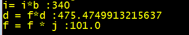

如果表达式的结果被存入无法容该值的变量中，编译器将生成错误。

```java
//Prg4.java
//Description: Using float and integer type
class Program {
    public static void intOps() {
      int i=10;
      byte b=34;
      i= i*b;
      System.out.println("i= i*b :" + i);
    }           
    public static void fltOps() {
      float f = 10.45f;
      double d = 45.5d;
      d = f*d;
      System.out.println("d = f*d :" + d);
    }
    public static void mixedOps() {
      float f = 10.10f;
      int j =10;
      f = f * j;
      System.out.println("f = j :" + f);
    }
    public static void main(String args[]){
      intOps();
      fltOps();
      mixedOps();
    }
}
```

```java
public static void main(String args[]) {
    dataOps();
}
}
```

Output:

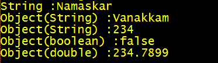

## 总结

字符类型的大小为 2 字节。`Boolean`数据类型的大小为 1 字节。


# 第 14 章：字面量与常量

## 目录

- 引言

- 使用字面量

- 使用常量

- 总结

## 引言

在本章中我将讨论如何创建和使用字面量与常量

## 使用字面量

存储在变量中的固定或常量称为字面量（Literal）。字面量用于 Java 支持的所有原始类型。字面量也可以用于引用类型`String`。

字面量有 3 种方式用于`Integer`:

1. **十进制**: 以数字开头，例如`int I = 889;`。

2. **八进制**: 以`'0'`开头，例如`int i= 0123;`。

3. **十六进制**: 以`0x/0X`开头，例如`int i=0x1234;`。

让我们通过示例来更好地理解这一点。

```java
//Prg.java
//Description: Integer literal 量用法.
class Program {
  static void prgOps() {
    int i=234;
    int j=01;
    int k=0xa;
    System.out.println("\n int--");
    System.out.println("Decimal Literal :"+ i);
    System.out.println("Octal Literal :" + j);
    System.out.println("Hexadecimal Liternal :" + k);
  }
  static void prgOps2() {
    short i=2834;
    short j=071;
    short k=0xab;
    System.out.println("\n short--");
    System.out.println("Decimal Literal :"+ i);
    System.out.println("Octal Literal :" + j);
    System.out.println("Hexadecimal Liternal :" + k);
  }
public static void main(String args[]) {
  prgOps();
  prgOps2();
}
}
```

Output:

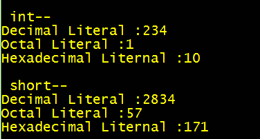

如果十六进制给出错误的值，编译器会报告错误。

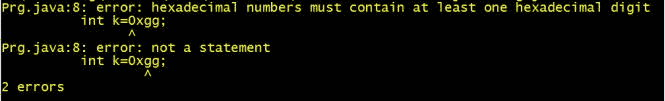

浮点数字面量默认类型为`double`。通过在值后识别 float 类型后缀`'f/F'`，例如`float f = 10.45f`。如果需要，在值后识别 double 后缀`'d/D'`，例如`double d= 45.231d`。可以使用`'e'`来识别幂次。让我们通过示例来更好地理解这一点。

```java
//Prg2.java
// Description : 浮点数字面量用法
class Program {
  static void prgOps() {
    float i=234.3423f;
    double j=79879.345d;
    double k= 686868e4;
    System.out.println("Decimal Literal :"+ i);
    System.out.println("Octal Literal :" + j);
    System.out.println("Hexadecimal Liternal :" + k);
  }
  public static void main(String args[]) {
    prgOps();
  }
}
```

Output:


字符字面量用单引号括起来，字符串字面量放在双引号中。布尔类型可以是 2 种字面量之一，即`true`或`false`。Java 还支持`null`字面量，它不能用于原始类型，但可以用于引用类型。让我们通过示例来更好地理解。


```java
//Prg3.java
//Description : char、String 和 boolean 类型的字面量用法.
class Program {
  static void prgOps() {
    char c = 'a';
    String str = "Vanakkam";
    // c=null; // 错误不能用于原始类型
    str = null;
    boolean b = true;
    // b= null; // 错误
    System.out.println("Char literal:"+c);
    System.out.println("String literal:"+str);
    System.out.println("Boolean literal:"+b);
  }
  public static void main(String args[]) {
    prgOps();
  }
}
```

Output:


## 使用常量

常量是一个一旦赋值就不能更改的变量。常量变量使用 `final` 关键字声明。

### 用法

- `final int i=10;`

- `final char c='a';`

- `final boolean b = true;`

让我们通过示例来更好地理解这一点。

```java
//Prg4.java
//Description: 创建常量变量
class Program {
public static void main(String args[]) {
  final int i=10; // final 使变量变为常量
  final float f= 10.10f;
  final double d = 20.20;
  final char c = 'a';
  final boolean b = true;
  final String str = "Namaste";
  System.out.println("i :"+i);
  System.out.println("f :"+f);
  System.out.println("d :"+d);
  System.out.println("c :"+c);
  System.out.println("b :"+b);
  System.out.println("str :"+str);
}
}
```

Output:


## 总结

常量是一个一旦赋值就不能更改的变量。常量变量使用 `final` 关键字声明。

# 第 15 章：转义序列

## 目录

- 引言

- 什么是转义序列

- 总结

## 引言

在本章中我们将学习转义序列的使用。

## 什么是转义序列？

转义序列是特殊的字符。它们也被称为控制序列。转义序列以反斜杠开头。


## 总结

存储在变量中的固定或常量称为字面量。


# 第 16 章：不可变字符串

转义序列在 Java 中提供了特殊含义。支持的转义序列包括：

1. `\t` - 制表符。

2. `\b` - 退格符。

3. `\n` - 换行符。

4. `\r` - 回车符。

5. `\f` - 换页符。

6. `\'` - 单引号。

7. `\"` - 双引号。

8. `\\` - 反斜杠。

让我们通过示例来更好地理解转义序列。

```java
              System.out.println("String are same(case sensitive) :"+ str2.equals(str));
              System.out.println("String are same(case insensitive) :" + str.equalsIgnoreCase(str2));
          }

  static void strOps2() {
    String str = "Namaste";
    String str2 = "namaste";
    if (str==str2) { // Reference comparison
      System.out.println("Strings share same reference");
    } else {
      System.out.println("Strings do not share same reference");
    }
  }

  public static void main(String args[]) {
    strOps();
  }
}
```

Output:

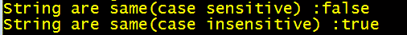

## 总结

`String` 是不可变类型。`String` 可以作为值或引用进行比较。


# 第 17 章：StringBuilder 类

## 目录

- 引言

- 使用 StringBuilder 类

- 总结

## 引言

在本章中，我们将讨论如何使用 `StringBuilder` 类。这是一种在不 way 在内存中创建新字符串的情况下初始化和重新初始化字符串的机制，简而言之 `StringBuilder` 不是不可变的。

## 使用 StringBuilder 类

它是一个可变的字符序列。`StringBuilder` 类不像 `String` 类那样不可变。

`StringBuilder` 类的主要方法有：

- `Append()`

- `Insert()`

`StringBuilder` 位于 `java.io` 包中，因此必须进行导入。

让我们通过示例来理解 `StringBuilder` 类的用法。

```java
//Prg.java
//Description: Using StringBuilder class

import java.lang.*;

class Program {
  public static void main(String[] args) {
    StringBuilder str = new StringBuilder("Namaste");
    str.append(" Java");
    System.out.println("Using Append() method:" + str);
    str.insert(5," Vanakkam");
    System.out.println("Using Insert() method:" + str);
    str.delete(2,5);
    System.out.println("Using Delete() method: "+ str);
  }
}
```

Output:

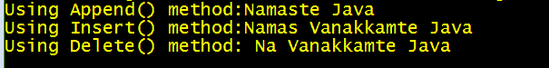

## 总结

`StringBuilder` 是可变的。`Delete()` 方法用于从字符串中删除字符。


# 第 18 章：包装类

## 目录

- 引言

- 使用包装类

- 自动装箱和拆箱

- 总结

## 引言

在本章中，你将学习如何将原始数据类型转换为对象。这种转换是通过包装类实现的。在本章中，我还将讨论自动装箱（Autoboxing）和拆箱（Unboxing）的概念。

## 使用包装类

包装类用于将核心数据类型转换为对象。8 种数据类型对应 8 种包装类。包装类列表如下：

| 原始类型 | 包装类 |

| :--- | :--- |

| `boolean` | `Boolean` |

| `char` | `Character` |

| `byte` | `Byte` |

| `short` | `Short` |

| `int` | `Integer` |

| `long` | `Long` |

| `float` | `Float` |

| `double` | `Double` |

包装类主要用于：

1. 在需要时将数据表示为 `null`

2. 在集合中使用数据

让我们通过示例来理解包装类的用法。

```java
//Prg.java
//Description : Wrapper class
class Program {
  static void wrapperOps() {
    int i=10;
    Integer iw = Integer.valueOf(i); // int to Integer
    System.out.println("After(primitive to wrapper) :"+ iw);
    int j = iw.intValue();
    System.out.println("After(wrapper to primitive) :"+j);
  }
  public static void main(String args[]) {
    wrapperOps();
  }
}
```

Output:


## 自动装箱和拆箱

编译器将原始类型转换为等效包装类型的自动转换称为自动装箱（Autoboxing）。

例如：

`int i=10;`

`Integer j=i;`

编译器将包装类型转换为等效原始类型的自动转换称为拆箱（Unboxing）。

例如：

`Integer j= new Integer(50);`

`int i=j;`

让我们通过示例更好地理解这一点。

```java
//Prg2.java
//Description : Autoboxing and Unboxing
class Program {
  static void boxOps() {
    int i=20;
    Integer j=i; // Autoboxing
    Integer m = new Integer(77);
    int k=m; // Unboxing
    System.out.println("Value of i(primitive) :"+i);
    System.out.println("Value of j(wrapper - Autoboxing) :"+j);
    System.out.println("Value of k(primitive- Unboxing) :"+k);
  }
  public static void main(String args[]) {
    boxOps();
  }
}
```

Output:

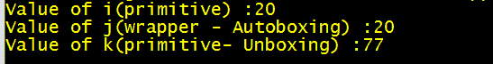

包装类只能自动转换为等效类型。如果我们尝试转换为任何其他类型，编译器将报错。

```java
// snapshot
Integer m = new Integer(77);
int k=m; // Unboxing
short sh = m; // 编译错误
```

Output:

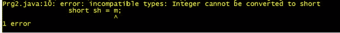

## 总结

包装类用于在集合中表示数据。从原始类型到包装类的自动转换是自动装箱，从包装类到原始类型的自动转换被称为拆箱。


# 第 19 章：If...else

## 目录

- 引言

- 使用 Else 语句

- 总结

## 引言

在本章中，你将学习如何使用 `if` 语句。`if` 语句用于检查条件并据此做出决策。

## 使用 Else 语句

`if` 是 Java 中基础且重要的结构。它用于根据条件做决策。`if` 结构有三种形式：

- `if(condition)`

- `if(condition) else`

- `if(condition) elseif else`

`condition` 必须求值为布尔 `true`。当匹配多个条件时，执行第一个匹配的代码，其他匹配的代码将不会执行。让我们通过示例来理解。

```java
//Prg.java
//Description: Using 'if' condition
class Program {
  static void ifOps() {
    int i=10;
    if (i > 5) System.out.println("i is greater than 5");
  }
  static void ifOps2() {
    boolean b=true;
    if (b) System.out.println("b is true");
    else System.out.println("b is false");
  }
  static void ifOps3() {
    int i=8;
    if (i == 5) // == 是相等运算符
      System.out.println("i value is 5");
    else if(i==6)
      System.out.println("i value is 5");
    else if(i==7)
      System.out.println("i is 7");
    else
      System.out.println("The value of i "+i);
  }
  public static void main(String args[]) {
    ifOps();
    ifOps2();
    ifOps3();
  }
}
```

Output:

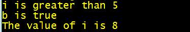

`if` 结构只能接受布尔条件，如果条件不是布尔值，将产生编译错误。以下代码将产生编译错误：

```java
// Code snapshot
int i=8;
if (i) // 不是布尔条件
  System.out.println("i value is 5");
```

`if` 条件用于决策。`if` 条件的输入是布尔值，且仅执行第一个匹配的条件。


# 第 20 章：Switch.. Case

## 目录

* 引言

* 使用 Switch…case 语句

* 总结

## 引言

在本章中我将讨论如何使用 `Switch.. case` 语句。`Switch..case` 用于根据条件执行代码。

## 使用 Switch..case 语句

`Switch.. case` 是 `if .. else` 语句的替代方案。`switch` 语句可以有任意数量的执行路径。`switch..case` 支持以下基本类型：

* `byte`

* `short`

* `char`

* `int`

`case` 必须包含 `break` 语句，否则控制将贯到下一个 `case`。`switch..case` 还可以 `default` 语句，当没有 case 条件匹配时将执行该语句。

让我们通过一个示例来理解 `switch.. case`。

在这个示例中，我展示了如何在 `switch..case` 中使用整数。

```java
//Prg.java
//Description : Using Switch..case with integer

class Program {
    public static void switchOps() {
        int day=1;
        switch(day) {
            case 1:
                System.out.println("Sunday");
                break;
            case 2:
                System.out.println("Monday");
                break;
            case 3:
                System.out.println("Tuesday");
                break;
            case 4:
                System.out.println("Wednesday");
                break;
            case 5:
                System.out.println("Thursday");
                break;
            case 6:
                System.out.println("Thursday");
                break;
            case 7:
                System.out.println("Thursday");
                break;
            default:
                System.out.println("Invalid day");
        }
    }
    public static void main(String args[]) {
        switchOps();
    }
}
```

输出：

 如果变量 `day` 的值为 9，则将执行 `default` case。

输出：

 如果变量 `day` 的值为 1 且 `case 1:` 没有 `break` 语句，则控制将贯穿并执行 `case 2:` 的代码。

输出：

 下一个示例演示了如何在 `switch..case` 中使用 `char` 和 `String` 类型。


```java
//Prg2.java
//Description : Switch..case with char & String
class Program {
    static void switchOps() {
        char day='i';
        switch(day) {
            case 'i':
                System.out.println("One");
                break;
            case 'x':
                System.out.println("Ten");
                break;
            default:
                System.out.println("Invalid number");
        }
    }
    public static void switchOps2() {
        String state="TN";
        switch(state) {
            case "KA":
                System.out.println("Karnataka");
                break;
            case "TN":
                System.out.println("Tamil Nadu");
                break;
            default:
                System.out.println("Invalid state");
        }
    }
    public static void main(String args[]) {
        switchOps();
        switchOps2();
    }
}
```

输出：


现在让我们来学习如何在`switch..case`中使用`enum`。

```java
//Prg3.java
//Description : Using enum with switch case
enum Metro {
    Delhi,
    Kolkata,
    Mumbai,
    Bengaluru
}
class Program {
    static void switchOps() {
        Metro city;
        city = Metro.Mumbai;
        switch(city) {
            case Delhi:
                System.out.println("Delhi is in north of India");
                break;
            case Mumbai:
                System.out.println("Mumbai is in west of India");
                break;
            case Kolkata:
                System.out.println("Kolkata is in east of India");
                break;
            case Bengaluru:
                System.out.println("Bengaluru is in south of India");
                break;
            default:
                System.out.println("This is not a metro city");
        }
    }
    public static void main(String args[]) {
        switchOps();
    }
}
```

输出：


## 总结

`Switch case` 可以与基本类型和引用类型配合工作。`case` 中必须使用`break`关键字，否则逻辑将贯穿。`Enum` 可以用于`switch case`。


# 第 21 章 For Loop

## 目录

* 引言
* 使用 for. Loop
* 总结

## 引言

在本章中，我们将讨论如何使用`for loop`。`for loop` 有助于按照指定的次数执行和迭代某些指令。

## 使用 for…loop

它用于多次执行一个代码块（固定）。

### 语法

```
for (initialization; condition; increment) {
   instructions;
}
```

它包含三个部分：

* **Initialization**：在循环开始时执行一次。
* **Condition**：只有当条件为真时，循环才会执行。
* **Increment**：变量可以递增或递减。

让我们通过一个示例来更好地理解。

```java
//Prg.java
//Description : Behaviour of for Loop
class Program {
    static void forOps() {
        for(int i=10; i>0;i--) {
            System.out.println("Value of i :"+ i);
        }
    }
    static void forOps2() {
        for(;;) {
            System.out.println("Infinite loop");
        }
    }
    public static void main(String args[]) {
        forOps();
        //forOps2();
    }
}
```

`for` 循环并不强制为三个部分提供所有值。如果缺少条件，循环将变为无限。取消`forOps2()`方法以查看无限循环的执行。

输出：


我们可以在`for`循环的三个部分任何一个编写合法的 Java 指令。

下一个程序演示了这种行为。

```java
//Prg2.java
//Description : Using for loop
class Program {
    static void forOps() {
        for (int i=0;i < 10 ; i++,System.out.println("In loop"))
    }
}
```

```java
            System.out.println("Value of i :"+i);
        }

         public static void main(String args[]) {
                            forOps();
    }
}
```

Output:

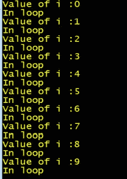

## 总结

`for` 循环主要用于固定迭代。`for` 循环包含 3 部分，即：初始化、条件和增量。


# 第 22 章：While 和 Do. While 循环

## 话题

- 引言
- 使用 While 循环
- 使用 Do...While 循环
- 总结

## 引言

在本章中，我将讨论`while`和`do .. while`循环。这两个循环都会执行一段指令，直到条件为真；当条件为假时循环退出。

### 使用 While 循环

在`while`循环中，条件会在循环执行之前检查。`while`的语法如下：

语法：

```java
while(Boolean_expression) {
    //Statements
}
```

让我们通过示例来更好地理解`while`循环。

```java
//Prg.java
//Description：使用 While 循环
class Program {
    static void whileOps() {
        int i=10;
        while (i > 0) {
            System.out.println("The value of i:"+i);
            i--;
        }
    }

    public static void main(String args[]) {
        whileOps();
    }
}
```

Output:

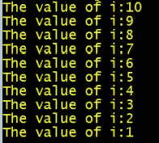

### 使用 Do..While 循环

`Do.. while`循环保证至少执行一次，然后检查条件。

`do..while`循环的语法：

```java
do {
    statement(s)
} while (expression);
```

让我们通过示例来理解`do..while`循环。

```java
//Prg2.java
//Description：使用 Do.. While
class Program {
    static void dowhileOps() {
        int i=0;
        System.out.println("Do..while loop demo");
        do {
            System.out.println("The value of i:"+i);
            i++;
        } while (i<10);
    }

    public static void main(String args[]) {
        dowhileOps();
    }
}
```

Output:

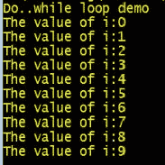

## 总结

`while`循环在执行前检查条件。`Do while`循环至少执行一次代码块，然后检查条件。


# 第 23 章：Break 和 Continue 关键字

## 话题

- 引言
- 使用 Break 关键字
- 使用 Continue 关键字
- 总结

## 引言

在本章中，我将讨论`break`和`continue`关键字。这两个关键字都用于`for`、`while`和`do...while`循环中，`break`关键字也用于`switch...case`中。

### 使用 Break 关键字

它用于退出循环或 switch 中的 case。`break`关键字可以是：

1. 带标签的（Labeled）：用于标识代码块内的区域。
2. 无标签的：没有标识符。

让我们通过示例来理解`break`关键字。

```java
//Prg.java
//Description：使用 break
class Program {
    static void breakOps() {
        int k=0;
        while (k<0) {
            if (k==5) {
                break;
            }
            k++;
        }
        System.out.println("The value of 'k' after break:"+ k);
    }

    static void breakOps2() {
        first: // 标签
        for( int i = 0; i < 3; i++) {
            second: // 标签
            for(int j = 0; j < 4; j ) {
                System.out.println("Value of i:"+i);
                System.out.println("Value of j:"+j);
                break first;
            }
        }

        third: // 标签
        for( int a = 0; a < 4; a++) {
            System.out.println("The value of a:"+a);
        }
    }

    public static void main(String args[]) {
        breakOps();
        breakOps2();
    }
}
```

Output:


### 使用 Continue 关键字

`continue`语句跳过循环的当前迭代。执行`continue`语句后，控制将返回到循环的开始。它可以有两种类型：

1. 带标签的
2. 无标签的

让我们通过示例来理解`Continue`关键字。

```java
//Prg2.java
//Description：使用 continue - 带标签和无标签
class Program {
    static void contiOps() {
        int limit = 10;
        int facto = 1;
        OutLoop: for (int i = 1; i <= limit; i++) {
            facto = 1;
            for (int j = 2; j <= i; j++) {
                if (i > 10 && i % 2 == 1) {
                    continue OutLoop;
                }
                facto *= j;
            }
            System.out.println(i + " factorial is " + facto);
        }
    }

    public static void main(String args[]) {
        contiOps();
    }
}
```

Output:


## 总结

`Break`语句用于终止循环。`Continue`语句用于跳过循环的后续指令。


# 第 24 章：类型转换

## 话题

- 引言
- 什么是类型转换？
- 什么是强制转换（转型）？
- 总结

## 引言

在本章中，你将学习类型转换和强制转换。当所需的数据格式不是当前格式时，则必须进行转换或强制转换。

### 什么是类型转换？

将某种类型变量的值赋值给兼容类型的变量被称为类型转换。例如`byte`到`int`、`int`到`long`、`int`到`double`。类型转换不会发生在不兼容类型之间。例如`boolean`到`int`，或者`string`无法转换为`int`。

类型转换具有扩大的性质，即它发生在小内存类型到大内存类型之间，例如`byte`到`int`或`int`到`long`。

让我们通过示例来理解类型转换。

```java
//Prg.java
//Description：关于类型的操作
class Program {
    static void tcOps() { // 小到大
        byte b=5;
        int i=b; // 自动
        float f=b;
        double d=b;
        System.out.println("The value after int :" + i);
        System.out.println("The value after double :" + d);
    }

    public static void main(String args[]) {
        tcOps();
    }
}
```

Output:


如果在大类型到小类型之间进行转换将会导致编译错误。


### 什么是强制转换？

如果目标类型小于源类型，则必须显式转换，这被称为强制转换。例如`int i=10; byte b = (byte) i;`。

让我们通过示例来理解强制转换。

```java
//Prg2.java
//Description：关于强制转换的操作
class Program {
    static void tcOps() { // 大到小
        double d= 45.7899;
        float f = (float)d;
        int i = (int) d;
        long l = (long) d;
        //boolean b = (boolean) d; // 编译错误
        System.out.println("The value after type casting(double to float) "+ f);
        System.out.println("The value after type casting(double to int) "+ i);
    }
}
```


```java
System.out.println("类型转换后的值(double to long) "+l);
}

public static void main(String args[]) {
    tcOps();
}
```

Output:

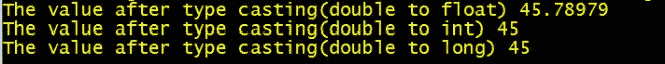

无关类型之间无法进行强制转换，例如从`float`到`boolean`（这将导致编译器错误）。

```java
// code
double d= 45.78979;

boolean b = (boolean) d; // compiler error
```

Output:

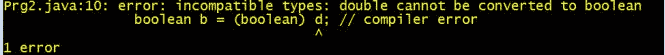

## 总结

类型转换是从一种类型到另一种兼容类型的自动转换。类型强制转换是从一种类型到另一种类型的显式转换。类型强制转换无法在无关类型之间进行。


# 第 25 章：算术运算符和关系运算符

## 目录

- 引言
- 什么是运算符？
- 使用算术运算符
- 使用关系运算符
- 总结

## 引言

在本章中，我将讨论如何使用算术运算符和关系运算符。算术运算符和关系运算符构成了 Java 数学计算的核心。

## 什么是运算符？

它们是执行特定操作的特殊符号。运算符可以与多个操作数一起工作。

Java 支持 5 类运算符：

- 算术
- 关系
- 位运算
- 逻辑
- 赋值

## 使用算术运算符

它们用于创建数学表达式。一些算术运算符包括：

- `+` : 加法（作用于 2 个操作数）
- `-` : 减法（作用于 2 个操作数）
- `/` : 除法（作用于 2 个操作数）
- `*` : 乘法（作用于 2 个操作数）
- `%` : 取模（取余-作用于 2 个操作数）
- `++` : 一元递增（作用于 1 个操作数）
- `--` : 一元递减（作用于 1 个操作数）

让我们通过示例来理解算术运算符。

```java
//Prg.java
//Description :使用算术运算符
class Program {
    static void ariOps() {
        int i=20,j=10;
        int sum = i+j;
        int subs = i-j;
        int prod = i*j;
        int div = i/j;
        int rem = i % j;
        i++;
        --j;
        System.out.println(" The sum is :"+ sum);
        System.out.println(" The substraction is :"+ subs);
        System.out.println(" The multiplication is :"+ prod);
        System.out.println(" The division is :"+ div);
        System.out.println(" The remainder is :"+ rem);
    }
    public static void main(String args[]) {
        ariOps();
    }
}
```

Output:


## 关系运算符

关系运算符作用于 2 个操作数。它用于判断两者之间的关系。它们用于控制结构，例如`if`、`while`等。关系表达式的结果是布尔值。

关系运算符列表如下：

| 表达式 | 结果 |
| :--- | :--- |
| `op > op2` | `op`大于`op2` |
| `op >= op2` | `op`大于或等于`op2` |
| `op < op2` | `op`小于`op2` |
| `op <= op2` | `op`小于或等于`op2` |
| `op == op2` | `op`和`op2`相等 |
| `op != op2` | `op`和`op2`不相等 |

让我们通过示例来理解关系运算符的使用。

```java
//Prg2.java
//Description :关系表达式
class Program {
    static void relOps() {
        int i=10;
        int j=20;
        if ( i == j ) {
            System.out.println("i is equal to j");
        }
        if (i > j) {
            System.out.println("i is greater than j");
        }
        if (i < j) {
            System.out.println("i is less than j");
        }
        System.out.println("i==j "+(i==j));
        System.out.println("i > j "+(i>j));
        System.out.println("i < j "+(i<j));
    }
    public static void main(String args[]) {
        relOps();
    }
}
```

Output:


## 总结

运算符是执行特定操作的特殊符号。关系表达式的结果是布尔值。算术运算符用于数学运算。


# 第 26 章：逻辑运算符和三元运算符

## 目录

- 引言
- 使用逻辑运算符
- 使用三元运算符
- 使用 instanceof 运算符
- 总结

## 引言

在本章中，我将讨论如何使用逻辑运算符、三元运算符和`instanceof`运算符。

## 使用逻辑运算符

它们用于将多个条件绑定在一起。关系运算符通过逻辑运算符结合在一起。Java 中有 4 种逻辑运算符。

| 运算符符号 | 运算符名称 |
| :--- | :--- |
| `&&` | 与 (AND) |
| `||` | 或 (OR) |
| `!` | 非 (NOT) |
| `^` | 异或 (XOR) |

逻辑运算符描述：

1. `与`运算符 (`&&`) - 当两个条件都为真时返回真。
2. `或`运算符 (`||`) - 当任意一个条件为真时返回真。
3. `非`运算符 (`!`) - 反转布尔值。
4. `异或`运算符 (`^`) - 当两个条件不同时返回真。

让我们通过示例来理解逻辑运算符。

```java
//Prg.java
//Description:使用“与”运算符
class Program {
    static void andOps() {
        int a=10;
        int b=20;
        if (a > 5 && b < 25) // 当两个条件都为真时执行
            System.out.println("Value of a,b is greater than 5 and less than 25");
        else {
            System.out.println("Value of a:" + a);
            System.out.println("Value of b:" + b);
        }
    }
    public static void main(String args[]) {
        andOps();
    }
}
```

Output:


```java
//Prg2.java
//Description:使用“或”运算符和“非”运算符
class Program {
    static void orOps() {
        int a=10;
        int b=20;
        if (a > 5 || b < 25) // 当任意一个条件为真时执行
            System.out.println("Value of a,b is greater than 5 and less than 25");
        else {
            System.out.println("Value of a:" + a);
            System.out.println("Value of b:" + b);
        }
    }
    static void notOps() {
        boolean b=true;
        if (!b)
            System.out.println("Value of b is false");
        else
            System.out.println("Value of b is true");
    }
    public static void main(String args[]) {
        orOps();
        notOps();
    }
}
```

Output:


## 使用三元运算符

它用于根据布尔表达式为变量赋值。它可以作为`if/else`语句的替代方案。

语法：

`result = 某些条件 ? value1 : value2;`

如果条件为真，则返回`value1`，否则返回`value2`并存储在`result`变量中。

让我们通过示例更好地理解三元运算符。

```java
//Prg3.java
//Description :使用三元运算符
class Program {
    static void terOps() {
        int j=10;
        String result = false ? "Superman is the greatest" : "Batman is better";
    }
}
```

```java
System.out.println(result);
result = j>20 ? "J is greater than 20" : "J is not less than 20";
System.out.println(result);
}

public static void main(String args[]) {
    terOps();
}
}
```

Output:

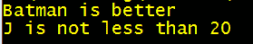

## 使用 instanceof 运算符

它用于检查给定的变量是否属于给定的类型。它也被称为比较运算符，即它将变量与类型进行比较。

让我们通过示例来理解`instanceof`运算符。

```java
//Prg4.java
//Description : Using instanceof operator

class Program {
    static void instOps() {
        Program obj = new Program();
        if (obj instanceof Program)
            System.out.println("obj is typeof Program");
        else
            System.out.println("obj is not typeof Program");
    }

    public static void main(String args[]) {
        instOps();
    }
}
```

Output:


如果与`null`值一起使用，它将返回`false`。

```java
//Prg5.java
//Description : Using instanceof operator with null

class Program {
    static void instOps() {
        Program obj=null;
        if (obj instanceof Program)
            System.out.println("obj is typeof Program");
        else
            System.out.println("obj is not typeof Program");
    }

    public static void main(String args[]) {
        instOps();
    }
}
```

Output:


## 总结

逻辑运算符用于共同检查多个条件。`instanceof`运算符用于检查给定的变量是否属于给定类型。


# 第 27 章：数组

## 目录

- 简介
- 什么是数组？
- 使用一维数组
- 使用多维数组
- 总结

## 简介

在本章中，你将学习如何对数组进行操作。数组被用作内存中大量数据的实体。我还将讨论一维数组和多维数组。

## 什么是数组？

它是一个在运行时存储在内存中的数据容器。数组的属性如下：

1. 固定大小 – 在使用之前已知以字节为的大小。
2. 单一类型 – 它只能是单一类型。
3. 使用索引访问。
4. 索引从 0 开始。

因此，数组可以定义为内存中的数据容器，具有固定大小并属于给定的数据类型。Java 数组是安全的，也就是说它们经过边界检查。如果用户访问超出边界，`JVM`将抛出异常。

数组定义的语法：

`Datatype arobj=new Datatype[size];`

数组用于快速方便地访问数据。它消除了创建许多变量的需要。位于数组中的数据可以使用索引访问。

数组有 2 类型，即：

1. 一维。
2. 多维。

## 使用一维数组

它们拥有一行和固定数量的列。`Length`属性用于获取数组的长度。

### 数组声明

- `Datatype ar[];`
- `Datatype []ar;`

### 数组定义

- `Datatype obj[]=new Datatype[size];`
- `Datatype []obj=new Datatype[size];`

让我们通过示例来理解一维数组的使用。

```java
//Prg.java
//Description : Working with dimension arrays

class Program {
    static void sdOps() {
        int []ar2;
        int ar3[] = {1,2,5,6,7,8};
    }
    static void sd2() {
        int []ar = new int [5];
        ar[0]= 20;
        ar[1]=40;
        ar[2]=50;
        ar[3]=60;
        ar[4]=70;
        System.out.println("The length of the array is:"+ ar.length);
        for (int i=0;i< ar.length;i++)
            System.out.println("The location : "+ i + " has value:"+ ar[i]);
    }
    static int[] sqArray(int ar[]) {
        for (int i=0;i<ar.length;i++)
            ar[i]= ar[i]*ar[i];
        return ar;
    }
    static void show(int ar[]) {
        System.out.println("\n");
        for (int i=0;i< ar.length;i++)
            System.out.println("The location : "+ i + " has value:"+ ar[i]);
    }
    public static void main(String args[]) {
        sdOps();
        sd2();
        int ar[] = {1,2,5,6,7};
        int sq[] = sqArray(ar);
        show(sq);
    }
}
```

Output:

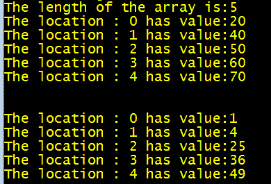

如果访问超出数组的边界，`JVM`将抛出异常。

```java
// code snapshot
int []ar = new int [5];
ar[0]= 20;
ar[1]=40;
ar[2]=50;
ar[3]=60;
ar[4]=70;
```

Output:


## 多维数组

数据存储在行和列的组合中。MD 数组可以是 2、3 或 N 维。

MD 声明：
- `dataType[][] ar;`
- `dataType [][] ar;`
- `dataType ar][];`
- `dataType ar[];`

让我们理解如何创建和访问 2 维数组。

```java
//Prg2.java
//Description : Working with multidimension array
class Program {
```


`static void muldOps()` {

    `int ar[][] = {{2,3},{3,4},{6,7}};`

    `int []ar2[] = {{4,5},{6,7}};`

}

`static void muldOps2()` {

    `int ar[][] = new int [2][2];`

    `ar[0][0]=5;`

    `ar[0][1]=1;`

    `ar[1][0]=3;`

    `ar[1][1]=7;`

    `for (int i=0;i< ar.length;i++)` // 获取行长度

        `for (int j=0;j < ar[0].length;j++)` // 获取列长度

            `System.out.println("The value at location :"+i+"]["+j+"] is :" + ar[i][j]);`

}

`static int [][]dOps3(int ar[][])` {

    `ar[0][0]=ar[0][0]*ar[0][0];`

    `ar[0][1]=ar[0][1]*ar[0][1];`

    `ar[1][0]=ar[1][0]*ar[1][0];`

    `ar[1][1]=ar[1][1]*ar[1][1];`

    `return ar;`

}

`static void show(int ar[][])` {

    `for (int i=0;i< ar.length;i++)` // 获取行长度

        `for (int j=0;j < ar[0].length;j++)` // 获取列长度

            `System.out.println("The value at location :"+i+"]["+j+"] is :" + ar[i][j]);`

}

`public static void main(String args[])` {

    `muldOps();`

    `muldOps2();`

    `int ar[][] = {{2,3},{3,4},{6,7}};`

    `System.out.println("\n Before square");`

    `show(ar);`

    `System.out.println("\n After square");`

    `int ar2[][] = dOps3(ar);`

    `show(ar2);`

}

输出:

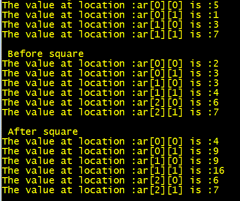

让我们理解如何创建和访问 3 维数组。`Length` 属性用于获取给定维度的大小。
`ar[0].length` // 获取第一行的列长度

```java
//Prg3.java
//Description : Working with multidimension array(3D)
class Program {
    static void muldOps() {
        int ar[][][] = new int [2][2][2];
        ar[0][0][0]=5;
        ar[0][0][1]=1;
        ar[0][1][0]=3;
        ar[0][1][1]=8;
        ar[1][0][0]=2;
        ar[1][0][1]=9;
        ar[1][1][0]=6;
        ar[1][1][1]=4;
        for (int i=0;i< ar.length;i++) // 获取行长度
            for (int j=0;j < ar[0].length;j++) // 获取列长度
                for (int k=0;k < ar[0][0].length;k++)
    }
}
```

```java
System.out.println("The value at location :ar["+i+"]+"["+j+"]+"["+k+"] " is :" + ar[i][j][k]);
}
public static void main(String args[]) {
  muldOps();  
}
}
```

输出:

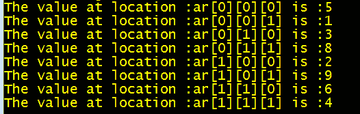

## 总结
数组是内存中的数据容器。它是固定大小且具有特定数据类型的。`Length` 属性返回当前维度的大小。


# 第 28 章: 锯齿数组 (Jagged Arrays)

## 主题
- 引言
- 使用锯齿数组
- 总结

## 引言
在本章中，我将讨论如何创建和使用锯齿数组。锯齿数组通过允许创建用户需要的数组来更好地利用内存。

## 使用锯齿数组
这是一种多维数组，其中每一行的列数可以不同。首先标识行，然后为每行标识列。这有助于根据需求分配内存，从而减少内存浪费。

### 语法
```java
int ar[][] = new int[2][];
ar[0] = new int[2];  // 第一行将有 2 列
ar[1] = new int[3];  // 第二行将有 3 列
```

让我们通过示例来理解锯齿数组。

```java
//Prg.java
//Description : 锯齿数组操作
class Program {
    static void jaggOps() {
        int ar[][] = new int[3][];
        ar[0]=new int [1];
        ar[1] = new int[2];
        ar[2] = new int [3];
        for(int i=0;i<ar.length;i++)
            for(int j=0;j<ar[i].length;j++)
                ar[i][j] = i*j;
        for(int i=0;i<ar.length;i++)
            for(int j=0;j<ar[i].length;j++)
                System.out.println("The value at location :ar["+i+"]+"["+j+"] is :" + ar[i][j]);
    public static void main(String args[]) {
        jaggOps();
    }
}
```

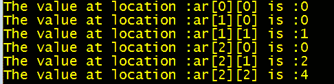
行数为 2。第一行有 2 列，第二行有 3 列。

## 总结
在锯齿数组中，列数可以不同。锯齿数组有助于优化内存。


# 第 29 章: For Each 循环 (For Each Loop)

## 主题
- 引言
- 使用 For Loop
- 总结

## 引言
在本章中，我们将讨论如何使用 For Each 循环遍历数组。对于聚合类型，for each 循环比 for 循环更好且简单。

## 使用 For Loop
这是在 Java 5 中引入的。for each 循环用于遍历数组和集合，即它是专门用于聚合类型的循环。与 `for`、`while` 和 `do..while` 循环相比，for each 循环不容易出错，因为没有条件检查，因此使用起来更简单更安全。

#### 主要特性
1. 不需要递增
2. 无条件检查

### 语法
```java
for(data_type variable : array) { }
```

让我们通过示例来理解 for each 循环的使用。

### 在单维数组上使用 each
```java
//Prg.java
//Description : 单维数组的 for.. each 循环
class Program {
    static void foreachOps() {
        int ar[] = {1,2,3,4,5,6,7};
        for(int i : ar)
            System.out.print(i+" ");
    }
public static void main(String args[]) {
        foreachOps();
    }
}
```

输出:


for each 循环也可以用于多维数组。外层循环遍历行，内层循环遍历列。

```java
//Prg2.java
//Description 使用多维数组的 for.. each 循环
class Program {
    static void foreachOps() {
        int ar[][] = {{13,22},{36,43},{56,68},{71,83}};
        for(int i[] : ar)
            for (int j : i)
                System.out.print(j+" ");
    }
public static void main(String args[]) {
        foreachOps();
    }
}
```
