# Learn Java：1周掌握 Java 快速上手指南

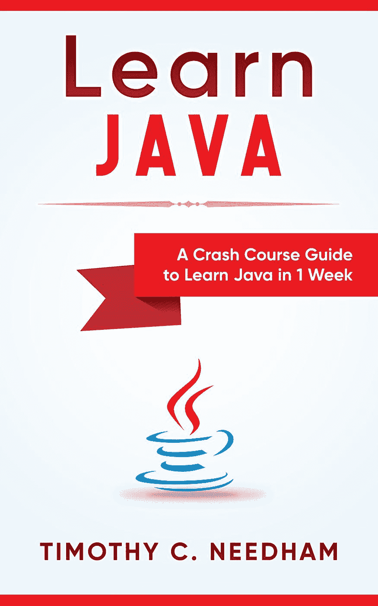

|  |  |  |


# 引言


我想感谢你并祝贺你下载了《Java 初学者：1 周学会 Java 的速成指南》这本书。

这本书是针对 Java 编程的终极学者速成课程，因为它将帮助你在最短 1 周内掌握该语言的足够知识！

我们都有梦想。我的梦想可能是成为一名伟大的老师，而你的梦想可能是在 IT 领域拥有辉煌的职业，或者通过提升 IT 领域的技能和知识来实现自我价值（或类似的目标）。毫无疑问，`Java Programming Language` 提供的实践经验和专业知识，是任何渴望成为专业程序员的人的必备要求。

但虽然你可能有动力去学习这门语言，但我确定你多次问过自己一些问题：为什么要编程？或者为什么要选择 Java？你学习编程——特别是学习 Java——有许多原因，其中大部分我确定你已经知道了。不过如果你问我的话，我可能会直率地说，我们中有些人学习是为了赚钱。学习编程这门艺术和职业确实会带来许多与自我实现和成就感相关的收益，但经济上的收益实在太明显了，无法忽视。

首先，Java 可能是最受推崇的技能，几乎在任何地方都需要它。IBM、Infosys、Twitter、Netflix、Google、Spotify、Uber、Amazon、Target、Yelp、Square 以及[其他大厂](https://siftery.com/java) 始终需要优秀的 Java 程序员。根据 `PayScale.com`（提供薪资信息的网站），Java 开发人员的平均年约为约为 70,000 美元。作为该领域的专业人士，你可以在全球范围内工作，因为需求不受限于特定的地理区域。

这本书是专为设计的终极指南，旨在帮助你从一个对编程完全陌生的人转变为一个能够教授该学科并完成良好编程项目的人。酷的地方在于：你可以在一个周内学会所有内容！它已更新到最新版本（8 和 10），书中将涵盖的主题包括：

* 变量

* 条件

* 循环

* 数组

* 运算符

* 用户输入

* 类

* 对象

* 方法

* 面向对象编程，包括：

    * ✓ 继承

    * ✓ 封装

    * ✓ 多态

    * ✓ 组合

以及更多、更多更多的内容！让我们开始学习吧。

再次感谢下载本书。我希望你喜欢它！

# 了解术语：词汇表


虽然下面的列表并不能涵盖你在使用和学习 Java 时会遇到的所有术语，但它将为你提供一个良好的起点，以确保你理解正在讨论的内容。

* `IDE`（集成开发环境） - 指的是一种为你提供软件开发或基础编程全方位设施的软件应用程序。它通常由内置的自动化工具、源代码编辑器和调试器组成。

* `PATH` - 在其通用形式下（目录或文件），路径指的是文件系统中的特定位置。

* `Source code repository`（源代码仓库）- 指的是一种文件归档和网络托管设施，其中存储了大量的网页或软件源代码，分为私有或公开两种形式。它们通常被开源软件项目以及某些多开发者项目使用，以处理各种版本。

* `Refactoring`（重构）- 指的是改变软件系统的过程，这种改变不会影响代码的外部行为，但会改进其内部结构。

* `Unicode` - 指的是一种 16 位字符编码标准，能够表示世界上所有已知语言的几乎所有字符。

* `Compiler`（编译器）- 编译器是一种特殊的程序，负责处理用编程语言编写的语句，并将其转换为计算机处理器使用的代码（或机器语言）。

* `Heap`（堆）- 指预留计算机主存储或内存的一部分，程序进程可以访问它来存储变量数量的数据，而这种数量在程序运行之前是未知的。

* `Syntax`（语法）- 指编程语言中的通用规则集，描述了在该特定语言中被认为结构正确的程序的符号组合。

* `Constructors`（构造函数）- 它们是在对象实例化或当你使用 `new` 关键字时调用的特殊方法。

* `Modifiers`（修饰符）- 这些是 Java 中的关键字，你可以将其添加到类、变量和方法以改变它们的含义。

* `Naming convention`（命名规范）- 指你遵循的确定包、类、常量、方法或变量等标识符命名的规则。

* `Object oriented programming (OOP)`（面向对象编程）- 是软件设计中的一种计算机编程方式，允许程序员定义数据结构的数据类型以及适用于该数据结构的功能或操作类型。

* `Access modifiers`（访问修饰符）- 也称为访问限定符，访问修饰符是设置方法、类及其他成员的可访问性的关键字。它们是编程语言语法的特定部分，有助于组件封装。

正如我之前提到的，上面的列表绝非详尽。然而，在此时它将是很有用的，因为一个更大的列表会让人无从下手。如果某些地方不清楚，你可以随时查阅此列表。

考虑到这些，让我们开始学习。万一你对此完全陌生，我们将从基础知识开始：

|  |  |  |


# Java 编程：背景


在我们进入 Java 编程之前，让我们先确保你理解什么是计算机编程（或编码）。

## 什么是编程？

根据定义，编程是构建软件的过程，它由指令组成，这些指令通常被称为 `source code`。在本书中，我们将学习这些基础。

### 源代码像什么样？

`source code` 基本上是计算机可以理解的指令。在开始之前，我们需要理解这一点。请查看以下代码：

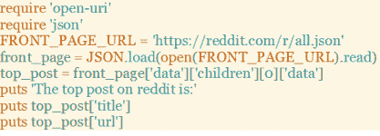

在某些情况下，代码是正确的，遵循自然语言的。请查看以下代码：

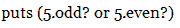

### 编程还包括测试和调试

在编写代码时，必须进行测试，因为代码可能会崩溃或显示错误结果。专业程序员通常使用不同的方法来测试代码，以避免此类问题。最后，我们有一个术语叫做 `debugging` -这是调查、诊断和修复问题的过程。在本书的过程中，你将会发现。

### 所以，什么是 Java 编程语言？

Java 编程语言是一种计算机编程语言，它独特地允许你使用英语来编写计算机指令，而不是编写机器代码。就像英语一样，Java 有一些规则决定这些指令如何编写；这些规则被称为 `syntax`。基本上，当编写程序时，高级指令会被转换为计算机可以理解并执行的代码。

## 是谁创建了 Java？

Java 是 90 年代初由名为 James Gosling 的人为 Sun Microsystems（现由 [Oracle](https://www.oracle.com/sun/index.html) 所有）创建的。该程序最初被称为 `Oak`。

Java 最初设计用于编写由不同计算机处理器控制的家电器，随后是手机等设备。很快，人们意识到这种语言需要被各种计算机处理器访问。1994 年，这种语言被认为非常适合用于浏览器，很快，它与互联网的联系开始了。1995 年，Netscape 发布了能够运行 Java 程序的最新版本 Netscape 浏览器，1996 年当 Java 1.0 发布时，它的主要重点已经转向互联网使用，从而通过为开发者提供创建动态网页的好方法来实现与用户的交互性。

自 1.0 版本以来，我们看到了许多更新和发展，例如：

* `J2SE 1.3` 发布于 2000 年

* `J2SE` 发布于 2004 年

* `Java SE 8` 发布于 2014 年

* `Java SE 10` 发布于 2018 年

多年 Java Java 无疑演变成了一种可以在互联网内外使用的优秀且成功的语言。让我们接触一下使用 Java 编程语言的优点：

每种编程语言的引入都有其目的，并具有某些优点。尽管每种语言都提供了开启蓬勃职业生涯的机会，但 Java 通常更受青睐。Java 的优点确实数不胜数，但我将简要提到几点。

### ✓ 你可以获得丰富的信息

虽然现有的编程语言之间没有明显的竞争，但 Java 凭借其丰富的信息，有时被认为是最好的。Java 已经存在多年，因此对于你脑海中出现的关于编程的所有查询，你都可以快速获得答案。因此，在磨练技能的过程中，你可以轻松地解决每一个问题。

### ✓ 易于学习

有时初学者倾向于认为，语言越好，可能越难学。然而，事实并非如此——至少对于 `Java` 来说不是。确实有一些不可避免的初始障碍，但该语言使用普通的简单英语，而不是泛型或多重括号，这使得该语言变得易于学习。当你学会了如何正确安装 `JDK` 和配置 `PATH` 后，剩下的学习和实现过程将非常有趣。

### ✓ 你将获得强大的工具集

你经常会听到，在编程中，语言的工具集对于决定其整体成功起着主要作用。`Java` 在这方面无疑具有优势，因为它对开源系统提供了完整的支持。这意味着作为用户，你可以获得几乎满足你所需一切的工具。我们有许多开源库，提供了有关与 `Java` 编程相关的所有主题的信息。此外，还有许多社区（尤其是在线社区）来指导新程序员。

### ✓ 你可以从自己的错误中学习

我们有几种语言设计用于教导或允许你从自己的错误中学习，并让你建立基础。`Java` 包含一些出色的 `IDE`（`IDE` 指的是集成开发环境——参见术语表），这些工具会在你犯错时立即提醒你。此外，该语言还建议你重新格式化代码并给出这样做的理由。这样，你从基础阶段开始对编码有清晰的理解，在开始职业旅程时几乎不会犯任何错。

### ✓ 语言是免费的

获取 `Java` 从一开始开始就不需要产生任何费用。因此，无论你处于学习阶段还是专业阶段，都可以使用 `Java` 创建或开发应用程序，而无需向任何人支付现金。你只需要学习如何获取程序、设置它并开始即可。

### ✓ 为专业人士提供更好的前景

作为打算学习编程语言以开启职业生涯的人，`Java` 仍然是你的最佳选择。它被应用于大多数现有程序中，其应用范围仍在进一步扩大。因此，通过学习这种语言，与其他专门学习语言的程序员相比，你可以预期在行业中拥有更好的职业。

考虑到所有这些，让我们开始实际学习 `Java`。

# 基础知识/先决条件

本节描述了你在开始编写任何代码之前需要准备的东西。要开始，你应该下载 `Java`（Java 运行环境 -JRE/ Java 开发工具包-`JDK`）以及集成开发环境 `IDE`。

## 如何下载和安装 Java

对于任何操作系统，下载和安装 `Java` 都是简单的。我将向你展示如何以 Linux 和 Windows 操作系统为例下载并安装此程序。

# 1: Linux

在本节结束时，你将为你的 Linux 机器安装并配置好 `Java`——无论是 Debian、Mint 还是 Ubuntu。不过，在整个指南期间我将使用 Ubuntu 14.04，并提到终端和非终端的操作方法，以帮助完全的新手跟进。

你将安装 Oracle `JRE` 或 Oracle `JDK`，因此你需要真正理解两者之间的区别。

### Oracle JRE (Java 运行环境)

`JRE` 是执行 `Java` 程序的最低要求。它包含了 `JVM`（Java 虚拟机）、支持文件和核心类。换句话说，如果你只关乎在计算机或浏览器上运行 `Java` 程序，你将安装 `JRE`。

### Oracle JDK (Java 开发工具包)

这是一个软件开发工具包，包含了 `JVM`、`JRM`（Java 运行环境）以及生产环境中用于构建和编译程序的整个类库列表。因此，如果你想进行一些 `Java` 开发，你就需要 `JDK`。

话虽如此，让我们开始吧。

### 创建 Java 文件夹

作为示例，我们首先在 `/usr/local` 目录下创建一个名为“Java”的空文件夹，用于你的 `JRE/JDK` 文件，使文件夹路径为：`/usr/local/java`。进入终端并输入以下命令然后按确定：

### 检查 Linux 版本

在下载 `java` 文件之前，你必须了解你正在运行的 Linux 版本（32 位或 64 位）。

#### 终端方法

打开终端并输入以下命令，然后按确定：

```bash
file /sbin/init
```

例如，你可以从上面的图中看到，执行命令前接收的结果告诉我我运行的 Linux 版本是 64 位的。

尝试在不使用终端的情况下执行操作：

#### 非终端方法

作为 Ubuntu 用户，你可以通过检查系统设置系统面板下的详细信息来检查版本。

如你所示，将弹出“详情”（details）对话框。你将在“概述”（overview）标签旁边看到 Linux 版本。

### 下载 Oracle JRE/JDK

前往 Java [下载页面](http://www.oracle.com/technetwork/java/downloads/index.html) 并选择 `JRE`。由于你只是在计算机上运行 Java 程序（正如我之前提到的），不需要 `JDK` 中全功能的软件开发工具包（尽管它包含了 `JRE`），那仅适用于安卓开发等应用开发，`JRE`（而不是 `JDK`）就足够了。

如果你选择 Java `JRE`，弹出像下面的屏幕。在 Java SE Runtime Environment 下方，你会看到“接受许可协议”，勾选该框。

如果你运行的是 32 位 Linux，选择 Linux x86 链接。如果你运行的是 64 位 Linux，选择 Linux x64 链接。

文件将下载到目录：`home/username/downloads`。例如，如果你的用户名是 panda，它将是 `home/panda/downloads`。

### 将 tar.gz 格式的 JRE/ JDK 文件复制到目录 /usr/local/java

输入以下代码并回车：

如果你下载的是 32 位 Oracle `JDK`，你将输入以下代码并按回车：

在下方输入代码并按回车键。

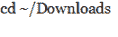 

如果你下载了 JRE (32 位)，只需输入以下代码并按回车：

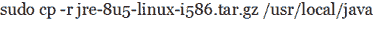

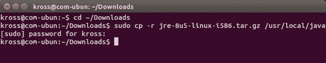

## 如何在 64 位 Linux 中复制 Oracle JDK (64 位)

像往常一样，输入以下代码并按回车：

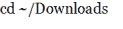

如果你下载了 Oracle JDK (64 位)，只需输入以下代码并按回车。

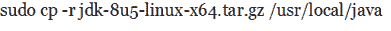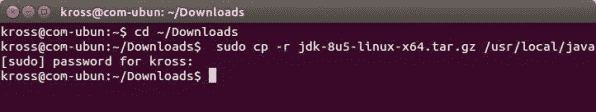

## 如何在 64 位 Linux 中复制 Oracle Java JRE

输入以下代码并按回车：

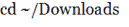

如果你下载了 oracle JRE (64 位)，你可以输入以下代码并按回车：

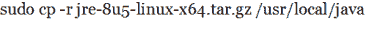

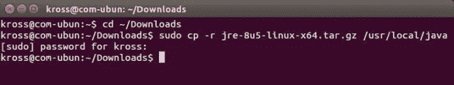

将 `tar.gz` JDK/JRE 文件解压到目录：`/usr/local/java`

### 在 32 位 Linux 中复制 oracle Java

输入以下代码并按回车：

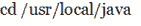

如果你下载了 oracle JDK (32 位)，只需输入以下代码并按回车。

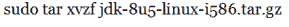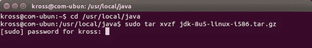

在 32 位 Linux 中通过输入以下代码解压 Java JRE (32 位)，然后按回车：

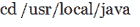

如果你下载了 oracle JRE (32 位)，输入以下代码并按回车：

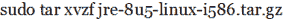

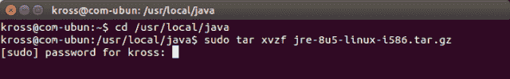

64 位 Linux 下 Java JDK (64 位) 又是如何呢？只需输入以下代码并按回车：

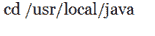

对于 Oracle JDK (64 位)，输入以下代码并按回车。

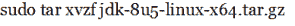

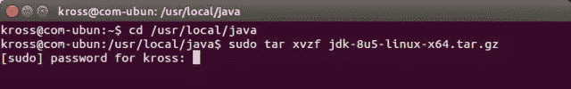

在 64 位 Linux 中通过输入以下代码解压 oracle Java JRE (64 位)：

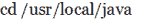

如果你有 oracle JRE (64 位)，只需输入以下代码并按回车：

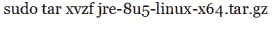

## 编辑系统路径

首先打开终端并输入以下内容：

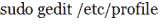

通过这样做，你将打开一个文本编辑器，其中包含所有的 Linux 系统级启动程序。

一直滚动到文件末尾，将以下行附加到 `/etc/profile` 文件的末尾：

如果你正在处理 JDK，只需添加以下代码：

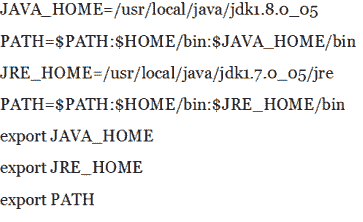

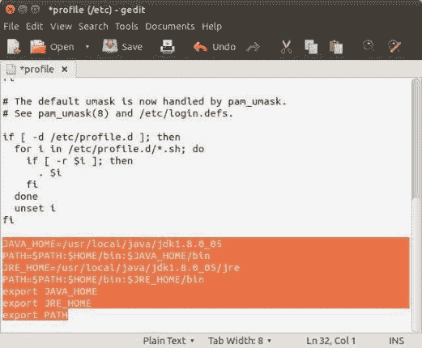


如果你正在安装 JRE，你应该编写以下代码：

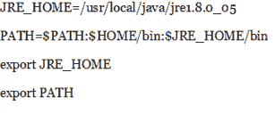

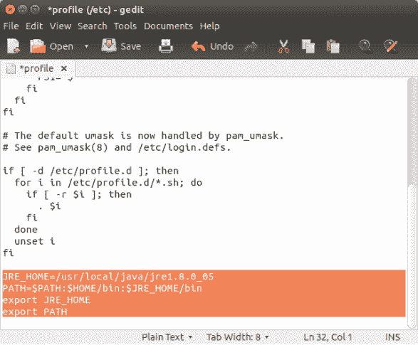

保存文件并退出。

## 通知 Linux 你的 Java 位置

以下命令会让你的系统知道 `java` JRE/JDK 是可以访问或使用的。

### 对于 32 位或 64 位 JDK

在这种情况下，只需输入以下代码并按回车。

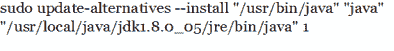

输入以下代码并按回车：

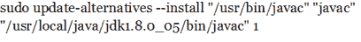

输入以下代码并按回车：

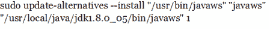

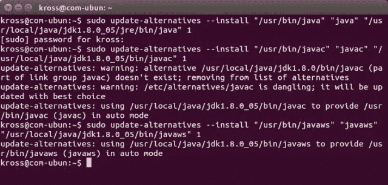

### 对于 32 位或 64 位 JRE

如果你正在处理 JDK，只需输入以下代码并按回车：

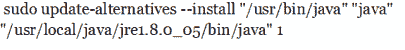

输入以下代码并按回车。

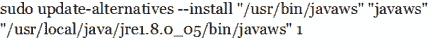

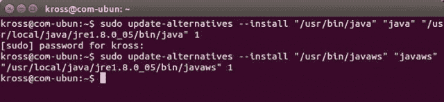

## 将 Oracle Java JRE/JDK 设置为默认 Java

如果你正在处理 JDK，只需输入以下代码并按回车：

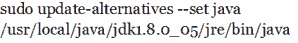

对 JDK 执行同样的操作（输入以下代码）并按回车：

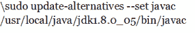

同样输入以下代码并按回车：

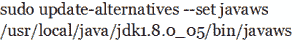


### 对于 Oracle JRE (64 位)

如果你有 Oracle JRE (64 位)，只需输入以下代码并按回车：


### 对于 Oracle JRE (32 位)

如果你下载了 Oracle JRE (32 位)，输入以下代码并按回车：


### 对于 Oracle JDK (32 位)

如果你下载了 Oracle JDK (32 位)，只需输入以下代码并按回车。


### 对于 Java JRE (32 位)

在 32 位 Linux 中通过输入以下代码解压 Java JRE (32 位)，然后按回车：


### 对于 Java JDK (64 位)

64 位 Linux 下 Java JDK (64 位) 又是如何呢？只需输入以下代码并按回车：


对于 Oracle JDK (64 位)，输入以下代码并按回车。


### 对于 Oracle Java JRE (64 位)

在 64 位 Linux 中通过输入以下代码解压 Oracle Java JRE (64 位)：


尽管如此，在我看来，它提供的最重要的因素是速度（坐在那里等待编译或加载的日子已经一去不返）。像 Eclipse 这样良好的 IDE 运行极快，不占用内存，加载时间短，而且同步更改不需要花费大量时间。一个优秀的编程专家还会提到一些你可以享到的其他功能，例如“与代码库集成”（参见词汇表）以及错误检查——例如静态代码分析和未使用引用的高亮。

|  |  |  |


## 在 Windows 上安装 Eclipse 的步骤

### 下载 Eclipse

访问[此链接](https://www.eclipse.org/downloads/) 并下载最新版本：


点击“get eclipse photon”下方的“download packages”（下载包）。作为初学者，你应该选择第四项“eclipse IDE for Java Developers”（32 位或 64 位）。

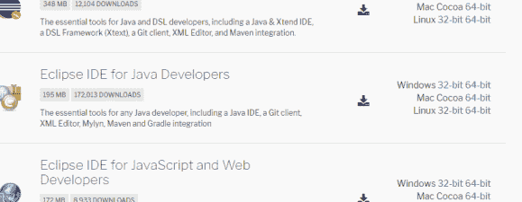

点击下载。

下一步涉及将解压下载的文件以进行安装。将文件解压到指定目录（例如，`c:\javaproject`）。

你不需要运行任何安装程序。更重要的是，当你不再需要它时，可以直接删除整个 eclipse 目录（而无需运行“卸载程序”）。可以随意重命名或移动该目录。此外，请注意，你可以在同一台机器上解压（安装）多个副本。

|  |  |  |


## 在 Mac OS X 上安装 Eclipse

重复上述为 Windows 下载和安装 Eclipse 的相同过程，使用[此链接](http://www.eclipse.org/downloads/)。只需确保选择 Mac OS X (cocoa)。当你选择“eclipse IDE for Java Developers”时，将得到一个 DMG 文件。双击此下载的文件（DMG）并按照随后提供的指示安装程序。程序将安装在位置：`/applications/eclipse`。

注意，你也可以下载一个 TAR 包（`.tar.gz`）；双击即可将其扩展为名为“eclipse”的文件夹，然后将此展开文件夹拖入“applications”文件夹。

|  |  |  |


## 在 Ubuntu Linux 上安装 Eclipse

通过[此页面](http://www.eclipse.org/downloads/) 下载适用于 Java 的 Eclipse。按照惯常，下载“packages”，对于平台选择“Linux”，然后选择“eclipse IDE for Java developers”用于 Java SE 程序开发。你将在下载文件夹中获得一个 `.tar` 包，安装将位于 `/usr/local`。

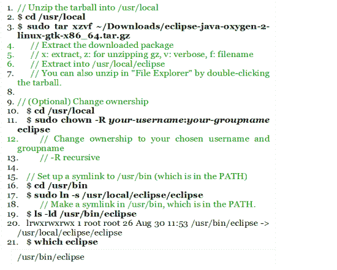

要运行 Eclipse，只需打开 `/usr/local/eclipse` 文件夹并点击图标“Eclipse”或者直接启动终端并输入 `Eclipse`。

### 在启动器中锁定 Eclipse

启动程序并右键点击 Eclipse 图标，然后点击“lock to launcher”（锁定到启动器）。如果你使用的是较旧版本（因此上述方法不起作用），只需创建一个文件 `/usr/share/applications/eclipse.desktop`，内容如下：

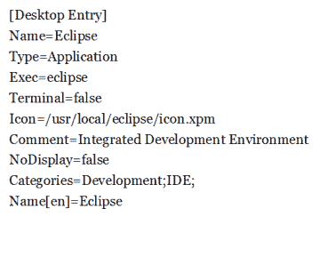

你现在可以在 Eclipse 中编写你的第一个 Java 程序或项目。

从 Eclipse 安装目录启动 Eclipse（运行 `eclipse.exe`），然后为你的工作空间选择一个合适的目录——即你想要保存文件的地方（例如 Windows 下的 `c:\javaproject\eclipse`）。

如果弹出名为“welcome”（欢迎）的窗口，点击“welcome”标题旁边的“cross”（交叉）按钮。

对于所有 Java 应用程序，你必须创建一个项目以包含所有的类（稍后会讨论）、源文件和重要资源。

执行以下操作创建项目：

*   选择“file”（文件）菜单，然后是“new”（新建），然后是“java project”（Java 项目）（或者“file”然后“new”然后“project”然后“java project”。）

*   弹出“new java project”对话框。

*   在“project name”（项目名称）中输入 `firstproject`。

*   勾选“user default location”（用户默认位置）。

*   在 JRE 中选择“use default JRE”（使用默认 JRE）。

*   在“project layout”（项目布局）中勾选“use project folder as the root for sources and class files”（使用项目文件夹作为源文件和类的根目录），然后点击“finish”（完成）按钮。

在我们继续（编写我们的第一个项目）之前，让我们过一遍 Java 的一些基本概念。

|  |  |  |


# Java 基础概念

|  |  |  |


# Java 标记

标记基本上是 Java 的最小逻辑组件。编译器的第一步是将整个程序分成称为标记的小块部分。你可以将它们理解为程序的构建块。让我们看看以下类型的标记：

*   关键字

*   操作符

*   字面量

*   分隔符

*   注释

*   字面量

让我们对每一个进行简要描述，以便有更好的理解。

|  |  |  |


## 关键字

关键字是特殊的词，或者在 Java 中被称为“保留”字，因为它们具有特殊的含义。我们有 50 个关键字，如下所示：

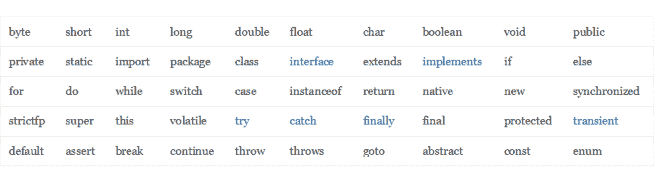

|  |

| 标识符

|  |

## 标识符

标识符是程序员在 Java 程序中任何方法、类、变量、包、对象、标签或接口使用的名称（稍后学习这些术语的含义）。

我们有标识符命名规则，包括：

*   Java 标识符除了符号 `$` 和下划线 `_` 之外不能包含任何特殊符号

*   标识符不能以数字开始

*   关键字已被保留并具有特殊含义——因此不能作为标识符使用

*   保留字面量也可以作为标识符；例如- `null`、`false` 和 `true`

*   你不能为多个标识符使用同一个名称。标识符对大小写敏感，因此 `Mf` 和 `mf` 变量是不同的。

在这种情况下，有效标识符的良好示例包括：

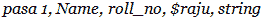

无效标识符将包括类似：

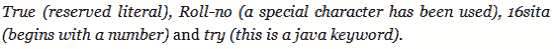

注意：Java 中的保留字面量和关键字是你不能作为变量或函数名称使用的词。

运算符是你在应用于某些操作数时产生某些结果所使用的符号。在 Java 中，我们有不同类型的运算符。正如你所看到的，某些字符串也可以用作运算符。本质上，运算符在构建表达式和语句时非常重要——其中包含：`-`、`+`、`*`、`=`、`>=` 等。

|  |  |  |


# 分隔符


分隔符也被称为标点（punators）。这些特殊字符和符号将代码的不同部分与其他部分隔离开。有时，它们会连接和分离一个或多个标记（tokens），或者组织代码块——这就是为什么我们称之为分隔符。

在 Java 中，使用的标点符号包括分号（`;`）、句号（`.`）、逗号（`,`）、一对方括号（`[`，`]`）、一组圆括号（`(`，`)`）、一对大括号（`{`，`}`）。

|  |  |  |


## 字面量

字面量是指 Java 编程执行过程中不会变化的任何值。你可以将它们视为字面量的常量。这些是某些字符串类型或原始类型的常量值。任何在 Java 中使用的字面量必须是下面提到的类型之一：

*   字符

    这是在内存中存储 `Character` 常量的内容。它基本上占用 2 字节的大小，但只能存储一个字符，因为 `char` 存储的是 Unicode 字符集。它包含最大值 65535 和最小值 0。

*   整数

    整数类型基本上可以存储像 `-96` 和 `123` 这样的整数。可以存储的值的大小主要取决于我们选择的整数类型。

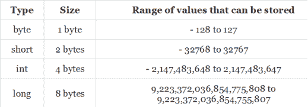

此计算 `− (2^(n−1))` 到 `(2^(n−1)) −1` 用于值的范围。在这里，`n` 代表所需的位数——例如，`byte` 数据类型需要 1 字节= 8 位。因此，在 `byte` 数据类型中可以保留的值范围如下：

`−(2^(8−1))` 到 `(2^(8−1))−1= −2⁷ 到 (2⁷) -1`

*   浮点数/数据类型

    这些是我们用来表示带有小数部分的数字的数据类型。单精度浮点数通常占用 4 字节，而双精度浮点数占用 8 字节。这里有两个子类型：

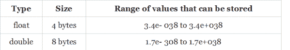

*   布尔

    布尔数据类型基本上存储具有两种状态的值：`false` 或 `true`。

通过下例可以更好的理解：

*   `34.43`

*   `5322`

*   `‘d'`

*   `Null`

*   `True`

|  |  |  |


## 注释

在 Java 中，注释用于文档记录过程。有些人不把注释放在标记分类中，因为编译器在标记化过程中通常会忽略它们。

在 Java 中，多行注释以以下开头：

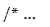

单行注释以以下开头：

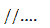

我们讨论的只是 Java 标记的基本概述。我希望你理解标记的含义。现在让我们写一个简单的 Java 程序，并将其分为不同的标记以指定它们的标记类型：

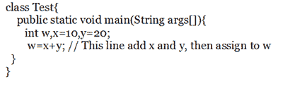

在上面写的程序中，

*   关键字包括 `public`、`class`、`void`、`static` 和 `int`。

*   标识符包括：`Test`、`main`、`args`、`x`、`w`。

*   运算符包括：`+` 和 `=`。

*   字面量包括：`20` 和 `10`。

分隔符包括：


注释描述为：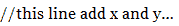

你可以看到这里，编译器将程序分解成更小的逻辑各个部分，称为标记（tokens）。

|  |  |  |


# 变量


变量是编程中存储数据的容器。当变量被声明时，它被初始化为某个值，稍后变为另一个值。变量可以进一步用于进行任何计算。

（注：原文此处存在大量重复句子，已按要求处理。）


变量是编程中存储数据的容器。当一个变量被声明时，它被初始化为某个值，稍后变为另一个值。变量可以进一步用于进行任何计算。

（注：原文此处存在大量重复句子，已按要求处理。）


`roll_number` 是变量名。

## Java 变量类型

在 Java 中，变量可以分为四类：

*   静态变量
*   实例变量
*   方法参数
*   局部变量

### 实例变量

实例变量也称为非静态字段，用于存储对象的状态。当变量被声明时，它被初始化为某个值，稍后变为另一个值。变量可以进一步用于进行任何计算。

（注：原文此处存在大量重复句子，已按要求处理。）

`int` 是数据类型，`roll_number` 是变量名。

*   实例变量对于类中的所有构造函数、块和方法都是可见的。通常，建议将这些变量设置为私有（`private`）或特定的访问级别。尽管如此，可以使用访问修饰符为子类提供这些变量的可见性。

*   可以通过在类内部调用变量名直接访问实例变量。然而，在静态变量中——即当实例变量提供可访问性时——需要使用完全限定名来调用。让我们来看一个例子：


通过此，你将得到以下结果：


## 类变量或静态变量

类变量也被称为静态变量，在类中使用 `static` 关键字声明，但位于方法、块或构造函数之外。无论从该类创建了多少个对象，每个类都只有一个类变量副本。

静态变量很少被使用——除了被声明为常量之外。常量本质上是声明为 `private`/`public`、`static` 和 `final` 的变量。常量变量永远不会从其初始值发生改变。

静态变量存储在静态内存中，通常不会将静态变量作为 `private` 或 `public` 常量。静态变量在程序启动时创建，程序停止时销毁。

可见性与实例变量相似。然而，大多数静态变量被声明为 `public`，因为它们需要对类用户可用。默认值与实例变量相似，对于数字，零代表默认值。对于 `Booleans` 为 `false`，对于对象引用为 `null`。值可以在构造函数内部或在声明期间赋值。此外，值可以在特定的静态初始化块中赋值。

访问静态变量需要使用类名进行调用——`className.VariableName`。

最后，如果我们将类变量声明为 `public static final`，这本质上意味着常量或变量名全部大写。此外，如果静态变量既不是 `public` 也不是 `final`，这意味着命名语法与实例变量和局部变量相似。

让我们来看一个例子：


将给出以下结果：

*   开发平均薪资：1000

你需要注意的是，如果从外部类访问变量，则需要以 `Employee Department` 的方式访问常量。

## 局部变量

局部变量用于存储方法的临时状态。用于声明局部变量的语法与声明字段相同——例如，`int count=0;`。你不会发现特定的关键字来将变量指定为局部变量，因为这种判断完全取决于变量声明的位置——即位于方法的结束括号和开始大括号之间。因此，局部变量仅对声明它的方法可见，因此无法从类的其他部分进行访问。

简而言之，局部变量被称为“局部”，是因为它们只能在声明它们的方法中被引用和在局部使用。下面是一个方法，其中“miles”是一个局部变量。


|  |  |  |


## 参数

参数也是传递到方法中的。例如，在 `main` 方法中，`string args []` 变量就是一个参数。


## Java 中的条件语句

在生活中，每当我们尝试完成事情时，我们都会接触不同的对象；同时，我们使用这些对象来执行不同的任务。我们倾向于接触的对象类型是数字或模拟设备，如手机、电脑、汽车、商场和办公室的自动门以及电视机。

结合上面的示例，你会发现 Java 中条件语句的概念描绘了我们处理日常生活的方式。在 Java 编程中，条件语句都是关于做出指向预期结果的决策。每天我们都做决定，对于这些决定，我们得到了特定的结果。

在 Java 编程中，当我们编写可以在任何设备（如上述设备）上运行的软件或设备时，有两种决策语句可以使用。这些语句基本上帮助设备及其用户根据特定的状态或条件执行某些操作。

`IF-STATEMENT` 是第一个条件语句。你需要注意的是 `if-statement` 包含三个版本，包括以下：

* `IF — STATEMENTS`
* `ELSE — IF STATEMENTS`
* `IF / ELSE STATEMENTS`

让我们使用提到的第一个设备来看看 `IF-statement` 是如何工作的。


在 Java 中，我们使用 `IF-statements` 来检查手机的条件或状态，当该条件为真时，动作就会执行。如果条件不成立，则什么都不会发生。现在让我们考虑手机；如果手机的条件或状态是电量低，手机就会通知你充电。如果手机存储空间满了，你可以收到一个通知来修复它，就像它通知你下载软件更新一样。

### IF-STATEMENT

在 Java 中，我们使用 `IF-statements` 来检查手机的条件或状态，当该条件为真时，动作就会执行。如果条件不成立，则什么都不会发生。现在让我们考虑手机；如果手机的条件或状态是电量低，手机就会通知你充电。如果手机存储空间满了，你可以收到一个通知来修复它，就像它通知你下载软件更新一样。

### if/else statements

现在让我们使用第二个设备来看看 `if/else` 语句是如何工作的。


当你看上面的图片时，你会看到“if 条件”语句被扩展，以便在第一个动作为假时完成另一个动作。上面的条件非常显而易见，因为它们在我们日常使用电脑时是显而易见的。

### If-Statements

这些语句的另一个版本被称为：

让我们使用提到的第三个设备来看看 `else-if` 语句是如何工作的。


除了 `if/else`，Java 还允许你通过 `else if` 关键字测试其他条件。让我们以第一个案例为例；你可以看到一旦测试了第一个条件，就决定测试另外两个条件，这些是我们日常使用空调时可能的后果。

### Switch case

最后，我们还有 `switch case`，这是 Java 中另一种条件语句。正如其名称所示，它是某种控制灯泡的 `switch case`。因此，这本质上意味着你可以多个开关作为条件来点亮不同的“灯泡”（或执行操作）。见下面的图片。

使用最后提到的设备，我们将查看 `switch case statement` 是如何函数的。


当你看上面的图片时，显然打开门所需的距离存储在 `distance` 变量中。在变量声明和初始化之后，接下来是 `switch case`，测试所有具有相应操作的距离。具体发生的是，你存储了执行特定操作所需的主要变量，然后包含可以执行其他操作的其他案例。

你需要注意的是，并不总是为了调用单个特定方法而需要使用 `switch case`，因为你可以用它创建一个场景，根据用户的意愿执行多个操作。

`switch case` 还可以包含任意数量的 `case`，此外，`default` 语句可用于在其他所有 `case` 都不符合所需操作时执行某项操作。请下下图。

通过我刚才提到的上一个设备，我们将看到 `switch case` 语句是如何与 `default` 语句一起工作的。


到此时，我确定你已经知道如何在 Java 中创建条件语句了。现在取决于在你最终开始编码时，将其包含在你的程序中。

|  |  |  |


# Java 中的循环


在 Java 或任何其他编程语言中，循环都是一种特性，当某些条件评估为真时，它能够便于反复执行一组指令或函数。Java 提供了三种执行循环的方式。

尽管所有方式都提供相同的基本功能，但它们通常在语法和条件检查时间上有所不同。

### While 循环

首先，`while` 循环是一种流程控制语句，允许根据特定的布尔条件重复执行代码。你可以将 `while` 循环视为重复的 `IF` 语句。


看看下方的流程图：


`while` 循环从检查条件开始。如果条件结果为真，则循环体语句将自动执行；否则，循环后的第一条语句将被执行。因此，它被称为**入口控制循环**。

当条件评估为真时，循环语句被执行。通常，语句中有一个针对正在处理的特定变量的所谓“更新值”，用于下一次迭代。

如果条件变为假，循环将终止，从而结束其生命周期。


当你在 IDE 上运行它时，得到以下输出：


### For 循环

这种类型的循环提供了一种简洁的循环结构编写方式。与 `while` 循环不同，`for` 语句在一行内使用了初始化、递增/减和条件，从而提供了一个更短、易于调试的循环结构。


流程图如下：


#### 初始化条件 (Initialization condition)

在这种情况下，你初始化正在使用的变量。它标记了 `for` 循环的开始。可以使用已经声明的变量，也可以声明一个仅局部于循环的变量。

#### 测试条件 (Testing condition)

这用于测试循环的退出条件。它必须返回一个布尔值。它也充当入口控制循环，因为在执行循环语句之前会检查条件。

#### 语句执行 (Statement execution)

当条件评估为真时，循环体语句被执行。

#### 递增/减 (Increment/decrement)

用于为下一次迭代更新变量。

#### 循环终止 (Loop termination)

如果条件为假，结果是循环终止，标记其生命期的结束：


当你在 IDE 上运行它时，得到以下输出：


#### 增强型 for 循环 (The Enhanced For Loop)

Java 还包含了 Java 5 中引入的另一个 `for` 循环版本。增强型 `for` 循环提供了一种更容易遍历集合或数组中元素的方法。它是严格的，只有当你确实需要遍历序列中的元素而无需知道当前处理元素的索引时，才应该使用它。


示例（演示如何使用增强型 `for` 循环来简化工作），假设你有一个名称数组并想要打印数组中包含的所有名称。让我们看看这两个示例之间的区别。增强型 `for` 循环以以下方式让事情变得简单：

在 IDE 上运行它将给你以下输出：


### do while

`do while` 循环与 `while` 循环大部分相同。唯一的区别是它在执行语句后检查条件，因此，它是**出口控制循环**的良好示例。


流程图如下：


`do while` 循环从语句的执行开始。第一次，通常不会检查任何条件。

一旦语句执行完毕并更新了变量值，就会检查条件是真还是假。如果评估为真，则开始下一次循环迭代。

当条件结果为假时，循环终止，就这样，它的生命周期结束了。


当你在 IDE 上运行它时，得到以下输出：


好了，我想你已经准备好学习关于数组的内容。


|  |  |  |


# Java 数组


当你听到“数组”时，请想象一个存储同类型值的容器。例如，你可以有一个包含 10 个整数值的数组。数组是一种重要的 Java 结构，基本上让你方便地存储许多值。

 |  |  |


## 声明数组 (Declaring Arrays)

现在让我解释一下如何在 Java 中声明数组：


在上面的示例中，`dataType` 指基本数据类型，如 `char`、`int`、`byte` 等或对象。`arrayName` 反之是一个标识符。

让我们再次看看上面的示例：


在这种情况下，`data` 指向一个持有 `double` 类型值的数组。

该数组可以包含多少元素？由于这还没有定义，我们的下一步是为数组元素分配内存。


`data` 数组长度为 `10`——这意味着它可以包含十个元素（在这种情况下，是 10 个 `double` 值）。你需要注意的是，一旦定义数组长度，在程序中无法更改。

我们另一个示例：


在这个示例中，`age` 数组能够包含五个 `int` 类型的值。你可以在一个语句中分配并声明数组内存。你也可以将上面的两个语句替换为一条。


## Java 数组索引 (The Java Array Index)

你可以使用索引访问数组元素——考虑下面的（之前的）示例：


数组的第一个元素是 `age[0]`，第二个是 `age[1]`，依此类推。如果数组的长度为 `n`，那么最后一个元素就是 `arrayName[n-1]`。现在 `age` 数组的长度为 `5`，因此在上面的示例中，最后一个数组元素是 `age[4]`。

对于数值类型，数组元素的默认第一个值是 `0`；对于 `Boolean` 类型，它是 `false`。这可以通过以下方式演示：


运行程序将得到以下输出。


我们有更好的方法来访问任何数组的元素（通常使用“for 循环”结构）。


## 如何初始化 Java 数组？

你可以在声明时初始化 Java 数组，也可以根据需要并在程序稍后进行初始化（更改值也是一种选择）。

### 在声明期间初始化数组

以下是你在声明期间初始化数组的方法：


该语句构建了一个数组并在声明期间对其进行初始化。数组的长度由给定的值决定，这些值用逗号分隔。在当前的示例中，`age` 数组的长度为 `5`。


我们将写一个小程序打印此数组的元素。


运行程序将得到以下输出：


### 你如何访问数组元素？

通过数字索引很容易访问和更改数组元素。看下面的示例：


运行程序将给你产生以下输出：


### Java 数组的一个示例

下面的程序计算了存储在 `int` 类型数组中的值的平均值和总和：


运行程序将给你产生以下输出：


这里有几点：

`int` 值、`sum` 以及 `arraylength` 都被转换为 `double` 以计算平均值，因为平均值是 `double`。这被称为类型转换（参见词表）。获取数组长度使用 `length` 属性。在这种情况下，`numbers.length` 返回数组 `numbers` 的长度。

|  |  |  |


## 多维数组

到目前为止，我们一直在讨论一维数组。但在 Java 中，你可以声明被称为多维数组的数组。以下是声明/初始化多维数组的示例：


在这种情况下，`matrix` 是一个二维数组。让我们简单聊聊 Java 中的多维数组。

下面是一个 2d（二维）数组。该数组可以容纳最多 12 个 `int` 类型元素。


不要忘记 Java 利用从零开始的索引——这意味着在 Java 中，数组索引从零开始，这就像你可以声明一个 3d（三维）数组一样。例如，


在这种情况下，`personalinfo` 是一个 3d 数组，能够容纳最多 24 (3*4*2) 个 `string` 类型元素。

Java 中多维数组的组件也是数组。

如果你对 C 或 C++ 语言有一定了解，你可能开始认为 Java 的多维数组工作方式与 C/C++ 中的相同。但事实并非如此，因为 Java 的行长度可以不同。

在初始化期间，你会看到这种区别。

### 在 Java 中初始化 2d 数组

通过下面的示例来初始化 2d 数组：


数组组件 `a` 的每一个实际上本身都是一个数组，而且所有行的长度也不同。为了证明这一点，我们将写一个程序。


运行程序将得到以下输出：


在这种情况下，数组组件 `a` 的每一个实际上都是一个数组，而且所有行的长度也不同。使用 `length` 属性来数组数组长度。看一个示例：


使用 `length` 属性来数组数组数组。看一个示例：


### 使用循环打印 2d 数组

使用 for 循环来遍历数组：


在运行程序时，使用 for 循环来遍历数组。看一个示例：


运行程序将得到以下输出：


### 在 Java 中初始化 3d 数组

通过下面的示例来初始化 3d 数组：


运行程序将得到以下输出：


### 使用循环访问 3d 数组元素

看下面的示例：


运行程序将得到以下输出：


### 打印 3d 数组元素

看下面的示例：


运行程序将得到以下输出：


* `srcPos` 是 `src` 数组的起始位置或索引
* `dest` 是 `src` 元素将被复制到的数组
* `destPos` 是 `dest` 数组的起始位置或索引
* `length` 是要复制的元素数量

我们来看一个例子：


运行程序时，你将得到以下输出：


你需要注意，`int` 类型数组元素的默认初始值为 0。

### 使用 `copyOfRange()` 方法复制数组

此外，你可以使用在 `Arrays` 类中定义的此方法来复制数组。你不一定非要在调用此特定方法之前构建目标数组。要了解更多关于该方法的信息，请访问此[页面](https://docs.oracle.com/javase/8/docs/api/java/util/Arrays.html#copyOfRange-boolean_853ae90f0351324bd73ea615e6487517_A-int-int-)。

让我们来看看如何操作：


运行程序时，你将得到以下输出：


### 使用循环复制二维数组

使用下面的示例，通过循环来复制不规则的二维数组：


运行程序时，你将得到以下输出：


如你所见，在这里对数组使用了 `deepToString()` 方法。该方法能更好地表示多维数组（类似于二维数组的形式）。你可以在此[页面](https://docs.oracle.com/javase/7/docs/api/java/util/Arrays.html#deepToString_84c40473414caf2ed4a7b1283e48bbf4_java.lang.Object_0bcef9c45bd8a48eda1b26eb0c61c869_5B_0bcef9c45bd8a48eda1b26eb0c61c869_5D_9371d7a2e3ae86a00aab4771e39d255d_) 获取更多关于 `deepToString` 的信息。

你可以使用 `System.arraycopy()` 或者在一维数组的情况下使用 `Arrays.copyOf()` 数组来替换上述代码的内部循环。查看下面的示例，它展示了如何使用 `arraycopy()` 方法实现相同的功能。


毕竟数组并没有那么复杂！下一个主题更加直观。让我们来看看运算符，以确保我们目前所学的内容更有意义，同时也为接内容做好准备。

|  |  |  |


# Java 运算符


简单来说，运算符是表示特定动作的字符。例如，如你所知，`+` 是一个表示加法的算术运算符。在 Java 中，我们有以下类型的运算符：


### 基础算术运算符

这些包括 `+`、`%`、`-`、`*`、`/`


你必须注意，模运算符返回余数——例如 `10 % 5` 返回零。

让我们来看一些算术运算符的示例：


输出如下：


### 赋值运算符

|  |  |  |


赋值运算符包括后续：


让我们来看赋值运算符的示例：


运行程序得到的输出如下：


|  |  |  |


### 自增与自减运算符

|  |  |  |

在这里，我们处理 `++` 和 `--`。

让我们来看一个自增自减的示例：


输出如下：


|  |  |  |

### 逻辑运算符

逻辑运算符用于二值变量来评估条件。

`-num1` 是一个取反运算符，它只会将位从 0 变为 1，或从 1 变为 0。在我们的示例中，它返回 -12。这个有符号 8 位整数等于 11110100。

`Num 1 <<2` 是左移运算符，它负责将位向左侧移动并丢弃最左侧的位，最后在最右侧的位赋值零。在这种情况下，输出是 44。这个数字等于 00101100。

你需要注意的是，在下方的示例中，我们在移位运算符的右侧给出了 2，这就是位向左侧移动 2 个位置的原因。你可以更改这个数字，位将根据操作符右侧指定的位数进行移动。同样的情况也适用于右侧的操作符。

`Num1 >> 2` 是右移运算符，它通常倾向于在丢弃最右侧位之前将位向右移动，然后给最左侧的位赋值 0。在这种情况下，输出是 2，等于 00000010。

让我们来看一个这些运算符的示例：


输出如下：


关于 Java 中的运算符，这就是你需要知道的了。在继续之前，你可能想涵盖 Java 中的[三元运算符](https://alvinalexander.com/java/edu/pj/pj010018) 和[运算符优先级](https://introcs.cs.princeton.edu/java/11precedence/)，这些内容不在本书的范围内，但同样重要。

|  |  |  |


# Java 中的类与对象


|  |  |  |


## 类的一些基础

类（Class）或分类是对实体或由行为和状态构成的某种表示。类的状态是与其相关的数据，而类的行为是类可以执行的操作。

例如，在对一个简单的车辆进行分类时，我们可以说它具有模型名称、制造商名称和生产年份。你也可以说你的汽车能够加速和减速。在这种情况下，你可以通过下面的规则定义行为和状态：

类的状态仅仅是类包含的内容，而类的行为是类能够做的事。你可以使用我刚刚给出的示例为你的类创建一个简单的规范：


你需要注意的是，几乎所有的编程语言对状态条目名称（state entry names）和行为名称（behavior names）都有空格的限制。例如，`manufacturer name` 不是一个有效的状态条目名称，而 `manufactuerName` 则是。后者的写法使用了所谓的“驼峰命名法”（camel case），即首字母小写，其余字母大写。

我们已经对车辆进行了基础描述，尽管它的细节还不足以被认为重要。例如，当你想要加速车辆时会执行什么操作？在这里，我们类的行为已经声明，但尚未定义。行为声明是关于可以执行何种行为的陈述。行为定义是关于如何执行该行为的陈述。例如，添加一个名为 `currentSpeed` 的新状态条目可以让你定义你的行为 `accelerate` 和 `decelerate`。


有了上面的行为定义，我们能够对类执行一些有用的工作。正如你所注意到的，行为的目的是改变类的状态。这引出了关于类行为的通用规则：与类关联的行为的目的要么是访问类的修改类的状态。这条规则非常重要——重要到有一个专门的设计来衡量它的指标：内聚性（cohesion）。内聚性指的是类的状态和行为相互关联并朝着共同目标努力的程度。

尽管你知道车辆加速和减速的方法，但你只给了一个简单的定义，没有考虑到意外的操作。例如，如果你从小于零的当前速度开始并减速会怎样？通常，你不应该处于当前速度低于零的情况。这条关于类状态的规则被称为不变性（invariant）。不变性在行为完成之前和之后都需要保持真实。这种逻辑可以通过如下所示扩展当前的减速定义来支持：


|  |  |  |

## 类型

我们现在有了类的规范，但缺少一个主要元素。当你检查状态条目时，这种缺陷就变成了：当前速度的单位是什么？每小时公里？每小时英里？在这种情况下，我们还没有将其限制为距离/时间。我们需要为每个状态条目链接类型，以便更好地指定我们的类。

在提供类型之前，必须创建一个连接：类和类型是等一的。例如，如果你说当前速度是一个数字，那么究竟如何定义一个数字呢？

如果你愿意，你本质上可以为数字创建一个类规范。


现在对类型有了理解，我们现在可以更新我们的车辆类，使其具有正确类型的状态条目（我们将使用 `type StateName` 表示），类型名称位于状态条目名称之前。


你需要注意的是，字符串是字符序列，我们将忽略当前速度的单位。目前，将当前速度限制为数字就足够了。当你继续描述类型时，你遇到了两个在继续装饰和完善车辆类之前需要解决的问题：原始类型和行为参数。

 |  |  |


## 原生类型

当你用其他类声明类的状态条目时，我们最终将面临一个点，无法在不形成循环层次的情况下引用另一个类。例如，如果你尝试给 `currentSpeed` 状态分配 `number` 类型，那么你究竟如何定义 `number` 类呢？如果你尝试用其他类来定义它，那么你又如何定义那些类呢？由于你不能允许这种无限递归的类型系统，你需要声明一个或多个值的存在。这种公理类型被称为原生类型（primitive types）。


大多数编程语言都有一组基础的原始类型，包括小数值（如单精度浮点数）、整数、字符串、字符和布尔值（这些值可以是 `true` 或 `false`）。这些类型以位集的形式存在，不需要定义类的回溯结构。这些原始类型可以作为构建块，用于在类的创建方面创建更复杂的类型。为了讨论起见，我们必须假设`string`、`number`、`Boolean`和`character`类型已经存在。

|  |  |  |


## 行为参数

你需要考虑的另一件事是关于执行行为时向类传递信息。例如，当你想加速到 80 公里/小时时，你必须成功执行 80 次`vehicle`类的`accelerate`行为。对于真实系统来说，这显然太混乱了。取而代之的是，你应该尝试指示`vehicle`应该加速多少。例如，当你执行`accelerate by 30`然后执行`accelerate by 15`时，你将得到 45 公里/小时的速度。为了做到这一点，你需要声明你的`accelerate`行为实际上可以接受一个值，该值作为参数之一紧密地表示增加的速度。为此，你需要在关联类型之前用括号括起参数，并使用与类状态相同的表示法。正如你所注意到的，参数需要命名，否则你将无法在行为定义内部使用或访问该参数。你还需要注意，当行为没有任何参数时，你将使用空参数集。例如，如果`drive`行为不接受任何参数，它的声明将是`drive()`。结果，你为你的`vehicle`得到了以下类：


如果你现在指示`vehicle`加速 30，你就能将车辆当前的速度增加 30。现在这个值 (30) 在执行时被传递给你的行为，它被称为参数（argument）。尽管参数（argument）和参数（parameter）这两个术语密切相关，但你会得到一个关键的区别：参数（parameter）是行为定义中引用的值；而参数（argument）是在执行时传递给行为的实际值。

我特意选择了执行表示法，是因为它将提供的参数映射到声明的形参数上。例如，`accelerate(30)`在执行期间将值 (30) 映射到`amount`（`number`类型）。这种参数的表示法可以扩展到多个参数，方法是在列举一个以逗号分隔的列表形式列出多个参数，形式如`doSomething(number valueOne, Number valueTwo)`。在参数按位置映射的情况下，这种参数表示法会非常有用——例如，`doSomething(15, 37)`将 37 映射到`valueTwo`。

|  |  |  |


## 声明类

让我们从一个类定义的示例开始：


这是类声明的一种形式。大括号之间的区域——或类体——包含了从该类创建的对象的生命周期所需代码——即用于初始化新对象的构造函数、提供类及其对象状态的字段声明，以及实现类及其对象行为的方法。上述的类声明是一个极简的——它基本上拥有了类声明的所有必要组件。你可以在类声明的开头提供更多关于类的信息，例如，它的父类名称、它是否实现了任何表面等等等。例如：


这意味着`MyClass`是`MySuperClass`的子类，它实现了接口`YourInterface`。你可以在开头添加诸如`private`或`public`这样的修饰符——你可以看到类声明的第一行可能会变得有点复杂。通常，类声明可以按顺序包含以下组件：

*   修饰符，如`private`和`public`，以及你以后会遇到的其他修饰符。
*   类名，首字母按照习惯大写。
*   类的父类或超类名称（如果有），在其前面有`extends`关键字。一个类只能扩展一个父类。
*   该类实现的接口列表，用逗号分隔（如果有），前面有`implements`关键字。一个类可以实现多个接口。
*   类体，由大括号`{}`括定。

|  |  |  |


## 声明成员变量

我们有不同类型的变量：

*   类中的成员变量称为字段（fields）
*   代码块或方法中的变量称为局部变量
*   方法声明中的变量称为参数

`bicycle`类使用以下代码行定义其字段：


字段声明由三个部分组成，包括：

*   零或多个修饰符，例如`private`或`public`
*   字段的类型
*   字段名称

`bicycle`字段名为`gear`和`speed`，它们的数据类型都是`int`。关键字`public`标识这些字段为公共成员，任何能够访问类的对象都可以访问。

## 访问修饰符

第一个最左侧的修饰符允许你控制哪些类可以访问字段。目前，你可以考虑`private`和`public`。

`public`修饰符的字段可以被所有类访问。

`private`修饰符的字段只能在其所属类内部访问。


方法声明所需的元素包括返回类型、括号`()`、名称以及位于方法大括号`{}`之间的方法体。通常，方法声明包含以下六个组件，顺序如下：

*   修饰符，如`private`、`public`等。
*   返回类型，即方法返回的值的数据类型，如果方法没有返回值，则为`void`。
*   方法名——字段命名规则同样适用于方法名，但惯例略有不同。
*   括号内的参数列表——一个输入参数列表，用逗号分隔，每个参数前面是其对应的数据类型，这些数据类型通常被包含在括号中。在没有参数的情况下，可以使用空括号`()`。
*   异常列表
*   封装在不同大括号之间的方法体——方法的代码，其中包含了局部变量的声明。

方法声明组件中有两个部分包含了方法签名（signature），即方法的名称和参数的类型。上面定义的方法具有以下签名：


### 方法的命名

尽管方法名可以是任何合法的标识符，但代码规范倾向于限制方法名。按照惯例，方法名需要是小写的动词，或者是以小写动词开头、后接名词、形容词等的多词短语。对于多词短语，第二个及后续每个单词的首字母需要大写。看下面的示例：


方法在所属类中通常有一个特殊的名称。尽管如此，由于下文将讨论的方法重载（overloading），方法可能与其他方法具有相同的名称：

### 方法重载

Java 支持方法重载；程序还可以区分具有不同方法签名的方法。这简单意味着，类中的方法如果包含不同的参数列表，它们可以有相同的名称。

假设你有一个类，能够使用书法绘制各种数据类型——包括整数、字符串等——并且它拥有一个绘制每种数据类型的方法。为所有方法使用一个新名称会非常麻烦。例如，`drawInteger`、`drawString`、`drawFloat`等。在 Java 中，你允许对所有绘制方法使用相同的名称，但为这些方法中的每一个传递不同的参数列表。因此，该数据绘制类可以声明四个名为`draw`的方法，每个方法都包含不同的参数列表。


传入方法的参数类型和数量有助于区分重载方法。当你查看代码示例时，`draw(int i)`和`draw(string s)`是唯一且不同的方法，因为它们需要不同类型的参数。

你不能声明多个具有相同名称、相同类型和数量参数的方法，因为编译器无法区分它们。编译器在区分方法时通常不考虑类型。这本质上意味着，即使每个方法使用不同的返回类型，你也无法使用相同的签名声明 2 个方法。

在移动到下面关于创建对象的章节之前，如果你能研究一下这两个部分将是极好的的，因为它们超出了本书的范围：

*   为你的类提供构造函数
*   向方法或构造函数传递信息

|  |  |  |


## 创建对象

在 Java 中，对象是数据和处理可用数据的过程的结合。对象包含行为和状态。这两者都存储在变量或字段中，而函数或方法则显示对象的行为。类作为创建对象的模板。在 Java 中，使用`new`关键字来创建对象。

类为不同的对象提供了蓝图。在这种情况下，你从类创建对象，程序中的以下每条语句都会构建一个对象并为其分配一个变量。


第一行创建了`point`类对象；第二行和第三行各创建了一个`rectangle`类对象。这些语句中的每一个都由如下三个部分组成：

*   **声明 (Declaration)**：加粗格式的代码是变量声明，将变量名与对象类型关联起来。
*   **实例化 (Instantiation)**：如我提到的，关键字`new`是 Java 中的一个运算符，用于构建对象。
*   **初始化 (Initialization)**：运算符之后是类构造函数的调用，用于初始化新对象。

### 如何声明变量来引用对象

你已经知道声明变量需要编写类型名称：

编译器被通知你将在引用类型为`type`的数据时使用`name`。在处理原始变量时，这种声明也倾向于预留足够的变量内存。你可以单独的一一行中声明引用变量——例如：`point originOne;`

通过这种方式声明`originOne`，它的值在创建对象并赋值给它之前保持未确定状态。声明给定的引用变量的操作并不止于创建对象。要实现这一点，你需要使用`new`运算符，我稍后会描述。如果不给它分配对象，就会接收到错误。这种状态下未引用任何内容的变量如下所示：


|  |  |  |

### 类实例化

`new`运算符为新对象分配内存并返回该内存的引用以实例化类。你需要注意的是，“实例化类”与“创建对象”没有区别。通过创建对象，你是在构建类的实例，因此是在实例化类。

`new`运算符需要一个后置参数——即对构造函数的调用，构造函数名给出了要实例化的类。`new`运算符返回它创建的对象引用。该引用通常赋值给相应的类型变量，例如：


`new`运算符返回的引用不需要赋值给变量。你也可以在任何表达式中使用它——参考示例：


该语句将在后面的章节中讨论。

### 初始化

查看下面`point`类的代码：


该类有一个构造函数。你可以识别出构造函数是因为它的声明使用了与类相同的名称，并且没有任何返回类型。`point`类中的构造函数接收两个整数参数，代码声明为`(int a, int b)`。下面的语句为这些参数提供了 23 和 94 的值：


当你执行此语句时，结果所示：


`rectangle`类的包含四个构造函数的代码如下：


所有的构造函数都允许你为矩形的原点、其高度和宽度提供初始值，并支持引用类型和原始类型。在一个类有多个构造函数的情况下，它们需要具有唯一（不同）的签名。Java 编译器根据参数的数量及其类型来区分这些构造函数。当该编译器遇到下面的代码时，它知道要调用`rectangle`类中需要一个`point`参数的构造函数，其后是两个双型整数参数。


这调用了`rectangle`的构造函数，该构造函数将`origin`初始化为`originOne`。此外，构造函数将宽度设置为`100`，将高度设置为`200`。你现在有两个指向同一个点对象的引用——注意，一个对象能够包含许多指向它的引用，正如随后的图所示：


下面的代码行调用了`rectangle`构造函数——该构造函数需要两个整数参数，它们提供了高度和宽度的初始值。检查构造函数内部的代码可以让你看到它创建了一个新的点对象，其`x`和`y`值被初始化为`0`：


下面语句使用的`rectangle`构造函数不接受任何参数，因此，它被称为无参数构造函数：


所有的类都不少少于一个构造函数。在类类没有显式声明任何构造函数的情况下，Java 编译器会自动提供一个无参数构造函数，称为默认构造函数。默认构造函数通常会调用父类的无参数构造函数，或者在类没有其他父类的情况下调用对象的构造函数。如果父类没有构造函数（`object`有一个），程序将会被编译器拒绝。

随着我们接近书籍的末尾，让我们来看看一些面向对象编程中更酷的话题，我信它们会让你感兴趣！

|  |  |  |


# Java 中的继承


在 Java 中，面向对象编程的原则之一是继承；继承允许我们重用现有代码或扩展已经存在的类型或扩展现有类型。简单来说，Java 允许一个类继承另一个类以及许多接口，而接口能够继承其他接口。

在今天的讨论中，我们将开始研究为什么你需要继承，以及它是如何与接口和类工作的。然后涵盖方法或变量名，以及继承成员如何受访问修饰符的影响等重要内容。

## 为什么要继承？

花一点时间想象你是一个汽车制造商，为客户提供多种汽车型号。虽然不同的汽车型号可以提供防弹窗或天窗等功能，但它们都有共同的特征和组件，如轮子和引擎。构建一个基础设计并扩展它来构建它们的特殊版本，而不是尝试从零单独设计每个汽车型号，这是唯一合理的。同样，继承是为了帮助你创建一个具有简单特征和行为的类，并通过构建继承基类的类来创建其专用版本。同样，接口的设计也是为了扩展现有的接口。你会注意到多个术语被用来指代被另一个类型继承的类型：更具体地说；

- 基类型也称为父类型或超类型
- 派生类型被称为子类型或子类型，或扩展类型

|  |  |  |


## 类的继承

### 扩展类

一个类可以继承另一个类并定义额外的成员。让我们从定义一个名为`Car`的基类开始：


`ArmoredCar`类在声明中使用`extends`关键字能够继承`Car`类的成员：


在 Java 中，类支持单继承；`ArmoredCar`类不能扩展多个类。当`extends`关键字不可用时，类隐式地继承`java.lang.Object`类。

|  |  |  |


## 继承了什么？

派生类基本上继承（从基类）公共和保护的成员——这些成员不是静态的。此外，当两个类位于同一个包时，具有包权限和默认权限的成员也会被继承。

派生类基本上继承（从基类）非静态的公共和保护成员。派生类静态不会继承静态和私有成员。

### 从派生类访问父成员

这样做非常简单；你只需要使用它们。看这个简短的示例：


### 基类中的成员

如果基类和派生类都定义了相同的方法或变量会发生什么？在这种情况下你不需要担心，因为你仍然能够访问它们。然而，你需要通过在方法或变量前加上`super`和`this`来明确你的意图。`this`关键字指向实例。`super`关键字表示父类实例：


许多开发者使用`super`和`this`关键字来表示他们所指的变量或方法。然而，对所有成员使用它们会让你的代码看起来很杂乱。

### 隐藏的基类静态成员

如果派生类以及基类和派生类实际上定义了不同的静态方法和变量会发生什么？是否可以在类类内部访问静态成员，就像我们经常访问实例变量那样？

我们将在示例中找到答案：


不，不可以。静态成员通常属于类而不是类实例。这意味着我们不能在`msg()`中使用非静态关键字`super`。

考虑到静态成员通常属于特定的类，你可以按照以下方式修改之前的调用：


考虑下面的示例，其中基类和派生类都描述了一个静态方法：

`msg()`具有相同的签名


以下是调用它们的方式：


之前的代码`first.msg()`输出`car`，而`second.msg()`输出`ArmoredCar`。调用的静态消息取决于用于引用`ArmoredCar`实例的变量类型。

## 接口的继承

实现多个接口

试着想象我们在前面的章节中定义的“装甲汽车”（`ArmoredCar`）被一个超级间谍需要。因此，制造该“汽车”的公司认为添加漂浮和飞行功能是最好的选择：


在上面的示例中，你已经注意到`implements`关键字被用于继承接口。

### 多重继承的问题

Java 允许通过接口进行多重继承。在 Java 7 之前这并不是一个问题，因为接口只能定义抽象方法（那些缺乏实现的方法）。因此，如果一个类使用相同的方法签名实现了多个接口，这并没有问题；因为实现类最终只有一个方法需要实现。

现在，让我们来看看当 Java 8 在引入中引入接口的`default`方法后，简单的等式发生了什么变化。

从 Java 8 开始，接口有了一个定义其方法默认实现的选项——也就是说，接口仍然能够定义抽象方法。这意味着当一个类实现多个定义了相同签名方法的接口时，子类实际上会继承不同的实现。这正如听起来很复杂一样，是不被允许的。

Java 不允许对不同接口中定义的相同方法进行多个实现的继承。让我用一个例子来解释：


如果你想实现这两个接口，你必须重写`repair()`方法。如果前面的示例中的接口定义了同名的变量——例如`duration`，在不加接口名前名前缀的情况下，你无法访问它们：


### 继承其他接口的接口

接口基本上可以扩展多个接口，如下例所示：


接口通过`extends`关键字继承其他接口。类使用`implements`关键字继承接口。

### 类型继承

当一个类继承另一个类或接口时，除了继承它们的成员外，它倾向于也继承它们的类型。这同样适用于接口继承其他接口。这是一个非常强大的概念，它允许开发者面向接口（即接口或基类）编程，而不是面向它们的实现（无论是派生类还是具体类）。

例如，试着想象这样一个场景：一个组织维护着一份其员工拥有的汽车列表。所有员工显然拥有不同的型号。在这种情况下，你如何引用不同的汽车实例？解决方案在下面的示例中：


由于所有的`Car`派生类都继承类型`Car`，因此派生的类实例可以使用`Car`类变量来引用。


|  |  |  |


# Java 中的封装


封装（`Encapsulation`）是指将相关的行为封装在一个对象束中，并控制或限制其他对象对其功能和数据的访问。它本质上全都是关于将相关的内容打包在一起，并将它们与外部元素隔离开。你会注意到，“封装”（`encapsulation`）与“数据隐藏”（`data hiding`）这两个词在各处是互换使用的。你不应该误认为封装仅仅是关于数据隐藏。当你说封装时，你应该强调将相关数据以及行为进行分组、打包甚至捆绑。


在面向对象编程中，当你分配一个类时，据说你应该考虑的首要原则是封装。将相关的数据及其行为分在一个桶里。封装的主要益处是可维护性。

信不信由，关于封装大体如此了！你可以让它保持这么简单，不多也不少。

|  |  |  |


## Java 封装

任何在其上下文域域内定义良好的 Java 类都是 Java 封装的良好示例。因此，这里的本质基本上是在突出数据隐藏之后，将方法和数据捆在一起。在这种情况下，数据隐藏术语与 Java 中的访问修饰符有关。使用访问修饰符`private`可以更容易从外部世界隐藏属性或方法。

因此，隐藏是非常直白简单的。但打包方法和数据呢？这尤为重要。你必须充分理解业务领域，并据此设计类，并将属性及其方法组合在一起。这个过程在封装中至关重要。

参考下方的 Java 封装概要示例。当你谈论一种动物时，你应该列出它所有的属性以及它的行为，例如它如何奔、交配、狩猎等等。当你把所有的行为和数据封装在一个类中时，你本质上是在遵循封装的原则。


注意：封装与抽象（`abstraction`）之间存在细微差别。你通过一个简单的例子就能轻松理解，下一个关于抽象的教程将为你提供更深入的见解。在设计类时，请确保练习封装。

|  |  |  |


## Java 中的抽象

抽象是在隐藏实现细节并只显示功能的情况下；在 Java 中，抽象通过接口和抽象类来实现。接口为你提供 100% 的抽象，而抽象类为你提供 0-100% 的抽象。

当你在街上看到一辆漂亮的汽车时，你只能看到整体；汽车只是一个单一单元。你看不到它的核心：它背后的复杂机械工程。

现在想象你去展厅买车。你现在看到了什么？你看到的是强大的引擎、四个轮子和方向盘等等。你现在可以看到汽车的真面目——它的高级组件。但尽管如此，它内部还有许多东西赋予了汽车完整性。现在想象你是一个要维修车辆的技师，你将获得更深一层的信息。

当你设计软件时，你需要考虑上下文。在上面的例子中，你要问自己是在为普通观众、购买者还是技师设计软件。在这方面，抽象水平根据设计的应用。

### 面向对象中的抽象

通常来说，软件语言本身就是抽象概念的良好示例。当你以以下方式编写语句时：

```
a=b+c
```

你正在将存储在两个不同位置的两个值相加，然后将结果存储在一个全新的位置。你只是用一种人类易于理解的形式来描述它。底层发生了什么？涉及到指令集、寄存器、程序计数器、存储单元等。涉及到`POP`、`PUSH`等的操作。我们使用的高级语言倾向于抽象这些复杂的细节。

当我们谈论 Java 中的抽象时，指的是面向对象编程（OOP）中的抽象以及在 Java 中的实现方式。抽象从一个类开始构思的那一刻就开始了。我不能简单地说使用 Java 访问修饰符限制给定对象的属性就可以称为抽象，因为其中包含更多内容。你会发现抽象在面向对象编程和软件中被频繁使用。

### 抽象与封装

当一个类被概念化时，根据上下文，你可以在其中拥有哪些属性？如果你想设计一个名为`animal`的类，且上下文是`zoo`（动物园），你需要一个`animalType`属性来定义是野外还是宠物。当你在另一个语境下设计该类时，这个属性可能就没有意义了。

同样，问问你自己你打算在类中拥有哪些行为。抽象在这里同样被应用。重要的信息与过载的信息是不同的。从类中剔除掉某些信息，这个过程就是使用或应用抽象。

当被问及封装和抽象之间的区别时，你可以说封装是将抽象作为一个概念来应用的。因此，这仅仅是封装。但抽象是一个概念，它甚至被应用于多态（后文讨论）和继承中。你需要从面向对象编程其他概念（包括多态、继承和封装）的更高层次来审视抽象。

### 抽象与继承

让我们也尝试在讨论中引入继承。当你设计类的层次结构时，你应用了抽象，然后在层级之间创建了很多层。以第一级类`cell`为例；下一级将是`LivingBeing`，之后是`animal`。你根据为编程设计的上下文所创建的这种层级本身就使用了抽象。现在，对于每一级，你具体将拥有哪些属性和行为？抽象在确定这些内容方面也起着非常重要的作用。哪些属性可以暴露给更高层，以便低级类继承它？某些属性不需要保留在较高层。这种决策过程无非是使用抽象来构建不同的层级。

现在你已经读完了这个短章节，你应该对 Java 中实现抽象的方式有了了了。

*   当你构思类时

*   当你编写接口（`interfaces`）时

*   当你编写抽象类方法时

*   当你编写`extends`时

*   当你应用如`private`等修饰符时

你在上述识别的领域将抽象作为一个概念使用。

 |  | 


# Java 中的多态


多态从字面意思上具有许多形状的状态或采取各种形式的能力。当它被用于 Java 这样的面向对象编程语言时，它描述的是语言通过统一的单一接口处理各种类和类型对象的能力。

多态分为两种：运行时多态和静态绑定（也称为编译时多态）。前者以方法重载（`method overloading`）作为例子，而后者包含在动态多态中。

可能你需要注意，多态包含一个非常重要的例子，即父类如何引用子类对象。事实上，任何满足多一个 IS-A 关系的对象在本质上都是多态的。

例如，我们可以考虑`animal`类，并让它的一个子类成为`cat`。因此，任何`cat`都是一个`animal`。在这种情况下，`cat`满足其自身类型的 IS-A 关系，也满足其父类`animal`的关系。你还需要注意，说 Java 中的每个对象在本质上都是多态的是非常合法的，因为每一个对象都通过了自身的 IS-A 测试以及对`object`类的测试。

 |  | 


## 静态多态

对于 Java 语言，我们通过所谓的方法重载来实现静态多态。方法重载简单意味着类中存在多个方法，它们具有相同的名称，但参数类型、顺序或数量不同。

Java 在编译时通过查看方法签名（`method signatures`）知道要调用哪种方法。因此，这被称为静态绑定或编译时多态。

让以下示例让你对这个概念更清晰：


在上面的示例中，我们有四种`add`方法。第一个接收两个参数，第二个接收三个。第 3 个和第 4 个方法提供了参数顺序的变化。编译器通常会检查方法签名，随后在某个方法调用的编译时，决定调用哪种方法。

 |  | 


## 动态多态

假设你有一个子类重写（`override`）了父类的某个方法。假设你在程序中创建了一个子类对象，并将其赋值给父类引用。在这种情况下，如果你在父类引用上调用被重写的方法，意味着将调用子类版本。看下面的示例：


你需要注意的是，当你第一次调用`move()`时，引用类型是`vehicle`，而`Motorbike`是被引用的对象。在这种情况下，当你调用`move()`时，程序将等到运行时来确定引用指向的对象。在我们的案例中，对象是`MotorBike`类。因此，将调用`MotorBike`类的`move()`方法。第二次调用`move()`的对象是`vehicle`类。因此，将调用`vehicle`的`move()`方法。

注意在运行时确定要调用的方法被称为晚绑定或动态绑定。

回顾一下，现在你应该知道：

*   在 Java 中，通过了多个 IS-A 测试的对象在本质上都是多态的

*   在 Java 中，所有对象至少通过两个 IS-A 测试——即一个针对`object`类的测试以及另一个针对自身的测试

*   在 Java 中，静态多态通过方法重载实现

*   在 Java 中，动态多态通过方法重写实现。

我们讨论了继承的概念，在代码重用、改进面向对象系统的整体结构以及减少数据冗余方面，继承无疑是一种强大的机制。当类与类之间存在关联关系（即子类本质上是父类）时，继承是理想的选择。例如，“汽车”是一种“车辆”，因此，`car`类包含了`vehicle`类的所有属性或特征，其自身的特征除外。尽管如此，不同类之间的对象之间并不总是存在“是一个（`is-a`）”的关系。让我们举个例子说明：“汽车不是某种引擎”。你有另一种替代方案称为“组合（`composition`）”，用来表示这种关系。它应用于类与类之间存在关系，且父类被包含在子类中的情况。

组合基本上通过对它想要使用的类对象进行引用，使类重用该功能——这与子类扩展父类功能的继承完全不同。例如，门上有一个按钮，动物园有一只狮子，汽车有一个引擎。

组合是聚合（`aggregation`）的一种特例——这意味着受限制的聚合被称为组合。当一个对象拥有另一个（对象），且被包含的对象在没有另一个对象的情况下无法存在时，我们可以称之为组合。

## 使用程序的示例

我们将考虑下面一个展示组合概念的程序。请按照指示的步骤操作：

### 步骤 #1

我们首先创建一个`Bike`类，你可以按照如下方式声明并定义数据成员和方法：


### 步骤 #2

现在创建一个名为`Honda`的类，它继承了上面的`Bike`类。在这种情况下，`Honda`类通过组合使用了`HondaEngine`类对象和`start()`方法。你现在可以说`Honda`类拥有一个`hondaEngine`：


### 步骤 #3

接下来，你必须创建一个`HondaEngine`类，通过该类我们将使用上面`Honda`类中的类对象：


### 步骤 #4

现在我们构建一个`CompositionDemo`类，在其中创建一个`Honda`类对象并按如下方式初始化：


输出如下：


## 组合的重要性何？

在组合中，你可以控制其他对象对客户端类的可见性，并且仅重用你需要的部分。

组合允许你在需要时创建后端类。

|  |  |  |


## 组合和继承如何比较？

我的假设是你已经知道继承和组合的比较，并想知道哪种是最好的选择。

更改后端类（或组合）的接口比更改父类（或继承）要容易得多。正如上一个示例所示，只要前端接口保持不变，更改后端类的接口将导致前端类接口发生必要变化。相反，更改父类的接口不能简单地向下影响继承层次结构中的子类，但它也可能影响到仅使用子类接口的代码中。


你还会发现，与继承或子类相比，更改前端组合/类的接口更为简单。类类是脆弱的，它们也可能是僵硬的。你不能在不确保子类的新接口与其父类型兼容的情况下直接更改子类的接口。例如，你不能向子类中添加一个具有相同签名的方法，但该方法（方法）的返回类型与从父类继承的方法不同。另一方面，组合允许你在不影响后端类的情况下更改前端类的接口。

组合允许你在需要之前推迟后端对象的创建，并且在前端对象的整个生命周期内动态地更改后端对象。继承允许你在子类构建完成后，在子类对象中获取父类的映像，并在子类的整个生命周期内一直是子类对象的一部分。

你会发现，添加一个新的子类或继承比添加新的前端类或组合要简单，因为继承具有多态性。如果你有一些依赖父类接口的代码，这些代码可以在不更改的情况下与新子类一起运行。至于组合，除非你配合接口使用，否则并非如此。当结合使用时，组合和接口是非常出的设计工具。

显式委托或方法调用转发的组合方法通常会有性能开销，这通常与继承中对父类方法实现的单次调用相比。这里通常意味着性能完全取决于许多因素，其中一个就是 Java 虚拟机在执行过程中优化程序的方式。

对于继承和组合，更改任何类的实现（而不是接口）都是简单的。实现更改的波动效应保持在同一个类中。

|  |  |  |

## 在继承和组合之间选择

继承和组合的比较如何帮助你的设计？以下反映我通常如何在继承和组合之间选择的一些原则。

### 确保继承符合“是”关系

主要的指导思想是，只有当子类是父类时，你才使用继承。例如，橙子是水果，因此我很可能会选择继承。

当你认为拥有“是”关系时，需要问自己一个很好的问题是：这种“是”关系是否贯穿整个应用程序的生命周期，如果运气好，还包括代码的周期。例如，你可能认为 `employee` 是 `person`，但本质上，`employee` 指的是一个人在特定时期内扮演的角色。如果这个人被解雇了呢？如果他既是 `supervisor` 又是 `employee` 呢？在处理这些不持久的“是”关系时，你应该考虑它们必须通过组合来建模。

### 不要仅仅为了代码重用而使用继承

如果你只想重用代码且仅此而已，而且没有可见的“是”关系，你可以使用组合。

### 不要仅仅为了获取多态性而使用继承

如果多态性是你唯一想要的，而且没有自然的“是”关系，你只需要配合接口使用组合。

在开始之前，你需要安装一个名为 [Java processing](https://atom.io/packages/processing) 的程序，它对于构建像我们今天今天要构建的这样的应用程序非常有用。简单解释一下，processing 是一个开源工具，可以使用基本语法创建动画、交互式程序和绘图。它还包含一个基础的 IDE，作为你编程的界面。通过 Processing，你可以创建一个额外的抽象层，来遮盖某些普通初学者认为难以理解的 Java 编程元素。

**注意**：抽象让你能够更轻松地完成工作，尤其是当你对该主题没有太多背景知识时。如果你用原生 Java 来构建或处理图像，你会感到非常头疼。


我们在这这一节中要构建的游戏是 Pong（弹球游戏）、Flappy bird（飞翔的小鸟）和打砖块游戏的某种结合。我特别选择这个游戏是因为它包含了简单的概念，并且有助于他人理解，而这些概念往往让初学者在游戏开发方面感到困扰。你需要注意的是，首先，制作像具有多个关卡、实体、玩家等的平台类游戏是非常困难的。随着我们的继续，你会发现代码变得非常复杂，但好处是它通常组织良好且简单。只需只需缓慢阅读每一部分，对于需要明确的概念参考书中的相关区域，获取整个代码并在你尽早思考自己的游戏时自己玩玩它，并开始实现它。让我们从基础开始。

|  |  |  |


## 如何构建 Flappy Pong

### 初始化不同的屏幕

我们将从初始化项目开始。首先，我们将像大家通常做的那样编写 `setup` 和 `draw` 块——所以这里没什么新奇花哨的！之后，我们将处理各种屏幕——这些包括游戏屏幕、初始屏幕、游戏结束屏幕等。但可能会出现问题：如何确保在正确的时间显示正确的页面呢？

完成任务非常简单。我们将使用一个全局变量来存储当前活跃屏幕的信息。然后我们绘制正确屏幕的内容——但这取决于该变量。在 `draw` 块中，我们将包含一个 `if statement`，它基本上检查该变量并相应地呈现屏幕内容。每当你更改屏幕时，我们就会将变量更改你要更改的屏幕，你需要将变量更改为你想要显示的标识符。如此，让我们概述一下你的骨架代码结构：


事实上，起初看起来可能很吓人，但我只是创建了基础结构并用注释块分隔了不同的部分。如你所见，对于每个显示的屏幕，我们都定义了一个独特的方法。在你的 `draw` 块中，只需在调用相应方法之前简单地检查变量 `gameScreen` 的值。当涉及到 `void mousepressed() {...}` 部分时，你基本上是在监听鼠标点击，并且如果活动屏幕是 0（即初始屏幕），你就调用 `startGame()` 方法，它将如你预期的那样开始游戏。该方法的第一行将变量 `gameScreen` 改为 1——即游戏屏幕。当你理解了这一点，下一步需要做的就是实现你的初始屏幕。你将通过编辑 `initScreen()` 方法来实现。代码如下：


初始屏幕现在有一个黑色背景，中间有一行写着“点击开始”的简单文本，并且居中对齐。尽管如此，当你点击时，什么都没有发生。你还没有为你的游戏屏幕指定任何内容，`gameScreen()` 方法内部是空的——这意味着你没有通过将 `draw` 的第一行设为 `background()` 来覆盖从上一个屏幕绘制的内容（即文本）。这就是为什么文本仍然在那里，尽管 `text()` 行已经不再被调用的原因。由于相同的原因，背景仍然是黑色的。我们将开始实现游戏屏幕。


一旦你完成了此更改，你会发现背景变成了白色，且文本消失了。

### 创建球并实现重力

我们现在开始在游戏屏幕上进行操作。我们将从创建球开始。现在，你必须为它的颜色、坐标和大小定义变量，因为你以后可能想要更改这些值。例如，如果你想随着玩家得分的增加而增大球以增加游戏难度，你就需要修改它的尺寸，因此它必须是一个变量。一旦你实现了重力，你还将定义球的速度。从添加下面的代码开始：


我们将坐标定义为全局变量，构建了一个绘制球的方法（该方法从自 `gameScreen` 方法），但我们在 `setup()` 中定义了它们。这样做的主要原因是为了让球从左侧四分之一处和从顶部的五分之一处开始。我无法就为什么想要那样给出特定原因，但通常来说，那是球开始的绝佳位置。因此，我们需要在画布上动态地获取 `height` 和 `width`。`setup()` 在第一行之后定义了画布的大小。`height` 和 `width` 在 `setup()` 运行之前还没有设置，这就是为什么如果你在顶部定义变量就无法做到这一点。

### 重力

进入简单部分：让我们使用一些技巧来实现重力——以下首先是实现代码。


[点击此处](https://uploads.toptal.io/blog/image/125581/1520329291432-3a4c567c0a904389c4c4f1b860675d94.gif) 查看预期结果。

我确定你可能在怀疑你对物理的理解是否受到了威胁。我知道在现实生活中，重力的作用原理并非如此。请将此视为一个动画过程。变量 `Gravity` 只是一个数值——一个 `float` 类型，这使得我们可以使用小数而不仅仅是整数——在每个循环中，我们将其加到 `ballSpeedVert` 上。实际上，`ballSpeedVert` 代表球的垂直速度，它在所有循环中都会作用于球的 Y 坐标（`bally`）。你通过观察球的坐标来确保它留在屏幕内，如果你不这样做（你可能已经知道了），球将一直掉落到无限。不过，目前球只在垂直方向上移动。这意味着我们在监控屏幕上地板和天花板的边界。

通过 `keepInScreen ()` 方法，我们检查 `bally` 或 `+` 半径是否小于 `height`，同样地，检查 `bally` 或半径是否大于 0。如果条件不满足，你可以使用方法：`makeBounceTop ()` 和 `makeBounceBottom ()` 让球反弹（直接从底部或顶部）。我们可以让球移动到它必须反弹的位置，然后将垂直速度或 `ballSpeedVert` 与 `-1` 相乘（注意当乘以 `-1` 时符号会发生变化）。当速度值带有 `-` 符号时，意味着当你加上 Y 坐标时，速度将变为 `bally–ballSpeedVert`，这是通过 `bally+(-ballSpeedVert)` 得到的。在这种情况下，球会以相同的速度立即改变方向。现在，当我们把 `gravity` 加入 `ballSpeedVert` 且它具有负值时，它将开始接近 0，最终变为 0 然后再次开始增加。这会让球上升，然后上升变慢，停止，然后开始下降。


如果你足够仔细，你会发现我们的动画过程存在一个问题——球没有停止反弹。如果我们用现实世界的场景来看，我们会说球在每次接触表面时都会面临摩擦力和空气阻力。这正是我们希望动画过程具备的行为。实现这一点非常简单。只需添加下面的代码：


动画过程将产生[类似这样的效果](https://uploads.toptal.io/blog/image/125583/toptal-blog-image-1520329370572-9eebf4ce6165cb48c6a534ff74f8fe63.gif)。

`Friction` 顾其实义，指的是表面摩擦；而 `airfriction` 指的是空气摩擦。因此，`friction` 需要在球每次接触任何表面时应用。因此，这正是我们所做的。`applygravity ()` 方法在每个循环中运行，因此你在所有循环中都会从 `ballSpeedVert` 中减去其当前值的 0.0001%。方法 `makeBounceTop ()` 和 `makeBounceBottom ()` 会在球接触任何表面时运行。因此，我们在这些方法中执行了相同的操作，只是这次我们使用了 `friction`。

## 创建球拍

你现在需要一个球会反弹的球拍。你还应该能够控制球拍。我们将使用鼠标来使其可控。代码如下：


我们将球拍的宽度、高度和颜色定义为全局变量。你可能想看到它们在游戏过程中发生变化。我们实现了 `drawRacket ()` 方法，其功能正如其名。你必须将 `rectMode` 设置为中心（center），这样球拍就能对齐到光标的中心。创建球拍后，下一步是让球在它上面反弹。


点击[此处](https://uploads.toptal.io/blog/image/125584/toptal-blog-image-1520329478351-575615f763bbbe38ee94503fb81f700d.gif) 查看结果：

所以，`watchRacketBounce ()` 确保球拍和球碰撞。你需要检查球和球拍是否在水平和垂直方向上对齐。初始的 if 语句检查球右侧的 X 坐标是否大于左侧，反之亦然。如果是，第二个语句将检查球和球拍之间的距离是否等于或小于球的半径。如果满足这些条件，就会调用 `BounceBottom ()` 方法让球在球拍上反弹。

变量 `pmouseY` 和 `pmouseX` 存储上一帧的鼠标坐标。由于鼠标移动速度非常快，如果鼠标向球移动足够快，你可能无法在帧之间检测到球拍和球之间的距离。因此，我们获取帧与帧之间鼠标坐标的差值并在检测距离时考虑到这一点。鼠标移动越快，可允许的距离越大。

现在，当我们把 `gravity` 加入 `ballSpeedVert` 且它具有负值时，它将开始接近 0，最终变为 0 然后再次开始增加。这会让球上升，然后上升变慢，停止，然后开始下降。

## 水平移动并控制球

我们将为球添加水平移动并使其变得可控制。


查看[这里](https://uploads.toptal.io/blog/image/125585/toptal-blog-image-1520329453372-234159ab9f)。

思路与垂直移动相同。我们创建了 `ballSpeedHorizon` 速度变量。然后我们创建了水平速度变量 `ballSpeedHorizon`，并实现了一个将水平速度应用到球上移除空气摩擦的方法。此外，我们在 `keepInScreen ()` 中增加了两个 if 语句，用于监控球是否撞击左右边缘。最后，我们确保从左到右的反弹由 `makeBounceRight ()` 和 `makeBounceLeft ()` 处理。

## 创建墙

我们将添加向左移动的墙。


[这是结果](https://uploads.toptal.io/blog/image/125587/toptal-blog-image-1520330276517-1ff10f2d45712eb1d582e1fd6b308115.gif)。

你首先注意的是 `ArrayList`，它是列表的一种实现，行为类似于数组。但它是可缩放的，并且包含了非常棒的方法，如 `list.remove (index)`、`list.add (index)` 和 `list.get (index)`。我们将墙数据以整数数组的形式存储在 arraylist 中。存储在数组中的数据是为了用于两面墙之间的间隙。我们的数组具有这些值：


实际墙体是根据间隙墙（gap wall）的值绘制的。你需要注意，使用类（classes）来处理这些内容会更整洁、更好。不过我们将这样处理：我们有两个用于管理墙的基础方法：`wallHandler` 和 `wallHandler()`。后者每隔 `wallInterval` 毫秒向 `arraylist` 添加一个新墙体。我们有一个全局变量 `lastAddTime`，用于存储最后添加的墙。如果当前毫秒数 `millis()` 减去上次添加的毫秒——`lastAddTime`——大于间隔值——`wallInterval`——这本质上意味着你必须添加一个新墙。然后根据顶部定义的全局变量生成随机间隙变量。随后，新墙被添加到 `arraylist` 中，并将 `lastAddTime` 设置为当前的 `millis()`。`wallHandler()` 遍历 `arraylist` 中的当前墙体，并根据 arraylist 的索引值对每个项目调用 `wallRemover(i)`、`wallDrawer(i)` 和 `wallMover(i)`。

`wallDrawer` 根据间隙墙数据绘制墙体。`wallDrawer` 通常会在从 `arraylist` 中获取墙体数据后，调用 `rect()` 方法将墙体绘制到它们所需的位置。`wallMover` 直接从 `arraylist` 获取元素，并根据全局变量 `wallSpeed` 改变其 X 坐标。`wallRemover` 从 `arraylist` 中移除超出屏幕的墙体。因此，当墙体从 `arraylist` 中移除时，它就不会在后续的所有循环中被绘制。

我们现在必须检测墙体和球之间的任何碰撞：

watc

在所有循环中，每个墙体都会调用 `hWallCollision()` 方法。你获取间隙墙的坐标，计算实际墙的坐标（从上到下），然后检查球的坐标是否与墙体碰撞。

## 健康与得分

我不知道你们怎么想，但我认为顶部应该有一个血条。当球碰到墙壁时，它应该损失生命值。不过，让球从墙壁反弹回来的逻辑并不合理。当生命值为 0 时，游戏应该结束。


简单的运行可以在[这里](https://uploads.toptal.io/blog/image/125588/toptal-blog-image-1520330296635-cc0246c60c78d04e1de1bf597ca0124f.gif)看到。

我们创建了全局变量 `health`，然后创建了方法 `drawHealthBar()` 来在球上方绘制两个矩形。第一个是基础血条，另一个是显示当前生命值的激活条。第二个宽度是动态的，通过公式 `healthBarWidth*(health/maxHealth)` 来计算，即当前生命值相对于血条宽度的比例。填充颜色现在根据生命值的值设置。现在关于得分：


每当球穿过墙体时，我们需要得分。我们还需要确保每面墙最多只得 1 分。这意味着如果球穿过一面墙然后又回来再次穿过，不应该再次增加分数。为了实现这一点，我们在`arraylist`的间隙墙数组中添加了另一个变量。如果球还没有穿过该墙，新变量将存储 0；如果已经穿过，则存储 1。然后，我们对`watchWallCollision()`方法进行了修改。我们包含了一个条件，当球穿过一面它之前没有穿过的墙时，会触发`score()`方法并将该墙标记为已通过。

我们现在需要做的最后一件事是在屏幕上实现“点击重启”。我们必须将所有使用的变量恢复到初始值，然后重启游戏：


我们现在[添加一些颜色](https://uploads.toptal.io/blog/image/125589/toptal-blog-image-1520330324780-fc506d34607110fd1c14f57150cac7b8.gif)。

成功！我们现在拥有了我们自己的 flappy pong。

|  |  |  |


# 结论


我们已经到达本书的结尾。感谢你的阅读，并祝贺你读到了最后。

我真心希望你现在拥有了足够的 Java 信息，可以作为你进一步学习的跳石。

感谢，祝你好运！
