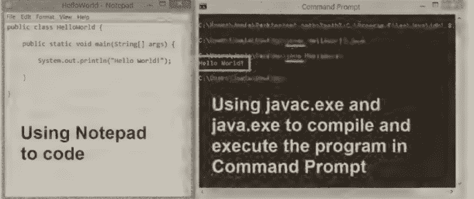

# 一天学会 Java 并精通：Java 初学者实用指南带项目实战：让你立即开始 Java 编程的唯一书籍

# 前言

本书的编写目的是为了帮助你**快速**学习 Java 并**精通**它。

本书不假设你具备任何编程背景。如果你是一个完全的初学者，你会发现这本书以易于理解的方式解释了复杂的概念。如果你是一个有经验的程序员但刚接触 Java，这本书将为你提供足够的深度，让你能够立即开始 Java 编程。

书中主题经过精心挑选，旨在让你广泛接触 Java，同时又不会让你淹没在信息过载中。这些主题包括面向对象的编程概念、错误处理技术、文件处理技术等。此外，还涵盖了 Java 的新功能，如 Lambda 表达式。书中所有的示例都经过仔细选择，以演示每个概念，以便你对该语言有更深入的理解。

此外，正如理查德·布森所说：“学习任何东西最好的方法就是实践”。本书包含一个项目，你将在指导下从零编写一个会员管理软件。该项目使用了书中涵盖的概念，并为你提供了一个观察所有元素如何有机结合在一起的机会。

你可以在 `http://www.learncodingfast.com/java` 下载该项目的源代码以及书中所有的示例程序。

# 联系信息

我非常乐意听到你的反馈。如需反馈或查询，可以通过 `jamie@learncodingfast.com` 与我联系。

# Jamie 的其他书籍


Python：一天学会 Python 并精通它（第一版）


Python：一天学会 Python 并精通它（第二版）


# C#：一天学会 C# 并精通它


# SQL：一天学会 SQL（使用 MySQL）并精通它


# CSS：一天学会 CSS 并精通它

Java 也被设计为平台无关的。正如前面提到的，Java 代码首先被编译成字节码，可以在任何安装了 Java 虚拟机（`JVM`）的机器上运行。因此，使用 Java，你可以编写一次代码，并在任何你想运行的地方运行它。

接下来，Java 是一种面向对象编程（`OOP`）语言。面向对象编程是一种编程方法，它将编程问题拆分为相互作用的对象。在这一本书中，我们将介绍各种面向对象编程的概念。一旦你掌握了 Java，你就会熟悉这些概念。这将使你未来更容易地掌握其他面向对象的编程语言。

确信 Java 是一门非常棒的学习语言了吗？让我们继续吧。

## 第 2 章：准备学习 Java

### 2.1 安装 JDK 和 NetBeans

在我们开始开发 Java 应用程序之前，我们需要下载并安装 `JDK` 和 `NetBeans`。这两者都可以免费下载。

#### 2.1.1 什么是 JDK？

`JDK` 代表 Java Development Kit（Java 开发工具），是 Oracle 提供的一套免费工具包，其中包含许多帮助我们开发 Java 应用程序的工具。其中一些工具包括：将我们编写的代码编译成字节码的编译器（`javac.exe`）、用于打包和分发 Java 文件的归档器（`jar.exe`）以及从 Java 代码生成 HTML 文档的文档生成器（`javadoc.exe`）。

此外，`JDK` 还包含 Java 运行时环境（`JRE`）。`JRE` 包含了第 1 章提到的 `JVM` 以及 `JVM` 运行 Java 程序所需的资源。

如果你只对运行 Java 程序感兴趣，你只需要 `JRE` 即可。但是，由于我们对开发 Java 程序也感兴趣，我们需要 `JDK`。

要下载 `JDK`，请访问 `https://www.oracle.com/java/technologies/javase-jdk11-downloads.html` 并滚动到页面底部。你会看到一个包含多个下载链接的表格。你要下载的版本取决于你正在使用的操作系统。`x86` 和 `x64` 分别指 32 位和 64 位操作系统。例如，如果你使用 64 位 Windows 操作系统，你将下载 "Windows-x64 Installer" `.exe` 文件。

下载完成后，双击下载的文件来安装 `JDK`。

#### 2.1.2 什么是 NetBeans？

除了 `JDK` 之外，我们还需要安装 `NetBeans`。

`NetBeans` 是一个集成开发环境（`IDE`），我们将用它来辅助我们的编码过程。严格来说，我们可以在不使用 `NetBeans` 的情况下开发 Java 应用程序。我们可以在记事本（或任何文本编辑器）中编写代码，并使用 `JDK` 提供的工具编译并执行它们。下面的截图显示了如何操作的示例。



然而，虽然仅使用 `JDK` 开发 Java 应用程序是可能的，但这个过程繁琐且容易出错。

为了让编码更简单，强烈建议你使用 `IDE`。`IDE` 包含一个具有高级功能的文本编辑器用于编写代码，并为我们提供图形化用户界面来调试、编译和运行我们的应用程序。正如我们后面看到的，这些功能在编码时将会有很大帮助。我们将使用的 `IDE` 是 Oracle 提供的 `NetBeans`。

要下载 `NetBeans`，请访问 `https://netbeans.apache.org/download/nb90/nb90.html`。滚动到“Downloading”部分并点击“Binaries”链接来下载文件。下载完成后，将文件解压到桌面。

完成后，你就可以开始编写你的第一个 Java 程序了。

### 2.2 如何使用这本书？

然而，在我们开始之前，我想强调一个事实：Java 中的大部分代码由相当较长的语句组成。因此，某些语句可能会换行到下一行。如果你在阅读过程中遇到问题，请参考书中的示例。

### 文件名

```java
public class HelloWorld {
    public static void main(String[] args) {
        System.out.println("Hello World");
    }
}
```

> 将鼠标悬停在红线上显示此错误消息

### 输出窗口中的错误消息

如果一切顺利，你将在输出窗口看到以下内容：

```
run:

Hello World

BUILD SUCCESSFUL (total time: 0 seconds)
```

此程序只是在输出窗口中显示“Hello World”字样。另外两个句子是 `NetBeans` 提供的额外信息，并不是我们程序输出的一部分。

就是这样！你已经成功编写了你的第一个程序。为自己拍拍掌吧。

你刚刚编写的 Java 文件名为 `HelloWorld.java`。你可以在文本编辑器窗口的顶部找到该名称（参考上图）。

### 2.4 Java 程序的基础结构

现在，让我们快速回顾一下你刚刚编写的基础程序。

#### 2.4.1 包 (Package)

在第一行，我们有如下语句：

```java
package helloworld;
```

该语句告诉编译器，我们写的 Java 文件属于 `helloworld` 包。

包简单来说就是相关类和接口的组合。如果你不知道类和接口是什么，不要担心，我们将在随后的章节中介绍它们。

当我们在文件顶部写 `package helloworld;` 时，我们是在要求编译器将此文件包含在 `helloworld` 包中。编译器会创建一个名为“helloworld”的文件夹并将文件保存到该文件夹中。属于同一个包的文件存储在同一个文件夹中。

如果你现在导航到你的“NetBeansProjects”文件夹，你会发现一个名为“HelloWorld”的文件夹。“NetBeansProject”文件夹通常位于你的“Documents”（文档）文件夹中。如果你找不到该文件夹，请尝试使用电脑的搜索功能查找它。

在“HelloWorld”文件夹中，你会找到一个包含“helloworld”文件夹的“src”文件夹。

该文件夹存储了 `helloworld` 包的文件。我们的习惯是将包名命名为全小写字母。请注意，Java 是一种区分大小写的语言。因此，“HelloWorld”与“helloworld”是不相等的。在“helloworld”文件夹内部，你会找到 `HelloWorld.java` 文件。

声明包的优点是它可以防止命名冲突。两个或多个文件可以有相同的名称，只要它们属于不同的包即可。这类似于你在电脑上只要将文件放在不同的文件夹中，就可以拥有多个同名文件。我们将在第 8 章学习如何创建不同的包。

除了我们创建的包之外，Java 还带有许多预先的包，其中包含了我们程序中使用的代码。例如，输入输出的代码封装在 `java.io` 包中，而实现图形用户界面组件（如按钮、菜单等）的代码封装在 `java.awt` 包中。要使用这些预写包，我们需要将它们导入到程序中。我们将在稍后学习如何操作。

#### 2.4.2 HelloWorld 类

接下来，让我们转向 `HelloWorld` 类。我们将在第 7 章中讨论类。现在只需知道在我们的示例中，`HelloWorld` 类从第 3 行开始以左大括号开始，并在第 10 行以右大括号结束。大括号在 Java 中被广泛用于指示代码元素的开始和结束。Java 中所有的左括号都必须用对应的右括号闭合。

在 `HelloWorld` 类中，我们有一个 `main()` 方法，它从第 5 行开始，到第 8 行结束。

#### 2.4.3 main() 方法

`main()` 方法是所有 Java 程序的入口。每当 Java 应用程序启动时，`main()` 方法都是第一个被调用的方法。

注意我们 `main()` 方法括号内的 `String[] args`。这意味着 `main()` 方法可以接受一个字符串数组作为输入。暂时不要担心这一点。我们将在随后的章节中介绍数组和输入。

在我们的示例中，`main()` 方法包含两行代码。第一行

```java
//Print the words Hello World on the screen
```

这一行被称为注释，会被编译器忽略。

第二行

```java
System.out.println("Hello World");
```

在输出窗口（位于屏幕底部）显示“Hello World”这一行（不带引号）。注意，该语句以分号结尾。Java 中的所有语句都必须以分号（`;`）结尾。这与 C 和 C++ 等大多数其他编程语言相似。

在 `System.out.println("Hello World");` 语句之后，我们用两个右大括号结束代码，以闭合之前的左大括号。就是这样！这个简单程序的所有内容就是。

### 2.5 注释

这一章我们涵盖了很多内容。你现在应该对 Java 编程有了基本的了解，并且对 `NetBeans` 比较熟悉。在本章结束之前，还有一件事需要学习——注释。

我们在上一节中提到，这一行

```java
//Print the words Hello World on the screen
```

是一条注释，会被编译器忽略。

注释实际上并不是程序的一部分。它被添加到我们的代码中，为了让其他程序员更具可读性。因此，注释不会被编译成字节码。

要在我们的程序中添加注释，我们输入两个斜杠：

```java
//Print the words Hello World on the screen
```

或者，我们可以使用这样的多行注释：

```java
/*
This is a multiline comment.
It can span multiple lines.
*/
```

## 第 3 章：变量与运算符的世界

现在你已经熟悉了 `NetBeans` 并对 Java 有了一定的了解，让我们进入实际内容。在这一章中，你将学习变量和运算符。具体来说，你将学习什么是变量，以及如何命名、声明和初始化它们。你还将学习我们可以对它们执行的常用操作。

### 3.1 什么是变量？

变量是赋予我们需要存储的数据的名字。例如，假设你的程序需要存储用户的年龄。为了做到这一点，我们可以使用以下方式将其命名为 `userAge`：

此声明首先指出了数据类型，然后是它的名称。变量的数据类型指的是该变量将存储的数据类型（例如它是数字还是文本）。在你声明变量后，你的程序将分配特定的内存空间来存储这些数据。然后你可以通过引用名称来访问和修改这些数据。

### 3.2 Java 中的基本数据类型

Java 中预定义了八种基本数据类型。这些被称为基本数据类型。

前 4 个数据类型用于存储整数（即没有小数部分的数字）。它们如下：

#### byte

`byte` 数据类型用于存储从 -128 到 127 的整数。它占用 1 字节存储空间（这被称为数据类型的宽度或大小）。如果我们担心存储空间，或者确定变量的值不会超过 -128 到 127 的范围，我们通常使用 `byte` 数据类型。

例如，可以使用 `byte` 数据类型来存储用户的年龄，因为用户的年龄不太可能会超过 127 岁。

#### short

`short` 数据类型占用 2 字节存储空间，范围为 -32768 到 32767。

#### int

`int` 数据类型占用 4 字节存储空间，范围为 -2³¹ (-2147483648) 到 2³¹-1 (2147483647)。它是存储整数最常用的数据类型，因为它的范围最符合实际需求。

#### long

`long` 数据类型占用 8 字节存储空间，范围为 -2⁶³ 到 2⁶³-1。除非你需要存储一个非常大的整数（例如地球人口），否则很少使用它。为了指定一个长整类型的值，你必须在数字末尾加上“L”。

除了用于存储整数的数据类型外，我们还有用于存储浮点数（即带有小数部分的数字）的数据类型。它们是：

#### float

`float` 数据类型使用 4 字节存储，范围大约从负 3.40282347 x 10⁻⁸ 到正 3.40282347 x 10³⁸。它的精度约为 7 位数字。这意味着，如果你使用 `float` 来存储一个像 1.23456789（10 位数字）这样的数字，该数字将被四舍入到大约 7 位数字（即 1.234568）。

#### double

`double` 数据类型使用 8 字节存储，范围大约从负 1.7976931348623157 x 10⁻³⁰⁸ 到正 1.7976931348623157 x 10³⁰⁸，精度约为 15 位数字。

默认情况下，当你在 Java 中指定一个浮点数时，它会被视为 `double` 而不是 `float`。如果你想让 Java 将浮点数视为 `float`，你必须在数字末尾添加后缀 "F"。

除非担心内存空间，否则你应该始终使用 `double` 而不是 `float`，因为它更精确。

除了上述六种数据类型外，Java 还有两种原始数据类型。它们是：

#### char

`char` 代表字符（character），用于存储单个 Unicode 字符，如 'A'、%'、'@' 和 'p' 等。它使用 2 字节内存。

#### boolean

`boolean` 是一种特殊的数据类型，可以包含两个值：`true` 和 `false`。它通常用于控制流语句。我们将在第 6 章介绍控制流语句。

### 3.3 变量命名

Java 中的变量名只能包含字母、数字、下划线（`_`）或美元符号（`$`）。然而，第一个字符不能是数字。因此，你可以将变量命名为 `_userName`、`$username`、`username` 或 `userName2`，但不能命名为 `2userName`。

然而，惯用做法是始终让变量名以字母开头，而不是 "`$`" 或 "`_`"。此外，在命名变量时几乎从未使用美元符号（尽管在技术上使用它并没有错）。

变量名应该短小但有意义，旨在让读者理解其使用的意图。将变量命名为 `userName`、`userAge` 和 `accountNumber` 比命名为 `n` 和 `un` 更有意义。

此外，还有一些你不能作为变量名的保留字，因为它们在 Java 中已经有了预先定义的含义。这些保留字包括 `System`、`if`、`while` 等词。我们将在后续章节中学习每一个。

在 Java 中命名变量时，使用驼峰命名法（camel casing）是一种常见做法。驼峰命名法是用混合大小写编写复合单词，除了第一个单词外，每个单词的首字母大写（例如 `thisIsVariableName`）。这是我们在书的其他部分将使用的约定。

最后，变量名对大小写敏感。`thisIsVariableName` 与 `thisisavariablename` 不同。

### 3.4 变量初始化

每当你声明一个新变量时，都需要给它一个初始值。这被称为初始化变量。你可以在程序之后更改变量的值。

初始化变量有两种方法。你可以在声明时初始化它，也可以在单独的语句中初始化。

下面的代码展示了如何在声明点初始化变量（左侧的行号供参考，不属于代码部分）。

```java
1 byte userAge = 20;
2 short numberOfOfStudents = 45;
3 int numberOfOfEmployees = 500;
4 long numberOfOfInhabitants = 21021313012678L;
5
6 float hourlyRate = 60.5F;
7 double numberOfOfHours = 5120.5;
8
9 char grade = 'A';
10 boolean promote = true;
11
12 byte level = 2, userExperience = 5;
```

如上述，为了指定一个 `long` 值，你必须在数字末尾添加后缀 "L"。因此，在第 4 行我们初始化 `numberOfOfInhabitants` 时，我们在数字末尾添加了 "L"。如果不这样做，编译器将抱怨该数字太大并向我们返回错误。

此外，当我们在第 6 行初始化变量 `hourlyRate` 时，我们添加了后缀 "F"。这是因为默认情况下，Java 将任何浮点数视为 `double`。我们需要添加后缀 "F" 来告诉编译器 `hourlyRate` 是 `float` 数据类型。


最后，在初始化 `char` 数据类型时，我们需要像第 9 行所示，将字符括在单引号中。

在第 12 行，我们看到了如何在单条语句中声明并初始化两个相同数据类型的变量的示例。两个变量之间用逗号隔开，不需要说明第二个变量的数据类型。

上面的示例展示了你如何在声明点初始化变量。或者，你可以选择在两个单独的语句中声明并初始化变量，如下所示：

```
byte year; // 先声明变量
year = 20;   // 后初始化
```

## 3.5 赋值运算符

编程中的 `=` 符号与我们在数学中学到的 `=` 符号含义不同。在编程中，`=` 符号被称为赋值运算符。它意味着右侧的值赋值给左侧的变量。

假设我们声明了 `x` 和 `y`：

```
int x = 5;
int y = 10;
```

如果我们写 `x = y`，`y` 的值将被赋值给 `x`。所以 `x` 变为 10。

## 3.6 运算符

除了给变量赋值，我们还可以进行数学运算。基础运算符包括 `+`、`-`、`*`、`/`、`%`。

| 运算符 | 符号 | 示例 |
| :--- | :--- | :--- |
| 加法 | `+` | `x + y` |
| 减法 | `-` | `x - y` |
| 乘法 | `*` | `x * y` |
| 除法 | `/` | `x / y` |
| 取模 | `%` | `x % y` |

在第一情况下，当整数除以另一个整数时，你得到整数答案。然而，如果 `x` 或 `y` 中有一个是非整数，你得到的整数。答案的小数部分（如果有）会被截断。

## 3.7 更多赋值运算符

除了 `=` 运算符，还有几个赋值运算符。这些包括 `+=`、`-=` 和 `*=` 等运算符。

假设变量 `x` 的初始值为 10。如果我们想让 `x` 增加 2，我们可以写：

```
x = x + 2;
```

程序将先计算右侧表达式 (`x + 2`)，并将结果赋值给左侧。最终 `x` 变为 12。

与其写 `x = x + 2`，我们也可以写 `x += 2` 来表示相同的含义。`+=` 运算符是将赋值运算符与加法运算符结合的简写。同样，如果我们想做减法，可以写 `x = x - 2` 或 `x -= 2`。这适用于上述所有运算符。

大多数编程语言还有 `++` 和 `--` 运算符。`++` 运算符用于你想让变量的值增加 1。例如，假设

```
int x = 2;
```

如果你写

```
x++;
```

`x` 的值变为 3。使用 `++` 运算符时不需要使用 `=` 运算符。`x++` 等同于 `x = x + 1`。

`++` 运算符可以放在变量名的前面或后面。这会影响执行任务的顺序。假设我们有一个名为 `counter` 的整数。如果我们写

```
System.out.println(counter++);
```

程序先打印 `counter` 的原始值，然后将 `counter` 增加 1。也就是说，它按顺序执行以下任务：

```
System.out.println(counter);
counter = counter + 1;
```

另一方面，如果我们写：

```
System.out.println(++counter);
```

程序会在打印 `counter` 的新值之前，先将 `counter` 加 1。换句话说，它按照此顺序执行任务：

```
counter = counter + 1;
System.out.println(counter);
```

除了 `++` 运算符外，我们还有 `--` 运算符（两个减号）。该运算符会将变量的值减 1。

## 3.8 Java 中的类型转换

在我们的程序中，有时会需要将数据从一种数据类型转换为另一种数据类型，例如从 `double` 转换为 `int`。这被称为类型转换。

如果我们想将较小的数据类型转换为较大的数据类型，我们不需要显式地进行任何操作。例如，下面的代码将一个 `short`（2 字节）赋值给 `double`（8 字节）。这被称为宽原类型转换，不需要我们编写任何特殊代码。

```
short age = 10;
double myWeb = age;
```

然而，如果我们想将一个较大的数据类型赋值给较小的数据类型，我们需要使用一对括号显式地指定。这被称为窄原类型转换。下面的示例展示了如何操作。

```
int x = (int) 20.9;
```

在这里，我们可以将一个 `double`（8 字节）强制转换为 `int`（4 字节）。

窄转换是不安全的，除非绝对必要，否则应该避免。这是因为窄转换可能会导致数据丢失。当我们把 `20.9` 转换为 `int` 时，得到的值是 `20` 而不是 `21`。小数部分在转换后会被截断。

我们还可以将 `double` 强制转换为 `float`。还记得我们之前提到过，在 Java 中，所有非整数默认都被处理为 `double` 吗？如果我们想将数字 `20.9` 赋值给 `float`，我们需要在数字后面加上后缀 `'F'`。另一种方法是使用强制转换，如下所示：

```
float numl = (float) 20.9;
```

`numl` 的值将是 `20.9`。

除了数值类型之间的转换外，我们还可以进行其他类型的转换。我们将在后续章节中探索其中的一些转换。

## 第4章：数组与字符串

在上一章中，我们涵盖了 Java 中的八种基本数据类型。除了这些基本类型外，Java 还提供了几种高级数据类型。在本章中，我们将涵盖其中两种：字符串和数组。此外，我们将讨论基本数据类型和引用数据类型之间的区别。

## 4.1 String

首先，让我们来看看字符串。字符串本质上是一段文本，例如 "Hello World" 或 "Good morning"。

要声明并初始化一个 `String` 变量，你需要写：

```
String message = "Hello World";
```

其中 `message` 是 `String` 变量的名字，"Hello World" 是赋值给它的字符串。注意，你需要用双引号 ("") 包字符串。

你也可以这样给 `String` 变量赋值一个空字符串：

```
String anotherMessage = "";
```

如果你想将两个或多个字符串拼接在一起，可以使用连接符号 (`+`)。例如，你可以写：

```
String myName = "Hello World, " + "my name is Jamie";
```

这等同于

```
String myName = "Hello World, my name is Jamie";
```

### 4.1.1 String 方法

与我们在上一章看到的 8 种基本类型不同，`String` 实际上是一个对象。具体来说，它是 `String` 类的一个对象。

如果你不理解这意味着什么，不要担心；我们将在第7章讨论类和对象。现在，你只需要知道 `String` 类为我们提供了许多预定义的方法，我们在处理字符串时可以使用这些方法。

### split()

`split()` 方法根据用户定义的分隔符（也称为边界符）将字符串拆分为多个子字符串。在分割字符串后，`split()` 方法返回一个包含这些结果子字符串的数组。数组是相关数据的集合。我们将在下一节中讨论数组。

假设你想将字符串 "Peter, John, Andy, David" 拆分为子字符串，可以如下所示操作：

```
String names = "Peter, John, Andy, David";
String[] splitNames = names.split(",");
```

在这里，我们首先将想要分割的字符串赋值给变量 `names`。然后我们使用 `names` 来调用 `split()` 方法。`split()` 方法接收一个参数 - 用于分隔子字符串的分隔符。在我们的示例中，分隔符是一个逗号后跟一个空格。

上述代码的结果是以下数组

```
{"Peter", "John", "Andy", "David"}
```

该数组被赋值给变量 `splitNames`。

我们已经涵盖了 Java 中许多常用的 `String` 方法。要查看所有可用方法的完整列表，请访问此页面

https://docs.oracle.com/javase/8/docs/api/java/String.html#method.summary

## 4.2 Array

接下来，让我们来看看数组。

数组是通常相互相关的数据集合。假设我们想存储 5 个用户的年龄。与其将它们存储为 `user1Age`、`user2Age`、`user3Age`、`user4Age` 和 `user5Age`，我们不如将它们存储为一个数组。

声明数组变量有两种方法。第一种方法是如下所示进行声明：

```
int[] userAge;
```

- `int` 表示该变量存储 `int` 类型的值。
- `[]` 表示该变量是一个数组，而不是普通变量。
- `userAge` 是数组的名称。

第二种声明方法如下：

```
int userAge[];
```

这种风格源自 C/C++ 语言，并被 Java 采纳以适应 C/C++ 程序员。然而，这不是 Java 中首选的语法。在书中我们将坚持第一种风格。

在声明数组变量后，你需要创建一个数组并将其赋值给变量。要做到这一点，我们使用所示的 `new` 关键字：

```
int[] userAge;
userAge = new int[] {21, 22, 23, 24, 25};
```

第一条语句声明了数组变量 `userAge`。第二条语句创建数组 `{21, 22, 23, 24, 25}` 并将其赋值给 `userAge`。由于 `userAge` 之前没有被赋值过任何数组，该语句用创建的数组初始化 `userAge`。一旦初始化了数组，数组的大小就不能再更改。在这种情况下，数组 `userAge` 从起只能包含 5 个值，因为我们用 5 个整数初始化了它。`{21, 22, 23, 24, 25}` 是数组当前存储的五个整数。

除了分语句声明和初始化数组外，我们还可以使用下面的快捷语法将两条语句合并为一条：

```
int[] userAge2 = new int[] {21, 22, 23, 24, 25};
```

我们可以进一步将该语句简化为

```
int[] userAge2 = {21, 22, 23, 24, 25};
```

也就是说，如果你在同一条语句中声明并初始化数组，可以省略 `new int[]` 词。

第三种声明并初始化数组的方法如下：

```
int[] userAge3 = new int[5];
```

该语句声明了数组 `userAge3` 并用一个包含 5 个整数的数组对其进行初始化（如方括号 `[]` 内的数字 5 所示）。由于我们没有指定这 5 个整数的值，Java 会使用默认值创建一个数组并将其赋值给 `userAge3`。整数的默认值为 0。因此，`userAge3` 变为 `{0, 0, 0, 0, 0}`。

你可以通过索引访问来更新数组中的单个元素。记住索引始终从零开始。数组的第一个元素索引为 0，下一个索引为 1，以此类推。假设数组 `userAge` 当前为 `{21, 22, 23, 24, 25}`。要更新数组的第一个元素，我们写道

```
userAge[0] = 31;
```

数组变为 `{31, 22, 23, 24, 25}`。

如果我们输入

```
userAge[2] = userAge[2] + 20;
```

数组变为 `{31, 22, 43, 24, 25}`。也就是说，第三个元素加了 20。

### 4.2.1 Array Methods

与字符串一样，数组也带有许多预定义的方法。

我们下面讨论的方法位于 `java.util.Arrays` 类中。要使用它们，你必须在程序中添加语句

```
import java.util.Arrays;
```

此举是为了告诉编译器去哪里寻找这些方法的代码。

`import` 语句必须出现在 `package` 语句之后、类声明之前。下所示是一个示例：

```java
package helloworld;

import java.util.Arrays;

public class HelloWorld {
    // HelloWorld 类代码
}
```

你可能记得之前在使用 `String` 类时，不需要写任何 `import` 语句。这是因为 `String` 类位于 `java.lang` 包中，在 Java 程序中是默认导入的。现在让我们来看一些常用的数组方法。

### equals()

`equals()` 方法用于判断两个数组是否相等。如果数组相等则返回 `true`，否则返回 `false`。如果两个数组具有相同的元素数量且元素顺序相同，则被认为是相等。

假设你有以下代码段：

```
int[] arr1 = {0,2,4,6,8,10};
int[] arr2 = {0,2,4,6,8,10};
int[] arr3 = {10,8,6,4,2,0};
```

```
boolean result1 = Arrays.equals(arr1, arr2);
boolean result2 = Arrays.equals(arr1, arr3);
```

`result1` 为 `true` 而 `result2` 为 `false`。

### copyOfRange()

`copyOfRange()` 方法允许将一个数组的内容复制到另一个数组中。它需要三个参数。

假设你有

```
int[] source = {12, 1, 5, -2, 16, 14, 20, 25};
```


你可以使用下面的语句将 `source` 复制到一个新数组：

```java
int[] dest = Arrays.copyOfRange(source, 3, 7);
```

第一个参数（`source`）是要复制的数组。第二个和第三个参数告诉编译器从哪个索引开始并停止复制。也就是说，在我们的示例中，我们复制的是索引 3 到 6（即索引 7 的元素不被复制）。`copyOfRange()` 方法返回包含复制元素的数组。

### toString()

`toString()` 方法返回表示数组内容的字符串。这使得我们能够轻松显示数组的内容。例如，假设你有

```java
int[] numbers = {1, 2, 3, 4, 5};
```

你可以使用下面的语句显示 `numbers` 的内容：

```java
System.out.println(Arrays.toString(numbers));
```

你将得到输出

```
[1, 2, 3, 4, 5]
```

### sort()

`sort()` 方法允许我们对数组进行排序。它接收一个数组作为参数。

假设你有

```java
int[] numbers2 = {12, 1, 5, -2, 16, 14};
```

你可以通过编写以下代码对其进行排序：

```java
Arrays.sort(numbers2);
```

数组将按升序排列。`sort()` 方法不返回新数组。它只是修改传入的数组。也就是说，它修改了我们示例中的 `numbers2` 数组。你可以使用语句打印排序后的数组：

```java
System.out.println(Arrays.toString(numbers2));
```

你将得到

```
[-2, 1, 5, 12, 14, 16]
```

### binarySearch()

`binarySearch()` 方法允许在排序数组中搜索特定值。要使用此方法，请确保你的数组已过排序。你可以使用上述的 `sort()` 方法来实现。

假设我们有

```java
int[] myInt = {21, 23, 34, 45, 56, 78, 99};
```

为了确定 78 是否在数组中，我们写道

```java
int foundIndex = Arrays.binarySearch(myInt, 78);
```

`foundIndex` 将等于 5。这表示数字 78 位于索引 5 处。

另一方面，如果你写：

```java
int foundIndex2 = Arrays.binarySearch(myInt, 39);
```

`foundIndex2` 将等于 -4。

这个结果包含两个部分：负号和数字 4。

负号仅表示未找到 39。

另一方面，数字 4 有点奇怪。它告诉你是，如果该数字存在于数组中，它应该所在的位置。然而，它在该索引的基础上加了 **1**。换句话说，如果数字 39 存在于数组中，它应该在索引 4-1 = 3 的位置。

我们在这一节中已经介绍了一些常用的数组方法。要查看 Java 中所有可用数组方法的完整列表，请访问此页面：

https://docs.oracle.com/javase/8/docs/api/java/util/Arrays.html

### 4.2.2 查找数组长度

最后，让我们来看看如何找到数组的长度。数组的长度告诉我们数组中有多少个元素。之前我们在讨论字符串时，提到过可以使用 `length()` 方法来查找字符串的长度。

与大多数人的认为相反，数组并没有可用的 `length()` 方法。相反，要找到数组的长度，我们使用 `length` 字段。我们将在第 7 章中讨论字段与方法的区别。目前，你只需要知道，要找到数组的长度，不需要在 `length` 单词后添加括号。

例如，如果我们有：

```java
int[] userAge = {21, 22, 26, 32, 40};
```

`userAge.length` 等于 5，因为数组中有 5 个数字。

## 4.3 基本类型 vs. 引用类型

现在我们已经熟悉了字符串和数组，让我们来讨论关于 Java 数据类型的一个重要概念。

Java 中的所有数据类型都可以归分为基本类型（primitive type）或引用类型（reference type）。Java 中只有 8 种基本类型（`byte`、`short`、`int`、`long`、`float`、`double`、`char` 和 `boolean`），其余的引用类型。引用类型的示例包括本章讨论的字符串和数组，以及将在第 7 章和第 8 章中讨论的类和接口。

基本类型和引用类型之间的主要区别之一是所存储的数据。

基本类型存储其自己的数据。

当我们写：

```java
int myNumber = 5;
```

变量 `myNumber` 存储的是实际值 5。

另一方面，引用类型并不存储实际数据。相反，它存储指向数据的引用。它不告诉编译器数据的值是多少；它告诉编译器去哪里找到实际数据。

引用类型的一个示例是 `String`。当你写下类似这样的语句时：

```java
String message = "Hello";
```

变量 `message` 实际上并没有存储字符串 "Hello"。

相反，字符串 "Hello" 被创建并存储在计算机内存的其他地方。变量 `message` 存储该内存位置的地址。

这就是我们目前对引用类型需要了解的所有内容。由于这是一本初学者书籍，我们不会详细介绍为什么需要引用类型。只需注意基本类型和引用类型之间存在差异：前者存储值，而后者存储地址。

## 4.4 字符串是不可变的

在结束本章之前，我想涵盖关于字符串的另一个一个概念。具体来说，我想指出在 Java（以及大多数其他语言）中，字符串是不可变的（immutable）。

不可变意味着字符串的值不能被改变。每当我们更新一个 `String` 变量时，我们实际上是在创建一个新字符串，并将内存地址分配给该 `String` 变量。让我们考虑一个例子。假设我们有

```java
String message = "Hello";
```

我们之前学过编译器会创建字符串 "Hello" 并将其存储在计算机内存某处。变量 `message` 存储该位置的地址。现在，如果我们如下所示将 `message` 的值更新为 "World"

```java
message = "World";
```

编译器实际上并没有去存储 "Hello" 的位置将其值改为 "World"。相反，它创建了一个新字符串 "World"，并将其存储在计算机内存的其他地方。然后将这个新地址分配给 `message`。换句话说，现在有两个字符串："Hello" 和 "World"。`message` 存储 "World" 的地址。如果程序不再需要 "Hello"，它最终会被销毁以释放该内存位置。这个过程被称为垃圾回收（garbage collection），由 Java 自动处理。

## 第 5 章：让我们的程序交互

现在我们已经涵盖了变量和数据类型的基础，让我们写一个接受用户输入、将数据存储在变量中并向用户显示信息的程序。毕竟，如果一个计算机程序不能与其用户交互，那还有什么用呢？

## 5.1 显示输出

我们在第 2 章和第 4 章已经见过向用户显示输出的一些示例。

简单来说，为了向用户显示输出，我们可以使用 Java 的 `print()` 或 `println()` 方法。为了使用这些方法，我们必须在方法名之前加上 `System.out`。这是因为这两个方法属于 `PrintStream` 类，我们必须使用 `System.out` 来访问它们。如果现在听起来非常困惑，不要担心，我们将在第 7 章学习更多关于类和方法的知识。

`println()` 和 `print()` 方法的区别在于 `println()` 在显示消息后会将光标移动到下一行，而 `print()` 则不会。

例如，如果我们写：

```java
System.out.println("Hello "); System.out.println("How are you?");
```

我们将得到：

```
Hello
How are you?
```

如果我们写：

```java
System.out.print("Hello ");
System.out.print("How are you?");
```

我们将得到：

```
Hello How are you?
```

除此之外，这两个方法是相同的。

让我们来看几个如何使用 `println()` 向用户显示信息的示例。`print()` 方法的工作方式完全相同。

### 显示简单的文本消息

为了显示简单的消息，我们写：

```java
System.out.println("Hi, my name is Jamie.");
```

输出：

```
Hi, my name is Jamie.
```

### 显示变量的值

为了显示变量的值，我们写：

```java
int number = 30;
System.out.println(number);
```

输出：

```
30
```

### 显示不赋值给变量的结果

为了显示表达式的结果而不将其赋值给变量，我们写：

```java
System.out.println(5 + 3);
```

输出：

```
8
```

### 打印反斜杠本身 (\)

示例

```java
System.out.println("\\");
```

输出

```
\
```

### 打印双引号 (\") 以免双引号结束字符串

示例

```java
System.out.println("I am 5'9\" tall");
```

输出

```
I am 5'9" tall
```

## 5.3 格式化输出

在之前的示例中，我们查看了如何使用 `println()` 和 `print()` 方法向用户显示输出。然而，有时我们希望对输出的格式有更大的控制力。例如，如果我们写：

```java
System.out.println("The answer for 5.45 divided by 3 is " + (5.45/3));
```

我们将得到：

```
The answer for 5.45 divided by 3 is 1.8166666666666667
```

在大多数情况下，我们不希望向用户显示这么多小数。在这种情况下，我们可以使用 `printf()` 方法来向用户显示输出。`printf()` 方法比 `print()` 方法稍微复杂一些，但它对输出的显示方式提供了更多的控制。为了格式化上面的输出，我们可以写：

```java
System.out.printf("The answer for %.3f divided by %d is %.2f.", 5.45, 3, 5.45/3);
```

这将给出输出：

```
The answer for 5.450 divided by 3 is 1.82.
```

`printf()` 方法需要一个或多个参数。在上面的示例中，我们向方法传递了四个参数。

第一个参数 `"The answer for %.3f divided by %d is %.2f."` 是要格式化的字符串。

你可能会注意到字符串中一些奇怪的符号：`%.3f`、`%d` 和 `%.2f`。这些被称为**格式说明符**（format specifiers）。它们作为占位符，并被随后的参数替换。第一个格式说明符 (`%.3f`) 被后面的第一个参数 (`5.45`) 替换，第二个 (`%d`) 被第二个参数 (`3`) 替换，依此类推。

格式说明符始终以百分号 (`%`) 开始，并以转换符（如 `f` 或 `d`）结束。它们指定了应该如何格式化参数。在百分号 (`%`) 和转换符之间，你可以添加被称为**标志**（flags）的额外信息。

在我们的示例中，第一个格式说明符是 `%.3f`。

`f` 是转换符。它告诉编译器它应该被替换为浮点数（即带有小数位置的数字，如 `float` 或 `double`）。如果我们尝试用非浮点数来替换它，将会得到错误。

`.3` 是标志。它表示我们希望显示带有 3 位小数的数字。因此，数字 5.45 在输出中显示为 5.450。

除了 `%.3f` 说明符外，Java 中还有许多可以使用的其他说明符。接下来的两个章节将讨论我们说明符中一些其他常用的转换符和标志。

### 5.3.1 转换符

#### 整数转换符：d

该转换符用于格式化整数，如 `byte`、`short`、`int` 和 `long`。

示例

```java
System.out.printf("%d", 12);
```

输出

```
12
```

注意：

`System.out.printf("%d", 12.9);` 将给我们一个错误，因为 12.9 不是整数。

同样，`System.out.printf("%f", 12);` 将给我们一个错误，因为 12 不是浮点数。

#### 换行转换符：n

该转换符将光标移动到下一行

示例

```java
System.out.printf("%d%n%d", 12, 3);
```

输出

```
12
3
```

### 5.3.2 标志

#### 宽度标志

该标志用于指定总宽度。

示例 1

```java
System.out.printf("%8d", 12);
```

输出

```
      12
```

在上面的输出中，数字 12 前面有 6 个空格，我们我们的总宽度为 8。

示例 2

```java
System.out.printf("%8.2f", 12.4);
```

输出

```
   12.40
```

在上面的输出中，数字前面有 3 个空格，包括小数点在内的总宽度为 8。

#### 千分位分隔符标志 (,)

该标志用于显示带有千分位分隔符的数字。

示例 1

```java
System.out.printf("%,d", 12345);
```

输出

```
12,345
```

示例 2

```java
System.out.printf("%,.2f", 12345.56789);
```

输出

```
12,345.57
```

## 5.4 接收用户输入

现在我们已经知道如何向用户显示输出，让我们看看如何接收他们的输入。接受输入实际上非常简单。有几种方法可以实现，但最简单且常用的方法是使用 `Scanner` 对象。要接收用户输入，我们首先需要使用下面的语句导入 Scanner 类：

```java
import java.util.Scanner;
```

接下来，我们需要创建一个 Scanner 对象。

```java
package inputdemo;
import java.util.Scanner;

public class InputDemo {
    public static void main(String[] args) {
        Scanner input = new Scanner(System.in);

        System.out.print("Enter an integer: ");
        int myInt = input.nextInt();
        System.out.printf("You entered %d%n", myInt);

        System.out.print("Enter a double: ");
        double myDouble = input.nextDouble();
        System.out.printf("You entered %.2f%n", myDouble);

        System.out.print("Enter a string: ");
        input.nextLine();
        String myString = input.nextLine();
        System.out.printf("You entered %s%n", myString);
    }
}
```

如果用户输入的值不是正确的数据类型，方法将尝试将输入转换为正确的类型。如果转换失败，方法将产生错误。

例如，如果 `nextDouble()` 方法读取到的值为 20，它将其转换为 `double`。然而，如果它读取到字符串“hello”，它将生成一个错误。

我们将在下一章学习如何处理这些错误。

## 第 6 章：控制流语句

在之前的章节中，我们已经涵盖了很多内容。到为止，你应该已经了 Java 程序的结构结构，并能够编写使用变量的简单 Java 程序。此外，你还学习了如何使用各种内置的 Java 方法与用户进行交互。

在本章中，我们将更进一步——学习如何控制程序的程序的执行流。默认情况下，程序中的语句按照它们出现的顺序从上到下执行。然而，我们可以使用控制流语句来改变这种执行流。

这些语句包括决策语句（`if`、`switch`）、循环语句（`for`、`while`、`do-while`）和分支语句（`break`、`continue`）。我们将在后续章节中逐一讨论每一种。

现在，让我们先来看比较运算符。

## 6.1 比较运算符

大多数控制流语句都涉及某种形式的比较。程序将根据比较的结果以不同的方式进行。

最常用的比较运算符是相等运算符。如果我们想比较两个变量是否相等，我们使用 `==` 运算符。例如，如果你写 `x == y`，你是在要求程序检查 x 的值是否等于 y 的值。如果它们相等，则满足条件，语句求值为 `true`。否则，语句求值为 `false`。

除了判断两个值是否相等之外，我们还可以在控制流语句中使用其他比较运算符。

### 不等于 (!=)

如果左侧不等于右侧，则返回 `true`。

```
5 != 2 is true
6 != 6 is false
```

### 大于 (>)

如果左侧大于右侧，则返回 `true`。

```
5 > 2 is true
3 > 6 is false
```

### 小于 (<)

如果左侧小于右侧，则返回 `true`。


```
1 < 7 is true
9 < 6 is false
```

### 大于等于 (>=)

如果左侧大于或等于右侧，则返回 `true`。

```
5 >= 2 is true
5 >= 5 is true
3 >= 6 is false
```

### 小于等于 (<=)

如果左侧小于或等于右侧，则返回 `true`。

```
5 <= 7 is true
7 <= 7 is true
9 <= 6 is false
```

我们还有两个逻辑运算符（`&&`、`||`），它们在我们想要组合多个条件时非常有用。

### 与逻辑运算符 (&&)

如果满足所有条件，则返回 `true`。

```
5==5 && 2>1 && 3!=7 is true
5==5 && 2<1 && 3!=7 is false 因为第二个条件 (2<1) 为 `false`
```

### 或逻辑运算符 (||)

如果至少满足一个条件，则返回 `true`。

```
5==5 || 2<1 || 3!=7 is true 因为第一个条件 (5==5) 为 `true`
5==6 || 2<1 || 3!=7 is false 因为所有条件均为 `false`
```

## 6.2 决策语句

现在我们已经熟悉了比较运算符，让我们继续学习如何使用这些运算符来控制程序的执行流。我们将首先查看 `if` 语句。

### 6.2.1 If 语句

`if` 语句是最常用的控制流语句之一。它允许程序评估是否满足某个条件，并根据结果执行相应的操作。

`if` 语句的结构如下（添加行号供参考）：

```
1 if (满足条件 1)
2 {
3    执行任务 A
4 }
5 else if (满足条件 2)
6 {
7   执行任务 B
8 }
9 else if (满足条件 3)
10 {
11  执行任务 C
12 }
13 else
14 {
15  执行任务 D
16 }
```

1. 测试第一个条件。如果满足条件，则执行大括号内的所有内容（第 2 到 4 行）。`if` 语句的剩余部分（从第 5 行开始）将被跳过。

如果未满足第一个条件，可以使用 `else if` 块来测试更多条件（第 5 到 12 行）。可以使用多个 `else if` 块。最后，可以使用 `else` 块（第 13 到 16 行）在所有之前的条件都不满足时执行某些代码。`else if` 和 `else` 块是可选的。

为了完全理解 `if` 语句的工作，让我们尝试一个示例。在 NetBeans 中创建一个名为 `IfDemo` 的项目。将生成的代码替换为以下代码：

```java
package ifDemo;
import java.util.Scanner;

public class IfDemo{
  public static void main(String[] args) {
    Scanner input = new Scanner(System.in);
    System.out.print("请输入年龄： ");
    int userAge = input.nextInt();
    if (userAge < 0 || userAge > 100) {
        System.out.println("年龄无效");
        System.out.println("年龄在 0 到 100 之间");
    } else if (userAge < 18) {
        System.out.println("你未成年");
    } else if (userAge < 21) {
        System.out.println("你需要父母许可");
    } else {
        System.out.println("恭喜你！");
        System.out.println("你可以注册活动！");
    }
}
```

程序首先提示用户输入年龄并将结果存储在 `userAge` 变量中。`if (userAge < 0 || userAge > 100)` 检查 `userAge` 是否小于 0 或大于 100。如果其中任一条件为 `true`，程序将执行大括号内的所有语句。在示例中，它将打印“年龄无效”，然后是“年龄在 0 到 100 之间”。

### 6.2.2 Switch 语句

`switch` 语句允许我们基于变量的值来执行不同的代码块。

```java
do A;
break;
case secondCase:
do B;
break;
default:
do C;
break;
```

在使用 `switch` 语句时，你可以包含任意数量的 `case`。`default` 情况是可选的，如果没有其他 `case` 匹配则执行它。你可以使用 `byte`、`short`、`char` 或 `int` 变量进行切换。从 Java 7 开始，还可以使用 `String` 变量进行切换。

当满足某个 `case` 时，从下一行开始的所有内容都会执行，直到遇到 `break` 语句。`break` 语句指示程序跳出 `switch` 语句并继续执行程序的其余部分。

让我们来看 `switch` 语句是如何工作的示例。要尝试此示例，请启动 NetBeans 并创建一个名为 `SwitchDemo` 的新项目。将生成的代码替换为以下代码。在这个示例中，我们使用 `String` 变量进行切换。

```java
1 package switchdemo;
2 import java.util.Scanner;
3
4 public class SwitchDemo{
5
6 public static void main(String[] args) {
7
8 Scanner input = new Scanner(System.in);
9
10 System.out.print("Enter your grade: ");
11 String userGrade =
12 input.nextLine().toUpperCase();
12
13 switch (userGrade)
14 {
15     case "A+":
16     case "A":
17         System.out.println("Distinction");
18         break;
19     case "B":
20         System.out.println("B Grade");
21         break;
22     case "C":
23         System.out.println("C Grade");
24         break;
25 default:
26         System.out.println("Fail");
27         break;
28 }
29 }
30 }
```

程序首先在第 10 行提示用户输入其成绩。接下来，在第 11 行，它读取用户的输入并使用下面的语句将结果存储在 `userGrade` 中：

```java
String userGrade = input.nextLine().toUpperCase();
```

这条语句对某些读者来说可能看起来有些陌生。在这里，我们在同一个语句中调用了两个方法。

`input.nextLine()`

首先读取用户输入的输入。此方法返回一个字符串。然后我们使用生成的字符串来调用 `toUpperCase()` 方法。这条语句展示了你如何在同一个语句中调用两个方法的示例。这些方法从左到右执行。也就是说，先执行 `nextLine()` 方法，然后执行 `toUpperCase()` 方法。

在将用户输入赋值给 `grade` 之前，我们必须将其转换为大写，因为 Java 是区分大小写的。我们希望程序无论用户输入的是 "A" 还是 "a"，都显示 "Distinction"。因此，在赋值给 `grade` 之前，我们将任何小写输入转换为大写。

在获取用户的成绩后，我们使用接下来的 `switch` 语句来确定输出。

如果输入的成绩是 "A+"（第 15 行），程序将执行下一个语句直到遇到 `break` 语句。这意味着它将执行第 16 到 18 行。因此，输出是 "Distinction"。

如果成绩是 "A"（第 16 行），程序执行第 17 行和第 18 行。同样，输出是 "Distinction"。

如果成绩不是 "A+" 或 "A"，程序将检查下一个 `case`。它会从上到下检查直到满足某个 `case`。如果没有一个 `case` 适用，则执行 `default` 情况。

如果你运行上面的代码，你将为显示的每个输入获得相应的输出：

```
Enter your grade: A+
Distinction
Enter your grade: A
Distinction
Enter your grade: B
B Grade
Enter your grade: C
C Grade
Enter your grade: D
Fail
Enter your grade: Hello
Fail
```

## 6.3 循环语句

现在，让我们来看 Java 中的循环语句。Java 中常用的四个循环语句是 `for` 语句、增强型 `for` 语句、`while` 语句和 `do-while` 语句。

### 6.3.1 For 语句

`for` 语句重复执行代码块，直到测试条件不再有效。

`for` 语句的语法如下：

```java
for (初始值; 测试条件; 值的修改)
{
    // 执行某些任务
}
```

为了理解 `for` 语句的工作原理，让我们考虑下面的示例。

```java
1 for (int i = 0; i < 5; i++)
2 {
3     System.out.println(i);
4 }
```

`for` 语句的重点是第 1 行：

```java
for (int i = 0; i < 5; i++)
```

它包含三个部分，每个部分由分号隔开。

第一部分声明并初始化 `int` 变量 `i` 为零。该变量作为循环计数器。

第二部分测试 `i` 是否小于 5。如果是，则将执行大括号内的语句。在这个示例中，由于只有一个语句，所以大括号是可选的。

在执行 `System.out.println(i)` 语句后，程序返回到第 1 行的最后一个部分。`i++` 将 `i` 的值加 1。因此，`i` 从 0 增加到 1。

递增后，程序测试 `i` 的新值是否仍然小于 5。如果是，它将再次执行 `System.out.println(i)` 语句。

这种测试和递增循环计数器的过程将重复进行，直到条件不再满足。

### 6.3.2 增强型 for 语句

除了 `for` 语句外，在处理数组时还可以使用增强型 `for` 语句（我们将在第 9 章讨论集合）。增强型 `for` 语句的语法为：

```java
for (变量声明 : 数组名)
{
}
```

假设你有：

```java
int[] myNumbers = {10, 20, 30, 40, 50};
```

你可以使用下面的代码来显示：

```java
for (int item : myNumbers)
    System.out.println(item);
```

在上面的代码中，我们声明了一个用于循环的 `int` 变量 `item`。每次循环运行时，`myNumbers` 数组中的元素会被赋值给 `item`。例如，第一次循环运行时，10 被赋值给 `item`。语句：

```java
System.out.println(item);
```

然后打印出 10。

第二次循环运行时，20 被赋值给 `item`。语句：

```java
System.out.println(item);
```

打印出 20。

这将一直持续到数组中的所有元素都打印完毕。

### 6.3.3 While 语句

接下来，让我们来看 `while` 语句。正如名称所示，`while` 语句会在条件保持有效时重复执行循环内的指令。`while` 语句的结构如下：

```java
while (条件为真)
{
    执行 A
}
```

在使用 `while` 语句时，我们通常需要先声明一个变量作为循环计数器。让我们称这个变量为 `counter`。下面的代码展示了 `while` 语句如何工作的示例。

```java
int counter = 5;
while (counter > 0)
{
    System.out.println("Counter = " + counter);
    counter = counter - 1;
}
```

如果你运行代码，你将获得以下输出：

```
Counter = 5
Counter = 4
Counter = 3
Counter = 2
Counter = 1
```

`while` 语句的语法相对简单。大括号内的语句只要 `counter > 0` 就会一直执行。注意我们在大括号内有 `counter = counter - 1` 这一行吗？这一行至关重要。它在每次循环运行时将 `counter` 的值减 1。

我们需要将 `counter` 的值减 1，这样循环条件（`counter > 0`）最终才会求值为假。如果我们忘记这样做，循环将无限运行，导致死循环。

### 6.3.4 do-while 语句

`do-while` 语句与 `while` 语句相似，有一个主要区别——`do-while` 语句大括号内的代码至少会执行一次。这里有一个 `do-while` 语句如何工作的示例。

```java
int counter = 100;
do {
    System.out.println("Counter = " + counter);
    counter++;
} while (counter < 0);
```


由于测试条件 `while (counter < 0)` 放在大括号之后，因此它在大括号内的代码至少执行一次后才会进行测试。

如果你运行上述代码，你将得到：

```
Counter = 100;
```

在第一次执行 `System.out.println("Counter = " + counter);` 语句后，`counter` 加了 1。`counter` 的值现在是 101。当程序到达测试条件时，由于 `counter` 不小于 0，测试失败。程序将退出循环。尽管 `counter` 的原始值不符合测试条件（`counter < 0`），大括号内的代码仍然执行了一次。

请注意，对于 `do-while` 语句，测试条件后需要一个分号（`;`）。

## 6.4 分支语句

我们现在已经涵盖了 Java 中大部分的控制流语句。接下来，让我们来看看分支语句。

分支语句是指令程序跳转到另一行代码的语句。分支语句通常用于循环和其他控制流语句。

### 6.4.1 break 语句

第一个分支语句是 `break` 语句。我们已经看到过该语句如何在 `switch` 语句中使用。除了用于 `switch` 语句，`break` 语句也可以用于其他控制流语句。它会在满足特定条件时程序提前退出循环。让我们来看 `break` 语句在 `for` 语句中的用法。

考虑下面的代码段：

```java
1 for (int i = 0; i < 5; i++)
2 {
3   System.out.println(" " + i);
4   if (i == 2)
5     break;
6 }
```

在这个示例中，我们在 `for` 语句内部使用了一个 `if` 语句。在编程中，“混合使用”各种控制流语句是非常常见的，例如在 `if` 语句内部使用 `while` 语句，或者在 `while` 语句内部使用 `for` 语句。这被称为嵌套控制语句。

如果你运行上述代码段，你将得到以下输出：

```
i = 0
i = 1
i = 2
```

注意到循环在 `i = 2` 时提前结束了吗？

如果没有 `break` 语句，循环应该从 `i = 0` 运行到 `i = 4`，因为循环条件是 `i < 5`。但是有了 `break` 语句，当 `i = 2` 时，第 4 行的条件求值为真。随后第 5 行的 `break` 语句导致循环提前结束。

### 6.4.2 continue 语句

另一个常用的分支语句是 `continue` 语句。当我们使用 `continue` 时，该迭代中该单词之后的循环部分将被跳过。一个示例会让它更清晰。

如果你运行下面的代码段：

```java
1 for (int i = 0; i < 5; i++)
2 {
3   System.out.println("i = " + i);
4   if (i == 2)
5     continue;
6   System.out.println("I will not be printed if i=2.")
7 }
```

你将得到以下输出：

```
i = 0
I will not be printed if i=2.
i = 1
I will not be printed if i=2.
i = 2
i = 3
I will not be printed if i=2.
i = 4
```

当 `i = 2` 时，`continue` 语句之后的行不会执行。程序跳转回第 1 行并从那里继续执行。此后一切正常运行。

## 6.5 异常处理

我们现在已经了解了如何使用控制流语句在“正常”情况下控制程序的流。现在，让我们学习如何在发生错误时控制程序的流。这被称为异常处理。

当我们编写程序代码时，我们应该总是尝试预判可能的错误。如果我们认为某个代码块可能会导致错误，我们应该尝试使用 `try-catch-finally` 语句来管理它。`try-catch-finally` 语句的语法如下：

```java
try
{
    do something
}
catch (type of error)
{
    do something else when an error occurs
}
finally
{
    do this regardless of whether the try or catch condition is met.
}
```

你可以有多个 `catch` 块。此外，`finally` 块是可选的。

让我们考虑一个示例。启动 NetBeans 并创建一个名为 ErrorDemo 的新项目。将生成的代码替换为如下：

```java
1 package errordemo;
2 import java.util.Scanner;
3
4 public class ErrorDemo{
5     public static void main(String[] args) {
6
7         int num
```

在这个示例中，`try` 块从第 11 行到 21 行。`catch` 块从第 22 行到 25 行。`finally` 块从第 26 行到 29 行。（注意：行号根据上下文重构）。

（此处原文存在大量重复的乱码，已根据核心技术逻辑进行清理）

### 6.5.1 特定错误

在上面的示例中，我们使用了 `Exception` 类来捕获通用错误。除了 `Exception` 类外，Java 还有其他可以处理特定错误的类。如果你想显示自己的错误消息，这是非常有用的。

为了看到它是如何工作的，启动 NetBeans 并创建一个名为 ErrorDemo 的新项目。将代码替换为：

```java
1 package errordemo;
2 import java.util.Scanner;
3
4 public class ErrorDemo{
5     public static void main(String[] args) {
6
7         int choice = 0;
8         Scanner input = new Scanner(System.in);
9         int[] numbers = {10, 20, 30, 40, 50};
10
11        System.out.println("Enter an index (0-4):");
12        choice = input.nextInt();
13
14        try {
15            System.out.println("Value: " + numbers[choice]);
16        } catch (ArrayIndexOutOfBoundsException e) {
17            System.out.println("Error: Index is invalid.");
18        } catch (Exception e) {
19            System.out.println("Error: " + e.getMessage());
20        } finally {
21            System.out.println("Execution finished.");
22        }
23    }
24 }
```

如果你输入 10，你将得到：

```
Error: Index is invalid.
Execution finished.
```

如果你输入 Hello，你将得到：

```
Error: Input string not found.
Execution finished.
```

### 6.5.2 抛出异常

接下来，让我们看看如何抛出异常。在上面的示例中，我们尝试在预定义的条件下捕获错误。

例如，当用户尝试访问范围外的数组元素时，我们捕获 `ArrayIndexOutOfBoundsException` 错误。在上面的示例中，当用户输入负数或大于 5 的正数时会发生这种情况。

除了在预定义的条件下捕获错误外，我们还可以为错误的发生定义我们自己的条件。这被称为“抛出异常”。

假设出于某种原因，你不希望用户访问数组的第一个元素。你可以通过在用户输入数字 0 时强制触发异常来实现这一点。

为了理解这是如何工作的，请尝试运行上一个程序并输入值 0。你会发现程序运行正常并给给你：

```
numbers[0] = 10
```

作为输出。

现在，尝试在上方 `try` 块中的语句 `choice = input.nextInt();` 之后添加以下语句：

```java
if (choice == 0)
    throw new ArrayIndexOutOfBoundsException();
```

再次运行程序并输入值 0。你会发现执行的是 `catch(ArrayIndexOutOfBoundsException e)` 块，而不是之前的块。

这是因为当用户输入值 0 时，条件 `choice == 0` 结果为 `true`。因此，执行了语句：

```java
throw new ArrayIndexOutOfBoundsException();
```

该语句导致了 `catch(ArrayIndexOutOfBoundsException e)` 块的执行。

## 第 7 章：面向对象编程（第一部分）

在本章中，我们将介绍 Java 编程中一个非常重要的概念——面向对象编程的概念。

我们将学习什么是面向对象编程，以及如何编写自己的类并从类创建对象。此外，我们还将讨论字段（fields）、getters 和 setters（getters and setters）、构造函数（constructors）和方法（methods）的概念。

### 7.1 什么是面向对象编程？

简单来说，面向对象编程是一种编程方法，它将编程问题分解为相互作用的对象。

对象是根据称为“类”（classes）的模板创建的。你可以把类类比为建筑的蓝图。而对象就是我们根据蓝图建造的实际“建筑”。

### 7.2 编写我们自己的类

声明类的语法如下：

```java
AccessModifier class ClassName {
    // 类的内容
    // 包括字段、构造函数和方法
}
```

一个示例是：

```java
public class ManagementStaff {
}
```

在上面的示例中，我们首先使用访问修饰符（access modifier）来说明该类的访问级别。访问修饰符就像守门人，它们控制谁可以访问该类。换句话说，它们控制其他类是否可以使用该类中的特定字段或方法。

类可以是 `public`（公共的），也可以是 `package-private`（包私有的）。

`public` 意味着类可以被程序中的任何类访问。

另一方面，`package-private` 意味着该类仅可以被同一个包内的其他类访问。一个 Java 应用程序中可以多个包。如果你忘记了包是什么，请参考第 2.3.1 节。`package-private` 是默认的访问级别。如果我们不写任何访问修饰符，就意味着该类是包私有的。

我们将在第 8.5 节深入探讨访问修饰符。

在声明类的访问级别之后，我们输入 `class` 关键字表示我们正在声明一个类，随后是类的名称（`ManagementStaff`）。

在命名类时，使用 PascalCasing（帕斯卡大命名法）是一种常见做法。PascalCasing 指每个单词的首字母，包括第一个单词（例如 `ThisAClassName`）。这是我们在书中将遵循的约定。

类的内容包含在紧随类名的一对大括号内。类的内容包括构造函数、方法、接口和其他类。我们将在本章涵盖其中一些。

现在，让我们从零开始构建一个类。

首先，启动 NetBeans 并创建一个名为 `ObjectOrientedDemo` 的新 Java Application。

学习为你生成的代码。注意 NetBeans 已经自动为你创建了一个 `public` 类？

这个公共类名为 `ObjectOrientedDemo`，与文件名相同，文件名为 `ObjectOrientedDemo.java`。在 Java 中，每个 `.java` 文件只能有一个 `public` 类，且该公共类必须与文件名相同。`main()` 方法就在这个公共类内部。

对于此示例，我们将创建第二个 Java 类，它将与 `ObjectOrientedDemo` 类交互。我们将在 `objectorienteddemmo` 包中创建此类。要这样做，请在项目资源管理器（Project Explorer）中右键点击包名，并选择 `New > Java Class`。在创建新类时，点击项目资源管理器中的正确项目是有关重要的。例如，如果你正在向 `objectorientiedemmo` 包添加新类，请确保在创建类时点击了包名（见下图）。


我们将这个新类命名为 `Staff`，并向类添加字段、构造函数和方法。类的声明如下：

```java
public class Staff {
  // 类的内容
}
```

我们将向此类添加字段、方法和构造函数。重要的一点是，你必须在类的起始和大括号内输入类的内容。如果你将其写在错误的位置，程序将无法运行。本章的完整代码可以在 http://www.learncodingfast.com/java 下载。

#### 7.2.1 字段（Fields）

我们首先为 `Staff` 类声明字段。要这样做，请在类的括号内部添加以下代码行：

```java
private String nameOfStaff;
private final int hourlyRate = 30;
private int hoursWorked;
```

在这里，我们声明了一个 `String` 变量 `nameOfStaff` 和两个 `int` 变量 `hourlyRate` 和 `hoursWorked`。这些变量被称为类的字段。字段是定义在类内部的变量。与其他任何变量一样，它们被用于存储数据。

所有三个字段都声明为 `private`（私有的）。

我们可以将字段声明为 `private`、`public` 或 `protected`。如果我们不指定类成员的访问级别，它默认为 `package-private`（即仅对相同包内的其他类可见）。在我们的示例中，我们将三个字段都声明为 `private`。这意味着它们只能在 `Staff` 类内部访问。其他类（如 `ObjectOrientedDemo` 类）无法访问这些字段。

我们不希望其他类访问这些字段有两个原因。

第一个原因是其他类不需要它们。例如，在我们的情况下，`hourlyRate` 字段只需要 `Staff` 类。我们在 `Staff` 类内部有一个方法使用 `hourlyRate` 来计算员工的月薪。其他类完全没有使用 `hourlyRate` 字段。因此，将 `hourlyRate` 声明为 `private` 向其他类隐藏此字段是合适的。

这被称为封装（encapsulation）。封装允许类向不需要它的类隐藏数据和行为。这使得我们在以后需要时更容易修改代码。我们可以安全地更改 `hourlyRate` 的值而不影响其他类。

将字段声明为 `private` 的第二个原因是我们不希望其他类随意修改它们。这有助于防止字段被破坏。

我们将在下一章详细讨论访问修饰符。

除了 `private` 关键字外，我们在声明 `hourlyRate` 字段时还添加了 `final` 关键字。

```java
private final int hourlyRate = 30;
```

`final` 关键字表示值在创建后无法更改。任何声明为 `final` 的变量必须在声明处或在构造函数中初始化（我们稍后会讨论构造函数）。在我们的示例中，我们在声明 `hourlyRate` 时将其初始化为 30。随后代码的任何地方都无法对其更改。

#### 7.2.2 方法（Methods）

接下来，让我们来看看方法。

方法是执行特定任务的代码块。

让我们为 `Staff` 类添加一个简单的方法。记住，你必须将此方法添加到 `Staff` 类的起始和大括号内。

```java
public void printMessage()
{
  System.out.println("Calculating Pay...");
}
```

该方法的声明如下：

```java
public void printMessage()
{
}
```

方法声明首先说明了方法的访问级别。在这里，我们将方法声明为 `public`，以便该方法在程序的任何地方都是可访问（而不仅仅是在 `Staff` 类内部）。

接下来，我们说明方法的返回类型。方法在执行其任务后可能会返回特定的结果。如果方法不返回任何结果，我们像示例中那样使用 `void` 关键字。

最后，我们写下方法的名称（在我们的示例中为 `printMessage`）。

方法名后的括号 `()` 是我们包含方法参数的地方。参数传递给方法的数据的名称，以便其执行任务。如果方法不需要数据（如我们的示例所示），我们只需要在方法名后添加一对空括号即可。

在声明方法后，我们在紧随其后的大括号 `{}` 中定义了它的功能。这被称为实现方法。在我们的示例中，`printMessage()` 方法简单地打印出“Calculating Pay...”这一行。

这就是 `printMessage()` 方法的全部。

让我们来看一个更复杂的方法。

计算每位员工的工资并返回计算结果。在 `Staff` 类中添加以下代码行。

```java
public int calculatePay()
{
    printMessage();
    int staffPay;
    staffPay = hoursWorked * hourlyRate;
    if (hoursWorked > 0)
        return staffPay;
```


## 方法重载 (Overloading)

接下来，让我们来看看重载。在 Java（以及大多数其他语言）中，只要具有不同的签名，你就可以创建两个相同的方法。这被称为重载。方法的签名（signature）指的是方法的名称以及它拥有的参数。

在之前的 `calculatePay()` 方法下方添加以下方法。

```java
public int calculatePay(int bonus, int allowance) {
    printMessage();
    if (hoursWorked > 0)
        return hoursWorked * hourlyRate + bonus + allowance;
    else
        return 0;
}
```

第一个方法的签名是 `calculatePay()`，而第二个方法的签名是 `calculatePay(int bonus, int allowance)`。

这第二个方法有两个参数——`bonus` 和 `allowance`。它通过将这两个参数的值加到 `hoursWorked` 和 `hourlyRate` 的乘积上来计算员工工资。在这个示例中，我们没有使用局部变量来存储 `hoursWorked * hourlyRate + bonus + allowance` 的结果。我们直接返回计算结果。这完全没问题。我们稍后会学习如何使用这个方法。

## Getter 和 Setter 方法

现在，让我们为类编写 getter 和 setter 方法。我们将为 `hoursWorked` 字段编写方法。

记得 `hoursWorked` 字段被声明为 `private` 吗？这意味着该字段在 `Staff` 类之外任何地方都是不可访问的。但是，可能存在其他类需要该字段。在这种情况下，我们必须编写 setter 和 getter 方法允许其他类访问这些私有字段。

这听起来可能像是一个矛盾。之前我们提到使用 `private` 字段是为了让其他类无法访问它们。如果是如此，我们为什么还要通过 getter 和 setter 方法允许访问它们呢？

主要原因之一是使用 getter 和 setter 方法让我们对其他类在评估这些私有字段时所拥有的权利有更大的控制权。我们现在来看如何这样做。

在 `Staff` 类中添加以下 setter 方法。

```java
public void setHoursWorked(int hours) {
    if (hours > 0)
        hoursWorked = hours;
    else {
        System.out.println("Error: HoursWorked Cannot Smaller than Zero");
        System.out.println("Error: HoursWorked is not updated");
    }
}
```
（注：此处原文代码逻辑似乎存在大括号错位，但已按原文结构翻译）

setter 方法的命名通常是 `set` 加上字段名。在上面的示例中，我们接受一个名为 `hours` 的参数并以此设置 `hoursWorked`。如果 `hours` 大于 0，我们将其赋值给 `hoursWorked`。否则，我们打印一条错误信息。这个示例演示了我们如何使用 setter 方法为私有字段赋值。

除了 setter 方法，我们还可以为私有字段编写 getter 方法。在你的 `Staff` 类中添加以下代码。

```java
public int getHoursWorked() {
    return hoursWorked;
}
```

该方法简单返回 `hoursWorked` 的值。

## 7.2.3 构造函数 (Constructors)

现在，让我们来看看构造函数。

构造函数是一个代码块（类似于方法），用于从类模板“构造”对象。它总是与类同名（在我们的案例中为 `Staff`），并用于初始化类的字段。

构造函数的主要特征是，当我们从类创建对象时，它是第一个被执行的代码块。除此，构造函数非常像方法。但是，构造函数不返回任何值，声明构造函数时不需要使用 `void` 关键字。

让我们学习如何为我们的 `Staff` 类声明构造函数。

在 `Staff` 类中添加以下行。

```java
public Staff(String name) {
    nameOfStaff = name;
    System.out.println("\n" + nameOfStaff);
    System.out.println("----------------------------------");
}
```

在上面的示例中，构造函数接受一个名为 `name` 的参数并用它初始化 `nameOfStaff` 字段。然后它在屏幕上显示 `nameOfStaff` 的值并用一系列破划线结尾。这就是全部。我们稍后会学习如何使用这个构造函数来“构造”我们的对象。

接下来，让我们为我们的类添加另一个构造函数。与方法类似，只要签名不同，我们就可以多个构造函数。

```java
public Staff(String firstName, String lastName) {
    nameOfStaff = firstName + " " + lastName;
    System.out.println("\n" + nameOfStaff);
    System.out.println("----------------------------------");
}
```

第二个构造函数有两个参数——`firstName` 和 `lastName`。第一行将两个字符串拼接并将生成的字符串赋值给 `nameOfStaff`。接下来的两行在屏幕上打印 `nameOfStaff` 并用一系列破划线结尾。

声明构造函数是可选的。如果我们不声明构造函数，NetBeans 会自动为我们生成一个默认构造函数。默认构造函数没有任何参数。它将任何未初始化的字段初始化为它们的默认值，取决于数据类型（0 或等等值）。例如，数值数据类型的默认值是 0，而引用数据类型的默认值是 `null`（这简单意味着该变量没有存储任何地址）。

## 7.3 实例化对象

现在我们已经编写了 `Staff` 类，让我们来看如何利用该类来创建对象。这个过程被称为实例化对象（instantiating an object）。对象也被称为实例（instance）。

回顾一下，我们的 `Staff` 类包含以下组件：

### 字段 (Fields)

### 方法 (Methods)

```java
public void printMessage()
public int calculatePay()
public int calculatePay(int bonus, int allowance)
public void setHoursWorked(int hours)
public int getHoursWorked()
```

### 构造函数 (Constructors)

```java
public Staff(String name)
public Staff(String firstName, String lastName)
```

我们将在 `ObjectOrientedDemo` 类的 `main()` 方法中实例化 `Staff` 对象。

实例化对象的语法为：

```java
ClassName objectName = new ClassName(arguments);
```

要执行这一点，请在 Projects 窗口中双击 `ObjectOrientedDemo.java` 文件，并在 `main()` 方法的大括号内添加以下行。

```java
Staff staff1 = new Staff("Peter");
staff1.setHoursWorked(160);
int pay = staff1.calculatePay(1000, 400);
System.out.println("Pay = " + pay);
```

### 第一条语句

`Staff staff1 = new Staff("Peter");`

使用了第一个构造函数（带有一个参数）来实例化我们的 `staff1` 对象。

一旦创建了 `staff` 对象，我们就可以使用对象名后的点运算符（dot operator）来访问 `Staff` 类中的任何公共字段或方法。我们在这里必须使用点运算符，是因为我们正尝试从 `ObjectOrientedDemo` 类内部访问 `Staff` 类的成员。每当我们想要访问另一个类的字段或方法时，点运算符都是必不可少的。

如果你访问的是同一个类中的成员，则不需要使用点运算符。一个例子是我们之前在 `calculatePay()` 方法中调用 `printMessage()` 方法时。我们没有使用点运算符，因为这两个方法都属于同一个类。

在创建 `staff` 对象后，下一行展示了我们如何使用公共 setter 方法 `setHoursWorked()` 给 `hoursWorked` 字段赋值。

```java
staff1.setHoursWorked(160);
```

在这里，我们将 `hoursWorked` 字段设置为 160。如果尝试尝试通过编写以下代码直接访问 `hoursWorked` 字段：

```java
staff1.hoursWorked = 160;
```

我们将得到错误，因为 `hoursWorked` 是一个私有字段，因此只能在 `Staff` 类内部访问。

接下来，我们通过编写以下代码调用 `calculatePay()` 方法：

```java
staff1.calculatePay(1000, 400);
```

在这个示例中，由于括号中有数字 1000 和 400，我们正在使用第二个 `calculatePay()` 方法。我们分别将值 1000 和 400 传递给参数 `bonus` 和 `allowance`。我们传递的值被称为参数（arguments）。程序随后会使用该方法计算薪资并返回答案。该答案被赋值给变量 `pay`。

最后，我们使用 `System.out.println()` 方法在屏幕上显示 `pay` 的值。

如果你运行上述代码，将得到：

```
Peter
------------------
Calculating Pay...
Pay = 6200
```

稍微尝试一下代码，以更好地感受类的工作原理。尝试添加以下代码行：

```java
Staff staff2 = new Staff("Jane", "Lee");
staff2.setHoursWorked(160);
pay = staff2.calculatePay();
System.out.println("Pay = " + pay);
```

在这里，我们使用第二个构造函数（带 2 个参数）来实例化 `staff2`。如果你运行上述代码，将得到：

```
Jane Lee
Calculating Pay...
Pay = 4800
```

现在，让我们添加一些代码来演示使用 setter 方法时数据验证的工作原理。在 `main()` 方法中添加以下代码：

```java
System.out.println("\nUpdating Jane's Hours Worked to -10");
staff2.setHoursWorked(-10);
System.out.println("\nHours Worked = " + staff2.getHoursWorked());
pay = staff2.calculatePay();
System.out.println("Pay = " + pay);
```

在这里，我们尝试将 `hoursWorked` 的值设置为 -10。如果你运行上述代码，将得到：

```
Updating Jane's Hours Worked to -10
Error: HoursWorked Cannot Smaller than Zero
Error: HoursWorked is not updated
Hours Worked = 160
Calculating Pay...
Pay = 4800
```

由于 -10 不是 `hoursWorked` 的有效值，setter 方法没有更新 Jane (`staff2`) 的字段。因此，当我们使用 getter 方法获取 `hoursWorked` 的值时，我们发现它保持为 160。

上面的示例展示了我们如何使用 setter 方法来控制字段可以取的值。我们应该始终在包含私有字段的类内部进行这些数据验证。如果不这样做，我们将不得不依赖使用 `Staff` 类的用户来进行验证，这是有风险的。

## 7.4 Static

在本章中，我们涵盖了一些相当复杂的概念。你现在了解什么是类，包括字段、方法和构造函数。你还学习了如何声明和使用它们。

## 7.5 高级方法概念

### 7.5.1 在方法中使用数组

在我们结束这一章之前，我想讨论一下关于方法的另外两个概念。第一个是关于在方法中使用方法来使用数组。

之前，我们学习了如何使用如 `int` 等基本数据类型作为方法的参数。除了使用基本数据类型外，我们还可以使用数组。

要将数组作为参数，我们要在方法声明中的参数数据类型后添加一个方括号 `[]`。示例如所示。

```java
public void printFirstElement(int[] a) {
}
```

要调用此方法，我们需要声明一个数组并将其作为参数传递给方法。我们稍后会看到一个示例。

除了将数组作为参数外，我们还可以从方法返回数组。要从方法返回数组，我们要在方法声明中的返回类型后添加一个方括号 `[]`。示例如下：

```java
public int[] returnArray() {
    int[] a = new int[3];
    // 用于更新数组中值的代码
    return a;
}
```

要使用此方法，我们需要声明一个数组并将方法的的结果赋值给它。

为了充分理解我们如何在方法中使用数组，让我们创建一个名为 `ArrayMethodDemo` 的新 Java ，并将代码替换为以下内容：

```java
package arraymethoddemo;

import java.util.Arrays;

class MyClass {
    public void printFirstElement(int[] a) {
        System.out.println("The first element is " + a[0]);
    }

    public int[] returnArray() {
        int[] a = new int[3];
        for (int i = 0; i < a.length; i++) {
            a[i] = i * 2;
        }
        return a;
    }
}

public class ArrayMethodDemo {
    public static void main(String[] args) {
        MyClass amd = new MyClass();
        int[] myArray = {1, 2, 3, 4, 5};
        amd.printFirstElement(myArray);
        int[] myArray2 = amd.returnArray();
        System.out.println(Arrays.toString(myArray2));
    }
}
```


在这个示例中，为了简单起见，我们再次在文件中包含了两个类——`MyClass` 和 `ArrayMethodDemo`。

在 `MyClass` 类内部（第 5 到第 22 行），我们有两个方法。

第一个方法 `printFirstElement()` 显示了你如何使用数组作为参数。

第二个方法 `returnArray()` 显示了你如何从方法返回数组。

为了使用这两个方法，我们在 `main()` 方法中初始化了一个名为 `amd` 的 `MyClass` 对象（第 27 行）。

然后，我们在第 29 行和第 30 行声明了一个数组并将其作为参数传递给 `printFirstElement()` 方法。

```java
int[] myArray = {1, 2, 3, 4, 5};
amd.printFirstElement(myArray);
```

此外，我们还在 `main()` 方法中声明了第二个数组，并在第 32 行将 `returnArray()` 方法的结果赋值给它。

```java
int[] myArray2 = amd.returnArray();
```

最后，在第 33 行，我们打印了数组的内容。

如果你运行上面的程序，你将得到以下输出：

```
The first element is 1
[0, 2, 4]
```

### 7.5.2 传递基本类型参数 vs 引用类型参数

现在你已经知道如何将数组传递给方法了，让我们看看基本类型参数与引用类型参数（例如数组）之间的区别。它们之间存在重要的区别。

当你传递一个基本类型变量时，对该变量值所做的任何更改只在方法内部有效。一旦程序退出方法，该更改就不再有效了。

为了理解这是如何运作的，请看 `ArrayMethodDemo.java` 中 `MyClass` 的以下两个方法。

```java
public void passPrimitive(int primitivePara) {
    primitivePara = 10;
    System.out.println("Value inside method = " + primitivePara);
}

public void passReference(int[] refPara) {
    refPara[1] = 5;
    System.out.println("Value inside method = " + refPara[1]);
}
```

第一个方法有一个基本类型参数 (`int primitivePara`)，并尝试更改该参数的值。然后它打印该参数的值。

第二个方法有一个引用类型参数（一个数组），并尝试更改数组第二个元素的值。然后它打印该元素的值。

在我们的 `main()` 程序中，添加以下代码行：

```java
int number = 2;
System.out.println("number before = " + number);
amd.passPrimitive(number);
System.out.println("number after = " + number);
```

```java
System.out.print("\n");
```

```java
System.out.println("myArray before = " + myArray[1]);
amd.passReference(myArray);
System.out.println("myArray after = " + myArray[1]);
```

如果你运行上面的程序，你将得到以下输出：

```
number before = 2
Value inside method = 10
number after = 2

myArray before = 2
Value inside method = 5
myArray after = 5
```

## 第 8 章：面向对象编程（部分）

现在，让我们转向面向对象编程中一些高级的话题。在本章中，我们将学习继承、多态、抽象类和接口。

## 8.1 继承

继承是面向对象编程的核心概念之一。简单来说，继承允许我们从现有类创建一个新类，以便我们可以重用现有代码。事实上，Java 中所有的类都继承自一个预先编写的名为 `Object` 的基类。

`Object` 类包含许多预先编写的方法，当我们处理类时可以使用这些方法。其中一个方法是 `toString()`，它返回一个表示对象的字符串。我们之前讨论数组时使用过 `toString()` 方法。在我们进行项目时，将再次查看 `toString()` 方法。

那么继承到底是什么？

### 8.1.1 编写父类

让我们一起通过一个小型程序来演示继承的概念。

假设我们正在为一个健身俱乐部编写程序，该俱乐部有两种类型：VIP 和普通。为了实现这一点，让我们启动 NetBeans 并创建一个名为 `InheritanceDemo` 的 Java 项目。

在 `inheriteddemo` 包中添加一个名为 `Member` 的新类。如有必要，请参考第 7.2 节关于如何添加新类的说明。

我们将在 `Member` 类中获取用户输入。因此，我们需要向类中添加语句

```java
import java.util.Scanner;
```

将该语句添加到该行之后：

```java
package inheriteddemo;
```

现在，我们准备好开始编写类了。将以下行添加到 `Member` 类中（大括号内部）。

```java
public String welcome = "Welcome to ABC Fitness";
protected double annualFee;
private String name;
private int memberID;
private int memberSince;
private int discount;
```

在这里，我们为 `Member` 类声明了六个字段。

第一个是存储欢迎消息的公共字段。我们将该字段初始化为 "Welcome to ABC Fitness"。其他五个字段包括一个保护字段和四个私有字段。我们将在后的章节中详细讨论保护字段。现在，你只需要知道保护字段可以在声明它的类内部、任何派生类以及同一个包中的任何类中访问。派生类将在下一节中介绍。

接下来，让我们为类添加两个构造函数。

```java
public Member() {
    System.out.println("Parent Constructor with no parameter");
}
```

```java
public Member(String pName, int pMemberID, int pMemberSince) {
    System.out.println("Parent Constructor with 3 parameters");
    name = pName;
    memberID = pMemberID;
    memberSince = pMemberSince;
}
```

第一个构造函数仅仅打印出“Parent Constructor with no parameter”这一行。

第二个构造函数更有趣。它打印“Parent Constructor with 3 parameters”，并将其参数赋值给 `Member` 类中的三个私有字段。

写完构造函数后，我们将继续编写 getter 和 setter 方法。我们将为私有字段 `discount` 添加一个 getter 和一个 setter 方法，以便其他类可以访问该字段。

```java
public double getDiscount() {
    return discount;
}
```

```java
public void setDiscount() {
    Scanner input = new Scanner(System.in);
    String password;
    System.out.print("Please enter the admin password: ");
    password = input.nextLine();
    if (!password.equals("abcd")) {
        System.out.println("Invalid password. You do not have authority to edit the discount.");
    } else {
        System.out.print("Please enter the discount: ");
        discount = input.nextInt();
    }
}
```

getter 方法简单地返回 `discount` 字段的值。

setter 方法要复杂得多。它在用户编辑 `discount` 字段之前提示其输入管理员密码。该方法演示了如何使用 setter 方法防止对私有字段的未经授权访问。然而，足以说，这段代码对于黑客来说太容易破解了。在现实生活中，你需要比简单密码更强大的安全措施来保护你的数据。

现在，让我们为我们的 `Member` 类再添加两个方法。

第一个方法是名为 `displayMemInfo()` 的公共方法。它使用一系列 `println()` 语句来显示成员的信息。

```java
public void displayMemInfo() {
    System.out.println("Member Name: " + name);
    System.out.println("Member ID: " + memberID);
    System.out.println("Member Since " + memberSince);
    System.out.println("Annual Fee: " + annualFee);
}
```

第二个方法是名为 `calculateAnnualFee()` 的公共方法。它将用于计算成员的年费。

```java
public void calculateAnnualFee() {
    annualFee = 0;
}
```

注意到我们将成员的年费设置为零了吗？现在不要担心这个问题；我们稍后会更新这个方法。

一旦我们完成了上述工作，`Member` 类就写完了。

## 8.1.2 编写子类

现在我们已经完成了 `Member` 类，让我们学习如何从它派生一个类。派生类被称为子类或子类类，而它们所派生出的类则被称为父类、基类或超类。

回顾一下，我们的父类（`Member`）包含以下内容：

### 字段

```java
public String welcome = "Welcome to ABC Fitness";
protected double annualFee;
private String name;
private int memberID;
private int memberSince;
private int discount;
```

### 构造函数

```java
public Member()
public Member(String pName, int pMemberID, int pMemberSince)
```

### 方法

```java
public double getDiscount()
public void setDiscount()
public void displayMemInfo()
public void calculateAnnualFee()
```

我们将从 `Member` 类派生出两个类——`NormalMember` 和 `VIPMember`。

首先，让我们声明子类 `NormalMember`。

在 `inheriteddemo` 包中添加一个新的 Java 类，并将其命名为 `NormalMember`。注意，当你生成一个新类时，NetBeans 会自动将其声明为

```java
public class NormalMember {
}
```

我们需要通过在类声明中添加 `extends Member` 来指明 `NormalMember` 派生自 `Member` 类：

```java
public class NormalMember extends Member {
}
```

`extends` 是 Java 中用于表示一个类继承自另一个类的关键字。在我们的示例中，`NormalMember` 类继承自 `Member` 类。

每当我们想要表示一个类继承自另一个类时，都要使用 `extends` 关键字。唯一的例外是当继承自 `Object` 类时。由于 Java 中所有的类都继承自 `Object` 类，因此不需要显式地说明这一点。

当一个类继承自另一个类时，它继承了父类所有的 `public` 和 `protected` 字段和方法。这意味着即使我们还没有开始编写子类的代码，它已经拥有了这些字段和方法。然而，子类并不继承父类的私有字段和方法。这意味着子类无法直接访问这些私有成员，必须通过其他方法来访问。我们稍后会看到示例。

既然我们已经将 `NormalMember` 声明为 `Member` 的子类，我们需要为子类编写构造函数。

当我们编写子类构造函数时，必须先调用父类的构造函数。如果不这样做，Java 将自动为我们调用无参数构造函数。

例如，为 `NormalMember` 类添加以下构造函数：

```java
public NormalMember() {
    System.out.println("Child constructor with no parameter");
}
```

当我们像上面那样声明构造函数时，Java 会在父类中查找无参数构造函数（即无参数的构造函数），并在执行子类代码之前调用它。如果你使用这个构造函数创建一个子对象，屏幕上将显示以下两行：

```
Parent Constructor with no parameter
Child constructor with no parameter
```

第一行来自父类构造函数，第二行来自子类构造函数。

如果你想调用父类的非无参数构造函数，必须使用 `super` 关键字。示例所示：

```java
public NormalMember(String pName, int pMemberID, int pMemberSince) {
    super(pName, pMemberID, pMemberSince);
    System.out.println("Child constructor with 3 parameters");
}
```

当我们使用 `super` 关键字调用父类的非无参数构造函数时，该语句必须是子类构造函数中的第一个语句。如果我们没有这样做，Java 将向我们报错。

### 重写方法

现在我们已经为子类创建了构造函数，让我们继续编写一个计算普通成员年费的方法。记得我们之前已经编写了一个早早在父类中定义的 `calculateAnnualFee()` 方法？由于此父类方法是公共的，它被子类继承了。因此，子类可以使用该方法，就像它是自己代码的一部分一样。

然而，还记得父类中的 `calculateAnnualFee()` 方法会将成员的年费设置为零吗？如果我们想在子类中使用不同的公式来计算年费怎么办？在这种情况下，我们必须重写（override）继承的方法。

重写方法意味着在子类中编写该方法的新版本。

要重写 `calculateAnnualFee()` 方法，请将以下代码添加到 `NormalMember` 类中。

```java
@Override
public void calculateAnnualFee() {
    annualFee = (1 - 0.01 * discount) * (100 + 12 * 30);
}
```

注意当你保存代码时，`discount` 单词下方会出现红色的波浪线？这表示错误。如果你将鼠标悬停在这些行上，会收到“discount has private access in Member”的消息。这是因为 `discount` 是 `Member` 中的私有字段，因此 `NormalMember` 无法直接访问。

为了让 `NormalMember` 访问 `discount` 字段，我们必须使用在 `Member` 中定义的 getter 方法。将上面的代码更改为：

```java
annualFee = (1 - 0.01 * getDiscount()) * (100 + 12 * 30);
```

一旦你将 `discount` 替换为 `getDiscount()`，错误就会消失。

### 注解 (Annotations)

接下来，注意方法声明上方的 `@Override` 行？这被称为注解。在 Java 中，注解是我们添加到代码中的元数据，用于向编译器提供额外信息。

当我们使用 `@Override` 注解时，我们是在告知编译器，接下来的方法旨在重写基类（即 `Member` 类）中定义的 `calculateAnnualFee()` 方法。

在重写方法时，有一些我们必须遵循的规则。例如，子类中的方法必须与父类方法具有相同的参数列表。如果子类中的方法未能正确重写父类中的方法，编译器将生成错误。如果发生这种情况，你可以将鼠标悬停在错误上获取更多信息。

在重写方法时，使用 `@Override` 注解是可选的。但是，我们强烈建议这样做，以防止编译错误。

注解遵循固定的语法并区分大小写。`@override`、`@overriding` 或 `@ThisMethodOverrideAnother` 都是无效的注解。Java 带有许多预定义的注解。你可以在此处找到预定义注解的完整列表 https://docs.oracle.com/javase/tutorial/java/annotations/predefined.html

我们的子类 `NormalMember` 就此结束。该类包含以下内容：

### 字段 (Fields)


public String welcome = "Welcome to ABC Fitness";

protected double annualFee

### 构造函数 (Constructors)

```java
public NormalMember()

public NormalMember(String pName, int pMemberID, int pMemberSince)
```

### 方法 (Methods)

继承自父类：
- `public void setDiscount()`
- `public double getDiscount()`
- `public void displayMemInfo()`

在子类中重写：
- `public void calculateAnnualFee()`

接下来，我们将向继承包中添加另一个类 - `VIPMember`。该类也继承自 `Member`。要做到这一点，请向 `inheritedclassemo` 包中添加一个新类并命名为 `VIPMember`。将代码替换为下面的代码：

```java
package inheritedclassemo;

public class VIPMember extends Member {

    public VIPMember(String pName, int pMemberID, int pMemberSince) {
        super(pName, MemberID, pMemberSince);
        System.out.println("Child Constructor with 3 parameters");
    }

    @Override
    public void calculateAnnualFee() {
        annualFee = (1 - 0.01 * getDiscount()) * 1200;
    }
}
```

该类有一个构造函数（带有3个参数）和一个方法 `calculateAnnualFee()`。这里的 `calculateAnnualFee()` 方法使用的计算年费的公式与 `NormalMember` 类中的 `calculateAnnualFee()` 方法不同。这两个方法共享相同的名称（和签名）是可以的，因为它们位于不同的类中。

`VIPMember` 类包含以下内容：

### 字段 (Fields)

继承自父类：
- `public String welcome = "Welcome to ABC Fitness";`
- `protected double annualFee`

### 构造函数 (Constructors)

```java
public VIPMember(String pName, int pMemberID, int pMemberSince)
```

### 方法 (Methods)

继承自父类：
- `public void setDiscount()`
- `public double getDiscount()`
- `public void displayMemInfo()`

在子类中重写：
- `public void calculateAnnualFee()`

## 8.1 main() 方法

现在我们已经写了 `InheritanceDemo.java`，让我们使用 `main()` 方法。切换到 `main()` 方法并添加以下行。

```java
NormalMember mem1 = new NormalMember("James", 1, 2010);
VIPMember mem2 = new VIPMember("Andy", 2, 2011);
```

在这里，我们正在创建两个对象。现在我们将为 `mem1` 和 `mem2` 的年费应用一些折扣。使用 `InheritanceDemo.java`。

## 8.2 多态 (Polymorphism)

现在我们已经看到了继承如何工作的示例，让我们讨论另一个与继承密切相关的话题 - 多态的概念。多态是指程序根据对象的运行时为对象使用正确方法的能力。

解释多态最好的方法是通过例子。让我们扩展健身房的例子。

首先，删除或注释掉之前 `main()` 方法中的所有代码，并向其添加以下行。

```java
Member[] clubMembers = new Member[6];

clubMembers[0] = new NormalMember("James", 1, 2010);
clubMembers[1] = new NormalMember("Andy", 2, 2011);
clubMembers[2] = new NormalMember("Bill", 3, 2011);
clubMembers[3] = new VIPMember("Carol", 4, 2012);
clubMembers[4] = new VIPMember("Evelyn", 5, 2012);
clubMembers[5] = new Member("Yvonne", 6, 2013);
```

在这里，我们声明了一个 `Member` 对象数组并向其中添加了 6 个成员。前三个成员是 `NormalMember` 类的对象，两个是 `VIPMember` 类的对象，最后一个是 `Member` 类的对象。

尽管 `clubMembers` 被声明为 `Member` 类型数组，但我们可以将 `NormalMember` 和 `VIPMember` 的对象赋值给它，因为它们是 `Member` 类的子类。我们不需要为 `NormalMember` 和 `VIPMember` 对象分别声明数组。

接下来，我们将使用增强型 `for` 语句来计算每个成员的年费并显示信息。

为了实现这一点，我们使用：

```java
for (Member m : clubMembers) {
    m.calculateAnnualFee();
    m.displayMemInfo();
}
```

现在保存并运行程序。你会发现，前三个成员（NormalMember）的年费为 $460，接下来的两个（VIPMember）的年费为 $1200，而最后一名成员的年费为 $0。

这就是多态性的结果。在运行时（即程序运行期间），程序会确定 `clubMembers` 中的前三个成员是 `NormalMember` 类型，并执行该类中的 `calculateAnnualFee()` 方法。它还会确定接下来的两个成员是 `VIPMember` 类型，并执行该类中的方法。最后，它确定最后一个成员是 `Member` 类型，并执行父类中的方法。

我们说，`clubMembers` 前三个元素的运行时类型是 `NormalMember`，接下来的两个元素的运行时类型是 `VIPMember`，而最后一个元素的运行时类型是 `Member`。相比之下，所有 5 个元素的声明类型都是 `Member`。

多态性简单意味着，在运行时，虽然所有对象都被声明为 `Member` 类型，但程序足够智能，根据元素的运行时类型使用正确的 `calculateAnnualFee()` 方法。

## 8.3 抽象类和方法

接下来，让我们讨论 Java 中两种特殊的“父类”类型——抽象类和接口。

我们首先来看抽象类。

抽象类是一种特殊的类，其创建的严格目的是为了作为其他类派生的基类。它们不能被实例化。换句话说，如果 `FourWheelVehicles` 是一个抽象类，那么语句

```java
FourWheelVehicle myVeh = new FourWheelVehicle();
```

将导致错误，因为你不能创建抽象类的对象。

抽象类可以像任何其他类一样拥有字段和方法。此外，它们还可以拥有特殊类型的方法，即抽象方法。抽象方法是没有体的方法，**必须**在派生类中实现。它们只能存在于抽象类中。

在上面的健身俱乐部示例中，我们在父类（`Member`）中声明了一个名为 `calculateAnnualFee()` 的方法并将年费设为零。由于年费为零，这个方法在逻辑上并没有任何意义。

与其在我们的父类中添加这种无意义的方法实现，更好的方法是将该方法声明为抽象方法。

让我们看看如何在健身俱乐部示例中做到这一点。我们需要对程序进行一些更改。

### 对父类的更改

首先，我们需要将 `Member` 类中的以下行代码：

```java
public void calculateAnnualFee() {
    annualFee = 0;
}
```

替换为：

```java
abstract public void calculateAnnualFee();
```

我们在上面的方法声明中添加了 `abstract` 关键字，以表示这是一个抽象方法。此外，我们没有在方法声明后添加大括号 `{}`，因为抽象方法没有体。相反，我们用分号（`;`）结束声明。

接下来，我们需要将 `Member` 类声明为抽象类。这是因为抽象方法只能存在于抽象类中。

为了做到这一点，我们像这样给 `Member` 类声明添加 `abstract` 关键字：

```java
abstract public class Member
```

这就是我们对 `Member` 类需要进行的所有更改。

### 对 InheritanceDemo 类的更改

接下来，我们需要对 `InheritanceDemo` 类进行一处更改。

由于抽象类不能被实例化，`InheritanceDemo.java` 文件中的行代码

```java
clubMembers[5] = new Member("Yvonne", 6, 2013);
```

将产生错误。

为了修复这个问题，我们可以将 `clubMember` 数组中的最后一项更改为 `NormalMember` 对象或 `VIPMember` 对象。这符合我们程序的逻辑，因为成员应该是 `NormalMember` 或 `VIPMember`，而不仅仅是一个普通的 `Member`。

在我们的示例中，我们将该项更改为 `VIPMember` 对象。

将该行改为：

```java
clubMembers[5] = new VIPMember("Yvonne", 6, 2013);
```

这就是 `InheritanceDemo` 类的全部内容。

### 对子类的更改

最后，让我们来看子类。我们现在准备好保存并运行程序了。上面的示例展示了在 Java 7 之前接口的工作方式。然而，情况在 Java 8 中发生了一些变化。

在 Java 8 之前，接口只能包含抽象方法。在 Java 8 中，Java 为接口增加了默认方法（default）和静态方法（static）的支持。

要查看默认方法和静态方法如何工作，请向 `MyInterface` 添加以下两个方法。请注意，这两个方法都在接口本身中实现。

```java
public static void someStaticMethod() {
    System.out.println("This is a static method in an interface");
}
```

```java
public default void someDefaultMethod() {
    System.out.println("This is a default method in an interface");
}
```

接下来，在 `main()` 方法中添加以下行。

```java
a.someDefaultMethod();
MyInterface.someStaticMethod();
```

现在，保存并运行程序。你将得到以下输出：

这是一个在 `MyClass` 中实现的方法
该常量的值为 5
这是接口中的默认方法
这是接口中的静态方法

这是从 Java 8 开始之后接口的工作方式。我们现在被允许在接口中添加方法的实现。然而，只有默认方法和静态方法可以在接口中被实现。

Java 在接口中添加默认方法和静态方法主要是为了确保二进制兼容性。简单来说，二进制兼容性意味着当你更改接口时，不需要对实现它的的类进行任何更改。

例如，假设我们想为接口 `MyInterface` 添加一个新方法。如果我们简单地如下面所示向接口添加方法声明，我们将得到错误。

```java
interface MyInterface {
    int myInt = 5;
    void someMethod();
    void someNewMethod();
}
```

这是因为实现此接口的类（`MyClass`）没有实现新方法。实现接口的类必须实现接口中所有的抽象方法。因此，如果你在接口中添加了抽象方法，你需要确保所有实现该接口的类都实现了该新方法。这通常是无法实现的，因为你可能不知道哪些类实现了你的接口。

为了解决这个问题，Java 为接口添加了对默认和静态方法的支持。这允许我们向接口中添加方法，而无需对实现它的类进行任何更改。

## 8.5 重新回顾访问修饰符

现在我们已经涵盖了与继承相关的各种主题，让我们再次观察面向对象编程中访问修饰符的概念。早些时候我们了解到访问修饰符就像一个门卫。它控制谁可以访问特定的字段或方法。Java 提供了 3 种访问修饰符：`private`、`public` 和 `protected`。如果没有说明访问修饰符，则访问级别被视为包私有（package-private）。

为了理解 `private`、`public`、`protected` 和包私有是如何工作的，让我们考虑下面的示例。我们将使用字段来演示这个概念。方法同样适用。

创建一个新的 NetBeans 项目并将其命名为 `ModifierDemo`。将 `ModifierDemo.java` 中的代码替换为以下内容：

```java
package modifierdemo;

public class ModifierDemo {
    public int publicNum = 2;
    protected int protectedNum = 3;
    int packagePrivateNum = 4;
    private int privateNum = 1;
}
```

现在在 `modifierdemo` 包中创建另一个类并将其命名为 `ClassesInSamePackage`。将 `ClassesInSamePackage.java` 中的代码替换为以下内容：

```java
package modifierdemo;

public class ClassesInSamePackage {
    // 只是一个空类
}

class ClassA extends ModifierDemo {
    public void printMessages() {
        // 这是可以的
        System.out.println(publicNum);
        // 这是可以的
        System.out.println(protectedNum);
        // 这是可以的
        System.out.println(packagePrivateNum);
        // 这是不可以的
        System.out.println(privateNum);
    }
}

class ClassB {
    public void printMessages() {
        ModifierDemo p = new ModifierDemo();
        // 这是可以的
        System.out.println(p.publicNum);
        // 这是可以的
        System.out.println(p.protectedNum);
        // 这是可以的
        System.out.println(p.packagePrivateNum);
        // 这是不可以的
        System.out.println(p.privateNum);
    }
}
```


在上面的代码中，我们在 `ClassesInSamePackage.java` 文件中添加两个类。`ClassA` 继承了 `ModifierDemo` 类，而 `ClassB` 没有。

在 `ClassA` 中，前两个 `println()` 语句不会产生任何错误，因为派生类可以访问父类中的任何 public 和 protected 字段。此外，第三个 `println()` 语句也不会产生错误，因为两个文件（`ModifierDemo.java` 和 `ClassesInSamePackage.java`）都在同一个包中。默认情况下，没有任何修饰符的字段是包私有的。包私有字段对相同包内的所有文件都可见。

然而，第四条语句会导致错误，因为 `privateNum` 是私有字段，因此仅在 `ModifierDemo` 内部可访问。

在 `ClassB` 中，由于该类没有派自 `ModifierDemo`，我们需要实例化 `ModifierDemo` 对象 `p` 来访问 `ModifierDemo` 的字段。

和之前一样，第一个和第三个 `println()` 语句没有错误。这是因为公共字段可以被任何类访问，而包私有字段可以被相同包中的任何类访问。

第二个 `println()` 语句也没有产生错误。即使 `ClassB` 没有派自 `ModifierDemo`，它也可以访问 `protectedNum`，因为受保护字段不仅对声明它们的类的所有子类可见，对相同包中的所有类也可见（类似于包私有）。

第四个 `println()` 语句产生错误，因为私有字段仅在声明它的类中可见。

现在，让我们看看当两个类不在同一个包时会发生什么。为项目创建一个新包。

要做到这一点，在项目管理器（Project Explorer）中右键点击项目名称，并选择 New > Java Package...（参见下面的图）。将其命名为 `anotherpackage`...


以及与其声明类处于同一个包中的任何类。最后，任何没有指定访问修饰符的声明都是包私有的（package-private），并且仅在声明所在的包内可见。

# 第 9 章：集合

恭喜你走到了这里。我们已经走了很远。

在过去的两个章节中，你学习了如何编写自己的类和实例化对象。

在本章中，我们将查看 Java 提供的一个框架，使我们能够轻松存储和操作这些对象。具体来说，我们将学习 Java 集合框架（Java Collections Framework）。

## 9.1 Java 集合框架

Java 集合框架是 Java 提供的一组预定义的类和接口，帮助我们组织和操作对象。使用集合框架，我们可以选择以不同的格式组织对象，例如列表（lists）、集合（sets）、队列（queues）或映射（maps）。

在本章中，我们将学习如何使用列表。

Java 集合框架规范了处理对象的方法，一旦学会了如何使用列表，就会发现学习其他集合（如集合或队列）变得更容易。

## 9.2 自动装箱与拆箱

在讨论 Java 集合框架之前，我们需要先讨论自动装箱和拆箱的概念。

在之前的第 3 章，我们学习了 Java 中的 8 种基本类型。这 8 种基本类型是数据类型，而不是对象。

然而，Java 是一种面向对象的语言，语言的大部分都围绕着将一切视为对象的想法。因此，我们经常发现有必要将基本类型转换为对象。

### 从基本类型到对象

为了方便这种转换，Java 为我们提供了所谓的包装类（wrapper classes）。Java 中的每个基本类型都有对应的包装类。这些包装类包含了许多我们可以使用的有用方法。对于

`boolean, char, byte, short, int, long, float 和 double`

对应的包装类分别是 `Boolean, Character, Byte, Short, Integer, Long, Float 和 Double`。

将基本数据类型转换为包装类对象是非常简单的。

例如，要将 int 转换为 `Integer` 对象，我们这样做：

```
Integer addObject = new Integer(100);
```

在这里，我们通过向 `Integer` 类的构造函数传递一个值为 100 的 int 值来声明并实例化一个 `Integer` 对象。该构造函数接收该值并根据该值创建一个 `Integer` 对象。

如果我们想将 `Integer` 对象转换回 int，我们使用 `intValue()` 方法。代码如下：

```
int m = addObject.intValue();
```

`intValue()` 方法返回一个 int 类型，我们将其赋值给 m。

如你所示，从基本数据类型转换为对象反反之是直观的。但在实践中，它实际上比上面显示的更简单。Java 为我们提供了两种机制，称为自动装箱（autoboxing）和拆箱（unboxing）。这允许自动转换。

要将 int 转换为 Integer，而不是写：

```
Integer intObject = new Integer(100);
```

我们可以简单地写：

```
Integer intObject = 100;
```

在这里，我们只需将值 100 赋值给 intObject。我们不需要将这个 int 值传递给 `Integer` 构造函数；Java 在背后为我们完成了。这个过程被称为自动装箱。

要将 Integer 转换为 int，而不是写：

```
int m = intObject.intValue();
```


```
int m = intObject;
```

我们不需要显式使用 `intValue()` 方法。当我们把 `Integer` 对象赋值给 int 变量时，Java 会自动将 `Integer` 对象转换为 int 类型。这个过程被称为拆箱。

> 从类到基本类型 = 拆箱

正如我们看到的，包装类为我们提供了将基本类型转换为对象反之的便利方法。除了这个目的外，包装类还有另一个主要用途——它们提供了将字符串转换为基本类型的方法。假设你想将一个字符串转换为 int，可以使用 `Integer` 类中的 `parseInt()` 方法，如下所示：

```
int n = Integer.parseInt("5");
```

注意 "5" 是一个字符串，因为我们使用了双引号。`Integer.parseInt("5")` 方法返回 int 值 5，然后我们将其赋值给 n。

如果字符串无法转换为 int，该方法将抛出 `NumberFormatException`。例如，下面的语句将产生错误：

```
int p = Integer.parseInt("ABC");
```

除了将字符串转换为 int 之外，我们还可以使用 `Double` 类中的 `parseDouble()` 方法将字符串转换为 double：


```
double q = Double.parseDouble("5.1");
```

同样，如果字符串无法转换为 double，我们也会得到错误。

## 9.3 列表 (Lists)

现在我们已经熟悉了包装类，让我们来看看列表。列表与数组非常相似，但更灵活。具体来说，它的大小是可以改变的。

在之前的第 4 章中，我们学习过一旦初始化了数组或声明了数组，数组的大小就不能更改。

如果你在程序中需要更大的灵活性，可以使用列表。Java 自带了一个预定义的 `List` 接口，它是集合框架的一部分。该接口由几个类实现。我们先查看 `ArrayList`。

## 9.4 ArrayList

`ArrayList` 类是实现 `List` 接口的预定义类。与 Java 集合框架中的其他集合一样，`ArrayList` 只能存储对象（而不是基本类型）。因此，如果我们想声明一个整数列表，必须使用 `Integer` 而不是 `int`。

每当你使用 `ArrayList` 时，都需要使用下面的语句导入 `java.util.ArrayList` 类：

```
import java.util.ArrayList;
```

声明和实例化 `ArrayList` 的语法如下：

```
ArrayList<Type> nameOfArrayList = new ArrayList<>();
```

在语句的左侧，我们声明了一个 `ArrayList` 变量。

`ArrayList` 是一个关键字，表示你正在声明一个 `ArrayList`。

`<Integer>` 表示此 `ArrayList` 用于存储 `Integer` 对象。

`userArrayList` 是 `ArrayList` 的名称。

在右侧，我们使用 `new` 关键字实例化一个新的 `ArrayList` 对象并将其赋值给 `userAgeList`。

如果你想让 `ArrayList` 存储 `String` 对象，可以这样声明和实例化：

```
ArrayList<String> userNameList = new ArrayList<>();
```

在上面的两个例子中，我们都专门声明了 `ArrayList` 并将 `ArrayList` 赋值给它。但是，如果你愿意，也可以选择声明一个 `List` 并将 `ArrayList` 赋值给它。

这是允许的，因为 `List` 是 `ArrayList` 的父接口。

声明一个 `List` 并将 `ArrayList` 赋值给它，我们写：

```
List<String> userNameList2 = new ArrayList<>();
```

如果你这样做，需要导入 `java.util.List`。

### 9.4.1 ArrayList 方法

`ArrayList` 类提供了许多我们可以使用的预定义方法。下面讨论的所有方法，无论你是声明了 `ArrayList` 还是声明了 `List` 并将 `ArrayList` 赋值给它，都可以使用。

#### add()

向列表添加成员，使用 `add()` 方法。

```
userList.add(40);
userList.add(53);
userList.add(45);
userList.add(53);
```

`userAgeList` 现在有 4 个成员。

你可以使用 `System.out.println()` 来打印列表的成员。如果你写下：

```java
System.out.println(userAgeList);
```

你将得到：

```
[40, 53, 45, 53]
```

作为输出结果。

要在特定位置添加成员，请执行以下操作：

```
userAgeList.add(2, 51);
```

这会将数字 51 插入到索引 2（即第三个位置）。

`userAgeList` 现在变为了 `[40, 53, 51, 45, 53]`。

#### set()

要将指定位置的元素替换为另一个元素，请使用 `set()` 方法。

例如，要将索引为 3 的元素更改为 49，请执行以下操作：

```
userAgeList.set(3, 49);
```

第一个参数是你想要替换的元素的索引，第二个参数是你想要用来替换它的值。

`userAgeList` 现在变为了 `[40, 53, 51, 49, 53]`。

#### remove()

要从列表中删除特定位置的成员，请使用 `remove()` 方法。`remove()` 方法接收要删除项的索引作为参数。例如，如果我们写：

```
ageList.remove(3);
```

索引为 3 的元素就会被删除了。

```
ageList 变为 [40, 53, 51, 53].
```

#### get()

要获取特定位置的元素，请使用 `get()` 方法。

```
ageList.get(2);
```

带给我们数字 51。

#### size()

要找到列表中元素的数量，请使用 `size()` 方法。

`ageList.size()` 给我们返回 4，因为 `ArrayList` 中有 4 个元素。

#### contains()

要检查列表是否包含某个成员，请使用 `contains()` 方法。要检查 `userList` 是否包含 '51'，我们写下：

```
ageList.contains(51);
```

我们将得到 `true` 作为结果。它返回一个布尔值（`Boolean`）。

如果我们写：

```
userList.contains(12);
```

我们将得到 `false` 作为结果。

#### indexOf()

要获取某个元素首次出现的索引，请使用 `indexOf()` 方法。如果该元素在 `ArrayList` 中不存在，该方法返回 -1。例如，如果我们写：

```
userList.indexOf(53);
```

我们将得到 1 作为结果。尽管 53 在 `ArrayList` 中出现了两次，但我们只会获取它第一次出现的索引。如果我们写：

```
userList.indexOf(12);
```

我们将得到 -1。

#### toArray()

要获取 `ArrayList` 中的所有元素，请使用 `toArray()` 方法。该方法返回一个 `Object` 类型的数组，其中包含 `ArrayList` 中按正确顺序（从第一个到最后一个）的所有元素。例如，我们可以写：

```
Object[] myArray = userList.toArray();
```

你会在什么时候使用这个？也许如果你想要一个不可变的集合？回想一下 `Object` 是 Java 中所有类的父类。如果你想要特定类型的数组而不是默认的 `Object[]`，你可以将数组类型作为参数传递。例如，如果你想 `toArray()` 返回 `Integer[]` 而不是默认，你可以写：

```
Integer[] myIntArray = userList.toArray(new Integer[0]);
```

在这里我们传递了一个大小为 0 的 `Integer` 数组。我通过传递各种大小进行了测试，发现没有区别。

要移除列表中所有的项，请使用 `clear()` 方法。如果我们写：

```
userList.clear();
```

列表中将不再留任何元素。要查看 Java 中所有可用方法的完整列表，请检查相关文档。

相同的方法。事实上，Array 章节中涵盖的所有方法都可以用于 `LinkedList`。

这意味着你可以以相同的方式对 `ArrayList` 和 `LinkedList` 使用 `add()`、`set()`、`get()`、`size()`、`remove()`、`contains()`、`indexOf()`、`toArray()` 和 `clear()` 方法。为了体会这一点，请启动 NetBeans 并创建一个名为 ListDemo 的新项目。

将代码替换为以下代码：

```
package listdemo;

import java.util.ArrayList;
import java.util.LinkedList;
import java.util.List;

public class ListDemo {

    public static void main(String[] args) {

        List<Integer> userList = new ArrayList<>();

        userList.add(40);
        userList.add(53);
        userList.add(45);
        userList.add(53);
        userList.add(2, 51);
        System.out.println(userList.size());
        userList.remove(3);
        System.out.println(userList.contains(12));
        System.out.println(userList.indexOf(12));
        System.out.println(userList.get(2));
        Integer[] userArray = userList.toArray(new Integer[0]);
        System.out.println(userArray[0]);
        System.out.println(ageList);
    }
}
```

这段代码演示了 `ArrayList` 章节中提到的一些方法。如果你运行代码，你将得到：

```
5
false
-1
51
40
[40, 53, 51, 53]
```

现在，将语句：

```
List<Integer> ageList = new ArrayList<>();
```

改为：

```
List<Integer> ageList = new LinkedList<>();
```

并再次运行程序。

你注意到了什么？一切都运行得非常完美，并且你得到了相同的输出，对吧？

这是因为 `ArrayList` 类和 `LinkedList` 类都实现了 `List` 接口。因此，许多方法在这类之间是通用的。

然而，如上所述，除了实现 `List` 接口外，`LinkedList` 类还实现了 `Queue` 和 `Deque` 接口。因此，它具有一些 `List` 接口和 `ArrayList` 类中缺失的额外方法。

如果你想使用这些方法，必须专门声明一个 `LinkedList` 而不是 `List`。将语句：

```
List<Integer> userList = new LinkedList<>();
```

改为：

```
LinkedList<Integer> userAgeList = new LinkedList<>();
```


尝试下面的方法。

### `poll()`

`poll()` 方法返回列表的第一个元素（也称为头节点）并从列表中移除该元素。如果列表为空，它返回 `null`。

如果 `userAgeList` 目前为 `[40, 53, 51, 53]` 且你写了：

```java
System.out.println(userAgeList.poll());
```

你将得到 `40` 作为输出，因为 `userAgeList` 中的第一个元素是 `40`。如果你再次打印 `userAgeList` 的元素，你将得到 `[53, 51, 53]`。第一个元素已从列表中移除。

### `peek()`

`peek()` 方法与 `poll()` 方法类似。它返回列表的第一个元素，但不会从列表中移除该元素。如果列表为空，它返回 `null`。

### `getFirst()`

`getFirst()` 方法与 `peek()` 方法几乎完全相同。它返回列表的第一个元素且不移除该元素。然而，当列表为空时，它会抛出 `NoSuchElementException` 异常。

### `getLast()`

`getLast()` 方法返回列表的最后一个元素且不移除该元素。当列表为空时，它会抛出 `NoSuchElementException` 异常。

要查看 Java 中所有可用 `LinkedList` 方法完整列表，请访问此页面：https://docs.oracle.com/javase/8/docs/api/java/util/LinkedList.html

## 9.6 在方法中使用列表

现在我们已经熟悉了 Java 中最常用的两种列表，让我们来看看如何在我们的方法中使用这些列表。在方法中使用列表与我们在方法中使用数组的方式非常相似。在下面的示例中，我们将使用 `ArrayList<Integer>` 对象进行演示。相同的语法也适用于其他类型的集合。

要接受一个 `ArrayList<Integer>` 作为参数，我们将方法声明为：

```java
public void methodOne(ArrayList<Integer> m) {
    // 一些代码
}
```

要从方法返回一个 `ArrayList<Integer>`，我们将方法声明为：

```java
public ArrayList<Integer> methodTwo() {
    ArrayList<Integer> a = new ArrayList<>();
    // 一些代码
    return a;
}
```

假设 `methodOne()` 和 `methodTwo()` 都在一个名为 `MyClass` 的类中。要调用 `methodOne()`，我们传递一个 `ArrayList` 作为参数：

```java
ArrayList<Integer> b = new ArrayList<>();
mc.methodOne(b);
```

要调用 `methodTwo()`，我们将结果赋值给：

```java
ArrayList<Integer> c = mc.methodTwo();
```

# 第 10 章：文件处理

我们已经走了很远。到目前，你已经熟悉了相当的概念。在本章中，我们将涵盖另一个重要主题——读取和写入文件。在之前的第 5 章中，我们学习了如何使用如 `nextInt()` 等方法获取输入。然而，在本章中，我们将向你介绍处理文件的许多种方法。我们将查看的类有 `File`、`BufferedReader` 和 `FileWriter`。这些类都位于 `java.io` 包中。要使用它们，你必须添加语句：

```java
import java.io.*;
```

或者，如果你喜欢，可以单独导入类。

### 10.1 读取文本文件

读取文本文件时我们使用 `FileReader`。`FileReader` 类作为字符流读取文件内容。然而，在实践中，这并不是有效的方法。更有效的方法是在 `FileReader` 上封装一个 `BufferedReader`。正如其名所示，`BufferedReader` 一次读取一个较大的块以加快速度。

假设我们要读取位于项目同一文件夹下的 `myfile.txt`。下面的示例显示了如何实现。要尝试此示例，请启动 NetBeans 并创建一个名为 `FileHandlingDemo` 的项目。将代码替换为以下代码：

```java
package filehandlingdemo;

import java.io.*;

public class FileHandlingDemo {

    public static void main(String[] args) {
        String line;
        BufferedReader reader = null;

        try {
            reader = new BufferedReader(new FileReader("myfile.txt"));
            line = reader.readLine();

            while (line != null) {
                System.out.println(line);
                line = reader.readLine();
            }
        } catch (IOException e) {
            System.out.println(e.getMessage());
        } finally {
            try {
                if (reader != null)
                    reader.close();
            } catch (IOException e) {
                System.out.println(e.getMessage());
            }
        }
    }
}
```

在上面的代码中，我们使用 `try-catch-finally` 语句来处理文件操作。这是因为在处理文件时可能会发生错误。例如，当我们尝试打开文件时，系统可能找不到该文件。这将产生一个错误并在 `catch` 块中被捕获。

现在来看 `try` 块。

在第 13 行，我们有以下语句：

```java
reader = new BufferedReader(new FileReader("myfile.txt"));
```

在这里，我们首先通过传入要读取的文件路径创建一个 `FileReader` 对象。由于此文件位于项目同一文件夹下，路径只是 `"myfile.txt"`。

在创建 `FileReader` 对象后，我们通过将 `FileReader` 对象作为参数传递给 `BufferedReader` 构造函数来创建 `BufferedReader` 对象。这就是我们说的“将 `BufferedReader` 对象包装 `FileReader` 对象”。这是必要的，因为 `BufferedReader` 对象需要知道对哪个数据流进行缓冲。

创建 `BufferedReader` 对象后，我们将其赋值给变量 `reader`。现在，我们准备好从文件中读取了。

在第 14 行，我们使用 `BufferedReader` 类提供的 `readLine()` 方法来读取文件的第一行。我们使用以下语句来实现：

```java
line = reader.readLine(); // 看起来是下一行的任何内容
```

如果 `line` 不为空（即存在数据），将执行第 15 到 19 行的 `while` 语句。在 `while` 语句内部，我们首先使用 `println()` 方法将行显示在屏幕上。然后我们使用另一个 `readLine()` 语句（第 18 行）读取下一行。此循环将一直运行，直到读取最后一行。

接下来，从第 21 行到 24 行是 `catch` 块。如果发生异常，该块将简单地显示错误消息。

从第 25 行到 36 行是 `finally` 块。在此块内部，我们使用一个内部 `try` 块（第 27 到 31 行）来关闭 `BufferedReader` 对象，以释放该对象可能使用的任何系统资源。一旦不再需要 `BufferedReader`，你就应该始终关闭它。如果由于原因，我们未能正确关闭对象，第 32 到 35 行的内部 `catch` 块将捕获此错误并显示相应的错误消息。

这就是在 Java 中读取文本文件的方法。要运行此代码，请创建一个名为 `myfile.txt` 的文本文件并将其保存在项目相同的文件夹中。如果你找不到项目文件夹，可以在 NetBeans 的项目浏览器中右键点击项目名称并选择“属性”。这将打开显示项目存储位置的对话框。

你也可以将文件保存在其他地方，但记得更新程序中的路径。例如，如果你使用 Windows 并将其保存在“文档”文件夹中，路径看起来像：

```
C:\\Users\\<UserName>\\Documents\\myFile.txt
```

其中 `<UserName>` 应该替换为你自己的用户名。在编写此路径时，我们必须使用双斜杠 `\\`。这是因为如果我们只使用单斜杠 `\`，编译器将认为单斜杠是转义序列的开头，并将 `\U`、`\D` 等解释为转义序列。这将导致错误。

现在运行程序。你将看到文本文件的内容作为输出显示在屏幕上。不复杂对吧？

事实上，在 Java 中读取文件有一种更简单的方法。包含前面的部分是因为有很多遗留代码使用了这种旧方法。然而，如果你使用的是 Java 7 或更高版本，可以使用被称为 **try-with-resources**（带资源的尝试）的语句。该语句将自动为我们关闭 `BufferedReader` 对象，这样我们不需要显式地调用 `close()` 方法。要尝试这种方法，请将 `main()` 方法中之前的代码替换为下面的代码：

```java
try (BufferedReader reader = new BufferedReader(new FileReader("myFile.txt"))) {
    String line = reader.readLine();
    while (line != null) {
        System.out.println(line);
        line = reader.readLine();
    }
} catch (IOException e) {
    System.out.println(e.getMessage());
}
```

> **重要**：必须更新 `line` 变量（即 `line = reader.readLine()`），否则你将反复打印同一行并陷入死循环。

注意我们移动了语句 `BufferedReader reader = new BufferedReader(new FileReader("myfile.txt"))` 并将其放置在 `try` 关键字后的一对括号内？如果你这样做，就不需要显式地关闭 `BufferedReader` 对象了。当它不再需要时，Java 会自动为我们关闭对象。这使得代码变得短得多，而且更安全，因为它消除了我们忘记关闭对象的风险。尝试运行这个新程序。它的运行方式与之前的程序相同。

### 10.2 写入文本文件

接下来，让我们看看如何向文本文件写入数据。写入文件与从文件中读取非常相似。

要写入文本文件，我们使用 `BufferedWriter` 和 `FileWriter` 类。下面的代码展示了如何实现。将上面示例中 `main()` 方法中的代码替换为下面的代码：

```java
String text = "Hello World";
try (BufferedWriter writer = new BufferedWriter(new FileWriter("myfile2.txt", true))) {
    writer.write(text);
    writer.newLine();
} catch (IOException e) {
    System.out.println(e.getMessage());
}
```

注意上面的代码与我们想要读取文件时写的代码非常相似吗？确实，主要的区别在于我们在这里创建了 `BufferedWriter` 和 `FileWriter` 对象。

此外，当我们创建 `FileWriter` 对象时，我们传递了两个参数——文件路径和值 `true`。

当我们这样创建 `FileWriter` 对象时，如果文件不存在，程序将创建 `myfile2.txt`。如果文件已存在，程序将追加数据（因为我们在第二个参数中指定了 `true`）。

如果你想覆盖现有数据，可以像这样创建 `FileWriter` 对象：

```java
new FileWriter("myfile.txt", false);
```

或者

```java
new FileWriter("myfile.txt");
```

当省略第二个参数时，程序默认将覆盖数据。接下来，创建 `FileWriter` 对象后，我们使用 `write()` 和 `newLine()` 方法写入文件。`write()` 方法将文本写入文件。`newLine()` 方法将光标移动到新行。

尝试运行这段代码。如果 `.txt` 不存在，将在项目文件夹中创建一个文件。双击创建的文件，你会看到上面写着 "Hello World"。

再次运行程序。你会看到文件中添加了第二个 "Hello World" 行。

如果你不想追加新数据，将语句：

```java
try (BufferedWriter writer = new BufferedWriter(new FileWriter("myfile2.txt", true)))
```

改为：

```java
try (BufferedWriter writer = new BufferedWriter(new FileWriter("myfile2.txt")))
```

运行程序两次看看发生了什么。第二次运行时，只显示一行 "Hello World"。因为之前的 "Hello World" 被覆盖了。

在上面的示例中，我们使用了 try-with-resources 语句来创建 `BufferedWriter` 对象。因此，我们不需要显式地关闭它。如果你使用的是早于 Java 7 的版本，则需要在 `finally` 块中关闭 `BufferedWriter` 对象。这种方法与本章第一个示例非常相似。如果不确定如何操作，可以参考它。

### 10.3 重命名和删除文件

现在我们已经知道了如何读取和写入文件，让我们看看重命名和删除的方法。要重命名和删除文件，我们使用 `File` 类中的两个预定义方法。

重命名文件需要创建两个 `File` 对象。例如，如果我们想将 `myfile.txt` 重命名为 `myNewFile.txt`，我们创建包含这两个文件名的两个 `File` 对象，如下：

```java
File f = new File("myfile.txt");
File nf = new File("myNewFile.txt");
```


我们可以通过编写以下代码来重命名文件：

```java
f.renameTo(nf);
```

如果文件重命名成功，`renameTo()` 方法返回 `true`；如果没有成功，则返回 `false`。

如果你想删除文件，可以使用所示的 `delete()` 方法：

```java
nf.delete();
```

该方法删除文件成功返回 `true`，否则返回 `false`。

我们将在稍后的项目中使用这两个方法。

# 第 11 章：高级 Java 主题

恭喜！我们已经来到了项目开始前的最后一个章节。在本章中，我们将简要介绍 Java 的几个高级主题，即：泛型、Lambda 表达式和函数式接口。

> 哈哈

## 11.1 泛型

首先，让我们来看泛型。

在第 9 章讨论 `LinkedList` 和 `ArrayList` 时，我们已经使用过泛型。记得在第 9 章中，你学习了使用以下语句声明一个 `Integer` 类型的 `ArrayList`：

```java
ArrayList<Integer> myArrayList = new ArrayList<>();
```

我们提到过，在角括号 `<>` 中写入 `Integer` 是表示该 `ArrayList` 包含 `Integer` 对象。相反，如果你想声明一个 `String` 类型的 `ArrayList`，你需要写入：

```java
ArrayList<String> myArrayList = new ArrayList<>();
```

这就是泛型的精髓。泛型允许我们创建类（例如 `ArrayList` 类）、接口和方法，其中它们所操作的数据类型被指定为角括号中的一个参数。

为了理解它是如何工作的，让我们写一个自己的泛型类。我们先从一个普通类开始。

启动 NetBeans 并创建一个名为 `GenericsDemo` 的新项目。将代码替换为下方的代码：

```java
package genericsdemo;

public class GenericsDemo {

    public static void main(String[] args) {
        MyGenericsClass g = new MyGenericsClass();
        g.setMyVar(6);
        g.printValue();
    }
}

class MyGenericsClass {
    private Integer myVar;

    void setMyVar(Integer i) {
        myVar = i;
    }

    void printValue() {
        System.out.println("The value of myVar is " + myVar);
    }
}
```


在上面的代码中，我们创建了一个名为 `MyGenericsClass` 的类。该类包含一个私有字段 `myVar` 以及两个方法 `setMyVar()` 和 `printValue()` 分别设置和打印 `myVar` 的值。

> 必须养成使用 setter 和 getter 的习惯。

在 `main()` 方法中，我们实例化了一个 `MyGenericsClass` 对象。接下来，我们将 `myVar` 的值设置为 6 并使用 `printValue()` 方法打印它的值。如果你运行这个程序，一切都将正常运行，你会得到以下输出：

The value of myVar is 6

然而，假设你想将 `myVar` 的值设置为 6.1 而不是尝试将行

```
g.setMyVar(6);
```

更改为

```
g.setMyVar(6.1);
```

并再次运行程序。发生了什么？你得到了一个错误，对吧？这是因为在 `MyGenericsClass` 中 `myVar` 被声明为 `Integer` 类型。由于 6.1 不是 `Integer` 类型，所以我们得到了错误。

如果你想让你的类和方法同时处理 `Integer` 和 `Double` 类型怎么办？在这种情况下，你可以使用泛型。为了做到这一点，你需要对 `MyGenericsClass` 进行两处更改。

首先，你需要将类声明更改为

```
class MyGenericsClass<T>
```

`T` 被称为类型参数。换句话说，它是用于指定类将要操作的数据类型的参数。使用大写字母 `T` 来表示类型参数是一种约定。

接下来，你需要将 `MyGenericsClass` 中所有的 `Integer` 关键字更改为 `T`。

换句话说，你需要将

```
private Integer myVar;
```

更改为

```
private T myVar;
```

以及将

```
void setMyVar (Integer i);
```

更改为

```
void setMyVar(T i)
```

现在尝试再次运行程序。发生了什么？

程序现在可以工作了，对吧？事实上，你可以将 `myVar` 的值设置为字符串，程序仍然可以工作。尝试将该行

```
g.setMyVar(6.1);
```

更改为

```
g.setMyVar("Java");
```

并再次运行程序。它仍然可以工作。太棒了！

本质上就是泛型的工作原理。泛型允许我们创建一个单一的类、接口或方法，它可以自动处理不同类型的数据。

足够简单，对吧？

然而，这并不是使用泛型的唯一优势。泛型的另一个优势是它允许类型检查。

在上面的示例中，我们刚刚看到 `MyGenericsClass` 可以处理 `Integer`、`Double` 和 `String` 类型。事实上，它可以处理任何引用类型。虽然这使得我们的代码更加灵活，但也可能导致错误。

例如，假设 `myVar` 实际上用于存储一个班级的学生人数。如果班上有十个学生，我们写道

```
g.setMyVar(10);
```

一切正常。然而，假设我们犯了错误并写了

```
g.setMyVar(10.2);
```

编译器将无法发现这个错误，因为 `setVar()` 是一个泛型方法。这会导致在大型程序中很难检测的逻辑错误。为了解决这个问题，Java 为我们提供了一个解决方案。与其使用下面的语句声明 `g`，

```
MyGenericsClass g = new MyGenericsClass();
```

我们将更加具体，并如下所示声明它：

```
MyGenericsClass<Integer> g = new MyGenericsClass();
```

当我们向声明中添加 `<Integer>` 时，编译器就会知道在操作 `g` 时，`MyGenericsClass` 的类型参数 `T` 应该被替换为 `Integer`。

> 你在实例的声明中控制它。

因此，如果我们写道

```
g.setMyVar(10.2);
```

我们将得到一个错误。

简之，泛型为我们提供了一种编写可以处理不同类型数据的类、接口和的方法。因此，我们不需要为想要处理的每个数据类型编写新类。

此外，当我们实例化对象时，可以指定希望对象处理的数据类型。这允许编译器检查使用错误数据类型可能出现的任何错误。

### 11.1.1 边界类型

在上一节中，我们讨论了泛型的一般工作原理。`MyGenericClass` 中的类型参数 `T` 只要是引用类型，就可以接受任何数据类型（泛型不适用于基本数据类型）。

在这一节中，我们将看看在使用泛型时如何变得更加具体。有时，限制传递给类型参数的数据类型是有用的。例如，我们可能想要创建一个只处理数字的泛型类。这个泛型类可能包含计算这些数字之和和平均值的方法。对于这种情况，我们可以使用边界参数。这可以通过 `extends` 子句来实现。

如果你将类型参数指定为

```
<T extends A> — 被扩展的类
```

`T` 只能接受 `A` 的子类。

Java 中所有的数值类（例如 `Integer` 和 `Double`）都是 `Number` 类的子类。如果我们希望我们的类只处理数值类型，我们可以这样声明类

```
class MyGenericsClass<T extends Number>
{

```

现在，如果我们如下实例化 `MyGenericsClass` 对象，

```
MyGenericsClass<String> g2 = new MyGenericsClass();
```

我们将得到一个错误，因为 `String` 不是 `Number` 的子类。

相反，语句

```
MyGenericsClass<Integer> g3 = new MyGenericsClass();
MyGenericsClass<Double> g4 = new MyGenericsClass();
```

是正常的，因为 `Integer` 和 `Double` 都是 `Number` 的子类。

我们刚刚涵盖了泛型的简单介绍。全面的讨论需要一整章，并且超出了本书的范围。

接下来，让我们进入函数式接口和 Lambda 表达式。

## 11.2 函数式接口和 Lambda 表达式

函数式接口和 Lambda 表达式的概念是密不可分的。首先，让我们看看函数式接口的概念。函数式接口简单来说包含一个抽象方法的接口。它可以包含其他静态和默认方法，但必须有一个抽象方法。

考虑以下接口：

```java
@FunctionalInterface
interface MyNumber{
    double getValue();
}
```

此接口包含一个抽象方法（记得这里不需要使用 `abstract` 修饰符，因为接口中的方法默认是抽象的）。由于此接口只包含一个抽象方法，它被称为函数式接口。在函数式接口中，抽象方法指定了接口的预期用途。在这个示例中，接口的功能是返回一个双类型的值。

你可以添加 `@FunctionalInterface` 注解来通知编译器编译器认为这是一个函数接口，正如我们上面的示例所示。

现在我们已经定义了什么是函数接口，让我们来看看如何实现这个接口。之前，我们学习了如何使用类来实现一个接口。在本章中，我们将学习如何使用 lambda 表达式来实现此类接口。

`lambda` 表达式的语法如下：

```
(parameter list) -> lambda body
```

这个语法在目前看起来可能毫无意义。让我们看一些例子来说明它是如何使用的。

假设你想如下所示实现 `getValue()` 方法：

```java
double getValue() {
    return 12.3;
}
```

该方法没有参数，简单地返回值 12.3。我们可以将该方法重写为下面的 lambda 表达式：

```
() -> 12.3;
```

lambda 表达式的左侧是一对空括号，表示该方法没有参数。右侧仅包含数字 12.3。这等同于语句：

```
return 12.3;
```

只是省略了 `return` 关键字。

让我们来看另一个例子。假设你想如下所示实现 `getValue()`：

```java
double getValue()
{
    return 2 + 3;
}
```

该方法没有参数并返回 2 和 3 之和。我们可以将该方法重写为下所示的 lambda 表达式：

```
() -> 2 + 3;
```

接下来，让我们来看更复杂的例子。

假设你想如下实现 `getValue()`：

```java
double getValue()
{
    int counter = 1;
    int sum = 0;
    while (counter<5){
        sum = sum + counter;
        counter++;
    }
    return sum;
}
```

你可以将其重写为下面的 lambda 表达式：

```
() -> {
    int counter = 1;
    int sum = 0;
    while (counter<5){
        sum = sum + counter;
        counter++;
    }
    return sum;
}
```

注意，这个 lambda 表达式与之前的两个有所不同。首先，lambda 体——即 lambda 表达式的右侧——不是由单一表达式组成的（例如前两个例子中的 12.3 和 2+3）。相反，它包含一个 `while` 语句。之前的两个 lambda 体被称为**表达式体**（expression bodies），因为它们由单一表达式组成。相比之下，第三个例子中的 lambda 体被称为**块体**（block body）。

块体允许 lambda 表达式的体包含多个语句。要创建一个块体，你只需要像上面的示例那样用大括号括起语句。此外，你必须在闭大括号后添加分号。最后，由于块体包含多个表达式，因此需要使用 `return` 关键字来返回值。这与前两个省略 `return` 关键字的例子形成了对比。

现在我们已经熟悉了无参数 lambda 表达式的工作原理，让我们来看涉及参数的 lambda 表达式示例。假设我们有另一个名为 `MyNumberPara` 的函数接口，如下：

```java
@FunctionalInterface
interface MyNumberPara{
    double getValue2(int n, int m);
}
```

该接口有一个名为 `getValue2()` 的方法，具有两个 `int` 参数 `n` 和 `m`。

如果你想如下实现 `getValue2()`：

```java
double getValue(int n, m)
{
    return n + m;
}
```

我们可以将该方法重写为下面的 lambda 表达式：

```
(n, m) -> n + m;
```

此 lambda 表达式的左侧包含两个参数，右侧显示计算返回值的表达式。在使用 lambda 表达式时，我们不需要显式说明参数的数据类型。但是当我们调用 `getValue2()` 方法时，必须传入正确的数据类型。稍后我们将查看如何调用 `getValue2()` 方法。

接下来，假设我们如下实现 `getValue2()`：

```java
double getValue2(int n, m)
{
    if (n > 10)
        return m;
    else
        return m+1;
}
```

我们可以将该方法重写为下面的 lambda 表达式：

```
(n, m) -> {
    if (n > 10)
        return m;
    else
        return m+1;
}
```

现在熟悉了一些 lambda 表达式，让我们来看看如何调用这些方法。要调用这些方法需要做两件事：首先，我们需要为每个函数接口声明引用：

```java
MyNumber num1;
MyNumberPara num2;
```

记得我们不能实例化接口，所以不能写类似这样的代码：

```java
MyNumber num1 = new MyNumber();
```

但声明引用是可以的。声明引用后，我们可以为它们分配 lambda 表达式。我们将无参数的 lambda 表达式分配给 `num1`，将两个参数的 lambda 表达式分配给 `num2`。随后，我们可以使用点运算符通过 `num1` 和 `num2` 调用 `getValue()` 和 `getValue2()` 方法。让我们来看一个完整的工作示例。启动 NetBeans 创建名为 `LambdaDemo` 的新项目。将代码替换为以下内容：

```java
package lambdademo;

public class LambdaDemo {

    public static void main(String[] args) {
        MyNumber num1;
        num1 = () -> 12.3;
        System.out.println("The value is " + num1.getValue());

        MyNumberPara num2;
        num2 = (n, m) -> n + m;
        System.out.println("The value is " + num2.getValue(2, 3));

        num2 = (n, m) -> {
            if (n > 10)
                return m;
            else
                return m+1;
        };
        System.out.println("The value is " + num2.getValue(3, 9));
        //System.out.println("The value is " + num2.getValue(3, 9.1));
    }

    @FunctionalInterface
    interface MyNumber{
        double getValue();
    }

    @FunctionalInterface
    interface MyNumberPara{
        double getValue2(int n, int m);
    }
}
```

从第 45 行到 48 行，我们声明了函数接口 `MyNumber`。从第 50 行到 53 行，我们声明了另一个函数接口 `MyNumberPara`。从第 5 行到 41 行，我们有 `main()` 方法。在 `main()` 方法内部，我们在第 7 行行为 `MyNumber` 声明了引用 `num1`。接下来，我们在第 9 行行为 `num1` 分配了 lambda 表达式。在第 10 行，我们通过编写 `num1.getValue()` 调用了 `getValue()` 方法。然后我们使用 `println()` 方法打印 `getValue()` 方法返回的值。从第 12 行到 26 行，我们包含了其他 lambda 表达式示例以及如何调用 `getValue()` 方法。从第 28 行到 39 行，我们展示了接受两个 `int` 参数的 lambda 表达式示例。通过传入两个 `int` 值来调用 `getValue2()` 方法。

如果你运行上面的程序，将得到以下输出：

The value is 12.3

The value is 5.0

The value is 10.0

The value is 5.0

The value is 10.0

注意第 40 行注释掉了该语句：

```
System.out.println("The value is " + \
num2.getValue2(3, 9.1));
```

这是因为在这一语句中，我们尝试为 `num2` 的 `getValue2()` 方法传入值 3 和 9.1。然而，`MyNumberPara` 中 `getValue2()` 的声明规定它具有两个 `int` 参数。因此我们得到了一个错误，因为 9.1 不是 `int` 类型。尝试删除该语句前的 `//` 并再次运行程序。你会得到一个错误。

# 第12章：项目

恭喜！！我们来到了书的最后一章，我们将一起完成一个项目。太棒了！

在最后一个章节，我们将通过编写一个完整的控制台应用程序来尝试你刚刚学的不同概念。

准备好了吗？

## 12.1 概述

对于这个项目，我们将为一个健身中心编写一个基础会员管理程序。该健身中心有三个分支机构：水星俱乐部（Club Mercury）、海王星俱乐部（Club Neptune）和木星俱乐部（Club Jupiter）。它还有两种会员：单俱乐部会员（Single Club Members）和多俱乐部会员（Multi Club Members）。

单俱乐部会员可以访问三个俱乐部之一。另一方面，多俱乐部会员可以访问所有三个俱乐部。

会员费取决于它是单俱乐部会员还是多俱乐部会员。对于单俱乐部会员，费用还取决于他们访问哪个俱乐部。

最后，多俱乐部会员加入俱乐部后将获得积分。注册时，他们将获得 100 分，可以从商店兑换礼物和饮料。我们的程序将不会处理兑换过程。

该应用程序使用 csv 文件存储每个成员的信息。每当我们启动应用程序时，都会从 csv 文件读取信息并将其传输到 `LinkedList` 中。当我们向 `LinkedList` 添加成员或从中成员时，我们会更新 csv 文件。超级酷！

让我们开始编写我们的应用程序。

该应用程序由六个类和一个接口组成，如下。

### 类

- `Member`
- `SingleClubMember` 继承 `Member`
- `MultiClubMember` 继承 `Member`
- `MembershipManagement`
- `FileHandler`
- `Java Project`

### 接口

- `Calculator`

## 12.2 Member 类

我们将从 `Member` 类开始。该类包含关于每个成员的基本信息。它作为一个父类，另外两个类将派生自它。

启动 NetBeans 并创建一个名为 `JavaProject` 的新项目。在 `javaproject` 包中添加一个新类并将其命名为 `Member`。

### 字段

该类有四个私有字段。这些字段别是 `memberType`、`memberID`、`name` 和 `fees`，它们类型分别是 `char`、`int`、`String` 和 `double`。

尝试自己声明这些字段。

### 构造函数


接下来，让我们为 `Member` 类创建构造函数。该类有一个带有四个参数的构造函数：`pMemberType`(char)、`pMemberID`(int)、`pName`(String) 和 `pFees`(double)。在构造函数内部，我们将这四个参数赋值给相应的字段。尝试自己编写这个构造函数。

### 方法

现在，我们将为上述四个私有字段创建 setter 和 getter 方法。所有的 setter 和 getter 方法都是公共的。

每个 setter 方法都有一个相应的参数并将参数赋值给字段。每个 getter 方法返回字段的值。如下所示：

```java
public void setMemberType(char pMemberType)
{
    memberType = pMemberType;
}
public char getMemberType()
{
    return memberType;
}
```

尝试自己编写其余的 setter 和 getter 方法。

最后，让我们为该类写一个 `toString()` 方法。正如第 8 章前面提到的，Java 中的所有类都派生自一个名为 `Object` 的基类。`toString()` 方法是 `Object` 类中一个预定义的方法，它返回一个表示对象的字符串。然而，默认的 `toString()` 方法提供的信息很少。因此，按照惯例（也是我们所要求的），为我们自己的类重写此方法。

声明如下的方法：

```java
@Override
public String toString() {
}
```

鼓励你添加 `@Override` 注解以通知编译器你正在重写方法。

此方法只做一件事：返回一个提供特定成员信息的字符串。例如，该方法可能会返回一个包含以下信息的字符串：

"S, 1, Yvonne, 950.0"

其中 S, 1, Yvonne 和 950.0 分别是该成员的 `memberType`、`memberID`、`name` 和 `fees` 字段的值。

尝试自己编写这个方法。

如果你卡住了，可以参考下面的示例，它展示了如何返回一个包含前两个字段（`memberType` 和 `memberID`）的字符串。

```java
return memberType + ", " + memberID;
```

尝试修改此语句以返回包含四个字段的字符串。

一旦你完成了这个方法，`Member` 类就完成了。

下面的列表显示了 `Member` 类的总结。

### 字段

```java
private char memberType;
private int memberID;
private String name;
private double fees;
```

### 构造函数

```java
Member(char pMemberType, int pMemberID, String pName, double pFees);
```

### 方法

```java
public void setMemberType(char pMemberType)
public void setMemberID(int pMemberID)
public void setName(String pName)
public void setFees(double pFees)

public char getMemberType()
public int getMemberID()
public String getName()
public double getFees()

public String toString()
```

## 12.3 SingleClubMember 类

接下来，我们将为 `Member` 类编写一个子类。在 `javaproject` 包中添加一个新类并将其命名为 `SingleClubMember`。

首先，我们需要通过更改类声明来指示此类继承 `Member` 类：

```java
public class SingleClubMember extends Member {

}
```

### 字段

`SingleClubMember` 类有一个私有的 int 字段名为 `club`。尝试自己声明这个字段。

### 构造函数

接下来，让我们为 `SingleClubMember` 类编写构造函数。该类有一个带有五个参数的构造函数：`pMemberType` (char)、`pMemberID` (int)、`pName` (String)、`pFees` (double) 和 `pClub` (int)。我们首先使用 `super` 关键字调用父类中的构造函数。我们将 `pMemberType`、`pMemberID`、`pName` 和 `pFees` 传递父构造函数。接下来，我们将参数 `pClub` 赋值给 `club` 字段。

尝试自己编写这个构造函数。

### 方法

现在，为 `club` 字段添加一个 getter 和 setter 方法。setter 方法有一个相应的参数并将参数赋值给字段。getter 方法返回字段的值。两个方法都是公共的。尝试自己编写这些方法。

最后，我们也将为此类编写一个 `toString()` 方法。该方法是公共的。它与父类中的 `toString()` 方法相似，但显示了额外的信息——该成员所属的俱乐部。

例如，该方法可能会返回一个包含以下信息的字符串：

```
"S, 1, Yvonne, 950.0, 2"
```

其中 S, 1, Yvonne, 950.0 和 2 分别是 `memberType`、`memberID`、`name`、`fees` 和 `club` 字段的值。

我们可以利用父类中的 `toString()` 方法来帮助我们在子类中生成字符串。

要使用父类中的方法，我们像调用构造函数时一样使用 `super` 关键字。为了调用父类中的 `toString()` 方法，我们写下

```java
super.toString()
```

我们可以通过拼接此字符串来显示额外信息。

尝试自己编写这个方法。

一旦你完成了这个方法，`SingleClubMember` 类就完成了。表显示了该类的总结。

### 字段

```java
private int club;
```

### 构造函数

```java
SingleClubMember(char pMemberType, int pMemberID, String pName, double pFees, int pClub)
```

### 方法

```java
public void setClub(int pClub)
public int getClub()

public String toString()
```

## 12.4 MultiClubMember 类

除了 `SingleClubMember` 类，我们将从 `Member` 基类继承另一个类。在 `javaproject` 包中添加一个新类并将其命名为 `MultiClubMember`。使用 `extends` 关键字指示此类继承 `Member` 类。

### 字段

`MultiClubMember` 类有一个私有的 int 字段名为 `membershipPoints`。尝试自己声明这个字段。

### 构造函数

接下来为 `MultiClubMember` 类编写构造函数。该构造函数与 `SingleClubMember` 的构造函数非常相似。区别在于最后一个参数是 `membershipPoints` (int)。在构造函数内部，我们将使用 `super` 关键字调用父构造函数。此外，我们将 `membershipPoints` 赋值给字段。

### 方法

接下来，我们为 `membershipPoints` 字段编写 getter 和 setter 方法。此外，我们将添加一个 `toString()` 方法来重写父类中的 `toString()` 方法。该方法将输出：

```
"M, 2, Eric, 1320.0, 100"
```

其中 M, 2, Eric, 1320.0 和 100 分别是 `memberType`、`memberID`、`name`、`fees` 和 `membershipPoints` 字段的值。

尝试自己编写这些方法。所有方法都是公共的。

一旦你完成了，`MultiClubMember` 类就完成了。下面是该类的总结：

### 字段

```java
private int membershipPoints;
```

### 构造函数

```java
MultiClubMember(char pMemberType, int pMemberID, String pName, double pFees, int pMembershipPoints)
```

### 方法

```java
public void setMembershipPoints(int pMembershipPoints)
public int getMembershipPoints()

public String toString()
```

## 12.5 Calculator 接口

完成 `Member` 类及其子类后，让我们编写一个项目中使用的函数接口。该接口是一个泛型接口。如果你对 Java 泛型和函数接口熟悉，建议重读前面的章节。

在 `java` 包中创建一个接口并将其命名为 `Calculator`。要此操作，右键点击项目管理器中的包名并选择 New > Java Interface。

此接口仅适用于数值数据类型。因此，它接受一个边界类型参数。尝试自己声明该接口。如果你忘记了什么是边界类型参数，请参考第 11 章 11.1.1 节中的“边界类型”。该节中的示例展示了我们如何声明泛型类。声明泛型类的语法为

通用接口是类似的，不同在于我们使用关键字 "interface" 而不是 "class"。

在声明接口之后，我们将为它添加一个方法。`Calculator` 接口是一个函数接口，因此只包含一个抽象方法。该方法名为 `calculateFees()`。它接收一个名为 `club` 的参数并返回一个 `double` 值。尝试你自己来声明这个方法。一旦完成，接口就完整了。接口的摘要如下：

### 方法

```
double calculateFees(T clubID)
```

## 12.6 FileHandler 类

接下来，我们准备好编写 `FileHandler` 类代码。在 `javaproject` 包中添加一个新类，并将其命名为 `FileHandler`。

该类包含三个公共方法：`readFile()`、`appendFile()` 和 `overWriteFile()`。

我们需要为该类导入以下两个包：

```java
import java.util.LinkedList;
import java.io.*;
```

尝试你自己来导入它们。

### 方法

#### readFile()

我们首先来编写 `readFile()` 方法。这个公共方法没有参数，返回一个包含 `Member` 对象的 `LinkedList`。尝试你自己来声明这个方法。你可以参考第 9.6 章来寻求帮助。

接下来，让我们实现该方法。`readFile()` 方法从包含每个成员详情的 csv 文件中读取。然后它将成员添加到 `LinkedList` 中并返回该 `LinkedList`。csv 文件的格式为：

Member Type, Member ID, Member Name, Membership Fees, Club ID（针对单俱乐部成员）

以及

Member Type, Member ID, Member Name, Membership Fees, Membership Points（针对多俱乐部成员）

一个示例是：

S, 1, Yvonne, 950.0, 2

M, 2, Sharon, 1200.0, 100

对于第一行，值 "S"、"1"、"Yvonne"、"950.0" 和 "2" 代表该成员的 Member Type、Member ID、Member Name、Membership Fees 和 Club ID。字母 "S" 表示该成员是单俱乐部成员。

对于第二行，值 "M"、"2"、"Sharon"、"1200.0" 和 "100" 代表该成员的 Member Type、Member ID、Member Name、Membership Fees 和 Membership Points。字母 "M" 表示该成员是多俱乐部成员。

文本文件名为 `members.csv`，存储在与项目相同的文件夹中。因此，文件的路径简单为 "members.csv"（因为它与项目在同一个文件夹中）。

让我们开始编写该方法。我们需要按照所示声明四个局部变量：

```java
LinkedList<Member> m = new LinkedList<>();
String lineRead;
String[] splitLine;
Member mem;
```

声明变量后，我们将使用 `try-with-resources` 语句创建一个 `BufferedReader` 对象。我们将该 `BufferedReader` 对象命名为 `reader`。

`reader` 接收一个从 `members.csv` 读取的 `FileReader` 对象。使用 `try-with-resources` 语句创建 `BufferedReader` 对象的代码下所示。如果你忘记了这个语句的含义，可以参考第 10.1 章。

```java
try (BufferedReader reader = new BufferedReader(new FileReader("members.csv"))) {
    // try 块中的代码
} catch (IOException e) {
    // catch 块中的代码
}
```

在 `try` 块中，我们将使用 `reader.readLine()` 方法读取 csv 文件的第一行。然后我们将结果赋值给局部 String 变量 `lineRead`。尝试自己编写这条语句。

接下来，我们将使用 `while` 语句在 `lineRead` 不为 null 的情况下逐行处理文件。

```java
while (lineRead != null) {
    
}
```

在 `while` 语句中，我们使用 `split()` 方法以 ", " 作为分隔符将 `lineRead` 拆分为 String 数组（参考第 4.1.1 章）。然后我们将此结果赋值给局部 String 数组 `splitLine`。尝试自己完成这一点。

接下来，我们使用 `equals()` 方法比较 `splitLine` 数组的第一个元素。如果你忘记如何使用 `equals()` 方法，可以参考第 4.1.1 章。

如果 `splitLine[0]` 等于 "S"，我们就实例化一个 `SingleClubMember` 对象。否则，我们实例化一个 `MultiClubMember` 对象。为了做到，我们使用 `if-else` 语句：

在 `if` 块中，我们使用 `SingleClubMember` 类的构造函数来实例化一个新的 `SingleClubMember` 对象。然后我们将将其赋值给局部变量 `mem`。由于 `SingleClubMember` 是 `Member` 类的子类，我们将 `SingleClubMember` 对象赋值给 `Member` 类变量 `mem` 是的。实例化并赋值 `SingleClubMember` 对象的语句所示：

```java
mem = new SingleClubMember('S',
Integer.parseInt(splitLine[1]), splitLine[2],
Double.parseDouble(splitLine[3]),
Integer.parseInt(splitLine[4]));
```

记得 `SingleClubMember` 类的构造函数有 5 个参数吗：char `pMemberType`, int `pMemberID`, String `pName`, double `pFees` 和 int `pClubID`？

由于某些参数是 `int` 和 `double` 类型，而 `splitLine` 数组中的值都是 `String` 类型，我们必须使用 `Integer.parseInt()` 和 `Double.parseDouble()` 方法将 String 值分别解析为 `int` 和 `double` 值，如上所示。

将上述语句添加到 `if` 块中。一旦完成，你就可以移动 `else` 块。

在 `else` 块中，我们实例化一个 `MultiClubMember` 对象并将其赋值给 `mem`。`MultiClubMember` 的构造函数有 5 个参数：char `pMemberType`, int `pMemberID`, String `pName`, double `pFees` 和 int `pClubPoints`。尝试实例化并赋值它。

一旦完成，`if-else` 语句就完成了。然后我们将 `mem` 添加到我们的 `LinkedList` 中。

```java
m.add(mem);
```

接下来，我们再次调用 `reader.readLine()` 方法读取下一行并更新 `lineRead`。这是 `while` 语句的最后一步。我们现在可以退出 `try` 块。退出 `try` 块后，我们将处理 `catch` 块以捕获任何 `IOException` 错误。该只需只需错误。尝试编写这个方法。这就是 `readFile()` 方法的全部。返回 `LinkedList`。

#### appendFile()

现在让我们进入 `appendFile()` 方法。每当添加成员时，该方法都会向 `members.csv` 文件末尾添加新行。它有一个名为 `mem` 的 String 参数且不返回任何内容。尝试声明这个方法。

在方法内部，我们将使用 `try-with-resources` 语句创建一个 `BufferedWriter` 对象并将其命名为 `writer`。由于我们想追加到文件而不是覆盖它，我们将以下 `FileWriter` 传递给 `BufferedWriter` 构造函数：

```java
new FileWriter("members.csv", true);
```


记得第二个参数（`true`）表示我们要追加到文件。创建 `BufferedWriter` 对象与之前的方法非常相似。

在 `try` 块中，我们将使用 `writer.write()` 方法将 `mem` 追加到文件中。然而，由于我们要在添加 `mem` 后将光标移动到下一行，我们将在传递 `mem` 作为参数之前向其拼接 `"\n"`。换句话说，我们使用以下语句：

```java
writer.write(mem + "\n");
```

如果不这样做，结果将是 `S, 1, Yvonne, 950.0, 2M, 2, Sharon, 1200.0, 100`。调用 `write()` 方法后，我们可以退出 `try` 块。接下来，我们添加 `catch` 块来捕获任何 `IOException` 错误。该块只需打印错误。尝试编写这个方法。

### overwriteFile()

我们现在准备好进入 `overwriteFile()` 方法。该方法有一个 `LinkedList<Member>` 参数 `m` 且不返回任何内容。尝试声明该方法。

该方法每当我们想要从俱乐部移除成员时就会被调用。当我们移除成员时，我们需要更新我们的 csv 文件。遗憾的是，Java 中没有方法可以让我们轻松地从文件中删除行。我们只能写入或追加，但不能删除其中的数据。

因此，我们需要创建一个临时文件。这是编程中相当常见的做法。工作原理如下：

每当我们想要从俱乐部移除成员时，我们首先将其从 `LinkedList` 中移除。接下来，我们将此 `LinkedList` 作为参数传递给 `overwriteFile()` 方法。

在 `overwriteFile()` 方法内部，我们将创建一个名为 `members.temp` 的临时文件并将 `LinkedList` 中的所有数据写入该临时文件。注意我们没有直接向 `members.csv` 文件写入。这样做是为了防止错误损坏文件。如果一切顺利，我们将删除原始的 `members.csv` 文件并将 `members.temp` 重命名为 `members.csv`。

为了实现上述内容，我们将在 `overwriteFile()` 方法中声明一个局部变量，如下：

```java
String s;
```

接下来，我们将使用 try-with-resources 语句创建一个名为 `writer` 的 `BufferedWriter` 对象，并将以下 `FileWriter` 对象传递给它的构造函数。

```java
new FileWriter("members.temp", false)
```

在这里，我们通过传入 `false` 作为第二个参数，表示让 `BufferedWriter` 对象覆盖 `members.temp` 文件中的任何现有数据。

尝试自己编写这个 try-with-resources 语句。

在创建了 `BufferedWriter` 对象后，我们可以开始编写 `try` 块的代码。`try` 块以如下所示的 `for` 语句开始：

```java
for (int i = 0; i < m.size(); i++) {}
```

> 一个让计算机程序执行某个操作的指令。

对于该语句，传入的是 `LinkedList`。在 `for` 语句内部，我们首先使用 `get()` 方法获取索引为 `i` 的元素（参见第 9.5.1 节）。然后我们使用 `toString()` 方法获取元素的字符串表示，并将其赋值给局部变量 `s`。还记得第 6.2.3 节提到你可以在同一个语句中调用这两个方法吗？我们在这里就在同一个语句中调用 `get()` 和 `toString()` 方法，如下所示：

```java
s = m.get(i).toString();
```

#### 逻辑

由于多态性（参见第 8.2 节），将根据元素的运行时类型调用正确的 `toString()` 方法。例如，如果 `LinkedList` 中的第一个元素是 `SingleClubMember` 对象，将调用 `SingleClubMember` 类中的 `toString()` 方法。

获取元素的字符串表示后，我们使用语句 `writer.write(s + "\n");` 将字符串 `s` 写入 `members.temp` 文件中。

完成后，你就可以退出 `for` 语句和 `try` 块。

接下来，编写一个简单的 `catch` 块来捕获任何 `IOException` 错误并显示错误信息。

完成后，该方法就几乎完全了。

剩下的是删除原始的 `members.csv` 文件并将 `members.temp` 重命名为 `members.csv`。为了做到这一点，在之前的 try-with-resources 语句之后添加一个 `try-catch` 语句。

在 `try` 块内部，我们将声明如下所示两个 `File` 对象 `f` 和 `tf`：

```java
File f = new File("members.csv");
File tf = new File("members.temp");
```

接下来，我们将使用 `delete()` 方法删除 `f`，并使用 `renameTo()` 方法重命名 `tf`。如果你忘记了如何操作，请参考第 10.3 节。

完成后，你可以关闭 `try` 块。随后的 `catch` 块只需捕获任何异常并打印错误信息。尝试自己编写这个 `catch` 块。

完成 `catch` 块后，`overwriteFile()` 方法完成。这也是 `FileHandler` 类的结束。我们现在准备好编写 `MembershipManagement` 类。下面是 `FileHandler` 类的总结：

#### 方法

```java
public LinkedList<Member> readFile()
public void appendFile(String mem)
public void overwriteFile(LinkedList<Member> m)
```

## 12.7 MembershipManagement 类

`MembershipManagement` 类是程序的重点。该类处理添加和删除成员的过程。它还包含一个允许用户显示成员信息的方法。

在 `javaproject` 包中添加一个新类并命名为 `MembershipManagement`。

接下来，向我们的文件导入以下三个包：

```java
import java.util.InputMismatchException;
import java.util.LinkedList;
import java.util.Scanner;
```

我们将在类内部声明一个 `Scanner` 对象并用它读取用户输入。我们将该对象命名为 `reader` 并将其声明为 `final` 和 `private`，如下所示：

```java
final private Scanner reader = new Scanner(System.in);
```

我们将 `reader` 声明为 `final` 是因为我们不会对其赋值任何新值。我们将 `reader` 声明为 `final` 是因为我们稍后不会在代码中对其赋值。声明为 `private` 是因为我们只在 `MembershipManagement` 类中使用它。

接下来，编写两个私有方法。我们将它们声明为 `private` 是因为它们只在 `MembershipManagement` 类中需要。

### getInt()

第一个方法是 `getInput()`。每当需要读取整数时，就会调用此方法。它使用 `System.out.println()` 语句提示用户输入值。在用户输入有效整数之前，该方法会一直提示。尝试自己编写这个方法。在方法内部，我们首先声明一个名为 `choice` 的局部变量并将其初始化为 0。接下来，我们将使用 `try-catch` 语句从用户处读取整数。此 `try-catch` 语句位于 `while` 语句内部，如下：

```java
while (choice == 0) {
    try {
        // 从用户处读取整数
    } catch (InputMismatch e) {
        // 提示用户输入新值
    }
}
```

在 `try` 块中，我们将做三件事：首先，使用 `reader.nextInt()` 方法读取整数并赋值给变量 `choice`。接下来，我们将使用 `reader.nextLine()` 清空缓冲区缓冲区。这是因为 `nextInt()` 不消耗换行符，这可能会导致问题。最后，如果输入有效，我们将 `choice` 设置为 1 以跳出循环。如果输入无效，`catch` 块将显示以下消息：

```text
ERROR: INVALID INPUT. Please try again:
```

只要 `choice` 为 0，`while` 语句就会继续循环。只有当用户输入有效整数时，`while` 语句才会退出。

一旦 `while` 语句退出，我们将返回 `choice` 的值并退出方法。

这就是 `getInput()` 方法。尝试自己编写这个方法。

### printClubOptions()

接下来，进入 `printClubOptions()` 方法。该方法非常直观。它没有参数且不返回任何值。该方法仅使用一系列 `System.out.println()` 语句打印以下文本：

- 1) 水星俱乐部
- 2) 海王星俱乐部
- 3) 木星俱乐部
- 4) 多俱乐部

尝试自己编写这个方法。

### getChoice()

现在，我们将为该类编写四个方法。所有四个方法都是公共方法。第一个是名为 `getChoice()` 方法。它没有参数并返回一个整数。

`getChoice()` 方法相对简单。它有一个名为 `choice` 的局部整数变量，并使用一系列 `System.out.println()` 或 `System.out.print()` 语句打印如下文本：

```text
WELCOME TO OZONE FITNESS CENTER
============================
=============================
- 1) 添加成员
- 2) 删除成员
- 3) 显示成员信息
请选择选项（或输入 -1 退出）：
```

接下来，它调用 `getInput()` 方法读取用户输入并将用户输入赋值给变量 `choice`。

最后，它返回 `choice` 的值。尝试自己编写这个方法。

### addMembers()

现在，让我们进入下一个公共方法。该方法名为 `addMembers()`。它接收一个 `Member` 对象的 `LinkedList` 并向该列表添加新成员。在将成员添加到列表后，它返回一个包含所添加成员信息的字符串。

该方法声明为：

```java
public String addMembers(LinkedList<Member> m) {
}
```

并包含如下所示的 7 个局部变量：

```java
String name;
int club;
String mem;
double fees;
int memberID;
Member mbr;
Calculator<Integer> cal;
```

注意，最后一个变量是对我们之前编写的 `Calculator` 接口的引用。

在声明了局部变量后，我们准备好开始收集有关新成员的信息了。

#### 获取成员姓名

首先，我们将使用 `System.out.print()` 语句提示用户输入成员的姓名。然后，我们将使用 `reader.nextLine()` 方法读取输入，并将结果赋值给局部变量 `name`。请尝试自己编写这两个语句。

#### 获取成员的俱乐部访问权限

接下来，我们将获取有关成员访问的俱乐部（或俱乐部）的信息。

我们将首先调用 `printClubOptions()` 方法。接下来，我们将提示用户输入成员所访问的俱乐部 ID。最后，我们将使用之前编写的 `getIntInput()` 方法读取用户的选择，并将该值赋值给局部变量 `club`。

`club` 的有效值为 1 到 4。请尝试编写一个 `while` 语句，只要输入的值无效，就反复提示用户输入俱乐部 ID。你可以参考下方的提示来获取帮助：

```java
while (club < 1 || club > 4) {
    // 通知用户值无效
    // 并提示用户输入新值
    // 读取新值并用它更新 club
}
```

#### 计算成员 ID

现在，让我们继续计算新成员的成员 ID。成员 ID 是分配给每个新成员的自动递增数字。

换句话说，如果上一个成员的 ID 是 10，那么新成员的 ID 将是 11。

成员 ID 使用下方的 `if` 语句进行计算：

```java
if (m.size() > 0)
    memberID = m.getLast().getMemberID() + 1;
else
    memberID = 1;
```

我们首先检查 `LinkedList` 是否为空。如果不为空，我们使用 `getLast()` 方法获取 `LinkedList` 中的最后一个元素。然后，我们使用在 `Member` 类中编写的 `getMemberID()` 方法获取该元素的 `memberID` 字段。最后，我们将该值加 1，并将其赋值给新成员的 `memberID`。

如果 `LinkedList` 为空，成员 ID 简单地为 1。这意味着我们要添加的成员是 `LinkedList` 中的第一个成员。

#### 将成员添加到 LinkedList 中

现在我们已经获取了成员的姓名、俱乐部 ID 和成员 ID，我们准备好将该成员添加到 `LinkedList m` 中。

我们将使用以下 `if-else` 语句：

```java
if (club != 4) {
    // 添加单俱乐部成员
} else { 
    // 添加多俱乐部成员
}
```

我们根据变量 `club` 来添加成员。如果 `club` 的值为 1、2 或 3，则该成员是单俱乐部成员。如果该值为 4，则该成员是多俱乐部成员。

##### 添加单俱乐部成员

让我们先看看我们如何添加单俱乐部成员。下面讨论中的代码应该被添加到上述 `if-else` 语句的 `if` 块中。

我们需要首先计算单俱乐部成员的会费。为了实现这一点，我们将使用 lambda 表达式来实现我们之前编写的 `Calculator` 接口中的 `calculateFees()` 方法。该方法有一个参数——`clubID`。

每个俱乐部的俱乐部 ID 和费用如下表所示：

| 俱乐部 | ID | 费用 |
| :--- | :--- | :--- |
| Mercury | 1 | 900 |
| Neptune | 2 | 950 |
| Jupiter | 3 | 1000 |

下面的代码显示了单俱乐部成员的 `calculateFees()` 方法的实现：

```java
cal = (n) -> {
    switch (n) {
        case 1:
            return 900;
        case 2:
            return 950;
        case 3:
            return 1000;
        default:
            return -1;
    }
};
```

在这里，我们使用 `switch` 语句来实现该方法。如果俱乐部 ID 为 1，我们返回值 900。如果是 2 或 3，我们分别返回值 950 和 1000。如果不是 1、2 或 3，我们返回值 -1。如果你忘记了如何使用 lambda 表达式，可以参考第 11.2 节获取更多信息。

在编写完这个 lambda 表达式后，我们将使用语句

```java
fees = cal.calculateFees(club);
```

来计算单俱乐部成员的会费并将其赋值给变量 `fees`。

接下来，我们将通过传入字符值 `'S'` 以及变量 `memberID`、`name`、`fees` 和 `club` 来实例化一个新的 `SingleClubMember` 对象。然后，我们将此对象赋值给局部变量 `mbr`，如下所示。

```java
mbr = new SingleClubMember('S', memberID, name, fees, club);
```

这是否在 "if" 语句内部？

完成后，我们使用 `add()` 方法将 `mbr` 添加到 `LinkedList`。如果你忘记了如何将成员添加到 `m`，可以参考 `FileHandler` 类中的方法。

##### 添加多俱乐部成员

现在，让我们看看如何添加多俱乐部成员。下面讨论中的代码应该被添加到 `if-else` 语句的 `else` 块中。

我们将首先计算多俱乐部成员的会费（逻辑与单俱乐部类似，但针对多个 ID）。

接下来，我们将 `mbr` 添加到 `LinkedList m`。

添加成员后，我们生成表示该成员的字符串并赋值给 `mem`。最后，我们将使用下面的语句通知用户成员已添加。

```java
System.out.println("Member added successfully");
```

### removeMember()

接下来，我们准备处理第三个公共方法——`removeMember()`。该方法不返回任何内容。它接收一个 `Member` 列表并从中删除一个成员。尝试编写该方法。

在方法内部，我们首先声明一个局部 `int` 变量 `memberID`。接下来，我们将提示用户输入想要删除的成员 ID。接下来，我们使用 `getInt()` 方法读取输入并赋值给变量 `memberID`。完成后，我们将使用 `for` 语句遍历 `LinkedList`。

```java
for (int i = 0; i < m.size(); i++) {}
```

在 `for` 语句内部，我们使用下面的 `if` 语句将元素的成员 ID 与用户输入的成员 ID 进行比较。

```java
if (m.get(i).getMemberID() == memberID) {}
```

如果成员 ID 匹配，我们在 `if` 块中执行三个操作：

首先，我们使用 `m.remove(i)` 方法从 `LinkedList` 中删除索引为 `i` 的元素。


接下来，我们使用 `System.out.println()` 语句通知用户成员已删除。最后，我们使用下面的返回语句退出方法：

```
return;
```

一旦找到匹配的成员 ID，我们就希望退出方法。这是为了防止在遍历 `LinkedList` 中的剩余元素上浪费时间。此示例展示了如何使用 `return` 语句退出一个不需要返回结果的方法（参考第 7.2.2 节）。

完成 `if` 语句后，你可以关闭 `if` 语句和 `for` 语句。

当我们离开 `for` 语句时，意味着程序遍历了整个 `LinkedList` 但没有找到成员 ID 的匹配项。在此阶段，你只需使用 `System.out.println()` 语句通知用户未找到成员 ID。尝试自己编写这段代码。

到此，我们已经完成了 `removeMember()` 方法。现在我们准备好编写最后一个公共方法——`printMemberInfo()`。

```
printMemberInfo()
```

此方法与 `removeMember()` 方法非常相似。它也接收一个 `Member` 对象的 `LinkedList` 不返回任何内容。尝试自己声明该方法。

在方法内部，我们的操作与处理 `removeMember()` 方法时相同，不同在于我们没有使用 `remove()` 方法来移除成员，而是使用 `toString()` 方法来获取特定成员的信息。

在我们获得成员的字符串表示后，我们使用 `split()` 方法将该字符串拆分成一个 `String` 数组，并使用 `,` 作为分隔符。生成的数组随后赋值给本地 `String` 数组成员 `memberInfo`。下面的语句展示了如何一步完成此操作：

```
String[] memberInfo = m.get(i).toString().split(",");
```

获取此 `String` 数组后，我们使用一系列 `System.out.println()` 语句来显示请求成员的信息。如果该成员是单俱乐部会员，显示的信息应该如下所示：

```
Member Type = S
Member ID = 1
Member Name = Yvonne
Membership Fees = 950.0
Club ID = 2
```

如果该成员是多俱乐部会员，显示的信息应如下：

```
Member Type = M
Member ID = 2
Member Name = Sharon
Membership Fees = 1200.0
Membership Points = 100
```

你需要使用一个 `if` 语句来测试该成员是单俱乐部会员还是多俱乐部会员。如果你不知道如何这样做，可以参考 `FileHandler` 类中的 `readFile()` 方法。

尝试修改之前的 `removeMember()` 方法并自己编写 `printMemberInfo()` 方法。

一旦你完成了这些操作，我们就到达了 `MembershipManagement` 类的末尾。我们现在准备好处理最后一个类——`JavaProject` 类。

下面是 `MembershipManagement` 类的总结：

### 字段

`final private Scanner reader`

### 方法

```
private int getIntInput()
private void printClubOptions()
public int getChoice()
public String addMembers(LinkedList<Member> m)
public void removeMember(LinkedList<Member> m)
public void printMemberInfo(LinkedList<Member> m)
```

## 12.8 JavaProject 类

切换到 `JavaProject.java` 文件开始处理此类。我们需要导入 `LinkedList` 类。尝试自己导入该类。

`JavaProject` 类只有一个方法——`main()` 方法。

我们将使用 `main()` 方法的默认声明：

```
public static void main(String[] args) {
}
```

在 `main()` 方法中，我们有五个变量，如下所示：

```
String mem;
MembershipManagement mm = new MembershipManagement();
FileHandler fh = new FileHandler();
LinkedList<Member> members = fh.readFile();
int choice = mm.getChoice();
```

第一个名为 `mem` 的 `String` 变量。

接下来，我们有两个分别名为 `mm` 和 `fh` 的 `MembershipManagement` 和 `FileHandler` 对象。

之后，我们声明了一个 `Member` 对象的 `LinkedList`。我们使用 `fh` 对象调用 `FileHandler` 类中的 `readFile()` 方法。该方法从 `members.csv` 文件读取并将信息转换为 `Member` 对象的 `LinkedList`。该 `LinkedList` 然后给调用者。我们将此 `LinkedList` 赋值给本地变量 `members`。

最后，我们声明了一个 `int` 变量 `choice`。我们使用 `mm` 对象调用 `MembershipManagement` 类中的 `getChoice()` 方法。该方法向用户显示供选择的选项列表，并将用户的选择返回给调用者。选项如下：

- 1) 添加成员
- 2) 移除成员
- 3) 显示成员信息

或者，用户也可以输入 -1 来退出程序。

一旦获取了用户的选择，我们就准备好执行用户想要的操作。为了实现这一点，我们将在 `while` 语句内部使用一个 `switch` 语句，如下所示：

```
while (choice != -1)
{
    switch (choice)
    {
        choice = mm.getChoice();
    }
}
```

`while` 语句在每次任务完成后反复提示用户输入选择。例如，用户第一次可能会输入 1。在我们成功将一个成员添加到 `LinkedList` 之后，我们将再次显示选项并提示用户输入另一个选择（或输入 -1 退出）。只要用户不输入 -1，`while` 语句就会继续运行。

在 `while` 语句内部，我们使用了一个 `switch` 语句。该 `switch` 语句包含 4 个 `case`。

如果 `choice` 为 1，我们将使用 `MembershipManagement` 类中的 `addMembers()` 方法向我们的 `LinkedList` 添加一个成员。`addMembers()` 方法会提示用户输入新成员的信息，并用这些信息更新我们传递的 `LinkedList`。此外，它还会返回一个表示已添加成员的字符串。我们将此字符串赋值给本地变量 `mem`。接下来，我们将使用 `FileHandler` 类中的 `append()` 方法将成员添加到我们的 `members.csv` 文件中。该方法不返回任何值。

如果 `choice` 为 2，我们将使用 `removeMember()` 方法从我们的 `LinkedList` 中移除成员。

如果 `choice` 为 3，我们将使用 `printMemberInfo()` 方法显示成员信息。

最后，对于 `default` 情况，我们将通知用户输入了无效选项。

尝试编写这个 `switch` 语句。一旦你完成了这个操作，我们的 `main()` 方法就接近完成了。在退出 `switch` 语句之前：

```
choice = mm.getChoice();
```

在退出 `switch` 语句后，这意味着用户输入了 -1。

一旦你完成了这些操作，我们就到达了 `MembershipManagement` 类的末尾。我们现在准备好处理最后一个类——`JavaProject` 类。

下面是 `MembershipManagement` 类的总结：

### 字段

`final private Scanner reader`

### 方法

```
private int getIntInput()
private void printClubOptions()
public int getChoice()
public String addMembers(LinkedList<Member> m)
public void removeMember(LinkedList<Member> m)
public void printMemberInfo(LinkedList<Member> m)
```

## 12.8 JavaProject 类

切换到 `JavaProject.java` 文件开始处理此类。我们需要导入 `LinkedList` 类。尝试自己导入该类。

`JavaProject` 类只有一个方法——`main()` 方法。

我们将使用 `main()` 方法的默认声明：

```
public static void main(String[] args) {
}
```

在 `main()` 方法中，我们有五个变量，如下所示：

```
String mem;
MembershipManagement mm = new MembershipManagement();
FileHandler fh = new FileHandler();
LinkedList<Member> members = fh.readFile();
int choice = mm.getChoice();
```

第一个名为 `mem` 的 `String` 变量。

接下来，我们有两个分别名为 `mm` 和 `fh` 的 `MembershipManagement` 和 `FileHandler` 对象。

之后，我们声明了一个 `Member` 对象的 `LinkedList`。我们使用 `fh` 对象调用 `FileHandler` 类中的 `readFile()` 方法。该方法从 `members.csv` 文件读取并将信息转换为 `Member` 对象的 `LinkedList`。该 `LinkedList` 然后给调用者。我们将此 `LinkedList` 赋值给本地变量 `members`。

最后，我们声明了一个 `int` 变量 `choice`。我们使用 `mm` 对象调用 `MembershipManagement` 类中的 `getChoice()` 方法。该方法向用户显示供选择的选项列表，并将用户的选择返回给调用者。选项如下：

- 1) 添加成员
- 2) 移除成员
- 3) 显示成员信息

或者，用户也可以输入 -1 来退出程序。

一旦获取了用户的选择，我们就准备好执行用户想要的操作。为了实现这一点，我们将在 `while` 语句内部使用一个 `switch` 语句，如下所示：

```
while (choice != -1)
{
    switch (choice)
    {
        choice = mm.getChoice();
    }
}
```

`while` 语句在每次任务完成后反复提示用户输入选择。例如，用户第一次可能会输入 1。在我们成功将一个成员添加到 `LinkedList` 之后，我们将再次显示选项并提示用户输入另一个选择（或输入 -1 退出）。只要用户不输入 -1，`while` 语句就会继续运行。

在 `while` 语句内部，我们使用了一个 `switch` 语句。该 `switch` 语句包含 4 个 `case`。

如果 `choice` 为 1，我们将使用 `MembershipManagement` 类中的 `addMembers()` 方法向我们的 `LinkedList` 添加一个成员。`addMembers()` 方法会提示用户输入新成员的信息，并用这些信息更新我们传递的 `LinkedList`。此外，它还会返回一个表示已添加成员的字符串。我们将此字符串赋值给本地变量 `mem`。接下来，我们将使用 `FileHandler` 类中的 `append()` 方法将成员添加到我们的 `members.csv` 文件中。该方法不返回任何值。

如果 `choice` 为 2，我们将使用 `removeMember()` 方法从我们的 `LinkedList` 中移除成员。

如果 `choice` 为 3，我们将使用 `printMemberInfo()` 方法显示成员信息。

最后，对于 `default` 情况，我们将通知用户输入了无效选项。

尝试编写这个 `switch` 语句。一旦你完成了这个操作，我们的 `main()` 方法就接近完成了。在退出 `switch` 语句之前：

```
choice = mm.getChoice();
```

在退出 `switch` 语句后，这意味着用户输入了 -1。

一旦你完成了这些操作，我们就到达了 `MembershipManagement` 类的末尾。我们现在准备好处理最后一个类——`JavaProject` 类。

# SingleClubMember 类

```java
package javaproject;

public class SingleClubMember extends Member {
    private int club;

    SingleClubMember(char pMemberType, int pMemberID, String pName, double pFees, int pClub) {
        super(pMemberType, pMemberID, pName, pFees);
        club = pClub;
    }

    public void setClub(int pClub) {
        club = pClub;
    }

    public int getClub() {
        return club;
    }

    @Override
    public String toString() {
        return super.toString() + ", " + club;
    }
}
```

# MultiClubMember 类

```java
package javaproject;

public class MultiClubMember extends Member {
    private int membershipPoints;

    MultiClubMember(char pMemberType, int pMemberID, String pName, double pFees, int pMembershipPoints) {
        super(pMemberType, pMemberID, pName, pFees);
        membershipPoints = pMembershipPoints;
    }

    public void setMembershipPoints(int pMembershipPoints) {
        membershipPoints = pMembershipPoints;
    }

    public int getMembershipPoints() {
        return membershipPoints;
    }

    @Override
    public String toString() {
        return super.toString() + ", " + membershipPoints;
    }
}
```

# Calculator 接口

```java
package javaproject;

public interface Calculator <T extends Number> {
    double calculateFees(T clubID);
}
```

# FileHandler 类


```java
package javaproject;

import java.util.LinkedList;
import java.io.*;

public class FileHandler {
    public LinkedList<Member> readFile() {
        LinkedList<Member> m = new LinkedList();
        String lineRead;
        String[] splitLine;
        Member mem;

        try (BufferedReader reader = new BufferedReader(new FileReader("members.csv"))) {
            lineRead = reader.readLine();
            while (lineRead != null) {
                splitLine = lineRead.split(",");
                // 在处理逻辑
            }
        } catch (IOException e) {
            System.out.println(e.getMessage());
        }
        return m;
    }

    public void appendFile(String mem) {
        try (BufferedWriter writer = new BufferedWriter(new FileWriter("members.csv", true))) {
            writer.write(mem + "\n");
        } catch (IOException e) {
            System.out.println(e.getMessage());
        }
    }

    public void overwriteFile(LinkedList<Member> m) {
        String s;
        try (BufferedWriter writer = new BufferedWriter(new FileWriter("members.temp", false))) {
            for (int i = 0; i < m.size(); i++) {
                s = m.get(i).toString();
                writer.write(s + "\n");
            }
        } catch (IOException e) {
            System.out.println(e.getMessage());
        }

        try {
            File f = new File("members.csv");
            File tf = new File("members.temp");
            f.delete();
            tf.renameTo(f);
        } catch (Exception e) {
            System.out.println(e.getMessage());
        }
    }
}
```

# MembershipManagement 类

```java
package javaproject;

import java.util.InputMismatchException;
import java.util.LinkedList;
import java.util.Scanner;

public class MembershipManagement {
    final Scanner reader = new Scanner(System.in);

    private int getIntInput() {
        int choice = 0;
        while (choice == 0) {
            try {
                choice = reader.nextInt();
                if (choice == 0) {
                    throw new InputMismatchException();
                }
                reader.nextLine();
            } catch (InputMismatchException e) {
                reader.nextLine();
                System.out.print("输入无效，请再次尝试： ");
            }
        }
        return choice;
    }

    private void printClubOptions() {
        System.out.println("\n 水星");
        System.out.println("2 海王星");
        System.out.println("3 射星");
        System.out.println("4 多部门俱乐部");
    }

    public int getChoice() {
        int choice;

        System.out.println("\n欢迎来到 OZONE 健身中心");

        System.out.println("=================");
        System.out.println("1 添加成员");
        System.out.println("2 删除成员");
        System.out.println("3 显示成员信息");

        System.out.print("\n请选择一个选项（输入 -1 退出）： ");
        choice = getIntInput();
        return choice;
    }

    public String addMembers(LinkedList<Member> m) {
        String name;
        int club;
        String mem;
        double fees;
        int memberID;
        Member mbr;
        Calculator<Integer> cal;

        System.out.print("请输入成员姓名： ");
        name = reader.nextLine();

        printClubOptions();
        System.out.print("请输入成员的俱乐部 ID： ");
        club = getIntInput();

        while (club < 1 || club > 4) {
            System.out.print("俱乐部 ID 无效，请再次尝试： ");
            club = getIntInput();
        }

        if (m.size() > 0) {
            memberID = m.getLast().getID() + 1;
        } else {
            memberID = 1;
        }

        if (club != 4) {
            cal = (n) -> {
                switch (n) {
                    case 1: return 900;
                    case 2: return 950;
                    case 3: return 1000;
                    default: return -1;
                }
            };
            fees = cal.calculateFees(club);
            mbr = new SingleClubMember('S', memberID, name, fees, club);
            m.add(mbr);
            mem = mbr.toString();
            System.out.println("\n状态：成员已添加\n");
        } else {
            cal = (n) -> {
                if (n == 4) return 1200;
                else return -1;
            };
            mbr = new MultiClubMember('M', memberID, name, fees, 0); // 积分逻辑简化
            m.add(mbr);
            mem = mbr.toString();
            System.out.println("\n状态：成员已添加\n");
        }
        return mem;
    }

    public void removeMember(LinkedList<Member> m) {
        int memberID;
        System.out.print("\n要删除的成员 ID： ");
        memberID = getIntInput();

        for (int i = 0; i < m.size(); i++) {
            if (m.get(i).getID() == memberID) {
                m.remove(i);
                System.out.print("成员已删除\n");
                return;
            }
        }
        System.out.println("未找到该成员");
    }

    public void printMemberInfo(LinkedList<Member> m) {
        int memberID;
        System.out.print("要显示的成员 ID： ");
        memberID = getIntInput();

        for (int i = 0; i < m.size(); i++) {
            if (m.get(i).getID() == memberID) {
                String[] memberInfo = m.get(i).toString().split(",");
                System.out.println("\n类型 = " + memberInfo[0]);
                System.out.println("ID = " + memberInfo[1]);
                System.out.println("姓名 = " + memberInfo[2]);
                System.out.println("费用 = " + memberInfo[3]);
            }
        }
    }
}
```

# JavaProject 类

```java
package javaproject;
import java.util.LinkedList;

public class JavaProject {
    public static void main(String[] args) {
        String mem;

        MembershipManagement mm = new MembershipManagement();
        FileHandler fh = new FileHandler();

        LinkedList<Member> members = fh.readFile();
        int choice = mm.getChoice();

        while (choice != -1) {
            switch (choice) {
                case 1:
                    mem = mm.addMembers(members);
                    fh.appendFile(mem);
                    break;
                case 2:
                    mm.removeMember(members);
                    fh.overwriteFile(members);
                    break;
                case 3:
                    mm.printMemberInfo(members);
                    break;
                default:
                    System.out.print("\你选择了无效选项。\n");
                    break;
            }
            choice = mm.getChoice();
        }
        System.out.println("\n再见");
    }
}
```

# 索引

## A

- 抽象 (abstract), 129, 130
- 访问修饰符 (access modifier), 88, 136
- 注解 (annotation), 122, 176
- 参数 (arguments), 35, 101
- 智能提示 (intellense), 14

## J

- Java 集合框架 (Java Collections Framework), 143
- Java 虚拟机 (Java Virtual Machine), 8, 10

## B

- 基类 (base class), 116
- 二进制兼容 (binary compatibility), 135
- `BufferedReader` 类, 162
- `BufferedWriter` 类, 166
- 字节码 (bytecode), 8

## L

- 局部变量 (local variable), 94
- 逻辑运算符 (logical operators), 63

## M

- `main()`, 18, 88, 99, 125
- 方法 (method), 87, 91
- 模运算 (modulus), 27

## C

- 类 (Class), 87
- `close()`, 165
- 拼接 (concatenate), 32, 51
- 构造函数 (constructor), 87, 97

## N

- 基本窄类型转换 (narrowing primitive conversion), 30
- 换行 (newline), 52, 55, 59, 167
- `null`, 98, 153
- `Number` 类, 175

## D

- 数据类型 (data type), 21
- 默认 (default), 68
- 默认方法 (default method), 134
- `Deque`, 154, 157
- 派生类 (derived class), 116
- 输出 (displaying outputs)
  - `print()`, 48
  - `print()`, 53
  - `println()`, 48

## O

- `Object` 类, 112, 118
- 面向对象编程 (object oriented programming), 7, 87
- 重载 (overloading), 95
- 重写 (override), 121

## E

- 封装 (encapsulation), 91
- 继承 (extends), 117, 175

## P

- 包 (package), 16, 88, 139
- 包私有 (package-private), 82, 136
- 参数 (parameters), 92
- 平台无关 (platform independent), 7
- 多态 (polymorphism), 127
- 基本类型 (primitives type), 21, 45, 109
- 私有 (private), 90, 136, 141
- 保护 (protected), 113, 136, 141
- 公共 (public), 88, 89, 136

## F

- 字段 (field), 87, 90
- `File` 类, 168
- `FileReader`, 161
- `FileWriter` 类, 166
- `final`, 91, 132
- 格式化符 (format specifiers), 54

## Q

- 队列 (Queue), 143, 154, 157

## G

- getter, 87, 95

## R


- 引用类型 (`reference type`), 45, 109
- 返回 (`return`), 92, 94
- 运行时 (`run time`), 128

## I

- 导入 (`import`), 40
- 继承 (`inheritance`), 112

`Scanner`, 57, 84

`nextDouble()`, 57
`nextInt()`, 57
`nextLine()`, 57

`setter`, 87
`signature`, 95
`static`, 103, 132, 134
`super`, 119, 191

### try 语句

- `try-catch-finally`, 79, 163
- `try-with-resources`, 165

类型转换, 30, 145
类型参数, 172, 175

## V

`void`, 92

## T

`toString()`, 42, 112, 187
`toUpperCase()`, 34, 69

## W

基本类型扩展转换, 30
包装类, 144

制造于美国
特拉华州米德尔敦
2020年12月22日
29942495R00130

# 通过实战项目掌握 Java 编程

## 畅销书 Jamie Chan 编写的《Learning Coded Fast》系列第 4 本

你是否一直想学习计算机编程，但又担心对你来说太难了？或者你已经熟悉其他编程语言，但对快速学习 Java 编程感兴趣？

这本书正是为你准备的。

## 本书提供了什么……

- 复杂的概念被拆解为简单的步骤，确保即使你从未写过代码，也能轻松掌握 Java 语言。
- 书中提供了示例来解释所有概念。
- 主题经过精心挑选，旨在让你广泛接触 Java，同时不会让你因信息过载而感到无从。
- 概念以“直击重点”风格呈现，以满足忙碌人士的需求。

## 这本书有何不同？

学习 Java 的最佳方法是实践。

在本书的最后，你将在引导下完成一个独特的项目，该项目需要应用之前所教的所有概念。

通过完成这个项目不仅将帮助你理解所有内容是如何结合的，还会带给你巨大的成就感。


