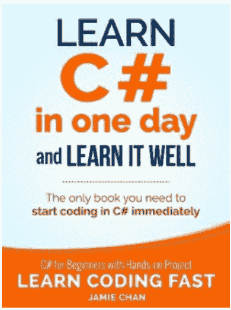
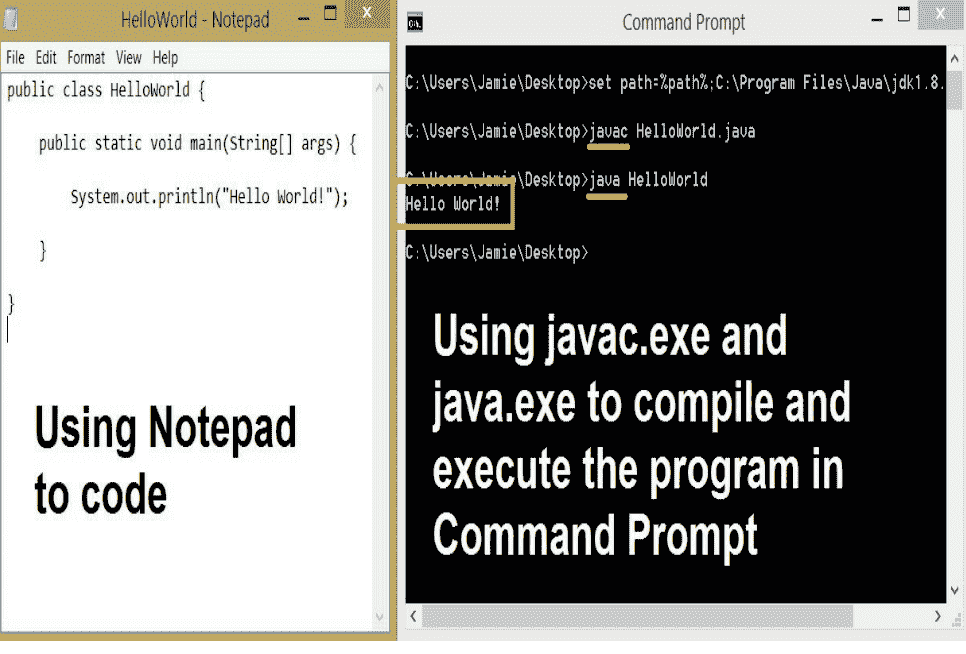
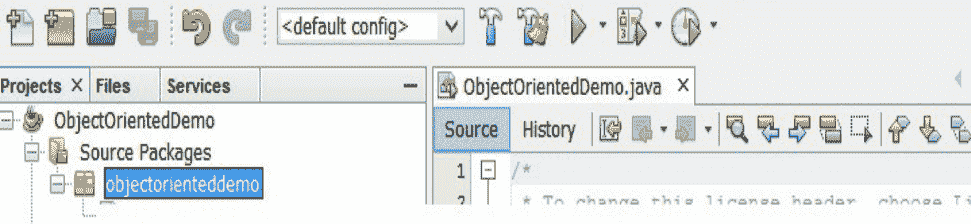
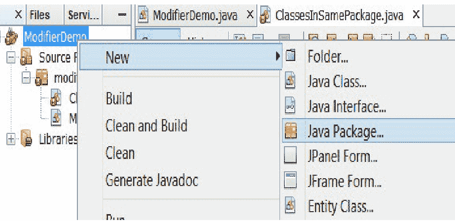
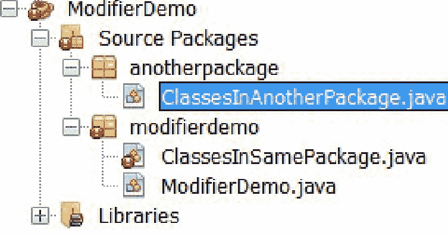
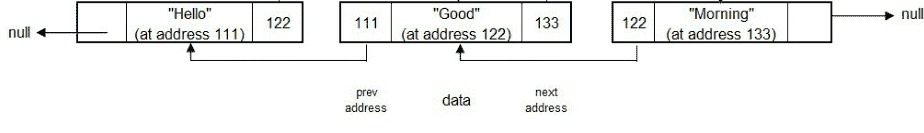
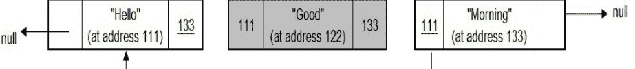

# 一天学会 Java 并精通它 (快速编程) (第 4 卷)

**Jamie Chan 著**

## 前言

本书的编写目的是帮助你**快速**学习 Java 并**精通**它。

本书不假设你具备任何编程背景。如果你是一个完全的初学者，你会发现这本书以易于理解的方式解释了复杂的概念。如果你是一个经验丰富的编程人员但初次接触 Java，这本书将为你提供足够的深度，让你立即开始 Java 编程。

书中主题经过精心挑选，旨在让你对 Java 有广泛的接触，同时不会因信息过载而感到压力。这些主题包括面向对象的编程概念、错误处理技术、文件处理技术等。此外，还涵盖了 Java 的新功能，如 lambda 表达式。书中的示例都经过精心挑选，以演示每个概念，以便你对该语言有更深入的理解。

此外，正如查德·布兰森说：“学习任何东西最好的方法就是实践”。本书带有一个会员管理软件，引导你从零开始编写该管理软件。该项目使用了书中涵盖的概念，并让你有机会看到所有这些内容是如何整合在一起的。

你可以在 `http://www.learncodingfast.com/java` 下载项目的源代码以及书中的所有示例程序。

## 联系信息

我非常欢迎听到你的反馈。如需反馈或查询，可以通过 `jamie@learncodingfast.com` 与我联系。

## Jamie 的其他书籍




- 2.5 注释
- 3.8 Java 中的类型转换
- 8.3 抽象类与方法
- 8.5 访问修饰符复习
- 9.4.1 ArrayList 方法

## 附录 A

## 索引

Java 的设计也是为了平台无关性。正如前面提到的，Java 代码首先被编译成字节码，可以在任何安装了 Java 虚拟机（JVM）的机器上运行。因此，使用 Java，你可以编写一次代码并在任何你想运行的地方运行它。

此外，Java 是一种面向对象编程（OOP）语言。面向对象编程是一种编程方法，它将编程问题分解为相互交互的对象。我们将在本书中介绍各种面向对象的编程概念。一旦你掌握了 Java，你将熟悉这些概念。这将有助于你在未来更容易地掌握其他面向对象的编程语言。

确信 Java 是一门非常棒的学习语言了吗？让我们继续吧。

## 第 2 章：准备 Java

### 2.1 安装 JDK + NetBeans 安装包

在开始开发 Java 应用程序之前，我们需要下载并安装由 Oracle 提供的免费 JDK + NetBeans 安装包。

#### 2.1.1 什么是 JDK？

JDK 代表 Java Development Kit（Java 开发工具包），是 Oracle 提供的一个免费工具包，包含许多帮助我们开发 Java 应用程序的工具。其中一些工具包括：将我们编写的代码编译成字节码的编译器 `javac.exe`、用于打包和分发 Java 文件的归档器 `jar.exe` 以及从 Java 代码生成 HTML 文档的文档生成器 `javadoc.exe`。

此外，JDK 还包含 Java 运行时（JRE）。JRE 包含了第 1 章中提到的 JVM 以及 JVM 运行 Java 程序所需的资源。

如果你只对运行 Java 程序感兴趣，那么你只需要 JRE。但是，由于我们对开发 Java 程序也感兴趣，我们需要 JDK。

#### 2.1.2 什么是 NetBeans？

除了 JDK，我们还需要安装 NetBeans。

NetBeans 是一个集成开发环境（IDE），我们将用它来辅助编码过程。严格来说，我们可以在不使用 NetBeans 的情况下开发 Java 应用程序。我们可以在记事本（或其他任何文本编辑器）中编写代码，并使用 JDK 提供的工具进行编译和执行。下面的截图显示了如何操作的示例。



然而，虽然使用 JDK 开发 Java 应用程序是可能的，但这个过程既繁琐又容易出错。

为了让编码变得更容易，我们强烈建议使用 IDE。一个 IDE 包含一个具有高级功能的文本编辑器用于编写代码，并为我们提供图形化用户界面来调试、编译和运行我们的应用程序。正如我们之后看到的，这些功能在编码时将极大帮助。我们将使用的 IDE 是 Oracle 提供的 NetBeans。

要下载 JDK + NetBeans 安装包，请访问 `http://www.oracle.com/technetwork/Java/Javase/downloads/jdk-netbeans-jsp-142931.html`。

你将看到大量的下载选项，起初可能会让人无从下手。你将下载的版本取决于你正在使用的操作系统。x86 和 x64 分别指 32 位和 64 位操作系统。例如，如果你正在使用 32 位的 Windows 操作系统，你将下载“Windows x86”版本。

继续下载该应用程序。一旦安装完成，你就可以开始编写你的第一个 Java 程序了。

### 2.2 如何使用本书？

然而，在我们开始之前，我想强调一点：Java 中的大部分代码是由相当长的语句组成的。因此，在本书中，某些语句可能会折行到下一行。如果你在阅读代码示例时遇到问题，可以从 `http://www.learncodingfast.com/java` 下载所有示例程序的源代码。

### 2.3 你的第一个 Java 程序

现在，让我们开始编写第一个程序。要做到这一点，让我们启动 NetBeans 并从顶部菜单栏选择 `File > New Project...`。

系统会弹出 New Project 对话框。在 Categories 下选择 Java，在 Projects 下选择 Java Application。点击 Next 继续。

在下一个屏幕上，将项目命名为 HelloWorld，并注意项目存储的位置。最后，点击 Finish 创建项目。

#### 新 Java 应用程序

| 步骤 | 名称和位置 |
| --- | --- |
| 1. 选择项目 | 项目名称: HelloWorld |
| 2. 命名和位置 | 项目位置: `C:\Users\Jamie\Documents\NetBeansProjects` | 浏览... |
| | 项目文件夹: `C:\Users\Jamie\Documents\NetBeansProjects\HelloWorld` |
| | 存储库的专用文件夹 | 浏览... |
| | 库文件夹 (Libraries Folder): 不同的用户和项目可以共享相同的编译库（详情请参见帮助）。 |
| | 创建主类 helloworld.HelloWorld | |

你将看到一个 NetBeans 自动为你创建的默认模板。将模板中的代码替换为下面的代码。

注意，添加行号是为了供参考，并不是实际代码的一部分。在我们之后讨论该程序时，你可能想要标记此页面以便日后参考。你也可以从 `http://www.learncodingfast.com/java` 下载此示例程序以及本书中所有其他示例程序的源代码。

如果你不想输入下面的整个程序，可以删除模板中左侧所有带有斜杠（/）或星号（*）的行，并为其添加第 6 行和第 7 行。

```java
package helloworld;

public class HelloWorld {

    public static void main(String[] args) {
        // 在屏幕上打印 Hello World
        System.out.println("Hello World");
    }
}
```

然而，我强烈建议你亲自输入代码以更好地感受 NetBeans 的工作。当你输入时，你会看到单词以不同的颜色显示。这是 NetBeans 让代码更容易读的方式。我们将在后面的章节中详细介绍。此外，当你在 `System` 单词后输入点（.）时，会弹出一个显示你可以输入内容的列表。这就是提示（Intellisense）。最后，当你输入左括号时，NetBeans 会自动为你关闭右括号。例如，当你输入 `(` 时，NetBeans 会为你加上 `)`。

这些是 NetBeans 提供的让编码更容易的功能。

在你完成输入后，通过 `File > Save` 保存程序。NetBeans 具有“保存时编译”功能，每当你保存时它都会编译代码。然后你可以通过点击顶部的 Run 按钮执行程序（请参见图片）。

#### 项目管理器

#### 提示

文件 编辑 查看 导航 重构 运行 调试 配置 窗口 main static final PrintStream err <default config> 标准输出流。输出流已经打开并准备好接收数据。

- 项目
  - 文件
    - 服务
      - helloWorld
        - helloWorld.java
  - 库

#### main

- helloWorld
  - main(String[] args)

```java
public class HelloWorld {
    public static void main(String[] args) {
        System.out.println("Hello World");
    }
}
```

| 输出 | 提示 |
|---|---|
| | 历史记录 PrintStream |
| | get(Object object, int,, Object object, int int) | void |
| | isProperty(String string) | String |
| | console | Long |
| | void | void |
| | Properties | Properties |
| | get(String string) | String |
| | getProperty(String string, String string) | String |
| | getSecurityManager() | SecurityManager |
| | get(String string) | String |
| | getHashCode(Object obj) | int |
| | getHandle(Channel channel) | Channel |

#### 输出窗口

如果你的程序运行失败，会出现一个带有错误消息的弹出框。点击 **Run Anyway** 继续。你将在输出窗口看到错误描述（请参见下图）。或者，你也可以将鼠标悬停在编辑器窗口中的红色波浪线上。这将为你提供关于哪里错误的另一个线索。尝试识别并纠正错误，然后再次运行程序。

#### 文件名

```java
package helloworld;

public class HelloWorld {
    public static void main(String[] args) {
        // 打印 Hello World
        System.out.println("Hello World");
    }
}
```

鼠标悬停在某行上显示此错误消息

```
Exception in thread "main" RuntimeException: Uncompilable source code - type: <
at HelloWorld.main(HelloWorld.java)
C:\Users\James\AppData\Local\NetBeans\Cache\8.1\executor-snippets) Java returned: 1
BUILD FAILED (total time: 3 seconds)
```

#### 输出错误信息

如果一切顺利，你将在输出窗口看到以下内容：

```
Hello World
BUILD SUCCESSFUL (total time: 0 seconds)
```

该程序仅在输出窗口中显示“Hello World”单词。其他句子是 NetBeans 提供的额外信息，不属于我们的程序。就是这样！你已经成功编写了第一个程序。你编写的 Java 文件名为 `HelloWorld.java`。你可以在文本编辑器顶部找到该名称（请参考上图）。

### 2.4 Java 程序的基本结构

现在，让我们快速回顾一下你刚刚编写的程序。

#### 2.4.1 包 (Package)

在第一行，我们有语句：

`package helloworld;`

该语句告诉编译器，我们写的 Java 文件属于 `helloworld` 包。包简单来说就是相关类和接口的组合。如果你不知道什么是类和接口，请不要担心，我们将在随后的章节中介绍它们。当我们在文件顶部写 `package helloworld;` 时，我们是在要求编译器将此文件包含在 `helloworld` 包中。编译器将创建一个名为“helloworld”的文件夹并将文件保存到该文件夹中。属于同一个包的文件存储在该文件夹中。如果你导航到你的“Projects”文件夹，你会发现一个“HelloWorld”的文件夹。如果你找不到此文件夹，请尝试使用计算机的搜索功能查找它。

该文件夹存储了 `helloworld` 包的文件。我们的习惯是将包命名为小写。请注意 Java 是区分大小写的。因此，“HelloWorld”不等于“helloworld”。在“helloworld”文件夹内部，你会找到 `HelloWorld.java` 文件。声明包的好处是可以防止命名冲突。只要它们属于不同的包，两个或多个文件就可以同名。这类似于只要将文件放在不同的文件夹中，计算机上就可以有多个同名文件。我们将在第 8 章学习如何创建不同的包。

除了我们创建的包外，Java 还带了许多预创建的包，其中包含了我们可以在程序使用的代码。例如，用于输入输出的代码被封装在 `java.io` 包中，而实现图形用户界面组件（如按钮、菜单等）的代码被封装在 `java.awt` 包中。要使用这些预编写的包，我们需要将它们导入到我们的程序中。我们将在稍后学习如何进行操作。

#### 2.4.2 HelloWorld 类

接下来，让我们转向 HelloWorld 类。我们将在第 7 章中详细讨论类。现在，只需知道在我们的示例中，HelloWorld 类从第 3 行开始，以左大括号开头，并于第 10 行以右大括号结束。大括号在 Java 中被广泛用于指示代码元素的开始和结束。Java 中所有的左大括号必须用相应的右大括号关闭。

在 HelloWorld 类中，我们有一个 `main()` 方法，它从第 5 行开始，到第 8 行结束。

#### 2.4.3 main() 方法

`main()` 方法是所有 Java 程序的入口。每当 Java 程序启动时，`main()` 方法都是第一个被调用的方法。注意我们 main 方法括号内的 `String[] args` 吗？这意味着 `main()` 方法可以接受字符串数组作为输入。暂时不要担心这一点。我们将在随后的章节中介绍数组和输入。

在我们的示例中，`main()` 方法包含两行代码。第一行

`// 在屏幕上打印 Hello World 单词`

被称为注释，会被编译器忽略。

第二行：

`System.out.println("Hello World");`

在屏幕底部的输出窗口中显示 "Hello World" 行（不带引号）。注意该语句以分号结尾。Java 中的所有语句都必须以分号（;）结尾。这与 C 和 C++ 等大多数其他编程语言相似。

在 `System.out.println("Hello World");` 语句之后，我们用两个右大括号来结束代码，以关闭之前的左大括号。就是这样！这个简单程序的所有内容就是这些。

### 2.5 注释

我们在这一章中涵盖了很多内容。你现在应该对 Java 编程有了基本的理解，并且能够熟练使用 NetBeans。在结束本章之前，还有一件事。

`// 在屏幕上打印 Hello World 单词`

被称为注释，会被编译器忽略。我们也可以使用像这样的多行注释：

```java
/*
这是一个跨越多行的
多行注释。
*/
```

要指定一个长型（long）值，你必须在数字末尾添加后缀“L”：

```java
long bigNumber = 10L;
```

我们还可以使用注释来禁用代码：

```java
// System.out.println("此行不会执行");
```

## 第 3 章：变量与运算符

现在你已经熟悉了 Java 并对其有了基本的了解，让我们进入核心内容。在本章中，你将学习变量和运算符。

### 3.1 什么是变量？

变量是赋予我们需要存储的数据的名称。例如，假设程序需要存储年龄。通过以下语句声明变量：

`int age;`

该声明首先指定变量的类型，然后是它的名称。在我们的示例中，数据类型是 `int`。在你声明变量后，程序将分配特定的内存空间来存储这些数据。你可以通过引用名称访问并修改这些数据。

### 3.2 Java 中的原始数据类型

Java 中预定义了八种基本数据类型。这些被称为原始数据类型。前四个数据类型用于存储整数（即没有小数部分的数字）。它们如下：

- **byte**：`byte` 类型用于存储 -128 到 127 的整数。它使用 1 字节存储空间（称为数据类型的宽度）。当我们考虑存储空间或确定值不会超过 127 时，通常使用 `byte` 类型。例如，我们可以使用 `byte` 类型存储用户的年龄，因为用户的年龄不太可能超过 127 岁。
- **short**：`short` 类型使用 2 字节存储空间，范围为 -32768 到 32767。
- **int**：`int` 类型使用 4 字节存储空间，范围为 -2³¹ (-2147483648) 到 2³¹-1 (2147483647)。它是存储整数最常用的数据类型，因为范围最实用。


## Java 基础数据类型

### 整数类型

- **byte**：1 字节，范围 -128 到 127
- **short**：2 字节，范围 -32,768 到 32,767
- **int**：4 字节，范围 -2³¹ 到 2³¹-1，最常用的整数类型
- **long**：8 字节，范围 -2⁶³ 到 2⁶³-1。指定 `long` 值需在数字末尾添加后缀 `L`

### 浮点类型

- **float**：4 字节，范围约 -3.4e38 到 3.4e38，精度约 7 位数字。指定 `float` 值需添加后缀 `F`
- **double**：8 字节，范围约 -1.7e308 到 1.7e308，精度约 15 位数字。默认浮点数类型，推荐优先使用

### 其他类型

- **boolean**：仅存储 `true` 或 `false`
- **char**：2 字节，存储单个 Unicode 字符

---

## 3.3 变量命名

### 命名规则
- 只能包含字母、数字、下划线 `_` 或美元符号 `$`
- 首字符不能是数字
- 区分大小写（`thisIsVariableName` ≠ `thisisavariablename`）

### 命名约定
- 习惯以字母开头，避免使用 `$` 和 `_`
- 采用驼峰命名法：`userName`、`userAge`、`thisIsVariableName`
- 变量名应短小且有意义

### 保留字
不能使用 Java 保留字（如 `system`、`if`、`while` 等）作为变量名

---

## 3.4 变量初始化

声明变量时必须赋初始值，两种方式：

### 声明时初始化
```java
1  byte userAge = 20;
2  short numberOfStudents = 45;
3  int numberOfEmployees = 500;
4  long numberOfInhabit = 21021313012678L;
5
6  float hourlyRate = 60.5F;
7  double numberOfHours = 5120.5;
8
9  char grade = 'A';
10 boolean promote = true;
11
12 byte level = 2, userExperience = 5;
```
> 第 4 行 `long` 需加后缀 `L`，第 6 行 `float` 需加后缀 `F`，第 9 行 `char` 用单引号，第 12 行同类型多变量用逗号分隔

### 分离声明与初始化
```java
byte year;  // 声明
year = 20;  // 初始化
```

---

## 3.5 赋值运算符

`=` 是赋值运算符，将右侧值赋给左侧变量。

```java
int x = 5;
int y = 10;
x = y;  // x 变为 10，y 保持 10
```

---

## 3.6 基础运算符

| 运算符 | 说明 | 示例 (x=7, y=2) | 结果 |
|--------|------|-----------------|------|
| `+`    | 加法 | `x + y`         | 9    |
| `-`    | 减法 | `x - y`         | 5    |
| `*`    | 乘法 | `x * y`         | 14   |
| `/`    | 除法 | `x / y`         | 3    |
| `%`    | 取模 | `x % y`         | 1    |

> 整数除法会截断小数部分

---

## 3.7 复合赋值运算符

| 运算符 | 等价写法 | 示例 |
|--------|----------|------|
| `+=`   | `x = x + 2` | `x += 2` |
| `-=`   | `x = x - 2` | `x -= 2` |
| `*=`   | `x = x * 2` | `x *= 2` |
| `/=`   | `x = x / 2` | `x /= 2` |
| `%=`   | `x = x % 2` | `x %= 2` |

### 自增/自减运算符

```java
int x = 2;
x++;  // 等价于 x = x + 1，x 变为 3
```

**前置 vs 后置**：
```java
int counter = 5;
System.out.println(counter++);  // 先打印 5，再自增 → 输出 5
System.out.println(++counter);  // 先自增，再打印 7 → 输出 7
```

---

## 3.8 类型转换

### 拓宽转换（自动）
小类型 → 大类型，无需显式操作：
```java
short age = 10;
double myArray = age;  // 自动转换
```

### 窄转换（强制）
大类型 → 小类型，需显式转换，可能丢失数据：
```java
int x = (int) 20.9;  // 结果为 20，小数部分截断
float num1 = (float) 20.9;  // 或使用 20.9F
```
> 窄转换不安全，除非必要应避免

---

## 第 4 章：数组与字符串

### 4.1 字符串

字符串是文本序列，使用双引号：
```java
String message = "Hello World";
String empty = "";
```

#### 字符串连接
```java
String myName = "Hello World, " + "my name is Jamie";
```

#### 4.1.1 常用字符串方法

`String` 是对象，提供丰富方法：

| 方法 | 说明 | 示例 | 结果 |
|------|------|------|------|
| `length()` | 字符总数 | `"Hello World".length()` | `11` |
| `toUpperCase()` | 转大写 | `"Hello World".toUpperCase()` | `"HELLO WORLD"` |
| `toLowerCase()` | 转小写 | `"Hello World".toLowerCase()` | `"hello world"` |
| `substring(beginIndex)` | 从索引提取到末尾 | `"Hello World".substring(6)` | `"World"` |
| `substring(begin, end)` | 提取 [begin, end) | `"Hello World".substring(1, 8)` | `"ello Wo"` |
| `split(regex)` | 按正则分割 | `"a,b,c".split(", ")` | `{"a","b","c"}` |

```java
int length = "Hello World".length();
String upper = "Hello World".toUpperCase();
String sub = "Hello World".substring(6);
String[] names = "Peter, John, Andy, David".split(", ");
```

> 完整方法列表：[Oracle String 文档](https://docs.oracle.com/javase/8/docs/java/lang/String.html#summary)

---

### 4.2 数组

数组存储同类型元素集合。

#### 声明方式
```java
int[] userAge;   // 推荐风格
int userAge[];   // C/C++ 风格，不推荐
```

> `int[]` 表示数组类型，`userAge` 为变量名


在声明数组变量后，你需要创建一个数组并将其赋值给该变量。为了做到这一点，我们像下面所示使用 `new` 关键字：

```java
int[] userAge;
userAge = new int[]{0, 1, 2, 3, 4};
```

第一条语句声明数组变量。第二条语句创建数组并将其赋值给 `userAge`。由于 `userAge` 之前没有被任何数组引用，该语句用默认值初始化 `userAge`。一旦初始化了数组，数组的大小就不能再更改。在这种情况下，数组 `userAge` 从现在起只能包含 5 个值。

除了用两条语句声明和初始化数组外，我们还可以使用快捷语法将两条语句合并为一条语句：

```java
int[] user2 = new int[]{0, 1, 2, 3, 4};
```

我们可以进一步简化这条语句为：

```java
int[] user2 = {0, 1, 2, 3, 4};
```

也就是说，如果你在同一语句中声明并初始化数组，可以省略 `new int[]`。声明并初始化数组的第三种方法如下：

```java
int[] user3 = new int[5];
```

这条语句声明了数组 `user3` 并用一个包含 5 个整数的数组对其初始化（如方括号 `[]` 内的数字 5 所示）。由于我们没有指定值，Java 会使用默认值创建一个数组并赋值给 `user3`。整数的默认值为 0。因此，`user3` 变为 {0, 0, 0, 0, 0}。

你可以通过使用索引访问来更新数组中的单个元素。记住索引始终从零开始。数组的第一个元素的索引为 0，下一个索引为 1，依此类推。假设数组 `userAge` 目前为 {0, 1, 2, 3, 4}。要更新数组的第一个元素，我们写：

```java
userAge[0] = 3;
```

数组变为 {3, 1, 2, 3, 4}。如果我们输入

```java
userAge[2] = userAge[2] + 20;
```

即在第三个元素上加上了 20。

### 4.2.1 数组方法

像字符串一样，数组也带有许多预写的方法。我们下面讨论的方法可以在 `java.util.Arrays` 类中。要使用它们，你需要在程序中添加语句：

```java
import java.util.Arrays;
```

这是为了告诉编译器去哪里寻找这些方法的代码。`import` 语句必须出现在 `package` 语句之后、类声明之前。示例如下：

```java
package helloworld;

import java.util.Arrays;

public class HelloWorld {
    // HelloWorld 类的代码
}
```

你可能记得，之前我们使用 `String` 类时，不需要写任何 `import` 语句。这是因为 `String` 类存在于 `java.lang` 包中，所有的 Java 程序都会默认导入它。现在，让我们来看看一些常用的数组方法。

#### equals()

`equals()` 方法用于判断两个数组是否相等。如果数组相等则返回 `true`，如果不相等则返回 `false`。如果两个数组具有相同数量元素且元素的顺序相同，则认为它们是相等的。

假设你有以下代码段：

```java
int[] arr1 = {0,2,4,6,8,10};
int[] arr2 = {0,2,4,6,8,10};
int[] arr3 = {10,8,6,4,2,0};
```

```java
boolean result1 = Arrays.equals(arr1, arr2);
```

```java
boolean result2 = Arrays.equals(arr1, arr3);
```

`result1` 将为 `true`，而 `result2` 将为 `false`。这是因为尽管 `arr1` 和 `arr3` 具有相同的元素，但元素的顺序并不相同。因此，这两个数组不被认为相等。

注意，在上面的示例中，我们在方法名前面加上了 `Arrays` 单词。这是因为 `Arrays` 类中的所有方法都是静态的（static）。要调用静态方法，你必须在前面加上类名。我们将在第 7 章中详细讨论静态方法。

#### copyOfRange()

`copyOfRange()` 方法允许你将一个数组的内容复制到另一个数组。它需要三个参数。

假设你有

```java
int[] source = {12, 1, 5, -2, 16, 14};
```

`copyOfRange()` 方法将 `source` 的内容复制到一个新数组中。第一个参数是起始索引（包含），第二个参数是结束索引（不包含）。例如，如果我们写

```java
int[] dest = Arrays.copyOfRange(source, 3, 6);
```

那么 `dest` 将包含从索引 3 到但不包含索引 6 的元素。在这种情况下，`dest` 将为 {-2, 16}。

#### toString()

`toString()` 方法返回一个表示数组内容的字符串。这使得我们能够轻松显示数组的内容。例如，假设你有

```java
int[] numbers = {1, 2, 3, 4, 5};
```

你可以使用语句

```java
System.out.println(Arrays.toString(numbers));
```

将得到 [1, 2, 3, 4, 5]。

#### sort()

`sort()` 方法允许我们对数组进行排序。它接收数组作为参数。假设你有

```java
int[] numbers2 = {12, 1, 5, -2, 16, 14};
```

你可以通过写以下代码对数组排序：

```java
Arrays.sort(numbers2);
```

数组将按升序排列。`sort()` 方法不返回新数组。它直接修改传入的。也就是说，它修改了示例中的 `numbers2` 数组。你可以使用语句

```java
System.out.println(Arrays.toString(numbers2));
```

得到 [-2, 1, 5, 12, 14, 16]。

#### binarySearch()

`binarySearch()` 方法允许你在排序后的数组中搜索特定值。要使用此方法，请确保你的数组是排序过的。你可以使用上面提到的 `sort()` 方法。

假设有如下数组

```java
int[] myArray = {21, 23, 34, 45, 56, 78, 99};
```

为了确定 78 是否在数组中，我们写

```java
int foundIndex = Arrays.binarySearch(myArray, 78);
```

`foundIndex` 将等于 5。这表示数字 78 位于索引 5。

相反，如果你写

```java
int foundIndex2 = Arrays.binarySearch(myArray, 39);
```

`foundIndex2` 将等于 -4。

这个结果包含两个部分——负号和数字 4。负号仅表示 39 未找到。

而数字 4 另一方面则有点奇怪。它告诉我们如果该数字在数组中存在，它应该在哪里。然而，它在该索引上加了一个。换句话说，如果数组中存在数字 39，它应该位于索引 4-1 = 3 处。

在本节中，我们已经介绍了一些常用的数组方法。要查看 Java 中所有可用数组方法的完整列表，请访问此页面 https://docs.oracle.com/java/8/docs/api/java/util/Arrays.html

### 4.2.2 获取数组长度

最后，让我们来看看如何获取数组的长度。数组的长度告诉我们数组中包含多少个元素。之前在讨论字符串时，我们提到过可以使用 `length()` 方法来获取字符串的长度。

与大多数人的认为不同，在处理数组时，没有 `length()` 方法。相反，要找到数组的长度，我们使用 `length` 字段。我们将在第 7 章讨论字段与方法的区别。现在，你只需要知道获取数组的长度时，不需要在 `length` 单词后添加括号。

例如，如果我们有

```java
int[] userAge = {21, 22, 26, 32, 40};
```

`userAge.length` 等于 5，因为数组中有 5 个数字。

### 4.3 基本类型 vs 引用类型

现在我们已经熟悉了字符串和数组，让我们来讨论关于 Java 数据类型中的一个重要概念。

Java 中的所有数据类型都可以分为基本类型或引用类型。Java 中只有 8 种基本类型（`byte`、`short`、`int`、`long`、`float`、`double`、`char` 和 `boolean`），其余都是引用类型。引用类型的示例包括本章讨论的字符串和数组，以及将在第 7 章和第 8 章讨论的类和接口。

基本类型和引用类型之间的主要区别之一是存储的数据。

基本类型存储其自身的数据。

当我们写下

```java
int myNumber = 5;
```

变量 `myNumber` 存储的是实际值 5。

另一方面，引用类型并不存储实际数据。相反，它存储的是指向该数据的引用。它不会告诉编译器数据的值是多少；它告诉编译器去哪里找到实际数据。

引用类型的一个示例是 `String`。当你写下类似 `String message = "Hello";` 的语句时，

变量 `message` 实际上并没有存储字符串 "Hello"。

相反，字符串 "Hello" 被创建并存储在计算机内存的另一个地方。变量 `message` 存储的是该内存位置的地址。

这就是我们目前对引用类型需要了解的所有内容。由于这是一本初学者书籍，我们不会详细说明为什么需要引用类型。请注意基本类型和引用类型之间存在区别；前者存储值，而后者存储地址。

### 4.4 字符串是不可变的

在结束本章之前，我想介绍关于字符串的另一个概念。具体来说，我想指出在 Java（以及大多数其他语言）中字符串是不可变的。

不可变意味着字符串的值不能改变。每当我们更新字符串变量时，我们实际上是在创建一个新字符串并将内存地址赋值给该字符串变量。让我们来看一个例子。假设我们有

```java
String message = "Hello";
```

我们之前了解到编译器会创建字符串 "Hello" 并存储在计算机内存的某处。变量 `message` 存储该位置的地址。现在，如果我们如下所示将 `message` 的值更新为 "World"

```java
message = "World";
```

编译器并没有去存储 "Hello" 的位置将其改为 "World"。相反，它创建一个新的字符串 "World" 并将其存储在计算机内存的另一个地方。然后将这个新地址赋值给 `message`。换句话说，有两个字符串："Hello" 和 "World"。如果 "Hello" 不再被需要，它就会被处理。

### 打印双引号 ("") 以便双引号不结束字符串

示例

```java
System.out.println("I am 5'9\" tall");
```

输出

I am 5'9" tall

### 5.3 格式化输出

在之前的示例中，我们查看了如何使用 `println()` 和 `print()` 方法向用户显示输出。然而，有时我们希望对输出的格式有更好的控制。例如，如果我们写：

```java
System.out.println("The answer for 5.45 divided by 3 is " + (5.45/3));
```

我们将得到

The answer for 5.45 divided by 3 is 1.81666666666666667

在大多数情况下，我们并不希望向用户显示这么多小数位。在这种情况下，我们可以使用 `printf()` 方法来向用户显示输出。`printf()` 方法比 `println()` 方法稍微复杂一些，但它对输出的显示方式提供了更多的控制。为了格式化上述输出，我们可以写：

```java
System.out.printf("The answer for %.3f divided by %d is %.2f.", 5.45, 3, 5.45/3);
```

这将给出输出

The answer for 5.450 divided by 3 is 1.82.

`printf()` 方法需要一个或多个参数。在上面的示例中，我们向方法传递了四个参数。

第一个参数 "The answer for %.3f divided by %d is %.2f." 是要格式化的字符串。


你可能会注意到字符串中一些奇怪的符号：`%.3f`、`%d` 和 `%.2f`。这些被称为格式说明符。它们充当占位符，并被随后的参数替换。第一个格式说明符 (`%.3f`) 被第一个参数 (`5.45`) 替换，第二个 (`%d`) 被第二个参数 (`3`) 替换，依此类推。

格式说明符始终以百分号 (`%`) 开始，并以转换器（如 `f` 或 `d`）结束。它们指定了替换它们的参数应该如何被格式化。在百分号 (`%`) 和转换器之间，你可以添加附加信息，这被称为标志。

在我们的示例中，第一个格式说明符是 `%.3f`。

`f` 是转换器。它告诉编译器应该被一个浮点数（即带有小数位的数字，如 `float` 或 `double`）替换。如果我们尝试用非浮点数来替换它，将会得到错误。

`.3` 是标志。它表示我们想要显示带有3位小数的数字。因此，数字 5.45 在输出中被显示为 5.450。除了 `%.3f` 说明符外，Java 中还有许多其他可以使用的说明符。接下来的两个部分将讨论我们说明符中一些其他常用的转换器和标志。

### 5.3.1 转换器

#### 整数转换器：d

此转换器用于格式化整数，如 `byte`、`short`、`int` 和 `long`。

示例

```
System.out.printf("%d", 12);
```

输出

```
12
```

注意：

`System.out.printf("%d", 12.9);` 将带给我们一个错误，因为 12.9 不是整数。

同样，`System.out.printf("%f", 12);` 将带给我们一个错误，因为 12 不是浮点数。

#### 行转换器：n

此转换器将光标移动到下一行

示例

```
System.out.printf("%d%n%d", 12, 3);
```

输出

```
12
3
```

### 5.3.2 标志

#### 宽度标志

此标志用于指定总宽度。

示例 1

```
System.out.printf("%8d", 12);
```

输出

```
      12
```

在上面的输出中，数字 12 前面有 6 个空格，我们我们的总宽度为 8。

示例 2

```
System.out.printf("%8.2f", 12.4);
```

输出

```
   12.40
```

在上面的输出中，数字前面有 3 个空格，我们包括小数点在内的总宽度为 8。

#### 千分位分隔符标志 (,)

此标志用于显示带千分位分隔符的数字

示例 1

```
System.out.printf("%,d", 12345);
```

输出

```
12,345
```

示例 2

```
System.out.printf("%,.2f", 12345.6789);
```

输出

```
12,345.68
```

### 5.4 接收用户输入

现在我们已经知道了如何向用户显示输出，让我们看看如何接收他们的输入。接收输入实际上非常简单。有几种方法可以实现，最简单且常用的方法是使用 `Scanner` 对象。要接收用户输入，我们首先需要使用语句导入 `Scanner` 类：

```java
import java.util.Scanner;
```

接下来，我们需要创建一个 `Scanner` 对象并将 `System.in` 作为参数传递。`System.in` 告诉编译器你想从标准输入设备（通常是键盘）获取输入。如果你是编程初学者，可能不理解什么是对象。别担心这个；你将在第 7 章学习类和对象。现在，只需要知道你需要写这条语句：

```java
Scanner input = new Scanner(System.in);
```

`Scanner` 类包含了几个我们可以使用的方法来从用户读取输入。常用的方法有 `nextInt()`、`nextDouble()` 和 `nextLine()`，分别用于读取整数、`double` 和字符串数据类型。为了理解这些方法如何工作，让我们在 NetBeans 中创建一个新项目并命名为 `InputDemo`。将代码替换为下面的代码（添加数字以供参考）：

```java
package input;
import java.util.Scanner;

public class InputDemo {
    public static void main(String[] args) {
        Scanner input = new Scanner(System.in);

        System.out.print("Enter an integer: ");
        int myInt = input.nextInt();
        System.out.printf("You entered %d.%n", myInt);

        System.out.print("Enter a double: ");
        double myDouble = input.nextDouble();
        System.out.printf("You entered %.2f.%n", myDouble);

        System.out.print("Enter a string: ");
        input.nextLine();
        String myString = input.nextLine();
        System.out.printf("You entered %s.%n", myString);
    }
}
```

在第 2 行，我们导入了 `java.util.Scanner`。接下来，我们在第 6 行创建了一个 `Scanner` 对象并命名为 `input`。在第 8 行，我们提示用户输入一个整数。`int myInt = input.nextInt();` 读取了整数。在第 10 行，我们使用 `printf` 显示你输入的整数。

在第 12 行，我们提示用户输入一个 `double`。`double myDouble = input.nextDouble();` 读取了 `double`。在第 14 行，我们使用 `printf` 显示你输入的 `double`。

在第 16 行，我们提示用户输入一个字符串。`input.nextLine();` 读取了换行符。然后 `String myString = input.nextLine();` 读取了字符串。在第 19 行，我们使用 `printf` 显示你输入的字符串。

# 第 6 章：控制流语句

在之前的章节中我们已经涵盖了一些内容。现在，你应该已经熟悉 Java 程序的基本结构，并能够编写使用变量的简单 Java 程序。此外，你还学习了如何使用各种内置 Java 方法与用户进行交互。

在本章中，我们将更进一步——学习如何控制程序的执行控制流。默认情况下，程序内部的语句是按照它们出现的顺序从上到下执行的。然而，我们可以使用控制流语句来改变这种流。

这些语句包括决策语句（`if`、`switch`）、循环语句（`for`、`while`、`do-while`）和分支语句（`break`、`continue`）。我们将在随后的章节中逐一介绍每一种。

现在，让我们先来看比较运算符。

### 6.1 比较运算符

大多数控制流语句都涉及某种形式的比较。程序将根据比较的结果执行不同的操作。

最常用的比较运算符是等号运算符。如果我们想比较两个变量是否相等，我们使用 `==`（双等号）运算符。例如，如果你写 `x == y`，你是在要求程序检查 `x` 的值是否等于 `y` 的值。如果它们相等，则满足条件，语句求值为 `true`。否则，语句求值为 `false`。

除了判断两个值是否相等外，我们还可以在控制流语句中使用其他比较运算符。

#### 不等于 (!=)

如果左侧不等于右侧，则返回 `true`。

```
5 != 2 is true
6 != 6 is false
```

#### 大于 (>)

如果左侧大于右侧，返回 `true`。

```
5 > 2 is true
3 > 6 is false
```

#### 小于 (<)

如果左侧小于右侧，返回 `true`。

```
1 < 7 is true
9 < 6 is false
```

#### 大于等于 (>=)

如果左侧大于等于右侧，返回 `true`。

```
5 >= 2 is true
5 >= 5 is true
3 >= 6 is false
```

#### 小于等于 (<=)

如果左侧小于或等于右侧，返回 `true`。

```
5 <= 7 is true
7 <= 7 is true
9 <= 6 is false
```

我们还有两个逻辑运算符 (`&&`、`||`)，它们在想要组合多个条件时非常有用。

#### 与逻辑运算符 (&&)

如果所有条件都满足，则返回 `true`。

`5==5 && 2>1 && 3!=7` 为 true

`5==5 && 2<1 && 3!=7` 为 false，因为第二个条件 (`2<1`) 为 `false`

#### 或逻辑运算符 (||)

如果至少满足一个条件，则返回 `true`。

`5==5 || 2<1 || 3==7` 为 true，因为第一个条件 (`5==5`) 为 `true`

`5==6 || 2<1 || 3==7` 为 false，因为所有条件均为 `false`

### 6.2 决策语句

现在我们已经熟悉了比较运算符，让我们学习如何使用这些运算符来控制程序的流程。我们先来看 `if` 语句。

### 6.2.1 if 语句

`if` 语句是最常用的控制流语句之一。它允许程序评估某个条件是否满足，并根据评估结果执行相应的操作。

`if` 语句的结构如下（添加了行号以便参考）：

```
1 if (condition 1 is met)
2 {
3   do Task A
4 }
5 else if (condition 2 is met)
6 {
7   do Task B
8 }
9 else if (condition 3 is met)
10 {
11   do Task C
12 }
13 else
14 {
15   do Task D
16 }
```

第 1 行测试第一个条件。如果满足条件，随后的大括号内的所有内容（第 2 到 4 行）将被执行。`if` 语句的其余部分（第 5 到 16 行）将被跳过。

如果第一个条件不满足，可以使用随后的 `else` 块测试更多条件（第 5 到 12 行）。可以有多个 `else if` 块。最后，你可以使用 `else` 块（第 13 到 16 行）在先前的任何条件都不满足时执行某些代码。`else if` 和 `else` 块是可选的。为了完全理解 `if` 语句的工作原理，让我们尝试一个示例。启动 NetBeans 并创建一个新项目 `IfDemo`。将生成的代码替换为以下代码。

```java
package ifDemo;
import java.util.Scanner;
public class IfDemo{
    public static void main(String[] args) {
        Scanner input = new Scanner(System.in);
        System.out.print("Please enter your age: ");
        int age = input.nextInt();
        if (age < 0 || age > 100) {
            System.out.println("Invalid Age");
            System.out.println("Age must be between 0 and 100");
        } else if (age < 18) {
            System.out.println("Sorry you are underage");
        } else if (age < 21) {
            System.out.println("You need parental consent");
        } else {
            System.out.println("Congratulations!");
            System.out.println("You may sign up for the event!");
        }
    }
}
```

程序首先在第 10 行提示用户输入等级。接下来，在第 11 行，它读取用户的输入并使用下面的语句将结果存储在 `userGrade` 中：

`String userGrade = input.nextLine().toUpperCase();`

这句话对某些读者来说可能有些陌生。在这里，我们在同一条语句中调用了两个方法。

`input.nextLine()` 首先读取用户输入的输入。该方法返回一个字符串。然后我们使用生成的字符串来调用 `toUpperCase()` 方法。该语句展示了如何在同一条语句中调用两个方法的示例。这些方法从左到右执行。也就是说，先执行 `nextLine()` 方法，然后执行 `toUpperCase()` 方法。

在将用户输入赋值给 `userGrade` 之前，我们必须将其转换为大写字母，因为 Java 是区分大小写的。我们希望无论用户输入的是“A”还是“a”，程序都显示“Distinction”。因此，在赋值给 `userGrade` 之前，我们将任何小写输入转换为大写。

获取用户等级后，我们使用后面的 `switch` 语句来确定输出。

如果输入的等级是“A+”（第 15 行），程序将执行后续语句直到遇到 `break` 语句。这意味着它将执行第 16 到 18 行。因此，输出是“Distinction”。

如果等级是“A”（第 16 行），程序将执行第 17 行和 18 行。同样，输出是“Distinction”。

如果等级不是“A+”或“A”，程序将检查下一个 `case`。它会从上到下一直检查，直到满足某个 `case`。如果没有一个 `case` 满足，则执行 `default` 情况。

如果你运行上述代码，你将为显示的每个输入获得相应的输出：

```
Enter your grade: A+
Distinction
```

```
Enter your grade: A
Distinction
```


## 6.3 循环语句

现在，让我们来看 Java 中的循环语句。Java 中常用的四种循环语句是 `for` 语句、增强型 `for` 语句、`while` 语句和 `do-while` 语句。

### 6.3.1 For 语句

`for` 语句重复执行代码块，直到测试条件不再有效。

`for` 语句的语法如下：

```
for (initial value; test condition: modification to value)
{
  //执行某些任务
}
```

为了理解 `for` 语句如何工作，让我们考虑下面的示例。

```
1 for (int i = 0; i < 5; i++)
2 {
3 System.out.println(i);
4 }
```

`for` 语句的重点是第 1 行：

`for (int i = 0; i < 5; i++)`

它包含三个部分，部分部分用分号隔开。

第一部分声明并初始化一个 int 型变量为零。该变量作为循环计数器。

第二部分测试 `i` 是否小于 5。如果是，则将执行大括号内的语句。在这个示例中，由于只有一个语句，大括号是可选的。

在执行 `System.out.println(i)` 语句后，程序返回到第 1 行的最后一个部分。`i++` 将 `i` 的值加 1。因此，`i` 从 0 增加到 1。

递增后，程序测试 `i` 的新值是否仍然小于 5。如果是，它会再次执行 `System.out.println(i)` 语句。

这种测试和增加循环计数器的过程将重复，直到条件 `i < 5` 不再为真。此时，程序退出 `for` 语句，并继续执行该语句后的其他命令。

该代码段的输出为：

```
0
1
2
3
4
```

输出停止在 4，是因为当 `i` 为 5 时，`System.out.println(i)` 语句不会执行，因为 5 并不小于 5。

`for` 语句通常用于遍历数组。例如，如果我们有一个

`int[] myNumbers = {10, 20, 30, 40, 50};`

我们可以使用 `for` 语句和数组的 `length` 字段来遍历数组，如下所示。

```
for (int i = 0; i < myNumbers.length; i++) {
  System.out.println(myNumbers[i]);
}
```

由于 `myNumbers.length` 等于 5，这段代码从 `i = 0` 执行到 `i = 4`。如果我们运行代码，将得到以下输出：

```
10
20
30
40
50
```

### 6.3.2 增强型 For 语句

除了 `for` 语句外，在处理数组和集合（我们将在第 9 章讨论集合）时，我们使用增强型 `for` 语句。如果你想从数组获取信息而不对其进行任何更改，那么增强型 `for` 语句非常有用。

增强型 `for` 语句的语法是：

```
for (变量声明 : 数组)
{
```

假设你有

`int[] myNumbers = {10, 20, 30, 40, 50};`

你可以使用增强型 `for` 语句和数组来遍历数组，如下所示。

```
for (int i : myNumbers) {
  System.out.println(i);
}
```

由于 `myNumbers.length` 等于 5，这段代码从 `i = 0` 执行到 `i = 4`。如果我们运行代码，将得到以下输出：

```
10
20
30
40
50
```

### 6.3.3 While 语句

接下来，让我们来看看 `while` 语句。正如名字所示，`while` 语句在条件有效时重复执行指令。`while` 语句的结构如下：

```
while (条件)
{
    //语句
}
```

在使用 `while` 语句时，我们通常需要声明一个变量作为循环计数器。让我们看它的工作示例：

```
int counter = 5;

while (counter > 0)
{
    System.out.println("Counter = " + counter);
    counter -= 1;
}
```

如果你运行上述代码，你将得到以下输出：

```
Counter = 5
Counter = 4
Counter = 3
Counter = 2
Counter = 1
```

注意我们在大括号内部有一个 `counter -= 1`。这每次循环运行时都会减少 `counter` 的值。

### 6.3.4 Do-while 语句

`do-while` 语句与 `while` 语句相似，一个主要区别是是大括号内的代码至少执行一次。这里有一个 `do-while` 语句工作的示例：

```
do {
    //语句
} while (条件);
```

```
int counter = 100;

do {
    System.out.println("Counter = " + counter);
    counter++;
} while (counter<0);
```

由于测试条件 `while (counter<0)` 放在大括号之后，它在代码执行一次后进行测试。如果你运行上述代码，将得到

```
Counter = 100
```

在第一次执行 `System.out.println("Counter = " + counter)` 语句后，`counter` 加了 1。此时 `counter` 的值变为 101。当程序到达测试条件时，由于 `counter` 不小于 0，测试失败。程序将退出循环。即使 `counter` 的初始值不符合测试条件，大括号内的代码仍会执行一次。注意对于 `do-while` 语句，测试条件后需要一个分号（;）。

## 6.4 分支语句

我们现在涵盖了 Java 中的大部分控制流语句。接下来，让我们来看看分支语句。

分支语句是指示程序跳转另一行代码的语句。分支语句通常用于循环和其他控制流语句。

### 6.4.1 Break 语句

第一个分支语句是 `break` 语句。我们已经见过这种语句如何在 `switch` 语句中使用。除了在 `switch` 语句中使用外，`break` 语句也可以用于其他控制流语句。它在满足特定条件时导致循环提前退出。让我们看看 `break` 语句在 `for` 语句中的用法。

考虑下面的代码段：

```
for (int i = 0; i < 5; i++)
{
  System.out.println("i = " + i);
  if (i == 2)
    break;
}
```

在这个示例中，我们在 `for` 语句内部使用了一个 `if` 语句。它是非常

在编程中，我们经常会“混合使用”各种控制流语句，例如在 `if` 语句内部 `while` 语句，或者在 `while` 语句内部 `for` 语句。这被称为嵌套控制语句。

如果你运行上面的代码段，你将得到以下输出。

```
i = 0
i = 1
i = 2
```

注意到循环在 `i = 2` 时提前结束了吗？

如果没有 `break` 语句，循环应该从 `i = 0` 运行到 `i = 4`，因为循环条件是 `i < 5`。但是有了 `break` 语句，当 `i = 2` 时，第4行的条件被评估为 `true`。第5行的 `break` 语句导致循环提前结束。

### 6.4.2 Continue 语句

另一个常用的分支语句是 `continue` 语句。

当我们使用 `continue` 时，当前迭代中该单词之后的循环部分将被跳过。通过一个例子会让它更清晰。

如果你运行下面的代码段

```
for (int i = 0; i<5; i++)
{
  System.out.println("i = " + i);
  if (i == 2)
    continue;
  System.out.println("I will not be printed if i=2.");
}
```

你将得到以下输出：

```
i = 0
I will not be printed if i=2.
i = 1
I will not be printed if i=2.
i = 2
i = 3
I will not be printed if i=2.
i = 4
I will not be printed if i=2.
```

当 `i = 2` 时，`continue` 语句之后的行不会被执行。程序跳回第1行并从那里继续执行。此后，一切按正常方式运行。

## 6.5 异常处理

我们现在已经知道如何使用控制流语句在“正常”情况下控制程序的执行流。现在让我们学习在发生错误时如何控制程序的执行流。这被称为异常处理。

当我们编写程序时，我们应该总是尝试预判可能发生的错误。如果我们认为某块代码可能会导致错误，我们应该尝试使用 `try-catch-finally` 语句来管理它。`try-catch-finally` 语句的语法如下：

```
try
{
  do something
}
catch (type of error)
{
  do something else when an error occurs
}
finally
{
  无论是否满足 try 或 catch 条件，都执行此操作。
}
```

你可以有多个 `catch` 块。此外，`finally` 块是可选的。

让我们考虑一个例子。启动 NetBeans 并创建一个名为 `ErrorDemo` 的新项目。将生成的代码替换为以下内容：

```java
package errordemo;
import java.util.Scanner;
public class ErrorDemo {
    public static void main(String[] args) {
    int num, deno;
    Scanner input = new Scanner(System.in);
    try {
        System.out.print("Please enter the numerator: ");
        num = input.nextInt();
        System.out.print("Please enter the denominator: ");
        deno = input.nextInt();
        System.out.println("The result is " + num/deno);
    } catch (Exception e) {
        System.out.println(e.getMessage());
    } finally {
        System.out.println("---- End of Error Handling ---");
    }
}
```

在这个例子中，`try` 块是从第11行到第21行，`catch` 块是从第22行到第25行，`finally` 块是从第26行到第29行。

如果你运行代码并输入 12和4，你将得到消息

```
The result is 3
---- End of Error Handling Example ----
```

在这种情况下，程序尝试执行 `try` 块中的代码并成功执行。因此，它显示了除法的结果。在执行 `try` 块中的代码后，会执行 `finally` 块中的代码。无论执行了 `try` 块还是 `catch` 块，`finally` 块始终会被执行。

现在，再次运行程序并输入12和0。你会得到

```
/ by zero
---- End of Error Handling Example ----
```

在这种情况下，程序尝试执行 `try` 块中的代码但失败了。这是因为你不能除以零。因此，随后会执行 `catch` 块中的代码。在执行 `catch` 块后，也会执行 `finally` 块中的代码。

`catch` 块允许我们指定它应该捕捉的错误类型。在我们的例子中，我们尝试捕捉一个通用错误。因此，我们写道

`catch (Exception e)`

其中 `Exception` 指错误所属的类，`e` 是赋予错误的名字。

`Exception` 是 Java 中一个预定义的类。它处理所有通用错误，并有一个名为 `getMessage()` 的方法来解释异常的原因。为了显示错误消息，我们写道

```
System.out.println(e.getMessage());
```

在我们的例子中，我们得到了以下错误消息

```
/ by zero
```

### 6.5.1 特定错误

在上面的例子中，我们使用 `Exception` 类来捕捉通用错误。除了 `Exception` 类，Java 还有其他可以处理更特定错误的类。如果你想根据捕获到的错误执行特定任务，这将非常有用。例如，你可能想显示自己的错误消息。

要查看这是如何工作的，启动 NetBeans 并创建一个名为 *ErrorDemo* 的新项目。将代码替换为以下内容：

```java
package errordemo;

import java.util.InputMismatchException;
import java.util.Scanner;

public class ErrorDemo {
    public static void main(String[] args) {
        int choice = 0;
        Scanner input = new Scanner(System.in);
        int[] numbers = { 10, 11, 12, 13, 14, 15 };
        try {
            System.out.print("Please enter the index of the array: ");
            choice = input.nextInt();
            System.out.printf("numbers[%d] = %d%n", choice, numbers[choice]);
        } catch (ArrayIndexOutOfBoundsException e) {
            System.out.println("Error: Index is invalid.");
        } catch (InputMismatchException e) {
            System.out.println("Error: You did not enter an integer.");
        } catch (Exception e) {
            System.out.println(e.getMessage());
        }
    }
}
```

如果你输入10，得到

```
Error: Index is invalid.
```

如果你输入Hello，得到

```
Error: You did not enter an integer.
```

```java
throw new ArrayIndexOutOfBoundsException();
```

在语句之后

```java
choice = input.nextInt();
```

位于上面的 try 块中。再次运行程序并输入值 0。你会发现执行的是

```java
catch(ArrayIndexOutOfBoundsException e)
```

 块。

这是因为当用户输入值 0 时，条件 `choice == 0` 结果为真。因此，执行了语句

```java
throw new ArrayIndexOutOfBoundsException();
```

该语句导致了

```java
catch(ArrayIndexOutOfBoundsException e)
```

 块的执行。

## 第 7 章：面向对象编程（第 1 部分）

在本章中，我们将将介绍 Java 编程中的一个重要概念——面向对象编程概念。

我们将学习什么是面向对象编程，以及如何编写自己的类并从类创建对象。此外，我们讨论字段（fields）、getter 和 setter、构造函数（constructors）以及方法（methods）的概念。

### 7.1 什么是面向对象编程？

简单来说，面向对象编程是一种编程方法，它将编程问题拆分为相互作用的对象。

对象是根据称为类（classes）的模板创建的。你可以将类比为建筑的蓝图。而对象就是我们根据蓝图建造的实际“建筑”。

### 7.2 编写我们自己的类

声明类的语法如下：

```java
AccessModifier class ClassName {
// 类的内容
// 包括字段、构造函数和方法
}
```

示例为：

```java
public class ManagementStaff{
}
```

在上面的示例中，我们首先使用访问修饰符（access modifier）规定了类的访问级别。访问修饰符就像守门员，它们控制谁可以访问该类。换句话说，它们控制其他类是否可以使用该类中的特定字段或方法。

类可以是公共的（public），也可以是包私有的（package-private）。在上面的示例中，该类是 public 的。

public 意味着程序中的任何类都可以访问该类。

另一方面，包私有（Package-private）意味着该类仅对同一包内的其他类可见。一个 Java 应用程序中可以有多个包。如果你忘记什么是包，请参阅第 2.3.1 节。包私有是默认的访问级别。如果我们不写任何访问修饰符，意味着该类是包私有的。

我们将在第 8.5 节深入研究访问修饰符。


# 在声明类的访问级别之后

在声明类的访问级别之后，我们输入 `class` 关键字表示我们正在声明一个类，后面跟着类名（`ManagementStaff`）。

在命名类时使用 PascalCasing（大驼命名法）是一种常见做法。PascalCasing 指将每个单词的首字母大写，包括第一个单词（例如：`ThisIsClassName`）。这是我们在书中将遵循的约定。

类的内容包含在类名后的对大括号内。类的内容包括构造函数、字段、方法、接口和其他类。我们将在本章中涵盖其中的一些。

## 从零开始构建类

首先，启动 NetBeans 并创建一个名为 `ObjectOrientedDemo` 的新 Java Application。学习为你生成的代码。注意 NetBeans 已经自动为你创建了一个 public 类吗？

这个 public 类名为 `ObjectOrientedDemo`，并与文件名相同，即 `ObjectOrientedDemo.java`。在 Java 中，每个 java 文件只能有一个 public 类，且该 public 类名必须与文件名相同。`main()` 方法就在这个 public 类内部。

在本示例中，我们将创建第二个与 `ObjectOrientedDemo` 类交互的 Java 类。我们将此类创建在 `objectorienteddemo` 包中。为此，请在 Project Explorer 中右键点击包名，然后选择 `New > Java Class`。在创建新类时，点击 Project Explorer 中的正确项是有关重要的。例如，如果你正在向 `objectorienteddemo` 包添加新类，请确保在创建类时点击了包名（见下图）。



#### 右键点击包名 Class

我们将这个新类命名为 `Staff`，并向类添加字段、构造函数和方法。类的声明如下：

```java
public class Staff {
  // 类的内容
}
```

我们将向此类添加字段、方法和构造函数。重要的是，你要将类的内容输入在类的起始和结束括号之间。如果你写在错误的位置，程序将无法运行。本章的完整代码可以在 http://www.learncodingfast.com/java 下载。

### 7.2.1 字段

我们首先为 `Staff` 类声明字段。为此，在类的大括号内添加以下代码行。

```java
private String nameOfStaff;
private final int hourlyRate = 30;
private int hoursWorked;
```

在这里，我们声明了一个 String 变量（`nameOfStaff`）和两个 int 变量（`hourlyRate` 和 `hoursWorked`）。这些变量被称为类的字段。字段仅仅是在类内部声明的变量。和其他任何变量一样，它们被用于存储数据。

所有三个字段都声明为 `private`。

我们可以将字段声明为 `private`、包私有或 `protected`。这意味着它只在类内部可访问的。我们不希望其他类访问这些字段有两个原因。

第一个原因是我们希望保护数据不被篡改。这使得我们以后更改更加方便。第二个原因是我们希望向其他类隐藏实现细节。这被称为封装（encapsulation）。封装允许我们对使用它的类隐藏数据和行为。

除了 `private` 关键字外，我们在声明 `hourlyRate` 时还添加了 `final` 关键字。

```java
private final int hourlyRate = 30;
```

`final` 关键字表示该值在创建后无法更改。我们将在下一章更多地讨论访问修饰符。

### 7.2.2 方法

接下来，让我们看看方法。

方法是执行特定任务的代码块。

让我们为 `Staff` 类添加一个简单的方法。记住，你必须将此方法添加到类的起始和结束括号内部。

```java
public void printMessage()
{
    System.out.println("Calculating Pay...");
}
```

该方法声明为

```java
public void printMessage()
{
}
```

方法声明首先规定方法的访问级别。在这里我们将方法声明为 `public`，以便该方法在程序的任何地方都可以访问（而是在 `Staff` 类内部）。

接下来，我们规定方法的返回值。方法在执行任务后可能会返回特定的结果。如果方法不返回任何结果，我们像示例那样使用 `void` 关键字。

最后，我们规定方法名（示例中为 `messageInfo`）。

方法名后的括号 `()` 是我们包含方法参数的地方。参数是传递给方法以便其执行任务的数据名称。如果方法不需要数据（如示例所示），我们只需在方法名后添加一对空括号即可。

在我们声明方法后，我们在后续的对括号内定义它的功能。这被称为实现方法（implementing）。在我们的示例中，`printMessage()` 方法只是打印“Calculating Pay...”。

`printMessage()` 方法就这些了。

让我们转向更复杂的方法。第二个方法计算每个员工的薪水并返回计算结果。将以下代码行添加到 `Staff` 中。

```java
public int calculatePay()
{
    printMessage();

    int staffPay;
    staffPay = hoursWorked * hourlyRate;

    if (hoursWorked > 0)
        return staffPay;
    else
        return -1;
}
```

该方法的声明如下：

```java
public int calculatePay()
{}
```

`int` 关键字表示此方法返回一个 `int` 类型的值。

在花括号内部，我们有如下语句：

```java
printMessage();
```

这被称为调用（或） `printMessage()` 方法。当程序运行到这条语句时，它将执行我们之前编写的 `printMessage()` 方法，并在执行 `calculatePay()` 方法的结果之前先打印出“Calculating Pay...”这一行。该方法演示了你如何在一个方法内部调用另一个方法。

接下来，我们声明了一个名为 `staffPay` 的局部变量，并将私有字段 `hourlyRate` 和 `hoursWorked` 的乘积赋值给它。

方法可以访问类中声明的所有字段。此外，它还可以声明自己的变量。这些变量被称为局部变量，仅存在于方法内部。我们示例中的 `staffPay` 变量就是一个例子。

在赋值 `staffPay` 变量后，`calculatePay()` 方法使用 `if` 语句来确定方法应该返回什么结果。

一个方法通常至少有一个 `return` 语句。`return` 是用于从方法返回答案的关键字。一个方法可以有多个 `return` 语句。然而，一旦方法执行了 `return` 语句，方法就会退出。

在我们的示例中，如果 `hoursWorked` 大于零，程序将执行语句：

```java
return staffPay;
```

并退出方法。该返回值随后可以赋值给一个变量。我们稍后将在 `main()` 方法中学习如何操作。

另一方面，如果 `hoursWorked` 小于或等于零，程序将执行语句：

```java
return -1;
```

并退出方法。

在某些情况下，方法不需要返回答案，只需使用 `return` 语句来退出方法。当我们在书末处理项目时，我们将查看这样一个例子。

#### 重载 (Overloading)

接下来，让我们看看重载。在 Java（以及大多数其他语言）中，只要方法的签名不同，你就可以创建同名的方法。这被称为重载。方法的签名指的是方法的名称及其拥有的参数。

将以下方法添加到之前的 `calculatePay()` 方法下方。

```java
public int calculatePay(int bonus, int allowance) {
    printMessage();
    if (hoursWorked > 0)
        return hoursWorked * hourlyRate + bonus + allowance;
    else
        return 0;
}
```

第一个方法的签名是 `calculatePay()`，而第二个方法的签名是 `calculatePay(int bonus, int allowance)`。

这第二个方法有两个参数——`bonus` 和 `allowance`。它通过将这两个参数的值加到 `hoursWorked` 和 `hourlyRate` 的乘积上来计算员工的薪水。在这个示例中，我们没有使用局部变量来存储 `hoursWorked * hourlyRate + bonus + allowance` 的结果。我们直接返回计算结果。这完全没问题。我们稍后会学习如何使用这个方法。

#### Getter 和 Setter 方法

现在，让我们为类编写 getter 和 setter 方法。我们将为 `hoursWorked` 字段编写。

还记得 `hoursWorked` 字段被声明为 `private` 吗？这意味着该字段在 `Staff` 类之外的任何地方都是不可访问的。然而，在某些情况下，其他类可能需要该字段。在这种情况下，我们必须编写 setter 和 getter 方法以允许其他类访问这些私有字段。

这听起来像是一个矛盾。早些时候提到使用 `private` 字段是为了让其他类无法访问它们。如果是这样，为什么我们还要通过 getter 和 setter 方法允许访问它们呢？

主要原因之一是使用 getter 和 setter 方法可以让我们对数据有更好的控制。我们稍后将学习如何操作。

让我们为 `hoursWorked` 字段编写一个 setter 方法。

```java
public void setHoursWorked(int hours) {
    if (hours > 0) {
        hoursWorked = hours;
    } else {
        System.out.println("Error: HoursWorked Cannot Smaller than Zero");
        System.out.println("Error: HoursWorked is not updated");
    }
}
```

我们约定 setter 方法命名为 `set` 加上字段名。除了 setter 方法外，我们还可以为我们的私有字段编写 getter 方法来获取值。我们约定 getter 方法命名为 `get` 加上字段名。

```java
public int getHoursWorked() {
    return hoursWorked;
}
```

此方法简单的返回 `hoursWorked` 的值。

### 7.2.3 构造函数 (Constructors)

现在，让我们看看构造函数。

构造函数代码块（类似于方法），用于从类“构造”对象。它的名称始终与类相同（在我们的例子中是 `Staff`），通常用于初始化类的字段。

构造函数的主要特征是，当我们创建对象时被调用的代码块。除了这些，构造函数与方法非常相似。但是，构造函数不返回任何值，我们在声明构造函数时不需要使用 `void` 关键字。

让我们学习如何为我们的类声明构造函数。

```java
public Staff(String name)
{
  nameOfStaff = name;
  System.out.println("\n" + nameOfStaff);
  System.out.println("-----------------");
}
```

在上面的示例中，构造函数接收参数 `name` 并将其初始化 `nameOfStaff` 字段。然后它在屏幕上显示 `nameOfStaff` 的值，并用一系列横线进行下划。这就是它所做的。我们稍后将学习如何使用这个构造函数来“构造”我们的对象。

接下来，为我们的类添加另一个构造函数。类似于方法，只要签名不同，我们就可以有多个构造函数。

```java
public Staff(String firstName, String lastName)
{
    nameOfStaff = firstName + " " + lastName;
    System.out.println("\n" + nameOfStaff);
    System.out.println("---");
}
```

第二个构造函数有两个参数——`firstName` 和 `lastName`。第一行将两个字符串拼接并将结果赋值给 `nameOfStaff`。

声明构造函数是可选的。如果我们不声明自己的构造函数，NetBeans 会为我们生成一个默认构造函数。这个默认构造函数没有任何参数。它将未初始化的字段初始化为它们的默认值，取决于数据类型（0 或其等值）。例如，数值数据类型的默认值是 0，而引用数据类型为 `null`（这仅意味着变量没有存储任何地址）。

## 7.3 实例化对象 (Instantiating an Object)

现在我们已经编写了 `Staff` 类，让我们看看如何使用类来创建对象。这个过程被称为实例化对象。对象也被称为实例（instance）。

回顾一下，我们的 `Staff` 类具有以下组件：

#### 字段

```java
private String nameOfStaff;
private final int hourlyRate = 30;
private int hoursWorked;
```

#### 方法

```java
public void printMessage()
public int calculatePay()
public int calculatePay(int bonus, int allowance)
public void setHoursWorked(int hours)
public int getHoursWorked()
```

#### 构造方法

```java
public Staff(String name)
public Staff(String firstName, String lastName)
```

我们将在 `ObjectOrientedDemo` 类的 `main()` 方法中实例化 Staff 对象。

实例化对象的语法如下：

```java
ClassName objectName = new ClassName(arguments);
```

要执行此操作，请在项目（Projects）窗口中双击文件名 `ObjectOrientedDemo.java`，并在 `main()` 方法的大括号内添加以下行代码。

```java
staff1 = new Staff("Peter");
staff1.setHoursWorked(160);
int pay = staff1.calculatePay(1000, 400);
System.out.println("Pay = " + pay);
```

第一条语句

```java
staff1 = new Staff("Peter");
```

使用了第一个构造方法（带有一个参数）来实例化我们的员工对象。

一旦创建了 `staff1` 对象，我们就可以在对象名后使用点运算符（`.`）来访问 `Staff` 类中的任何公共字段或方法。我们在这里必须使用点运算符，是因为我们正尝试从 `ObjectOrientedDemo` 类内部访问 `Staff` 类的成员。每当我们想要访问另一个类的字段或方法时，点运算符都是必须的。

如果你访问的是同一个类的成员，则不需要使用点运算符。一个例子是，我们之前在 `calculatePay()` 方法中调用 `printMessage()` 方法时。我们没有使用点运算符，因为这两个方法都属于同一个类。

在创建 `staff1` 对象后，下一行代码显示了我们如何使用公共设置方法（setter method）`setHoursWorked()` 为 `hoursWorked` 字段赋值。

```java
staff1.setHoursWorked(160);
```

在这里，我们将 `hoursWorked` 字段设置为 `160`。如果我们尝试通过编写以下代码来访问 `hoursWorked` 字段：

```java
staff1.hoursWorked = 160;
```

我们将得到错误，因为 `hoursWorked` 是一个私有（private）字段，因此只能在 `Staff` 类内部访问。

接下来，我们通过编写代码调用 `calculatePay()` 方法：

```java
staff1.calculatePay(1000, 400);
```

在这个示例中，由于我们在括号内提供了数字 `1000` 和 `400`，我们正在使用第二个 `calculatePay()` 方法。我们分别将值 `1000` 和 `400` 传递给参数 `bonus` 和 `allowance`。

我们传递的值被称为参数（arguments）。程序使用该方法计算工资并返回答案。该答案被赋值给变量 `pay`。

最后，我们使用 `System.out.println()` 方法在屏幕上显示 `pay` 的值。

如果你运行上述代码，将得到：

```
Peter

### 计算工资...

Pay = 6200
```

稍微尝试一下代码，以更好地感受类是如何运作的。尝试添加以下行代码：

```java
Staff staff2 = new Staff("Jane", "Lee");
staff2.setHoursWorked(160);
pay = staff2.calculatePay();
System.out.println("Pay = " + pay);
```

在这里，我们使用了第二个构造方法（带 2 个参数）来实例化 `staff2`。如果你运行上述代码，将得到：

```
Jane Lee

### 计算工资...

Pay = 4800
```


现在，让我们添加一些代码来演示使用设置方法（setter methods）时数据验证是如何工作的。在你的 `main()` 方法中添加以下代码。

```java
System.out.println("\n将 Jane 的工作时长更新为 -10");
staff2.setHoursWorked(-10);
System.out.println("\n工作时长 = " + staff2.getHoursWorked());
pay = staff2.calculatePay();
System.out.println("Pay = " + pay);
```

在这里，我们尝试将工作时长设置为 `-10`。如果你运行上述代码，将得到：

将 Jane 的工作时长更新为 -10

错误：工作时长不能为负

工作时长 = 160

### 计算工资...

Pay = 4800

由于 `-10` 不是工作时长的有效值，设置方法没有更新字段。因此，当我们使用获取器方法（getter method）获取工作时长时，我们发现它仍然是 `160`。这个示例展示了我们在包含该字段的类内部进行这些数据验证。

### 7.4 静态 (static)

在本章中涵盖了一些相当复杂的概念。现在你已经了解什么是类，包括字段、方法和构造方法。你还学习了如何声明和使用类。如果你是面向对象编程的新手，我强烈建议从 `http://www.learncodingfast.com/java` 下载本章的完整程序并进行尝试。在继续之前，请确保你完全理解本章的主题。

在本节中，我们将介绍另一个用于面向对象编程的关键字——`static` 关键字。

之前，我们查看了如何使用 `Staff` 类创建 `staff1` 和 `staff2` 对象。然后我们使用这些对象调用 `Staff` 类中的方法。为了理解 `static` 关键字，请考虑以下代码：

```java
class MyClass {
    // 非静态字段
    public String message = "Hello World";
    // 非静态方法
    public void displayMessage() {
        System.out.println(message);
    }

    // 静态字段
    public static String greetings = "Good morning";
    // 静态方法
    public static void displayGreetings() {
        System.out.println(greetings);
    }
}

public class StaticDemo {
    public static void main(String[] args) {
        MyClass obj = new MyClass();
        obj.displayMessage(); // 需要对象访问非静态

        MyClass.displayGreetings(); // 通过类名访问静态
    }
}
```

```java
return a;
}
```

要使用此方法，我们需要声明一个数组并将方法的执行结果赋值给它。

为了完全理解如何在方法中使用数组，让我们创建一个名为 `ArrayMethodDemo` 的新 Java 应用程序，并将代码替换为以下内容：

```java
1 package arraymethoddemo;
2
3 import java.util.Arrays;
4
5 class MyClass{
6
7 public void printFirstElement(int[] a)
8 {
9 System.out.println("The first element is " + a[0]);
10 }
11
12 public int[] returnArray()
13 {
14 int[] a = new int[3];
15 for (int i = 0; i < a.length; i++)
16 {
17 a[i] = i*2;
18 }
19 return a;
20 }
21
22 }
24 public class ArrayMethodDemo {
25 public static void main(String[] args) {
26
27 MyClass amd = new MyClass();
28
29 int[] myArray = {1, 2, 3, 4, 5};
30 amd.printFirstElement(myArray);
31
32 int[] myArray2 = amd.returnArray();
33 System.out.println(Arrays.toString(myArray2));
34
35 }
36 }
```

在这个示例中，为了简单起见，我们再次同一个文件中包含了两个类——`MyClass` 和 `ArrayMethodDemo`。

在 `MyClass` 类内部（第 5 到 22 行），我们有两个方法。

第一个方法 `printFirstElement()` 展示了如何将数组作为参数。

第二个方法 `returnArray()` 展示了如何从方法返回一个数组。

为了使用这两个方法，我们在 `main()` 方法中（第 27 行）初始化了一个名为 `amd` 的 `MyClass` 对象。

然后我们在第 29 行和第 30 行声明了一个数组并将其作为参数传递给 `printFirstElement()` 方法。

```java
int[] myArray = {1, 2, 3, 4, 5};
amd.printFirstElement(myArray);
```

此外，我们还在 `main()` 方法中声明了第二个数组，并在第 32 行将 `returnArray()` 方法的结果赋值给它。

```java
int[] myArray2 = amd.returnArray();
```

最后，在第 33 行，我们打印了数组的内容。

如果你运行上述程序，你将得到以下输出：

The first element is 1

[0, 2, 4]

### 7.5.2 传递基本类型参数 vs 引用类型参数

现在你已经知道如何如何将数组传递给方法，让我们来看基本类型参数与引用类型参数（例如数组）之间的区别。它们存在一个重要的区别。

当你传递一个基本类型变量时，对该变量值所做的任何更改仅在方法内部有效。一旦程序退出方法，该更改将不再有效。

另一方面，当你传递一个引用类型变量时，对该变量值所做的任何更改在方法结束后仍然有效。

为了理解其工作原理，请向 `ArrayMethodDemo.java` 中的 `MyClass` 类添加以下两个方法。

```java
public void passPrimitive(int primitivePara)
{
    primitivePara = 10;
    System.out.println("Value inside method = " + primitivePara);
}
```

```java
public void passReference(int[] refPara)
{
    refPara[1] = 5;
    System.out.println("Value inside method = " + refPara[1]);
}
```

第一个方法有一个基本类型参数（`int primitivePara`），并尝试更改该参数的值。然后打印该参数的值。

第二个方法有一个引用类型参数（一个数组），并尝试更改数组中第二个元素的值。然后打印该元素的值。

在我们的 `main()` 程序中，添加以下代码行：

```java
int number = 2;
System.out.println("number before = " + number);
```

```java
amd.passPrimitive(number);
System.out.println("number after = " + number);
```

```java
System.out.print("\n");
```

```java
System.out.println("myArray[1] before = " + myArray[1]);
amd.passReference(myArray);
System.out.println("myArray[1] after = " + myArray[1]);
```

如果你运行该程序，将得到以下额外的输出：

```
number before = 2
Value inside method = 10
number after = 2

myArray[1] before = 2
Value inside method = 5
myArray[1] after = 5
```

如你所示，`number` 的值在方法调用前后保持不变。另一方面，`myArray[1]` 的值在方法调用后发生了变化。

这种之所以是因为当你传递一个引用类型变量时，你传递的是变量的地址。编译器可以访问你传递的地址并对变量进行相应的更改。

另一方面，当你传递一个基本类型变量时，你传递的是变量的值。

## 第 8 章：面向对象编程部分 2

现在，我们进入面向对象的一些高级主题。在本章中，我们将学习继承、多态、抽象类和接口。

### 8.1 继承

继承是面向对象编程中的核心概念之一。简单来说，继承允许我们从现有代码创建新类。那么，继承究竟是什么？

### 8.1.1 编写父类

让我们通过一个小型程序来说明这一概念。假设我们正在为一家健身俱乐部编写程序，该俱乐部有两个会员类型——VIP 和普通会员。为此，让我们启动 NetBeans 并创建一个名为 `InheritanceDemo` 的新项目。

*(此处后续代码未在原文中提供，故翻译在此处结束)*

```
}
}
```

getter 方法简单地返回 `discountInfo` 字段的值。

setter 方法要复杂得多。在用户编辑折扣字段之前，它会提示用户输入管理员密码。该方法演示了如何使用 setter 方法来防止对私有字段的未经授权的访问。然而，说，这段代码对于黑客来说太容易破解了。在现实生活中，你需要比简单密码更强大的安全措施来保护你的数据。

现在，让我们为 `Member` 类再添加两个方法。

第一个方法是名为 `displayMemInfo()` 的公共方法。它使用一系列 `println()` 语句来显示成员的信息。

```java
public void displayMemInfo() {

System.out.println("Member Name: " + name);
System.out.println("Member ID: " + memberID);
System.out.println("Member Since: " + memberSince);
System.out.println("Annual Fee: " + annualFee);
}
```

第二个方法是名为 `calculateAnnualFee()` 的公共方法。它用于计算成员的年费。

```java
public void calculateAnnualFee() {

annualFee = 0;
}
```

注意到我们将成员的年费设置为零了吗？暂时不要担心这个问题；我们稍后会更新这个方法。

一旦完成上述操作，`Member` 类就写完了。

### 8.1.2 编写子类

现在我们已经完成了 `Member` 类，让我们学习如何从它派生出一个类。派生类被称为子类（subclasses），而它们派生出的类被称为父类、基类或超类。

回顾一下，我们的父类（`Member`）包含以下内容：

#### 字段

```java
public String welcome = "Welcome to ABC Fitness";
protected double annualFee;
private String name;
private int memberID;
private int memberSince;
private int discount;
```

#### 构造函数

```java
public Member() {}
public Member(String pName, int pMemberID, int pMemberSince) {}
```

#### 方法

```java
public double getDiscount()
public void setDiscount()
public void displayMemInfo()
public void calculateAnnualFee()
```

我们将从 `Member` 类派生两个类——`NormalMember` 和 `VIPMember`。

首先，让我们声明子类 `NormalMember`。

在 `inheriteddemo` 包中添加一个新的 Java 类，并将其命名为 `NormalMember`。注意，当你生成一个新类时，NetBeans 会自动将该类声明为：

```java
public class NormalMember {

}
```

我们需要通过在类声明中添加 `extends Member` 单词来指示 `NormalMember` 派生自 `Member` 类，如下所示：

```java
public class NormalMember extends Member {

}
```

`extends` 是 Java 关键字，用于表示一个类继承另一个类。在我们的示例中，`NormalMember` 类继承自 `Member` 类。

每当我们想要显示一个类继承自另一个类时，都必须使用 `extends` 关键字。唯一的例外是继承自 `Object` 类。由于 Java 中的所有类都继承自 `Object` 类，因此我们不需要显式地说明这种继承关系。

当一个类继承自另一个类时，它会**继承父类所有的公共和受保护的字段和方法**。这意味着子类可以使用这些字段和方法，就像它们是自己代码的一部分一样；我们不需要在子类中再次声明这些字段和方法。换句话说，尽管我们还没有编写子类，但它已经继承了父类的两个字段（`welcome` 和 `annualFee`）四个方法（`getDiscount`、`setDiscount`、`displayMemInfo` 和 `calculateAnnualFee`）。这有助于代码重用，如果父类有许多子类可以使用的公共/受保护字段和方法，这将特别有价值。

然而，子类**不会继承父类的私有字段和方法**。这意味着子类将无法直接访问这些私有字段和方法，它必须使用其他方法来访问。我们稍后会看到示例。

现在我们已将 `NormalMember` 为 `Member` 的子类，我们需要为子类编写构造函数。

每当我们编写子类构造函数时，必须先调用父类的构造函数。如果不这样做，Java 将自动为调用父类中的无参数构造函数。

例如，向 `NormalMember` 类中添加以下构造函数：

```java
public NormalMember() {
    System.out.println("Child constructor with no parameter");
}
```

当我们像上面那样声明构造函数时，Java 会父类中寻找无参数构造函数（即没有参数的构造函数），并在执行子类构造函数中的代码之前调用它。如果你使用此构造函数创建子对象，屏幕上将显示以下两行：

Parent Constructor with no parameter

Child constructor with no parameter

第一行来自父类构造函数，第二行来自子类构造函数。

如果你想调用父类中的非无参数构造函数，则必须使用 `super` 关键字。示例所示：

```java
public NormalMember(String pName, int pMemberID, int pMemberSince)
{
    super(pName, pMemberID, pMemberSince);
    System.out.println("Child Constructor with 3 parameters");
}
```

当我们使用 `super` 关键字调用父类中的非无参数构造函数时，语句

```java
super(pName, pMemberID, pMemberSince);
```

必须是子类构造函数中的第一个语句。如果我们没有这样做，Java 会给我们报错。

在上面的示例中，我们使用 `super` 关键字调用了父类中的构造函数（即带三个参数的构造函数）。我们传递了 `pName`、`pMemberID` 和 `pMemberSince` 的值。

当我们使用此构造函数创建子对象时，写法如下：

```java
NormalMember myChildMember = new NormalMember("James", 1, 2010);
```

运行代码时你将得到以下输出：

Parent Constructor with 3 parameters

Child Constructor with 3 parameters

在后台，"James"、1 和 2010 分别赋值给 `name`、`memberID` 和 `memberSince` 字段。

此时，你们中的某些可能好奇 `name`、`memberID` 和 `memberSince` 字段是从哪里来的？由于这些是 `Member` 类中的私有字段，且我们提到过私有字段是不继承的，为什么子类会有这些字段呢？

之所以是因为私有字段不继承仅意味着子类无法直接访问这些字段。然而，这些字段存在于子类中。唯一的区别是子类无法直接访问它们，而是必须使用构造函数或 setter getter 方法。稍后我们将看到使用 setter getter 方法访问这些私有字段的示例。

#### 重写方法


现在我们已经为子类创建了构造函数，让我们创建一个计算普通成员年费的方法。记得我们之前已经在父类中编写了 `calculateAnnualFee()` 方法吗？由于此父方法是公共的，它被子类继承了。因此，子类可以使用该方法，因为它是自己代码的一部分。

然而，记得父类中的 `calculateAnnualFee()` 方法将成员的年费设置为零吗？如果我们想在子类中使用不同的公式来计算年费呢？在这种情况下，我们必须重写继承的方法。

重写方法简单意味着在子类中编写该方法的新版本。

要重写 `calculateAnnualFee()` 方法，请向 `NormalMember` 类中添加以下代码：

```java
@Override
public void calculateAnnualFee()
{
    annualFee = (1-0.01*discount)*(100 + 12*30);
}
```

```java
annualFee = (1-0.01*getDiscount())*(100 + 12*30);
```

一旦将 `discount` 替换为 `getDiscount()`，错误就会消失。

#### 注解

接下来，注意方法声明上方的 `@Override` 行了吗？这被称为一个注解。在 Java 中，注解是我们添加到代码中的元数据，用于向编译器提供额外信息。

当我们使用 `@Override` 注解时，我们是在告诉编译器，接下来的方法旨在重写在基类（即 `Member` 类）中声明的 `calculateAnnualFee()` 方法。

在重写方法时，有一些我们必须遵循的规则。例如，子类中的方法必须与父类中的方法具有相同的参数列表。如果子类中的方法未能正确重写父类中的方法，编译器将生成错误。如果发生这种情况，你可以将鼠标悬停在错误上以获取更多详细信息。

在重写方法时，使用 `@Override` 注解是可选的。但是，我们强烈建议这样做，以防止编译错误。

注解遵循固定的语法并且对大小写敏感。`@override`、`@Overriding` 或 `@ThisMethodAnother` 都是无效的注解。Java 带有许多预定义的注解。你可以在这里找到预定义注解的列表：

https://docs.oracle.com/javase/tutorial/java/annotations/defined.html

关于我们的子类 `NormalMember` 就到此这里。该类包含以下内容：

#### 字段

继承自父类：

- `public String welcome = "Welcome to ABC Fitness"`
- `protected double annualFee`

#### 构造函数

```java
public NormalMember()
public NormalMember(String pName, int pMemberID, int pMemberSince)
```

#### 方法

继承自父类：

- `public void setDiscount()`
- `public double getDiscount()`
- `public void displayMemInfo()`

在子类中重写：

- `public void calculateAnnualFee()`

接下来，我们将向继承包中添加另一个类 – `VIPMember`。

该类也继承自 `Member`。要这样做，请在 `inheriteddemo` 包中添加一个新类并将其命名为 `VIPMember`。将代码替换为以下代码：

```java
package inheriteddemo;
```

```java
public class VIPMember extends Member {
    public VIPMember(String pName, int pMemberID, int pMemberSince)
    {
        super(pName, pMemberID, pMemberSince);
        System.out.println("Child Constructor with 3 parameters");
    }

    @Override
    public void calculateAnnualFee()
    {
        annualFee = (1-0.01*getDiscount())*1200;
    }
}
```

该类包含一个构造函数（带 3 个参数）和一个 `calculateAnnualFee()` 方法。这里的 `calculateAnnualFee()` 方法使用的计算年费的公式与 `NormalMember` 类中的 `calculateAnnualFee()` 方法不同。这两个方法共享相同的名称（以及签名）是可以的，因为它们位于不同的类中。

`VIPMember` 类包含以下内容：

#### 字段

继承自父类：

- `public String welcome = "Welcome to ABC Fitness"`
- `protected double annualFee`

#### 构造函数

- `public VIPMember(String pName, int pMemberID, int pMemberSince)`

#### 方法

继承自父类：

- `public void setDiscount()`
- `public double getDiscount()`
- `public void displayMemInfo()`

在子类中重写：

- `public void calculateAnnualFee()`

### 8.1.3 main() 方法

现在我们已经写了需要的三个类，让我们编写 `main()` 方法的代码。切换到 `InheritanceDemo.java` 文件，并在 `main()` 方法中添加以下两行。

```java
NormalMember mem1 = new NormalMember("James", 1, 2010);
VIPMember mem2 = new VIPMember("Andy", 2, 2011);
```

在这里，我们为两个派生类创建了两个对象。

`mem1` 是使用 `NormalMember` 类的带参数构造函数创建的。

`mem2` 是使用 `VIPMember` 类的带参数构造函数创建的。

我们将使用各自类中的 `calculateAnnualFee()` 方法来计算每个成员的年费。

```java
mem1.calculateAnnualFee();
mem2.calculateAnnualFee();
```

由于 `mem1` 是 `NormalMember` 类的实例，因此执行了该类的 `calculateAnnualFee()` 方法。因此，`mem1` 的年费为 100 + 12*30 = 460。对于 `mem2`，年费为 1200，因为它使用了来自 `VIPMember` 类的方法。

最后，让我们使用父类（`Member`）的 `displayMemberInfo()` 方法在屏幕上显示信息。我们编写：

```java
mem1.displayMemberInfo();
mem2.displayMemberInfo();
```

由于 `displayMemInfo()` 方法属于父类且是公共方法，`mem1` 和 `mem2` 都继承了该方法，并能够在 `main()` 方法中使用它。你将得到以下输出：

```
Child Constructor with 3 parameters
Child Constructor with 3 parameters
Welcome to ABC Fitness
Welcome to ABC Fitness
```

这将产生一个错误，因为你不能创建抽象类的对象。

抽象类可以像其他类一样拥有字段和方法。此外，它们还可以拥有一种特殊类型的方法，称为抽象方法。抽象方法是没有主体的方法，并且必须在子类中实现。抽象方法只能存在于抽象类中。

在上面的健身俱乐部示例中，我们在父类（Member）中声明了一个名为 `calculateFee()` 的方法并将其设置为 0。这在逻辑上是不通的，因为年费为 0。

与其在父类中添加这种无意义的实现，更好的方法是将方法声明为抽象方法。

让我们看看在健身俱乐部示例中如何做到这一点。我们需要对我们的程序进行一些更改。

### 父类的更改

首先，我们需要将：

`public void calculateFee()`

```java
{
    annualFee = 0;
}
```

替换为：

```java
abstract public void calculateFee();
```

在上面的方法声明中添加 `abstract` 关键字以表示这是一个抽象方法。此外，我们不在方法声明后添加大括号 `{ }`，因为抽象方法没有方法体。相反，我们用分号 `;` 结束声明。

接下来，我们需要将 `Member` 类声明为抽象类。为了这样做，我们在 `Member` 类声明处添加 `abstract` 关键字：

```java
abstract class Member
```

### InheritanceDemo 类的更改

接下来，我们需要对 `InheritanceDemo` 类进行一项更改。由于抽象类不能被实例化，以下行：

```java
clubMembers[5] = new Member("Yvonne", 6, 2013);
```

会导致错误。为了修复这个问题，我们可以将 `clubMembers` 数组中的项改为 `NormalMember` 或 `VIPMember` 对象。这符合程序的逻辑，成员应该是 `NormalMember` 或 `VIPMember`。

将该行改为：

```java
clubMembers[5] = new VIPMember("Yvonne", 6, 2013);
```

### 子类的更改

最后，让我们来看看子类。由于抽象方法由子类实现，我们需要确保在子类中实现了 `calculateFee()` 方法。

在我们之前的示例中，我们已经在子类中实现了这个方法。因此，我们不需要对子类进行任何更改。

现在可以保存并运行程序了。除了最后一个成员（Yvonne）的输出外，一切都应该正常运行。年费现在应该是1200，如下所示：

- 成员姓名：Yvonne
- 成员 ID：6
- 加入时间：2013
- 年费：1200

这就是抽象类的精髓。总之，抽象类是一种不能实例化的特殊基类。它可以包含没有实现细节且必须在子类中实现的抽象方法。

### 8.4 接口

接下来让我们看看接口。接口类似于抽象类，不能被实例化。相反，它们必须被类实现或被接口扩展。当一个类实现接口时，它必须实现该接口中的所有抽象方法。

在 Java 7 之前，接口只能包含抽象方法（即没有方法体的方法）和常量（即声明为 `final` 的字段）。接口中的所有方法都是隐式的 `public`，所有常量都是隐式的 `static` 和 `final`。你不需要指定这些修饰符。

抽象类和接口的另一个区别是，接口在 Java 7 之前只能包含抽象方法，而抽象类可以包含非抽象方法。

让我们先看一个 Java 7 之前接口如何工作的示例。启动 NetBeans 并创建一个名为 `InterfaceDemo` 的项目。将 `InterfaceDemo.java` 中的代码替换为以下内容：

```java
1 package interfacedemo;
2
3 public class InterfaceDemo {
4
5     public static void main(String[] args) {
6         MyClass a = new MyClass();
7         a.someMethod();
8
9         System.out.println("The value of constant is " +
10 InterfaceInterface.myInt);
11     }
12 }
13 class MyClass implements InterfaceInterface
14 {
15     @Override
16     public void someMethod()
17     {
18         System.out.println("This is a method implemented in MyClass");
19     }
20 }
21
22 interface InterfaceInterface{
23
24     int myInt = 5;
25     void someMethod();
26 }
27
```

在上面的示例中，接口声明在第 22 到 27 行。在第 24 行，我们声明了一个字段（它是隐式的 `public`、`static` 和 `final`），在第 25 行，我们声明了一个方法。在接口中声明方法时不需要使用 `abstract` 关键字，它是默认抽象的。

在第 13 到 20 行，我们有一个名为 `MyClass` 的类实现了该接口。我们使用 `implements` 关键字来指示这种关系。在类内部，我们实现了第 15 到 19 行的 `someMethod()`。

从第 3 行到 11 行，我们有 `InterfaceDemo` 类，它包含 `main()` 方法。在 `main()` 方法内部，我们实例化了一个 `MyClass` 对象并用它来调用第 7 行的 `someMethod()`。在第 9 行，我们打印了常量的值。注意，由于接口中的常量是 `static` 的，我们通过 `InterfaceInterface.myInt` 访问它们。

如果你运行这个程序，将得到：

```
This is a method implemented in MyClass
The value of constant is 5
```

这是在 Java 7 之前接口的工作方式。在 Java 7 之前，接口只能包含抽象方法。然而，在 Java 8 中发生了一些变化。为了二进制兼容性，接口支持了默认和静态方法。

为了看到默认和静态方法如何工作，我们在接口中添加以下两个方法：

```java
default void someMethod()
{
    System.out.println("This is a default method");
}
```

```java
static void someStaticMethod()
{
    System.out.println("This is a static method");
}
```

接下来，在 `main()` 方法中添加以下行：

```java
someMethod();
InterfaceInterface.someStaticMethod();
```

现在保存并运行程序。你将得到：

```
This is a method implemented in MyClass
This is a default method
This is a static method
```

这是接口在 Java 8 之后的工作方式。

带有以下内容：

```java
package modifierdemo;
```

```java
public class ClassesInSamePackage
{
    //just an empty class
}
```

```java
class ClassA extends ModifierDemo
{
    public void printMessages()
    {
        //This is ok
        System.out.println(publicNum);

        //This is ok
        System.out.println(protectedNum);

        //This is ok
        System.out.println(packagePrivateNum);

        //This is NOT ok
        System.out.println(privateNum);
    }
}
```

```java
class ClassB
{
    public void printMessages()
    {
        ModifierDemo p = new ModifierDemo();

        //This is ok
        System.out.println(p.publicNum);

        //This is ok
        System.out.println(p.protectedNum);

        //This is ok
        System.out.println(p.packagePrivateNum);

        //This is NOT ok
        System.out.println(p.privateNum);
    }
}
```

在上面的代码中，我们在 `ClassesInSamePackage.java` 文件中增加了两个类。`ClassA` 继承了 `ModifierDemo` 类，而 `ClassB` 没有。

在 `ClassA` 中，前两个 `println()` 语句不会产生任何错误，因为派生类可以访问父类中的任何 `public`（公共）和 `protected`（保护性）字段。此外，第三个 `println()` 语句也不会报错，因为这两个文件（`ModifierDemo.java` 和 `ClassesInSamePackage.java`）都在同一个包中。默认情况下，没有声明任何访问修饰符的字段是包私有的（package-private）。包私有字段对同一个包中的所有文件都可见。

然而，第四条语句报错了，因为 `privateNum` 是一个私有字段，仅在 `ModifierDemo` 内部可以访问。


在 `ClassB` 中，由于该类没有继承自 `ModifierDemo`，我们需要实例化一个 `ModifierDemo` 对象才能访问 `ModifierDemo` 的字段。

与之前一样，第一个和第三个 `println()` 语句没有产生任何错误。这是因为公共字段可以被任何类访问，而包私有字段可以被同一个包中的任何类访问。

第二个 `println()` 语句也没有报错。尽管 `ClassB` 没有继承自 `ModifierDemo`，但它可以访问 `protectedNum`，因为保护性字段不仅对声明它的类的所有子类可见，而且对同一个包中的所有类也可见（类似于包私有）。

第四个 `println()` 语句报错了，因为私有字段仅在声明它的类中可以访问。

现在，让我们看看当类不在同一个包时会发生什么。为项目创建一个新包。

要做到这一点，在 Project Explorer（项目资源管理器）中右键点击 **project name**（项目名称），并选择 **New > Java Package**...（参考下图）。将此包命名为 `anotherpackage`。



当你为 *ModifierDemo* 项目创建一个新包时，你本质上是在主项目文件夹下创建一个子文件夹。

如果你现在浏览到主项目文件夹，你会看到创建了两个子文件夹——一个是默认包 `modifierdemo`（由 NetBeans 在你创建项目时创建），另一个是新创建的包 `anotherpackage`。如果你找不到主文件夹，可以在 NetBeans 的 Project Explorer 中右键点击项目名称并选择 **Properties**。这将弹出一个显示你的项目存储位置的对话框。

现在，向此包添加一个新类。要做到这一点，在 Project explorer 中右键点击 `anotherpackage` 并选择 **New > Java Class**...。如果没有看到此包，可能需要点击 Project Explorer 中的 `+` 号。在创建新类时，点击正确的包非常重要。

将此类命名为 `ClassesInAnotherPackage`。如果你操作正确，你应该 Project Explorer 中看到以下结构：



将 `ClassesInAnotherPackage.java` 中的代码替换为如下内容：

```
package anotherpackage;

import modifierdemo.ModifierDemo;

public class ClassesInAnotherPackage
{
    //just an empty class
}
```

```
class ClassC extends ModifierDemo
{
    public void printMessages()
    {
        //This is ok
        System.out.println(publicNum);

        //This is ok
        System.out.println(protectedNum);

        //This is ok
        System.out.println(packagePrivateNum);

        //This is NOT ok
        System.out.println(privateNum);
    }
}
```

```
class ClassD
{
    public void printMessages()
    {
        ModifierDemo p = new ModifierDemo();

        //This is ok
        System.out.println(p.publicNum);

        //This is ok
        System.out.println(p.protectedNum);

        //This is ok
        System.out.println(p.packagePrivateNum);

        //This is NOT ok
        System.out.println(p.privateNum);
    }
}
```

在上面的代码中，我们在 `ClassesInAnotherPackage.java` 文件中增加了两个类。`ClassC` 继承了 `ModifierDemo` 类，而 `ClassD` 没有。

在 `ClassC` 中，前两个 `println()` 语句不会产生任何错误，因为派生类可以访问父类中的任何 public 和 protected 字段。此外，第三个 `println()` 语句也不会报错，因为这两个文件（`ModifierDemo.java` 和 `ClassesInAnotherPackage.java`）都在同一个包中。默认情况下，没有声明任何访问修饰符的字段是包私有的。包私有字段对同一个包中的所有文件都可见。

然而，第四条语句报错了，因为 `privateNum` 是一个私有字段，仅在 `ModifierDemo` 内部可以访问。

在 `ClassD` 中，由于该类没有继承自 `ModifierDemo`，我们需要实例化一个 `ModifierDemo` 对象才能访问 `ModifierDemo` 的字段。

与之前一样，第一个和第三个 `println()` 语句没有产生任何错误。这是因为公共字段可以被任何类访问，而包私有字段可以被同一个包中的任何类访问。

第二个 `println()` 语句也没有报错。尽管 `ClassD` 没有继承自 `ModifierDemo`，但它可以访问 `protectedNum`，因为保护性字段不仅对声明它的类的所有子类可见，而且对同一个包中的所有类也可见（类似于包私有）。

第四个 `println()` 语句报错了，因为私有字段仅在声明它的类中可以访问。

从 `int` 转换为 `Integer`，与其写

```
Integer intObject = new Integer(100);
```

我们可以直接写为

```
Integer intObject = 100;
```

在这里，我们只需将值 100 赋值给 `intObject`。我们不需要将这个 `int` 值传递给 `Integer` 构造函数；Java 会在背后为我们完成这一切。这个过程被称为自动装箱（autoboxing）。

从 `Integer` 转换为 `int`，与其写

```
int m = intObject.intValue();
```

我们可以直接写为

```
int m = intObject;
```

我们不需要显式地使用 `intValue()` 方法。当我们将一个 `Integer` 对象赋值给 `int` 变量时，Java 会自动将 `Integer` 对象转换为 `int` 类型。这个过程被称为自动拆箱（unboxing）。

正如我们所看到的，包装类为我们提供了一种将基本类型转换为对象以及反之的方便方法。除了这个用途，包装类还有另一个主要用途——它们提供了将字符串转换为基本类型的方法。假设你想将一个字符串转换为 `int`，可以使用 `Integer` 类中的 `parseInt()` 方法，如下所示：

```
int n = Integer.parseInt("5");
```

注意 "5" 是一个字符串，因为我们使用了双引号。`Integer.parseInt("5")` 方法返回 `int` 值 5，然后将其赋值给 `n`。

如果字符串无法转换为 `int`，该方法将抛出 `NumberFormatException`。例如，下面的语句将产生错误：

```
int p = Integer.parseInt("ABC");
```

除了将字符串转换为 `int` 之外，我们还可以使用 `Double` 类中的 `parseDouble()` 方法将字符串转换为 `double`：

```
double q = Double.parseDouble("5.1");
```

同样，如果字符串无法转换为 `double`，我们将得到错误。

### 9.3 列表 (Lists)

现在我们熟悉了包装类，让我们来看列表（list）。列表与数组非常相似，但更加灵活。具体来说，它的大小是可以改变的。

在之前的第4章中，我们了解到一旦初始化数组或在声明时指定了元素数量，数组的大小就无法更改。

例如，如果你声明数组

```
int[] myArray = new int[10];
```

`myArray` 只能容纳 10 个值。如果你写 `myArray[10]`（由于数组索引从0开始，这指的是第11个值），你将得到错误。

如果你在程序中需要更大的灵活性，可以使用列表。Java 自带了一个预写的 `List` 接口，它是 Java 集合框架（Java Collections Framework）的一部分。该接口由几个类实现。实现 `List` 接口的常用类是 `ArrayList` 和 `LinkedList`。我们将先看 `ArrayList`。

### 9.4 ArrayList

`ArrayList` 类是一个实现 `List` 接口的预写类。与 Java 框架中的所有其他集合一样，`ArrayList` 只能用于存储对象（而不是基本数据类型）。因此，如果我们想声明一个整数列表，我们必须使用 `Integer` 而不是 `int`。

每当你使用 `ArrayList` 时，都必须使用下面的语句导入 `java.util.ArrayList` 类

```
import java.util.ArrayList;
```

声明和实例化 `ArrayList` 的语法如下：

```
ArrayList<Type> nameOfArrayList = new ArrayList<>();
```

例如，要声明并实例化一个 `Integer` 对象的 `ArrayList`，可以写：

```
ArrayList<Integer> userAge = new ArrayList<>();
```

在语句的左侧，我们声明了一个 `ArrayList` 变量。

`ArrayList` 是一个关键字，表示你正在声明一个 `ArrayList`；`<Integer>` 表示此 `ArrayList` 用于存储 `Integer` 对象；

`userAge` 是该 `ArrayList` 的名称。

在右侧，我们使用 `new` 关键字实例化了一个新的 `ArrayList` 对象并将其赋值给 `userAge`。

如果你想让 `ArrayList` 存储 `String` 对象，则可以这样声明和实例化：

```
ArrayList<String> userNameList = new ArrayList<>();
```

在上面的两个示例中，我们都特意地声明了一个 `ArrayList` 并为其赋值了一个 `ArrayList`。然而，如果你愿意，你也可以选择声明一个 `List` 并为其赋值一个 `ArrayList`。

这种操作是被允许的，因为 `List` 是 `ArrayList` 的父接口。

要声明一个 `List` 并为其赋值一个 `ArrayList`，我们写道：

```
List<String> userNameList2 = new ArrayList<>();
```

如果你这样做，需要导入 `java.util.List`。

### 9.4.1 ArrayList 方法

`ArrayList` 类带有许多我们可以使用的预写方法。下文讨论的所有方法，无论你是声明的是 `ArrayList` 还是声明了 `List` 并为其赋值了 `ArrayList`，都可以使用。

#### add()

要向列表添加成员，使用 `add()` 方法。

```
userAgentList.add(40);
userAgentList.add(53);
userAgentList.add(45);
userAgentList.add(53);
```

`userAgentList` 现在有 4 个成员。

你可以使用 `System.out.println()` 来打印列表的成员。如果你写

```
System.out.println(userAgentList);
```

你将得到

```
[40, 53, 45, 53]
```

作为输出。

要在特定位置添加成员，请执行以下操作：

```
ageList.add(2, 51);
```

这会将数字 51 插入到索引 2（即第三个位置）。

`ageList` 现在变为 `[40, 53, 51, 45, 53]`。

#### set()

要用另一个元素替换指定位置的元素，使用 `set()` 方法。例如，要将索引 3 处的元素改为 49，我们写

```
ageList.set(3, 49);
```

`ageList` 现在变为 `[40, 53, 51, 49, 45]`。

#### remove()

要从列表中删除指定位置的成员，使用 `remove()` 方法。`remove()` 方法接收要删除的索引。例如，我们写

```
userList.remove(3);
```

`userList` 现在变为 `[40, 53, 51]`。

#### get()

要获取指定位置的元素，使用 `get()` 方法。

```
userList.get(2);
```

返回 51。

#### size()

要查找列表中元素的数量，使用 `size()` 方法。

`userList.size()` 返回 4，因为有4个元素。

#### contains()

检查列表是否包含某个成员，使用 `contains()` 方法。要检查 `userList` 是否包含 ‘51’，我们写

```
userList.contains(51);
```

我们将得到 true 结果。

如果我们写

```
userList.contains(12);
```

我们将得到 false 结果。

#### toArray()

要获取 `ArrayList` 中的所有元素，使用 `toArray()` 方法。该方法返回一个包含所有元素的 `Object` 类型数组，按顺序排列（从第一个到最后一个）。例如，我们可以写

```
Object[] myArray = userAgeList.toArray();
```

将 `userList` 转换为 `Object[]` 数组。（回 `Object` 类是 Java 所有类的父类。）

如果你想 `toArray()` 返回特定类型的数组，可以传递数组类型作为参数。例如，如果你想 `toArray()` 返回 `Integer[]` 数组而不是默认的 `Object[]` 数组，你可以写

```
Integer[] myIntArray = userList.toArray(new Integer[0]);
```

在这里我们将大小为 0 的 `Integer` 数组 (`new Integer[0]`) 传递给 `toArray()` 方法。

这样做，`toArray()` 方法返回一个 `Integer` 数组，我们将其赋值给 `myIntArray`。

#### clear()

移除列表中所有的项，使用 `clear()` 方法。如果我们写

```
ageList.clear();
```

列表中将不再有任何元素。

### 9.5 LinkedList

接下来，让我们来看 `LinkedList`。

`LinkedList` 与 `ArrayList` 非常相似，因此使用方法也非常相似。它们都实现了 `List` 接口。

`LinkedList` 和 `ArrayList` 的主要区别在于它们的实现方式。`ArrayList` 是作为可调整数组实现的。随着更多元素的添加，它的大小会动态增加。每当我们向 `ArrayList` 中间插入新元素时，其之后的所有元素都必须移动。例如，如果 `myArrayList` 如下所示三个元素

```
myArrayList = {"Hello", "Good", "Morning"};
```

我们想要将字符串“World”插入到位置 1（即“Hello”之后），此时“Hello”之后的所有元素都必须向后移动位置。

同样，当我们从 `ArrayList` 中删除一个元素时，被删除元素之后的所有元素都必须向前移动。如果 `ArrayList` 很大，这可能会导致显著延迟。

如果需要频繁地从 List 中添加和删除元素，使用 `LinkedList` 会更好。`LinkedList` 存储了每个元素之前和之后的元素地址。例如，假设一个 `LinkedList` 有三个元素 "Hello"、"Good" 和 "Morning"，分别位于 111、122 和 133。下面的图显示了 `LinkedList` 是如何实现的。



由于“Hello”是第一个元素，它之前没有元素。因此，左侧的框显示了一个指向 null 的箭头（null 仅仅意味着它指向空内容）。右侧的框存储了地址 122，即下一个元素的地址。

对于元素“Good”，左侧的框存储了地址 111（上一个元素的地址），右侧的框存储了地址 133（下一个元素的地址）。

现在假设我们删除了元素“Good”。下面的图显示了地址是如何更新的（带有下划线的地址）。



对于元素“Hello”，右侧的框现在存储了地址 133，即元素“Morning”的地址。

当 List 这样实现时，在添加或删除元素时不需要移动任何元素。只需要在需要时更新地址即可。

由于现在没有元素指向元素“Good”，Java 虚拟机最终删除此元素，以释放它可能占用的任何内存。

### 何时使用 LinkedList 而不是 ArrayList？

通常，当我们需要频繁添加或删除元素时，我们会使用 `LinkedList`。


此外，`LinkedList` 类在 `List` 接口之上实现了 `Queue` 和 `Deque` 接口。`Queue` 和 `Deque` 是 Java 集合框架另外两个接口。因此，如果你想使用这两个接口中的任何方法（例如 `offer()`、`peek()`、`poll()`、`getFirst()`、`getLast()` 等），你就必须使用 `LinkedList` 而不是 `ArrayList`。

然而，请注意，`LinkedList` 的内存消耗比 `ArrayList` 高，因为需要内存来存储相邻元素的地址。在 `LinkedList` 中查找特定元素也是耗时的，因为你必须从列表的第一个元素开始，沿着引用一直找到该项。这与 `ArrayList` 不同，在 `ArrayList` 中每个元素的地址可以根据第一个元素计算出来。因此，如果考虑内存或频繁需要搜索元素，则建议使用 `ArrayList`。

例如，声明并实例化 `LinkedList` 的语法如下：

```java
LinkedList<Integer> list = new LinkedList<>();
```

与 `ArrayList` 类似，声明并实例化 `LinkedList` 的唯一区别是更改该单词：

```java
List<Integer> list = new LinkedList<>();
```

### 9.5 LinkedList 方法

`LinkedList` 类提供了许多 `ArrayList` 和 `LinkedList` 共同的方法。为了理解这一事实，请看下面的代码：

```java
package demo;

import java.util.ArrayList;
import java.util.LinkedList;
import java.util.List;

public class ListDemo {
    public static void main(String[] args) {
        List<Integer> ageList = new ArrayList<>();

        ageList.add(40);
        ageList.add(53);
        ageList.add(51);
        ageList.add(53);
        System.out.println(ageList.size());
        System.out.println(ageList.remove(2));
        System.out.println(ageList.contains(12));
        System.out.println(ageList.indexOf(2));
        System.out.println(ageList.get(0));

        Integer[] ageArray = ageList.toArray(new Integer[0]);
        System.out.println(ageArray);
    }
}
```

如果你运行这段代码，将得到相同的输出。将语句改为 `LinkedList` 并运行：

```java
List<Integer> ageList = new LinkedList<>();
```

你注意到什么？一切运行正常且输出相同的输出。然而，如上所述，`LinkedList` 类还实现了 `Queue` 和 `Deque` 接口。因此它具有 `ArrayList` 缺失的一些方法。

#### poll()

`poll()` 方法返回列表的第一个元素（称为头部）并从列表中移除该元素。如果列表为空，则返回 `null`。如果 `ageList` 当前为 40、53、51、53 且你编写

```java
System.out.println(ageList.poll());
```

你会得到 40，因为 `ageList` 的第一个元素是 40。

#### peek()

`peek()` 方法与 `poll()` 方法类似。它返回列表的第一个元素但不从列表中移除它。如果列表为空，则返回 `null`。

#### getFirst()

`getFirst()` 方法与 `peek()` 方法几乎相同。它返回列表的第一个元素但不移除它。然而，当列表为空时它会抛出 `NoSuchElementException` 异常。

#### getLast()

`getLast()` 方法返回列表的最后一个元素但不移除它。当列表为空时它会抛出 `NoSuchElementException` 异常。

### 9.6 在方法中使用 List

现在我们已经熟悉了 Java 中两种最常用的列表，让我们看看如何在方法中使用这些列表。在方法中使用列表与我们在方法中使用数组的方式非常相似。在下面的示例中，我们将使用 `Integer` 对象的 `ArrayList` 来演示。

要接受 `ArrayList<Integer>` 作为参数，我们这样声明方法：

```java
public void methodOne(ArrayList<Integer> m)
{
  //一些实现代码
}
```

要从方法返回 `ArrayList<Integer>`，我们这样声明方法：

```java
public ArrayList<Integer> methodTwo()
{
  ArrayList<Integer> a = new ArrayList<>();
  //一些实现代码

  return a;
}
```

要调用 `methodOne()`，我们传递一个 `ArrayList` 作为参数。

```java
ArrayList<Integer> b = new ArrayList<>();
mc.methodOne(b);
```

要调用 `methodTwo()`，我们将结果赋值给一个 `ArrayList`。

```java
ArrayList<Integer> c = mc.methodTwo();
```

## 第 10 章：文件处理

我们已经走了很远。到现在，你已经熟悉了 Java 的许多核心概念。在本章中，我们将介绍 Java 的另一个重要主题 - 读写外部文件。

在之前的第 5 章中，我们学习了如何使用 `next()`、`nextDouble()` 和 `nextLine()` 等方法从用户获取输入。然而，在某些情况下，让用户向我们的程序输入数据可能并不实际，特别是当我们的程序需要处理大量数据时。在这种情况下，更方便的方法是将所需信息准备为外部文件，并让我们的程序从文件中读取信息。

Java 为我们提供了许多用于处理文件的类和方法。本章的目的是向你介绍这些众多方法之一。我们将在本章中查看的类是 `File`、`FileReader`、`BufferedWriter` 和 `FileWriter`。所有这些类都位于 `java.io` 包中。要使用本章中的方法，你必须在程序中添加以下导入语句：

```java
import java.io.*;
```

> `*` 表示我们正在导入整个 `java.io` 包，其中包含了我们将要用到的所有类。或者，如果你愿意，也可以一个一个地导入单独的类。

### 10.1 读取文本文件

要从文本文件中读取数据，我们使用 `FileReader` 类。`FileReader` 类将文件内容作为字符流读取，一次读取一个字符。

从理论上来说，这就是从文件中读取所需的一切。一旦创建了 `FileReader` 对象，你就准备好从文件中读取数据了。然而，在实践中，这不是最有效的方法。更有效的方法是在 `FileReader` 对象周围包装一个 `BufferedReader` 对象。

正如名称所示，`BufferedReader` 对象为我们的文件读取操作提供了缓冲。这种类似于我们在线观看视频时的视频缓冲。`BufferedReader` 对象不是一次从网络或磁盘读取一个字符，而是一次读取一个较大的块以加速处理过程。

假设我们想从与你的项目同一文件夹下的 `myfile.txt` 文件中读取数据。这个示例展示了如何实现。要尝试这个示例，启动 NetBeans 并创建一个名为 `HandlingDemo` 的新项目。将代码替换为以下代码：

```java
package filehandlingdemo;
import java.io.*;
public class FileHandlingDemo {
    public static void main(String[] args) {
        String line;
        BufferedReader reader = null;
        try {
            reader = new BufferedReader(new FileReader("myfile.txt"));
            line = reader.readLine();
            while (line != null) {
                System.out.println(line);
                line = reader.readLine();
            }
        } catch (IOException e) {
            System.out.println(e.getMessage());
        }
        finally
        {
            try {
                if (reader != null) {
                    reader.close();
                }
            } catch (IOException e) {
                System.out.println(e.getMessage());
            }
        }
    }
}
```

在上面的代码中，我们使用 `try-catch-finally` 语句来处理我们的操作。这是因为在处理处理文件时，可能会发生错误。例如，当我们尝试打开文件时，系统可能找不到该文件。这将产生一个错误并在 `catch` 块中被捕获。

现在让我们来看 `try` 块。

在第 13 行，我们有以下语句：

`reader = new BufferedReader(new FileReader("myfile.txt"));`

在这里，我们首先通过传递我们想要读取的文件路径（下划线部分）创建一个 `FileReader` 对象。由于该文件与项目在同一文件夹中，路径简单为 `"myfile.txt"`。

创建 `FileReader` 对象后，通过将 `FileReader` 对象作为参数传递给 `BufferedReader` 构造函数创建一个新的 `BufferedReader` 对象。这就是我们说的“在 `FileReader` 对象周围包装 `BufferedReader` 对象”的含义。这是必要的，因为 `BufferedReader` 对象需要知道缓冲什么数据流。

创建 `BufferedReader` 对象后，我们将其赋值给变量 `reader`。现在，我们准备好从文件中读取数据了。

在第 14 行，我们使用 `BufferedReader` 类提供的 `readLine()` 方法读取文件的第一行。我们使用语句进行操作：

```
line = reader.readLine();
```

如果 `line` 不为 `null`（即存在数据），则将执行从 15 行到 19 行的 `while` 语句。在 `while` 语句内部，我们首先使用 `println()` 方法将读取的内容显示在屏幕上。然后我们使用另一个 `readLine()` 语句（第 18 行）读取下一行。这个循环一直运行到读取最后一行为止。

接下来，从第 21 行到 24 行，我们有 `catch` 块。如果发生异常，该块将简单显示错误消息。

从第 25 行到 36 行，我们有 `finally` 块。在这个块内部，我们使用一个内部 `try` 块（第 27 行到 31 行）尝试关闭 `BufferedReader` 对象，以释放该对象可能使用的系统资源。一旦不再需要 `BufferedReader`，你就应该始终关闭它。如果由于任何原因我们未能正确关闭对象，从第 32 行到 35 行的内部 `catch` 块将捕获此错误。

如果你想覆盖文件中的任何现有数据，可以像这样创建一个 `FileWriter` 对象：

```
new FileWriter("myfile2.txt", false)
```

或者像这样：

```java
new FileWriter("myfile2.txt")
```

当省略第二个参数时，程序默认将覆盖任何现有数据。

接下来，在我们创建了 `FileWriter` 对象后，我们将其作为参数传递给 `BufferedWriter` 构造函数，以创建一个新的 `BufferedWriter` 对象。然后我们使用 `write()` 和 `newLine()` 方法写入文件。

`write()` 方法将文本写入文件。`newLine()` 方法将光标移动到新行。

尝试运行这段代码。如果 `myfile2.txt` 文件不存在，会在你的项目文件夹中创建一个新文件。双击该文件，你会看到上面写着“Hello World”。

如果你倾向于追加数据而不是覆盖，请将语句：

```java
try (BufferedWriter = new FileWriter("myfile2.txt", true)))
```

改为：

```java
try (BufferedWriter = new FileWriter("myfile2.txt")))
```

再次运行程序看看发生了什么。当程序第二次运行时，文件中只显示了一行“Hello World”。这是因为之前的“Hello World”行被覆盖了。在上面的示例中，我们使用了 `try-with-resources` 语句来创建 `BufferedWriter` 对象。因此，我们不需要显式关闭 `BufferedWriter` 对象。如果你使用的是比 Java 7 更早的版本，需要在 `finally` 块中关闭 `BufferedWriter` 对象。这种方法与本章所示非常相似。如果你确定如何操作，可以参考此处。

### 10.3 重命名和删除文件

现在我们已经知道了如何读写文件，让我们看看在 Java 中如何重命名和删除文件。

要重命名文件，我们使用 `File` 类中的预定义方法。例如，如果我们想将 `myfile.txt` 重命名为 `myNewFile.txt`，我们需要创建两个 `File` 对象，如下：

```java
File f = new File("myfile.txt");
File nf = new File("myNewFile.txt");
```

可以通过以下代码重命名文件：

```java
f.renameTo(nf);
```

如果重命名成功，`renameTo()` 方法返回 `true`；如果不成功则返回 `false`。

如果你想删除文件，使用如下所示的 `delete()` 方法：

```java
nf.delete();
```

如果文件删除成功，该方法返回 `true`。否则返回 `false`。

## 第 11 章：Java 高级主题

恭喜！我们来到了最后一章。在本章中，我们将简要介绍 Java 的几个高级主题：泛型、Lambda 表达式和函数式接口。

### 11.1 泛型

首先让我们看看泛型。我们在第 9 章讨论 `LinkedList` 和 `ArrayList` 时已经用过泛型。回想第 9 章，你学会了使用以下语句声明一个 `Integer` 类型的 `ArrayList`：

```java
ArrayList<Integer> myList = new ArrayList();
```

我们提到在尖括号内写入 `Integer` 表示该 `ArrayList` 包含 `Integer` 对象。相反，如果你想声明一个 `String` 类型的 `ArrayList`，你应该写：

```java
ArrayList<String> myList = new ArrayList();
```

这就是泛型的精髓。泛型允许我们创建类（例如 `ArrayList` 类）、接口和方法，它们操作的数据类型通过尖括号中的参数指定。

为了理解它是如何工作的，让我们写一个自己的泛型类。我们先从一个普通类开始。启动 NetBeans 并创建一个名为 `GenericsDemo` 的新项目。将代码替换为以下内容：

```java
package genericsdemo;
public class GenericsDemo {

    public static void main(String[] args) {
        MyGenericsClass g = new MyGenericsClass();
        g.setMyVar(6);
        g.printValue();
    }
}
```

```java
class MyGenericsClass{

    private Integer myVar;

    void setMyVar(Integer i){
        myVar = i;
    }

    void printValue(){
        System.out.println("The value of myVar is " + myVar);
    }
}
```

在上面的代码中，我们创建了一个名为 `MyGenericsClass` 的类。该类包含一个私有字段 `myVar` 以及两个方法 `setMyVar()` 和 `printValue()`，分别设置和打印 `myVar` 的值。

在 `main()` 方法中，我们实例化了一个 `MyGenericsClass` 对象。接下来，我们将 `myVar` 的值设置为 6，并使用 `printValue()` 方法打印它的值。如果你运行这个程序，一切运行正常，你将得到如下输出：

`The value of myVar is 6`

然而，假设你想将 `myVar` 的值设置为 6.1。尝试将该行：

```java
g.setMyVar(6);
```

改为：

```java
g.setMyVar(6.1);
```


再次运行程序。发生了什么？你得到了一个错误。这是因为 `myVar` 被声明为 `Integer`。

## 泛型

有时，限制传递给类型参数的数据类型可能是很有用的。例如，我们可能想要创建一个只适用于数字的泛型类。这个泛型类可能包含计算这些数字之和和平均值的方法。对于这种情况，我们可以使用边界类型参数。这可以通过 `extends` 子句来实现。

如果你指定类型参数：

```
<T extends A>
```

`T` 只能接受 `A` 的子类型的数据类型。

Java 中所有的数值类（例如 `Integer` 和 `Double`）都是 `Number` 类的子类。如果我们希望我们的类只处理数值数据类型，我们可以将类声明为：

```
class MyGenericsClass2 <T extends Number>
{}
```

现在，如果我们如下所示实例化 `MyGenericsClass2` 对象：

```
MyGenericsClass2<String> g2 = new MyGenericsClass2();
```

我们将得到一个错误，因为 `String` 不是 `Number` 的子类。

相反，以下语句：

```
MyGenericsClass2<Integer> g3 = new MyGenericsClass2();
MyGenericsClass2<Double> g4 = new MyGenericsClass2();
```

是没问题的，因为 `Integer` 和 `Double` 都是 `Number` 的子类。

我们刚刚涵盖了泛型的简要介绍。完整的讨论需要一整章，这超出了本书的范围。

接下来，让我们转向函数接口和 Lambda 表达式。

### 11.2 函数接口和 Lambda 表达式

函数接口和 Lambda 表达式的概念是紧密相关的。首先，让我们看看函数接口的概念。

函数接口简单来说就是包含一个且仅有一个抽象方法的接口。它可以包含其他静态方法和默认方法，但必须只有一个抽象方法。

考虑以下接口：

```
@FunctionalInterface
interface MyNumber {
    double getValue();
}
```

此接口包含一个抽象方法（记住，不需要使用 `abstract` 修饰符，因为接口中的方法默认是抽象的）。由于此接口只包含一个抽象方法，因此被称为函数接口。在函数接口中，抽象方法指定了接口的意图目的。在这个例子中，接口的功能是返回一个 `double` 类型的数值。

你可以添加 `@FunctionalInterface` 注解来通知编译器这是一个函数接口，如我们上面的示例所示。

现在我们已经定义了什么是函数接口，让我们看看我们如何实现这个接口。之前，我们学习了如何使用类来实现接口。在本章中，我们将学习如何使用 Lambda 表达式来实现接口。

Lambda 表达式的语法如下：

`(参数列表) -> lambda 体`

这种语法目前看起来可能毫无意义。让我们看一些例子来说明它是如何使用的。

假设你想如下所示实现 `getValue()` 方法：

```
double getValue() {
    return 12.3;
}
```

该方法没有参数，简单地返回值 12.3。我们可以将该方法重写为以下 Lambda 表达式：

`() -> 12.3;`

Lambda 表达式的左侧是一对空括号，表示方法没有参数。右侧仅包含数字 12.3。这等同于语句 `return 12.3;` 但省略了 `return` 关键字。

让我们看另一个例子。假设你想如下实现 `getValue()`：

```
double getValue() {
    return 2 + 3;
}
```

该方法没有参数，并返回 2 和 3 之和。我们可以将该方法重写为下所示的 Lambda 表达式：

`() -> 2 + 3;`

接下来，让我们看一个更复杂的例子。

假设你想如下实现 `getValue()`：

```
double getValue() {
    int counter = 1;
    int sum = 0;
    while (counter < 5) {
        sum = sum + counter;
        counter++;
    }
    return sum;
}
```

你可以将其重写为以下 Lambda 表达式：

```
() -> {
    int counter = 1;
    int sum = 0;
    while (counter < 5) {
        sum = sum + counter;
        counter++;
    }
    return sum;
}
```

注意，这个 Lambda 表达式与之前的两个不同。首先，Lambda 体——Lambda 表达式的右侧——不是由单个表达式组成的（如前两个例子中的 `12.3` 和 `2+3`）。相反，它包含一个整条语句。之前的两个 Lambda 体被称为**表达式体**（expression bodies），因为它们由单个表达式组成。相比之下，第三个例子中的 Lambda 体被称为**块体**（block body）。

块体允许 Lambda 表达式的体包含多个语句。要创建块体，你只需要将语句封装在大括号中，如上面的示例所示。此外，必须在右括号后添加分号。最后，由于块体包含多个表达式，必须使用 `return` 关键字来返回值。这与前两个省略了 `return` 关键字的例子相反。

现在我们已经熟悉了无参数 Lambda 表达式的工作原理，让我们看一些涉及参数的 Lambda 表达式例子。假设我们有另一个名为 `MyNumberPara` 的函数接口，如下所示：

```
@FunctionalInterface
interface MyNumberPara {
    double getValue2(int n, int m);
}
```

此接口有一个名为 `getValue2()` 的方法，具有两个参数 `n` 和 `m`。

如果你如下实现 `getValue2()`：

```
double getValue2(int n, int m) {
    return n + m;
}
```

我们可以将该方法重写为以下 Lambda 表达式：

`(n, m) -> n + m;`

左侧包含两个参数，右侧是计算返回值的表达式。在使用 Lambda 表达式时，我们不需要显式地声明参数的数据类型。但是，当我们调用 `getValue2()` 方法时，必须传入正确的数据类型。稍后我们将查看如何调用 `getValue2()` 方法。

接下来，假设我们要实现 `getValue2()`：

```
double getValue2(int n, int m) {
    if (n > 10)
        return m;
    else
        return m + 1;
}
```

我们可以将该方法重写为以下 Lambda 表达式：

```
(n, m) -> {
    if (n > 10)
        return m;
    else
        return m + 1;
};
```

```java
package lambemo;

public class LambdaDemo {
    public static void main(String[] args) {
        MyNumber n1 = () -> 12.3;
        System.out.println("The value is " + n1.getValue());

        MyNumber n2 = () -> 2 + 3;
        System.out.println("The value is " + n2.getValue());

        MyNumber n3 = () -> {
            int counter = 1;
            int sum = 0;
            while (counter < 5) {
                sum = sum + counter;
                counter++;
            }
            return sum;
        };
        System.out.println("The value is " + n3.getValue());

        MyNumberPara p1 = (n, m) -> n + m;
        System.out.println("The value is " + p1.getValue2(2, 3));

        MyNumberPara p2 = (n, m) -> {
            if (n > 10)
                return m;
            else
                return m + 1;
        };
        System.out.println("The value is " + p2.getValue2(3, 9));
    }
}
```

我们展示了接收两个 `int` 参数的 lambda 表达式示例。通过传递两个 `int` 值来调用 `getValue2()` 方法。

运行上面的程序，将得到以下输出：

```
The value is 12.3
The value is 5.0
The value is 10.0
The value is 5.0
The value is 10.0
```

注意第 40 行，我们注释掉了该语句：

```
System.out.println("The value is " + num2.getValue2(3, 9.1));
```

这是因为在这一条语句中，我们尝试为 `num2` 的 `getValue2()` 方法传递值 3 和 9.1。然而，`MyNumberPara` 中 `getValue2()` 的声明规定它有两个 `int` 类型参数。因此，由于 9.1 不是 `int` 类型，我们得到了错误。尝试移除该语句前的 `//` 并再次运行程序。你会得到一个错误。

## 第 12 章：项目

恭喜！！我们已经来到了书的最后一章，我们将一起完成一个项目。

在最后一章中，我们将通过编写一个完整的控制台应用程序来上手，该程序将演示你刚刚学会的不同概念。

准备好了吗？

### 12.1 概述

在这个项目中，我们将为一个健身中心编写一个基础会员管理程序。该健身中心有三个分店：水星星俱乐部（Club Mercury）、海王星俱乐部（Club Neptune）和木星俱乐部（Club Jupiter）。它还有两种类型的会员：单会会员（Single Club Members）和多会会员（Multi Club Members）。

单会会员只能访问三个俱乐部中的一个。而多会会员则可以访问所有三个。

会员费取决于他们是单会会员还是多会会员。对于单会会员，费用取决于他们访问哪个俱乐部。最后，多会会员在加入俱乐部时会获得 100 分，他们可以用积分在商店兑换礼物和饮料。我们的程序将处理兑换流程。为多会会员账户增加 100 分。

该应用程序使用 csv 文件存储每位会员的信息。每当我们启动程序时，都会从 csv 文件读取信息并传输到 `LinkedList` 中。当我们在 `LinkedList` 中添加移除成员时，我们将更新 csv 文件。

让我们开始编写应用程序。

该应用程序由六个类和一个接口组成，如下：

#### 类

- `Member`
- `SingleClubMember` extends `Member`
- `MultiClubMember` extends `Member`
- `MembershipManagement`
- `ExceptionHandler`
- `JavaProject`

#### 接口

- `Calculator`

### 12.2 Member 类

我们将从 `Member` 类开始。该类包含每位会员的基本信息。它作为另外两个类的父类。

启动 NetBeans 并创建一个名为 `JavaProject` 的新项目。在 `javaproject` 包中添加一个新类并将其命名为 `Member`。

#### 字段

该类有四个私有字段。字段分别是 `memberType`、`memberID`、`name` 和 `fees`，分别为 `char`、`int`、`String` 和 `double`。尝试自己声明这些字段。

#### 构造函数

接下来，为 `Member` 类创建构造函数。该类有一个带有四个参数的构造函数：`pMemberType (char)`、`pMemberID (int)`、`pName (String)` 和 `pFees (double)`。在构造函数内部，我们将四个参数赋值给相应的字段。尝试自己编写这个构造函数。

#### 方法

现在，我们为上述四个私有字段创建 setter 和 getter 方法。所有的 setter 和 getter 方法都是公共的。每个 setter 方法都有一个相应的参数并赋值给字段。每个 getter 方法返回字段的值。示例如下：

```
public void setMemberType(char pMemberType) {
    memberType = pMemberType;
}
```

```
public char getMemberType() {
    return memberType;
}
```

尝试自己编写剩下的 setter 和 getter 方法。

最后，为该类编写 `toString()` 方法。如所述，Java 中的所有类都派生自 `Object` 类。`toString()` 方法是 `Object` 类中预定义的方法，返回表示对象的字符串。然而，默认的 `toString()` 方法提供的信息很少。因此，我们为自己的类重写这个方法。该方法声明如下：

```
@Override
public String toString() {
}
```

建议添加 `@Override` 注解以告知编译器你正在重写方法。此方法只做一件事：返回一个提供特定会员信息的字符串。例如，该方法可能会返回如下信息的字符串：

"S, 1, Yvonne, 950.0"

其中 S、1、Yvonne 和 950.0 分别是该会员的 `memberType`、`memberID`、`name` 和 `fees` 字段的值。尝试自己编写这个方法。

如果你遇到了困难，可以参考下面的示例，它展示了如何返回包含前两个字段（`memberType` 和 `memberID`）的字符串：

```
return memberType + ", " + memberID;
```

尝试修改此语句以返回包含四个字段的字符串。

一旦完成此方法，`Member` 类就完成了。下面的列表显示了 `Member` 类的摘要。

#### 字段

- `char memberType;`
- `int memberID;`
- `String name;`
- `double fees;`

#### 构造函数

`Member(char pMemberType, int pMemberID, String pName, double pFees)`

#### 方法

- `void setMemberType(char pMemberType)`
- `void setMemberID(int pMemberID)`
- `void setName(String pName)`
- `void setFees(double pFees)`
- `char getMemberType()`
- `int getMemberID()`
- `String getName()`
- `double getFees()`
- `String toString()`

### 12.3 SingleClubMember 类

接下来，我们将为 `Member` 类编写一个子类。在 `javaproject` 包中添加一个新类并将其命名为 `SingleClubMember`。

首先，我们需要通过更改类声明指示该类继承 `Member` 类：

```
public class SingleClubMember extends Member {
```

#### 字段

`SingleClubMember` 类有一个私有的 `int` 类型字段 `club`。尝试自己声明这个字段。

#### 构造函数

接下来，编写 `SingleClubMember` 构造函数。它有一个带有五个参数的构造函数：`pMemberType (char)`、`pMemberID (int)`、`pName (String)`、`pFees (double)` 和 `pClub (int)`。在构造函数内部，我们首先使用 `super` 关键字调用父类。我们将 `pMemberType`、`pMemberID`、`pName` 和 `pFees` 传递给父类构造函数。接下来，我们将参数 `pClub` 赋值给 `club` 字段。尝试自己编写这个构造函数。

#### 方法

现在，为 `club` 字段添加 getter 和 setter 方法。setter 方法有一个相应的参数并将参数赋值给字段。getter 方法返回字段的值。这两个方法都是公共的。尝试编写这些方法。

最后，我们也为该类编写一个 `toString()` 方法。该方法是公共的。它与父类中的 `toString()` 方法类似，但显示了额外的信息——会员所属的俱乐部。

例如，该方法可能会返回如下信息的字符串：

"S, 1, Yvonne, 950.0, 2"

其中 S、1、Yvonne、950.0 和 2 分别是 `memberType`、`memberID`、`name`、`fees` 和 `club` 字段的值。

我们可以利用父类中的 `toString()` 方法来帮助我们在子类中生成字符串。


要使用父类的方法，我们使用 `super` 关键字，就像我们调用父类构造函数一样。要调用父类的 `toString()` 方法，我们写：

```
super.toString()
```

尝试自己编写这个方法。

一旦完成，`SingleClubMember` 类就完成了。下面的表格显示了该类的摘要。

#### 字段

- `int club`

#### 构造函数

- `SingleClubMember(char pMemberType, int pMemberID, String pName, double pFees, int pClub)`

#### 方法

- `void setClub(int pClub)`
- `int getClub()`
- `String toString()`

### 12.4 MultiClubMember 类

除了 `SingleClubMember` 类之外，我们还将从 `Member` 基类中继承另一个类。在 `javaproject` 包中添加一个新类并将其命名为 `MultiClubMember`。使用 `extends` 关键字指示该类继承 `Member` 类。

#### 字段

`MultiClubMember` 类有一个字段——一个名为 `membershipPoints` 的私有 `int` 字段。尝试自己声明这个字段。

#### 构造函数

接下来，为 `MultiClubMember` 类编写构造函数。这个构造函数与 `SingleClubMember` 的构造函数非常相似。它也有 5 个参数。主要的区别是最后一个参数是 `mMembershipPoints` (`int`) 而不是 `pClub`。在构造函数内部，我们将使用 `super` 关键字来调用父类的构造函数。此外，我们将 `mMembershipPoints` 赋值给字段 `membershipPoints`。

#### 方法

接下来，我们将为 `membershipPoints` 字段编写 getter 和 setter 方法。此外，我们还将添加一个 `toString()` 方法来重写父类中的 `toString()` 方法。该方法将打印出以下信息：

```
"M, 2, Eric, 1320.0, 100"
```

其中 `M`、`2`、`Eric`、`1320.0` 和 `100` 分别是 `memberType`、`memberID`、`name`、`fees` 和 `membershipPoints` 字段的值。

尝试自己编写这些方法。所有方法都是公共的。

一旦完成，`MultiClubMember` 类就写好了。该类的总结如下所示：

#### 字段

```
private int membershipPoints
```

#### 构造函数

```
MultiClubMember(char pMemberType, int pMemberID, String pName,
double pFees, int pMembershipPoints)
```

#### 方法

```
public void setMembershipPoints(int pMembershipPoints)
public int getMembershipPoints()
public String toString()
```

### 12.5 Calculator 接口

现在我们已经完成了 `Member` 类及其子类，让我们开始编写一个将在项目中使用的函数式接口（functional interface）。这个接口是一个泛型接口。如果你熟悉 Java 泛型和函数式接口，建议重读之前的章节。

在 `javaproject` 包中创建一个新的 Java 接口并将其命名为 `Calculator`。要这样做，在项目资源管理器（Project explorer）中右键点击包名，选择 `New > Java Interface`。

此接口仅对数值数据类型有效。因此，它接受一个边界类型参数。尝试自己声明该接口。

如果你忘记了边界类型参数是什么，请参阅第 11.1.1 节中关于“Bounded Types”的部分。该节中的示例展示了如何声明泛型类。声明泛型接口的语法类似，只不过我们使用关键字 `interface` 而不是 `class`。

声明接口后，我们将向它添加一个方法。`Calculator` 接口是一个函数式接口，因此包含一个抽象方法。该方法称为 `calculateFees()`。它接收一个名为 `clubID` 的参数并返回一个 `double` 值。尝试自己声明这个方法。一旦完成，该接口就写好了。该接口的总结如下所示：

#### 方法

```
double calculateFees(T clubID)
```

### 12.6 FileHandler 类

接下来，我们准备好编写 `FileHandler` 类。在 `javaproject` 包中添加一个新类并命名为 `FileHandler`。

该类由三个公共方法组成：`readFile()`、`appendFile()` 和 `overwriteFile()`。

该类需要导入以下两个包：

```
import java.util.LinkedList;
import java.io.*;
```

尝试自己导入它们。

#### 方法

#### readFile()

我们将首先编写 `readFile()` 方法。这个公共方法没有参数并返回一个 `Member` 对象的 `LinkedList`。尝试自己声明这个方法。你可以参考第 9.6 节来获取帮助。

接下来，实现该方法。`readFile()` 方法从包含每个成员详情的 csv 文件中读取。它随后将每个成员添加到 `LinkedList` 并返回该列表。csv文件的格式为：

Member Type, Member ID, Member Name, Membership Fees, Club ID（针对单俱乐部会员）

以及

Member Type, Member ID, Member Name, Membership Fees, Membership Points（针对多俱乐部会员）

一个示例是：

```
S, 1, Yvonne, 950.0, 2
M, 2, Sharon, 1200.0, 100
```

对于第一行，值“S”、“1”、“Yvonne”、“950.0”和“2”分别代表该成员的 Member Type、Member ID、Member Name、Membership Fees 和 Club ID。字母“S”表示该成员是单俱乐部会员。

对于第二行，值“M”、“2”、“Sharon”、“1200.0”和“100”分别代表该成员的 Member Type、Member ID、Member Name、Membership Fees 和 Membership Points。字母“M”表示该成员是多俱乐部会员。

文本文件名为 `members.csv`，存储在项目相同的文件夹下。因此，文件路径简单为 `"members.csv"`（因为在项目目录下）。

让我们开始编写方法。我们需要声明如下所示的局部变量：

```
LinkedList<Member> m = new LinkedList();
String lineRead;
String[] splitLine;
Member mem;
```

声明变量后，我们将使用 try-with-resources 语句创建一个 `BufferedReader` 对象。我们将 `BufferedReader` 对象命名为 `reader`。

`reader` 接受一个从 `members.csv` 读取的 `FileReader` 对象。使用 try-with-resources 语句创建 `BufferedReader` 对象的代码如下所示：

```
try (BufferedReader reader = new BufferedReader(new FileReader("members.csv")))
{
    while ((lineRead = reader.readLine()) != null)
    {
        splitLine = lineRead.split(",");
        if (splitLine[0].equals("S")) {
            mem = new SingleClubMember(splitLine[0].charAt(0), Integer.parseInt(splitLine[1]), splitLine[2], Double.parseDouble(splitLine[3]), Integer.parseInt(splitLine[4]));
        } else {
            mem = new MultiClubMember(splitLine[0].charAt(0), Integer.parseInt(splitLine[1]), splitLine[2], Double.parseDouble(splitLine[3]), Integer.parseInt(splitLine[4]));
        }
        m.add(mem);
    }
} catch (IOException e) {
    e.printStackTrace();
}
```

记住，第二个参数 (`true`) 表示我们想要向文件追加内容。

尝试自己来创建 `BufferedWriter` 对象。你可以参考之前的方法作为指导。创建 `BufferedWriter` 对象与创建 `BufferedReader` 对象非常相似，仅有些微调。

在创建 `BufferedWriter` 对象后，我们将在 `try` 块中使用 `writer.write()` 方法将字符串 `mem` 追加到 `members.csv` 文件中。然而，由于我们要在添加 `mem` 之后将光标移动到下一行，因此在将其作为参数传递给 `write()` 方法之前，我们会拼接 `"\n"`。换句话，我们使用下面的语句：

```
writer.write(mem + "\n");
```

如果我们不这样做，结果将是

```
S, 1, Yvonne, 950.0, 2M, Sharon, 1200.0, 100
```

而不是

```
S, 1, Yvonne, 950.0, 2
M, 2, Sharon, 1200.0, 100
```

调用 `write()` 方法后，我们可以退出 `try` 块。接下来，我们添加一个 `catch` 块来捕捉任何 `IOException` 错误。该块只需打印错误即可。`catch` 块之后，方法即编写完成。尝试自己编写这个方法。

#### overwriteFile()

我们现在准备好进入 `overwriteFile()` 方法了。该方法有一个名为 `m` 的 `LinkedList<Member>` 参数，并且没有返回值。尝试自己声明这个方法。

每当我们从俱乐部中删除一个成员时，就会调用此方法。当我们删除成员时，需要更新 CSV 文件。遗憾的是，Java 中没有方法可以让我们轻松地从文件中删除某行。我们只能对其进行写入或追加，但不能从中删除数据。

因此，我们需要创建一个临时文件。这是编程中非常常见的做法。其工作原理如下：

每当我们想从俱乐部中删除一个成员时，先从 `LinkedList` 中将其移除。接下来，我们将此 `LinkedList` 作为参数传递给 `overwriteFile()` 方法。

在 `overwriteFile()` 方法内部，我们将创建一个名为 `members.temp` 的临时文件，并将 `LinkedList` 中的所有数据写入该临时文件。注意，我们并不直接写入 `members.csv`。这样做是为了任何错误损坏文件。如果一切顺利，我们将删除原始的 `members.csv` 文件，并将 `members.temp` 重命名为 `members.csv`。

为了实现上述目标，我们首先在 `overwriteFile()` 方法中声明一个局部变量，如下所示：

```
String s;
```

接下来，我们将使用 `try-with-resources` 语句创建一个名为 `writer` 的 `BufferedWriter` 对象，并将以下 `FileWriter` 对象传递给其构造函数。

```
new FileWriter("members.temp", false)
```

在这里，我们通过传递 `false` 作为第二个参数，表示我们让 `BufferedWriter` 对象覆盖 `members.temp` 文件中的任何现有数据。

尝试自己编写这个 `try-with-resources` 语句。

创建 `BufferedWriter` 对象后，我们可以开始编写 `try` 块。

`try` 块以下面的 `for` 语句开始：

```
for (int i=0; i< m.size(); i++)
{}
```

该语句用于遍历传入的 `LinkedList` 中的元素。在 `for` 语句内部，我们首先使用 `get()` 方法获取索引为 `i` 的元素（参考第 9.5.1 节）。然后我们使用 `toString()` 方法获取元素的字符串表示，并将其赋值给局部变量 `s`。记得我们在第 6.2.3 节中提到过可以在同一语句中调用两个方法吗？我们将这样做在同一语句中调用 `get()` 和 `toString()` 方法，如下所示：

```
s = m.get(i).toString();
```

由于多态性（参考第 8.2 节），将根据元素的运行类型调用正确的 `toString()` 方法。例如，如果 `LinkedList` 中的第一个元素是 `SingleClubMember` 对象，将调用 `SingleClubMember` 类的 `toString()` 方法。

在获取元素的字符串表示后，我们使用语句

```
writer.write(s + "\n");
```

将字符串 `s` 写入 `members.temp` 文件。

一旦完成，你就可以退出 `for` 语句和 `try` 块。

接下来，编写一个简单的 `catch` 块来捕捉任何 `IOException` 错误。

最后就是删除原始的 `members.csv` 文件并将 `members.temp` 重命名为 `members.csv`。为了实现这一点，我们将使用 `File` 类。

```
File f = new File("members.csv");
File tf = new File("members.temp");
```

接下来，我们将使用 `File` 类删除原始的 `members.csv` 文件并将 `members.temp` 重命名为 `members.csv`。这是 Java 中处理文件更新的常用方式。一旦完成，方法即编写完成。

在 `try` 块之后，我们有一个捕获 `InputMismatchException` 的 `catch` 块。它执行了两件事：

首先，它使用 `reader.nextLine()` 读取任何尚未被消费的输入。这是必要的，因为 `try` 块执行失败了，用户输入的输入尚未被完全消费。

接下来，`catch` 块显示以下错误信息，提示用户再次尝试。

ERROR: 输入无效。请再次重试。

只要 `try` 块中的代码没有成功执行，`catch` 块中的代码就会执行。这意味着本地变量 `choice` 的值将不会被更新，因为我们没有在 `catch` 块中更新它。因此，条件

```
choice == 0
```

仍然为真，`while` 语句将继续循环。只有当用户输入一个有效的整数值时，`while` 语句才会退出。

一旦 `while` 语句退出，我们将返回 `choice` 的值并退出方法。

这就是 `getIntInput()` 方法的全部内容。尝试自己动手编写这个方法。

#### printClubOptions()

接下来，让我们进入 `printClubOptions()` 方法。这个方法相对简单。它没有参数，也不返回任何值。该方法只需使用一系列 `System.out.println()` 语句打印出以下文本：

- 1) 水星俱乐部 (Club Mercury)
- 2) 海王星俱乐部 (Club Neptune)
- 3) 木星俱乐部 (Club Jupiter)
- 4) 多功能俱乐部 (Multi Clubs)

尝试编写这个方法。

#### getChoice()

现在，我们将为该类编写另外四个方法。这四个方法都是公共方法。第一个名为 `getChoice()` 的公共方法。它没有参数并返回一个 `int` 值。

`getChoice()` 方法相对简单。它有一个本地 `int` 变量 `choose`，并使用一系列 `System.out.println()` 或 `System.out.print()` 语句打印以下文本：

```
欢迎来到氧健身中心
===============================
1) 添加成员
2) 删除成员
3) 显示成员信息

请选择一个选项（或输入 -1 退出）：
```

接下来，它调用 `getIntInput()` 方法读取用户的输入，并将用户的输入赋值给变量 `choice`。

最后，它返回 `choice` 的值。尝试自己编写这个方法。

#### addMembers()

现在，让我们进入下一个公共方法。该方法名为 `addMembers()`。它接收一个 `Member` 对象的 `LinkedList`（链表），并向该链表添加一个新成员。在将成员添加到链表后，它返回一个包含所添加成员信息的字符串。

该方法的声明如下：

```
public String addMembers(LinkedList<Member> m)
{
}
```

并且包含下面所示 7 个本地变量：

```
String name;
int club;
String mem;
double fees;
int memberID;
Member mbr;
Calculator<Integer> cal;
```

注意，最后一个变量是对我们之前编写的 `Calculator` 接口的引用。

在声明本地变量后，我们准备好开始收集新成员的信息了。

### 获取成员姓名


首先，我们将使用 `System.out.print()` 语句提示用户输入成员姓名。然后，我们将使用 `reader.nextLine()` 方法读取输入，并将结果赋值给本地变量 `name`。尝试自己编写这两个语句。

### 获取成员的俱乐部访问权限

接下来，我们将获取成员可以访问的俱乐部信息。

我们将调用 `printClubOptions()` 方法。接着，我们将提示用户输入成员可以访问的俱乐部 ID。最后，我们将使用之前编写的 `getInputStream()` 方法读取用户的选择，并将值赋值给本地变量 `club`。

`club` 的有效值为 1 到 4。尝试编写一个 `while` 语句，只要输入的值无效，就反复提示用户输入俱乐部 ID。你可以参考下面的提示：

```java
while (club < 1 || club > 4)
{
  // 输入无效时的处理逻辑
}
```

一旦 `while` 语句退出，我们将返回 `choice` 的值并退出方法。

### Calculating the member ID

```java
pMemberType, int pMemberID, String pName, double pFees and int pMembershipPoints?
```

我们将字符值 `'M'`、变量 `memberID`、`name` 和 `fees` 以及值 `100` 传递给构造函数，以创建 `MultiClubMember` 对象并将其赋值给 `mbr`。

接下来，我们将 `mdr` 添加到链表 `LinkedList` `m` 中。

然后，我们生成一个表示新成员的字符串并将其赋值给 `mem`。最后，我们将在屏幕上显示一条消息，通知用户新的多俱乐部会员已添加。

尝试自己编写这个 `else` 块。这个 `else` 块与上面的 `if` 块非常相似。你可以参考它作为依据。

## 返回 mem 的值

一旦你完成了 `else` 块的编码，就可以关闭 `else` 块并简单返回 `mem` 的值。

到此，你已经完成了该类中最复杂方法的编码。为自己拍拍掌吧。

## removeMember()

接下来，我们准备好进入第三个公共方法 – `removeMember()`。此方法没有返回值。它接收一个 `LinkedList` 对象并从该 `LinkedList` 中删除一个成员。我们将这个链表命名为 `m`。尝试自己声明这个方法。

在方法内部，我们首先声明一个名为 `memberID` 的局部 `int` 变量。

接下来，我们将提示用户输入想要删除的成员的 ID。然后，我们使用 `getIntInput()` 方法读取输入并赋值给变量 `memberID`。一旦完成，我们将使用下方的 `for` 语句遍历 `LinkedList`。

```java
for (int i = 0; i < m.size(); i++)
{
```

在 `for` 语句内部，我们使用下方的 `if` 语句比较每个元素的 `memberID` 与用户输入的成员 ID。

```java
if (m.get(i).getMemberID() == memberID)
{
```

如果成员 ID 匹配，我们将在 `if` 块内部执行三件事：

首先，我们使用 `m.remove(i)` 方法从 `LinkedList` 中删除索引为 `i` 的元素。

接下来，我们使用 `System.out.println()` 语句通知用户成员已被删除。最后，我们使用下方的 `return` 语句退出方法。

```java
return;
```

我们希望在找到匹配的成员 ID 后退出方法。这是为了防止遍历 `LinkedList` 中剩余元素时浪费时间。此示例展示了如何使用 `return` 语句退出一个不返回任何值的方法（请参考第 7.2.2 节）。

一旦完成 `if` 语句，你可以关闭 `if` 语句和 `for` 语句。

一旦我们离开 `for` 语句，意味着程序已经遍历了整个 `LinkedList` 但没有找到匹配的成员 ID。在这个阶段，你只需使用 `System.out.println()` 语句通知用户未找到该 ID。尝试自己编写这段代码。

到此，我们到达了 `removeMember()` 方法的结束。我们现在准备编写最后一个公共方法 - `printMemberInfo()`。

## printMemberInfo()

此方法与 `removeMember()` 方法非常相似。它也接收一个 `Member` 对象的 `LinkedList` 且没有返回值。尝试自己声明这个方法。

在方法内部，我们执行与 `removeMember()` 方法相同的操作，不同在于我们不是使用 `remove()` 方法删除成员，而是使用 `toString()` 方法获取特定成员的信息。

在我们获得成员的字符串表示后，我们使用 `split()` 方法将该字符串分割为字符串数组，并使用 `", "` 作为分隔符。生成的数组随后赋值给名为 `memberInfo` 的局部字符串数组。下面的语句展示了如何一步完成此操作。

```java
String[] memberInfo = m.get(i).toString().split(", ");
```

获取此字符串数组后，我们使用一系列 `System.out.println()` 语句显示所请求成员的信息。如果该成员是单俱乐部会员，显示的内容如下：

```
Member Type = S
Member ID = 1
Member Name = Yvonne
Membership Fees = 950.0
Club ID = 2
```

如果该成员是多俱乐部会员，显示的内容如下：

```
Member Type = M
Member ID = 2
Member Name = Sharon
Membership Fees = 1200.0
Membership Points = 100
```

尝试输入一些错误，并输入字母而不是数字。尝试运行程序以观察它是如何工作的。`members.csv` 文件位于项目相同的文件夹中。如果你找不到项目文件夹，可以在 NetBeans 的项目资源管理器中右键点击项目名称并选择属性。这将弹出一个对话框，显示你的项目存储位置。

一切运行都符合预期吗？如果是，太棒了！你做得非常好！

如果你的代码无法运行，请将其与答案进行对比，并尝试找出问题所在。通过分析错误，你会学到很多。解决问题是乐趣所在，也是回报最丰的地方。享受其中并永远不要放弃！答案可以在附录 A 中找到。

## 附录 A

程序的源代码可以在此处下载：

http://www.learncodingfast.com/java。

## Member 类

```java
package javaproject;

public class Member {
    char memberType;
    int memberID;
    String name;
    double fees;

    Member(char pMemberType, int memberID, String pName, double pFees){
        memberType = pMemberType;
        memberID = memberID;
        name = pName;
        fees = pFees;
    }

    public void setMemberType(char pMemberType) {
        memberType = pMemberType;
    }

    public char getMemberType() {
        return memberType;
    }

    public void setMemberID(int memberID) {
        memberID = memberID;
    }

    public int getMemberID() {
        return memberID;
    }

    public void setName(String pName) {
        name = pName;
    }

    public String getName() {
        return name;
    }

    public void setFees(double pFees) {
        fees = pFees;
    }

    public double getFees() {
        return fees;
    }

    @Override
    public String toString() {
        return memberType + ", " + memberID + ", " + name + ", " + fees;
    }
}
```

## SingleClubMember 类

```java
package javaproject;

public class SingleClubMember extends Member{
    private int club;

    SingleClubMember(char pMemberType, int pMemberID, String pName, double pFees, int pClub) {
        super(pMemberType, pMemberID, pName, pFees);
        club = pClub;
    }

    public void setClub(int pClub) {
        club = pClub;
    }

    public int getClub() {
        return club;
    }

    @Override
    public String toString() {
        return super.toString() + ", " + club;
    }
}
```

## MultiClubMember 类

```java
package javaproject;

public class MultiClubMember extends Member {
    private int membershipPoints;

    MultiClubMember(char pMemberType, int pMemberID, String pName, double pFees, int pMembershipPoints){
        super(pMemberType, pMemberID, pName, pFees);
        membershipPoints = pMembershipPoints;
    }

    public void setMembershipPoints(int pMembershipPoints) {
        membershipPoints = pMembershipPoints;
    }

    public int getMembershipPoints() {
        return membershipPoints;
    }

    @Override
    public String toString() {
        return super.toString() + ", " + membershipPoints;
    }
}
```

## Calculator 接口

```java
package javaproject;

public interface Calculator <T extends Number> {
    double calculateFees(T clubID);
}
```

## FileHandler 类

```java
package javaproject;

import java.util.LinkedList;
import java.io.*;

public class FileHandler {
    public LinkedList<Member> readFile() {
        LinkedList<Member> m = new LinkedList<>();
        String line;
        String[] splitLine;
        Member mem;

        try (BufferedReader reader = new BufferedReader(new FileReader("members.csv"))) {
            String lineRead = reader.readLine();
            while (lineRead != null) {
                String[] splitLine = lineRead.split(", ");
                if (splitLine[0].equals("S")) {
                    mem = new SingleClubMember('S', Integer.parseInt(splitLine[1]),
                        splitLine[2], Double.parseDouble(splitLine[3]), Integer.parseInt(splitLine[4]));
                } else {
                    mem = new MultiClubMember('M', Integer.parseInt(splitLine[1]),
                        splitLine[2], Double.parseDouble(splitLine[3]),
                        Integer.parseInt(splitLine[4]));
                }
                m.add(mem);
                lineRead = reader.readLine();
            }
        } catch (IOException e) {
            System.out.println(e.getMessage());
            return m;
        }
    }

    public void appendFile(String members) {
        try (BufferedWriter writer = new BufferedWriter(new FileWriter("members.csv", true))) {
            writer.write(members + "\n");
        } catch (IOException e) {
            System.out.println(e.getMessage());
        }
    }

    public void overwriteFile(LinkedList<Member> m) {
        try (BufferedWriter writer = new BufferedWriter(new FileWriter("members.csv"))) {
            for (Member mem : m) {
                writer.write(mem.toString() + "\n");
            }
        } catch (IOException e) {
            System.out.println(e.getMessage());
        }
    }
}
```

## MembershipManagement 类


```java
package javaproject;

import java.util.LinkedList;
import java.util.Scanner;

public class MembershipManagement {
    private LinkedList<Member> members = new LinkedList<>();
    private Scanner reader = new Scanner(System.in);

    public int getID() {
        return reader.nextInt();
    }

    public void printOptions() {
        System.out.println("1. Add Member");
        System.out.println("2. Remove Member");
        System.out.println("3. Display Member Information");
        System.out.println("4. Quit");
    }

    public void start() {
        int choice = 0;
        while (choice != 4) {
            printOptions();
            System.out.print("Select an option: ");
            choice = reader.nextInt();

            switch (choice) {
                case 1:
                    System.out.print("Enter member type (S/M): ");
                    char type = reader.next().charAt(0);
                    System.out.print("Enter member ID: ");
                    int id = getID();
                    System.out.print("Enter member name: ");
                    String name = reader.next();
                    System.out.print("Enter fees: ");
                    double fees = reader.nextDouble();
                    System.out.print("Enter club ID or points: ");
                    int clubId = reader.nextInt();

                    if (type == 'S') {
                        Member m = new SingleClubMember(type, id, name, fees, clubId);
                        members.add(m);
                    } else {
                        Member m = new MultiClubMember(type, id, name, fees, clubId);
                        members.add(m);
                    }
                    System.out.println("Status: Member added successfully.");
                    break;
                case 2:
                    removeMember(members);
                    break;
                case 3:
                    printMemberInfo(members);
                    break;
                case 4:
                    System.out.println("Exiting...");
                    break;
                default:
                    System.out.println("Invalid option.");
            }
        }
    }

    public void removeMember(LinkedList<Member> m) {
        System.out.print("Enter Member ID to remove: ");
        int id = getID();
        for (int i = 0; i < m.size(); i++) {
            if (m.get(i).getMemberID() == id) {
                m.remove(i);
                System.out.println("Member Removed.");
                return;
            }
        }
        System.out.println("Member ID not found.");
    }

    public void printMemberInfo(LinkedList<Member> m) {
        System.out.print("Enter Member ID to display information: ");
        int id = getID();
        for (Member mem : m) {
            if (mem.getMemberID() == id) {
                System.out.println(mem.toString());
                return;
            }
        }
        System.out.println("Member ID not found.");
    }
}
```

```java
}
  return;
}
System.out.println("\nMember ID not found\n");
}
```

# JavaProject 类

```java
package javaproject;
import java.util.LinkedList;

public class JavaProject {
    public static void main(String[] args) {

        String mem;

        MembershipManagement mm = new MembershipManagement();
        FileHandler fh = new FileHandler();

        LinkedList<Member> members = fh.readFile();
        int choice = mm.getChoice();

        while (choice != -1) {
            switch (choice) {
                case 1:
                    mem = mm.addMembers(members);
                    fh.appendFile(mem);
                    break;
                case 2:
                    mm.removeMember(members);
                    fh.overwriteFile(mem);
                    break;
                case 3:
                    mm.printMemberInfo(members);
                    break;
                default:
                    System.out.print("\nYou have selected an invalid option.\n\n");
            }
            choice = mm.getChoice();
        }
    }
    System.out.println("\nGood Bye\n");
}
}
```

# 索引

A

+   抽象, `abstract`

- 访问修饰符, `access modifier`

- 注解, `annotation`

- 参数, `arguments`

- 基类

- 二进制兼容性

- `BufferedReader` 类

- `BufferedWriter` 类

- 字节码

- 类, `Class`

- `close()`

- 拼接, `concatenate`

+   构造函数, `constructor`

- 数据类型

- 默认

- 默认方法

- `Deque`, `Deque`

- 派生类

- 显示输出

+   `print()`

- `printf()`

- `println()`

+   封装

- `extends`, `extends`

- 字段, `field`

- `File` 类

- `FileReader` 类

- `FileWriter` 类

- `final`, `final`

- 格式占位符

- `getter`, `getter`

- `import`

- 继承

- 智能感知

- Java 集合框架

- Java 虚拟机, `Java Virtual Machine`

- 局部变量

- 逻辑运算符

- `main()`, `main()`, `main()`

- 方法, `method`

- 模运算

- 窄基本类型转换

- 换行符, `newline`, `newline`, `newline`

- `null`, `null`

- `Number` 类

- 对象类, `Object class`

- 面向对象编程, `object oriented programming`

- 重载

- 重写

- 包, `package`, `package`

- 包级私有, `package-private`

- 参数

- 平台无关

- 多态

- 基本类型, `primitive type`, `primitive type`

- `private`, `private`, `private`

- `protected`, `protected`, `protected`, `protected`

- `public`, `public`, `public`

- `Queue`, `Queue`, `Queue`

- 引用类型, `reference type`

- 返回, `return`, `return`

- 运行时

- `Scanner`, `Scanner`

- `nextDouble()`

- `nextInt()`

- `nextLine()`

- `setter`

- 签名

- `static`, `static`, `static`

- `super`, `super`

- `toString()`, `toString()`, `toString()`

- `toUpperCaseCase()`, `toUpperCase()`

- `try` 语句

+   - `try-catch-finally`

- `try-catch-finally`

- `try-with-resources`

- 类型转换, `type casting`

- 类型参数, `type parameter`

- `void`

- 宽基本类型转换

- 包装类
