# Learn Java JPA Spring：从初学者到专家高级指南及面试技巧


在本书中，你将学习带有图解的解释以及实际练习，并附带执行成功的输出结果。提供分步说明的现成解决方案。

## 引言

逐步学习 JPA 编程。`JPA`（`Java Persistence API`）是一个强大的框架，用于快速构建健壮的数据驱动应用程序。我们应用程序处理的大部分数据必须存储在数据存储中、检索、处理和分析。如果该数据存储是关系型数据库且你使用如 `Java` 这样的面向对象的编程语言，那么你应该查看 `JPA`。

`JPA` 是一种对象关系映射（ORM）工具，它将 Java 对象映射到关系型数据库并允许查询操作。在本书中，你将学习 `Java Persistence API` 及其用于映射实体的注解，以及 JPA 与 `spring` 框架的集成。

## 第 1 章：JPA 一一映射

1. `JPA OneToOne Mapping`
2. `JPA OneToOne Lazy Load Mapping`
3. `JPA OneToOne Join Column Mapping`
4. `JPA OneToOne Primary Key Join Column Mapping`
5. `JPA OneToOne Map Cascade Mapping`
6. `JPA OneToOne Unidirectional Mapping`
7. `JPA OneToOne Bidirectional Mapping`

### 示例 1：JPA 一一映射

在这里，你将学习如何在 `JPA` 映射中实现一一映射。此示例假设一个 `Person`（人员）只能属于一个 `department`（部门），而一个 `department` 只能有一个。在 `Person` 实体中，我们用 `@OneToOne` 注解标记 `Department` 引用属性。

```java
@Entity
public class Person {...@OneToOne
private Department department;...}
```

以下是设置这两个实体并将其保存到数据库的简单代码。

```java
Person p1 = new Person("Tom");
p1.setName("Tom");
Department d = new Department();
d.setName("Design");
p1.setDepartment(d);
em.persist(p1);
em.persist(d);
```

**示例 1：**

此示例假设一个 `Person` 只能属于一个 `department`，而一个 `department` 只能有一个。

**Person.java**

```java
package com.abd.jpa;
import javax.persistence.Entity;
import javax.persistence.GeneratedValue;
import javax.persistence.GenerationType;
import javax.persistence.Id;
import javax.persistence.OneToOne;
@Entity
public class Person {
    @Id
    @GeneratedValue(strategy=GenerationType.IDENTITY)
    private long id;
    private String name;
    @OneToOne
    private Department department;
    public Person() {}
    public Person(String name) {this.name = name;}
    public Department getDepartment() {return department;}
    public void setDepartment(Department department) {this.department = department;}
    public Long getId() {return id;}
    public void setId(Long id) {this.id = id;}
    public String getName() {return name;}
    public void setName(String name) {this.name = name;}
    @Override
    public String toString() {return "Person [id=" + id + ", name=" + name + "]"}
}
```

**Department.java**

```java
package com.abd.jpa;
import javax.persistence.Entity;
import javax.persistence.GeneratedValue;
import javax.persistence.GenerationType;
import javax.persistence.Id;
@Entity
public class Department {
    @Id
    @GeneratedValue(strategy=GenerationType.IDENTITY)
    private long id;
    private String name;
    public long getId() {return id;}
    public void setId(long id) {this.id = id;}
    public String getName() {return name;}
    public void setName(String name) {this.name = name;}}
```

**PersonDaoImpl.java**

```java
package com.abd.jpa;
import javax.persistence.EntityManager;
import javax.persistence.PersistenceContext;
import org.springframework.transaction.Transactional;
@Transactional
public class PersonDaoImpl {
    public void test(){
        Person p1 = new Person("Tom");
        p1.setName("Tom");
        Department d = new Department();
        d.setName("Design");
        p1.setDepartment(d);
        em.persist(p1);
        em.persist(d);
    }
@PersistenceContext
private EntityManager em;}
```

**Helper.java**

```java
package com.abd.jpa;
import java.sql.Connection;
import java.sql.DriverManager;
import java.sql.ResultSet;
import java.sql.ResultSetMetaData;
import java.sql.Statement;
public class Helper {
    public static void checkData() {
        try{
            Class.forName("com.mysql.jdbc.Driver");
            Connection conn = DriverManager.getConnection("jdbc:mysql://localhost/db1", "root", "root");
            Statement st = conn.createStatement();
            ResultSet mrs = conn.getMetaData().getTables(null, null, null, new String[] { "TABLE" });
            while (mrs.next()) {
                String tableName = mrs.getString(3);
                System.out.println("\n\n\n\nTable Name: "+ tableName);
                ResultSet rs = st.executeQuery("select * from " + tableName);
                ResultSetMetaData metadata = rs.getMetaData();
                while (rs.next()) {
                    System.out.println(" Row:");
                    for (int i = 0; i < metadata.getColumnCount(); i++) {
                        System.out.println("   Column Name: "+ metadata.getColumnLabel(i + 1)+", ");
                        System.out.println("   Column Type: "+ metadata.getColumnTypeName(i + 1)+": ");
                        Object value = rs.getObject(i + 1);
                        System.out.println("   Column Value: "+value+"\n");
                    }
                }
            }
        }catch(Exception e){e.printStackTrace();}}    }
}
```

**persistence.xml**

```xml
<?xml version="1.0" encoding="UTF-8"?>
<persistence version="1.0" xmlns="http://java.sun.com/xml/ns/persistence" xmlns:xsi="http://www.w3.org/2001/XMLSchema-instance" xsi:schemaLocation="http://java.sun.com/xml/ns/persistence http://java.sun.com/xml/ns/persistence/persistence_1_0.xsd">
    <persistence-unit name="jpaData" />
</persistence>
```

```xml
<?xml version="1.0" encoding="UTF-8"?>
<beans xmlns="http://www.springframework.org/schema/beans" xmlns:aop="http://www.springframework.org/schema/aop" xmlns:context="http://www.springframework.org/schema/context" xmlns:security="http://www.springframework.org/schema/security" xmlns:tx="http://www.springframework.org/schema/tx" xmlns:xsi="http://www.w3.org/2001/XMLSchema-instance" xsi:schemaLocation="http://www.springframework.org/schema/aop http://www.springframework.org/schema/aop/spring-aop-3.2.xsdhttp://www.springframework.org/schema/beans http://www.springframework.org/schema/beans/spring-beans-3.2.xsdhttp://www.springframework.org/schema/context http://www.springframework.org/schema/context/spring-context-3.2.xsdhttp://www.springframework.org/schema/tx http://www.springframework.org/schema/tx/spring-tx-3.2.xsd">
    <tx:annotation-driven />
    <context:annotation-config />
    <bean id="personDao" class="com.abd.jpa.PersonDaoImpl" />
    <bean id="dataSource" class="org.springframework.jdbc.datasource.DriverManagerDataSource">
        <property name="driverClassName"><value>com.mysql.jdbc.Driver</value></property>
        <property name="url"><value>jdbc:mysql://localhost/db1</value></property>
        <property name="username"><value>root</value></property>
        <property name="password"><value>root</value></property>
    </bean>
    <bean id="entityManagerFactory" class="org.springframework.orm.jpa.LocalContainerEntityManagerFactoryBean">
        <property name="dataSource" ref="dataSource" />
        <property name="persistenceUnitName" value="jpaData" />
        <property name="jpaVendorAdapter">
            <bean class="org.springframework.orm.jpa.vendor.HibernateJpaVendorAdapter" />
        </property>
        <property name="jpaProperties">
            <props>
                <prop key="hibernate.dialect">org.hibernate.dialect.MySQLDialect</prop>
                <prop key="hibernate.show_sql">true</prop>
                <prop key="hibernate.hbm2ddl.auto">update</prop>
            </props>
        </property>
    </bean>
    <bean id="transactionManager" class="org.springframework.orm.jpa.JpaTransactionManager">
        <property name="entityManagerFactory" ref="entityManagerFactory" />
    </bean>
</beans>
```

**Client.java**

```java
package com.abd.jpa;
import org.springframework.context.support.ClassPathXmlApplicationContext;

public class Client {
    public static void main(String[] args) {
        ClassPathXmlApplicationContext context = new ClassPathXmlApplicationContext("applicationContext.xml");
        PersonDaoImpl dao = (PersonDaoImpl) context.getBean("personDao");
        dao.test();
        context.close();
        Helper.checkData();
    }
}
```

**输出**

表名: DEPARTMENT

行: 列名: ID, 列类型: BIGINT, 列值: 1

列名: NAME, 列类型: VARCHAR, 列值: Design

表名: PERSON

行: 列名: ID, 列类型: BIGINT, 列值: 1

列名: NAME, 列类型: VARCHAR, 列值: Tom


列名：`DEPARTMENT_ID`，列类型：`BIGINT`，列值：`1`

## 2 JPA OneToOne 懒加载映射

以下代码展示了如何实现带有懒加载设置的一一映射。

```java
@OneToOne(fetch=LAZY)
private Department department;
```

在这里，你将学习如何实现带有懒加载设置的一一映射。

### 示例 2：

**Person.java**

```java
package com.abd.jpa;
import javax.persistence.Entity;
import javax.persistence.GeneratedValue;
import javax.persistence.GenerationType;
import javax.persistence.Id;
import javax.persistence.OneToOne;
import static javax.persistence.FetchType.LAZY;

@Entity
public class Person {
    @Id
    @GeneratedValue(strategy=GenerationType.IDENTITY)
    private long id;
    private String name;

    @OneToOne(fetch=LAZY)
    private Department department;

    public Person() {}
    public Person(String name) {
        this.name = name;
    }
    public Department getDepartment() {
        return department;
    }
    public void setDepartment(Department department) {
        this.department = department;
    }
    public Long getId() {
        return id;
    }
    public void setId(Long id) {
        this.id = id;
    }
    public String getName() {
        return name;
    }
    public void setName(String name) {
        this.name = name;
    }
    @Override
    public String toString() {
        return "Person [id=" + id + ", name=" + name + "]";
    }
}
```

**Department.java**

```java
package com.abd.jpa;
import javax.persistence.Entity;
import javax.persistence.GeneratedValue;
import javax.persistence.GenerationType;
import javax.persistence.Id;

@Entity
public class Department {
    @Id
    @GeneratedValue(strategy=GenerationType.IDENTITY)
    private long id;
    private String name;

    public long getId() {
        return id;
    }
    public void setId(long id) {
        this.id = id;
    }
    public String getName() {
        return name;
    }
    public void setName(String name) {
        this.name = name;
    }
}
```

**PersonDaoImpl.java**

```java
package com.abd.jpa;
import javax.persistence.EntityManager;
import javax.persistence.PersistenceContext;
import org.springframework.transaction.annotation.Transactional;

@Transactional
public class PersonDaoImpl {
    public void test() {
        Person p1 = new Person("Tom");
        p1.setName("Tom");
        Department d = new Department();
        d.setName("Design");
        p1.setDepartment(d);
        em.persist(p1);
        em.persist(d);
    }
    @PersistenceContext
    private EntityManager em;
}
```

**Helper.java**

```java
package com.abd.jpa;
import java.sql.Connection;
import java.sql.DriverManager;
import java.sql.ResultSet;
import java.sql.ResultSetMetaData;
import java.sql.Statement;

public class Helper {
    public static void checkData() {
        try {
            Class.forName("com.mysql.jdbc.Driver");
            Connection conn = DriverManager.getConnection("jdbc:mysql://localhost/db1", "root", "root");
            Statement st = conn.createStatement();
            ResultSet mrs = conn.getMetaData().getTables(null, null, null, new String[] { "TABLE" });
            while (mrs.next()) {
                String tableName = mrs.getString(3);
                System.out.println("\n\n\n\nTable Name: " + tableName);
                ResultSet rs = st.executeQuery("select * from " + tableName);
                ResultSetMetaData metadata = rs.getMetaData();
                while (rs.next()) {
                    System.out.println(" Row:");
                    for (int i = 0; i < metadata.getColumnCount(); i++) {
                        System.out.println("   Column Name: " + metadata.getColumnLabel(i + 1) + ", ");
                        System.out.println("   Column Type: " + metadata.getColumnTypeName(i + 1) + ": ");
                        Object value = rs.getObject(i + 1);
                        System.out.println("   Column Value: " + value + "\n");
                    }
                }
            }
        } catch (Exception e) {
            e.printStackTrace();
        }
    }
}
```

**persistence.xml**

```xml
<?xml version="1.0" encoding="UTF-8"?>
<persistence version="1.0" xmlns="http://java.sun.com/xml/ns/persistence" xmlns:xsi="http://www.w3.org/2001/XMLSchema-instance" xsi:schemaLocation="http://java.sun.com/xml/ns/persistence http://java.sun.com/xml/ns/persistence/persistence_1_0.xsd">
    <persistence-unit name="jpaData" />
</persistence>
```

```xml
<?xml version="1.0" encoding="UTF-8"?>
<beans xmlns="http://www.springframework.org/schema/beans"xmlns:aop="http://www.springframework.org/schema/aop" xmlns:context="http://www.springframework.org/schema/context"xmlns:security="http://www.springframework.org/schema/security" xmlns:tx="http://www.springframework.org/schema/tx" xmlns:xsi="http://www.w3.org/2001/XMLSchema-instance" xsi:schemaLocation="http://www.springframework.org/schema/aop http://www.springframework.org/schema/aop/spring-aop-3.2.xsd http://www.springframework.org/schema/beans http://www.springframework.org/schema/beans/spring-beans-3.2.xsd http://www.springframework.org/schema/context http://www.springframework.org/schema/context/spring-context-3.2.xsd http://www.springframework.org/schema/tx http://www.springframework.org/schema/tx/spring-tx-3.2.xsd">
    <tx:annotation-driven />
    <context:annotation-config />
    <bean id="personDao" class="com.abd.jpa.PersonDaoImpl" />
    <bean id="dataSource"class="org.springframework.jdbc.datasource.DriverManagerDataSource">
        <property name="driverClassName"><value>com.mysql.jdbc.Driver</value></property>
        <property name="url"><value>jdbc:mysql://localhost/db1</value></property>
        <property name="username"><value>root</value></property>
        <property name="password"><value>root</value></property>
    </bean>
    <bean id="entityManagerFactory" class="org.springframework.orm.jpa.LocalContainerEntityManagerFactoryBean">
        <property name="dataSource" ref="dataSource" />
        <property name="persistenceUnitName" value="jpaData" />
        <property name="jpaVendorAdapter">
            <bean class="org.springframework.orm.jpa.vendor.HibernateJpaVendorAdapter" />
        </property>
        <property name="jpaProperties">
            <props>
                <prop key="hibernate.dialect">org.hibernate.dialect.MySQLDialect</prop>
                <prop key="hibernate.show_sql">true</prop>
                <prop key="hibernate.hbm2ddl.auto">update</prop>
            </props>
        </property>
    </bean>
    <bean id="transactionManager" class="org.springframework.orm.jpa.JpaTransactionManager">
        <property name="entityManagerFactory" ref="entityManagerFactory" />
    </bean>
</beans>
```

### Client.java

```java
package com.abd.jpa;
import org.springframework.context.support.ClassPathXmlApplicationContext;
public class Client {
    public static void main(String[] args) {
        ClassPathXmlApplicationContext context = new ClassPathXmlApplicationContext("applicationContext.xml");
        PersonDaoImpl dao = (PersonDaoImpl) context.getBean("personDao");
        dao.test();
        context.close();
        Helper.checkData();
    }
}
```

### 输出

- 表名：`DEPARTMENT`

行：列名：`ID`，列类型：`BIGINT`：列值：`1`

列名：`NAME`，列类型：`VARCHAR`：列值：`Design`

- 表名：`PERSON`

行：列名：`ID`，列类型：`BIGINT`：列值：`1`

列名：`NAME`，列类型：`VARCHAR`：列值：`Tom`

列名：`DEPARTMENT_ID`，列类型：`BIGINT`：列值：`1`

## 3 JPA 一对一外键列映射

以下章节展示了如何在 JPA 中为一对一映射设置连接列（join column）。

我们使用 `@JoinColumn` 注解来设置连接列。

```java
@OneToOne
@JoinColumn(name="DEPT_ID")
private Department department;
```

在这里你将学习到如何在 JPA 中为一对一映射设置连接列。

#### 示例 3：

### Person.java


```java
package com.abd.jpa;
import javax.persistence.Entity;
import javax.persistence.GeneratedValue;
import javax.persistence.GenerationType;
import javax.persistence.Id;
import javax.persistence.JoinColumn;
import javax.persistence.OneToOne;
@Entity
public class Person {
    @Id
    @GeneratedValue(strategy=GenerationType.IDENTITY)
    private long id;
    private String name;
    @OneToOne
    @JoinColumn(name="DEPT_ID")
    private Department department;
    public Person() {}
    public Person(String name) {this.name = name;}
    public Department getDepartment() {return department;}
    public void setDepartment(Department department) {this.department = department;}
    public Long getId() {return id;}
    public void setId(Long id) {this.id = id;}
    public String getName() {return name;}
    public void setName(String name) {this.name = name;}
    @Override
    public String toString() {return "Person [id=" + id + ", name=" + name + "]";
}
```

### Department.java

```java
package com.abd.jpa;
import javax.persistence.Entity;
import javax.persistence.GeneratedValue;
import javax.persistence.GenerationType;
import javax.persistence.Id;
import javax.persistence.OneToOne;
@Entity
public class Department {
    @Id
    @GeneratedValue(strategy=GenerationType.IDENTITY)
    private long id;
    private String name;
    @OneToOne(mappedBy="department")
    private Person person;
    public Department() {}
    public Department(String name) {this.name = name;}
    public String getName() {return name;}
    public void setName(String name) {this.name = name;}
    public Long getId() {return id;}
    public void setId(Long id) {this.id = id;}
    public Person getPerson() {return person;}
    public void setPerson(Person person) {this.person = person;}
}
```

### Impl.java

```java
package com.abd.jpa;
import java.util.List;
import javax.persistence.EntityManager;
import javax.persistence.PersistenceContext;
import javax.persistence.Query;
import org.springframework.transaction.annotation.Transactional;
@Transactional
public class PersonDaoImpl {
    @PersistenceContext
    private EntityManager em;
    public void test(){
        Person p1 = new Person("Tom");
        Department d = new Department();
        p1.setDepartment(d);
        em.persist(p1);
        em.persist(d);
        Query query = em.createQuery("SELECT e FROM Person e");
        List<Person> list = (List<Person>) query.getResultList();
        System.out.println(list.get(0).getDepartment());
    }
}
```

```xml
<?xml version="1.0" encoding="UTF-8"?>
<beans xmlns="http://www.springframework.org/schema/beans"xmlns:aop="http://www.springframework.org/schema/aop" xmlns:context="http://www.springframework.org/schema/context"xmlns:security="http://www.springframework.org/schema/security"xmlns:tx="http://www.springframework.org/schema/tx" xmlns:xsi="http://www.w3.org/2001/XMLSchema-instance"xsi:schemaLocation="http://www.springframework.org/schema/aop http://www.springframework.org/schema/aop/spring-aop-3.2.xsdhttp://www.springframework.org/schema/beans http://www.springframework.org/schema/beans/spring-beans-3.2.xsdhttp://www.springframework.org/schema/context http://www.springframework.org/schema/context/spring-context-3.2.xsdhttp://www.springframework.org/schema/tx http://www.springframework.org/schema/tx/spring-tx-3.2.xsd">
    <tx:annotation-driven />
    <context:annotation-config />
    <bean id="personDao" class="com.abd.jpa.PersonDaoImpl" />
    <bean id="dataSource"class="org.springframework.jdbc.datasource.DriverManagerDataSource">
        <property name="driverClassName"><value>com.mysql.jdbc.Driver</value></property>
        <property name="url"><value>jdbc:mysql://localhost/db1</value></property>
        <property name="username"><value>root</value></property>
        <property name="password"><value>root</value></property>
    </bean>
    <bean id="entityManagerFactory"class="org.springframework.orm.jpa.LocalContainerEntityManagerFactoryBean">
        <property name="dataSource" ref="dataSource" />
        <property name="persistenceUnitName" value="jpaData" />
        <property name="jpaVendorAdapter">
            <bean class="org.springframework.orm.jpa.vendor.HibernateJpaVendorAdapter" />
        </property>
        <property name="jpaProperties">
            <props>
                <prop key="hibernate.dialect">org.hibernate.dialect.MySQLDialect</prop>
                <prop key="hibernate.show_sql">true</prop>
                <prop key="hibernate.hbm2ddl.auto">update</prop>
            </props>
        </property>
    </bean>
    <bean id="transactionManager" class="org.springframework.orm.jpa.JpaTransactionManager">
        <property name="entityManagerFactory" ref="entityManagerFactory" />
    </bean>
</beans>
```

### Client.java

```java
package com.abd.jpa;
import org.springframework.context.support.ClassPathXmlApplicationContext;
public class Client {
    public static void main(String[] args) {
        ClassPathXmlApplicationContext context = new ClassPathXmlApplicationContext("applicationContext.xml");
        PersonDaoImpl dao = (PersonDaoImpl) context.getBean("personDao");
        dao.test();
        context.close();
        Helper.checkData();
    }
}
```

### 输出

表名: DEPARTMENT

行:列名: ID,列类型: BIGINT:列值: 1

列名: NAME,列类型: VARCHAR:列值: Design

表名: PERSON

行:列名: ID,列类型: BIGINT:列值: 1

列名: NAME,列类型: VARCHAR:列值: Tom

列名: DEPT_ID,列类型: BIGINT:列值: 1

## 4 JPA 一对一主键连接列映射

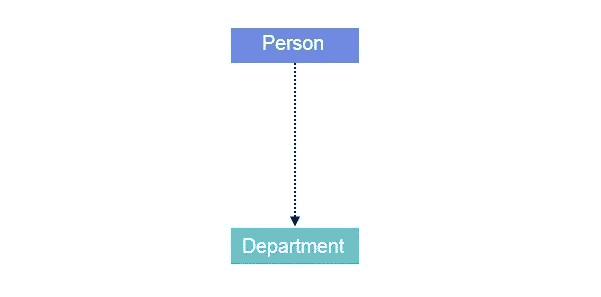

#### 示例 4 :

### Person.java

```java
package com.abd.jpa;
import javax.persistence.Entity;
import javax.persistence.GeneratedValue;
import javax.persistence.GenerationType;
import javax.persistence.Id;
import javax.persistence.OneToOne;
import javax.persistence.PrimaryKeyJoinColumn;
@Entity
public class Person {
    @Id
    @GeneratedValue(strategy=GenerationType.IDENTITY)
    private long id;
    private String name;
    @OneToOne
    @PrimaryKeyJoinColumn
    private Department department;
    public Person() {}
    public Person(String name) {
        this.name = name;
    }
    public Department getDepartment() {
        return department;
    }
    public void setDepartment(Department department) {
        this.department = department;
    }
    public Long getId() {
        return id;
    }
    public void setId(Long id) {
        this.id = id;
    }
    public String getName() {
        return name;
    }
    public void setName(String name) {
        this.name = name;
    }
    @Override
    public String toString() {
        return "Person [id=" + id + ", name=" + name + "]";
    }
}
```

### Department.java

```java
package com.abd.jpa;
import javax.persistence.Entity;
import javax.persistence.GeneratedValue;
import javax.persistence.GenerationType;
import javax.persistence.Id;
import javax.persistence.OneToOne;
@Entity
public class Department {
    @Id
    @GeneratedValue(strategy=GenerationType.IDENTITY)
    private long id;
    private String name;
    @OneToOne(mappedBy="department")
    private Person person;
    public Person getPerson() {
        return person;
    }
    public void setPerson(Person person) {
        this.person = person;
    }
    public long getId() {
        return id;
    }
    public void setId(long id) {
        this.id = id;
    }
    public String getName() {
        return name;
    }
    public void setName(String name) {
        this.name = name;
    }
}
```

#### PersonDaoImpl.java

```java
package com.abd.jpa;
import javax.persistence.EntityManager;
import javax.persistence.PersistenceContext;
import org.springframework.transaction.annotation.Transactional;
@Transactional
public class PersonDaoImpl {
    public void test() {
        Person p1 = new Person("Tom");
        p1.setName("Tom");
        Department d = new Department();
        d.setName("Design");
        p1.setDepartment(d);
        d.setPerson(p1);
        em.persist(p1);
        em.persist(d);
    }
    @PersistenceContext
    private EntityManager em;
}
```


### Helper.java

```java
package com.abd.jpa;
import java.sql.Connection;
import java.sql.DriverManager;
import java.sql.ResultSet;
import java.sql.ResultSetMetaData;
import java.sql.Statement;
public class Helper {
    public static void checkData() {
        try {
            Class.forName("com.mysql.jdbc.Driver");
            Connection conn = DriverManager.getConnection("jdbc:mysql://localhost/db1", "root", "root");
            Statement st = conn.createStatement();
            ResultSet mrs = conn.getMetaData().getTables(null, null, null, new String[] { "TABLE" });
            while (mrs.next()) {
                String tableName = mrs.getString(3);
                System.out.println("\n\n\nTable Name: "+ tableName);
                ResultSet rs = st.executeQuery("select * from " + tableName);
                ResultSetMetaData metadata = rs.getMetaData();
                while (rs.next()) {
                    System.out.println(" Row:");
                    for (int i = 0; i < metadata.getColumnCount(); i++) {
                        System.out.println("   Column Name: "+ metadata.getColumnLabel(i + 1)+", ");
                        System.out.println("   Column Type: "+ metadata.getColumnTypeName(i + 1)+": ");
                        Object value = rs.getObject(i + 1);
                        System.out.println("   Column Value: "+value+"\n");
                    }
                }
            }
        } catch(Exception e) {
            e.printStackTrace();
        }
    }
}
```

### persistence.xml

```xml
<?xml version="1.0" encoding="UTF-8"?>
<persistence version="1.0"xmlns="http://java.sun.com/xml/ns/persistence" xmlns:xsi="http://www.w3.org/2001/XMLSchema-instance"xsi:schemaLocation="http://java.sun.com/xml/ns/persistence http://java.sun.com/xml/ns/persistence/persistence_1_0.xsd">
    <persistence-unit name="jpaData"/>
</persistence>
```

```xml
<?xml version="1.0" encoding="UTF-8"?>
<beans xmlns="http://www.springframework.org/schema/beans" xmlns:aop="http://www.springframework.org/schema/aop" xmlns:context="http://www.springframework.org/schema/context" xmlns:security="http://www.springframework.org/schema/security" xmlns:tx="http://www.springframework.org/schema/tx" xmlns:xsi="http://www.w3.org/2001/XMLSchema-instance" xsi:schemaLocation="http://www.springframework.org/schema/aop http://www.springframework.org/schema/aop/spring-aop-3.2.xsd http://www.springframework.org/schema/beans http://www.springframework.org/schema/beans/spring-beans-3.2.xsd http://www.springframework.org/schema/context http://www.springframework.org/schema/context/spring-context-3.2.xsd http://www.springframework.org/schema/tx http://www.springframework.org/schema/tx/spring-tx-3.2.xsd">
    <tx:annotation-driven />
    <context:annotation-config />
    <bean id="personDao" class="com.abd.jpa.PersonDaoImpl" />
    <bean id="dataSource" class="org.springframework.jdbc.datasource.DriverManagerDataSource">
        <property name="driverClassName">
            <value>com.mysql.jdbc.Driver</value>
        </property>
        <property name="url">
            <value>jdbc:mysql://localhost/db1</value>
        </property>
        <property name="username">
            <value>root</value>
        </property>
        <property name="password">
            <value>root</value>
        </property>
    </bean>
    <bean id="entityManagerFactory" class="org.springframework.orm.jpa.LocalContainerEntityManagerFactoryBean">
        <property name="dataSource" ref="dataSource" />
        <property name="persistenceUnitName" value="jpaData" />
        <property name="jpaVendorAdapter">
            <bean class="org.springframework.orm.jpa.vendor.HibernateJpaVendorAdapter" />
        </property>
        <property name="jpaProperties">
            <props>
                <prop key="hibernate.dialect">org.hibernate.dialect.MySQLDialect</prop>
                <prop key="hibernate.show_sql">true</prop>
                <prop key="hibernate.hbm2ddl.auto">update</prop>
            </props>
        </property>
    </bean>
    <bean id="transactionManager" class="org.springframework.orm.jpa.JpaTransactionManager">
        <property name="entityManagerFactory" ref="entityManagerFactory" />
    </bean>
</beans>
```

### Client.java

```java
package com.abd.jpa;
import org.springframework.context.support.ClassPathXmlApplicationContext;

public class Client {
    public static void main(String[] args) {
        ClassPathXmlApplicationContext context = new ClassPathXmlApplicationContext("applicationContext.xml");
        PersonDaoImpl dao = (PersonDaoImpl) context.getBean("personDao");
        dao.test();
        context.close();
        Helper.checkData();
    }
}
```

### 输出

表名: DEPARTMENT

行: 列名: ID, 列类型: BIGINT, 列值: 1

列名: NAME, 列类型: VARCHAR, 列值: Design

表名: PERSON

行: 列名: ID, 列类型: BIGINT, 列值: 1

列名: NAME, 列类型: VARCHAR, 列值: Tom

## 5 JPA 一一对映射级联映射 (OneToOne Map Mapping)

以下代码展示了如何为一对一映射设置级联操作。

```java
@OneToOne(cascade=CascadeType.ALL,mappedBy="department")
private Person person;
```

### 示例 5

### Person.java

```java
package com.abd.jpa;
import javax.persistence.CascadeType;
import javax.persistence.Entity;
import javax.persistence.GeneratedValue;
import javax.persistence.GenerationType;
import javax.persistence.Id;
import javax.persistence.JoinColumn;
import javax.persistence.OneToOne;

@Entity
public class Person {
    @Id
    @GeneratedValue(strategy=GenerationType.IDENTITY)
    private long id;
    private String name;

    @OneToOne(cascade=CascadeType.ALL)
    @JoinColumn(name="DEPT_ID")
    private Department department;

    public Person() {}
    public Person(String name) {
        this.name = name;
    }
    public Department getDepartment() {
        return department;
    }
    public void setDepartment(Department department) {
        this.department = department;
    }
    public Long getId() {
        return id;
    }
    public void setId(Long id) {
        this.id = id;
    }
    public String getName() {
        return name;
    }
    public void setName(String name) {
        this.name = name;
    }
    @Override
    public String toString() {
        return "Person [id=" + id + ", name=" + name + "]";
    }
}
```

### Department.java

```java
package com.abd.jpa;
import javax.persistence.CascadeType;
import javax.persistence.Entity;
import javax.persistence.GeneratedValue;
import javax.persistence.GenerationType;
import javax.persistence.Id;
import javax.persistence.OneToOne;

@Entity
public class Department {
    @Id
    @GeneratedValue(strategy=GenerationType.IDENTITY)
    private long id;
    private String name;

    @OneToOne(cascade=CascadeType.ALL,mappedBy="department")
    private Person person;

    public Person getPerson() {
        return person;
    }
    public void setPerson(Person person) {
        this.person = person;
    }
    public long getId() {
        return id;
    }
    public void setId(long id) {
        this.id = id;
    }
    public String getName() {
        return name;
    }
    public void setName(String name) {
        this.name = name;
    }
    @Override
    public String toString() {
        return "Department [id=" + id + ", name=" + name + ", person=" + person + "]";
    }
}
```

#### PersonDaoImpl.java


```java
package com.abd.jpa;
import java.util.List;
import javax.persistence.EntityManager;
import javax.persistence.PersistenceContext;
import javax.persistence.Query;
import org.springframework.transaction.annotation.Transactional;

@Transactional
public class PersonDaoImpl {
    public void test() {
        Person p1 = new Person("Tom");
        p1.setName("Tom");
        Department d = new Department();
        d.setName("Design");
        p1.setDepartment(d);
        d.setPerson(p1);
        em.persist(p1);
        em.persist(d);
        Query query = em.createQuery("SELECT e FROM Person");
        List<Person> list = (List<Person>) query.getResultList();
        System.out.println(list.get(0).getDepartment());
        em.remove(list.get(0));
    }
    @PersistenceContext
    private EntityManager em;
}
```

### Helper.java

```java
package com.abd.jpa;
import java.sql.Connection;
import java.sql.DriverManager;
import java.sql.ResultSet;
import java.sql.ResultSetMetaData;
import java.sql.Statement;

public class Helper {
    public static void checkData() {
        try {
            Class.forName("com.mysql.jdbc.Driver");
            Connection conn = DriverManager.getConnection("jdbc:mysql://localhost/db1", "root", "root");
            Statement st = conn.createStatement();
            ResultSet mrs = conn.getMetaData().getTables(null, null, null, new String[] { "TABLE" });
            while (mrs.next()) {
                String tableName = mrs.getString(3);
                System.out.println("\n\n\nTable Name: " + tableName);
                ResultSet rs = st.executeQuery("select * from " + tableName);
                ResultSetMetaData metadata = rs.getMetaData();
                while (rs.next()) {
                    System.out.println(" Row:");
                    for (int i = 0; i < metadata.getColumnCount(); i++) {
                        System.out.print("  Column Name: " + metadata.getColumnLabel(i + 1) + ", ");
                        System.out.print("  Column Type: " + metadata.getColumnTypeName(i + 1) + ": ");
                        Object value = rs.getObject(i + 1);
                        System.out.println("  Column Value: " + value + "\n");
                    }
                }
            }
        } catch (Exception e) {
            e.printStackTrace();
        }
    }
}
```

### persistence.xml

```xml
<?xml version="1.0" encoding="UTF-8"?>
<persistence version="1.0" xmlns="http://java.sun.com/xml/ns/persistence" xmlns:xsi="http://www.w3.org/2001/XMLSchema-instance" xsi:schemaLocation="http://java.sun.com/xml/ns/persistence http://java.sun.com/xml/ns/persistence/persistence_1_0.xsd">
    <persistence-unit name="jpaData" />
</persistence>
```

```xml
<?xml version="1.0" encoding="UTF-8"?>
<beans xmlns="http://www.springframework.org/schema/beans"xmlns:aop="http://www.springframework.org/schema/aop" xmlns:context="http://www.springframework.org/schema/context"xmlns:security="http://www.springframework.org/schema/security"xmlns:tx="http://www.springframework.org/schema/tx" xmlns:xsi="http://www.w3.org/2001/XMLSchema-instance"xsi:schemaLocation="http://www.springframework.org/schema/aop http://www.springframework.org/schema/aop/spring-aop-3.2.xsdhttp://www.springframework.org/schema/beans http://www.springframework.org/schema/beans/spring-beans-3.2.xsdhttp://www.springframework.org/schema/context http://www.springframework.org/schema/context/spring-context-3.2.xsdhttp://www.springframework.org/schema/tx http://www.springframework.org/schema/tx/spring-tx-3.2.xsd">
    <tx:annotation-driven />
    <context:annotation-config />
    <bean id="personDao" class="com.abd.jpa.PersonDaoImpl" />
    <bean id="dataSource"class="org.springframework.jdbc.datasource.DriverManagerDataSource">
        <property name="driverClassName"><value>com.mysql.jdbc.Driver</value></property>
        <property name="url"><value>jdbc:mysql://localhost/db1</value></property>
        <property name="username"><value>root</value></property>
        <property name="password"><value>root</value></property>
    </bean>
    <bean id="entityManagerFactory"class="org.springframework.orm.jpa.LocalContainerEntityManagerFactoryBean">
        <property name="dataSource" ref="dataSource" />
        <property name="persistenceUnitName" value="jpaData" />
        <property name="jpaVendorAdapter"><bean class="org.springframework.orm.jpa.vendor.HibernateJpaVendorAdapter" /></property>
        <property name="jpaProperties">
            <props>
                <prop key="hibernate.dialect">org.hibernate.dialect.MySQLDialect</prop>
                <prop key="hibernate.show_sql">true</prop>
                <prop key="hibernate.hbm2ddl.auto">update</prop>
            </props>
        </property>
    </bean>
    <bean id="transactionManager" class="org.springframework.orm.jpa.JpaTransactionManager">
        <property name="entityManagerFactory" ref="entityManagerFactory" />
    </bean>
</beans>
```

### Client.java

```java
package com.abd.jpa;
import org.springframework.context.support.ClassPathXmlApplicationContext;
public class Client {
    public static void main(String[] args) {
        ClassPathXmlApplicationContext context = new ClassPathXmlApplicationContext("applicationContext.xml");
        PersonDaoImpl dao = (PersonDaoImpl) context.getBean("personDao");
        dao.test();
        context.close();
        Helper.checkData();
    }
}
```

## 6 JPA 一对一单向映射


在这里你将学习如何进行单向一对一映射。

#### 示例 6：

#### Professor.java

```java
package com.abd.jpa;
import javax.persistence.Entity;
import javax.persistence.GeneratedValue;
import javax.persistence.GenerationType;
import javax.persistence.Id;
import javax.persistence.JoinColumn;
import javax.persistence.OneToOne;
@Entity
public class Professor {
    @Id @GeneratedValue(strategy=GenerationType.IDENTITY)
    private int id;
    private String name;
    private long salary;
    @OneToOne
    @JoinColumn(name="PSPACE_ID")
    private ParkingSpace parkingSpace;
    public int getId() {return id;}
    public void setId(int id) {this.id = id;}
    public String getName() {return name;}
    public void setName(String name) {this.name = name;}
    public long getSalary() {return salary;}
    public void setSalary(long salary) {this.salary = salary;}
    public ParkingSpace getParkingSpace() {return parkingSpace;}
    public void setParkingSpace(ParkingSpace parkingSpace) {this.parkingSpace = parkingSpace;}
    public String toString() {return "Employee id: " + getId() + " name: " + getName() +" with " + getParkingSpace();}}
```

##### ParkingSpace.java

```java
package com.abd.jpa;
import javax.persistence.Entity;
import javax.persistence.GeneratedValue;
import javax.persistence.GenerationType;
import javax.persistence.Id;
import javax.persistence.Table;
@Entity
@Table(name="PARKING_SPACE")
public class ParkingSpace {
    @Id @GeneratedValue(strategy=GenerationType.IDENTITY)
    private int id;
    private int lot;
    private String location;
    public int getId() {return id;}
    public void setId(int id) {this.id = id;}
    public int getLot() {return lot;}
    public void setLot(int lot) {this.lot = lot;}
    public String getLocation() {return location;}
    public void setLocation(String deptName) {this.location = deptName;}
    public String toString() {return "ParkingSpace id: " + getId() + " lot: " + getLot() +", location: " + getLocation();}}
```

#### PersonDaoImpl.java


```java
package com.abd.jpa;
import javax.persistence.EntityManager;
import javax.persistence.PersistenceContext;
import org.springframework.transaction.annotation.Transactional;
@Transactional
public class PersonDaoImpl {
    public void test() {
        Professor emp = new Professor();
        emp.setName("name");
        emp.setSalary(12345);
        ParkingSpace ps = new ParkingSpace();
        ps.setLot(1);
        ps.setLocation("East");
        emp.setParkingSpace(ps);
        em.persist(ps);
        em.persist(emp);
    }
    @PersistenceContext
    private EntityManager em;
}
```

### Helper.java

```java
package com.abd.jpa;
import java.sql.Connection;
import java.sql.DriverManager;
import java.sql.ResultSet;
import java.sql.ResultSetMetaData;
import java.sql.Statement;
public class Helper {
    public static void checkData() {
        try{
            Class.forName("com.mysql.jdbc.Driver");
            Connection conn = DriverManager.getConnection("jdbc:mysql://localhost/db1", "root", "root");
            Statement st = conn.createStatement();
            ResultSet mrs = conn.getMetaData().getTables(null, null, null, new String[] { "TABLE" });
            while (mrs.next()) {
                String tableName = mrs.getString(3);
                System.out.println("\n\n\n\nTable Name: "+ tableName);
                ResultSet rs = st.executeQuery("select * from " + tableName);
                ResultSetMetaData metadata = rs.getMetaData();
                while (rs.next()) {
                    System.out.println(" Row:");
                    for (int i = 0; i < metadata.getColumnCount(); i++) {
                        System.out.println(" Column Name: "+ metadata.getColumnLabel(i + 1)+", ");
                        System.out.println(" Column Type: "+ metadata.getColumnTypeName(i + 1)+": ");
                        Object value = rs.getObject(i + 1);
                        System.out.println("   Column Value: "+value+"\n");
                    }
                }
            }
        }catch(Exception e){
            e.printStackTrace();
        }
    }
}
```

### persistence.xml

```xml
<?xml version="1.0" encoding="UTF-8"?>
<persistence version="1.0"xmlns="http://java.sun.com/xml/ns/persistence" xmlns:xsi="http://www.w3.org/2001/XMLSchema-instance"xsi:schemaLocation="http://java.sun.com/xml/ns/persistence http://java.sun.com/xml/ns/persistence/persistence_1_0.xsd">
    <persistence-unit name="jpaData" />
</persistence>
```

```xml
<?xml version="1.0" encoding="UTF-8"?>
<beans xmlns="http://www.springframework.org/schema/beans" xmlns:aop="http://www.springframework.org/schema/aop" xmlns:context="http://www.springframework.org/schema/context" xmlns:security="http://www.springframework.org/schema/security" xmlns:tx="http://www.springframework.org/schema/tx" xmlns:xsi="http://www.w3.org/2001/XMLSchema-instance" xsi:schemaLocation="http://www.springframework.org/schema/aop http://www.springframework.org/schema/aop/spring-aop-3.2.xsd http://www.springframework.org/schema/beans http://www.springframework.org/schema/beans/spring-beans-3.2.xsd http://www.springframework.org/schema/context http://www.springframework.org/schema/context/spring-context-3.2.xsd http://www.springframework.org/schema/tx http://www.springframework.org/schema/tx/spring-tx-3.2.xsd">
    <tx:annotation-driven />
    <context:annotation-config />
    <bean id="personDao" class="com.abd.jpa.PersonDaoImpl" />
    <bean id="dataSource" class="org.springframework.jdbc.datasource.DriverManagerDataSource">
        <property name="driverClassName"><value>com.mysql.jdbc.Driver</value></property>
        <property name="url"><value>jdbc:mysql://localhost/db1</value></property>
        <property name="username"><value>root</value></property>
        <property name="password"><value>root</value></property>
    </bean>
    <bean id="entityManagerFactory" class="org.springframework.orm.jpa.LocalContainerEntityManagerFactoryBean">
        <property name="dataSource" ref="dataSource" />
        <property name="persistenceUnitName" value="jpaData" />
        <property name="jpaVendorAdapter">
            <bean class="org.springframework.orm.jpa.vendor.HibernateJpaVendorAdapter" />
        </property>
        <property name="jpaProperties">
            <props>
                <prop key="hibernate.dialect">org.hibernate.dialect.MySQLDialect</prop>
                <prop key="hibernate.show_sql">true</prop>
                <prop key="hibernate.hbm2ddl.auto">update</prop>
            </props>
        </property>
    </bean>
    <bean id="transactionManager" class="org.springframework.orm.jpa.JpaTransactionManager">
        <property name="entityManagerFactory" ref="entityManagerFactory" />
    </bean>
</beans>
```

### Client.java

```java
package com.abd.jpa;
import org.springframework.context.support.ClassPathXmlApplicationContext;
public class Client {
    public static void main(String[] args) {
        ClassPathXmlApplicationContext context = new ClassPathXmlApplicationContext("applicationContext.xml");
        PersonDaoImpl dao = (PersonDaoImpl) context.getBean("personDao");
        dao.test();
        context.close();
        Helper.checkData();
    }
}
```

### 输出

Table Name: PARKING_SPACE

Row:Column Name: ID,Column Type: INTEGER,Column Value: 1

Column Name: LOCATION,Column Type: VARCHAR,Column Value: East

Column Name: LOT,Column Type: INTEGER,Column Value: 1

Table Name: PROFESSOR

Row:Column Name: ID,Column Type: INTEGER,Column Value: 1

Column Name: NAME,Column Type: VARCHAR,Column Value: name

Column Name: SALARY,Column Type: BIGINT,Column Value: 12345

Column Name: PSPACE_ID,Column Type: INTEGER,Column Value: 1

## 7 JPA 一对一双向映射

在这里你将学习如何实现双向一对一映射。

#### 示例 7：

### Person.java

```java
package com.abd.jpa;
import javax.persistence.Entity;
import javax.persistence.GeneratedValue;
import javax.persistence.GenerationType;
import javax.persistence.Id;
import javax.persistence.JoinColumn;
import javax.persistence.OneToOne;
@Entity
public class Person {
    @Id
    @GeneratedValue(strategy=GenerationType.IDENTITY)
    private long id;
    private String name;
    @OneToOne
    @JoinColumn(name="DEPT_ID")
    private Department department;
    public Person() {}
    public Person(String name) {
        this.name = name;
    }
    public Department getDepartment() {
        return department;
    }
    public void setDepartment(Department department) {
        this.department = department;
    }
    public Long getId() {
        return id;
    }
    public void setId(Long id) {
        this.id = id;
    }
    public String getName() {
        return name;
    }
    public void setName(String name) {
        this.name = name;
    }
    @Override
    public String toString() {
        return "Person [id=" + id + ", name=" + name + "]";
    }
}
```

### Department.java

```java
package com.abd.jpa;
import javax.persistence.Entity;
import javax.persistence.GeneratedValue;
import javax.persistence.GenerationType;
import javax.persistence.Id;
import javax.persistence.OneToOne;
@Entity
public class Department {
    @Id
    @GeneratedValue(strategy=GenerationType.IDENTITY)
    private long id;
    private String name;
    @OneToOne(mappedBy="department")
    private Person person;
    public Person getPerson() {
        return person;
    }
    public void setPerson(Person person) {
        this.person = person;
    }
    public long getId() {
        return id;
    }
    public void setId(long id) {
        this.id = id;
    }
    public String getName() {
        return name;
    }
    public void setName(String name) {
        this.name = name;
    }
}
```

### PersonDaoImpl.java


```java
package com.abd.jpa;
import javax.persistence.EntityManager;
import javax.persistence.PersistenceContext;
import org.springframework.transaction.annotation.Transactional;
@Transactional
public class PersonDaoImpl {
    @PersistenceContext
    private EntityManager em;
    public void test() {
        Person p1 = new Person("Tom");
        Department d = new Department();
        d.setName("Design");
        p1.setDepartment(d);
        em.persist(p1);
        em.persist(d);
    }
}
```

`Helper.java`

```java
package com.abd.jpa;
import java.sql.Connection;
import java.sql.DriverManager;
import java.sql.ResultSet;
import java.sql.ResultSetMetaData;
import java.sql.Statement;
public class Helper {
    public static void checkData() {
        try {
            Class.forName("com.mysql.jdbc.Driver");
            Connection conn = DriverManager.getConnection("jdbc:mysql://localhost/db1", "root", "root");
            Statement st = conn.createStatement();
            ResultSet mrs = conn.getMetaData().getTables(null, null, null, new String[] { "TABLE" });
            while (mrs.next()) {
                String tableName = mrs.getString(3);
                System.out.println("\n\n\n\nTable Name: "+ tableName);
                ResultSet rs = st.executeQuery("select * from " + tableName);
                ResultSetMetaData metadata = rs.getMetaData();
                while (rs.next()) {
                    System.out.println(" Row:");
                    for (int i = 0; i < metadata.getColumnCount(); i++) {
                        System.out.println("    Column Name: "+ metadata.getColumnLabel(i + 1)+", ");
                        System.out.println("    Column Type: "+ metadata.getColumnTypeName(i + 1)+": ");
                        Object value = rs.getObject(i + 1);
                        System.out.println("    Column Value: "+value+"\n");
                    }
                }
            }
        } catch(Exception e) {
            e.printStackTrace();
        }
    }
}
```

`persistence.xml`

```xml
<?xml version="1.0" encoding="UTF-8"?>
<persistence version="1.0" xmlns="http://java.sun.com/xml/ns/persistence" xmlns:xsi="http://www.w3.org/2001/XMLSchema-instance" xsi:schemaLocation="http://java.sun.com/xml/ns/persistence http://java.sun.com/xml/ns/persistence/persistence_1_0.xsd">
    <persistence-unit name="jpaData" />
</persistence>
```

```xml
<?xml version="1.0" encoding="UTF-8"?>
<beans xmlns="http://www.springframework.org/schema/beans"xmlns:aop="http://www.springframework.org/schema/aop" xmlns:context="http://www.springframework.org/schema/context"xmlns:security="http://www.springframework.org/schema/security" xmlns:tx="http://www.springframework.org/schema/tx" xmlns:xsi="http://www.w3.org/2001/XMLSchema-instance" xsi:schemaLocation="http://www.springframework.org/schema/aop http://www.springframework.org/schema/aop/spring-aop-3.2.xsd http://www.springframework.org/schema/beans http://www.springframework.org/schema/beans/spring-beans-3.2.xsd http://www.springframework.org/schema/context http://www.springframework.org/schema/context/spring-context-3.2.xsd http://www.springframework.org/schema/tx http://www.springframework.org/schema/tx/spring-tx-3.2.xsd">
    <tx:annotation-driven />
    <context:annotation-config />
    <bean id="personDao" class="com.abd.jpa.PersonDaoImpl" />
    <bean id="dataSource"class="org.springframework.jdbc.datasource.DriverManagerDataSource">
        <property name="driverClassName"><value>com.mysql.jdbc.Driver</value></property>
        <property name="url"><value>jdbc:mysql://localhost/db1</value></property>
        <property name="username"><value>root</value></property>
        <property name="password"><value>root</value></property>
    </bean>
    <bean id="entityManagerFactory" class="org.springframework.orm.jpa.LocalContainerEntityManagerFactoryBean">
        <property name="dataSource" ref="dataSource" />
        <property name="persistenceUnitName" value="jpaData" />
        <property name="jpaVendorAdapter"><bean class="org.springframework.orm.jpa.vendor.HibernateJpaVendorAdapter" /></property>
        <property name="jpaProperties">
            <props>
                <prop key="hibernate.dialect">org.hibernate.dialect.MySQLDialect</prop>
                <prop key="hibernate.show_sql">true</prop>
                <prop key="hibernate.hbm2ddl.auto">update</prop>
            </props>
        </property>
    </bean>
    <bean id="transactionManager" class="org.springframework.orm.jpa.JpaTransactionManager">
        <property name="entityManagerFactory" ref="entityManagerFactory" />
    </bean>
</beans>
```

`Client.java`

```java
package com.abd.jpa;
import org.springframework.context.support.ClassPathXmlApplicationContext;
public class Client {
    public static void main(String[] args) {
        ClassPathXmlApplicationContext context = new ClassPathXmlApplicationContext("applicationContext.xml");
        PersonDaoImpl dao = (PersonDaoImpl) context.getBean("personDao");
        dao.test();
        context.close();
        Helper.checkData();
    }
}
```

**输出**

表名: `DEPARTMENT`

行:列名: `ID`,列类型: `BIGINT`:列值: `1`

列名: `NAME`,列类型: `VARCHAR`:列值: `Design`

表名: `PERSON`

行:列名: `ID`,列类型: `BIGINT`:列值: `1`

列名: `NAME`,列类型: `VARCHAR`:列值: `Tom`

列名: `DEPT_ID`,列类型: `BIGINT`:列值: `1`

# 第 2 章：JPA 一对多映射

1. JPA 一对多映射
2. JPA 一对多表映射
3. JPA 一对多单向映射
4. JPA 一对多排序映射
5. JPA `Persist OrderedList` 映射
6. JPA 一对多 `Map Key` 映射
7. JPA 一对多无类型映射

## JPA 一对多映射

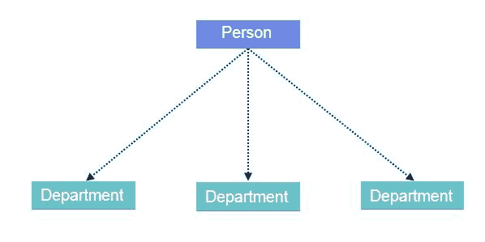

在这里，你将学习如何在 JPA 中实现一对多映射。

一个部门可以有一个或多个员工。

在 Java 代码中，我们可以创建一个表示员工的 Java Bean `Employee`，并创建一个 `Department` 类来表示部门。

在连接 `Employee` 和 `Department` 时，我们如下所示从 `Employee` 引用 `Department` 类。

```java
@Entity
public class Person {
    @Id
    @GeneratedValue(strategy=GenerationType.IDENTITY)
    private long id;
    private String name;
    @ManyToOne
    private Department department;
}
```

我们用 `@ManyToOne` 标记 `Department`，以指示 `Department` 和 `Employee` 之间的关系。

`Person.java`

```java
package com.abd.jpa;
import javax.persistence.Entity;
import javax.persistence.GeneratedValue;
import javax.persistence.GenerationType;
import javax.persistence.Id;
import javax.persistence.ManyToOne;
@Entity
public class Person {
    @Id
    @GeneratedValue(strategy=GenerationType.IDENTITY)
    private long id;
    private String name;
    @ManyToOne
    private Department department;
    public Person() {}
    public Person(String name) {this.name = name; }
    public Department getDepartment() {return department; }
    public void setDepartment(Department department) {this.department = department; }
    public Long getId() {return id; }
    public void setId(Long id) {this.id = id; }
}
```

`Department.java`

```java
package com.abd.jpa;
import javax.persistence.Entity;
import javax.persistence.GeneratedValue;
import javax.persistence.GenerationType;
import javax.persistence.Id;
@Entity
public class Department {
    @Id
    @GeneratedValue(strategy=GenerationType.IDENTITY)
    private long id;
    private String name;
    @Override
    public String toString() {return "Person [id=" + id + ", name=" + name + "]";
}
```

`PersonImpl.java`

```java
package com.abd.jpa;
import javax.persistence.Entity;
import javax.persistence.GeneratedValue;
import javax.persistence.GenerationType;
import javax.persistence.Id;
import javax.persistence.ManyToOne;
@Entity
public class Person {
    @Id
    @GeneratedValue(strategy=GenerationType.IDENTITY)
    private long id;
    private String name;
    @ManyToOne
    private Department department;
    public Person() {}
    public Person(String name) {this.name = name; }
    public Department getDepartment() {return department; }
    public void setDepartment(Department department) {this.department = department; }
    public Long getId() {return id; }
    public void setId(Long id) {this.id = id; }
}
```

*(注：此处原文中 `Person.java` 和 `Department.java` 的代码块似乎存在重复或混淆，已根据要求保留代码格式并仅翻译描述部分)*

*修正：严格按照原文结构翻译：*

`Person.java`


```java
package com.abd.jpa;
import javax.persistence.Entity;
import javax.persistence.GeneratedValue;
import javax.persistence.GenerationType;
import javax.persistence.Id;
import javax.persistence.ManyToOne;
@Entity
public class Person {
    @Id
    @GeneratedValue(strategy=GenerationType.IDENTITY)
    private long id;
    private String name;
    @ManyToOne
    private Department department;
    public Person() {}
    public Person(String name) {this.name = name; }
    public Department getDepartment() {return department; }
    public void setDepartment(Department department) {this.department = department; }
    public Long getId() {return id; }
    public void setId(Long id) {this.id = id; }
}
```

**Department.java**

```java
package com.abd.jpa;
import javax.persistence.Entity;
import javax.persistence.GeneratedValue;
import javax.persistence.GenerationType;
import javax.persistence.Id;
@Entity
public class Department {
    @Id
    @GeneratedValue(strategy=GenerationType.IDENTITY)
    private long id;
    private String name;
    @Override
    public String toString() {return "Person [id=" + id + ", name=" + name + "]";
}
```

**PersonDaoImpl.java**

```java
package com.abd.jpa;
import java.util.List;
import javax.persistence.EntityManager;
import javax.persistence.PersistenceContext;
import javax.persistence.Query;
import org.springframework.transaction.annotation.Transactional;
@Transactional
public class PersonDaoImpl {
    public void test(){
        Department d = new Department();
        d.setName("Design");
        Person p1 = new Person("Tom");
        p1.setDepartment(d);
        Person p2 = new Person("Jack");
        p2.setDepartment(d);
        em.persist(p1);
        em.persist(p2);
        em.persist(d);
    }
    @PersistenceContext
    private EntityManager em;
}
```

**Helper.java**

```java
package com.abd.jpa;
import java.sql.Connection;
import java.sql.DriverManager;
import java.sql.ResultSet;
import java.sql.ResultSetMetaData;
import java.sql.Statement;
public class Helper {
    public static void checkData() {
        try{
            Class.forName("com.mysql.jdbc.Driver");
            Connection conn = DriverManager.getConnection("jdbc:mysql://localhost/db1", "root", "root");
            Statement st = conn.createStatement();
            ResultSet mrs = conn.getMetaData().getTables(null, null, null, new String[] { "TABLE" });
            while (mrs.next()) {
                String tableName = mrs.getString(3);
                System.out.println("\n\n\n\nTable Name: "+ tableName);
                ResultSet rs = st.executeQuery("select * from " + tableName);
                ResultSetMetaData metadata = rs.getMetaData();
                while (rs.next()) {
                    System.out.println(" Row:");
                    for (int i = 0; i < metadata.getColumnCount(); i++) {
                        System.out.println("    Column Name: "+ metadata.getColumnLabel(i + 1)+",    ");
                        System.out.println("    Column Type: "+ metadata.getColumnTypeName(i + 1)+":    ");
                        Object value = rs.getObject(i + 1);
                        System.out.println("    Column Value: "+value+"\n");
                    }
                }
            }
        } catch(Exception e){
            e.printStackTrace();
        }
    }
}
```

```xml
<?xml version="1.0" encoding="UTF-8"?>
<beans xmlns="http://www.springframework.org/schema/beans" xmlns:aop="http://www.springframework.org/schema/aop" xmlns:context="http://www.springframework.org/schema/context" xmlns:security="http://www.springframework.org/schema/security" xmlns:tx="http://www.springframework.org/schema/tx" xmlns:xsi="http://www.w3.org/2001/XMLSchema-instance" xsi:schemaLocation="http://www.springframework.org/schema/aop http://www.springframework.org/schema/aop/spring-aop-3.2.xsd http://www.springframework.org/schema/beans http://www.springframework.org/schema/beans/spring-beans-3.2.xsd http://www.springframework.org/schema/context http://www.springframework.org/schema/context/spring-context-3.2.xsd http://www.springframework.org/schema/tx http://www.springframework.org/schema/tx/spring-tx-3.2.xsd">
    <tx:annotation-driven />
    <context:annotation-config />
    <bean id="personDao" class="com.abd.jpa.PersonDaoImpl" />
    <bean id="dataSource" class="org.springframework.jdbc.datasource.DriverManagerDataSource">
        <property name="driverClassName"><value>com.mysql.jdbc.Driver</value></property>
        <property name="url"><value>jdbc:mysql://localhost/db1</value></property>
        <property name="username"><value>root</value></property>
        <property name="password"><value>root</value></property>
    </bean>
    <bean id="entityManagerFactory" class="org.springframework.orm.jpa.LocalContainerEntityManagerFactoryBean">
        <property name="dataSource" ref="dataSource" />
        <property name="persistenceUnitName" value="jpaData" />
        <property name="jpaVendorAdapter">
            <bean class="org.springframework.orm.jpa.vendor.HibernateJpaVendorAdapter" />
        </property>
        <property name="jpaProperties">
            <props>
                <prop key="hibernate.dialect">org.hibernate.dialect.MySQLDialect</prop>
                <prop key="hibernate.show_sql">true</prop>
                <prop key="hibernate.hbm2ddl.auto">update</prop>
            </props>
        </property>
    </bean>
    <bean id="transactionManager" class="org.springframework.orm.jpa.JpaTransactionManager">
        <property name="entityManagerFactory" ref="entityManagerFactory" />
    </bean>
</beans>
```

### Client.java

```java
package com.abd.jpa;
import org.springframework.context.support.ClassPathXmlApplicationContext;

public class Client {
    public static void main(String[] args) {
        ClassPathXmlApplicationContext context = new ClassPathXmlApplicationContext("applicationContext.xml");
        PersonDaoImpl dao = (PersonDaoImpl) context.getBean("personDao");
        dao.test();
        context.close();
        Helper.checkData();
    }
}
```

### Output

Table Name: DEPARTMENT

Row:Column Name: ID,Column Type: BIGINT:Column Value: 1

Column Name: NAME,Column Type: VARCHAR:Column Value: Design

Table Name: PERSON

Row:Column Name: ID,Column Type: BIGINT:Column Value: 1

Column Name: NAME,Column Type: VARCHAR:Column Value: Tom

Column Name: DEPARTMENT_ID,Column Type: BIGINT:Column Value: 1

Row:Column Name: ID,Column Type: BIGINT:Column Value: 2

Column Name: NAME,Column Type: VARCHAR:Column Value: Jack

Column Name: DEPARTMENT_ID,Column Type: BIGINT:Column Value: 1

## 2 JPA 一对多连接表映射


在这里，你将学习如何实现一对多的映射。

以下代码展示了如何使用连接表来关联一对多的映射。

它使用了 `@JoinTable` 注解来设置该连接表。

```java
@OneToMany
@JoinTable(name = "PERSON_DEPT", joinColumns = @JoinColumn(name = "EMP_ID"), inverseJoinColumns = @JoinColumn(name = "PHONE_ID"))
private Set<Person> persons = new HashSet<Person>();
```

### Person.java


```java
package com.abd.jpa;
import javax.persistence.Entity;
import javax.persistence.GeneratedValue;
import javax.persistence.GenerationType;
import javax.persistence.Id;
import javax.persistence.ManyToOne;
import javax.persistence.CascadeType;

@Entity
public class Person {
    @Id
    @GeneratedValue(strategy=GenerationType.IDENTITY)
    private long id;
    private String name;

    @ManyToOne(cascade=CascadeType.ALL)
    private Department department;

    public Person() {}
    public Person(String name) {
        this.name = name;
    }

    public Department getDepartment() {
        return department;
    }

    public void setDepartment(Department department) {
        this.department = department;
    }

    public Long getId() {
        return id;
    }

    public void setId(Long id) {
        this.id = id;
    }

    public String getName() {
        return name;
    }

    public void setName(String name) {
        this.name = name;
    }

    @Override
    public String toString() {
        return "Person [id=" + id + ", name=" + name + "]";
    }
}
```

### Department.java

```java
package com.abd.jpa;
import java.util.HashSet;
import java.util.Set;
import javax.persistence.CascadeType;
import javax.persistence.Entity;
import javax.persistence.GeneratedValue;
import javax.persistence.GenerationType;
import javax.persistence.Id;
import javax.persistence.JoinColumn;
import javax.persistence.JoinTable;
import javax.persistence.OneToMany;

@Entity
public class Department {
    @Id
    @GeneratedValue(strategy=GenerationType.IDENTITY)
    private long id;
    private String name;

    @OneToMany
    @JoinTable(name = "PERSON_DEPT", joinColumns = @JoinColumn(name = "EMP_ID"), inverseJoinColumns = @JoinColumn(name = "PHONE_ID"))
    private Set<Person> persons = new HashSet<Person>();

    public Set<Person> getPersons() {
        return persons;
    }

    public void setPersons(Set<Person> persons) {
        this.persons = persons;
    }

    public long getId() {
        return id;
    }

    public void setId(long id) {
        this.id = id;
    }

    public String getName() {
        return name;
    }

    public void setName(String name) {
        this.name = name;
    }
}
```

```xml
<?xml version="1.0" encoding="UTF-8"?>
<beans xmlns="http://www.springframework.org/schema/beans"xmlns:aop="http://www.springframework.org/schema/aop" xmlns:context="http://www.springframework.org/schema/context"xmlns:security="http://www.springframework.org/schema/security"xmlns:tx="http://www.springframework.org/schema/tx" xmlns:xsi="http://www.w3.org/2001/XMLSchema-instance"xsi:schemaLocation="http://www.springframework.org/schema/aop http://www.springframework.org/schema/aop/spring-aop-3.2.xsdhttp://www.springframework.org/schema/beans http://www.springframework.org/schema/beans/spring-beans-3.2.xsdhttp://www.springframework.org/schema/context http://www.springframework.org/schema/context/spring-context-3.2.xsdhttp://www.springframework.org/schema/tx http://www.springframework.org/schema/tx/spring-tx-3.2.xsd">
    <tx:annotation-driven />
    <context:annotation-config />
    <bean id="personDao" class="com.abd.jpa.PersonDaoImpl" />
    <bean id="dataSource"class="org.springframework.jdbc.datasource.DriverManagerDataSource">
        <property name="driverClassName"><value>com.mysql.jdbc.Driver</value></property>
        <property name="url"><value>jdbc:mysql://localhost/db1</value></property>
        <property name="username"><value>root</value></property>
        <property name="password"><value>root</value></property>
    </bean>
    <bean id="entityManagerFactory"class="org.springframework.orm.jpa.LocalContainerEntityManagerFactoryBean">
        <property name="dataSource" ref="dataSource" />
        <property name="persistenceUnitName" value="jpaData" />
        <property name="jpaVendorAdapter">
            <bean class="org.springframework.orm.jpa.vendor.HibernateJpaVendorAdapter" />
        </property>
        <property name="jpaProperties">
            <props>
                <prop key="hibernate.dialect">org.hibernate.dialect.MySQLDialect</prop>
                <prop key="hibernate.show_sql">true</prop>
                <prop key="hibernate.hbm2ddl.auto">update</prop>
            </props>
        </property>
    </bean>
    <bean id="transactionManager" class="org.springframework.orm.jpa.JpaTransactionManager">
        <property name="entityManagerFactory" ref="entityManagerFactory" />
    </bean>
</beans>
```

### Client.java

```java
package com.abd.jpa;
import org.springframework.context.support.ClassPathXmlApplicationContext;
public class Client {
    public static void main(String[] args) {
        ClassPathXmlApplicationContext context = new ClassPathXmlApplicationContext("applicationContext.xml");
        PersonDaoImpl dao = (PersonDaoImpl) context.getBean("personDao");
        dao.test();
        context.close();
        Helper.checkData();
    }
}
```

### 输出

表名: DEPARTMENT

行:列名: ID,列类型: BIGINT:列值: 1

列名: NAME,列类型: VARCHAR:列值: Design

表名: PERSON

行:列名: ID,列类型: BIGINT:列值: 1

列名: NAME,列类型: VARCHAR:列值: Tom

列名: DEPARTMENT_ID,列类型: BIGINT:列值: 1

行:列名: ID,列类型: BIGINT:列值: 2

列名: NAME,列类型: VARCHAR:列值: Jack

列名: DEPARTMENT_ID,列类型: BIGINT:列值: 1

表名: PERSON_DEP

行:列名: EMP_ID,列类型: BIGINT:列值: 1

列名: PHONE_ID,列类型: BIGINT:列值: 1

行:列名: EMP_ID,列类型: BIGINT:列值: 1

列名: PHONE_ID,列类型: BIGINT:列值: 2

## 3 JPA 一对多单向映射

在这里你将学习如何实现单向的一对多映射。

#### Professor.java

```java
package com.abd.jpa;
import java.util.ArrayList;
import java.util.Collection;
import javax.persistence.Entity;
import javax.persistence.GeneratedValue;
import javax.persistence.GenerationType;
import javax.persistence.Id;
import javax.persistence.JoinColumn;
import javax.persistence.JoinTable;
import javax.persistence.OneToMany;
@Entity
public class Professor {
    @Id @GeneratedValue(strategy=GenerationType.IDENTITY)
    private int id;
    private String name;
    private long salary;
    @OneToMany
    @JoinTable(name="EMP_PHONE",joinColumns=@JoinColumn(name="EMP_ID"),inverseJoinColumns=@JoinColumn(name="PHONE_ID"))
    private Collection<Phone> phones;
    public Professor() {
        phones = new ArrayList<Phone>();
    }
    public int getId() {
        return id;
    }
    public void setId(int id) {
        this.id = id;
    }
    public String getName() {
        return name;
    }
    public void setName(String name) {
        this.name = name;
    }
    public long getSalary() {
        return salary;
    }
    public void setSalary(long salary) {
        this.salary = salary;
    }
    public void addPhone(Phone phone) {
        if (!getPhones().contains(phone)) {
            getPhones().add(phone);
        }
    }
    public Collection<Phone> getPhones() {
        return phones;
    }
}
```

### Phone.java

```java
package com.abd.jpa;
import javax.persistence.Column;
import javax.persistence.Entity;
import javax.persistence.GeneratedValue;
import javax.persistence.GenerationType;
import javax.persistence.Id;
@Entity
public class Phone {
    @Column(name="NUM")
    @Id @GeneratedValue(strategy=GenerationType.IDENTITY)
    private int id;
    private String number;
    private String type;
    public int getId() {
        return id;
    }
    public void setId(int id) {
        this.id = id;
    }
    public String getNumber() {
        return number;
    }
    public void setNumber(String number) {
        this.number = number;
    }
    public String getType() {
        return type;
    }
    public void setType(String type) {
        this.type = type;
    }
}
```

#### PersonDaoImpl.java


```java
package com.abd.jpa;
import javax.persistence.EntityManager;
import javax.persistence.PersistenceContext;
import org.springframework.transaction.annotation.Transactional;
@Transactional
public class PersonDaoImpl {
    @PersistenceContext
    private EntityManager em;
    public void test() {
        Professor emp = new Professor();
        emp.setName("name");
        emp.setSalary(12345);
        Phone p = new Phone();
        p.setNumber("123450987");
        emp.addPhone(p);
        em.persist(p);
        em.persist(emp);
    }
}
```

### `Helper.java`

```java
package com.abd.jpa;
import java.sql.Connection;
import java.sql.DriverManager;
import java.sql.ResultSet;
import java.sql.ResultSetMetaData;
import java.sql.Statement;
public class Helper {
    public static void checkData() {
        try {
            Class.forName("com.mysql.jdbc.Driver");
            Connection conn = DriverManager.getConnection("jdbc:mysql://localhost/db1", "root", "root");
            Statement st = conn.createStatement();
            ResultSet mrs = conn.getMetaData().getTables(null, null, null, new String[] { "TABLE" });
            while (mrs.next()) {
                String tableName = mrs.getString(3);
                System.out.println("\n\n\n\n 表名: "+ tableName);
                ResultSet rs = st.executeQuery("select * from " + tableName);
                ResultSetMetaData metadata = rs.getMetaData();
                while (rs.next()) {
                    System.out.println(" 行:");
                    for (int i = 0; i < metadata.getColumnCount(); i++) {
                        System.out.println("    列名: "+ metadata.getColumnLabel(i + 1)+",  ");
                        System.out.println("    列类型: "+ metadata.getColumnTypeName(i + 1)+":  ");
                        Object value = rs.getObject(i + 1);
                        System.out.println("    列值: "+value+"\n");
                    }
                }
            }
        } catch(Exception e) {
            e.printStackTrace();
        }
    }
}
```

```xml
<?xml version="1.0" encoding="UTF-8"?>
<beans xmlns="http://www.springframework.org/schema/beans" xmlns:aop="http://www.springframework.org/schema/aop" xmlns:context="http://www.springframework.org/schema/context"xmlns:security="http://www.springframework.org/schema/security" xmlns:tx="http://www.springframework.org/schema/tx" xmlns:xsi="http://www.w3.org/2001/XMLSchema-instance" xsi:schemaLocation="http://www.springframework.org/schema/aop http://www.springframework.org/schema/aop/spring-aop-3.2.xsd http://www.springframework.org/schema/beans http://www.springframework.org/schema/beans/spring-beans-3.2.xsd http://www.springframework.org/schema/context http://www.springframework.org/schema/context/spring-context-3.2.xsd http://www.springframework.org/schema/tx http://www.springframework.org/schema/tx/spring-tx-3.2.xsd">
    <tx:annotation-driven />
    <context:annotation-config />
    <bean id="personDao" class="com.abd.jpa.PersonDaoImpl" />
    <bean id="dataSource" class="org.springframework.jdbc.datasource.DriverManagerDataSource">
        <property name="driverClassName">
            <value>com.mysql.jdbc.Driver</value>
        </property>
        <property name="url">
            <value>jdbc:mysql://localhost/db1</value>
        </property>
        <property name="username">
            <value>root</value>
        </property>
        <property name="password">
            <value>root</value>
        </property>
    </bean>
    <bean id="entityManagerFactory" class="org.springframework.orm.jpa.LocalContainerEntityManagerFactoryBean">
        <property name="dataSource" ref="dataSource" />
        <property name="persistenceUnitName" value="jpaData" />
        <property name="jpaVendorAdapter">
            <bean class="org.springframework.orm.jpa.vendor.HibernateJpaVendorAdapter" />
        </property>
        <property name="jpaProperties">
            <props>
                <prop key="hibernate.dialect">org.hibernate.dialect.MySQLDialect</prop>
                <prop key="hibernate.show_sql">true</prop>
                <prop key="hibernate.hbm2ddl.auto">update</prop>
            </props>
        </property>
    </bean>
    <bean id="transactionManager" class="org.springframework.orm.jpa.JpaTransactionManager">
        <property name="entityManagerFactory" ref="entityManagerFactory" />
    </bean>
</beans>
```

### `Client.java`

```java
package com.abd.jpa;
import org.springframework.context.support.ClassPathXmlApplicationContext;
public class Client {
    public static void main(String[] args) {
        ClassPathXmlApplicationContext context = new ClassPathXmlApplicationContext("applicationContext.xml");
        PersonDaoImpl dao = (PersonDaoImpl) context.getBean("personDao");
        dao.test();
        context.close();
        Helper.checkData();
    }
}
```

### Output

Table Name: EMP_PHON

Row:Column Name: EMP_ID,Column Type: INTEGER:Column Value: 1

Column Name: PHONE_ID,Column Type: INTEGER:Column Value: 1

Table Name: PHONE

Row:Column Name: ID,Column Type: INTEGER:Column Value: 1

Column Name: NUM,Column Type: VARCHAR:Column Value: 1234509876

Column Name: TYPE,Column Type: VARCHAR:Column Value: null

Table Name: PROFESSOR

Row:Column Name: ID,Column Type: INTEGER:Column Value: 1

Column Name: NAME,Column Type: VARCHAR:Column Value: name

Column Name: SALARY,Column Type: BIGINT:Column Value: 12345

## 4 JPA OneToMany OrderBy 映射


在这里你将学习如何实现一对多映射。

以下代码展示了如何在一对多映射中设置 `order by` 属性。

`@OrderBy("name ASC")` 用于按人员姓名对 `person` 集合进行排序。

```java
@OneToMany(targetEntity=Person.class, mappedBy="department")@OrderBy("name ASC")
private Set<Person> persons = new HashSet<Person>();
```

### `Person.java`

```java
package com.abd.jpa;
import javax.persistence.Entity;
import javax.persistence.GeneratedValue;
import javax.persistence.GenerationType;
import javax.persistence.Id;
import javax.persistence.ManyToOne;
import javax.persistence.CascadeType;
@Entity
public class Person {
    @Id@GeneratedValue(strategy=GenerationType.IDENTITY)
    private long id;
    private String name;
    @ManyToOne (cascade=CascadeType.ALL)
    private Department department;
    public Person() {}
    public Person(String name) {
        this.name = name;
    }
    public Department getDepartment() {
        return department;
    }
    public void setDepartment(Department department) {
        this.department = department;
    }
    public Long getId() {
        return id;
    }
    public void setId(Long id) {
        this.id = id;
    }
    public String getName() {
        return name;
    }
    public void setName(String name) {
        this.name = name;
    }
    @Override
    public String toString() {
        return "Person [id=" + id + ", name=" + name + "]";
    }
}
```

### `Department.java`

```java
package com.abd.jpa;
import java.util.HashSet;
import java.util.Set;
import javax.persistence.Entity;
import javax.persistence.GeneratedValue;
import javax.persistence.GenerationType;
import javax.persistence.Id;
import javax.persistence.OneToMany;
import javax.persistence.OrderBy;
@Entity
public class Department {
    @Id@GeneratedValue(strategy=GenerationType.IDENTITY)
    private long id;
    private String name;
    @OneToMany(targetEntity=Person.class, mappedBy="department")@OrderBy("name ASC")
    private Set<Person> persons = new HashSet<Person>();
    public Set<Person> getPersons() {
        return persons;
    }
    public void setPersons(Set<Person> persons) {
        this.persons = persons;
    }
    public long getId() {
        return id;
    }
    public void setId(long id) {
        this.id = id;
    }
    public String getName() {
        return name;
    }
    public void setName(String name) {
        this.name = name;
    }
}
```

### `PersonDaoImpl.java`


```java
package com.abd.jpa;
import java.util.List;
import javax.persistence.EntityManager;
import javax.persistence.PersistenceContext;
import javax.persistence.Query;
import org.springframework.transaction.annotation.Transactional;
@Transactional
public class PersonDaoImpl {
    public void test() {
        Department d = new Department();
        d.setName("Design");
        Person p1 = new Person("Tom");
        p1.setDepartment(d);
        Person p2 = new Person("Jack");
        p2.setDepartment(d);
        d.getPersons().add(p1);
        d.getPersons().add(p2);
        em.persist(p1);
        em.persist(p2);
        em.persist(d);
    }
    @PersistenceContext
    private EntityManager em;
}
```

`Helper.java`

```java
package com.abd.jpa;
import java.sql.Connection;
import java.sql.DriverManager;
import java.sql.ResultSet;
import java.sql.ResultSetMetaData;
import java.sql.Statement;
public class Helper {
    public static void checkData() {
        try {
            Class.forName("com.mysql.jdbc.Driver");
            Connection conn = DriverManager.getConnection("jdbc:mysql://localhost/db1", "root", "root");
            Statement st = conn.createStatement();
            ResultSet mrs = conn.getMetaData().getTables(null, null, null, new String[] { "TABLE" });
            while (mrs.next()) {
                String tableName = mrs.getString(3);
                System.out.println("\n\n\n\nTable Name: "+ tableName);
                ResultSet rs = st.executeQuery("select * from " + tableName);
                ResultSetMetaData metadata = rs.getMetaData();
                while (rs.next()) {
                    System.out.println(" Row:");
                    for (int i = 0; i < metadata.getColumnCount(); i++) {
                        System.out.println("    Column Name: "+ metadata.getColumnLabel(i + 1)+",    ");
                        System.out.println("    Column Type: "+ metadata.getColumnTypeName(i + 1)+":  ");
                        Object value = rs.getObject(i + 1);
                        System.out.println("    Column Value: "+value+"\n");
                    }
                }
            }
        } catch (Exception e) {
            e.printStackTrace();
        }
    }
}
```

```xml
<?xml version="1.0" encoding="UTF-8"?>
<beans xmlns="http://www.springframework.org/schema/beans"xmlns:aop="http://www.springframework.org/schema/aop" xmlns:context="http://www.springframework.org/schema/context"xmlns:security="http://www.springframework.org/schema/security" xmlns:tx="http://www.springframework.org/schema/tx" xmlns:xsi="http://www.w3.org/2001/XMLSchema-instance" xsi:schemaLocation="http://www.springframework.org/schema/aop http://www.springframework.org/schema/aop/spring-aop-3.2.xsdhttp://www.springframework.org/schema/beans http://www.springframework.org/schema/beans/spring-beans-3.2.xsdhttp://www.springframework.org/schema/context http://www.springframework.org/schema/context/spring-context-3.2.xsdhttp://www.springframework.org/schema/tx http://www.springframework.org/schema/tx/spring-tx-3.2.xsd">
    <tx:annotation-driven />
    <context:annotation-config />
    <bean id="personDao" class="com.abd.jpa.PersonDaoImpl" />
    <bean id="dataSource"class="org.springframework.jdbc.datasource.DriverManagerDataSource">
        <property name="driverClassName"><value>com.mysql.jdbc.Driver</value></property>
        <property name="url"><value>jdbc:mysql://localhost/db1</value></property>
        <property name="username"><value>root</value></property>
        <property name="password"><value>root</value></property>
    </bean>
    <bean id="entityManagerFactory"class="org.springframework.orm.jpa.LocalContainerEntityManagerFactoryBean">
        <property name="dataSource" ref="dataSource" />
        <property name="persistenceUnitName" value="jpaData" />
        <property name="jpaVendorAdapter"><bean class="org.springframework.orm.jpa.vendor.HibernateJpaVendorAdapter" /></property>
        <property name="jpaProperties">
            <props>
                <prop key="hibernate.dialect">org.hibernate.dialect.MySQLDialect</prop>
                <prop key="hibernate.show_sql">true</prop>
                <prop key="hibernate.hbm2ddl.auto">update</prop>
            </props>
        </property>
    </bean>
    <bean id="transactionManager" class="org.springframework.orm.jpa.JpaTransactionManager">
        <property name="entityManagerFactory" ref="entityManagerFactory" />
    </bean>
</beans>
```

### `Client.java`

```java
package com.abd.jpa;
import org.springframework.context.support.ClassPathXmlApplicationContext;
public class Client {
    public static void main(String[] args) {
        ClassPathXmlApplicationContext context = new ClassPathXmlApplicationContext("applicationContext.xml");
        PersonDaoImpl dao = (PersonDaoImpl) context.getBean("personDao");
        dao.test();
        context.close();
        Helper.checkData();
    }
}
```

### 输出

表名：`DEPARTMENT`

行:列名: `ID`,列类型: `BIGINT`,列值: `1`

列名: `NAME`,列类型: `VARCHAR`,列值: `Design`

表名：`PERSON`

行:列名: `ID`,列类型: `BIGINT`,列值: `1`

列名: `NAME`,列类型: `VARCHAR`,列值: `Tom`

列名: `DEPARTMENT_ID`,列类型: `BIGINT`,列值: `1`

行:列名: `ID`,列类型: `BIGINT`,列值: `2`

列名: `NAME`,列类型: `VARCHAR`,列值: `Jack`

列名: `DEPARTMENT_ID`,列类型: `BIGINT`,列值: `1`

## 5 JPA 有序列表 List 映射

在这里你将学习如何实现一对多的映射。

```java
@OneToMany(mappedBy="queue")
@OrderColumn(name="PRINT_ORDER")
private List<PrintJob> jobs;
```

### `PrintJob.java`

```java
package com.abd.jpa;
import javax.persistence.Entity;
import javax.persistence.Id;
import javax.persistence.ManyToOne;
@Entity
public class PrintJob {
    @Id 
    private int id;
    @ManyToOne
    private PrintQueue queue;
    public int getId() {return id;}
    public void setId(int id) {this.id = id;}
    public PrintQueue getQueue() {return queue;}
    public void setQueue(PrintQueue queue) {this.queue = queue;}
}
```

### `PrintQueue.java`

```java
package com.abd.jpa;
import java.util.List;
import java.util.ArrayList;
import javax.persistence.Entity;
import javax.persistence.Id;
import javax.persistence.OneToMany;
import javax.persistence.OrderColumn;
@Entity
public class PrintQueue {
    @Id 
    private String name;
    @OneToMany(mappedBy="queue")
    @OrderColumn(name="PRINT_ORDER")
    private List<PrintJob> jobs;
    public PrintQueue() {
        jobs = new ArrayList<PrintJob>();
    }
    public String getName() {return name;}
    public void setName(String name) {this.name = name;}
    public List<PrintJob> getJobs() {return jobs;}
    public void addJob(PrintJob job) {
        this.jobs.add(job);
        job.setQueue(this);
    }
    public String toString() {return "PrintQueue: " + name;}
}
```

#### `PersonDaoImpl.java`

```java
package com.abd.jpa;
import javax.persistence.EntityManager;
import javax.persistence.PersistenceContext;
import org.springframework.transaction.annotation.Transactional;
@Transactional
public class PersonDaoImpl {
    public void test() {
        PrintQueue q = new PrintQueue();
        q.setName("q1");
        PrintJob j = new PrintJob();
        j.setId(1);
        j.setQueue(q);
        q.getJobs().add(j);
        em.persist(j);
        em.persist(q);
    }
    @PersistenceContext
    private EntityManager em;
}
```

### `Helper.java`


```java
package com.abd.jpa;
import java.sql.Connection;
import java.sql.DriverManager;
import java.sql.ResultSet;
import java.sql.ResultSetMetaData;
import java.sql.Statement;
public class Helper {
    public static void checkData() {
        try {
            Class.forName("com.mysql.jdbc.Driver");
            Connection conn = DriverManager.getConnection("jdbc:mysql://localhost/db1", "root", "root");
            Statement st = conn.createStatement();
            ResultSet mrs = conn.getMetaData().getTables(null, null, null, new String[] { "TABLE" });
            while (mrs.next()) {
                String tableName = mrs.getString(3);
                System.out.println("\n\n\n\nTable Name: "+ tableName);
                ResultSet rs = st.executeQuery("select * from " + tableName);
                ResultSetMetaData metadata = rs.getMetaData();
                while (rs.next()) {
                    System.out.println(" Row:");
                    for (int i = 0; i < metadata.getColumnCount(); i++) {
                        System.out.println("    Column Name: "+ metadata.getColumnLabel(i + 1)+",    ");
                        System.out.println("    Column Type: "+ metadata.getColumnTypeName(i + 1)+":    ");
                        Object value = rs.getObject(i + 1);
                        System.out.println("    Column Value: "+value+"\n");
                    }
                }
            }
        } catch(Exception e) {
            e.printStackTrace();
        }
    }
}
```

### persistence.xml

```xml
<?xml version="1.0" encoding="UTF-8"?>
<beans xmlns="http://www.springframework.org/schema/beans"xmlns:aop="http://www.springframework.org/schema/aop" xmlns:context="http://www.springframework.org/schema/context" xmlns:security="http://www.springframework.org/schema/security" xmlns:tx="http://www.springframework.org/schema/tx" xmlns:xsi="http://www.w3.org/2001/XMLSchema-instance" xsi:schemaLocation="http://www.springframework.org/schema/aop http://www.springframework.org/schema/aop/spring-aop-3.2.xsdhttp://www.springframework.org/schema/beans http://www.springframework.org/schema/beans/spring-beans-3.2.xsdhttp://www.springframework.org/schema/context http://www.springframework.org/schema/context/spring-context-3.2.xsdhttp://www.springframework.org/schema/tx http://www.springframework.org/schema/tx/spring-tx-3.2.xsd">
    <tx:annotation-driven />
    <context:annotation-config />
    <bean id="personDao" class="com.abd.jpa.PersonDaoImpl" />
    <bean id="dataSource"class="org.springframework.jdbc.datasource.DriverManagerDataSource">
        <property name="driverClassName"><value>com.mysql.jdbc.Driver</value></property>
        <property name="url"><value>jdbc:mysql://localhost/db1</value></property>
        <property name="username"><value>root</value></property>
        <property name="password"><value>root</value></property>
    </bean>
    <bean id="entityManagerFactory"class="org.springframework.orm.jpa.LocalContainerEntityManagerFactoryBean">
        <property name="dataSource" ref="dataSource" />
        <property name="persistenceUnitName" value="jpaData" />
        <property name="jpaVendorAdapter">
            <bean class="org.springframework.orm.jpa.vendor.HibernateJpaVendorAdapter" />
        </property>
        <property name="jpaProperties">
            <props>
                <prop key="hibernate.dialect">org.hibernate.dialect.MySQLDialect</prop>
                <prop key="hibernate.show_sql">true</prop>
                <prop key="hibernate.hbm2ddl.auto">update</prop>
            </props>
        </property>
    </bean>
    <bean id="transactionManager" class="org.springframework.orm.jpa.JpaTransactionManager">
        <property name="entityManagerFactory" ref="entityManagerFactory" />
    </bean>
</beans>
```

### Client.java

```java
package com.abd.jpa;
import org.springframework.context.support.ClassPathXmlApplicationContext;
public class Client {
    public static void main(String[] args) {
        ClassPathXmlApplicationContext context = new ClassPathXmlApplicationContext("applicationContext.xml");
        PersonDaoImpl dao = (PersonDaoImpl) context.getBean("personDao");
        dao.test();
        context.close();
        Helper.checkData();
    }
}
```

### 输出

Table Name: PRINTJOB

Row:

Column Name: ID,Column Type: INTEGER,Column Value: 1

Column Name: QUEUE_NAME,Column Type: VARCHAR,Column Value: q1

Column Name: PRINT_ORDER,Column Type: INTEGER,Column Value: 0

Table Name: PRINTQUEUE

Row:

Column Name: NAME,Column Type: VARCHAR,Column Value: q1

## 6 JPA OneToMany Map Key 映射


在这里你将学习如何实现一对多映射。

以下代码展示了如何在一对多映射中设置映射键。

```java
@OneToMany(targetEntity=Person.class, mappedBy="department")
@MapKey(name="id")
private Set<Person> persons = new HashSet<>();
```

`@MapKey(name="id")` 将 person id 作为集合的键。

### Person.java

```java
package com.abd.jpa;
import javax.persistence.Entity;
import javax.persistence.GeneratedValue;
import javax.persistence.GenerationType;
import javax.persistence.Id;
import javax.persistence.ManyToOne;
@Entity
public class Person {
    @Id
    @GeneratedValue(strategy=GenerationType.IDENTITY)
    private long id;
    private String name;
    @ManyToOne
    private Department department;
    public Person() {}
    public Person(String name) {
        this.name = name;
    }
    public Department getDepartment() {
        return department;
    }
    public void setDepartment(Department department) {
        this.department = department;
    }
    public Long getId() {
        return id;
    }
    public void setId(Long id) {
        this.id = id;
    }
    public String getName() {
        return name;
    }
    public void setName(String name) {
        this.name = name;
    }
    @Override
    public String toString() {
        return "Person [id=" + id + ", name=" + name + "]";
}
```

### Department.java

```java
package com.abd.jpa;
import java.util.HashSet;
import java.util.Set;
import javax.persistence.Entity;
import javax.persistence.GeneratedValue;
import javax.persistence.GenerationType;
import javax.persistence.Id;
import javax.persistence.MapKey;
import javax.persistence.OneToMany;
@Entity
public class Department implements java.io.Serializable {
    @Id
    @GeneratedValue(strategy=GenerationType.IDENTITY)
    private long id;
    private String name;
    @OneToMany(targetEntity=Person.class, mappedBy="department")
    @MapKey(name="id")
    private Set<Person> persons = new HashSet<>();
    public Set<Person> getPersons() {
        return persons;
    }
    public void setPersons(Set<Person> persons) {
        this.persons = persons;
    }
    public long getId() {
        return id;
    }
    public void setId(long id) {
        this.id = id;
    }
    public String getName() {
        return name;
    }
    public void setName(String name) {
        this.name = name;
    }
    @Override
    public String toString() {
        return "Department [id=" + id + ", name=" + name + ", persons=" + persons + "]";
    }
}
```

#### PersonDaoImpl.java

```java
package com.abd.jpa;
import javax.persistence.EntityManager;
import javax.persistence.PersistenceContext;
import org.springframework.transaction.Transactional;
@Transactional
public class PersonDaoImpl {
    public void test() {
        Department d = new Department();
        d.setName("Design");
        Person p1 = new Person("Tom");
        p1.setDepartment(d);
        Person p2 = new Person("Jack");
        p2.setDepartment(d);
        d.getPersons().add(p1);
        d.getPersons().add(p2);
        em.persist(p1);
        em.persist(p2);
        em.persist(d);
    }
    @PersistenceContext
    private EntityManager em;
}
```

### Helper.java


```java
package com.abd.jpa;
import java.sql.Connection;
import java.sql.DriverManager;
import java.sql.ResultSet;
import java.sql.ResultSetMetaData;
import java.sql.Statement;
public class Helper {
    public static void checkData() {
        try {
            Class.forName("com.mysql.jdbc.Driver");
            Connection conn = DriverManager.getConnection("jdbc:mysql://localhost/db1", "root", "root");
            Statement st = conn.createStatement();
            ResultSet mrs = conn.getMetaData().getTables(null, null, null, new String[] { "TABLE" });
            while (mrs.next()) {
                String tableName = mrs.getString(3);
                System.out.println("\n\n\n\nTable Name: "+ tableName);
                ResultSet rs = st.executeQuery("select * from " + tableName);
                ResultSetMetaData metadata = rs.getMetaData();
                while (rs.next()) {
                    System.out.println(" Row:");
                    for (int i = 0; i < metadata.getColumnCount(); i++) {
                        System.out.println("    Column Name: "+ metadata.getColumnLabel(i + 1)+",  ");
                        System.out.println("    Column Type: "+ metadata.getColumnTypeName(i + 1)+":  ");
                        Object value = rs.getObject(i + 1);
                        System.out.println("    Column Value: "+value+"\n");
                    }
                }
            }
        } catch(Exception e) {
            e.printStackTrace();
        }
    }
}
```

### persistence.xml

```xml
<?xml version="1.0" encoding="UTF-8"?>
<persistence version="1.0" xmlns="http://java.sun.com/xml/ns/persistence" xmlns:xsi="http://www.w3.org/2001/XMLSchema-instance" xsi:schemaLocation="http://java.sun.com/xml/ns/persistence http://java.sun.com/xml/ns/persistence/persistence_1_0.xsd">
    <persistence-unit name="jpaData" />
</persistence>
```

```xml
<?xml version="1.0" encoding="UTF-8"?>
<beans xmlns="http://www.springframework.org/schema/beans"xmlns:aop="http://www.springframework.org/schema/aop" xmlns:context="http://www.springframework.org/schema/context"xmlns:security="http://www.springframework.org/schema/security" xmlns:tx="http://www.springframework.org/schema/tx" xmlns:xsi="http://www.w3.org/2001/XMLSchema-instance" xsi:schemaLocation="http://www.springframework.org/schema/aop http://www.springframework.org/schema/aop/spring-aop-3.2.xsd http://www.springframework.org/schema/beans http://www.springframework.org/schema/beans/spring-beans-3.2.xsd http://www.springframework.org/schema/context http://www.springframework.org/schema/context/spring-context-3.2.xsd http://www.springframework.org/schema/tx http://www.springframework.org/schema/tx/spring-tx-3.2.xsd">
    <tx:annotation-driven />
    <context:annotation-config />
    <bean id="personDao" class="com.abd.jpa.PersonDaoImpl" />
    <bean id="dataSource" class="org.springframework.jdbc.datasource.DriverManagerDataSource">
        <property name="driverClassName"><value>com.mysql.jdbc.Driver</value></property>
        <property name="url"><value>jdbc:mysql://localhost/db1</value></property>
        <property name="username"><value>root</value></property>
        <property name="password"><value>root</value></property>
    </bean>
    <bean id="entityManagerFactory" class="org.springframework.orm.jpa.LocalContainerEntityManagerFactoryBean">
        <property name="dataSource" ref="dataSource" />
        <property name="persistenceUnitName" value="jpaData" />
        <property name="jpaVendorAdapter">
            <bean class="org.springframework.orm.jpa.vendor.HibernateJpaVendorAdapter" />
        </property>
        <property name="jpaProperties">
            <props>
                <prop key="hibernate.dialect">org.hibernate.dialect.MySQLDialect</prop>
                <prop key="hibernate.show_sql">true</prop>
                <prop key="hibernate.hbm2ddl.auto">update</prop>
            </props>
        </property>
    </bean>
    <bean id="transactionManager" class="org.springframework.orm.jpa.JpaTransactionManager">
        <property name="entityManagerFactory" ref="entityManagerFactory" />
    </bean>
</beans>
```

### Client.java

```java
package com.abd.jpa;
import org.springframework.context.support.ClassPathXmlApplicationContext;
public class Client {
    public static void main(String[] args) {
        ClassPathXmlApplicationContext context = new ClassPathXmlApplicationContext("applicationContext.xml");
        PersonDaoImpl dao = (PersonDaoImpl) context.getBean("personDao");
        dao.test();
        context.close();
        Helper.checkData();
    }
}
```

### 输出

- 表名：`DEPARTMENT`
- 行：列名：`ID`, 列类型：`BIGINT`, 列值：`1`
- 行：列名：`NAME`, 列类型：`VARCHAR`, 列值：`Design`
- 表名：`PERSON`
- 行：列名：`ID`, 列类型：`BIGINT`, 列值：`1`
- 行：列名：`NAME`, 列类型：`VARCHAR`, 列值：`Tom`
- 行：列名：`DEPARTMENT_ID`, 列类型：`BIGINT`, 列值：`1`
- 行：列名：`ID`, 列类型：`BIGINT`, 列值：`2`
- 行：列名：`NAME`, 列类型：`VARCHAR`, 列值：`Jack`
- 行：列名：`DEPARTMENT_ID`, 列类型：`BIGINT`, 列值：`1`

## 7 JPA 一对多无类型映射

以下代码指示了无类型 `java.util.Map` 的目标实体类。

```java
@OneToMany(targetEntity=Employee.class, mappedBy="department")
@MapKey
private Map employees;
```

### Employee.java

```java
package com.abd.jpa;
import java.util.Map;
import java.util.Set;
import javax.persistence.CollectionTable;
import javax.persistence.Column;
import javax.persistence.ElementCollection;
import javax.persistence.Entity;
import javax.persistence.GeneratedValue;
import javax.persistence.GenerationType;
import javax.persistence.Id;
import javax.persistence.ManyToOne;
import javax.persistence.MapKeyClass;
import javax.persistence.MapKeyColumn;

@Entity
public class Employee {
    @Id
    @GeneratedValue(strategy=GenerationType.IDENTITY)
    private int id;
    private String name;
    private long salary;

    @ElementCollection(targetClass=String.class)
    @CollectionTable(name="EMP_PHONE")
    @MapKeyColumn(name="PHONE_TYPE")
    @MapKeyClass(String.class)
    @Column(name="PHONE_NUM")
    private Map phoneNumbers;

    @ManyToOne
    private Department department;

    public int getId() { return id; }
    public void setId(int id) { this.id = id; }
    public String getName() { return name; }
    public void setName(String name) { this.name = name; }
    public long getSalary() { return salary; }
    public void setSalary(long salary) { this.salary = salary; }

    public Map getPhoneNumbers() { return phoneNumbers; }
    public void setPhoneNumbers(Map phoneNumbers) { this.phoneNumbers = phoneNumbers; }

    public Department getDepartment() { return department; }
    public void setDepartment(Department department) { this.department = department; }
}
```

```xml
<?xml version="1.0" encoding="UTF-8"?>
<persistence version="1.0"xmlns="http://java.sun.com/xml/ns/persistence" xmlns:xsi="http://www.w3.org/2001/XMLSchema-instance"xsi:schemaLocation="http://java.sun.com/xml/ns/persistence http://java.sun.com/xml/ns/persistence/persistence_1_0.xsd"><persistence-unit name="jpaData" /></persistence>
```

`applicationContext.xml`


```xml
<?xml version="1.0" encoding="UTF-8"?>
<beans xmlns="http://www.springframework.org/schema/beans"xmlns:aop="http://www.springframework.org/schema/aop" xmlns:context="http://www.springframework.org/schema/context"xmlns:security="http://www.springframework.org/schema/security"xmlns:tx="http://www.springframework.org/schema/tx" xmlns:xsi="http://www.w3.org/2001/XMLSchema-instance"xsi:schemaLocation="http://www.springframework.org/schema/aop http://www.springframework.org/schema/aop/spring-aop-3.2.xsdhttp://www.springframework.org/schema/beans http://www.springframework.org/schema/beans/spring-beans-3.2.xsdhttp://www.springframework.org/schema/context http://www.springframework.org/schema/context/spring-context-3.2.xsdhttp://www.springframework.org/schema/tx http://www.springframework.org/schema/tx/spring-tx-3.2.xsd">
<tx:annotation-driven />
<context:annotation-config />
<bean id="personDao" class="com.abd.jpa.PersonDaoImpl" />
<bean id="dataSource"class="org.springframework.jdbc.datasource.DriverManagerDataSource">
<property name="driverClassName"><value>com.mysql.jdbc.Driver</value></property>
<property name="url"><value>jdbc:mysql://localhost/db1</value></property>
<property name="username"><value>root</value></property>
<property name="password"><value>root</value></property>
</bean>
<bean id="entityManagerFactory"class="org.springframework.orm.jpa.LocalContainerEntityManagerFactoryBean">
<property name="dataSource" ref="dataSource" />
<property name="persistenceUnitName" value="jpaData" />
<property name="jpaVendorAdapter"><bean class="org.springframework.orm.jpa.vendor.HibernateJpaVendorAdapter" /></property>
<property name="jpaProperties"><props>
<prop key="hibernate.dialect">org.hibernate.dialect.MySQLDialect</prop>
<prop key="hibernate.show_sql">true</prop>
<prop key="hibernate.hbm2ddl.auto">update</prop>
</props></property>
</bean>
<bean id="transactionManager" class="org.springframework.orm.jpa.JpaTransactionManager">
<property name="entityManagerFactory" ref="entityManagerFactory" />
</bean>
</beans>
```

`Client.java`

```java
package com.abd.jpa;
import org.springframework.context.support.ClassPathXmlApplicationContext;
public class Client {
    public static void main(String[] args) {
        ClassPathXmlApplicationContext context = new ClassPathXmlApplicationContext("applicationContext.xml");
        PersonDaoImpl dao = (PersonDaoImpl) context.getBean("personDao");
        dao.test();
        context.close();
        Helper.checkData();
    }
}
```

`Output`

表名: `DEPARTMENT`

行:列名: `ID`,列类型: `INTEGER`:列值: 1

列名: `NAME`,列类型: `VARCHAR`:列值: test

表名: `EMPLOYEE`

行:列名: `ID`,列类型: `INTEGER`:列值: 1

列名: `NAME`,列类型: `VARCHAR`:列值: Tom

列名: `SALARY`,列类型: `BIGINT`:列值: 0

列名: `DEPARTMENT_ID`,列类型: `INTEGER`:列值: null

表名: `EMP_PHONE`

# 第 3 章：JPA 多对一映射

1. JPA ManyToOne 映射

2. JPA ManyToOne 关联列映射

3. JPA ManyToOne 关联列映射

## 1. JPA ManyToOne 映射


在这里将学习如何进行多对一映射。

以下代码展示了如何实现多对一映射。

它创建了两个实体 `Person` 和 `Department`。一个 `Department` 可以拥有许多 `person`。

在 `Person` 类的 `department` 字段中，使用 `@ManyToOne` 注解标记了 `Department`。

`Person.java` (初始定义片段)

```java
@Entity
public class Person {
    @Id
    @GeneratedValue(strategy=GenerationType.IDENTITY)
    private long id;
    private String name;
    @ManyToOne (cascade=CascadeType.ALL)
    private Department department;
}
```

`Person.java`

```java
package com.abd.jpa;
import javax.persistence.Entity;
import javax.persistence.GeneratedValue;
import javax.persistence.GenerationType;
import javax.persistence.Id;
import javax.persistence.ManyToOne;
import javax.persistence.CascadeType;
@Entity
public class Person {
    @Id
    @GeneratedValue(strategy=GenerationType.IDENTITY)
    private long id;
    private String name;
    @ManyToOne (cascade=CascadeType.ALL)
    private Department department;
}
```

（此处后续内容由于输入文本不完整未显示，已翻译翻译提供的可见部分）

```xml
<?xml version="1.0" encoding="UTF-8"?>
<beans xmlns="http://www.springframework.org/schema/beans"xmlns:aop="http://www.springframework.org/schema/aop" xmlns:context="http://www.springframework.org/schema/context"xmlns:security="http://www.springframework.org/schema/security" xmlns:tx="http://www.springframework.org/schema/tx" xmlns:xsi="http://www.w3.org/2001/XMLSchema-instance" xsi:schemaLocation="http://www.springframework.org/schema/aop http://www.springframework.org/schema/aop/spring-aop-3.2.xsd http://www.springframework.org/schema/beans http://www.springframework.org/schema/beans/spring-beans-3.2.xsd http://www.springframework.org/schema/context http://www.springframework.org/schema/context/spring-context-3.2.xsd http://www.springframework.org/schema/tx http://www.springframework.org/schema/tx/spring-tx-3.2.xsd">
    <tx:annotation-driven />
    <context:annotation-config />
    <bean id="personDao" class="com.abd.jpa.PersonDaoImpl" />
    <bean id="dataSource"class="org.springframework.jdbc.datasource.DriverManagerDataSource">
        <property name="driverClassName"><value>com.mysql.jdbc.Driver</value></property>
        <property name="url"><value>jdbc:mysql://localhost/db1</value></property>
        <property name="username"><value>root</value></property>
        <property name="password"><value>root</value></property>
    </bean>
    <bean id="entityManagerFactory"class="org.springframework.orm.jpa.LocalContainerEntityManagerFactoryBean">
        <property name="dataSource" ref="dataSource" />
        <property name="persistenceUnitName" value="jpaData" />
        <property name="jpaVendorAdapter">
            <bean class="org.springframework.orm.jpa.vendor.HibernateJpaVendorAdapter" />
        </property>
        <property name="jpaProperties">
            <props>
                <prop key="hibernate.dialect">org.hibernate.dialect.MySQLDialect</prop>
                <prop key="hibernate.show_sql">true</prop>
                <prop key="hibernate.hbm2ddl.auto">update</prop>
            </props>
        </property>
    </bean>
    <bean id="transactionManager" class="org.springframework.orm.jpa.JpaTransactionManager">
        <property name="entityManagerFactory" ref="entityManagerFactory" />
    </bean>
</beans>
```

`Client.java`

```java
package com.abd.jpa;
import org.springframework.context.support.ClassPathXmlApplicationContext;
public class Client {
    public static void main(String[] args) {
        ClassPathXmlApplicationContext context = new ClassPathXmlApplicationContext("applicationContext.xml");
        PersonDaoImpl dao = (PersonDaoImpl) context.getBean("personDao");
        dao.test();
        context.close();
        Helper.checkData();
    }
}
```

### 输出

表名: `DEPARTMENT`

行:列名: `ID`,列类型: `BIGINT`:列值: 1

列名: `NAME`,列类型: `VARCHAR`:列值: Design

表名: `PERSON`

行:列名: `ID`,列类型: `BIGINT`:列值: 1

列名: `NAME`,列类型: `VARCHAR`:列值: Jack

列名: `DEPARTMENT_ID`,列类型: `BIGINT`:列值: 1

行:列名: `ID`,列类型: `BIGINT`:列值: 2

列名: `NAME`,列类型: `VARCHAR`:列值: Tom

列名: `DEPARTMENT_ID`,列类型: `BIGINT`:列值: 1

## 2 JPA 多对一 关联列映射


以下代码展示了如何在多对一映射中设置连接列。

```java
@ManyToOne
@JoinColumns({@JoinColumn(name="DEPT_NAME", referencedColumnName="Name"),@JoinColumn(name="DEPT_ID", referencedColumnName="ID")})
private Department department;
```

`Person.java`


# JPA 多对一关联列映射示例

## 实体类

### Person.java

```java
package com.abd.jpa;
import javax.persistence.CascadeType;
import javax.persistence.Entity;
import javax.persistence.GeneratedValue;
import javax.persistence.GenerationType;
import javax.persistence.Id;
import javax.persistence.JoinColumn;
import javax.persistence.JoinColumns;
import javax.persistence.ManyToOne;
@Entity
public class Person {
    @Id
    @GeneratedValue(strategy=GenerationType.IDENTITY)
    private long id;
    private String name;
    @ManyToOne
    @JoinColumns({@JoinColumn(name="DEPT_NAME", referencedColumnName="Name"),@JoinColumn(name="DEPT_ID", referencedColumnName="ID")})
    private Department department;
    public Person() {}
    public Person(String name) {this.name = name; }
    public Department getDepartment() { return department; }
    public void setDepartment(Department department) { this.department = department; }
    public Long getId() { return id; }
    public void setId(Long id) { this.id = id; }
    public String getName() { return name; }
    public void setName(String name) { this.name = name; }
    @Override
    public String toString() { return "Person [id=" + id + ", name=" + name + "]"; }
}
```

### Department.java

```java
package com.abd.jpa;
import java.util.HashSet;
import java.util.Set;
import javax.persistence.Entity;
import javax.persistence.GeneratedValue;
import javax.persistence.GenerationType;
import javax.persistence.Id;
import javax.persistence.OneToMany;
import javax.persistence.OrderBy;
@Entity
public class Department implements Serializable {
    @Id
    @GeneratedValue(strategy=GenerationType.IDENTITY)
    private long id;
    private String name;
    @OneToMany(targetBy="department")
    @OrderBy("name")
    private Set<Person> persons = new HashSet<>();
    public Set<Person> getPersons() { return persons; }
    public void setPersons(Set<Person> persons) { this.persons = persons; }
    public long getId() { return id; }
    public void setId(long id) { this.id = id; }
    public String getName() { return name; }
    public void setName(String name) { this.name = name; }
    @Override
    public String toString() { return "Department [id=" + id + ", name=" + name + "]"; }
}
```

## DAO 实现类

### PersonDaoImpl.java

```java
package com.abd.jpa;
import java.util.List;
import javax.persistence.EntityManager;
import javax.persistence.PersistenceContext;
import javax.persistence.Query;
import org.springframework.transaction.annotation.Transactional;
@Transactional
public class PersonDaoImpl {
    @PersistenceContext
    private EntityManager em;
    public void test() {
        // Implementation details omitted
    }
}
```

## 辅助工具类

### Helper.java

```java
package com.abd.jpa;
import java.sql.Connection;
import java.sql.DriverManager;
import java.sql.ResultSet;
import java.sql.ResultSetMetaData;
import java.sql.Statement;
public class Helper {
    public static void checkData() {
        try {
            Class.forName("com.mysql.jdbc.Driver");
            Connection conn = DriverManager.getConnection("jdbc:mysql://localhost/db1", "root", "root");
            Statement st = conn.createStatement();
            ResultSet mrs = conn.getMetaData().getTables(null, null, null, new String[] { "TABLE" });
            while (mrs.next()) {
                String tableName = mrs.getString(3);
                System.out.println("\n\n\n\nTable Name: "+ tableName);
                ResultSet rs = st.executeQuery("select * from " + tableName);
                ResultSetMetaData metadata = rs.getMetaData();
                while (rs.next()) {
                    System.out.println(" Row:");
                    for (int i = 0; i < metadata.getColumnCount(); i++) {
                        System.out.println("    Column Name: "+ metadata.getColumnLabel(i + 1)+", "  ");
                        System.out.println("    Column Type: "+ metadata.getColumnTypeName(i + 1)+":  ");
                        Object value = rs.getObject(i + 1);
                        System.out.println("    Column Value: "+value+"\n");
                    }
                }
            }
        } catch(Exception e) {
            e.printStackTrace();
        }
    }
}
```

## Spring 配置文件

```xml
<?xml version="1.0" encoding="UTF-8"?>
<beans xmlns="http://www.springframework.org/schema/beans"xmlns:aop="http://www.springframework.org/schema/aop" xmlns:context="http://www.springframework.org/schema/context"xmlns:security="http://www.springframework.org/schema/security" xmlns:tx="http://www.springframework.org/schema/tx" xmlns:xsi="http://www.w3.org/2001/XMLSchema-instance" xsi:schemaLocation="http://www.springframework.org/schema/aop http://www.springframework.org/schema/aop/spring-aop-3.2.xsd http://www.springframework.org/schema/beans http://www.springframework.org/schema/beans/spring-beans-3.2.xsd http://www.springframework.org/schema/context http://www.springframework.org/schema/context/spring-context-3.2.xsd http://www.springframework.org/schema/tx http://www.springframework.org/schema/tx/spring-tx-3.2.xsd">
    <tx:annotation-driven />
    <context:annotation-config />
    <bean id="personDao" class="com.abd.jpa.PersonDaoImpl" />
    <bean id="dataSource"class="org.springframework.jdbc.datasource.DriverManagerDataSource">
        <property name="driverClassName"><value>com.mysql.jdbc.Driver</value></property>
        <property name="url"><value>jdbc:mysql://localhost/db1</value></property>
        <property name="username"><value>root</value></property>
        <property name="password"><value>root</value></property>
    </bean>
    <bean id="entityManagerFactory" class="org.springframework.orm.jpa.LocalContainerEntityManagerFactoryBean">
        <property name="dataSource" ref="dataSource" />
        <property name="persistenceUnitName" value="jpaData" />
        <property name="jpaVendorAdapter">
            <bean class="org.springframework.orm.jpa.vendor.HibernateJpaVendorAdapter" />
        </property>
        <property name="jpaProperties">
            <props>
                <prop key="hibernate.dialect">org.hibernate.dialect.MySQLDialect</prop>
                <prop key="hibernate.show_sql">true</prop>
                <prop key="hibernate.hbm2ddl.auto">update</prop>
            </props>
        </property>
    </bean>
    <bean id="transactionManager" class="org.springframework.orm.jpa.JpaTransactionManager">
        <property name="entityManagerFactory" ref="entityManagerFactory" />
    </bean>
</beans>
```

## 客户端入口

### Client.java

```java
package com.abd.jpa;
import org.springframework.context.support.ClassPathXmlApplicationContext;
public class Client {
    public static void main(String[] args) {
        ClassPathXmlApplicationContext context = new ClassPathXmlApplicationContext("applicationContext.xml");
        PersonDaoImpl dao = (PersonDaoImpl) context.getBean("personDao");
        dao.test();
        context.close();
        Helper.checkData();
    }
}
```

## 输出结果

表名: DEPARTMENT

行:列名: ID,列类型: BIGINT:列值: 1

列名: NAME,列类型: VARCHAR:列值: Design

表名: PERSON

行:列名: ID,列类型: BIGINT:列值: 1

列名: NAME,列类型: VARCHAR:列值: Tom

列名: DEPT_NAME,列类型: VARCHAR:列值: Design

列名: DEPT_ID,列类型: BIGINT:列值: 1

行:列名: ID,列类型: BIGINT:列值: 2

列名: NAME,列类型: VARCHAR:列值: Jack

列名: DEPT_NAME,列类型: VARCHAR:列值: Design

列名: DEPT_ID,列类型: BIGINT:列值: 1

## JPA ManyToOne 关联列映射


以下代码标记了多对一映射中使用的关联列。

```java
@ManyToOne (cascade=CascadeType.ALL)
@JoinColumn(name="DEPT_ID")
private Department department;
```


```java
package com.abd.jpa;
import javax.persistence.CascadeType;
import javax.persistence.Entity;
import javax.persistence.GeneratedValue;
import javax.persistence.GenerationType;
import javax.persistence.Id;
import javax.persistence.JoinColumn;
import javax.persistence.ManyToOne;
@Entity
public class Person {
    @Id
    @GeneratedValue(strategy=GenerationType.IDENTITY)
    private long id;
    private String name;
    @ManyToOne (cascade=CascadeType.ALL)
    @JoinColumn(name="DEPT_ID")
    private Department department;
    public Person() {}
    public Person(String name) {this.name = name; }
    public Department getDepartment() {return department; }
    public void setDepartment(Department department) {this.department = department; }
    public Long getId() {return id; }
    public void setId(Long id) {this.id = id; }
    public String getName() {return name; }
    public void setName(String name) {this.name = name; }
    @Override
    public String toString() {
        return "Person [id=" + id + ", name=" + name + "]";
    }
}
```

### Department.java

```java
package com.abd.jpa;
import java.util.HashSet;
import java.util.Set;
import javax.persistence.Entity;
import javax.persistence.GeneratedValue;
import javax.persistence.GenerationType;
import javax.persistence.Id;
import javax.persistence.OneToMany;
import javax.persistence.OrderBy;
@Entity
public class Department {
    @Id
    @GeneratedValue(strategy=GenerationType.IDENTITY)
    private long id;
    private String name;
    @OneToMany(targetEntity=Person.class, mappedBy="department")
    @OrderBy("name")
    private Set<Person> persons = new HashSet<>();
    public Set<Person> getPersons() {return persons; }
    public void setPersons(Set<Person> persons) {this.persons = persons; }
    public long getId() {return id; }
    public void setId(long id) {this.id = id; }
    public String getName() {return name; }
    public void setName(String name) {this.name = name; }
    @Override
    public String toString() {
        return "Department [id=" + id + ", name=" + name + "]";
    }
}
```

```xml
<?xml version="1.0" encoding="UTF-8"?>
<beans xmlns="http://www.springframework.org/schema/beans" xmlns:aop="http://www.springframework.org/schema/aop" xmlns:context="http://www.springframework.org/schema/context" xmlns:security="http://www.springframework.org/schema/security" xmlns:tx="http://www.springframework.org/schema/tx" xmlns:xsi="http://www.w3.org/2001/XMLSchema-instance" xsi:schemaLocation="http://www.springframework.org/schema/aop http://www.springframework.org/schema/aop/spring-aop-3.2.xsd http://www.springframework.org/schema/beans http://www.springframework.org/schema/beans/spring-beans-3.2.xsd http://www.springframework.org/schema/context http://www.springframework.org/schema/context/spring-context-3.2.xsd http://www.springframework.org/schema/tx http://www.springframework.org/schema/tx/spring-tx-3.2.xsd">
    <tx:annotation-driven />
    <context:annotation-config />
    <bean id="personDao" class="com.abd.jpa.PersonDaoImpl" />
    <bean id="dataSource" class="org.springframework.jdbc.datasource.DriverManagerDataSource">
        <property name="driverClassName"><value>com.mysql.jdbc.Driver</value></property>
        <property name="url"><value>jdbc:mysql://localhost/db1</value></property>
        <property name="username"><value>root</value></property>
        <property name="password"><value>root</value></property>
    </bean>
    <bean id="entityManagerFactory" class="org.springframework.orm.jpa.LocalContainerEntityManagerFactoryBean">
        <property name="dataSource" ref="dataSource" />
        <property name="persistenceUnitName" value="jpaData" />
        <property name="jpaVendorAdapter">
            <bean class="org.springframework.orm.jpa.vendor.HibernateJpaVendorAdapter" />
        </property>
        <property name="jpaProperties">
            <props>
                <prop key="hibernate.dialect">org.hibernate.dialect.MySQLDialect</prop>
                <prop key="hibernate.show_sql">true</prop>
                <prop key="hibernate.hbm2ddl.auto">update</prop>
            </props>
        </property>
    </bean>
    <bean id="transactionManager" class="org.springframework.orm.jpa.JpaTransactionManager">
        <property name="entityManagerFactory" ref="entityManagerFactory" />
    </bean>
</beans>
```

### Client.java

```java
package com.abd.jpa;
import org.springframework.context.support.ClassPathXmlApplicationContext;
public class Client {
    public static void main(String[] args) {
        ClassPathXmlApplicationContext context = new ClassPathXmlApplicationContext("applicationContext.xml");
        PersonDaoImpl dao = (PersonDaoImpl) context.getBean("personDao");
        dao.test();
        context.close();
        Helper.checkData();
    }
}
```

### 输出

表名: `DEPARTMENT`

行:列名: `ID`, 列类型: `BIGINT`: 列值: `1`

列名: `NAME`, 列类型: `VARCHAR`: 列值: `Design`

表名: `PERSON`

行:列名: `ID`, 列类型: `BIGINT`: 列值: `1`

列名: `NAME`, 列类型: `VARCHAR`: 列值: `Tom`

列名: `DEPT_ID`, 列类型: `BIGINT`: 列值: `1`

行:列名: `ID`, 列类型: `BIGINT`: 列值: `2`

列名: `NAME`, 列类型: `VARCHAR`: 列值: `Jack`

列名: `DEPT_ID`, 列类型: `BIGINT`: 列值: `1`

# 第 4 章：JPA 多对多映射

## 1. JPA ManyToMany 映射

2. JPA ManyToMany 关联表映射

3. JPA ManyToMany 双向映射

4. JPA ManyToMany 可嵌入映射

### 1.1 JPA ManyToMany 映射

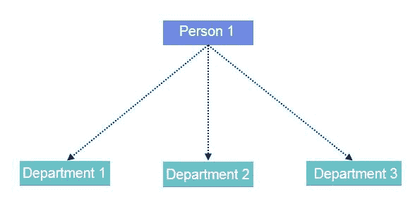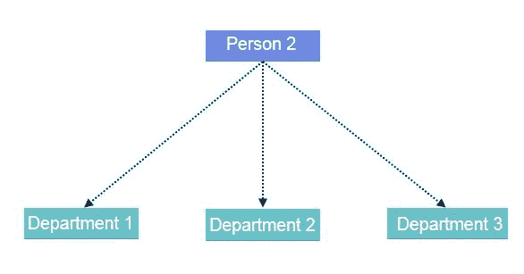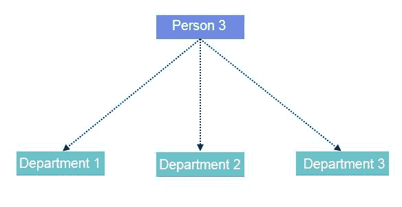

在这里你将学习如何进行多对多映射。

以下代码展示了如何创建一个多对多映射。

它描述了人与部门之间的关系。一个部门可以有许多人员，而一个人可以在多个部门工作。

### Person.java

```java
package com.abd.jpa;
import java.util.HashSet;
import java.util.Set;
import javax.persistence.Entity;
import javax.persistence.GeneratedValue;
import javax.persistence.GenerationType;
import javax.persistence.Id;
import javax.persistence.ManyToMany;

@Entity
public class Person {
    @Id
    @GeneratedValue(strategy=GenerationType.IDENTITY)
    private long id;
    private String name;
    @ManyToMany
    private Set<Department> departments = new HashSet<Department>();

    public Person() {}
    public Person(String name) {
        this.name = name;
    }
    public Set<Department> getDepartments() {
        return departments;
    }
    public void setDepartments(Set<Department> departments) {
        this.departments = departments;
    }
    public Long getId() {
        return id;
    }
    public void setId(Long id) {
        this.id = id;
    }
    public String getName() {
        return name;
    }
    public void setName(String name) {
        this.name = name;
    }
    @Override
    public String toString() {
        return "Person [id=" + id + ", name=" + name + ", departments="+ departments + "]";
    }
}
```

### Department.java

```java
package com.abd.jpa;
import java.util.HashSet;
import java.util.Set;
import javax.persistence.Entity;
import javax.persistence.GeneratedValue;
import javax.persistence.GenerationType;
import javax.persistence.Id;
import javax.persistence.ManyToMany;

@Entity
public class Department implements java.io.Serializable {
    @Id
    @GeneratedValue(strategy=GenerationType.IDENTITY)
    private long id;
    private String name;
    @ManyToMany
    private Set<Person> persons = new HashSet<Person>();

    public Set<Person> getPersons() {
        return persons;
    }
    public void setPersons(Set<Person> persons) {
        this.persons = persons;
    }
    public long getId() {
        return id;
    }
    public void setId(long id) {
        this.id = id;
    }
    public String getName() {
        return name;
    }
    public void setName(String name) {
        this.name = name;
    }
}
```

#### PersonDaoImpl.java


```java
package com.abd.jpa;
import javax.persistence.EntityManager;
import javax.persistence.PersistenceContext;
import org.springframework.transaction.Transactional;

@Transactional
public class PersonDaoImpl {
    public void test() {
        Department d1 = new Department();
        d1.setName("Design");
        Department d2 = new Department();
        d2.setName("Testing");
        Person p1 = new Person("Tom");
        p1.getDepartments().add(d1);
        p1.getDepartments().add(d2);
        Person p2 = new Person("Jack");
        p2.getDepartments().add(d1);
        p2.getDepartments().add(d2);
        em.persist(p1);
        em.persist(p2);
    }
    @PersistenceContext
    private EntityManager em;
}
```

## Helper.java

```java
package com.abd.jpa;
import java.sql.Connection;
import java.sql.DriverManager;
import java.sql.ResultSet;
import java.sql.ResultSetMetaData;
import java.sql.Statement;

public class Helper {
    public static void checkData() {
        try {
            Class.forName("com.mysql.jdbc.Driver");
            Connection conn = DriverManager.getConnection("jdbc:mysql://localhost/db1", "root", "root");
            Statement st = conn.createStatement();
            ResultSet mrs = conn.getMetaData().getTables(null, null, null, new String[] { "TABLE" });
            while (mrs.next()) {
                String tableName = mrs.getString(3);
                System.out.println("\n\n\nTable Name: "+ tableName);
                ResultSet rs = st.executeQuery("select * from " + tableName);
                ResultSetMetaData metadata = rs.getMetaData();
                while (rs.next()) {
                    System.out.println(" Row:");
                    for (int i = 0; i < metadata.getColumnCount(); i++) {
                        System.out.println("    Column Name: "+ metadata.getColumnLabel(i + 1) + ",  ");
                        System.out.println("    Column Type: "+ metadata.getColumnTypeName(i + 1) + ":  ");
                        Object value = rs.getObject(i + 1);
                        System.out.println("    Column Value: "+value+"\n");
                    }
                }
            }
        } catch (Exception e) {
            e.printStackTrace();
        }
    }
}
```

```xml
<?xml version="1.0" encoding="UTF-8"?>
<beans xmlns="http://www.springframework.org/schema/beans"xmlns:aop="http://www.springframework.org/schema/aop" xmlns:context="http://www.springframework.org/schema/context"xmlns:security="http://www.springframework.org/schema/security" xmlns:tx="http://www.springframework.org/schema/tx" xmlns:xsi="http://www.w3.org/2001/XMLSchema-instance" xsi:schemaLocation="http://www.springframework.org/schema/aop http://www.springframework.org/schema/aop/spring-aop-3.2.xsdhttp://www.springframework.org/schema/beans http://www.springframework.org/schema/beans/spring-beans-3.2.xsdhttp://www.springframework.org/schema/context http://www.springframework.org/schema/context/spring-context-3.2.xsdhttp://www.springframework.org/schema/tx http://www.springframework.org/schema/tx/spring-tx-3.2.xsd">
    <tx:annotation-driven />
    <context:annotation-config />
    <bean id="personDao" class="com.abd.jpa.PersonDaoImpl" />
    <bean id="dataSource"class="org.springframework.jdbc.datasource.DriverManagerDataSource">
        <property name="driverClassName"><value>com.mysql.jdbc.Driver</value></property>
        <property name="url"><value>jdbc:mysql://localhost/db1</value></property>
        <property name="username"><value>root</value></property>
        <property name="password"><value>root</value></property>
    </bean>
    <bean id="entityManagerFactory" class="org.springframework.orm.jpa.LocalContainerEntityManagerFactoryBean">
        <property name="dataSource" ref="dataSource" />
        <property name="persistenceUnitName" value="jpaData" />
        <property name="jpaVendorAdapter">
            <bean class="org.springframework.orm.jpa.vendor.HibernateJpaVendorAdapter" />
        </property>
        <property name="jpaProperties">
            <props>
                <prop key="hibernate.dialect">org.hibernate.dialect.MySQLDialect</prop>
                <prop key="hibernate.show_sql">true</prop>
                <prop key="hibernate.hbm2ddl.auto">update</prop>
            </props>
        </property>
    </bean>
    <bean id="transactionManager" class="org.springframework.orm.jpa.JpaTransactionManager">
        <property name="entityManagerFactory" ref="entityManagerFactory" />
    </bean>
</beans>
```

## Client.java

```java
package com.abd.jpa;
import org.springframework.context.support.ClassPathXmlApplicationContext;
public class Client {
    public static void main(String[] args) {
        ClassPathXmlApplicationContext context = new ClassPathXmlApplicationContext("applicationContext.xml");
        PersonDaoImpl dao = (PersonDaoImpl) context.getBean("personDao");
        dao.test();
        context.close();
        Helper.checkData();
    }
}
```

## 输出

表名: DEPARTMENT

行:列名: ID,列类型: BIGINT,列值: 1

列名: NAME,列类型: VARCHAR,列值: Design

行:列名: ID,列类型: BIGINT,列值: 2

列名: NAME,列类型: VARCHAR,列值: Testing

表名: DEPARTMENT_PERSON

行:列名: DEPARTMENT_ID,列类型: BIGINT,列值: 1

列名: PERSONS_ID,列类型: BIGINT,列值: 1

行:列名: DEPARTMENT_ID,列类型: BIGINT,列值: 1

列名: PERSONS_ID,列类型: BIGINT,列值: 2

表名: PERSON

行:列名: ID,列类型: BIGINT,列值: 1

列名: NAME,列类型: VARCHAR,列值: Tom

行:列名: ID,列类型: BIGINT,列值: 2

列名: NAME,列类型: VARCHAR,列值: Jack

表名: PERSON_DEPARTMENT

行:列名: PERSON_ID,列类型: BIGINT,列值: 1

列名: DEPARTMENTS_ID,列类型: BIGINT,列值: 1

行:列名: PERSON_ID,列类型: BIGINT,列值: 1

列名: DEPARTMENTS_ID,列类型: BIGINT,列值: 2

行:列名: PERSON_ID,列类型: BIGINT,列值: 2

列名: DEPARTMENTS_ID,列类型: BIGINT,列值: 2

## 2 JPA 多对多 关联表映射


以下代码展示了如何为多对多映射设置关联表。

## Person.java

```java
package com.abd.jpa;
import java.util.HashSet;
import java.util.Set;
import javax.persistence.Entity;
import javax.persistence.GeneratedValue;
import javax.persistence.GenerationType;
import javax.persistence.Id;
import javax.persistence.JoinColumn;
import javax.persistence.JoinTable;
import javax.persistence.ManyToMany;

@Entity
public class Person {
    @Id
    @GeneratedValue(strategy=GenerationType.IDENTITY)
    private long id;
    private String name;

    @ManyToMany
    @JoinTable(name="PERSON_DEPT",joinColumns=@JoinColumn(name="PERSON_ID"),inverseJoinColumns=@JoinColumn(name="DEPT_ID"))
    private Set<Department> departments = new HashSet<Department>();

    public Person() {}
    public Person(String name) { this.name = name; }
    public Set<Department> getDepartments() { return departments; }
    public void setDepartments(Set<Department> departments) { this.departments = departments; }
    public Long getId() { return id; }
    public void setId(Long id) { this.id = id; }
    public String getName() { return name; }
    public void setName(String name) { this.name = name; }

    @Override
    public String toString() { return "Person [id=" + id + ", name=" + name + ", departments="+ departments + "]"; }
}
```

## Department.java


## 1. 实体类 `Department.java`

```java
package com.abd.jpa;
import java.util.HashSet;
import java.util.Set;
import javax.persistence.Entity;
import javax.persistence.GeneratedValue;
import javax.persistence.GenerationType;
import javax.persistence.Id;
import javax.persistence.ManyToMany;

@Entity
public class Department implements java.io.Serializable {
    @Id
    @GeneratedValue(strategy=GenerationType.IDENTITY)
    private long id;
    private String name;

    @ManyToMany
    private Set<Person> persons = new HashSet<Person>();

    public Set<Person> getPersons() { return persons; }
    public void setPersons(Set<Person> persons) { this.persons = persons; }
    public Long getId() { return id; }
    public void setId(Long id) { this.id = id; }
    public String getName() { return name; }
    public void setName(String name) { this.name = name; }

    @Override
    public String toString() { return "Person [id=" + id + ", name=" + name + ", departments="+ departments + "]"; }
}
```

## 2. 数据访问对象 `PersonDaoImpl.java`

```java
package com.abd.jpa;
import javax.persistence.EntityManager;
import javax.persistence.PersistenceContext;
import org.springframework.transaction.annotation.Transactional;

@Transactional
public class PersonDaoImpl {
    public void test() {
        Department d1 = new Department();
        d1.setName("Design");
        Department d2 = new Department();
        d2.setName("Testing");
        Person p1 = new Person("Tom");
        p1.getDepartments().add(d1);
        p1.getDepartments().add(d2);
        Person p2 = new Person("Jack");
        p2.getDepartments().add(d1);
        p2.getDepartments().add(d2);
        em.persist(p1);
        em.persist(p2);
        em.persist(d1);
        em.persist(d2);
    }

    @PersistenceContext
    private EntityManager em;
}
```

## 3. 辅助类 `Helper.java`

```java
package com.abd.jpa;
import java.sql.Connection;
import java.sql.DriverManager;
import java.sql.ResultSet;
import java.sql.ResultSetMetaData;
import java.sql.Statement;

public class Helper {
    public static void checkData() {
        try {
            Class.forName("com.mysql.jdbc.Driver");
            Connection conn = DriverManager.getConnection("jdbc:mysql://localhost/db1", "root", "root");
            Statement st = conn.createStatement();
            ResultSet mrs = conn.getMetaData().getTables(null, null, null, new String[] { "TABLE" });
            while (mrs.next()) {
                String tableName = mrs.getString(3);
                System.out.println("\n\n\n\nTable Name: "+ tableName);
                ResultSet rs = st.executeQuery("select * from " + tableName);
                ResultSetMetaData metadata = rs.getMetaData();
                while (rs.next()) {
                    System.out.println(" Row:");
                    for (int i = 0; i < metadata.getColumnCount(); i++) {
                        System.out.println("    Column Name: "+ metadata.getColumnLabel(i + 1)+",  ");
                        System.out.println("    Column Type: "+ metadata.getColumnTypeName(i + 1)+":  ");
                        Object value = rs.getObject(i + 1);
                        System.out.println("    Column Value: "+value+"\n");
                    }
                }
            }
        } catch(Exception e) {
            e.printStackTrace();
        }
    }
}
```

## 4. 配置文件

### 4.1 `persistence.xml`

```xml
<?xml version="1.0" encoding="UTF-8"?><persistence version="1.0"xmlns="http://java.sun.com/xml/ns/persistence" xmlns:xsi="http://www.w3.org/2001/XMLSchema-instance"xsi:schemaLocation="http://java.sun.com/xml/ns/persistence http://java.sun.com/xml/ns/persistence/persistence_1_0.xsd"><persistence-unit name="jpaData" /></persistence>
```

### 4.2 `applicationContext.xml`

```xml
<?xml version="1.0" encoding="UTF-8"?><beans xmlns="http://www.springframework.org/schema/beans"xmlns:aop="http://www.springframework.org/schema/aop" xmlns:context="http://www.springframework.org/schema/context" xmlns:security="http://www.springframework.org/schema/security" xmlns:tx="http://www.springframework.org/schema/tx" xmlns:xsi="http://www.w3.org/2001/XMLSchema-instance"xsi:schemaLocation="http://www.springframework.org/schema/aop http://www.springframework.org/schema/aop/spring-aop-3.2.xsdhttp://www.springframework.org/schema/beans http://www.springframework.org/schema/beans/spring-beans-3.2.xsdhttp://www.springframework.org/schema/context http://www.springframework.org/schema/context/spring-context-3.2.xsdhttp://www.springframework.org/schema/tx http://www.springframework.org/schema/tx/spring-tx-3.2.xsd"><tx:annotation-driven /><context:annotation-config /><bean id="personDao" class="com.abd.jpa.PersonDaoImpl" /><bean id="dataSource"class="org.springframework.jdbc.datasource.DriverManagerDataSource"><property name="driverClassName"><value>com.mysql.jdbc.Driver</value></property><property name="url"><value>jdbc:mysql://localhost/db1</value></property><property name="username"><value>root</value></property><property name="password"><value>root</value></property></bean><bean id="entityManagerFactory"class="org.springframework.orm.jpa.LocalContainerEntityManagerFactoryBean"><property name="dataSource" ref="dataSource" /><property name="persistenceUnitName" value="jpaData" /><property name="jpaVendorAdapter"><bean class="org.springframework.orm.jpa.vendor.HibernateJpaVendorAdapter" /></property><property name="jpaProperties"><props><prop key="hibernate.dialect">org.hibernate.dialect.MySQLDialect</prop><prop key="hibernate.show_sql">true</prop><prop key="hibernate.hbm2ddl.auto">update</prop></props></property></bean><bean id="transactionManager" class="org.springframework.orm.jpa.JpaTransactionManager"><property name="entityManagerFactory" ref="entityManagerFactory" /></bean></beans>
```

## 5. 客户端代码 `Client.java`

```java
package com.abd.jpa;import org.springframework.context.support.ClassPathXmlApplicationContext;public class Client {public static void main(String[] args) {ClassPathXmlApplicationContext context = new ClassPathXmlApplicationContext("applicationContext.xml");PersonDaoImpl dao = (PersonDaoImpl) context.getBean("personDao");dao.test();context.close();Helper.checkData();}}
```

## 6. JPA 多对多双向映射

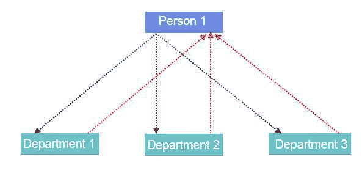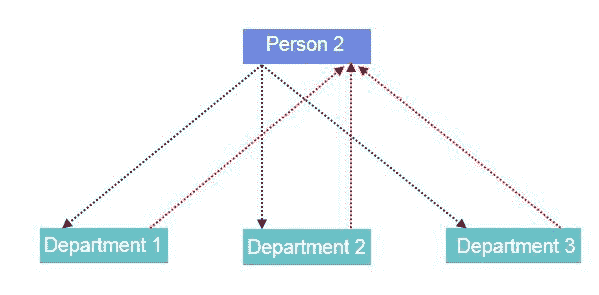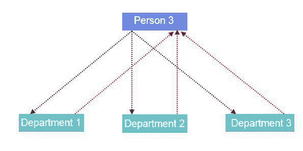

以下代码展示了如何创建一个双向的多对多映射。

### 6.1 `Professor.java`

```java
package com.abd.jpa;import java.util.ArrayList;import java.util.Collection;import javax.persistence.Entity;import javax.persistence.GeneratedValue;import javax.persistence.GenerationType;import javax.persistence.Id;import javax.persistence.ManyToMany;@Entitypublic class Professor {@Id @GeneratedValue(strategy=GenerationType.IDENTITY)private int id;private String name;private long salary;@ManyToManyprivate Collection<Project> projects;public Professor() {projects = new ArrayList<Project>();}public int getId() {return id;}public void setId(int id) {this.id = id;}public String getName() {return name;}public void setName(String name) {this.name = name;}public long getSalary() {return salary;}public void setSalary(long salary) {this.salary = salary;}public void addProject(Project project) {if (!getProjects().contains(project)) {projects.add(project);}if (!project.getEmployees().contains(this)) {project.getEmployees().add(this);}}public Collection<Project> getProjects() {return projects;}public String toString() {return "Employee id: " + getId() + " name: " + getName() +" with " + getProjects().size() + " projects";}}
```

### 6.2 `Project.java`


# JPA 多对多关系示例

以下代码展示了使用 JPA 和 Spring 实现多对多关系的完整示例，包含实体类、DAO 实现、辅助工具类以及相关配置文件。

## 实体类：`Project.java`

```java
package com.abd.jpa;

import java.util.ArrayList;
import java.util.Collection;
import javax.persistence.Entity;
import javax.persistence.GeneratedValue;
import javax.persistence.GenerationType;
import javax.persistence.Id;
import javax.persistence.ManyToMany;

@Entity
public class Project {
    @Id
    @GeneratedValue(strategy = GenerationType.IDENTITY)
    protected int id;
    protected String name;

    @ManyToMany(mappedBy = "projects")
    private Collection<Professor> employees;

    public Project() {
        employees = new ArrayList<Professor>();
    }

    public int getId() {
        return id;
    }

    public void setId(int projectNo) {
        this.id = projectNo;
    }

    public String getName() {
        return name;
    }

    public void setName(String projectName) {
        this.name = projectName;
    }

    public Collection<Professor> getEmployees() {
        return employees;
    }

    public void addEmployee(Professor employee) {
        if (!getEmployees().contains(employee)) {
            employees.add(employee);
        }
        if (!employee.getProjects().contains(this)) {
            employee.getProjects().add(this);
        }
    }

    public String toString() {
        return "Project id: " + getId() + ", name: " + getName() +
                " with " + getEmployees().size() + " employees";
    }
}
```

## DAO 实现：`PersonDaoImpl.java`

```java
package com.abd.jpa;

import javax.persistence.EntityManager;
import javax.persistence.PersistenceContext;
import org.springframework.transaction.annotation.Transactional;

@Transactional
public class PersonDaoImpl {
    public void test() {
        Professor emp = new Professor();
        emp.setName("name");
        emp.setSalary(12345);

        Project p = new Project();
        p.setName("Chem");
        p.getEmployees().add(emp);
        emp.getProjects().add(p);

        em.persist(p);
        em.persist(emp);
    }

    @PersistenceContext
    private EntityManager em;
}
```

## 辅助工具类：`Helper.java`

```java
package com.abd.jpa;

import java.sql.Connection;
import java.sql.DriverManager;
import java.sql.ResultSet;
import java.sql.ResultSetMetaData;
import java.sql.Statement;

public class Helper {
    public static void checkData() {
        try {
            Class.forName("com.mysql.jdbc.Driver");
            Connection conn = DriverManager.getConnection("jdbc:mysql://localhost/db1", "root", "root");
            Statement st = conn.createStatement();
            ResultSet mrs = conn.getMetaData().getTables(null, null, null, new String[] { "TABLE" });

            while (mrs.next()) {
                String tableName = mrs.getString(3);
                System.out.println("\n\n\n\nTable Name: " + tableName);
                ResultSet rs = st.executeQuery("select * from " + tableName);
                ResultSetMetaData metadata = rs.getMetaData();

                while (rs.next()) {
                    System.out.println(" Row:");
                    for (int i = 0; i < metadata.getColumnCount(); i++) {
                        System.out.println("    Column Name: " + metadata.getColumnLabel(i + 1) + ",  ");
                        System.out.println("    Column Type: " + metadata.getColumnTypeName(i + 1) + ":  ");
                        Object value = rs.getObject(i + 1);
                        System.out.println("    Column Value: " + value + "\n");
                    }
                }
            }
        } catch (Exception e) {
            e.printStackTrace();
        }
    }
}
```

## 配置文件：`persistence.xml`

```xml
<?xml version="1.0" encoding="UTF-8"?>
<persistence version="1.0" xmlns="http://java.sun.com/xml/ns/persistence"
             xmlns:xsi="http://www.w3.org/2001/XMLSchema-instance"
             xsi:schemaLocation="http://java.sun.com/xml/ns/persistence
                                 http://java.sun.com/xml/ns/persistence/persistence_1_0.xsd">
    <persistence-unit name="jpaData" />
</persistence>
```

## 配置文件：`applicationContext.xml`

```xml
<?xml version="1.0" encoding="UTF-8"?>
<beans xmlns="http://www.springframework.org/schema/beans"
       xmlns:aop="http://www.springframework.org/schema/aop"
       xmlns:context="http://www.springframework.org/schema/context"
       xmlns:security="http://www.springframework.org/schema/security"
       xmlns:tx="http://www.springframework.org/schema/tx"
       xmlns:xsi="http://www.w3.org/2001/XMLSchema-instance"
       xsi:schemaLocation="http://www.springframework.org/schema/aop
                           http://www.springframework.org/schema/aop/spring-aop-3.2.xsd
                           http://www.springframework.org/schema/beans
                           http://www.springframework.org/schema/beans/spring-beans-3.2.xsd
                           http://www.springframework.org/schema/context
                           http://www.springframework.org/schema/context/spring-context-3.2.xsd
                           http://www.springframework.org/schema/tx
                           http://www.springframework.org/schema/tx/spring-tx-3.2.xsd">

    <tx:annotation-driven />
    <context:annotation-config />

    <bean id="personDao" class="com.abd.jpa.PersonDaoImpl" />

    <bean id="dataSource" class="org.springframework.jdbc.datasource.DriverManagerDataSource">
        <property name="driverClassName"><value>com.mysql.jdbc.Driver</value></property>
        <property name="url"><value>jdbc:mysql://localhost/db1</value></property>
        <property name="username"><value>root</value></property>
        <property name="password"><value>root</value></property>
    </bean>

    <bean id="entityManagerFactory" class="org.springframework.orm.jpa.LocalContainerEntityManagerFactoryBean">
        <property name="dataSource" ref="dataSource" />
        <property name="persistenceUnitName" value="jpaData" />
        <property name="jpaVendorAdapter">
            <bean class="org.springframework.orm.jpa.vendor.HibernateJpaVendorAdapter" />
        </property>
        <property name="jpaProperties">
            <props>
                <prop key="hibernate.dialect">org.hibernate.dialect.MySQLDialect</prop>
                <prop key="hibernate.show_sql">true</prop>
                <prop key="hibernate.hbm2ddl.auto">update</prop>
            </props>
        </property>
    </bean>

    <bean id="transactionManager" class="org.springframework.orm.jpa.JpaTransactionManager">
        <property name="entityManagerFactory" ref="entityManagerFactory" />
    </bean>
</beans>
```

## 客户端入口：`Client.java`

```java
package com.abd.jpa;

import org.springframework.context.support.ClassPathXmlApplicationContext;

public class Client {
    public static void main(String[] args) {
        ClassPathXmlApplicationContext context = new ClassPathXmlApplicationContext("applicationContext.xml");
        PersonDaoImpl dao = (PersonDaoImpl) context.getBean("personDao");
        dao.test();
        context.close();
        Helper.checkData();
    }
}
```

## 运行输出示例

```
Table Name: PROFESSOR
Row:
Column Name: ID, Column Type: INT:  
Column Value: 1

Column Name: NAME, Column Type: VARCHAR:  
Column Value: John

Column Name: LAST, Column Type: VARCHAR:  
Column Value: Doe
```

## 实体类：`Department.java`


```java
package com.abd.jpa;
import java.util.HashMap;
import java.util.Iterator;
import java.util.Map;
import javax.persistence.AttributeOverride;
import javax.persistence.AttributeOverrides;
import javax.persistence.Column;
import javax.persistence.Entity;
import javax.persistence.GeneratedValue;
import javax.persistence.GenerationType;
import javax.persistence.Id;
import javax.persistence.JoinColumn;
import javax.persistence.JoinTable;
import javax.persistence.ManyToMany;

@Entity
public class Department {
    @Id
    @GeneratedValue(strategy=GenerationType.IDENTITY)
    private int id;
    private String name;

    @ManyToMany
    @JoinTable(name="DEPT_EMP",joinColumns=@JoinColumn(name="DEPT_ID"),inverseJoinColumns=@JoinColumn(name="EMP_ID"))
    @AttributeOverrides({
        @AttributeOverride(name="first_Name",column=@Column(name="EMP_FNAME")),
        @AttributeOverride(name="last_Name",column=@Column(name="EMP_LNAME"))
    })
    private Map<EmployeeName, Employee> employeesByName;

    public Department() {
        employeesByName = new HashMap<EmployeeName,Employee>();
    }

    public int getId() {
        return id;
    }

    public void setId(int id) {
        this.id = id;
    }

    public String getName() {
        return name;
    }

    public void setName(String deptName) {
        this.name = deptName;
    }

    public Map<EmployeeName, Employee> getEmployees() {
        return employeesByName;
    }

    public void addEmployee(Employee employee) {
        EmployeeName empName = employee.getName();
        employeesByName.put(empName, employee);
    }

    public void removeEmployee(Employee employee) {
        Iterator iter = employeesByName.entrySet().iterator();
        while (iter.hasNext()) {
            Employee current = ((Map.Entry<EmployeeName,Employee>) iter.next()).getValue();
            if (current.getId() == employee.getId()) {
                iter.remove();
            }
        }
    }

    public String toString() {
        StringBuffer aBuffer = new StringBuffer("Department ");
        aBuffer.append(" id: ");
        aBuffer.append(id);
        aBuffer.append(" name: ");
        aBuffer.append(name);
        aBuffer.append(" employeeCount: ");
        aBuffer.append(employeesByName.size());
        return aBuffer.toString();
    }
}
```

#### PersonDaoImpl.java

```java
package com.abd.jpa;
import javax.persistence.EntityManager;
import javax.persistence.PersistenceContext;
import org.springframework.transaction.annotation.Transactional;

@Transactional
public class PersonDaoImpl {
    public void test() {
        Employee e = new Employee();
        e.setFirstName("Tom");
        e.setLastName("Smith");
        Department d = new Department();
        d.setName("test");
        EmployeeName name = new EmployeeName();
        name.setFirst_Name("Tom");
        name.setLast_Name("Smith");
        e.getDepartments().add(d);
        d.getEmployees().put(name, e);
        em.persist(e);
        em.persist(d);
    }
    @PersistenceContext
    private EntityManager em;
}
```

### Helper.java

```java
package com.abd.jpa;
import java.sql.Connection;
import java.sql.DriverManager;
import java.sql.ResultSet;
import java.sql.ResultSetMetaData;
import java.sql.Statement;

public class Helper {
    public static void checkData() {
        try {
            Class.forName("com.mysql.jdbc.Driver");
            Connection conn = DriverManager.getConnection("jdbc:mysql://localhost/db1", "root", "root");
            Statement st = conn.createStatement();
            ResultSet mrs = conn.getMetaData().getTables(null, null, null, new String[] { "TABLE" });
            while (mrs.next()) {
                String tableName = mrs.getString(3);
                System.out.println("\n\n\n\nTable Name: "+ tableName);
                ResultSet rs = st.executeQuery("select * from " + tableName);
                ResultSetMetaData metadata = rs.getMetaData();
                while (rs.next()) {
                    System.out.println(" Row:");
                    for (int i = 0; i < metadata.getColumnCount(); i++) {
                        System.out.println("    Column Name: "+ metadata.getColumnLabel(i + 1)+",  ");
                        System.out.println("    Column Type: "+ metadata.getColumnTypeName(i + 1)+":  ");
                        Object value = rs.getObject(i + 1);
                        System.out.println("    Column Value: "+value+"\n");
                    }
                }
            }
        } catch(Exception e) {
            e.printStackTrace();
        }
    }
}
```

### persistence.xml

```xml
<?xml version="1.0" encoding="UTF-8"?>
<persistence version="1.0" xmlns="http://java.sun.com/xml/ns/persistence" xmlns:xsi="http://www.w3.org/2001/XMLSchema-instance" xsi:schemaLocation="http://java.sun.com/xml/ns/persistence http://java.sun.com/xml/ns/persistence_1_0.xsd">
    <persistence-unit name="jpaData" />
</persistence>
```

### applicationContext.xml

```xml
<?xml version="1.0" encoding="UTF-8"?>
<beans xmlns="http://www.springframework.org/schema/beans" xmlns:aop="http://www.springframework.org/schema/aop" xmlns:context="http://www.springframework.org/schema/context" xmlns:security="http://www.springframework.org/schema/security" xmlns:tx="http://www.springframework.org/schema/tx" xmlns:xsi="http://www.w3.org/2001/XMLSchema-instance" xsi:schemaLocation="http://www.springframework.org/schema/beans http://www.springframework.org/schema/beans/spring.beanshttp://www.springframework.org/schema/aop http://www.springframework.org/schema/aop/spring-aop-3.2.xsdhttp://www.springframework.org/schema/context http://www.springframework.org/schema/context/spring-context-3.2.xsdhttp://www.springframework.org/schema/security http://www.springframework.org/schema/security/spring-security-3.2.xsdhttp://www.springframework.org/schema/tx http://www.springframework.org/schema/tx/spring-tx-3.2.xsd">
    <!-- 根据提供的结构配置 -->
</beans>
```

### Client.java

```java
package com.abd.jpa;
import org.springframework.context.support.ClassPathXmlApplicationContext;

public class Client {
    public static void main(String[] args) {
        ClassPathXmlApplicationContext context = new ClassPathXmlApplicationContext("applicationContext.xml");
        PersonDaoImpl dao = (PersonDaoImpl) context.getBean("personDao");
        dao.test();
        context.close();
        Helper.checkData();
    }
}
```

### Output

```text
Table Name: DEPARTMENT
Row:
Column Name: ID, Column Type: INTEGER,  Column Value: 1
Column Name: NAME, Column Type: VARCHAR,  Column Value: test

Table Name: DEPT_EMP
Row:
Column Name: DEPT_ID, Column Type: INTEGER,  Column Value: 1
Column Name: EMP_ID, Column Type: INTEGER,  Column Value: 1

Table Name: EMPLOYLOEE
Row:
Column Name: ID, Column Type: INTEGER,  Column Value: 1
Column Name: F_NAME, Column Type: VARCHAR,  Column Value: Tom
Column Name: L_NAME, Column Type: VARCHAR,  Column Value: Smith
Column Name: SALARY, Column Type: BIGINT,  Column Value: 0
```

# MVC（模型视图控制器）架构

对于视图（向浏览器显示结果数据），结果数据来自`Tables`。在连接数据库后，前端控制器将获取相应的`JSP 页面`，并将数据放入`JSP 页面`中，然后将`JSP 页面`发送回浏览器，浏览器将进行显示。

## 首页

|  |

## 环境

| 类别 | 详情 |
| :--- | :--- |
| 技术栈 | `Struts1`, `Spring`, `Hibernate`, `Javascript`, `Css`, `Jquery` |
| 数据库 | `MySQL` |
| 服务器 | `Tomcat 1.6` |
| 日志工具 | `Log4j` |
| IDE | `Eclipse` |
| 设计模式 | `Front Controller`, `MVC`, `Factory`, `DAO`, `Proxy`, `Singleton`, `Abstract factory pattern`, `Template pattern`, `SessionFactory`, `TransactionFactory` |

## 目录结构

| 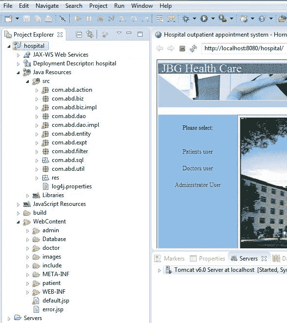 |

### 目录结构（展开）

| 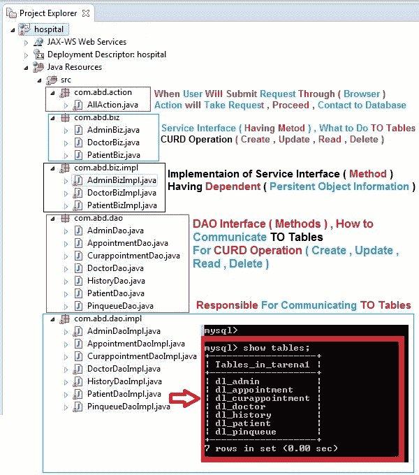 |

| 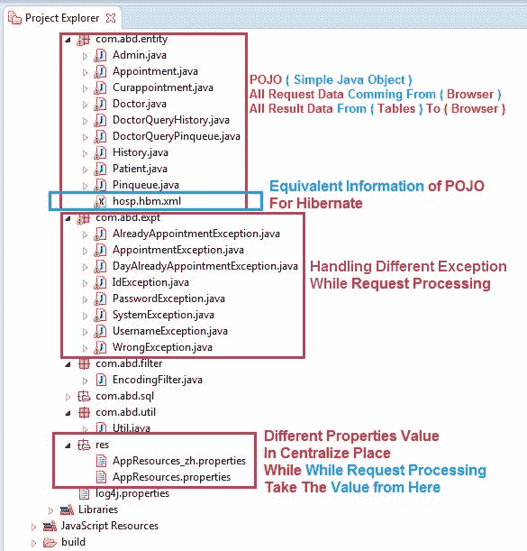 |

| 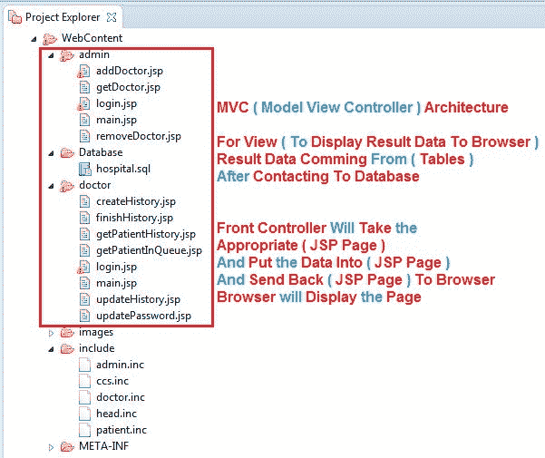 |

| 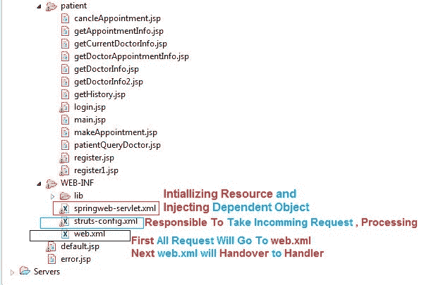 |

## 首页

|  |

## 管理员模块 I

### 登录

| 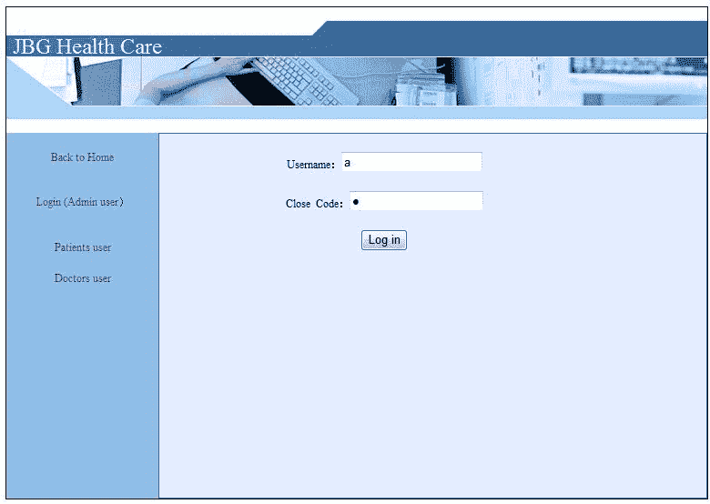 |

### 登录成功

| 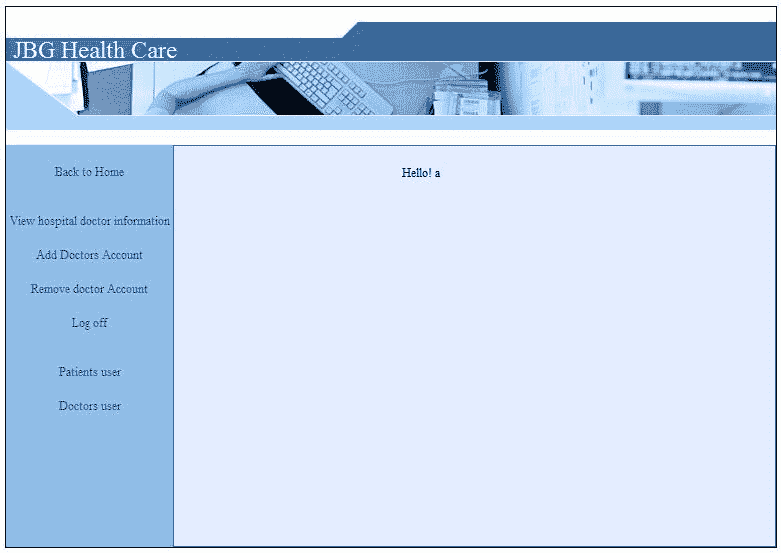 |

### 添加医生账号

| 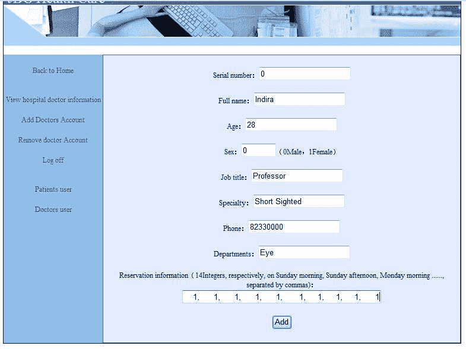 |

### 添加医生账号成功

| 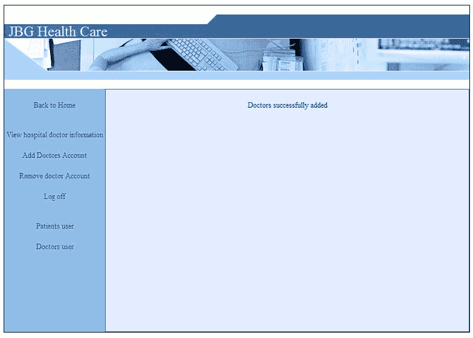 |

### 查看医院医生信息


### 删除医生信息

## 患者模块 II

### 患者注册

患者注册成功

### 查看所有医生

### 查找预约

### 查找可用医生预约列表

### 选择预约以确定医生的医生

### 医生预约已确认

### 医生预约总数

### 取消选定的医生预约

### 取消医生预约成功

### 查询医生记录

### 查询医生诊断记录

## 医生模块 III

### 医生登录

医生登录成功

### 修改密码

修改密码成功

### 查看患者预约

### 创建患者记录

创建患者记录成功

### 修改患者记录

修改患者记录成功

### 结束治疗

结束治疗成功

## 医院系统（工作流）

- **步骤 1**: `患者` $\rightarrow$ `所需医生` $\rightarrow$ `预约`
- **步骤 2**: `医生` $\rightarrow$ `医生查看预约` $\rightarrow$ `治疗`
- **步骤 3**: `患者` $\rightarrow$ `查看治疗`
- **步骤 4**: `医生` $\rightarrow$ `医生更新治疗开始/结束时间`
- **步骤 5**: `患者` $\rightarrow$ `查看治疗状态`

# 医院系统设计文档

## 1. 医院门诊预约系统功能

### 1.1 系统整体功能

- 权限级别操作，具有清晰分类，当系统进行身份验证时。
- 个人隐私保护：患者的医疗记录仅在医生治疗期间由患者本人负责，其他包括管理员在内的任何人均无权访问。

### 1.2 患者角色

- 注册用户，设置登录用户名和密码。
- 自定义查询医生姓名。
- 根据查询结果进行预约；如果指定的医生预约量已满，则预约失败。结果返回给患者。
- 你可以进行预约或撤销。
- 预约后可以查看医生信息。

### 1.3 医生角色

- 可以查看患者的预约背景。
- 查询患者记录。
- 创建患者记录。
- 修改患者记录。

### 1.4 管理员角色

- 添加和删除医生账号。

## 2. 设计流程

根据需求分析，分离主要实体：

- `医生` (`doctor`)
- `患者` (`patient`)
- `医疗记录` (`history`)
- `预约记录` (`pinqueue`)
- `管理员` (`administrator`)
- 医生最大预约数 (`appointment`)
- 医生当前可用预约数 (`currappointment`)

### 模块层次图

### 组件图

### 注册序列图（患者用户）

### 患者活动图

### 医生活动图

### 管理员活动图

### 在 `MySQL (Server)` 中创建数据库 (tarena1)

### 将你的（医院 Web 应用）部署到 Tomcat 服务器

首页显示如下：

首页

再次进入 `MySQL (Server)`

```sql
show tables;
```

由于你已经在 Tomcat 服务器中运行了（医院 Web 应用），此时会出现自动生成的表。

### 插入 SQL 语句

首先 $\rightarrow$ 插入给定的 SQL 语句

# 插入指定的 SQL 语句

```sql
/*****************************
create database tarena1;
use tarena1;
Spring.xml
========Step1=========
<prop key="hibernate.hbm2ddl.auto">create</prop>
========Step2========
<prop key="hibernate.hbm2ddl.auto">update</prop>
表将自动创建。
*********************************/
create sequence dl_admin_seq;
create table dl_admin (
  aid number(2) primary key,
  username varchar2(20) unique not null,
  password varchar2(20) not null,
  email varchar2(20) not null,
  name varchar2(12) not null,
  phone varchar2(15)
);
```

## 医生可以最大预约人数表

| 医生编号 | 主键 | 外键 |
| :--- | :--- | :--- |
| `dl_doctor` | `DID` | |
| SunA | 周日上午最大预约人数 | |
| SunP | 周日下午最大预约人数 | |
| MonA | 周一上午最大预约人数 | |
| MonP | 周一下午最大预约人数 | |
| TueA | 周二上午最大预约人数 | |
| TueP | 周二下午最大预约人数 | |
| WedA | 周三上午最大预约人数 | |
| WedP | 周三下午最大预约人数 | |
| ThuA | 周四上午最大预约人数 | |
| ThuP | 周四下午最大预约人数 | |
| FriA | 周五上午最大预约人数 | |
| FriP | 周五下午最大预约人数 | |
| SatA | 周六上午最大预约人数 | |
| SatP | 周六下午最大预约人数 | |

```sql
create table dl_appointment(
  did number(5) primary key references dl_doctor(did),
  sunA number(3) default '0',
  sunP number(3) default '0',
  monA number(3) default '0',
  monP number(3) default '0',
  tueA number(3) default '0',
  tueP number(3) default '0',
  wedA number(3) default '0',
  wedP number(3) default '0',
  thuA number(3) default '0',
  thuP number(3) default '0',
  friA number(3) default '0',
  friP number(3) default '0',
  satA number(3) default '0',
  satP number(3) default '0'
);
```

## 医生可以预约的当前人数

| DID | 医生编号 | 主键 | 外键 |
| :--- | :--- | :--- | :--- |
| `dl_doctor` | | | `DID` |
| SunA | 周日上午可用预约最大人数 | | |
| SunP | 周日下午可用预约最大人数 | | |
| MonA | 周一上午可用预约人数 | | |
| MonP | 周一下午最大预约人数 | | |
| TueA | 周二上午最大预约人数 | | |
| TueP | 周二下午最大预约人数 | | |
| WedA | 周三上午最大预约人数 | | |
| WedP | 周三下午最大预约人数 | | |
| ThuA | 周四上午最大预约人数 | | |
| ThuP | 周四下午最大预约人数 | | |
| FriA | 周五上午最大预约人数 | | |
| FriP | 周五下午最大预约人数 | | |
| SatA | 周六上午最大预约人数 | | |
| SatP | 周六下午最大预约人数 | | |

```sql
create table dl_curappointment(
  did number(5) primary key references dl_doctor(did),
  sunA number(3,0) default '0',
  sunP number(3,0) default '0',
  monA number(3,0) default '0',
  monP number(3,0) default '0',
  tueA number(3,0) default '0',
  tueP number(3,0) default '0',
  wedA number(3,0) default '0',
  wedP number(3,0) default '0',
  thuA number(3,0) default '0',
  thuP number(3,0) default '0',
  friA number(3,0) default '0',
  friP number(3,0) default '0',
  satA number(3,0) default '0',
  satP number(3,0) default '0'
);
```

## 医生表

| DID | 医生编号 | 姓名 | 密码 | 年龄 | 性别 | 医生姓名 | 科室 | 擅长的医生 | 电话号码 |
| :--- | :--- | :--- | :--- | :--- | :--- | :--- | :--- | :--- | :--- |
| | | | | | 1-男性, 0-女性 | | | | |

```sql
create table dl_doctor (
  did number(5) primary key,
  name varchar2(12) not null,
  password varchar2(20) not null,
  age number(3) not null,
  sex number(1) not null,
  levels varchar2(12) not null,
  section varchar2(20) not null,
  specialism varchar2(20) not null,
  phone varchar2(15)
);
```

## 按照顺序生成的病历记录列表

| HID | 病历号 | 医生主治 | 医生编号 | 外键 | 描述 | 症状 | 诊断 | 患者 | 患者人数 | 外键 | 处方 | 完成 | 治疗结束 | FDate (开始时间) | S (结束时间) |
| :--- | :--- | :--- | :--- | :--- | :--- | :--- | :--- | :--- | :--- | :--- | :--- | :--- | :--- | :--- | :--- |
| | | `dl_doctor` | `DID` | | | | | `dl_patient` | `DID` | | | | 0-是, 1-否 | | 2024-01-23 00:00:00 | 2024-01-21 00:00:00 | |

```sql
create sequence dl_history_seq;
create table dl_history (
  hid number(10) primary key,
  doctor_did number(5) references dl_doctor(did) not null,
  description varchar2(64) not null,
  diagnose varchar2(64) not null,
  patient_pid number(8) references dl_patient(pid) not null,
  rx varchar2(64) not null,
  finished number(1) not null,
  fDate date not null,
  sDate date
);
```

## 患者表

| PID | 生成的患者编号 | 姓名 | 用户名 | 密码 | 年龄 | 性别 | 家庭地址 | 电话号码 | 患者历史 |
| :--- | :--- | :--- | :--- | :--- | :--- | :--- | :--- | :--- |
| | | | | | 1-男性, 0-女性 | | | |

```sql
create sequence dl_patient_seq;
create table dl_patient (
  pid number(8) primary key,
  name varchar2(12) not null,
  username varchar2(20) unique not null,
  password varchar2(20) not null,
  age number(3) not null,
  sex number(1) not null,
  address varchar2(32),
  phone varchar2(24)
);
```

## 预约记录表

| QID | 顺序生成的记录号 | 患者 | 患者人数 | 外键 | 医生主治 | 医生编号 | 外键 | 几 | 预约时间 | AP 预约时间 | Dat 预约时间 |
| :--- | :--- | :--- | :--- | :--- | :--- | :--- | :--- | :--- | :--- | :--- |
| | | `dl_patient` | `PID` | | `dl_doctor` | `DID` | 0-周日, 1- 周一, 2- 周二, 3- 周三, 4- 周四, 5- 周五, 6- 周六 | 0- 上午, 1- 下午 | 2024-01-02 10:00:00 | |

```sql
create sequence dl_pinqueue_seq;
create table dl_pinqueue (
  qid number(10) primary key,
  patient_pid number(8) references dl_patient(pid) not null,
  doctor_did number(5) references dl_doctor(did) not null,
  day number(1) not null,
  ap number(1) not null,
  dat date not null,
  constraint pinqueue_Doctor_Patient unique (doctor_did,patient_pid)
);
```

# 数据库凭据与表脚本

## ADMIN

- **user**: `apassword`
- **table**: `atable`
- **arenaTotal TABLE**: `7`

## dl_patient

- **user**: `Amar`
- **password**: `Amar`
- **首位注册患者（自动生成密码=123456）**: 请查看表，如有需要您可以更改您的密码。

## dl_doctor

- **user**: `Indira`
- **password**: `Indira`

## SQL 脚本

```sql
insert into dl_admin (username, password, email, phone, name);
insert into dl_admin values(1, 'a', 'a', 'a@abc.com', '12345', 'a');
insert into dl_admin values(2, 'Admin', 'Admin', 'admin@abc.com', '21345', 'Admin');
```

### dl_doctor 表插入


```sql
INSERT INTO `dl_doctor` (`DID`, `Name`, `Password`, `Age`, `Sex`, `Level`, `Section`, `Specialism`, `Phone`)
INSERT INTO `dl_doctor` VALUES ('001', 'Indira', 'Indira', 28, 0, 'Professor', 'Eye', 'Short Sighted', '82330000');
INSERT INTO `dl_doctor` VALUES ('002', 'Jagan', 'Jagan', 29, 0, 'Professor', 'Head', 'Headache', '10000823');
INSERT INTO `dl_doctor` VALUES ('003', 'Chetan', 'Chetan', 40, 0, 'Suregon', 'Nose', 'Snoring', '12340002');
INSERT INTO `dl_doctor` VALUES ('004', 'Dinesh', 'Dinesh', 35, 0, 'Suregon', 'Dental', 'Teeth', '12300100');
INSERT INTO `dl_doctor` VALUES ('005', 'Pankaj', 'Pankaj', 35, 0, 'Suregon', 'Dental', 'Teeth', '232300');
INSERT INTO `dl_doctor` VALUES ('006', 'Kamal', 'Kamal', 28, 0, 'Professor', 'Eye', 'Short Sighted', '8232300');
INSERT INTO `dl_doctor` VALUES ('007', 'Raman', 'Raman', 29, 0, 'Professor', 'Head', 'Headache', '2340823');
INSERT INTO `dl_doctor` VALUES ('008', 'Bharat', 'Bharat', 40, 0, 'Suregon', 'Nose', 'Snoring', '8330002');
INSERT INTO `dl_doctor` VALUES ('009', 'Rajeev', 'Rajeev', 40, 0, 'Professor', 'Eye', 'Short Sighted', '4500832');
INSERT INTO `dl_doctor` VALUES ('010', 'Ajay', 'Ajay', 44, 0, 'MBBS', 'Physian', 'Cold Fever', '6730082');
INSERT INTO `dl_doctor` VALUES ('011', 'Supriya', 'Supriya', 35, 1, 'Suregon', 'Dental', 'Teeth', '6808230');
INSERT INTO `dl_doctor` VALUES ('012', 'Ritu', 'Ritu', 41, 1, 'MBBS', 'Physian', 'Cold Fever', '34303000');
INSERT INTO `dl_doctor` VALUES ('013', 'Dimple', 'Dimple', 21, 1, 'Professor', 'Eye', 'Short Sighted', '723000');
INSERT INTO `dl_doctor` VALUES ('014', 'Dipti', 'Dipti', 39, 1, 'Professor', 'Head', 'Headache', '500023');
INSERT INTO `dl_doctor` VALUES ('015', 'Bhavna', 'Bhavna', 40, 1, 'Suregon', 'Nose', 'Snoring', '6300230');
INSERT INTO `dl_doctor` VALUES ('016', 'Tripti', 'Tripti', 4, 1, 'MBBS', 'Physian', 'Cold Fever', '5600823');
INSERT INTO `dl_doctor` VALUES ('017', 'Dipti', 'Dipti', 24, 1, 'MBBS', 'Physian', 'Cold Fever', '4723000');
INSERT INTO `dl_doctor` VALUES ('018', 'Rohan', 'Rohan', 35, 0, 'Suregon', 'Dental', 'Teeth', '5408023');
INSERT INTO `dl_doctor` VALUES ('019', 'Dinesh', 'Dinesh', 28, 0, 'Professor', 'Eye', 'Short Sighted', '2338000');
INSERT INTO `dl_doctor` VALUES ('020', 'Dipti', 'Dipti', 39, 1, 'Professor', 'Head', 'Headache', '35400302');
INSERT INTO `dl_doctor` VALUES ('021', 'Bhavna', 'Bhavna', 40, 1, 'Suregon', 'Nose', 'Snoring', '2320230');
INSERT INTO `dl_doctor` VALUES ('022', 'Ajay', 'Ajay', 4, 0, 'MBBS', 'Physian', 'Cold Fever', '700823');
INSERT INTO `dl_doctor` VALUES ('023', 'Amar', 'Amar', 38, 0, 'MBBS', 'Physian', 'Cold Fever', '980238');
INSERT INTO `dl_doctor` VALUES ('024', 'Kamal', 'Kamal', 28, 0, 'MBBS', 'Physian', 'Cold Fever', '4632238');
INSERT INTO `dl_doctor` VALUES ('025', 'Akshar', 'Akshar', 28, 0, 'MBBS', 'Physian', 'Cold Fever', '4632238');
INSERT INTO `dl_doctor` VALUES ('027', 'Indira1', 'Indira1', 28, 0, 'Professor', 'Eye', 'Short Sighted', '823300');
```

### dl_appointment 表插入

```sql
INSERT INTO `dl_appointment` (`DID`, `SunA`, `SunP`, `MonA`, `MonP`, `TueA`, `TueP`, `WedA`, `WedP`, `ThuA`, `ThuP`, `FriA`, `FriP`, `SatA`, `SatP`)
INSERT INTO `dl_appointment` VALUES ('001', 4, 4, 4, 4, 4, 4, 4, 4, 4, 4, 4, 4, 4, 4);
INSERT INTO `dl_appointment` VALUES ('002', 1, 2, 3, 4, 5, 6, 7, 8, 9, 0, 1, 2, 3, 1);
```

### dl_curappointment 表插入

```sql
INSERT INTO `dl_curappointment` (`DID`, `SunA`, `SunP`, `MonA`, `MonP`, `TueA`, `TueP`, `WedA`, `WedP`, `ThuA`, `ThuP`, `FriA`, `FriP`, `SatA`, `SatP`)
INSERT INTO `dl_curappointment` VALUES ('001', 1, 1, 1, 1, 1, 1, 1, 1, 1, 1, 1, 1, 1, 1);
INSERT INTO `dl_curappointment` VALUES ('002', 1, 1, 1, 1, 1, 1, 1, 1, 1, 1, 1, 1, 1, 1);
INSERT INTO `dl_curappointment` VALUES ('003', 1, 1, 1, 1, 1, 1, 1, 1, 1, 1, 1, 1, 1, 1);
INSERT INTO `dl_curappointment` VALUES ('004', 1, 1, 1, 1, 1, 1, 1, 1, 1, 1, 1, 1, 1, 1);
INSERT INTO `dl_curappointment` VALUES ('005', 1, 1, 1, 1, 1, 1, 1, 1, 1, 1, 1, 1, 1, 1);
INSERT INTO `dl_curappointment` VALUES ('006', 1, 1, 1, 1, 1, 1, 1, 1, 1, 1, 1, 1, 1, 1);
INSERT INTO `dl_curappointment` VALUES ('007', 1, 1, 1, 1, 1, 1, 1, 1, 1, 1, 1, 1, 1, 1);
INSERT INTO `dl_curappointment` VALUES ('008', 1, 1, 1, 1, 1, 1, 1, 1, 1, 1, 1, 1, 1, 1);
INSERT INTO `dl_curappointment` VALUES ('009', 1, 1, 1, 1, 1, 1, 1, 1, 1, 1, 1, 1, 1, 1);
INSERT INTO `dl_curappointment` VALUES ('010', 1, 1, 1, 1, 1, 1, 1, 1, 1, 1, 1, 1, 1, 1);
INSERT INTO `dl_curappointment` VALUES ('011', 1, 1, 1, 1, 1, 1, 1, 1, 1, 1, 1, 1, 1, 1);
INSERT INTO `dl_curappointment` VALUES ('012', 1, 1, 1, 1, 1, 1, 1, 1, 1, 1, 1, 1, 1, 1);
INSERT INTO `dl_curappointment` VALUES ('013', 1, 1, 1, 1, 1, 1, 1, 1, 1, 1, 1, 1, 1, 1);
INSERT INTO `dl_curappointment` VALUES ('014', 1, 1, 1, 1, 1, 1, 1, 1, 1, 1, 1, 1, 1, 1);
INSERT INTO `dl_curappointment` VALUES ('015', 1, 1, 1, 1, 1, 1, 1, 1, 1, 1, 1, 1, 1, 1);
INSERT INTO `dl_curappointment` VALUES ('016', 1, 1, 1, 1, 1, 1, 1, 1, 1, 1, 1, 1, 1, 1);
INSERT INTO `dl_curappointment` VALUES ('017', 1, 1, 1, 1, 1, 1, 1, 1, 1, 1, 1, 1, 1, 1);
INSERT INTO `dl_curappointment` VALUES ('018', 1, 1, 1, 1, 1, 1, 1, 1, 1, 1, 1, 1, 1, 1);
INSERT INTO `dl_curappointment` VALUES ('019', 1, 1, 1, 1, 1, 1, 1, 1, 1, 1, 1, 1, 1, 1);
INSERT INTO `dl_curappointment` VALUES ('020', 1, 1, 1, 1, 1, 1, 1, 1, 1, 1, 1, 1, 1, 1);
INSERT INTO `dl_curappointment` VALUES ('021', 1, 1, 1, 1, 1, 1, 1, 1, 1, 1, 1, 1, 1, 1);
INSERT INTO `dl_curappointment` VALUES ('022', 1, 1, 1, 1, 1, 1, 1, 1, 1, 1, 1, 1, 1, 1);
```

### dl_patient 表插入

```sql
INSERT INTO `dl_patient` (`PID`, `Name`, `Username`, `Password`, `Age`, `Sex`, `Address`, `Phone`)
INSERT INTO `dl_patient` VALUES (1001, 'Amar', 'Amar', 'Amar', 20, 0, '1 A AMAR', '34552345');
INSERT INTO `dl_patient` VALUES (1002, 'Bharat', 'Bharat', 'Bharat', 20, 0, '3V KANPUR', '9841215345');
INSERT INTO `dl_patient` VALUES (1003, 'Raman', 'Raman', 'Raman', 40, 0, '1 A DELHI', '2312341459');
INSERT INTO `dl_patient` VALUES (1004, 'Gopal', 'Gopal', 'Gopal', 45, 0, '2 B PUNE', '9155341234');
INSERT INTO `dl_patient` VALUES (1005, 'Shyam', 'Shyam', 'Shyam', 45, 0, '2 B PUNE', '9155341234');
```

### dl_history 表插入

```sql
INSERT INTO `dl_history` (`HID`, `Doctor`, `Description`, `Diagnose`, `Patient`, `Rx`, `Finished`, `FDate`, `SDate`)
INSERT INTO `dl_history` VALUES (2, '001', 'Headache', 'Sars', 1001, 'Madecine', 0, '2024-01-23 19:02:00:0', '2024-01-21 19:03:51:0 ');
```

# 实体关系图

| 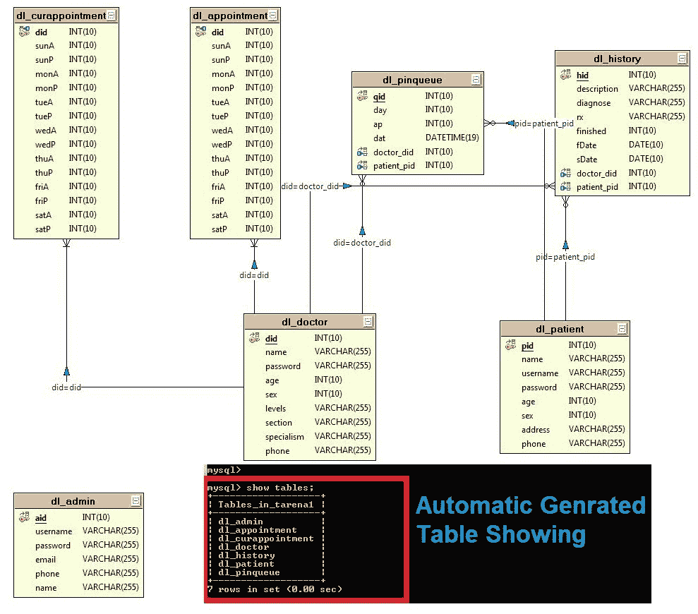 |

## 第一节：通过图你将获得一些概述

| 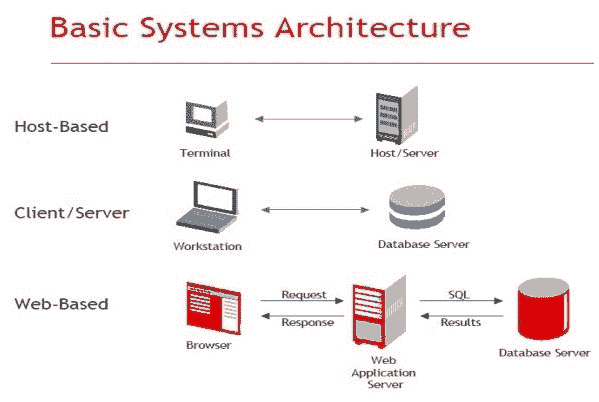 |

| 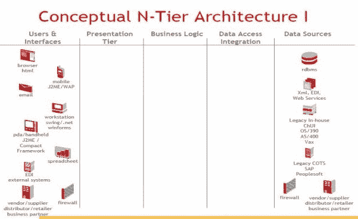 |

|  |

#### 源代码结构

`src\com\abd\action`

`AllAction.java`


```java
package com.abd.action;
import java.util.*;
import com.abd.biz.*;
import com.abd.entity.*;
import com.abd.util.*;
import org.springframework.context.ApplicationContext;
import org.springframework.web.struts.DispatchActionSupport;
import org.apache.struts.action.*;
import javax.servlet.http.HttpServletRequest;
import javax.servlet.http.HttpServletResponse;
import javax.servlet.http.HttpSession;

public class AllAction extends DispatchActionSupport {

    // 管理员添加医生
    public ActionForward addDoctor(ActionMapping mapping, ActionForm form, HttpServletRequest request, HttpServletResponse response) throws Exception {
        ApplicationContext ctx = this.getWebApplicationContext();
        // 获取代理对象
        AdminBiz admin = (AdminBiz)ctx.getBean("serviceAdmin");
        DynaActionForm daf = (DynaActionForm)form;
        Integer did = new Integer(Integer.parseInt(daf.getString("did")));
        String name = daf.getString("name");
        int age = Integer.parseInt((String)daf.get("age"));
        int sex = Integer.parseInt((String)daf.get("sex"));
        String levels = daf.getString("level");
        String spe = daf.getString("spe");
        String phone = daf.getString("phone");
        String section = daf.getString("section");
        String spt = daf.getString("spDay");
        int[] spDays = new int[14];
        spDays = Util.parseSpDays(spt);
        // 执行代理方法
        admin.addDoctor(did, name, age, sex, levels, spe, spDays, phone, section);
        request.setAttribute("addDoctor", "hao");
        return mapping.findForward("addDoc");
    }

    // 管理员获取所有医生
    public ActionForward getDoctor(ActionMapping mapping, ActionForm form, HttpServletRequest request, HttpServletResponse response) throws Exception {
        ApplicationContext ctx = this.getWebApplicationContext();
        AdminBiz admin = (AdminBiz)ctx.getBean("serviceAdmin");
        List<Doctor> set = admin.getAllDoctor();
        request.getSession(true).setAttribute("doctors", set);
        return mapping.findForward("allDoctor");
    }

    // 管理员登录
    public ActionForward aLogin(ActionMapping mapping, ActionForm form, HttpServletRequest request, HttpServletResponse response) throws Exception {
        ApplicationContext ctx = this.getWebApplicationContext();
        AdminBiz admin = (AdminBiz)ctx.getBean("serviceAdmin");
        DynaActionForm daf = (DynaActionForm)form;
        String username = daf.getString("username");
        admin.login(username, daf.getString("password"));
        request.getSession(true).setAttribute("admin", username);
        return mapping.findForward("aLogin");
    }

    // 管理员删除医生。如果该医生有转诊病历或已被预约，则医生不会被删除
    public ActionForward removeDoctor(ActionMapping mapping, ActionForm form, HttpServletRequest request, HttpServletResponse response) throws Exception {
        ApplicationContext ctx = this.getWebApplicationContext();
        AdminBiz admin = (AdminBiz)ctx.getBean("serviceAdmin");
        Integer did = new Integer(Integer.parseInt(request.getParameter("did")));
        admin.removeDoctor(did);
        return mapping.findForward("removeDoctor");
    }

    // 患者注册
    public ActionForward regsterPatient(ActionMapping mapping, ActionForm form, HttpServletRequest request, HttpServletResponse response) throws Exception {
        ApplicationContext ctx = this.getWebApplicationContext();
        PatientBiz patient = (PatientBiz)ctx.getBean("servicePatient");
        DynaActionForm daf = (DynaActionForm)form;
        String username = daf.getString("username");
        String password = daf.getString("password");
        String name = daf.getString("name");
        int age = Integer.parseInt((String)daf.get("age"));
        int sex = Integer.parseInt((String)daf.get("sex"));
        String address = daf.getString("address");
        String phone = daf.getString("phone");
        Patient p = patient.regiter(name, username, password, age, sex, address, phone);
        request.getSession(true).setAttribute("patient", p);
        return mapping.findForward("pRegister");
    }

    // 患者登录
    public ActionForward pLogin(ActionMapping mapping, ActionForm form, HttpServletRequest request, HttpServletResponse response) throws Exception {
        ApplicationContext ctx = this.getWebApplicationContext();
        PatientBiz patient = (PatientBiz)ctx.getBean("servicePatient");
        DynaActionForm daf = (DynaActionForm)form;
        String username = daf.getString("username");
        String password = daf.getString("password");
        Patient p = patient.login(username, password);
        request.getSession(true).setAttribute("patient", p);
        return mapping.findForward("pLogin");
    }

    // 查询所有医患信息
    public ActionForward allDoctorMessage(ActionMapping mapping, ActionForm form, HttpServletRequest request, HttpServletResponse response) throws Exception {
        ApplicationContext ctx = this.getWebApplicationContext();
        PatientBiz patient = (PatientBiz)ctx.getBean("servicePatient");
        List<Doctor> set = patient.queryAllDoctor();
        request.getSession(true).setAttribute("doctors1", set);
        return mapping.findForward("getDoc");
    }

    // 患者预约医生所需信息
    public ActionForward getMessage(ActionMapping mapping, ActionForm form, HttpServletRequest request, HttpServletResponse response) throws Exception {
        ApplicationContext ctx = this.getWebApplicationContext();
        PatientBiz patient = (PatientBiz)ctx.getBean("servicePatient");
        List<Doctor> set = patient.queryAllDoctor();
        Set l1 = new HashSet();
        Set l2 = new HashSet();
        Set l3 = new HashSet();
        for (Doctor d :set) {
            l1.add(d.getSection());
            l2.add(d.getLevels());
            l3.add(d.getSpe());
        }
        request.setAttribute("sections", l1);
        request.setAttribute("levels", l2);
        request.setAttribute("spes", l3);
        return mapping.findForward("pqd");
    }

    // 患者根据自己的标准查询医生
    public ActionForward patientQueryMessage(ActionMapping mapping, ActionForm form, HttpServletRequest request, HttpServletResponse response) throws Exception {
        ApplicationContext ctx = this.getWebApplicationContext();
        PatientBiz patient = (PatientBiz)ctx.getBean("servicePatient");
        DynaActionForm daf = (DynaActionForm)form;
        String section = daf.getString("section");
        String levels = daf.getString("level");
        String spe = daf.getString("spe");
        int day = Integer.parseInt(daf.getString("day"));
        int ap = Integer.parseInt(daf.getString("ap"));
        List<Doctor> l = patient.queryDoctor(section, levels, spe, day, ap);
        request.getSession(true).setAttribute("doctorss", l);
        return mapping.findForward("getDoc");
    }

    // 患者预约
    public ActionForward patientAppointment(ActionMapping mapping, ActionForm form, HttpServletRequest request, HttpServletResponse response) throws Exception {
        ApplicationContext ctx = this.getWebApplicationContext();
        PatientBiz patient = (PatientBiz)ctx.getBean("servicePatient");
        Integer did = new Integer(Integer.parseInt(request.getParameter("did")));
        int day = Integer.parseInt(request.getParameter("day"));
        int ap = Integer.parseInt(request.getParameter("ap"));
        Patient p = (Patient)request.getSession(true).getAttribute("patient");
        patient.appointment(p, did, day, ap);
        return mapping.findForward("make");
    }

    // 患者检查医生的预约
    public ActionForward patientAppointmentMessage(ActionMapping mapping, ActionForm form, HttpServletRequest request, HttpServletResponse response) throws Exception {
        ApplicationContext ctx = this.getWebApplicationContext();
        PatientBiz patient = (PatientBiz)ctx.getBean("servicePatient");
        DynaActionForm daf = (DynaActionForm)form;
        Integer did = new Integer(Integer.parseInt(daf.getString("did")));
        Cur cur = patient.queryByDid(did);
        request.getSession(true).setAttribute("curappointment", cur);
        return mapping.findForward("appoint");
    }

    // 患者看医生
    public ActionForward patientMyAppointment(ActionMapping mapping, ActionForm form, HttpServletRequest request, HttpServletResponse response) throws Exception {
        ApplicationContext ctx = this.getWebApplicationContext();
        PatientBiz patient = (PatientBiz)ctx.getBean("servicePatient");
        Integer pid = new Integer(Integer.parseInt(request.getParameter("pid")));
        List<Pinqueue> list = patient.getPinqueueByPid(pid);
        request.getSession(true).setAttribute("pinqueues", list);
        return mapping.findForward("getApp");
    }

    // 患者取消预约
    public ActionForward patientCancleAppointment(ActionMapping mapping, ActionForm form, HttpServletRequest request, HttpServletResponse response) throws Exception {
        ApplicationContext ctx = this.getWebApplicationContext();
        PatientBiz patient = (PatientBiz)ctx.getBean("servicePatient");
        Integer qid = new Integer(Integer.parseInt(request.getParameter("qid")));
        patient.cancleAppoint(qid);
        return mapping.findForward("cancle");
    }

    // 患者获取医生信息
    public ActionForward getDoctorMessage(ActionMapping mapping, ActionForm form, HttpServletRequest request, HttpServletResponse response) throws Exception {
        ApplicationContext ctx = this.getWebApplicationContext();
        PatientBiz patient = (PatientBiz)ctx.getBean("servicePatient");
        Integer pid = new Integer(Integer.parseInt(request.getParameter("pid")));
        List<Doctor> l = patient.queryDoctorByPid(pid);
        request.getSession(true).setAttribute("dMessages", l);
        return mapping.findForward("current");
    }

    // 患者病历
    public ActionForward queryHistory(ActionMapping mapping, ActionForm form, HttpServletRequest request, HttpServletResponse response) throws Exception {
        ApplicationContext ctx = this.getWebApplicationContext();
        PatientBiz patient = (PatientBiz)ctx.getBean("servicePatient");
        Integer pid = new Integer(Integer.parseInt(request.getParameter("pid")));
        List<History> l = patient.queryHistoryByPid(pid);
        request.getSession(true).setAttribute("historys", l);
        return mapping.findForward("his");
    }

    // 医生登录
    public ActionForward dLogin(ActionMapping mapping, ActionForm form, HttpServletRequest request, HttpServletResponse response) throws Exception {
        ApplicationContext ctx = this.getWebApplicationContext();
        DoctorBiz doctor = (DoctorBiz)ctx.getBean("serviceDoctor");
        DynaActionForm daf = (DynaActionForm)form;
        String name = daf.getString("name");
        String password = daf.getString("password");
        Doctor d = doctor.login(name, password);
        request.getSession(true).setAttribute("doctor", d);
        return mapping.findForward("dLogin");
    }

    // 医生修改密码
    public ActionForward doctorUpdatePassword(ActionMapping mapping, ActionForm form, HttpServletRequest request, HttpServletResponse response) throws Exception {
        ApplicationContext ctx = this.getWebApplicationContext();
        DoctorBiz doctor = (DoctorBiz)ctx.getBean("serviceDoctor");
        DynaActionForm daf = (DynaActionForm)form;
        String newPassword = daf.getString("password");
        String name = ((Doctor)request.getSession(true).getAttribute("doctor")).getName();
        doctor.updatePassword(name, newPassword);
        request.setAttribute("newPassword", newPassword);
        return mapping.findForward("upp");
    }

    // 医生获取预约信息
    public ActionForward getAppointmentMessage(ActionMapping mapping, ActionForm form, HttpServletRequest request, HttpServletResponse response) throws Exception {
        ApplicationContext ctx = this.getWebApplicationContext();
        DoctorBiz doctor = (DoctorBiz)ctx.getBean("serviceDoctor");
        Integer did = new Integer(request.getParameter("did"));
        List<DoctorQueryPinqueue> l = doctor.getAllPinqueue(did);
        request.getSession(true).setAttribute("pinqueues1", l);
        return mapping.findForward("getPatientIn");
    }

    // 转诊医医生
    public ActionForward createHistory(ActionMapping mapping, ActionForm form, HttpServletRequest request, HttpServletResponse response) throws Exception {
        ApplicationContext ctx = this.getWebApplicationContext();
        DoctorBiz doctor = (DoctorBiz)ctx.getBean("serviceDoctor");
        DynaActionForm daf = (DynaActionForm)form;
        Doctor d = (Doctor)request.getSession(true).getAttribute("doctor");
        Integer pid = new Integer(Integer.parseInt(request.getParameter("pid")));
        String description = daf.getString("description");
        String diagnose = daf.getString("diagnose");
        String rx = daf.getString("rx");
        int pd = 1;
        doctor.doctorCreatePinqueue(pid, d, description, diagnose, rx, pd);
        request.setAttribute("bing", pd);
        return mapping.findForward("create");
    }

    // 医生检查病历
    public ActionForward queryPatientHistory(ActionMapping mapping, ActionForm form, HttpServletRequest request, HttpServletResponse response) throws Exception {
        ApplicationContext ctx = this.getWebApplicationContext();
        DoctorBiz doctor = (DoctorBiz)ctx.getBean("serviceDoctor");
        Integer did = new Integer(Integer.parseInt(request.getParameter("did")));
        List<DoctorQueryHistory> dqh = doctor.getAllHistory(did);
        request.getSession(true).setAttribute("dqhs", dqh);
        return mapping.findForward("gph");
    }

    // 修改医生病历
    public ActionForward updatePatientHistory(ActionMapping mapping, ActionForm form, HttpServletRequest request, HttpServletResponse response) throws Exception {
        ApplicationContext ctx = this.getWebApplicationContext();
        DoctorBiz doctor = (DoctorBiz)ctx.getBean("serviceDoctor");
        Integer hid = new Integer(Integer.parseInt(request.getParameter("hid")));
        String description = request.getParameter("description");
        String diagnose = request.getParameter("diagnose");
        String rx = request.getParameter("rx");
        doctor.updateHistory(hid, description, diagnose, rx);
        request.setAttribute("upda", hid);
        return mapping.findForward("upok");
    }

    // 医生结束患者诊疗
    public ActionForward finishHistory(ActionMapping mapping, ActionForm form, HttpServletRequest request, HttpServletResponse response) throws Exception {
        ApplicationContext ctx = this.getWebApplicationContext();
        DoctorBiz doctor = (DoctorBiz)ctx.getBean("serviceDoctor");
        Integer hid = new Integer(Integer.parseInt(request.getParameter("hid")));
        doctor.finish(hid);
        return mapping.findForward("finishOk");
    }

    // 退出
    public ActionForward exit(ActionMapping mapping, ActionForm form, HttpServletRequest request, HttpServletResponse response) throws Exception {
        HttpSession session = request.getSession(true);
        if (session.getAttribute("admin") != null) {
            session.setAttribute("admin", null);
        }
        if (session.getAttribute("doctor") != null) {
            session.setAttribute("doctor", null);
        }
        if (session.getAttribute("patient") != null) {
            session.setAttribute("patient", null);
        }
        return mapping.findForward("default");
    }
}
```


| 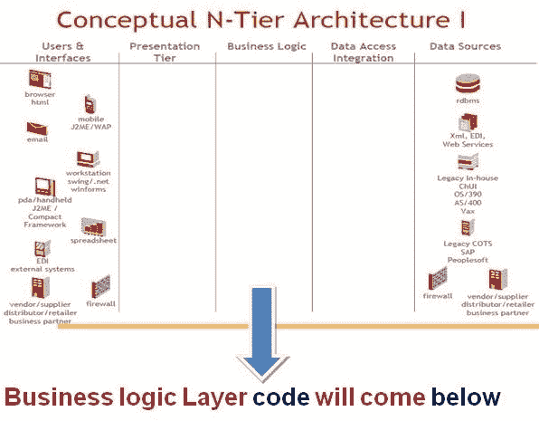 |

|  |

### `src\com\abd\biz`

#### `AdminBiz.java`

```java
package com.abd.biz;
import java.io.IOException;
import java.sql.SQLException;
import java.util.*;
import com.abd.expt.SystemException;
import com.abd.entity.*;
public interface AdminBiz {
    // 管理员登录
    public void login(String username ,String password)throws IOException ,SQLException,SystemException;
    // 管理添加医生
    public void addDoctor(Integer did,String name,int age,int sex,String levels,String spe,int[] pPerDay,String dPhone,String section)throws IOException ,SQLException,SystemException;
    // 管理删除医生
    public void removeDoctor(Integer did) throws IOException,SQLException,SystemException;
    // 系统管理员查看所有医生信息
    public List<Doctor> getAllDoctor() throws IOException ,SQLException,SystemException;
}
```

#### `DoctorBiz.java`

```java
package com.abd.biz;
import com.abd.entity.*;
import com.abd.expt.SystemException;
import java.io.IOException;
import java.sql.SQLException;
import java.util.List;
public interface DoctorBiz {
    // 医生登录返回一个医生对象
    public Doctor login(String name ,String password) throws IOException ,SQLException,SystemException;
    // 医生修改密码
    public void updatePassword(String name ,String newPassword) throws IOException ,SQLException,SystemException;
    // 根据 did 检查所有预约挂号，根据 pid 识别患者信息，返回专门针对此方法的对象列表
    public List<DoctorQueryPinqueue> getAllPinqueue(Integer did) throws IOException ,SQLException,SystemException;
    // 医生跨科创建挂号
    public void doctorCreatePinqueue(Integer pid,Doctor d,String description,String diagnose,String rx,int pd) throws IOException ,SQLException,SystemException;
    // 通过 did 检查其所有的病历和患者信息，返回一个专门的对象列表
    public List<DoctorQueryHistory> getAllHistory(Integer did) throws IOException ,SQLException,SystemException;
    // 更新记录
    public void updateHistory(Integer hid,String description,String diagnose,String rx) throws IOException ,SQLException,SystemException;
    // 治疗结束，需要写入结束时间，结束状态改为 0
    public void finish(Integer hid) throws IOException ,SQLException,SystemException;
}
```

#### `PatientBiz.java`

```java
package com.abd.biz;
import java.io.IOException;
import java.sql.SQLException;
import java.util.*;
import com.abd.entity.*;
import com.abd.expt.SystemException;
public interface PatientBiz {
    // 查找所有医生
    public List<Doctor> queryAllDoctor() throws IOException ,SQLException;
    // 这两个方法都需要返回对象以便方便后续操作
    public Patient regiter(String name,String username,String password,int age,int sex,String address,String phone) throws IOException ,SQLException,SystemException;
    // 患者登录
    public Patient login(String username , String password) throws IOException ,SQLException,SystemException;
    // 查询返回当前医生的可以预约的多个信息
    public Curappointment queryByDid(Integer did) throws IOException ,SQLException,SystemException;
    // 预约
    public void appointment(Patient p ,Integer did ,int day ,int ap) throws IOException ,SQLException,SystemException;
    // 发现他们拥有的预约
    public List<Pinqueue> getPinqueueByPid(Integer pid) throws IOException ,SQLException,SystemException;
    // 取消预约的次数
    public void cancleAppointemnt(Integer qid) throws IOException ,SQLException,SystemException;
    // 根据患者信息 pid 公开查询医生
    public List<Doctor> queryDoctorByPid(Integer pid) throws IOException ,SQLException,SystemException;
    // 患者病历
    public List<History> queryHistoryByPid(Integer pid) throws IOException ,SQLException,SystemException;
    // 医生根据需求查询患者
    public List<Doctor> queryDoctor(String section,String levels,String spe,int day,int ap) throws IOException, SQLException, SystemException;
}
```

### `src\com\abd\biz\impl`

#### `AdminBizImpl.java`

```java
package com.abd.biz.impl;
import java.io.IOException;
import java.sql.SQLException;
import java.util.*;
import com.abd.biz.AdminBiz;
import com.abd.dao.*;
import com.abd.entity.*;
import com.abd.expt.AppointmentException;
import com.abd.expt.IdException;
import com.abd.expt.PasswordException;
import com.abd.expt.SystemException;
import com.abd.expt.UsernameException;
public class AdminBizImpl implements AdminBiz {
    private AdminDao daoA=null;
    private DoctorDao daoB=null;
    private AppointmentDao daoC=null;
    private CurappointmentDao daoD=null;
    public AppointmentDao getDaoC() {return daoC;} }
    public void setDaoC(AppointmentDao daoC) {this.daoC = daoC;} }
    public CurappointmentDao getDaoD() {return daoD;} }
    public void setDaoD(CurappointmentDao daoD) {this.daoD = daoD;} }
    public AdminDao getDaoA() {return daoA;} }
    public void setDaoA(AdminDao daoA) {this.daoA = daoA;} }
    public DoctorDao getDaoB() {return daoB;} }
    public void setDaoB(DoctorDao daoB) {this.daoB = daoB;} }
    public void addDoctor(Integer did, String name, int age, int sex, String levels, String spe, int[] perDay, String phone,String section) throws IOException ,SQLException,SystemException{
        Doctor doctor=daoB.queryBydid(did);
        if(doctor!=null){
            throw new IdException("did cuzai");
        }else{
            doctor = new Doctor();
            doctor.setDid(did);
            doctor.setName(name);
            doctor.setAge(age);
            doctor.setSex(sex);
            doctor.setLevels(levels);
            doctor.setSpe(spe);
            doctor.setPhone(phone);
            doctor.setPassword("123456");
            doctor.setSection(section);
            Appointment app=new Appointment(perDay[0],perDay[1],perDay[2],perDay[3],perDay[4],perDay[5],perDay[6],perDay[7],perDay[8],perDay[9],perDay[10],perDay[11],perDay[12],perDay[13]);
            app.setDoctor(doctor);
            Curappointment cuu=new Curappointment(perDay[0],perDay[1],perDay[2],perDay[3],perDay[4],perDay[5],perDay[6],perDay[7],perDay[8],perDay[9],perDay[10],perDay[11],perDay[12],perDay[13]);
            cuu.setDoctor(doctor);
            doctor.setCuu(cuu);
            doctor.setApp(app);
            daoB.addDoctor(doctor);
        }
    }
    public List<Doctor> getAllDoctor() throws IOException ,SQLException,SystemException{
        return daoB.getAllDoctor();
    }
    public void login(String username, String password) throws IOException ,SQLException,SystemException{
        Admin admin=daoA.login(username);
        if( admin == null ){
            throw new UsernameException("no such account");
        }
        if( ! admin.getPassword().equals( password)){
            throw new PasswordException("invalid password");
        }
    }
    public void removeDoctor(Integer did) throws IOException ,SQLException,SystemException{
        Appointment app=daoC.queryApp(did);
        app.setDoctor(null);
        daoC.removeApp(app);
        Curappointment cuu=daoD.queryByDid(did);
        cuu.setDoctor(null);
        daoD.removeCur(cuu);
        Doctor doctor=daoB.queryBydid(did);
        doctor.setApp(null);
        doctor.setCuu(null);
        daoB.delete(doctor);
    }
}
```

#### `DoctorBizImpl.java`


```java
package com.abd.biz.impl;

import java.io.IOException;
import java.sql.SQLException;
import java.util.ArrayList;
import java.util.Date;
import java.util.List;
import java.util.Set;
import com.abd.biz.DoctorBiz;
import com.abd.dao.CurappointmentDao;
import com.abd.dao.DoctorDao;
import com.abd.dao.HistoryDao;
import com.abd.dao.PatientDao;
import com.abd.dao.PinqueueDao;
import com.abd.entity.Curappointment;
import com.abd.entity.Doctor;
import com.abd.entity.DoctorQueryHistory;
import com.abd.entity.DoctorQueryPinqueue;
import com.abd.entity.History;
import com.abd.entity.Patient;
import com.abd.entity.Pinqueue;
import com.abd.expt.PasswordException;
import com.abd.expt.SystemException;
import com.abd.expt.UsernameException;

public class DoctorBizImpl implements DoctorBiz {
    private DoctorDao daoD;
    private PinqueueDao daoQ;
    private PatientDao daoP;
    private HistoryDao daoH;
    private CurappointmentDao daoC;

    public CurappointmentDao getDaoC() {
        return daoC;
    }

    public void setDaoC(CurappointmentDao daoC) {
        this.daoC = daoC;
    }

    public DoctorDao getDaoD() {
        return daoD;
    }

    public void setDaoD(DoctorDao daoD) {
        this.daoD = daoD;
    }

    public PinqueueDao getDaoQ() {
        return daoQ;
    }

    public void setDaoQ(PinqueueDao daoQ) {
        this.daoQ = daoQ;
    }

    public PatientDao getDaoP() {
        return daoP;
    }

    public void setDaoP(PatientDao daoP) {
        this.daoP = daoP;
    }

    public HistoryDao getDaoH() {
        return daoH;
    }

    public void setDaoH(HistoryDao daoH) {
        this.daoH = daoH;
    }

    public void doctorCreatePinqueue(Integer pid, Doctor d, String description, String diagnose, String rx, int pd) throws IOException, SQLException, SystemException {
        // 仅通过 PIN 获取医生和患者
        Patient p = daoP.queryByPid(pid);
        Pinqueue pin = daoQ.queryByDoctorAndPatient(d, p);
        int day = pin.getDay();
        int ap = pin.getAp();
        // 已通过 CUU 获取，CUU 更新 Curappointment
        Curappointment cuu = d.getCuu();
        switch (day) {
            case 0:
                if (ap == 0) {
                    cuu.setSunA(cuu.getSunA() + 1);
                } else {
                    cuu.setSunP(cuu.getSunP() + 1);
                }
                break;
            case 1:
                if (ap == 0) {
                    cuu.setMonA(cuu.getMonA() + 1);
                } else {
                    cuu.setMonP(cuu.getMonP() + 1);
                }
                break;
            case 2:
                if (ap == 0) {
                    cuu.setTueA(cuu.getTueA() + 1);
                } else {
                    cuu.setTueP(cuu.getTueP() + 1);
                }
                break;
            case 3:
                if (ap == 0) {
                    cuu.setWedA(cuu.getWedA() + 1);
                } else {
                    cuu.setWedP(cuu.getWedP() + 1);
                }
                break;
            case 4:
                if (ap == 0) {
                    cuu.setThuA(cuu.getThuA() + 1);
                } else {
                    cuu.setThuP(cuu.getThuP() + 1);
                }
                break;
            case 5:
                if (ap == 0) {
                    cuu.setFriA(cuu.getFriA() + 1);
                } else {
                    cuu.setFriP(cuu.getFriP() + 1);
                }
                break;
            case 6:
                if (ap == 0) {
                    cuu.setSatA(cuu.getSatA() + 1);
                } else {
                    cuu.setSatP(cuu.getSatP() + 1);
                }
                break;
        }
        // 设置历史记录属性
        History his = new History();
        his.setDescription(description);
        his.setDiagnose(diagnose);
        his.setRx(rx);
        his.setFinished(pd);
        his.setFdate(new Date());
        his.setDoctor(d);
        // 更新患者属性
        p.getHistory().add(his);
        his.setPatient(p);
        // 删除预约信息
        pin.setDoctor(null);
        pin.setPatient(null);
        daoQ.deletePinqueue(pin);
        daoH.add(his);
    }

    public void finish(Integer hid) throws IOException, SQLException, SystemException {
        History his = daoH.query(hid);
        Date d = new Date();
        his.setFinished(0);
        his.setSdate(d);
        daoH.update(his);
    }

    public List<DoctorQueryHistory> getAllHistory(Integer did) throws IOException, SQLException, SystemException {
        List<DoctorQueryHistory> l = new ArrayList<DoctorQueryHistory>();
        Doctor d = daoD.queryBydid(did);
        List<History> his = daoH.queryByDoctor(d);
        for (History h : his) {
            Patient pat = daoP.queryByPid(h.getPatient().getPid());
            DoctorQueryHistory hqh = new DoctorQueryHistory(h.getHid(), pat.getName(), pat.getAge(), pat.getSex(), pat.getAddress(), pat.getPhone(), h.getDiagnose(), h.getDescription(), h.getRx(), h.getFdate(), h.getSdate());
            l.add(hqh);
        }
        return l;
    }

    public List<DoctorQueryPinqueue> getAllPinqueue(Integer did) throws IOException, SQLException, SystemException {
        List<DoctorQueryPinqueue> l = new ArrayList<DoctorQueryPinqueue>();
        Doctor d = daoD.queryBydid(did);
        List<Pinqueue> pin = daoQ.queryByDoctor(d);
        for (Pinqueue q : pin) {
            Patient pat = daoP.queryByPid(q.getPatient().getPid());
            DoctorQueryPinqueue dqp = new DoctorQueryPinqueue(q.getPatient().getPid(), pat.getName(), pat.getAge(), pat.getSex(), pat.getAddress(), pat.getPhone(), q.getQid());
            l.add(dqp);
        }
        return l;
    }

    public Doctor login(String name, String password) throws IOException, SQLException, SystemException {
        Doctor d = daoD.queryName(name);
        if (d == null) {
            throw new UsernameException("无此类账号");
        }
        if (!d.getPassword().equals(password)) {
            throw new PasswordException("密码错误");
        }
        return d;
    }

    public void updateHistory(Integer hid, String description, String diagnose, String rx) throws IOException, SQLException, SystemException {
        History his = daoH.query(hid);
        his.setDescription(description);
        his.setDiagnose(diagnose);
        his.setRx(rx);
        daoH.update(his);
    }

    public void updatePassword(String name, String newPassword) throws IOException, SQLException, SystemException {
        Doctor d = daoD.queryName(name);
        d.setPassword(newPassword);
        daoD.update(d);
    }
}
```

`PatientBizImpl.java`


```java
package com.abd.biz.impl;

import java.io.IOException;
import java.sql.SQLException;
import java.util.ArrayList;
import java.util.Date;
import java.util.List;
import java.util.Set;

import com.abd.biz.PatientBiz;
import com.abd.dao.CurappointmentDao;
import com.abd.dao.DoctorDao;
import com.abd.dao.HistoryDao;
import com.abd.dao.PatientDao;
import com.abd.dao.PinqueueDao;
import com.abd.entity.Curappointment;
import com.abd.entity.Doctor;
import com.abd.entity.History;
import com.abd.entity.Patient;
import com.abd.entity.Pinqueue;
import com.abd.expt.AlreadyAppointmentException;
import com.abd.expt.DayAlreadyAppointmentException;
import com.abd.expt.IdException;
import com.abd.expt.PasswordException;
import com.abd.expt.SystemException;
import com.abd.expt.UsernameException;
import com.abd.expt.WrongException;

public class PatientBizImpl implements PatientBiz {
    private DoctorDao daoD;
    private CurappointmentDao daoC;
    private PatientDao daoP;
    private HistoryDao daoH;
    private PinqueueDao daoQ;

    public DoctorDao getDaoD() {
        return daoD;
    }

    public void setDaoD(DoctorDao daoD) {
        this.daoD = daoD;
    }

    public CurappointmentDao getDaoC() {
        return daoC;
    }

    public void setDaoC(CurappointmentDao daoC) {
        this.daoC = daoC;
    }

    public PatientDao getDaoP() {
        return daoP;
    }

    public void setDaoP(PatientDao daoP) {
        this.daoP = daoP;
    }

    public HistoryDao getDaoH() {
        return daoH;
    }

    public void setDaoH(HistoryDao daoH) {
        this.daoH = daoH;
    }

    public PinqueueDao getDaoQ() {
        return daoQ;
    }

    public void setDaoQ(PinqueueDao daoQ) {
        this.daoQ = daoQ;
    }

    public void appointment(Patient p, Integer did, int day, int ap) throws IOException, SQLException, SystemException {
        // 确定是否预约医生
        List<Pinqueue> list = daoQ.queryByPatient(p);
        for (Pinqueue pin : list) {
            if ((pin.getDoctor().getDid()).intValue() == did.intValue()) {
                throw new AlreadyAppointmentException();
            }
            if (pin.getDay() == day && pin.getAp() == ap) {
                throw new DayAlreadyAppointmentException();
            }
        }
        // 设置预约属性
        Doctor d = daoD.queryBydid(did);
        Pinqueue q = new Pinqueue();
        // 更新 Curappointment
        Curappointment cuu = d.getCuu();
        switch (day) {
            case 0:
                if (ap == 0) {
                    cuu.setSunA(cuu.getSunA() - 1);
                    // 今天，医生可以决定是否预约
                    if (cuu.getSunA() < 0) {
                        throw new WrongException();
                    }
                } else {
                    cuu.setSunP(cuu.getSunP() - 1);
                    if (cuu.getSunP() < 0) {
                        throw new WrongException();
                    }
                }
                break;
            case 1:
                if (ap == 0) {
                    cuu.setMonA(cuu.getMonA() - 1);
                    if (cuu.getMonA() < 0) {
                        throw new WrongException();
                    }
                } else {
                    cuu.setMonP(cuu.getMonP() - 1);
                    if (cuu.getMonP() < 0) {
                        throw new WrongException();
                    }
                }
                break;
            case 2:
                if (ap == 0) {
                    cuu.setTueA(cuu.getTueA() - 1);
                    if (cuu.getTueA() < 0) {
                        throw new WrongException();
                    }
                } else {
                    cuu.setTueP(cuu.getTueP() - 1);
                    if (cuu.getTueP() < 0) {
                        throw new WrongException();
                    }
                }
                break;
            case 3:
                if (ap == 0) {
                    cuu.setWedA(cuu.getWedA() - 1);
                    if (cuu.getWedA() < 0) {
                        throw new WrongException();
                    }
                } else {
                    cuu.setWedP(cuu.getWedP() - 1);
                    if (cuu.getWedP() < 0) {
                        throw new WrongException();
                    }
                }
                break;
            case 4:
                if (ap == 0) {
                    cuu.setThuA(cuu.getThuA() - 1);
                    if (cuu.getThuA() < 0) {
                        throw new WrongException();
                    }
                } else {
                    cuu.setThuP(cuu.getThuP() - 1);
                    if (cuu.getThuP() < 0) {
                        throw new WrongException();
                    }
                }
                break;
            case 5:
                if (ap == 0) {
                    cuu.setFriA(cuu.getFriA() - 1);
                    if (cuu.getFriA() < 0) {
                        throw new WrongException();
                    }
                } else {
                    cuu.setFriP(cuu.getFriP() - 1);
                    if (cuu.getFriP() < 0) {
                        throw new WrongException();
                    }
                }
                break;
            case 6:
                if (ap == 0) {
                    cuu.setSatA(cuu.getSatA() - 1);
                    if (cuu.getSatA() < 0) {
                        throw new WrongException();
                    }
                } else {
                    cuu.setSatP(cuu.getSatP() - 1);
                    if (cuu.getSatP() < 0) {
                        throw new WrongException();
                    }
                }
                break;
        }
        q.setDay(day);
        q.setDoctor(d);
        q.setPatient(p);
        q.setAp(ap);
        q.setT_date(new Date());
        d.getPin().add(q);
        daoQ.addPinqueue(q);
    }

    public void cancleAppointnt(Integer qid) throws IOException, SQLException, SystemException {
        // 更新 CUU
        // 通过 Pin 获取 doctor.did
        Pinqueue pin = daoQ.queryByid(qid);
        int day = pin.getDay();
        int ap = pin.getAp();
        // 通过 CU 获取，更新 CUU
        Curappointment cuu = pin.getDoctor().getCuu();
        switch (day) {
            case 0:
                if (ap == 0) {
                    cuu.setSunA(cuu.getSunA() + 1);
                } else {
                    cuu.setSunP(cuu.getSunP() + 1);
                }
                break;
            case 1:
                if (ap == 0) {
                    cuu.setMonA(cuu.getMonA() + 1);
                } else {
                    cuu.setMonP(cuu.getMonP() + 1);
                }
                break;
            case 2:
                if (ap == 0) {
                    cuu.setTueA(cuu.getTueA() + 1);
                } else {
                    cuu.setTueP(cuu.getTueP() + 1);
                }
                break;
            case 3:
                if (ap == 0) {
                    cuu.setWedA(cuu.getWedA() + 1);
                } else {
                    cuu.setWedP(cuu.getWedP() + 1);
                }
                break;
            case 4:
                if (ap == 0) {
                    cuu.setThuA(cuu.getThuA() + 1);
                } else {
                    cuu.setThuP(cuu.getThuP() + 1);
                }
                break;
            case 5:
                if (ap == 0) {
                    cuu.setFriA(cuu.getFriA() + 1);
                } else {
                    cuu.setFriP(cuu.getFriP() + 1);
                }
                break;
            case 6:
                if (ap == 0) {
                    cuu.setSatA(cuu.getSatA() + 1);
                } else {
                    cuu.setSatP(cuu.getSatP() + 1);
                }
                break;
        }
        pin.setDoctor(null);
        pin.setPatient(null);
        // 删除 PINQUEUE
        daoQ.deletePinqueue(pin);
    }

    public List<Pinqueue> getPinqueueByPid(Integer pid) throws IOException, SystemException {
        Patient p = daoP.queryByPid(pid);
        return daoQ.queryByPatient(p);
    }

    public Patient login(String username, String password) throws IOException, SystemException {
        Patient p = daoP.queryByUsername(username);
        if (p == null) {
            throw new IdException("不存在此账号");
        }
        if (!(p.getPassword().equals(password))) {
            throw new PasswordException("密码错误");
        }
        return p;
    }

    public List<Doctor> queryAllDoctor() throws IOException {
        return daoD.getAllDoctor();
    }

    public Curappointment queryByDid(Integer did) throws IOException, SystemException {
        return daoC.queryByDid(did);
    }

    public List<Doctor> queryDoctorByPid(Integer pid) throws IOException, SystemException {
        Patient p = daoP.queryByPid(pid);
        List<History> list = daoH.queryByPatient(p);
        List<Doctor> l = new ArrayList<>();
        for (History h : list) {
            Doctor doc = daoD.queryByid(h.getDoctor());
            l.add(doc);
        }
        return l;
    }

    public List<History> queryHistoryByPid(Integer pid) throws IOException, SystemException {
        Patient p = daoP.queryByPid(pid);
        return daoH.queryByPatient(p);
    }

    public Patient regiter(String name, String username, String password, int age, int sex, String address, String phone) throws IOException, SystemException {
        Patient p = daoP.queryByUsername(username);
        if (p != null) {
            throw new UsernameException("用户名异常");
        }
        p = new Patient();
        p.setAddress(address);
        p.setAge(age);
        p.setName(name);
        p.setPassword(password);
        p.setSex(sex);
        p.setUsername(username);
        daoP.register(p);
        return p;
    }

    public List<Doctor> queryDoctor(String section, String levels, String spe, int day, int ap) throws IOException, SQLException, SystemException {
        List<Doctor> l = daoD.getAllDoctor();
        List<Doctor> list = new ArrayList<>();
        for (Doctor doctor : l) {
            if (!section.equals("se")) {
                if (!doctor.getSection().equals(section)) {
                    continue;
                }
            }
            if (!levels.equals("le")) {
                if (!doctor.getLevels().equals(levels)) {
                    continue;
                }
            }
            if (!spe.equals("nn")) {
                if (!doctor.getSpe().equals(spe)) {
                    continue;
                }
            }
            list.add(doctor);
            Curappointment cuu = doctor.getCuu();
            if (day != 9) {
                switch (day) {
                    case 0:
                        if (ap == 0) {
                            if (cuu.getSunA() == 0) {
                                list.remove(doctor);
                            }
                        } else if (ap == 1) {
                            if (cuu.getSunP() == 0) {
                                list.remove(doctor);
                            }
                        } else if (ap == 3) {
                            if (cuu.getSunA() == 0 && cuu.getSunP() == 0) {
                                list.remove(doctor);
                            }
                        }
                        break;
                    case 1:
                        if (ap == 0) {
                            if (cuu.getMonA() == 0) {
                                list.remove(doctor);
                            }
                        } else if (ap == 1) {
                            if (cuu.getMonP() == 0) {
                                list.remove(doctor);
                            }
                        } else if (ap == 3) {
                            if (cuu.getMonA() == 0 && cuu.getMonP() == 0) {
                                list.remove(doctor);
                            }
                        }
                        break;
                    case 2:
                        if (ap == 0) {
                            if (cuu.getTueA() == 0) {
                                list.remove(doctor);
                            }
                        } else if (ap == 1) {
                            if (cuu.getTueP() == 0) {
                                list.remove(doctor);
                            }
                        } else if (ap == 3) {
                            if (cuu.getTueA() == 0 && cuu.getTueP() == 0) {
                                list.remove(doctor);
                            }
                        }
                        break;
                    case 3:
                        if (ap == 0) {
                            if (cuu.getWedA() == 0) {
                                list.remove(doctor);
                            }
                        } else if (ap == 1) {
                            if (cuu.getWedP() == 0) {
                                list.remove(doctor);
                            }
                        } else if (ap == 3) {
                            if (cuu.getWedA() == 0 && cuu.getWedP() == 0) {
                                list.remove(doctor);
                            }
                        }
                        break;
                    case 4:
                        if (ap == 0) {
                            if (cuu.getThuA() == 0) {
                                list.remove(doctor);
                            }
                        } else if (ap == 1) {
                            if (cuu.getThuP() == 0) {
                                list.remove(doctor);
                            }
                        } else if (ap == 3) {
                            if (cuu.getThuA() == 0 && cuu.getThuP() == 0) {
                                list.remove(doctor);
                            }
                        }
                        break;
                    case 5:
                        if (ap == 0) {
                            if (cuu.getFriA() == 0) {
                                list.remove(doctor);
                            }
                        } else if (ap == 1) {
                            if (cuu.getFriP() == 0) {
                                list.remove(doctor);
                            }
                        } else if (ap == 3) {
                            if (cuu.getFriA() == 0 && cuu.getFriP() == 0) {
                                list.remove(doctor);
                            }
                        }
                        break;
                    case 6:
                        if (ap == 0) {
                            if (cuu.getSatA() == 0) {
                                list.remove(doctor);
                            }
                        } else if (ap == 1) {
                            if (cuu.getSatP() == 0) {
                                list.remove(doctor);
                            }
                        } else if (ap == 3) {
                            if (cuu.getSatA() == 0 && cuu.getSatP() == 0) {
                                list.remove(doctor);
                            }
                        }
                        break;
                }
            } else if (ap != 3) {
                if (ap == 0) {
                    if ((cuu.getSunA() == 0) && (cuu.getMonA() == 0) && cuu.getTueA() == 0 && cuu.getWedA() == 0 &&
                        && cuu.getThuA() == 0 && cuu.getFriA() == 0 && cuu.getSatA() == 0) {
                        list.remove(doctor);
                    }
                } else {
                    if ((cuu.getSunP() == 0) && (cuu.getMonP() == 0) && cuu.getTueP() == 0 && cuu.getWedP() == 0 &&
                        && cuu.getThuP() == 0 && cuu.getFriP() == 0 && cuu.getSatP() == 0) {
                        list.remove(doctor);
                    }
                }
            }
        }
        return list;
    }
}
```


# 第一部分图表你将获得一些概述

| 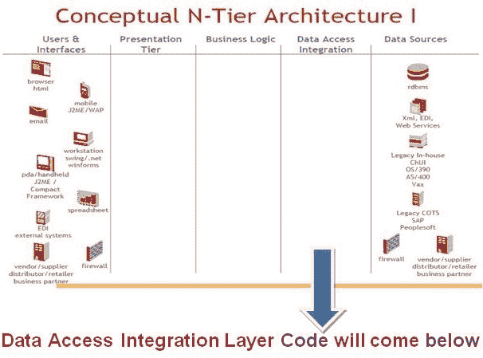 |

|  |

| 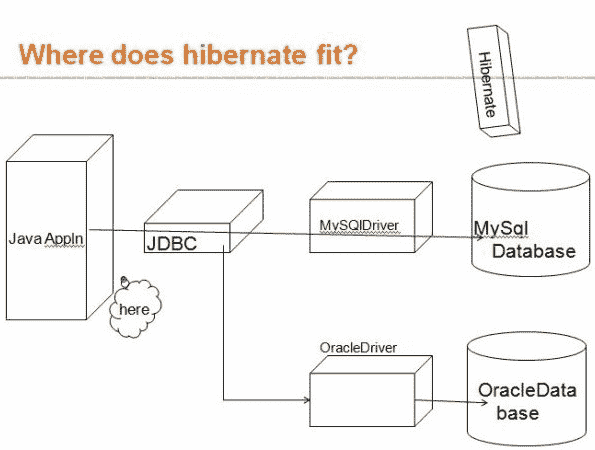 |

| 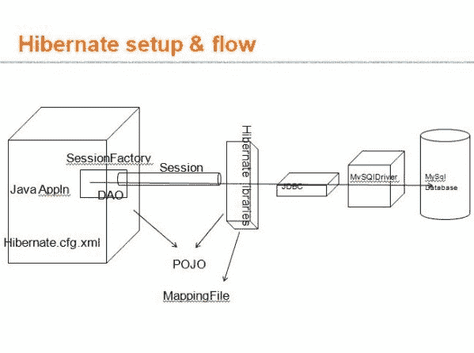 |

| 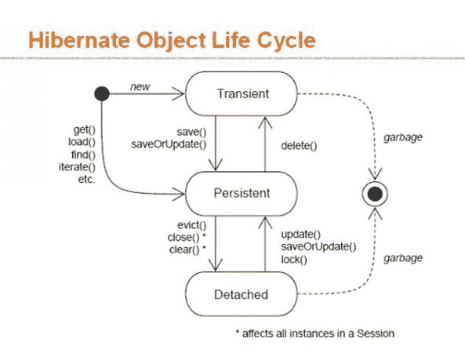 |

## `src\com\abd\dao`

### `AdminDao.java`

```java
package com.abd.dao;
import com.abd.entity.Admin;
public interface AdminDao {
    public Admin login(String username);
}
```

### `AppointmentDao.java`

```java
package com.abd.dao;
import com.abd.entity.*;
public interface AppointmentDao {
    public void removeApp(Appointment app);
    public Appointment queryApp(Integer did);
}
```

### `CurappointmentDao.java`

```java
package com.abd.dao;
import java.util.List;
import com.abd.entity.Curappointment;
public interface CurappointmentDao {
    public void removeCur(Curappointment c);
    public Curappointment queryByDid(Integer did);
    public List<Curappointment> queryByDay(int dayap);
}
```

### `DoctorDao.java`

```java
package com.abd.dao;
import java.util.List;
import com.abd.entity.*;
public interface DoctorDao {
    public Doctor queryBydid(Integer did);
    public Doctor queryName(String name);
    public void update(Doctor doctor);
    public List<Doctor> getAllDoctor();
    public void delete(Doctor doctor);
    public void addDoctor(Doctor doctor);
}
```

### `HistoryDao.java`

```java
package com.abd.dao;
import java.util.List;
import com.abd.entity.*;
public interface HistoryDao {
    public List<History> queryByPatient(Patient p);
    public void add(History history);
    public History query(Integer hid);
    public List<History> queryByDoctor(Doctor d);
    public void update(History history);
}
```

### `PatientDao.java`

```java
package com.abd.dao;
import com.abd.entity.Patient;
public interface PatientDao {
    public Patient queryByPid(Integer pid);
    public void register(Patient patient);
    public Patient queryByUsername(String username);
}
```

### `PinqueueDao.java`

```java
package com.abd.dao;
import java.util.List;
import com.abd.entity.*;
public interface PinqueueDao {
    public Pinqueue queryByDoctorAndPatient(Doctor doctor,Patient patient);
    public List<Pinqueue> queryByDoctor(Doctor d);
    public List<Pinqueue> queryByPatient(Patient p);
    public Pinqueue queryByQid(Integer qid);
    public void addPinqueue(Pinqueue q);
    public void deletePinqueue(Pinqueue q);
}
```

## `src\com\abd\dao\impl`

### `AdminDaoImpl.java`

```java
package com.abd.dao.impl;
import java.util.List;
import org.springframework.orm.hibernate3.support.HibernateDaoSupport;
import com.abd.dao.AdminDao;
import com.abd.entity.Admin;
public class AdminDaoImpl extends HibernateDaoSupport implements AdminDao {
    public Admin login(String username) {
        Object args[] = {username};
        List<Admin> l=getHibernateTemplate().find("from Admin a where a.username=?",args);
        if(l.size() == 0){
            return null;
        } else {
            return l.get(0);
        }
    }
}
```

### `AppointmentDaoImpl.java`

```java
package com.abd.dao.impl;
import org.springframework.orm.hibernate3.support.HibernateDaoSupport;
import com.abd.dao.AppointmentDao;
import com.abd.entity.*;
public class AppointmentDaoImpl extends HibernateDaoSupport implements AppointmentDao {
    public Appointment queryApp(Integer did) {
        return (Appointment)getHibernateTemplate().get(Appointment.class, did);
    }
    public void removeApp(Appointment app) {
        getHibernateTemplate().delete(app);
    }
}
```

### `CurappointmentDaoImpl.java`

```java
package com.abd.dao.impl;
import java.util.List;
import org.springframework.orm.hibernate3.support.HibernateDaoSupport;
import com.abd.dao.CurappointmentDao;
import com.abd.entity.Curappointment;
public class CurappointmentDaoImpl extends HibernateDaoSupport implements CurappointmentDao {
    public Curappointment queryByDid(Integer did) {
        return (Curappointment)getHibernateTemplate().get(Curappointment.class, did);
    }
    public void removeCur(Curappointment c) {
        getHibernateTemplate().delete(c);
    }
    public List<Curappointment> queryByDay(int dayap) {
        return null;
    }
}
```

### `DoctorDaoImpl.java`

```java
package com.abd.dao.impl;
import java.util.List;
import org.springframework.orm.hibernate3.support.HibernateDaoSupport;
import com.abd.dao.DoctorDao;
import com.abd.entity.Doctor;
public class DoctorDaoImpl extends HibernateDaoSupport implements DoctorDao {
    public void addDoctor(Doctor doctor) {
        getHibernateTemplate().save(doctor);
    }
    public void delete(Doctor doctor) {
        getHibernateTemplate().delete(doctor);
    }
    public List<Doctor> getAllDoctor() {
        return getHibernateTemplate().find("from Doctor");
    }
    public Doctor queryBydid(Integer did) {
        return (Doctor)getHibernateTemplate().get(Doctor.class, did);
    }
    public Doctor queryName(String name) {
        Object args[] = {name};
        List<Doctor> l=getHibernateTemplate().find("from Doctor d where d.name=?",args);
        if(l.size() == 0){
            return null;
        } else {
            return l.get(0);
        }
    }
    public void update(Doctor doctor) {
        getHibernateTemplate().update(doctor);
    }
}
```

### `HistoryDaoImpl.java`

```java
package com.abd.dao.impl;
import java.util.List;
import org.springframework.orm.hibernate3.support.HibernateDaoSupport;
import com.abd.dao.HistoryDao;
import com.abd.entity.*;
public class HistoryDaoImpl extends HibernateDaoSupport implements HistoryDao {
    public List<History> queryByPatient(Patient p) {
        Object args[] = {p};
        return getHibernateTemplate().find("from History h where h.patient.pid=?",args);
    }
    public void add(History history) {
        getHibernateTemplate().save(history);
    }
    public History query(Integer hid) {
        return (History)getHibernateTemplate().get(History.class, hid);
    }
    public List<History> queryByDoctor(Doctor d) {
        Object args[] = {d};
        return getHibernateTemplate().find("from History h where h.doctor.did=?",args);
    }
    public void update(History history) {
        getHibernateTemplate().update(history);
    }
}
```

### `PatientDaoImpl.java`

```java
package com.abd.dao.impl;
import java.util.List;
import org.springframework.orm.hibernate3.support.HibernateDaoSupport;
import com.abd.dao.PatientDao;
import com.abd.entity.Patient;
public class PatientDaoImpl extends HibernateDaoSupport implements PatientDao {
    public Patient queryByPid(Integer pid) {
        return (Patient)getHibernateTemplate().get(Patient.class, pid);
    }
    public void register(Patient patient) {
        getHibernateTemplate().save(patient);
    }
    public Patient queryByUsername(String username) {
        Object args[] = {username};
        List<Patient> l=getHibernateTemplate().find("from Patient p where p.username=?",args);
        if(l.size() == 0){
            return null;
        } else {
            return l.get(0);
        }
    }
}
```

### `PinqueueDaoImpl.java`


```java
package com.abd.dao.impl;
import java.util.List;
import org.springframework.orm.hibernate3.support.HibernateDaoSupport;
import com.abd.dao.PinqueueDao;
import com.abd.entity.Doctor;
import com.abd.entity.Patient;
import com.abd.entity.Pinqueue;
import com.abd.expt.SystemException;
public class PinqueueDaoImpl extends HibernateDaoSupport implements PinqueueDao {
    public void addPinqueue(Pinqueue q) {
        getHibernateTemplate().save(q);
    }
    public void deletePinqueue(Pinqueue q) {
        getHibernateTemplate().delete(q);
    }
    public List<Pinqueue> queryByDoctor(Doctor d) {
        Object args[] = {d};
        return getHibernateTemplate().find("from Pinqueue q where q.doctor.did=?",args);
    }
    public List<Pinqueue> queryByPatient(Patient p) {
        Object args[] = {p};
        return getHibernateTemplate().find("from Pinqueue q where q.patient.pid=?",args);
    }
    public Pinqueue queryByQid(Integer qid) {
        return (Pinqueue)getHibernateTemplate().get(Pinqueue.class, qid);
    }
    public Pinqueue queryByDoctorAndPatient(Doctor doctor,Patient patient) {
        Object args[] = {doctor};
        List<Pinqueue> list=getHibernateTemplate().find("from Pinqueue q where q.doctor.did=?",args);
        for(Pinqueue p:list){
            if((p.getPatient().getPid()).intValue()==(patient.getPid()).intValue()){
                return p;
            }
        }
        return null;
    }
}
```

|  |

## `src\com\abd\entity`

`Admin.java`

### `Admin.java`

```java
package com.abd.entity;
import java.io.*;
public class Admin implements Serializable {
    private Integer aid;
    private String username;
    private String password;
    private String email;
    private String phone;
    private String name;

    public Integer getAid() {
        return aid;
    }

    public void setAid(Integer aid) {
        this.aid = aid;
    }

    public String getUsername() {
        return username;
    }

    public void setUsername(String username) {
        this.username = username;
    }

    public String getPassword() {
        return password;
    }

    public void setPassword(String password) {
        this.password = password;
    }

    public String getEmail() {
        return email;
    }

    public void setEmail(String email) {
        this.email = email;
    }

    public String getPhone() {
        return phone;
    }

    public void setPhone(String phone) {
        this.phone = phone;
    }

    public String getName() {
        return name;
    }

    public void setName(String name) {
        this.name = name;
    }
}
```

### `Appointment.java`

```java
package com.abd.entity;
import java.io.Serializable;
/**************只要没有构造函数参数参数*/
public class Appointment implements Serializable {
    private Integer did;
    private int sunA;
    private int sunP;
    private int monA;
    private int monP;
    private int tueA;
    private int tueP;
    private int wedA;
    private int wedP;
    private int thuA;
    private int thuP;
    private int friA;
    private int friP;
    private int satA;
    private int satP;
    private Doctor doctor;

    public Appointment() {
        super();
    }

    public Appointment(int sunA, int sunP, int monA, int monP, int tueA, int tueP, int wedA, int wedP, int thuA, int thuP, int friA, int friP, int satA, int satP) {
        super();
        this.sunA = sunA;
        this.sunP = sunP;
        this.monA = monA;
        this.monP = monP;
        this.tueA = tueA;
        this.tueP = tueP;
        this.wedA = wedA;
        this.wedP = wedP;
        this.thuA = thuA;
        this.thuP = thuP;
        this.friA = friA;
        this.friP = friP;
        this.satA = satA;
        this.satP = satP;
    }

    public Doctor getDoctor() {
        return doctor;
    }

    public void setDoctor(Doctor doctor) {
        this.doctor = doctor;
    }

    public Integer getDid() {
        return did;
    }

    public void setDid(Integer did) {
        this.did = did;
    }

    public int getSunA() {
        return sunA;
    }

    public void setSunA(int sunA) {
        this.sunA = sunA;
    }

    public int getSunP() {
        return sunP;
    }

    public void setSunP(int sunP) {
        this.sunP = sunP;
    }

    public int getMonA() {
        return monA;
    }

    public void setMonA(int monA) {
        this.monA = monA;
    }

    public int getMonP() {
        return monP;
    }

    public void setMonP(int monP) {
        this.monP = monP;
    }

    public int getTueA() {
        return tueA;
    }

    public void setTueA(int tueA) {
        this.tueA = tueA;
    }

    public int getTueP() {
        return tueP;
    }

    public void setTueP(int tueP) {
        this.tueP = tueP;
    }

    public int getWedA() {
        return wedA;
    }

    public void setWedA(int wedA) {
        this.wedA = wedA;
    }

    public int getWedP() {
        return wedP;
    }

    public void setWedP(int wedP) {
        this.wedP = wedP;
    }

    public int getThuA() {
        return thuA;
    }

    public void setThuA(int thuA) {
        this.thuA = thuA;
    }

    public int getThuP() {
        return thuP;
    }

    public void setThuP(int thuP) {
        this.thuP = thuP;
    }

    public int getFriA() {
        return friA;
    }

    public void setFriA(int friA) {
        this.friA = friA;
    }

    public int getFriP() {
        return friP;
    }

    public void setFriP(int friP) {
        this.friP = friP;
    }

    public int getSatA() {
        return satA;
    }

    public void setSatA(int satA) {
        this.satA = satA;
    }

    public int getSatP() {
        return satP;
    }

    public void setSatP(int satP) {
        this.satP = satP;
    }
}
```

### `Curappointment.java`


```java
package com.abd.entity;
import java.io.Serializable;
/** 参与提供了一个没有参数的构造函数*/
public class Curappointment implements Serializable {
    private Integer did;
    private int sunA;
    private int sunP;
    private int monA;
    private int monP;
    private int tueA;
    private int tueP;
    private int wedA;
    private int wedP;
    private int thuA;
    private int thuP;
    private int friA;
    private int friP;
    private int satA;
    private int satP;
    private Doctor doctor;

    public Curappointment() {
        super();
        // TODO 自动构造函数
    }

    public Curappointment(int sunA, int sunP, int monA, int monP, int tueA, int tueP, int wedA, int wedP, int thuA, int thuP, int friA, int friP, int satA, int satP) {
        super();
        this.sunA = sunA;
        this.sunP = sunP;
        this.monA = monA;
        this.monP = monP;
        this.tueA = tueA;
        this.tueP = tueP;
        this.wedA = wedA;
        this.wedP = wedP;
        this.thuA = thuA;
        this.thuP = thuP;
        this.friA = friA;
        this.friP = friP;
        this.satA = satA;
        this.satP = satP;
    }

    public Integer getDid() {
        return did;
    }

    public void setDid(Integer did) {
        this.did = did;
    }

    public int getSunA() {
        return sunA;
    }

    public void setSunA(int sunA) {
        this.sunA = sunA;
    }

    public int getSunP() {
        return sunP;
    }

    public void setSunP(int sunP) {
        this.sunP = sunP;
    }

    public int getMonA() {
        return monA;
    }

    public void setMonA(int monA) {
        this.monA = monA;
    }

    public int getMonP() {
        return monP;
    }

    public void setMonP(int monP) {
        this.monP = monP;
    }

    public int getTueA() {
        return tueA;
    }

    public void setTueA(int tueA) {
        this.tueA = tueA;
    }

    public int getTueP() {
        return tueP;
    }

    public void setTueP(int tueP) {
        this.tueP = tueP;
    }

    public int getWedA() {
        return wedA;
    }

    public void setWedA(int wedA) {
        this.wedA = wedA;
    }

    public int getWedP() {
        return wedP;
    }

    public void setWedP(int wedP) {
        this.wedP = wedP;
    }

    public int getThuA() {
        return thuA;
    }

    public void setThuA(int thuA) {
        this.thuA = thuA;
    }

    public int getThuP() {
        return thuP;
    }

    public void setThuP(int thuP) {
        this.thuP = thuP;
    }

    public int getFriA() {
        return friA;
    }

    public void setFriA(int friA) {
        this.friA = friA;
    }

    public int getFriP() {
        return friP;
    }

    public void setFriP(int friP) {
        this.friP = friP;
    }

    public int getSatA() {
        return satA;
    }

    public void setSatA(int satA) {
        this.satA = satA;
    }

    public int getSatP() {
        return satP;
    }

    public void setSatP(int satP) {
        this.satP = satP;
    }

    public Doctor getDoctor() {
        return doctor;
    }

    public void setDoctor(Doctor doctor) {
        this.doctor = doctor;
    }
}
```

### Doctor.java

```java
package com.abd.entity;
import java.io.Serializable;
import java.util.*;
public class Doctor implements Serializable {
    private Integer did;
    private String name;
    private String password;
    private int age;
    private int sex;
    private String levels;
    private String section;
    private String spe;
    private String phone;
    private Curappointment cuu;
    private Appointment app;
    private Set<Pinqueue> pin = new HashSet<>();
    private Set<History> history = new HashSet<>();

    public Integer getDid() {
        return did;
    }

    public void setDid(Integer did) {
        this.did = did;
    }

    public String getName() {
        return name;
    }

    public void setName(String name) {
        this.name = name;
    }

    public String getPassword() {
        return password;
    }

    public void setPassword(String password) {
        this.password = password;
    }

    public int getAge() {
        return age;
    }

    public void setAge(int age) {
        this.age = age;
    }

    public int getSex() {
        return sex;
    }

    public void setSex(int sex) {
        this.sex = sex;
    }

    public String getLevels() {
        return levels;
    }

    public void setLevels(String levels) {
        this.levels = levels;
    }

    public String getSection() {
        return section;
    }

    public void setSection(String section) {
        this.section = section;
    }

    public String getSpe() {
        return spe;
    }

    public void setSpe(String spe) {
        this.spe = spe;
    }

    public String getPhone() {
        return phone;
    }

    public void setPhone(String phone) {
        this.phone = phone;
    }

    public Curappointment getCuu() {
        return cuu;
    }

    public void setCuu(Curappointment cuu) {
        this.cuu = cuu;
    }

    public Appointment getApp() {
        return app;
    }

    public void setApp(Appointment app) {
        this.app = app;
    }

    public Set<Pinqueue> getPin() {
        return pin;
    }

    public void setPin(Set<Pinqueue> pin) {
        this.pin = pin;
    }

    public Set<History> getHistory() {
        return history;
    }

    public void setHistory(Set<History> history) {
        this.history = history;
    }
}
```

### DoctorQueryHistory.java

```java
package com.abd.entity;
import java.io.Serializable;
import java.util.Date;

public class DoctorQueryHistory implements Serializable {
    private Integer hid;
    private String name;
    private int age;
    private int sex;
    private String address;
    private String phone;
    private String diagnose;
    private String description;
    private String rx;
    private Date fdate;
    private Date sdate;

    public DoctorQueryHistory() {
        super();
    }

    public DoctorQueryHistory(Integer hid, String name, int age, int sex, String address, String phone, String diagnose, String description, String rx, Date date, Date date2) {
        super();
        this.hid = hid;
        this.name = name;
        this.age = age;
        this.sex = sex;
        this.address = address;
        this.phone = phone;
        this.diagnose = diagnose;
        this.description = description;
        this.rx = rx;
        fdate = date;
        sdate = date2;
    }

    public Integer getHid() {
        return hid;
    }

    public void setHid(Integer hid) {
        this.hid = hid;
    }

    public String getName() {
        return name;
    }

    public void setName(String name) {
        this.name = name;
    }

    public int getAge() {
        return age;
    }

    public void setAge(int age) {
        this.age = age;
    }

    public int getSex() {
        return sex;
    }

    public void setSex(int sex) {
        this.sex = sex;
    }

    public String getAddress() {
        return address;
    }

    public void setAddress(String address) {
        this.address = address;
    }

    public String getPhone() {
        return phone;
    }

    public void setPhone(String phone) {
        this.phone = phone;
    }

    public String getDiagnose() {
        return diagnose;
    }

    public void setDiagnose(String diagnose) {
        this.diagnose = diagnose;
    }

    public String getDescription() {
        return description;
    }

    public void setDescription(String description) {
        this.description = description;
    }

    public String getRx() {
        return rx;
    }

    public void setRx(String rx) {
        this.rx = rx;
    }

    public Date getFdate() {
        return fdate;
    }

    public void setFdate(Date fdate) {
        this.fdate = fdate;
    }

    public Date getSdate() {
        return sdate;
    }

    public void setSdate(Date sdate) {
        this.sdate = sdate;
    }
}
```

### DoctorQueryPinqueue.java


### `DoctorQueryPinqueue.java`

```java
package com.abd.entity;
import java.io.Serializable;
/************************** 医生预约查询的患者信息******************/
public class DoctorQueryPinqueue implements Serializable {
    private Integer pid;
    private String name;
    private int age;
    private int sex;
    private String address;
    private String phone;
    private Integer qid;

    public DoctorQueryPinqueue() {}

    public DoctorQueryPinqueue(Integer pid, String name, int age, int sex, String address, String phone, Integer qid) {
        super();
        this.pid = pid;
        this.name = name;
        this.age = age;
        this.sex = sex;
        this.address = address;
        this.phone = phone;
        this.qid = qid;
    }

    public String getName() {
        return name;
    }

    public void setName(String name) {
        this.name = name;
    }

    public int getAge() {
        return age;
    }

    public void setAge(int age) {
        this.age = age;
    }

    public int getSex() {
        return sex;
    }

    public void setSex(int sex) {
        this.sex = sex;
    }

    public String getAddress() {
        return address;
    }

    public void setAddress(String address) {
        this.address = address;
    }

    public String getPhone() {
        return phone;
    }

    public void setPhone(String phone) {
        this.phone = phone;
    }

    public Integer getPid() {
        return pid;
    }

    public void setPid(Integer pid) {
        this.pid = pid;
    }

    public Integer getQid() {
        return qid;
    }

    public void setQid(Integer qid) {
        this.qid = qid;
    }
}
```

### `History.java`

```java
package com.abd.entity;
import java.io.Serializable;
import java.util.Date;

public class History implements Serializable {
    private Integer hid;
    private Doctor doctor;
    private String description;
    private String diagnose;
    private Patient patient;
    private String rx;
    private int finished;
    private Date fdate;
    private Date sdate;

    public Integer getHid() {
        return hid;
    }

    public void setHid(Integer hid) {
        this.hid = hid;
    }

    public Doctor getDoctor() {
        return doctor;
    }

    public void setDoctor(Doctor doctor) {
        this.doctor = doctor;
    }

    public String getDescription() {
        return description;
    }

    public void setDescription(String description) {
        this.description = description;
    }

    public String getDiagnose() {
        return diagnose;
    }

    public void setDiagnose(String diagnose) {
        this.diagnose = diagnose;
    }

    public Patient getPatient() {
        return patient;
    }

    public void setPatient(Patient patient) {
        this.patient = patient;
    }

    public String getRx() {
        return rx;
    }

    public void setRx(String rx) {
        this.rx = rx;
    }

    public int getFinished() {
        return finished;
    }

    public void setFinished(int finished) {
        this.finished = finished;
    }

    public Date getFdate() {
        return fdate;
    }

    public void setFdate(Date fdate) {
        this.fdate = fdate;
    }

    public Date getSdate() {
        return sdate;
    }

    public void setSdate(Date sdate) {
        this.sdate = sdate;
    }
}
```

### `Patient.java`

```java
package com.abd.entity;
import java.io.Serializable;
import java.util.HashSet;
import java.util.Set;

public class Patient implements Serializable {
    private Integer pid;
    private String name;
    private String username;
    private String password;
    private int age;
    private int sex;
    private String address;
    private String phone;
    private Set<History> history = new HashSet<>();
    private Set<Pinqueue> ps = new HashSet<>();

    public Set<Pinqueue> getPs() {
        return ps;
    }

    public void setPs(Set<Pinqueue> ps) {
        this.ps = ps;
    }

    public Set<History> getHistory() {
        return history;
    }

    public void setHistory(Set<History> history) {
        this.history = history;
    }

    public Integer getPid() {
        return pid;
    }

    public void setPid(Integer pid) {
        this.pid = pid;
    }

    public Patient() {}

    public Patient(String name, String username, String password, int age, int sex, String address, String phone) {
        this.name = name;
        this.username = username;
        this.password = password;
        this.age = age;
        this.sex = sex;
        this.address = address;
        this.phone = phone;
    }

    public String getName() {
        return name;
    }

    public void setName(String name) {
        this.name = name;
    }

    public String getUsername() {
        return username;
    }

    public void setUsername(String username) {
        this.username = username;
    }

    public String getPassword() {
        return password;
    }

    public void setPassword(String password) {
        this.password = password;
    }

    public int getAge() {
        return age;
    }

    public void setAge(int age) {
        this.age = age;
    }

    public int getSex() {
        return sex;
    }

    public void setSex(int sex) {
        this.sex = sex;
    }

    public String getAddress() {
        return address;
    }

    public void setAddress(String address) {
        this.address = address;
    }

    public String getPhone() {
        return phone;
    }

    public void setPhone(String phone) {
        this.phone = phone;
    }
}
```

### `Pinqueue.java`

```java
package com.abd.entity;
import java.io.Serializable;
import java.util.Date;

public class Pinqueue implements Serializable {
    private Integer qid;
    private Patient patient;
    private Doctor doctor;
    private int day;
    private int ap;
    private Date t_date;

    public Integer getQid() {
        return qid;
    }

    public void setQid(Integer qid) {
        this.qid = qid;
    }

    public Patient getPatient() {
        return patient;
    }

    public void setPatient(Patient patient) {
        this.patient = patient;
    }

    public Doctor getDoctor() {
        return doctor;
    }

    public void setDoctor(Doctor doctor) {
        this.doctor = doctor;
    }

    public int getDay() {
        return day;
    }

    public void setDay(int day) {
        this.day = day;
    }

    public int getAp() {
        return ap;
    }

    public void setAp(int ap) {
        this.ap = ap;
    }

    public Date getT_date() {
        return t_date;
    }

    public void setT_date(Date t_date) {
        this.t_date = t_date;
    }
}
```

### `hosp.hbm.xml`


以下为 Hibernate 映射文件 `hibernate-mapping.xml` 的完整内容，定义了实体类与数据库表之间的映射关系：

```xml
<?xml version="1.0"?>
<!DOCTYPE hibernate-mapping PUBLIC "-////Hibernate/Hibernate Mapping DTD 3.0//EN" "http://hibernate.sourceforge.net/hibernate-mapping-3.0.dtd">
<hibernate-mapping package="com.abd.entity">
  <!-- admin -->
  <class name="Admin" table="dl_admin">
    <id name="aid" column="aid">
      <!-- <generator class="assigned" />-->
      <generator class="increment" />
    </id>
    <property name="username" />
    <property name="password" />
    <property name="email" />
    <property name="phone" />
    <property name="name" />
  </class>
  <!-- Appointment -->
  <class name="Appointment" table="dl_appointment">
    <id name="did" column="did" type="java.lang.Integer">
      <generator class="foreign">
        <param name="property">doctor</param>
      </generator>
    </id>
    <property name="sunA"></property>
    <property name="sunP"></property>
    <property name="monA"></property>
    <property name="monP"></property>
    <property name="tueA"></property>
    <property name="tueP"></property>
    <property name="wedA"></property>
    <property name="wedP"></property>
    <property name="thuA"></property>
    <property name="thuP"></property>
    <property name="friA"></property>
    <property name="friP"></property>
    <property name="satA"></property>
    <property name="satP"></property>
    <!--Mapping and Doctor of -->
    <one-to-one name="doctor" class="Doctor" constrained="true" cascade="save-update"></one-to-one>
  </class>
  <!-- Curappointment -->
  <class name="Curappointment" table="dl_curappointment">
    <id name="did" type="java.lang.Integer">
      <generator class="foreign">
        <param name="property">doctor</param>
      </generator>
    </id>
    <property name="sunA"></property>
    <property name="sunP"></property>
    <property name="monA"></property>
    <property name="monP"></property>
    <property name="tueA"></property>
    <property name="tueP"></property>
    <property name="wedA"></property>
    <property name="wedP"></property>
    <property name="thuA"></property>
    <property name="thuP"></property>
    <property name="friA"></property>
    <property name="friP"></property>
    <property name="satA"></property>
    <property name="satP"></property>
    <!--VersusDoctorMapping-->
    <one-to-one name="doctor" class="Doctor" constrained="true" cascade="save-update"></one-to-one>
  </class>
  <!-- Doctor -->
  <class name="Doctor" table="dl_doctor">
    <id name="did" column="did">
      <generator class="increment" />
    </id>
    <property name="name" />
    <property name="password" />
    <property name="age" />
    <property name="sex" />
    <property name="levels" />
    <property name="section" />
    <property name="spe" column="specialism" />
    <property name="phone" />
    <!--VersusappointmentMapping-->
    <one-to-one name="app" class="Appointment" cascade="save-update"></one-to-one>
    <!--VersusCurappointmentMapping-->
    <one-to-one name="cuu" class="Curappointment" cascade="save-update"></one-to-one>
    <!--VersusPinqueueMapping-->
    <set name="pin" table="dl_pinqueue" inverse="true" cascade="save-update">
      <key column="doctor_did"></key>
      <one-to-many class="Pinqueue" />
    </set>
    <!-- VersusHistoryMapping -->
    <set name="history" table="dl_history" inverse="true" cascade="save-update">
      <key column="doctor_did"></key>
      <one-to-many class="History" />
    </set>
  </class>
  <!-- History -->
  <class name="History" table="dl_history">
    <id name="hid" column="hid" type="java.lang.Integer">
      <generator class="increment" />
    </id>
    <property name="description"></property>
    <property name="diagnose"></property>
    <property name="rx"></property>
    <property name="finished"></property>
    <property name="fdate" column="fDate" type="java.sql.Date"></property>
    <property name="sdate" column="sDate" type="java.sql.Date"></property>
    <!--VersusdoctorMapping-->
    <many-to-one name="doctor" column="doctor_did" cascade="save-update"></many-to-one>
    <!--VersuspatientMapping-->
    <many-to-one name="patient" column="patient_pid" cascade="save-update"></many-to-one>
  </class>
  <!-- Patient -->
  <class name="Patient" table="dl_patient">
    <id name="pid" column="pid" type="java.lang.Integer">
      <generator class="increment" />
    </id>
    <property name="username" />
    <property name="password" />
    <property name="email" />
    <property name="phone" />
    <property name="address" />
  </class>
</hibernate-mapping>
```

### `EncodingFilter.java`

以下为 `EncodingFilter.java` 的代码，位于路径 `src\com\abd\filter`：

```java
package com.abd.filter;
import java.io.IOException;
import javax.servlet.Filter;
import javax.servlet.FilterChain;
import javax.servlet.FilterConfig;
import javax.servlet.ServletException;
import javax.servlet.ServletRequest;
import javax.servlet.ServletResponse;
import javax.servlet.http.HttpServletRequest;
import javax.servlet.http.HttpServletResponse;

public class EncodingFilter implements Filter {
    @Override
    public void destroy() {
        // TODO Auto-generated method stub
    }

    @Override
    public void doFilter(ServletRequest request, ServletResponse response, FilterChain chain) throws IOException, ServletException {
        // TODO Auto-generated method stub
        HttpServletRequest res = (HttpServletRequest)request;
        HttpServletResponse req = (HttpServletResponse)response;
        res.setCharacterEncoding("UTF-8");
        req.setCharacterEncoding("UTF-8");
        chain.doFilter(res, req);
    }

    @Override
    public void init(FilterConfig arg0) throws ServletException {
        // TODO Auto-generated method stub
    }
}
```

### `Util.java`

以下为 `Util.java` 的代码，位于路径 `src\com\abd\util`：

```java
package com.abd.util;
import java.util.StringTokenizer;
import com.abd.expt.AppointmentException;

public class Util {
    /**
    * 医生预约信息字符串处理
    * 参数信息
    * dayPattern 预约信息（14 个整数，用逗号或空格分隔）
    * 返回值 - 长度为 14 的整数数组
    */
    public static int[] parseSpDays(String dayPattern) throws NumberFormatException {
        int[] spDays = new int[14];
        StringTokenizer token = new StringTokenizer(dayPattern.trim(), ", ");
        if(token.countTokens() != 14)
            throw new AppointmentException();
        for(int i=0; i < 14; i++)
            spDays[i] = Integer.parseInt(token.nextToken());
        return spDays;
    }
}
```

### `AppResources.properties`

以下为 `AppResources.properties` 的内容，位于路径 `src\res`：

```properties
errors.password=password
errors.system=system
errors.username=username
```

```properties
errors.id=id
errors.sql=sql
errors.app=appointment
errors.io=io
errors.exception=exception
errors.alreadyAppointment=alreadyAppointment
errors.wrong=wrong
errors.DayAlreadyAppointment=DayAlreadyAppointment
errors.header=<font color="red">
errors.footer=</font>
```

### `AppResources_zh.properties`

以下为 `AppResources_zh.properties` 的内容，位于路径 `src\res`：

```properties
errors.password=您的密码错误！
errors.system=未知系统异常
errors.username=您的密码输入错误
errors.id=id 已存在
errors.sql=sql 异常
errors.app=预约异常
errors.io=io 异常
errors.exception=未知异常
errors.alreadyAppointment=您已经对该医生进行了了预约
errors.wrong=您的操作错误
errors.DayAlreadyAppointment=预约冲突
errors.header=<font color="red">
errors.footer=</font>
```

### `log4j.properties`

以下为 `log4j.properties` 的内容，位于路径 `src`：

```properties
# 此处为 log4j 配置文件内容
```


```properties
### 将日志消息直接输出到标准输出 ###
log4j.appender.stdout=org.apache.log4j.ConsoleAppender
log4j.appender.stdout.Target=System.out
log4j.appender.stdout.layout=org.apache.log4j.PatternLayout
log4j.appender.stdout.layout.ConversionPattern=%d{ABSOLUTE} %5p %c{1}:%L - %m%n

### 将消息直接写入到文件 hibernate.log ####
log4j.appender.file=org.apache.log4j.FileAppender
#log4j.appender.file.File=hibernate.log
#log4j.appender.file.layout=org.apache.log4j.PatternLayout
#log4j.appender.file.layout.ConversionPattern=%d{ABSOLUTE} %5p %c{1}:%L - %m%n

### 设置日志级别 - 如需更详细的日志请将'info'更改为'debug' ###
log4j.rootLogger=warn, stdout
#log4j.rootLogger=warn, stdout, file
#log4j.logger.org.hibernate=info
log4j.logger.org.hibernate=debug

### 记录 HQL 查询解析器活动#
#log4j.logger.org.hibernate.hql.ast.AST=debug

### 仅记录 SQL#
log4j.logger.org.hibernate.SQL=debug

### 记录 JDBC 绑定参数 ###
log4j.logger.org.hibernate.type=info
#log4j.logger.org.hibernate.type=debug

### 记录架构导出/更新 ###
log4j.logger.org.hibernate.tool.hbm2ddl=debug

### 记录 HQL 解析树#
log4j.logger.org.hibernate.hql=debug

### 记录缓存活动 ####
log4j.logger.org.hibernate.cache=debug

### 记录事务活动#
#log4j.logger.org.hibernate.transaction=debug

### 记录 JDBC 资源获取#
log4j.logger.org.hibernate.jdbc=debug

### 如果您想在在使用 DriverManagerConnectionProvider 时跟踪连接泄露，请启用此行 ####
log4j.logger.org.hibernate.connection.DriverManagerConnectionProvider=trace
```


路径：`WebContent\`

## addDoctor.jsp

```jsp
<%@ page language="java" contentType="text/html; charset="UTF-8"
<%@ page isIgnored="false" %>
<%@taglib uri="http://java.sun.com/jsp/jstl/core" prefix="c"%>
<%@include file="../include/css" %>
<!DOCTYPE html PUBLIC "-//W3C//DTD HTML 4.01//EN" "http://www.w3.org/TR/html41/loose.dtd">
<html>
<head>
    <meta http-equiv="Content-Type" content="text/html; charset=UTF-8">
    <title>添加医生</title>
</head>
<body bgcolor="#FFFFFF">
    <table width="770" height="423" border="0" align="center" cellpadding="0" cellspacing="#000000">
        <tr>
            <td height="421" bgcolor="#FFFFFF">
                <%@include file="../include/head.inc" %>
                <table width="770" height="290" border="0" align="center" cellpadding="0" cellspacing="0">
                    <tr>
                        <%@include file="../include/admin.inc" %>
                        <td width="603" align="center" valign="top" bgcolor="#E3FF">
                            <c:if test="${!empty addDoctor}"><font color="blue">添加成功</font></c:if>
                            <c:if test="${empty addDoctor}">
                                <form method="POST" action="/hospital/allAction.do?method=addDoctor">
                                    <p>编号：input type="text" name="did" value="0"/></p>
                                    <p>全名：input type="text" name="name"/></p>
                                    <p>年龄：input type="text" name="age" value="0"/></p>
                                    <p>性别：input type="text" name="sex" size="4" maxlength="1" />（0 男，1 女)</p>
                                    <p>职称：input type="text" name="level"/></p>
                                    <p>专科：input type="text" name="spe"/></p>
                                    <p>电话：input type="text" name="phone"/></p>
                                    <p>科室：input type="text" name="section"/></p>
                                    <p>预约信息（分别对应周日上午、周日下午.....，用逗号分隔）：<br /><input type="text" name="spDay" size="50"/></p>
                                    <p><input type="submit" style="background:url(images/land.gif);height:50px; width:200px; border="0" value="添加"/></p>
                                </form>
                            </c:if>
                        </td>
                    </tr>
                </table>
            </td>
        </tr>
    </table>
</body>
</html>
```

## getDoctor.jsp

# 项目结构

## WebContent

### Doctor Information.jsp

```jsp
<%@ page language="java" contentType="text/html; charset=UTF-8"pageEncoding="UTF-8"%>
<%@ page isELIgnored="false"%>
<%@taglib uri="http://java.sun.com/jsp/jstl/core" prefix="c"%(
<%@include file="../include/ccs.inc"%>
<!DOCTYPE html PUBLIC "-////W3C//DTD HTML 4.01 Transitional//EN" "http://www.w3.org/TR/html4/loose.dtd">
<html
<head>
  <meta http-equiv="Content-Type" content="text/html; charset=UTF-8">
  <title>医院门诊预约系统 - 管理员 - 医生信息</title>
</head>
<body bgcolor="#FFFFFF">
  <table width="770" height="423" border="0" align="center" cellpadding="0" cellspacing="1" bgcolor="#000000">
    <tr>>
      <td height="421" bgcolor="#FFFFFF">
        <%@ include file = "../include/head.inc" %>
        <table width="770" height="290" border="0" align="center" cellpadding="0" cellspacing="0">
          <tr>>
            <%@ include file="../include/admin.inc" %>
            <td width="603" align="center" valign="top">
              <table width="100%" height="85%" border="0" cellpadding="3" cellspacing="1" bgcolor="#666666">
                <tr>>
                  <td width="488" height="400" align="center" valign="top" bgcolor="E3EDFF">
                    <br>
                    <c:if test="${!empty doctors}">
                      <p>查询成功（点击医生姓名以删除记录）</p>
                    </c:if>
                    <table width="100%">
                      <tr>>
                        <th>姓名</th>
                        <th>年龄</th>
                        <th>性别</th>
                        <th>职称</th>
                        <th>科室</th>
                        <th>专长</th>
                        <th>电话</th>
                      </tr>
                      <c:forEach var="d" items="${doctors}">
                        <tr align="center">
                          <td>
                            <a href="/hospital/allAction.do?method=removeDoctor&did=${d.did}" onclick="return confirm('你确定要删除这条医生吗？');">
                              ${d.name}
                            </a>
                          </td>>
                          <td>${d.age}</td>
                          <td>${d.sex}</td>
                          <td>${d.levels}</td>
                          <td>${d.section}</td>
                          <td>${d.spe}</td>
                          <td>${d.phone}</td>
                        </tr>
                      </c:forEach>
                    </table>
                  </td>>
                </tr>>
              </table>
            </td>>
          </tr>>
        </table>
      </td>>
    </tr>>
  </table>
</body>
</html>
```

### login.jsp


### 管理员登录页面

```jsp
<%@ page language="java" contentType="text/html; charset=UTF-8"pageEncoding="UTF-8"%>
<%@ page isELIgnored="false"%>
<%@taglib uri="http://java.sun.com/jsp/jstl/core" prefix="c"%(
<%@include file="../include/ccs.inc"%>
<!DOCTYPE html PUBLIC "-////W3C//DTD HTML 4.01 Transitional//EN" "http://www.w3.org/TR/html4/loose.dtd">
<html
<head>
  <meta http-equiv="Content-Type" content="text/html; charset=UTF-8">
  <title>管理员登录</title>
</head>
<body bgcolor="#FFFFFF">
  <table width="770" height="423" border="0" align="center" cellpadding="0" cellspacing="1" bgcolor="#000000">
    <tr>>
      <td height="421" bgcolor="#FFFFFF">
        <%@ include file = "../include/head.inc" %>
        <table width="770" height="290" border="0" align="center" cellpadding="0" cellspacing="0">
          <tr>>
            <%@ include file="../include/admin.inc" %>
            <td width="603" align="center" valign="top">
              <table width="100%" height="85%" border="0" cellpadding="3" cellspacing="1" bgcolor="#666666">
                <tr>>
                  <td width="488" height="400" align="center" valign="top" bgcolor="E3EDFF">
                    <br>
                    <c:if test="${!empty admin}">
                      <p>你好! ${admin}</p>
                    </c:if>
                    <c:if test="${empty admin}">
                      <form method="POST" action="/hospital/allAction.do?method=Login">
                        <p>用户名:<input type="text" name="username"/></p>
                        <p>密码:<input type="password" name="password"/></p>
                        <p><input type="submit" style="background:url(images/land.gif);height:50px; width:200px; border="0" value="登录"/></p>
                      </form>
                    </c:if>
                  </td>>
                </tr>>
              </table>
            </td>>
          </tr>>
        </table>
      </td>>
    </tr>>
  </table>
</body>
```

### main.jsp

```jsp
<%@ page language="java" contentType="text/html; charset=UTF-8"pageEncoding="UTF-8"%>
<%@page isELIgnored="false"%>
<%@taglib uri="http://java.sun.com/jsp/jstl/core" prefix="c"%(
<%@include file="../include/ccs.inc"%>
<!DOCTYPE html PUBLIC "-////W3C//DTD HTML 4.01 Transitional//EN" "http://www.w3.org/TR/html4/loose.dtd">
<html
<head>
  <meta http-equiv="Content-Type" content="text/html; charset=UTF-8">
  <title>管理员</title>
</head>
<body bgcolor="#FFFFFF">
  <table width="770" height="423" border="0" align="center" cellpadding="0" cellspacing="1" bgcolor="#000000">
    <tr>>
      <td height="421" bgcolor="#FFFFFF">
        <%@ include file = "../include/head.inc" %>
        <table width="770" height="290" border="0" align="center" cellpadding="0" cellspacing="0">
          <tr>>
            <%@ include file="../include/admin.inc" %>
            <td width="603" align="center" valign="top">
              <table width="100%" height="85%" border="0" cellpadding="3" cellspacing="1" bgcolor="#666666">
                <tr>>
                  <td width="488" height="400" align="center" valign="top" bgcolor="E3EDFF">
                    <br>请点击左侧菜单进入相应页面
                  </td>>
                </tr>>
              </table>
            </td>>
          </tr>>
        </table>
      </td>>
    </tr>>
  </table>
</body>
```

### removeDoctor.jsp

```jsp
<%@ page language="java" contentType="text/html; charset=UTF-8"pageEncoding="UTF-8"%>
<%@page isELIgnored="false"
<%@taglib uri="http://java.sun.com/jsp/jstl/core" prefix="c"%(
<%@include file="../include/ccs.inc"%>
<!DOCTYPE html PUBLIC "-////W3C//DTD HTML 4.01 Transitional//EN" "http://www.w3.org/TR/html4/loose.dtd">
<html
<head>
  <meta http-equiv="Content-Type" content="text/html; charset=UTF-8">
  <title>管理员删除医生</title>
</head>
<body bgcolor="#FFFFFF">
  <table width="770" height="423" border="0" align="center" cellpadding="0" cellspacing="1" bgcolor="#000000">
    <tr>>
      <td height="421" bgcolor="#FFFFFF">
        <%@ include file = "../include/head.inc" %>
        <table width="770" height="290" border="0" align="center" cellpadding="0" cellspacing="0">
          <tr>>
            <%@ include file="../include/admin.inc" %>
            <td width="603" align="center" valign="top">
              <table width="100%" height="85%" border="0" cellpadding="3" cellspacing="1" bgcolor="#666666">
                <tr>>
                  <td width="488" height="400" align="center" valign="top" bgcolor="E3EDFF">
                    <br><font color="red">删除成功</font>
                  </td>>
                </tr>>
              </table>
            </td>>
          </tr>>
        </table>
      </td>>
    </tr>>
  </table>
</body>
</html>
```

### createHistory.jsp

```jsp
<%@ page language="java" contentType="text/html; charset=UTF-8"pageEncoding="UTF-8"%>
<%@page isELIgnored="false"
<%@taglib uri="http://java.sun.com/jsp/jstl/core" prefix="c"%(
<%@include file="../include/ccs.inc"%>
<!DOCTYPE html PUBLIC "-////W3C//DTD HTML 4.01 Transitional//EN" "http://www.w3.org/TR/html4/loose.dtd">
<html
<head>
  <meta http-equiv="Content-Type" content="text/html; charset=UTF-8">
  <title>创建病例</title>
</head>
<body bgcolor="#FFFFFF">
  <table width="770" height="423" border="0" align="center" cellpadding="0" cellspacing="1" bgcolor="#000000">
    <tr>>
      <td height="421" bgcolor="#FFFFFF">
        <%@ include file = "../include/head.inc" %>
        <table width="770" height="290" border="0" align="center" cellpadding="0" cellspacing="0">
          <tr>>
            <%@ include file "../include/doctor.inc" %>
            <td width="603" align="center" valign="top">
              <table width="100%" height="85%" border="0" cellpadding="3" cellspacing="1" bgcolor="#666666">
                <tr>>
                  <td width="488" height="400" align="center" valign="top" bgcolor="E3EDFF">
                    &nbsp;&nbsp;<br>
                    <c:if test="${!empty bing}">
                      <p align="center">就诊成功</p>
                    </c:if>
                    <c:if test="${empty bing}">
                      &nbsp;&nbsp;<form action="/hospital/allAction.do?method=createHistory&pid=${param.pid}" method="POST">
                        <p>症状:<input type="text" name="description"/></p>
                        <p>诊断:<input type="text" name="diagnose"/></p>
                        <p>处方:<input type="text" name="rx"/></p>
                        <p><input type="submit" value="创建"/></p>
                      </form>
                      &nbsp;&nbsp;
                    </c:if>
                  </td>>
                </tr>>
              </table>
            </td>>
          </tr>>
        </table>
      </td>>
    </tr>>
  </table>
</body>
</html>
```

### finishHistory.jsp

## WebContent/Database

### hospital.sql

`hospital.sql` 的所有细节均已在开头给出

### getPatientHistory.jsp


### `getPatientCase.jsp`

```html
<%@ page language="java" contentType="text/html; charset=UTF-8"pageEncoding="UTF-8"%>
<%@page isELIgnored="false"%(
<%@taglib uri="http://java.sun.com/jsp/jstl/core" prefix="c"%(
<%@include file="../include/ccs.inc" %>
<!DOCTYPE html PUBLIC "-////W3C//DTD HTML 4.01 Transitional//EN" "http://www.w3.org/TR/html4/loose.dtd">
<html
<head>
  <meta http-equiv="Content-Type" content="text/html; charset=UTF-8">
  <title>查询病历</title>
</head>
<body bgcolor="#FFFFFF">
  <table width="770" height="423" border="0" align="center" cellpadding="0" cellspacing="1" bgcolor="#000000">
    <tr>
      <td height="421" bgcolor="#FFFFFF">
        <%@ include file = "../include/head.inc" %>
        <table width="770" height="290" border="0" align="center" cellpadding="0" cellspacing="0">
          <tr>
            <%@ include file = "../include/doctor.inc" %>
            <td width="603" align="center" valign="top">
              <table width="100%" height="85%" border="0" cellpadding="3" cellspacing="1" bgcolor="#666666">
                <tr>
                  <td width="100%" height="400" align="center" valign="top" bgcolor="E3EDFF">
                    <p>需要成功操作</p>
                    <table width="100%">
                      <tr>
                        <th></th>
                        <th></th>
                        <th>姓名</th>
                        <th>年龄</th>
                        <th>性别</th>
                        <th>地址</th>
                        <th>电话</th>
                        <th>症状</th>
                        <th>诊断</th>
                        <th>处方</th>
                        <th>开始时间</th>
                        <th>结束时间</th>
                      </tr>
                      <c:forEach var="dqh" items="${dqhs}">
                        <tr align="center">
                          <c:if test="${empty dqh.sdate}">
                            <td><a href="/hospital/doctor/updateHistory.jsp?hid=${dqh.hid}">修改</a></td>
                            <td><a href="/hospital/allAction.do?method=finishHistory&hid=${dqh.hid}">结束</a></td>
                          </c:if>
                          <c:if test="${!empty dqh.sdate}">
                            <td></td>
                            <td></td>
                          </c:if>
                          <td>${dqh.name}</td>
                          <td>${dqh.age}</td>
                          <td>${dqh.sex}</td>
                          <td>${dqh.address}</td>
                          <td>${dqh.phone}</td>
                          <td>${dqh.diagnose}</td>
                          <td>${dqh.description}</td>
                          <td>${dqh.rx}</td>
                          <td>${dqh.fdate}</td>
                          <td>${dqh.sdate}</td>
                        </tr>
                      </c:forEach>
                    </table>
                  </td>
                </tr>
              </table>
            </td>
          </tr>
        </table>
      </td>
    </tr>
  </table>
</body>
```

### `getPatientIn.jsp`

```html
<%@ page language="java" contentType="text/html; charset=UTF-8"pageEncoding="UTF-8"%>
<%@page isELIgnored="false"%(
<%@taglib uri="http://java.sun.com/jsp/jstl/core" prefix="c"%(
<%@include file="../include/ccs.inc" %>
<!DOCTYPE html PUBLIC "-////W3C//DTD HTML 4.01 Transitional//EN" "http://www.w3.org/TR/html4/loose.dtd">
<html
<head>
  <meta http-equiv="Content-Type" content="text/html; charset=UTF-8">
  <title>医生获取患者信息</title>
</head>
<body bgcolor="#FFFFFF">
  <table width="770" height="423" border="0" align="center" cellpadding="0" cellspacing="1" bgcolor="#000000">
    <tr>
      <td height="421" bgcolor="#FFFFFF">
        <%@ include file = "../include/head.inc" %>
        <table width="770" height="290" border="0" align="center" cellpadding="0" cellspacing="0">
          <tr>
            <%@ include file = "../include/doctor.inc" %>
            <td width="603" align="center" valign="top">
              <table width="100%" height="85%" border="0" cellpadding="3" cellspacing="1" bgcolor="#666666">
                <tr>
                  <td width="100%" height="400" align="center" valign="top" bgcolor="E3EDFF">
                    <p align="center">点击创建的病历</p>
                    <table width="100%" border="0" cellspacing="0" cellpadding="0">
                      <tr>
                        <th>姓名</th>
                        <th>年龄</th>
                        <th>性别</th>
                        <th>联系地址</th>
                        <th>电话</th>
                        <th>预约号</th>
                      </tr>
                      <c:forEach var="pq" items="${pinqueues}">
                        <tr align="center">
                          <td><a href="/hospital/doctor/createHistory.jsp?pid=${pq.pid}">${pq.name}</a></td>
                          <td>${pq.age}</td>
                          <td>${pq.sex}</td>
                          <td>${pq.address}</td>
                          <td>${pq.phone}</td>
                          <td>${pq.qid}</td>
                        </tr>
                      </c:forEach>
                    </table>
                  </td>
                </tr>
              </table>
            </td>
          </tr>
        </table>
      </td>
    </tr>
  </table>
</body>
</html>
```

### `login.jsp`


## 医生登录页面（`login.jsp`）

```html
<%@ page language="java" contentType="text/html; charset=UTF-8"pageEncoding="UTF-8"%>
<%@page isELIgnored="false"%(
<%@taglib uri="http://java.sun.com/jsp/jstl/core" prefix="c"%(
<%@include file="../include/ccs.inc" %>
<!DOCTYPE html PUBLIC "-////W3C//DTD HTML 4.01 Transitional//EN" "http://www.w3.org/TR/html4/loose.dtd">
<html
<head>
  <meta http-equiv="Content-Type" content="text/html; charset=UTF-8">
  <title>医生登录</title>
</head>
<body bgcolor="#FFFFFF">
  <table width="770" height="423" border="0" align="center" cellpadding="0" cellspacing="1" bgcolor="#000000">
    <tr>
      <td height="421" bgcolor="#FFFFFF">
        <%@ include file = "../include/head.inc" %>
        <table width="770" height="290" border="0" align="center" cellpadding="0" cellspacing="0">
          <tr>
            <%@ include file = "../include/doctor.inc" %>
            <td width="603" align="center" valign="top">
              <table width="100%" height="85%" border="0" cellpadding="3" cellspacing="1" bgcolor="#666666">
                <tr>
                  <td width="488" height="400" align="center" valign="top" bgcolor="E3EDFF">
                    <c:if test="${!empty doctor}">
                      <p><strong>${doctor.name}</strong></p>
                    </c:if>
                    <c:if test="${empty doctor}">
                      <form action="/hospital/allAction.do?method=Login" method="POST">
                        <p>姓名：<input type="text" name="name"/></p>
                        <p>密码：<input type="password" name="password"/></p>
                        <p><input type="submit" style="background:url(images/gif);height:50px; width:200px; border:0" value="Login"/></p>
                      </form>
                    </c:if>
                  </td>
                </tr>
              </table>
            </td>
          </tr>
        </table>
      </td>
    </tr>
  </table>
</body>
</html>
```

## 医生主页面（`main.jsp`）

```html
<%@ page language="java" contentType="text/html; charset=UTF-8"pageEncoding="UTF-8"%>
<%@page isELIgnored="false"%(
<%@taglib uri="http://java.sun.com/jsp/jstl/core" prefix="c"%(
<%@include file="../include/ccs.inc" %>
<!DOCTYPE html PUBLIC "-////W3C//DTD HTML 4.01 Transitional//EN" "http://www.w3.org/TR/html4/loose.dtd">
<html
<head>
  <meta http-equiv="Content-Type" content="text/html; charset=UTF-8">
  <title>医生</title>
</head>
<body bgcolor="#FFFFFF">
  <table width="770" height="423" border="0" align="center" cellpadding="0" cellspacing="1" bgcolor="#000000">
    <tr>
      <td height="421" bgcolor="#FFFFFF">
        <%@ include file = "../include/head.inc" %>
        <table width="770" height="290" border="0" align="center" cellpadding="0" cellspacing="0">
          <tr>
            <%@ include file = "../include/doctor.inc" %>
            <td width="603" align="center" valign="top">
              <table width="100%" height="85%" border="0" cellpadding="3" cellspacing="1" bgcolor="#666666">
                <tr>
                  <td width="488" height="400" align="center" valign="top" bgcolor="E3EDFF">
                    <br>请点击左侧菜单进入相应页面
                  </td>
                </tr>
              </table>
            </td>
          </tr>
        </table>
      </td>
    </tr>
  </table>
</body>
</html>
```

## 修改病历页面（`updatePassword.jsp`）

```jsp
<%@ page language="java" contentType="text/html; charset=UTF-8"pageEncoding="UTF-8"%>
<%@page isELIgnored="false"%>
<%@taglib uri="http://java.sun.com/jsp/jstl/core" prefix="c"%>
<%@include file="../include/ccs.inc"%>
<!DOCTYPE html PUBLIC "-////W3C//DTD HTML 4.01 Transitional//EN" "http://www.w3.org/TR/html4/loose.dtd">
<html
<head>
    <meta http-equiv="Content-Type" content="text/html; charset=UTF-8">
    <title>修改病历</title>
</head>
<body bgcolor="#FFFFFF">
    <table width="770" height="423" border="0" align="center" cellpadding="0" cellspacing="1" bgcolor="#000000">
        <tr>>
            <td height="421" bgcolor="#FFFFFF">
                <%@ include file = "../include/head.inc"%>
                <table width="770" height="290" border="0" align="center" cellpadding="0" cellspacing="0">
                    <tr>>
                        <%@ include file = "../include/doctor.inc"%>
                        <td width="603" align="center" valign="top">
                            <table width="100%" height="85%" border="0" cellpadding="3" cellspacing="1" bgcolor="#666666">
                                <tr>>
                                    <td width="488" height="400" align="center" valign="top" bgcolor="E3EDFF">
                                        <br>
                                        <c:if test="${!empty upda}">
                                            <p>更新成功!</p>
                                        </c:if>
                                        <c:if test="${empty upda}">
                                            <form action="/hospital/allAction.do?method=updatePatientHistory&hid=${param.hid}" method="POST">
                                                <p>症状：<input type="text" name="description"/></p>
                                                <p>诊断：<input type="text" name="diagnose"/></p>
                                                <p>处方：<input type="text" name="rx"/></p>
                                                <p><input type="submit" value="确认更改"/></p>
                                            </form>
                                        </c:if>
                                    </td>
                                </tr>>
                            </table>
                        </td>
                    </tr>>
                </table>
            </td>
        </tr>>
    </table>
</body>
</html>
```

## 修改密码页面（`updatePassword.jsp`）

```jsp
<%@ page language="java" contentType="text/html; charset=UTF-8"pageEncoding="UTF-8"%>
<%@page isELIgnored="false"%>
<%@taglib uri="http://java.sun.com/jsp/jstl/core" prefix="c"%>
<%@include file="../include/ccs.inc"%>
<!DOCTYPE html PUBLIC "-////W3C//DTD HTML 4.01 Transitional//EN" "http://www.w3.org/TR/html4/loose.dtd">
<html
<head>
    <meta http-equiv="Content-Type" content="text/html; charset=UTF-8">
    <title>在此处输入标题</title>
</head>
<body bgcolor="#ffffff">
    <table width="770" height="423" border="0" align="center" cellpadding="0" cellspacing="1" bgcolor="#000000">
        <tr>>
            <td height="421" bgcolor="#FFFFFF">
                <%@ include file = "../include/head.inc"%>
                <table width="770" height="290" border="0" align="center" cellpadding="0" cellspacing="0">
                    <tr>>
                        <%@ include file = "../include/doctor.inc"%>
                        <td width="603" align="center" valign="top">
                            <table width="100%" height="85%" border="0" cellpadding="3" cellspacing="1" bgcolor="#666666">
                                <tr>>
                                    <td width="488" height="400" align="center" valign="top" bgcolor="E3EDFF">
                                        <br>
                                        <c:if test="${!empty newPassword}">
                                            <p><strong>密码修改成功</strong></p>
                                        </c:if>
                                        <c:if test="${empty newPassword}">
                                            <form action="/hospital/allAction.do?method=doctorUpdatePassword" method="POST">
                                                <p>新密码：<input type="password" name="password"/></p>
                                                <p><input type="submit" value="修改"/></p>
                                            </form>
                                        </c:if>
                                    </td>
                                </tr>>
                            </table>
                        </td>
                    </tr>>
                </table>
            </td>
        </tr>>
    </table>
</body>
```


## `WebContent/include/admin.inc`

```jsp
<%@ page contentType="text/html; charset=UTF-8"%>
<td width="167" height="290" valign="top" bgcolor="8FBEE8">
    <div align="center">
        <br>
        <p><a href="/hospital/default.jsp">返回首页</a></p>
        <c:if test="${empty admin}">
            <p><a href="/hospital/admin.jsp">登录 (管理员)</a></p>
        </c:if>
        <c:if test="${!empty admin}">
            <p><a href="/hospital/allAction.do?method=getDoctor">查看医院信息</a></p>
            <p><a href="/hospital/admin.jsp">添加医生账号</a></p>
            <p><a href="/hospital/allAction.do?method=getDoctor">删除医生账号</a></p>
            <p><a href="/hospital/allAction.do?method=exit">退出</a></p>
        </c:if>
        <p><a href="/hospital/patient/main.jsp">患者用户</a></p>
        <p><a href="/hospital/doctor/main.jsp">医生用户</a></p>
    </div>
</td>
```

## `WebContent/include/ccs.inc`

```css
<style type="text/css">
body,td {font-size:12px;}a {font-size:12px;}a:link {text-decoration: none;}a:visited {text-decoration: none;}a:hover {text-decoration: none;}a:active {text-decoration: none;}
</style>
```

## `WebContent/include/doctor.inc`

```jsp
<%@ page contentType="text/html; charset=UTF-8"%>
<td width="167" height="290" valign="top" bgcolor="8FB8">
    <div align="center">
        <br>
        <p><a href="/hospital/default.jsp">返回首页</a></p>
        <c:if test="${empty doctor}">
            <p><a href="/hospital/doctor/login.jsp">登录 (医生用户)</a></p>
        </c:if>
        <c:if test="${!empty doctor}">
            <p><a href="/hospital/doctor/updatePassword.jsp">修改密码</a></p>
            <p><a href="/hospital/allAction.do?method=getAppointmentMessage&did=${doctor.did}">查看预约信息</a></p>
            <p><a href="/hospital/allAction.do?method=getAppointmentMessage&did=${doctor.did}">创建记录</a></p>
            <p><a href="/hospital/allAction.do?method=queryPatientHistory&did=${doctor.did}">查看病历</a></p>
            <p><a href="/hospital/allAction.do?method=queryPatientHistory&did=${doctor.did}">修改病历</a></p>
            <p><a href="/hospital/allAction.do?method=queryPatientHistory&did=${doctor.did}">结束治疗</a></p>
            <p><a href="/hospital/allAction.do?method=exit">退出</a></p>
        </c:if>
        <p><a href="/hospital/patient/main.jsp">患者用户</a></p>
        <p><a href="/hospital/admin/main.jsp">管理员用户</a></p>
    </div>
</td>
```

## `WebContent/include/head.inc`

```html
<table width="770" border="0" align="center" cellpadding="0" cellspacing="0">
    <tr>
        <td>&nbsp;</td>
        <td width="411">&nbsp;</td>
    </tr>
    <tr>
        <td width="359"></td>
        <td align="right" bgcolor="36CA1">&nbsp;</td>
    </tr>
    <tr>
        <td colspan="2"></td>
    </tr>
    <tr>
        <td colspan="2">
            <table width="100%" border="0" cellspacing="0" cellpadding="0" background="IMAGES/but_bg.gif">
                <tr>
                    <td align="right">&nbsp;</td>
                </tr>
            </table>
        </td>
    </tr>
</table>
```

## `WebContent/include/patient.inc`

```jsp
<%@ page contentType="text/html; charset=UTF-8"%>
<td width="167" height="290" valign="top" bgcolor="8FBEE8">
    <div align="center">
        <br>
        <p><a href="/hospital/default.jsp">返回首页</a></p>
        <c:if test="${empty patient}">
            <p><a href="/hospital/patient/login.jsp">登录 (患者用户)</a></p>
            <p><a href="/hospital/patient/register.jsp">注册</a></p>
        </c:if>
        <c:if test="${!empty patient}">
            <p><a href="/hospital/allAction.do?method=allDoctorMessage">查看所有医生</a></p>
            <p><a href="/hospital/allAction.do?method=getMessage">预约</a></p>
            <p><a href="/hospital/allAction.do?method=patientMyAppointment&pid=${patient.pid}">查看我的预约</a></p>
            <p><a href="/hospital/allAction.do?method=patientMyAppointment&pid=${patient.pid}">取消预约</a></p>
            <p><a href="/hospital/allAction.do?method=getDoctorMessage&pid=${patient.pid}">查询医生信息</a></p>
            <p><a href="/hospital/allAction.do?method=queryHistory&pid=${patient.pid}">查询记录</a></p>
            <p><a href="/hospital/allAction.do?method=exit">退出</a></p>
        </c:if>
        <p><a href="/hospital/doctor/main.jsp">医生用户</a></p>
        <p><a href="/hospital/admin/main.jsp">管理员用户</a></p>
    </div>
</td>
```

## `WebContent/patient`

`cancleAppointment.jsp`

### `getAppointmentInfo.jsp`

```html
<%@ page language="java" contentType="text/html; charset=UTF-8"pageEncoding="UTF-8"%>
<%@page isELIgnored="false"%>
<%@taglib uri="http://java.sun.com/jsp/jstl/core" prefix="c"%>
<%@include file="../include/ccs.inc"%>
<!DOCTYPE html PUBLIC "-//W3C//DTD HTML 4.01 Transitional//EN" "http://www.w3.org/TR/html4/loose.dtd">
<html
<head>
<meta http-equiv="Content-Type" content="text/html; charset=UTF-8">
<title>取消预约</title>
</head>
<body bgcolor="#ffffff">
<table width="770" height="423" border="0" align="center" cellpadding="0" cellspacing="1" bgcolor="#000000">
  <tr>
    <td height="421" bgcolor="#FFFFFF">
      <%@ include file = "../include/head.inc" %>
      <table width="770" height="290" border="0" align="center" cellpadding="0" cellspacing="0">
        <tr>
          <%@ include file = "../include/patient.inc" %>
          <td width="603" align="center" valign="top">
            <table width="100%" height="85%" border="0" cellpadding="3" cellspacing="1" bgcolor="#666666">
              <tr>
                <td width="488" height="400" align="center" valign="top" bgcolor="E3EDFF">
                  <p>取消预约成功！</p>
                </td>
              </tr>
            </table>
          </td>
        </tr>
      </table>
    </td>
  </tr>
</table>
</body>
</html>
```

### `getCurrentDoctorInfo.jsp`


### `getDoctorAppointmentInfo.jsp`

```html
<%@ page language="java" contentType="text/html; charset=UTF-8"pageEncoding="UTF-8"%>
<%@page isELIgnored="false"%>
<%@taglib uri="http://java.sun.com/jsp/jstl/core" prefix="c"%>
<%@include file="../include/ccs.inc"%>
<!DOCTYPE html PUBLIC "-//W3C//DTD HTML 4.01 Transitional//EN" "http://www.w3.org/TR/html4/loose.dtd">
<html
<head>
<meta http-equiv="Content-Type" content="text/html; charset=UTF-8">
<title>查询信息</title>
</head>
<body bgcolor="#ffffff">
<table width="770" height="423" border="0" align="center" cellpadding="0" cellspacing="1" bgcolor="#000000">
  <tr>
    <td height="421" bgcolor="#FFFFFF">
      <%@ include file = "../include/head.inc" %>
      <table width="770" height="290" border="0" align="center" cellpadding="0" cellspacing="0">
        <tr>
          <%@ include file = "../include/patient.inc" %>
          <td width="603" align="center" valign="top">
            <table width="100%" height="85%" border="0" cellpadding="3" cellspacing="1" bgcolor="#666666">
              <tr>
                <td width="100%" height="400" align="center" valign="top" bgcolor="E3EDFF">
                  <table width="100%">
                    <tr>
                      <th>医生姓名</th>
                      <th>医生工号</th>
                      <th>年龄</th>
                      <th>性别</th>
                      <th>职称</th>
                      <th>科室</th>
                      <th>专长</th>
                      <th>电话</th>
                    </tr>
                    <c:forEach var="m" items="${dMessages}">
                      <tr align="center">
                        <td>${m.name}</td>
                        <td>${m.did}</td>
                        <td>${m.age}</td>
                        <td>${m.sex}</td>
                        <td>${m.levels}</td>
                        <td>${m.section}</td>
                        <td>${m.spe}</td>
                        <td>${m.phone}</td>
                      </tr>
                    </c:forEach>
                  </table>
                </td>
              </tr>
            </table>
          </td>
        </tr>
      </table>
    </td>
  </tr>
</table>
</body>
</html>
```

### `doctorsReservation.jsp`

```html
<%@ page language="java" contentType="text/html; charset=UTF-8"pageEncoding="UTF-8"%>
<%@page isELIgnored="false"%>
<%@taglib uri="http://java.sun.com/jsp/jstl/core" prefix="c"%>
<%@include file="../include/ccs.inc"%>
<!DOCTYPE html PUBLIC "-//W3C//DTD HTML 4.01 Transitional//EN" "http://www.w3.org/TR/html4/loose.dtd">
<html
<head>
<meta http-equiv="Content-Type" content="text/html; charset=UTF-8">
<title>在此输入标题</title>
</head>
<body bgcolor="#FFFFFF">
<table width="770" height="423" border="0" align="center" cellpadding="0" cellspacing="1" bgcolor="#000000">
  <tr>
    <td height="421" bgcolor="#FFFFFF">
      <%@ include file = "../include/head.inc" %>
      <table width="770" height="290" border="0" align="center" cellpadding="0" cellspacing="0">
        <tr>
          <%@ include file = "../include/patient.inc" %>
          <td width="603" align="center" valign="top">
            <table width="100%" height="100%" border="0" cellpadding="3" cellspacing="1" bgcolor="#666666">
              <tr>
                <td width="100%" height="400" align="center" valign="top" bgcolor="E3EDFF">
                  <p align="left"><strong>点击取消预约号</strong></p>
                  <table width="100%">
                    <tr>
                      <th>预约号</th>
                      <th>医生工号</th>
                      <th>0－周日，1－周一，以此类推</th>
                      <th>0- 上午，1- 下午</th>
                      <th>预约日期</th>
                    </tr>
                    <c:forEach var="pi" items="${pinqueues}">
                      <tr align="center">
                        <td>
                          <a href="/hospital/allAction.do?method=patientCancleAppointment&qid=${pi.qid}" onclick="return confirm('确定要取消这次预约吗？')">${pi.qid}</a>
                        </td>
                        <td>${pi.doctor.did}</td>
                        <td>${pi.day}</td>
                        <td>${pi.ap}</td>
                        <td>${pi.t_date}</td>
                      </tr>
                    </c:forEach>
                  </table>
                </td>
              </tr>
            </table>
          </td>
        </tr>
      </table>
    </td>
  </tr>
</table>
</body>
</html>
```


```jsp
<%@ page language="java" contentType="text/html; charset=UTF-8"pageEncoding="UTF-8"%>
<%@page isELIgnored="false"%>
<%@taglib uri="http://java.sun.com/jsp/jstl/core" prefix="c"%(
<%@include file="../include/ccs.inc"%>
<!DOCTYPE html PUBLIC "-////W3C//DTD HTML 4.01 Transitional//EN" "http://www.w3.org/TR/html4/loose.dtd">
<html
<head>
    <meta http-equiv="Content-Type" content="text/html; charset=UTF-8">
    <title>医生预约信息</title>
</head>
<body bgcolor="#FFFFFF">
    <table width="770" height="423" border="0" align="center" cellpadding="0" cellspacing="1" bgcolor="#000000">
        <<tr>
            <td height="421" bgcolor="#FFFFFF">
                <%@ include file "../include/head.inc" %>
                <table width="770" height="290" border="0" align="center" cellpadding="0" cellspacing="0">
                    <<tr>
                        <%@ include file "../include/patient.inc" %>
                        <td width="603" align="center" valign="top">
                            <table width="100%" height="85%" border="0" cellpadding="3" cellspacing="1" bgcolor="#666666">
                                <<tr>
                                    <td width="100%" height="400" align="center" valign="top" bgcolor="E3EDFF">
                                        <p align="left">点击“可预约人数”进行预约</p>
                                        <table width="100%" border="0" cellspacing="0" cellpadding="0">
                                            <<tr>
                                                <td></td>
                                                <td>周日上午&nbsp;&nbsp;&nbsp;&nbsp;</td>
                                                <td>周日下午&nbsp;&nbsp;&nbsp;&nbsp;</td>
                                                <td>周一上午&nbsp;&nbsp;&nbsp;&nbsp;</td>
                                                <td>周一下午&nbsp;&nbsp;&nbsp;&nbsp;</td>
                                                <td>周二上午&nbsp;&nbsp;&nbsp;&nbsp;</td>
                                                <td>周二下午&nbsp;&nbsp;&nbsp;&nbsp;</td>
                                                <td>周三上午&nbsp;&nbsp;&nbsp;&nbsp;</td>
                                                <td>周三下午&nbsp;&nbsp;&nbsp;&nbsp;</td>
                                                <td>周四上午&nbsp;&nbsp;&nbsp;&nbsp;</td>
                                                <td>周四下午&nbsp;&nbsp;&nbsp;&nbsp;</td>
                                                <td>周五上午&nbsp;&nbsp;&nbsp;&nbsp;</td>
                                                <td>周五下午&nbsp;&nbsp;&nbsp;&nbsp;</td>
                                                <td>周六上午&nbsp;&nbsp;&nbsp;&nbsp;</td>
                                                <td>周六下午&nbsp;&nbsp;&nbsp;&nbsp;</td>
                                            </</tr>
                                            <<tr> align="center">
                                                <td>当前可用预约人数</td>
                                                <td><a href="/hospital/allAction.do?method=patientAppointment&did=${curappointment.did}&day=0&ap=0">${curappointment.sunA}</a></td>
                                                <td><a href="/hospital/allAction.do?method=patientAppointment&did=${curappointment.did}&day=0&ap=1">${curappointment.sunP}</a></td>
                                                <td><a href="/hospital/allAction.do?method=patientAppointment&did=${curappointment.did}&day=1&ap=0">${curappointment.monA}</a></td>
                                                <td><a href="/hospital/allAction.do?method=patientAppointment&did=${curappointment.did}&day=1&ap=1">${curappointment.monP}</a></td>
                                                <td><a href="/hospital/allAction.do?method=patientAppointment&did=${curappointment.did}&day=2&ap=0">${curappointment.tueA}</a></td>
                                                <td><a href="/hospital/allAction.do?method=patientAppointment&did=${curappointment.did}&day=2&ap=1">${curappointment.tueP}</a></td>
                                                <td><a href="/hospital/allAction.do?method=patientAppointment&did=${curappointment.did}&day=3&ap=0">${curappointment.wedA}</a></td>
                                                <td><a href="/hospital/allAction.do?method=patientAppointment&did=${curappointment.did}&day=3&ap=1">${curappointment.wedP}</a></td>
                                                <td><a href="/hospital/allAction.do?method=patientAppointment&did=${curappointment.did}&day=4&ap=0">${curappointment.thuA}</a></td>
                                                <td><a href="/hospital/allAction.do?method=patientAppointment&did=${curappointment.did}&day=4&ap=1">${curappointment.thuP}</a></td>
                                                <td><a href="/hospital/allAction.do?method=patientAppointment&did=${curappointment.did}&day=5&ap=0">${curappointment.friA}</a></td>
                                                <td><a href="/hospital/allAction.do?method=patientAppointment&did=${curappointment.did}&day=5&ap=1">${curappointment.friP}</a></td>
                                                <td><a href="/hospital/allAction.do?method=patientAppointment&did=${curappointment.did}&day=6&ap=0">${curappointment.satA}</a></td>
                                                <td><a href="/hospital/allAction.do?method=patientAppointment&did=${appointment.did}&day=6&ap=1">${appointment.satP}</a></td>
                                            </</tr>
                                        </</table>
                                    </</td>
                                </</tr>
                            </</table>
                        </td>
                    </</tr>
                </table>
            </</td>
        </</tr>
    </table>
</body>
</html>
```

### getDoctorInfo.jsp


### `getDoctorInfo2.jsp`

```jsp
<%@ page language="java" contentType="text/html; charset=UTF-8"pageEncoding="UTF-8"%>
<%@page isELIgnored="false"%>
<%@taglib uri="http://java.sun.com/jsp/jstl/core" prefix="c"%(
<%@include file="../include/ccs.inc"%>
<!DOCTYPE html PUBLIC "-////W3C//DTD HTML 4.01 Transitional//EN" "http://www.w3.org/TR/html/dtd">
<html
<head>
    <meta http-equiv="Content-Type" content="text/html; charset=UTF-8">
    <title>所有医生</title>
</head>
<body bgcolor="#FFFFFF">
    <table width="770" height="423" border="0" align="center" cellpadding="0" cellspacing="1" bgcolor="#000000">
        <<tr>
            <td height="421" bgcolor="#FFFFFF">
                <%@ include file "../include/head.inc" %>
                <table width="770" height="290" border="0" align="center" cellpadding="0" cellspacing="0">
                    <<tr>
                        <%@ include file "../include/patient.inc" %>
                        <td width="603" align="center" valign="top">
                            <table width="100%" height="85%" border="0" cellpadding="3" cellspacing="1" bgcolor="#666666">
                                <<tr>
                                    <td width="100%" height="400" align="center" valign="top" bgcolor="E3EDFF">
                                        <c:if test="${!empty doctors}">
                                            <p align="left"><strong>点击医生姓名查看医生预约信息</strong></p>
                                        </c:if>
                                        <table width="100%" border="0" cellspacing="0" cellpadding="0">
                                            <<tr>
                                                <th>全名</th>
                                                <th>序号</th>
                                                <th>年龄</th>
                                                <th>性别（0 男 1 女）</th>
                                                <th>职称</th>
                                                <th>科室</th>
                                                <th>专长</th>
                                                <th>电话</th>
                                            </tr></tr>
                                            <c:forEach var="dd" items="${doctors}">
                                                <<tr> align="center">
                                                    <td><a href="/hospital/allAction.do?method=patientAppointmentMessage&did=${dd.did}">${dd.name}</a></td>
                                                    <td>${dd.did}</td>
                                                    <td>${dd.age}</td>
                                                    <td>${dd.sex}</td>
                                                    <td>${dd.levels}</td>
                                                    <td>${dd.section}</td>
                                                    <td>${dd.spe}</td>
                                                    <td>${dd.phone}</td>
                                                </</tr>>
                                            </c:forEach>
                                        </</table>
                                    </</td>>
                                </</tr>
                            </</table>>
                        </td>
                    </</tr>
                </table>
            </</td>>
        </</tr>>
    </table>
</body>
</html>
```

### `getHistory.jsp`

### 患者病历


```html
<%@ page language="java" contentType="text/html; charset=UTF-8"pageEncoding="UTF-8"%>
<%@page isELIgnored="false"%>
<%@taglib uri="http://java.sun.com/jsp/jstl/core" prefix="c"%>
<%@include file="../include/ccs.inc"%>
<!DOCTYPE html PUBLIC "-////W3C//DTD HTML 4.01 Transitional//EN" "http://www.w3.org/TR/html4/loose.dtd">
<html
<head>
  <meta http-equiv="Content-Type" content="text/html; charset=UTF-8">
  <title>患者记录</title>
</head>
<body bgcolor="#ffffff">
  <table width="770" height="423" border="0" align="center" cellpadding="0" cellspacing="1" bgcolor="#000000">
    <tr>
      <td height="421" bgcolor="#FFFFFF">
        <%@ include file = "../include/head.inc" %>
        <table width="770" height="290" border="0" align="center" cellpadding="0" cellspacing="0">
          <tr>
            <%@ include file = "../include/patient.inc" %>
            <td width="603" align="center" valign="top">
              <table width="100%" height="85%" border="0" cellpadding="3" cellspacing="1" bgcolor="#666666">
                <tr>
                  <td width="100%" height="400" align="center" valign="top" bgcolor="E3EDFF">
                    <br>
                    <table width="100%">
                      <tr>
                        <th>医生编号</th>
                        <th>症状</th>
                        <th>诊断</th>
                        <th>处方</th>
                        <th>治疗是否已结束（是 0 否 1）</th>
                        <th>治疗开始时间</th>
                        <th>治疗结束时间</th>
                      </tr>
                      <c:forEach var="his" items="${historys}">
                        <tr align="center">
                          <td>${his.doctor.did}</td>
                          <td>${his.description}</td>
                          <td>${his.diagnose}</td>
                          <td>${his.rx}</td>
                          <td>${his.finished}</td>
                          <td>${his.fdate}</td>
                          <td>${his.sdate}</td>
                        </tr>
                      </c:forEach>
                    </table>
                  </td>
                </tr>
              </table>
            </td>
          </tr>
        </table>
      </td>
    </tr>
  </table>
</body>
</html>
```

### 登录.jsp

```html
<%@ page language="java" contentType="text/html; charset=UTF-8"pageEncoding="UTF-8"%>
<%@page isELIgnored="false"%>
<%@taglib uri="http://java.sun.com/jsp/jstl/core" prefix="c"%>
<%@include file="../include/ccs.inc"%>
<!DOCTYPE html PUBLIC "-////W3C//DTD HTML 4.01 Transitional//EN" "http://www.w3.org/TR/html4/loose.dtd">
<html>
<head>
  <meta http-equiv="Content-Type" content="text/html; charset=UTF-8">
  <title>患者登录</title>
</head>
<body bgcolor="#FFFFFF">
  <table width="770" height="423" border="0" align="center" cellpadding="0" cellspacing="1" bgcolor="#000000">
    <tr>
      <td height="421" bgcolor="#FFFFFF">
        <%@ include file = "../include/head.inc" %>
        <table width="770" height="290" border="0" align="center" cellpadding="0" cellspacing="0">
          <tr>
            <%@ include file = "../include/patient.inc" %>
            <td width="603" align="center" valign="top">
              <table width="100%" height="85%" border="0" cellpadding="3" cellspacing="1" bgcolor="#666666">
                <tr>
                  <td width="488" height="400" align="center" valign="top" bgcolor="E3EDFF">
                    <c:if test="${!empty patient}">
                      <p><strong>你好！${patient.username}</strong></p>
                    </c:if>
                    <c:if test="${empty patient}">
                      <form action="/hospital/allAction.do?method=pLogin" method="POST">
                        <p>用户名：<input type="text" name="username"/></p>
                        <p>密码：<input type="password" name="password"/></p>
                        <p><input type="submit" style="background:url(images/land.gif);height:50px; width:200px; border="0" value="登录"/></p>
                      </form>
                    </c:if>
                  </td>
                </tr>
              </table>
            </td>
          </tr>
        </table>
      </td>
    </tr>
  </table>
</body>
```

### 主页.jsp

```html
<%@ page language="java" contentType="text/html; charset=UTF-8"pageEncoding="UTF-8"%>
<%@page isELIgnored="false"%>
<%@taglib uri="http://java.sun.com/jsp/jstl/core" prefix="c"%>
<%@include file="../include/ccs.inc"%>
<!DOCTYPE html PUBLIC "-////W3C//DTD HTML 4.01 Transitional//EN" "http://www.w3.org/TR/html4/loose.dtd">
<html>
<head>
  <meta http-equiv="Content-Type" content="text/html; charset=UTF-8">
  <title>患者系统</title>
</head>
<body bgcolor="#FFFFFF">
  <table width="770" height="423" border="0" align="center" cellpadding="0" cellspacing="1" bgcolor="#000000">
    <tr>
      <td height="421" bgcolor="#FFFFFF">
        <%@ include file = "../include/head.inc" %>
        <table width="770" height="290" border="0" align="center" cellpadding="0" cellspacing="0">
          <tr
            <%@ include file = "../include/patient.inc" %>
            <td width="603" align="center" valign="top">
              <table width="100%" height="85%" border="0" cellpadding="3" cellspacing="1" bgcolor="#666666">
                <tr>
                  <td width="488" height="400" align="center" valign="top" bgcolor="E3EDFF">
                    点击左侧菜单进入相应页面
                  </td>
                </tr>
              </table>
            </td>
          </tr>
        </table>
      </td>
    </tr>
  </table>
</body>
```

### 预约.jsp

```html
<%@ page language="java" contentType="text/html; charset=UTF-8"pageEncoding="UTF-8"%>
<%@page isELIgnored="false"%>
<%@taglib uri="http://java.sun.com/jsp/jstl/core" prefix="c"%>
<%@include file="../include/ccs.inc"%>
<!DOCTYPE html PUBLIC "-////W3C//DTD HTML 4.01 Transitional//EN" "http://www.w3.org/TR/html4/loose.dtd">
<html>
<head>
  <meta http-equiv="Content-Type" content="text/html; charset=UTF-8">
  <title>预约</title>
</head>
<body bgcolor="#FFFFFF">
  <table width="770" height="423" border="0" align="center" cellpadding="0" cellspacing="1" bgcolor="#000000">
    <tr>
      <td height="421" bgcolor="#FFFFFF">
        <%@ include file = "../include/head.inc" %>
        <table width="770" height="290" border="0" align="center" cellpadding="0" cellspacing="0">
          <tr
            <%@ include file = "../include/patient.inc" %>
            <td width="603" align="center" valign="top">
              <table width="100%" height="85%" border="0" cellpadding="3" cellspacing="1" bgcolor="#666666">
                <tr>
                  <td width="488" height="400" align="center" valign="top" bgcolor="E3EDFF">
                    <p><strong>恭喜！预约成功</strong></p>
                  </td>
                </tr>
              </table>
            </td>
          </tr>
        </table>
      </td>
    </tr>
  </table>
</body>
</html>
```

### 患者查询医生.jsp

# 查询医生 (Query.jsp)


# 查询医生（queryDoctor.jsp）

```jsp
<%@ page language="java" contentType="text/html; charset=UTF-8"pageEncoding="UTF-8"%>
<%@page isELIgnored="false"%>
<%@taglib uri="http://java.sun.com/jsp/jstl/core" prefix="c"%>
<%@include file="../include/ccs.inc" %>
<!DOCTYPE html PUBLIC "-//W3C//DTD HTML 4.01 Transitional//EN" "http://www.w3.org/TR/html4/loose.dtd">
<html
<head>
  <meta http-equiv="Content-Type" content="text/html; charset=UTF-8">
  <title>查询医生</title>
</head>
<body bgcolor="#FFFFFF">
  <table width="770" height="423" border="0" align="center" cellpadding="0" cellspacing="1" bgcolor="#000000">
    <tr
      <td height="421" bgcolor="#FFFFFF">
        <%@ include file = "../include/head.inc" %>
        <table width="770" height="290" border="0" align="center" cellpadding="0" cellspacing="0">
          <tr
            <%@ include file = "../include/patient.inc" %>
            <td width="603" align="center" valign="top">
              <table width="100%" height="85%" border="0" cellpadding="3" cellspacing="1" bgcolor="#666666">
                <tr
                  <td width="100%" height="400" align="center" valign="top" bgcolor="E3EDFF">
                    <br>
                    <form action="/hospital/allAction.do?method=patientQueryMessage" method="POST">
                      <p>科室
                        <select name="section">
                          <option value="se">请选择&nbsp;</option>
                          <c:forEach var="section" items="${sections}">
                            <option value="${section}">${section}</option>
                          </c:forEach>
                        </select>
                      </p>
                      <p>职称
                        <select name="level">
                          <option value="le">请选择&nbsp;</option>
                          <c:forEach var="l" items="${levels}">
                            <option value="${l}">${l}</option>
                          </c:forEach>
                        </select>
                      </p>
                      <p>擅长
                        <select name="spe">
                          <option value="nn">请选择&nbsp;</option>
                          <c:forEach var="sp" items="${es}">
                            <option value="${sp}">${sp}</option>
                          </c:forEach>
                        </select>
                      </p>
                      <p>时间
                        <select name="day">
                          <option value="9">请选择&nbsp;</option>
                          <option value="1">周一</option>
                          <option value="2">周二</option>
                          <option value="3">周三</option>
                          <option value="4">周四</option>
                          <option value="5">周五</option>
                          <option value="6">周六</option>
                          <option value="0">周日</option>
                        </select>
                      </p>
                      <p>上午&nbsp;下午
                        <select name="ap">
                          <option value="3">请选择&nbsp;&nbsp;</option>
                          <option value="0">上午</option>
                          <option value="1">下午</option>
                        </select>
                      </p>
                      <p><input type="submit" value="确认"/></p>
                    </form>
                  </td>
                </tr>
              </table>
            </td>
          </tr>
        </table>
      </td>
    </tr>
  </table>
</body>
</html>
```

# 患者挂号（register.jsp）

```jsp
<%@ page language="java" contentType="text/html; charset=UTF-8"pageEncoding="UTF-8"%>
<%@page isELIgnored="false"%>
<%@taglib uri="http://java.sun.com/jsp/jstl/core" prefix="c"%>
<%@include file="../include/ccs.inc" %>
<!DOCTYPE html PUBLIC "-//W3C//DTD HTML 4.01 Transitional//EN" "http://www.w3.org/TR/html4/loose.dtd">
<html
<head>
  <meta http-equiv="Content-Type" content="text/html; charset=UTF-8">
  <title>患者挂号</title>
</head>
<body bgcolor="#FFFFFF">
  <table width="770" height="423" border="0" align="center" cellpadding="0" cellspacing="1" bgcolor="#000000">
    <tr
      <td height="421" bgcolor="#FFFFFF">
        <%@ include file = "../include/head.inc" %>
        <table width="770" height="290" border="0" align="center" cellpadding="0" cellspacing="0">
          <tr
            <%@ include file = "../include/patient.inc" %>
            <td width="603" align="center" valign="top">
              <table width="100%" height="85%" border="0" cellpadding="3" cellspacing="1" bgcolor="#666666">
                <tr
                  <td width="488" height="400" align="center" valign="top" bgcolor="E3EDFF">
                    <br>
                    <c:if test="${!empty patient}">
                      <p><strong>恭喜！注册成功</strong></p>
                    </c:if>
                    <c:if test="${empty patient}">
                      <form action="/hospital/allAction.do?method=regsterPatient" method="POST">
                        <p>用户名：<input type="text" name="username"/></p>
                        <p>密码：<input name="password" type="password"/></p>
                        <p>姓名：<input name="name" type="text"/></p>
                        <p>年龄：<input name="age" type="text"/></p>
                        <p>性别：<input name="sex" type="text" size="4" maxlength="1" />（0 男，1 女)</p>
                        <p>联系地址：<input name="address" type="text" minlength="5"/></p>
                        <p>电话：<input name="phone" type="text" /></p>
                        <p><input type="submit" style="background:url(images/land.gif);height:50px; width:200px; border="0" value="注册" /></p>
                      </form>
                    </c:if>
                  </td
                </tr>
              </table>
            </td>
          </tr>
        </table>
      </td>
    </tr>
  </table>
</body>
</html>
```


# 配置

`WebContent\WEB-INF`

`springweb-servlet.xml`


```xml
<?xml version="1.0" encoding="UTF-8"?>
<!DOCTYPE beans PUBLIC "-////SPRING//DTD BEAN//EN" "http://www.springframework.org/dtd/spring-beans.dtd">
<beans>
  <!-- 数据源 -->
  <bean id="dataSource" class="org.apache.commons.dbcp.BasicDataSource">
    <property name="driverClassName"><value>com.mysql.jdbc.Driver</value></property>
    <property name="url"><value>jdbc:mysql://localhost/tarena</value></property>
    <property name="username"><value>root</value></property>
    <property name="password"><value>root</value></property>
  </bean>
  <!-- 会话工厂 -->
  <bean id="sessionFactory" class="org.springframework.orm.hibernate3.LocalSessionFactoryBean">
    <property name="dataSource"><ref bean="dataSource" /></property>
    <property name="hibernateProperties">
      <props>
        <prop key="hibernate.dialect">org.hibernate.dialect.MySQLDialect</prop>
        <prop key="hibernate.hbm2ddl.auto">create</prop>
        <prop key="hibernate.show_sql">true</prop>
        <!-- <prop key="hibernate.format_sql">false</prop> -->
      </props>
    </property>
    <property name="mappingResources">
      <list>
        <value>com/kettas/entity/hosp.hbm.xml</value>
      </list>
    </property>
  </bean>
  <!-- dao hibernate 实现，继承 HibernateDaoSupport -->
  <bean id="adminDao" class="com.abd.dao.impl.AdminDaoImpl">
    <property name="sessionFactory"><ref bean="sessionFactory" /></property>
  </bean>
  <bean id="appointmentDao" class="com.abd.dao.impl.AppointmentDaoImpl">
    <property name="sessionFactory"><ref bean="sessionFactory" /></property>
  </bean>
  <bean id="curappointmentDao" class="com.abd.dao.impl.CurappointmentDaoImpl">
    <property name="sessionFactory"><ref bean="sessionFactory" /></property>
  </bean>
  <bean id="doctorDao" class="com.abd.dao.impl.DoctorDaoImpl">
    <property name="sessionFactory"><ref bean="sessionFactory" /></property>
  </bean>
  <bean id="historyDao" class="com.abd.dao.impl.HistoryDaoImpl">
    <property name="sessionFactory"><ref bean="sessionFactory" /></property>
  </bean>
  <bean id="patientDao" class="com.abd.dao.impl.PatientDaoImpl">
    <property name="sessionFactory"><ref bean="sessionFactory" /></property>
  </bean>
  <bean id="pinqueueDao" class="com.abd.dao.impl.PinqueueDaoImpl">
    <property name="sessionFactory"><ref bean="sessionFactory" /></property>
  </bean>
  <!-- 目标 -->
  <bean id="adminTarget" class="com.abd.biz.impl.AdminBizImpl">
    <property name="daoA"><ref bean="adminDao" /></property>
    <property name="daoB"><ref bean="doctorDao" /></property>
    <property name="daoC"><ref bean="appointmentDao" /></property>
    <property name="daoD"><ref bean="curappointmentDao" /></property>
  </bean>
  <bean id="patientTarget" class="com.abd.biz.impl.PatientBizImpl">
    <property name="daoD"><ref bean="doctorDao" /></property>
    <property name="daoC"><ref bean="appointmentDao" /></property>
    <property name="daoP"><ref bean="patientDao" /></property>
    <property name="daoH"><ref bean="historyDao" /></property>
    <property name="daoQ"><ref bean="pinqueueDao" /></property>
  </bean>
  <bean id="doctorTarget" class="com.abd.biz.impl.DoctorBizImpl">
    <property name="daoD"><ref bean="doctorDao" /></property>
    <property name="daoQ"><ref bean="pinqueueDao" /></property>
    <property name="daoP"><ref bean="patientDao" /></property>
    <property name="daoH"><ref bean="historyDao" /></property>
    <property name="daoC"><ref bean="curappointmentDao" /></property>
  </bean>
  <!-- -->
  <bean id="transactionManager" class="org.springframework.orm.hibernate3.HibernateTransactionManager">
    <property name="sessionFactory"><ref bean="sessionFactory" /></property>
  </bean>
  <!-- 服务代理 -->
  <bean id="serviceAdmin" class="org.springframework.transaction.interceptor.TransactionProxyFactoryBean">
    <property name="proxyInterfaces"><value>com.abd.biz.AdminBiz</value></property>
    <property name="target"><ref bean="adminTarget" /></property>
    <property name="transactionManager"><ref bean="transactionManager" /></property>
    <property name="transactionAttributes">
      <props>
        <prop key="*">PROPAGATION_REQUIRED</prop>
      </props>
    </property>
  </bean>
  <bean id="serviceDoctor" class="org.springframework.transaction.interceptor.TransactionProxyFactoryBean">
    <property name="proxyInterfaces"><value>com.abd.biz.DoctorBiz</value></property>
    <property name="target"><ref bean="doctorTarget" /></property>
    <property name="transactionManager"><ref bean="transactionManager" /></property>
    <property name="transactionAttributes">
      <props>
        <prop key="*">PROPAGATION_REQUIRED</prop>
      </props>
    </property>
  </bean>
  <bean id="servicePatient" class="org.springframework.transaction.interceptor.TransactionProxyFactoryBean">
    <property name="proxyInterfaces"><value>com.abd.biz.PatientBiz</value></property>
    <property name="target"><ref bean="patientTarget" /></property>
    <property name="transactionManager"><ref bean="transactionManager" /></property>
    <property name="transactionAttributes">
      <props>
        <prop key="*">PROPAGATION_REQUIRED</prop>
      </props>
    </property>
  </bean>
</beans>
```

`struts-config.xml`


```xml
<?xml version="1.0" encoding="UTF-8"?>
<!DOCTYPE struts-config PUBLIC "-//Apache Software Foundation//DTD Struts Configuration 1.2//EN" "http://jakarta.apache.org/struts/dtds/struts-config_1_2.dtd">
<struts-config>
  <form-beans>
    <form-bean name="allForm" type="org.apache.struts.action.DynaActionForm">
      <form-property name="username" type="java.lang.String"/>
      <form-property name="password" type="java.lang.String"/>
      <form-property name="did" type="java.lang.String"/>
      <form-property name="name" type="java.lang.String"/>
      <form-property name="age" type="java.lang.String"/>
      <form-property name="sex" type="java.lang.String"/>
      <form-property name="level" type="java.lang.String"/>
      <form-property name="spe" type="java.lang.String"/>
      <form-property name="phone" type="java.lang.String"/>
      <form-property name="section" type="java.lang.String"/>
      <form-property name="spDay" type="java.lang.String"/>
      <form-property name="address" type="java.lang.String"/>
      <form-property name="description" type="java.lang.String"/>
      <form-property name="diagnose" type="java.lang.String"/>
      <form-property name="rx" type="java.lang.String"/>
      <form-property name="day" type="java.lang.String"/>
      <form-property name="ap" type="java.lang.String"/>
    </form-bean>
  </form-beans>
  <action-mappings>
    <action parameter="method" path="/allAction" type="com.abd.action.AllAction" name="allForm">
      <exception type="com.abd.expt.PasswordException" path="/error.jsp" key="errors.password"/>
      <exception type="com.abd.expt.SystemException" path="/error.jsp" key="errors.system"/>
      <exception type="com.abd.expt.UsernameException" path="/error.jsp" key="errors.username"/>
      <exception type="com.abd.expt.AlreadyAppointmentException" path="/error.jsp" key="errors.alreadyAppointment"/>
      <exception type="com.abd.expt.WrongException" path="/error.jsp" key="errors.wrong"/>
      <exception type="com.abd.expt.DayAlreadyAppointmentException" path="/error.jsp" key="errors.DayAlreadyAppointment"/>
      <exception type="java.io.IOException" path="/error.jsp" key="errors.io"/>
      <exception type="java.sql.SQLException" path="/error.jsp" key="errors.sql"/>
      <exception type="com.abd.expt.IdException" path="/error.jsp" key="errors.id"/>
      <exception type="com.abd.expt.AppointmentException" path="/error.jsp" key="errors.app"/>
      <exception type="java.lang.Exception" path="/error.jsp" key="errors.exception"/>
      <forward name="default" path="/default.jsp"/>
      <forward name="aLogin" path="/admin/login.jsp"/>
      <forward name="allDoctor" path="/admin/getDoctor.jsp"/>
      <forward name="removeDoctor" path="/admin/removeDoctor.jsp"/>
      <forward name="addDoc" path="/admin/addDoctor.jsp"/>
      <forward name="pLogin" path="/patient/login.jsp"/>
      <forward name="pRegister" path="/patient/register.jsp"/>
      <forward name="getDoc" path="/patient/getDoctorInfo.jsp"/>
      <forward name="getDocss" path="/patient/getDoctorInfo2.jsp"/>
      <forward name="appoint" path="/patient/getDoctorAppointmentInfo.jsp"/>
      <forward name="make" path="/patient/makeAppointment.jsp"/>
      <forward name="getApp" path="/patient/getAppointmentInfo.jsp"/>
      <forward name="cancle" path="/patient/cancleAppointment.jsp"/>
      <forward name="current" path="/patient/getCurrentDoctorInfo.jsp"/>
      <forward name="his" path="/patient/getHistory.jsp"/>
      <forward name="dLogin" path="/doctor/login.jsp"/>
      <forward name="upp" path="/doctor/updatePassword.jsp"/>
      <forward name="getPatientIn" path="/doctor/getPatientInQueue.jsp"/>
      <forward name="create" path="/doctor/createHistory.jsp"/>
      <forward name="gph" path="/doctor/getPatientHistory.jsp"/>
      <forward name="upok" path="/doctor/updateHistory.jsp"/>
      <forward name="finishOk" path="/doctor/finishHistory.jsp"/>
      <forward name="pqd" path="/patient/patientQueryDoctor.jsp"/>
    </action>
  </action-mappings>
  <message-resources parameter="res.AppResources"/>
  <plug-in className="org.springframework.web.struts.ContextLoaderIn">
    <set-property property="contextLocation" value="/WEB-INF/spring-servlet.xml"/>
  </plug-in>
</struts-config>
```

### struts-config.xml

```xml
<?xml version="1.0" encoding="UTF-8"?>
<web-app xmlns:xsi="http://www.w3.org/2001/XMLSchema-instance" xmlns="http://java.sun.com/xml/ns/javaee" xsi:schemaLocation="http://java.sun.com/xml/ns/javaee http://java.sun.com/xml/ns/javaee/web-app_2_5.xsd" id="WebApp_ID" version="2.5">
  <display-name>hospital</display-name>
  <welcome-file-list>
    <welcome-file>index.html</welcome-file>
    <welcome-file>index.htm</welcome-file>
    <welcome-file>index.jsp</welcome-file>
    <welcome-file>default.html</welcome-file>
    <welcome-file>default.htm</welcome-file>
    <welcome-file>default.jsp</welcome-file>
  </welcome-file-list>
  <servlet>
    <servlet-name>actionServlet</servlet-name>
    <servlet-class>org.apache.struts.action.ActionServlet</servlet-class>
    <load-on-startup>1</load-on-startup>
    <init-param>
      <param-name>config</param-name>
      <param-value>/WEB-INF/struts-config.xml</param-value>
    </init-param>
    <init-param>
      <param-name>debug</param-name>
      <param-value>2</param-value>
    </init-param>
  </servlet>
  <servlet-mapping>
    <servlet-name>actionServlet</servlet-name>
    <url-pattern>*.do</url-pattern>
  </servlet-mapping>
  <filter>
    <filter-name>encoding</filter-name>
    <filter-class>com.abd.filter.EncodingFilter</filter-class>
  </filter>
  <filter-mapping>
    <filter-name>encoding</filter-name>
    <url-pattern>/*</url-pattern>
  </filter-mapping>
</web-app>
```

### web.xml

### WebContent

`default.jsp`

# 医院门诊预约系统 - 首页


```html
<%@ page language="java" contentType="text/html; charset=UTF-8" pageEncoding="UTF-8"%>
<%@include file="/include/ccs.inc"%>
<!DOCTYPE html PUBLIC "-////W3C//DTD HTML 4.01 Transitional//EN" "http://www.w3.org/TR/html4/loose.dtd">
<html
<head>
  <meta http-equiv="Content-Type" content="text/html; charset=UTF-8">
  <title>医院门诊预约系统 - 首页</title>
</head>
<body bgcolor="#FFFFFF">
  <table width="777" height="423" border="0" align="center" cellpadding="0" cellspacing="1" bgcolor="#000000">
    <tr>
      <td height="421" bgcolor="#FFFFFF">
        <table width="770" border="0" align="center" cellpadding="0" cellspacing="0">
          <tr>
            <td>&nbsp;</td>
            <td width="411">&nbsp;</td>
          </tr>
          <tr>
            <td width="359">
              
            </td>
            <td align="right" bgcolor="336CA1">&nbsp;</td>
          </tr>
          <tr>
            <td colspan="2">
              
            </td>
          </tr>
          <tr>
            <td colspan="2">
              <table width="100%" border="0" cellspacing="0" cellpadding="0" background="IMAGES/but_bg.gif">
                <tr>
                  <td align="right">&nbsp;</td>
                </tr>
              </table>
            </td>
          </tr>
        </table>
        <table width="770" height="290" border="0" align="center" cellpadding="0" cellspacing="0">
          <tr>
            <td width="167" height="290" valign="top" bgcolor="8FBEE8">
              <div align="center">
                <br>
                <p>请选择：</p>
                <br>
                <p><a href="/hospital/patient/main.jsp">患者用户</a></p>
                <p><a href="/hospital/doctor/main.jsp">医生用户</a></p>
                <p><a href="/hospital/admin/main.jsp">管理员用户</a></p>
                <br>
              </div>
            </td>
            <td width="603" align="center" valign="top">
              <table width="100%" height="85%" border="0" cellpadding="3" cellspacing="1" bgcolor="#666666">
                <tr>
                  <td width="488" height="400" align="center" valign="top" bgcolor="E3EDFF">
                    <div>
                      
                    </div>
                    <div id="gun" style="overflow:hidden;width:600px;height:170;">
                      <table cellpadding="0" cellspacing="0" border="0">
                        <tr>
                          <td id="gun1" valign="top" align="center">
                            <table cellpadding="2" cellspacing="0" border="0">
                              <tr>
                                <td><a href=""></a></td>
                                <td><a href=""></a></td>
                                <td><a href=""></a></td>
                                <td><a href=""></a></td>
                              </tr>
                            </table>
                          </td>
                          <td id="gun2" valign="top"></td>
                        </tr>
                      </table>
                    </div>
                  </td>
                </tr>
              </table>
            </td>
          </tr>
        </table>
      </td>
    </tr>
  </table>
</body>
</html>
<script>
  var speed=30
  //gun2.innerHTML=gun1.innerHTML
  function Marquee3() {
    if(gun2.offsetWidth-gun.scrollLeft<=0)
      gun.scrollLeft-=gun1.offsetWidth
    else
      gun.scrollLeft++
  }
  var MyMar3 = setInterval(Marquee3,speed)
  gun.onmouseover=function() {
    clearInterval(MyMar3)
  }
  gun.onmouseout=function() {
    MyMar3=setInterval(Marquee3,speed)
  }
</script>
```

## error.jsp

```html
<%@page isELIgnored="false"%>
<%@page contentType="text/html;charset=UTF-8" %>
  &nbsp;
<%@taglib uri="http://struts.apache.org/tags-html" prefix="html"%>
<h1>
  <html:errors />
  <br>
  <a>返回</a>
</h1>
```
