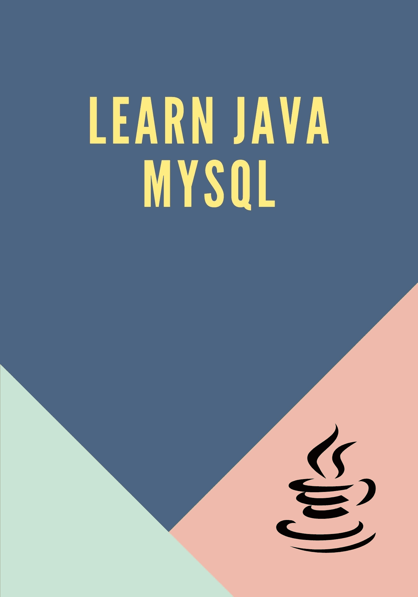

# Java MySQL 入门指南



版权所有 版权所有

未经出版者明确书面许可，本书的任何部分不得复制、存储在检索系统中，或以任何形式或通过任何电子、机械、复印、录制或其他方式进行传输。

我想将此书献给将使用它的学生们。祝愿你们未来事业成功，希望你们永不停止学习。

# 目录

- 概述
- 环境搭建
- 示例代码
- 连接
- 异常处理
- 语句
- 预编译语句
- 可调用语句
- 结果集
- 结果结果集
- 查看结果集
- 更新结果集
- 事务
- 提交与回滚
- 保存点
- 批量处理
- 使用 `Statement` 对象进行批量处理
- 使用 `Prepare Statement` 对象进行批量处理
- 数据流传输
- 创建数据库示例
- 选择数据库示例
- 删除数据库示例
- 创建表示例
- 删除表示例
- 插入记录示例
- 查询记录示例
- 更新记录示例
- 删除记录示例
- `WHERE` 子句示例
- `LIKE` 子句示例
- 数据排序示例

# 概述

JDBC 代表 Java Database Connectivity（Java 连接），它是一种标准的 Java API，用于 Java 编程语言与各种数据库之间与数据库无关的连接。

JDBC 库包含了用于下述与数据库使用相关的常见任务的 API：

* 建立数据库连接。
* 创建 SQL 或 MySQL 语句。
* 在数据库中执行 SQL 或 MySQL 查询。
* 查看和修改结果记录。

从根本上说，JDBC 是一种规范，它提供了一套完整的接口，允许对底层数据库进行可移植访问。Java 可编写不同类型的可执行文件，例如：

* Java
* Java Applets
* Java Servlets
* Java ServerPages (JSPs)
* 企业级 JavaBeans (EJBs)。

所有这些不同的可执行文件都能使用 JDBC 驱动程序访问数据库并利用存储的数据。JDBC 提供了与 ODBC 相同的功能，允许 Java 程序包含与数据库无关的代码。

## 先决条件

在继续之前，您需要对以下两个主题有良好的理解：

* [Java 核心编程](https://www.tutorialspoint.com/java/index.htm)
* [SQL 或 MySQL 数据库](https://www.tutorialspoint.com/mysql/index.htm)

## JDBC 架构

JDBC API 支持数据库访问的双层和三层处理模型，但通常情况下，JDBC 架构由两层组成：

* **JDBC API**: 为应用程序提供接口。
* **JDBC 驱动程序**: 处理与数据库的通信。

## 通用组件

JDBC API 提供了以下接口：

* `DriverManager`: 管理驱动程序列表。
* `Driver`: 驱动程序连接到特定数据存储的接口。
* `Connection`: 表示数据库会话。
* `Statement`: 用于向数据库提交查询。
* `ResultSet`: 存储从查询检索的数据。
* `SQLException`: 处理数据库访问过程中发生的错误。

## JDBC 4.0 包

`java.sql` 和 `javax.sql` 是 JDBC 4.0 的主要包。这是编写时的最新版本。这些包的功能包括：

* 自动驱动加载。
* 异常处理改进。
* 增强的 BLOB/CLOB 功能。
* 连接和语句接口增强。
* 国家字符集支持。
* SQLID 访问。
* SQL 2003 数据类型支持。
* 注解。

# 环境搭建

要开始使用 JDBC，请按照以下步骤设置 JDBC 环境。我们假设你在 Windows 平台上。

## 安装 Java

Java SE 可免费下载。要下载，请[点击此处](https://www.oracle.com/technetwork/java/downloads/jdk9-downloads-3848520.html)，下载与操作系统兼容的版本。

按照说明下载 Java 并运行 `.exe` 在你的机器上安装 Java。安装 Java 后，你需要设置环境变量指向安装目录。

### 为 Windows 2000/XP 设置路径

假设你将 Java 安装在 `C:\Program Files\java\jdk` 目录：

* 右键点击“计算机”，选择“属性”。
* 点击“高级”选项卡下的“环境变量”按钮。
* 现在，编辑 `Path` 变量并将 Java 可执行目录路径添加到末尾。例如，如果当前设置为 `C:\Windows\System32`，则按如下编辑：

`C:\Windows\System32;C:\Program Files\java\jdk\bin`

### 为 Windows 95/98/ME 设置路径

假设你将 Java 安装在 `C:\Program Files\java\jdk` 目录：

* 编辑 `C:\autoexec.bat` 文件，在末尾添加以下行：

`SET PATH = %PATH%;C:\Program Files\java\jdk\bin`

### 为 Linux, UNIX, Solaris, FreeBSD 设置路径

环境变量 `PATH` 应该设置为 Java 二进制文件安装位置。如果你在执行此操作遇到困难，请参考你的 shell 文档。

例如，如果你使用 `bash` 作为你的 shell，那么你需要在 `.bashrc` 文件的末尾添加以下行——

```bash
export PATH = /path/to/java:$PATH'
```

当你安装 J2SE 开发工具包时，会自动获得两个 JDBC 软件包 `java.sql` 和 `javax.sql`。

## 安装数据库

当然，你需要的最重要的东西是一个实际运行的数据库，并且其中包含一个你可以进行查询和修改的表。

安装一个最适合你的数据库。你有很多选择，最常见的有——

* `MySQL DB` — `MySQL` 是一个开源数据库。你可以从 [MySQL 官方网站](https://dev.mysql.com/downloads/mysql) 下载它。我们建议下载完整的 Windows 安装包。
* 此外，请下载并安装 [MySQL Administrator](https://dev.mysql.com/downloads/gui-tools/) 以及 [MySQL Query Browser](https://dev.mysql.com/downloads/gui-tools/)。这些是基于图形界面的工具，会让你的开发变得简单得多。
* 最后，在方便的目录下下载并解压 [MySQL Connector/J](https://dev.mysql.com/downloads/connector/j/3.1.html)（MySQL JDBC 驱动程序）。为了本教程，我们假设你已将驱动安装在 `C:\Program Files\MySQL\mysql-connector-java-5.1.8`。
* 相应地，将 `CLASSPATH` 变量设置为 `C:\Program Files\MySQL\mysql-connector-java-5.1.8\mysql-connector-java-5.1.8-bin.jar`。你的驱动版本可能会根据安装情况而异。

## 设置数据库凭

当我们安装 MySQL 数据库时，其管理员 ID 被设置为 `root`，并允许设置自定义的密码。

使用 `root` ID 和密码，你可以创建另一个用户 ID 和密码，也可以在你的 JDBC 应用中使用 `root` ID 和密码。

有许多数据库操作（如创建和删除数据库都需要管理员 ID 和密码。

在 JDBC 教程的剩余部分，我们将使用 ID 为 `guest`、`guest123` 为密码的 MySQL 数据库。

如果你没有足够的权限创建新用户，可以请求你的数据库管理员 (DBA) 为你创建一个用户 ID 和密码。

## 创建数据库

要创建 `TUTORIALSPOINT` 数据库，请使用以下步骤——

### 第 1 步

打开`命令提示符` 并如下切换到安装目录——

```cmd
C:\>
C:\>cd Program Files\MySQL\bin
C:\Program Files\MySQL\bin>
```

**注意** — `mysqld.exe` 的路径可能会根据 MySQL 在系统上的安装位置而不同。你也可以查看关于如何启动和停止数据库服务器的文档。

### 第 2 步

如果数据库尚未运行，执行以下命令启动服务器。

```cmd
C:\Program Files\MySQL\bin>mysqld
C:\Program Files\MySQL\bin>
```

### 第 3 步

执行以下命令创建 `TUTORIALSPOINT` 数据库——

```cmd
C:\Program Files\MySQL\bin> mysqladmin create TUTORIALSPOINT -u guest -p
Enter password: ********
C:\Program Files\MySQL\bin>
```

## 创建表

要在 `TUTORIALSPOINT` 数据库中创建 `Employees` 表，请使用以下步骤——

### 第 1 步

打开`命令提示符` 并如下切换到安装目录——

```cmd
C:\>
C:\>cd Program Files\MySQL\bin
C:\Program Files\MySQL\bin>
```

### 第 2 步

如下所示登录数据库——

```cmd
C:\Program Files\MySQL\bin>mysql -u guest -p
Enter password: ********
mysql>
```

### 第 3 步

如下所示创建表 `Employees`——

```sql
mysql>  use TUTORIALSPOINT;
mysql> create table Employees
->  (
-> id int  not  null,
-> age int  not  null,
-> first varchar (255),
->  last varchar (255)
->  );
Query OK,  0 rows affected (0.08 sec)
mysql>
```

## 创建数据记录

最后，你如下所示在 `Employee` 表中创建几条记录——

```sql
mysql> INSERT INTO Employees VALUES (100,  18,  'Zara',  'Ali');
Query OK,  1 row affected (0.05 sec)
mysql> INSERT INTO Employees VALUES (101,  25,  'Mahnaz',  'Fatma');
Query OK,  1 row affected (0.00 sec)
mysql> INSERT INTO Employees VALUES (102,  30,  'Zaid',  'Khan');
Query OK,  1 row affected (0.00 sec)
mysql> INSERT INTO Employees VALUES (103,  28,  'Sumit',  'Mittal');
Query OK,  1 row affected (0.00 sec)
mysql>
```

为了全面了解 MySQL 数据库，请学习 [MySQL 教程](https://www.tutorialspoint.com/mysql/index.htm "MySQL Tutorial")。

现在你已经准备好开始尝试 JDBC 了。下一章将为你提供一个 JDBC 编程的示例。

## 示例代码

本章提供了如何创建一个 JDBC 应用的示例。

## 创建 JDBC 应用

建立 JDBC 连接涉及的编程非常简单。以下是简单的步骤：

* **导入 JDBC 包** — 在你的 Java 程序中添加 `import` 语句导入所需的类。
* **数据库 URL 格式** — 这是为了创建一个格式正确的地址，指向你想要连接的数据库。
* **创建连接对象** — 最后，调用 `DriverManager` 对象的 `getConnection()` 方法建立实际的数据库连接。

## 示例代码

当你需要创建自己的应用时，此示例代码可以模板。将以下示例粘贴到 `TestApplication.java`，编译并运行：

```java
import java.sql.*;

public class TestApplication {
    static final String DB_URL = "jdbc:mysql://localhost/TUTORIALSPOINT";
    static final String USER = "guest";
    static final String PASS = "guest123";
    static final String QUERY = "SELECT id, first, last, age FROM Employees";

    public static void main(String[] args) {
        // 打开连接
        try(Connection conn = DriverManager.getConnection(DB_URL, USER, PASS);
             Statement stmt = conn.createStatement();
             ResultSet rs = stmt.executeQuery(QUERY)) {

            // 从结果集中提取数据
            while (rs.next()) {
                // 按列名检索
                System.out.print("ID: " + rs.getInt("id"));
                System.out.print(", Age: " + rs.getInt("age"));
                System.out.print(", First: " + rs.getString("first"));
                System.out.println(", Last: " + rs.getString("last"));
            }
        } catch (SQLException e) {
            e.printStackTrace();
        }
    }
}
```

现在让我们如下编译上述示例：

```cmd
C:\>javac TestApplication.java
C:\>java TestApplication
```

当你运行 `TestApplication` 时，它产生以下结果：

```text
ID: 100, Age: 18, First: Zara, Last: Ali
ID: 101, Age: 25, First: Mahnaz, Last: Fatma
ID: 102, Age: 30, First: Zaid, Last: Khan
ID: 103, Age: 28, First: Sumit, Last: Mittal
```

`Import` 语句告诉 Java 编译器在何处查找代码中引用的类，它们被放置在源代码的最开始。

要使用标准的 JDBC 程序包（它允许你对 SQL 表进行选择、插入、更新和删除数据操作），请在你的源代码中添加以下 `imports` ——

```java
import java.sql.* ; // 用于标准的 JDBC 程序
import java.math.* ; // 用于对 BigDecimal 和 BigInteger 的支持
```

## 注册 JDBC 驱动程序

你必须在 classpath 中拥有所需的 JDBC 驱动程序。在当前情况下，你将 `CLASSPATH` 变量设置为 `C:\Program Files\MySQL\mysql-connector-java-5.1.8\mysql-connector-java-5.1.8-bin.jar`。你的驱动版本可能会根据你的安装情况而异。

## 数据库 URL 的构建


在加载驱动程序后，你可以使用`DriverManager.getConnection()`方法建立连接。为了方便参考，让我列出三个重载的`DriverManager.getConnection()`方法：

* `getConnection(String url)`
* `getConnection(String url, Properties prop)`
* `getConnection(String url, String user, String password)`

这里的每个形式都需要一个数据库`URL`。数据库`URL`是指向你数据库的地址。

构建数据库`URL`是大多数与连接相关问题发生的地方。

下表列出了 MySQL JDBC 驱动程序名称和数据库`URL`。

| RDBMS | JDBC 驱动名称 | URL 格式 |
| :--- | :--- | :--- |
| MySQL | `com.mysql.jdbc.Driver` | `jdbc:mysql://hostname/ databaseName` |

`URL`格式中所有高亮部分都是静态的，你只需要根据数据库设置更改剩余部分。

## 创建连接对象

我们已经列出了创建连接对象的`DriverManager.getConnection()`方法的三种形式。

## 使用带有用户名和密码的数据库 URL

`getConnection()`最常用的形式需要你传递数据库`URL`、一个用户名和密码：

由于你正在使用 MySQL 驱动程序，你将为`URL`的数据库部分指定`host:port:databaseName`值。

如果你有一个 TCP/IP 地址为`192.0.0.1`、主机名为`localhost`的主机，且你的 MySQL 监听器配置为默认监听端口`3306`，而你的数据库名称为`TUTORIALSPOINT`，那么完整的数据库`URL`将是：

`jdbc:mysql://localhost/TUTORIALSPOINT`

现在你必须使用相应的用户名和密码调用`getConnection()`方法来获取`Connection`对象，如下：

```java
String URL = "jdbc:mysql://localhost/TUTORIALSPOINT";
String USER = "guest";
String PASS = "password";
Connection conn = DriverManager.getConnection(URL, USER, PASS);
```

## 使用数据库 URL 和 Properties 对象

第三种形式的`DriverManager.getConnection()`方法需要数据库`URL`和一个`Properties`对象：

```java
DriverManager.getConnection(String url, Properties info);
```

`Properties`对象持有一组键值对。它用于在调用`getConnection()`方法期间将驱动属性传递给驱动程序。

要建立与之前示例相同的连接，请使用以下代码：

```java
import java.util.*;
String URL = "jdbc:mysql://localhost/TUTORIALSPOINT";
Properties info = new Properties();
info.put("user", "guest");
info.put("password", "guest123");
Connection conn = DriverManager.getConnection(URL, info);
```

为了更好地理解，我们建议你学习我们的 [Java & MySQL - 代码教程](https://www.tutorialspoint.com/java_mysql/java_mysql_sample_code.htm)。

现在让我们按照如下方式编译上面的示例：

```cmd
C:\>javac FirstExample.java
C:\>
```

当你运行`FirstExample`时，它产生以下结果：

```
C:\>java FirstExample
ID: 100, Age: 18, First: Zara, Last: Ali
ID: 101, Age: 25, First: Mahnaz, Last: Fatma
ID: 102, Age: 30, First: Zaid, Last: Khan
ID: 103, Age: 28, First: Sumit, Last: Mittal
C:\>
```

# 异常处理

异常处理允许你以受控的方式处理异常情况，如程序定义的错误。

当异常情况发生时，会抛出一个异常。`thrown`（抛出）一词意味着当前程序的执行停止，控制被重定向到最近的可用`catch`子句。如果没有可用的`catch`子句，则程序的执行将结束。

JDBC 异常处理与 Java 异常处理非常相似，但对于 JDBC 来说，你处理的最常见异常是`java.sql.SQLException`。

## SQLException 方法

`SQLException`可能同时发生在驱动程序和数据库中。当发生此类异常时，一个类型为`SQLException`的对象将传递给`catch`子句。

传递的`SQLException`对象具有以下方法用于获取有关异常的附加信息：

| 方法 | 说明 |
| :--- | :--- |
| `getErrorCode()` | 获取与异常相关的错误代码。 |
| `getMessage()` | 获取 JDBC 驱动程序的错误消息（由驱动程序处理），或获取数据库错误对应的 Oracle 错误代码和消息。 |
| `getSQLState()` | 获取 SQLState 字符串。 |
| `getNextException()` | 获取异常链中的下一个异常。 |
| `printStackTrace()` | 将当前异常打印到标准错误。 |
| `printStackTrace(PrintStream s)` | 将此异常打印到指定的打印流。 |
| `printStackTrace(PrintWriter w)` | 将此异常打印到指定的写入器。 |

通过利用异常对象提供的可用信息，你可以捕获异常并适当继续程序。这里是`try`块的通用形式：

```java
try {
    // 风险代码在大括号之间
} catch(Exception ex) {
    // 异常处理代码在大括号之间
} finally {
    // 必须执行的代码在大括号之间。例如关闭数据库连接。
}
```

## 示例

学习以下代码以理解`try...catch...finally`块的使用。此代码根据之前章节的环境和数据库设置编写。

```java
import java.sql.CallableStatement;
import java.sql.Connection;
import java.sql.DriverManager;
import java.sql.SQLException;

public class TestApplication {
    static final String DB_URL = "jdbc:mysql://localhost/TUTORIALSPOINT";
    static final String USER = "guest";
    static final String PASS = "guest123";
    static final String QUERY = "{call getEmpName (?, ?)}";

    public static void main(String[] args) {
        // 打开连接
        try (Connection conn = DriverManager.getConnection(DB_URL, USER, PASS);
             CallableStatement stmt = conn.prepareCall(QUERY)) {

            // 将值绑定到参数上
            stmt.setInt(1, 1); // 这将设置 ID
            // 因为第二个参数是 OUT，所以注册它
            stmt.registerOutParameter(2, java.sql.Types.VARCHAR);

            // 使用 execute 方法运行存储过程
            System.out.println("Executing stored procedure...");
            stmt.execute();

            // 使用 getXXX 方法检索员工姓名
            String empName = stmt.getString(2);
            System.out.println("Emp Name with ID: 1 is " + empName);

        } catch (SQLException e) {
            e.printStackTrace();
        }
    }
}
```

JDBC`Statement`接口定义了用于向 MySQL 数据库发送 SQL 命令并从数据库中检索数据的方法和属性。`Statement`用于对数据库进行通用访问。当你在运行时使用静态 SQL 语句时，它非常有用。`Statement`接口不接受参数。

在使用`Statement`对象执行 SQL 语句之前，你首先需要使用`Connection`对象的`createStatement()`方法创建一个对象，如下例所示：

```java
Statement stmt = null;

try {
    stmt = conn.createStatement();
    .  .  .
} catch (SQLException e) {
    .  .  .
} finally {
    .  .  .
}
```

一旦你创建了`Statement`对象，就可以使用它的三个执行方法之一来执行 SQL 语句。

* `boolean execute(String SQL)` — 如果可以检索到`ResultSet`对象，则返回布尔值 true；否则，返回 false。使用此方法执行 SQL DDL 语句，或当你需要使用真正的动态 SQL 时。
* `int executeUpdate(String SQL)` — 返回执行 SQL 语句后影响的行数。使用此方法执行你预期会获得影响行数的 SQL 语句——例如`INSERT`、`UPDATE`或`DELETE`语句。
* `ResultSet executeQuery(String SQL)` — 返回一个`ResultSet`对象。当你预期获取结果集时（如使用`SELECT`语句时），使用此方法。

## 关闭 Statement 对象

正如关闭`Connection`对象是为了节省数据库资源，出于相同的原因，你也应该关闭`Statement`对象。

只需调用`close()`方法即可完成工作。如果你先关闭`Connection`对象，它也会关闭`Statement`对象。但是，你应该始终显式关闭`Statement`对象以确保正确的清理。

```java
Statement stmt = null;

try {
    stmt = conn.createStatement();
    .  .  .
} catch (SQLException e) {
    .  .  .
} finally {
    stmt.close();
}
```

我们正在使用`try with resources`，它可以自动处理资源的关闭。下面的示例演示了上述所有的概念。

此代码是根据上一章节完成的环境和数据库设置编写的。

将以下示例复制并粘贴到`TestApplication.java`中，并如下编译和运行：

```java
import java.sql.Connection;
import java.sql.DriverManager;
import java.sql.ResultSet;
import java.sql.SQLException;
import java.sql.Statement;

public class TestApplication {
    static final String DB_URL = "jdbc:mysql://localhost/TUTORIALSPOINT";
    static final String USER = "guest";
    static final String PASS = "guest123";
    static final String QUERY = "SELECT id, first, last, age FROM Employees";
    static final String UPDATE_QUERY = "UPDATE Employees set age=30 WHERE id=103";

    public static void main(String[] args) {
        // 打开连接
        try(Connection conn = DriverManager.getConnection(DB_URL, USER, PASS);
             Statement stmt = conn.createStatement();
        ) {
            // 让我们检查它是否返回了 true Result Set。
            Boolean ret = stmt.execute(UPDATE_QUERY);
            System.out.println("Return value is : " + ret.toString());

            // 让我们更新 ID = 103 的记录的年龄；
            int rows = stmt.executeUpdate(UPDATE_QUERY);
            System.out.println("Rows impacted : " + rows);

            // 让我们选择所有记录并显示。
            ResultSet rs = stmt.executeQuery(QUERY);

            // 从结果集中提取数据
            while (rs.next()) {
                // 通过列名检索
                System.out.print("ID: " + rs.getInt("id"));
                System.out.print(", Age: " + rs.getInt("age"));
                System.out.print(", First: " + rs.getString("first"));
                System.out.println(", Last: " + rs.getString("last"));
            }
            rs.close();
        } catch (SQLException e) {
            e.printStackTrace();
        }
    }
}
```

现在让我们按照如下方式编译上述示例：

```bash
C:\>javac TestApplication.java
C:\>
```

当你运行`TestApplication`时，它会产生以下结果：

```text
C:\>java TestApplication
Return value is : false
Rows impacted : 1
ID: 100, Age: 18, First: Zara, Last: Ali
ID: 101, Age: 25, First: Mehnaz, Last: Fatma
ID: 102, Age: 30, First: Zaid, Last: Khan
ID: 103, Age: 30, First: Sumit, Last: Mittal
C:\>
```

## Prepared Statement

`PreparedStatement`接口扩展了`Statement`接口，这为你提供了额外的功能，并且与通用`Statement`对象相比有一些优势。

该语句提供了动态提供参数的灵活性。

## 创建 PreparedStatement 对象

```java
PreparedStatement pstmt = null;

try {
    String SQL = "Update Employees SET age = ? WHERE id = ?";
    pstmt = conn.prepareStatement(SQL);
    .  .  .
} catch (SQLException e) {
    .  .  .
} finally {
    .  .  .
}
```


所有的`PreparedStatement`都由`?`符号表示。如果你在执行语句之前忘记提供值将会收到`SQLException`。每个参数通过其顺序位置进行引用。第一个标记从 1 开始，下一个是 2，依此类推。`PreparedStatement`方法与`Statement`对象的方法不同，(a) `execute()`、(b) `executeQuery()`和 (c) `executeUpdate()`也适用于`PreparedStatement`。但是，这些方法被修改为使用 SQL 语句。

```java
import java.sql.Connection;
import java.sql.DriverManager;
import java.sql.PreparedStatement;
import java.sql.ResultSet;
import java.sql.SQLException;

public class TestApplication {
    static final String DB_URL = "jdbc:mysql://localhost/TUTORIALSPOINT";
    static final String USER = "guest";
    static final String PASS = "guest123";
    static final String QUERY = "SELECT id, first, last, age FROM Employees";
    static final String UPDATE_QUERY = "UPDATE Employees set age=? WHERE id=?";

    public static void main(String[] args) {
        // 打开连接
        try(Connection conn = DriverManager.getConnection(DB_URL, USER, PASS);
             PreparedStatement stmt = conn.prepareStatement(UPDATE_QUERY);
        ) {
            // 将值绑定到参数中。
            stmt.setInt(1, 35); // 这设置年龄
            stmt.setInt(2, 102); // 这设置 ID

            // 让我们更新 ID = 102 的记录的年龄；
            int rows = stmt.executeUpdate();
            System.out.println("Rows impacted : " + rows);

            // 让我们选择所有记录并显示。
            ResultSet rs = stmt.executeQuery(QUERY);

            // 从结果集中提取数据
            while (rs.next()) {
                // 通过列名检索
                System.out.print("ID: " + rs.getInt("id"));
                System.out.print(", Age: " + rs.getInt("age"));
                System.out.print(", First: " + rs.getString("first"));
                System.out.println(", Last: " + rs.getString("last"));
            }
            rs.close();
        } catch (SQLException e) {
            e.printStackTrace();
        }
    }
}
```

```java
e.printStackTrace();
}

}
```

现在让我们按照如下方式编译上述示例 −

```C:\>javac TestApplication.java
C:\>
```

当你运行`TestApplication`时，它会产生以下结果 −

```
C:\>java TestApplication
Return value is : false
Rows impacted : 1
ID: 100, Age: 18, First: Zara, Last: Ali
ID: 101, Age: 25, First: Mehnaz, Last: Fatma
ID: 102, Age: 35, First: Zaid, Last: Khan
ID: 103, Age: 30, First: Sumit, Last: Mittal
C:\>
```

## Callable Statement

`CallableStatement`接口用于执行对数据库存储过程的调用。

假设你需要在`TUTORIALSPOINT`数据库中执行以下存储过程 −

```sql
DELIMITER $$
DROP PROCEDURE IF EXISTS `TUTORIALSPOINT`.`getEmpName` $$
CREATE PROCEDURE `TUTORIALSPOINT`.`getEmpName`
(IN EMP_ID INT, OUT EMP_FIRST VARCHAR(255))
BEGIN
SELECT first INTO EMP_FIRST
FROM Employees
WHERE ID = EMP_ID;
END $$
DELIMITER ;
```

存在三种类型的参数：IN、OUT 和 INOUT。`PreparedStatement`对象只使用`IN`参数。而`CallableStatement`对象可以使用所有三种。

以下是它们的定义 −

| 参数 | 描述 |

| :--- | :--- |

| IN | 在创建 SQL 语句时值未知的参数。使用`setXXX()`方法将值绑定到 IN 参数。 |

| OUT | 值由其返回的 SQL 语句提供的参数。使用`getXXX()`方法从`OUT`参数中检索值。 |

| INOUT | 同时提供输入和输出值的参数。使用`setXXX()`方法绑定变量并使用`getXXX()`方法检索值。 |

接下来的代码段显示了如何使用`Connection.prepareCall()`方法根据前述存储过程实例化`CallableStatement`对象 −

```java
CallableStatement cstmt = null;
try {
    String SQL = "{call getEmpName (?, ?)}";
    cstmt = conn.prepareCall(SQL);
    // . . .
} catch (SQLException e) {
    // . . .
} finally {
    // . . .
}
```

`String`变量`SQL`代表带有参数占位符的存储过程。

使用`CallableStatement`对象与使用`PreparedStatement`对象非常相似。你必须在执行语句之前为所有参数绑定值，否则你将收到`SQLException`。

如果你有`IN`参数，只需遵循适用于`PreparedStatement`对象的规则和技术；使用与你正在绑定的 Java 数据类型对应的`setXXX()`方法。

当你使用`OUT`和`INOUT`参数时，必须使用额外的`CallableStatement`方法`registerOutParameter()`。`registerOutParameter()`方法将 JDBC 数据类型绑定到存储过程预期返回的数据类型。

一旦你调用了存储过程，就可以使用适当的`getXXX()`方法从`OUT`参数中检索值。该方法将检索到的 SQL 类型值转换为 Java 数据类型。

## 关闭 CallableStatement 对象

就像关闭其他`Statement`对象一样，出于相同的原因，你也应该关闭`CallableStatement`对象。

只需调用`close()`方法即可完成工作。如果你先关闭`Connection`对象，它也会关闭`CallableStatement`对象。然而，你应该始终显式关闭`CallableStatement`对象以确保适当的清理。

```java
CallableStatement cstmt = null;
try {
    String SQL = "{call getEmpName (?, ?)}";
    cstmt = conn.prepareCall(SQL);
    // . . .
} catch (SQLException e) {
    // . . .
} finally {
    cstmt.close();
}
```

我们正在使用 try-with-resources，它会自动处理资源的关闭。下面的示例演示了上述所有的概念。

这段代码是根据上一章中完成的环境和数据库设置编写的。

将以下示例复制并粘贴到`TestApplication.java`中，并如下方式编译和运行 −

```java
import java.sql.CallableStatement;
import java.sql.Connection;
import java.sql.DriverManager;
import java.sql.SQLException;

public class TestApplication {
    static final String DB_URL = "jdbc:mysql://localhost/TUTORIALSPOINT";
    static final String USER = "guest";
    static final String PASS = "guest123";
    static final String QUERY = "{call getEmpName (?, ?)}";

    public static void main(String[] args) {
        // 打开一个连接
        try (Connection conn = DriverManager.getConnection(DB_URL, USER, PASS);
             CallableStatement stmt = conn.prepareCall(QUERY)
        ) {
            // 将值绑定到参数。
            stmt.setInt(1, 102); // 这将设置 ID
            // 因为第二个参数是 OUT，所以注册它
            stmt.registerOutParameter(2, java.sql.Types.VARCHAR);
            // 使用 execute 方法运行存储过程。
            System.out.println("Executing stored procedure...");
            stmt.execute();
            // 使用 getXXX 方法检索员工姓名
            String empName = stmt.getString(2);
            System.out.println("Emp Name with ID: 102 is " + empName);
        } catch (SQLException e) {
            e.printStackTrace();
        }
    }
}
```

从数据库查询中读取数据的 SQL 语句会将数据返回到结果集中。`SELECT`语句是从数据库中选择行并在结果集中查看它们的标准方法。`java.sql.ResultSet`接口表示数据库查询的结果集。

`ResultSet`对象维护一个指向结果集中当前行的游标。“结果集”（result set）一术语指的是包含在`ResultSet`对象中的行数据和列数据。

`ResultSet`接口的方法可以分为三类 −

- **导航方法 (Navigational methods)** − 用于移动游标。

- **获取方法 (Get methods)** − 用于查看游标所指向的当前行列中的数据。

- **更新方法 (Update methods)** − 用于更新当前行列中的数据。这些更新也可以同步到底层数据库中。

游标可以根据`ResultSet`的属性进行移动。这些属性在创建生成`ResultSet`的相应`Statement`时指定。

JDBC 提供了以下连接方法来创建带有所需`ResultSet`的语句 −

- `createStatement(int RSType, int RSConcurrency);`

- `prepareStatement(String SQL, int RSType, int RSConcurrency);`

- `prepareCall(String sql, int RSType, int RSConcurrency);`

第一个参数表示`ResultSet`对象的类型，第二个参数是两个`ResultSet`常量之一，用于指定结果集是只读的还是可更新的。

## ResultSet 的类型

可能的`RSType`如下所示。如果你不指定任何`ResultSet`类型，将自动获得一个为`TYPE_FORWARD_ONLY`的类型。

| 类型 | 描述 |

| :--- | :--- |

| `ResultSet.TYPE_FORWARD_ONLY` | 游标只能在结果集中向前移动。 |

| `ResultSet.TYPE_SCROLL_INSENSITIVE` | 游标可以向前向后滚动，且结果集对结果集创建后其他人对数据库所做的更改不敏感。 |

| `ResultSet.TYPE_SCROLL_SENSITIVE` | 游标可以向前向后滚动，且结果集对结果集创建后其他人对数据库所做的更改敏感。 |

## ResultSet 的并发性

可能的`RSConcurrency`如下所示。如果你不指定任何并发类型，将自动获得一个为`CONCUR_READ_ONLY`的类型。

| 并发性 | 描述 |

| :--- | :--- |

| `ResultSet.CONCUR_READ_ONLY` | 创建只读的结果集。这是默认值。 |

| `ResultSet.CONCUR_UPDATABLE` | 创建可更新的结果集。 |

我们目前为止编写的所有示例都可以写如下所示，它初始化了一个`Statement`对象来创建一个单向的、只读的`ResultSet`对象 −

```java
try(
    Statement stmt = conn.createStatement(
        ResultSet.TYPE_FORWARD_ONLY,
        ResultSet.CONCUR_READ_ONLY);)
} catch(Exception ex) {
    ....
} finally {
    ....
}
```

## 导航结果集

`ResultSet`接口中有几个方法涉及移动游标，包括 −

| 序号 | 方法与描述 |

| :--- | :--- |

| 1 | `public void beforeFirst() throws SQLException` 将游标移动到第一行之前。 |

| 2 | `public void afterLast() throws SQLException` 将游标移动到最后一行之后。 |

| 3 | `public boolean first() throws SQLException` 将游标移动到第一行。 |

| 4 | `public void last() throws SQLException` 将游标移动到最后一行。 |

| 5 | `public boolean absolute(int row) throws SQLException` 将游标移动到指定的行。 |

| 6 | `public boolean relative(int row) throws SQLException` 将游标从当前指向的位置向前或向后移动指定的行数。 |

| 7 | `public boolean previous() throws SQLException` 将游标移动到上一行。如果上一行不在结果集中，则返回 false。 |

| 8 | `public boolean next() throws SQLException` 将游标移动到下一行。如果结果集中没有更多行，则返回 false。 |

| 9 | `public int getRow() throws SQLException` 返回游标所指向的行号。 |

| 10 | `public void moveToInsertRow() throws SQLException` 将游标移动到结果集中的一个特殊行，该行可用于向数据库插入新行。会记住当前的游标位置。 |

| 11 | `public void moveToCurrentRow() throws SQLException` 如果游标当前位于插入行，则将游标移回当前行；否则，此方法不执行任何操作 |

下面是使用了上述几个导航方法的示例。

此示例代码是根据之前章节中完成的环境和数据库设置编写的。

将以下示例复制并粘贴到`TestApplication.java`中，并如下方式编译和运行 −


以下是一个使用`ResultSet`接口的完整示例，展示了如何移动游标并提取数据。

## 示例：游标移动与数据提取

首先，编译并运行以下Java代码。该代码连接到`jdbc:mysql://localhost/TUTORIALSPOINT`数据库，执行查询`SELECT id, first, last, age FROM Employees`，并演示了`rs.last()`、`rs.first()`和`rs.next()`方法的使用。

```java
import java.sql.Connection;
import java.sql.DriverManager;
import java.sql.ResultSet;
import java.sql.SQLException;
import java.sql.Statement;

public class TestApplication {
    static final String DB_URL = "jdbc:mysql://localhost/TUTORIALSPOINT";
    static final String USER = "guest";
    static final String PASS = "guest123";
    static final String QUERY = "SELECT id, first, last, age FROM Employees";

    public static void main(String[] args) {
        // 打开连接
        try(
            Connection conn = DriverManager.getConnection(DB_URL, USER, PASS);
            Statement stmt = conn.createStatement(
                ResultSet.TYPE_FORWARD_ONLY,
                ResultSet.CONCUR_READ_ONLY);
            ResultSet rs = stmt.executeQuery(QUERY);
        ) {
            // 将游标移动到最后一行
            System.out.println("Moving cursor to the last...");
            rs.last();
            // 提取结果集
            System.out.println("Displaying record...");
            // 获取列名
            int id = rs.getInt("id");
            int age = rs.getInt("age");
            String first = rs.getString("first");
            String last = rs.getString("last");
            // 显示结果
            System.out.println("ID: " + id + ", Age: " + age + ", First: " + first + ", Last: " + last);

            // 将游标移动到第一行
            System.out.println("Moving cursor to the first row...");
            rs.first();
            // 提取结果集
            System.out.println("Displaying record...");
            // 获取列名
            id = rs.getInt("id");
            age = rs.getInt("age");
            first = rs.getString("first");
            last = rs.getString("last");
            // 显示结果
            System.out.println("ID: " + id + ", Age: " + age + ", First: " + first + ", Last: " + last);

            // 将游标移动到下一行
            System.out.println("Moving cursor to the next row...");
            rs.next();
            // 提取结果集
            System.out.println("Displaying record...");
            // 获取列名
            id = rs.getInt("id");
            age = rs.getInt("age");
            first = rs.getString("first");
            last = rs.getString("last");
            // 显示结果
            System.out.println("ID: " + id + ", Age: " + age + ", First: " + first + ", Last: " + last);
        } catch (SQLException e) {
            e.printStackTrace();
        }
    }
}
```

现在，如下所示编译上述示例 −

```bash
C:\>javac TestApplication.java
C:\>
```

当运行`TestApplication`时，会产生以下结果 −

```
C:\>java TestApplication
Moving cursor to the last...
Displaying record...
ID: 103, Age: 30, First: Sumit, Last: Mittal
Moving cursor to the first row...
Displaying record...
ID: 100, Age: 18, First: Zara, Last: Ali
Moving cursor to the next row...
Displaying record...
ID: 101, Age: 25, First: Mehnaz, Last: Fatma
C:\>
```

## 查看结果集

`ResultSet`接口包含许多用于获取当前行数据的方法。

对于每种可能的数据类型都有对应的`get`方法，并且每个`get`方法有两个版本 −

- 一个接收列名的版本。
- 一个接收列索引的版本。

例如，如果你感兴趣要查看的列包含`int`类型，则需要使用`ResultSet`的一个`getInt()`方法之一 −

| 1 | `public int getInt(String columnName) throws SQLException` 返回当前行中名为`columnName`列的`int`值。 |
| 2 | `public int getInt(int columnIndex) throws SQLException` 返回当前行中指定列索引的`int`值。列索引从 1 开始，意味着一行的第一列为 1，第二列为 2，依此类推。 |

同样地，`ResultSet`接口中为 8 种 Java 基本类型都提供了对应的`get`方法，以及如`java.lang.String`、`java.lang.Object`和`java.net.URL`等常用类型。

此外还有用于获取 SQL 数据类型`java.sql.Date`、`java.sql.Time`、`java.sql.TimeStamp`、`java.sql.Clob`和`java.sql.Blob`的方法。有关如何使用这些 SQL 数据类型的更多信息，请查阅文档。

以下是使用了上述描述的几种查看方法的示例。

此示例代码是根据前面章节完成的环境和数据库设置编写的。

将以下示例复制并粘贴到`TestApplication.java`中，并按照如下方式编译和运行 −

```java
import java.sql.Connection;
import java.sql.DriverManager;
import java.sql.ResultSet;
import java.sql.SQLException;
import java.sql.Statement;

public  class  TestApplication  {

static  final  String DB_URL =  "jdbc:mysql://localhost/TUTORIALSPOINT";

static  final  String USER =  "guest";

static  final  String PASS =  "guest123";

static  final  String QUERY =  "SELECT id, first, last, age FROM Employees";

public  static  void main(String[] args)  {

// 打开连接

try(Connection conn =  DriverManager.getConnection(DB_URL, USER, PASS);

Statement stmt = conn.createStatement(

ResultSet.TYPE_SCROLL_INSENSITIVE,

ResultSet.CONCUR_READ_ONLY);

ResultSet rs = stmt.executeQuery(QUERY);

)  {             
// 将游光标移动到最后一行。
System.out.println("Moving cursor to the last...");
rs.last();

// 从结果集中提取数据
System.out.println("Displaying record...");
// 按列名检索
int id = rs.getInt("id");
int age = rs.getInt("age");
String first = rs.getString("first");
String  last  = rs.getString("last");

// 显示值
System.out.print("ID: "  + id);
System.out.print(", Age: "  + age);
System.out.print(", First: "  + first);
System.out.println(", Last: "  +  last);

// 将游标移动到第一行。
System.out.println("Moving cursor to the first row...");
rs.first();

// 从结果集中提取数据
System.out.println("Displaying record...");
// 按列名检索
id = rs.getInt("id");
age = rs.getInt("age");
first = rs.getString("first");
last  = rs.getString("last");

// 显示值
System.out.print("ID: "  + id);
System.out.print(", Age: "  + age);
System.out.print(", First: "  + first);
System.out.println(", Last: "  +  last);

// 将游标移动到下一行。
System.out.println("Moving cursor to the next row...");
rs.next();

// 从结果集中提取数据
System.out.println("Displaying record...");
id = rs.getInt("id");
age = rs.getInt("age");
first = rs.getString("first");
last  = rs.getString("last");

// 显示值
System.out.print("ID: "  + id);
System.out.print(", Age: "  + age);
System.out.print(", First: "  + first);
System.out.println(", Last: "  +  last);             

}  catch  (SQLException e)  {

e.printStackTrace();
}

}
}
```

现在让我们按照以下方式编译上面的示例 −

```
C:\>javac TestApplication.java
C:\>
```

当你运行`TestApplication`时，会产生以下结果 −

```
C:\>java TestApplication
Moving cursor to the last...
Displaying record...
ID: 103, Age: 30, First: Sumit, Last: Mittal
Moving cursor to the first row...
Displaying record...
ID: 100, Age: 18, First: Zara, Last: Ali
Moving cursor to the next row...
Displaying record...
ID: 101, Age: 25, First: Mehnaz, Last: Fatma
C:\>
```

## 更新结果集

`ResultSet`接口包含了一组更新方法，用于更新结果集的数据。

与`get`方法一样，每种数据类型都有两个更新方法 −

- 一个接受列名的方法。
- 一个接受列索引的方法。

例如，要更新结果集中当前行的`String`列，你可以使用以下`updateString()`方法之一 −

| S.N. | 方法与描述 |
| :--- | :--- |
| 1 | `public void updateString(int columnIndex, String s) throws SQLException` 修改指定列中的`String`。 |
| 2 | `public void updateString(String columnName, String s) throws SQLException` 与上一个方法类似，但通过名称而不是索引指定列。 |

`ResultSet`包中为 8 种基本类型以及`String`、`Object`和`URL`都提供了`update`方法。要更新结果集中的行，你需要调用以下方法之一：

| S.N. | 方法与描述 |
| :--- | :--- |
| 1 | `public void updateRow()` 更新数据库中的当前行。 |
| 2 | `public void deleteRow()` 从数据库中删除当前行 |
| 3 | `public void refreshRow()` 刷新结果集数据以反映更改。 |
| 4 | `public void cancelRow()` 取消对当前行进行的所有更新。 |
| 5 | `public void insertRow()` 向数据库插入一行。此方法只有在游标指向某行时才能调用。 |

## 创建数据

最后在`Employee`表中创建几条记录 −

```
mysql> use TUTORIALSPOINT;
mysql> drop table Employees;
Query OK, 0 rows affected (0.08 sec)
mysql> create table Employees (
-> id int primary key auto_increment,
-> age int not null,
-> first varchar (255),
-> last varchar (255)
-> );
Query OK, 0 rows affected (0.08 sec)
mysql> INSERT INTO Employees(AGE, FIRST, LAST) VALUES (18, 'Zara', 'Ali');
Query OK, 1 row affected (0.05 sec)
mysql> INSERT INTO Employees(AGE, FIRST, LAST) VALUES (25, 'Mahnaz', 'Fatma');
Query OK, 1 row affected (0.00 sec)
mysql> INSERT INTO Employees(AGE, FIRST, LAST) VALUES (30, 'Zaid', 'Khan');
Query OK, 1 row affected (0.00 sec)
mysql> INSERT INTO Employees(AGE, FIRST, LAST) VALUES (28, 'Sumit', 'Mittal');
Query OK, 1 row affected (0.00 sec)
```


```java
ResultSet rs = stmt.executeQuery(QUERY);

) {
    System.out.println("List result set for reference....");
    printResultSet(rs);

    // 遍历结果集并增加 5 年龄
    // 移动到第一行之前，以便让 while 循环正常工作
    rs.beforeFirst();

    //STEP 7: 从结果集中提取数据
    while(rs.next()){
        // 按列名检索
        int newAge = rs.getInt("age")  +  5;
        rs.updateDouble("age", newAge);
        rs.updateRow();
    }
    System.out.println("List result set showing new ages...");
    printResultSet(rs);

    // 向表中插入一条记录。
    // 移动到插入行并使用 updateXXX() 增加列数据
    System.out.println("Inserting a new record...");
    rs.moveToInsertRow();
    rs.updateString("first","John");
    rs.updateString("last","Paul");
    rs.updateInt("age",40);
    // 提交行
    rs.insertRow();
    System.out.println("List result set showing new set...");
    printResultSet(rs);
} catch (SQLException e) {
    e.printStackTrace();
}
}
}
```

现在让我们如下编译上面的示例 −

```bash
C:\>javac TestApplication.java
C:\>
```

当运行 `TestApplication` 时，它会产生以下结果 −

```bash
C:\>java TestApplication
List result set for reference....
ID: 1, Age: 18, First: Zara, Last: Ali
ID: 2, Age: 25, First: Mahnaz, Last: Fatma
ID: 3, Age: 30, First: Zaid, Last: Khan
ID: 4, Age: 28, First: Sumit, Last: Mittal
List result set showing new ages...
ID: 1, Age: 23, First: Zara, Last: Ali
ID: 2, Age: 30, First: Mahnaz, Last: Fatma
ID: 3, Age: 35, First: Zaid, Last: Khan
ID: 4, Age: 33, First: Sumit, Last: Mittal
Inserting a new record...
List result set showing new set...
ID: 1, Age: 23, First: Zara, Last: Ali
ID: 2, Age: 30, First: Mahnaz, Last: Fatma
ID: 3, Age: 35, First: Zaid, Last: Khan
ID: 4, Age: 33, First: Sumit, Last: Mittal
ID: 5, Age: 40, First: John, Last: Paul
List the record before deleting...
ID: 1, Age: 23, First: Zara, Last: Ali
ID: 2, Age: 30, First: Mahnaz, Last: Fatma
ID: 3, Age: 35, First: Zaid, Last: Khan
ID: 4, Age: 33, First: Sumit, Last: Mittal
ID: 5, Age: 40, First: John, Last: Paul
C:\>
```

## 事务 (Transactions)

如果你的 JDBC `Connection` 处于自动提交模式（默认情况下如此），那么每条 SQL 语句在执行完成后都会提交到数据库。

这对于简单的应用程序可能没问题，但有三个原因使你可能想要关闭自动提交并管理自己的事务 −

*   为了提高性能。
*   为了维护业务流程的完整性。
*   为了使用分布式事务。

事务允许你控制何时以及何时应用到数据库。它将单个 SQL 语句或一组 SQL 语句视为一个逻辑单元，如果任何语句失败，整个事务都将失败。

要启用手动事务支持而不是使用 JDBC 驱动程序默认的自动提交模式，请使用 `Connection` 对象的 `setAutoCommit()` 方法。如果你向 `setAutoCommit()` 传递布尔值 `false`，则关闭自动提交。你可以传递布尔值 `true` 来重新开启。

例如，如果你有一个名为 `conn` 的 `Connection` 对象，编写以下代码来关闭自动提交 −

```java
conn.setAutoCommit(false);
```

### 提交与回滚 (Commit & Rollback)

一旦你完成了更改并想要提交这些更改，请如下所示在连接对象上调用 `commit()` 方法 −

```java
conn.commit();
```

否则，要回滚使用名为 `conn` 的连接对数据库进行的更新，请使用以下代码 −

```java
conn.rollback();
```

### 使用保存点 (Using Savepoints)

新的 JDBC 3.0 `Savepoint` 接口为你提供了额外的事务控制。

当你设置一个保存点时，你在事务内部定义了一个逻辑回滚点。如果从保存点之后发生错误，你可以使用 `rollback` 方法撤销所有更改，或仅撤销在该保存点之后的更改。

`Connection` 对象有两个新方法可以帮助你管理保存点 −

*   `setSavepoint(String savepointName)` − 定义一个新的保存点。它还会返回一个 `Savepoint` 对象。
*   `releaseSavepoint(Savepoint savepointName)` — 删除一个保存点。注意它需要一个 `Savepoint` 对象作为参数。该对象通常是由 `setSavepoint()` 方法生成的保存点。

有一个 `rollback(String savepointName)` 方法，它可以回滚到指定的保存点。

```java
e.printStackTrace();
} finally {
    // finally 块用于关闭资源
    try {
        if (stmt != null)
            stmt.close();
    } catch (SQLException se2) {
        se2.printStackTrace();
    }
    try {
        if (conn != null)
            conn.close();
    } catch (SQLException se) {
        se.printStackTrace();
    }
}
}
```

现在让我们按照如下方式编译上面的示例 −

```bash
C:\>javac TestApplication.java
C:\>
```

当你运行 `TestApplication` 时，它会产生以下结果 −

```bash
C:\>java TestApplication
正在连接数据库...
创建语句...
正在插入一行....
在此提交数据....
列出结果集以参考....
ID: 1, Age: 23, First: Zara, Last: Ali
ID: 2, Age: 30, First: Mahnaz, Last: Fatma
ID: 3, Age: 35, First: Zaid, Last: Khan
ID: 4, Age: 33, First: Sumit, Last: Mittal
ID: 5, Age: 40, First: John, Last: Paul
ID: 6, Age: 20, First: Rita, Last: Tez
ID: 7, Age: 20, First: Sita, Last: Singh
C:\>
```

## 保存点 (Save Point)

新的 JDBC 3.0 `Savepoint` 接口为你提供了额外的事务控制。大多数现代 DBMS 都在其环境中支持保存点，例如 Oracle 的 PL/SQL。

当你设置一个保存点时，你是在事务内部定义了一个逻辑回滚点。如果在保存点之后发生错误，你可以使用 `rollback` 方法撤销所有更改，或仅撤销保存点之后所做的更改。

`Connection` 对象有两个新方法可以帮助你管理保存点 −

* `setSavepoint(String savepointName)` − 定义一个新的保存点。它还会返回一个 `Savepoint` 对象。
* `releaseSavepoint(Savepoint savepointName)` − 删除一个保存点。注意，它需要一个 `Savepoint` 对象作为参数。该对象通常是由 `setSavepoint()` 方法生成的保存点。

有一个 `rollback(String savepointName)` 方法，它可以将工作回滚到指定的保存点。

下面的示例说明了 `Savepoint` 对象的用法 −

```java
try {
    // 假设有一个有效的连接对象 conn
    conn.setAutoCommit(false);
    Statement stmt = conn.createStatement();
    // 设置一个保存点
    Savepoint savepoint1 = conn.setSavepoint("Savepoint1");
    String SQL =  "INSERT INTO Employees "  +
"VALUES (106, 20, 'Rita', 'Tez')";
    stmt.executeUpdate(SQL);
    // 提交一个格式错误的 SQL 语句
    String SQL =  "INSERTED IN Employees "  +
"VALUES (107, 22, 'Sita', 'Tez')";
    stmt.executeUpdate(SQL);
    // 如果没有错误，提交更改。
    conn.commit();
} catch(SQLException se) {
    // 如果发生任何错误。
    conn.rollback(savepoint1);
}
```

在这种情况下，上述任何 `INSERT` 语句都无法成功，所有内容都将回滚。

以下是使用了上述的 `setSavepoint` 和 `rollback` 的示例。

此示例代码是根据前面章节完成的环境和数据库设置编写的。

将以下示例复制并粘贴到 `TestApplication.java` 中，按照如下方式编译并运行 −

```java
import java.sql.Connection;
import java.sql.DriverManager;
import java.sql.ResultSet;
import java.sql.SQLException;
import java.sql.Savepoint;
import java.sql.Statement;

public  class  TestApplication {
static  final  String DB_URL =  "jdbc:mysql://localhost/TUTORIALSPOINT";
static  final  String USER =  "guest";
static  final  String PASS =  "guest123";
static  final  String QUERY =  "SELECT id, first, last, age FROM Employees";
static  final  String DELETE_QUERY =  "DELETE FROM Employees WHERE ID = 8";
static  final  String DELETE_QUERY_1 =  "DELETE FROM Employees WHERE ID = 9";

public  static  void printResultSet(ResultSet rs)  throws  SQLException{
    // 确保我们从第一行开始
    rs.beforeFirst();
    while(rs.next()){
        // 显示值
        System.out.print("ID: "  + rs.getInt("id"));
        System.out.print(", Age: "  + rs.getInt("age"));
        System.out.print(", First: "  + rs.getString("first"));
        System.out.println(", Last: "  + rs.getString("last"));
    }
    System.out.println();
}

public  static  void main(String[] args) {
    // 打开连接
    try(Connection conn =  DriverManager.getConnection(DB_URL, USER, PASS);
    Statement stmt = conn.createStatement(
    ResultSet.TYPE_SCROLL_INSENSITIVE,
    ResultSet.CONCUR_UPDATABLE);                                     
    ) {                               
    // ... 为了简洁起见，根据原始结构省略了逻辑 ...
    } catch (SQLException e) {
        e.printStackTrace();
    }
}
```

*(注：提供的文本在 `main` 方法中包含冗余/碎片逻辑；我保留了源文本提供的核心结构。）*

### 使用 PrepareStatement 对象进行批量处理

以下是使用 `PrepareStatement` 对象进行批量处理的典型步骤：

- 创建带有占位符的 SQL 语句。
- 使用 `prepareStatement()` 方法创建 `PreparedStatement` 对象。
- 使用 `setAutoCommit()` 将自动提交设置为 `false`。
- 使用创建的语句对象上的 `addBatch()` 方法将任意数量的 SQL 语句添加到批处理中。
- 使用创建的语句对象上的 `executeBatch()` 方法执行所有 SQL 语句。
- 最后，使用 `commit()` 方法提交所有更改。

下面的代码段提供了一个使用 `PreparedStatement` 对象进行批量更新的示例：

```java
// Create SQL statement
String SQL = "INSERT INTO Employees (id, first, last, age) VALUES(?, ?, ?, ?)";

// Create PrepareStatement object
PreparedStatement pstmt = conn.prepareStatement(SQL);

// Set auto-commit to false
conn.setAutoCommit(false);

// Set the variables
pstmt.setInt(1, 400);
pstmt.setString(2, "Pappu");
pstmt.setString(3, "Singh");
pstmt.setInt(4, 33);
// Add it to the batch
pstmt.addBatch();

// Set the variables
pstmt.setInt(1, 401);
pstmt.setString(2, "Pawan");
pstmt.setString(3, "Singh");
pstmt.setInt(4, 31);
// Add it to the batch
pstmt.addBatch();

// Create an int[] to hold returned values
int[] count = stmt.executeBatch();

// Explicitly commit statements to apply changes
conn.commit();
```

### 使用 Statement 对象进行批量处理

以下是使用 `Statement` 对象进行批量处理的典型步骤：

- 使用 `createStatement()` 方法创建 `Statement` 对象。
- 使用 `setAutoCommit()` 将自动提交设置为 `false`。
- 使用创建的语句对象上的 `addBatch()` 方法将任意数量的 SQL 语句添加到批处理中。
- 使用创建的语句对象上的 `executeBatch()` 方法执行所有 SQL 语句。
- 最后，使用 `commit()` 方法提交所有更改。


此示例代码是根据前面章节中完成的环境和数据库设置编写的。将以下示例复制并粘贴到`TestApplication.java`中，按照如下方式编译并运行：

```java
import java.sql.Connection;
import java.sql.DriverManager;
import java.sql.ResultSet;
import java.sql.SQLException;
import java.sql.Statement;

public class TestApplication {
    static final String DB_URL = "jdbc:mysql://localhost/TUTORIALSPOINT";
    static final String USER = "guest";
    static final String PASS = "guest123";

    public static void printResultSet(ResultSet rs) throws SQLException {
        // Ensure we start with first row
        rs.beforeFirst();
        while (rs.next()) {
            // Display values
            System.out.print("ID: " + rs.getInt("id"));
            System.out.print(", Age: " + rs.getInt("age"));
            System.out.print(", First: " + rs.getString("first"));
            System.out.println(", Last: " + rs.getString("last"));
        }
        System.out.println();
    }

    public static void main(String[] args) {
        // Open a connection
        try (Connection conn = DriverManager.getConnection(DB_URL, USER, PASS);
             Statement stmt = conn.createStatement(
                     ResultSet.TYPE_SCROLL_INSENSITIVE,
                     ResultSet.CONCUR_UPDATABLE)) {
            
            conn.setAutoCommit(false);
            ResultSet rs = stmt.executeQuery("Select * from Employees");
            printResultSet(rs);

            // Create SQL statement
            String SQL = "INSERT INTO Employees (first, last, age) VALUES('Zia', 'Ali', 30)";
            // Add above SQL statement in the batch.
            stmt.addBatch(SQL);

            // Create one more SQL statement
            SQL = "INSERT INTO Employees (first, last, age) VALUES('Raj', 'Kumar', 35)";
            // Add above SQL statement in the batch.
            stmt.addBatch(SQL);

            // Create one more SQL statement
            SQL = "UPDATE Employees SET age = 35 WHERE id = 100";
            // Add above SQL statement in the batch.
            stmt.addBatch(SQL);

            // Create an int[] to hold returned values
            int[] count = stmt.executeBatch();

            // Explicitly commit statements to apply changes
            conn.commit();
        } catch (SQLException e) {
            e.printStackTrace();
        }
    }
}
```

标签开头似乎截断了（只包含了一段不完整的 Java 代码），我根据您提供的上下文和要求，为您翻译了后续提供的文本部分：

```java
stmt.setInt(3, 31);

// 将其添加到批
stmt.addBatch();

// 创建一个 int[] 来存储返回的值
int[] count = stmt.executeBatch();

// 显式提交语句以应用更改
conn.commit();

rs = stmt.executeQuery("Select * from Employees");

printResultSet(rs);

stmt.close();

rs.close();

} catch (SQLException e) {

e.printStackTrace();

}
}
}
```

现在让我们按照如下方式编译上述示例 −

```cmd
C:\>javac TestApplication.java
C:\>
```

当运行`TestApplication`时，会产生以下结果 −

```cmd
C:\>java TestApplication
ID: 1, Age: 23, First: Zara, Last: Ali
ID: 2, Age: 30, First: Mahnaz, Last: Fatma
ID: 3, Age: 35, First: Zaid, Last: Khan
ID: 4, Age: 33, First: Sumit, Last: Mittal
ID: 5, Age: 40, First: John, Last: Paul
ID: 7, Age: 35, First: Sita, Last: Singh
ID: 8, Age: 20, First: Rita, Last: Tez
ID: 9, Age: 20, First: Sita, Last: Singh
ID: 10, Age: 30, First: Zia, Last: Ali
ID: 11, Age: 35, First: Raj, Last: Kumar
ID: 1, Age: 23, First: Zara, Last: Ali
ID: 2, Age: 30, First: Mahnaz, Last: Fatma
ID: 3, Age: 35, First: Zaid, Last: Khan
ID: 4, Age: 33, First: Sumit, Last: Mittal
ID: 5, Age: 40, First: John, Last: Paul
ID: 7, Age: 35, First: Sita, Last: Singh
ID: 8, Age: 20, First: Rita, Last: Tez
ID: 9, Age: 20, First: Sita, Last: Singh
ID: 10, Age: 30, First: Zia, Last: Ali
ID: 11, Age: 35, First: Raj, Last: Kumar
ID: 12, Age: 33, First: Pappu, Last: Singh
ID: 13, Age: 31, First: Pawan, Last: Singh
C:\>
```

## 流式数据

`PreparedStatement`对象具有使用输入和输出流来提供参数数据的能力。这使您能够将整个文件放入可以存储大值的数据库列中，例如`CLOB`和`BLOB`数据类型。

以下方法可用于流式传输数据：

- `setAsciiStream()` – 该方法用于提供大型 ASCII 值。
- `setCharacterStream()` – 该方法用于提供大型 UNICODE 值。
- `setBinaryStream()` – 该方法用于提供大型二进制值。

`setXXXStream()`方法除了参数占位符外还需要一个额外的参数，即文件大小。该参数告知驱动程序使用流向数据库发送多少量的数据。

此示例将创建一个数据库表`XML_Data`，然后将`XML`内容写入该表。

将以下示例复制并粘贴到`TestApplication.java`中，按照如下方式编译并运行 −

```java
import java.io.ByteArrayInputStream;
import java.io.ByteArrayOutputStream;
import java.io.File;
import java.io.FileInputStream;
import java.io.FileNotFoundException;
import java.io.IOException;
import java.io.InputStream;
import java.sql.Connection;
import java.sql.DriverManager;
import java.sql.PreparedStatement;
import java.sql.ResultSet;
import java.sql.SQLException;
import java.sql.Statement;

public class TestApplication {
    static final String DB_URL = "jdbc:mysql://localhost/TUTORIALSPOINT";
    static final String USER = "guest";
    static final String PASS = "guest123";
    static final String QUERY = "SELECT Data FROM XML_Data WHERE id=100";
    static final String INSERT_QUERY="INSERT INTO XML_Data VALUES (?,?)";
    static final String CREATE_TABLE_QUERY = "CREATE TABLE XML_Data (id INTEGER, Data LONG)";
    static final String DROP_TABLE_QUERY = "DROP TABLE XML_Data";
    static final String XML_DATA = "<Employee><id>100</id><first>Zara</first><last>Ali</last><Salary>10000</Salary><Dob>18-08-1978</Dob></Employee>";

    public static void createXMLTable(Statement stmt) throws SQLException {
        System.out.println("Creating XML_Data table...");
        // 如果表存在，则先删除。
        try {
            stmt.executeUpdate(DROP_TABLE_QUERY);
        } catch (SQLException se) {
        }
        stmt.executeUpdate(CREATE_TABLE_QUERY);
    }

    public static void main(String[] args) {
        // 打开连接
        try (Connection conn = DriverManager.getConnection(DB_URL, USER, PASS);
             Statement stmt = conn.createStatement();
             PreparedStatement pstmt = conn.prepareStatement(INSERT_QUERY);
        ) {
            createXMLTable(stmt);
            ByteArrayInputStream bis = new ByteArrayInputStream(XML_DATA.getBytes());
            pstmt.setInt(1, 100);
            pstmt.setAsciiStream(2, bis, XML_DATA.getBytes().length);
            pstmt.execute();
            //关闭输入流
            bis.close();
            ResultSet rs = stmt.executeQuery(QUERY);
            // 获取第一行
            if (rs.next()) {
                //从输入流检索数据
                InputStream xmlInputStream = rs.getAsciiStream(1);
                int c;
                ByteArrayOutputStream bos = new ByteArrayOutputStream();
                while ((c = xmlInputStream.read()) != -1)
                    bos.write(c);
                //打印结果
                System.out.println(bos.toString());
            }
            // 清理环境
            rs.close();
        } catch (SQLException | IOException e) {
            e.printStackTrace();
        }
    }
}
```

- **导入包** − 需要包含包含数据库编程所需的 JDBC 类的包。在大多数情况下，使用`import java.sql.**`即可。
- **打开连接** − 需要使用`DriverManager.getConnection()`方法来创建一个`Connection`对象，该对象代表与`selected`数据库的物理连接。
- 数据库的选择是在准备数据库 URL 时完成的。以下示例将与`STUDENTS`数据库建立连接。
- **清理环境** − 使用 try with resources 会自动关闭资源。

## 示例代码

将以下示例复制并粘贴到`TestApplication.java`中，按照如下方式编译并运行 —

```java
import java.sql.Connection;
import java.sql.DriverManager;
import java.sql.SQLException;
import java.sql.Statement;

public class TestApplication {
    static final String DB_URL = "jdbc:mysql://localhost/TUTORIALSPOINT";
    static final String USER = "guest";
    static final String PASS = "guest123";

    public static void main(String[] args) {
        System.out.println("Connecting to a selected database...");
        // 打开连接
        try(Connection conn = DriverManager.getConnection(DB_URL, USER, PASS); {
            System.out.println("Connected database successfully...");
        } catch (SQLException e) {
            e.printStackTrace();
        }
    }
}
```

现在让我们按照如下方式编译上述示例 —

```cmd
C:\>javac TestApplication.java
C:\>
```

当运行`TestApplication`时，它产生以下结果 —

```cmd
C:\>java TestApplication
Connecting to a selected database...
Connected database successfully...
C:\>
```

## 删除数据库示例


本章提供了一个如何使用 JDBC 应用程序删除现有数据库的示例。在执行以下示例之前，请确保你已具备以下条件：

- 要执行以下示例，你需要将 `username` 和 `password` 替换为实际用户名和密码。
- 你的 MySQL 正在运行。

**注意**：这是一个严肃的操作，在继续删除数据库之前，你必须做出坚定的决定，因为你数据库中的所有内容将会丢失。

## 必要的步骤

使用 JDBC 应用程序创建新数据库需要以下步骤：

- **导入包**：需要包含包含数据库编程所需的 JDBC 类的包。在大多数情况下，使用 `import java.sql.*` 即可。
- **打开连接**：需要使用 `DriverManager.getConnection()` 方法来创建一个 `Connection` 对象，该对象代表与数据库服务器的物理连接。
- 删除数据库不需要在你的数据库 URL 中包含数据库名称。以下示例将删除 `STUDENTS` 数据库。
- **执行查询**：需要使用类型为 `Statement` 的对象来构建并提交删除数据库的 SQL 语句。
- **清理环境**：使用 try with resources 会自动关闭资源。

## 示例代码

将以下示例复制并粘贴到 `TestApplication.java` 中，按照如下方式编译并运行：

```java
import java.sql.Connection;
import java.sql.DriverManager;
import java.sql.SQLException;
import java.sql.Statement;

public class TestApplication {
    static final String DB_URL = "jdbc:mysql://localhost/";
    static final String USER = "guest";
    static final String PASS = "guest123";

    public static void main(String[] args) {
        // 打开连接
        try(Connection conn = DriverManager.getConnection(DB_URL, USER, PASS); {
            Statement stmt = conn.createStatement();
            String sql = "DROP DATABASE STUDENTS";
            stmt.executeUpdate(sql);
            System.out.println("Database dropped successfully...");
        } catch (SQLException e) {
            e.printStackTrace();
        }
    }
}
```

现在让我们按照如下方式编译上述示例：

```
C:\>javac TestApplication.java
C:\>
```

当运行 `TestApplication` 时，它产生以下结果：

```
C:\>java TestApplication
Database dropped successfully...
C:\>
```

## 创建表示例

本章提供了一个如何使用 JDBC 应用程序创建表的示例。在执行以下示例之前，请确保你已具备以下条件：

- 要执行以下示例，你可以将 `username` 和 `password` 替换为实际用户名和密码。
- 你的 MySQL 正在运行。

## 必要的步骤

使用 JDBC 应用程序创建新数据库需要以下步骤：

- **导入包**：需要包含包含数据库编程所需的 JDBC 类的包。在大多数情况下，使用 `import java.sql.*` 即可。
- **打开连接**：需要使用 `DriverManager.getConnection()` 方法来创建一个 `Connection` 对象，该对象代表与数据库服务器的物理连接。
- **执行查询**：需要使用类型为 `Statement` 的对象来构建并提交在所选数据库中创建表的 SQL 语句。
- **清理环境**：使用 try with resources 会自动关闭资源。

## 示例代码

将以下示例复制并粘贴到 `TestApplication.java` 中，按照如下方式编译并运行：

```java
import java.sql.Connection;
import java.sql.DriverManager;
import java.sql.SQLException;
import java.sql.Statement;

public class TestApplication {
    static final String DB_URL = "jdbc:mysql://localhost/TUTORIALSPOINT";
    static final String USER = "guest";
    static final String PASS = "guest123";

    public static void main(String[] args) {
        // 打开连接
        try(Connection conn = DriverManager.getConnection(DB_URL, USER, PASS); {
            Statement stmt = conn.createStatement();
            String sql = "CREATE TABLE REGISTRATION " +
                         "(id INTEGER not NULL, " +
                         " first VARCHAR(255), " +
                         " last VARCHAR(255), " +
                         " age INTEGER, " +
                         " PRIMARY KEY ( id ))";
            stmt.executeUpdate(sql);
            System.out.println("Created table in given database...");
        } catch (SQLException e) {
            e.printStackTrace();
        }
    }
}
```

现在让我们按照如下方式编译上述示例：

```
C:\>javac TestApplication.java
C:\>
```

当运行 `TestApplication` 时，它产生以下结果：

```
C:\>java TestApplication
Created table in given database...
C:\>
```

## 删除表示例

本章提供了一个如何使用 JDBC 应用程序删除表的示例。在执行以下示例之前，请确保你已具备以下条件：

- 要执行以下示例，你可以将 `username` 和 `password` 替换为实际用户名和密码。
- 你正在使用的 MySQL 数据库正在运行。

**注意**：这是一个严肃的操作，在继续删除表之前，你必须做出坚定的决定，因为你表中的所有内容将会丢失。

## 必要的步骤

使用 JDBC 应用程序创建新数据库需要以下步骤：

- **导入包**：需要包含包含数据库编程所需的 JDBC 类的包。在大多数情况下，使用 `import java.sql.*` 即可。
- **打开连接**：需要使用 `DriverManager.getConnection()` 方法来创建一个 `Connection` 对象，该对象代表与数据库服务器的物理连接。
- **执行查询**：需要使用类型为 `Statement` 的对象来构建并提交在所选数据库中删除表的 SQL 语句。
- **清理环境**：使用 try with resources 会自动关闭资源。

## 示例代码

将以下示例复制并粘贴到 `TestApplication.java` 中，按照如下方式编译并运行：

```java
import java.sql.Connection;
import java.sql.DriverManager;
import java.sql.SQLException;
import java.sql.Statement;

public class TestApplication {
    static final String DB_URL = "jdbc:mysql://localhost/TUTORIALSPOINT";
    static final String USER = "guest";
    static final String PASS = "guest123";

    public static void main(String[] args) {
        // 建立连接
        try(Connection conn = DriverManager.getConnection(DB_URL, USER, PASS);
             Statement stmt = conn.createStatement();
        ) {
            String sql = "DROP TABLE REGISTRATION";
            stmt.executeUpdate(sql);
            System.out.println("Table deleted in given database...");
        } catch (SQLException e) {
            e.printStackTrace();
        }
    }
}
```

现在让我们按照如下方式编译上述示例：

```
C:\>javac TestApplication.java
C:\>
```

当你运行 `TestApplication` 时，会产生以下结果：

```
C:\>java TestApplication
Table deleted in given database...
C:\>
```

## 插入记录示例

本章提供了一个如何使用 JDBC 应用向表中插入记录的示例。在执行以下示例之前，请确保你已准备好以下内容：

- 要执行以下示例，你可以将 `username` 和 `password` 替换为你实际的用户名和密码。
- 你正在使用的 MySQL 数据库已启动运行。

## 必要的步骤

使用 JDBC 应用创建新数据库需要以下步骤：

- **导入包**：需要包含包含数据库编程所需的 JDBC 类的包。通常情况下，使用 `import java.sql.*` 就足够了。
- **注册 JDBC 驱动程序**：需要初始化驱动程序，以便你能够与数据库建立通信通道。
- **打开连接**：需要使用 `DriverManager.getConnection()` 方法创建一个 `Connection` 对象，该对象代表与数据库服务器的物理连接。
- **执行查询**：需要使用 `Statement` 类型的对象来构建并提交 SQL 语句，以向表中插入记录。
- **清理环境**：`try with resources` 结构会自动关闭资源。

## 示例代码

将以下示例复制并粘贴到 `TestApplication.java` 中，并如下方式进行编译和运行：

```java
import java.sql.Connection;
import java.sql.DriverManager;
import java.sql.SQLException;
import java.sql.Statement;

public class TestApplication {
    static final String DB_URL = "jdbc:mysql://localhost/TUTORIALSPOINT";
    static final String USER = "guest";
    static final String PASS = "guest123";

    public static void main(String[] args) {
        // 建立连接
        try(Connection conn = DriverManager.getConnection(DB_URL, USER, PASS);
             Statement stmt = conn.createStatement();
        ) {
            // 执行查询
            System.out.println("Inserting records into the table...");
            String sql = "INSERT INTO Registration VALUES (100, 'Zara', 'Ali', 18)";
            stmt.executeUpdate(sql);
            sql = "INSERT INTO Registration VALUES (101, 'Mahnaz', 'Fatma', 25)";
            stmt.executeUpdate(sql);
            sql = "INSERT INTO Registration VALUES (102, 'Zaid', 'Khan', 30)";
            stmt.executeUpdate(sql);
            sql = "INSERT INTO Registration VALUES (103, 'Sumit', 'Mittal', 28)";
            stmt.executeUpdate(sql);
            System.out.println("Inserted records into the table...");
        } catch (SQLException e) {
            e.printStackTrace();
        }
    }
}
```

```java
while(rs.next()) {
    //Display values
    System.out.print("ID: " + rs.getInt("id"));
    System.out.print(", Age: " + rs.getInt("age"));
    System.out.print(", First: " + rs.getString("first"));
    System.out.println(", Last: " + rs.getString("last"));
}
rs.close();
} catch (SQLException e) {
    e.printStackTrace();
}
```

现在让我们按照如下方式编译示例：

```bash
C:\>javac TestApplication.java
C:\>
```

当运行 `TestApplication` 时，它产生如下结果：

```bash
C:\>java TestApplication
ID: 100, Age: 30, First: Zara, Last: Ali
ID: 101, Age: 30, First: Mahnaz, Last: Fatma
ID: 102, Age: 30, First: Zaid, Last: Khan
ID: 103, Age: 28, First: Sumit, Last: Mittal
C:\>
```

## 删除记录示例

本章提供了一个使用 JDBC 应用程序从表中删除记录的示例。在执行以下示例之前，请确保你已具备以下条件：

- 在执行以下示例时，你可以将 `username` 和 `password` 替换为你实际的用户名和密码。
- 你正在使用的 MySQL 数据库已运行。

## 必要的步骤

使用 JDBC 应用程序创建新数据库需要执行以下步骤：

- **导入包**：需要包含包含数据库编程所需的 JDBC 类的包。通常情况下，使用 `import java.sql.*` 即可。
- **注册 JDBC 驱动程序**：需要初始化驱动程序，以便你能够与数据库建立通信通道。
- **打开连接**：需要使用 `DriverManager.getConnection()` 方法来创建一个 `Connection` 对象，该对象代表与数据库服务器的物理连接。
- **执行查询**：需要使用类型为 `Statement` 的对象来构建并提交 SQL 语句，以删除表中的记录。该查询利用 `WHERE` 子句来删除符合条件的记录。
- **清理环境**：try-with-resources 会自动关闭资源。

## 示例代码

将以下示例复制并粘贴到 `TestApplication.java` 中，并按如下编译和运行：


```java
import java.sql.Connection;
import java.sql.DriverManager;
import java.sql.ResultSet;
import java.sql.SQLException;
import java.sql.Statement;

public class TestApplication {
    static final String DB_URL = "jdbc:mysql://localhost/TUTORIALSPOINT";
    static final String USER = "guest";
    static final String PASS = "guest123";
    static final String QUERY = "SELECT id, first, last, age FROM Registration";

    public static void main(String[] args) {
        // Open a connection
        try (Connection conn = DriverManager.getConnection(DB_URL, USER, PASS);
             Statement stmt = conn.createStatement()) {
            String sql = "DELETE FROM Registration WHERE id = 101";
            stmt.executeUpdate(sql);
            ResultSet rs = stmt.executeQuery(QUERY);
            while (rs.next()) {
                //Display values
                System.out.print("ID: " + rs.getInt("id"));
                System.out.print(", Age: " + rs.getInt("age"));
                System.out.print(", First: " + rs.getString("first"));
                System.out.println(", Last: " + rs.getString("last"));
            }
            rs.close();
        } catch (SQLException e) {
            e.printStackTrace();
        }
    }
}
```

现在让我们按照如下方式编译示例 −

```bash
C:\>javac TestApplication.java
C:\>
```

当运行`TestApplication`时，它产生如下结果 −

```bash
C:\>java TestApplication
ID: 100, Age: 30, First: Zara, Last: Ali
ID: 102, Age: 30, First: Zaid, Last: Khan
ID: 103, Age: 28, First: Sumit, Last: Mittal
C:\>
```

## WHERE 子句示例

本章提供了一个使用 JDBC 应用程序从表中选择记录的示例。这将在从表中选择记录时使用`WHERE`子句添加额外的条件。在执行以下示例之前，请确保你已具备以下条件 −

- 在执行以下示例时，你可以将`username`和`password`替换为你实际的用户名和密码。
- 你正在使用的 MySQL 数据库已运行。

## 必要的步骤

使用 JDBC 应用程序创建新数据库需要执行以下步骤 −

- **导入包** — 需要包含包含数据库编程所需的 JDBC 类的包。通常情况下，使用`import java.sql.*`即可。
- **注册 JDBC 驱动程序** — 需要初始化驱动程序，以便你能够与数据库建立通信通道。
- **打开连接** — 需要使用`DriverManager.getConnection()`方法来创建一个`Connection`对象，该对象代表与数据库服务器的物理连接。
- **执行查询** — 需要使用类型为`Statement`的对象来构建并提交 SQL 语句，以删除表中的记录。
- **清理环境** — try-with-resources 会自动关闭资源。
- **执行查询** — 需要使用`Statement`类型的对象来构建并提交 SQL 语句，以便从表中获取符合给定条件的记录。此查询利用`LIKE`子句来选择所有名字以 "za" 开头的学生。
- **清理环境** — 使用 try-with-resources 自动关闭资源。

## 示例代码

将以下示例复制并粘贴到`TestApplication.java`中，按照如下 own 进行编译和运行 —

```java
import java.sql.Connection;
import java.sql.DriverManager;
import java.sql.ResultSet;
import java.sql.SQLException;
import java.sql.Statement;

public class TestApplication {
    static final String DB_URL = "jdbc:mysql://localhost/TUTORIALSPOINT";
    static final String USER = "guest";
    static final String PASS = "guest123";
    static final String QUERY = "SELECT id, first, last, age FROM Registration";

    public static void main(String[] args) {
        // 打开连接
        try (Connection conn = DriverManager.getConnection(DB_URL, USER, PASS);
             Statement stmt = conn.createStatement()) {
            System.out.println("正在获取无条件的记录...");
            ResultSet rs = stmt.executeQuery(QUERY);
            while (rs.next()) {
                // 显示值
                System.out.print("ID: " + rs.getInt("id"));
                System.out.print(", Age: " + rs.getInt("age"));
                System.out.print(", First: " + rs.getString("first"));
                System.out.println(", Last: " + rs.getString("last"));
            }

            // 选择 ID 等于或大于 101 的所有记录
            System.out.println("正在获取带条件的记录...");
            String sql = "SELECT id, first, last, age FROM Registration" + " WHERE first LIKE '%za%'";
            rs = stmt.executeQuery(sql);
            while (rs.next()) {
                // 显示值
                System.out.print("ID: " + rs.getInt("id"));
                System.out.print(", Age: " + rs.getInt("age"));
                System.out.print(", First: " + rs.getString("first"));
                System.out.println(", Last: " + rs.getString("last"));
            }
            rs.close();
        } catch (SQLException e) {
            e.printStackTrace();
        }
    }
}
```

现在让我们按照如下方式编译上述示例 —

```bash
C:\>javac TestApplication.java
C:\>
```

当运行`TestApplication`时，会产生以下结果 —

```bash
C:\>java TestApplication
正在获取无条件的记录...
ID: 100, Age: 30, First: Zara, Last: Ali
ID: 102, Age: 30, First: Zaid, Last: Khan
ID: 103, Age: 28, First: Sumit, Last: Mittal
正在获取带条件的记录...
ID: 100, Age: 30, First: Zara, Last: Ali
ID: 102, Age: 30, First: Zaid, Last: Khan
C:\>
```

## 数据排序示例

本章提供了如何使用 JDBC 应用程序对表记录进行排序的示例。这将使用`asc`和`desc`关键字按升序或降序对记录进行排序。在执行以下示例之前，请确保已完成以下工作 —

- 为了执行后续示例，你可以将`username`和`password`替换为你真实的用户名和密码。
- 你正在使用的 MySQL 数据库已运行。

## 必要的步骤

使用 JDBC 应用程序创建新数据库需要以下步骤 —

- **导入包** — 需要包含包含数据库编程所需的 JDBC 类的包。通常情况下，使用`import java.sql.*`即可。
- **打开连接** — 需要使用`DriverManager.getConnection()`方法创建一个`Connection`对象，该对象代表与数据库服务器的物理连接。
- **执行查询** — 需要使用`Statement`类型的对象来构建并提交 SQL 语句，以便对表记录进行排序。这些查询利用`asc`和`desc`子句按升序和降序排列数据。
- **清理环境** — 使用 try-with-resources 自动关闭资源。

## 示例代码

将以下示例复制并粘贴到`TestApplication.java`中，按照如下方式进行编译和运行 —

```java
import java.sql.Connection;
import java.sql.DriverManager;
import java.sql.ResultSet;
import java.sql.SQLException;
import java.sql.Statement;

public class TestApplication {
    static final String DB_URL = "jdbc:mysql://localhost/TUTORIALSPOINT";
    static final String USER = "guest";
    static final String PASS = "guest123";
    static final String QUERY = "SELECT id, first, last, age FROM Registration";

    public static void main(String[] args) {
        // 打开连接
        try (Connection conn = DriverManager.getConnection(DB_URL, USER, PASS);
             Statement stmt = conn.createStatement()) {
            System.out.println("正在按升序获取记录...");
            ResultSet rs = stmt.executeQuery(QUERY + " ORDER BY ASC");
            while (rs.next()) {
                // 显示值
                System.out.print("ID: " + rs.getInt("id"));
                System.out.print(", Age: " + rs.getInt("age"));
                System.out.print(", First: " + rs.getString("first"));
                System.out.println(", Last: " + rs.getString("last"));
            }

            System.out.println("正在按降序获取记录...");
            rs = stmt.executeQuery(QUERY + " ORDER BY DESC");
            while (rs.next()) {
                // 显示值
                System.out.print("ID: " + rs.getInt("id"));
                System.out.print(", Age: " + rs.getInt("age"));
                System.out.print(", First: " + rs.getString("first"));
                System.out.println(", Last: " + rs.getString("last"));
            }
            rs.close();
        } catch (SQLException e) {
            e.printStackTrace();
        }
    }
}
```
