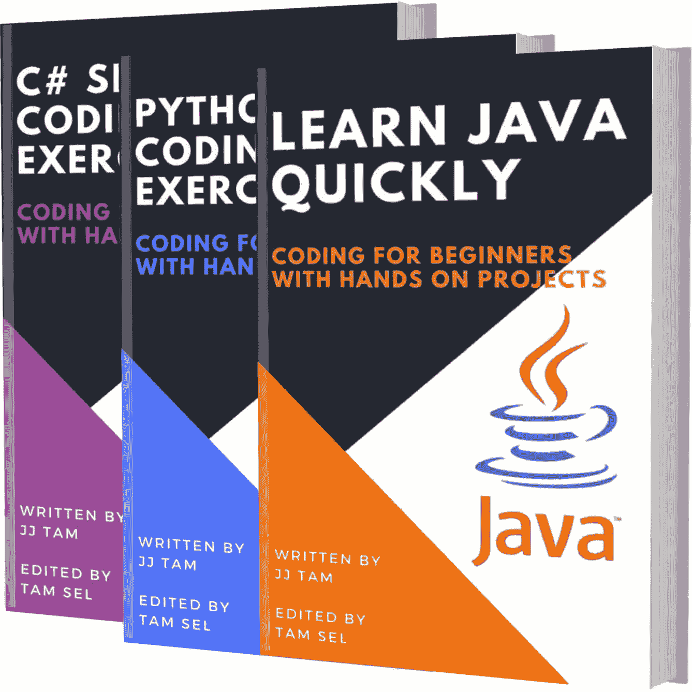

# 快速学习 Java 与编程练习 - Python 和 C#



## 目录

- 学习 Java
- Java 简介
- 在 Java 中运行简单的 Hello World 程序
- Java 中的数据类型
- 更多关于基本类型
- Java 中的运算符
- 算术运算符
- 算术运算符：`++`, `--`
- 条件运算符
- 逻辑运算符
- 位运算符
- Java 中的其他运算符
- 控制流语句：决策：`if-then`, `if-else`, `if-else if-else`
- 控制流语句：决策：`switch`
- 控制流语句：循环：`while`, `do-while`
- 控制流语句：循环：`for`
- 分支语句：`break`
- PYTHON 编程练习
- 获取 Python 版本
- 显示当前日期和时间
- 打印日历
- 计算三角形面积

## 关于 `java` 和 `javac`

假设你将 Java 安装在以下目录：

`C:\Program Files\Java`

那么 Java 编译器 (`javac`) 和 Java 启动器 (`java`) 将出现在：

`C:\Program Files\Java\jdk1.7.0_13\bin`

我们需要将 `C:\Program Files\Java\jdk1.7.0_13\bin` 添加到系统路径，然后我们可以从任何地方运行 Java 程序。按照以下步骤操作：

**步骤 1：** 右键点击计算机图标，打开属性窗口。


**步骤 2：** 点击所示的高级设置选项卡。这将打开系统属性窗口。


**步骤 3：** 打开系统属性并选择“高级”。点击“环境变量”按钮。


**步骤 4：** 你将得到下面的窗口。它包含两个部分：用户变量和系统变量。


从系统变量部分编辑路径，将 Java bin 路径添加到系统变量 `path` 的值字段。在添加之前，像这样添加分号：

`;C:\Program Files\Java\jdk1.7.0_13\bin`


### 如何检查路径是否设置正确

点击确定。打开命令提示符并输入 `javac`。


## Hello World 应用

从简单的打印 "Hello World" 的程序开始。

打开记事本，输入以下代码：

```java
class Hello{
    public static void main(String args[]){
        System.out.println("Hello World");
    }
}
```

将文件保存为 `Hello.java`。

让文件保存在 `C:\java Programs`。打开命令提示符并进入文件所在目录。


### 如何编译程序

使用以下命令：

```bash
javac Hello.java
```

### 如何运行程序

使用以下命令：

```bash
java Hello
```

当你运行命令 `java Hello` 程序后，你将在控制台上看到输出 "Hello World"。

**讨论：**

1. 文件名应与你的 `class` 名称完全相同。这里 `class` 名称是 "Hello"，所以我将文件名保存为 `Hello.java`。

## 详细观察 Hello World 程序

Hello World 程序主要有 3 个组件：

1. 类定义
2. `Main` 方法
3. `println` 方法

### 1. 类定义

```java
class Hello{
    public static void main(String args[]){
        System.out.println("Hello World");
    }
}
```

Java 是一种面向对象的语言。因此，你所编写的任何内容必须包含在类声明中。

类的基本语法是：

```java
class Class_Name{
    // 语句
}
```

按照习惯，类名 `Name` 始终以大字母开头，后跟小字母，例如 `Abc`、`Hello`，类声明中的后续每个单词也以大字母开头，例如 `ThreadExample`。

### 2. 主方法 (Main Method)

```java
class Hello{
    public static void main(String args[]){
        System.out.println("Hello World");
    }
}
```

在 Java 编程语言中，每个应用程序必须包含一个 `main` 方法，其签名为：

`public static void main(String[] args)`

不要担心 `main` 方法的签名，你稍后会学习。现在记住，程序的执行始终从 `main` 方法开始。

### 3. `println` 方法

它简单地将你传递给它的任何信息打印到终端或控制台。

# Java 中的数据类型

Java 主要支持两类数据类型：

1. 基本类型 (Primitive Types)
2. 引用类型 (Reference Types)

### 1. 基本类型

Java 语言支持 8 种基本数据类型。它们是：

- `byte`, `short`, `int`, `long`
- `float`, `double`
- `boolean`
- `char`

- `byte`、`short`、`int` 和 `long` 用于存储整数。
- `float` 和 `double` 用于存储实数值。
- `boolean` 用于存储真或假值。
- `char` 用于存储单个字符。

#### 如何定义变量

语法：

`dataType variableName = value;`

示例：

`int intVariable = 10;`

这里：

- `dataType` 是 `int`
- `variableName` 是 `intVariable`
- `value` 是 `10`

变量是一个命名的内存位置，存储一个值。

#### 定义变量的命名规范

1. 变量名必须以字符或下划线开头。
2. 变量名可以包含字母和数字。
3. `variable` 名称不应该是 Java 的保留字或关键字。
4. 按照习惯，变量名以小字母开头，每个后续单词以大字母开头。

例如：`noOfChar`、`mySalary` 等。

#### Java 关键字

关键字是一个保留字，具有为其定义的特殊含义。

| abstract | continue | for | new | switch |

注意：所有关键字均为小写。

```java
/* 打印变量值的简单程序 */
class DataTypes{
    public static void main(String args[]){
        byte byteVariable = 10;
        short shortVariable = 20;
        int intVariable = 30;
        long longVariable = 40;
        float floatVariable = 10;
        double doubleVariable = 20.123;
        boolean booleanVariable = false;
        char charVariable ='A';
        System.out.println("******************************************");
        System.out.println("Value Of byte Variable is " + byteVariable);
        System.out.println("Value Of short Variable is " + shortVariable);
        System.out.println("Value Of int Variable is " + intVariable);
        System.out.println("Value Of long Variable is " + longVariable);
        System.out.println("Value Of float Variable is " + floatVariable);
        System.out.println("Value Of double Variable is " + doubleVariable);
        System.out.println("Value Of boolean Variable is " + booleanVariable);
        System.out.println("Value Of char Variable is " + charVariable);
        System.out.println("******************************************");
    }
}
```

**输出：**

```
******************************************
Value Of byte Variable is 10
Value Of short Variable is 20
Value Of int Variable is 30
Value Of long Variable is 40
Value Of float Variable is 10
Value Of double Variable is 20.123
Value Of boolean Variable is false
Value Of char Variable is A
******************************************
```

### 引用类型

在 Java 中 `Strings`、`Arrays` 和 `Objects` 被视为引用类型。稍后会详细讨论这些内容。

#### 一些需要需要的点

1. 和许多语言一样，Java 不支持无符号数。Java 中没有无符号标识符。

```java
class UnsignedEx{
    unsigned int a;
}
```

当你尝试编译上面的类时，会抛出以下错误：

```
UnsignedEx.java:2: error: <identifier> expected
unsigned int a;
UnsignedEx.java:2: error: <identifier> expected
unsigned int a;
2 errors
```

2. 在 Java 中，所有的 `bytes`、`shorts` 在操作之前都会提升为 `int`，因此我们需要显式地进行强制转换。

```java
class ConversionEx{
    public static void main(String args[]){
        byte b1 = 1;
        byte b2 = 2;
        byte b = (b1 + b2);
        System.out.println(b);
        short s1 = 1;
        short s2 = 2;
        short s = (s1 + s2);
        System.out.println(s);
    }
}
```

当你尝试编译上面的程序时，编译器会抛出以下错误：

```
ConversionEx.java:6: error: <identifier> expected
byte b = (b1 + b2);
ConversionEx.java:10: error: <identifier> expected
short s = (s1 + s2);
2 errors
```

（注：此处原文错误信息与逻辑略有出入，已按逻辑意译）

3. 在 Java 中，如果操作数中有一个 `double`，那么结果将是 `double`。

```java
class ConversionEx{
    public static void main(String args[]){
        float f1 = 1.1;
        double f2 = 1.2;
        float f = f1 + f2;
        System.out.println(f);
    }
}
```

当你尝试编译上面的程序，会抛出以下错误：

```
ConversionEx.java:6: error: loss of precision
float f = f1 + f2;
^
required: float
found double
```

为了让运行运行，我们需要结果结果强制转换 `float`：

```java
class ConversionEx{
    public static void main(String args[]){
        byte b1 = 1;
        byte b2 = 2;
        byte b = (byte)(b1 + b2);
        System.out.println(b);
        short s1 = 1;
        short s2 = 2;
        short s = (short)(s1 + s2);
        System.out.println(s);
    }
}
```

**输出：**

```
3
3
```

3. 在 Java 中，如果操作数中有一个 `double`，那么结果将是 `double`。

```java
class ConversionEx{
    public static void main(String args[]){
        float f1 = 1.1;
        double f2 = 1.2;
        float f = f1 + f2;
        System.out.println(f);
    }
}
```

当你尝试编译上面的程序，编译器会抛出以下错误：

```
ConversionEx.java:6: error: loss of precision
float f = f1 + f2;
^
required: float
found double
```


`ConversionEx.java:6: error: loss of precision`

```
float f = f1 + f2;
^
required: float
found double
```

为了让程序运行，将结果强制转换为 `float`：

```java
class ConversionEx{
    public static void main(String args[]){
        float f1 = 1.1;
        double f2 = 1.2;
        float f = (float)(f1 + f2);
        System.out.println(f);
    }
}
```

**输出：**

```
2.3
```

# 关于基本类型的更多信息

1. 数据类型的大小（字节）

数据类型：

- `byte`: 1
- `short`: 2
- `int`: 4
- `long`: 8
- `float`: 4
- `double`: 8
- `boolean` 布尔类型只有两个可能的值：`true` 和 `false`。这种数据类型表示位信息，但其“大小”没有精确定义。

2. 如果你在局部变量中使用基本类型，必须初始化变量。否则编译器会报错。

```java
class PrimitiveDeclaration{
public static void main(String args[]){
    int var1;
    System.out.println(var1);
}
}
```

当你编译上面的程序，抛出错误：

```
PrimitiveDeclaration.java:4: error: variable var1 might have been initialized
System.out.println(var1);
^
1 error
```

3. 将数据赋值给兼容类型

Java 允许在类型兼容时将一种数据类型的值赋值给另一种类型的值。也就是说，我们可以将 `float` 类型赋值给 `double`，`byte` 赋值给 `int`，`char` 赋值给 `int` 等。

当你将字符变量赋值给 `int` 变量时，`int` 变量将存储变量的 Unicode 码。

```java
class Compatible{
public static void main(String args[]){
    char charVar = 'a';
    int intCharVar = charVar;
    byte byteVar = 100;
    short shortVar = byteVar;
    int intVar = shortVar;
    long longVar = intVar;
    float floatVar = longVar;
    double doubleVar = floatVar;
    System.out.println(charVar);
    System.out.println(intCharVar);
    System.out.println(byteVar);
    System.out.println(shortVar);
    System.out.println(intVar);
    System.out.println(longVar);
    System.out.println(floatVar);
    System.out.println(doubleVar);
}

}
```

**输出：**

```
a
97
100
100
100
100
100.0
100.0
```

### 4. 如果你尝试将一种类型的数据赋值给另一个不兼容的类型，编译器将抛出错误。

示例

```java
class Compatible{
  public static void main(String args[]){
  int intVar = 10;
  boolean a = intVar;
  }
}
```

编译时，你将得到下面的错误：

```
Compatible.java:6: error: incompatible types
  boolean a = floatVar;
^
required: boolean
found: float
1 error
```

### 5. 如果你想将高数据类型的值赋值给兼容的低数据类型，那么你应该对其进行外部强制类型转换，否则编译器将抛出提示为“可能会丢失精度”的错误。

语法：

`dataType value1 = (dataType) value2;`

```java
class Compatible{
  public static void main(String args[]){
  double doubleVar = 109.05;
  char ch = doubleVar;
  System.out.println(doubleVar);
  System.out.println(ch);
  }
}
```

编译时，你将得到下面的错误。

```
Compatible.java:5: error: possible loss of precision
char ch = doubleVar;
^
required: char
found: double
1 error
```

为了解决上述错误，我们需要像下面一样显式转换：

```java
class Compatible{
  public static void main(String args[]){
  double doubleVar = 109.05;
  char ch = (char)doubleVar;
  System.out.println(doubleVar);
  System.out.println(ch);
  }
}
```

### 6. 始终通过在 `float` 变量后面添加“f”来给其赋值，如下所示：

`float floatVar = 10.09f`

否则编译器将抛出错误。

```java
class Compatible{
  public static void main(String args[]){
  float floatVar = 10.09;
  System.out.println(floatVar);
  }
}
```

编译时，你将得到下面的错误：

```
Compatible.java:3: error: possible loss of precision
float floatVar = 10.09;
^
required: float
found: double
1 error
```

要解决上述错误，请如下定义 `float` 变量：

`float floatVar = 10.09f;`

# Java 中的运算符

运算符是执行操作的符号。

如果运算符对单个操作数执行操作，则称为`一元运算符` (unary)。

例如：

```java
int a = 10;
a++;
```

如果运算符对两个操作数执行操作，则称为`二元运算符` (binary)。

例如：

```java
int a=10, b=20;
int c = a-b;
```

如果运算符对三个操作数执行操作，则称为`三元运算符` (ternary)。

例如：

```java
int a = 10, b=20, c;
c= (a>b) ? a : b;
```

Java 中的运算符分为四大大类：

- 算术运算符
- 条件运算符
- 逻辑运算符
- 位运算符
- 其他运算符（如赋值、逗号等）

## 算术运算符

| 运算符 | 执行的操作 |
| :--- | :--- |
| `+` | 加法（也用于字符串拼接） |
| `-` | 减法 |
| `/` | 除法 |
| `*` | 乘法 |
| `%` | 取余数 |
| `++` | 前置或后自增 |
| `--` | 前置或后自减 |

```java
class ArithmeticOperation{
  public static void main(String args[]){
  int operand1 = 30;
  int operand2 = 10;
  System.out.println("Addition of operand1 and operand2 is " + (operand1 + operand2));
  System.out.println("Subtraction of operand1 and operand2 is " + (operand1 - operand2));
  System.out.println("Multiplication of operand1 and operand2 is " + (operand1 * operand2));
  System.out.println("Division of operand1 and operand2 is " + (operand1 / operand2));
  System.out.println("Remainder of operand1 and operand2 is " + (operand1 % operand2));
  }
}
```

输出

```
Addition of operand1 and operand2 is 40
Subtraction of operand1 and operand2 is 20
Multiplication of operand1 and operand2 is 300
Division of operand1 and operand2 is 3
Remainder of operand1 and operand2 is 0
```

### 需要注意的点

1. 乘法、除法和取余运算符的优先级高于加法和减法运算符。

示例

```java
class ArithmeticPriority{
  public static void main(String args[]){
  int var1 = 10, var2 = 20;
  int result = var1+var2*var1;
  System.out.println(result);
  result = var1-var2/var1;
  System.out.println(result);
  result = var1+var2%var1;
  System.out.println(result);
  }
}
```

输出

```
210
8
10
```

### 解析

对于表达式 `result = var1+var2*var1`：

- `10 + 20*10`
- `10 + 200`
- `210`

对于表达式 `result = var1-var2/var1`：

- `10 - 20/10`
- `10 - 2`
- `8`

对于表达式 `result = var1+var2%var1`：

- `10 + 20%10`
- `10 + 0`
- `10`

2. 取余运算符总是返回分子。

例如：

`5 % 2 = 1`

```java
class RemainderEx{
  public static void main(String args[]){
  int var1 = 25, var2 = 10;
  System.out.println(var1%var2);
  var1= 25;
  System.out.println(var1%var2);
  }
}
```

# 算术运算符：`++`, `--`

`++` 自增运算符将值加 1

`--` 自减运算符将值减 1

### 前置自增

语法：`++variable`

前置自增立即将变量值加 1。

示例：

```java
class PreIncrement{
  public static void main(String args[]){
  int var = 10;
  System.out.println(++var);
  }
}
```

输出：`11`

### 后置自增

语法：`variable++`

后置自增在执行当前语句后将变量值加 1。

示例：

```java
class PostIncrement{
  public static void main(String args[]){
  int var = 10;
  System.out.println(var++);
  System.out.println(var);
  }
}
```

输出：

```
10
11
```

### 前置自减

语法：`--variable`

前置自减立即将变量值减 1。

示例：

```java
class PreDecrement{
  public static void main(String args[]){
  int var = 10;
  System.out.println(--var);
  }
}
```

输出：`9`

### 后置自减

语法：`variable--`

后置自减在执行当前语句后将变量值减 1。

示例：

```java
class PostDecrement{
  public static void main(String args[]){
  int var = 10;
  System.out.println(var--);
  System.out.println(var);
  }
}
```

输出：

```
10
9
```

### 更多示例

```java
class ArithmeticEx{
  public static void main(String args[]){
  int var = 10;
  int result = var++ + var++;
  System.out.println("value of variable is " + var);
  System.out.println("Result is " + result);
  result = var++ + ++var;
  System.out.println("value of variable is " + var);
  System.out.println("Result is " +result);
  result = var++ + var--;
  System.out.println("value of variable is " + var);
  System.out.println("Result is " + result);
  result = --var + var--;
  System.out.println("value of variable is " + var);
  System.out.println("Result is " + result);
  }
}
```

输出

```
value of variable is 12
Result is 21
value of variable is 14
Result is 26
value of variable is 14
Result is 29
value of variable is 12
Result is 26
```

## 条件运算符

条件运算符判断一个操作数是否大于、小于、等于或不等于另一个操作数。

| 运算符 |  |
| :--- | :--- |
| `==` | 等于 |
| `!=` | 不等于 |
| `>` | 大于 |
| `>=` | 大于 |
| `<` | 小于 |
| `<=` | 小于 |

条件运算符接收两个操作数，如果条件为真则返回 `true`，否则返回 `false`。

示例

```java
class ConditionalEx{
  public static void main(String args[]){
  int a = 10, b=11;
  System.out.println("is a equals to a " + (a==a));
  System.out.println("is a equals to b " + (a==b));
  System.out.println("is a not equals to a " + (a!=a));
  System.out.println("is a not equals to b " + (a!=b));
  System.out.println("is a less than a " + (a<a));
  System.out.println("is a less than b " + (a<b));
  System.out.println("is a less than or equal to a " + (a<=a));
  System.out.println("is a less than or equal b " + (a<=b));
  System.out.println("is a greater than a " + (a>a));
  System.out.println("is a greater than b " + (a>b));
  System.out.println("is a greater than or equal to a " + (a>=a));
  System.out.println("is a greater than or equal to b " + (a>=b));
  }
}
```

输出


```
is a equals to a true
is a equals to b false
is a not equals to a true
is a not equals to b true
is a less than a false
is a less than b true
is a less than or equal to a false
is a less than or equal b true
is a greater than a false
is a greater than b false
is a greater than or equal to a true
is a greater than or equal to b false
```

`is a` 不等于 `a` 为假

`is a` 不等于 `b` 为真

`is a` 小于 `a` 为假

`is a` 小于 `b` 为真

`is a` 小于等于 `a` 为真

`is a` 小于等于 `b` 为真

`is a` 大于 `a` 为假

`is a` 大于 `b` 为假

`is a` 大于等于 `a` 为真

`is a` 大于等于 `b` 为假

### 注意事项

1. 如果类型兼容，你可以将一种 `type` 类型的数据与另一种比较。

```java
class ConditionalEx{
    public static void main(String args[]){
      int a = 10;
      float b = 1.09f;
      char c = 'a';
      System.out.println("a less than b " + (a<b));
      System.out.println("a less than c " + (a<c));
    }
}
```

输出

```
a less than b false
a less than c true
```

2. 如果你尝试比较两个不兼容的类型值，编译器将抛错误。

```java
class ConditionalEx{
    public static void main(String args[]){
      int a = 10;
      boolean b = true;
      System.out.println("a less than b " + (a<b));
    }
}
```

如果你尝试编译上面的程序，你将得到下面的错误

```
ConditionalEx.java:8: error: bad operand types for binary operator '<'
  System.out.println("a less than b " + (a<b));
^
first type: int
second type: boolean
1 error
```

## 逻辑运算符

Java 提供了三种逻辑运算符，它们分别是 `&&`（与）、`||`（或）和 `!`（非）。

逻辑与也称为条件与。

逻辑或也称为条件或。

逻辑与、或被称为短路运算符，我们很快就会知道为什么它们被称为短路。

### 逻辑与运算符 (&&)

| 操作数 1 | 操作数 2 | 结果为 |

| :--- | :--- | :--- |

| TRUE | TRUE | TRUE |

| TRUE | FALSE | FALSE |

| FALSE | TRUE | FALSE |

| FALSE | FALSE | FALSE |

如上表所示，如果两个操作数求值都真，`&&` 运算符返回 true，否则返回 false。

### 示例

```java
class AndEx{
    public static void main(String args[]){
      boolean operand1 = true;
      boolean operand2 = true;
      System.out.println((operand1 && operand2));
      operand1 = true;
      operand2 = false;
      System.out.println((operand1 && operand2));
      operand1 = false;
      operand2 = true;
      System.out.println((operand1 && operand2));
      operand1 = false;
      operand2 = false;
      System.out.println((operand1 && operand2));
    }
}
```

输出

```
true
false
false
false
```

#### 为什么逻辑与被称为短路运算符

因为如果表达式中的第一个语句求值为假，那么 Java 就不会求值整个表达式。因此，逻辑与被称为短路与。

示例

```java
class ShortCircuitAnd{
    public static void main(String args[]){
      int a = 10, b=21;
      if( (a>b) && (a++ > b) ){
        System.out.println("This statement not evaluated");
      }
      System.out.println("a is not incremented " + a);
      if( (a<b) && (a++ < b) ){
        System.out.println("This statement is evaluated");
      }
      System.out.println("a is not incremented " + a);
    }
}
```

输出

```
a is not incremented 10
This statement is evaluated
a is not incremented 11
```

### 观察

在表达式 `(a>b) && (a++ > b)` 中，`a>b` 为假，所以 `&&` 运算符不会求值表达式中的第二个语句，因此 `a` 没有自增。

### 逻辑或运算符 (||)

| 操作数 1 | 操作数 2 | 结果为 |

| :--- | :--- | :--- |

| TRUE | TRUE | TRUE |

| TRUE | FALSE | TRUE |

| FALSE | TRUE | TRUE |

| FALSE | FALSE | FALSE |

如上表所示，如果任何一个操作数求值为真，`||` 运算符返回 true，否则返回 false。

### 示例

```java
class OrEx{
    public static void main(String args[]){
      boolean operand1 = true;
      boolean operand2 = true;
      System.out.println((operand1 || operand2));
      operand1 = true;
      operand2 = false;
      System.out.println((operand1 || operand2));
      operand1 = false;
      operand2 = true;
      System.out.println((operand1 || operand2));
      operand1 = false;
      operand2 = false;
      System.out.println((operand1 || operand2));
    }
}
```

输出

```
true
true
true
false
```

#### 为什么逻辑或被称为短路运算符

因为如果第一个语句求值为真，那么 Java 就不会求值整个表达式。因此，逻辑或被称为短路或。

### 示例

```java
class ShortCircuitOr{
    public static void main(String args[]){
      int a = 10, b=21;
      if( (a<b) || (a++ < b) ){
        System.out.println("This statement evaluated");
      }
      System.out.println("a is not incremented " + a);
      if( (a>b) || (a++ > b) ){
        System.out.println("This statement is evaluated");
      }
      System.out.println("a is incremented " + a);
    }
}
```

输出

```
This statement evaluated
a is not incremented 10
a is incremented 11
```

### 逻辑 (!) 运算符

| 操作数 | 执行结果为 |

| :--- | :--- |

| FALSE | TRUE |

| TRUE | FALSE |

如果操作数为 FALSE，`!` 运算符将其求值为 TRUE。如果操作数为 TRUE，`!` 运算符将其求值为 FALSE。

### 示例

```java
class LogicalNot{
    public static void main(String args[]){
      boolean a = false;
      System.out.println(!a);
      a = true;
      System.out.println(!a);
    }
}
```

输出

```
true
false
```

## 位运算符

Java 提供了位运算符，用于对整数类型执行位操作。

| 运算符 | 描述 |

| :--- | :--- |

| `~` | 取反 |

| `<<` | 左移 |

| `>>` | 有符号右移 |

| `>>>` | 无符号右移 |

| `&` | 位与 |

| `|` | 位或 |

| `^` | 位异异 |

### 取反运算符 (~)

取反运算符翻转整数的每一个位（0 变 1，1 变 0）。例如，`int a = 5;` 的二进制表示为 `00000000000000000000000000000101`，`~a` 的结果是 `11111111111111111111111111111010`。

### 示例

```java
class NotEx{
    public static void main(String args[]){
      int a = 5;
      System.out.println(~a);
    }
}
```

输出

```
-6
```

### 左移运算符 (<<)

左移运算符将操作数的位向左移动指定的位数，右侧补 0。这相当于将操作数乘以 2 的 $n$ 次方。

### 示例

```java
class LeftShiftEx{
    public static void main(String args[]){
      int a = 5;
      System.out.println(a << 1);
      System.out.println(a << 2);
    }
}
```

输出

```
10
20
```

### 有符号右移运算符 (>>)

有符号右移运算符将操作数的位向右移动指定的位数，左侧补符号位（正数补 0，负数补 1）。

### 示例

```java
class RightShiftEx{
    public static void main(String args[]){
      int a = 20;
      System.out.println(a >> 1);
      System.out.println(a >> 2);
    }
}
```

输出

```
10
5
```

### 无符号右移运算符 (>>>)

无符号右移运算符将操作数的位向右移动指定的位数，左侧始终补 0，无论符号位如何。

### 示例

```java
class UnsignedRightShiftEx{
    public static void main(String args[]){
      int a = -20;
      System.out.println(a >>> 1);
    }
}
```

输出

```
2147483638
```

### 位与运算符 (&)

位与运算符比较两个操作数的位，只有当两个位都为 1 时，结果位才为 1，否则为 0。

### 示例

```java
class BitAndEx{
    public static void main(String args[]){
      int a = 5; // 101
      int b = 3; // 011
      System.out.println(a & b);
    }
}
```

输出

```
1
```

### 位或运算符 (|)

位或运算符比较两个操作数的位，只要其中一个位为 1，结果位就为 1，否则为 0。

### 示例

```java
class BitOrEx{
    public static void main(String args[]){
      int a = 5; // 101
      int b = 3; // 011
      System.out.println(a | b);
    }
}
```

输出

```
7
```

### 位异异运算符 (^)

位异异运算符比较两个操作数的位，只有当两个位不同时，结果位才为 1，如果相同则为 0。

### 示例

```java
class BitXorEx{
    public static void main(String args[]){
      int a = 5; // 101
      int b = 3; // 011
      System.out.println(a ^ b);
    }
}
```

输出

```
6
```

右移运算符简单地将所有位向右移动一位，即它简单地将数值减半（除以 2）。

### 语法

`variable >> n`

将 `variable` 向右移动 `'n'` 次。

`Variable >> n` 等于 `variable = variable / 2 power n`

```java
int var = 128;
var >> 1 = 128 / (2 power 1) = 64
var >> 2 = 128 / (2 power 2) = 32
```

### 示例

```java
class BitWiseEx{
    public static void main(String args[]){
      int intVar = 128;
      System.out.println("Value of int variable is " + intVar);
      System.out.println("After shifting 1 bit Right " + (intVar>>1));
      System.out.println("After shifting 2 bits Right " + (intVar>>2));
      System.out.println("After shifting 3 bits Right " + (intVar>>3));
      System.out.println("After shifting 4 bits Right " + (intVar>>4));
      System.out.println("After shifting 5 bits Right " + (intVar>>5));
      System.out.println("After shifting 6 bits Right " + (intVar>>6));
      System.out.println("After shifting 6 bits Right " + (intVar>>7));
      System.out.println("Value of int variable is " + intVar);
    }
}
```

### 输出

```
Value of int variable is 128
After shifting 1 bit Right 64
After shifting 2 bits Right 32
After shifting 3 bits Right 16
After shifting 4 bits Right 8
After shifting 5 bits Right 4
After shifting 6 bits Right 2
After shifting 6 bits Right 1
Value of int variable is 128
```

#### 位运算无符号右移(>>>)

将所有位向右移动一位，并将最左侧位置零


```java
class BitWiseEx{
    public static void main(String args[]){
      int intVar = -128;
      System.out.println("Value of int variable is " + intVar);
      System.out.println("After shifting 1 bit Right " + (intVar>>>1));
    }
}
```

### 输出

```
Value of int variable is -128
After shifting 1 bit Right 2147483584
```

### 解释

`-128` 在补码形式下为：

`11111111 11111111 11111111 10000000`

`>>>` 将位向右移动一位并将最左侧位替换为零

所以 `(-128>>>1)` 的序列如下：

`01111111 11111111 11111111 11000000`

#### 位与与(&), 逻辑或(|), 异或(^)

| 位 1 | 位 2 | & | \| | ^ |
| :--- | :--- | :--- | :--- | :--- |
| 0 | 0 | 0 | 0 | 0 |
| 0 | 1 | 0 | 1 | 1 |
| 1 | 0 | 0 | 1 | 1 |
| 1 | 1 | 1 | 1 | 0 |

### 示例

```java
class BitWiseEx{
    public static void main(String args[]){
      byte a = 8;
      byte b = 9;
      System.out.println("a & b is " + (a&b));
      System.out.println("a | b is " + (a|b));
      System.out.println("a ^ b is " + (a^b));
    }
}
```

### 输出

```
a & b is 8
a | b is 9
a ^ b is 1
```

### 解释

- `a` = `0000 1000`
- `b` = `0000 1001`
- `a&b` = `0000 1000`
- `a` = `0000 1000`
- `b` = `0000 1001`
- `a|b` = `0000 1001`
- `a` = `0000 1000`
- `b` = `0000 1001`
- `a^b` = `0000 0001`

**注意：** 位运算符仅适用于整数值，如 `byte`、`short` 等，这些不适用于 `float`、`double`、`Boolean`。

# Java 中的其他运算符

## 赋值运算符

赋值运算符用于给变量赋值。

### 语法

`type variable = value;`

### 示例

```java
int a = 10;
int b = 20;
```

### 复合赋值

Java 支持复合赋值。

### 语法

`variable operator= value`

#### 示例：

假设 `int a = 10;` `a+=10` 求值结果为 `a=a+10`

| 复合运算符 | 示例 | 说明 |
| :--- | :--- | :--- |
| `+=` | `a+=10` | `a=a+10` |
| `-=` | `a-=10` | `a=a-10` |
| `*=` | `a*=10` | `a=a*10` |
| `/=` | `a/=10` | `a=a/10` |

#### 示例程序

```java
class CompoundAssignment{
    public static void main(String args[]){
      int var1 = 100;
      int sum=10, sub=10, mul=10, div=100;
      System.out.println("sum+var1 is " + (sum+=var1));
      System.out.println("sub-var1 is " + (sub-=var1));
      System.out.println("mul*var1 is " + (mul*=var1));
      System.out.println("div/var1 is" + (div/=var1));
    }
}
```

### 输出

```
sum+var1 is 110
sub-var1 is 0
mul*var1 is 100
div/var1 is10
```

#### 类型比较运算符

`instanceof` 运算符将对象与指定的类型进行比较。它可以测试对象是否是某个 `class`、`subclass` 或 `interface` 的实例。

### 示例

```java
class InstanceOfEx{
    public static void main(String args[]){
      Object obj = new Object();
      System.out.println(obj instanceof Object);
      System.out.println(obj instanceof InstanceOfEx);
    }
}
```

### 输出

```
true
false
```

#### 三元运算符

根据条件返回两个表达式之一。

### 语法

`test ? expression1 : expression2`

如果 `"test"` 条件为真，则返回 `expression1`，否则返回 `expression2`。

### 示例

```java
class TernaryEx{
    public static void main(String args[]){
      int a = 100;
      int flag = a>10 ? 1 : 0;
      System.out.println(flag);
    }
}
```

### 输出

```
1
```

### 观察

查看语句 `"flag = a>10 ? 1 : 0"`，`a>10` 为真，因此返回 `1` 并赋值给 `flag`。

# 控制语句：决策：if-then, if-else, if-else-else

Java 提供了用于决策（`if`、`if-else`、`switch`）和循环（`for`、`while`、`do-while`）的控制语句。

### 语句块

在 java 中，`{ }` 之间的语句被称为语句块。

```
{
    // 代码块
}
```

### 决策语句

#### if 语句

当条件为真时执行代码部分。

### 语法

```java
if(condition){
    // 条件为真时执行
}
```

### 示例

```java
class Grades{
    public static void main(String args[]){
      int marks = 20;
      if(marks < 35 ){
        System.out.println("You failed in the Exam. Better luck time");
      }
    }
}
```

### 输出

```
You failed in the Exam. Better luck time
```

一些需要记忆的点

1. 在 java 中，`if` 中的条件必须求值为布尔值，否则编译器会报错。

### 示例

```java
class Grades{
    public static void main(String args[]){
      int var1;
      if(var1 = 10){
      }
    }
}
```

当你尝试编译上面的程序时，将得到下面的错误：

```
Grades.java:5: error: incompatible types
if(var1 = 10){
^
required: boolean
found: int
1 error
```

#### if-else 语句

### 语法

```java
if(condition){
}
else{
}
```

如果条件为真，则执行 if 块；否则执行 else 块。

### 示例

```java
class Grades{
    public static void main(String args[]){
      int marks = 36;
      if(marks < 35)
        System.out.println("You are failed");
      else
        System.out.println("You are passed");
    }
}
```

### 输出

```
You are passed
```

### 观察

在上面的程序中，我们没有在 `{ }` 之间编写 if 和 else 块，因为块之间只有一条语句，我们可以省略 `{ }`。

#### if-else if-else

通过使用 `if-else if-else` 结构，你可以选择多个备方案。`if` 语句可以跟随可选的 `else if...else` 语句，这对于使用单个 `if...else` 语句测试各种条件非常有用。

```java
class Grades{
    public static void main(String args[]){
      int marks = 69;
      if(marks < 35)
        System.out.println("You are failed");
      else if( marks < 50)
        System.out.println("You are passed and got third class");
      else if( marks < 60)
        System.out.println("You are passed and got second class");
      else if( marks < 70)
        System.out.println("You are passed and got first class");
      else
        System.out.println("You are passed and got distinction");
    }
}
```

### 输出

```
You are passed and got first class
```

#### switch 语句

`switch` 语句的主体被称为 `switch` 块。`switch` 块中的语句可以带有一个或多个 `case` 或 `default` 标签。`switch` 语句评估其表达式，然后执行匹配的 case 标签之后的所有语句。

Java 7 在 switch case 评估中支持字符串，以及几个包装某些原始类型的特殊类：`Character`、`Byte`、`Short` 和 `Integer`。

`Integer`、`Char`、`Byte`、`Short` 被包装类。将在后续文章中详细讨论这些内容。

### 示例

```java
class SwitchEx{
    public static void main(String args[]){
        int day = 5;
        switch(day){
            case 1:
                System.out.println("Sunday");
                break;
            case 2:
                System.out.println("Monday");
                break;
            case 3:
                System.out.println("Tueday");
                break;
            case 4:
                System.out.println("Wednesday");
                break;
            case 5:
                System.out.println("ThursDay");
                break;
            case 6:
                System.out.println("Friday");
                break;
            case 7:
                System.out.println("Saturday");
                break;
            default:
                System.out.println("You entered wrong day number");
        }
    }
}
```

**输出**

```
ThursDay
```

### 解释

如你在上面的程序所示，变量 `day` 被设置为值 `5`。因此在 `switch` case 中，执行了 `case 5`。如果 `day` 被设置为 `1`，则将执行 `case 1` 并跳出 `switch`。

你可以在上面的程序中看到，每个 case 都有一个关联的 `break` 语句，这有必要吗？是的，当然有。如果你没有在 case 语句中指定 `break`，那么被评估 case 之后的所有 case 语句都会执行。

还有一点是，case 语句不需要按顺序排列。它们可以用任何方式编写。

```java
class SwitchEx{
    public static void main(String args[]){
        int day = 5;
        switch(day){
            case 2:
                System.out.println("Monday");
            case 3:
                System.out.println("Tueday");
            case 4:
                System.out.println("Wednesday");
            case 5:
                System.out.println("ThursDay");
            case 6:
                System.out.println("Friday");
            case 7:
                System.out.println("Saturday");
            case 1:
                System.out.println("Sunday");
            default:
                System.out.println("You entered wrong day number");
        }
    }
}
```

**输出**

```
ThursDay
Friday
Saturday
Sunday
You entered wrong day number
```

如你在上面的程序所示，`day` 被设置为 `5`，并且对应的 cases 中没有 break。因此执行了 `case 5`、`6`、`7`、`1` 和 `default`。

另外一点是在上面的程序中，`case 1` 在 `7` 之后，这在 Java 中是可以接受的行为。

### 这里 default 的必要性是什么

如果没有 case 被评估，则执行 `default`，就像 `if-else if-else` 阶链中的 `else` 块一样。

### 示例


```java
class SwitchEx{
    public static void main(String args[]){
        int day = 9;
        switch(day){
            case 1:
                System.out.println("Sunday");
                break;
            case 2:
                System.out.println("Monday");
                break;
            case 3:
                System.out.println("Tueday");
                break;
            case 4:
                System.out.println("Wednesday");
                break;
            case 5:
                System.out.println("ThursDay");
                break;
            case 6:
                System.out.println("Friday");
                break;
            case 7:
                System.out.println("Saturday");
                break;
            default:
                System.out.println("You entered wrong day number");
        }
    }
}
```

**Output**

```
You entered wrong day number
```

### 记忆点

1. 什么时候使用 `if-else if-else` 阶链而不是 `switch`？

   `Switch` case 不支持如 `age>30`、`year<2000` 等范围检查，在这些情况下最好使用 `if-else if-else` 阶链。

# 控制流语句：循环：`while`, `do-while`

### `while`

`while` 语句执行一个语句块，直到特定条件为真。

**Syntax**

```
while (expression) {
    //statements
}
```

`while` 语句中的 `expression` 必须评估为布尔值，否则编译器将抛出错误。`while` 语句首先评估 `expression`，直到 `expression` 评估为真，它才会执行 `while` 内部的代码，否则将跳出 `while` 循环。

**Example**: 使用 `while` 循环打印 0 到 9 的数字。

```java
class WhileEx{
    public static void main(String args[]){
        int var1 = 0;
        while(var1 < 10){
            System.out.println(var1);
            var1++;
        }
    }
}
```

**Output**

```
0
1
2
3
4
5
6
7
8
9
```

### `do-while`

`do-while` 也是像 `while` 一样的循环结构，但它在循环的底部评估其表达式。

**Syntax**

```
do {
    //statement(s)
} while (expression);
```

**Example**

```java
class DoWhileEx{
    public static void main(String args[]){
        int var1 = 0;
        do{
            System.out.println(var1);
            var1++;
        } while(var1<10);
    }
}
```

**Output**

```
0
1
2
3
4
5
6
7
8
9
```

**记忆点**

1. `while` 和 `do-while` 的区别是什么？

   `do` 块中的语句即使表达式为假也会执行一次。

**Example**

```java
class CompareLoop{
    public static void main(String args[]){
        boolean flag = false;
        while(flag)
            System.out.println("I am while loop");
        do
            System.out.println("I am do-while loop");
        while(flag);
    }
}
```

**Output**

```
I am do-while loop
```

**Observation**

注意即使表达式 `flag` 为假，`do-while` 也会执行。如果你只有一条语句，则不需要放在 `{ }` 中。

# 控制流语句：循环：`for`

`for` 语句提供迭代范围值的紧凑方式。

**Syntax**

```
for(initialization; condition; update){
    //statements to executed
}
```

`for` 循环执行语句直到条件为假。`Initialization` 部分在循环开始时执行一次。`Condition` 部分在执行语句前评估。`update` 部分在执行语句后执行。

**Example**: 打印 0 到 9 的数字

```java
class ForEx{
    public static void main(String args[]){
        int var1;
        for(var1 = 0; var1 < 10; var1++){
            System.out.println(var1);
        }
    }
}
```

**Output**

```
0
1
2
3
4
5
6
7
8
9
```

**记忆点**

1. 你可以在 `for` 循环内部声明变量：`for(int i=0; i<10; i++)` 是有效的构造。

2. `for( ; )` 会无限循环。

## 分支语句: `break`

### `break` 语句

我们已经在 `switch` case 中见过 `break`。同样，`break` 也用于 `while`、`do-while` 和 `for` 循环。`Break` 在 Java 中有两种形式：

1. 无标签 `break` (unlabelled break)

2. 有标签 `break` (labelled break)

#### 无标签 `break`

**Example**

```java
class BreakEx{
    public static void main(String args[]){
        for(int i=0; i < 10; i++){
            if(i==5) break;
            System.out.println(i);
        }
        System.out.println("I am out of the loop");
    }
}
```

**Output**

```
0
1
2
3
4
I am out of the loop
```

如上面的程序所示，当变量 `i` 达到 5 时调用 `break`，跳出循环。

#### 有标签 `break`

`label` 是一个使用 `labelName` 标识的语句组。

**Syntax**

```
labelName:{
    statement 1
    statement 2
    ....
    statement N
}
```

**Example**

```java
class BreakEx{
    public static void main(String args[]){
        myLoop: {
            for(int i=0; i < 10; i++){
                if(i==5) break myLoop;
                System.out.println(i);
            }
            System.out.println("I am also label");
        }
        System.out.println("I am out of the loop");
    }
}
```

**Output**

```
0
1
2
3
4
I am out of the loop
```

如上面的程序所示，标签名为 `myLoop`。当变量 `i` 的值达到 5 时，跳出标签。

# Python 练习

面向初学者的编程

JJ TAM

PYTHON 练习

### 获取 Python 版本

**CODE**

```python
import sys
print("Python version")
print (sys.version)
print("Version info.")
print (sys.version_info)
```

**OUTPUT**

```
Python version
3.6.6 (default, Jun 28 2018, 04:42:43)
[GCC 5.4.0 20160609]
Version info.
sys.version_info(major=3, minor=6, micro=6, releaselevel='final', serial=0)
```

### 显示当前日期和时间

**PYTHON 代码**

```python
import datetime
now = datetime.datetime.now()
print ("Current date and time : ")
print (now.strftime("%Y-%m-%d %H:%M:%S"))
```

**OUTPUT**

```
Current date and time :
2020-10-22 10:35:31
```

### 打印日历

**PYTHON 代码**

```python
import calendar
y = int(input("Input the year : "))
m = int(input("Input the month : "))
print(calendar.month(y, m))
```

**OUTPUT**

```
Input the year : 2020
Input the month : 10
```

2020 年 10 月

```
Mo Tu We Th Fr Sa Su
      1 2 3 4
5 6 7 8 9 10 11
12 13 14 15 16 17 18
19 20 21 22 23 24 25
26 27 28 29 30 31
```

## 计算 `n+nn+nnn` 的值

### PYTHON 代码

```python
a = int(input("Input an integer : "))
n1 = int( "%s" % a )
n2 = int( "%s%s" % (a,a) )
n3 = int( "%s%s%s" % (a,a,a) )
print (n1+n2+n3)
```

### 输出

```
Input an integer : 6
738
```

### 计算天数

### 程序

```python
from datetime import date

f_date = date(2014, 7, 2)
l_date = date(2015, 7, 11)
delta = l_date - f_date
print(delta.days)
```

### 输出

```
374
```

### Python 计算球体体积

### 程序

```python
pi = 3.1415926535897931
r= 6.0
V= 4.0/3.0*pi* r**3
print('The volume of the sphere is: ',V)
```

### 输出

```
The volume of the sphere is:  904.7786842338603
```

### 计算三角形面积

### 程序

```python
b = int(input("Input the base : "))
h = int(input("Input the height : "))
area = b*h/2
print("area = ", area)
```

### 输出

```
Input the base : 20 
Input the height : 40
area =  400.0  
```

### 计算最大公约数 (GCD)

### 程序

```python
def gcd(x, y):
    gcd = 1
    if x % y == 0:
        return y
    for k in range(int(y / 2), 0, -1):
        if x % k == 0 and y % k == 0:
            gcd = k
            break 
    return gcd
print(gcd(12, 17))
print(gcd(4, 6))
```

### 输出

```
1
2
```

### 计算最小公倍数 (LCM)

### 程序

```python
def lcm(x, y):
  if x > y:
      z = x
  else:
      z = y
  while(True):
    if((z % x == 0) and (z % y == 0)):
      lcm = z
      break
    z += 1
  return lcm
print(lcm(4, 6))
print(lcm(15, 17))
```

### 输出

```
12
25
```

### 将英尺和英寸转换为厘米

### 程序

```python
print("Input your height: ")
h_ft = int(input("Feet: "))
h_inch = int(input("Inches: "))
h_inch += h_ft * 12
h_cm = round(h_inch * 2.5, 1)
print("Your height is : %d cm." % h_cm)
```

### 输出

```
Input your height: 
5
Inches: 3
Your height is : 160 cm.
```

### 时间转换——秒

### PYTHON 代码

```python
days = int(input("Input days: ")) * 3600 * 24
hours = int(input("Input hours: ")) * 3600
minutes = int(input("Input minutes: ")) * 60
seconds = int(input("Input seconds: "))
time = days + hours + minutes + seconds
print("The amounts of seconds", time)
```

### 输出

```
Input days: 4
Input hours: 5
Input minutes: 20
Input seconds: 10
The amounts of seconds 364810
```

### 秒转换为天

### 程序

```python
time = float(input("Input time in seconds: "))
day = time // (24 * 3600)
time = time % (24 * 3600)
hour = time // 3600
time %= 3600
minutes = time // 60
seconds = time
print("d:h:m:s-> %d:%d:%d:%d" % (day, hour, minutes, seconds))
```

### 输出

```
Input time in seconds: 123465
d:h:m:s-> 14:6:56:5
```

### 计算 BMI (身体质量指数)

### 程序

```python
height = float(input("Input your height in meters: "))
weight = float(input("Input your weight in kilogram: "))
print("Your body index is: ", round(weight / (height * height), 2))
```

### 输出

```
Input your height in meters: 6.2
Input your weight in kilogram: 7
Your body index is: 1.8
```

### 整数排序

### 程序


## Python 编程练习

### 输入三个数字并排序输出

```python
x = int(input("Input first number: "))
y = int(input("Input second number: "))
z = int(input("Input third number: "))
a1 = min(x, y, z)
a3 = max(x, y, z)
a2 = (x + y + z) - a1 - a3
print("Numbers in sorted order: ", a1, a2, a3)
```

输出：

```
Input first number: 2
Input second number: 4
Input third number: 5
```

### 获取系统时间

程序：

```python
import time
print(time.ctime())
```

输出：

```
Thu Oct 22 14:59:20
```

### 检查数字正负

Python 代码：

```python
num = float(input("Input a number: "))

if num > 0:
    print("It is positive")
elif num == 0:
    print("It is Zero")
else:
    print("It a negative number")
```

输出：

```
Input a number: 20
It is positive
```

### Python 删除元素

程序：

```python
color = ["Red", "Green", "Orange"]
print("Color: ", color)
del color[0]
print("After the first color: ", color)
```

输出：

```
Color: ['Red', 'Green', 'Orange']
After the first color: ['Green', 'Orange']
```

### 过滤正数

Python 代码：

```python
nums = [34, -1, 23]
print("Original numbers in the list: ", nums)
new_nums = list(filter(lambda x: x > 0, nums))
print("Positive numbers in the list: ", new_nums)
```

输出：

```
Original numbers in the list: [34, -1, 23]
Positive numbers in the list: [34, 23]
```

### 统计列表中数字 4 的个数

程序：

```python
def list_count_4(nums):
  count = 0 
  for num in nums:
    if num == 4:
      count = count + 1
  return count

print(list_count_4([1, 4, 6, 7, 4]))
print(list_count_4([1, 4, 6, 7, 4]))
```

输出：

```
2
2
```

### 判断奇偶数

程序：

```python
num = int(input("Enter a number: "))
mod = num % 2

if mod > 0:
    print("This is an odd number.")
else:
    print("This is an even number.")
```

输出：

```
Enter a number: 5
This is an odd number.
```

### 列表之间的差异

Python 代码：

```python
list1 = [1, 3, 5, 7, 9]
list2 = [1, 2, 4, 6, 8]
diff_list1_list2 = set(list1) - set(list2)
diff_list2_list1 = set(list2) - set(list1)
total_diff = diff_list1_list2 + diff_list2_list1
print(total_diff)
```

输出：

```
[9, 3, 5, 2, 4, 6]
```

### 生成列表的所有排列

Python 代码：

```python
import itertools
print(list(itertools.permutations([1,2,3])))
```

输出：

```
[(1, 2, 3), (1, 3, 2), (2, 1, 3), (2, 3, 1), (3, 1, 2), (3, 2, 1)]
```

### 列表中第二最小的数字

程序：

```python
def second_smallest(numbers):
  if (len(numbers)<2):
    return
  if ((len(numbers)==2) and (numbers[0] == numbers[1]) ):
    return
  dup_items = set()
  uniq_items = []
  for x in numbers:
    if x not in dup_items:
      uniq_items.append(x)
      dup_items.add(x)
  uniq_items.sort()
  return uniq_items[1]

print(second_smallest([1, 2, -8, 0, -2]))
print(second_smallest([1, 1, 0, 0, 2, -2]))
print(second_smallest([1, 1, 1, 0, 0, 0, 2, -2]))
print(second_smallest([2,2]))
print(second_smallest([2]))
```

输出：

```
-2
0
0
None
None
```

### 获取列表中的唯一值

Python 代码：

```python
my_list = [10, 20, 30, 40, 20, 50, 60, 40]
print("Original List : ",my_list)
my_set = set(my_list)
my_new_list = list(my_set)
print("List of unique numbers : ",my_new_list)
```

输出：

```
Original List : [10, 20, 30, 40, 20, 50, 60, 40]
List of unique numbers : [40, 10, 50, 20, 60, 30]
```

### 生成列表的所有子列表

原始列表：

```
[10, 20, 30, 40]
```

上述列表的子列表：

```
[[], [10], [20], [30], [40], [10, 20], [10, 30], [10, 40], [20, 30], [20, 40], [30, 40], [10, 20, 30], [10, 20, 40], [10, 30, 40], [20, 30, 40], [10, 20, 30, 40]]
```

原始列表：

```
['X', 'Y', 'Z']
```

上述列表的子列表：

```
[[], ['X'], ['Y'], ['Z'], ['X', 'Y'], ['X', 'Z'], ['Y', 'Z'], ['X', 'Y', 'Z']]
```

### 从两个列表中查找共同元素

Python 代码：

```python
color1 = "Red", "Green", "Orange", "White"
color2 = "Black", "Green", "White", "Pink"
print(set(color1) & set(color2))
```

输出：

```
'Green', 'White'
```

### 创建一个包含无限元素的列表

Python 代码：

```python
import itertools
c = itertools.count()
print(next(c))
print(next(c))
print(next(c))
print(next(c))
print(next(c))
```

输出：

```
0
1
2
3
4
```

### 移除给定列表中的连续重复项

Python 代码：

```python
from itertools import groupby

def compress(l_nums):
    return [key for key, group in groupby(l_nums)]

n_list = [0, 0, 1, 2, 3, 4, 4, 5, 6, 6, 6, 7, 8, 9, 4, 4]
print("Original list:")
print(n_list)
print("\nAfter consecutive duplicates:")
print(compress(n_list))
```

输出：

```
Original list: [0, 0, 1, 2, 3, 4, 4, 5, 6, 6, 6, 7, 8, 9, 4, 4]
After consecutive duplicates: [0, 1, 2, 3, 4, 5, 6, 7, 8, 9, 4]
```

### 展平化嵌套列表结构

Python 代码：

```python
def flatten_list(n_list):
    result_list = []
    if not n_list: return result_list
    stack = [list(n_list)]
    while stack:
        c_num = stack.pop()
        next = c_num.pop()
        if c_num: stack.append(c_num)
        if isinstance(next, list):
            if next: stack.append(list(next))
        else: result_list.append(next)
    result_list.reverse()
    return result_list

n_list = [0, 10, [20, 30], 40, 50, [60, 70, 80], [90, 100, 110, 120]]
print("Original list:")
print(n_list)
print("\nFlatten list:")
print(flatten_list(n_list))
```

输出：

```
Original list: [0, 10, [20, 30], 40, 50, [60, 70, 80], [90, 100, 110, 120]]
Flatten list: [0, 10, 20, 30, 40, 50, 60, 70, 80, 90, 100, 110, 120]
```

## C# 编程练习

### 在 C# 中分行打印 hello 和你的名字

C# 代码：

```csharp
public class Exercise1
{
    public static void Main( )
    {
        System.Console.WriteLine("Hello");
        System.Console.WriteLine("JJ TAM!");
    }
}
```

输出：

```
Hello
JJ TAM
```

### 打印指定操作的结果

C# 代码：

```csharp
public class Exercise4
{
    public static void Main()
    { 
        System.Console.WriteLine(-1+4*6); // -1 + 24 = 23
        System.Console.WriteLine((3+5)%7); // 8 % 7 = 1 (8/7 的余数)
        System.Console.WriteLine(4+-6/1); // 4 + (-6) = -2
    }
}
```

输出：

```
23
1
-2
```

### 交换两个数字

C# 代码：

```csharp
using System;

public class Exercise5
{
    public static void Main(string[] args)
    {
        int number1,number2,temp;
        Console.Write("输入第一个数字：");
        number1 = int.Parse(Console.ReadLine());
        Console.Write("输入第二个数字：");
        number2 = int.Parse(Console.ReadLine());
        temp = number1;
        number1 = number2;
        number2 = temp;
        Console.Write("交换后的第一个数字：");
        Console.WriteLine(number1);
        Console.Write("交换后的第二个数字：");
        Console.WriteLine(number2);
    }
}
```

输出：

```
输入第一个数字：2
输入第二个数字：5
交换后的第一个数字：5
交换后的第二个数字：2
```

### 打印用户输入的三个数字的乘积

C# 代码：

```csharp
using System;

public class Exercise6
{
  public static void Main()
  {
    int num1,num2,num3;
    Console.Write("输入第一个乘数数字： ");
    num1 = Convert.ToInt32(Console.ReadLine());
    Console.Write("输入第二个乘数数字： ");
    num2 = Convert.ToInt32(Console.ReadLine());
    Console.Write("输入第三个乘数数字： ");
    num3 = Convert.ToInt32(Console.ReadLine());
    int result = num1 * num2 * num3;
    Console.WriteLine("乘积结果：{0} x {1} x {2} = {3}", num1, num2, num3, result);
  }
}
```

输出：

```
输入第一个乘数数字：2
输入第二个乘数数字：8
输入第三个乘数数字：5
乘积结果：2 x 8 x 5 = 80
```

### 用户输入的两个数字的加法、减法、乘法和除法

C# 代码：

```csharp
using System;

public class Exercise7
{
  public static void Main()
  {
    Console.Write("输入一个数字：");
    int num1 = Convert.ToInt32(Console.ReadLine());
    Console.Write("输入另一个数字：");
    int num2 = Convert.ToInt32(Console.ReadLine());
    Console.WriteLine("{0} + {1} = {2}", num1, num2);
    Console.WriteLine("{0} - {1} = {2}", num1, num2);
    Console.WriteLine("{0} x {1} = {2}", num1, num2);
    Console.WriteLine("{0} / {1} = {2}", num1, num2);
  }
}
```

输出：

```
输入一个数字：0
输入另一个数字：2
0 + 2 = 2
0 - 2 = -2
0 x 2 = 0
0 / 2 = 0
```

### 打印四个数字的平均值

C# 代码：

```csharp
using System;
using System.IO;

public class Exercise9
{
  public static void Main()
  {
    double number1,number2,number3,number4;
    Console.Write("输入第一个数字：");
    number1 = Convert.ToDouble(Console.ReadLine());
    Console.Write("输入第二个数字：");
    number2 = Convert.ToDouble(Console.ReadLine());
    Console.Write("输入第三个数字：");
    number3 = Convert.ToDouble(Console.ReadLine());
    Console.Write("输入第四个数字：");
    number4 = Convert.ToDouble(Console.ReadLine());
    double result = (number1 + number2 + number3 + number4) / 4;
    Console.WriteLine("四个数字的平均值为：{0}", result);
  }
}
```

输出：

```
输入第一个数字：10
输入第二个数字：20
输入第三个数字：30
输入第四个数字：40
四个数字的平均值为：25
```


# 计算四个数字的平均值

```csharp
number3 = Convert.ToDouble(Console.ReadLine());

Console.Write("输入第四个数字：");

number4 = Convert.ToDouble(Console.ReadLine());

double result = (number1 + number2 + number3 + number4) / 4;

Console.WriteLine("四个数字的平均值是：{0}", result);
```

```csharp
Console.WriteLine("The average of {0}, {1}, {2}, {3} is: {4} ",
  number1, number2, number3, number4, result);
```

输出：
输入第一个数字: 17
输入第二个数字: 17
输入第三个数字: 517
输入第四个数字: 51
17, 17, 517, 51 的平均值为: 150.5

# 温度转换程序
从摄氏度转换为开尔文和华氏度

- `kelvin = celsius + 273`
- `fahrenheit = celsius x 18 / 10 + 32`

## C# 代码
```csharp
using System;

public class Exercise14
{
  public static void Main()
  {
    Console.Write("Enter the amount of celsius: ");
    int celsius = Convert.ToInt32(Console.ReadLine());

    Console.WriteLine("Kelvin = {0}", celsius + 273);
    Console.WriteLine("Fahrenheit = {0}", celsius * 18 / 10 + 32);
  }
}
```

输出：
输入摄氏度: 40
Kelvin = 313
Fahrenheit = 104

# 计算两个给定整数之和
如果两个值相等，则返回它们和的倍倍

## C# 代码
```csharp
using System;
using System.Collections.Generic;

public class Exercise19
{
  static void Main(string[] args)
  {
    Console.WriteLine(SumTriple(2, 2));
    Console.WriteLine(SumTriple(12, 10));
    Console.WriteLine(SumTriple(-5, 2));
  }

  public static int SumTriple(int a, int b)
  {
    return a == b ? (a + b) * 3 : a + b;
  }
}
```

输出：
12
22
-3

# 计算整数数组中所有元素的和

## C# 代码
```csharp
using System;
using System.Collections.Generic;
using System.Linq;
using System.Threading.Tasks;

public class Exercise47
{
  public static void Main()
  {
    int[] nums = {1, 2, 2, 3, 4, 5, 6, 5, 7, 7, 8, 8, 1};
    Console.WriteLine("\nArray: [{0}]", string.Join(", ", nums));

    var sum = 0;
    for (var i = 0; i < nums.Length; i++)
    {
      sum += nums[i];
    }

    Console.WriteLine("Sum: " + sum);
  }
}
```

输出：
Array: [1, 2, 2, 3, 4, 5, 6, 5, 7, 7, 8, 8, 1]
Sum: 69

# 检查数组是否包含奇数的程序

## 代码
```csharp
using System;
using System.Collections.Generic;
using System.Linq;
using System.Threading.Tasks;

public class Exercise53
{
  public static void Main()
  {
    int[] nums = {2, 4, 7, 8, 6};
    Console.WriteLine("\nOriginal array: [{0}]", string.Join(", ", nums));
    Console.WriteLine("Check if an array contains an odd number? " + even_odd(nums));
  }

  public static bool even_odd(int[] nums)
  {
    foreach (var n in nums)
    {
      if (n % 2 != 0)
        return true;
    }
    return false;
  }
}
```

输出：
Original array: [2, 4, 7, 8, 6]
Check if an array contains an odd number? True

# C# 程序：检查两个给定整数，如果其中一个为 30 或它们的和为 30 则返回 true

## C# 代码
```csharp
using System;

namespace exercises
{
  class Program
  {
    static void Main(string[] args)
    {
      Console.WriteLine(test(30, 0));
      Console.WriteLine(test(25, 5));
      Console.WriteLine(test(20, 30));
      Console.WriteLine(test(20, 25));
      Console.ReadLine();
    }

    public static bool test(int x, int y)
    {
      return x == 30 || y == 30 || (x + y == 30);
    }
  }
}
```

输出：
True
True
False

# C# 程序：检查给定数字是否为 3 的倍数或 7 的倍数

## C# 代码
```csharp
using System;

namespace exercises
{
  class Program
  {
    static void Main(string[] args)
    {
      Console.WriteLine(test(3));
      Console.WriteLine(test(4));
      Console.WriteLine(test(12));
      Console.WriteLine(test(37));
      Console.ReadLine();
    }

    public static bool test(int n)
    {
      return n % 3 == 0 || n % 7 == 0;
    }
  }
}
```

输出：
True
True
False

# 检查给定字符串是否以 'C#' 开头

## C# 代码
```csharp
using System;

namespace exercises
{
  class Program
  {
    static void Main(string[] args)
    {
      Console.WriteLine(test("C Sharp"));
      Console.WriteLine(test("C#"));
      Console.WriteLine(test("C++"));
      Console.ReadLine();
    }

    public static bool test(string str)
    {
      return (str.Length < 3 && str.Equals("C#")) || (str.StartsWith("C#"));
    }
  }
}
```

输出：
True
True
False

# C# 程序找出三个给定整数中的最大值

## C# 代码
```csharp
using System;

namespace exercises
{
  class Program
  {
    static void Main(string[] args)
    {
      Console.WriteLine(test(1, 2, 3));
      Console.WriteLine(test(1, 3, 2));
      Console.WriteLine(test(1, 1, 1));
      Console.WriteLine(test(1, 2, 2));
      Console.ReadLine();
    }

    public static int test(int x, int y, int z)
    {
      var max = Math.Max(x, Math.Max(y, z));
      return max;
    }
  }
}
```

输出：
3
3
1
2

# 程序检查两个给定整数中哪一个最接近 100
如果两个数字相等，则返回 0。

## C# 代码
```csharp
using System;

namespace exercises
{
  class Program
  {
    static void Main(string[] args)
    {
      Console.WriteLine(test(78, 95));
      Console.WriteLine(test(95, 95));
      Console.WriteLine(test(99, 70));
      Console.ReadLine();
    }

    public static int test(int x, int y)
    {
      const int n = 100;
      var val = Math.Abs(x - n);
      var val2 = Math.Abs(y - n);
      return val == val2 ? 0 : (val < val2 ? x : y);
    }
  }
}
```
