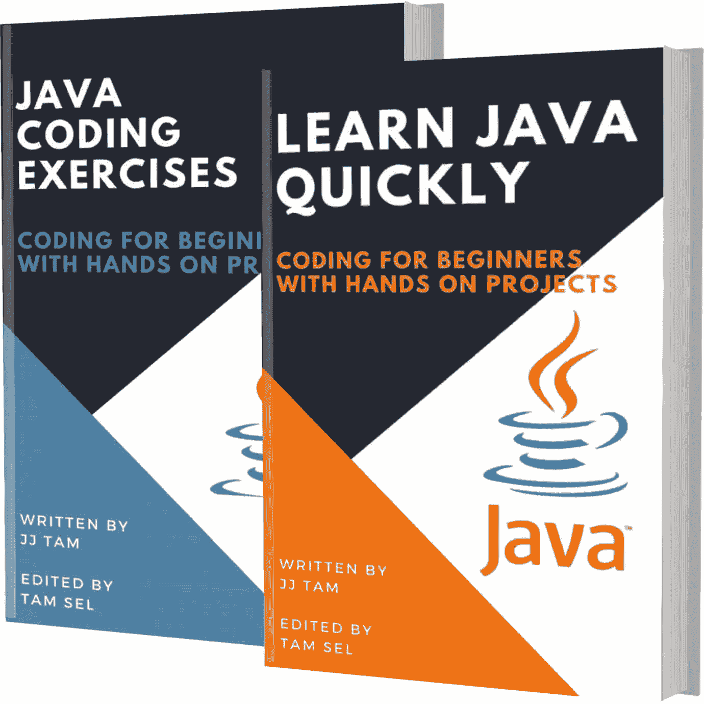
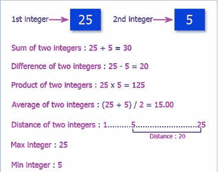

# 快速学习 Java 与 Java 编码练习



## Java 简介

## 在 Java 中运行简单的 Hello World

### 安装

你可以从以下位置下载 java 软件：

http://www.oracle.com/java/javase/downloads/index.html 安装该产品。

### 设置 Java 环境

#### 在 Windows 上

假设你将 java 安装在以下目录：

`C:\Program Files\Java`

那么 java 编译器 `javac` 和 java 启动器 `java` 将位于：

`C:\Program Files\Java\jdk.7.0_13\bin`

我们需要将 `C:\Program Files\Java\jdk.7.0_13\bin` 添加到系统路径中，这样我们就可以任何地方运行程序了。按照以下步骤操作：

1. 右键点击“电脑”图标，打开属性窗口。
2. 点击下所示的“高级设置”。这将打开系统属性窗口。
3. 打开系统属性并选择“高级”选项卡。点击“环境变量”按钮。
4. 你将看到类似下方的窗口。它包含两个部分，一个用户变量，另一个是系统变量。
5. 编辑系统变量部分的 `path`。将 java bin 路径添加到系统变量 "path" 的值中。在添加之前，像下面所示先加一个分号：`;C:\Program Files\Java\jdk.7.0_13\bin`
6. 点击确定。

#### 如何检查路径是否设置正确

打开命令提示符并输入 `javac`。如果你看到输出，说明你成功设置了 java 环境。

#### 在 Unix 系统上

如果你将 java 安装在下面的目录 `/usr/java7`，那么 java 编译器 `javac` 和 java 启动器 `java` 位于 `/usr/java7/bin` 目录。你需要如下所示更新路径：

```bash
export PATH=/usr/java7/bin:$PATH
```

或者如下你在 Linux 的 `/etc/environment` 文件或 AIX 的 `.profile` 文件中更新路径变量：

```bash
export PATH=/usr/java7/bin:$PATH
```

## Hello World

让我们从通常打印“Hello World”的简单程序开始。

打开记事本，输入以下代码：

```java
class Hello{
    public static void main(String args[]){
        System.out.println("Hello World");
    }
}
```

将文件保存为 `Hello.java`。让文件保存在 `C:\java Programs` 路径。打开命令提示符并进入文件保存的目录。

### 如何编译程序

使用以下命令：

```bash
javac Hello.java
```

### 如何运行程序

使用以下命令：

```bash
java Hello
```

在使用命令 `java Hello` 运行程序后，你将看到输出 "Hello World"。

### 讨论

1. 文件名应与 `class` 名称完全相等。这里 `class` 名称是 "Hello"，所以我将文件名保存为 `Hello.java`。

## Java 中的数据类型

Java 主要支持两类数据类型：

1. 原型类型
2. 引用类型

### 1. 原型类型

Java 语言支持 8 种数据数据类型。它们是：

- `byte`, `short`, `int`, `long`
- `float`, `double`
- `boolean`
- `char`

- `byte`, `short`, `int` 和 `long` 用于存储整数值
- `float` 和 `double` 用于存储实数值。
- `Boolean` 用于存储真（true）或假（false）值
- `char` 用于存储单个字符。

# 如何定义变量

### 语法：

`dataType variableName = value;`

### 示例：

```
int intVariable = 10;
```

这里：

- `dataType` 是 `int`
- `variableName` 是 `intVariable`
- `value` 是 `10`

变量是一个命名的内存位置，用于存储一个值。

### 定义变量的命名规范

1. 变量名必须以字符或下划线开头。
2. 变量名可以包含字母和数字字符。
3. 变量名不应该是 `java` 的保留字或关键字。
4. 根据惯例，变量名以小写字母开头，随后的每个单词大大字母开头。

例如：`noOfChar`、`mySalary` 等。

# Java 关键字

关键字是保留字，对其定义了特殊的含义。

| abstract | continue | for | New | switch |

注意：所有关键字均仅限小写。

```java
/* 打印变量值的简单程序 */
class DataTypes{
    public static void main(String args[]){
        byte byteVariable = 10;
        short shortVariable = 20;
        int intVariable = 30;
        long longVariable = 40;
        float floatVariable = 10;
        double doubleVariable = 20.123;
        boolean booleanVariable = false;
        char charVariable ='A';
        System.out.println("******************************************");
        System.out.println("Value Of byte Variable is " + byteVariable);
        System.out.println("Value Of short Variable is " + shortVariable);
        System.out.println("Value Of int Variable is " + intVariable);
        System.out.println("Value Of long Variable is " + longVariable);
        System.out.println("Value Of float Variable is " + floatVariable);
        System.out.println("Value Of double Variable is " + doubleVariable);
        System.out.println("Value Of boolean Variable is " + booleanVariable);
        System.out.println("Value Of char Variable is " + charVariable);
        System.out.println("******************************************");
    }
}
```

### 输出

```
******************************************
Value Of byte Variable is 10
Value Of short Variable is 20
Value Of int Variable is 30
Value Of long Variable is 40
Value Of float Variable is 10.0
Value Of double Variable is 20.123
Value Of boolean Variable is false
Value Of char Variable is A
******************************************
```

# 类型

在 `java` 中，`Strings`、`Arrays` 和 `Objects` 被视为引用类型。将在后续文章中讨论。

### 需要记忆的点

1. 和许多其他语言一样，`java` 不支持无符号数。`java` 中没有无符号标识符。

```java
class UnsignedEx{
unsigned int a;
}
```

当你尝试编译上面的类时，会抛出以下错误：

```
UnsignedEx.java:2: error: <identifier> expected
  unsigned int a;
    ^
UnsignedEx.java:2: error: <identifier> expected
  unsigned int a;
    ^
2 errors
```

2. 在 `java` 中，所有的 `bytes`、`shorts` 在对它们进行操作之前都会被提升为 `int`，因此我们需要显式地进行强制转换。

```java
class ConversionEx{
    public static void main(String args[]){
        byte b1 = 1;
        byte b2 = 2;
        byte b = (b1 + b2);
        System.out.println(b);
        short s1 = 1;
        short s2 = 2;
        short s = (s1 + s2);
        System.out.println(s);
    }
}
```

当你尝试编译上面的程序时，编译器会抛出以下错误：

```
ConversionEx.java:6: error: possible loss of precision
byte = (b1 + b2);
^
required: byte
found: int
ConversionEx.java:10: error: possible loss of precision
short s = (s1 + s2);
^
required: short
found: int
2 errors
```

为了使程序正常运行，我们需要在执行操作后显式强制转换：

```java
class ConversionEx{
    public static void main(String args[]){
        byte b1 = 1;
        byte b2 = 2;
        byte b = (byte)(b1 + b2);
        System.out.println(b);
        short s1 = 1;
        short s2 = 2;
        short s = (short)(s1 + s2);
        System.out.println(s);
    }
}
```

**输出**

`3`

3. 在 `java` 中，如果操作数之一是 `double`，另一个也会被提升为 `double`，最终结果将是 `double`。

```java
class ConversionEx{
    public static void main(String args[]){
        float f1 = 1.1f;
        double f2 = 1.2f;
        float f = (f1 + f2);
    }
}
```

```java
System.out.println(doubleVar);
System.out.println(ch);
}
}
```

始终通过在末尾附加 “f” 来给 float 变量赋值，如下所示：

```java
float floatVar = 10.09f
```

否则 编译器将会抛出错误。

```java
class Compatible{
    public static void main(String args[]){
        float floatVar = 10.09;
        System.out.println(floatVar);
    }
}
```

编译时你将得到下面的错误：

```
Compatible.java:3: error: possible loss of precision
float floatVar = 10.09;
^
required: float
found: double
1 error
```

要解决上述错误，请按照如下方式定义 float 变量：

```java
float floatVar = 10.09f;
```

# Java 中的运算符

运算符是执行某种操作的符号。

如果一个运算符对单个操作数执行操作，则称为 `unary`（一元运算符）。

例如：

```java
int a = 10;
a++;
```

如果一个运算符对两个操作数执行操作，则称为 `binary`（二元运算符）。

例如：

```java
int a=10, b=20;
int c = a-b;
```

如果一个运算符对三个操作数执行操作，则称为 `ternary`（三元运算符）。

例如：

```java
int a = 10, b=20, c;
c= (a>b) ? a : b;
```

Java 中的运算符分为 4 大类：

- 算术运算符
- 条件运算符
- 逻辑运算符
- 位运算符
- 其他运算符（如赋值、逗号等）

## 算术运算符

| 运算符 | 执行操作 |
| :--- | :--- |
| `+` | 加法（也用于字符串拼接） |
| `-` | 减法 |
| `/` | 除法 |
| `*` | 乘法 |
| `%` | 取余数 |
| `++` | 前增或后增 |
| `--` | 前减或后减 |

```java
class ArithmeticOperation{
    public static void main(String args[]){
        int operand1 = 30;
        int operand2 = 10;
        System.out.println("Addition of operand1 and operand2 is " + (operand1 + operand2));
        System.out.println("Subtraction of operand1 and operand2 is " + (operand1 - operand2));
        System.out.println("Multiplication of operand1 and operand2 is " + (operand1 * operand2));
        System.out.println("Division of operand1 and operand2 is " + (operand1 / operand2));
        System.out.println("Remainder of operand1 and operand2 is " + (operand1 % operand2));
    }
}
```

输出

```
Addition of operand1 and operand2 is 40
Subtraction of operand1 and operand2 is 20
Multiplication of operand1 and operand2 is 300
Division of operand1 and operand2 is 3
Remainder of operand1 and operand2 is 0
```

### 注意事项

1. 乘法、除法和取数运算符的优先级高于加法和减法运算符。

### 示例

## Java 中的运算符

### 算术运算符：++, --

### 条件运算符

### 逻辑运算符

## 位运算符

# Java 中的其他运算符

## 控制流语句

### 决策：if-then, if ifelse, if-else if-else

### ：：switch

### 循环：while, do-while

### 循环：for

# 分支语句：break

# 分支语句：continue

# 数组

## 一维数组

## 多维数组

## 类与对象

### 声明一个类

# 创建对象

# 构造函数

### 类变量

## JAVA 编程练习

### 打印 hello

### 打印和

### 除以两个数

# 打印结果

# 打印乘法表

### 计算面积

# 交换两个变量

# 打印一个脸

# 华氏度转摄氏度

### 英尺转米

### 数字相加

### 打印年份和天数

# 计算 (BMI)

### 计算米制的速度

### 除以两个指定的整数

### 乘以两个指定的整数

### 打印和

# 找出三个数中的最大值

### 显示乘法表

### 显示图案

# 打印金字塔形状图案

# 显示数字菱形结构


```java
class ArithmeticPriority{
    public static void main(String args[]){
        int var1 = 10, var2 = 20;
        int result = var1+var2*var1;
        System.out.println(result);
        result = var1-var2/var1;
        System.out.println(result);
        result = var1+var2%var1;
        System.out.println(result);
    }
}
```

输出

```
210
8
10
```

## 解析

对于表达式：

- `result = var1+var2*var1`

  `= 10 + 20*10`

  `= 10 +200`

  `= 210`

- `result = var1-var2/var1`

  `= 10-20/10`

  `= 10-2`

  `= 8`

- `result = var1+var2%var1`

  `= 10 + 20 % 10`

  `= 10 + 0`

  `= 10`

取余运算符总是返回被除数的符号。

例如：

`5 % 2 = 1`

```java
class RemainderEx{
    public static void main(String args[]){
        int var1 = 25, var2 = 10;
        System.out.println(var1%var2);
    }
}
```

## 算术运算符： ++, --

`++` 运算符将值加 1。

`--` 运算符将值减 1。

### 前增

语法：`++variable`

前增会立即将值加 1。

示例：

```java
class PreIncrement{
    public static void main(String args[]){
        int var = 10;
        System.out.println(++var);
    }
}
```

输出

```
11
```

### 后增

语法：`variable++`

后增在执行完当前语句后将值加 1。

```java
class PostIncrement{
    public static void main(String args[]){
        int var = 10;
        System.out.println(var++);
    }
}
```

*(注：原文代码块中后增逻辑显示不全，已根据逻辑补全)*

### 前减

语法：`--variable`

前减会立即将值减 1。

示例：

```java
class PreDecrement{
    public static void main(String args[]){
        int var = 10;
        System.out.println(--var);
    }
}
```

输出

```
9
```

### 后减

语法：`variable--`

后减在执行完当前语句后将值减 1。

```java
class PostDecrement{
    public static void main(String args[]){
        int var = 10;
        System.out.println(var--);
    }
}
```

Java 提供了三个逻辑运算符：它们是 `&&`（与）、`||`（或）和 `!`（非）。

- 逻辑与也被称为条件与。

- 逻辑或也被称为条件或。

- 逻辑与、`OR` 被称为短路运算符，很快就会看到为什么这些被称为短路运算符。

## 逻辑与运算符

| 操作数 1 | 操作数 2 | 求值结果为 |

| :--- | :--- | :--- |

| TRUE | TRUE | TRUE |

| TRUE | FALSE | FALSE |

| FALSE | TRUE | FALSE |

| FALSE | FALSE | FALSE |

如上表所示，当两个操作数的求值均为 `true` 时，`&&` 运算符返回 `true`，否则返回 `false`。

### 示例

```java
class AndEx{
    public static void main(String args[]){
        boolean operand1 = true;
        boolean operand2 = true;
        System.out.println((operand1 && operand2));
        operand1 = true;
        operand2 = false;
        System.out.println((operand1 && operand2));
        operand1 = false;
        operand2 = true;
        System.out.println((operand1 && operand2));
        operand1 = false;
        operand2 = false;
        System.out.println((operand1 && operand2));
    }
}
```

### 输出

```
true
false
false
false
```

### 为什么逻辑与被称为短路运算符

因为如果表达式中的第一个语句求值为为 `false`，那么 `java` 就不会求值整个表达式。因此，逻辑与被称为短路与。

### 示例

```java
class ShortCircuitAnd{
    public static void main(String args[]){
        int a = 10, b=21;
        if( (a>b) && (a++ > b) ){
            System.out.println("This statement not evaluated");
        }
        System.out.println("a is not incremented " + a);
        if( (a<b) && (a++ < b) ){
            System.out.println("This statement is evaluated");
        }
        System.out.println("a is not incremented " + a);
    }
}
```

### 输出

```
a is not incremented 10
This statement is evaluated
a is not incremented 11
```

### 观察

在表达式 `(a>b) && (a++ > b)` 中，`a>b` 为 `false`，所以 `&&` 运算符不会求值表达式中的第二个语句，因此 `a` 没有增加。

## 逻辑或运算符

| 操作数 1 | 操作数 2 | 求值结果为 |

| :--- | :--- | :--- |

| TRUE | TRUE | TRUE |

| TRUE | FALSE | TRUE |

| FALSE | TRUE | TRUE |

| FALSE | FALSE | FALSE |

如上表所示，当任意一个操作数求值为 `true` 时，`||` 运算符返回 `true`，否则返回 `false`。

### 示例

```java
class OrEx{
    public static void main(String args[]){
        boolean operand1 = true;
        boolean operand2 = true;
        System.out.println((operand1 || operand2));
        operand1 = true;
        operand2 = false;
        System.out.println((operand1 || operand2));
        operand1 = false;
        operand2 = true;
        System.out.println((operand1 || operand2));
        operand1 = false;
        operand2 = false;
        System.out.println((operand1 || operand2));
    }
}
```

### 输出

```
true
true
true
false
```

### 为什么逻辑或被称为短路

因为如果第一个语句求值为 `true`，`java` 就不会求值整个表达式。因此，逻辑或被称为短路或。

### 示例

```java
class ShortCircuitOr{
    public static void main(String args[]){
        int a = 10, b=21;
        if( (a<b) || (a++ < b) ){
            System.out.println("This statement evaluated");
        }
        System.out.println("a is not incremented " + a);
        if( (a>b) || (a++ > b) ){
            System.out.println("This statement is evaluated");
        }
        System.out.println("a is incremented " + a);
    }
}
```

### 输出

```
This statement evaluated
a is not incremented 10
a is incremented 11
```

## 逻辑非运算符

| 操作数 | 求值结果为 |

| :--- | :--- |

| FALSE | TRUE |

| TRUE | FALSE |

如果操作数为 `FALSE`，`!` 运算符求值为 `TRUE`。如果操作数为 `TRUE`，`!` 运算符求值为 `FALSE`。

### 示例

```java
class LogicalNot{
    public static void main(String args[]){
        boolean a = true;
        System.out.println(!a);
        a = false;
        System.out.println(!a);
    }
}
```

### 输出

```
false
true
```

## 位运算符

Java 语言提供了对整型类型执行位运算和移位操作的运算符。

| 运算符 | 描述 |

| :--- | :--- |

| `~` | 反反位模式 |

| `<<` | 执行左移 |

| `>>` | 执行右移 |

| `>>>` | 执行无符号右移 |

| `&` | 位与 |

| `\|` | 位或 |

| `^` | 位异异 |

在讨论位运算符之前，我们先看位运算。

### 1 补码

如果第一个语句求值为 `false`，那么它求值为 `true`。

### 取反 (~)

取反运算符反转位模式。

### 2 补码

负数以 2 补码存储。

### 1 补码

取反运算符反转位模式。

例如：

`a = 7;`

`a` 的二进制格式为 `00000111`

`~(a)` 的二进制格式为 `11111000`。

### 2 补码

`8` 的 2 补码是 `00001000`。

### 示例

```java
class BitWiseEx{
    public static void main(String args[]){
        byte a = 7;
        System.out.println(a);
        System.out.println(~a);
    }
}
```

### 输出

```
7
-8
```

### 左移 (<<)

左移运算符将所有位向左移动，即使值翻倍。

语法：

`expression << n`

将 `expression` 向左移动 `n` 位。

例如：

`1 << 1` = `2`

`1 << 2` = `4`

`1 << 3` = `8`

`1 << 4` = `16`

`1 << 5` = `32`

`1 << 6` = `64`

`1 << 7` = `128`

`1 << 8` = `256`

`1 << 9` = `512`

### 示例

```java
class LeftShiftEx{
    public static void main(String args[]){
        int a = 1;
        System.out.println(a << 1);
        System.out.println(a << 2);
    }
}
```

### 输出

```
2
4
```

### 右移 (>>)

右移运算符将所有位向右移动，即使值减半。

语法：

`expression >> n`

将 `expression` 向右移动 `n` 位。

例如：

`128 >> 1` = `64`

`128 >> 2` = `32`

`128 >> 3` = `16`

`128 >> 4` = `8`

`128 >> 5` = `4`

`128 >> 6` = `2`

`128 >> 7` = `1`

### 示例

```java
class RightShiftEx{
    public static void main(String args[]){
        int a = 128;
        System.out.println(a >> 1);
        System.out.println(a >> 2);
    }
}
```

### 输出

```
64
32
```

右移 4 位后

右移 5 位后

右移 6 位后

右移 6 位后

int 变量的值为 128

#### 位运算符：无符号右移(>>>)

`>>>` 将所有位向右移动一位，并将最侧位置零。

```java
class BitWiseEx{
    public static void main(String args[]){
      int intVar = -128;
      System.out.println("Value of int variable is " + intVar);
      System.out.println("After shifting 1 bit Right " + (intVar>>>1));
    }
}
```

### 输出

int 变量的值为 -128

右移 1 位后 2147483584

#### 解释

-128 在补码形式下的表示为：

`11111111 11111111 11111111 10000000`

`>>>` 将位向右移动一位，并将左侧位替换为零

因此 `(-128>>>1)` 的序列如下所示：

`01111111 11111111 11111111 11000000`

#### 位运算符：与(&), 逻辑或(|), 异或(^)

| 位 1 | 位 2 | & | | | ^ |

| :--- | :--- | :--- | :--- | :--- |

| 0 | 0 | 0 | 0 | 0 |

| 0 | 1 | 0 | 1 | 1 |

| 1 | 0 | 0 | 1 | 1 |

| 1 | 1 | 1 | 1 | 0 |

### 示例

```java
class BitWiseEx{
    public static void main(String args[]){
      byte a = 8;
      byte b = 9;
      System.out.println("a & b is " + (a&b));
      System.out.println("a | b is " + (a|b));
      System.out.println("a ^ b is " + (a^b));
    }
}
```

### 输出

a & b is 8

a | b is 9

a ^ b is 1

#### 解释

`a` = `0000 1000`

`b` = `0000 1001`

`a&b` = `0000 1000`

`a` = `0000 1000`

`b` = `0000 1001`

`a|b` = `0000 1001`

`a` = `0000 1000`

`b` = `0000 1001`

`a^b` = `0000 0001`

**注意：** 位运算符仅适用于 `byte`、`short` 等整数值，不适用于 `float`、`double`、`Boolean`。

# Java 中的其他运算符

### 赋值运算符

赋值运算符用于给变量赋值。

**语法：**

`type 变量 = 值;`

**示例：**

`int a = 10;`

`int b = 20;`

Java 支持复合赋值

#### 复合赋值

**语法：**

`变量 运算符= 值`

**示例：**

假设

`int a = 10;`


`a+=10` 结果等于 `a=a+10`

| 复合运算符 | 示例 | 说明 |
| :--- | :--- | :--- |
| `+=` | `a+=10` | `a=a+10` |
| `-=` | `a-=10` | `a=a-10` |
| `*=` | `a*=10` | `a=a*10` |
| `/=` | `a/=10` | `a=a/10` |

## 示例程序

```java
class CompoundAssignment{
    public static void main(String args[]){
      int var1 = 100;
      int sum=10, sub=10, mul=10, div=1000;
      System.out.println("sum+var1 is " + (sum+=var1));
      System.out.println("sub-var1 is " + (sub-=var1));
      System.out.println("mul*var1 is " + (mul*=var1));
      System.out.println("div/var1 is" + (div/=var1));
    }
}
```

### 输出

```
sum+var1 is 110
sub-var1 is -90
mul*var1 is 1000
div/var1 is 10
```

## 类型比较 instanceof

`instanceof` 运算符将 `object` 与指定的类型进行比较。你可以用它测试一个对象是否是 `class` 的实例、`subclass` 的实例，或者是实现了特定 `interface` 的类的实例。

**示例：**

```java
class InstanceOf{
    public static void main(String args[]){
      Object obj = new Object();
      System.out.println(obj instanceof Object);
      System.out.println(obj instanceof InstanceOf);
    }
}
```

### 输出

```
true
false
```

不用太担心这个程序，你会学习类和对象的。

## 三元运算符( ?: )

三元运算符 `?:` 根据条件返回两个表达式之一。

**语法：**

`test ? 表达式 1 : 表达式 2`

如果 `test` 条件为真，返回 `expression1`，否则返回 `expression2`。

**示例：**

```java
class TernaryEx{
    public static void main(String args[]){
      int a = 100;
      int flag = a>10 ? 1 : 0;
      System.out.println(flag);
      flag = a>100 ? 1 : 0;
      System.out.println(flag);
    }
}
```

### 输出

```
1
0
```

**观察：** 语句 `a>10` 为真，所以返回了 `1` 并赋值给 `flag`。

# 控制流语句：选择结构 if-then, if-else, if-else if-else

Java 提供了用于选择（`if`、`if-else`、`switch`）和循环（`for`、`while`、`do-while`）的控制流语句。

## 语句块

Java 中 `{ }` 之间的语句被称为语句块。

### if 语句

当条件为真时，`if` 语句执行代码部分。

**语法：**

`if(条件){ ... }`

**示例：**

```java
class Grades{
    public static void main(String args[]){
      int marks = 20;
      if(marks < 35 ){
        System.out.println("You failed in the Exam. Better time");
      }
    }
}
```

### 输出

```
You failed in the Exam. Better time
```

**注意点：**

1. 在 Java 中，`if` 中的条件必须是布尔值，否则编译器会报错。

**示例：**

```java
class Grades{
    public static void main(String args[]){
      int var1;
      if(var1 = 10){
      }
    }
}
```

当你尝试编译上述程序时会得到如下错误：

```
Grades.java:5: error: incompatible types
if(var1 = 10){
required: boolean
found: int
```

### if-else 语句

**语法：**

`if(条件){ ... } else{ ... }`

如果条件为真，执行 `if` 块；否则执行 `else` 块。

**示例：**

```java
class Grades{
    public static void main(String args[]){
      int marks = 36;
      if(marks < 35)
        System.out.println("You are failed");
      else
        System.out.println("You are passed");
    }
}
```

### 输出

```
You are passed
```

**观察：** 在上面的程序中，我们没有写 `{ }` 语句块，因为块之间只有一个语句，我们可以省略 `{ }`。

### if-else if-else

通过使用 `if-else if-else` 结构，你可以选择方案。`if` 语句可以跟随可选的 `else if...else` 语句，这对于使用单个 `if...else` 语句测试各种条件非常有用。

```java
class Grades{
    public static void main(String args[]){
      int marks = 69;
      if(marks < 35)
        System.out.println("You are failed");
      else if( marks < 50)
        System.out.println("You are passed and got third class");
      else if( marks < 60)
        System.out.println("You are passed and got second class");
      else if( marks < 70)
        System.out.println("You are passed and got first class");
      else
        System.out.println("You are passed and got distinction");
    }
}
```

### 输出

```
You are passed and got first class
```

# 控制流语句：选择结构 switch

`switch` 语句体被称为 switch 块。switch 块中的语句可以使用一个或多个 `case` 或 `default` 标记。`switch` 语句计算表达式，然后执行匹配的标签后的语句。

`switch` 适用于 `byte`、`short`、`char` 和 `int` 原始数据类型。它也支持 `enums`（Java 7 在 case 评估中也支持 `strings`）以及几个包装原始类型的特殊类：`Character`、`Byte`、`Short` 和 `Integer`。`Integer`、`Char`、`Short` 被称为包装类。将在后续文章中详细讨论这些。

**示例：**

```java
class SwitchEx{
    public static void main(String args[]){
      int day = 5;
      switch(day){
        case 1:
          System.out.println("Sunday");
          break;
        case 2:
          System.out.println("Monday");
          break;
        case 3:
          System.out.println("Tueday");
          break;
        case 4:
          System.out.println("Wednesday");
          break;
        case 5:
          System.out.println("ThursDay");
          break;
        case 6:
          System.out.println("Friday");
          break;
        case 7:
          System.out.println("Saturday");
          break;
        default:
          System.out.println("You entered wrong day number");
      }
    }
}
```

### 输出

```
ThursDay
```

#### 解释

如你在上面的程序所示，变量“day”被设置为 5。因此在 switch case 中，执行了 case 5。

你可以从上面的程序看到，每个 `case` 都有关联的 `break` 语句，这是有必要的吗？当然有。如果你没有在 `case` 语句中指定 `break`，那么被评估 case 下的所有 `case` 语句都会执行。

还有一点，`case` 语句不需要顺序。它们可以以任何方式编写。

```java
class SwitchEx{
  public static void main(String args[]){
  int day = 5;
  switch(day){
    case 2:
      System.out.println("Monday");
    case 3:
      System.out.println("Tueday");
    case 4:
      System.out.println("Wednesday");
    case 5:
      System.out.println("ThursDay");
    case 6:
      System.out.println("Friday");
    case 7:
      System.out.println("Saturday");
    case 1:
      System.out.println("Sunday");
    default:
      System.out.println("You entered wrong day number");
  }
}
}
```

**Output**

```
ThursDay
Friday
Saturday
Sunday
You entered wrong day number
```

如你在上面的程序所示，`day` 被设置为 5，并且对应的 cases 中没有 `break`。因此 `case 5`、`6`、`7`、`1` 和 `default` 都被执行了。

另外一点在上面的程序中，`case 1` 位于 `7` 之后，这在 Java 中是可以接受的行为。

### 此处 default 的必要性是什么

如果没有 case 被评估，则会执行 `default`，就像 `if-else if-else` 阶梯中的 `else` 块一样。

### 示例

```java
class SwitchEx{
  public static void main(String args[]){
  int day = 9;
  switch(day){
    case 1:
      System.out.println("Sunday");
      break;
    case 2:
      System.out.println("Monday");
      break;
    case 3:
      System.out.println("Tueday");
      break;
    case 4:
      System.out.println("Wednesday");
      break;
    case 5:
      System.out.println("ThursDay");
      break;
    case 6:
      System.out.println("Friday");
      break;
    case 7:
      System.out.println("Saturday");
      break;
    default:
      System.out.println("You entered wrong day number");
  }
}
}
```

**Output**

```
You entered wrong day number
```

### 需要记忆的点

1. 什么时候使用 `if-else if -else` 阶梯而不是 `switch`？

`Switch` case 不支持像 `age>30`、`year<2000` 等类的范围检查，在这些情况下，使用 `if-else if-else` 阶梯更好。

# 控制流语句：循环：while, do-while

## while

`while` 语句执行一个语句块，直到特定条件为真。

**语法**

```java
while (expression) {
  //statements
}
```

`while` 语句中的 `expression` 必须评估为一个布尔值，否则编译器将抛错。`While` 语句首先评估 `expression`，直到 `expression` 评估为 `true`，它才会执行 `while` 块内的代码，否则将退出 `while` 循环。

**示例**：使用 `while` 循环打印 0 到 9 的数字。

```java
class WhileEx{
  public static void main(String args[]){
  int var1 = 0;
  while(var1 < 10){
    System.out.println(var1);
    var1++;
  }
}
}
```

**Output**

```
0
1
2
3
4
5
6
7
8
9
```

## do-while

`do-while` 也是类似于 `while` 的循环结构，但它在循环的底部评估表达式，而不是顶部。

**语法**

```java
do {
  //statement(s)
} while (expression);
```

**示例**

```java
class DoWhileEx{
  public static void main(String args[]){
  int var1 = 0;
  do{
    System.out.println(var1);
    var1++;
  }while(var1<10);
}
}
```

**Output**

```
0
1
2
3
4
5
6
7
8
9
```

### 需要记忆的点

1. `while` 和 `do-while` 之间的区别是什么？

`do` 块内的语句即使表达式评估为 `false` 也会至少执行一次。

**示例**

```java
class CompareLoop{
  public static void main(String args[]){
  boolean flag = false;
  while(flag)
    System.out.println("I am in while loop");
  do
    System.out.println("I am in do-while loop");
  while(flag);
}
}
```

**Output**

```
I am in do-while loop
```

**观察**

注意，即使表达式 `flag` 为 `false`，`do-while` 也会执行。而且如果你只有一条语句，则不需要在 `{ }` 之间放置该行。

# 控制流语句：循环： for

`for` 语句提供了一种紧凑的方式来遍历值的范围。

**语法**

```java
for(initialization; condition; update){
  //statements
}
```

`for` 循环执行语句直到 `condition` 评估为 `false`。`Initialization` 部分在循环开始时只执行一次。`Condition` 部分在每次执行循环前评估。`update` 部分在每次循环执行后立即执行。

**示例**：打印 0 到 9 的数字

```java
class ForEx{
  public static void main(String args[]){
  for(int var1=0; var1 < 10; var1++){
    System.out.println(var1);
  }
}
}
```

**Output**

```
0
1
2
3
4
5
6
7
8
9
```


```
0
1
2
3
4
5
6
7
8
9
```

**需要记忆的点**

1. 你可以在`for`循环内部声明变量：`for(int i=0; i<10; i++)`是有效的结构。

2. `for( )`会无限运行。

# 分支语句： break

我们已经在`switch` case中见过`break`的用法。同样，`break`也用于`while`、`do-while`和`for`循环。`Break`有两种形式。

## 1. 无标签 break

**示例**

```java
class BreakEx{
  public static void main(String args[]){
  for(int i=0; i < 10; i++){
    if(i==5) break;
    System.out.println(i);
  }
  System.out.println("out of loop");
}
```

**Output**

```
0
1
2
3
4
```

在上面的程序中，当变量`i`达到 5 时，调用`break`并退出循环。

## 2. 有标签 break

`label`是通过`labelname`标识的一组语句。

**语法**

```java
labelName:{
  statement 1
  statement 2
  ....
  statement N
}
```

**示例**

```java
class BreakEx{
  public static void main(String args[]){
  myLoop: {
    for(int i=0; i < 10; i++){
      if(i==5) break myLoop;
      System.out.println(i);
    }
    System.out.println("in label");
  }
  System.out.println("out of loop");
}
```

**Output**

```
0
1
2
3
4
```

如你在上面的程序所示，标签名为`myLoop`。当变量`i`达到 5 时，退出标签。

# 分支语句： continue

`continue`语句跳过`for`、`while`, `do-while`循环的当前迭代。就像`break`一样，`continue`也有形式。

## 无标签 continue

**语法**

```java
continue;
```

**示例**：计算 0 到 10 之间的奇数

```java
class ContinueEx{
  public static void main(String args[]){
  int counter = 0;
  for(int i=0; i < 11; i++){
    if(i % 2 == 0)
      continue;
    System.out.println(i);
    counter++;
  }
  System.out.println("Total number of odd numbers from 0 to 10 is " + counter);
}
}
```

**Output**

```
1
3
5
7
9
Total number of odd numbers from 0 to 10 is 5
```

## 有标签 continue

**语法**

```java
continue labelName;
```

**示例**

```java
class ContinueEx{
  public static void main(String args[]){
  int counter = 0;
  myLabel:
  for(int i=0; i < 11; i++){
    if( i < 10)
      continue myLabel;
    System.out.println(i);
  }
  System.out.println("out of the label");
}
}
```

**Output**

```
10
out of the label
```

# 数组

数组是连续内存位置的相同类型元素的序列。数组中的元素通过索引位置访问。假设你想计算 9 个整数的和，你需要定义 9 个变量：

```java
int var1, var2, var3, var4, var5, var6, var7, var8, var9;
var1 = 5;
var2 = -10;
var3 = 7;
var4 = 8
var5 = 11;
var6 = 12;
var7 = 14;
var8 = 21;
var9 = 0;
```

通过使用`new`关键字，我们可以如下声明：

```java
int var[] = new int[9];
var[0] = 5;
var[1] = -10;
var[2] = 7;
var[3] = 8;
var[4] = 11;
var[5] = 12;
var[6] = 14;
var[7] = 21;
var[8] = 0;
```

如你所示，数组索引从 0 开始。`var[0]`代表 5，`var[2]`代表 7，以此此类推。

## 一维数组

**语法：**

```java
dataType arrayName[] = new dataType[size];
```

(或)

```java
dataType arrayName[];
arrayName = new dataType[size];
```

这里的`dataType`可以是任何`primitive`（基本）类型或引用类型。

Size 是存储在`array`中的元素个数。

### 示例

```java
char arr[] = new char[9];
```

(或)

```java
char arr[];
arr = new char[9];
```

上述两种声明方式在语法上都是正确的，并且创建了一个名为“arr”的类型为 char 的数组，它具有存储 9 个字符的能力。

### 如何定义数组

你可以使用索引或在创建时为数组分配元素。数组索引从 0 开始。如果数组大小为 'n'那么最大索引为 'n-1'因为索引从 0 开始。

#### 使用索引进行赋值

```java
char arr[] = new char[9];
arr[0] = 'H';
arr[1] = 'E';
arr[2] = 'L';
arr[3] = 'L';
arr[4] = 'O';
arr[5] = 'J';
arr[6]='A';
arr[7] = 'V';
arr[8] = 'A';
```

#### 在创建时赋值

```java
char arr[] = {'H', 'E', 'L', 'L', 'O', 'J', 'A', 'V', 'A'};
```

数组“arr”中的元素存储如下


#### 示例 1

```java
class ArrayEx{
    public static void main(String args[]){
      char arr[] = new char[9];
      arr[0] = 'H';
      arr[1] = 'E';
      arr[2] = 'L';
      arr[3] = 'L';
      arr[4] = 'O';
      arr[5] = 'J';
      arr[6] = 'A';
      arr[7] = 'V';
      arr[8] = 'A';
      System.out.println(arr);
    }
}
```

**输出**

HELLOJAVA

#### 示例 2

```java
class ArrayEx{
    public static void main(String args[]){
      char arr[] = {'H', 'E', 'L', 'L', 'O', 'J', 'A', 'V', 'A'};
      System.out.println(arr);
    }
}
```

**输出**

HELLOJAVA

如你所见，当你将数组名作为参数传递给`println`方法时，会将整个数组数据打印到控制台上。

### 如何一次性声明多个数组

### 语法

```java
dataType[] arr1, arr2;
```

### 示例

```java
class ArrayEx{
    public static void main(String args[]){
      char[] arr1, arr2;
      arr1 = new char[6];
      arr2 = new char[4];
      arr1[0] = 'H';
      arr1[1] = 'E';
      arr1[2] = 'L';
      arr1[3] = 'L';
      arr1[4] = 'O';
      arr1[5] = ' ';
      arr2[0] = 'J';
      arr2[1] = 'A';
      arr2[2] = 'V';
      arr2[3] = 'A';
      System.out.print(arr1);
      System.out.println(arr2);
    }
}
```

**输出**

HELLO JAVA

### 如何获取数组的长度

java 为数组提供了名为`length`的属性来计算数组的长度。

### 语法

```java
arrayName.length;
```

返回数组的大小。

### 示例

```java
class ArrayEx{
    public static void main(String args[]){
      char[] arr1, arr2;
      arr1 = new char[6];
      arr2 = new char[4];
      System.out.println("Length of Array1 is " +arr1.length);
      System.out.println("Length of Array2 is " +arr2.length);
    }
}
```

**输出**

Length of Array1 is 6

Length of Array2 is 4

### 如何使用循环遍历数组元素

#### 示例：使用数组计算 1 到 10 的数字之和

```java
class SumOfNum{
    public static void main(String args[]){
      int arr[] = {1,2,3,4,5,6,7,8,9,10};
      int sum = 0;
      /* 初始化数组 */
      for(int i=0; i < 10; i++){
        sum = sum + arr[i];
      }
      System.out.println("Sum of Numbers is " + sum);
    }
}
```

**输出**

Sum of Numbers is 55

### 需要记忆的点

1. 如果你尝试使用非法索引访问数组，编译器将抛出`ArrayIndexOutOfBoundsException`。

```java
class ArrayEx{
    public static void main(String args[]){
      int arr[] = new int[10];
      arr[11] = 100;
    }
}
```

**输出**

Exception in thread "main" java.lang.ArrayIndexOutOfBoundsException: 11 at ArrayEx.java:5

2. 如果程序定义的数组大小为负数，编译可以通过，但在运行时会抛出`NegativeArraySize`。

```java
class ArrayEx{
    public static void main(String args[]){
      String arr[] = new String[-10];
    }
}
```

**输出**

Exception in thread "main" java.lang.NegativeArraySize at ArrayEx.java:3

3. 数组大小始终是一个整数，因此使用`byte`、`short`和`int`作为数组大小是正确的。而不应使用`long`。

```java
class ArrayEx{
    public static void main(String args[]){
      byte b = 10;
      short s = 11;
      int i = 5;
      String arr1[] = new String[b];
      String arr2[] = new String[s];
      String arr3[] = new String[i];
    }
}
```

4. 数组的大小在初始化后是固定的，不能更改。

## 多维数组

### 语法

```java
dataType[][] arr1, arr2;
```

(或)

```java
dataType arrayName[][];
arrayName = new dataType[size1][size2];
```

这里的`dataType`可以是任何`primitive`（基本）类型或引用类型。

`size1`和`size2`是存储在`array`中的元素个数。

### 示例

```java
char arr[][] = new char[3][3];
```

(或)

```java
char arr[][];
arr = new char[3][3];
```

上述两种声明方式在语法上都是正确的，并且创建了一个名为“arr”的类型为 char 的二维数组，它具有存储 9 个字符的能力。

### 如何定义多维数组

你可以使用索引或在创建时为多维数组分配元素。数组索引从 0 开始。

#### 使用索引进行赋值

```java
char arr[][] = new char[3][3];
arr[0][0] = 'H';
arr[0][1] = 'E';
arr[0][2] = 'L';
arr[1][0] = 'L';
arr[1][1] = 'O';
arr[1][2] = 'J';
arr[2][0] = 'A';
arr[2][1] = 'V';
arr[2][2] = 'A';
```

#### 在创建时赋值

```java
char arr[][] = {{'H', 'E', 'L'}, {'L', 'O', 'J'}, {'A', 'V', 'A'}};
```

数组“arr”中的元素存储如下


#### 示例 1

```java
class ArrayEx{
    public static void main(String args[]){
      char arr[][] = new char[3][3];
      arr[0][0] = 'H';
      arr[0][1] = 'E';
      arr[0][2] = 'L';
      arr[1][0] = 'L';
      arr[1][1] = 'O';
      arr[1][2] = 'J';
      arr[2][0] = 'A';
      arr[2][1] = 'V';
      arr[2][2] = 'A';
      System.out.println(arr[0][0]);
    }
}
```

**输出**

H

#### 示例 2

```java
class ArrayEx{
    public static void main(String args[]){
      char arr[][] = {{'H', 'E', 'L'}, {'L', 'O', 'J'}, {'A', 'V', 'A'}};
      System.out.println(arr[1][1]);
    }
}
```

**输出**

O

如你所见，当你将数组索引作为参数传递给`println`方法时，它会打印对应位置的数据。

### 如何一次性声明多个多维数组

### 语法

```java
dataType[][] arr1, arr2;
```

### 示例


```java
class ArrayEx{
    public static void main(String args[]){
      char[][] arr1, arr2;
      arr1 = new char[1][6];
      arr2 = new char[1][4];
      arr1[0][0] = 'H';
      arr1[0][1] = 'E';
      arr1[0][2] = 'L';
      arr1[0][3] = 'L';
      arr1[0][4] = 'O';
      arr1[0][5] = ' ';
      arr2[0][0] = 'J';
      arr2[0][1] = 'A';
      arr2[0][2] = 'V';
      arr2[0][3] = 'A';
      System.out.print(arr1[0]);
      System.out.println(arr2[0]);
    }
}
```

**输出**

HELLO JAVA

### 如何获取多维数组的长度

`java` 为数组提供了 `length` 属性来计算数组的长度。

### 语法

```java
arrayName.length;
```

返回第一维的大小。

### 示例

```java
class ArrayEx{
    public static void main(String args[]){
      char[][] arr1, arr2;
      arr1 = new char[1][6];
      arr2 = new char[1][4];
      System.out.println("Length of Array1 is " +arr1.length);
      System.out.println("Length of Array2 is " +arr2.length);
    }
}
```

**输出**

Length of Array1 is 1

Length of Array2 is 1

### 如何使用循环遍历多维数组元素

#### 示例：使用多维数组计算 1 到 10 的数字之和

```java
class SumOfNum{
    public static void main(String args[]){
      int arr[][] = {{1,2,3,4,5},{6,7,8,9,10}};
      int sum = 0;
      /* 初始化数组 */
      for(int i=0; i < 2; i++){
        for(int j=0; j < 5; j++){
          sum = sum + arr[i][j];
        }
      }
      System.out.println("Sum of Numbers is " + sum);
    }
}
```

**输出**

Sum of Numbers is 55

### 需要记忆的点

1. 如果你尝试使用非法索引访问数组，编译器将抛出 `ArrayIndexOutOfBoundsException`。

```java
class ArrayEx{
    public static void main(String args[]){
      int arr[] = new int[10];
      arr[11] = 100;
    }
}
```

2. 如果程序定义的数组大小为负数，编译可以通过，但在运行时会抛出 `NegativeArraySize`。

3. 数组的大小在初始化后是固定的，不能更改。

---

## 数组基础

### 如何定义数组

你可以使用索引或在创建时为数组分配元素。数组索引从 0 开始。如果数组大小为 `n`，那么最大索引为 `n-1`，因为索引从 0 开始。

#### 使用索引进行赋值

```java
char arr[] = new char[9];
arr[0] = 'H';
arr[1] = 'E';
arr[2] = 'L';
arr[3] = 'L';
arr[4] = 'O';
arr[5] = 'J';
arr[6] = 'A';
arr[7] = 'V';
arr[8] = 'A';
```

#### 在创建时赋值

```java
char arr[] = {'H', 'E', 'L', 'L', 'O', 'J', 'A', 'V', 'A'};
```

数组 `arr` 中的元素存储如下


#### 示例 1

```java
class ArrayEx{
    public static void main(String args[]){
      char arr[] = new char[9];
      arr[0] = 'H';
      arr[1] = 'E';
      arr[2] = 'L';
      arr[3] = 'L';
      arr[4] = 'O';
      arr[5] = 'J';
      arr[6] = 'A';
      arr[7] = 'V';
      arr[8] = 'A';
      System.out.println(arr);
    }
}
```

**输出**

HELLOJAVA

#### 示例 2

```java
class ArrayEx{
    public static void main(String args[]){
      char arr[] = {'H', 'E', 'L', 'L', 'O', 'J', 'A', 'V', 'A'};
      System.out.println(arr);
    }
}
```

**输出**

HELLOJAVA

如你所见，当你将数组名作为参数传递给 `println` 方法时，会将整个数组数据打印到控制台上。

### 如何一次性声明多个数组

### 语法

```java
dataType[] arr1, arr2;
```

### 示例

```java
class ArrayEx{
    public static void main(String args[]){
      char[] arr1, arr2;
      arr1 = new char[6];
      arr2 = new char[4];
      arr1[0] = 'H';
      arr1[1] = 'E';
      arr1[2] = 'L';
      arr1[3] = 'L';
      arr1[4] = 'O';
      arr1[5] = ' ';
      arr2[0] = 'J';
      arr2[1] = 'A';
      arr2[2] = 'V';
      arr2[3] = 'A';
      System.out.print(arr1);
      System.out.println(arr2);
    }
}
```

**输出**

HELLO JAVA

### 如何获取数组的长度

`java` 为数组提供了名为 `length` 的属性来计算数组的长度。

### 语法

```java
arrayName.length;
```

返回数组的大小。

### 示例

```java
class ArrayEx{
    public static void main(String args[]){
      char[] arr1, arr2;
      arr1 = new char[6];
      arr2 = new char[4];
      System.out.println("Length of Array1 is " +arr1.length);
      System.out.println("Length of Array2 is " +arr2.length);
    }
}
```

**输出**

Length of Array1 is 6

Length of Array2 is 4

### 如何使用循环遍历数组元素

#### 示例：使用数组计算 1 到 10 的数字之和

```java
class SumOfNum{
    public static void main(String args[]){
      int arr[] = {1,2,3,4,5,6,7,8,9,10};
      int sum = 0;
      /* 初始化数组 */
      for(int i=0; i < 10; i++){
        sum = sum + arr[i];
      }
      System.out.println("Sum of Numbers is " + sum);
    }
}
```

**输出**

Sum of Numbers is 55

### 需要记忆的点

1. 如果你尝试使用非法索引访问数组，编译器将抛出 `ArrayIndexOutOfBoundsException`。

```java
class ArrayEx{
    public static void main(String args[]){
      int arr[] = new int[10];
      arr[11] = 100;
    }
}
```

**输出**

Exception in thread "main" java.lang.ArrayIndexOutOfBoundsException: 11 at ArrayEx.java:5

2. 如果程序定义的数组大小为负数，编译可以通过，但在运行时会抛出 `NegativeArraySize`。

```java
class ArrayEx{
    public static void main(String args[]){
      String arr[] = new String[-10];
    }
}
```

**输出**

Exception in thread "main" java.lang.NegativeArraySize at ArrayEx.java:3

3. 数组的大小始终是一个整数，因此使用 `byte`、`short` 和 `int` 作为数组大小是正确的，而不应使用 `long`。

4. 数组的大小在初始化后是固定的，不能更改。

---

## 多维数组

### 语法

```java
dataType[][] arr1, arr2;
```

(或)

```java
dataType arrayName[][];
arrayName = new dataType[size1][size2];
```

这里的 `dataType` 可以是任何 `primitive`（基本）类型或引用类型。

`size1` 和 `size2` 是存储在 `array` 中的元素个数。

### 示例

```java
char arr[][] = new char[3][3];
```

(或)

```java
char arr[][];
arr = new char[3][3];
```

上述两种声明方式在语法上都是正确的，并且创建了一个名为 `arr` 的类型为 `char` 的二维数组，它具有存储 9 个字符的能力。

### 如何定义多维数组

你可以使用索引或在创建时为多维数组分配元素。

#### 使用索引进行赋值

```java
char arr[][] = new char[3][3];
arr[0][0] = 'H';
arr[0][1] = 'E';
arr[0][2] = 'L';
arr[1][0] = 'L';
arr[1][1] = 'O';
arr[1][2] = 'J';
arr[2][0] = 'A';
arr[2][1] = 'V';
arr[2][2] = 'A';
```

#### 在创建时赋值

```java
char arr[][] = {{'H', 'E', 'L'}, {'L', 'O', 'J'}, {'A', 'V', 'A'}};
```

数组 `arr` 中的元素存储如下


### 如何一次性声明多个多维数组

### 语法

```java
dataType[][] arr1, arr2;
```

### 示例

```java
class ArrayEx{
    public static void main(String args[]){
      char[][] arr1, arr2;
      arr1 = new char[1][6];
      arr2 = new char[1][4];
      arr1[0][0] = 'H';
      arr1[0][1] = 'E';
      arr1[0][2] = 'L';
      arr1[0][3] = 'L';
      arr1[0][4] = 'O';
      arr1[0][5] = ' ';
      arr2[0][0] = 'J';
      arr2[0][1] = 'A';
      arr2[0][2] = 'V';
      arr2[0][3] = 'A';
      System.out.print(arr1[0]);
      System.out.println(arr2[0]);
    }
}
```

**输出**

HELLO JAVA

### 如何获取多维数组的长度

`java` 为数组提供了 `length` 属性来计算数组的长度。

### 语法

```java
arrayName.length;
```

返回第一维的大小。

### 示例

```java
class ArrayEx{
    public static void main(String args[]){
      char[][] arr1, arr2;
      arr1 = new char[1][6];
      arr2 = new char[1][4];
      System.out.println("Length of Array1 is " +arr1.length);
      System.out.println("Length of Array2 is " +arr2.length);
    }
}
```

**输出**

Length of Array1 is 1

Length of Array2 is 1

### 如何使用循环遍历多维数组元素

#### 示例：使用多维数组计算 1 到 10 的数字之和

```java
class SumOfNum{
    public static void main(String args[]){
      int arr[][] = {{1,2,3,4,5},{6,7,8,9,10}};
      int sum = 0;
      /* 初始化数组 */
      for(int i=0; i < 2; i++){
        for(int j=0; j < 5; j++){
          sum = sum + arr[i][j];
        }
      }
      System.out.println("Sum of Numbers is " + sum);
    }
}
```

**输出**

Sum of Numbers is 55

---

## 对象与类

所有人都属于 `Human`（人类）类别

`cat`、`lion`、`Elephant` 属于 `Animals`（动物）类别

因此，类或类别是具有相似属性和行为的对象组。

# 编程术语中的对象与类

## 什么是对象？

对象是相关状态和行为的软件组合包。`java` 的主要优势在于你可以将 `Java` 中的对象与现实世界的对象进行比较。因此，在 `Java` 中操作对象非常容易。

## 什么是类？

类是用于创建对象的蓝图或原型。

# 声明类

`java` 中的 `class` 使用关键字 `class` 来声明。

### 语法

```java
class ClassName{

}
```

### 示例


```java
class Person{
}
```

## 如何声明类的属性

每个属性都由一个变量表示。

```java
class Person{
float height, weight;
String color, country;
}
```

由于`height`和`weight`是实数类型值，因此它们被声明为`float`。而`color`和`country`是`String`类型。因此它们被声明为`string`类型。

**注意：**

我们还没有讨论任何关于字符串的内容，只需记住`string`是一组字符。

## 如何为类定义行为

`Java`中的每个行为由`method`（方法）表示。

`Method`是一个语句块，并关联有一个名称。

### 语法：

```java
returnType methodName(parameters){

}
```

### 示例

```java
int sum(int a, int b){
    return (a+b);
}
```

这里，`returnType`是`int`，`parameters`是`a`, `b`。

返回值必须与方法的返回类型匹配。

在为`Person`类添加行为后，代码更改如下：

```java
class Person{
float height, weight;
String color, country;
float getHeight(){
  return height;
}

float getWeight(){
  return weight;
}

String getColor(){
  return color;
}

String getCountry(){
  return country;
}
}
```

# 创建对象

## 创建对象的语法

```java
ClassName objectName = new ClassName();
```

### 示例

```java
Person personA = new Person();
```

这里`Person`是类名，`personA`是为类`Person`创建的对象。

一旦定义了`class`，你就可以为它创建任何数量的对象。

```java
Person personB = new Person();
Person personC = new Person();
```

## 如何访问对象的属性

`java`提供了`.`运算符来访问对象的属性。

### 语法

```java
objectName.propertyName = value;
```

### 示例

```java
personA.height = 6;
personB.height = 5.5;
```

## 如何调用行为

就像访问属性一样，你可以调用行为。

### 语法

```java
objectName.behavior();
```

### 示例

```java
personA.getHeight();
personB.getHeight();
```

## Person 类的完整工作示例

```java
class Person{
float height, weight;
String color, country;
float getHeight(){
  return height;
}

float getWeight(){
  return weight;
}

String getColor(){
  return color;
}

String getCountry(){
  return country;
}

public static void main(String args[]){
  /* 声明两个 person 对象 */
  Person personA = new Person();
  Person personB = new Person();
  /* 为 personA 对象设置属性 */
  personA.height = 6;
  personA.weight = 75;
  personA.color = "White";
  personA.country = "India";
  /* 为 personB 对象设置属性 */
  personB.height = 5.5;
  personB.weight = 76;
  personB.color = "Black";
  personB.country = "America";
  /* 调用行为并打印 personA 的细节 */
  System.out.println("PersonA Height is " + personA.getHeight());
  System.out.println("PersonA Weight is " + personA.getWeight());
  System.out.println("PersonA color is " + personA.getColor());
  System.out.println("PersonA country is " + personA.getCountry());
  /* 调用行为并打印 personB 的细节 */
  System.out.println("PersonB Height is " + personB.getHeight());
  System.out.println("PersonB Weight is " + personB.getWeight());
  System.out.println("PersonB color is " + personB.getColor());
  System.out.println("PersonB country is " + personB.getCountry());
}
}
```

**输出：**

```
PersonA Height is 6.0
PersonA Weight is 75.0
PersonA color is White
PersonA country is India
PersonB Height is 5.5
PersonB Weight is 76.0
PersonB color is Black
PersonB country is America
```

# 构造函数

构造函数用于在创建时初始化对象。

### 语法

```java
modifier className(){
}
```

`modifier`是任何如`private`、`public`、`protected`、`default`等内容。将在`packages`部分进一步讨论更多。由于构造函数没有任何`return`类型，因此它们与方法不同。构造函数的名称与类名相同。如果你不提供构造函数，编译器将提供默认构造函数。

### 示例

```java
class Person{
float height, weight;
String color, country;
float getHeight(){
  return height;
}

float getWeight(){
  return weight;
}

String getColor(){
  return color;
}

String getCountry(){
  return country;
}

public static void main(String args[]){
  /* 声明两个 person 对象 */
  Person personA = new Person();
  Person personB = new Person();
  /* 为 personA 对象设置属性 */
  personA.height = 6;
  personA.weight = 75;
  personA.color = "White";
  personA.country = "India";
  /* 为 personB 对象设置属性 */
  personB.height = 5.5;
  personB.weight = 76;
  personB.color = "Black";
  personB.country = "America";
  /* 调用行为并打印 personA 的细节 */
  System.out.println("PersonA Height is " + personA.getHeight());
  System.out.println("PersonA Weight is " + personA.getWeight());
  System.out.println("PersonA color is " + personA.getColor());
  System.out.println("PersonA country is " + personA.getCountry());
  /* 调用行为并打印 personB 的细节 */
  System.out.println("PersonB Height is " + personB.getHeight());
  System.out.println("PersonB Weight is " + personB.getWeight());
  System.out.println("PersonB color is " + personB.getColor());
  System.out.println("PersonB country is " + personB.getCountry());
}
}
```

## 重载构造函数

就像重载方法一样，我们也可以重载构造函数。

### 示例

```java
class Box{
int width,height;
Box(){
  width = 0;
}
Box(int h){
  height = h;
}
Box(int w, int h){
  width = w;
  height = h;
}
}
class BoxTest{
public static void main(String args[]){
  Box b1 = new Box();
  Box b2 = new Box(10);
  Box b3 = new Box(15, 25);
  System.out.println("b1 width is " + b1.width);
  System.out.println("b2 height is " + b2.height);
  System.out.println("b3 width is " + b3.width);
  System.out.println("b3 height is " + b3.height);
}
}
```

**输出：**

```
b1 width is 0
b2 height is 10
b3 width is 15
b3 height is 25
```

## 一些需要记忆的点

1. **我们可以让构造函数和方法同名吗？** 是的，这在`Java`中是有效的。

### 示例

```java
class Box{
int width,height;
Box(){
  width = 10;
  height = 10;
}
void Box(){
  System.out.println(width+"\t"+height);
}
public static void main(String args[]){
  Box b1 = new Box();
  b1.Box();
}
}
```

**输出：**

```
10	10
```

2. **构造函数可以抛出异常吗？** 是的，构造函数是`java`中的特殊方法。

### 示例

```java
public Socket(String host,int port)throws UnknownHostException,IOException
```

`java.net.Socket`包中的`Socket`类在无法确定主机的 IP 地址时会抛出`UnknownHostException`。

# 类变量

众所周知，`实例变量`与`对象`关联，而`类变量`与`类`关联，即对所有对象可用。

### 语法

```java
static dataType variableName;
```

### 示例

```java
static int count;
```

`static`变量通过类名进行访问。

### 访问静态变量的语法

```java
ClassName.variablename
```

### 示例：统计类创建的对象数量的程序

```java
class Person{
static int count =0;
Person(){
  count++;
}
}
class PersonTest{
public static void main(String args[]){
  Person personA = new Person();
  Person personB = new Person();
  System.out.println("Number Of persons created are " + Person.count);
}
}
```

**输出：**

```
Number Of persons created are 2
```

```java
    System.out.print("Input the first number: ");
    int num1 = input.nextInt();
    System.out.print("Input the second number: ");
    int num2 = input.nextInt();
    int sum = num1 + num2;
    System.out.println();
    System.out.println("Sum: "+sum);
  }
}
```

**输出：**

```
Input the first number: 545
Input the second number: 455
Sum: 1000
```

# 除两个数

打印在屏幕上

**Java 代码：**

```java
import java.util.Scanner;

public class Main {
  public static void main(String[] args)
  {
    Scanner input = new Scanner (System.in);
    System.out.print("Input the first number: ");
    int a = input.nextInt();
    System.out.print("Input the second number: ");
    int b = input.nextInt();
    int d = (a/b);
    System.out.println();
    System.out.println("The division of a and b is:" +d);
  }
}
```

**输出：**

```
Input the first number: 100
Input the second number: 25
The division of a and b is:4
```

# 打印结果

指定操作的结果

**Java 代码：**

```java
public class Main {
public static void main(String[] args) {
  int w = -5 + 8 * 6;
  int x = (55 + 9) % 9;
  int y = 20 + (-3 * 5 / 8);
  int z = 5 + 15 / 3 * 2 - 8 % 3;
  System.out.print(w + "\n" + x + "\n" + y + "\n" + z);
  }
}
```

# 打印乘法表

**Java 代码：**

```java
import java.util.Scanner;

public class Main {
public static void main(String[] args) {
  Scanner in = new Scanner(System.in);
  System.out.println("Input the Number: ");
  int n = in .nextInt();
  for (int i = 1; i <= 10; i++) {
    System.out.println(n + "*" + i + " = " + (n * i));
  }
}
}
```

**输出：**

```
Input the Number:
15
15*1 = 15
15*2 = 30
15*3 = 45
15*4 = 60
15*5 = 75
15*6 = 90
15*7 = 105
15*8 = 120
15*9 = 135
15*10 = 150
```

# 计算圆的面积和周长

**Java 代码：**

```java
import java.util.Scanner;

public class Main {
public static void main(String[] args) {
  Scanner io = new Scanner(System.in);
  System.out.println("Input the radius of the circle: ");
  double radius = io.nextDouble();
  System.out.println("Perimeter is = " + (2 * radius * Math.PI));
  System.out.println("Area is = " + (Math.PI * radius * radius));
}
}
```


## 计算圆的周长和面积

```
Input the radius of the circle:
10
Perimeter is = 62.83185307179586
Area is = 314.1592653589793
```

## 交换两个变量

### JAVA 代码

```java
import java.util.Scanner;

public class Main {
  public static void main(String[] args) {
    int x, y, z;
    Scanner in = new Scanner(System.in);
    System.out.println("Input the first number: ");
    x = in.nextInt();
    System.out.println("Input the second number: ");
    y = in.nextInt();
    z = x;
    x = y;
    y = z;
    System.out.println(" Swapped values are3:" + x + " and " + y);
  }
}
```

### 输出

```
Input the first number:
25
Input the second number:
50
Swapped values are3:50 and 25
```

## 打印一个脸

### JAVA 代码

```java
public class Main {
public static void main(String[] args) {
  String[] arra = new String[5];
  arra[0] = " +\"\"\"\"\"+ ";
  arra[1] = "[| o o |]";
  arra[2] = " |  ^  |";
  arra[3] = " | '-' |";
  arra[4] = " +-----+";
  for (int i = 0; i < 5; i++) {
    System.out.println(arra[i]);
  }
}
```

### 输出

```
+"""+
[| o o |]
|  ^  |
| '-' |
+-----+
```

## 华氏度转摄氏度

### JAVA 代码

```java
import java.util.Scanner;

public class Main {
  public static void main(String[] args) {
    Scanner input = new Scanner(System.in);
    System.out.print("Input a degree in Fahrenheit: ");
    double fahrenheit = input.nextDouble();
    double celsius = ((5 *(fahrenheit - 32.0)) / 9.0);
    System.out.println(fahrenheit + " degree is equal to " + celsius + " in Celsius");
  }
}
```

### 输出

```
Input a degree in Fahrenheit: 96
96.0 degree is equal to 35.55555555556
```

## 英寸转米

### JAVA 代码

```java
import java.util.Scanner;

public class Main {
  public static void main(String[] args) {
    Scanner input = new Scanner(System.in);
    System.out.print("Input a value for inch: ");
    double inch = input.nextDouble();
    double meters = inch * 0.254;
    System.out.println(inch + " inch is " + meters);
  }
}
```

### 输出

```
Input a value for inch: 5
5.0 inch is 1.27 meters
```

## 累加数字

### JAVA 代码

```java
import java.util.Scanner;

public class Main {
  public static void main(String[] args) {
    Scanner input = new Scanner(System.in);
    System.out.print("Input an integer between 0 and 1000: ");
    int num = input.nextInt();
    int firstDigit = num % 10;
    int remainingNumber = num / 10;
    int SecondDigit = remainingNumber % 10;
    remainingNumber = remainingNumber / 10;
    int thirdDigit = remainingNumber % 10;
    remainingNumber = remainingNumber / 10;
    int fourthDigit = remainingNumber % 10;
    int sum = thirdDigit + SecondDigit + firstDigit;
    System.out.println("The sum of all digits in " + num + " is " + sum);
  }
}
```

### 输出

```
Input an integer between 0 and 1000: 750
The sum of all digits in 750 is 12
```

## 从分钟计算年和天

### JAVA 代码

```java
import java.util.Scanner;

public class Main {
  public static void main(String[] args) {
    double minutesInYear = 60 * 24 * 365;
    Scanner input = new Scanner(System.in);
    System.out.print("Input the number of minutes: ");
    double min = input.nextDouble();
    long years = (long) (min / minutesInYear);
    int days = (int) (min / 60 / 24) % 365;
    System.out.println((int) min + " minutes is approximately " + years + " years and " + days + " days");
  }
}
```

### 输出

```
Input the number of minutes: 123456
123456 minutes is approximately 0 years and 85 days
```

## 计算体重指数（BMI）

### JAVA 代码

```java
import java.util.Scanner;

public class Main {
  public static void main(String[] args) {
    Scanner input = new Scanner(System.in);
    System.out.print("Input weight in pounds: ");
    double weight = input.nextDouble();
    System.out.print("Input height in inches: ");
    double inches = input.nextDouble();
    double BMI = weight * 0.45359237 / (inches * 0.0254);
    System.out.print("Body Index is " + BMI+"\n");
  }
}
```

### 输出

```
Input weight in pounds: 450
Input height in inches: 72
Body Index is 61.030345454881
```

## 计算每秒、每公里和每小时的速度

### JAVA 代码

```java
import java.util.Scanner;

public class Main {
  public static void main(String[] args) {
    Scanner scanner = new Scanner(System.in);
    float timeSeconds;
    float mps,kph, mph;
    System.out.print("Input distance in meters: ");
    float distance = scanner.nextFloat();
    System.out.print("Input hour: ");
    float hr = scanner.nextFloat();
    System.out.print("Input minutes: ");
    float min = scanner.nextFloat();
    System.out.print("Input seconds: ");
    float sec = scanner.nextFloat();
    timeSeconds = (hr*3600) + (min*60) + sec;
    mps = distance / timeSeconds;
    kph = ( distance/1000.0f ) / ( timeSeconds/3600.0f );
    mph = kph / 1.609f;
    System.out.println("Your speed in meters/second is "+mps);
    System.out.println("Your speed in km/h is "+kph);
    System.out.println("Your speed in miles/h is "+mph);
    scanner.close();
  }
}
```

### 输出

```
Input distance in meters: 3000
Input hour: 5
Input minutes: 32
Input seconds: 29
Your speed in meters/second is 0.15038347
Your speed in km/h is 0.5413805
Your speed in miles/h is 0.3364702
```

## 使用减法运算符除法两个指定的整数

### JAVA 代码

```java
import java.util.Scanner;

public class Main {
public static float divide_using_subtraction(int dividend, int divider) {
if (divider == 0) {
  return 0;
}  
  float result = 0;
  while (dividend > divider) {
    dividend -= divider;
    result++;
  }
  float decimalPart = (float) dividend / (float) divider;
}
```

```java
    result += decimalPart;

    return result;

  }

    public static void main(String[] args) {

Scanner in = new Scanner(System.in);
        System.out.print("输入被除数: ");
        int dividend = in.nextInt();

System.out.print("输入除数: ");
        int divider = in.nextInt();

System.out.println("\n 结果: " + divide_using_subtraction(dividend,divider));                                            
}

}
```

### 输出

```text
Input the dividend: 900
Input the divider: 30
Result: 30.0
```

## 不使用乘法运算符乘以两个指定的整数

### JAVA 代码

```java
import java.util.*;

public class Main {
  public static int multiply(int n1, int n2) {

    int result = 0;
    boolean negative_num = (n1 < 0 && n2 >= 0) || (n2 < 0 && n1 >= 0);
    boolean positive_num = !negative_num;
    n1 = Math.abs(n1);
    for (int i = 0; i < n1; i++) {
      if (negative_num && n2 > 0 || positive_num && n2 < 0)
        result -= n2;
      else
        result += n2;
    }
    return result;
}

  public static void main(String[] args) {
        Scanner in = new Scanner(System.in);
        System.out.print("输入第一个数字: ");
        int n1 = in.nextInt();
System.out.print("输入第二个数字: ");
        int n2 = in.nextInt();
System.out.println("\n 结果: " + multiply(n1,n2));
}
}
```

### 输出

```text
Input the first number: 25
Input the second number: 30
Result: 750
```

## 打印和：差、积、平均值、距离、最大值和最小值



### JAVA 代码

```java
import java.util.Scanner;

public class Main {
    public static void main(String[] args)
    {
        Scanner in = new Scanner(System.in);
        System.out.print("输入第一个整数: ");
        int firstInt = in.nextInt();
        System.out.print("输入第二个整数: ");
        int secondInt = in.nextInt();
        System.out.printf("两个整数的和: %d%n", firstInt + secondInt);
        System.out.printf("两个整数的差: %d%n", firstInt - secondInt);
        System.out.printf("两个整数的积: %d%n", firstInt * secondInt);
        System.out.printf("两个整数的平均值: %.2f%n", (double) (firstInt + secondInt) / 2);
        System.out.printf("两个整数之间的距离: %d%n", Math.abs(firstInt - secondInt));
        System.out.printf("最大整数: %d%n", Math.max(firstInt, secondInt));
        System.out.printf("最小整数: %d%n", Math.min(firstInt, secondInt));
    }
}
```

### 输出

```text
Input 1st integer: 50
Input 2nd integer: 30
Sum of two integers: 80
Difference of two integers: 20
Product of two integers: 1500
Average of two integers: 40.00
Distance of two integers: 20
Max integer: 50
Min integer: 30
```

## 找出三个数中的最大值

### 条件判断语句


### JAVA 代码


```java
import java.util.Scanner;

public class Main {
  public static void main(String[] args) {
  Scanner in = new Scanner(System.in);
  System.out.print("输入第一个数字: ");
  int num1 = in.nextInt();
  System.out.print("输入第二个数字: ");
  int num2 = in.nextInt();
  System.out.print("输入第三个数字: ");
  int num3 = in.nextInt();
  if (num1 > num2)
    if (num1 > num3)
    System.out.println("最大值: " + num1);
  if (num2 > num1)
    if (num2 > num3)
    System.out.println("最大值: " + num2);
  if (num3 > num1)
    if (num3 > num2)
    System.out.println("最大值: " + num3);
}
```

### 输出

```text
Input the 1st number: 25
Input the 2nd number: 5
Input the 3rd number: 9
The greatest: 9
```

# 显示给定整数的乘法表

### JAVA 代码

```java
import java.util.Scanner;

public class Main {
  public static void main(String[] args)
  {
    int j,n;
    System.out.print("输入要计算的数字: ");
    System.out.print("输入的项数: ");
    Scanner in = new Scanner(System.in);
    n = in.nextInt();
    System.out.println("\n");
    for(j=0;j<=n;j++)
    System.out.println(n+" X "+j+" = " +n*j);
  }
```

### 输出

```text
Input the number(to be calculated): 7
Input of terms : 7

7 X 0 = 0
7 X 1 = 7
7 X 2 = 14
7 X 3 = 21
7 X 4 = 28
7 X 5 = 35
7 X 6 = 42
7 X 7 = 49
```

# 显示数字组成的直角三角形


### JAVA 代码

```java
import java.util.Scanner;

public class Main {
  public static void main(String[] args)
  {
    int i,j,n;
    System.out.print("输入行数: ");
    Scanner in = new Scanner(System.in);
    n = in.nextInt();
    for(i=1;i<=n;i++)
    {
      for(j=1;j<=i;j++)
      System.out.print(j);
      System.out.println("");
    }
  }
}
```

### 输出

```text
Input number of rows : 9
1
12
123
1234
12345
123456
1234567
12345678
123456789
```

# 打印金字塔形状图案


### JAVA 代码

```java
import java.util.Scanner;

public class Main {
  public static void main(String[] args)
  {
    int i,j,n,s,x;
    System.out.print ("输入行数: ");
    Scanner in = new Scanner(System.in);
    n = in.nextInt();
    s=n+4-1;
    for(i=1;i<=n;i++)
    {
      for(x=s;x!=0;x--)
      {
        System.out.print(" ");
      }
      for(j=1;j<=i;j++)
      {
        System.out.print(i+" ");
      }
      System.out.println();
      s--;
    }
  }
}
```

### 输出

```text
Input number of rows : 7
           1
        2 2
      3 3 3
    4 4 4 4
    5 5 5 5 5
  6 6 6 6 6 6
7 7 7 7 7 7 7
```

# 显示数字菱形结构


### JAVA 代码

```java
import java.util.Scanner;

public class Main {
  public static void main(String args[])
  {
    Scanner in = new Scanner(System.in);
    System.out.print("输入数字: ");
    int n = in.nextInt();
    int count = 1;
    int no_of_spaces = 1;
    int start = 0;
    for (int i = 1; i < (n * 2); i++)
    {
      for (int spc = n - no_of_spaces; spc > 0; spc--)
      {
        System.out.print(" ");
      }
      if (i < n)
      {
        start = i;
        no_of_spaces++;
      }
      else
      {
        start = n * 2 - i;
        no_of_spaces--;
      }
      for (int j = 0; j < count; j++)
      {
        System.out.print(start);
        if (j < count / 2)
        {
          start--;
        }
        else
        {
          start++;
        }
      }
      if (i < n)
      {
        count = count + 2;
      } else {
        count = count - 2;
      }
      System.out.println();
    }
  }
}
```

### 输出

```text
Input the number: 7
           1
        2 2
      3 3 3
    4 4 4 4
    5 5 5 5 5
  6 6 6 6 6 6
7 7 7 7 7 7 7
```
