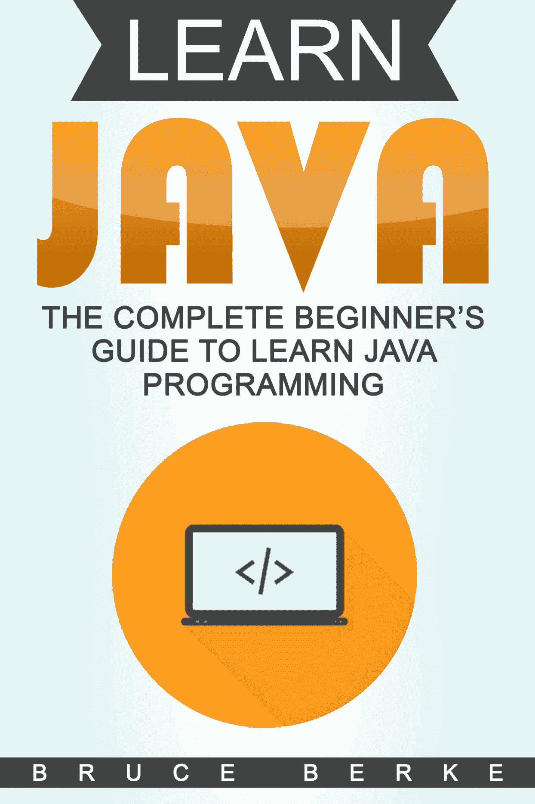
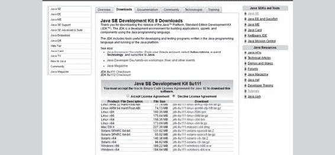
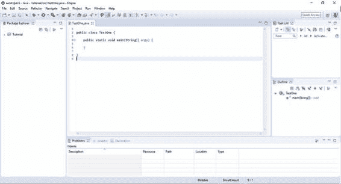

# 学习 Java：Java 编程学习完整初学者指南（计算机编程基础系列 1）



## 引言

Java 是一种被超过 30 亿设备使用的编程语言。Java 用于构建桌面、Web 和移动应用程序。它由太阳公司于 1995 年开发。Java 运行在多个平台上，即 Windows、MAC 和多个版本的 UNIX。

### 目标读者

本书专为绝对初学者设计。如果你还没有做过编程，那么这本书就是适合你的。这本书不仅将帮助你理解通义编程的基本概念，还将帮助你熟悉 Java 的概念。

## 第 1 章：环境搭建

如果你从未在电脑上安装过 Java，不要担心，我将引导你完成在电脑上安装和运行 Java 的过程。你需要执行以下步骤来配置 Java 编程环境：

* 访问 [`www.oracle.com/technetwork/java/javase/downloads/jdk8-downloads-2133151.html`](http://www.oracle.com/technetwork/java/javase/downloads/jdk8-downloads-2133151.html)



根据你的操作系统选择安装程序。X86 意味着你的操作系统必须是 32 位。如果你的操作系统是 64 位的，你可以安装 x86 或 x64 版本的 Java 开发包（JDK）。Java 开发包包含了开发所需的库。它还包含了运行 Java 应用程序的 Java 运行环境。下载安装程序后，对其进行安装。

现在你已经在系统中安装了 Java，你需要安装一个 IDE（集成开发环境）。IDE 是你配合 Java 一起构建酷应用程序的工具。

我将使用 Eclipse 作为 IDE。Eclipse 是数百万 Java 开发者使用的非常流行的 IDE。还有其他选择，如 NETBEANS、IntelliJ 等。我建议你们现在安装 Eclipse，以避免安装其他工具的麻烦。一旦你开始理解 Java 的基础及其工作原理，你也可以继续安装并尝试这些其他工具。

* 访问 [`www.eclipse.org/downloads/`](https://www.eclipse.org/downloads/)


从上述链接下载 Eclipse 的安装程序。它的安装非常简单。安装 Eclipse 之后，你会在桌面上看到它的图标。双击它运行 Eclipse。它会要求你指定工作空间（workspace）。工作空间是你电脑上用于存储所有 Java 项目的目录。选择一个你喜欢的工作空间并点击 OK。现在你将看到以下画面

如果你看到一个与上面类似的屏幕，意味着你已经按照我的说明完成了所有操作，现在你和你的电脑已经准备好进行 Java 编程了。

## 第 2 章：基础语法

Java 是一种区分大小写的语言。用 Java 编写的程序包含对象、类、变量和方法。

### 对象

将对象视为具有行为的现实实体。例如，猫是一个对象，它的行为可以是走路、吃东西、睡觉等能力。

### 类

类是一个蓝图，根据这个蓝图你可以创建多个对象。

### 变量

变量可以是类的属性，例如它的名称、大小等。所有变量都进入类中，并在类实例化（instantiation）后被使用。实例化指的是你创建一个类的对象，然后使用该对象对其变量赋值。我将在随后的书中详细解释这些概念。

所以，让我们打开 Eclipse IDE，是时候编写代码了。当你打开 Eclipse 时，你会看到一个名为 `TestOne` 的类，这是在启动 Eclipse 时默认创建。你可以创建一个新项目并进行同样的操作。

#### 示例

```java
public class TestOne {
  public static void main(String []args) {
    System.out.println("Hello World"); // 输出 Hello World
  }
}
```

上面的代码使用了 Java 编程中的三个基础元素：类、方法和变量。`TestOne` 类包含一个方法。现在这个名为 `main` 的方法是 Java 程序的起点。这是当你运行程序时 Java 程序进入的地方。在 `main` 方法内部，`println` 方法向控制台打印“Hello World”。`public` 关键字是一个访问修饰符，它允许程序开发者限制对类、方法或变量的访问。其他访问修饰符有 `private`、`protected`、`default`。点击运行按钮，它看起来像这样。运行程序后，你会在屏幕底部看到一个控制台窗口，显示你第一个 Java 程序的输出。

正如我之前告诉你的，Java 是一种区分大小写的语言。所以 `VOID` 和 `void` 的含义不同，因此在你在使用关键字或为类、变量、对象和方法命名自定义标识符时，必须非常小心。Java 程序文件具有 `.java` 扩展名，编写在该类型文件中的代码会被 JRE 识别。如果你在一个扩展名不是 `.java` 的文件中编写 Java 代码，那么 JRE 将无法识别该文件或其中编写的代码。

Java 关键字：

Java 关键字是 Java 语言本身使用的保留字，Java 不允许程序员使用这些单词。下面的列表显示了 Java 中的保留字。这些保留字不能作为常量、变量或任何标识符的名称，这意味着你不能使用下面描述的精确字汇来命名类的属性（变量）或类的行为（方法）。

| continue | abstract | Switch | for | new |
| --- | --- | --- | --- | --- |
| default | assert | synchronized | goto | package |
| do | boolean | this | if | private |
| double | break | throw | implements | protected |
| else | byte | throws | import | public |
| enum | case | transient | instanceof | return |
| extends | catch | try | int | short |
| final | char | void | interface | static |
| finally | class | volatile | long | strictfp |
| float | const | while | native | super |

### 注释

Java 中有多种类型的注释。单行注释和块注释。下面的示例展示了 Java 中多种类型的注释。

#### 示例

```java
public  class TestOne {

 /* This is my first java program.
     * This will print 'Hello World' as the output
* This is an example of multi-line comments.
     */

 public  static  void main(String []args) {

 // This is an example of single line comment

 /* This is also an example of single line comment. */

      System.out.println("Hello World"); // prints Hello World

  }

}
```

## 第 3 章：对象与类

Java 是一种面向对象的语言，这意味着它拥有对象和类。通过我之前的讨论，你可能对对象和类有一个大致的概念。现在我将在这里详细解释这些概念。

### 对象

对象是具有某些属性和行为的东西。将人类视为现实生活中的实体，现在我们将人类映射到我们的软件对象。人类有名字、年龄等；他走路、说话、吃饭等，这些都是它的行为。

### 类

类是一个蓝图，通过使用这些蓝图我们创建对象。下面是一个 Java 类的示例。如果你愿意，可以随意修改。

#### 示例

```java
public  class Human {

String name;
int age;
String gender;

void walks() {
// 人走路时会发生什么

}

void talks() {
// 人说话时会发生什么
}

void eats() {
// 人吃饭时会发生什么

}

}
```

现在我们可以使用上述蓝图来创建任意数量的对象。一个类可以有多种类型的变量。

### 局部变量

局部变量是在方法、构造函数或块内部声明的变量。

### 实例变量

实例变量是在类内部声明的变量，并且允许在类实例化后使用。

### 类变量

类变量使用 `static` 关键字声明，它们可以通过类名直接使用。

### 构造函数

构造函数是类内部的一个方法，当我们创建该类的对象时会被调用。构造函数用于在创建类对象时为属性赋值或调用某个方法。下面是一个构造函数的示例：

#### 示例

```java
public  class Human {

String name;
int age;
String gender;

public Human() {
// 这是构造函数，你可以在这里给你的变量赋值。
// 或者你可以调用函数。
}

void walks() {
// 人走路时会发生什么
}

void talks() {
// 人说话时会发生什么
}

void eats() {
// 人吃饭时会发生什么

}

}
```

现在让我们谈谈创建我们自己的对象。在你的 IDE 中创建一个名为 `Human.java` 的类，并将下面的 Human 类的内容写入到你的新类中。现在回到你的 `TestOne.java` 类并查看 `main` 方法。这是我们将用于实例化 Human 类对象的方法。在下面的 TestOne 类中编写对应的代码。运行程序，你将在控制台窗口看到 John。

#### 示例

**Human.java**

```java
public  class Human {

String name;
int  age;
String gender;

void walks() {
// 人走路时会发生什么
}

void talks() {
// 人说话时会发生什么
}

void eats() {
// 人吃饭时会发生什么

}

}
```

**TestOne.java**

```java
import java.io.Console;

public  class TestOne {

public  static  void main(String[] args) {
// TODO Auto-generated method stub
Human human = new Human();
human.name = "John";
System.out.println(human.name);

}

}
```

继续给 `age` 和 `gender` 变量赋值并尝试打印它们。这对你来说是一个很好的练习。

## 第 4 章：基本数据类型

变量在内部存储值。它们只是预留的内存位置，你可以在其中存储多种类型的值。Java 有两种主要的变量，在本章中我们不仅涵盖这些类型，还将涵盖它们的子类型。Java 中的主要变量类型有：

* 基本数据类型
* 引用对象/数据类型

### 基本数据类型

基本数据类型是那些在 Java 中定义的类型。Java 还为这些类型制定了某些规则，例如它们将存储什么类型的值？它们的范围是多少？等。Java 有八种基本类型。下面将详细解释每种基本类型。

#### byte

* `byte` 是一个 8 位有符号整数。
* 范围是从 -128 到 127。
* 当值较小时用于节省内存。

##### 示例

```java
byte b = 10;
```

#### short

* `short` 是一个 16 位有符号整数。
* 范围是从 -32,768 到 32,767。

##### 示例

```java
short s = 100;
```

#### int

* `int` 是一个 32 位有符号整数。
* 范围是从 -2,147,483,648 到 2,147,483,647。
* 这是最常用的数据类型。

##### 示例

```java
int i = 1000;
```

#### long

* `long` 是一个 64 位有符号整数。
* 当整数值超过 `int` 的范围时使用。
* 值通常以 `L` 结尾。

##### 示例

```java
long l = 15000000000L;
```

#### float

* `float` 是一个 32 位 IEEE 754 浮点数。
* 用于小数。
* 值通常以 `f` 结尾。

##### 示例

```java
float f = 10.99f;
```

#### double

* `double` 是一个 64 位 IEEE 754 浮点数。
* Java 中小数的默认类型。

##### 示例

```java
double d = 19.99;
```

#### char

* `char` 代表单个 16 位的 Unicode 字符。
* 用于存储单个字符。

##### 示例

```java
char c = 'A';
```

#### boolean

* `boolean` 仅存储两个值：`true` 或 `false`。

##### 示例

```java
boolean is = true;
```

## 第 5 章：变量类型

* `double variable2ofType_double = 101.3d;` //另一个示例。

### boolean：

* `boolean` 存储 1 位信息。
* 它的默认值为 `false`。
* 这种类型的变量用于存储 `true/false` 布值。

#### 示例：

* `boolean variableOfType_boolean = true;` //这就是在 Java 中声明一个 'boolean' 类型变量的方法。
* `boolean variable2ofType_boolean = false;` //另一个示例。

### char：

* `char` 存储 16 位的 Unicode 字符。
* `Char` 用于存储字符。
* 它的最小值为 `\u0000`。
* 它的最大值为 `\uffff`。

#### 示例：

* `char variableOfType_char = 'a';` //这就是在 Java 中声明一个 'char' 类型变量的方法。
* `char variable2ofType_char = 'c';` //另一个示例。

### 引用类型：

引用类型变量是类对象。你也可以将不同类型的数组视为引用类型变量的示例。这类变量的默认值为 `NULL`。请看下面的示例。

```java
import java.sql.Date;

public class Employee {
    String name;
    Date DateOfBirth; //引用变量
    int Age; //基本数据类型变量
    String Designation;
}
```

Java 中使用变量来存储不同类型的值。每个变量都有类型和值。变量的类型告诉 Java 它将拥有的值类型以及该值的范围。它还帮助我们缩小可以应用于该变量的操作类型范围。

变量在使用之前必须对其进行声明。以下是声明变量的通用模板：

`Datatype Variable’s name = Variable’s Value;`

`int Age = 24;`

数据类型表示该变量将携带的数据类型，`Variable’s name` 显示其名称，然后在等号之后你根据其类型分配一个值。

有三种变量：

* 局部变量。
* 实例变量。
* 类/静态变量。

### 局部变量：

局部变量是在代码块内部声明并使用的变量类型。局部变量可以在方法、构造函数以及 If-else、switch 等其他代码块内部声明；这类变量在编译器进入该代码块时创建，在编译器离开该代码块时删除。由于作用范围有限，局部变量不能使用 `public/private` 等访问修饰符。

#### 示例：

在接下来的示例中，`Employee` 类有一个方法 `calculateAge()`，在方法中我们为 `Age` 变量赋值，并在控制台窗口将其打印出来。

```java
import java.sql.Date;

public class Employee {
    public void calculateAge() {
        int Age = 0;
        Age = Age + 24;
        System.out.println(Age);
    }
}
```

在主类中实例化 `employee` 类并调用函数 `calculateAge()`。

```java
import java.io.Console;

public class TestOne {
    public static void main(String[] args) {
        // TODO 自动生成的方法存根
        Employee human = new Employee();
        human.calculateAge();
    }
}
```

输出：

24

### 实例变量：

实例变量声明在类内部，但在任何代码块（如 if-else、方法等）之外。这些变量在创建类的对象时使用。当创建一个类的对象时，堆内存会为该对象分配空间，堆的一部分被分配给每个实例变量。实例变量的生命从对象创建时开始，到对象结束时结束。你可以设置实例变量的访问级别。实例变量的默认值取决于其数据类型。请查看上一章节关于变量数据类型及其默认值。

#### 示例：


```java
import java.sql.Date;

public class Employee {
    String name; // 实例变量示例
    Date DateofBirth; // 实例变量示例
    String Designation; // 实例变量示例

    public void calculateAge() {
        int Age = 0;
        Age = Age + 24;
        System.out.println(Age);
    }
}
```

### 类/静态变量

类变量或静态变量是在块或方法之外但在类内部且使用`static`关键字声明的变量。静态变量每个类只有一个值，该类拥有的对象数量不会影响该静态变量。静态变量存储在静态内存中。通过以下方式访问静态变量：

`ClassName.StaticVariableName`

`Employee.Name;`

### 示例

```java
import java.sql.Date;

public class Employee {
    String name; // 实例变量示例
    Date DateofBirth; // 实例变量示例
    String Designation; // 实例变量示例

    private static double salary; // 类/静态变量示例
    private static String Department; // 类/静态变量示例

    public void calculateAge() {
        int Age = 0;
        Age = Age + 24;
        System.out.println(Age);
    }
}
```

# 第 6 章：修饰符类型

Java 有两种修饰符：

* 访问修饰符
* 非访问修饰符

## 访问修饰符

访问修饰符是决定谁可以看到特定变量、类、方法等的修饰符类型。它有多种类型。

### public

`public`访问修饰符允许任何类、接口、方法等。

### 示例

```java
public class Employee {
    int Age = 0;
    public void calculateAge() {
        Age = Age + 24;
        System.out.println(Age);
    }
}
```

### private

当`private`关键字附加在变量上时，意味着只能在该类内部访问。这是最严格的限制。

### 示例

```java
public class Car {
    int speed = 0;
    private String make = "BMW";
    public void calculatespeed() {
        // ...
    }
}
```

### protected

`protected`关键字用于限制变量的访问。父类的`protected`代码仅允许子类访问。

### 示例

```java
class SongPlayer {
    protected boolean PlaySongs(Songs s) {
        // 实现细节
    }
}

class EnglishSongsPlayer extends SongPlayer {
    public boolean PlaySongs(Songs s) {
        // 实现细节
    }
}
```

## 非访问

### static

你可以声明`static`变量或`static`方法。使用`static`确保声明的变量或方法可以通过类名而不是对象来访问。

### final

`final`关键字用于限制初始化后的使用。意味着你不能初始化已经初始化且带有`final`关键字的变量。

# 第 7 章：基础运算符

在 Java 中有多种类型的运算符，通过使用这些运算符可以执行数学或逻辑操作。

假设有两个变量`a`和`b`。`a`等于`10`，`b`等于`20`。

## 算术运算符

下表包含了 Java 中算术运算符的所有信息。

| 运算符 | 描述 | 示例 |
| :--- | :--- | :--- |
| `+` (加法) | 用于相加 | `a + b = 30` |
| `-` (减法) | 用于相减 | `a - b = -10` |
| `*` (乘法) | 用于相乘 | `a * b = 200` |
| `/` (除法) | 用于除法 | `b / a = 2` |
| `%` (模) | 用于获取余数 | `b % a = 0` |
| `++` (自增) | 值加 1 | `b++` 得到 21 |
| `--` (递减) | 值减 1 | `b--` 得到 19 |

## 关系运算符

下表包含了 Java 中所有关系运算符所需的所有信息。

| 运算符 | 描述 | 示例 |
| :--- | :--- | :--- |
| `==` (等于) | 此运算符比较两个值，如果值相等，则返回 true。 | `(a == b)` 为 false。 |
| `!=` (不等于) | 此运算符比较两个值，如果值不相等，则条件为 true。 | `(a != b)` 为 true。 |
| `>` (大于) | 如果左侧的值大于右侧的值，则条件为 true。 | `(a > b)` 为 false。 |
| `<` (小于) | 如果左侧的值小于右侧的值，则条件为 true。 | `(a < b)` 为 true。 |
| `>=` (大于等于) | 如果左侧的值大于或等于右侧的值，则返回 true。 | `(a >= b)` 为 false。 |
| `<=` (小于等于) | 如果左侧的值小于或等于右侧的值，则条件为 true。 | `(a <= b)` 为 true。 |

## 逻辑运算符

下表包含了 Java 中所有逻辑运算符所需的所有信息。

| 运算符 | 描述 | 示例 |
| :--- | :--- | :--- |
| `&&` (`'与'`) | 此运算符被称为逻辑与运算符。如果此运算符两边的值都非零，则返回 true，否则结果为 false。 | `(a && a)` 返回 false |
| `||` (`'或'`) | 此运算符被称为逻辑或运算符。如果此运算符的任一侧的值非零，则返回 true，否则将返回 false。 | `(a || b)` 返回 true |
| `!` (`'非'`) | 此运算符被称为逻辑非运算符。此运算符会反转它所用操作数的值。例如，如果值是 true，它会使其变为 false；如果值是 false，它会使其变为 true。 | `!(a && b)` 返回 true |

## 赋值运算符

下表包含了 Java 中所有赋值运算符所需的所有信息。

| 运算符 | 描述 | 示例 |
| :--- | :--- | :--- |
| `=` | 这是一个赋值运算符。它从右侧获取值并将其存储在左侧。 | `c = a + b` a 和 b 的和将存储在`c`中 |
| `+=` | 此运算符不仅加上一个值，还将将其赋值给左侧的变量。 | `b += a` 等于 `b = b + a` |
| `-=` | 此运算符不仅减去一个值，还将将其赋值给左侧的变量。 | `b -= a` 等于 `b = b - a` |
| `*=` | 此运算符不仅乘以一个值，还将将其赋值给左侧的变量。 | `b *= a` 等于 `b = b * a` |
| `/=` | 此运算符不仅除以一个值，还将将其赋值给左侧的变量。 | `b /= a` 等于 `b = b / a` |
| `%=` | 此运算符取模并将将其赋值给左侧的变量。 | `b %= a` 等于 `b = b % a` |
| `<<=` | 此运算符对值进行左移，并将其赋值给左侧的变量。 | `b <<= 2` 等于 `b = b << 2` |
| `>>=` | 此运算符对值进行右移，并将其赋值给左侧的变量。 | `b >>= 2` 等于 `b = b >> 2` |
| `&=` | 此运算符对值进行与运算，并将其赋值给左侧的变量。 | `b &= 2` 等于 `b = b & 2` |
| `^=` | 此运算符对值进行异或运算，并将其赋值给左侧的变量。 | `b ^= 2` 等于 `b = b ^ 2` |
| `|=` | 此运算符对值进行或运算，并将其赋值给左侧的变量。 | `b |= 2` 等于 `b = b | 2` |

## 位运算运算符

下表包含了 Java 中所有位运算运算符所需的所有信息。

| 运算符 | 描述 | 示例 |
| :--- | :--- | :--- |
| `&` (位与) | 这是一个二进制与运算符。如果一个位在运算符的两侧都存在，则将其复制到结果中。 | `(a & b)` 将得到 12，即 0000 1100 |
| `|` (位或) | 这是一个二进制或运算符。如果一个位在运算符的任一侧存在，则将其复制到结果中。 | `(a | b)` 将得到 61，即 0011 1101 |
| `^` (位异或) | 这是一个二进制异或运算符。如果一个位在运算符的一侧存在而在另一侧不存在，则将其复制到结果中。 | `(a ^ b)` 将得到 49，即 0011 0001 |
| `~` (位取反) | 这是一个二进制取反运算符。它会翻转位。 | `~a` |
| `<<` (左移) | 此运算符对值进行左移。 | `a << 2` 将左移 |
| `>>` (右移) | 此运算符对值进行右移。 | |
| `>>>` (无符号右移) | 这是一个无符号右移运算符。 | |

# 第 8 章：循环

在现实生活中，循环是重复执行的操作。在 Java 中有三种循环：

* while 循环
* do-while 循环
* for 循环

## while 循环

while 循环在条件为真时持续执行。当条件变为假时，循环停止。

**示例：**

```java
int i = 0;
while(i < 10) {
    System.out.println("Programming is Fun " + i);
    i++;
}
```

输出：

```
Programming is Fun 0
Programming is Fun 1
...
Programming is Fun 9
```

## do-while 循环

do-while 循环与 while 循环相似，区别在于它至少执行一次。在第一次迭代后，它会检查末尾条件是否为真。如果条件为真，它将继续执行。

**示例：**

```java
int i = 0;
do {
    System.out.println("Programming is Fun " + i);
    i++;
} while (i < 10);
```

输出：

```
Programming is Fun 0
...
Programming is Fun 9
```

## for 循环

"for 循环"是 Java 支持的另一种循环类型。在 for 循环中，你定义了必须满足才能执行的条件。如果条件为假，循环将中断；否则，for 循环将继续执行。

**示例：**

```java
for (int j = 0; j < 9; j++) {
    System.out.println("This is for loop's iteration number "+ j);
}
```

输出：

```
This is for loop's iteration number 0
...
This is for loop's iteration number 8
```

## break 和 continue

在循环中，可以使用`break`或`continue`关键字来执行特定的操作。

### break

任何循环中的`break`语句都会终止循环，无论循环条件是真是假。一旦循环遇到`break`语句，就会停止执行。

**示例：**

```java
int i = 0;
do {
    if (i>5) {
        break;
    } else {
        System.out.println("Programming is Fun " + i);
    }
    i++;
} while (i < 10);
```

输出：

```
Programming is Fun 0
Programming is Fun 1
Programming is Fun 2
Programming is Fun 3
Programming is Fun 4
Programming is Fun 5
```

一旦循环遇到`break`语句，它将停止迭代。

### continue

当代码在循环内部遇到`continue`语句时，它会跳过当前迭代以及`continue`语句之后的代码，并跳转到下一次迭代。

### 示例

```java
int i = 0;

do {
    if (i>=5) {
        continue;
    } else {
        System.out.println("Programming is Fun " + i);
    }
    i++;
} while (i < 10);
```

**输出：**

```
Programming is Fun 0
Programming is Fun 1
Programming is Fun 2
Programming is Fun 3
Programming is Fun 4
```

# 第 9 章：决策

在 java 中，决策指的是只有在在其前面提到的条件为真时才会执行代码块。java 中有多种类型的决策代码块。

* If 语句
* If-else 语句
* Switch 语句

## If 语句

"If 语句"是一个代码块，它包含一个或多个条件以及在满足条件时执行的代码行。

### 示例

```java
if (true) {
    System.out.println("This is an if statement example");
}
```

**输出：**

```
This is an if statement example
```

## If-Else 语句

"If-Else 语句"是一个代码块，它包含一个或多个条件以及在满足条件时执行的代码行。如果条件不满足，则执行该语句的`else`块。

### 示例

```java
if (false) {
    System.out.println("This is an if-else statement example");
}
else {
    System.out.println("Else block's output");
}
```

**输出：**

```
Else block's output
```

上述`if`语句内部条件为假，因此编译器将跳转到`else`块以打印上述输出。

## Switch 语句

switch 非常像 If 语句，它的工作方式和 if 语句一样。但如果你有很多条件，并且想对每个条件执行不同的操作，你将需要编写多个 if 语句来实现所需的结果，但使用 switch 语句，你可以在单个代码块内完成所有工作。

### 示例

```java
String color = "Blue";

switch(color) {
    case "Red" :
        System.out.println("Red");
        break;
    case "Violet" :
    case "Blue" :
        System.out.println("Blue");
        break;
    case "Green" :
        System.out.println("Green");
    case "Orange" :
        System.out.println("Orange");
        break;
    default :
        System.out.println("White");
}
System.out.println("The Color you choose is " + color);
```

**输出：**

```
Blue
The Color you choose is Blue
```

查看上述 switch 语句。我将`Blue`颜色存储在`color`变量中。当我执行这段代码时，它会进入每个`case`语句并与我在`color`变量中存储的值进行比较。当找到匹配项时，它运行该`case`内部的代码并退出语句。

# 第 10 章：数字

通常在 java 中，当我们必须处理数字时，我们使用`integer`、`float`、`decimal`等，但你必须知道所有这些基本类型都源于一个抽象的数字类。当我们创建基本类型的变量时，背后发生的真实情况是基本类型被`Numbers`类封装，从而创建了一个对象。这种从基本类型创建对象的过程被称为`装箱` (boxing)。当我们将对象转换为基本类型时（这通常是编译器向我们显示数值时所执行的操作），被称为`拆箱` (un-boxing)。

## 数字方法

`Number`类有很多为你编写的内置函数。因此你只需要调用这些方法并使用它们，而不是自己编写这些。

### xxxValue()

此方法将`Number`对象的值转换为所需的数据类型并返回结果。

### compareTo()

此方法将`Number`对象与参数进行比较。


### `equals()`

此方法检查数字对象是否等于参数。

### `valueOf()`

此方法返回一个在基本变量中指定值的整数类型对象。

### `toString()`

此方法将值转换为字符串。

### `parseInt()`

此方法用于将字符串转换为`int`。

### `abs()`

此方法返回绝对值。

### `ceil()`

此方法返回一个大于或等于参数的`double`。

### `floor()`

此方法返回一个小于或等于参数的`double`。

### `rint()`

此方法返回一个更接近参数的`double`。

### `round()`

此方法返回一个`long`或`int`值。

### `min()`

此方法返回多个值中的较小值。

### `max()`

此方法返回多个值中的最大值。

### `exp()`

此方法返回`e`的底。

### `log()`

此方法对参数执行对数运算。

### `pow()`

此方法返回第一个参数的第二个参数的幂。

### `sqrt()`

此方法对参数执行平方根运算。

### `sin()`

此方法返回正弦值。

### `cos()`

此方法返回余弦值。

### `tan()`

此方法返回正切值。

### `asin()`

此方法返回反正正弦。

### `acos()`

此方法返回反余弦。

### `atan()`

此方法返回反正正切。

### `toDegrees()`

你可以通过此方法将参数转换为角度。

### `toRadians()`

你可以通过此方法将参数转换为弧度。

### `random()`

此辅助方法生成一个随机数。你可以提供一个范围来限制结果。

# 第 11 章：字符

就像数字一样，在 Java 中，你可以通过其包装类`Character`创建基本类型字符的对象。字符类创建了一个对象，你可以在其中存储字符，也可以对该对象执行不同的操作。

### 示例

```java
//这一个基本字符类型变量
char mychar = 'a';

//这是如何创建一个字符对象的
Character mycharobject = 'b';

//这一个基本字符类型变量
char one = '1';

//这是如何创建一个字符对象的
Character twoobj = '2';
```

## 字符类的方法：

### `isLetter()`

此方法检查传递给它的参数是否为字母。

### `isDigit()`

该方法检查所指定的`char`值是否为数字。

### `isWhitespace()`

该方法检查所指定的`char`值是否为空白字符。

### `isUpperCase()`

该方法检查所指定的`char`值是否为大写。

### `isLowerCase()`

该方法检查所指定的`char`值是否为小写。

### `toUpperCase()`

该方法将所指定的`char`值转换为大写。

### `toLowerCase()`

该方法将所指定的`char`值转换为小写。

### `toString()`

该方法返回一个包含作为参数传递的字符值的字符串对象。

# 第 12 章：字符串

字符串在 Java 中被广泛使用。在 Java 中，字符串被视为对象。Java 拥有内置的字符串类，该类包含许多辅助方法。

以下是在 Java 中定义字符串的方法。

```java
String name = "John";
```

当编译器遇到上述那行代码时，它会创建一个类型为`string`的对象，其值为`John`。

### 示例：

```java
String name = "John";
System.out.println("Hello guys my name is "+ name);
```

输出：

```
Hello guys my name is John
```

在上面的示例中，我创建了一个字符串对象`name`并给它赋了一个值。第二行代码接收一个字符串参数并将其打印在控制台窗口上。字符串`Hello guys my name is `和变量`name`的值都是字符串。我在上面使用的加号（`+`）用于连接这两个字符串。连接字符串的过程被称为拼接（concatenation）。这是另一个示例。

### 示例：

```java
String greet1 = "Hello";
String greet2 = "World";
System.out.println(greet1 + " " + greet2);
```

输出：

```
Hello World
```

在上面的示例中，我连接了两个名为`greet1`和`greet2`的字符串变量。我还在它们之间拼接了一个空格以提高可读性。

你还可以在 Java 中格式化字符串。这意味着你可以使用占位符作为值，并可以直接将值传递给打印语句。看下面的示例。

### 示例：

```java
int number1 = 1;
float number2 = 2.0f;
System.out.printf("The value of number1 is %d and the value of number2 is %f", number1, number2);
```

输出：

```
The value of number1 is 1 and the value of number2 is 2.000000
```

在上面的示例中，我将两个变量`number1`和`number2`传递给`printf`语句。`%d`是整数的占位符，`%f`是浮点数值的占位符。

## 字符串方法：

字符串类有多个预定义的辅助方法。

### `char charAt(int index)`

该方法返回字符串中特定索引处的字符。

### `int compareTo(Object o)`

该方法比较两个字符串对象。

### `String concat(String str)`

该方法将指定的字符串拼接到另一个字符串的末尾。

### `boolean contentEquals(StringBuffer sb)`

如果字符串中的字符序列与`StringBuffer`序列相同，则返回`true`。

### `boolean endsWith(String suffix)`

该方法检查字符串是否以指定的后缀结尾。

### `boolean equals(Object anObject)`

该方法接收两个字符串对象，如果它们匹配则返回`true`。

### `boolean equalsIgnoreCase(String anotherString)`

该方法比较两个字符串，但不考虑大小写。

### `byte getBytes()`

该方法将字符串转换为字节数组。

### `void getChars(int srcBegin, int srcEnd, char[] dst, int dstBegin)`

该方法将字符串拷贝到字符数组。

### `int hashCode()`

该方法为给定字符串生成哈希码。

### `int indexOf(String str)`

该方法返回指定字符串开始的索引。

### `int lastIndexOf(int ch)`

该方法返回指定字符最后出现的索引。

### `int lastIndexOf(String str, int fromIndex)`

该方法返回指定字符串从指定索引开始最后出现的索引。

### `int length()`

该方法返回字符串的长度。

### `boolean matches(String regex)`

如果字符串匹配正则表达式则返回`true`。

### `String replace(char oldChar, char newChar)`

该方法将字符串中的现有字符替换为新字符。

### `String[] split(String regex)`

该方法根据正则表达式分割字符串。

### `boolean startsWith(String prefix)`

该方法测试字符串是否以指定的前缀开头。

### `String substring(int beginIndex)`

该方法返回给定字符串的子字符串。

### `char[] toCharArray()`

该方法将字符串转换为字符数组。

### `String toLowerCase()`

该方法将字符串转换为小写。

### `String toUpperCase()`

该方法将字符串转换为大写。

# 第 13 章：数组

数组是一种数据结构。Java 使用这种数据结构。数组基本上是固定大小的顺序数据结构。数组用于相似类型的数据集合。

在本章中，我们将学习如何声明数组、如何向其赋值以及如何处理数组。

## 创建数组：

就像变量一样，在使用数组之前必须先声明它。你将告诉编译器数组的类型和名称。声明数组的通用语法如下：

```java
datatype[] arrayname = {"value1","value2","value3"};
```

```java
datatype arrayname[] = {"value1","value2","value3"};
```

你可以使用上述的任何一种方式来声明数组。

现在打开你的编译器并创建一个名为`Candies`的类。在其中添加以下代码：

```java
public class Candies {
    String[] candies = {"m&Ms","Yummybears","Mayfairs"};
}
```

在上面的示例中，我创建了一个名为`Candies`的类，并在其中声明了一个类型为`String`的数组。然后我给数组赋了三个值。

你也可以像这样声明上述的数组：

```java
public class Candies {
    String candies[] = {"m&Ms","Yummybears","Mayfairs"};
}
```

数组中存储的值类型取决于该数组的类型。例如，在下面的示例中，我声明了一个整数类型的数组。此数组将只包含整数类型的数据，不再包含其他内容。

```java
public class Candies {
    int[] myIntArray = {1,2,3};
}
```

## 使用数组：

现在我们已经学习了如何声明不同类型的数组以及如何为它们赋值，让我们继续看看如何处理这些数组数据结构。我们可以使用之前在本书中读过的循环来遍历数组的每个索引，并对数组内部的值进行读取、打印或进行任何其他操作。在处理数组时，我们主要使用`for`循环，但你也可以使用我们讨论过的其他类型的循环来实现相同的功能。

### 示例：


```java
// 你的 Candies 类
public class Candies {
    String[] candies = {"m&Ms","Yummybears","Mayfairs"};
    int[] myIntArray = {1,2,3};

    public void ShowMyCandies() {
        for (int i = 0; i < candies.length; i++) {
            System.out.println("The name of my Candy is " + candies[i]);
        }
    }
}

// 主类，在其中实例化你的 Candies 类
import java.io.Console;
public class MainClass {
    public static void main(String[] args) {
        // TODO Auto-generated method stub
        Candies myCandies = new Candies();
        myCandies.ShowMyCandies();
    }
}
```

输出:

The name of my Candy is m&Ms

The name of my Candy is Yummybears

The name of my Candy is Mayfairs

### 示例 #2：

```java
// 你的 Candies 类
public class Candies {
    String[] candies = {"m&Ms","Yummybears","Mayfairs"};
    int[] myIntArray = {1,2,3};

    public void ShowMyCandies() {
        for (int i = 0; i < candies.length; i++) {
            System.out.println("The name of my Candy is " + candies[i]);
        }
    }

    public void ShowMyNumbers() {
        for (int i = 0; i < myIntArray.length; i++) {
            System.out.println("My Number Array Contains " + myIntArray[i]);
        }
    }
}

// 主类，在其中实例化你的 Candies 类
import java.io.Console;
public class MainClass {
    public static void main(String[] args) {
        // TODO Auto-generated method stub
        Candies myCandies = new Candies();
        //myCandies.ShowMyCandies();
        myCandies.ShowMyNumbers();
    }
}
```

输出:

My Number Array Contains 1

My Number Array Contains 2

My Number Array Contains 3

## 辅助方法：

`Arrays` 还包含一些 Java 内置的辅助方法，可以让我们的生活更轻松。

### `public static int binarySearch(Object[] a, Object key)`

该方法使用二分查找算法在传递给它的数组中搜索值。如果该方法找到了正在查找的特定值，它将返回该值在数组中的索引。

### `public static boolean equals(long[] a, long[] a2)`

该方法告诉我们传递给它的两个数组是否相等。只有当数组的类型相同、元素数量相同且每个数组中的元素也相同时，数组才视为相等。此方法也可以用于任何其他基本类型的数组。

### `public static void fill(int[] a, int val)`

该方法将数组的每个索引的值设置为传递给该方法以及受影响数组的值。此方法也可以用于任何其他基本类型的数组。

### `public static void sort(Object[] a)`

该方法将任何基本类型元素的数组按升序排序。

# 第 14 章：日期和时间

在 `java.util` 包中，存在一个 `Date` 类，以及其他使用内置功能编写的类。你可以使用 `date` 类进行与日期相关的操作，例如获取当前日期、对该日期字符串执行不同的函数等。

在本章中，我们将讨论日期以及你可以使用 `java` 对日期所执行的操作。打开你的编译器并创建一个名为 `mydateclass` 的类。

```java
public class myDateClass {
}
```

## 当前日期和时间：

现在让我们使用创建的类来获取当前的日期和时间。请在类中添加以下方法。

```java
public void getDateTime() {
    Date date = new Date();
    System.out.println("My Current Date and time is: " + date.toString());
}
```

`myDateClass` 的最终代码将如下。

```java
import java.util.Date;
public class myDateClass {
    public void getDateTime() {
        Date date = new Date();
        System.out.println("My Current Date and time is: " + date.toString());
    }
}
```

完成新的 `myDateClass` 后，进入主类并创建一个 `myDateClass` 对象，然后调用 `getDateTime()` 方法。

```java
import java.io.Console;
public class MainClass {
    public static void main(String[] args) {
        // TODO Auto-generated method stub
        myDateClass mydate = new myDateClass();
        mydate.getDateTime();
    }
}
```

当你运行上述代码时，你将获得当前日期。程序的输出将在控制窗口显示，并如下所示：

输出:

My Current Date and time is: Sat Dec 24 16:58:13 PKT 2016

## 格式化日期：

你可以使用内置的日期格式化机制来格式化日期。

### 示例：

```java
import java.text.SimpleDateFormat;
import java.util.Date;
public class myDateClass {
    public void getDateTime() {
        Date date = new Date();
        SimpleDateFormat newFormat = new SimpleDateFormat ("E yyyy-MM-dd 'at' hh:mm:ss a zzz");
        System.out.println("Current Date is: " + newFormat.format(date));
    }
}

import java.io.Console;
public class MainClass {
    public static void main(String[] args) {
        // TODO Auto-generated method stub
        myDateClass mydate = new myDateClass();
        mydate.getDateTime();
    }
}
```

输出:

Current Date is: Sat 2016-12-24 at 05:18:02 PM PKT

你也可以使用 Java 中的 `printf` 语句来格式化日期。

### 示例：

```java
import java.text.SimpleDateFormat;
import java.util.Date;
public class myDateClass {
    public void getDateTime() {
        Date date = new Date();
        String mystring = String.format("Current Date and Time is : %tc",date);
        System.out.printf(mystring);
    }
}

import java.io.Console;
public class MainClass {
    public static void main(String[] args) {
        // TODO Auto-generated method stub
        myDateClass mydate = new myDateClass();
        mydate.getDateTime();
    }
}
```

输出:

Current Date and Time is : Sat Dec 24 17:24:26 PKT 2016

我的糖果名字是 Yummybears

我的糖果名字是 Mayfairs

在上面的示例中，我们有一个名为 `Candies` 的类。在该类内部，我们声明了一个名为 `ShowMyCandies` 的方法，该方法遍历 `candies` 数组并在控制屏幕上打印所有糖果的名字。我们在创建该方法所属类的对象后调用了此函数。这是一个实例方法，因为它只有在实例化该类后才能使用。我们也可以通过静态方法来实现这一点。方法如下：

### 示例：

```java
// Your Candies Class
public class Candies {
    String[] candies = {"m&Ms","Yummybears","Mayfairs"};
    int[] myIntArray = {1,2,3};

    public static void ShowMyCandies(){
        for (int i = 0; i < candies.length; i++) {
            System.out.println("The name of my Candy is " + candies[i]);
        }
    }
}

// Main Class where you instantiate your Candies class
import java.io.Console;

public class MainClass {
    public static void main(String[] args) {
        // TODO Auto-generated method stub
        Candies.ShowMyCandies();
    }
}
```

输出：

The name of my Candy is m&Ms

The name of my Candy is Yummybears

The name of my Candy is Mayfairs

上述示例中高亮部分是我对原始 `Candies` 类所做的更改。通过仅在方法定义中添加 `static` 关键字，我就改变了它的调用方式。现在，你可以直接通过类名调用 `ShowMyCandies` 方法。

上述方法使用的 `Void` 关键字意味着该方法不返回任何内容。

# 第 16 章：异常 (Exceptions)

异常是我们代码中的错误。当异常发生时，意味着你正在运行的程序流被干扰。异常会导致程序行为异常，因此我们应该采取一些预防措施来处理这些异常。

到目前为止，我们处理的代码没有错误。但现在为了理解异常以及如何处理它们，我将在代码中生成一些错误，然后教你们如何处理这些错误，请看以下代码：

### 示例：

```java
import java.io.Console;

public class ErrorClass {
    public static void main(String[] args) {
        String[] candies = {"m&Ms","Yummybears","Mayfairs"};
        System.out.println(candies[4]);
    }
}
```

输出：

Exception in thread "main" java.lang.ArrayIndexOutOfBoundsException: 4

at ErrorClass.main(ErrorClass.java:16)

上述错误的发生是因为 `candies` 数组分别在索引的零、第一和第二个处存储了三个值。但在第二行我尝试打印此数组时，我传递了索引四，这是不存在的，因为数组是固定大小的数据结构。我可以通过更新数组索引来纠正这个错误。方法如下：

### 示例：

```java
import java.io.Console;

public class ErrorClass {
    public static void main(String[] args) {
        String[] candies = {"m&Ms","Yummybears","Mayfairs"};
        System.out.println(candies[1]);
    }
}
```

输出：

Yummybears

现在如何避免这种情况？我们如何确保由程序员来处理异常，而不是向终端用户显示大量他不理解的技术细节？答案也存在于 Java 中。在 Java 中有异常处理机制，它通过使用 java 中提供的 `try-catch` 块来实现。

```java
try {
  // Protected code
}catch(ExceptionName e1) {
  // Catch block
}
```

`try` 块是你编写代码的地方。而 `catch` 块是你处理异常的地方。我在 `try-catch` 块中重新创建了该错误。

### 示例：

```java
import java.io.Console;

public class ErrorClass {
    public static void main(String[] args) {
        try {
            String[] candies = {"m&Ms","Yummybears","Mayfairs"};
            System.out.println(candies[4]);
        } catch (Exception e) {
            System.out.println("Something went wrong");
        }
    }
}
```

输出：

Something went wrong

看到了吗？现在代码没有向我们显示真实的异常，而是显示了我们在代码中添加的备文本。如果我们想这样做，也可以看到技术细节。

### 示例：

```java
import java.io.Console;

public class ErrorClass {
    public static void main(String[] args) {
        try {
            String[] candies = {"m&Ms","Yummybears","Mayfairs"};
            System.out.println(candies[4]);
        } catch (Exception e) {
            System.out.println("Something went wrong: " + e.getMessage());
        }
    }
}
```

输出：

Something went wrong: 4

现在你可以看到，异常向我们展示了它认为导致错误的值。如果你想看到关于异常的更多细节，也可以这样做：

### 示例：

```java
import java.io.Console;

public class ErrorClass {
    public static void main(String[] args) {
        try {
            String[] candies = {"m&Ms","Yummybears","Mayfairs"};
            System.out.println(candies[4]);
        } catch (Exception e) {
            throw e;
        }
    }
}
```

输出：

Exception in thread "main" java.lang.ArrayIndexOutOfBoundsException: 4

at ErrorClass.main(ErrorClass.java:16)

异常的原因可能是任何的。它可以是程序员在编写代码时的逻辑错误，也可能是由于你运行的系统内存栈溢出。有时 Java 虚拟机 (`JVM`) 也会导致异常行为。


你可以对单个`try`块使用多个`catch`块。你这样做是因为你预计会发生多种类型的异常。因此你需要声明多个`catch`块并相应地处理。下面是多个`catch`块的通用模板：

```java
try {
  // Protected code
}catch(ExceptionType1 e1) {
  // Catch block
}catch(ExceptionType2 e2) {
  // Catch block
}catch(ExceptionType3 e3) {
  // Catch block
}
```

## 第 17 章：内部类 (Inner Classes)

在 Java 中，我们可以创建嵌套类，就像嵌套语句或嵌套函数一样。以下是声明内部类的通用语法：

```java
class OuterClass {
    class InnerClass {
    }
}
```

这是一个真实的代码示例。

### 示例：

```java
import java.io.Console;

public class Candies {
    private class chocoCandies {
        public void Hello(){
            System.out.println("Hello from the inner Choco Candies Class");
        }
    }

    public void displayChocoClass() {
        chocoCandies mychoco = new chocoCandies();
        mychoco.Hello();
    }
}

import java.io.Console;

public class MainClass {
    public static void main(String[] args) {
        Candies myCandies = new Candies();
        myCandies.displayChocoClass();
    }
}
```

输出：

```
Hello from the inner Choco Candies Class
```

## 结语

现在我们来到了这本小书的结尾。我希望你学到了东西。你不应该在这里停止，因为 Java 的内容远超这本书。尽可能多地阅读，最重要的是多地写代码。只有这样你才能精通 Java。编码愉快！
