# 轻松学习 Java：编程入门实用指南

作者：Byson Payne

## 关于作者

Bryson Payne 博士是乔治亚大学计算机科学领域的终身教授。他是注册信息系统安全专家 (CISSP) 和伦理黑客 (CEH)。他住在乔治亚，自1998年以来教学。

## 关于审查员

Bryan Fagan 是一位技术教师。他住在乔治亚，与妻子和女儿生活，并练习柔术。

始终相信。

## 目录

- 我为什么要学习写代码？
- 我为什么要学习 Java？
- 这本书里涵盖了什么？
- 我需要哪些工具？
- 在线资源
- 现在开始吧！
- Windows、macOS 和 Linux 上的 Java
- 为开发者安装 Java 8 和 9
- 为 Java 开发者安装 Eclipse IDE
- 设置 Eclipse
- 安装 WindowBuilder 编辑器
- 自定义 Eclipse 的外观和感觉
- 安装用于移动应用开发的 Android Studio
- 通过 JShell 了解 Java
- 运行 JShell
- 在 JShell 中使用 Java 表达式
- 在 JShell 中声明 Java 变量
- 在 Java 中打印输出
- JShell 命令
- 你所学到的

## 正文内容

### 在 Eclipse 中设置 GUI 应用

### 使用 Eclipse 的 WindowBuilder 编辑器进行 GUI 设计

### 设计用户界面

#### 在属性面板中设置 GUI 属性

#### 在调色板中自定义 GUI 组件

#### 对齐 GUI 元素

#### 为编码命名 GUI 组件

#### 将 GUI 连接到你的 Java 代码

### 添加一个方法来检查玩家的猜测

#### 从 JTextField 中获取文本

#### 将字符串转换为数字

### 开始新游戏

#### 监听用户事件：点击进行猜测！

### 设置 GUI 窗口

### 该玩了！

#### 添加“再次游戏”功能

### 改进用户体验 (UX)

#### 允许用户按回车键进行猜测

#### 自动移除旧猜测

### 处理不当的用户输入

### 在模拟器上运行应用

#### 在文本框中居中猜测

#### 为编码/解码按钮编写事件处理器

#### 处理错误输入和用户错误

#### 构建 main() 方法并运行程序

### 设置计时器

### 启动计时器

### 软弹

### 实现滑块处理器

### 更改应用名称

#### 在 Eclipse 中纠正拼写错误

## 致谢

如果没有 No Starch Press 团队的卓越支持，这本书是不可能完成的。感谢 Bill Pollock、Tyler Ortman、Riley Hoffman、Jan Cash、Serena Yang、Amanda Hariri 和 Juba Borden，他们无倦的编辑、评审和营销，以及他们以无数种方式帮助我从原始手稿改进了这本书。

感谢 Bryan Fagan 在技术评审方面付出的出色工作。

感谢我所有的现任和前任学生，他们激励我继续创作有趣、吸引人的内容——特别是 Sarah Rahman、Justin 和 Diane Turner、Jacob Elliott、Brian Murray、Aaron Walker、Robert Brown、Trent Deal、Seth Park、Simon Singh、Andrew Miller、Ctrl-Alt-Dev 机器人团队、Jackson Grant、Quint Kerns、Grace 和 Jack Halley、Matthew Harper 以及 David Knight。感谢参加我在线课程的来自 150 个国家的学生，特别是 Hayden Redd 和 Bob Watson。

感谢我不断激励我进步的同事和朋友：Markus Hitz、Chuck Robertson、Irene Kokkala、Tamirat Abegaz、Antonio Sanz Montemayor、Don Watkins、Eddie Minnie、Rose Procter、Ron Larson、Victor Parker、Keith Antonia、Billy Wells、Jim Goldman、James Daniel 和 Craig Gentry。

感谢我的岳父 Norman Petty，他对技术的激情仅不如他对家人；感谢我的继父 Dale Carver，他总是为我的 3D 打印设备留时间。最感谢我美丽的妻子 Bev 和我优秀的儿子 Alex 和 Max，感谢我在三年内写了两本书期间他们的无限耐心。

特别感谢 Kalen。在十一岁时，Kalen 就用他自己写的代码实践了我的第一本书《教孩子写代码》。得好，Kalen！你是每一个开始发现自己是谁以及想成为什么的孩子的灵感源泉。

## 引言

Java 被应用于数以亿计的设备。从移动应用到桌面软件，Java 驱动着最大的企业和最小的个人设备。学生、IT 专业人员以及任何考虑从事编程行业的人都会发现他们需要学习 Java。作为一名教了 Java 几乎 20 年的计算机科学教授，我写这本书是为了帮助你通过实践项目来学习。在本书书中，你将制作一个简单的猜数字大小游戏、一个与朋友交换信息的秘密信息应用，以及一个名为 BubbleDraw 的交互式绘图应用。

## 为什么我应该学编程？

首先，根据美国劳工统计局的数据，计算领域增长最快、薪资最高的职位在未来几年内将需求巨大。无论你在何处，只要有互联网连接，你就能赚钱并获得职业保障。编码就是解决问题，而世界需要更多的解决问题者。

## 为什么我应该学习 Java？

Java 被应用于数十亿个设备上。从移动应用到桌面软件，Java 驱动着最大的企业和最小的个人设备。学生、IT 专业人员以及任何考虑从事编程行业的人都会发现他们需要学习 Java。作为一名教了 Java 几乎 20 年的计算机科学教授，我写这本书是为了帮助你通过实践项目来学习。在书中，你将制作一个简单的猜数字大小游戏、一个与朋友交换信息的秘密信息应用，以及一个名为 BubbleDraw 的交互式绘图应用。

## 正文内容（续）

在 Java 中使用线程动画和多任务处理

使用手指触摸绘图

一次使用 10 根手指进行多点触控绘图

在 Android 设备上测试多点触控事件

更改应用启动图标

创建自定义应用图标

为你的应用添加单指图标

显示你的新图标

更改应用名称

你学到的内容

分组符号

总结


感谢我不断激励我进步的同事和朋友：Markus Hitz、Chuck Robertson、Irene Kokkala、Tamirat Abegaz、Antonio Sanz Montemayor、Don Watkins、Eddie Minnie、Rose Procter、Ron Larson、Victor Parker、Keith Antonia、Billy Wells、Jim Goldman、James Daniel 和 Craig Gentry。

感谢我的岳父 Norman Petty，他对技术的激情仅不如他对家人；感谢我的继父 Dale Carver，他总是为我的 3D 打印设备留时间。最感谢我美丽的妻子 Bev 和我优秀的儿子 Alex 和 Max，感谢我在三年内写了两本书期间他们的无限耐心。

特别感谢 Kalen。在十一岁时，Kalen 就用他自己写的代码实践了我的第一本书《教孩子写代码》。得好，Kalen！你是每一个开始发现自己是谁以及想成为什么的孩子的灵感源泉。

# 引言

Java 被应用于数以亿的设备上。从移动应用到桌面软件，Java 驱动着最大的企业和最小的个人设备。学生、IT 专业人员以及任何考虑从事编程行业的人都会发现他们需要学习 Java。作为一名教了 Java 几乎 20 年的计算机科学教授，我写这本书是为了帮助你通过实践项目来学习。在书中，你将制作一个简单的猜数字大小游戏、一个与朋友交换信息的秘密信息应用，以及一个名为 BubbleDraw 的交互式绘图应用。

# 为什么我应该学编程？

首先，根据美国劳工统计局的数据，计算领域增长最快、薪资最高的职位在未来几年内将需求巨大。无论你在何处，只要有互联网连接，你就能赚钱并获得职业保障。编码就是解决问题，而世界需要更多的解决问题者。

# 为什么我应该学习 Java？

首先，根据美国劳工统计局的数据，计算领域增长最快、薪资最高的职位在未来几年内将需求巨大。无论你在何处，只要有互联网连接，你就能赚钱并获得职业保障。编码就是解决问题，而世界需要更多的解决问题者。

# 本书包含的内容

在 Java 中使用线程动画和多任务处理 . . . . . . . . . . . . 261

使用手指触摸绘图 . . . . . . . . . . . . . . . . 264

一次使用 10 根手指进行多点触控绘图 . . . . . . . . . . . . . . 266

在 Android 设备上测试多点触控事件 . . . . . . . . . . 266

更改应用启动图标 . . . . . . . . . . . . . . . . . . . . 268

创建自定义应用图标 . . . . . . . . . . . . . . . . . . . . 268

为你的应用添加单指图标 . . . . . . . . . . . . . . . . . . . . 268

显示你的新图标 . . . . . . . . . . . . . . . . . . . . 269

更改应用名称 . . . . . . . . . . . . . . . . . . . . . . . 270

你学到的内容 . . . . . . . . . . . . . . . . . . . . . . . 270

# 编程挑战

- #1: 结合单指和多点触控事件，v1.0 . . . . 271
- #2: 结合单指和多点触控事件，v2.0 . . . . . . . 271

# 附录

# Java 调试与避免常见错误

拼写与大小写 . . . . . . . . . . . . . . . . . . . . . . . 274

- 在 Eclipse 中纠正拼写错误 . . . . . . . . 274
- 在 Android Studio 中纠正拼写错误 . . . . . . . . 275
- 避免其他常见的拼写错误 . . . . . . . . 276

比较问题 . . . . . . . . . . . . . . . . . . 276

分组符号 . . . . . . . . . . . . . . . . . . 276

- Eclipse 中的快速修复 . . . . . . . . . . . . 277
- Android Studio 中的代码补全 . . . . . . . . 277

总结 . . . . . . . . . . . . . . . . . . . . . . . . 278

# 索引

# 致谢

如果没有 No Starch Press 团队的卓越支持，这本书是不可能完成的。感谢 Bill Pollock、Tyler Ortman、Riley Hoffman、Jan Cash、Serena Yang、Amanda Hariri 和 Juba Borden，他们无倦的编辑、评审和营销，以及他们以无数种方式帮助我从原始手稿改进了这本书。

感谢 Bryan Fagan 在技术评审方面付出的出色工作。

感谢我所有的现任和前任学生，他们激励我继续创作有趣、吸引人的内容——特别是 Sarah Rahman、Justin 和 Diane Turner、Jacob Elliott、Brian Murray、Aaron Walker、Robert Brown、Trent Deal、Seth Park、Simon Singh、Andrew Miller、Ctrl-Alt-Dev 机器人团队、Jackson Grant、Quint Kerns、Grace 和 Jack Halley、Matthew Harper 以及 David Knight。感谢参加我在线课程的来自 150 个国家的学生，特别是 Hayden Redd 和 Bob Watson。

感谢我不断激励我进步的同事和朋友：Markus Hitz、Chuck Robertson、Irene Kokkala、Tamirat Abegaz、Antonio Sanz Montemayor、Don Watkins、Eddie Minnie、Rose Procter、Ron Larson、Victor Parker、Keith Antonia、Billy Wells、Jim Goldman、James Daniel 和 Craig Gentry。

感谢我的岳父 Norman Petty，他对技术的激情仅不如他对家人；感谢我的继父 Dale Carver，他总是为我的 3D 打印设备留时间。最感谢我美丽的妻子 Bev 和我优秀的儿子 Alex 和 Max，感谢我在三年内写了两本书期间他们的无限耐心。

特别感谢 Kalen。在十一岁时，Kalen 就用他自己写的代码实践了我的第一本书《教孩子写代码》。得好，Kalen！你是每一个开始发现自己是谁以及想成为什么的孩子的灵感源泉。

# 引言

Java 被应用于数以亿的设备上。从移动应用到桌面软件，Java 驱动着最大的企业和最小的个人设备。学生、IT 专业人员以及任何考虑从事编程行业的人都会发现他们需要学习 Java。作为一名教了 Java 几乎 20 年的计算机科学教授，我写这本书是为了帮助你通过实践项目来学习。在书中，你将制作一个简单的猜数字大小游戏、一个与朋友交换信息的秘密信息应用，以及一个名为 BubbleDraw 的交互式绘图应用。

# 为什么我应该学编程？

首先，根据美国劳工统计局的数据，计算领域增长最快、薪资最高的职位在未来几年内将需求巨大。无论你在何处，只要有互联网连接，你就能赚钱并获得职业保障。编码就是解决问题，而世界需要更多的解决问题者。

# 为什么我应该学习 Java？

首先，根据美国劳工统计局的数据，计算领域增长最快、薪资最高的职位在未来几年内将需求巨大。无论你在何处，只要有互联网连接，你就能赚钱并获得职业保障。编码就是解决问题，而世界需要更多的解决问题者。

# 本书包含的内容

在 Java 中使用线程动画和多任务处理 . . . . . . . . . . . . 261

使用手指触摸绘图 . . . . . . . . . . . . . . . . 264

一次使用 10 根手指进行多点触控绘图 . . . . . . . . . . . . . . 266

在 Android 设备上测试多点触控事件 . . . . . . . . . . 266

更改应用启动图标 . . . . . . . . . . . . . . . . . . . . 268

创建自定义应用图标 . . . . . . . . . . . . . . . . . . . . 268

为你的应用添加单指图标 . . . . . . . . . . . . . . . . . . . . 268

显示你的新图标 . . . . . . . . . . . . . . . . . . . . 269

更改应用名称 . . . . . . . . . . . . . . . . . . . . . . . 270

你学到的内容 . . . . . . . . . . . . . . . . . . . . . . . 270

# 编程挑战

- #1: 结合单指和多点触控事件，v1.0 . . . . 271
- #2: 结合单指和多点触控事件，v2.0 . . . . . . . 271

# 现在开始！

学习 Java 编程让你毫无损失，唯有收获。从今天开始吧。编程是开启新可能世界的钥匙，而学习 Java 可能是你进入新职业和新未来的第一步。无论年龄大小，我的学生们都有一个共同点：他们迈出了第一步。他们写了第一行代码和第一个程序，然后从那里学习并成长。你也可以做到。

正如中国谚语所说：“种一棵树最好的时间是 20 年前，其次是现在。”无论你是在校学生还是在考虑开启第二职业生涯，学习编程的时机就是现在。

# 入门


在本章中，你将通过在计算机上安装 Java、Eclipse 和 Android Studio 来入门，然后通过在交互式命令行壳 `JShell` 中测试一些命令来熟悉基础的 Java 编程。

Java 是一种功能强大的多平台编程语言，可以在 Windows、macOS 和 Linux 上免费下载和安装。`Eclipse` 是一个行业标准的集成开发环境（`IDE`），是一个用于快速方便构建 Java 应用程序的工具包。而 `Android Studio` 是用于用 Java 开发 Android 移动应用的开发环境。它让你能够为手机、平板电脑等设备编写自己的移动游戏和应用。

## Windows、macOS 和 Linux 上的 Java

Java 的伟大之处之一是，你编写的 Java 程序可以在任何安装了 Java 虚拟机（`JVM`，有时称为 Java 运行环境，或 `JRE`）软件的其它计算机上运行。`JVM` 技术允许你编写一次程序，然后在任何操作系统（Windows、macOS、Linux、Android 等更多系统）上运行相同的代码。

这听起来像是一个显而易见的主意，但大多数编程语言要求你为 Windows、macOS、Linux 和智能手机编写不同的代码，或者为每个操作系统编译特殊版本。`JVM` 是一个让这变得不再必要的运行时环境。

图 1-1 显示了同一个图形化应用在 Windows、macOS 和 Ubuntu Linux 上运行。

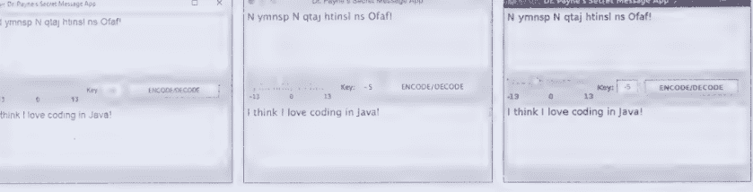

这个简单而强大的概念是 Java 被全球个人和企业采纳的原因之一。

## 为开发者安装 Java 8 和 9

Java 开发工具包（`JDK`）是面向开发者或程序员的 Java 版本——就像你一样！`JDK` 赋予了你编写和编译自己的 Java 应用程序的能力，这些程序可以与朋友分享、在企业中部署，或在几乎任何设备上运行。

我们将安装 `JDK` 的 8 和 9 两个版本。这样，我们既可以获得版本 8 广泛使用的优势，又能访问版本 9 的最新功能。

安装 `JDK 8`：

1. 前往 `http://jdk.java.net/8/`
2. 点击 Accept License Agreement（接受许可协议）按钮。
3. 在 `JDK` 下载列表中找到你操作系统的链接并点击。如果你的操作系统是 Windows 或 Linux，请选择 64 位版本。
4. 从计算机的“下载”目录打开 `JDK` 文件并安装 `JDK`。

安装 `JDK 9`，前往 `http://jdk.java.net/9/`，然后重复安装 `JDK 8` 的步骤 2-4。

> 注意：如需查看详细的视频分步说明，你可以访问 `http://www.udemy.com/java-the-easy-way/` 免费预览与本书相关的在线课程。

完成这些后，你的计算机就准备好从文本命令行或终端编译并运行 Java 程序了，但我们也希望利用 Java 创建像图 1-1 那样的图形用户界面（`GUI`）应用程序的能力。为了利用 Java `GUI` 的强大之处，我们将安装一个名为 `Eclipse` 的集成开发环境。

## 为 Java 开发者安装 Eclipse IDE

`Eclipse` 是 Java 编程领域最流行的 `IDE` 之一。它还是开源的，这意味着个人和商业使用都是免费的，并且有一个活跃的开源社区在不断改进和支持 `Eclipse`。Java 还有许多替代 `IDE`，但 `Eclipse` 以其开发 Java 应用程序的易用性而闻名。它非常容易安装。

要在计算机上安装 `Eclipse`，前往 `http://www.eclipse.org/downloads/`，下载适用于你系统的安装程序（如图 1-2 所示），然后运行它。截至本文编写，当前版本为 Eclipse Oxygen。


图 1-2：为你的操作系统下载 Eclipse IDE。

你会看到一个类似于图 1-3 的菜单。选择 Eclipse IDE for Java Developers（Java 开发者版 Eclipse IDE）并点击 Install（安装）。注意选择 Eclipse IDE for Java Developers 选项，而不是其他选项（Java EE 或企业版）。安装可能需要几分钟。


图 1-3：选择 Java 开发者版 Eclipse IDE


图 1-3：Eclipse 开始


图 1-3：Eclipse 开始


图 1-3：Eclipse 开始


图 1-4：Eclipse 询问你想要在哪里存储项目

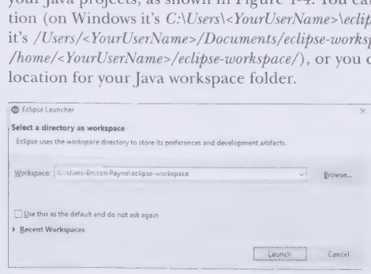

图 1-5：Eclipse 询问你想要在哪里存储项目

### 设置 Eclipse

让我们配置 `Eclipse` 使它看起来用起来更专业。当 `Eclipse` 启动时，它通常会询问你的工作空间（`workspace`），工作空间存放所有的 Java 项目。你可以使用默认路径（Windows 上是 `C:\Users\Username\eclipse-workspace`，macOS 上是 `/Users/Username/Documents/eclipse-workspace/`，Linux 上是 `/home/Username/eclipse-workspace/`），也可以自定义位置。如果你勾选了“作为默认并不再询问”（Use as the default and do not ask），每次启动 `Eclipse` 时都不会弹出。如果你计划使用多个工作空间，可能希望取消勾选，以便在工作空间之间切换。

### 修改 Eclipse 以运行 Java 9

如果 `Eclipse` 无法启动，你还需要进行另一项更改。截至本文编写，Java 9 还是全新的，Eclipse Oxygen 及更高版本支持 Java 9，但某些版本需要在 `eclipse.ini` 文件中进行添加才能运行。要进行此更改，请遵循以下步骤：

1. 找到你的 `Eclipse` 安装文件夹：
   - 在 Windows 上，你可以右键点击 `Eclipse` 快捷方式并选择“打开文件位置”。`eclipse.ini` 文件位于 `eclipse.exe` 所在的文件夹下。
   - 在 macOS 上，在 Finder 的应用程序中找到 `Eclipse` 应用，`CONTROL` 点击 `Eclipse` 图标并选择“显示包内容”。打开 `Contents` 文件夹，然后进入 `Eclipse` 文件夹找到 `eclipse.ini`。
   - 在 Linux 上，进入你的主目录并打开 `eclipse/java-oxygen/` 找到 `eclipse.ini`。


## 2. 编辑 `eclipse.ini` 文件

右键点击 `eclipse.ini` 文件。选择“打开方式...”，然后选择记事本、TextEdit 或任何其他文本编辑器。

在 `eclipse.ini` 文件的末尾添加以下行：

```
--add-modules=ALL-SYSTEM
```

## 安装 WindowBuilder 编辑器

我们对 Eclipse 进行的最重要的升级是安装 WindowBuilder 编辑器，它允许我们通过将按钮、标签和文本字段等 GUI 元素拖放到应用程序的图形预览界面上，来构建窗口化应用程序。

某些版本的 Eclipse 已经安装了 WindowBuilder 编辑器，但我们将介绍安装或更新它的步骤，以确保你从第 3 章开始准备好构建 GUI 应用程序。

首先，访问 `http://www.eclipse.org/windowbuilder/` 并点击 Download（下载）。在下载页面，找到与你的 Eclipse 版本匹配的 WindowBuilder 版本（对于 Eclipse Oxygen，版本为 4.7），右键点击或 CONTROL-点击相应的链接，并复制链接地址，如图 1 所示。

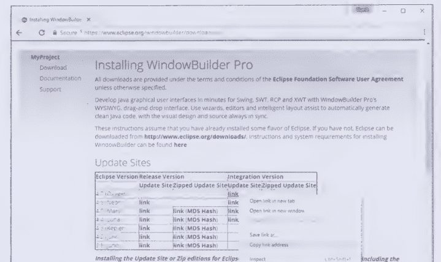

图 1：复制最新的 WindowBuilder 编辑器下载链接。

接下来，回到 Eclipse，选择 **Help（帮助） > Install New Software（安装新软件）**。在 Work with（工作项：）文本框中，粘贴 WindowBuilder 编辑器的 URL（对于 Eclipse Oxygen，即为 `http://download.eclipse.org/windowbuilder/WB/integration/4.7/`），点击 **Add...（添加...）** 按钮并在弹出的 Name（名称）字段中输入 **WB**，如图 1-6 所示。

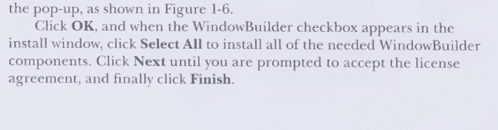

点击 OK，当安装窗口出现 WindowBuilder 复选框时，点击 Select All（全选）以安装所有需要的 WindowBuilder 组件。一直点击 Next（下一步），直到提示你接受许可协议，最后点击 Finish（完成）。

### 图 1-6：使用 Eclipse 的 Install New Software 添加 WindowBuilder 编辑器。

软件可能需要几分钟时间进行安装——你会在 Eclipse 的右下角看到进度指示。当安装完成后，系统将提示你重启 Eclipse。点击 Restart Now（立即重启），WindowBuilder 的安装即完成。

接下来，让我们进行一些微调，通过更改背景、文本颜色和字体，让 Eclipse 中的代码更易读。

## 定制 Eclipse 的外观和感受

现在我们已经安装了所需的元素，你可能想定制 Eclipse 的外观。在 Windows 和 Linux 上，你可以通过进入 `Window ▸ Preferences（偏好设置）` 访问菜单。在 macOS 上，进入菜单栏并选择 `Eclipse ▸ Preferences`。

例如，你可能想更改文本编辑器中的主题（调色板）和字体大小。根据你的显示器大小和编程环境，主题和字体大小会对可读性、舒适度甚至生产力产生巨大影响。

在 Preferences 菜单中，找到 `General（常规） ▸ Appearance（外观）` 下的 Theme（主题）选项。你可以从收藏夹中选择，例如 Classic（经典，浅灰色背景配深色字体）或 Dark（深色，黑色背景配更亮、色彩丰富的字体）。我更喜欢 Dark 主题，因为在深色背景下字体颜色更亮，在显示器或投影屏幕上更容易阅读。

在 `General ▸ Appearance ▸ Colors and Fonts（颜色和字体）` 下，你可以更改字体大小。在右侧的 Colors and Fonts 格中，选择 `Basic ▸ Text Font（文本字体）` 并点击 Edit（编辑）按钮。字体菜单将弹出。选择一个易于阅读的字体。我更喜欢 Courier New 或 Consolas。我建议字体大小为 18 到 20，字体样式为 Bold（加粗）。字体窗口将显示所选字体、样式和大小的示例，如图 1-7 所示。

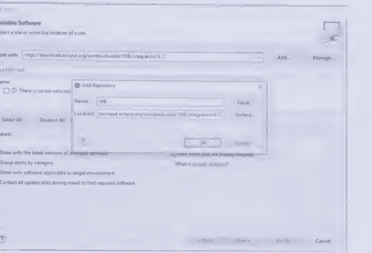
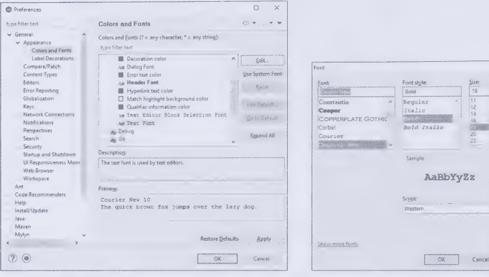

图 1-7：颜色和字体设置（左侧）和字体设置（右侧）

完成选择后点击 OK，将返回 Eclipse 工作区。当你在第 2 章在编辑器中编写代码时，偏好设置将生效。

## 安装 Android Studio 进行移动开发

Android Studio 是官方的移动开发环境。它让我们使用 Android 编程语言设计并编写移动应用。与 Java 类似，Android Studio 是免费下载、安装和使用的。由于其体积，Android Studio 的下载和安装可能需要几分钟到几小时，取决于你的网络连接。

要下载 Android Studio，访问 `http://developer.android.com/studio/` 并点击 Download Android Studio，同意条款并点击 Download Studio for <操作系统>。如图 1-8 所示。

按照说明完成安装。安装过程可能会下载额外的软件开发包 (SDK)，下载完成后可能还需要几分钟安装。


图 1-8：Android Studio 是官方的移动应用开发环境。

## 通过 JShell 了解 Java

现在我们已经设置好了编程环境，让我们使用 JShell 来测试设置——JShell 是 Java 的交互式解释器。它可以立即对你的代码提供反馈。在 Java 之前，程序员必须编写完整的程序、进行编译并运行来查看结果。现在有了 JShell，我们可以输入单行 Java 代码，例如 `System.out.println("Hello, Java!")`，按回车即可立即在屏幕上看到输出，如图 1-9 所示。

```
Welcome to JShell -- Version 9
For an introduction type: /help
jshell> System.out.println("Hello, Java!")
Hello, Java!
jshell>
```

图 1-9：Java 中的 JShell 允许我们在交互式 shell 中快速测试代码。任何有效的 Java 语句可以在 JShell 中运行，它是学习 Java 基础的绝工具，让我们开始吧！

### 运行 JShell

你可以通过命令行或设置快捷方式运行 JShell。以防某一种方法无效，我们将介绍两种。首先，你必须安装 JDK 9。你可以通过运行命令行来确认 JDK 9 是否已安装。以下是在 Windows、macOS 和 Linux 上启动命令行的方法：

- 在 Windows 上，通过开始菜单输入 `cmd` 打开命令行。
- 在 macOS 上，打开 Launchpad 搜索框中输入 `terminal`，点击 Terminal 图标。
- 在 Linux 上，搜索 `terminal` 并点击 Terminal 图标。

会出现提示符。在提示符处输入 `java -version`，Java 会告诉你安装了哪个 JDK。在 Windows 上你会看到类似的内容：

```
C:\Users\Payne> java -version
java version "9"
Java(TM) SE Runtime Environment (build 9)
HotSpot 64-Bit VM (build 9, mixed mode)
```

或者在 macOS 和 Linux 上看到此输出：

```
Payne:~payne$ java -version
java version "1.9.0"
Java(TM) SE Runtime Environment (build 1.9)...
```

如果 Java 返回的内容包含 9 或 1.9，如此处所示，你就准备好运行 JShell 了。如果你想从命令行运行它，请继续下一节。如果你获得的是较早版本的 Java（如 1.8），请返回第 2 页的“为开发者安装 Java 8 和 9”。如果命令行没有出现版本 9，或者你更喜欢设置桌面快捷方式，请跳到第 11 页的“通过快捷方式运行 JShell”。

### 从命令行运行 JShell

要在命令行中运行 JShell，输入 `jshell` 并按回车。Java 将响应 JShell 欢迎消息和提示符，如下：

```
C:\Users\Payne> jshell
Welcome to JShell -- Version 9
For an introduction type: /help
shell>
```

在 macOS 或 Linux 上，消息和提示符看起来类似：

```
Payne:~ payne$ jshell
Welcome to JShell -- Version 9
For an introduction type: /help
jshell>
```

如果你得到了 `jshell` 提示符，你就准备好进入第 12 页的“在 JShell 中处理 Java 表达式”。如果安装 JDK 9 后你的电脑上 `jshell` 命令不起作用，请尝试按照下一节的步骤。

### 通过快捷方式运行 JShell

如果你在从命令行运行 JShell 时遇到任何困难，或者你更喜欢从桌面快捷方式运行它，请按照这些指令直接从 JDK 9 的 `bin` 文件夹访问 JShell 并设置快捷方式。（文件夹名 `bin` 是二进制的缩写，即只有扩展名的计算机语言编写的程序）。

> 遗憾的是，这种方法在 Linux 上并不可靠，但你应该可以使用命令行。

你可以在以下目录找到 JShell：

- 在 Windows 上，使用 `C:\Program Files\Java\jdk-9\bin\jshell.exe`
- 在 macOS 上，使用 `/Library/java/JavaVirtualMachines/jdk-9.jdk/Contents/Home/bin/jshell`

你的 JDK 文件夹可能标记为 `jdk-1.9` 而不是 `jdk-9`，但工作方式是一样的。导航到你电脑上的 JDK 9 文件夹并找到 `jshell` 文件，如图 1-10 所示。

你可以双击 JShell 文件的图标来运行 JShell。你还可以创建一个快捷方式，以便方便从桌面直接运行 JShell：

- 在 Windows 上，右键点击 `jshell.exe` 并选择“创建快捷方式”。Windows 将响应“无法在此处创建快捷方式。你想将快捷方式放在桌面上吗？”点击“是”。
- 在 macOS 上，CONTROL-点击 `jshell` 文件并选择“制作别名”。会出现一个名为 `jshell alias` 的文件。将其拖到桌面。

现在，任何你想运行 JShell 时，只需双击桌面上的图标，就可以准备好编写 Java 代码了。

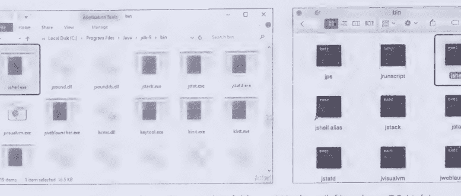

## 在 JShell 中处理 Java 表达式

表达式是值（如数字或文本）或运算符的任何组合，结果是一个值。运算符执行加法、减法、乘法或除法等操作。在 Java 中，我们用于这些运算符的符号分别是 `+`、`-`、`*` 和 `/`。让我们用一个简单的数学表达式来试一下。在 JShell 提示符下，输入 `2+2` 并按回车：

```
jshell> 2+2
$1 == 4
```

JShell 告诉你答案：表达式 `2+2` 的值为 4。`$1` 是一个临时变量。JShell 创建这些变量来存储值，在这里，变量 `$1` 临时存储了值 4，以备你以后使用。如果你想知道变量中存储的是什么值，可以在 JShell 中输入它。例如，如果你现在输入 `$1`，JShell 会告诉你 `$1` 存储的值为 4：

```
jshell> $1
$1 == 4
```

让我们尝试另一个表达式。这次，我们组合两个文本字符串。字符串是引号之间的字符，用于显示单词、名称和其他文本。你可以使用 `+` 运算符来组合字符串：

```
jshell> "Your" + "Name"
$3 == "YourName"
```

你会发现创建了一个不同的变量——在这种情况下是 `$3`。`$` 符号后面的数字表示输入表达式的代码行数。这是我的第三段代码，所以 JShell 正在将 `"YourName"` 存储在变量 `$3` 中。

同样注意，Java 拼接（或相加）了两个字符串，中间没有空格。如果我们想在两个拼接的字符串之间留一个空格，我们必须在双引号内包含它，如下所示：

```
jshell> "Your" + " " + "Name"
$4 == "Your Name"
```

任何有效的 Java 表达式都可以在 JShell 中求值，所以请继续尝试更多表达式。要编辑已输入的语句，请按向上箭头键。JShell 将显示你最后输入的命令，允许你对其进行编辑并按回车键运行该语句。多次按向上箭头键可以浏览之前语句的历史，一直滚动到你输入的第一行。

### 在 JShell 中声明 Java 变量

使用简单值求值表达式很棒，但你通常希望将值存储在变量中以便以后使用。JShell 会自动为我们创建临时变量，如上一节中的 `$1` 和 `$3`，但你也可以创建或声明你自己的变量。

#### 数型变量

让我们创建一个名为 `x` 的整数（整数字）变量并在其中存储值 42。Java 将整数存储在 `int` 类型的变量中，因此在 JShell 提示符下，输入 `int x = 42`：

```
jshell> int x = 42
$1 == 42
```

等号 (`=`) 是 Java 中的赋值运算符，意味着给变量赋值。JShell 给出了响应，让我们知道变量 `x` 包含值 42。现在，当我们想要使用该值时，可以直接通过名称调用它。让我们看看 `x * 2`（x 乘以 2）等于多少：

```
jshell> x * 2
$2 == 84
```

Java 使用星号 (`*`) 作为乘法符号，JShell 正在告诉我们 `x * 2` 等于 84。我们是否通过获取其值并将其乘以二来改变了 `x` 的值？让我们通过输入 `x` 来查看：

```
jshell> x
$3 == 42
```

呼！我们的变量仍然具有相同的值 42。这意味着可以在不改变变量的情况下使用存储在变量中的值。

那么如何更改存储在变量中的值呢？我们再次使用赋值运算符。在 JShell 提示符下输入 `x = x + 7`：

```
jshell> x = x + 7
$4 == 49
```

我们通过取旧的 `x` 并加上 7 替换了 `x` 中存储的值。从现在起，每当我们询问 `x` 的值时，都会得到 49，直到我们更改它。变量的值可以根据需要随时变化——这就是为什么它们被称为变量。

让我们尝试不同类型的变量。我们已经见过整数值，所以让我们尝试小数，或浮点类数字。Java 将小数存储在 `double` 类型（双精度浮点数的缩写）变量中，因此创建一个名为 `meters` 的 `double` 并在其中存储小数值 1.83：

```
jshell> double meters = 1.83
meters => 1.83
```

Java 处理小数值就像处理整数值一样简单。让我们做一些计算，将米转换为厘米：

```
jshell> double centimeters = meters * 100
centimeters => 183.0
```

我们通过将其乘以 100 将米中的值转换为厘米值。Java 还处理其他几种类型的数字，但 `int` 和 `double` 值是你最常用的类型。每当你遇到一种新类型的变量时，尽管打开 JShell 并尝试不同的变量。

#### 字符串变量

`String` 类型用于存储字符串。让我们创建一个名为 `name` 的 `String` 变量并在其中存储值 `"Hello"`：

```
jshell> String name = "Hello"
name => "Hello"
```

Java 处理字符串就像处理其他类型一样简单。让我们拼接字符串来创建一个问候：

```
jshell> String greeting = "Hello " + "World"
greeting => "Hello World"
```

我们组合了两个字符串来创建一个新的 `"Hello World"`。如果我们想更改 `greeting` 的值，我们可以再次使用赋值运算符：

```
jshell> greeting = "Hi " + "Java"
greeting => "Hi Java"
```

### JShell 将打开文件并运行代码

每当你编写了一个想要以后保留的代码片段时，请使用 `/save` 和 `/open` 命令将你的代码在不同的 JShell 会话之间保留。

要开始一个新的代码片段，请使用 `/reset` 命令。JShell 只会记住并保存你在输入 `/reset` 命令之后输入的内容，但你可以随时重新打开已保存的文件。尝试以下代码，可以快速查看保存文件、重置和打开文件的示例：

```
jshell> /reset
Resetting state.
jshell> System.out.println("Hello, Java!\nHello, Java!")
jshell> System.out.println("My name is Bryson, nice to meet you")
My name is Bryson, nice to meet you!
jshell> /save "~/Desktop/myJava.txt"
Resetting state.
jshell> /open "~/Desktop/myJava.txt"
Hello, Java!
Hello, Java!
My name is Bryson, nice to meet you!
```

带编号的行指出了重要的行，但它们实际上并不是代码的一部分。


首先，你需要重置 JShell，这样你就不会包含你在想要保存的代码之前可能写的任何早期代码。一旦完成，你还可以编辑你的程序（在本例中是两个打印语句），然后将其保存到桌面上。即使 JShell 已经重置，`/open` 命令也会运行我们在输入 `/save` 命令之前输入的两行代码并执行它们。你可以使用 `/edit` 修改代码，并在完成后使用 `/save`。

JShell 可以存储和回溯代码片段，无论它是单行还是你输入的任意多行。

如果你已经完成了探索，请使用 `/exit` 命令关闭 JShell：

```
jshell> /exit
goodbye
```

JShell 在你离开时非常有礼貌，会送出亲切的告别。

## 你学到了什么

在本章中，你不仅安装了 Java、Eclipse 和 Android Studio——你还通过在 JShell 交互式 shell 中测试命令开始学习 Java。JShell 是对无处不在的行业标准 Java 的一项令人兴奋的改进，对于初学者和资深开发者来说都是非常棒工具。

对于编码人员来说，JShell 鼓励探索并消除了学习 Java 命令的一些不必要障碍。对于经验丰富的程序员来说，JShell 提供了一种快速测试新代码段并在屏幕上查看结果的方法。作为一名教育者和编码人员，我对 JShell 对 Java 未来的意义，以及对数百万能够从这套重要新工具集中获益的编码人员感到非常兴奋。

你已经为 Java 桌面应用和移动应用配置了编程环境，并学会了如何在 JShell 中测试代码。你还学习了许多编程概念，将在接下来的章节中构建的 Java 桌面和移动应用中使用这些概念。以下是你目前为止所成就的快速概述：

- 安装 Java JDK 8 和 9
- 安装用于 Java 开发的 Eclipse IDE 和 WindowsBuilder Editor
- 安装用于移动应用开发的 Android Studio
- 从命令行和 JDK/bin 文件夹运行 JShell
- 在 JShell 中评估 Java 表达式，包括数字和文本
- 在 Java 中声明整数、小数和字符串变量
- 使用 `System.out.println()` 向屏幕打印输出
- 使用 JShell 命令，如 `/reset`、`/edit`、`/save`、`/open` 和 `/exit`
- 从 JShell 保存和打开文件

在下一章中，我们将构建第一个完整的 Java ——高低猜游戏（Hi-Lo guessing game）。在随后的章节中，我们将为每个程序创建文本程序、桌面应用，最后是 Android 移动应用。

在此后过程中，我们将使用在 JShell 中学到的编程概念，包括表达式、变量、输出等。无论你是在构建第一个应用还是第千个应用，是用于工作的桌面应用还是用于娱乐的移动游戏，这些相同的元素都将成为你编写的所有代码的一部分。

你已经拥有了工具，让我们进入第 2 章并开始吧！

# 2 构建一个高低猜游戏应用！


让我们从在 Java 中编写一个有趣的、可玩的游戏开始：高低猜游戏。我们将此游戏程序化为一个命令行应用程序，这只是“基于文本的”的一种高级说法（见图 2-1）。当程序运行时，提示符将要求用户猜一个 1 到 100 之间的数字。每当他们猜一次，程序都会告诉他们猜得太高、太低还是正确。

## 逐步规划游戏

让我们思考一下为了让高低猜游戏运行起来，我们需要编写代码的所有步骤。游戏的基本版本需要执行以下操作：

- 为用户生成一个 1 到 100 之间的随机数进行猜测。
- 显示提示符或一行文本，要求用户猜该范围内的一个数字。
- 接受用户的猜测作为输入。
- 将用户的猜测与计算机的数字进行比较，查看猜测是太高、太低还是正确。
- 在屏幕上显示结果。
- 询问用户是否想再次玩。

创建项目的第一步是进入菜单栏并选择 File -> New Project。New Project 对话框弹出。

- Create Java Project
- Name the project
- Choose the location

## 创建游戏

Java 是一种面向对象的语言，使用类来设计可重用的代码。类是更容易创建对象的模板。如果你把类看作饼具，对象就是饼干。而且像饼具一样，类是可重用的，一旦我们构建了类，就可以根据需要重复使用。

高低猜游戏将有一个创建一个猜测对象的类。我们将类命名为 `HiLo`。遵循命名规范，所有类名以大写字母开头。

让我们创建类。代码如下：

```java
public class HiLo {
}
```

现在我们已经创建了类，就可以开始编写游戏代码了。我们需要做的第一件事是生成一个 1 到 100 之间的数字。

```java
import java.util.Random;

public class HiLo {
    public static void main(String[] args) {
        Random rand = new Random();
        int targetNumber = rand.nextInt(100) + 1;
        System.out.println("Welcome to the Hi-Lo guessing game!");
        // ... 其他代码
    }
}
```

接下来，我们需要提示用户猜一个数字。我们将使用 `Scanner` 类获取用户输入。

```java
import java.util.Random;
import java.util.Scanner;

public class HiLo {
    public static void main(String[] args) {
        Random rand = new Random();
        int targetNumber = rand.nextInt(100) + 1;
        Scanner scanner = new Scanner(System.in);
        System.out.println("Welcome to the Hi-Lo guessing game!");
        System.out.print("Guess a number between 1 and 100: ");
        int guess = scanner.nextInt();
        // ... 其他代码
    }
}
```

现在，我们需要将用户的猜测与目标数字进行比较，并告诉用户是太高、太低还是正确。

```java
if (guess > targetNumber) {
    System.out.println("Too high!");
} else if (guess < targetNumber) {
    System.out.println("Too low!");
} else {
    System.out.println("Correct!");
}
```

最后，我们将所有内容封装在一个循环中，让用户可以一直猜直到对为止。

```java
import java.util.Random;
import java.util.Scanner;

public class HiLo {
    public static void main(String[] args) {
        Random rand = new Random();
        int targetNumber = rand.nextInt(100) + 1;
        Scanner scanner = new Scanner(System.in);
        System.out.println("Welcome to the Hi-Lo guessing game!");
        int guess = 0;
        while (guess != targetNumber) {
            System.out.print("Guess a number between 1 and 100: ");
            guess = scanner.nextInt();
            if (guess > targetNumber) {
                System.out.println("Too high!");
            } else if (guess < targetNumber) {
                System.out.println("Too low!");
            } else {
                System.out.println("Correct!");
            }
        }
        System.out.println("Thanks for playing!");
    }
}
```

点击“新建 Java 类”对话框中的完成，你将看到一个名为 HiLoJava 的新文件，其中包含列表 2-1 所示的代码。这个 Java 文件将是 Hi-Lo 猜游戏的大纲。我们将通过编辑此文件并在其中添加代码来编写猜游戏程序。

```java
public class HiLo {
    public static void main(String[] args) {
        // Auto-generated method stub
    }
}
```

列表 2-1：由 Eclipse 生成的 HiLo 猜游戏类存根代码

Eclipse 会自动创建此类。`HiLo` 类是公共的（`public`），这意味着我们可以从命令行或终端运行它。

Java 使用大括号 `{ }` 将语句分组。左大括号 `{` 开始一个语句块，该块将形成 `HiLo` 类的体。右大括号 `}` 结束语句块。类内部是 `main()` 方法，它是当执行类时将运行的方法。

`main()` 方法的左大括号内部有一行以双斜杠 `//` 开头的注释行——计算机会忽略注释，因此我们可以用它们供我们（人类）阅读。它们可以记录某段代码的功能，或者为以后的使用留留备注。你可以删除列表 2-1 中的 `TODO000` 代码。

### 生成随机数

我们游戏的第一个编程任务是生成一个随机数。我们将使用 `Math` 类，它包含一个用于生成 0.0 到 1.0 之间随机浮点数（小数）的方法。然后，我们将该小数值转换为 1 到 100 之间的内置 `int`（整数）。`Math` 类包含了许多实用的数学函数，就像你在科学计算器上找到的那些一样。

在 `main()` 方法内部，添加列表 2-2 所示的注释和代码行。新代码用黑色显示，现有代码用灰色显示。

```java
public class HiLo {
    public static void main(String[] args) {
        // Create a random number for the user to guess
        int randomNumber = (int)(Math.random() * 100 + 1);
    }
}
```

列表 2-2：创建 1 到 100 之间随机数的代码

首先，我们需要创建一个变量来存放用户在程序中尝试猜测的随机数。由于程序将要求用户猜测 1 到 100 之间的整数，我们将使用 `int` 类型（integer 的缩写）。我们将变量命名为 `randomNumber`。等号 `=` 将值赋给我们的新变量 `randomNumber`。我们使用内置的 `Math.random()` 函数生成一个 0.0 到仅小于 1.0（0.99999）之间的随机数。由于 `Math.random()` 仅在特定范围内生成数字，我们需要将随机数乘以 100，将范围从 0.0 扩展到仅小于 100.0（约 99.9999）。然后我们对该值加 1，以确保数字从 1.0（0.0 + 1）运行到 100.99999。

`(int)` 部分被称为类型强制转换（type cast），或简称为转换。它将数字的类型从小数转换为整数。在这种情况下，小数点后的所有内容都会被移除，得到一个 1 到 100 之间的数字。Java 随后将该数字存储在变量 `number` 中，这是用户在游戏中尝试猜测的数字。最后，我们添加一个分号 `;` 来表示指令的结束。

现在，你可以添加一个 `System.out.println()` 语句来打印你生成的数字：

```java
int number = (int)(Math.random() * 100);
System.out.println(number);
```

添加此行代码后，我们就可以运行程序来生成并打印随机数。点击顶部菜单栏上的绿色按钮编译并运行程序，如图 2-5 所示。你也可以进入“Run”（运行）菜单并选择“Run”。

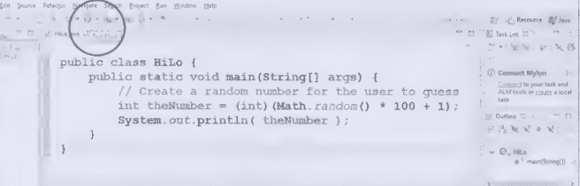

图 2-5：向屏幕打印随机数

你的随机数将出现在屏幕底部的小控制台窗口中，如图 2-5 所示。如果你再次运行程序，将看到 1 到 100 之间的不同数字。

现在是尝试修改程序的好时机。尝试生成一个 1 到 10 之间的随机数，或者 1 到 1,000 之间的——甚至是 1 到 1,000 之间的。Java 接受高达十亿左右的数字。只需记住在写数字时不要加逗号：1,000 在 Java 中变为 1000，而 1,000 写为 1000000。不过，你可能不想在第一次玩游戏时猜 1 到 1,000,000 之间的数字，所以请在继续之前之前将此行代码改回来。

> 注意 记住经常保存代码。每次运行程序时，Eclipse 都会自动为你保存，但每隔几行代码就保存一下是个好习惯。事实上，在每行代码后按 CTRL-S（或 Cmd-S）进行保存并不是一个坏习惯。

### 获取用户输入

现在，我们需要提示用户输入猜测。我们可以通过在控制台窗口打印一行文本让用户知道程序已准备好接收输入。我们像之前访问键盘输入一样访问这个文本界面——通过 `System` 类访问计算机系统，但这次我们想输出信息供用户阅读。让我们访问命令行控制台输出的对象是 `System.out`。类似于允许我们从键盘接收文本输入的 `System.in` 对象，`System.out` 赋予了我们向屏幕输出文本的能力。打印文本行的特定函数是 `println()` 命令：


```java
int guess = 0;
System.out.println("Guess a number between 1 and 100:");
```

名为 `nextInt()` 的方法寻找用户从键盘输入的下一个整型值。我们将用户的猜测存储在之前创建的变量 `guess` 中。

```java
guess = scan.nextInt();
```

此语句将等待用户在控制台窗口中输入内容（我们希望是一个是 1 到 100 之间的整数——我们将在第 3 章学习如何确保用户输入的是有效数字）并按下回车键。`nextInt()` 方法将获取用户输入的文本字符字符串（例如 "50"），将其转换为正确的数值 (50)，然后将该数字存储在变量 `guess` 中。请花一点时间保存你目前为止所做出的更改。

### 让程序打印输出

我们还可以通过添加另一个 `println()` 来检查程序到目前是否运行正常：

```java
guess = scan.nextInt();
System.out.println("You entered " + guess + ".");
```

这一行代码再次使用了 `System.out.println()` 方法，但现在我们将文本和数字输出结合在一起。如果用户猜的是 50，读取到的输出将是“You entered 50.”为了实现这一点，我们构造了一个混合了文本与变量 `guess` 中存储数字的 `println()` 语句。

Java 允许我们使用 `+` 运算符连接文本字符串。我们使用双引号来指定我们想要首先输出的文本（"You entered "）。注意结束引号前的空格——这告诉我们我们希望在打印输出的最后一个单词之后出现一个空格。Java 会忽略大部分空格，但当空格位于字符串的双引号内部时，它就会成为文本的一部分。

我们还想打印用户猜的内容。我们已将此值存储名为 `guess` 的变量中，所以只需要使用 `println()` 语句输出该值即可。幸运的是，在 Java 中，当我们在 `println()` 语句中包含变量时，紧跟 "You entered " 之后我们添加连接运算符 (`+`)，然后是变量名 `guess`。最后，我们想用句号结束句子，所以我们使用另一个连接运算符，后面跟着包含在双引号中的文本，使其看起来像 "."。

列表 2-3 汇总了我们目前为止的所有代码行。

```java
import java.util.Scanner;

public class Hilo {
    public static void main(String[] args) {
        Scanner scan = new Scanner(System.in);
// 为用户创建一个随机数猜测
int number = (int)(Math.random() * 100 + 1);
// System.out.println(the number);
int guess = 0;
guess = scan.nextInt();
System.out.println("Guess a number between 1 and 100:");
System.out.println("You entered " + guess + ".");
    }
}
```

列表 2-3：到目前为止的代码生成一个随机数并允许用户猜一次。

在某处，请注意我通过在该行开头添加一对正斜杠，将 `System.out.println( theNumber );` 变为了注释。这被称为“注释掉”（commenting out），它是调试以及修复程序 Bug 的一种实用技术。我们在编写和测试程序时，我们使用 `println()` 来显示变量 `number` 的值。与其完全删除该行，我们可以将其注释，这样计算机就会忽略它。如果我们想再次使用该行，只需删除 `//` 将其包含在程序中。

现在让我们保存程序并运行它，看看它目前是如何工作的。要运行它，请点击绿色的运行按钮或前往 Run ▶ Right。现在，用户只能猜一次，且程序不会检查他们是否猜对。接下来，我们将添加一些代码，让用户可以猜多次，并学习如何将每次猜测与数字进行对比测试。

### 循环：询问、检查、重复

为了给用户一次猜数字的机会，我们需要学习如何构建循环！在猜数字游戏程序，我们需要不断询问用户猜测，直到他们猜对。循环让我们能够不断重复执行一组步骤的能力。在本节中，我们将为提示用户猜测并接受键盘输入的步骤构建一个循环。

循环是非常强大的编程工具，它们也是循环在我们的日常生活和商业世界中如此宝贵的原因之一——计算机非常擅长以可预测的方式重复相同的任务。而且，如果编程得当，它们可以整天、每天都这样做而不出错。我可能会因为一直告诉他们猜测猜得太高或太低而感到疲惫，但计算机永远不会。

让我们通过 `while` 循环来利用循环的力量。`while` 循环只要某个条件为真（true），就会重复一组语句。例如，在这个程序中，我们想知道用户是否猜对了。要写一个 `while` 循环，我们需要在每次重复循环之前知道我们想要测试什么条件。在猜数字游戏中，只要用户的猜测不等于秘密数字，我们就让用户再次猜测。当用户的猜测等于该数字时，游戏结束，因此循环应该停止。

要创建一个循环，我们需要在代码最后几行之前插入一个 `while` 语句，并将这三行包裹在一个新的大括号内，如下：

```java
guess = 0;
while (guess != number) {
    System.out.println("Guess a number between 1 and 100:");
    guess = scan.nextInt();
    System.out.println("You entered " + guess + ".");
}
```

我们使用关键字 `while` 来让 Java 知道我们正在构建一个循环。只要某个条件为真，`while` 循环就会重复一组语句。例如，在这个程序中，我们想知道用户是否猜对了。要写一个 `while` 循环，我们需要在每次重复循环之前知道我们想要测试什么条件。在猜数字游戏中，只要用户的猜测不等于秘密数字，我们就让用户再次猜测。当用户的猜测等于该数字时，游戏结束，因此循环应该停止。

要创建一个循环，我们需要在代码最后几行之前插入一个 `while` 语句，并将这三行包裹在一个新的大括号内，如下：

```java
guess = 0;
while (guess != number) {
    System.out.println("Guess a number between 1 and 100:");
    guess = scan.nextInt();
    System.out.println("You entered " + guess + ".");
}
```

我们使用关键字 `while` 来让 Java 知道我们正在构建一个循环。只要某个条件为真，`while` 循环就会重复一组语句。例如，在这个程序中，我们想知道用户是否猜对了。要写一个 `while` 循环，我们需要在每次重复循环之前知道我们想要测试什么条件。在猜数字游戏中，只要用户的猜测不等于秘密数字，我们就让用户再次猜测。当用户的猜测等于该数字时，游戏结束，因此循环应该停止。

要创建一个循环，我们需要在代码最后几行之前插入一个 `while` 语句，并将这三行包裹在一个新的大括号内，如下：

```java
guess = 0;
while (guess != number) {
    System.out.println("Guess a number between 1 and 100:");
    guess = scan.nextInt();
    System.out.println("You entered " + guess + ".");
}
```

我们使用关键字 `while` 来让 Java 知道我们正在构建一个循环。只要某个条件为真，`while` 循环就会重复一组语句。例如，在这个程序中，我们想知道用户是否猜对了。要写一个 `while` 循环，我们需要在每次重复循环之前知道我们想要测试什么条件。在猜数字游戏中，只要用户的猜测不等于秘密数字，我们就让用户再次猜测。当用户的猜测等于该数字时，游戏结束，因此循环应该停止。

（注：由于原文文本中存在多段重复的关于 `while` 循环的描述，此处已按原文逻辑进行完整对应翻译。）

```java
guess = 0;
while (guess != number) {
    System.out.println("Guess a number between 1 and 100:");
    guess = scan.nextInt();
    System.out.println("You entered " + guess + ".");
}
```

我们使用关键字 `while` 来让 Java 知道我们正在构建一个循环。只要某个条件为真，`while` 循环就会重复一组语句。例如，在这个程序中，我们想知道用户是否猜对了。要写一个 `while` 循环，我们需要在每次重复循环之前知道我们想要测试什么条件。在猜数字游戏中，只要用户的猜测不等于秘密数字，我们就让用户再次猜测。当用户的猜测等于该数字时，游戏结束，因此循环应该停止。

（注：由于原文文本中存在多段重复的关于 `while` 循环的描述，此处已按原文逻辑进行完整对应翻译。）

如果你现在运行程序并输入一个较小的猜数字（例如 1），语句应该告诉程序你的猜的也太低了。这是一个很好的开始，但如果我们猜的数字太高了呢？在这种情况下，我们需要一个 `else` 语句。

`else` 语句为程序提供了一种方法，当 `if` 语句中的条件不为真时，选择一条备用路径或一组步骤。我们可以使用 `if-else` 语句对来测试猜的数字是否太高或太低。让我们在 `if` 之后添加一个 `else` 语句：

```java
if (guess < theNumber)
    System.out.println(guess + " is too low. Try again.");
else if (guess > theNumber)
    System.out.println(guess + " is too high. Try again.");
```

注意，这段代码看起来和 ⓵ 处的代码一样。当我们使用 `if-else` 语句时，我们需要连续检查多个条件，而不仅仅是一个。在这里，我们需要检查猜的数字是太低、太高还是恰好。在这种情况下，我们可以通过将下一个 `if` 放在上一个 `if-else` 语句的 `else` 部分来链用 `if-else`。② 我们紧接在上一个条件之后开始下一个语句。如果猜的数字比数字大，程序会告诉用户他们猜得太高或太低，我们只需要告诉他们他们猜对了并获胜了！

如果之前的两个条件都不为真——用户猜的数字既太高也不太低——那么他们一定猜中了数字。我们添加最后的最后一个 `else` 语句：

```java
if (guess < theNumber)
    System.out.println(guess + " is too low. Try again.");
else if (guess > theNumber)
    System.out.println(guess + " is too high. Try again.");
else
    System.out.println(guess + " is correct. You win!");
```

注意，这个这个这个语句不需要条件表达式 ⓷。如果数字既太高也不太低，那么猜中是唯一的剩余选项。在猜中的情况下，我们提供该语句让用户知道他们赢了。到为止的完整程序如列表 2-4 所示。保存我们的 `HiLo.java` 文件并运行程序以检查它是否运行正常。它应该提示你输入数字，直到你猜中数字。

```java
import java.util.Scanner;

public class HiLo {
    public static void main(String[] args) {
        Scanner scan = new Scanner(System.in);
        // 为用户创建一个随机数进行猜测
        int theNumber = (int)(Math.random() * 100 + 1);
        // System.out.println(theNumber);
        int guess = 0;
        while (guess != theNumber) {
            System.out.println("Guess a number between 1 and 100:");
            guess = scan.nextInt();
            if (guess < theNumber) {
                System.out.println(guess + " is too low. Try again.");
            } else if (guess > theNumber) {
                System.out.println(guess + " is too high. Try again.");
            } else {
                System.out.println(guess + " is correct. You win!");
            }
        }
        // 猜数字的 while 结束
    }
}
```

图 2-4：Hi-Lo 猜数字游戏已完成单轮游戏。

现在整个程序是一个完全可玩的猜数字游戏！在用户获胜后，程序会告诉他们猜对了并赢了，然后结束，如图 2-6 所示。

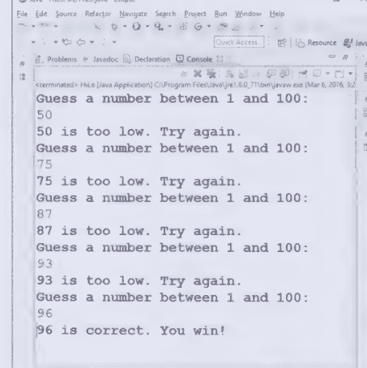

图 2-6：Hi-Lo 猜数字游戏的完整流程，用户猜中数字时结束。

给自己鼓鼓吧！你从零开始了一个 Java 程序，如果这是你的第一个 Java 程序，你值得赞赞。玩几轮游戏，看看你能否用更少的次数猜中数字。

## 添加再次游戏的循环

现在，再次玩数字游戏的唯一方法是重新运行程序。幸运的是，我们已经知道如何让程序重复执行某些操作——我们需要另一个循环！

猜数字程序在用户猜中数字后结束，因为 `while` 循环之后没有内容了。当条件 `guess != Number` 不再成立时，循环结束。用户在掌握游戏后可能想再玩一次。对于这个再次游戏的循环，我们将学习一个新的关键字和一种新的循环：`do-while` 循环。

和 `while` 循环类似，`do-while` 循环在条件为真时重复执行语句块。与 `while` 循环不同，内部的代码保证至少运行一次。有些情况下，`while` 循环的条件在开始之前可能为假，因此整个循环及其内部的所有代码行都会被忽略。`while` 循环的条件就像加热器上的温度调节。如果房间温度已经足够且不满足加热器的条件，加热器可能不会开启。

对于我们的猜数字游戏，或任何游戏，`do-while` 循环非常有用，因为它在检查条件之前代码至少运行一次。这意味着在询问用户是否想再次玩之前，他们至少玩了一轮。为了实现这一点，我们将使用 `do` 关键字并在设置之后紧跟一个大括号，然后是 `while` 条件：

```java
Scanner scan = new Scanner(System.in);
do {
    // ... 此处是游戏逻辑 ...
    playAgain = scan.next();
} while (playAgain.equalsIgnoreCase("y"));
```

`do-while` 允许我们在用户想要继续时重复游戏逻辑。这是处理需要至少执行一次迭代的游戏循环的常用方法。

最后的 `while` 语句告诉 Java 继续游戏循环；字符串变量 `playAgain` 的值可能是大写或小写字母。最后的两个闭合括号 `{` 和 `}` 是程序中已经存在的。第一个 `{` 闭合了 `main()` 方法，第二个 `}` 闭合了整个 `Hilo` 类。我把它们包含在这里是为了显示从 `}` 之前的行应该插入在什么位置。

到为止的完整游戏如列表 2-5 所示。

```java
import java.util.Scanner;

public class Hilo {
    public static void main(String[] args) {
        Scanner scan = new Scanner(System.in);
        String playAgain = "";
        do {
            // 为用户创建一个猜数的随机数
            int theNumber = (int)(Math.random() * 100 + 1);
            // System.out.println(theNumber);
            int guess = 0;
            while (guess != theNumber) {
                System.out.println("Guess a number between 1 and 100:");
            }
        } while (playAgain.equalsIgnoreCase("y"));
    }
}
```


```java
guess = scan.nextInt();

if (guess < theNumber)
    System.out.println(guess + " is too low. Try again.");
else if (guess > theNumber)
    System.out.println(guess + " is too high. Try again.");
else
    System.out.println(guess + " is correct. You win!");
}

System.out.println(); // 猜数循环结束

System.out.println("Would you like to play again (y/n)?");
playAgain = scan.next();
} while (playAgain.equalsIgnoreCase("y"));
}
}
```

列表 2-5：Hilo 猜数游戏已准备好反复进行。

检查你的代码，确保你将所有内容都添加了正确的位置，检查你的括号和分号，并花一点时间保存你的文件。我们将在下一节测试这个游戏。

你的缩进（每行开头的制表间距）看起来可能与我们最近添加两个新地方的代码片段不完全一样。幸运的是，在 Java 中添加新功能（包括循环和其他代码块）非常常见，因此 Eclipse 有一个自动清理缩进的选项。首先，选择（高亮）屏幕上 `HiLo.java` 文件中的所有文本。然后，进入 `Source` -> `Correct` -> `Correct Insertion`。Eclipse 会正确对每行代码进行缩进，以显示哪些语句是为了分组的。正如我之前提到的，缩进对计算机并不重要（没有制表符或额外的空格，程序也能正常运行）；但良好的缩进和间距有助于让程序更易读。

### 测试游戏

现在播放循环已经就绪，游戏应该可以完美运行。保存你的 `HiLo.java` 文件并选择 `Run` 来测试程序。在你正确猜中第一个随机数后，程序应该询问你是否想再次玩。只要你回答 `y`（或 `Y`）并按回车，程序就会继续为你提供新的数字供你猜。在图 2-7 的截图中，注意当我再次响应提示时，游戏就重新开始了。

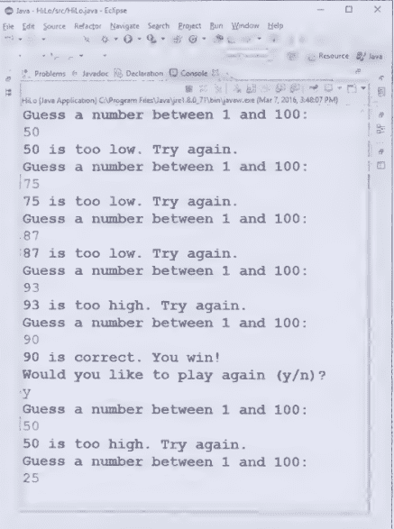

图 2-7：只要用户回答 y 或 Y，猜数游戏就可以完整地进行多轮。

当用户完成游戏并对是否再次玩的问题回答 `n` 或除 y/Y 之外的任何内容时，游戏将结束。然而，我们可能想在游戏结束后感谢他们的参与。在最后的 `while` 语句之后、最后两个括号之前，添加以下行：

```java
while (playAgain.equalsIgnoreCase("y"));

System.out.println("Thank you for playing! Goodbye.");
```

最后，我们要为猜数应用添加的最后一行是关闭 Scanner。当我们添加这一行后，Eclipse 就不再警告我们打开了未关闭的资源。使用 `Scanner` 类的 `close()` 方法来关闭连接。Eclipse 会正确对每行代码进行缩进，以显示哪些语句是意图分组的。正如我之前提到的，缩进对计算机并不重要（没有制表符或额外的空格，程序也能正常运行）；但良好的缩进和间距有助于让程序更易读。添加这一行后，Eclipse 编辑中的警告就会消失。Eclipse 会帮助我们解决常见的拼写错误或漏掉标点符号，甚至会提醒我们打开了未关闭的资源。当你构建更大、更复杂的 Java 程序时，这些 IDE 的功能将变得更有价值。你可以在附录中找到关于使用 Eclipse 调试程序的更多信息。

关于这个完成的游戏，有几点值得注意。首先，尽管编写了这么多工作，但代码相对很短——少于 30 行。然而，如果你想的话，你可以一直玩下去。其次，这个程序不仅演示了条件和循环，还使用了循环中的循环。这被称为嵌套循环，因为猜数循环包含在播放循环内部，或者说嵌套在里面。缩进帮助我们看到 `do-while` 循环从哪里开始和结束，我们可以看到较小的循环及其语句缩进并嵌套在较大的 `do-while` 循环内部。最后，我们优雅地结束了程序——既对用户表示感谢，也对计算机关闭了扫描器资源。

如列表 2-6 所示的完整程序是一个完全可选的游戏，包含了再次玩并猜新数字的功能。

```java
import java.util.Scanner;

public class Hilo {

    public static void main(String[] args) {

        Scanner scan = new Scanner(System.in);

        String playAgain = "";

        do {

            // 为用户创建一个猜数的随机数

            int theNumber = (int)(Math.random() * 100 + 1);

            // System.out.println(theNumber);

            int guess = 0;

            while (guess != theNumber) {

                System.out.println("Guess a number between 1 and 100:");

                guess = scan.nextInt();

                if (guess < theNumber) {

                    System.out.println(guess + " is too low. Try again.");

                } else if (guess > theNumber) {

                    System.out.println(guess + " is too high. Try again.");

                } else {

                    System.out.println(guess + " is correct. You win!");

                }

            }

            System.out.println(); // 猜数循环结束

            System.out.println("Would you like to play again (y/n)?");

            playAgain = scan.next();

        } while (playAgain.equalsIgnoreCase("y"));

        System.out.println("Thank you for playing! Goodbye.");

        scan.close();

    }

}
```

- 使用 `equalsIgnoreCase()` 方法比较字符串值
- 使用 `close()` 方法关闭如 `Scanner` 对象之类的输入资源
- 在 Eclipse 内部运行命令行程序

除了实战技能外，你还掌握了 Java 中几个重要编程概念的工作性知识：

变量 `theNumber` 是一个整数变量，或 `int`；而 `guess.playAgain` 是一个字符串变量，或 `String`。在玩游戏时，我们通过输入新的猜测值或回答 y 或 n 来改变这些变量的值。

方法是我们在 Java 类内部内部的的函数。`Math.random()` 是一个用于生成 0.0 到 1.0 之间随机数的方法。`scan.nextInt()` 方法接受用户输入的数字输入。`System.out.println()` 是一个用于在控制台或终端窗口显示文本的函数。

条件判断 `if-else` 语句允许我们测试条件（例如 `guess < number`）是否为真，并根据测试结果运行不同的代码块。我们还使用条件表达式来执行循环，例如 `while (guess != theNumber)` 语句。只要 `guess` 不等于 `theNumber`，该语句就会一直循环。记住“等于”的测试符号是 `==`。

循环 `while` 循环在条件为真时重复执行代码块。我们在猜数字游戏中使用 `while` 循环来不断询问用户，直到他们猜中正确的数字。`do-while` 循环始终至少运行一次，我们用它来询问用户是否想再次玩。

类 整个 HiLo 是一个 Java 类，`public class HiLo`。类是一个模板。现在我们已经为 HiLo 猜数字游戏构建了一个类模板，可以复用它在许多不同的计算机上玩这个游戏。我们在该应用中中导入了 `Scanner` 和 `Math` 类来接受用户输入并生成随机数。我们将编写自己的类来完成一些新事物，并将利用 Java 包含的类来处理日常任务，如输入、数学计算等。

## 编程挑战

尝试这些挑战来回顾并练习你所学的内容，并扩展你的编程技能。如果你遇到困难，可以访问书籍网站 `https://www.nostarch.com/learnjava/` 下载示例解决方案，或者可以在在线视频课程 `http://www.udemy.com/java-the-easy-way/` 中观看此课程获取分步解决方案。第 2 章可以免费预览，在购买完整课程时可以使用优惠码 `BOOKHALFOFF` 享受五折优惠。

### #1：扩大你的范围

对于这第一个编程挑战，请将猜数字游戏改为使用更大的数字范围。不要用 1 到 100，尝试让用户在 -100 到 100 之间猜数字！

将 `Math.random()` 乘以 200 并从结果中减去 100。

记得同时修改生成随机数的编程语句和告诉用户他们应该猜范围的提示信息。

如果你想要一个更简单的游戏，可以将范围从 1 改为 10，并在只需四次就猜中秘密数字时让你的朋友惊叹。尝试其他范围，比如 1 到 100，甚至 1 到 1,000,000，或者如果你想的话也可以使用负数范围！（记住在 Java 中编写数字时不能使用逗号。）这不仅会让你的编程更进步，还能提高你的数学能力。随你喜欢修改程序并尽情尝试吧！

### 制定你的猜测策略

你可能会发现，猜数字游戏玩得越多次，你猜中秘密数字的速度就越快。你甚至可能发现一个事实：每次都猜范围中间的数字，这样猜数字的速度是最快的。这种技术被称为二分查找。每次猜可能范围的中间值都会将可能数量减半。

以下是它的工作原理。对于 1 到 100 之间的数字，猜 50。如果太低了，你知道秘密数字一定在 51 到 100 之间，所以猜 75，正处于这个范围的中间。如果还是太低，尝试 76 和 100 之间的一半数字，即 87。由于二分查找非常有价值，以至于我们每次都可以将次数减少到 7 次（或更少）找到 1 到 100 之间的秘密数字。试试看吧！

当你练会在 7 次或更少内猜中 1 到 100 之间的数字时，尝试仅用 10 次猜中 1 到 1,000 之间的数字。如果你真的很勇敢（并且旁边有一支铅笔），尝试猜 1 到 1,000,000 之间的数字。信不信由你，这只需要 20 次。

### #2：计数次数

我们已经构建了一个非常酷的猜数字应用，但让我们尝试给游戏再增加一个功能。你的挑战是计算并报告用户猜中秘密数字需要多少次。它看起来可能像：

```
62 是正确的！你赢了！

你只花了 7 次！干得好！
```

为了完成这项任务，你需要创建一个新变量（你可能会添加类似 `numberOfTries = 0;` 的行），并且每次猜测循环执行时都必须增加次数。你可以通过为每次新循环将变量 `numberOfTries` 加 1 来做到。

## #3：玩 MadLibs

在本章的最后一个挑战中，让我们写一个新程序。我们已经学会了如何获取输入并将其存在变量。我们也学会了如何打印文本和变量值。你玩过 MadLibs 吗？让我们尝试使用新技能来构建程序。MadLibs 要求玩家提供单词，如颜色、过去动词或形容词，然后将它们插入模板。例如，如果玩家给出颜色“粉”、过去动词“打嗝”、形容词“滑稽”，然后将它们插入“在骑士身上”的模板，他们将得到“粉红的骑士在打嗝”。

现在，挑战是写一个新程序 `MadLibs.java`，包含一个名为 `MadLibs` 的类和一个向用户提示单词的 `main` 方法。这些单词应该存储在 `String` 变量中，如 `color`、`pastVerb`、`adjective` 和 `noun`，并将它们初始化为空字符串。在用户输入最后一个单词后，程序应该通过用提供的单词替换空字符串来打印完整的句子或故事，例如：

```java
System.out.print("The " + color + " dragon " + pastVerb + " the " + adjective);
```

注意第一个语句是 `print()` 而不是 `println()`。`print()` 语句在结尾继续打印，允许我们构建更长的段落。而 `println()` 语句打印后总是跳一行；就像按回车键。你可以使用不同的变量名如 `noun1`、`noun2` 和 `noun3` 写更长的 MadLibs 故事。尝试一下，准备好为你创作的幽默故事大笑吧。

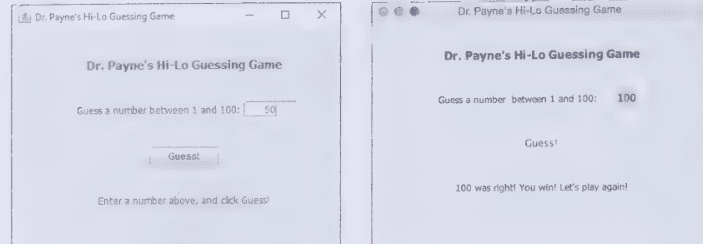

图 3-1：在 Windows（左侧）和 macOS（右侧）上运行的 Hi-Lo 猜游戏的 GUI 版本

最棒的是，在 Java 3-1 节中，完全相同的 Java 源代码生成了这两个两个版本的应用程序。通过我们在本章中编写的 GUI 代码，我们的游戏将可以在 Windows、macOS 和 Linux 上运行！

## 使用 JShell 进行练习

JShell 在命令行中工作，接受文本命令并通常以文本输出作为响应。然而，JShell 也可以访问全套 Java 库（预先编写的代码包），并且不仅限于文本。在我们开始为游戏编写程序之前，让我们先在 JShell 中创建一个简单的 GUI 来作为练习。

### 用四行代码创建 GUI

在 JShell 中，只需四行代码就可以创建一个简单的 GUI 窗口。让我们逐条分析每个语句。首先，在 JShell 中输入一条 import 语句来导入 `javax.swing.JFrame` 类：

```java
jshell> import javax.swing.JFrame
```

我们刚刚导入的 `JFrame` 类使用 Java 创建了一个框架或窗口。接下来，让我们使用该类创建一个框架。输入以下声明来创建一个名为 `myFrame` 的 `JFrame`：

```java
jshell> JFrame myFrame = new JFrame("Hello!")
```

`new` 关键字创建了 `JFrame` 类的一个新对象——在这种情况下，这是一个我们将通过程序化使其在标题栏中显示“Hello!”的 GUI 窗口。JShell 返回了一行长文本，让我们知道该窗口将具有的一些默认属性：

```
myFrame --> java.swing.JFrame[frame1,0,0,0,invalid,hidden,layout=java.awt.BorderLayout ...
```

方括号后显示的信息是该对象及其属性值的字符串表示，例如它的尺寸（为 0x0 像素）以及它是隐藏的还是可见的。让我们通过将尺寸设置为大于 0x0 像素来更改其中一个属性。

第三行代码通过为框架指定宽度和高度来设置以像素为窗口的窗口：

```java
jshell> myFrame.setSize(300,200)
```

这告诉 Java 将窗口宽度为 300 像素，高度为 200 像素，足够让我们看到窗口和标题栏。

最后，让我们通过调用 `setVisible()` 方法在屏幕上显示窗口：

```java
jshell> myFrame.setVisible(true)
```

我们使用 `setVisible(true)` 来显示窗口，使用 `setVisible(false)` 来隐藏它。由于我们调用了 `myFrame.setVisible(true)`，你应该能看到你的窗口出现在屏幕上，如图 3-2 所示。


图 3-2：我们在 Windows（左侧）和 macOS（右侧）上的 GUI 窗口

我们通过在 JShell 中输入四段代码就创建了一个 GUI 窗口：

### 用 10 行代码创建一个交互式 GUI！

我向大学的学生和家里的儿子展示了之前的示例，两组人都给出了类似“那太酷了，你能让窗口做些什么吗？”的回应。

非常幸运的是，答案是肯定的。通过只需添加几行代码，我们就可以在窗口上添加一个按钮，每次点击它都会打印某些内容。

让我们从全新的 JShell 开始。在 JShell 提示符处输入 `/reset` 来清除 JShell 历史：

```java
jshell> /reset
| Resetting state.
```

接下来，让我们使用内置的 JShell 编辑器编写一段 10 行代码，以创建一个能响应你点击的交互式 GUI 应用程序。在 JShell 提示符处，输入 `/edit` 打开 JShell 编辑器：

```java
jshell> /edit
```


# JShell 编辑面板

JShell 编辑面板（Edit Pad）在我们想要一次性编写几行代码或当我们想要返回并编辑早之前输入的某行时非常有用，它有一个空窗口如图 3-3 所示。

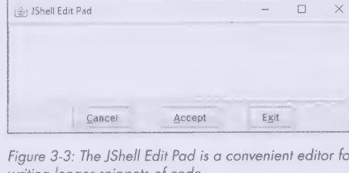

在这种情况下，我们想要输入 10 行代码，创建一个交互式 GUI 窗口，窗口上有一个按钮在点击时会打印内容。输入以下行，注意你的大小写，并在每个语句末尾添加分号以分隔命令：

```java
import java.swing.*;

JFrame window = new JFrame("Brian's Window");

JPanel panel = new JPanel();

JButton button = new JButton("Click me!");

panel.add(button);

window.add(panel);

window.setSize(300,100);

button.addActionListener(e -> 
    System.out.println("Ouch! You clicked me!"));

window.setVisible(true);
```

首先，我们导入所有的 Swing 类，包括 `JFrame` 和 `JButton`。Java 库末尾的星号（`*`）被称为通配符，意味着“包含此包中的所有类”。然后，我们像上一个示例中一样创建一个 `JFrame`。`JPanel` 将作为标签和按钮等其他组件的容器。接下来，我们添加一个带有“Click me!”文本的按钮。然后将按钮添加到我们的 GUI 面板中，然后将面板添加到窗口中。我们设置窗口的大小为 300x100。我们为按钮添加一个监听器，当点击它时打印“Ouch! You clicked me!”。最后，我们通过 `window.setVisible(true)` 显示窗口。

---

### 3-7: 确保将父类更改为 `swing.JFrame` 以为 GUI 类做准备

点击 **Finish** 查看以下 `GuessingGame.java` 的源码：

```java
import javax.swing.JFrame;

public class GuessingGame extends JFrame {

    public static void main(String[] args) {
        // TODO Auto-generated method stub
    }
}
```

在第一行，Eclipse 导入了 `javax.swing.JFrame` 类，以便我们的程序使用 Swing 包的 GUI 能力。在第二行中，我们使用了一个新的编码超能力——关键字 `extends`。在面向对象编程中，父类或超类可以拥有子类，子类继承父类中包含的所有方法和属性。当我们编写一个计划重用的执行重要功能的类时，我们可以引用该原始类并扩展它，以便在不更改父类代码的情况下添加新功能。在这种情况下，`JFrame` 父类具有显示文本字段、标签、按钮和其他 GUI 组件的能力，我们可以为新的猜数字游戏应用自定义并安排这些组件。

我们在此应用中扩展的 `JFrame` 父类将允许我们通过 Eclipse 中的 WindowBuilder Editor 设计 GUI 布局，从而显示一个包含文本字段、标签和按钮等 GUI 元素的窗口。让我们接下来查看 WindowBuilder Editor 是如何工作的。

# 使用 Eclipse 的 WindowBuilder Editor 进行 GUI 设计

流行的 Java IDE 包含此类工具，帮助程序员在设计视图中构建具有吸引力的 GUI，其“所见即所得”（WYSIWYG）界面允许用户按照设计元素在最终产品中的外观来放置它们。例如，Microsoft Word 就是一个所见即所得的界面，因为它允许你以打印格式的形式编辑文本。同样，像 WindowBuilder Editor 这样的 Java IDE 工具允许程序员将文本字段、标签和按钮等 GUI 组件放置成它们在完成的窗口化应用程序中的样子，从而帮助程序员交付外观专业的应用程序。

要打开 WindowBuilder Editor，在 Package Explorer 中右键点击 `GuessingGame.java` 文件，然后选择 **WindowBuilder Editor**。一个看起来像普通文本编辑器的窗口将会打开。但，如果你查看窗口的左下角，你会看到两个标签：Source（源码）和 Design（设计）。Source 标签是你的应用程序的纯文本源码。如果你点击 Design 标签，将看到图 3-8 所示的设计视图。

WindowBuilder Editor 仅出现在像 `GuessingGame` 这样扩展了 `JFrame` 或其他 GUI 超类的 GUI 类中。注意，预览窗口有一个标题栏，左侧有一个 Java 图标，以及三个最小化、最大化和关闭窗口的按钮。图 3-8 中的预览在 Windows、macOS 和 Linux 上看起来略有不同。此窗口将是你构建感觉像真实应用程序的 GUI 游戏的乐场。

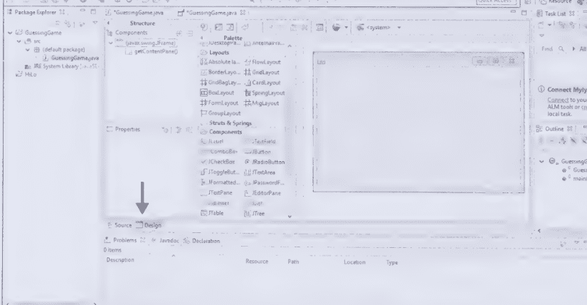

图 3-8：WindowBuilder Editor 的 Design 标签可以轻松构建 GUI 窗口化应用程序。

## 设计用户界面

双击 WindowBuilder Editor 顶部的 GuessingGame 标签可以将 WindowBuilder 视图扩展为全屏。这将为设计 GUI 布局留出更多空间。当你准备好回到编程时，双击标签可以恢复到标准的 Java 透视图。

### 在属性面板中设置 GUI 属性

我们将使用属性面板（Properties pane）开始为我们的猜数字游戏自定义 GUI 窗口。属性面板可以在 WindowBuilder Editor Design 标签的左下方找到。如图 3-9 所示，如果你点击 Components 面板（左侧 Structure 下）中的组件，下方的属性面板会列出你可以查看和编辑的多个属性和值：

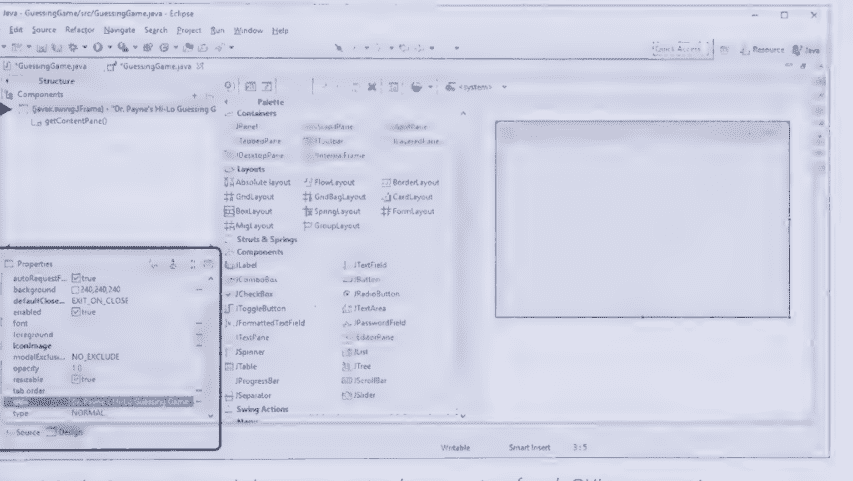

图 3-9：属性面板帮助你自定义应用程序中每个 GUI 组件的属性。

我们将为猜数字游戏应用构建一个自定义的 GUI 窗口。首先，选择 JFrame 的 title 属性。在 Components 面板中，点击 `javax.swing.JFrame`，在属性面板中向下滚动，直到看到 title 属性。点击 title 右侧的空框，并输入 *Name's Hi-Lo Guessing Game*（用你的名字替换斜体文本；毕竟这是你自己的！）。输入文本后，按回车键。右侧的 GUI 预览将自动更新，在标题栏中显示 *Name's Hi-Lo Guessing Game*。

设置标题后，让我们设置其他几个属性，让 GUI 的外观和行为符合我们对猜数字游戏的要求。滚动属性面板找到 `defaultCloseOperation`（如果面板太窄，它可能只显示名称的一部分，如 defaultClose... 或类似内容）。

点击 `defaultCloseOperation` 右侧的框，从下拉菜单中选择 `EXIT_ON_CLOSE`。这意味着当你点击此 JFrame 标题栏上的关闭窗口时，将退出程序。

这通常是默认设置，但有时你可能只想关闭窗口而不退出程序。例如，如果你有多个窗口，你可能只想关闭其中一个而不是整个应用程序。

接下来，让我们找到 JFrame 的 layout 属性。点击值并从下拉列表中选择 `Absolute Layout`。这允许我们在窗口的任何位置放置组件。

让我们在内容面板顶部放置一个标签。

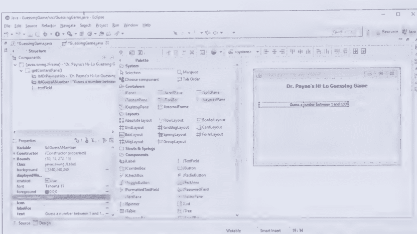

图 3-12：猜数字游戏现在有了用于用户猜测的标签和文本。

接下来，让我们放置一个用户可以点击以提交猜测的按钮。在调面板（Palette）上，找到并点击 Button。将鼠标移动到 GUI 预览窗口并点击放置 Guess 按钮。

最后，在按钮下方放置一个标签，将其文本设置为“Enter a number above”并点击 Guess!，然后将 Alignment（对齐方式）调整为 JFrame 的全宽度。接着，将 `horizontalAlignment`（水平对齐）更改为 `CENTER`（居中）。稍后，这个标签也将我们告诉用户他们猜高了、猜低了或猜对了。每个组件的对齐可能并不完美，但你的 GUI 布局应该类似于图 3-13 所示。

现在屏幕上已经有了所有的 GUI 组件，我们可以准备对布局进行一些微调以实现平衡和居中。首先，请确保保存你的文件。

### 对齐 GUI 元素

到为止，我们一直通过肉眼来定位 GUI 组件，尝试正确设置间距并尽可能让它们居中。然而，当我们运行程序时，我们期望布局是“完美的”。幸运的是，Eclipse 有内置工具帮助我们对齐组件。

首先，让我们将四个主要元素均匀分布，使它们在垂直方向上的间距相等。按住 SHIFT 键并依次点击三个标签和按钮。目前，不要点击用户输入猜测的文本框。你应该能看到 GUI 预览窗口上方出现了一小排对齐工具。鼠标悬停在每个工具上，会显示一个提示框，告诉你该按钮的功能。


图 3-13：GUI 布局包含了所有组件，只是没有完美对齐。

点击看起来像堆叠按钮的工具（图 3-14 中最右侧的图标）。所有选中的项目现在从上到下的间距应该是相等。

现在选择文本框。移动它以与提示用户猜数字的标签重新对齐。我们最初没有包含文本框，是因为 Eclipse 均匀分布了所有五个组件，导致文本框和它的标签相互分离，创建了五行而不是四行。

> 如果你在 WindowBuilder 中对齐物品（或进行任何操作）时错过了步骤，可以通过按 `Ctrl-Z` 或 `Cmd-Z` 来撤销之前的操作。这是 WindowBuilder 编辑器中一个非常棒的功能，让你可以尝试新事物而不会搞乱布局。

最后，点击 Guess! 按钮（位于右侧、提示为“Center horizontally in”的那个）。你可以根据需要居中或调整其他组件。如果你想一起移动两个或多个组件，可以 SHIFT-点击选择它们，然后点击并拖动它们。

当你对布局满意时，是时候通过命名组件来准备编码了。花一点时间保存你的更改。

### 为编码命名 GUI 组件

猜数字游戏应用的用户界面已经为玩家准备好了。然而，为了让应用程序更容易操作，我们需要在 Java 源代码中进行一些微调，并在那里编写游戏的其余部分。我们需要命名每个组件，以便我们在源代码内部知道如何引用它们。

这一步有时被称为“接线”（wiring up），因为我们正在将程序所需的每个 GUI 组件连接到我们可以在 Java 源代码中访问的变量名。Eclipse 在我们添加每个 GUI 元素时已经为我们命名了，但我们想要更改这些名称。选择用户输入猜测的文本框。如果你点击属性（Properties）面板，你会看到最顶部的属性是 Variable（变量）。Eclipse 默认给你的第一个文本框命名的变量名可能是 `textField`。点击 Variable 属性旁的值字段，并将该文本框的变量重命名为 `txtGuess`，如图 3-15 所示。


图 3-14：GUI 布局包含了所有组件，只是没有完美对齐。

我们还想要访问标签 `lblOutput`，以便更改显示给用户的文本（当猜高了、猜低了或正确时）。我们需要在类顶部再添加一个声明，紧跟在 `txtGuess` 声明之后：

```java
public class GuessingGame extends JFrame {
    private JTextField txtGuess;
    private JLabel lblOutput;
    private int theNumber;
}
```

现在我们的变量已经在类顶部正确声明了，我们准备好开始编写猜数字游戏应用的 GUI 版本了。在下一节中，你将学习如何从 GUI 文本框中获取用户的猜数字，并检查它是太高还是太低。我们还会在 GUI 标签 `lblOutput` 中显示结果，以帮助用户进行下一次猜测。

### 添加方法来检查玩家的猜测

现在通过我们添加的私有变量 `txtGuess` 和 `lblOutput` 将 GUI 连接到 Java 源代码后，我们将开始编写猜数字游戏的逻辑。

让我们在 `GuessingGame` 类的顶部编写一个 `checkGuess()` 方法。该方法的签名（或骨架）看起来如下：

```java
public void checkGuess() {
}
```


注意，该方法被声明为 `public`。类中的变量通常被声明为 `private`，但操作这些变量的方法或函数通常被声明为 `public`，以便其他类可以调用它们。你可以把它类比为你的储蓄账户。你的余额是私有的，只有你或银行可以访问；而存款的功能是公开的（其他人可以向你的账户存款）。

第二个术语 `void` 告诉 Java 我们不期望该函数返回返回值（返回值是函数或方法输出的数值）。例如，一个华氏度到摄氏度的转换计算器 `convertTo()` 可以接收一个代表华氏度温度的数值，并返回一个代表转换后的摄氏温度的数值。在这个猜数字游戏应用中，`checkGuess()` 方法不会向程序的其他部分返回此类信息。相反，我们将编写程序通过图形用户界面向用户显示信息，因此我们使用不返回值的 `void` 返回类型。

最后，我们将方法命名为 `checkGuess()`，并提供了左大括号和右大括号，括号内部将包含告诉程序我们想要如何检查用户猜测的代码。

### 从 JTextField 获取文本

让我们开始构建 `checkGuess()` 方法，它将获取用户输入的字符串并将其与要猜的数字进行比较。在 `checkGuess()` 方法的两个大括号之间添加此行：

```java
public void checkGuess() {
    String guessText = txtGuess.getText();
}
```

此行创建了一个名为 `guessText` 的新变量，它将保存用户在 GUI 字段中输入的数字。我们需要通过调用 `txtGuess.getText()` 来使用 `getText()` 方法，并将结果存储在新变量 `guessText` 中。

当你像图 3-17 所示在点运算符 (`.`) 之后添加，可能会在你输入的地方附近弹出一个窗口。

图 3-17：在你输入文本和点运算符 (.) 之后，你可能会看到一个非常有用的代码建议窗口。

这被称为内容辅助——Eclipse 正在尝试通过建议代码行来帮助完成你正在编写的语句。这种特定的内容辅助也被称为代码推荐器，因为它推荐了常见的代码选项，例如当前类或对象的方法。代码推荐是让 Eclipse 变得强大的功能之一，它不仅在大多数情况下选择代码推荐器时更快，而且这有助于开发人员在开发复杂应用程序时防止错误并提高效率。

现在，我们需要创建一个字符串来告诉用户他们的猜测是太高、太低还是正确。让我们再声明一个额外的字符串：

```java
public void checkGuess() {
    String guessText = txtGuess.getText();
    String message = "";
}
```

我们不知道用户的猜测是太高还是太低，所以我们将 `message` 初始化为一个空字符串（一对双引号 `""`）。

在对用户的猜测与随机数 `theNumber` 进行测试后，我们将在 GUI 标签中输出它之前，用更多信息更新此字符串。为了测试用户的猜测，我们需要将他们的文本输入（当前存储在 `guessText` 中）转换为数字格式，以便我们与 `theNumber` 进行比较。

### 将字符串转换为数字

在第 2 章制作的该应用的文本版本中，我们使用 `Scanner` 对象从用户输入的键盘扫描数字数值。扫描器可以在 GUI 中工作，但有一种更紧凑的方法对这个版本效果更好。

就像 `Math` 类中的 `Math.random()` 一样，也有 `Integer.parseInt()` 方法。

```java
public void checkGuess() {
    String guessText = txtGuess.getText();
    String message = "";
    int guess = Integer.parseInt(guessText);

    if (guess < theNumber) {
        message = "Too low!";
    } else if (guess > theNumber) {
        message = "Too high!";
    } else {
        message = "Correct!";
    }

    lblOutput.setText(message);
}
```

### 开始新游戏

我们希望在游戏开始时让计算机选择一个随机数。通过这样做，我们将能够从外部类调用它。`newGame()` 方法的签名如下：

```java
public void newGame() {
    theNumber = (int)(Math.random() * 100 + 1);
}
```

### 监听用户事件：点击猜测！

运行应用程序之前的最后一步是将标记为 "Guess!" 的按钮与检查用户猜测的 `checkGuess()` 函数连接。在 Java 中，我们可以使用事件监听器来实现。事件监听器告诉程序等待监听用户交互事件，如按钮点击、鼠标移动或键盘输入。

点击 Design 选项卡回到应用程序的 GUI 预览。在 GUI 预览窗口中，找到图 3-18 所示的 "Guess!" 按钮，并双击它。

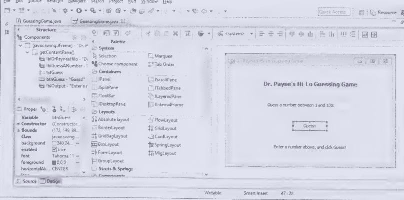

双击“Guess!”按钮会自动打开“Source”选项卡，在这里你会发现 Eclipse 添加了新代码。这些新代码是一个事件监听器的骨架——在这种情况下，它是为了当用户在 `btnGuess` 上执行操作时触发的事件的 `ActionListener()`。在本例中，操作就是点击按钮。

Eclipse 已经添加除了我们想要在用户点击按钮时执行的操作之外的所有内容。让我们来看看 Eclipse 为我们创建的事件监听器。

```java
JButton btnGuess = new JButton("Guess!");
btnGuess.addActionListener(new ActionListener() {
    public void actionPerformed(ActionEvent e) {
    }
});
btnGuess.setBounds(172, 149, 23);
getContentPane().add(btnGuess);
```

用于 `ActionListener()` 的事件监听器（处理按钮点击的特定监听器）通过 `addActionListener()` 方法连接到 `btnGuess`。接下来的几行全部构建在 `addActionListener()` 函数的括号内。

在 `ActionListener()` 方法内部，我们看到的第一个是关键字 `new`，它告诉我们 Eclipse 正在创建一个 `ActionListener` 类的新对象。这个新对象与我们过去见过的对象不同之处在于，它是一个匿名内部类，这意味着它是完全创建在 `GuessingGame` 类内部。匿名内部类可以帮助处理像按钮点击这样短而快速的事件。我们不需要构建一个完全独立的类，而可以在创建按钮的地方直接插入事件处理程序的代码。在本例中，`ActionListener` 只监听按钮点击，因此它是匿名内部类的完美人选。

Eclipse 创建了匿名内部类的骨架，但我们仍然需要编写按钮的行为。接下来的部分代码将放入 `actionPerformed()` 方法的大括号内。`actionPerformed()` 方法是用来描述当用户点击时我们想要做什么的地方。该方法接受一个 `ActionEvent` 作为参数，该参数就是监听器正在监听的事件或操作。在本例中，我们将 `ActionEvent` 命名为 `e`，但你可以使用任何喜欢的变量名。当用户输入猜测数字并点击“Guess!”按钮时，该操作会被赋值给 `e`，我们需要使用早些创建的 `checkGuess` 方法来检查他们的猜测：

```java
btnGuess.addActionListener(new ActionListener() {
    public void actionPerformed(ActionEvent e) {
        checkGuess();
    }
});
```

多亏了 Eclipse，我们唯一需要添加的就是 `checkGuess();` 命令。自动补全功能节省了我们的时间并帮助避免了拼写错误。
这段代码就绪后，我们只需要告诉应用程序在启动时做什么。请花时间保存你目前为止的工作。

## 设置 GUI 窗口

在第一次运行游戏之前，我们需要告诉程序如何设置 GUI 窗口。这包括构建 GUI 界面、通过调用 `newGame()` 方法开始新游戏，以及设置窗口所需的宽度和高度尺寸。

在文件底部 `main()` 方法的大括号内，添加以下代码行：

```java
public static void main(String[] args) {
    GuessingGame theGame = new GuessingGame();
    theGame.newGame();
}
```

第 1 行代码创建了一个名为 `theGame` 的新 `GuessingGame` 对象。第 2 行将使用一个新的随机数开始猜数字游戏。现在，让我们让 Java 知道我们想要的窗口大小。对于 GUI 桌面应用程序，我们可以使用 `setSize()` 方法指定应用程序框架的大小，输入我们想要创建的窗口的宽度和高度。

```java
theGame.setSize(new Dimension(450,300));
```

`setSize()` 方法需要一个 `Dimension` 类型的参数，该类型内置于 `java.awt` 库中（awt 是 abstract window toolkit 的缩写）。`setSize()` 括号内的 `new Dimension()` 告诉程序我们要创建的尺寸。

只有在用户获胜时才需要。一种方案是添加一个按钮，但在游戏运行期间保持隐藏，只有在用户获胜时才显示。为了保持游戏的简单性，我们不会这样做，但如果你感兴趣尝试一下，请参阅第 73 页的第 2 个编程挑战。

与其添加按钮，不如改变应用程序的行为，使其在用户赢得当前回合后自动选取一个新数字。这只需要修改程序的一个部分，即处理猜想结果与随机数匹配的 `else` 状态。如果用户赢得了一回合，就应该自动开始新一回合。这符合直觉——不需要额外的按钮，也不需要做决定。如果玩家决定停止游戏，只需关闭窗口即可。我们将通过修改以下几行代码来实现这一行为：

```java
else
    message = guess + " is correct. You win!
```

我们将调用 `newGame()` 来开始一个新游戏。为了在这个 `else` 语句内部添加对 `newGame()` 方法的调用，我们将两个语句（设置变量 `message` 和调用 `newGame()`）组合成一个块，如下所示：

```java
else {
    message = guess + " is correct. You win! Let's play again!";
    newGame();
}
```

大括号将这两个语句分组为一个单一的代码块，当 `else` 语句被选中为正确的程序路径时，就会执行该块。如果没有大括号，只有 `else` 状态后的第一行会被执行，而 `newGame()` 方法将在 `if-else` 语句求值后运行。这将导致游戏在用户每次尝试猜测时都改变秘密数字。

请注意，我们在消息字符串的末尾添加了“Let's play again!”。这让用户知道他们可以通过猜数字再次游戏，并可以期望电脑每回合选取一个新数字。完成这些更改，保存程序并重新运行，查看游戏的新版本！

## 改进用户体验 (UX)

在玩游戏时，你可能会注意到一些游戏元素可以让用户界面变得更好。例如，如果我们能让应用程序在用户点击“Guess!”按钮或按下键盘上的 ENTER 键时接受新的猜想，将提供更自然、更直观的用户体验（UX）。

另一个问题是，当我们想要猜一个新数字时，必须突出显示并选择旧数字（或者，按下 DELETE 或 BACKSPACE 键）来清除之前的猜测。我们必须重新点击文本字段，因为焦点切换到了“Guess!”。为了改进用户界面，可以让光标在每次猜想后回到文本字段，并自动突出显示或删除上一个猜测的文本，以便新猜测替换掉旧的。

让我们现在处理这两项任务。

### 允许用户按 Enter 键猜数字

我们将进行的第一个改进是允许用户按 ENTER 键提交猜想。首先，进入 Design 选项卡，右键点击“Guess”按钮。在弹出菜单中，选择 Add event handler action actionPerformed。

就像我们为 `btnGuess` 创建事件处理程序一样，Eclipse 会自动添加代码来为 `txtGuess` 创建动作监听器，如下代码段所示。正如我们之前做的那样，我们将在这段代码的 `actionPerformed()` 部分的大括号内添加 `checkGuess()` 方法。我们通常只想从文本框内部处理的操作就是按下 ENTER 键。

```java
txtGuess.addActionListener(new ActionListener() {
    public void actionPerformed(ActionEvent e) {
        checkGuess();
    }
});
```

添加此行后，保存文件并运行。现在当我们按下 ENTER 键时，它会激活 `checkGuess()` 方法。“Guess!”按钮仍然存在，因此用户可以选择使用键盘或鼠标进行交互。

### 自动移除旧猜测

现在让我们解决必须点击回文本字段来删除旧猜测的问题。为了解决这个问题，我们需要学习一些用于处理 `txtGuess` 这样的 `JTextField` 对象的新方法。

首先，我们必须考虑何时希望文本被选中。对于猜数字游戏，在用户的猜想被评估之后可能是允许用户再次猜测的最佳时机。在代码中，这将位于 `checkGuess()` 方法的末尾。

Java 通过 `try-catch` 语句为我们提供了处理异常的清晰方式。`try-catch` 块的思想是让程序尝试执行我们知道可能导致异常的操作，并捕获或处理可能发生的异常，而不是让它破坏程序。`catch` 块仅在发生异常时执行。

`try-catch` 的最后部分是可选的 `finally` 块。在 `try-catch-finally` 语句中，如果提供了 `finally` 块，它将始终执行，无论是否异常。如果没有异常，`finally` 块会在 `try` 块完成后运行。如果发生异常，`finally` 块会在 `catch` 块完成后运行。

`try-catch` 的格式通常如下（不要输入代码；这只是格式的示例）：

```java
try {
    // 可能会导致异常的操作，例如获取错误的输入
} catch (Exception e) {
    // 处理或恢复异常，例如请求良好的输入
} finally {
    // 任何清理工作代码；无论是否有异常，这都将运行
}
```


注意，我们使用大括号将 `try-catch-finally` 语句中每个部分的语句分组，就像我们处理 `if-else` 和循环语句一样。`catch` 部分需要一个 `Exception` 参数；这可以是特定的异常，如 `NumberFormatException`，或者我们可以使用基类 `Exception`。此参数将接收有关 `Exception` 的信息，例如异常发生的行号。

为了在我们的游戏代码中正确放置 `try-catch-finally` 块，我们需要考虑异常可能发生的地方（并将其封装在 `try` 块中）、发生异常时我们想做什么（并将其放在 `catch` 块中），以及在 `try` 或 `catch` 块完成后我们想做什么（这部分放在 `finally` 块内部）。

由于当我们尝试从输入的文本中解析整数时发生了用户输入问题，因此我们想将该代码封装在 `try` 块中。让我们在从文本解析整数的行之前放置 `try` 关键字和左大括号：

```java
public void checkGuess() {

    String guessText = txtGuess.getText();

    String message = "";

    try {

        int guess = Integer.parseInt(guessText);

        if (guess < theNumber
```

如果用户没有输入数字，我们就无法测试太高或太低，因此子句将一直到这一对 `if-else` 语句的结束。在 `else` 语句右大括号之后放置 `try` 块的右大括号，如下列表所示。`catch` 关键字应该紧随其后。在这个游戏中，如果用户输入了错误的输入，我们只想让他们输入一个 1 到 100 之间的整数。我们可以通过稍后显示在 `lbl1output` 中的 `message` 字符串来实现。因此，`catch` 块应该如下：

```java
catch (Exception e) {

    message = "Enter a whole number between 1 and 100.";

}
```

我们想要采取的最后一步（无论是否异常）是显示输出消息、请求文本框焦点并选择所有文本以准备下一次输入。这三个语句将进入 `finally` 块，位于我们添加的 `catch` 语句右大括号之后：

```java
finally {

}

public void next()
```


你可能会注意到每个 `try-catch-finally` 块内部的语句都进行了缩进，以便代码更易读。记住，在 Eclipse 中有一个快捷键，可以在你进行任何更改后自动缩进所有内容。只需选择所有代码，然后转到 `Source > Correct Indentation`。

保存你的应用并运行几次以测试用户界面。测试几个非整数以确保异常处理按预期工作。如果你遇到阻止文件编译的错误，请检查你的大括号。每当我们在现有代码周围添加块时，大括号是检查错误的第一地方。一旦你的 `try-catch-finally` 语句就绪，你就获得了一个更可靠的、安全编程不仅仅是一个锦上添花——它通常是编写良好软件的关键部分。对于你的猜数字游戏，糟糕代码的后果似乎并不严重。但想想运行在医疗设备、卫星、汽车、飞机或向你家和城市供电的电网上的代码。安全代码对于你的安全至关重要。即使手机上运行不安全代码的小游戏或程序也可能让你的数据暴露给黑客。安全编程始终是一种明智的做法。

## 你学到了

在猜数字游戏的 GUI 版本中，我们提高了 Java 技能包含了以下所有内容：

- 通过导入 `javax.swing` 包创建 GUI 窗口
- 在 Eclipse 中设置 GUI 应用
- 使用 WindowBuilder 编辑器设计 GUI
- 使用 Properties 面板更改 GUI 组件属性
- 一致地命名 GUI 组件以便在 Java 代码中方便使用
- 将 GUI 元素连接到 Java 变量和编程代码
- 从 `JTextField` 获取用户文本并在程序中使用
- 监听用户事件，例如点击按钮
- 通过以用户为中心的测试应用来提高用户体验（UX）
- 使用 `try-catch-finally` 处理异常

## 编程挑战

尝试这些挑战来复习和练习你学到的知识，并通过尝试新事物来扩展你的编程技能。如果你遇到困难，请访问 `https://www.nortarch.com/learnjava/` 查看示例解决方案。

### #1：向用户显示他们尝试了多少

尝试更改获胜消息，在用户获胜时告诉他们尝试了多少次，如下所示：

> 62 是正确的！你在 7 次尝试后获胜了！

要实现这一点，你需要创建一个新变量（如 `numberOfTries`）来存储用户猜测的次数，每当 `checkGuess()` 方法成功运行一次增加尝试次数，并在用户获胜时向他们显示尝试次数。

作为替代方案，你可以从七或八次尝试开始，每当用户猜测一次就减去一次。当最后一次猜测用完，你可以告诉用户他们输了，向他们显示正确数字并开始新游戏。试试看！

### #2：显示和隐藏“再次游戏”按钮

当我们构建本章猜数字游戏的 GUI 时，我们决定不包含“再次游戏”按钮，因为在未使用时它会使界面杂乱，而且它只在游戏结束时需要。事实证明，我们可以使用 `setVisible(false)` 方法隐藏 GUI 组件。然后我们可以通过 `setVisible(true)` 再次显示它，就像我们对 `JFrame` 执行的那样。

首先，我们可以在布局中添加一个名为 `btnPlayAgain` 的再次游戏按钮。在创建按钮后的代码中，你可以调用 `btnPlayAgain.setVisible(false)` 来隐藏按钮。在获胜的 `else` 语句 `checkGuess()` 中，我们将调用 `btnPlayAgain.setVisible(true)` 来显示按钮。

在开始之前有一个重要的说明：与其他按钮（`btnGuess`）不同，你需要在代码的多个地方更改可见属性以隐藏和显示按钮。配合 `txtGuess` 和 `lblOutput`，你需要在类顶部声明 `private JButton btnPlayAgain`，并确保不要在下面的代码中重复声明按钮。

### #3：创建一个 GUI MadLib

回想你在第 2 章构建的 `MadLibs.java` 程序（第 41 页编程挑战 #3），并创建一个新的 `MadLibGUI.java` 应用，在图形用户界面中使用标签和文本框提示几个单词，如 `txtColor`、`txtPastVerb`、`txtAdjective` 和 `txtNoun`。添加一个用户可以按下生成 MadLibs 风格故事的按钮。

在 WindowBuilder 编辑器探索并尝试 GUI 元素的更多属性，包括背景颜色、字体、初始文本值等。当用户点击按钮时，程序应该在 `JLabel` 或 `TextArea` 中显示完成的 MadLibs 故事，如图 3-23 所示。

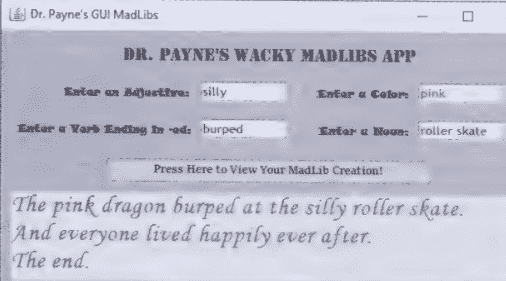

图 3-23：一个 GUI MadLibs 应用

# 4 创建你的第一个 Android 应用程序


为了构建 Hi-Lo 游戏 App 的移动版本，我们将使用 Android Studio。如果你在第 1 章中没有设置它，请回到第 8 页的“为移动应用开发安装 Android Studio”并进行设置。与游戏的 GUI 版本一样，我们也要为该应用创建一个用户界面，如图 4-1 所示。你到目前为止创建的应用只能在你的桌面电脑上运行，但 Android 应用可以运行在任何 Android 设备上，包括手机、平板电脑、手表、电视等。如果你没有 Android 设备，不用担心——你仍然可以 Android 编写代码，因为 Android Studio 自带的 Android 模拟器可以让你模拟运行设备。

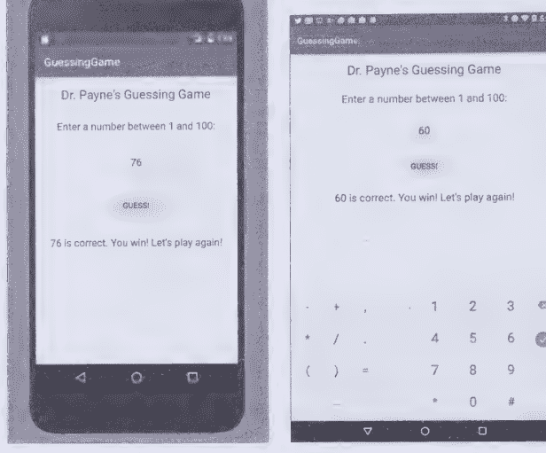

图 4-1：这个猜数字游戏在这个应用中变成一个移动应用。该应用运行在模拟的 Android 手机（左）和真实的 Android 平板电脑（右）上。

图 4-1 显示了我们的应用在 Android 模拟器上运行，模拟了应用在 Nexus 6P 和 Android 平板电脑上的外观。两个版本运行的是相同的代码——更方便的是，我们可以复用之前为桌面版本构建的大部分 Java 代码，因为 Android 是基于 Java 构建的！注意，模拟器和实际设备看起来非常相似，细微的区别是为了适应手机和 7 英寸平板之间不同的屏幕尺寸。就像你可以为 Windows 编写 Java 应用并在 macOS 或 Linux 上运行一样，你可以用 Java 编写 Android 移动应用并运行在数以千计的 Android 设备上。让我们开始你的第一个 Android 移动应用吧！

## 新建 Android Studio 项目

第一次启动 Android Studio，可能需要几分钟来更新和运行。当它启动时，你会看到一个如图 4-2 所示所示。选择标记为 `Start a new Android Studio project`（新建 Android Studio 项目）的选项。将你的新项目命名为 `GuessingGame`，不要空格。如果你有网站，可以在 `Company Domain`（公司域名）字段中输入，如图 4-3 所示。否则，留留默认的示例域名。接下来，选择项目位置。我设置了一个名为 `AndroidProjects` 的文件夹来保持整洁，你也应该这样做。

### Android Studio 启动选项

- `Start a new Android Studio project`（新建 Android Studio 项目）
- `Open an existing Android Studio project`（打开现有的 Android Studio 项目）
- `Check out project from Version Control`（从版本控制检出项目）
- `Import project (Eclipse ADT, Gradle, etc.)`（导入项目）
- `Import an Android code sample`（导入 Android 代码示例）

图 4-2：一旦 Android Studio 完成设置，选择新建 Android Studio 项目。

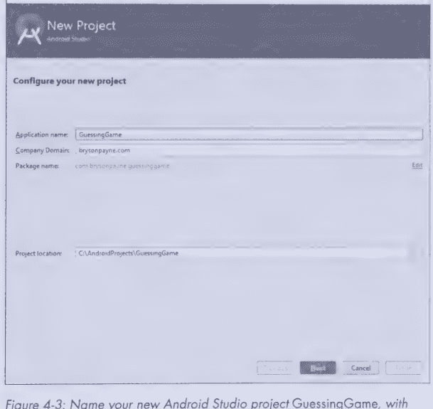

图 4-3：将你的新 Android Studio 项目命名为 `GuessingGame`，不要空格。

命名后点击 Next。现在你有机会选择应用应该运行在哪个 Android 版本上。随着新设备和功能的开发，Android 平台演进迅速，因此我们需要选择一个目标。坦率地说，Android Studio 会定期更新最新的 Android 版本以及关于仍在使用旧版本的设备数量的信息。当你选择支持的 Android 版本时，你都需要选择一个软件开发工具包（SDK）或应用程序接口（API）级别。SDK 和 API 级别包含了你开发应用时将使用的工具，但它们与特定的 Android 版本绑定。图 4-4 中的 `Target Android Devices`（目标 Android 设备）窗口允许你为开发的每个应用选择一个最小 SDK 或 API 级别。

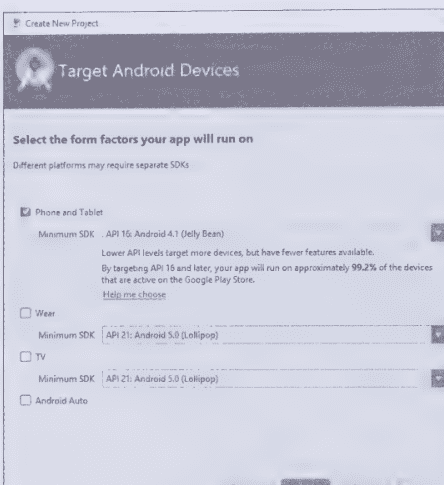

图 4-4：为你正在开发的 Android 设备选择最小 SDK 级别。

选择 `API 16 (Android 4.1, Jelly Bean)` 作为猜数字应用的最小 SDK。Android Studio 将告诉你该版本运行在超过 99% 的活跃 Android 设备上。点击 Next。

`New Project`（新建项目）向导会询问你想要向应用中添加什么类型的 `activity`（活动）。`activity` 只是用户可以执行的某个操作。每个 `activity` 通常都有它自己带有用户界面的屏幕布局，如图 4-5 所示。

应用的主 `activity` 有很多选择，例如 Google Maps、Login、Settings、Tabbed Activities 等。`Basic Activity`（基础活动）将为猜数字游戏应用提供很好的基础，因此我们选择该选项并点击 Next。

我们将在后续屏幕上使用 Android Studio 提供的默认名称（如图 4-6 所示）：活动名称使用 `MainActivity`，布局名称使用 `activity_main`。`activity` 文件包含运行你应用的 Java 源代码。布局是一个包含应用界面的独立文件。点击 Finish 完成你的应用项目设置。


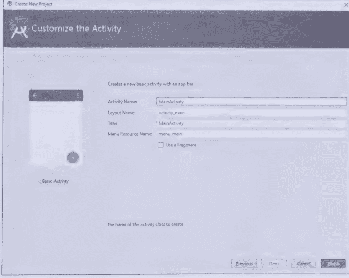

项目可能需要一些时间来构建，因为 Android Studio 正在创建项目文件并设置 `GuessingGame` 应用项目。完成后，Android Studio 将打开项目并显示为默认视图，看起来类似于图 4-7。

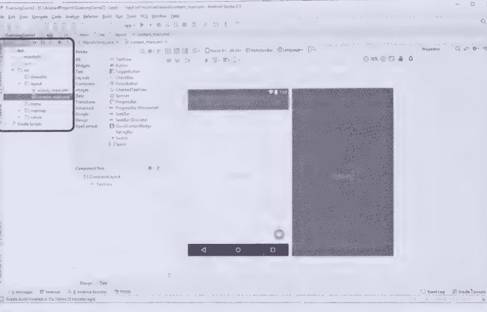

图 4-7：Android Studio 中的默认项目视图，带有完整的 GUI 移动布局

如果你的项目没有用此 GUI 打开，点击左上角的 `Project` 标签，展开 Project Explorer 中的 `app` 文件夹，展开 `res`（资源）文件夹，展开 `layout`，双击 `content_main.xml` 文件查看类似于图 4-7 的视图。

### 在设计视图中构建 GUI 布局

在设计视图中构建 GUI 布局——就是我们在屏幕上看到的内容。在 Android Studio 中，我们使用可视化编辑器来设计布局。这比手动编写 XML 要简单得多。我们可以使用不同的视图：`Design`（设计）、`Code`（代码）和 `Split`（拆分）。`Design` 允许我们将组件拖放到画布上。

图 4-8 显示了设计视图的四个区域：

1. `Component Tree`（组件树）：显示 UI 组件的层级结构。
2. `Palette`（调色板）：包含我们可以添加的组件。
3. `Design Canvas`（设计画布）：我们安排 UI 组件的地方。
4. `Properties`（属性）：允许更改所选组件的属性。

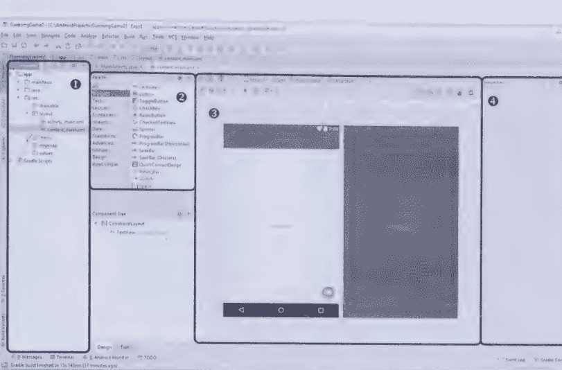

图 4-8：设计视图的四个区域。

开始，我们将打开 `content_main.xml` 文件。我们可以在 Project Explorer 的 `res/layout/content_main.xml` 找到它。文件打开后，我们将切换到 `Design` 视图。首先，为应用添加一个标题。我们将从 `Palette` 使用 `TextView` 组件并拖到画布上。`TextView` 进入画布后，我们使用 `Properties` 面板更改其文本。我们将文本改为“Your Guessing Game”，并将大小设置为 `Large`。我们还将居中文本。

接下来，用户需要输入数字。我们将从 `Palette` 使用 `EditText` 组件并将其拖到标题下方画布。我们将使用 `Properties` 面板将提示文本（hint text）改为“Enter a number between 1 and 100”，并将输入类型设置为 `Number`。

然后，我们需要一个按钮来提交猜想。我们将从 `Palette` 使用 `Button` 组件并将其拖到 `EditText` 下方的画布。我们将按钮的文本改为“Guess!”。

最后，我们将添加一个标签来显示猜数字的结果。我们将使用另一个 `TextView` 组件并将其拖到按钮下方的画布。我们将将其文本改为“Result: ”，并将大小设置为 `Medium`。

最终的 GUI 布局看起来像图 4-9。

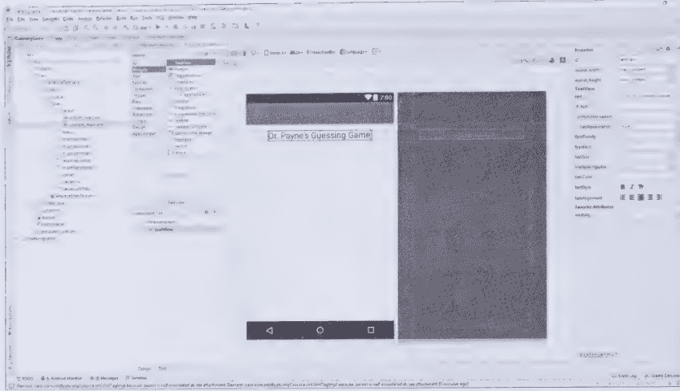

图 4-9：猜数字游戏的最终 GUI 布局。

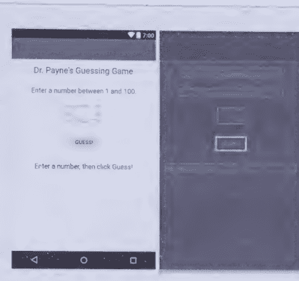

图 4-10：设计视图中 Android 猜数字应用完成的 GUI 布局

在命名 GUI 组件之前，我们将进行最后一次更改。将用户输入猜测内容的数字文本框的 `width` 属性改为 `75dp`；点击属性面板中的“查看所有属性”（View all properties）或左右图标来实现此操作。对于一个仅使用 1 到 100 之间数字的猜数字游戏来说，原始文本框太宽了，因此我们调整了大小使其变窄。

有了这个小改动，是时候开始命名我们的 GUI 组件了，这样我们就能在 Java 代码中轻松找到它们。

### 在 Android Studio 中命名 GUI 组件

就像在 Eclipse 中命名 GUI 组件一样，我们需要在 Android Studio 中命名 GUI 元素，以便我们从代码中访问它们。但在 Android Studio 中，GUI 元素本身的名称默认不会出现在 Java 源代码中。相反，在代码中使用这些 XML GUI 组件之前，必须手动将它们连接到 Java 代码。

目前，我们只需要将数字文本框、按钮和底部标签的 `id` 属性分别改为 `txtGuess`、`btnGuess` 和 `lblOutput`。如果弹出消息提示更新引用，请点击“是”。为了保持方便，我们将使用这些名称。图 4-11 显示了重命名后的文本框、按钮和标签。

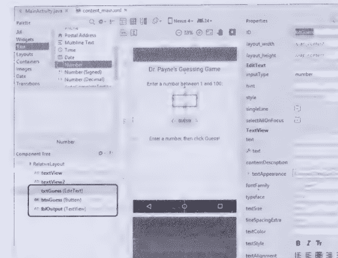

图 4-11：通过将 `id` 属性分别更改为 `txtGuess`、`btnGuess` 和 `lblOutput` 来重命名 `EditText`、`Button` 和 `TextView` 组件（圈出）。

在开始编写 Java 代码之前应该做的一件事是隐藏图 4-12 设计预览右下角的悬浮按钮（fab）图标。你的项目可能没有显示该图标，但如果显示了，请在 Project Explorer 面板中双击 `activity_main.xml` 文件：1. 点击视图视图 `activity_main.xml` 标签；2. 然后点击图标；3. 转到属性（`Properties`）并将 `visibility` 属性设置为 `invisible`（隐藏）。

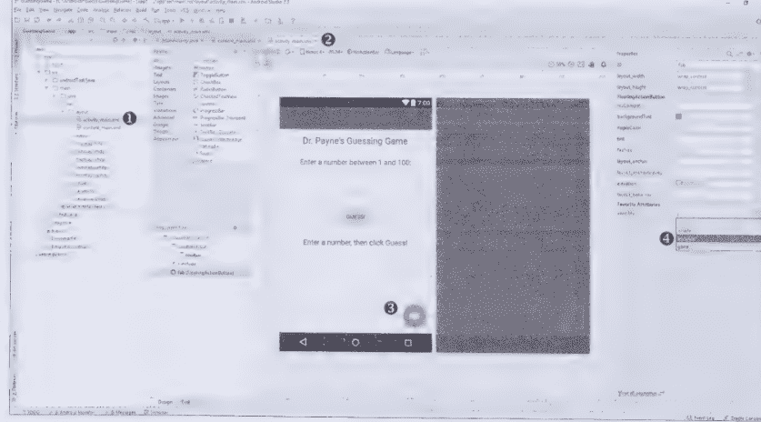

图 4-12：通过进入 `activity_main.xml` 文件、点击小图标并将 `visibility` 属性设置为 `invisible` 来隐藏 fab 图标。

我选择隐藏 fab 图标而不是删除它，因为你以后可能想使用悬浮按钮添加新功能。悬浮按钮可以分享应用信息、在 Twitter 上发布你喜欢应用等。

接下来，我们将编写 GUI，以便在 Java 中使用它编写程序的其余部分。

### 在 Android Studio 中将 GUI 连接到 Java

现在是时候将 GUI 连接到 Java，以便为猜数字应用编写代码了。首先，通过查看 Project Explorer 面板中的 `app > src > java > example.guessinggame`（或你的包名） `> MainActivity` 来打开 Java 源代码文件。双击 `MainActivity` 打开 `MainActivity.java` 源代码文件。

你可能已经注意到 Project Explorer 中的文件夹还有一两个包，名称可能相同，但在包名后带有 `(test)` 或 `(android)`。这些包用于大型应用程序的测试，工程师会在那里评估应用的质量、安全功能以保证质量。我们不会处理质量活动，但这是进入软件开发行业的极佳方法。

`MainActivity.java` 文件中的 Java 源代码看起来像图 4-13。

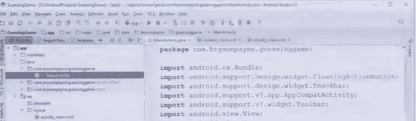

注意，在 Android Studio 中，包声明默认出现在文件顶部。包可以帮助我们组织更复杂程序（如移动应用）中的所有文件。在这种情况下，包名是第 77 页图 4-3“创建新项目”屏幕上的公司域名，按倒序排列——注意代码在前。

包声明之后有几个 Android `import` 语句。这些工作方式与桌面版 Java 相同，将现有功能导入到代码中。

接下来的 `public class MainActivity` 代码段可能会根据你选择的最低 API 级别而略有不同，但整体代码是相似的，适用于你编写的跨多个 API 级别的应用。首先，我们将声明变量将 GUI 连接到程序，在下一行添加这些代码来为文本框、按钮和输出标签声明变量：

```java
// 此处添加变量声明代码
```


class `MainActivity` extends {

    private `EditText` editText;

    private `Button` btnGuess;

    private `TextView` lblOutput;
```

当你输入每种新变量类型时，可能会看到导入下拉菜单。如果你错过了导入，请返回设计视图并确保你已经为文本框指定了 id `txtGuess`。

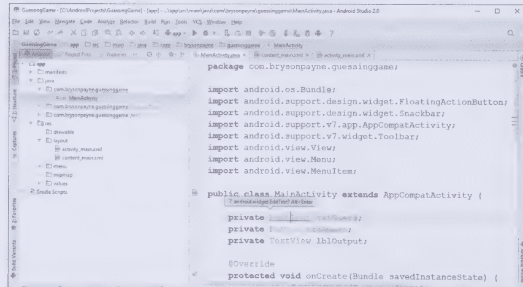

图 4-3：应用的 Java 源代码默认名为 `MainActivity.java`。

## MainActivity.java

```java
public class MainActivity extends AppCompatActivity {

    private EditText txtGues;

    private Button btnGues;

    private TextView lbl1Output;

    public void checkGuess() {

}
```

```java
protected void onCreate(Bundle savedInstanceState) {

    super.onCreate(savedInstanceState);

    setContentView(R.layout.activity_main);

    txtGues = (EditText) findViewById(R.id.txtGues);

    btnGues = (Button) findViewById(R.id.btnGues);

    lbl1Output = (TextView) findViewById(R.id.lbl1Output);
```

图 4-16: 在 Java 中开始编写 `checkGuess()` 方法

幸运的是，其余代码可以直接从第 3 章 Eclipse 桌面 GUI 应用程序中复制并粘贴，无需任何修改！完整的 `checkGuess()` 方法应该如下：

```java
public void checkGuess() {

    String guessText = txtGues.getText().toString();

    String message = "";

    try {

        int guess = Integer.parseInt(guessText);

        if (guess < theNumber) {

            message = guess + " is too low. Try again.";

        } else if (guess > theNumber) {

            message = guess + " is too high. Try again.";

        } else {

            message = guess + " is correct. You win! Let's play again!";

        }

        newGame();

    } catch (Exception e) {

        message = "Enter a whole number between 1 and 100.";

    } finally {

        lbl1Output.setText(message);

        txtGues.requestFocus();

        txtGues.selectAllAll();

    }

}
```

Java 的便利特性之一是我们可以跨平台重用代码。正如我们使用命令行游戏的代码来制作桌面游戏一样，我们也可以将桌面版本的代码用于 Android 版本中。让我们回顾这段代码，以理解它在 Android 应用程序中是如何工作的。

在 ① 处，我们从文本框获取用户的猜测，并为输出消息设置字符串。在 ② 处，我们开始一个 `try-catch` 语句来处理输入错误或异常。在 `try` 块内部，我们从用户输入的字符解析出其猜测的整数。`try` 块的其余部分包含 `if-else` 语句，用于测试用户的猜测是太高还是太低、设置相应的消息并启动一个新游戏。接下来，`catch` 语句 ③ 告诉用户输入 1 到 100 之间的整数。然后，`finally` 块 ④ 将 `lbl1Output` 的文本设置为相应的消息，将光标返回文本框，并高亮文本以为用户的下一次猜测做准备。

你可能注意到有几项被标记了红色下划线：`theNumber` 和 `newGame()`。这是因为在当前这个版本的应用程序中尚未定义它们。

```java
protected void onCreate(Bundle savedInstanceState) {

    int secretNumber = (int)(Math.random() * 100) + 1;

    theNumber = secretNumber;
```

这与我们在桌面游戏中使用的代码相同，因为创建整数的 Java 代码在命令行和 Android 移动版本中是相同的。

`newGame()` 方法的代码与桌面版本相同。在 `onCreate()` 语句之前添加 `newGame()` 方法：

```java
public void newGame() {

    theNumber = (int)(Math.random() * 100) + 1;

}
```

在 Android 应用程序中创建新游戏就像在桌面应用程序中一样。我们只是使用 `Math.random()` 函数将 `theNumber` 设置为 1 到 100 之间的随机整数。

我们可以在连接三个 GUI 组件的代码之后，在 `onCreate()` 方法中添加对 `newGame()` 的调用：

```java
protected void onCreate(Bundle savedInstanceState) {

    newGame();

    btnGuess = (Button) findViewById(R.id.btnGuess)

    lblOutput = (TextView) findViewById(R.id.lblOutput)

    newGame();
```

当游戏启动时，程序将调用 `newGame()` 方法并为用户随机出一个数字。现在，我们只需要处理按钮点击事件，并学习如何在自己的 Android 设备或 Android 模拟器上运行应用程序。

## 在 Android 中处理事件

在 Eclipse 中，我们可以通过在设计视图中双击按钮来添加事件监听器。遗憾的是，在 Android Studio 中并不容易，因为 GUI 布局与源代码分开。幸运的是，Android Studio 通过提供代码补全选项（类似于 Eclipse 中的内容辅助功能）帮助我们添加事件监听器。

要为按钮点击添加监听器，请在调用 `newGame()` 后的下一行、`onCreate()` 内部输入以下部分代码：

```java
txtGuess = (EditText) findViewById(R.id.txtGuess)

btnGuess = (Button) findViewById(R.id.btnGuess)

lblOutput = (TextView) findViewById(R.id.lblOutput)

newGame();

btnGuess.setOnClickListener()
```

Android Studio 的代码补全功能会弹出一个代码建议列表，如图 4-17 所示。从选项列表中选择 `OnClickListener` 并双击将其添加到项目中。

在 `setOnClickListener()` 的括号内，输入 `new` 并开始输入 `OnClickListener`。Android Studio 的代码补全功能将显示选项列表。从选项列表中选择 `OnClickListener` 并双击将其添加到项目项目中。

在 `setOnClickListener()` 的括号内，输入 `new` 并开始输入 `OnClickListener`。Android Studio 的代码补全功能将显示选项列表。从选项列表中选择 `OnClickListener` 并双击将其添加到项目项目中。

```java
btnGuess.setOnClickListener(new OnClickListener() {

    @Override

    public void onClick(View v) {

        checkGuess();

    }

});
```

你可能注意到有几项被标记了红色下划线：`theNumber` 和 `newGame()`。这是因为在当前这个版本的应用程序中尚未定义它们。

```java
protected void onCreate(Bundle savedInstanceState) {

    int secretNumber = (int)(Math.random() * 100) + 1;

    theNumber = secretNumber;
```


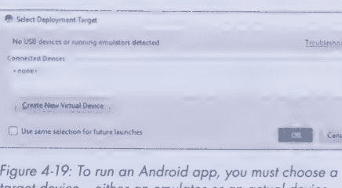

点击 **Create New Virtual Device**（新建虚拟设备）按钮开始配置 Android 虚拟设备 (AVD)。让我们先选择设备类型，如图 4-20 所示。然后点击 **Next**（下一步）。

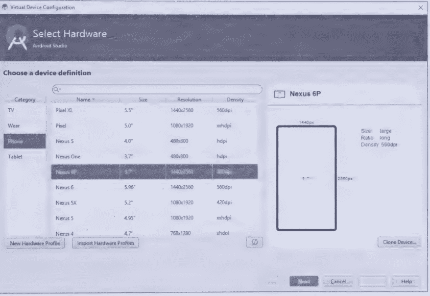

我们将首先选择 Nexus 6P，但你也可以尝试其他设备。如果你决定为 Google Play Store 开发自己的应用，你可能需要在各种屏幕尺寸和设备类型上进行测试，因此可以尝试设置多个模拟器。但现在我们从简单的开始，只设置一个。

接下来，我们需要选择系统镜像，通常是 x86 或 ARM。我们将使用 ARM 镜像，因此点击如图 4-21 所示的 Other Images（其他镜像）表格。

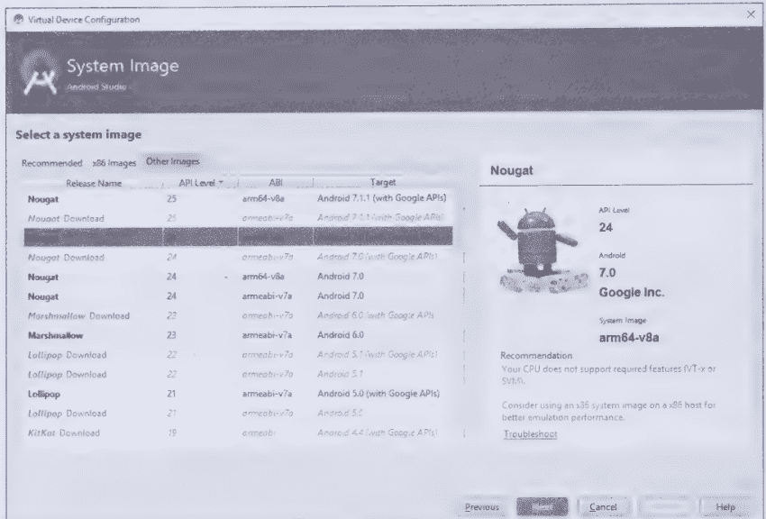

图 4-21：你可以选择 x86 或 ARM 模拟器；ARM 速度较慢，但在不同类型的处理器上运行得更稳定。

如果你需要的 Android 版本、API 级别或模拟器没有以灰色显示，请点击对应版本的 Download（下载）链接。

选择好所需的 Android 模拟器后，点击 Next。现在，让我们使用带有 Google APIs 的 Nougat API 24 Android 7.0 版本。你将看到一个最终界面，要求你验证配置，包括你想要进行的任何高级设置。让我们将 AVD（你正在模拟的设备）重改为 My Nexus 6P，如图 4-22 所示。

如果你在让模拟器运行在旧电脑或内存少于 8 GB 的电脑上遇到困难，请点击 Show Advanced Settings（显示高级设置），滚动到 Memory and Storage（内存与存储），并将 RAM 数量更改为 768 MB。

### 验证配置

| AVD 名称 | My Nexus 6P | |
| :--- | :--- | :--- |
| Nexus 6P | 5.7 1440x2560 (hdpi) | Change... |
| Nougat | Android 7.1.1 arm64-v8a | Change... |
| Startup orientation | Portrait Landscape | |
| Emulated Performance | Graphics: Automatic | |
| Device Frame | Enable Device Frame | |

图 4-22：为你的新 AVD 命名。

点击 **Finish**（完成），你的新设备将创建并保存到磁盘。现在是时候启动模拟器并尝试你的设备了。你应该再次看到 Select Deployment Target（选择部署目标）窗口，但这次它显示 My Nexus 6P 为一个可用的模拟器。现在点击 **OK**，如图 4-23 所示。

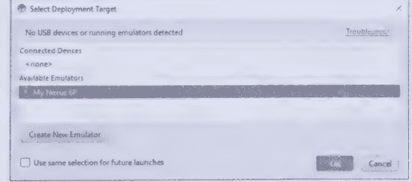

图 4-23：选择你刚刚创建的模拟器作为部署目标。

片刻之后，你会看到“Starting AVD”（正在启动 AVD）的消息，随后是一个看起来像 Android 启动界面的模拟器窗口，如图 4-24 所示。第一次运行模拟器时，可能需要**几**分钟。当模拟器启动时，你可能会看到锁屏。

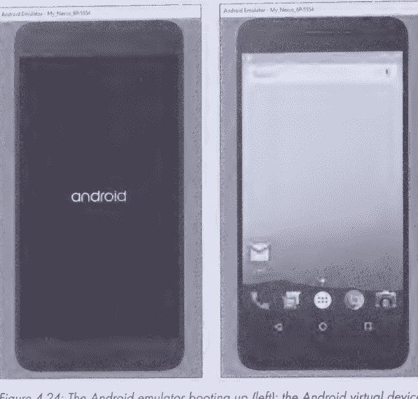

如果你的模拟器显示锁屏，点击屏幕底部的锁（锁图标），并向上拖动以解锁虚拟设备，这与在实际手机上向上滑动类似。你可能会看到欢迎屏幕，一直点击直到进入主屏幕，如图 4-24 所示。现在，回到 Android Studio 并再次点击运行按钮。这次你会在 Select Deployment 对话框中看到 AVD。选择 OK。

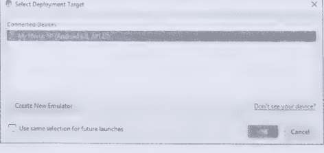

图 4-25：运行时，模拟器出现在连接设备列表中。

项目将进行构建，然后将应用传输到模拟器（第一次运行时可能会要求更新 Android SDK）。几分钟后，你将看到应用在模拟器上运行。查看图 4-26 查看应用的样子。

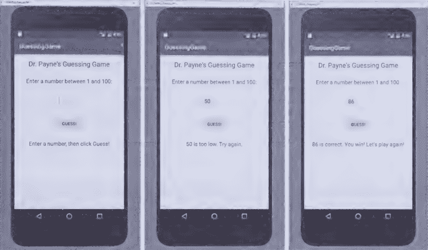

图 4-26：应用在模拟器上运行（左、启动、完成后）。

它的工作方式与桌面应用一样，只是在模拟器上。使用键盘输入，使用鼠标点击。我们还有几件事可以改进用户体验，就像我们在桌面应用中做的那样。在改进 UX 之前，我们将介绍如何在真实设备上运行应用。现在，让你的 Android 模拟器开启（如果不使用可以最小化它可以避免启动时间）。注意：如果你没有 Android 设备，可以跳过此节。

## 在真实设备上运行应用

在 Android 设备上运行应用可能需要准备，但如果你使用 USB 线将设备连接到电脑，就可以快速运行。

### 准备你的设备

在将应用部署到 Android 设备之前，你必须在设备上启用开发者模式。你还需要更改一些设置以便开发和调试应用。

在你的 Android 设备上，点击 Settings（设置）并滚动到设置菜单底部找到 About phone（关于手机）或 About device（关于设备）。在 About 屏幕底部你会找到 Build number（版本号）。点击版本号七次以启用开发者模式。图 4-27 显示了设置菜单（左）和解锁开发者模式的 About 菜单。

解锁开发者模式后，点击屏幕左角的返回箭头并打开 Settings > Developer options（开发者选项）。确保 Developer options 已开启，如图 4-27（右）所示。你还应该开启 USB调试。

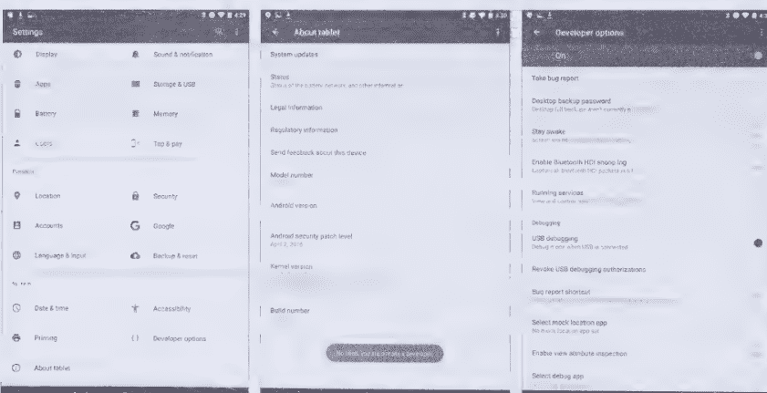

图 4-27：Android 平板上的设置菜单、About 菜单和开发者选项。

现在你已准备好将 Android 手机、平板或其他设备连接到电脑并运行应用了。

### 连接你的设备

要将 Android 设备连接到电脑，你需要一根 USB 线，最好是手机或平板附带的那根。它应该是 micro-USB 线，通常作为设备充电器的一部分提供。注意，并非所有的线都是功能完备的 USB 线——如果你完成以下步骤后线不起作用，请尝试另一根。

使用 USB 线将设备连接到电脑。插入后，你的手机或平板将显示类似图 4-28 所示的窗口，询问是否允许来自刚连接电脑的 USB 调试。点击 OK。你可以勾选“始终允许来自此计算机”复选框，防止下次通过同一台电脑连接时弹出。


图 4-28：首次将 Android 设备连接到电脑时，会询问是否允许 USB 调试。

允许 USB 调试可以实现功能。首先，我们可以将编写的应用传输到 Android 设备而不是使用模拟器，这是测试应用在真实设备上行为更好方法。此外，我们还可以通过 USB 连接调试应用，这意味着我们将从 Android 设备获取信息来帮助调试。这些信息将包括错误和其他日志记录，我们可以在类控制台应用程序（在 Android Studio 中称为 logcat）中读取。这与我们用于查找命令行和桌面 GUI 应用中 bug 的控制台输出类似。

既然你已经将真实的 Android 设备连接到电脑，让我们看看如何在其上运行游戏应用！

### 在你的设备上运行应用

现在我们准备好在 Android 设备上尝试应用了。在 Android Studio 中，按下运行按钮或转到 Run ▶ 'app'。这次 Select Deployment Target 窗口将显示两个可选的连接设备，如图 4-29 所示：你的模拟器（My Nexus 6P）和你的真实 Android 设备。

图 4-29：如果你已经解锁了开发者模式、启用 USB 调试并成功连接了设备，你就应该能够选择你的 Android 设备来运行应用了。

选择你的真实 Android 设备并点击 OK。Android Studio 可能需要一点时间来构建应用程序，但一旦它将 APK 文件推送到你的设备，你就会看到在平板电脑或手机上直接打开猜数字游戏应用。玩一两轮来验证它的运行情况是否与模拟器上一样（可能甚至更好，或者至少更快）。太酷了！

你可能会立即注意到一个重要的区别：屏幕的底部被数字键盘覆盖了，如图 4-30 所示。

当我们为用户的猜想放置文本框（`EditText`）时，我们选择了数字文本框作为输入类型，这样就会显示出数字键盘。但由于模拟器运行在电脑上，电脑有自己的键盘，所以你之前运行应用时可能没有看到这种现象。

现在我们已经能够在 Android 手机、平板电脑或其他设备上运行 Android 应用了，让我们对猜数字应用的用户体验进行一些改进吧。

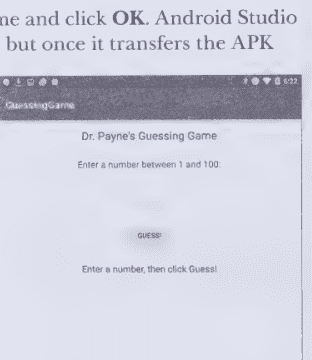

| + | 1 | 2 | 3 | - |
|---|---|---|---|---|
| * | 4 | 5 | 6 | |
| ( ) | 7 | 8 | 9 | |
| | | 0 | # | |
| ∇ | | | | |

图 4-30：应用运行在你自己的 Android 设备上，并默认显示数字键盘。

## 改进用户体验 (UX)

猜数字游戏应用在 Android 模拟器和真实 Android 设备上运行得良好，但还有一些可以改进的地方。首先，我们将用户的猜想在数字文本框中居中。其次，我们将学习如何处理回车键，就像处理“Guess!”按钮一样，让应用对用户来说更加直观。

### 在文本框中居中用户的猜想

在 Android Studio 中，再次打开 `content_main.xml` 布局文件。在设计预览中点击选择名为 `txtGuess` 的文本框。在属性面板（Properties pane）中找到 `textAlign`。Android 中的 `textAlignment` 属性类似于桌面端 GUI 中的 `horizontalAlignment` 属性——它允许我们更改输入文本的对齐方式。

点击居中文本对齐选项（看起来像居中的图标）。如果你想在不运行应用的情况下在设计预览中进行测试，滚动到文本属性并输入值 50。该数字应该会在设计预览面板的文本框中显示为居中。如果你不想让它显示在实际应用中，请务必删掉该文本值。

### 为回车键添加监听器

让我们设置事件监听器来处理回车键，就像我们处理“Guess!”按钮的点击一样，调用 `checkGuess()`。

回到 `MainActivity.java` 源码文件，滚动到 `onCreate()` 方法，找到我们为按钮 `btnGuess` 添加 `onClickListener` 的地方。你可能需要通过点击左侧边栏的 `+` 来展开从 `btnGuess.setOnClickListener` 开始的监听器代码，使其看起来像这里所示：在下方，我们可以为文本框 `txtGuess` 添加一个监听器，以处理按下回车键的动作事件。以下代码为 `txtGuess` 添加了监听器：

```
btnGuess.setOnClickListener(new {

    public void onClick(View v) {

        checkGuess();

    }

});

txtGuess.setOnEditorActionListener(new TextView.OnEditorActionListener() {

    @Override

    public boolean onEditorAction(TextView v, int actionId, KeyEvent event) {

        return true;

    }

});
```

我们监听的编辑器动作是用户在文本框中输入内容时按下回车键。当该事件发生时，我们想要检查用户输入的内容。

我们将返回语句改为返回 `true` 值，因为我们希望保留屏幕上的键盘，以便用户输入下一次猜想。返回语句告诉文本框我们提供的事件处理代码是否已完成事件。通过返回值 `true`，我们告诉 Android 我们已经完成了检查用户猜想所需的所有操作。如果在这里返回 `false`，Android 将会通过从屏幕上移除键盘来完成回车键的处理——这就像你在网页表单上完成输入时默认执行的那样。我们不希望键盘在每次猜想后都消失，所以我们返回 `true`。

### 添加最后的点睛之笔

运行几次应用进行测试，你会发现回车键允许你快速、高效地输入并检查猜想。你还会看到你的猜想在文本框中很好地居中。然而，当你赢得时，取决于 API 版本、屏幕尺寸或设备密度，你可能会看到如图 4-31 所示的对齐问题。

问题在于名为 `lbl1output` 的 `TextView` 调整到了较长的“You win! Let's play again!”文本，某些旧版本的 API 可能无法正确将其居中。你可以通过在设计预览中将 `lbl1output` 扩展到全屏，并将 `textAlign` 属性更改为 `center` 来防止这种情况。现在你有了一个可以在设备上玩并和朋友分享的完整猜数字游戏！应用的最终版本 1.0 显示运行在 Nexus 7 上，字体设置为大号（Large），如图 4-32 所示。

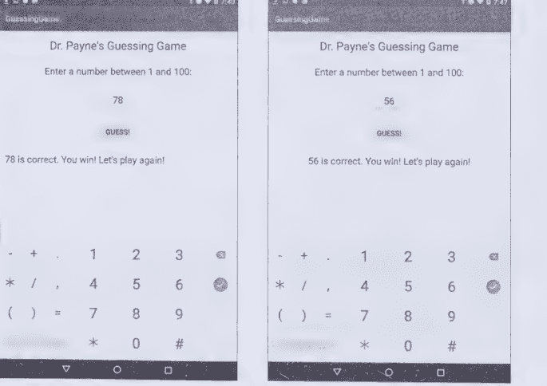

图 4-31：应用运行在你自己的 Android 设备上，默认显示数字键盘。

图 4-32：应用运行在你自己的 Android 设备上，默认显示数字键盘。

## 你学到了什么

哇！你已经从一个简单的游戏变成了一个专业的应用，在第 5 章中，我们将通过设置让应用更加强大。你学习了：

- 开始 Android 项目
- 构建布局
- 命名组件
- 使用变量
- 创建方法
- 处理事件
- 测试应用
- 代码复用
- 在 Android 设备上运行应用
- 改进用户体验
- 添加用户友好细节

## 编程挑战

这些编程挑战练习用于复习和巩固你学到的。如果你遇到困难，请访问 https://www.nostarch.com/learnjava 下载示例。

### #1：针对次数的“Toast”

在第 3 章的编程挑战中，你更改了获胜消息来告诉用户猜了多少次：

6 是正确的！你在 7 次后赢了！

让我们在 Android 版本中做类似的操作，但有点不同？Toast 是一种用于创建弹出消息窗口的 Android 组件。Toast 弹出是显示快速通知的方便方式，作为错误或提示用户已赢的。图 4-33 中的 Toast 消息。

你可以使用 `Toast.makeText()` 方法创建 Toast 弹出。这里有一个示例可以帮助你在游戏获胜的 `else` 语句中添加 Toast 弹出：

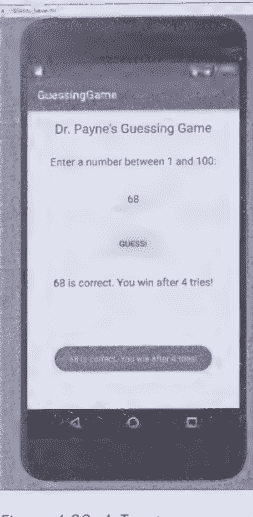

图 4-33：Toast 消息在屏幕上弹出以提醒用户重要信息。

```
Toast.makeText(MainActivity.this, message, Toast.LENGTH_LONG).show();
```


这段代码中的 Toast 消息将弹出在 `MainActivity`（猜数字游戏）上方，根据 `Toast.LENGTH_LONG` 显示几秒。还有 `Toast.LENGTH_SHORT`，但它弹出和消失的速度很快，难以阅读。结尾的 `.show()` 方法结束了关键部分，在屏幕上显示 Toast。

与 GUI 版本一样，为了完成这项任务，你需要在类顶部创建一个新变量（例如 `numberOfTries = 0`），每次成功运行 `checkGuess()` 方法时增加次数计数，并在用户获胜时更改输出消息以向他们显示次数，既在 Toast 弹出中也可以在 `lbl1output` 字段中。在计算次数或失败后，添加你在第 3 章中学到的功能。给用户七次机会，并在每次猜想后告诉他们还剩次机会。

### #2: 增加视觉效果

探索 Android Studio 中 GUI 组件的一些更具审美属性，包括背景颜色、底色、字体、字体大小等。移动你猜数字应用中的组件，以让界面在视觉上更有吸引力。关于如何选择游戏的示例，请参考图 4-34。

你甚至可以添加自定义背景图像（将图像文件添加到 app 的 `res/drawable` 文件夹中，然后将其选择为布局或其他组件的背景属性）。尝试各种设置——你随时可以通过按下 `CTRL+Z` 来撤销！

### #3: 创建 MadLibs 移动应用

回想你在第 3 章中构建的 MadLibJava 程序（第 74 页的编程挑战 #3）。现在为你的 MadLibs 应用创建一个移动版本，在带有标签和文本字段的 GUI 中提示用户输入几个单词，例如 `txtBigAnimal`、`txtPastTenseVerb`、`txtSmallContainer` 和 `txtFood`。添加一个按钮，让用户可以通过它生成他们自己的 MadLibs 风格故事。在每个文本字段中包含一些默认或初始文本可能是一个很好的做法，这样可以给用户了解程序是如何工作的。

当用户点击按钮时，程序将在 `EditText` 或 `TextView` 中显示完成的 MadLibs 故事——`EditText` 让用户如果想分享，就可以复制并粘贴他们幽默的故事。尝试颜色、字体和布局，直到对结果感到满意。

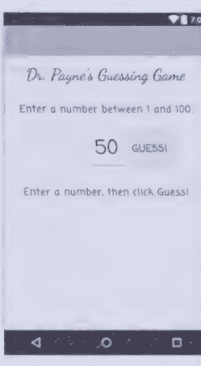

图 4-34：更改应用中组件的颜色、字体、字体大小和排列可以让应用脱颖而出！

要让 `TextView` 或 `EditText` 显示多行，请使用转义字符序列 `\n` 在你使用 `setText()` 方法显示的 String 消息中插入新行，例如：“Once upon a time... \n There was a buffalo princess \n who lived in a soup can.” 这段引言将跨越三行，每在 `\n` 转义序列出现的地方都会被换行分隔。

## 第 5 章：通过添加菜单和偏好设置完善你的应用


你编写了一个有趣的 Android 应用，但它还缺少一些东西。你还没有学习如何在 Android 中构建设置或选项菜单，也没有学习如何保存高分、游戏统计数据和其他信息。在本章中，我们将为我们的 Hi-Lo 猜数字游戏应用添加选项菜单以及存储信息的能力。

### 在 Android 中添加选项菜单

大多数应用和游戏都有用户可以通过菜单访问的选项或设置。对于 Hi-Lo 猜数字游戏，我们可能希望允许用户更改游戏难度、重新开始、查看游戏统计数据或查看“关于”屏幕，因此我们将创建一个可以执行所有这些操作的菜单。

在 Android 中添加选项菜单有四个通用步骤：

1. 编辑应用的默认 XML 菜单文件，创建作为用户可选选项的项目。
2. 修改应用的 activity 文件，以显示我们在上一步中创建的菜单和选项。
3. 创建一个事件处理器，以确定用户何时选择某个选项。
4. 编写代码，在用户选择每个选项时执行相应的操作。

添加选项菜单不仅会让我们的应用看起来和感觉更专业，还能让用户对自己的游戏体验有更大的控制权。我的儿子非常喜欢能够将猜数字游戏的范围从 1 到 10、然后是 1 到 100、再到 1 到 1,000，但当我们添加了显示胜场数的“游戏统计”选项时，我几乎无法从他们手中拿回设备了——他们一直让数字变得越大！我希望你们发现这些额外功能像他们一样有趣（也许也一样上瘾）。

#### 向菜单的 XML 文件添加项目

在 Android Studio 中打开你的 Hi-Lo 猜数字游戏项目，在 Project Explorer 中，将左上角的视图更改为 Android。然后，展开 `app > menu` 并双击 `menu_main.xml` 打开默认菜单文件。

将你的 `menu_main.xml` 文件中的 XML 代码更改为匹配以下列表：

```xml
<menu xmlns:android="http://schemas.android.com/apk/res/android">

  <item
    android:id="@+id/action_settings"
    android:title="Settings" />
  <item
    android:id="@+id/action_newgame"
    android:title="New Game" />
  <item
    android:id="@+id/action_gamestats"
    android:title="Game Stats" />
  <item
    android:id="@+id/action_about"
    android:title="About" />

</menu>
```

`<menu>` 标签使用 Android XML 文档创建菜单资源，通过统一资源标识符 (URI) `http://schemas.android.com/apk/res/android` 进行标识。我们可以通过将 XML 标签连接到这些元素，使用 XML 存储或显示从网页到数据库的所有内容。此代码中标签中的 `xmlns` (XML 命名空间) 属性选择了主 Android 命名空间，因此 XML 文件将引用 Android 中的常用元素。`<menu>` 标签引用一个 Android 菜单，每个 `<item>` 使用属性描述菜单中的项目或条目。此菜单将有四个选项：Settings（设置）、New Game（新游戏）、Game Stats（游戏统计）和 About（关于），因此添加了四个 `<item>` 标签。我们将这些名称分配给项目的 `title` 属性，决定了用户打开菜单时显示的文本。稍后我们将在代码中使用 `id`。

保存 `menu_main.xml` 文件。现在可以为 Hi-Lo 猜数字应用显示我们的选项菜单了。

#### 显示选项菜单

我们设置了菜单，但为了显示它，我们需要在应用的 `MainActivity.java` 中添加一些 Java 代码。在 Project Explorer 中的 `app > your.domain.GuessingGame` 打开 `MainActivity.java`。

在 `MainActivity` 类的中部或底部，你应该找到一个名为 `onCreateOptionsMenu()` 的方法。将其修改为与下面的代码段匹配。如果你的代码没有 `onCreateOptionsMenu()` 方法，请在 `onCreate()` 大括号之后、`MainActivity` 最终大括号之前添加以下代码。

```java
public boolean onCreateOptionsMenu(Menu menu) {
    MenuInflater inflater = getMenuInflater();
    inflater.inflate(R.menu.main, menu);
    return true;
}
```

`onCreateOptionsMenu()` 方法顾名思义——告诉 Android 在创建选项菜单时做什么。在这种情况下，我们告诉 Android 展开 `menu_main.xml` 文件作为我们的菜单。`menu_main.xml` 文件还不是菜单，因此我们需要使用 `MenuInflater` 类将其转换为菜单。我们将使用 `getMenuInflater()` 方法创建一个 `MenuInflater` 实例并命名为 `inflater`。一旦有了它，我们就调用 `inflate()` 方法并传递 XML 文件 (`R.menu.main`) 和我们想要填充的菜单 (`menu`)。在你向文件添加代码时，可能需要按 `ALT+ENTER`（macOS 上为 `OPT+ENTER`）来修正任何导入语句。

进行此更改后，保存并运行应用。Android 通过在应用的操作栏中显示三个点让你知道有选项菜单可用（见图 5-1 顶部）。点击这些点将展开选项。

#### 处理菜单项选择

接下来，我们需要处理用户选择菜单项时的事件。在 `MainActivity` 中找到或添加 `onOptionsItemSelected()` 方法，并修改为如下代码：

```java
@Override
public boolean onOptionsItemSelected(MenuItem item) {
    switch (item.getItemId()) {
        case R.id.action_newgame:
            newGame();
            return true;
        case R.id.action_settings:
            // TODO: 实现设置功能
            return true;
        case R.id.action_gamestats:
            // TODO: 实现游戏统计功能
            return true;
        case R.id.action_about:
            // TODO: 实现关于对话框
            return true;
        default:
            return super.onOptionsItemSelected(item);
    }
}
```

在此段代码中，我们使用 `switch` 语句来确定用户在菜单上选择了哪一个选项。`switch` 语句是测试多个条件的另一种方式，类似于长 `if-else` 语句链。不过，我们不需要链用四个 `if-else` 语句来测试每个可能的菜单项选择，可以使用单个 `switch` 语句，并在 `switch` 关键字后的括号内放入变量。在这个示例中，我们正在检查用户选择的菜单项 ID，所以我们使用 `switch(item.getItemId())`。然后，在 `switch` 语句的大括号内，我们将想要测试的值列为 `case` 语句（例如 `case R.id.action_settings`）：每个值后面都跟着一个冒号（`:`）、每个选择要执行的代码，以及一个 `break` 或 `return` 语句。此事件处理程序返回一个布尔值，因此我们使用了 `return` 语句而不是 `break` 命令。如果我们在这里没有 `return` 语句，则需要使用 `break` 命令作为每个 `case` 的最后一个语句。

每个 `case` 语句测试我们在 `menu_main.xml` 文件中输入的项的值之一，每个值对应的代码将根据用户的选择响应执行。目前，我们只为 `action_newgame` 编写了代码，它使用 `newGame()` 方法启动新游戏。其他情况需要编写更多代码，因此我们将一个一个地定义它们。

#### 为“关于”屏幕创建警报对话框弹窗

对于“关于”（About）选项，我们将弹出一个与你可能在其他应用程序中见过的类似对话窗口。为此，我们将使用警报对话框（alert dialog），通知用户某些事情或提示他们做出响应。这种弹窗比我们在第 4 章中使用的 `Toast` 弹窗更具适应性，因为 `AlertDialog` 类允许我们通过 `Builder` 子类自定义对话框的属性。我们将使用警报对话框来响应用户选择“关于”选项，并通过消息告诉他们是谁创建了他们正在玩的这个很棒的 Hi-Lo 游戏。

在 `action_about` 项选择的 `case` 语句中添加以下代码：

```java
case R.id.action_about:
    AlertDialog dialog = new AlertDialog.Builder(MainActivity.this).create();
    dialog.setTitle("About Guessing Game");
    dialog.setMessage("©2018 Your Name.");
    dialog.setButton(AlertDialog.BUTTON_NEUTRAL, "OK",
        new DialogInterface.OnClickListener() {
            public void onClick(DialogInterface dialog) {
                dialog.dismiss();
            }
        });
    dialog.show();
    return true;
```

我们使用 `AlertDialog.Builder` 类 ① 创建了一个自定义的弹窗窗口。② 处的代码将弹窗窗口的标题设置为“About Guessing Game”，③ 行显示了带有版权信息和你的名字的简单消息（尽管你可以在这里编写任何喜欢的文本）。`setButton()` 方法在弹窗上添加了一个文本为“OK”的按钮，随后的 `onClick()` 事件监听器会在用户每次点击 OK 按钮时通过调用 `dismiss()` 方法 ④ 关闭弹窗。最后，使用 `show()` 命令 ⑤ 显示自定义的弹窗。

使用 `ALT+ENTER`（或 `OPT+ENTER`）导入 `AlertDialog` 类。保存你更新后的代码并运行新版本的应用。当你点击选项菜单并选择“关于”选项时，你应该能看到一个类似于图 5-2 中的弹窗窗口。

## 关于猜数字游戏

(c)2018 Bryson Payne.


图 5-2：自定义警报对话框弹窗

Hi-Lo 猜数字游戏应用开始感觉越来越更像一个专业的 Android 应用了！现在让我们大放异彩，通过允许用户选择范围来让它更完美。

#### 修改范围

这些代码将显示一个警报对话框，其中包含三个猜测范围选项的列表视图，但我们需要添加一点代码来处理用户的选择。`builder.setItems()` 方法既可以接受项目列表，也可以接受一个事件监听器来处理用户从列表中进行的选择。

如果用户选择了第一个选项，我们需要将 `range` 变量的值改为 10，第二个和第三个选项也一样，分别更改为 100 和 1000。事件监听器的代码放在 `builder.setItems()` 内部：

```java
case R.id.action_settings:
    AlertDialog.Builder builder = new AlertDialog.Builder(this);
    builder.setTitle("Choose Range");
    final String[] ranges = {"1 to 10", "1 to 100", "1 to 1000"};
    builder.setItems(ranges, new DialogInterface.OnClickListener() {
        @Override
        public void onClick(DialogInterface dialog, int which) {
            switch (which) {
                case 0:
                    range = 10;
                    break;
                case 1:
                    range = 100;
                    break;
                case 2:
                    range = 1000;
                    break;
            }
            newGame();
            // 更新提示文本以反映新范围
            // 例如：txtPrompt.setText("Guess a number between 1 and " + range);
        }
    });
    builder.show();
    return true;
```

之后，我们为每个项目设置新范围，调用 `newGame()` 在该范围内创建一个随机数，并更改用户屏幕上的提示内容（prompt）以反映新范围。

在进行这些更改后保存文件并运行游戏以测试新选项。将范围从 1 更改到 10 并猜几轮，然后回到 1 到 100，如果你足够勇敢，就去尝试 1 到 1000。

然而，如果你关闭应用并再次打开它，你会发现游戏在第二次运行时并不会记住你偏好的范围。应用也不会记得你猜对数字时有多么厉害。如果有一种方法让应用记住你偏好的范围和你获胜的游戏次数就好了……

### 存储用户偏好和游戏统计

从一个会话到另一个会话记住用户偏好和游戏统计数据的关键是将信息持久化到你的 Android 设备上。持久化信息是指应用关闭后留在设备上的任何数据。在 Hi-Lo 猜游戏中，我们希望将用户的偏好难度和获胜的游戏次数作为持久化信息存储。

有三种方法可以将持久化数据保存到 Android 设备上：存储共享偏好设置、保存文件和在数据库中存储数据。共享偏好设置是一种机制，用于存储应用在下次使用时需要保存的较短设置列表。它们被称为共享偏好设置，是因为你可以在多个活动之间共享设置，或者作为猜游戏中的选项菜单和主游戏屏幕设置。当你需要存储大量数据（如文本文档）时，向设备保存文件是有用的，而对于像地址簿或联系人列表这样的应用，数据库是必要的。但对于猜游戏，我们只需要存储几个数字，所以我们将使用共享偏好设置。

### 存储和检索用户偏好的范围

共享偏好设置以键/值对的形式存储，每个值都有一个关联的键，用于检索它。例如，你可以有一对类似 "range" 和 "100"，其中 "range" 是键，而 "100" 是我们存储在该键下的值。让我们写一个方法来将用户的偏好范围存储到共享偏好设置中。

在你的 `MainActivity.java` 文件的底部，在 `onOptionsItemSelected()` 方法之后、闭合括号之前添加以下方法：

```java
public void storeRange(int newRange) {
    SharedPreferences preferences = PreferenceManager.getDefaultSharedPreferences(this);
    SharedPreferences.Editor editor = preferences.edit();
    editor.putInt("range", newRange);
    editor.apply();
}
```


每个应用都有一个默认的共享存储对象，可通过创建连接的 `SharedPreferences` 对象来访问。调用 `PreferenceManager` 对象上的 `getDefaultSharedPreferences()` 即可访问默认对象，该对象负责创建和维护共享存储列表。编写时请导入，或按 `ALT-ENTER`（或 `OPTION-ENTER`）。

要写入共享存储，必须使用 `Editor` 对象，它允许编辑单个共享存储值。存储特定键/值对时，使用 `put` 方法：`putString` 存储字符串，`putInt` 存储整数，`putFloat` 存储浮点数，`putBoolean` 存储布尔值。每当用户选择新范围时，将 `range` 变量作为 `newRange` 传递给 `storeRange()` 方法。为在 "range" 键下存储 `newRange`，使用 `editor.putInt("range", newRange);` 将用户的范围值（10、100 或 1000）存储在共享存储键名 "range" 下。`apply()` 方法告知 Android 修改完成，可应用更改。

现已存储范围偏好，需在 `onItemSelected(MenuItem item)` 监听器中用户可选择的每个 `case` 中添加 `storeRange()` 函数：

```java
public boolean onItemSelected(MenuItem item) {
    switch (item.getItemId()) {
        case R.id.action_settings:
            final String[] items = {"1 to 10", "1 to 100", "1 to 1000"};
            AlertDialog.Builder builder = new AlertDialog.Builder(this);
            builder.setTitle("Select the Range:");
            builder.setItems(items, new DialogInterface.OnClickListener() {
                public void onClick(Dialog dialog, int item) {
                    switch (item) {
                        case 0:
                            range = 10;
                            storeRange(10);
                            newGame();
                            break;
                        case 1:
                            range = 100;
                            storeRange(100);
                            newGame();
                            break;
                        case 2:
                            range = 1000;
                            storeRange(1000);
                            newGame();
                            break;
                    }
                }
            });
            AlertDialog alert = builder.create();
            alert.show();
            return true;
    }
}
```

最后，需在游戏加载时检索范围，以便下次运行时使用用户上次使用的范围。滚动到 `onCreate()` 方法，添加以下两行代码从共享存储中检索范围：

```java
void onSaveInstanceState(Bundle savedState) {
    super.onSaveInstanceState(savedState);
    SharedPreferences sharedPreferences = getSharedPreferences("prefs", MODE_PRIVATE);
    int range = sharedPreferences.getInt("range", 100);
    sharedPreferences.editor().putInt("range", range).apply();
}
```

注意：在调用 `newGame()` 方法前检索了共享存储，确保用户下次启动应用时获得之前的范围。`getInt()` 方法查找存储在 "range" 键中的值，若未找到则默认为 100（首次运行时赋初值）。

保存文件、构建并运行。更改范围后完全关闭应用，下次启动时相同范围将保留。

# 存储获胜的游戏次数

高分、排行榜、连胜——任何记录成就的功能都能激励用户更努力、玩更久并打破记录。最后添加的功能是跟踪获胜次数，同样可存储在共享存储中。

用户猜对数字获胜时，使用共享存储检索获胜次数，加 1 后存储新值。将以下代码添加到 `checkGuess()` 方法中，置于胜利猜测的 `else` 语句内部：

```java
SharedPreferences sharedPreferences = getSharedPreferences("prefs", MODE_PRIVATE);
int gamesWon = sharedPreferences.getInt("gamesWon", 0);
sharedPreferences.editor().putInt("gamesWon", gamesWon + 1).apply();
```

正确，你赢了！让我们再玩一局吧！

此处：在 ➀ 处访问默认 `SharedPreferences`；在 ② 处检索键名 "gameswon" 下的值（首次获胜默认 0），并为本次获胜加 1；在 ③ 处创建编辑器向共享偏好写入新值；在 ④ 处将整数值 `gameswon` 存入共享偏好对应名称下；在 ⑤ 处告知 Android 将更改写入设备。

这解决了存储获胜次数的问题，但如何向用户显示统计数据？需为游戏统计用例添加代码：

```java
case R.id.item_gamestats:
    SharedPreferences preferences = PreferenceManager.getDefaultSharedPreferences(this);
    int gameswon = preferences.getInt("gameswon", 0);
    AlertDialog dialog = new AlertDialog.Builder(MainActivity.this).create();
    dialog.setTitle("Guessing Game Stats");
    dialog.setMessage("You have " + gameswon + " games. Way to go!");
    dialog.setButton(AlertDialog.BUTTON_NEUTRAL, "OK",
        new DialogInterface.OnClickListener() {
            public void onClick(DialogInterface dialog, int which) {
                dialog.dismiss();
            }
        });
    dialog.show();
    return true;
```

在 ⑥ 处连接应用默认共享偏好；在 ⑦ 处检索获胜次数（首次运行默认 0）；在 ⑧ 处构建警告对话框显示获胜次数；在 ⑨ 处显示数字及鼓励信息。

保存更改，编译并运行应用。你的最后挑战可能是尝试停止游戏！图 5-3 显示了游戏统计界面示例。

# 猜数字游戏统计

你已有 323 局游戏。太棒了！

OK

图 5-3：游戏统计界面记录了你（或你的朋友）猜对数字的次数。

## 你学到了什么

添加选项菜单、保存游戏统计和用户偏好、显示警告对话框——这些点睛之笔能让游戏或任何应用真正成为专业、功能完备的移动应用。不断改进添加新功能，你将拥有值得分享的应用。编码愉快！

你通过为 Hi-Lo 猜数字游戏添加点睛之笔，构建了专业级 Android 移动游戏，包括：

- 为 Android 应用添加选项菜单
- 通过编辑菜单 XML 文件设计选项菜单
- 使用 `Inflater` 显示选项菜单
- 在菜单中响应用户选择
- 使用带多个 `case` 语句的 `switch` 语句替换冗长的 if-else 链
- 使用 `AlertDialog` 类创建自定义弹出窗口
- 使用 `SharedPreferences` 类存储共享偏好和应用统计
- 在应用启动时检索用户的共享偏好

## 编程挑战

尝试这些编程挑战练习来回顾并练习所学知识，扩展编程技能。访问书籍网站 `https://www.nostarch.com/learnjava/` 下载示例解决方案。

# #1：胜败有常

第 4 章（第 106 页）编程挑战 #1 要求给用户七次机会猜 1 到 100 之间的数字。现已具备更改范围能力，需更改次数以匹配范围。

第 4 章学到：二分搜索策略（每次猜剩余可能值的中间值）可猜 1 到 100 间的数字，因 $2^7 = 128$。即使用二分搜索法，每次最多 7 次猜测可猜出 1 到 128 间的数字。但 1 到 10 之间，或 1 到 1,000 之间需要多少次猜测？

确定所需尝试次数，需知 2 的最低幂次能得出大于该范围的数字。例如：1 到 10 之间，$2^4 = 16 > 10$，需最多四次猜测；1 到 1,000 之间，$2^{10} = 1,024$，需十次猜测。

求一个数字几次幂等于另一个数字的指数，可用对数。对数接受一个数字和一个基数，求该数字应提升的幂次。Java 有 `Math.log()` 方法，接受一个数字求以 10 为基的指数。将一个数的 10 对数除以另一个数的 10 对数，结果等于以第二个数为基对第一个数取对数。即将 `Math.log(range)` 除以 `Math.log(2)` 可得 2 的几次方得到该范围。因指数可为小数，不希望用户拥有非整数猜测次数（如 7.25），需向上取整并强制转换为 `int`。求每个范围所需猜测次数指数的表达式：`(int)(Math.log(range)/Math.log(2)+1)`。

修改 Hi-Lo 猜数字游戏以适应最大猜测次数，使用 `maxTries` 变量代替硬编码数字 7，当用户选择新范围并耗尽尝试时。

# #2：胜负比

完成编程挑战 #1 后，修改 Hi-Lo 猜数字游戏以存储获胜和失败次数。修改游戏代码显示获胜次数、总游戏次数及百分比（获胜次数除以总游戏次数乘以 100）。例如：


# 解码消息


你可能已向朋友发送过加密笔记以隐瞒父母或老师。本章将创建秘密消息应用。Hi-Lo 猜数字游戏全关于数字，而秘密消息应用关注文本。你将学习处理字符串并操作字符值以生成加密消息。

# 凯撒密码

凯撒密码以罗马皇帝尤利·凯撒（公元前 100–44 年）命名。历史学家称凯撒喜欢加密私人信息，即通过“移动”字母表实现。例如，图 6-1 显示的密码盘将字母表移动了 13 个字母。

盘上外部字母与应替换的内部字母对齐，故 A 变 N，B 变 O，以此类推。此密码创建示例：

```text
messages are so cool!
Frperg zffntfr ner fb pbby!
```

第一行是原文（可读版本），第二行是密文（加密版本）。

尝试通过向替换还原消息：找到每个内部字母并替换为相应外部字母。

并非所有凯撒密码都如此。对称意味着同一过程可用于加密和解码。例如：加密时加 13，F 变 S；解码时减 13，S 变 F，两过程可用同一盘和密钥（移动字母的数字）。此处 13 为密钥，因它“解锁”了密码。我们将构建的秘密消息应用允许使用任何密钥值。

# 设置秘密消息应用

我们将像构建 Hi-Lo 猜数字游戏一样构建秘密消息应用：先创建命令行版本，再桌面端 GUI，最后 Android 移动应用。命令行版本如图 6-2 所示，虽简单但允许快速方便地测试秘密消息算法。

```text
c:\Users\Bryson Payne\workspace_ch0\SecretMessages\bin>java SecretMessages

Enter a message to encode and decode:

Secret messages are so cool!

Enter a key (-25 to 25):

13

Frperg zffntfr ner fb pbby!

c:\Users\Bryson Payne\workspace_ch0\SecretMessages\>
```

图 6-2：秘密消息应用的命令行版本

如图 6-2 所示，程序要求用户输入要编码或解码的消息，随后输入密钥值，程序返回编码后的消息。注意：初始版本将编码整个消息（含空格和标点），最终版本将添加逻辑仅编码字母。

## 在 Eclipse 中创建 SecretMessages 项目

从打开 Eclipse 开始。若之前项目文件仍打开，请关闭。创建新 Java 项目：`File` ▸ `New Java Project`，命名为 `SecretMessages`，点击 `Finish`。

在 `Package Explorer` 中展开 `SecretMessages` 项目文件夹查看 `src` 文件夹。右键点击 `src` 文件夹选择 `New` ▸ `Class` 创建新 Java 源代码文件，命名为 `SecretMessages`。勾选复选框创建 `main()` 方法，如图 6-3 所示。

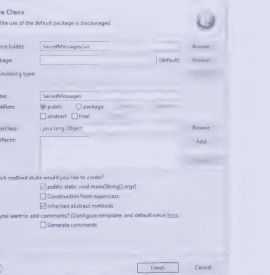

点击 `Finish`，在 Eclipse 主窗口中将看到 `SecretMessages.java` 文件。开始编写 Secret Messages 应用吧！

## 开始编写 SecretMessages.java

在 `SecretMessages.java` 文件顶部，`public class SecretMessages.java` 之上，添加 `java.util.Scanner` 导入语句以请求用户输入：

```java
import java.util.Scanner;

public class SecretMessages {
    public static void main(String[] args) {
        Scanner scan = new Scanner(System.in);
        System.out.println("Enter a message to encode or decode:");
    }
}
```

在 `main()` 方法内部，设置名为 `scan` 的 `Scanner` 对象，提示用户输入要编码或解码的消息。用户提示后，创建名为 `message` 的 `String` 变量接收用户输入文本：

```java
System.out.println("Enter a message to encode or decode:");
String message = scan.nextLine();
```


然后，我们使用 `scan` 对象的 `nextLine()` 方法获取用户的下一整行输入（直到遇到 ENTER 或 RETURN），并将其存储在字符串 `message` 中。这样，应用程序就可以请求用户提供消息并将该消息扫描到变量中。现在，我们需要学习如何操作字符串内部的字符，以创建消息的编码版本。在继续进入下一节之前，请保存你的文件。

### 处理字符串

到为止，Secret Messages 应用看起来和 Hi-Lo 猜游戏应用非常相似。我们设置了一个输入扫描器，提示用户输入某些内容，扫描控制台用户的响应，然后将输入捕获到变量中。让 Secret Messages 应用与众不同的是我们处理字符串内部字符的能力。

凯撒密码命令行应用将需要很多很多步骤才能完成，因此我们将以迭代的方式构建应用。这意味着，我们不会一次性编写整个应用并希望代码最后能够运行，而是一点一点地（或者说一次迭代一次）构建应用，并边做边测试，这样我们在每个点上都有一个功能正常的应用。每次迭代可能不具备我们所需的所有功能，但我们最终将获得完整的、功能全的应用。

我们需要使用文本处理来将输入字符串转换为输出字符串。为了在 Java 中开始处理文本字符串，我们将构建一个简单的消息反转器。换句话说，我们将用户输入的消息以字母反转的顺序返回给他们。例如，"Meet me at the arcade at 5pm" 将变成 "mp5 tacedra ta teem"。

首先，我们创建一个名为 `output` 的变量用于反转后的字符串，并将其赋值为空字符串：

```java
String message = scan.nextLine();

String output = "";
```

我们需要一个循环来遍历消息中的字符。为了方便起见，我们可以选择 `for` 循环，因为我们知道消息中字符的数量。（稍后，我们将使用 `message.length()` 方法告诉我们消息包含多少字符。）Java 中的 `for` 循环声明需要完成三件事：初始化循环变量、测试以继续执行的条件、以及在下一次迭代之前更新循环变量。在这三个部分之间放置分号来将它们分开。语法如下：

```java
for ( initialization; condition; update ) { body }
```

例如，打开 JShell 并输入此代码来创建一个 `for` 循环：

```java
jshell for ( int x = 0; x < 10; x++) { System.out.println(x); }
```

此循环将打印 0 到 9 的数字。初始化将第一个循环变量设置为 0。条件测试确保在继续之前 `x` 小于 10。最后，更新在每次通过循环后向 `x` 加 1。`x++` 是递增运算符的简写，因为它在每次循环中都对 `x` 递增或加 1。`x++` 等于语句 `x = x + 1`。在这个示例中，`for` 循环在每次循环时都打印 `x` 的值，重复 10 次，并在 `x` 不再小于 10 时停止。

所以，为了反转字符串，我们从消息的末尾开始，因此我们将 `x` 初始化为 `message.length()-1`。条件是 `x >= 0`，因为我们要一直到第一个字符。最后，更新是 `x--`，因为我们正在反向遍历字符串。回到 Eclipse，在上一行代码下方编写循环：

```java
String output = "";

for (int x = message.length()-1; x >= 0; x--) {

}
```

要获取字符串中特定位置的字符，我们使用 `charAt()` ("character") 方法并提供我们想要的字符的索引位置。要向字符串追加或添加字符，我们使用 `+` 运算符。将这些结合起来，我们可以构建字符串的反转版本：

```java
for (int x = message.length()-1; x >= 0; x--) {

    output += message.charAt(x);

}
```

`for` 循环的主体只有一行。我们正在获取 `message` 中索引 `x` 的字符并将其添加到 `output`。记得在 `for` 循环的主体周围使用括号，因为随着应用的增长，我们会在循环内部添加更多行。现在我们只需要将输出消息显示在屏幕上，可以通过 `System.out.println(output)` 实现。应用的完整消息反转迭代如列表 6-1所示。

```java
import java.util.Scanner;

public class SecretMessages {

    public static void main(String[] args) {

        Scanner scan = new Scanner(System.in);

        System.out.println("Enter a message to encode or decode:");

        String message = scan.nextLine();

        String output = "";

        for (int x = message.length()-1; x >= 0; x--) {

            output += message.charAt(x);

        }

        System.out.println(output);

    }

}
```

列表 6-1：Secret Messages 应用的迭代反转了用户消息中的字符。

```java
import java.util.Scanner;

public class SecretMessages {

    public static void main(String[] args) {

        Scanner scan = new Scanner(System.in);

        System.out.println("Enter a message to encode or decode:");

        String message = scan.nextLine();

        String output = "";

        for (int x = message.length()-1; x >= 0; x--) {

            output += message.charAt(x);

        }

        System.out.println(output);

    }

}
```

输入要编码或解码的消息：

Meet me at the arcade at 5pm

mp5 ta edacra eht ta teem

**图 6-5: 运行程序并在屏幕底部的控制窗口输入你自己的消息进行反转。**

你甚至可以通过复制编码后的反转消息并将其粘贴到程序中来解码，如图 6-6 所示。这样你可以输入一条消息，对其进行编码，并将其发送给朋友，然后他们可以将编码后的消息粘贴到同一个程序中进行解码。你构建了自己的第一个秘密消息编码器！

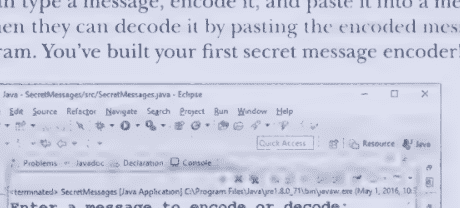

**图 6-6: 将编码后的消息粘贴到运行的程序中进行解码。**

这个版本的应用程序简单到你不需要通过程序运行就能读取消息，因此它不是给朋友发送消息的一种安全方法。但你确实学会了如何使用 `for` 循环遍历字符串、如何获取字符串的 `length()`、如何使用 `charAt()` 访问字符串中给定索引或位置的特定字符，以及如何使用 `+` 运算符向字符串末尾添加字符。在下一节中，你将学习如何更改消息中单个字符的值，使其更难阅读，但仍然易于我们的程序解码。

### Java 中的字符和值

构建一个更好的秘密消息编码器需要处理文本字符串中字符值的能力。例如，对于凯撒密码，我们需要能够移动这些值——例如将 A 变为 N，将 N 变为 A。要做到这一点，你需要了解字符在计算机中是如何存储的。

在 Java 中，单个字符（如 'a'）可以存储在自己的数据类型中：`char`。注意我们使用单引号来标记字符值。字符串的 `charAt()` 方法返回一个表示单个字符的 `char` 值。Java 使用 16 位 Unicode 字符。Unicode 是一种国际字符集，包含了来自世界数千个字符和符号，它们以数值的形式表示。`char` 类型是一种通过其数值存储 Unicode 字符（如 'A'、'n' 和 'c'）的方法。

我们可以像向 `int` 变量相加一样添加 Unicode 字符值。在“秘密消息”包中，我们希望将 'A' 的 `char` 值 (65)加上密钥 (13)，以得到新的 `char` 值 (78)，它代表编码后的字母 'N'。

在应用程序的第二次迭代中，让我们通过设置一个 `char` 变量并在其中存储值 13 来开始编写凯撒密码。我们将此添加到 `String output` 输出行下方：

```java
String output = "";

char key = 13;
```

我们还需要修改 `for` 循环，使其从字符串开始一直到结束。我们从索引 0 开始，并在 `x` 小于 `message.length()` 时遍历字符串。每次重复循环时，我们都会对字符位置 `x` 加 1。这里是新的 `for` 循环：

```java
char key = 13;

for (int x = 0; x < message.length(); x++) {
```

最后，我们不再将消息字符串的原始字符添加到输出字符串中，而是向每个字符添加密钥值，确保我们得到一个可以加到输出字符串的 `char` 值：

```java
output += (char)(message.charAt(x) + key);
```

我们已经向消息字符串中的每个字符添加了密钥值，然后在表达式强制该值向右移动之前，将其求和并强制转换为 `(char)`。（注：原文后半部分存在大量 OCR 错误导致的重复文本，此处已根据逻辑进行清理。）

### 使用其他语言进行编码

我们正在编写的程序仅对 A 到 Z 和 a 到 z 的基础拉丁字符稳定工作。如果你首选语言不是英语，只要 Unicode 将你语言的字母表或符号组合在一个连续的集中（一个接一个），你就可以调整程序。你可以像本章中的英文编码器/解码器一样，测试你首选语言的第一个和最后一个字符。如果你的语言没有以完整集合的形式提供，或者使用了部分基础拉丁字母加上其他字符（如西班牙语的 ñ 和法语的 ç，以及其他重音字符），你可以像我们在列表 6-2 中做的那样为任何字符添加键。可选情况下，你可以通过测试 `Character.isSpace()` 方法在消息中留空空格，并编码除以外的所有字符。尝试你选择的不同方法，以找到适合你的编码方案。修改程序并创造出新东西——这是学习的最好方法！

### 关闭 Scanner

这里我们可以添加一个内容，你可能在第 2 章中回过。`Scanner` 变量应该有一个黄色下划线，表示存在资源泄漏。当你将鼠标悬停在警告上时，它会弹出提示显示“scan is never closed”（scan 从未关闭）。记住，在我们完成使用后，我们需要关闭所有的输入输出资源，例如 `Scanner` 对象。为了这样做，我们将在程序 `main()` 方法的最后一个 `System.out.println` 之后添加 `scan.close()`：

```java
System.out.println(output);

scan.close();
```

添加这一行消除了资源泄漏。请参阅列表 6-3 以获取键值为 13 的完整凯撒密码编码器和解码器。

```java
import java.util.Scanner

public class SecretMessages {

    public static void main(String[] args) {

        Scanner scan = new Scanner(System.in);

        System.out.println("Enter a message to encode or decode:");

        String message = scan.nextLine();

        String output = "";

        char key = 13;

        for (int x = 0; x < message.length(); x++) {

            char input = message.charAt(x);

            if (input >= 'A' && input <= 'Z') {

                input += key;

                if (input > 'Z') {

                    input -= 26;

                }

            } else if (input >= 'a' && input <= 'z') {

                input += key;

                if (input > 'z') {

                    input -= 26;

                }

                output += input;

            }

        }

        System.out.println(output);

        scan.close();

    }

}
```

列表 6-3：此版本的程序是一个键值为 13 的功能性凯撒密码编码器和解码器。尝试一下：首先运行程序并编码消息。然后复制编码后的输出并再次运行程序；在提示时，粘贴编码后的消息并按回车。程序将响应原始的解码消息。这里是程序的两次运行示例，我将第一条消息的编码输出复制并作为第二次运行的输入：

Enter the message to encode or decode:
Secret messages are so cool!
Uif zffrf ner fb!

Enter the message to encode or decode:
Uif zffrf ner fb!
Secret messages are so cool!

因为凯撒密码是对称的，在编码后的消息上运行程序会将消息解码回原始明文。这意味着你可以按照列表 6-3 所示运行此程序来编码消息，将编码后的版本发送给同样拥有编码器程序的朋友，并让他们立即解码你的消息。

遗憾的是，这意味着任何运行程序的人（或任何破解密码的人）都可以像你一样快速地解码你的消息。在下一次迭代中，让我们让代码变得更有趣一点，允许用户设置自己的键值。这样，你就可以选择不同的键向不同的人发送消息，或者每次都使用新键。

## 添加自定义键值

机密消息编码器在键值为 13 时运行良好，但如果我们想使用不同的键值来对消息进行编码和解码，例如 3（经典的凯撒位移）或 5 或 25 呢？

除了消息之外，我们还需要提示用户输入键值。我们可以在创建 `char key` 变量的行之前添加一个提示：

```java
String output = "";

System.out.println("Enter a secret key (-25 to 25):");

char key = 13;
```

我们允许负键值，是为了方便解码消息。如果你使用键值 5 对你的消息进行编码并发送给朋友，你的朋友可以使用键值 -5 来解码消息。

当用户响应他们所需的秘密键值时，我们可以扫描他们提供的输入行，从输入行中解析整数值，并将该值存储在 `int` 变量中：

```java
String output = "";

System.out.println("Enter a secret key (-25 to 25):");

int keyVal = Integer.parseInt(scan.nextLine());
```

最后，我们不再使用 13 作为键变量，而是将键改为：

```java
int keyVal = Integer.parseInt(scan.nextLine());

char key = (char) keyVal;

for (int x = 0; x < message.length(); x++) {
```

在这里，我们将 `keyVal` 强制转换为 `char` 并将该值存储在变量 `key` 中，因为我们不能直接将整数转换为 `char`。

为了处理解码过程中的负值，我们需要处理减（或加上负值）会导致字母超出字母表的开头（小于 'A'）。如果发生这种情况，我们通过加上 26 将字母移回 A 到 Z 的范围。将以下代码添加到大写字母的 `if` 语句中：

```java
if (input >= 'A' && input <= 'Z') {

    input += key;

    if (input > 'Z') {

        input -= 26;

    }

    if (input < 'A') {

        input += 26;

    }

}
```

如果我们输入负键，我们会将其绕回字母表的末尾。请对随后的 `else if` 语句中的小写字母执行相同的操作：

```java
else if (input >= 'a' && input <= 'z') {

    input += key;

    if (input > 'z') {

        input -= 26;

    }

    if (input < 'a') {

        input += 26;

    }

    output += input;

}
```


## 编码数字

现在我们编码了字母，但如果我们编码这样的消息，任何数字都保持未编码。如果我们也想对数字进行编码，我们需要再添加一个 `for` 循环部分。我们需要检查一个字符是否落在 `'0'` 到 `'9'` 之间。

```java
else if (input > '0' && input <= '9') {
```

这部分与之前的两个 `if` 条件相似，只是我们使用的是数字 `'0'` 到 `'9'`，而不是字母 `'A'` 到 `'Z'` 作为范围。`if` 语句括号内的下一行看起来有点不同：

```java
input += (keyVal % 10);
```

首先，我们使用了用户早些输入的整数版本的秘密键 `keyVal`。其次，我们使用了模运算符 (`%`) 将数字的位移值保持在 -10 到 +10 之间。

如果编码数字将它推过了 9，我们就减去 10。如果解码将数字移低于 0，我们就加上 10。

```java
if (input > '9')
    input -= 10;

if (input < '0')
    input += 10;
```

## 完整程序演示

现在我们可以在发送的消息中同时对数字和字母进行编码：

输入要编码或解码的消息：
下午 5 点在游戏机厅见，并带上 2 美元玩吃大鼠 :)
输入一个秘密密钥 (-25 到 25)：

7
Tla la aol hyjkhkl ha 2wt huk iyun 9 av wshf Whj-Thu :

加密消息中的 59 里的 5 正确地移动了 7 位，并回到了 2wt。$2 中的 2 同样移动了 7 位变成 $9。你可以通过使用密钥 -7 解码来测试之前的秘密消息，你应该能得到原始明文消息，包括数字。

Secret 应用程序完整的最终文本版本见于列表 6-4。

```java
import java.util.Scanner;

public class SecretMessages {

    public static void main(String[] args) {

        Scanner scan = new Scanner(System.in);

        System.out.println("Enter a message to encode or decode:");

        String message = scan.nextLine();

        String output = "";

        System.out.println("Enter a secret key (-25 to 25):");

        int keyVal = Integer.parseInt(scan.nextLine());

        char key = (char) keyVal;

        for (int x = 0; x < message.length(); x++) {

            char input = message.charAt(x);

            if (input >= 'A' && input <= 'Z') {

                input += key;

                if (input > 'Z') {

                    input -= 26;

                }

                if (input < 'A') {

                    input += 26;

                }

            } else if (input >= 'a' && input <= 'z') {

                input += key;

                if (input > 'z') {

                    input -= 26;

                }

                if (input < 'a') {

                    input += 26;

                }

            } else if (input >= '0' && input <= '9') {

                input += (keyVal % 10);

                if (input > '9') {

                    input -= 10;

                }

                if (input < '0') {

                    input += 10;

                }

            }

            output += input;

        }

        System.out.println(output);

        scan.close();

    }

}
```

列表 6-4: Secret Messages 应用程序的命令行版本

这个 Secret Messages 应用程序可以作为与朋友互相分享加密消息的趣味方式。你的一些朋友可能在电脑上没有安装 Eclipse 或 Java JDK。如果能和他们一起分享 Secret Messages 应用程序不是很好吗？在下一节中，我们将看到如何在不打开 Eclipse 的情况下运行命令行 Java 应用程序。

## 不使用 Eclipse 运行命令行程序

到目前为止我们已经建立了两个命令行程序，但一直都在 Eclipse 内部运行它们。Eclipse 提供了一个方便的控制台模拟器，让我们看到命令行程序的外观和感受，但如果我们想从真实的命令行（例如 Windows 或 macOS 中的命令提示符）运行该程序呢？或者如果我们想把其中一个命令行程序发送给电脑上没有安装 Eclipse 的朋友呢？

幸运的是，大多数人的电脑上至少安装了 JRE（即 Java 运行时环境）。

## 寻找工作区文件夹

要运行你在 Eclipse 中编写并编译的程序，首先要找到你的 Eclipse 工作区文件夹。在文件管理器（或 Finder）中打开它，如图 6-7 所示。

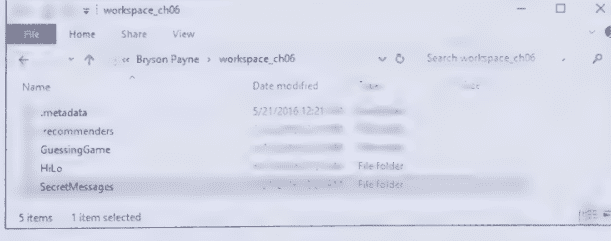

图 6-7. 我的工作区文件夹包含我们到为止构建的每个项目的文件夹，以及 Eclipse 默认文件夹。

打开工作区中的 `SecretMessages` 文件夹，你会看到里面有一些文件和文件夹，如图 6-8 所示。`src` 文件夹包含你的源代码文件（以 `.java` 结尾），`bin` 文件夹包含你的程序编译版本（以 `.class` 结尾）。

### 打开命令行窗口

接下来，打开命令行窗口。在 Windows 上，你可以通过点击按钮进入搜索栏，输入 `cmd`（command 的缩写）并按回车来实现。在 macOS 上，使用 Spotlight 搜索查找 Terminal，或者从 Finder 进入应用程序 > Terminal。在 Linux 上，打开 Terminal 应用程序或搜索 Terminal。

我们需要在命令行和 Terminal 提示符中输入 `cd`（change directory 的缩写）并后跟一个空格。然后，为了进入程序所在的 `bin` 文件夹，从文件管理器中将该文件夹拖入命令提示符或 Terminal 窗口，如图 6-9 所示。

图 6-8: 找到 SecretMessages 项目文件夹中的 bin 文件夹。

图 6-9: 你可以从文件管理器将 bin 文件夹拖入命令行窗口以轻松复制路径。

注意完整路径出现在 `cd` 命令之后，如下所示（你的 workspace/SecretMessages/bin 文件夹可能与我的略不同）：

```bash
cd "C:\Users\Bryson Payne\workspace\bin"
```

## 编程挑战

### #1: 循环加密

你可以选择每次都使用相同的密钥，也可以要求用户输入新的密钥。如果你在循环中每次都要求用户输入密钥，就可以让他们连续地对消息进行加密和解码（例如，输入 8 来给朋友发送加密消息，输入 -8 来解码该朋友发送的消息）。实现此点的一种方法是提示用户输入一条要加密的新消息，或者告诉他们按 ENTER 退出。然后，使用 `if` 语句检查用户是输入了消息还是仅仅按了 ENTER。试一试吧！

```java
message.length() > 0 if the user typed something.
```

### #2: 反转与加密

让我们在用凯撒密码对消息加密之前，先对消息进行反转，让我们的消息变得更难破译。这个应用程序的重重加密版本将第 130 页代码清单 6-1 中第一个版本的消息反转方法，与第 140 页代码清单 6-4 中最终版本的凯撒密码功能结合起来。

反转消息顺序是对称加密的另一个例子——执行一次它会反转消息，再次执行一次就会恢复消息。将字符串反转与凯撒密码结合并不会让程序变得太复杂，但可以让你的消息让窃听者感到更加困惑。确保你的应用程序能够正确加密和解码消息，并记住，你的朋友需要新版本的程序才能解码你加密的消息！尽情享受吧！

### #3: 使用 try 和 catch 安全地处理密钥

你对“秘密消息”应用程序可以做的最后一项改进是，当用户输入密钥值时安全地处理数字输入。还记得 `try-catch` 语句吗？

在这个程序中添加 `try-catch` 块可能会有点棘手。除了添加异常处理代码以防止用户因输入错误的数字（例如输入文本而不是数字）而导致崩溃外，你还需要思考当提供错误输入时程序应该做什么。它是应该告诉用户他们的密钥无效并使用预定义的密钥（例如 3）吗？还是应该创建一个循环，不断要求用户输入有效密钥？尝试编写两种实现方式，并选择你喜欢的一种吧！

## 创建高级 GUI 并分享你的应用

对于“秘密消息”应用程序的 GUI 版本，我们将提供两个大的文本区域，允许用户在 GUI 界面中复制和粘贴长消息。在章节结束时，我们将添加一个如图 7-1 所示的密钥选择滑块，这会让破解凯撒密码变得非常简单，即使在密钥的情况下！


图 7-1：秘密消息加密/解码器应用程序

此版本的应用程序比基于控制台的应用程序更加友好，我们可以重用第 6 章的一些代码，因为加密和解码消息的算法是相同的。

## 设置秘密消息 GUI 项目

打开 Eclipse，通过 `File > New > Java Project` 创建一个新的 Java 项目。将项目命名为 `SecretMessagesGUI` 然后点击 `Close`。打开任意文件，并在 Package Explorer（包管理器）面板中打开 `SecretMessagesGUI` 项目文件夹以找到 `src` 文件夹。右键点击 `src` 文件夹并选择 `New > Class` 创建一个新的 Java 源文件。同样将其命名为 `SecretMessagesGUI`。

我们将再次使用 Swing 工具包，因此在 `New Java Class` 对话框中，将父类更改为 `javax.swing.JFrame` 并勾选创建 `main()` 方法的复选框。

点击 `Finish`，你会看到 `SecretMessagesGUI.java` 文件一些熟悉的骨架代码。在 Package Explorer 中右键点击 `SecretMessagesGUI.java` 文件，选择 `Open With > WindowBuilder` 开始为应用程序创建 GUI 界面。

### 设计 GUI 并命名组件

打开 WindowBuilder 的 Design 标签页。在 Components 面板中展开 `javax.swing.JFrame` 组件并选择 `getContentPane()`。现在进入 Properties 面板，将 `Layout` 属性更改为 `Absolute`（绝对布局），如图 7-2 所示。这将允许我们精确地放置组件。


图 7-2：在放置任何 GUI 组件之前将 `Layout` 属性更改为 `Absolute`。

接下来，在 Components 面板中点击 `javax.swing.JFrame`。在 Properties 面板中，将 `defaultCloseOperation` 设置为 `EXIT_ON_CLOSE`。同时将 `title` 属性更改为“Secret Message App”，如图 7-3 所示。


图 7-3：更改 `defaultCloseOperation` 和 `title` 属性以自定义应用程序。

接下来，为自己留出一些空间来构建一个大大的 GUI，以便我们可以处理更长的消息。在 Components 面板中选中 `javax.swing.JFrame`，在设计预览中点击窗口边框。点击右下角的黑色缩放框，向下向右拖动将框架调整为 600x400 像素，如图 7-4 所示。


图 7-4：调整框架大小

现在我们准备好开始 GUI 界面了。对于“秘密消息”应用程序的 GUI 版本，我们将提供两个大的文本区域，允许用户在 GUI 界面中复制和粘贴长消息。在章节结束时，我们将添加一个如图 7-1 所示的密钥选择滑块，这会让破解凯撒密码变得非常简单，即使在密钥的情况下！

## 编写 encode() 方法

我们需要告诉 Java 我们想要将什么类型的信息传递给 `encode()`：这些信息被称为方法的参数。要为方法声明参数，我们将它们放在方法名后的括号内，先数据类型在前，参数名称在后。多个参数之间用逗号分隔。`encode()` 方法的声明如下：

```java
public String encode(String message, int keyVal)
```

让我们添加大括号作为方法体，并将 `encode()` 方法放在两个 `TextArea` 变量声明下方、`SecretMessagesGUI()` 构造函数上方：

```java
public class SecretMessagesGUI extends JFrame {

    private JTextField txtKey;

    private JTextArea txtIn;

    private JTextArea txtOut;

    public SecretMessagesGUI() {

    public String encode(String message, int keyVal) {
```

Eclipse 将用红色波浪线下划 `encode()` 方法，提示你没有返回值，因为我们还没有在方法内部编写代码。在这里，我们将重用第 6 章的一些代码。声明一个名为 `output` 的 String，暂时将其设置为空字符串，并添加一行使用 `return` 语句将 `output` 作为 `encode()` 方法的结果返回：

```java
public String encode(String message, int keyVal) {

    String output = "";

    return output;

}
```

由于 `encode()` 被声明返回一个 String 值，而我们返回的是 `output`（它是一个 String），Eclipse 将移除下划线，告知我们已经修复了缺失返回值的问题。接下来，我们将重用文本版本应用程序中的选择逻辑来加密消息。在项目面板（Project pane）中打开第 6 章的 `SecretMessages` 项目。我们可以复制从 `char key` 开始到循环闭合括号结束的代码，紧邻程序末尾 `System.out.println(output);` 之前。这部分程序使用凯撒密码算法对消息进行加密的部分。

将从 `SecretMessages.java` 复制的代码粘贴到 `SecretMessagesGUI.java` 的 `encode()` 方法中，即我们添加的两行代码之间。完成后的 `encode()` 方法如下：

```java
public String encode(String message, int keyVal) {

    String output = "";

    char key = (char) keyVal;

    for (int x = 0; x < message.length(); x++) {

        char input = message.charAt(x);

        if (input >= 'A' && input <= 'Z') {

            input += key;

            if (input > 'Z') {
```


```java
input -= 26;
}
if (input < 'A') {
    input += 26;
}
} else if (input >= 'a' && input <= 'z') {
    input += key;
    if (input > 'z') {
        input -= 26;
    }
    if (input < 'a') {
        input += 26;
    }
} else if (input >= '0' && input <= '9') {
    input += (key % 10);
    if (input > '9') {
        input -= 10;
    }
    if (input < '0') {
        input += 10;
    }
}
}
return output;
}
```

由于我们对变量命名保持了一致，命名是一个良好的习惯，而且编写良好的 Java 代码可以在跨平台复用。

## 编写加密/解密的事件处理程序

我们希望用户在 GUI 界面中提供输入消息以及传递给 `encode()` 的键值，并且我们希望在用户点击“Encode/Decode”（加密/解密）按钮时返回输出消息，因此，让我们编写处理按钮点击的代码。

切换到 `SecretMessagesGUI.java` 的设计视图，并双击“Encode/Decode”按钮。Eclipse 将切换回源视图，并为“Encode/Decode”按钮插入 `actionPerformed()` 处理程序的代码，如下代码段所示：

```java
JButton btnDecode = new JButton("Encode/Decode");
btnDecode.addListener(new ActionListener() {
    public void actionPerformed(ActionEvent args) {
```
这是一个匿名内部类，就像我们在第 3 章遇到的那种。我们只需要在 `actionPerformed()` 内部添加代码，即可告诉 Java 按钮在被点击时应该如何表现。我们希望加密/解密按钮执行以下步骤：

1. 从 `txtIn` 获取输入消息。
2. 从 `txtKey` 获取键值。
3. 使用键值对消息进行加密。
4. 在 `txtOut` 中显示输出消息。

在阅读之前，思考你自己如何完成这些步骤中的每一个一步，看看我们的解决方案如何对比。对于第一步，我们可以设置一个名为 `message` 的 String，从 `txtIn` 字段中获取文本。`JTextField` 有一个 `getText()` 方法：

```java
public void actionPerformed(ActionEvent arg) {
    String message = txtIn.getText();
```

对于第二步，我们可以使用 `Integer.parseInt()` 方法从 `txtKey` 获取用户的键值，该方法从文本字符串中提取整数值。然后我们将键存储在一个名为 `key` 的变量中：

```java
String message = txtIn.getText();
int key = Integer.parseInt(txtKey.getText());
```

在第三步中加密消息，我们只需要调用 `encode()` 方法并传递两个参数。参数是提供给方法以作为其参数的值，因此我们需要向 `encode()` 传递两个参数，即变量 `message` 和 `key`。我们可以通过语句 `encode(message, key)` 来调用 `encode()`。当执行完成后，它将返回加密后的消息，即 `output`。注意，方法返回的是一个 String，而我们返回的是 `output`（一个 String），Eclipse 将移除下划线，告知我们已经修复了缺失返回值的问题。接下来我们将重用文本版本应用程序中的选择逻辑来加密消息。在项目面板中打开第 6 章的 `SecretMessages` 项目。我们可以复制从 `char key` 开始到循环闭合括号结束的代码，紧邻程序末尾 `System.out.println(output);` 之前。这部分程序使用凯撒密码算法对消息进行加密的部分。

将从 `SecretMessages.java` 复制的代码粘贴到 `SecretMessagesGUI.java` 的 `encode()` 方法中，即我们添加的两行代码之间。完成后的 `encode()` 方法如下：

```java
public String encode(String message, int keyVal) {
    String output = "";
    char key = (char) keyVal;
    for (int x = 0; x < message.length(); x++) {
        char input = message.charAt(x);
        if (input >= 'A' && input <= 'Z') {
            input += key;
            if (input > 'Z') {
                input -= 26;
            }
            if (input < 'A') {
                input += 26;
            }
        } else if (input >= 'a' && input <= 'z') {
            input += key;
            if (input > 'z') {
                input -= 26;
            }
            if (input < 'a') {
                input += 26;
            }
        } else if (input >= '0' && input <= '9') {
            input += (key % 10);
            if (input > '9') {
                input -= 10;
            }
            if (input < '0') {
                input += 10;
            }
        }
    }
    return output;
}
```

由于我们对变量命名保持了一致，命名是一个良好的习惯，而且编写良好的 Java 代码可以在跨平台复用。

## 编写加密/解密的事件处理程序

我们希望用户在 GUI 界面中提供输入消息以及传递给 `encode()` 的键值，并且我们希望在用户点击“Encode/Decode”按钮时返回输出消息，因此，让我们处理处理按钮点击的代码。

切换到 `SecretMessagesGUI.java` 的设计视图，并双击“Encode/Decode”按钮。Eclipse 将切换回源视图，并为“Encode/Decode”按钮插入 `actionPerformed()` 处理程序的代码，如下代码段所示：

```java
JButton btnDecode = new JButton("Encode/Decode");
btnDecode.addListener(new ActionListener() {
    public void actionPerformed(ActionEvent args) {
```
这是一个匿名内部类，就像我们在第 3 章遇到的那种。我们只需要在 `actionPerformed()` 内部添加代码，即可告诉 Java 按钮在被点击时应该如何表现。我们希望加密/解密按钮执行以下步骤：

1. 从 `txtIn` 获取输入消息。
2. 从 `txtKey` 获取键值。
3. 使用键值对消息进行加密。
4. 在 `txtOut` 中显示输出消息。

在阅读之前，思考你自己如何完成这些步骤中的每一个一步，看看我们的解决方案如何对比。对于第一步，我们可以设置一个名为 `message` 的 String，从 `txtIn` 字段中获取文本。`JTextField` 有一个 `getText()` 方法：

```java
public void actionPerformed(ActionEvent arg) {
    String message = txtIn.getText();
```

对于第二步，我们可以使用 `Integer.parseInt()` 方法从 `txtKey` 获取用户的键值，该方法从文本字符串中提取整数值。然后我们将键存储在一个名为 `key` 的变量中：

```java
String message = txtIn.getText();
int key = Integer.parseInt(txtKey.getText());
```

在第三步中加密消息，我们只需要调用 `encode()` 方法并传递两个参数。参数是提供给方法以作为其参数的值，因此我们需要向 `encode()` 传递两个参数，即变量 `message` 和 `key`。我们可以通过语句 `encode(message, key)` 来调用 `encode()`。当执行完成后，它将返回加密后的消息，即 `output`。注意，方法返回的是一个 String，而我们返回的是 `output`（一个 String），Eclipse 将移除下划线，告知我们已经修复了缺失返回值的问题。

## 处理错误输入和用户错误

处理按钮点击的代码包含了 `Integer.parseInt()` 的调用，我们在第 3 章学过该方法在用户输入错误时会抛出异常。如果用户留空 `txtKey` 字段或在 `JTextField` 中输入非整数，`Integer.parseInt()` 将失败。

我们需要使用 `try-catch` 块来保护程序免受错误输入。由于我们希望在用户正确输入加密密钥时才加密或解密消息，可以将 `actionPerformed()` 的四行代码封装在 `try` 块中，在第一行之前添加 `try` 关键字和左括号，在第四行之后也添加右括号，如下所示：

```java
void actionPerformed(ActionEvent e) {
  try {
    String message = txtIn.getText();
    int key = Integer.parseInt(txtKey.getText());
    String output = encode(message, key);
    txtOut.setText(output);
  } catch (Exception ex) {
  }
}
```

Eclipse 将右括号显示为红色，让我们按所示添加 `catch` 块。我们需要在接收到错误输入时告诉 Java 要做什么，稍后将在 `catch` 语句的大括号内这些步骤。

### 构建 main() 方法并运行程序

就像我们在第 3 章创建游戏应用一样，我们需要在 `main()` 方法中添加一些设置代码，以创建加密消息应用的实例、调整 GUI 窗口大小并让 GUI 对用户可见。在 `SecretMessagesGUI.java` 文件的底部，找到 Eclipse 提供的 `main()` 方法存根，并添加以下三行。

```java
public static void main(String[] args) {
    SecretMessagesGUI app = new SecretMessagesGUI();
    app.setSize(new java.awt.Dimension(600,400));
    app.setVisible(true);
}
```

第 ① 行代码创建了一个名为 `app` 的 `SecretMessagesGUI` 对象。`new` 关键字后跟类名会运行构造方法 `SecretMessagesGUI()`，该方法设置了 GUI 界面的所有组件。

接下来，我们设置 JFrame 的大小，使其与我们在布局中使用的宽度高度匹配，即 600 比 400 像素 ②。最后，我们将 JFrame 的可见性属性设置为 true ③，允许用户看到 GUI。保存这些更改并运行程序进行测试，如图 7-7 所示。

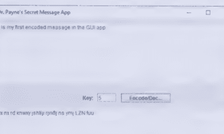

图 7-7：Secret Messages 应用仍然显得有点单调，但它可以编码和解码消息！

以下是 `SecretMessagesGUI.java` 直此的完整源代码：

```java
import javax.swing.JFrame;
import javax.swing.JTextArea;
import javax.swing.JTextField;
import javax.swing.JLabel;
import javax.swing.JButton;
import java.awt.event.ActionListener;
import java.awt.Dimension;
import java.awt.event.ActionEvent;

public class SecretMessagesGUI extends JFrame {
    private JTextField txtKey;
    private JTextArea txtIn;
    private JTextArea txtOut;

    public String encode(String message, int keyVal) {
        String output = (char) keyVal;
        for (int x = 0; x < message.length(); x++) {
            char input = message.charAt(x);
            if (input >= 'A' && input <= 'Z') {
                input += keyVal;
                if (input > 'Z')
                    input -= 26;
                if (input < 'A')
                    input += 26;
            } else if (input >= 'a' && input <= 'z') {
                input += keyVal;
                if (input > 'z')
                    input -= 26;
                if (input < 'a')
                    input += 26;
            } else if (input >= '0' && input <= '9') {
                input += (keyVal % 10);
                if (input > '9')
                    input -= 10;
                if (input < '0')
                    input += 10;
            }
            output = input;
            return output;
        }
    }

    public SecretMessagesGUI() {
        setTitle("Dr. Payne's Secret Message App");
        setDefaultCloseCloseOperation(JFrame.EXIT_ON_CLOSE);
        getContentPane().setLayout(null);
        txtIn = new JTextField();
        txtIn.setBounds(10, 11, 564, 140);
        getContentPane().add(txtIn);
        txtOut = new JTextField();
        txtOut.setBounds(10, 210, 564, 140);
        getContentPane().add(txtOut);
        txtKey = new JTextField();
        txtKey.setBounds(258, 173, 44, 20);
        getContentPane().add(txtKey);
        lblKey = new JLabel("Key:");
        lblKey.setBounds(202, 176, 46, 44);
        getContentPane().add(lblKey);
        btnEncoded = new JButton("Encode/Decode");
```


```java
btnEncoded.addActionListener(new ActionListener() {

    public void actionPerformed(ActionEvent e) {

        try {

            String message = txtIn.getText();

            int key = Integer.parseInt(txtKey.getText());

            String output = encode(message, key);

            txtOut.setText(output);

        } catch (Exception e) {

        }

    }

});

btnEncoded.setBounds(312, 172, 144, 23);

getContentPane().add(btnEncoded);

}

public static void main(String[] args) {

    SecretMessagesGUI app = new SecretMessagesGUI();

    app.setSize(new java.awt.Dimension(600,400));

    app.setVisible(true);

}

}
```

这个版本的程序虽然成功了，但还有改进空间。我们可以通过一些调整让 GUI 界面看起来更专业。

## 改进 GUI

让我们切换设计视图来修复上一节中提到的问题。首先，点击 **Encode/Decode** 按钮让它变宽一点。现在，让我们让 `JTextArea` 字段的字体更大、更易读。我们想要更改两个区域的字体属性，因此按住 `CTRL` 同时选择 `txtIn` 和 `txtOut`。在选中两个区域的情况下，进入属性面板中的字体属性并点击三个点。字体选择器将出现，如图 7-8 所示。

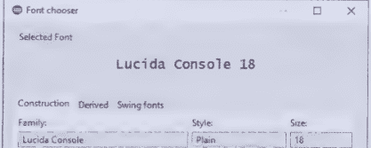

图 7-8：我们可以同时更改两个 `JTextArea` 字段的字体属性。

选择大于 18 的字体以及你喜欢的字体。保持熟悉的字体，这样当你与朋友分享程序时，外观和感受不会发生剧烈变化。点击 `OK` 保存字体选择。

最后，让我们个性化内容面板的背景颜色。点击左上角的组件选择内容面板。然后在属性面板中的背景属性旁点击三个点。在弹出的颜色选择器中，选择 `Colors` 标签，如图 7-9 所示。选择你喜欢的颜色并点击 `OK`。

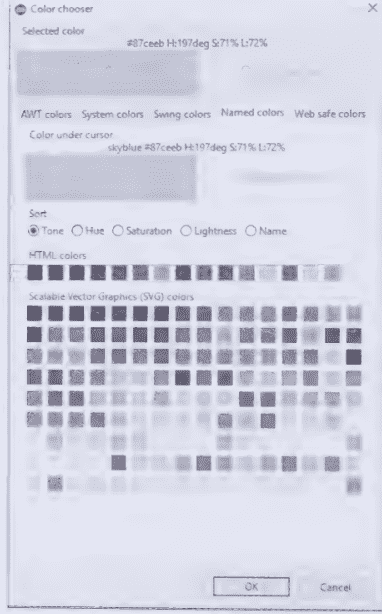

图 7-9：更改内容面板和按钮的背景颜色使程序更时尚。

你还可以更改 Encode/Decode 按钮的背景颜色。你可能在设计预览中看不到所有的更改，但如果你运行程序，应该能看到新选择的颜色，如图 7-10 所示。

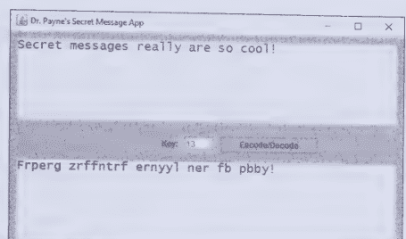

图 7-10：更改按钮和字体大小后的 GUI。

根据你的喜好自定义许多其他属性。探索每个组件的属性面板，直到你的程序符合你的要求。记得停止并保存程序，否则更改会被丢失！

## 设置换行和自动换行

到目前为止，我在示例中使用的消息都短于一行。但如果我们输入几行文本会怎样？让我们尝试在输入文本区域粘贴一个长句子。我将使用美国总统亚伯拉罕·林肯的《葛底斯堡演说》的第一句：“很久以前，我们的祖先在这片大陆建立了一个新的国家，在自由中孕育，并奉人人平等的理念。”

你可以使用这句话，也可以编写自己的句子。无论哪种方式，你一输入它，就会发现一个问题，如图 7-11 所示。

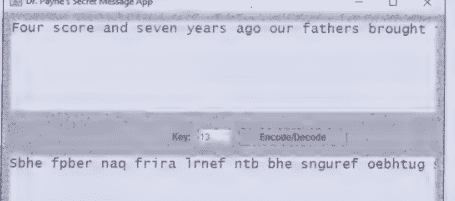

图 7-11：程序中的长消息尚未在行尾自动换行。

要正确按完整单词换行长文本，你需要更改属性面板中每个文本区域的两个属性。在设计预览中再次选择两个 `JTextArea` 对象，然后在属性下选择 `Wrap`（换行）和 `wordWrap`（自动换行）旁边的选框。第一个属性 `Wrap` 让 Java 将超过一行的文本换行到下一行。将换行样式设置为 `word` 告诉 Java 在整个单词结束处断行，就像我们在文字处理器中所做或你在书中看到的那样。

现在保存并运行程序。在第一个文本框中粘贴你的长句子，你应该注意到改进。现在文本正确地跨越了多行，在每行的最后一个完整单词后有换行。输入密钥并按下 Encode/Decode 按钮，你将在输出文本区域中看到相同的文本换行，如图 7-12 所示。

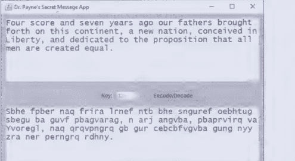

图 7-12：将 `wrap` 和 `wordWrap` 属性都设置为 `true` 会产生良好的多行界面，并带有自动换行功能。

## 处理不良输入和用户错误：第二部分

在本节的前些部分，我们在事件处理程序周围添加了一个 `try` 块，但留空 `catch` 语句体。现在是填充代码的时间了。我们还将学习如何创建消息对话框来提示用户错误。


当用户关闭弹出窗口后，另一个方便的操作是将光标移动到 `txtkey` 文本字段并突出显示或选择其中的任何文本，这样用户就可以轻松输入新值，而无需手动点击并选择值。

我们一直用于 GUI 组件（如 `JFrame` 和 `JTextField`）的 `javax.swing` 工具包也包含处理各种弹出窗口的类。例如：输入对话框（input dialogs），允许用户提供文本输入；确认对话框（confirm dialogs），允许用户选择是/否/确定或取消；以及消息对话框（message dialogs），在弹出窗口向用户提供信息。

我们想向用户提供的错误消息最好显示在消息框中。`javax.swing.JOptionPane` 类有一个 `showMessageDialog()` 方法，它接受两个参数：父窗口和要显示的消息。如果我们正在编写一个更大的应用程序，我们会使用父窗口参数将对话框居中在主处理窗口上方，例如。但对于这个程序，可以使用关键字 `null` 将对话框居中在桌面上，如下所示：

```java
JOptionPane.showMessageDialog(null, "Please enter a whole number value for the encryption key.");
```

当调用此行代码时，将弹出一个显示“Please enter a whole number value for the encryption key.”的消息对话框。

要将此弹出错误消息添加到之前创建的 `catch` 语句中，请进入设计视图并双击 Encode/Decode 按钮。这是让 Eclipse 直接带您进入按钮点击事件处理程序的 `catch` 语句的快捷方法。

显示错误消息后，我们还希望将光标放在 `txtkey` 字段中，并选择 `txtkey` 字段中的任何文本，就像我们在 Hi-Lo 猜数字游戏 GUI 程序中做的那样。我们将在 `catch` 语句的大括号内添加消息框以及我们在 Hi-Lo 猜数字游戏程序相同的 `requestFocus()` 和 `selectAll()` 语句。Encode/Decode 按钮完成后的事件处理器代码如下：

```java
private void buttonActionPerformed(ActionEvent e) {

    try {

        int key = Integer.parseInt(txtkey.getText());

        if (key < 0 || key > 25) {

            JOptionPane.showMessageDialog(null, "Please enter a whole number for the encryption key.");

            txtkey.requestFocus();

            txtkey.selectAll();

            return;

        }

        // ... rest of code

    } catch (NumberFormatException e) {

        JOptionPane.showMessageDialog(null, "Please enter a valid number.");

    }

}
```

注意：当你添加 `JOptionPane` 时，如果没有使用内容辅助（content assist）或者你在 `JOptionPane` 处看到错误，你可能需要按 `CTRL-SHIFT-O` 在代码顶部正确导入 `javax.swing.JOptionPane` 类。

现在运行程序，要么让密钥字段为空，要么输入非数字文本作为密钥。消息对话框将弹出，要求你输入一个有效的密钥。它还将突出显示密钥字段中的文本，以便在对话框关闭时轻松输入整数。

初次用户可能不知道在密钥字段中输入什么，因此添加默认值也可能是一个有用的 UI 调整。点击设计（Design）选项卡，选择 `txtkey` 文本字段，并在属性（Properties）面板的 `text` 属性中输入一个默认密钥值。我将选择 `3` 作为默认加密密钥，但你可以选择任何数字。将 `txtkey` 的 `horizontalAlignment` 属性更改为 `CENTER` 也是不错的。随意更改其他属性以使 `txtkey` 完全符合你的喜好，包括字体颜色和样式。

# 在 Secret Messages GUI 中添加滑块

我们将为 Secret Messages 程序添加另一个界面改进——一个数字滑块，它允许你快速滑动值，并查看消息随每个新密钥发生的变化。

在设计视图中，在调色板（Palette）的组件（Components）下，选择 `JSlider` 组件。将鼠标悬停在密钥提示的中间，点击将 `JSlider` 放到如图 7-14 所示的位置——如果需要，稍可以调整位置。

## 调色板


允许用户通过在边界范围内滑动滑块来图形化选择值的组件。滑块可以同时显示其之间的主刻度和次刻度。刻度返回的值数量由 `setMajorTickSpacing` 和 `setMinorTickSpacing` 控制。

图 7-14：用于图形用户界面的 `JSlider`，提供了一种快速、方便尝试不同密钥值的方法。

现在让我们自定义 `JSlider` 的一些属性。首先，让我们更改背景颜色以与程序的其他部分匹配。选中新的 `JSlider` 后，点击属性面板中 `background` 属性旁的三个点，进入颜色对话框（Color Dialog）中的命名颜色（Named colors），并选择与 GUI 其他部分相同的颜色。点击 `OK` 为滑块保存新的背景颜色。

接下来，我们将为滑块添加自定义刻度和默认值。首先，通过选择旁边的 `true` 复选框来开启 `paintTicks`。其次，输入最大值 `26` 和最小值 `-26`，以便在滑块上轻松选择密钥值。

接下来，对于次刻度在 `minorTickSpacing` 属性中输入 `13`——这将滑块上显示标签。然后，对于 `majorTickSpacing` 属性，输入 `23`。现在通过选择旁边的 `true` 复选框开启 `paintLabels`。最后，对于 `orientation` 属性，输入 `HORIZONTAL`——这将水平方向显示滑块。

| 属性 (Properties) | 值 (Value) |
| :--- | :--- |
| background | |
| border | |
| enabled | |
| foreground | |
| majorTickSpacing | 23 |
| maximum | 26 |
| minimum | -26 |
| minorTickSpacing | 13 |
| orientation | HORIZONTAL |
| paintLabels | true |
| paintTicks | true |
| value | 3 |

图 7-15：自定义滑块的属性

```java
String output = encode(message, key);

txtOut.setText(output);
```

①、② 和 ③ 行的代码是直接从“编码/解码”（Encode/Decode）按钮的事件处理器复制的，但我们在 ④ 处做了一个小改动。我们不再解析文本字段的值，而是使用 `getValue()` 方法直接作为整数访问滑块的值。这意味着我们不再需要 `try-catch` 语句，因为我们不再依赖用户提供手动输入的值。这对于用户来说更方便，对于程序员来说更安全，因为 GUI 滑块消除了一个潜在的错误，同时也让界面变得更易用。

保存更改并运行应用程序，你会发现可以输入消息并更改滑块的位置以对应不同的加密密钥值。要测试解码功能，使用 `CTRL-C`（或 `⌘-C`）从底部的文本区域复制一条加密消息，并使用 `CTRL-V`（或 `⌘-V`）将其粘贴到顶部的文本区域。然后向左或向右移动滑块，直到你再次看到原始消息。

对于你没有密钥的消息，你可以通过缓慢移动滑块，直到在底部文本区域中读出解码后的消息，来“破解”凯撒加密。尝试一下吧！在你的应用的顶部文本区域中输入消息：

```
Epdetyr esp lwtwej mcplv esp Npidlc ntaspc htes xj Dpnpe Xpdlirp la...
```


然后，向左滑动滑块并缓慢向右滑动，直到它显示出秘密消息。你能说出加密该消息使用的是什么密钥吗？请看图 7-18 的提示。


图 7-18：你可以通过左右移动滑块直到出现明文消息为止，使用 Secret Messages 应用程序来破解凯撒密码密消息！

将滑块移动 -11 会得到一个英文明文消息，密钥必然是 11。你可能还会注意到 15 也能破解消息（15 = 26 – 11）。你可以在基础拉丁字母表中找到几个有效的值。当然，你也可以发送其他语言的消息，如图 7-19 所示。


图 7-19：任何使用基础拉丁字母字符的语言都可以使用此版本的 Secret Messages 应用程序来发送和接收加密消息；此处显示了西班牙语（左）和法语（右）。

你可以使用电子邮件、Twitter 和 Facebook 与朋友反复复制和粘贴消息——你可以发送加密的文本消息，尽管在移动设备上操作会更简单。我们将在第 8 章学习如何将这个 Secret Messages 桌面应用转换为移动应用。

目前，为了来回分享秘密消息，如果能够轻松与朋友分享你的 Secret Messages 应用程序就很好。我们将在下一节中学习如何这样做。

# 进阶：将你的应用程序作为可运行的 JAR 文件共享

为了让它真正有用，你需要能够与朋友分享 Secret Messages 应用程序——可能甚至是那些不会编写 Java 且电脑上没有安装 Eclipse 的朋友。

好消息是，Eclipse 和 Java 让你能够轻松导出应用程序并与全球范围内运行 Java 的任何计算机共享。你的朋友甚至不需要下载 Java 开发者版本；他们只需要 JRE，大多数电脑都已安装了 JRE。Eclipse 可以将应用程序导出为可运行的 Java 归档文件（JAR），你可以通过电子邮件、USB 闪盘或其他方式共享它。你的朋友只需要双击 JAR 文件，就可以运行你的应用！

要从 Eclipse 导出可运行的 JAR 文件，前往 `File` ▸ `Export`，展开 `java` 文件夹并点击 `Runnable JAR file`，如图 7-20 所示。


图 7-20：通过导出可运行的 JAR 文件与他人共享你的应用程序。

点击 `Next`，Eclipse 将要求你提供启动配置（`launch configuration`）和导出目标（`export destination`）。启动配置意味着你想运行哪个类或应用以及来自哪个项目。在 `Launch configuration` 下，点击下拉列表并选择 `SecretMessagesGUI – SecretMessagesGUI`。这意味着你想在 `SecretMessagesGUI` 项目中运行 `SecretMessagesGUI` 类。

> 你必须至少编译并运行一次你的应用程序，才能为该程序创建一个启动配置。

导出目标只是你想要为可执行程序使用的位置和文件名。在 `Export destination` 下，点击 `Browse`，然后选择你想保存完成后的应用程序的目标文件夹（例如你的桌面文件夹）。为你的程序文件起一个名字，如 `SecretMessages.jar`。你可以使用空格（或其他特殊字符）按照你希望人们打开它时看到的方式来命名文件。当你完成选择后（如图 7-21 所示），点击 `Save` 然后点击 `Finish`。


图 7-21：选择 JAR 文件的位置。

点击 `Finish` 后可能会看到一个警告，但你可以忽略它并前往你保存 JAR 文件的地方，你应该能看到图标，如图 7-22 所示。


图 7-22：Windows（左）和 macOS（右）的可执行文件图标

> 在较新版本的 macOS 上，第一次点击应用需要按住 `CONTROL`，然后在弹出的对话框中选择 `Open` 以允许应用运行。

> 某些电子邮件程序可能会阻止以 `.jar` 结尾的文件——你可以将文件上传到你喜欢的共享程序（例如 Dropbox、Google Drive 或 SkyDrive）与朋友分享。

> 你也可以为第 3 章的猜游戏导出可运行的 JAR 文件。只需按照相同的步骤操作 `GuessingGame.java` 文件即可。

## 本章收获

你在应用中重用了 Secret Messages 应用的代码，并大大扩展了对界面设计的理解。本章涵盖的技能：

- 一致地命名 GUI 组件和变量以提高代码的可读性和重用性
- 重用算法，例如我们从文本版本复制的 `encode()` 方法
- 声明参数并返回信息的方法
- 为更多类型的 GUI 组件（包括按钮、滑块和文本字段）编写高级的事件处理器
- 在设计视图中处理 GUI 组件的属性
- 设置 `JTextArea` 的换行和自动换行
- 使用 `javax.swing.JOptionPane` 对话，包括消息框
- 添加并使用 `JSlider`
- 使用滑块的 `stateChanged()` 事件更改文本字段的内容
- 导出可运行的 JAR 文件与朋友共享

## 编程挑战

尝试这些编程挑战来回顾并练习你所学的内容，并通过尝试新事物来扩展编程技能。访问书籍网站 `https://www.nostarch.com/learnjava` 下载示例解决方案。

### #1：向上移动！

Secret Messages 应用非常适合给朋友发送简单的加密消息，但自己用也很有趣。有时会重复的一项任务是从输出区域复制加密消息并将其粘贴到输入文本区域。你的第一个编程挑战是创建一个“向上移动”（Move Up）按钮，它可以移动加密消息并自动解码！

将 `Move Up ^` 按钮放在 `Encode/Decode` 按钮旁边。然后，添加一个事件处理器，从 `txtout` 区域获取文本并设置为 `txtin` 区域。作为额外，让 `Move Up ^` 按钮的事件处理器将滑块更改为其值的反值。你还可以更改按钮背景颜色以与应用的其余部分匹配。该挑战的示例解决方案如图 7-23 所示。

### #2: 滚动查看！

我们可以对应用程序进行的另一项改进是支持更长的消息。在这种情况下，我们应该在侧边添加一个滚动条，当用户输入了超出输入文本区域长度范围的消息时，自动向下滚动。`JTextArea` 本身不会添加滚动条，但 Eclipse 可以快速轻松地为任何文本区域创建滚动条！

在设计视图中，右键点击任意一个 `JTextArea` 框，并选择“包围（Surround with） > `java.swing.JScrollPane`”，如图 7-24 所示。


图 7-23：添加“向上 ^” 按钮以交换消息和滑块值，从而自动解码你的消息


图 7-24：同样为 `JTextArea` 添加自动滚动条。

你需要对其他完成的部分执行此操作，在输入文本框中输入一段长文本，即可看到滚动条自动出现。在图 7-25 中，我将整部《美国宪法》粘贴到输入文本区域并对其进行了编码。

## 佩恩博士的秘密消息应用

我们合众人民，为了建立一个更加完美的联盟，制定正义，确保国内和平，提供共同防御，促进普遍福利，并确保我们和后代获得自由的，特此制定并建立美利坚合宪法。

```

26      14      15      26  EncDecode  Move Up

Jr gur Crbcyr gsr byby Havraq Fngnrfr, va Baqre be

sbez ffabVirtualgrq Havql, rfngnyvy hfgvat

vhatber abzrzfqvat gedahvvatyl, eltvir sbe gar

pbzzra qfspr, cebzgr gur wareny Jyrsner, na

frer orfyrffryvat vs Fvoreq! gbe bhfnyyrq na

she Bevaqvat naq rfngny gvat

Pfafgvhgba sbe Havraq Fngnrfr BS Zrevpn.

```

图 7-25：通过在每个 `JTextArea` 周围添加 `JScrollPane`，你可以对像《美国宪法》一样甚至更长的文本进行编码！

图 7-25 中仅可见部分文本，但现在两个区域的右侧都有了滚动条。滚动条让我们知道文本多于文本区域能容纳的内容，我们只需要向下滚动查看即可。

为了进一步自定义应用程序，可以探索我们添加的每个 GUI 组件的“属性（Properties）”面板，并更改各种属性值，如背景颜色、字体等。让应用程序拥有你自己的特色，并与朋友分享，展示你的创作成果！

## #3: 通过改变文本改变滑块

对于这个挑战，让我们对用户界面进行最后一次微调。当用户滑动滑块时，文本字段中显示的键值会发生变化。但如果我们希望当文本字段中的值变化时，滑块也跟着移动呢？

> 提示：你需要为 `txtKey` 文本字段添加一个事件处理器。右键点击 `txtKey` `JTextField`，然后进入“添加事件处理器（Add event handler）► `key` ► `keyReleased`”。

这将创建一个监听 `txtKey` 文本字段按键事件的事件处理器。

为了实现这一点，你需要为事件处理器编写代码，从文本字段获取整数值并将滑块设置为该值。记住在处理用户提供的文本时要使用 `try-catch` 块。好运！

# 第 8 章：创建秘密消息——一个可以与朋友分享的手机应用


在本章中，我们将通过构建一个可以在短信、电子邮件甚至社交媒体上发送秘密消息的手机应用，来完成秘密消息应用的体验。

该应用程序将看起来与第 7 章的 GUI 版本相似，包含标签、文本字段，以及通过滑动不同的键值来编码和解码的功能。在章节结束时，你将能够从秘密消息应用中直接发送电子邮件！图 8-1 显示了该应用在真实设备上的运行情况。

## 佩恩博士的秘密消息应用

如果我们将秘密消息应用完全移动化，使其能够通过短信、电子邮件和社交媒体分享编码消息，会发生什么？

键 13

编码/解码


### 设置移动 GUI

现在我们有了一个新项目，开始设计应用程序的布局。首先，通过点击选择预览中的“Hello World!”文本并按 `DELETE` 键将其删除。然后，就像我们在上一个应用程序中所做的那样，添加一个 `RelativeLayout` 来容载 GUI 元素：在调色板（`Palette`）中，在布局（`Layouts`）下找到 `RelativeLayout`，将其拖入预览窗格或布局组件树中。

你还可以更改用户一次性可见的文本行数。在展开的属性（`Properties`）窗格下，你可以将 `lines` 属性更改为 4（例如）。为了能够在所有设备上显示多行消息，请选择 `inputType` 属性的下拉列表。

最后，将输入字段的属性更改为 `txtIn`，这既是为了以后在代码中使用，也是为了与应用的 GUI 桌面版本保持一致。现在，拖动文本框的左右边界，将其拉伸到应用的全宽度，如图 8-5 所示。


图 8-5：将输入字段的 id 更改为 `txtIn`，以便我们创建它。

我们将在“秘密消息”应用的中间添加四个组件：一个供用户滑动找到密钥的 `SeekBar`、一个标签（`label`）以及一个编码/解码（`Encode/Decode`）按钮。`SeekBar` 的功能类似于桌面版本中的 `Slider`。如果所有组件在首次放置时没有完美对齐，不要担心——我们稍后可以修复。

首先，在调面板（`Palette`）窗格的部件（`Widgets`）部分找到 `SeekBar`。将其放置在合适的间距处，或者位于输入文本字段下方间距处，如图 8-6 所示。你可以通过在属性窗格中点击“查看所有属性”（属性窗格顶部的左右箭头）来手动设置顶部边距。在 `Layout_Margin` 下，为 `layout_marginTop` 输入 `30dp`。


接下来，在 `SeekBar` 旁边添加一个 `TextView` 组件，作为用户密钥值文本字段的标签。在属性窗格中，将 `textAppearance` 属性更改为 `Material.Medium`，并将 `text` 属性更改为 `Key:`。

然后，选择一个用户密钥值的数字文本字段，并将其水平居中。修改文本字段的宽度，以适应你选择的数字密钥值。通过更改其 `width` 属性（在“查看所有属性”下）设置为约为 `40dp` 会更方便一些，然后将 `id` 属性更改为 `txtkey`。

`txtkey` 文本字段就绪后，你应该能够拖动 `Key:` 标签和 `SeekBar` 来填补间隙，如图 8-7 所示。

通过添加编码/解码按钮来完成中间一行的布局。在调面板的部件（`Widgets`）中选择 `Button`，并将按钮与文本字段旁边的右侧间距一起插入。将 `text` 属性更改为 `Encode/Decode`。

最后，通过复制 `txtIn` 字段并将其粘贴到中间行部件下方，为输出消息创建一个文本字段。删除文本字段中的文字，将其拉伸至应用窗口宽度，并将 `id` 属性重命名为 `txtOut`。

180 第 8 章


图 8-7：放置 `txtKey` 文本字段后，调整 `Key:` 标签的位置并拉伸 `SeekBar`。

就是这样——完成的 GUI 布局如图 8-8 所示。


图 8-8：“秘密消息”移动应用完成的布局

在继续之前，请确保你的输入文本字段的 id 为 `txtIn`，输出文本为 `txtOut`，中间密钥的文本字段为 `txtKey`。我们需要所有这些元素都正确命名，以便程序正常工作。

将 `encode()` 方法作为参数，并将编码后的结果存储在名为 `out` 的变量中。最后，我们将 `txtOut` 字段的文本设置为编码后的输出字符串。

在 `onClick()` 方法的大括号内添加以下四行代码：

```
btn.setOnClickListener(new View.OnClickListener() {

    public void onClick(View v) {

        int key = Integer.parseInt(txtKey.getText().toString());

        String message = txtIn.getText().toString();

        String output = encode(message, key);

        txtOut.setText(output);

    }

});
```


我们使用了 `Integer.parseInt()` 方法将用户输入的文本转换为整数值。`parseInt()` 与我们之前使用过的其他方法的唯一区别在于，`txtKey` 后面跟着两个方法：`getText()` 和 `toString()`。在 Android 中，`EditText`（即文本字段）上的 `getText()` 方法并不直接返回字符串——它返回的是一个名为 `Editable` 的灵活类型。从 `Plain` 到 `Number`，所有的 `EditText` 类型都会返回一个可编辑对象，因为 `EditText` 内部的文本旨在让用户更改并进行编辑。我们使用 `toString()` 方法将来自 `EditText` 的文本转换为我们可以解析的字符串，以便找到用户输入的数字。

此理也是一样：我们需要同时使用 `getText()` 和 `toString()` 两个方法来从 `txtIn` 获取消息，并将其转换为我们可以编码的字符串。在 `onClick` 中，我们对用户提供的消息和键值使用 `encode()` 方法对消息进行编码，然后将结果存储在 `output` 中。最后，我们设置 `txtOut` 字段的文本以显示编码后的消息。

现在，我们的应用程序功能已经足够进行首次测试了。让我们在 Android 模拟器中运行应用，查看编码/解码（Encode/Decode）按钮的效果。

### 测试应用

保存你目前的进度。然后，点击“运行应用”（Run app）。选择你在第 4 章中设置的模拟器，例如图 8-11 所示的 My Nexus 6P。


图 8-11：选择模拟器

模拟器首次运行时可能需要几分钟——记住，你可以在 Android Studio 中工作时让它保持运行，以避免每次运行应用时都进行长时间启动。你也可以像我们在第 4 章中那样直接在 Android 设备上运行应用，如果你愿意可以跳过模拟器。

当模拟器启动并 Secret Messages 应用加载时，你将看到初始布局，如图 8-12（左）所示。输入键值，然后按下编码/解码按钮，你将看到 Android 将消息转换为密文，如图 8-12（右）所示。


图 8-12：在 Nexus 6P Android 模拟器上运行 Secret Messages 应用（左），点击编码/解码按钮创建编码文本（右）。

你可以在字段之间进行复制和粘贴，但滑动条/SeekBar 还没有工作。悬浮操作按钮——右侧的邮件封符号目前也没有任何作用。别担心；我们很快就会处理它。

注意还有另一个用户体验问题：编码后的消息（Frperg. zfrftnrf...）带有下划线，因为它在计算机看来像是拼写错误的文本。要关闭拼写检查，返回 `content_main.xml` 布局文件并选择 `txtOut` 字段。在属性（Properties）下，展开 `inputType` 并选择 `textSuggestions` 属性。你也可以关闭 `txtIn` 字段的拼写建议，或者在布局视图中按住 SHIFT 同时选择两个字段然后选择 `textSuggestions` 属性。现在在模拟器上重新运行应用。没有拼写检查了！

通过这个小调整，我们准备好启用 SeekBar，这样就可以轻松快速地在不同的键值之间滑动了。

### 使用 SeekBar

我们将使用 SeekBar 在用户向左或右滑动时更改输出消息，因此我们需要修改它的几个属性以便使用。

首先，让我们简单了解一下 SeekBar 控件。你可能在移动设备上播放视频时见过 SeekBar，例如，YouTube 视频 SeekBar 显示你在视频中的位置，并允许你向前或向后跳转——这有时被称为“寻找”（seeking）。

SeekBar 与 `JSlider` 有几点不同。首先，SeekBar 只能有正值。0 是最小值，但我们可以将最大值设置为任何正值，如 26。此外，SeekBar 不在条本身上显示增量标记或标签。这意味着如果我们想允许用户使用负键值，将必须使用一些数学方法将正值转换为负值，以便用户可以在 -13 到 +13 的值范围内滑动键值。为了做到这一点，我们将 SeekBar 的范围设为 0 到 26。我们需要更新文本字段，以便在用户滑动 SeekBar 的当前值时显示数值发生的变化。

切换回 `content_main.xml` 布局文件，并在设计预览中选择 SeekBar。在 SeekBar 的属性面板下，将 `max` 和 `progress` 均改为 26。

`max` 属性是 SeekBar 将显示的最大值。对于 Secret Messages 应用，我们需要将 `max` 设置为 26。`progress` 属性是 SeekBar 的当前值。对于 Secret Messages 应用，我们希望在 `txtkey` 字段中显示键。SeekBar 只能从 0 到 26，减去 13 将得到 -13 到 +13 的范围，非常适合编码和解码。

此行是新的。当用户移动 SeekBar 时，`txtkey` 输出会变化。由于 `key` 是一个整数，我们添加一个空字符串将其转换为显示给用户的字符串。你也可以使用 `Integer.toString(key)` 命令通过 Integer 类将键值转换为字符串，但添加空字符串只是方便的快捷方法。

```java
@Override
public void onChanged(SeekBar seekbar, int progress, boolean fromUser) {
    int key = sb.getProgress() - 13;
    String message = txtkey.getText().toString();
    String output = encode(message, key);
    txtout.setText(output);
    txtkey.setText("" + key);
}
```

在 `{}` 中，我们创建了一个名为 `key` 的变量。我们从 Seekbar 变量获取进度值并减去 13。SeekBar 只能从 0 到 26，减去 13 将得到 -13 到 +13 的范围，非常适合编码和解码。接下来的三行与编码/解码按钮的处理代码相同，获取消息，调用 `encode()` 方法，然后将编码后的文本显示在 `txtout` 中。


图 8-13：SeekBar 现在已完全可用，如 Android 模拟器所示，其键值为 5。

在 Android Studio 中，点击运行按钮，你会看到一个“选择部署目标”对话框。你可能需要关闭模拟器窗口中的应用才能显示它。找到你已连接的 Android 设备并点击确定。

当你在真实的 Android 设备上运行应用时，你会发现 SeekBar 的响应更加敏捷，并且点击应用的某些部分时可以使用一些选项。当你点击密文并选择“全选”时，会弹出上下文菜单（如图 8-14 所示），提供剪切、复制、共享或协助选项。

如果你点击共享，选中的文本可以通过电子邮件、短信、聊天、蓝牙、Twitter、Facebook 或你为设备配置的任何其他应用发送。


图 8-14：上下文菜单允许你对加密后的消息进行剪切、复制或共享。

如图 8-15（左侧）所示。通过共享选项，你可以从应用内部发送加密消息！你甚至可以向拥有“Secret Messages”应用桌面 GUI 版本的朋友发送秘密消息邮件，如图 8-15（右侧）所示。他们只需要将你发送给他们的邮件中的密文并复制到正在运行的“Secret Messages”应用中，然后使用相反的密钥来解码消息：例如，使用 -8 可以解码使用键值 8 发送的消息。


图 8-15：共享选项允许你通过电子邮件、短信、Twitter、Facebook 或你配置的任何其他应用共享消息（左侧）。选择电子邮件选项将自动创建一个包含你加密文本的电子邮件消息（右侧）。

现在，我们拥有了一个功能完备的 Secret Messages 移动应用，允许我们通过电子邮件、短信或社交媒体与任何人分享消息。为了使我们的应用完整，只剩最后一个功能了：为悬浮动作按钮添加自定义操作。这将使我们能够让用户指点即可分享他们的消息！

## 进阶：自定义悬浮动作按钮

到为止，我们一直忽略悬浮动作按钮（也称为 fab 图标），它是应用屏幕右下角的圆形邮件封符号，如图 8-16 所示。fab 图标为我们提供了一种方式，让用户快捷执行特定操作，例如通过电子邮件、短信或社交媒体共享他们的消息。

由于图 8-16：悬浮操作

Android Studio 在 `onCreate()` 方法中自动包含了一些用于显示 fab 图标的代码以显示一种新类型的弹出消息——在 Android 术语中称为“Snackbar”：

```java
FloatingActionButton fab = (FloatingActionButton) findViewById(R.id.fab);
fab.setOnClickListener(new View.OnClickListener() {
    @Override
    public void onClick(View view) {
        Snackbar.make(view, "Replace with your own action", Snackbar.LENGTH_LONG)
            .setAction("Action", null).show();
    }
});
```

我们所做的只是将 `fab.setOnClickListener()` 方法中 `onClick()` 方法的代码替换为我们想要的代码。首先，删除 `onClick()` 方法括号之间的代码。接下来，在 `onClick()` 方法中输入以下代码：

```java
FloatingActionButton fab = (FloatingActionButton) findViewById(R.id.fab);
fab.setOnClickListener(new View.OnClickListener() {
    public void onClick(View view) {
        Intent shareIntent = new Intent(Intent.ACTION_SEND);
        shareIntent.setType("text/plain");
        shareIntent.putExtra(Intent.EXTRA_SUBJECT, "Secret Message " + 
            DateFormat.getDateFormat(new Date()).format(new Date()));
        shareIntent.putExtra(Intent.EXTRA_TEXT, txt.getText().toString());
        try {
            startActivity(Intent.createChooser(shareIntent, "Share message..."));
            finish();
        } catch (ActivityNotFoundException ex) {
            Toast.makeText(MainActivity.this, "Error: Couldn't share.", Toast.LENGTH_SHORT).show();
        }
    }
});
```

现在让我们来看看每一行代码。我们创建了一个名为 `shareIntent` 的 `Intent`。Android 中的 `Intent` 是我们想要启动或运行的活动，例如电子邮件、Twitter 或相机。`shareIntent` 使用 `ACTION_SEND`，这意味着我们想向 Android 设备上的另一个应用发送某些信息。

我们将 `Intent` 的类型设置为 `text/plain`，这是电子邮件、推文或社交媒体帖子所需要的，然后为该活动添加一个主题行。如果用户选择通过电子邮件或另一个使用主题行的应用共享他们的消息，它将显示“Secret Message”加上日期。`DateFormat` 类将根据你的地区将日期格式化为文本，例如“Dec 7, 2017 4:33 PM”。

是当你想要过滤或限制可以向你的应用发送数据的应用类型时的其他类别。例如，BROWSABLE 类别用于仅从网络浏览器接收数据的应用。）在 @ 我们在 Android 中，Secret Messages 应用应该接收来自其他应用的任何类型的文本数据。如果你编写了一个接受图像作为输入的应用，`mimeType` 可能是 "image/*"，或者对于仅限 PNG 图像的 "image/png"。对于视频，有 "video/mp4" 等。

最后，我们在应用程序的 manifest 文件中关闭 `intent-filter`。XML 标签需要关闭，这通常通过正斜杠和被关闭的 XML 标签的名称来完成，例如 `<intent-filter>`。这让计算机知道你已经完成了 intent-filter 的代码。保存你的 `AndroidManifest.xml` 文件，然后打开 `MainActivity.java` 文件开始编辑 Java 源代码。

在 `MainActivity.java` 内部滚动以找到 `onCreate()` 方法。在紧接连接 GUI 组件与来自 xtin 并通过 bnd 的变量的代码之后，立即在此处添加以下语句：

```java
protected void onCreate(Bundle savedInstanceState) {
    super.onCreate(savedInstanceState);
    setContentView(R.layout.activity_main);
    toolbar = (Toolbar) findViewById(R.id.toolbar);
    setSupportActionBarActionBar(toolbar);
    txtIn = (EditText) findViewById(R.id.txtIn);
    txtKey = (EditText) findViewById(R.id.txtKey);
    txtOut = (EditText) findViewById(R.id.txtOut);
    seekBar = (SeekBar) findViewById(R.id.seekBar);
    btn = (Button) findViewById(R.id.button);
    Intent receivedIntent = getIntent();
    String receivedText = receivedIntent.getStringExtra(Intent.EXTRA_TEXT);
    if (receivedText != null) {
        txtIn.setText(receivedText);
    }
    btn.setOnClickListener(new View.OnClickListener() {
```


在 `@`，我们创建了一个名为 `receivedIntent` 的变量来接收从其他应用共享传入的消息。然后，我们通过调用 `getStringExtra()` 方法从 Intent 消息中获取文本 `@`。由 intent 发的消息的部分称为额外数据（extra data）。如果该语句检查 `receivedText` 变量不为空，如果是，则将 Secret Messages 应用顶部 `xtin` 字段中的文本更改为接收到的文本 `@`。

信不信，这就是接受从其他应用共享的消息到 Secret Messages 应用中所需要的所有工作！现在，你不仅可以从应用发送加密后的消息，还可以直接从电子邮件、推文和帖子中解码消息。图 8-18 显示了从电子邮件共享消息到 Secret Messages 应用进行快速解码的情况。

## 第 8 章


图 8-18：现在 Secret Messages 应用可以与手机上的其他应用（包括你的电子邮件）来回收发消息。

在你喜爱的电子邮件应用、Twitter 或 Facebook 中选择文本，然后按“共享”按钮。Secret Messages 应用将出现在接受共享消息的应用程序列表中。选择 SecretMessages 作为共享应用，选中的文本将显示在 Secret Messages 应用的输入文本字段中。你可以轻松地加密或解码；只需记住你可能需要根据消息加密方式来更改键值。

恭喜你！你构建了一个功能全的社交 Secret Messages 移动应用。享受它并和朋友分享吧！

让我们看看你在这一章中培养的技能，并尝试几个额外的编程挑战。

## 你学到了什么

我们在该应用中复用了 Secret Messages 应用 GUI 桌面版本的代码，并添加了许多内容，使其成为一个真正完整的移动应用。以下是你在本章中学到的一些新知识以及强化的一些技能：

- 为 Android 组件编写事件处理程序，包括按钮、`SeekBars` 和浮动操作按钮
- 自定义 Android GUI 组件
- 在 Android 应用中使用多行文本输入
- 添加 `SeekBar` 并像滑块界面一样使用它
- 同时在模拟器和真实设备上运行 Android 应用
- 自定义浮动操作按钮的控制
- 创建自定义 `Intent` 对象以调用特殊活动（activities），发送数据到

## 编程挑战

尝试这些挑战以复习你所学的内容并扩展你的技能。访问书籍的 https://www.nostarch.com 获取示例。

### 创建一个“上移”按钮

此挑战是创建一个与第 7 章类似的“上移”按钮。该挑战在于创建一个允许用户滚动输入字段的“上移”按钮。目标是使用“上移”按钮改变气泡的大小。

### 修改 SeekBar 的进度

第二个挑战是每当用户在 `txtKey` 字段中输入值时，更改 `SeekBar` 的进度。目标是让 `SeekBar` 的进度与输入字段相匹配。

# 第 9 章：使用你的鼠标绘制彩色气泡！


在接下来的三章中，我们将构建 BubbleDraw，这是一个交互式应用，允许用户使用鼠标绘制浮动的、彩色的气泡。

BubbleDraw 的第一个版本将看起来像图 9-1 所示，每个气泡颜色都不同。用户还可以通过上下滚动滚轮或使用触控板上的手势来改变气泡的大小。


我们将使用面向对象的编程方法来构建 BubbleDraw。到为止你学的变量、函数、循环和条件状态被称为过程编程。过程编程涉及按线性方式逐步编写程序，就像遵循食谱一样。

例如，气泡是 BubbleDraw 应用中的一个重要实体，因此在我们开始编写该应用时，气泡可能会变成对象。首先，我们将解决定义什么是气泡的问题。其次，我们将弄如何存储大量气泡的信息以及如何在屏幕上绘制气泡。最后，我们将添加点击和拖动鼠标以单独创建气泡的能力，我们将编写适用于所有对象的代码。

## 创建 BubbleDraw 项目文件

在 Eclipse 中，转到 `File` -> `New` -> 为 BubbleDraw 应用创建一个新项目文件夹。将项目命名为 BubbleDraw 并点击 Finish。展开 BubbleDraw 项目文件夹，右键点击 `src` 文件夹并选择 `New` -> `Class`。创建一个名为类的

为应用窗口 `BubbleDraw`，使用 `javax.swing.JFrame` 作为子类，并在其方法存根下……勾选 `public static void main(String[] args)` 复选框。然后点击 Finish（完成）。

接下来，我们将创建 `BubblePanel` 绘制画布。右键点击选择 `New Class`（新建类）。将此类命名为 `BubblePanel`，父类为 `javax.swing.JFrame`。点击 Finish（完成）。

使用这些类，我们将创建一个可重用的 `BubblePanel` 画布，并可以将其扩展并放入其他类中。`BubbleDraw` 框架将作为一个显示 `BubblePanel` 的容器。

### BubbleDraw 框架

让我们从 `BubbleDraw.java` 源码文件中设置主应用窗口开始。点击 Eclipse 内容面板顶部的 `BubbleDraw.java` 标签页，你会发现以下代码已经填充完毕：

```java
import javax.swing.JFrame;

public class BubbleDraw extends JFrame {

    public static void main(String[] args) {

    }

}
```

应用窗口运行在 `JFrame` 中，就像我们之前的 GUI 应用一样。在这个应用程序中，我们需要显示绘制画布，即我们的 `BubblePanel`。我们不会在这个应用的第一个版本中添加任何其他 GUI 组件。

我们想创建一个 `JFrame` 并像之前的章节中那样为框架添加设置代码，但我们还会向框架添加一个 `BubblePanel` 作为我们的绘制画布。完整的 `BubbleDraw` 类将如代码 9-1所示：

```java
import javax.swing.JFrame;

public class BubbleDraw extends JFrame {

    public static void main(String[] args) {

        JFrame frame = new JFrame("Your Name's BubbleDraw App");

        frame.setDefaultCloseOperation(JFrame.EXIT_CLOSE);

        frame.getContentPane().add(new BubblePanel());

        frame.setSize(new java.awt.Dimension(600,400));

        frame.setVisible(true);

    }

}
```

代码 9-1：BubbleDraw 类

从创建一个一个带有顶部标题栏的新 `JFrame` 开始。在标题字符串中填入自己的名字。接下来，设置默认关闭操作，以便在窗口关闭时程序退出。然后添加代码，打开一个新的 `BubblePanel` 绘制画布作为该框架内部的内容。最后两行代码设置了窗口的大小并使其可见。

保存 `BubbleDraw.java` 文件并运行它。你会看到一个灰色框架，标题栏显示为 "Your Name's Bubble App"。接下我们将构建 `BubblePanel` 绘制画布的逻辑。

### 为气泡创建一个类

切换到 `BubblePanel.java` 文件的标签页。此文件将包含在屏幕上绘制气泡的所有逻辑。我们的第一个任务是创建一个 `Bubble` 类，用于存储每个气泡的颜色、大小和在屏幕上的位置。

### 定义气泡

创建类的原因是非常实用的：在较旧的面向过程编程方法中，我们需要为每个气泡的 x 和 y 坐标设置单独的变量。例如，我们需要为第一个气泡的 x 位置设置一个 `bubblex`，以及用于该气泡的 `bubblesize` 和 `bubblecolor`。这并不糟糕，但如果我们拖动鼠标几秒钟，结果产生了一千个气泡呢？我们只需要 4,000 个变量来跟踪！相反，我们可以使用类内部属性来存储每个气泡的这些值。

在开始编写代码之前，让我们定义一下什么是气泡。如之前的图 9-1 所示，气泡是一个彩色的填充圆圈，气泡可以具有不同的尺寸并位于不同的位置。

所有这些特征都是此应用中气泡的属性。在对象编程中，我们使用描述对象的名词和形容词在创建新类时构建属性列表。属性以类变量的形式存储。

除了属性之外，类还可以包含方法。方法是与特定类关联的函数类型。方法使类能够执行某些操作。想想我们希望绘制应用中的气泡做什么。每当用户点击或拖动鼠标时，我们都需要创建一个气泡。每当屏幕刷新时，我们都会绘制一个气泡。动词——如 `create`（创建）和 `draw`（绘制）——将帮助我们识别气泡类中需要的方法。

当我们将所有这些属性和方法整合到一个类中时，我们将希望在屏幕上显示它们。我们可以描述程序员如何用面向对象编程解决问题：通过将应用程序拆分为更小的部分，通过询问程序包含什么来创建类，然后通过询问新类中的每个对象应该做什么以及需要什么类型的信息来识别方法和属性。

让我们开始编写 `Bubble` 类。我们将在 `BubblePanel` 类内部进行操作，因为 `BubblePanel` 是我们需要绘制气泡的唯一地方。在 `BubblePanel` 结尾的结束括号之前编写你的类，如下：

```java
public class BubblePanel extends JPanel {

    private class Bubble {

    }

}
```

我们通常将内部类和辅助类设为私有，以防止其他程序直接访问它们。因此，为了让内部类仅能从 `BubblePanel` 访问，我们将其声明为私有。这种技术被称为封装，意味着 `BubblePanel` 类隐藏了它的内部类。

我们需要生成随机 RGB 颜色值为每个气泡创建一个颜色。RGB 的工作原理是通过在计算机显示器上组合不同量的红光、绿光蓝光来产生不同的颜色。在编程中，这三种颜色中的每一种都由整数 0（无该颜色）和 255（可能的最大量）表示。要创建一种颜色，我们需要获取 0 到 255 之间的整数，用逗号隔开，并将它们分组放在括号中。例如，纯红的 RGB 值为 (255, 0, 0)，意味着完全红色、没有绿色和蓝色。黄色在 RGB 中为 (255, 255, 0)，意味着红色和绿色的量最大，但没有蓝色。总之，可以创建超过 1600 万种 RGB 颜色值。

之前在需要单个数字时，我们使用 `Math` 类的方法生成过随机数，但在 BubbleDraw 中，我们需要三个随机数（每个 RGB 部分各一个），所以，让我们来看一种生成随机值的新方法。

`java.util.Random` 类包含了几个有用的方法，包括 `nextInt()`，它可以让我们生成一个指定范围内的随机整数，而无需进行数学计算或取舍五。要使用 `Random` 类，我们需要在 `BubblePanel.java` 文件的顶部导入它：

```java
import java.util.Random;

import java.awt.Color;

import javax.swing.JPanel;
```

由于 `Random` 是一个类，我们需要创建一个 `Random` 类型的新对象或变量来访问它的函数。在 `BubblePanel` 类的顶部添加以下行：

```java
import java.util.Random;

import java.awt.Color;

import javax.swing.JPanel;

public class BubblePanel extends JPanel {

    Random rand = new Random();

    private class Bubble {

    }

}
```

这一行创建了一个名为 `rand` 的数字生成器，它允许我们快速生成随机整数或浮点值。我们通过将其放在 `BubblePanel` 类的顶部来封装它，这样我们就可以在绘制窗口和内部 `Bubble` 类中生成随机数，而不能在 `BubblePanel` 之外。

在 Java 中创建随机颜色，我们使用之前导入的 `java.awt.Color` 类的构造函数。该构造函数将接受三个 0 到 255 之间的整数参数作为红、绿、蓝值，以创建颜色。

在 `Bubble()` 构造器方法中添加以下代码：

```java
public Bubble(int newX, int newY, int newSize) {

    x = newX;

    y = newY;

    size = newSize;

    color = new Color(rand.nextInt(256),

                   rand.nextInt(256),

                   rand.nextInt(256));

}
```

我们使用 `new` 关键字配合 `Color` 类的构造函数创建一个新类，每个 RGB 颜色值都是 0 到 255 之间随机生成的整数。每当你调用 `nextInt()` 方法时，它都会生成一个 0 到你传递它的最大值之间的随机整数。在这里，我们需要从 0 到 255 的随机颜色值，所以我们传递了 255，因为 `nextInt()` 生成的是一个包含但不包含传递给它的上限边界内的整数。

### 编写绘制气泡的方法

现在每个气泡都有了 (x, y) 位置、大小和随机颜色，让我们添加在屏幕上绘制气泡的能力。为了在屏幕上绘制彩色图形，我们将导入 `java.awt.Graphics` 类。这个 `Graphics` 类包含了许多方法，例如 `setColor()` 用于选择绘制颜色，`drawRect()` 用于绘制矩形，以及 `fillOval()` 用于在屏幕上绘制一个填充的椭圆，这仅仅是其中几个。我们将使用 `fillOval()` 来绘制圆，因此在 `BubblePanel.java` 文件的顶部添加以下导入语句：

```java
import java.awt.Graphics;

import java.util.Random;

import java.awt.Color;

import javax.swing.JPanel;
```

接下来，让我们在 `Bubble` 内部类中添加一个 `draw()` 方法，位于 `Bubble(int)` 构造器下方：

```java
public void draw(Graphics canvas) {

    canvas.setColor(color);

    canvas.fillOval(x - size/2, y - size/2, size, size);

}
```

`draw()` 方法接受一个参数，一个名为 `canvas` 的 `Graphics` 画布。在 `draw()` 方法内部，我们调用 `canvas` 的 `setColor()` 方法，将绘制颜色设置为我们要绘制的气泡变量中存储的颜色。然后，我们调用 `fillOval()` 在屏幕上绘制一个填充的圆。`fillOval()` 方法接受四个参数：用于绘制椭圆的边界框左上角的 x 和 y 坐标，随后是该框的宽度和高度。将边界框想象成一个不可见的矩形，它具有给定宽度和高度并位于 (x, y) 位置，而将椭圆想象成一个不断吹大直到它触及框的四边的气球（见图 9-2）。通过设置框的宽度和高度使其成为正方形，我们最终得到一个圆而不是椭圆。

由于我们的椭圆实际上是圆，宽度和高度是相同的值——即我们存储在 `size` 属性中的以像素为单位的气泡大小。我们希望气泡位于用户点击的 (x, y) 位置的居中，因此我们通过减去 `size/2` 来调整左上角。

### 在 ArrayList 中存储气泡

我们需要一种方法来存储用户创建的所有气泡。Java 库包含了多种数据结构，这些是用于对象的类。`java.util.ArrayList` 是一种动态数据结构。这意味着它可以根据需要进行扩展或缩小。对于 BubbleDraw 应用，我们无法预测需要多少气泡。

首先，在 `BubblePanel.java` 顶部导入 `java.util.ArrayList`，以便我们可以访问 `ArrayList` 类型：

```java
import java.util.ArrayList;

import java.awt.Graphics;

import java.util.Random;

import java.awt.Color;

import javax.swing.JPanel;
```

接下来，我们需要声明一个存储 `Bubble` 类对象的 `ArrayList`。在 `BubblePanel` 类中，添加以下声明：

```java
public class BubblePanel extends JPanel {

    ArrayList<Bubble> bubbleList;

}
```

`ArrayList` 数据结构可以在括号内接受一个类型指定，告诉 Java 它存储什么类型的对象。`ArrayList` 可以包含任何类型的对象，但我们定义的 `bubbleList` 将仅包含 `Bubble` 类的对象。

接下来，让我们处理一个额外的变量 `size` 用于默认气泡大小：

```java
private int size = 25;
```


该变量设置了以像素为单位的初始直径。我选择了 25 像素，如果你愿意，可以选择更大或更小的尺寸。

# 为 BubblePanel 类添加构造函数

我们已经将 `bubbleList` 声明为 `Bubble` 对象的动态 `ArrayList`，所以为 `BubblePanel` 类添加一个构造函数来初始化 `bubbleList` 并设置绘制窗口的背景颜色。

正如我们在 `Bubble` 内部类中看到的，`BubblePanel` 类的构造器使用 `public` 加上类名，后跟一对括号：

```java
public BubblePanel() {
    bubbleList = new ArrayList<Bubble>();
    setBackground(Color.BLACK);
}
```

注意我们用空大括号结束构造器，因为构造器是一个方法。在构造器内部，我们初始化 `bubbleList` 以准备存储一个灵活的 `Bubble` 对象的 `ArrayList`。我们还将绘制窗口的背景颜色设置为黑色。

就像在 `bubbleList` 的声明一样，当我们构造一个 `ArrayList<Bubble>` 时，可以在尖括号中指定我们想要存储的对象类型：`<Bubble>`。

虽然我们可以直接使用 `set()` 方法，因为 `BubblePanel` 继承了 `JPanel`，而且我们见过 `JPanel` 对象具有背景颜色。我们正将背景设置为之前导入的 `Color` 类中的常量 `Color.BLACK`。它的 RGB 值为 (0, 0, 0)。

现在，当我们启动 BubbleDraw 应用并创建一个 `BubblePanel` 绘制画布时，我们将从一个空泡泡列表和黑色屏幕背景开始。

保存你为止的更改。在下一节中，我们将用彩艳的泡泡填充该窗口！

## 添加一个在屏幕上绘制的方法

接下来，我们需要添加一个方法将 `bubbleList` 中的所有泡泡绘制到绘制屏幕上。

`java.swing` 工具包中的所有 GUI 组件（包括我们为 `BubblePanel` 绘制屏幕而扩展的 `JPanel`）都有一个 `paintComponent()` 方法，用于在屏幕上绘制该组件。我们将修改并重写默认的 `paintComponent()` 方法，让 `BubblePanel` 绘制 `bubbleList` 中的所有泡泡。

首先，我们需要声明 `paintComponent()` 方法。因为我们要重写已存在于 `JPanel`（`BubblePanel` 的父类）中的 `paintComponent()` 方法，我们必须使用相同的方法签名（即第一行代码）。这意味着我们要完全匹配 `paintComponent()` 的声明方式，作为一个 `public void` 方法，并带有一个类型为 `Graphics` 的参数：

```java
public class BubblePanel extends JPanel {
    // --skip--
    public void paintComponent(Graphics canvas) {
    }
}
```

我们将 `paintComponent()` 方法放在 `BubblePanel` 构造函数的正下方。注意 `paintComponent()` 需要一个 `Graphics` 对象，它的调用方式与我们为 `Bubble` 类设计的 `draw()` 方法一样。任何在屏幕上绘制的对象都可以使用 `Graphics` 对象为计算机屏幕上的单个像素着色。

在这个方法内部，我们首先希望允许 `JPanel` 父类清除绘制屏幕，并在绘制其他内容之前执行它通常需要的任何设置。我们通过调用父类的 `paintComponent()` 来实现：

```java
public void paintComponent(Graphics canvas) {
    super.paintComponent(canvas);
}
```

`super` 关键字告诉 Java 调用 `JPanel` 中原始的 `paintComponent()` 方法。这意味着原始 `paintComponent()` 方法中的所有代码将被引入我们的新方法中。非常有用的面向对象编程特性：因为我们扩展了 `JPanel` 类来创建新的 `BubblePanel` 类，我们可以利用 `JPanel` 内置的所有功能，例如在应用打开时清除窗口内的像素，以及为绘制彩色图形准备 `Graphics` 画布。我们说 `BubblePanel` 从 `JPanel` 继承了这些功能。

一旦准备好画布，就是时候遍历泡泡列表并在画布上绘制每一个了。为了实现这一点，我们将在新方法中使用 `for` 循环。

你第一次在第 6 章看到循环，当时我们需要遍历字符串中的每个字符来对密进行加密。这次，我们使用一种更短的循环版本，称为 `for each` 语句，它专门设计用于遍历对象列表或集合。

让我们先看看工作代码，然后我将逐步分解 `for each` 语句：

```java
public void paintComponent(Graphics canvas) {
    super.paintComponent(canvas);
    for (Bubble b : bubbleList) {
        b.draw(canvas);
    }
}
```

你可以将 `for each` 语句读为“对于 `bubbleList` 中的每个 `Bubble b`”。你可以判断出这是一个 `for each` 语句而不是普通循环，首先是因为中间有一个冒号，其次是因为它没有我们在第 6 章循环中看到的三个部分：初始化和更新。Java 在这两种循环的圆括号中使用了相同的关键字，但 `for each` 语句是专为对象集合（如 `ArrayList` 等）设计的。

对于 `bubbleList` 中的每个 `Bubble`，循环将调用 `b.draw(canvas)` 来在绘制屏幕上绘制单个泡泡。循环第一次执行时，`b` 将指向 `bubbleList` 中的第一个 `Bubble`，每次循环重复时，`b` 将指向列表中的下一个泡泡。调用 `b.draw(canvas)` 告诉该泡泡在画布上绘制它自己。

这个单一、简短的 `for each` 循环将 `bubbleList` 中的每一个泡泡都绘制到屏幕上。唯一的问题是我们现在没有任何泡泡可以测试。让我们在转向使用鼠标创建泡泡之前，生成一些随机泡泡来查看应用的运行情况。

## 测试 BubblePanel 类

为了测试我们为止完成的工作，在实现交互之前，我们将编写一个方法在整个应用窗口中绘制 100 个随机大小的泡泡。这允许我们在不编写最终代码的情况下确保应用正常。这样我们可以及早调试代码中的任何错误，并预览应用完成后的工作效果。

调用新方法 `testBubbles()`。将其放在 `paintComponent()` 方法之后、私有类 `Bubble` 之前，列表 9-3 所示。

```java
public void paintComponent(Graphics canvas) {
    // --snip--
}

public void testBubbles() {
    for (int n = 0; n < 100; n++) {
        int x = rand.nextInt(600);
        int y = rand.nextInt(400);
        int size = rand.nextInt(50);
        bubbleList.add(new Bubble(x, y, size));
    }
    repaint();
}

private class Bubble
```

我们在这个应用中使用了匿名类，这意味着我们需要为每种类型的事件创建三个独立的监听器，这会非常难以维护。此外，在其中两个事件（点击和拖动鼠标）中，我们希望结果是相同的：每当用户在屏幕上点击鼠标或当用户在屏幕上拖动鼠标时，应用程序都应该添加气泡。与其为一个事件编写监听器并将代码复制粘贴到另一个事件中，直接编写一段可以同时附加到这两个事件的代码要简单得多。因此，为了使应用程序易于管理，我们将创建一个单一的具名事件监听器，它可以响应所有三种类型的事件。

## 创建可重用的事件监听器

在创建事件监听器之前，我们需要在 BubblePanel 文件的顶部导入一个额外的库 `java.awt.event.*`：

```java
import java.awt.event.*;
import java.util.ArrayList;
import java.awt.Graphics;
import java.util.Random;
import java.awt.Color;
import javax.swing.JPanel;
```

我们之前的导入语句一次只引入一个类，但这条语句引入了 `java.awt.event` 库中的所有类。通配符字符星号（`*`）表示我们要引入 `java.awt.event` 顶层的所有类，包括所有的鼠标事件和监听器以及更多内容。我们可以在使用时逐个导入每个类，但导入 `java.awt.event.*` 会让程序的编写变得简单得多，使我们专注于编码，而不是每次需要使用另一个事件类时都反复切换回文件顶部。

接下来，让我们开始编写私有的、具名的内部类来监听鼠标事件。我们需要将其命名为 `BubbleListener`，因为它将处理 `BubblePanel` 类中所有与气泡相关的事件。将此类添加到你的 `testBubbles()` 方法下方、私有类 `Bubble` 之上。Java 程序员通常将监听器类放在类文件的末尾，并将任何其他辅助类也放在那里——这种习惯有助于我们在调试或修改文件时快速找到监听器代码。

```java
repaint();

private class BubbleListener extends MouseAdapter {
}

private class Bubble {
```

`BubbleListener` 类继承自 `MouseAdapter`，后者用于处理鼠标事件。正如我们使用关键字构建一个继承父类所有特性和功能的新 `JFrame` 类型一样，`BubbleListener` 将继承 `MouseAdapter` 类的所有鼠标监听器特性。该适配器包含了处理点击的 `MouseListener` 事件、处理鼠标移动的 `MouseListener` 事件，以及使用鼠标轮或触控板进行滚动的 `MouseWheelEventListener` 能力。

我们将逐步将这些事件处理器添加到代码中，并在每次添加后测试应用程序，以观察 `BubbleDraw` 应用如何一个一个一个呈现出来。

### 处理点击和拖动

当我们处理鼠标事件时，需要完成两个步骤。首先，我们必须在 `MouseListener` 中添加代码来处理我们感兴趣的特定事件，例如 `mousePressed()`。然后，我们需要将监听器添加到 `JPanel` 构造函数中，以便绘图界面知道要监听该类型的事件，并在事件发生时调用 `BubbleListener` 来处理该事件。让我们处理第一种情况，即用户按下鼠标按钮绘制气泡的情况。

## 监听鼠标按钮事件

我们可以从鼠标按钮中监听的三种事件：

- `mousePressed()`：当用户按下任何鼠标按钮时发生。
- `mouseReleased()`：当用户释放按钮时发生。
- `mouseClicked()`：当用户快速按下并释放按钮时发生。

对于 `BubbleDraw` 应用程序，我们将使用 `mousePressed()` 处理器，这样应用程序在用户按下鼠标按钮时就会立即绘制气泡。`mousePressed()` 事件处理器的签名如下：

```java
private class BubbleListener extends MouseAdapter {
    public void mousePressed(MouseEvent e) {
    }
}
```

在编写事件处理器时，拼写和大小写尤为重要，因为它们已经具有带有特定大小写的内置名称。请确保你的 `mousePressed()` 方法与此完全匹配。

`mousePressed()` 事件处理器位于 `BubbleListener` 类内部，并且必须被声明为 `public` 且返回类型为 `void`，以匹配 `MouseAdapter` 类中的 `mousePressed()` 方法。注意，它还接受一个 `MouseEvent` 类型的参数。所有的鼠标事件都会获取事件发生时鼠标指针在屏幕上的位置信息。鼠标事件的 `x` 坐标和 `y` 坐标存储在 `MouseEvent` 对象中，我们可以通过 `getX()` 和 `getY()` 方法获取这些坐标。

以下代码在用户点击鼠标的位置向 `bubbleList` 添加了一个气泡，然后重绘绘图界面以使气泡显示。

```java
private class BubbleListener extends MouseAdapter {
    public void mousePressed(MouseEvent e) {
        bubbleList.add(new Bubble(e.getX(), e.getY(), size));
        repaint();
    }
}
```

现在，我们在用户点击鼠标的 `(x, y)` 位置（`e.getX()` 和 `e.getY()`）创建一个新的 `Bubble` 对象。`MouseEvent` 有多个用于处理鼠标事件的属性和方法，例如找出哪个哪个按钮以及鼠标在屏幕上的位置。正如我刚刚提到的，`getX()` 和 `getY()` 方法告诉我们鼠标事件（如点击或拖动）的 x 和 y 坐标。回到 `Bubble` 类查看，你会发现我们在那里编写的构造方法接受三个参数：`int newX`、`int newY` 和 `int size`。

在完成这些更改后，你应该能够运行 `BubbleDraw` 应用并使用鼠标按钮在任何地方放置气泡，如图 9-4 所示。


图 9-4：在添加 `mousePressed()` 处理器并将 `BubbleListener` 设置为应用程序的事件监听器后，你应该可以在点击的任何地方绘制。

太酷了！你可以反复点击在屏幕上绘制形状和图案，但通过拖动鼠标来绘制气泡会更简单。让我们下一个处理这个问题。

## 监听鼠标移动事件

鼠标移动事件是独立于鼠标按下事件类型，但它们仍然可以在继承 `MouseAdapter` 的类（如 `BubbleListener`）中处理。两种类型的鼠标移动事件是 `mouseMoved()` 和 `mouseDragged()`。

`mouseMoved()` 事件在鼠标移动过绘图窗口时随时发生。`mouseDragged()` 事件在每次按下鼠标时发生。由于我们只想在用户点击并拖动鼠标时绘制气泡，我们将在 `BubbleListener` 类中实现 `mouseDragged()` 事件处理器，然后在 `BubblePanel` 构造函数中添加鼠标移动监听器来激活该监听器。

如下所示，在 `BubbleListener` 类中添加 `mouseDragged()` 事件处理器：

```java
class BubbleListener extends MouseAdapter {
    public void mousePressed(MouseEvent e) {
    public void mouseDragged(MouseEvent e) {
        bubbleList.add(new Bubble(e.getX(), e.getY(), size));
        repaint();
    }
}
```

你会发现代码看起来和 `mousePressed()` 事件处理程序几乎完全一样，区别仅在于名称是 `mouseDragged()`。这是因为它们都处理 `mouseEvents`。`mousePressed()` 方法在用户按下鼠标按钮时处理事件，而 `mouseDragged()` 则在用户拖动鼠标时被调用。在应用程序中，这两个事件的行为应该是相同的，即都向 `bubbleList` 中添加泡泡并调用 `repaint()` 函数。

接下来，通过以下语句将 `addEventListener` 作为鼠标移动监听器添加到 `BubblePanel()` 构造函数：

```java
public BubblePanel() {
    bubbleList = new ArrayList<Bubble>();
    setBackground(Color.BLACK);
    // testBubbles();
    addEventListener(new BubbleListener());
    addMouseMotionListener(new BubbleListener());
}
```


再次运行程序来测试这个新的事件监听器。保存你的代码，点击运行按钮，并在出现的应用程序窗口中进行点击和拖动，如图 9-5 所示。


图 9-5：现在你可以通过点击和拖动来绘制连续的泡泡流！

令人印象深刻，对吧？通过仅为 `BubblePanel` 图形应用添加鼠标按钮和鼠标移动事件的事件处理程序，我们就用 Java 构建了一个交互式的多彩色绘画应用。

# 进阶：处理鼠标轮事件

到目前为止，我们已经在程序中看到了两个微小但强大的鼠标按钮和点击拖动事件事件处理程序，但 `MouseAdapter` 中还有另一个事件类：`MouseWheelListener`。根据你的系统，鼠标或触控板上可能有一个物理滚轮，用于在文档和网页中滚动。或者，你可能有一台带有触控板的笔记本电脑，可以通过手势进行滚动，例如 MacBook 上的双指滑动手势，或大多数 Windows 笔记本电脑触控板右侧边缘的垂直滑动。

Java 将这两种滚动事件都解释为 `MouseWheelEvent`。我们可以为 `BubbleListener` 添加一个 `mouseWheelMoved()` 监听器，以处理此类系统的鼠标轮事件或触控板滚动手势事件，如下：

```java
class BubbleListener extends MouseAdapter {

    public void mousePressed(MouseEvent e) {

    }

    public void mouseDragged(MouseEvent e) {

    }

    public void mouseWheelMoved(MouseWheelEvent e) {

        size += e.getUnitsToScroll();

    }

}
```

在 ① 处，`mouseWheelMoved()` 方法接收一个 `MouseWheelEvent`。在 ② 处，我们通过 `e.getUnitsToScroll()` 从 `MouseWheelEvent e` 获取鼠标轮滚动的单位数，并将值加到 `size` 中。`getUnitsToScroll()` 返回的可能是正或负，取决于你的操作系统以及滚轮是向上还是向下滚动的。

# 操作系统之间的滚动差异

Windows、macOS 和 Linux 在滚动方面有所不同。在 macOS 上，滚动或手势操作返回一个正值，因此我们编写的代码在用户滚动或执行手势时会增加泡泡尺寸，在用户向下滚动时会减小尺寸。在 Windows 和 Linux 变体中，用鼠标轮向上滚动会使网页或文档向下移动，导致 `getUnitsToScroll()` 返回一个负数。这意味着向上滚动会导致泡泡变小，而向下滚动则会增加尺寸并使其变大。

如果你想让你的应用程序在三个操作系统上的运行方式相同，请将代码更改为如下：

```java
public void mouseWheelMoved(MouseWheelEvent e) {

    if (System.getProperty("os.name").startsWith("Mac"))
        size += e.getUnitsToScroll();
    else
        size -= e.getUnitsToScroll();

}
```

`if` 语句通过 `System.getProperty("os.name")` 获取操作系统名称，并检查该名称是否以字符串 "Mac" 开头。如果是，我们将滚动的单位加到 `size` 中。否则，我们从 `size` 中减去滚动的单位，以反转 Windows 和 Linux 的正负滚动逻辑。

最后，将鼠标轮监听器添加到 `BubblePanel()` 构造函数中，位于之前的两个监听器下方：

```java
public BubblePanel() {

    bubbleList = new ArrayList<Bubbles>();

    setBackground(Color.BLACK);

    // testBubbles();

    addMouseListener(new BubbleListener());

    addMouseWheelListener(new BubbleWheelListener());

    addMouseMotionListener(new BubbleListener());

}
```

现在保存并运行程序，你应该能够通过滚动鼠标轮或在触控板上向上或向下手势来改变泡泡尺寸，如图 9-6 所示。


图 9-6：使用你的鼠标轮或触控板来改变泡泡的大小。

BubbleDraw 应用程序的第一版本已完成！你可以点击并拖动在屏幕上绘制彩色泡泡，向上或向下滚动以改变泡泡尺寸，最大化窗口进行全屏绘制等。

## 你学到了什么

你通过面向对象编程的方法，通过创建一个 `Bubble` 类来捕捉泡泡的特征和行为，设计了一个彩色、交互式的绘画应用。

以下是你在本章中学习的一些新知识：

- 构建包含多个类和多个 Java 源代码文件的单个应用程序
- 使用面向对象编程的方法将问题拆解为更小的部分
- 从零开始构建 `Bubble` 类，包括属性、方法和构造函数
- 使用 `java.util.Random` 和 `java.awt.Color` 类创建随机颜色
- 使用 `nextInt(range)` 在给定范围内生成随机数
- 使用 `java.awt.Graphics` 类绘图
- 使用 `paintComponent()` 方法描述应用应绘制的内容并使用 `repaint()` 刷新屏幕
- 为点击、移动和鼠标轮事件编写事件处理程序
- 使用 `java.util.ArrayList` 存储对象列表，例如 BubbleDraw 中的泡泡
- 使用自定义监听类 `BubbleListener` 为应用添加监听

## 编程挑战

尝试这些编程挑战以复习并扩展你的编程技能。访问书籍网站 https://www.nostarch.com/learnjava 获取解决方案。

### #1：泡泡太小

如果你不断滚动鼠标，泡泡将会消失，因为 `size` 值掉到了 0，导致 Java 无法绘制该圆。事实上，尺寸为 2 或更小会产生一条线，因此请确保 `size` 的值至少为 3 像素以保持泡泡呈圆形。

在 `BubbleListener` 类的 `mouseWheelMoved()` 方法中添加逻辑，检查尺寸是否小于 3。如果是，将 `size` 设置为 3 以保持泡泡可见。将此 `if` 语句添加到 `mouseWheelMoved()` 方法中，以便你在尺寸更改后进行检查，而不是之前。

运行更改后的程序，你应该能够一直滚动鼠标直到泡泡只有几个像素宽，它们将不再消失。干得好！

### #2：像素绘画！

在新的 `Bubble()` 对象的构造函数中添加一点数学运算，就可以创建酷炫的像素化效果，如图 9-7 所示。


图 9-7：稍微改变新泡泡的位置可以创建酷炫的像素效果。

让我们复制 BubbleDraw 项目文件夹，以便在新的项目中进行更改而不影响原始应用程序。双击你的 `BubblePanel` java 标签以恢复默认视图，并在包管理器中，按 `Ctrl-C` 复制 BubbleDraw 项目文件夹。按 `Ctrl-V` 在工作区粘贴该文件夹的新副本。将文件夹重命名为 PixelDraw，如图 9-8 所示。


图 9-8：你可以在包管理器中复制文件夹并粘贴以创建副本。

如下所示更改内部类 `Bubble` 类中 `Bubble()` 构造函数的代码。

```java
public Bubble(int x, int y, int newSize) {

    x = (x / size) * newSize + newSize / 2;

    y = (y / size) * newSize + newSize / 2;

    size = newSize;

    color = new Color(rand.nextInt(256),
                      rand.nextInt(256),
                      rand.nextInt(256));

}
```

由于 Java 处理两个整数相除的方式，此数学运算仅改变每个新气泡的 (x, y) 位置。当你将两个整数相除时，Java 只保留整数（或整数字）结果，因此除以 `newSize` 再乘以 `newSize` 会让你的气泡看起来位于网格上，就像你在图 9-7 中看到的那样。例如，如果 `newSize` 为 10 且 `x` 为 25，那么 `x` 除以 `newSize` 将得到 2/10，在 Java 中结果为 2。然后乘以 10 得到 20，这是该气泡在 10x10 像素网格上的位置。我们为每个坐标加上了 `newSize / 2`，使点在虚拟网格中居中。记住，滚动滚轮仍然会改变气泡的大小，因此你可以绘制厚实的、块状的图像，也可以绘制精细、像素级的图形。

如果你想让像素效果更像我的世界（Minecraft），可以将气泡变成正方形。为此，可以通过注释掉 `fillOval()` 命令并使用 `fillRect()` 命令将 `draw()` 方法改为填充矩形而不是椭圆形：

```java
public void draw(Graphics canvas) {

    canvas.setColor(color);

    // canvas.fillOval(x - size/2, y - size/2, size, size);

    canvas.fillRect(x - size/2, y - size/2, size, size);

}
```

现在你可以用像素化的风格绘图了，如图 9-9 所示。


图 9-9：使用矩形代替椭圆形可以创建像素化的绘图效果。

# 10 使用计时器添加动画和碰撞检测


在本章中，我们将为 BubbleDraw 应用添加基于计时器的动画，以创建漂浮、跳动的气泡，并用用户友好的 GUI 界面来增强该程序。增强后的程序称为 BubbleDrawGUI，将包含一个包含图 10-1 所示 GUI 组件的 `JPanel`，赋予用户动画或暂停气泡、更改动画速度以及清除屏幕的能力。


图 10-1：增强后的 BubbleDrawGUI 程序具有带动画的、跳动的半透明气泡，并有一个用于控制动画的 GUI 界面。

此版本的程序比以前更具交互性且用户友好，允许用户在屏幕上点击并拖动鼠标时绘制漂浮、跳动的气泡。

## 复制 BubbleDraw Java 项目以创建 BubbleDrawGUI

新的 GUI 程序将直接构建在第 9 章的 BubbleDraw 项目之上。因此，我们不是从零开始创建一个新项目，而是复制 BubbleDraw 项目并将其粘贴到同一个工作空间并命名为新名称。当你想要扩展并处理项目的较新版本，同时保持旧版本完整时，这种方法非常有用。在 Eclipse 中，在包管理器（Package Explorer）中右键点击 BubbleDraw 项目文件夹，并选择“复制”（Copy）。然后，在包管理器面板中右键点击并选择“粘贴”（Paste）。“复制项目”弹出窗口允许你为复制的项目取一个新名称。输入 `BubbleDrawGUI` 并点击确定。Eclipse 会在包管理器中创建一个名为 `BubbleDrawGUI` 的 BubbleDraw 项目新副本。

## 重命名主类和 Java 文件

让我们重命名 `BubbleDraw.java` 文件。该文件包含一个运行程序的 `public static void main()` 方法，重命名它将帮助我们区分新旧版本的程序。在新的 BubbleDrawGUI 文件夹中，右键点击 `BubbleDraw.java` 并选择重构（Refactor） > 重命名（Rename）。

重构意味着重组你的代码，但不改变其功能。通常，程序员在想到更好的方法来让代码实现相同功能时会进行重构。当重命名窗口弹出时，输入新名称 `BubbleDrawGUI` 并点击完成。可能会弹出第二个窗口，警告说该类包含一个 `main()` 方法。你可以忽略此警告并再次点击完成。重构过程将把类名和 java 文件都重命名为 `BubbleDrawGUI`。我们将保持 `BubblePanel` 类不变。

最后，我们将修改 `JFrame` 的标题以匹配程序的新版本。打开 `BubbleDrawGUI` 文件。找到创建 `JFrame` 的那行并将其修改为“[你的名字]的 BubbleDraw 应用”，如下所示：

```java
import javax.swing.JFrame;

public class BubbleDrawGUI extends JFrame {

    public static void main(String[] args) {

        JFrame frame = new JFrame("Your Name's BubbleDraw App");
```

第一次运行包含多个文件（如 `BubblePanel` 和 `BubbleDrawGUI`）的程序时，你需要运行包含 `main()` 方法的文件。`BubblePanel` 类不包含 `main()` 方法。运行包含 `main()` 方法的文件。

最后，保存文件并运行它，如图 10-2 所示。


图 10-2：在标题栏中显示“[你的名字]的 BubbleDraw 应用”的 BubbleDrawGUI。

现在，我们再让气泡变得更真实。

## 添加透明度

气泡通常具有透明度。我们在 BubbleDrawGUI 应用中添加透明度，让它们看起来更真实。除了第 9 章学到的 RGB 颜色分量，`Color` 类还可以接受一个第四参数，表示气泡在绘制时应该是透明还是不透明。这个透明度值范围从 0 到 255。透明度 0 会使其不可见，128 会使其半透明，255 会使其完全遮挡物体。为了实现这一点，我们需要修改 `BubblePanel` 文件。打开 BubbleDrawGUI 项目下的 `BubblePanel.java` 并滚动到定义 Bubble 类底部：

```java
private class Bubble {

    private Color color;

    Bubble() {

        color = new Color(rand.nextInt(256), rand.nextInt(256), rand.nextInt(256));

    }

}
```


在这里我们通过在 `Color` 构造函数末尾添加一个逗号来添加从 0 到 255 的值。要仔细检查代码中的逗号和括号，否则程序将无法运行。

保存文件并运行它。点击屏幕绘制稍微重叠的点，如图 10-3 所示。

你将看到气泡不仅有随机颜色，还有不同程度的透明度。有些气泡是不透明的，完全遮挡了背景，而另一些透明到几乎看不见。气泡比任何时候都有活力！现在让我们让它们漂浮以获得更真实的视觉。


## 添加动画：气泡上升！

动画是通过在屏幕上显示图像序列产生的运动幻觉。你可能在笔记本上制作过动画：每一画都比前一张稍微移动，当你翻动笔记本时，就能看到动画动了起来。我们在 `BubbleDrawGUI` 中添加这种效果，让气泡看起来在漂浮。

为了动画气泡，我们需要在屏幕上绘制所有气泡，稍微改变它们的位置，然后每几秒绘制一次屏幕。我们绘制的每个屏幕被称为一帧。如果我们重绘得足够快，我们的眼睛和大脑就会填充帧与帧之间的间隙，让我们相信同一个物体在平滑路径上移动。动画的*帧率*（即我们重绘屏幕的速度）通常是每秒 30 帧。我们将使用一个新类 `javax.swing.Timer`（用于创建计时器）来告诉程序何时重绘气泡。我们还将使用一个事件处理器在每次计时器触发时更新气泡的位置并重绘屏幕。

创建动画气泡有四个步骤：添加计时器、设置计时器、准备动画和启动计时器。这些也是你在为 Java 游戏或任何使用计时器的应用程序添加动画时将使用的步骤。

## 添加定时器

为了给我们的应用添加定时器，我们需要导入 `javax.swing.Timer` 类。在你的 `BubblePanel.java` 顶部，添加以下导入语句：

```java
import javax.swing.Timer;
import java.awt.event.*;
import java.awt.Graphics;
import java.util.*;
import java.awt.Color;
import javax.swing.JPanel;
```

从 `javax.swing` 导入 `Timer` 类允许我们创建一个定时器对象，它可以根据我们选择的频率触发事件。注意，在代码段的第二行，我们已经导入了 `java.awt.event.*`。这一行导入了所有的 `java.awt` 事件处理器，包括我们将处理定时器事件的 `ActionListener` 类。

接下来，在 `BubblePanel` 类内部添加两个变量：一个命名为 `timer` 用于定时器本身，另一个是 `int delay` 用于存储定时器在重绘屏幕之前等待的毫秒数：

```java
class BubblePanel extends JPanel {
    Random rand;
    Timer timer;
    int delay = 33;
}
```

Java 中的定时器需要知道在触发定时器事件之前等待多少毫秒（或几秒的千分之一）。毫秒的速度非常快，所以我选择了 `33` 毫秒的延迟。这将导致场景每秒重绘大约 30 次，因为 1 秒 = 1000 毫秒，且 1000 / 33 = 每秒 30 次绘制。这与电视上动画片的速度相似。

### 设置定时器

现在我们准备好设置定时器了。在 `BubblePanel()` 构造函数内部，添加以下行来初始化定时器并设置给定的延迟：

```java
timer = new Timer(delay, new BubbleListener());
bubblelist = new ArrayList<Bubble>();
timer.start();
```

新 `Timer()` 的构造函数需要两个参数：第一个是毫秒级延迟，第二个是监听定时器事件的事件处理器。定时器每次触发都会产生一个 `actionPerformed()` 事件，类似于我们在 GUI 界面中处理按钮点击时处理的 `actionPerformed()` 事件。定时器就像一个每隔几毫秒“点击”一次的自动按钮。我们将第一个定时器放在构造函数中，以便以后根据 GUI 事件对其进行更改。

对于定时器事件，我们将修改 `BubbleListener` 类。向下滚动 `BubblePanel` 找到我们之前创建的私有类 `BubbleListener`。然后在类的左大括号之前添加 `implements ActionListener`：

```java
private class BubbleListener extends MouseAdapter implements ActionListener {
```

此更改允许 `BubbleListener` 类通过实现 `java.awt.event.*` 中的 `ActionListener` 类来监听 `actionPerformed()` 事件。为了处理这些定时器事件，我们需要添加一个 `actionPerformed()` 事件处理器。将以下方法添加到 `BubbleListener` 类的底部：

```java
private class BubbleListener extends MouseAdapter implements ActionListener {
    public void mousePressed(MouseEvent e) {
        --snip--
    }

    public void mouseDragged(MouseEvent e) {
        --snip--
    }

    public void mouseWheelMoved(MouseWheelEvent e) {
        --snip--
    }

    public void actionPerformed(ActionEvent e) {
        --snip--
    }
}
```

这个新的 `actionPerformed()` 方法将是我们添加代码的地方，用于每次定时器触发时移动泡泡并重绘屏幕。我们将在添加这些语句。

### 准备动画

现在我们已经添加了定时器并设置了 `BubbleListener` 来监听定时器事件，我们需要告诉 Java 在定时器触发事件时做什么。

每当定时器触发事件时，就是绘制动画泡泡序列中下一个图像的时候。首先，我们将告诉 `actionPerformed()` 事件处理器更新泡泡并重绘屏幕。然后，我们将告诉 `Bubble` 类通过使其在屏幕上向上移动来更新泡泡。我们将让程序每秒执行这些步骤大约 30 次。

在添加到 `BubbleListener` 类的 `actionPerformed()` 方法中，添加以下三行代码来重绘屏幕：

```java
public void actionPerformed(ActionEvent e) {
    for (Bubble b : bubbleList) {
        b.update();
    }
    repaint();
}
```

在这里，我们使用 `for-each` 版本的语句来遍历 `bubbleList` 中的每个泡泡 `b`。记住，`bubbleList` 是包含了我们在屏幕上点击和拖动鼠标创建的所有泡泡的 `ArrayList`。

当我们遍历 `bubbleList` 中的每个泡泡时，我们对所有泡泡调用了一个名为 `update()` 的新函数。Eclipse 用红色下划了这里，因为我们还没有在 `Bubble` 类中定义 `update()` 方法，但我们稍后就会定义。`update()` 方法将是我们改变泡泡位置以让它们看起来像是在向屏幕顶部漂浮的地方。

在这里，我们调用 `repaint()` 方法来刷新屏幕，清除绘制窗口并将泡泡绘制在它们新的、更新后的位置。通过每秒执行 30 次操作，我们将实现想要看到的动画效果。

现在让我们创建 `update()` 方法，告诉 `Bubble` 类在每次动画定时器被触发时如何移动泡泡。在 Java 的 `(x, y)` 坐标系中，我们需要减去 `y` 值（屏幕顶部为 0）。为了让泡泡看起来在向上移动，我们在每次更新时从 `y` 坐标减去一个小值。

向下滚动到 `BubblePanel.java` 的底部，我们在那里定义了 `Bubble` 类，并在 `drawComponent()` 方法下方添加 `update()` 方法如下：

```java
public void drawComponent(Graphics g) {
    g.setColor(color);
    g.fillOval(x, y, size, size);
}

public void update() {
    y -= 5;
}
```

`update()` 方法从 `y` 坐标减去五个像素，使泡泡向上移动。

## 启动定时器

泡泡动画的最后一步是启动定时器。向上滚动到 `BubblePanel()` 构造函数并添加以下内容：

```java
public BubblePanel() {
    timer = new Timer(delay, new BubbleListener());
    bubblelist = new ArrayList<Bubble>();
    timer.start();
}
```

## 泡泡：添加随机速度

首先，让我们添加变量来存储每个泡泡在每次屏幕重绘时在 x 和 y 方向移动的像素数。我们将这些行添加到 `Bubble` 类的顶部：

```java
private class Bubble {
    --snip--
    private Color color;
    private int x, y;
    private int xspeed, yspeed;
    private final int MAX_SPEED = 5;
}
```

在这里，我们声明了两个整数变量：`xspeed` 用于泡泡每次更新屏幕时水平移动的像素数，`yspeed` 用于泡泡垂直移动的像素数。我们添加了一个常量 `MAX_SPEED` 作为泡泡在任何时刻移动的最大像素数。常量是与变量类似的命名值，但常量在程序内部不会改变，因此我们将其声明为 `final` 以告诉 Java 常量的值是永久的。我们按照习惯使用大写命名常量，以便与普通变量区分来。

我们将使用 `rand.nextInt()` 方法为每个泡泡分配随机的 x 和 y 速度，就像我们处理泡泡的颜色一样。我们将这些行添加到 `Bubble` 构造函数中：

```java
public Bubble(int newX, int newY, int newSize) {
    x = newX;
    y = newY;
    size = newSize;
    color = new Color(rand.nextInt(256),
                      rand.nextInt(256),
                      rand.nextInt(256));
    xspeed = rand.nextInt(MAX_SPEED * 2 + 1) - MAX_SPEED;
    yspeed = rand.nextInt(MAX_SPEED * 2 + 1) - MAX_SPEED;
}
```

泡泡的水平速度是它每帧向左或向右移动的像素。同样，泡泡的垂直速度决定了它新的 `y` 位置。通过使用正、负值，我们可以让泡泡向任何方向移动。

当 `xspeed` 为负数时，泡泡将向左移动；当为正数时，泡泡向右移动。`yspeed` 为负数时泡泡向上移动，正数时向下移动。为了让 `xspeed` 和 `yspeed` 的范围包含正负值，我将 `MAX_SPEED` 乘以 2 并加 1，等于 `5 * 2 + 1 = 11`。这使得 `rand.nextInt(MAX_SPEED * 2 + 1)` 等于 `rand.nextInt(11)`，它将返回一个 0 到 10 之间的数字。通过从这个值减去 `MAX_SPEED`，你会得到一个 -5 到 +5 之间的结果，因为 `0 - 5 = -5`，且 `10 - 5 = 5`。

最后，我们需要修改 `update()` 函数，每次重绘屏幕时让泡泡移动到新位置。将语句 `y -= 5;` 替换为以下两个语句：

```java
public void update() {
    x += xspeed;
    y += yspeed;
}
```

不再是每次重绘屏幕时向上移动五个像素，每个泡泡将根据我们为该泡泡随机生成的 `xspeed` 水平移动和 `yspeed` 垂直移动。结果是在你拖动鼠标的地方到处都是五彩斑纷的泡泡爆炸！

保存并运行更改后的程序，你将看到类似图 10-4 所示的动画效果。随着时间推移在 x 和 y 方向上移动泡泡的效果，让每个泡泡产生具有随机速度和方向的错觉。

你可能会注意到的一个现象是，某些泡泡（例如图 10-6 中央的那些）停留在原地。这是因为我们为 x 和 y 速度随机生成了 -5 到 +5 之间的数字，有时泡泡的 `xspeed` 和 `yspeed` 都会为 0。当这种情况发生时，泡泡将完全不移动。


图 10-6：因为随机速度值可以是 0，像这里靠近中心的泡泡将会停留在原地。

你可以通过检查 `xspeed` 和 `yspeed` 是否都等于 0 并改变其中一个或两个来避免泡泡被卡住的情况——这是第 244 页的编程挑战 #1。

现在我们的泡泡在绘制时会漂走，我们可能想向应用中添加几个功能：暂停动画的能力和清除屏幕的能力。是时候在我们的动画图形应用中构建一个 GUI 界面了。

# 为我们的动画绘制应用构建 GUI

`BubbleDrawGUI1` 应用是图形化的，但它没有像其他 GUI 应用那样的界面。如图 10-7 所示，添加“暂停/开始”按钮和“清除”按钮将使用户更容易理解并与应用交互，所以让我们接下来添加这些按钮。


### 设置 GUI 面板和按钮

在 Package explorer（包管理器）面板中，右键点击 `BubblePanel.java` 并选择 `Open With WindowBuilder`。点击 Design（设计）选项卡，你应该就能看到 GUI 设计视图了。

首先，让我们添加一个 `JPanel` 作为暂停/开始按钮和清除按钮的容器，以及我们以后可能想要添加的任何其他 GUI 组件。在 Palette（调色板）面板中，选择 Containers 下的 `JPanel`。然后，将鼠标悬停在右侧的设计预览上，点击 `BubblePanel` 预览以在黑色背景上放置一个新的 `JPanel`。

或者，你可以通过点击 Structure（结构）面板下的 `javax.swing.JPanel` 条目以及左侧 Components（组件）面板中的项来添加新的 `JPanel`。你会看到 `BubblePanel` 顶部出现了一个非常小的灰色面板。

接下来，让我们放置暂停/开始和清除按钮。在 Palette 面板中，找到 Components 部分，选择 `JButton` 组件，悬停并点击我们刚刚放置的小 `JPanel` 来添加第一个 `JButton`。在 GUI 预览或 Properties（属性）面板中将按钮文本输入为 `Pause`。

对清除按钮执行相同的步骤：在 Palette 中选择 `JButton`，点击 `JPanel` 放置按钮，并将按钮文本输入为 `Clear`。

如果 `JPanel` 太小导致难以在其中放置按钮，可以在 Palette 中选择 `JButton`，然后在 Structure 面板中点击面板放置每个按钮，如图 10-8 所示。通过 Properties 面板中的变量属性将按钮命名为 `btnPause` 和 `btnClear`。

图 10-8：在构建 GUI 时，你可以从 Palette 选择组件并直接将它们添加到 Structure 面板。在这里我们为创建的面板添加了 `btnPause` 和 `btnClear`。

Structure 面板在某些情况下非常有用，例如当我们在设计预览中无法看到 `JPanel`，或者想要更改 GUI 组件的顺序时。图 10-9 显示了完成后的 GUI 中的按钮。


图 10-9：完成后的 GUI 中的两个按钮

现在我们已经将暂停/开始和清除按钮添加到绘制屏幕顶部，是时候编写事件处理程序了。

# 编写清除和暂停/开始按钮

让我们从清除按钮开始。清除屏幕上所有泡泡的方法是将 `bubbleList` 变量重置为一个新列表——这样就没有泡泡要绘制，用户可以重新开始。要实现这种行为，双击清除按钮（记住在 Design 选项卡中双击按钮将为按钮创建事件监听并切换回 Source 选项卡），在监听器的括号内添加以下行：

```java
panel.clear();
```

在 ① 我们通过将 `bubbleList` 设置为新的 `ArrayList` 对象来清除它。这个新列表是空的，所以我们只需要重绘屏幕即可得到像打开应用时那样的黑色背景。在 ② 我们调用 `repaint()` 函数绘制空屏幕。然后画几个泡泡并点击清除按钮清除屏幕。

切换回 Design 选项卡并双击暂停/开始按钮创建另一个事件监听。当用户点击暂停/开始按钮时，我们不仅希望通过停止计时器停止动画，还将按钮文本改为 `Start`。当用户再次点击时，我们希望重启计时器并将按钮文本设回 `Pause`。在双击暂停/开始按钮时提供的 `actionPerformed()` 方法中输入以下代码。确保 `actionPerformed()` 方法中的 `ActionEvent` 变量名为 `e`，如此代码中所示。

```java
JButton btnPause = new JButton("Pause");
```


```java
btnPause.addActionListener(new ActionListener() {
    public void actionPerformed(ActionEvent e) {
        JButton btn = (JButton) e.getSource();
        if (btn.getText().equals("Pause")) {
            timer.stop();
            btn.setText("Start");
        } else {
            timer.start();
            btn.setText("Pause");
        }
    }
});
panel.add(btnPause);
```

在 ① 从右到左，我们使用 `getSource()` 方法找到点击的是哪个按钮，将其转换为 `JButton` 类型，并将按钮引用存储为 `btn`。`getSource()` 方法用于查找 GUI 元素被点击或更改，特别是当你同时为多个元素编写事件处理程序时。在这个示例中，我们可以使用 `getSource()` 访问按钮的属性，例如文本属性。

② 我们检查按钮文本是否等于字符串 "Pause"。如果我们停止计时器 ③ 来暂停动画，然后将按钮文本改为 "Start" ④。

如果文本是 "Pause"——也就是说，如果动画已经暂停，且按钮文本已从之前的点击改为 "Start"——事件处理程序将进入 `else` 语句并启动计时器 ③ 来恢复动画。最后，暂停/开始的文本将变回 "Pause" ④。

保存文件并运行一次。现在你可以暂停动画，画一些东西，然后重启动画以实现图 10-10 所示的令人震惊的泡泡爆炸效果。


图 10-10：暂停动画，绘制一个形状，然后再次启动动画，看到你的画爆炸成五彩斑纷的泡泡。

`BubbleDrawGUI` 应用是一个视觉震撼的动画应用，按钮让用户对绘制屏幕有更多控制。但一旦动画运行，泡泡就会漂出屏幕边缘永不再回来。如果我们能让泡泡在窗口内弹跳，让它们停留得久一点点呢？

# 使用碰撞检测反弹墙壁

动画不仅用于翻页书卡通和屏幕保护程序。你另一个经常遇到动画的地方是：电脑游戏。无论是移动应用还是最新的在线或主机游戏，动画都是开发者赋予用户运动感和动作感的方式。

一个我们可以添加到 `BubbleDrawGUI` 应用程序最终版本中的实用游戏编程概念是**碰撞检测**，它允许我们检查两个对象在屏幕上是否重叠或发生碰撞。你可能会使用碰撞检测来告诉程序，当玩家在视频游戏中射击敌方飞船或踢足球时该做什么。在程序中，我们想要找出泡泡是否到达绘制屏幕的边缘，这样我们就可以改变泡泡的方向，使其看起来像图 10-11 中的泡泡一样，从屏幕上反弹并弹回中心。


图 10-11：得益于碰撞检测，泡泡从窗口的右边缘反弹。

碰撞检测可以为虚拟对象（例如我们在 `BubbleDrawGUI` 中的泡泡）提供更真实的外观。在你最喜欢的电脑游戏中，碰撞检测防止了玩家掉落地板或穿过墙壁。这些对象是虚幻的——它们都只是计算机图形，因此实际上并不会相互碰撞——但碰撞检测创造了它们是实体的错觉。所以，如果我们让泡泡在屏幕边缘产生轻微的反弹，它们感觉也会更像真实的物体。

## 软反弹

首先，我们将分解泡泡从窗口边缘反弹时，碰撞检测的工作原理。我们已经知道每个泡泡都有一对用于位置的 `x` 和 `y` 坐标，以及一对 `xspeed` 和 `yspeed`，表示从一次刷新到下一次刷新时水平和垂直移动的像素数。

为了确定泡泡是否与窗口边缘碰撞，我们需要知道屏幕边缘的 `x` 和 `y` 坐标，以便将它们与泡泡的 `x` 和 `y` 坐标进行比较。屏幕左边缘是最小的 `x` 值，或 `x=0`。屏幕顶部是最小的 `y` 值，或 `y=0`。但屏幕的右边缘和底部呢？

Java 中的每个组件都继承了一对返回组件宽度和高度的方法：`getWidth()` 和 `getHeight()`。我们 `BubbleDrawGUI` 应用程序的绘制屏幕是 `JPanel BubblePanel`。因此，如果我们在 `BubblePanel` 内部调用 `getWidth()` 和 `getHeight()` 函数，最大 `x` 就是 `getWidth()`，最大 `y` 值就是 `getHeight()`。

我们在 `Bubble` 类的 `update()` 方法中检查泡泡的 `x` 和 `y` 值是否与屏幕边缘碰撞。你可能记得 `update()` 方法也是我们使用 `xspeed` 和 `yspeed` 更新每个泡泡的 `x-y` 坐标以获得运动错觉的地方。

让我们更精确地定义一下什么是“反弹”。在图 10-11 中，泡泡正向屏幕右边缘移动，此时 `x=getWidth()`，这意味着泡泡的 `x` 值处于最大 `x` 坐标（即屏幕的像素宽度）。为了让泡泡看起来在反弹，我们通过反转 `xspeed` 来改变它的移动方向。泡泡每次更新时移动一些正数像素；在触摸屏幕边缘后，我们可以通过改变 `xspeed` 的符号让它向相反方向移动。换句话说，我们可以让 `xspeed` 变为负数，使泡泡在反弹后向左移动并远离屏幕右边缘。

我们通过设置 `xspeed = -xspeed` 来反转泡泡的水平速度，这使得 `xspeed` 取反。因此，每帧 3 像素的 `xspeed` 在泡泡与屏幕右边缘碰撞后将变为每帧 -3 像素的 `xspeed`，在反弹后反转了它的方向。

我们可以对屏幕左边缘（`x=0`）进行同样的操作。如果泡泡的 `x` 值允许泡泡触摸左边缘，设置 `xspeed = -xspeed` 就会翻转水平运动：-3 的 `xspeed` 将变为 `-(-3)` 或 `+3`。这将使泡泡再次向右移动，远离屏幕左边缘。

在 `BubblePanel.java` 中，一直滚动到文件底部，即我们定义 `Bubble` 类的地方。找到 `update()` 方法，并为屏幕的左右边缘添加以下碰撞检测代码：

```java
public void update() {
    x += xspeed;
    y += yspeed;
    if (x <= 0 || x >= getWidth())
        xspeed = -xspeed;
}
```

如果泡泡的 `x` 值小于 0，或者 `x` 超过了屏幕宽度，则泡泡一定触摸了屏幕的左边缘或右边缘，我们更改 `xspeed` 让泡泡向相反方向反弹。对于顶部和底部边缘，我们将执行相同的操作，但这次我们更改 `yspeed`：

```java
public void update() {
    x += xspeed;
    y += yspeed;
    if (x <= 0 || x >= getWidth())
        xspeed = -xspeed;
    if (y <= 0 || y >= getHeight())
        yspeed = -yspeed;
}
```

如果泡泡的 `y` 值小于 0 或超过了屏幕高度，我们更改 `yspeed` 为 `-yspeed` 让泡泡向相反方向移动。一旦你向 `update()` 方法添加了这些内容，保存并运行该文件。这次，你将看到创建的泡泡会在四个边缘上反弹。然而，你可能会注意到一个小问题：泡泡在看起来反弹之前，在任何方向上都部分位于屏幕外，如图 10-11 所示（*注：原文此处可能为 10-11 的笔误，根据图和上下文应为 10-12*）。


图 10-12：泡泡在碰撞检测的作用下从窗口的右边缘反弹。

## 定制滑块

接下来我们将更改几个属性来定制滑块，因此让我们先确定我们希望滑块看起来是什么样。滑块应该允许用户方便且直观地更改动画速度。换句话说，如果用户将动画速度滑动到 0，动画应该减慢到几乎停止。如果用户将动画速度一直滑动到右侧，动画应该变得非常快。

显示器通常每秒在 30 到 120 次之间刷新屏幕，其中 60 Hz（每秒频率的缩写）是最常见的刷新率。如果我们动画泡泡的速度超过每秒 120 次，你的显示器将无法显示动画中的每一个帧。因此，将滑块上的最大速度值设置为每秒 120 帧是合理的。

每秒帧数（缩写为 fps）是衡量动画流畅度的标准。在你的电脑上以 60 fps 运行的游戏会比以 30 fps 运行的游戏看起来更流畅。

在你的设计预览中选择滑块。在左下角，通过指定最大值 120 和最小值 0（默认值）来设置滑块。为了准备标签和刻度线，将 `majorTickSpacing` 设置为 30，`minorTickSpacing` 设置为 5，并勾选 `paintLabels`、`paintTicks` 和 `paintTrack` 旁复选框使这三个值都为 true。最后，将 `value` 属性更改为 30（默认的每秒帧数）。图 10-16 显示了带有所有自定义值的属性窗格，以及更改后 `JSlider` 的预览。


> 图 10-16：带有自定义值的动画滑块属性窗格（左）；显示自定义效果的滑块预览（右）

由于你勾选了 `paintLabels` 并将 `majorTickSpacing` 设置为 30，滑块以 30 为增量从 0 标记到 120。由于你将 `minorTickSpacing` 设置为 5 并勾选了 `paintTicks`，这些值之间会出现小刻度线。我们已经有了一个用于更改动画速度的自定义滑块，现在让我们编辑代码让滑块工作起来。

### 实现滑块事件处理器

在 Design 选项卡的设计预览中，右键点击滑块并选择 `Add event handler` -> `stateChanged`。Eclipse 将添加一个带有 `stateChanged()` 方法的 `ChangeListener`，就像我们在 Secret Messages 的滑块实现中使用过的那样。代码如下：

```java
JSlider slider = new JSlider();
slider.addChangeListener(new ChangeListener() {
    public void stateChanged(ChangeEvent e) {
    }
});
```

首先，我们需要在类顶部声明 `JSlider`，这样我们就能在 `stateChanged()` 事件处理程序的内部访问滑块的值。滚动到 `BubblePanel` 类的顶部，在计时器和延迟变量下方添加以下行代码：

```java
public class BubblePanel extends JPanel {
    Random rand = new Random();
    ArrayList<Bubble> bubbleList;
    int size = 25;
    int timer;
    int delay = 33;
    JSlider slider;
```

接下来，回到滑块代码处，删除第一行开头的 `JSlider` 类型声明：

```java
slider = new JSlider(); // 从行首删除 "JSlider"
slider.addChangeListener(new ChangeListener() {
    public void stateChanged(ChangeEvent e) {
```

当用户更改滑块位置时，我们希望通过更改每个计时器事件之间的延迟长度来更改动画速度。为了做到，我们需要从滑块中获取速度值，将速度转换为毫秒数，然后将计时器的延迟设置为新值。在 `stateChanged()` 方法的大括号内添加以下三行代码：

```java
slider = new JSlider(1, 1000);
// public void stateChanged(ChangeEvent e) {
    int speed = slider.getValue() + 1;
    int delay = 1000 / speed;
    timer.setDelay(delay);
```


# 将每个泡泡的速度设置为相同的固定值会产生一种奇妙、灵活且扭曲的效果，当物体在屏幕边缘弹回时，如图 10-17 所示。


图 10-17：给所有泡泡相同的 `xspeed` 和 `yspeed` 会产生一种灵活、弹动的效果，使形状在从屏幕边缘反弹和扭曲时保持原有状态。

对于这个挑战，请为应用程序创建一个新副本，以确保原始版本仍然可用。在包管理器（Package Explorer）窗格中复制并粘贴 `BubbleDrawGUI` 项目，将其重命名为 `FlexiDraw` 或你喜欢的任何其他应用名称。在 `BubblePanel` 文件中，修改 `Bubble()` 构造函数，使其不再创建随机 `xspeed` 和 `yspeed` 变量，而是将它们设置为相同的值，如下所示：

```java
xspeed = yspeed = 2;
```


# 将每个泡泡的速度设置为相同的固定值会产生一种奇妙、灵活且扭曲的效果，当物体在屏幕边缘弹回时，如图 10-17 所示。


图 10-17：给所有泡泡相同的 `xspeed` 和 `yspeed` 会产生一种灵活、弹动的效果，使形状在从屏幕边缘反弹和扭曲时保持原有状态。

对于这个挑战，请为应用程序创建一个新副本，以确保原始版本仍然可用。在包管理器（`Package Explorer`）窗格中复制并粘贴 `BubbleDrawGUI` 项目，将其重命名为 `FlexiDraw` 或你喜欢的任何其他应用名称。在 `BubblePanel` 文件中，修改 `Bubble()` 构造函数，使其不再创建随机 `xspeed` 和 `yspeed` 变量，而是将它们设置为相同的值，如下所示：

```
xspeed = yspeed = 2;
```

这行代码利用了赋值运算符（`=`）的一个有趣特性。这被称为链式赋值，因为 `xspeed` 和 `yspeed` 都被赋值为值 2，等号允许我们在链序列中为多个变量分配相同的值。

你可以为速度值选择一个更高或更低的数字。需要注意的重点是，我们将随机速度替换为每个泡泡的固定的初始速度和方向。每个泡泡在第一次绘制时将移动两个像素并翻倍为两个像素，当你绘图时，泡泡会形成群组。

保存文件，在包管理器中右键点击 `FlexiDraw` 文件夹，然后选择“运行方式 > Java 应用程序”。暂停动画进行绘图，然后按“开始”，查看你的形状在屏幕上移动时如何弯曲、扭转和弹跳！你甚至可以在动画运行时进行绘图，以获得酷炫的光谱效果。

### #3：PixelDraw 2.0

在这个挑战中，你将重用第 9 章中的 PixelDraw 代码（第 219 页的编程挑战 #2）。在动画绘图程序中添加像素化效果将使你能够绘制像素形状并对它们进行动画。将此效果与上一个挑战练习中的 FlexiDraw 技巧相结合，你就有了一个像图 10-18 所示的会弹跳、会弯曲的 Minecraft 风格绘画应用。


图 10-18：PixelDraw 2.0效果（左）；相同的形状在从侧弹回并向下、向后扭曲后（右）。

暂停动画以保持区块呈现像图 10-18 示例那样整洁的网格状形状。在动画运行时绘图，以获得像图 10-19 示例的堆叠感、3D 效果。


图 10-19：PixelDraw 2.0 代码在动画运行时拖动鼠标，可以创建出堆叠的 3D 效果。

这里有一个有助于数学计算的提示：为了实现块状风格，你需要根据每个区块的大小将屏幕“划分”为网格，然后在该网格位置绘制一个区块。这次，将 `Bubble()` 构造函数顶部的 `x` 和 `y` 变量更改为如下内容：

```
x = (newX / newSize) * newSize + newSize/2;

y = (newY / newSize) * newSize + newSize/2;
```

公式的第一部分 `(newX / newSize) * newSize` 根据 `newSize`（当前泡泡的大小）将屏幕划分为网格区块。为了让 x 轴和 y 轴按 `newSize` `newSize` 的网格对齐，我们需要它们成为 `newSize` 的倍数。对于 x 坐标，我们通过将 `newX` 除以 `newSize` 来实现，结果得到一个带有小数点的整数（等等，整数），我们将其乘以 `newSize` 以得到一个 `newSize` 倍数的整数。这把泡泡的 x 坐标放置在用户点击的网格边缘。例如，如果 `newSize` 是 10，除法和乘法会将 x 坐标“吸附”到 10 的网格线上，使 x 成为 10 的倍数。如果我们在这里停止，会导致泡泡的中心位于网格线的交叉点。由于我们希望泡泡包含在网格内，第二部分 `(+ newSize/2)` 将泡泡移动到该区块的中心。

最后，通过将 `draw()` 方法改为使用 `fill()` 画矩形而不是椭圆，从而绘制区块而不是泡泡。

就是这样！但你可以——也应该——进行额外的更改来进一步自定义应用并使其成为你自己的。更改 `BubbleDrawGUI.java` 中的 `JFrame` 标题，或者如果你愿意，甚至可以重构文件。天空没有极限！在做出这些更改后，你就能画出漂亮、块状、像素化且带动画的作品。截图并推特给你的朋友。使用标签 #JavaTheWay 或标记我 @brysonpayne，我也会将其转发给我的几千个朋友！

# 让 BUBBLERAW 具有多触摸功能

 将每个泡泡的速度设置为相同的固定值会产生一种奇妙、灵活且扭曲的效果，当物体在屏幕边缘弹回时，如图 10-17 所示。

 图 10-17：给所有泡泡相同的 `xspeed` 和 `yspeed` 会产生一种灵活、弹动的效果，使形状在从屏幕边缘反弹和扭曲时保持原有状态。

## 创建 BubbleView 类

在自动补全列表中输入 `OnTouchListener`，然后点击 `TouchListener (android.view)`。一旦点击它，它将显示为 `android.view.View.OnTouchListener`。

点击 OK。现在你应该可以在你的 `com.<yourdomain>.bubbledraw` 包中看到 `BubbleView` 类了。在项目资源管理器（`Project Explorer`）中双击 `BubbleView` 类以开始编辑文件。`BubbleView` 类可能会出现红色下划线，提示你缺少一些代码，我们将在接下来的章节中通过编写程序时填充这些必要的部分。

### 创建 BubbleView 构造函数

双击 `BubbleView.java` 标签页，在应用程序中将其扩展为全屏，以便于编辑。让我们通过添加与 `BubblePanel` 类中类似的变量来开始构建 `BubbleView` 类。就像在应用程序的桌面版和 GUI 版本中一样，我们需要一个随机数生成器和一个用于用户拥有的气泡的 `ArrayList`，以及一些用于默认气泡大小和毫秒级动画延迟的整数变量。

### 添加动画变量

我们希望气泡具有随机的颜色和速度，因此在 `BubbleView` 类的左括号内部，开始输入 `private Random`，然后点击自动补全列表中的 `Random (java.util)`。

在我们向代码中添加新类型的对象时，我们都会检查自动补全列表项。记住，Android Studio 的代码补全功能不仅可以帮助你更快编写代码，还能减少遗漏或拼错类名及导入语句引起的错误。

最后声明 `private Random rand = new Random();`。然后是后续代码所示的变量。之后检查你的导入语句，以确保它们与这些匹配：

```java
package com.yourdomain.bubbledraw; // 注意：你的包名可能不同

import android.widget.ImageView;
import android.view.View;
import java.util.ArrayList;
import java.util.Random;

public class BubbleView extends ImageView implements View.OnTouchListener {

  private Random rand = new Random();
  private ArrayList<Bubble> bubbleList;
  private int size = 50;
  private int delay = 33;
}
```


这四行代码与我们在第 9 和第 10 章在 `BubblePanel` 类顶部声明的变量相似，只是针对 Android 版本的应用程序做了一些小更改。随机数生成器的声明与我们的旧版本相同，因为两者都使用 `java.util.Random`。最后一行也是如此，我们声明了一个名为 `bubblelet` 的 `Bubble` 对象的数组。

这将发生在我们存储用户创建的气泡的地方。`Bubble` 类型推断器应该显示为红色，告诉我们还没有定义 `Bubble` 类。

我们正在声明一个整数变量作为默认气泡大小，但由于移动设备的像素尺寸较小，我们在 Android 应用程序中将其调大了。你的手机或平板电脑的尺寸通常比桌面电脑小得多且分辨率更高，因此，我们将气泡大小设置为 50，以便气泡在应用程序中更容易看到。你稍后编辑此行，根据你希望它们在设备上的显示效果让气泡变大或变小。

我们通过将帧之间的延迟设置为 33 毫秒，将动画速度保持在 30 fps。记住，为了获得动画速度，我们将 1000 毫秒除以每秒帧数（30 fps），得到每帧的毫秒数：`1000 ÷ 30 = 33`。

Android 上的图形和动画与桌面端略有不同，因此我们需要添加两个新变量：

```java
public class Bubble extends ImageView implements OnTouchListener {

    private Random rand = new Random();

    private ArrayList<Bubble> bubblelet;

    private int size = 50;

    private int delay = 33;

    private Paint myPaint = new Paint();

    private Handler h = new Handler();

}
```

最后一行声明了一个名为 `myPaint` 的 `android.graphics.Paint`。将其理解为用于在屏幕上绘图的画刷。输入 `Paint` 后按 `ENTER` 接受 `android.graphics.Paint` 建议。输入 `Paint` 后按 `ENTER` 自动导入 `android.graphics.Paint`。最后一行声明了一个名为 `h` 的 `android.os.Handler`。输入 `Handler` 后按 `ENTER` 自动导入 `android.os.Handler`。最后一行声明了一个名为 `h` 的 `android.os.Handler`。输入 `Handler` 后按 `ENTER` 自动导入 `android.os.Handler`。

最后一行声明了一个名为 `h` 的 `android.os.Handler`。输入 `Handler` 后按 `ENTER` 自动导入 `android.os.Handler`。

## BubbleView 构造函数

接下来是编写 `BubbleView` 的构造函数。由于我们已经声明了变量，在这些变量下方编写构造函数如下：

```java
public class BubbleView implements View.OnTouchListener {

    private List<Bubble> bubbles = new ArrayList<>();

    private AttributeSet attributeSet;

    public BubbleView(Context context, AttributeSet attributeSet) {

        super(context, attributeSet);

        this.attributeSet = attributeSet;

    }

}
```

在构造函数中，我们将 `bubbleList` 初始化为新的空的 `ArrayList`：

```java
bubbleList = new ArrayList<>();
```

## 准备布局

现在我们已经开始构建 `BubbleView` 类，是时候让布局显示 `BubbleView` 了。在项目资源管理器中，打开 `app > layout > activity_main.xml`，并替换 `activity_main.xml` 的内容，替换你的包名：

```xml
<?xml version="1.0" encoding="utf-8"?>

<RelativeLayout xmlns:android="http://schemas.android.com/apk/res/android"

    xmlns:tools="http://schemas.android.com/tools"

    android:layout_width="match_parent"

    android:layout_height="match_parent"

    android:background="#000000"

    tools:context="com.yourdomain.bubbledraw.BubbleView">

    <com.yourdomain.bubbledraw.BubbleView

        android:layout_width="match_parent"

        android:layout_height="match_parent" />

</RelativeLayout>
```

此应用程序使用默认的 `RelativeLayout`，这将允许我们以后轻松放置其他组件。大部分属性与默认相同，但我们添加了 `#000000` 黑色背景。当你将 `com.yourdomain.bubbledraw` 替换为你的包名时，Android 会通过提供代码建议来帮助你。最后一行将 `BubbleView` 放入布局中，并匹配宽高高度，使得 `BubbleView` 占据全屏。

`activity_main.xml` 文件是程序运行时加载的默认布局。告诉 `activity_main.xml` 加载 `BubbleView` 作为唯一项并匹配宽高，会导致 `BubbleView` 占据整个屏幕。

## 修改 Bubble 类

在 Eclipse 中打开第 10 章的 BubbleDraw 项目以访问旧的 `Bubble` 类。打开 `BubblePanel.java` 类并滚动到文件末尾我们定义 `Bubble` 类的地方。复制类的源代码，从 `private class Bubble` 一直到倒数第二个括号。最后一个括号是 `BubblePanel` 的结束括号，所以请确保只复制了 `update()` 和 `Bubble` 类的结束括号。

现在你已经复制了 `Bubble` 类，切换回 Android Studio，并将光标放在 `Bubble()` 构造函数的结束括号之后。按 `ENTER` 在文件底部的最后一个大括号之前插入一个空行。

大部分来自桌面版 `Bubble` 代码都可以运行，但我们需要进行一些更改以适应 Android 绘图的差异。让我们从 `Bubble` 类顶部开始。在 Android 图形中，颜色值存储为整数而不是 `Color` 对象，将 `private Color color` 改为 `private int color` 如下：

其他变量保持不变。
我们还需要更改 `Bubble()` 构造函数中的颜色项。
定义一个新的 `Color` 并用 `Color.argb` 替换它，如下：

```java
public Bubble(int newX, int newY, int newSize) {

    x = newX;

    y = newY;

    size = newSize;

    color = Color.argb(rand.nextInt(256),
                       rand.nextInt(256),
                       rand.nextInt(256),
                       rand.nextInt(256));

    xspeed = rand.nextInt(MAX_SPEED * 2) - MAX_SPEED;

    yspeed = rand.nextInt(MAX_SPEED * 2) - MAX_SPEED;

}
```

务必移除 `new` 关键字，因为 `Color.argb()` 不创建新对象。相反，`Color.argb()` 方法会将四个 ARGB 值（透明度、红、绿、蓝）转换为一个用于在 Android 中绘制点的单个颜色整数。
这是我们第一次在此应用中使用 `Class`（类），因此它会出现在 Android Studio 文本编辑器中。你可以手动在文件顶部的 import 中导入 `android.graphics.Color;`，或者点击该单词并按 `ALT-ENTER`（或 `OPT-ENTER`）让 Android Studio 为你执行导入。按下 `ALT-ENTER` 类似于接受代码补全建议，不同之处在于，即使在输入完代码后你也可以使用 `ALT-ENTER` 来导入一个类。

接下来，我们需要更改 `Bubble` 类中的 `draw()` 方法。
将 `draw()` 替换为以下代码：

```java
xspeed = rand.nextInt(MAX_SPEED * 2) - MAX_SPEED;

yspeed = rand.nextInt(MAX_SPEED * 2) - MAX_SPEED;
```

```java
public void draw(Canvas canvas) {

    myPaint.setColor(color);

    canvas.drawOval(x - size/2, y - size/2, x + size/2, y + size/2, myPaint);

}

public void update() {

}
```

在 ① 处，`draw()` 方法接受类型为 `android.graphics.Canvas` 的参数，而不是 `java.awt.Canvas`。务必在输入时或之后通过点击并按 `ALT-ENTER`（或 `OPT-ENTER`）导入 `Canvas` 类。
在 ② 处，我们设置 `myPaint` 对象的颜色使用此气泡的颜色值。
② 处的行与桌面版本有几处不同。首先，在 Android Canvas 上绘制椭圆的命令是 `drawOval()` 而不是 `fillOval()`。其次，我们使用左、上、右、下值来指定包含椭圆的边界，而不是左、上、宽、高。左侧和顶部保持不变，分别为 `x - size/2` 和 `y - size/2`（记住，我们减去了气泡宽度和高度的一半，使其居中于用户触摸屏幕的 (x, y) 位置）。气泡的右侧是 `x + size/2`，气泡的底部是 `y + size/2`，如图 11-3 所示。我们不像在桌面版本中那样使用宽度高度来计算椭圆边界框的右下角。Android 要求我们指定右下角的 x 和 y 坐标，即 `x + size/2`, `y + size/2`。`draw` 方法需要一个 `Paint` 对象，因此我们传递了 `myPaint`。


图 11-3：Android 的 `drawOval()` 方法接受虚拟边界框的左上角和右下角坐标，而不是我们在桌面 Swing 工具包中看到的顶、左、宽、高值。

这些是将 `Bubble` 类从桌面移植到 Android 所需的所有更改。完成这些更改后保存文件。接下来，我们将在屏幕上绘制所有气泡。

## 使用 onDraw() 方法在 Android 中绘图

我们想测试应用在屏幕上绘制气泡的能力，因此接下来我们为 `Bubble` 类中添加一个 `onDraw()` 方法。View 类中的 `onDraw()` 方法与 `JPanel` 中的 `paintComponent()` 方法类似：它告诉我们当屏幕刷新时应该绘制什么。

我们想绘制气泡列表，因此在 `BubbleView.java` 的 `Bubble()` 构造函数下方、`Bubble` 类上方添加以下代码：

```java
public BubbleView(Context context, AttributeSet attributeSet) {

    super(context, attributeSet);

    bubbleList = new ArrayList<Bubble>();

}
```

```java
protected void onDestroy(Canvas canvas) {

  for (Bubble b : bubbleList)

    b.draw(canvas);

}

  private class Bubble {

}
```

`onCreate()` 方法必须声明为 `protected` 且带有一个参数（一个 `Canvas` 对象）才能工作，因为它必须与我们正在覆盖的默认 `View.onCreate()` 方法完全匹配。我们需要这个方法，是因为所有的 View 子类都要求它，而 `BubbleView` 是 `ImageView` 的子类，`ImageView` 是 View 的子类。每当包含我们 `BubbleView` 的屏幕需要刷新时，就会调用 `onDestroy()` 方法。

`onDestroy()` 方法内部使用 for-each 循环调用每个气泡的 `draw()` 函数。该处的行可以读作：“对于 bubblelist 中的每个 Bubble，在 Android Canvas 上绘制 b。”

在测试应用之前只剩下几步。

## 测试 BubbleDraw

我们想测试应用在屏幕上绘制气泡的能力，因此接下来我们为 `Bubble` 类中添加一个 `onDraw()` 方法。View 类中的 `onDraw()` 方法与 `JPanel` 中的 `paintComponent()` 方法类似：它告诉我们当屏幕刷新时应该绘制什么。

我们想绘制气泡列表，因此在 `BubbleView.java` 的 `Bubble()` 构造函数下方、`Bubble` 类上方添加以下代码：

```java
public BubbleView(Context context, AttributeSet attributeSet) {

    super(context, attributeSet);

    bubbleList = new ArrayList<Bubble>();

}
```

```java
protected void onDestroy(Canvas canvas) {

  for (Bubble b : bubbleList)

    b.draw(canvas);

}

  private class Bubble {

}
```

`onCreate()` 方法必须声明为 `protected` 且带有一个参数（一个 `Canvas` 对象）才能工作，因为它必须与我们正在覆盖的默认 `View.onCreate()` 方法完全匹配。我们需要这个方法，是因为所有的 View 子类都要求它，而 `BubbleView` 是 `ImageView` 的子类，`ImageView` 是 View 的子类。每当包含我们 `BubbleView` 的屏幕需要刷新时，就会调用 `onDestroy()` 方法。

`onDestroy()` 方法内部使用 for-each 循环调用每个气泡的 `draw()` 函数。该处的行可以读作：“对于 bubblelist 中的每个 Bubble，在 Android Canvas 上绘制 b。”

在测试应用之前只剩下几步。

## 添加 onDraw()

我们想测试应用在屏幕上绘制气泡的能力，因此接下来我们为 `Bubble` 类中添加一个 `onDraw()` 方法。View 类中的 `onDraw()` 方法与 `JPanel` 中的 `paintComponent()` 方法类似：它告诉我们当屏幕刷新时应该绘制什么。

我们想绘制气泡列表，因此在 `BubbleView.java` 的 `Bubble()` 构造函数下方、`Bubble` 类上方添加以下代码：

```java
public BubbleView(Context context, AttributeSet attributeSet) {

    super(context, attributeSet);

    bubbleList = new ArrayList<Bubble>();

}
```

## 添加 testBubbles()

为了看到气泡，让我们在 `BubbleView.java` 的 `onDestroy()` 下方添加一个 `testBubbles()`。

```java
protected void onDestroy(Canvas canvas) {

  for (Bubble b : bubbleList)

    b.draw(canvas);

}

  private class Bubble {

}
```

```java
public void testBubbles() {

  for (int n = 0; n < 100; n++) {

    int x = rand.nextInt(600);

    int y = rand.nextInt(600);

    int size = rand.nextInt(50);

    bubbleList.add(new Bubble(x, y, size));

  }

  invalidate();

}
```


现在，当应用加载时，将调用 `testBubbles()` 方法向 `bubbleList` 填充 100 个随机气泡。

图 11-4：Android Studio 实现 `onTouch()` 方法以完成 `OnTouchListener`。

点击 OK，Android Studio 将在你的代码中插入一个 `onTouch()` 方法以清除错误：

```java
@Override
public boolean onTouch(View view, MotionEvent motionEvent) {
    return false;
}
```

如果 Android Studio 插入的代码与你看到的此处不符，请修正你代码中的参数名称，使其与所示的 `view` 和 `motionEvent` 一致。这是稍后我们将修改的用于处理触摸事件的方法，但现在我们先给应用进行测试运行，看看它是否能画出 100 个泡泡！

## 运行 BubbleDraw 应用

点击绿色按钮来测试你的应用。在“选择部署目标”（Select Deployment Target）窗口中，选择你的模拟器或设备，就像我们在第 94 页的“在 Android 模拟器上运行应用”中所做的那样。我这里正在选择我的 Nexus 6P 模拟器，如图 11-5 所示。


图 11-5：点击运行按钮编译并运行你的应用。然后选择你的模拟器并点击 OK。

点击 OK 启动你的设备并部署我们目前开发的 BubbleDraw 应用。你会看到泡泡填满了屏幕的左上角部分，如图 11-6 所示。泡泡出现在左上是因为我们只生成了 0 到 600 之间的 x 和 y 坐标，而大多数 Android 设备在每个方向上都能显示 1,000 或更多像素。记住，在 Java 中，(0,0) 坐标位于左上角。


图 11-6：BubbleDraw 应用到此的成功测试运行：屏幕左上出现了 100 个泡泡。

与该应用桌面版本的首次测试运行类似，目前还没有动画或触摸交互，因为我们还没有添加它们。但我们的应用在模拟器上运行，并且我们的泡泡在屏幕上的移动是正确的。

接下来，让我们添加动画让泡泡动起来。然后我们将添加最后的触笔——触摸！

### 在 Java 中使用线程动画和多任务处理

我们为了在 BubbleDraw Android 应用中实现平滑动画而使用的线程，与你在 Java 中为任何多任务应用添加的线程是一样的。我们之前提到过，使用线程进行动画的一个优势是，它在重绘每一帧时不会占用处理器。但线程也可以用于你开发的任何其他同时运行多个进程的程序，例如查询数据库或在后台上传文件的应用。使用线程允许你的应用执行后台任务，而不会在等待进程完成时冻结 GUI 界面。

在手机和平板电脑等处理能力有限的设备上，线程显得尤为重要。应用无响应的应用尤其让人恼火，而线程将帮助防止 BubbleDraw 应用变成其中之一。

我们在本节早些时候创建的 `Handler` 对象是让我们能够与线程通信的媒介。在这个应用中，我们将创建一个线程，通过更新所有泡泡的位置来执行动画。然后，我们将使用我们的处理器 `h` 来告诉线程何时运行。这将允许处理器和线程的功能类似于我们在之前章节中的 `Timer` 动画，但帧之间不会占用 CPU。

在 Java 中向你的应用程序添加线程有两种方法：通过扩展 `Thread` 类或实现 `Runnable` 接口。我们将选择 `Runnable` 的方法。

实现 `Runnable` 的类需要一个 `run()` 方法，该方法告诉线程在运行时做什么。对于 BubbleDraw，我们希望 `run()` 方法通过移动泡泡和重绘屏幕来执行动画。

让我们创建一个名为 `r` 的 `Runnable` 对象，并将其放在构造函数下方：

```java
public BubbleView(Context context, AttributeSet attributeSet) {
    super(context, attributeSet);
    bubbleList = new ArrayList<Bubble>();
    testBubbles();
}
```

- `private Runnable r = new Runnable() {`
    `@Override`
    `public void run() {`
    `}`
`}`
- `protected void onDraw(Canvas canvas) {`

当你输入 ① 声明的后半部分时，会弹出代码补全建议来完成 `Runnable()` 对象。接受 `java.lang.Runnable` 的代码补全，Android Studio 将自动为你添加 `public void run()` 方法存根 ②。注意 `Runnable` 对象结束括号后的分号 ③——这是必须的，因为我们正在同时定义 `r` 并将其赋值给一个新的 `Runnable` 对象。④ 处的分号实际上完成了我们在 ⑤ 处开始的语句。不过，自动代码补全并没有在 ⑥ 处的结束括号后添加分号，确保你已添加了它以避免编译器错误。

我们需要在 `run()` 方法内部添加代码，告诉 Java 它是如何调用的：

```java
private Runnable r = new Runnable() {
    @Override
    public void run() {
        for(Bubble b : bubbleList)
            b.update();
        invalidate();
    }
};
```

```java
protected void onDraw(Canvas canvas) {
    for (Bubble b : bubbleList)
        b.draw(canvas);
}
```

在 1 处，我们再次使用 `for` 语句遍历 `bubbleList` 中的每一个 `Bubble b`。在循环的每次迭代中，我们调用 `b.update()` ② 来更新每个泡泡的下一帧位置。

在 3 处，我们调用 `invalidate()` 告诉 Java 重绘屏幕。

在 `onDraw()` 方法的最后，我们通过 `h.postDelayed(r, delay)` 将消息发送给线程：

```java
protected void onDraw(Canvas canvas) {
    for (Bubble b : bubbleList)
        b.draw(canvas);
    h.postDelayed(r, delay);
}
```

在 4 处，在 `delay` 毫秒后 `r` 运行。

在 5 处，我们再次运行并运行应用。你会看到泡泡填满了屏幕。

由于 Nexus 6P 的分辨率为 1440x2560，这意味着泡泡移动整个长度会看起来很慢。


图 11-7：我们成功了！泡泡动了。

让我们通过将 `MAX_SPEED` 改为 15 来稍微加快速度：

```java
private class Bubble {
    private int x;
    private int y;
    private int size;
    private int color;
    private int xspeed, yspeed;
    private final int MAX_SPEED = 15;
}
```

保存文件并再次运行。泡泡移动得非常流畅。你可以根据喜好增加或减小该值。现在我们已经实现了动画，是时候给应用添加触摸功能了。

### 使用手指绘图

让桌面版 BubbleDraw 如此有趣的一个功能是，我们可以通过点击并拖动鼠标在任何地方画泡泡。我们将为 Android 应用带来同样的乐趣，然后将其升级为多点触摸！

你已经看到我们在之前添加的 `onTouch()` 函数中需要添加触摸事件处理代码的地方。为了处理触摸事件，我们首先需要确定用户触摸的位置。然后在该处添加一个泡泡。

为了找到用户触摸的 x 和 y 坐标，我们可以使用 `motionEvent.getX()` 和 `motionEvent.getY()`。让我们在该处添加泡泡，然后进行拆解：

```java
public boolean onTouch(View view, MotionEvent motionEvent) {
    int x = (int) motionEvent.getX();
    int y = (int) motionEvent.getY();
    int s = rand.nextInt(size) + size;
    bubbleList.add(new Bubble(x, y, s));
    return true;
}
```

我们获取用户触摸的 x 位置 `motionEvent.getX()`。但注意，我们必须将值转换为整数——Android 中的 `motionEvent.getX()` 返回的是浮点值，所以我们使用 `(int)` 进行强制转换。y 位置的操作相同，在 ② 处，我们像在 `testBubbles()` 中一样生成一个随机大小并存储在 `s` 中。在 ③ 处，我们使用给定的 x、y 和 s 值创建一个 `Bubble` 对象并将其添加到 `bubbleList`。

最后一行需要稍微解释一下。注意 `onTouch()` 方法的返回类型是布尔值（boolean）。这意味着 `onTouch()` 方法必须返回一个 `true` 或 `false` 值。在 Android 中，如果你已经完全处理了触摸事件，`onTouch()` 方法应该返回 `true`。如果你希望 Android 在你的 `onTouch()` 事件处理程序完成后继续处理触摸事件（例如滚动或缩放），请返回 `false`。

对于这个绘图应用，我们并不需要 Android 在用户滑动时让屏幕滚动——我们通过在用户触摸的地方添加一个气泡，已经为我们的应用完全处理了触摸事件，因此我们返回 `true` 值。

最后一步与桌面版 BubbleDraw 中鼠标监听器的步骤类似；我们需要在构造函数中添加该监听器。滚动到 `BubbleView()` 构造函数，注释掉 `testBubbles()` 函数，并在这里添加此行代码：

```java
public BubbleView(Context context, AttributeSet attributeSet) {
    super(context, attributeSet);
    bubbleList = new ArrayList<Bubble>();
    // testBubbles();
    setOnTouchListener(this);
}
```

我们注释掉对 `testBubbles()` 的调用，因为我们不需要那 100 个测试气泡。我们将通过在 Android 设备上触摸屏幕，或者通过点击并拖动鼠标来模拟 Android 模拟器上的触摸来添加气泡。`setOnTouchListener(this)` 语句为触摸事件添加了监听器，告诉 Java `this`（即 `BubbleView` 类的对象）将处理这些触摸事件。

通过这些更改，我们已经准备好测试代码并在模拟器上运行应用了。从模拟器窗口中点击并拖动以模拟你的手指划过屏幕。你将看到气泡从你触摸的位置流出，如图 11-8 所示。

你也可以在你的物理 Android 设备上运行它。我们将在下一节中回顾如何操作，是在添加了同时处理屏幕上多个触摸事件的能力之后。


图 11-8：点击并拖动鼠标以模拟模拟器上的单指触摸，气泡流会流而出。

# 使用多点触控同时用 10 个手指绘图！

你可能玩过使用多点触控的应用，比如一个双人游戏，你用一个或多个手指控制屏幕一侧的对象，而你的朋友控制屏幕另一侧的对象。如果你玩过，你就理解多点触控为应用和游戏带来的强大力量。

好消息是，在 Android 中处理多个触摸事件的代码几乎与处理单点触摸的代码一样简单！事实上，我们只需要在 `onTouch()` 中添加一条语句并修改几行，应用就能处理多点触控事件。

告诉我们同时发生了多少触摸事件的方法是 `getPointerCount()`。它返回在当前 `MotionEvent` 中屏幕上有多少个指针（触摸事件或手指）。

我们可以为 `view` 添加一个循环，以处理当前触摸事件中的每一个指针：

```java
@Override
public boolean onTouch(View view, MotionEvent motionEvent) {
    for (int n = 0; n < motionEvent.getPointerCount(); n++) {
        int x = (int) motionEvent.getX(n);
        int y = (int) motionEvent.getY(n);
        int s = rand.nextInt(size) + size;
        bubbleList.add(new Bubble(x, y, s));
    }
    return true;
}
```


这里添加了一个 `for` 循环，将变量 `n` 从 0 增加到当前触摸事件中的指针数量。函数 `getPointerCount()` 返回指针的数量。如果只有一个触摸事件，`getPointerCount()` 将返回 1，循环将运行一次，即 `n = 0`。对于两个触摸事件，我们将得到值 0 和 1，依此类推。

在此，我们通过在括号中插入一个 `n` 作为 `getX()` 的参数，修改了 `motionEvent.getX(n)` 方法。触摸事件中的指针是经过编号的，通过将变量 `n` 作为参数传递给 `motionEvent.getX()`，我们将获得当前触摸事件中第 `n` 个指针的 x 位置。因此，`getX(0)` 将返回第一次触摸的 x 坐标，`getX(1)` 将返回第二次触摸的 x 坐标，依此类推。在此，我们通过 `getY(n)` 对每个触摸的 y 坐标执行了相同的操作。最后，别忘记在处关闭 `for` 循环的大括号。

就是这些了！Java 和 Android 让处理多点触控事件变得如此简单。

# 在 Android 设备上测试多点触控事件

保存你的代码以便我们可以再次运行应用。这次我们将在物理 Android 设备上运行应用。遗憾的是，我们无法通过 Android 模拟器上的单个鼠标轻松模拟多点触控事件，因此你需要在手机或平板电脑上运行应用。

首先，使用 USB 线将你的 Android 设备连接到运行 Android Studio 的计算机。允许从计算机到设备的 USB 调试（参见第 100 页“Running on a Real Android Device”）。关闭模拟器中正在运行的 BubbleDraw 应用，然后按下运行按钮或进入“Run 'app'”。

在“Select Deployment”窗口中，找到并选择你的设备——我的是 Nexus 7——并点击 OK。Android Studio 将重新编译应用并将其部署到你的设备。

当应用启动时，它看起来像是一个带有“BubbleDraw”的黑色屏幕。

图 11-8：点击并拖动鼠标以模拟模拟器上的单指触摸，气泡流会流而出。（注：此处原文编号与前文重复，已按逻辑处理）

## 修改应用图标

所有应用到目前都使用默认的 Android 图标。但如果你想使用如图 11-10 所示的图标，为了给应用自定义图标，你需要创建它，将其粘贴到 `src/main/res` 文件夹，然后修改 `AndroidManifest.xml`。


### 创建自定义图标

默认情况下，Android 将应用的启动图标命名为 `ic_launcher.png`。如果你打开 `src/main/res` 文件夹，你会看到多个尺寸的 `ic_launcher.png` 文件——存储在 `mipmap_mdpi`、`mipmap_xhdpi` 等文件夹中——它们对应于手机和平板电脑的不同尺寸。

我们将我们的图像命名为 `ic_launcher.png`，为了方便，创建一个你想用于应用的图像 PNG 文件。（该网站 https://www.pixlr.com/editor/ 在网页上也是免费。）最好使用正方形图像，但也适用于非正方形文件。我的图像尺寸为 156 × 156 像素，但在 64 × 64 到 256 × 256 像素之间的任何尺寸都可以运行。

> 如果你想像我一样使用应用截图，截屏很容易：截屏的方法是同时按住 Android 设备的电源唤醒键和音量减键，屏幕会闪烁表示图像已保存。在你的照片应用中找到“截图”，你应该能看到图像。你可以通过将图像发送给自己以便在常规计算机上访问，将其编辑为 256 × 256 像素或更小，或者直接在 Android 设备上裁剪图像。

## 将自定义图标添加到你的应用中

一旦你创建了自己的 `ic_launcher.png` 应用图标文件，打开保存它的文件夹并复制该文件。在下一步中，我们将复制此图像并粘贴到 Android Studio 中的 BubbleDraw 项目中。

在 Android Studio 中，找到你的 `src/main/res/drawable` 文件夹对应的资源管理器面板，并将你的新 `ic_launcher.png` 图片粘贴其中，如图 11-1 所示。


图 11-1：将新自定义图标粘贴到 drawable 文件夹后。

你将看到一个 Android 窗口验证文件的位置。

当你将图标复制到 drawable 文件夹时，你可以打开该文件夹并双击 `ic_launcher.png` 在 Android Studio 中预览它。

现在，我们已经在 BubbleDraw 项目的结构中创建了新图标，因此我们可以告诉 Android 使用此图像作为应用图标。

### 显示你的新图标

在最后一步中，我们将编辑应用的 `AndroidManifest.xml` 文件。`AndroidManifest.xml` 文件向 Android 操作系统描述应用的基本结构、属性和功能。

在 `src/main`（或 `app/main`）下，打开 `AndroidManifest.xml`。在文件顶部附近，找到 `android:icon` 条目，并将其更改为放置在 drawable 文件夹中的新文件：

我们正在告诉 Android 在此项目的 drawable 文件夹中寻找名为 `ic_launcher` 的图像文件。我们在清单文件中省略了 `.png` 扩展名。

现在，保存 `AndroidManifest.xml` 文件并按下运行按钮以编译并部署带有新图标的应用。一旦应用在模拟器或 Android 设备上更新，你将看到 BubbleDraw 的新图标，如图 11-12 所示。

我们创建的自定义 PNG 图像现在就是 Android 中的应用图标！

### 更改应用名称

你还可以自定义应用名称，使其出现在应用图标和应用内部的标题栏上。在左侧的项目管理器标签页中，位于 `app/src/main/res/values` 下，打开 `strings.xml` 文件，它存储了 `app_name` 字符串，该字符串既用于启动器图标（如图 11-12 所示），也用于应用运行时的标题栏。

单词之间没有空格的 `BubbleDraw` 有点奇怪，我们将在 `strings.xml` 中定义 `app_name` 的 XML 行中单词之间添加一个空格：

```xml
<resources>
  <string name="app_name">Bubble Draw</string>
</resources>
```

当然，你可以将此应用命名为任何内容，例如 `Your Name's Bubble Draw App`，但应用图标下方只能容 11 或 12 个字符，因此你在主屏幕上看到的可能是 `Your Name's...`。你还需要用反斜杠字符对应用名称中的任何特殊字符（包括单引号）进行转义。

既然你已经知道如何做了，回去为你的 Hi-Lo 猜数字游戏和 Secret Messages 应用自定义它们自己的图标。继续完善你的应用并尝试新事物——这是在编写代码时持续学习的最佳方法。


# 你学到的知识

自第 1 章以来，你已经走了很远。在构建了三个完整的移动和桌面应用后，你获得了显著的计算技能，并将这些新能力付诸实践。最重要的是，你学习了如何通过添加更多功能来逐步改进应用，直到每个应用都完全按照你的运行。

在本章中，你强化了几项技能，并为你的编程工具箱添加了以下能力：

- 在 Android 中绘制图形
- 为 Android Studio 项目添加新类
- 设置变量和导入类
- 从零开始构建类构造函数
- 将 Java AWT 图形转换为 Android Canvas 图形
- 使用 `draw()` 方法在 `ImageView` 上绘图
- 创建 `Runnable` 对象以在 Java 中实现多线程
- 使用 `handler` 在 Java 中与单独线程进行通信
- 使用线程提高动画效率
- 使用 `Motion` 方法处理多个触摸事件以定位屏幕上的触摸事件
- 自定义应用启动图标和应用名称

# 编程挑战

尝试这些编程挑战练习来回顾和练习你学到的知识，并扩展你的编程技能。访问书籍网站 https://www.nostarch.com/learnjava/ 获取示例解决方案。

## #1：结合单指和多点触摸事件，v1.0

在本章中，我们学习了处理单点触摸事件和多点触摸事件。在这项挑战中，你的任务是区分单点触摸和多点触摸事件。你将更改 `touch()` 方法内部的逻辑，当一个手指触摸屏幕时画较大的泡泡，当多个手指触摸屏幕时画较小的泡泡。

记住，你可以在 `touch()` 方法内部的 `onError` 中使用 `getPointerCount()` 获取触摸事件的数量。为了额外练习，编写你的应用，使得手指越多，泡泡就越小。

## #2：结合单指和多点触摸事件，v2.0

一旦你掌握了编程挑战 #1，请尝试一下这一个。同时修改 `Bubble` 类和 `touch()` 监听器，在用单指绘图时通过赋予它们相同的 `speed` 和 `ySpeed` 值来对泡泡分组，但仍然允许多点触摸向每个方向吹泡泡。

这将需要对 `touch()` 监听器进行修改，类似于编程挑战 #1 中的修改。但是，为了让泡泡分组，你需要...

# 附录 A：常见错误及修复方法

## 在 Eclipse 中修正拼写错误

对于第一个拼写错误，Eclipse 不仅告诉我们无法解析或理解系统，还提供了几种可能的修正建议，包括图 A-2 中倒数第四个：更改为 'System' (java.lang)。内容辅助功能（content assist）并不总是给出正确答案，但在这种情况下，提供的快速修复（quick fixes）之一就是 `System` 的正确大小写。对于第二个拼写错误，Eclipse 提供的第一个修复就是正确答案：更改为 'playAgain'。如果 Eclipse 内容辅助提供了正确的修复，点击正确的选项，你的拼写或大小写错误将被正确的代码替换。

## 在 Android Studio 中修正拼写错误

Android Studio 尝试通过为疑问题着色来帮助我们发现错误。在示例中，我通过输入大写 P 的 `Public void()` 漏掉了关键字。

```java
public void newGame() {
    int member = (int)(Math.random() * 100 + 1);
}
```

图 A-3：Android Studio 提醒我们关键字大小写不正确。

注意，这个错误与我们之前在 Eclipse 中看到的错误相似：Java 告诉我们它无法解析或理解符号 'Public'。然而，Android Studio 在修复错误方面可能不会提供相同的支持，如图 A-4 所示。

```java
lblOutput = (TextView) findViewById(R.id, lblOutput);
NewGame(on);
// Create method 'newGame'
setOnClickListener(new View.OnClickListener()) {
    // Insert Android API Code
}
```

图 A-4：在 Android Studio 中按 ALT-ENTER（或 OPTION-ENTER）提供了快速修复，但不是该错误的正确修复。

在 A-4 中，我将 `newGame()` 错误地写成了大写 N 的 `NewGame()`。Android Studio 将代码标记为红色以让我知道错误，但当我点击代码并按 ALT-ENTER 尝试快速修复时会发生什么？Android Studio 并没有建议 `newGame` 作为正确拼写，而是提供了另一个名为 `NewGame` 的方法。这并不是拼写错误的方法名的正确修复，因此你需要在定义 `public void newGame()` 方法的地方找到正确的拼写，并手动修复类型。

Android Studio 和 Eclipse 都会尽力帮助你发现错误，它们通常会提供可能的快速修复，但知道拼写和大小写是常见问题可以帮助你在代码中出现错误时避免并快速纠正它们。

### 避免其他拼写错误

当事件处理程序或其他方法的名称拼写错误时，调试特别困难。这些拼写错误范围从将 `onCreate()` 或 `onDestroy()` 写成正确的 `onCreate()` 和 `onDestroy()`，到 Java GUI 应用中按钮的 `ActionListener` 内部误写了 `public void actionPerformed(ActionEvent)`，或者在 `mousePressed()`、`mouseClicked()` 或 `mouseDragged()` 处理器中漏掉了 "ed"。

我们制定了编程规范来避免这类错误。忘记使用小写字母开头方法或变量名，但使用大写字母开头类名并不一定是错误，但在 Java 中这是不规范。如果你从一开始就养成使用这些 Java 习惯，将会节省时间并避免未来的挫败感。

### 比较问题

记住双等号 (`==`) 是“等于”的比较运算符。不要把它与赋值运算符 (`=`) 混淆。例如，要将值 5 赋值给名为 number 的变量，应输入：

```java
int number = 5; // 将值5 赋值给 number
```

但是，要比较变量的值，你需要使用双等号：

```java
if (number == 5) // 如果 number "等于" 5
```

此外，记住我们使用 `equals()` 方法来检查字符串，而不是 `==` 运算符。例如，条件 `if (playAgain == "y")` 将始终结果为假。正确的语句应该是：

```java
if (playAgain.equals("y"))
```

`String` 类的 `equals()` 方法检查字符串内容是否匹配，这通常是我们在比较字符串时想要的结果。每当我们比较两个对象时，我们也会使用 `equals()` 方法，例如使用 `if (bubble1.equals(bubble2))` 来查看 BubbleDraw 应用中的两个 `Bubble` 变量是否引用了同一个 `Bubble` 对象。

### 分组符号

在 Java 中编写代码时，保持括号、中括号和大括号平衡也是重要的。我们称这些为分组符号，是因为它们将其他编程元素组合在一起，而且你不应该只有一个左分组符号而没有右分组符号。Eclipse 和 Android Studio 都提供了不同的发现和修复未闭合分组符号的方法。

#### Eclipse 中的快速修复

Eclipse 可以通过两种方式帮助我们处理分组符号。如果你在条件或函数中漏掉了括号，Eclipse 将在距离缺失括号最近的单词下方用红色下线指示错误，如图 A-5 所示。

```java
Syntax error, insert("") to complete Expression
int guess = scan.nextInt();
if (guess < theNumber)
    System.out.println(guess
```

图 A-5：Eclipse 会发现括号错误并有时提供修复方案。

再次，Eclipse 会在你输入时时尽力帮助你发现错误。在图 A-5 中，我漏掉了两行末尾的右括号，Eclipse 用红色错误符号标记出来。点击编辑器左边缘第一行的红色错误标记，提供了插入右括号的建议。

如果你将光标放在右括号或左大括号之前，Eclipse 将提供插入右括号的建议。

#### Android Studio 中的代码补全

Android Studio 为分组符号提供了更多帮助。Android Studio 的代码补全功能会自动关闭括号、中括号和大括号。

例如，如图 A-6 所示，将光标放在 `newGame` 之后，然后按 CTRL-space 执行基础代码补全。

```java
lblOutput = (TextView) findViewById(R.id, lblOutput);
newGame();
btnOutput.setOnClickListener(new View.OnClickListener()) {
```

图 A-6：将光标放在缺少括号的行（上方）旁边，按 CTRL-space 使用 Android Studio 的代码补全完成语句（下方）。

```java
lblOutput = (TextView) findViewById(R.id, lblOutput);
newGame();
btnOutput.setOnClickListener(new View.OnClickListener()) {
```


# 索引

## 符号

- `+` (加法运算符), 12
- `=` (赋值运算符), 13–15, 245, 276
- `{ }` (大括号), 23
- `+` (连接运算符), 12–13, 27, 30, 130–131
- `--` (递减运算符), 130
- `.` (点运算符), 59, 68
- `"` (双引号), 27
- `=` (等于运算符), 30, 276
- `//` (正斜杠), 23, 28
- `>` (大于运算符), 30, 60
- `++` (自增运算符), 129
- `<` (小于运算符), 30, 60
- `%` (取模运算符), 189
- `!=` (不等于运算符), 29
- `;` (分号), 24
- `~` (波号), 16
- `*` (通配符), 46

- Android 包文件 (APK), 101–102
- Android Studio
    - BubbleDraw 应用 (Android 手机版)
    - H-Lo 猜数字游戏 (Android 手机版)
    - Secret Messages 应用 (Android 手机版)
- 活动选择 (activity selection), 78–79
- Android 模拟器, 94–99
- 代码补全, 91–92
- 修正拼写错误, 275
- 默认项目视图, 80
- Design 标签, 80–81
- 分组符号, 227–278
- 自动导入类, 86
- 安装, 8–9
- SDK 或 API 级别, 78
- 启动项目, 76–80
- 目标 Android 设备, 77
- 更新, 176
- 小部件 (widgets), 81

# A

- About 场景, 113–114
- AbsoluteLayout 值, 240
- `ActionListener` 类, 63–64, 226
- 动作监听器 (action listeners), 46–47, 68, 234
- `actionPerformed()` 方法, 63, 154–156, 227–228, 234
- `addActionListener()` 方法, 63
- `addRequestListener()` 方法, 213
- 加法运算符 (`+`), 12
- `AlertDialog` 类, 113–114
- 警对话框弹出, 113–114
- Android 设备
    - 连接到电脑, 101
    - 开发者模式, 100–101
    - 准备运行应用, 100
    - 测试应用, 100–102
- Android 模拟器
    - BubbleDraw 应用, 260–261
    - H-Lo 猜数字游戏, 94–99
    - Secret Messages 应用, 188–189
- BubbleDraw 应用 (Android 手机版)
- BubbleDraw 应用 (GUI 版本)
    - 添加计时器, 226
    - 帧率, 225, 241, 253
    - 准备, 227–228
    - 设置计时器, 226–227
    - 多线程, 249
- 匿名内部类, 63, 91, 155, 167, 184, 210
- APK (Android 包文件), 101–102
- 应用程序接口 (API) 级别, 78
- `apply()` 方法, 119
- 参数 (arguments), 155
- 算术运算符 (`+`, `-`, `*`, `/`), 12
- `ArrayList` 数据结构, 205–210, 253
- 赋值运算符 (`=`), 13–15, 245, 276
- 鼠标事件, 210–217
    - 点击, 212–214
    - 创建重用事件监听器, 211–212
    - 标签 (tags), 214–215
    - 滚事件, 215–217
- 像素化元素, 188
- 尺寸变量限制, 218
- 在 `ArrayList` 中存储泡泡, 205–210

# B

- 二分查找, 40
- bin 文件夹, 1, 11–12, 141–143
- 布尔表达式, 65
- 大括号 `{ }`, 23
- `break` 语句, 113
- `Bubble` 类, 200–205, 255–257
    - 属性 (attributes), 201
    - 定义泡泡, 200–202
    - 方法 (methods), 202–205
    - 添加变量, 252–253
- BubbleDraw 应用 (Android 手机版)
    - 动画, 225–229
    - 帧率, 225, 241, 253
    - 准备, 227–228
    - 设置计时器, 226–227
    - 多线程, 249
- BubbleDraw 应用 (桌面版本)
    - 动画, 225–229
    - 帧率, 225, 241, 253
    - 准备, 227–228
    - 设置计时器, 226–227
    - 多线程, 249
- BubbleDraw 应用 (GUI 版本)
    - 动画, 225–229
    - 帧率, 225, 241, 253
    - 准备, 227–228
    - 设置计时器, 226–227
    - 多线程, 249
- `BubbleView`, 251–255
- 按钮组件 (Button component), 82, 84, 180
- 碰撞检测, 235–239
- 复制过程并重命名 Java 文件, 222–223
- 自定义应用启动器 (custom app launcher), 268–270
    - 添加, 268–269
    - 修改应用名称, 270
    - 使用 `onClick()` 方法绘制, 257–258
    - 修改 `Bubble` 类, 255–257
    - 在 Android 模拟器运行, 260–261
    - 测试, 258–261, 266–267
    - 多线程与多任务, 261–264
    - 事件处理程序, 264–265
    - 合并单点和多点事件, 266–267
- 注释 (comments), 23, 28
- 比较运算符
    - 等于 (`=`), 30, 276
    - 大于 (`>`), 30, 60
    - 小于 (`<`), 30, 60
    - 不等于 (`!`), 29
- 编译器 (compiler)
- 连接运算符 (`+`), 12–13, 27, 30, 130–131
- 条件表达式, 30
- 条件, 28
- 确认对话框, 163
- 内容辅助, 59, 274–275
- 内容面板, 52

# C

- 匿名内部类, 63, 91, 155, 167, 210
- 创建, 21–23, 200–204
- 继承 (extending), 49
- 导入 (importing), 25
- 公有 (public), 23
- 超类 (superclasses), 48
- 注释, 23, 28
- 比较运算符
    - 等于 (`=`), 30, 276
    - 大于 (`>`), 30, 60
    - 小于 (`<`), 30, 60
    - 不等于 (`!`), 29
- 编译器指令
- 连接运算符 (`+`), 12–13, 27, 30, 130–131
- 条件表达式, 30
- 条件, 28
- 确认对话框, 163
- 内容辅助, 59, 274–275
- 内容面板, 52
- 数据结构, 205
- 调试, 28
- 注释掉 (commenting out)
- 大写敏感性, 274
- 颜色, 273
- 递减操作 (`--`), 100
- `Dimension` 类, 64–65
- `do-while` 循环, 33–35
- `draw()` 方法, 204–205, 247
- `drawRect()` 方法, 220, 247
- `removeObject()` 方法, 250–257
- Eclipse
    - BubbleDraw 应用 (GUI 版本)
    - H-Lo 猜数字游戏 (GUI 版本)
    - Secret Messages 应用 (GUI 版本)
- 缩进, 35
- 修正拼写错误, 275
- 创建类, 21–23
- 创建新 Java 项目, 20–21
- 安装, 3–4
- 位置, 4–5
- `/edit` 命令, 16
- 表达式, 在 JShell 中, 12–13
- 继承类, 49
- fab (悬浮按钮) 图标, 84–85, 190–193
- `fillVal()` 方法, 204–205
- `fillRect()` 方法, 220, 247
- `finally` 块, 71–72
- `findViewById()` 方法, 87
- 悬浮按钮 (fab) 图标, 84–85, 190–193
- 浮点数, 14
- FlowLayout 值, 240
- 游戏循环 (`do-while`), 33–35
- `getHeight()` 方法, 236–238
- `getInt()` 方法, 120
- `getInflater()` 方法, 121
- `getPointer()` 方法, 266, 271
- `getProgress()` 方法, 255
- `()` 方法, 235
- `getStringExt()` 方法, 194
- `getText()` 方法, 59, 155, 185
- `getToScroll()` 方法, 216
- `getValue()` 方法, 167–168, 243
- `getWidth()` 方法, 236–238
- `Graphics` 类, 204
- 大于运算符 (`>`), 30, 60
- 分组符号, 276–278
- 猜 (Guess), 54–55, 62–63, 66–69, 82, 99
- `Handler` 类, 253, 262
- "Hello, Java" 测试代码, 9
- `/help` 命令, 16
- `Hilo` 类, 21–23
- Hi-Go 游戏 (Android 手机版)
    - 添加方法开始新游戏, 90–91
    - 添加方法检查玩家猜词, 88–89
    - 构建 GUI 布局, 80–83

# 更改范围

- 更改范围, 114–117
- 添加变量, 115
- 允许用户选择范围的对话框, 116–117
- 修改应用行为使用变量, 115–116
- 更改尝试次数, 122–123
- 事件监听器, 91–104
- 选项菜单, 109–114
- 向 XML 文件中添加项, 110–111
- 用于“关于”界面的警报对话框, 113–114
- 显示, 111–112
- 响应用户选择, 112–113
- 胜负比, 123
- 在 Android 模拟器中运行, 94–99
- 在真实的 Android 设备上运行, 100–102
- 设置项目, 76–80
- 存储游戏数据, 120–122
- 存储用户偏好, 118–120
- Toast 消息, 106
- UX 改进, 102–105
    - 对齐文本字段, 104
    - 在文本字段中居中输入, 103
    - 回车键的事件监听器, 103–104
- 布线, 85–88

## Hi-Lo 猜数字类（命令行版本）

- 完成的代码用于, 37–38
- 计数尝试, 40–41
- 创建 `HiLo` 类, 21–23
- 创建新的 Java 项目, 20–20
- 生成随机数, 23–25
- 获取键盘输入, 25–27
- 增加数字范围, 40
- 循环, 28–35
- `if` 语句, 30–35
- 再次播放功能, 33–35
- 让程序打印输出, 27–28
- 概述, 19–20
- 规划基础版本, 20
- 提示用户输入, 26
- 测试, 36–37
- 感谢参与, 36–37

## Hi-Lo 猜数字游戏（GUI 版本）

- 添加方法检查玩家猜的数字, 58
- 将字符串转换为数字, 60–61
- 从文本字段获取文本, 59–60
- 设计 GUI, 50–58
    - 对齐元素, 54–55
    - 自定义组件, 52–54
    - 设置属性, 51–52
- 布线, 55–58
- 事件监听器, 62–64
- 处理不当输入, 69–72
- 新游戏（选取新随机数）, 61–62
- 再次播放功能, 66–67, 73–74
- 设置 GUI 窗口, 64–65
- 设置项目, 48–49
- 显示和隐藏“再次播放”按钮, 73–74
- 显示尝试次数, 73
- 测试, 66
- UX 改进, 67–70
    - 自动移除旧猜数字, 68–69
    - 按回车键输入, 68
- `/history` 命令, 16

## I

- `if-else` 语句, 31, 135
- `if` 语句, 30–32, 134
- 图像编辑器, 264
- `ImageView` 类, 251, 253
- `/imports` 命令, 16
- 增量运算符 (`++`), 29
- 缩进, 30, 35, 277
- 索引, 129
- `inflate()` 方法, 111
- 继承, 48
- 输入对话框, 163
- `Integer` 类, 60
- `int` 变量类型（整数）, 13
- `invalidate()` 方法, 259, 263
- `isSpace()` 方法, 135
- `<cite` 标签, 111
- 迭代, 128

## J

- JAR（Java 归档）文件, 169–171, 243
- Java, 1
    - 作为第一种编程语言, xx
    - 修改 Eclipse 以与 Java 9 运行, 5
    - 作为面向对象的编程语言, 21
    - 打印, 15
    - 测试 JShell, 9–17
- Java 归档 (JAR) 文件, 169–171, 243
- Java 开发包 (JDK), 2–3, 10
- Java 视图（在 Eclipse 中）, 21
- Java 运行环境 (JRE) 软件, 1–2, 141
- Java 虚拟机 (JVM) 软件, 1–2, 141
- `JButton` 组件, 46, 52, 53, 64, 151, 232
- JDK (Java 开发包), 2–3, 10
- `JFrame` 类, 44–48, 199, 223
- `JLabel` 组件, 52–54, 57, 61, 74, 151, 240
- `JOptionPane` 组件, 46, 198–199
- `JPanel` 组件, 207–208, 240
- JRE（Java 运行环境）软件, 1–2, 141
- `JScrollPane` 组件, 173–174
- JShell, 9
    - 命令, 16–17
    - 在 GUI 中创建, 44–47
    - 在 Java 中声明变量, 13–15
    - 在 Java 中求值表达式, 12–13
    - "Hello, Java!" 代码, 9
    - 在代码中打开, 16
    - 打印输出, 15
    - 运行, 9–11
    - JDK 命令行, 10
    - 快捷键, 11–12
    - 在安装的代码中创建, 16
    - 开始新代码片段, 17
    - 测试 Java 设置, 9–17
- JShell Editor, 46–47
- `JSlider` 组件, 164–167
- `JTextArea` 组件, 150–152
    - 滚动条, 173–174
    - 文本换行, 162
- `JTextField` 组件, 52–53, 56–57, 59–60, 68–69, 151–152
- JVM（Java 虚拟机）软件, 1–2, 141

## K

- 键值对, 118

## L

- 标签, 52–54, 81–82
    - 对齐, 53
    - 编辑, 81–82
    - 字体, 53
    - 为代码命名, 56
- `length()` 方法, 129–131
- wrap 属性, 162
- 小于运算符 (`<`), 30, 60
- `/list` 命令, 16
- `log()` 方法, 123
- 循环, 28–35, 144–145
    - for-each 循环, 228, 263
    - for 循环, 129–134, 嵌套, 38
    - while 循环, 28–30

## M

- `MadLibs` 类, 41
- MadLibs 游戏, Android 版本, 107
- 桌面版本, 210
- Hi-Lo 猜数字游戏, 命令行版本, 22–23, 25, 39
- GUI 版本, 48, 64–65, 222–223, 127–128, 135–136, 148–157
- majorText 属性, 165, 241
- `makeText()` 方法, 106
- manifest 文件, 193–284
- `Math` 类, 23
- 数学表达式, 111
- Menu 类, `<menu>` 标签, 10–111
- 消息对话框, 163–164
- 方法, 22–210, 202–205, 207–208
    - 设计内容的方法, 68–69
    - 方法签名, 207
- 间距方法, 165, 241
- 取模运算符 (`%`), 139
- `MouseAdapter` 类, 212
- `mouseClicked()` 方法, 212
- `mouseDragged()` 方法, 214–215
- `MouseEvent` 类, 212–213
- 鼠标事件, 210–217
    - 点击, 212–214
    - 创建复用监听器, 211–212
- `mouseMoved()` 方法, 214
- `mousePressed()` 方法, 212–214
- `mouseReleased()` 方法, 212
- `mouseWheelMoved()` 方法, 216, 218
- 上移按钮 `^`, 172–173, 196
- 多任务处理, 249, 261–264
- 触摸, 249–266

## N

- `\n` (转义字符序列), 107, 178
- 嵌套循环, 38
- `newGame()` 方法, 61–62, 64, 66–67, 90, 113–120
- 新 Java 类对话框（在 Eclipse 中）, 22–23, 49, 148
- 新 Java 项目对话框（在 Eclipse 中）, 20–21
- 换行符, 107, 178
- `nextInt()` 方法, 25, 27–28, 203–204, 224, 231
- `nextLine()` 方法, 25, 128
- 不等于运算符 (`!`), 29
- 数值变量, 13–14

## O

- 面向对象编程, 21, 198
- 对象, 21
- OK 按钮, 114
- `OnMouseClicked` 事件处理器类, 91–92, 184
- `onClick()` 方法, 93, 114, 184–185, 191
- `onCreate()` 方法, 87, 90–91, 115, 120, 182, 191
- `onCreateOptionsMenu()` 方法, 111
- `onDraw()` 方法, 257–258, 263
- `onItemSelected()` 方法, 112, 116, 118–121
- `onChange` 监听器, 187–188
- `onStartTracking()` 方法, 188
- `onStopTouching()` 方法, 188
- `touch()` 方法, 259–260, 264–265, 271
- `/open` 命令, 16
- 运算符 (`+`, `*`, `/`), 赋值 (`=`), 13–15, 246
- 大于 (`>`), 30, 60
- 小于 (`<`), 30, 60
- 字符串拼接, 12, 27, 30, 130–131
- 点 (`.`), 59, 68
- 增量 (`++`), 129
- 取模 (`%`), 139
- 选项菜单, Android 中, 109–114
    - 向 XML 文件添加项, 110–111
    - 用于屏幕的警报对话框, 113–114
    - 响应用户选择, 112–113

## P

- 包声明, 85–86
- `Paint` 类, 253
- `paintComponent()` 方法, 207
- 参数, 153
- 父类 (superclasses), 48
- `parseInt()` 方法, 155, 185
- 解析, 60
- 持久化信息, 118–121
- 像素化效果, 219–220, 245–247
- “再次播放”按钮, 66, 73–74
- 指针, 266
- `postDelayed()` 方法, 263
- `printf()` 方法, 15, 26–27
- 修饰符, 57–58
- 过程化编程, 198
- `public` 修饰符, 58

## R

- `Random` 类, 203
- `random()` 方法, 24, 203
- 范围设置, 116–117
- 重构, 223
- RelativeLayout 值, 225
- `repaint()` 方法, 209, 213, 215, 228, 234
- `requestFocus()` 方法, 164
- 资源泄漏, 37, 35
- `return` 语句, 113
- `run()` 方法, 262
- `Runnable` 接口, 262

## S

- `/save` 命令, 16
- `Scanner` 类, 25, 37
- 不同的操作系统, 216–217
- 鼠标滚轮事件, 215–217
- 滚动条, 173–174
- SDK（软件开发包）级别, 78

## 消息应用（Android 版本）

- 连接 Encode 按钮到 `encode()` 方法, 182–185
- 自定义图标, 190–193
- 设计 GUI, 177–181
- 上移按钮 `^`, 196
- 接收其他应用的秘密消息, 193–195
- 在 Android 模拟器中运行, 188–189
- 在真实的 Android 设备上运行, 188–190
- `SeekBar` 组件, 187–188, 196
- 设置, 176–177
- 测试, 165–187
- 布线, 182–188

## 消息应用（命令行版本）

- 添加循环到, 144–145
- 凯撒密码, 125–132
- 字符值, 123–138
- 输入/输出资源中关闭, 135–136
- 自定义键值, 137–138
- 编码数字, 138–141
- 仅编码字母, 133–135
- 完整版本, 140–141
- 非英语语言, 135
- 反转和编码, 145
- 设置, 126–131
- 询问输入, 128
- 在 Eclipse 中创建, 127
- 消息反转器, 128–131
- 字符串, 128–131
- `try-catch` 块, 145

## 消息应用（GUI 版本）

- `building()` 方法, 156–157
- 创建 `encode()` 方法, 151–154
- 设计 GUI, 148–151
- 事件处理, 154–159
- 完整源代码, 157–159
- 处理不当输入, 152–164
- 改进 GUI, 159–169
    - 行和单词换行, 161–162
    - 上移按钮 `^`, 172–173
    - 添加数字滑块, 164–166
    - 使用代码破解代码, 66, 168–169
    - 当文本字段中的值变化时移动, 174
    - 滚动条, 173–174
- 设置, 148
- 分享为可运行 JAR 文件, 169–171
- 布线, 148–151
- `SecretMessagesGUI` 类, 152
- `SeekBar` 组件, 179–180, 187–188, 196
- `selectAll()` 方法, 69, 164

## Select Deployment Target (Android Studio 中选择部署目标对话框), 98, 198

- 分号 (`;`), 24
- `setBackground()` 方法, 207
- `Button()` 方法, 114
- `setColor()` 方法, 204
- `setItems()` 方法, 117
- `OnClickListener()` 方法, 183–184, 191
- `setOnSeekBarChangeListener()` 方法, 187
- `setOnTouchListener()` 方法, 265
- `setSize()` 方法, 64
- `setText()` 方法, 61, 107, 156, 167
- `setVisible()` 方法, 44, 65
- 共享界面, 118–121
- `showMessageDialog()` 方法, 103
- `show()` 方法, 163

## 滑块

- 数字加法, 164–166
- 代码破解, 166, 168–119
- 当文本字段变化时移动, 174
- 速度控制, 240–243
    - 自定义, 241
    - 事件处理程序, 242–243
- 智能完成, 278
- `SnackBar` 弹出消息, 191
- 软件开发包 (SDK) 级别, 78
- 拼写错误, 274–276
- `src` (源代码) 文件夹, 22, 48, 127, 141, 148
- `start()` 方法, 229
- `stateChanged()` 方法, 166–167, 242
- 语句完成, 278
- `stop()` 方法, 229
- `storageRange()` 方法, 119
- 字符串, 12
- `String` 变量类型, 14–15, 33
- 桶, 22
- 超类 (父类), 48
- `super()` 方法, 253
- `switch` 语句, 113
- 语法高亮, 273
- `System` 类, 26
- `System.in` 对象, 25
- `System.out` 对象, 26

## T

- 临时变量, 12
- 终端 (Terminal), 142
- `testBubbles()` 方法, 208–210, 213, 258–259, 265
- `Text` 类, 88
- 文本字段
    - 添加, 82
    - 输入中的对齐, 103
    - 在类顶层声明, 56–57
    - 从中获取文本, 59
    - 尺寸调整, 83
    - 连接, 5–56, 83–84
- `TextView` 组件, 81–82, 84, 104, 107–114, 177
- `Thread` 类, 262
- 多线程, 249, 261–264
- 线程, 253
- `*` (通配符), 16
- `Timer` 类, 225–227
- title 属性, 55
- Toast 消息, 106
- `toString()` 方法, 88, 185
- 触摸事件, 251–252, 259–260, 264–267, 271–272
- 透明度, 224–225
- `try-catch` 语句, 71–72, 145, 156, 162–163

## U

- 撤销, 55
- Unicode, 132
- `update()` 方法, 228, 237–238, 255
- Android 中的 USB 调试, 100–101
- 用户体验 (UX), 67

## V

- 变量
    - 声明和初始化, 26
    - 在类顶层声明, 56–58
    - 在 JShell 中声明, 13–15
    - 临时, 12
    - `/vars` 命令, 16
- `void` 修饰符, 58

## W

- 所见即所得 (WYSIWYG) 接口, 50
- `while` 循环, 28–30
- 通配符 (`*`), 46
- WindowBuilder 编辑器 (在 Eclipse), 50–52
    - 设计标签页, 50
    - 安装, 6–7
    - 调色板面板, 52–54
    - 属性面板, 51–52
    - 源标签页, 56
- 窗口
    - 关闭操作, 51–52
    - 内容面板, 52
    - 创建, 44–45
    - 尺寸调整, 64
    - 标题, 51
- `wrapStyle` 属性, 162
- WYSIWYG (所见即所得) 接口, 50

---

《Learn Java the Easy Way》使用了 New Baskerville, Futura, Dogma 和 TheSansMono Condensed 字体。本书由密歇根州切尔西的 Sheridan Books, Inc. 打印并装订。纸张由森林管理委员会 (FSC) 认证。本书使用了平装装订 (layflat binding)，通过冷胶将生成的书块的第一页和最后一页胶合在一起。封面实际上是胶粘在书脊上的，当书打开时，书是平铺的，书脊不会断裂。

# 资源

访问 <https://www.nostarch.com/learnjava/> 获取资源、勘误和信息。更多不废话的书：


### 教孩子编程

《Parent-Friendly Guide to Python》由 BRYSON PAYNE 编写，2015 年，336 页，$29.95，ISBN 978-1-59327-614-0，全彩。


### 为 iPhone 应用编程

《Introduction to Swift》由 GLORIA WINQUIST 和 MAT MCCARY 编写，2017 年，336 页，$29.95，ISBN 978-1-59327-756-0，全彩。


### Python 速成

《Hands-On, Project-Based Introduction to Programming》由 ERIC MATTHES 编写，2015 年，560 页，$39.95，ISBN 978-1-59327-603-4。


### 用 Python 自动化无聊事务

《Practical Programming for Total Beginners》由 WEIGART 编写，2015 年，504 页，$29.95，ISBN 978-1-59327-599-0。

### Linux 命令行

《A Complete Introduction》由 WILLIAM E SHOTTS, JR. 编写，2012 年，480 页，$39.95，ISBN 978-1-59327-389-7。

### 流畅 JavaScript，第二版

《A Modern Introduction to Programming》由 MARIJ HAVERKE 编写，2014 年，472 页，$39.95，ISBN 978-1-59327-584-6。


电话：1-800-420-7240
邮箱：SALES@NOSTARCH.COM
网站：<https://www.nostarch.com>

# 无痛学 Java

Java 是世界上最流行的编程语言，但以学习曲线陡峭而闻名。《Learn the Easy Way》通过实践项目消除了学习 Java 的困难，让你立即开始构建真实的、功能应用程序。

你将从熟悉 JShell 开始，它是 Java 的交互式命令行壳，允许程序员运行单行代码并获得即时反馈。然后，你将使用 Eclipse（行业标准 IDE）和 Android Studio（制作 Android 应用开发环境）创建一个猜数字游戏、一个信息加密器以及适用于桌面和移动设备的多触摸泡沫绘画应用。

在构建这些应用程序时，你将学习如何：

- 创建函数以重用代码并节省时间
- 构建图形用户界面 (GUI) 元素，包括按钮、菜单、弹出窗口和滑块
- 利用 Eclipse 和 Android Studio 的功能调试代码并发现、修复和防止常见错误

如果你一直在考虑学习 Java，《Learn the Easy Way》将让你迅速进入状态。

# 关于作者

- 执行计算、处理文本字符串并生成随机颜色
- 使用条件、循环和方法使你的程序响应迅速且简洁

Bryson Payne 是北乔治亚州大学的计算机科学教授，他在那里教学了 17 多年。他以前教过初中数学和编程，并继续与 K-12 学校广泛合作促进技术教育。他是《Teach Your Kids to Code》的作者，该书也由 No Starch 出版。

涵盖 Java 8 和 9
极客娱乐之选 <https://www.nostarchpress.com>
来自回收来源的混合纸 FSC® 014174

> “我喜欢平装。”这本书使用了坚固且不会裂的装订！
> KR-594-449
> $29.95 ($39.95 cBN)
> ISBN: 978-1-59327-805-2 52995


