# 轻松学 Java

## 关于作者

Bryson Payne 博士是乔治亚北州大学计算机科学的终身教授，自 1998 年以来，他在那里教授渴望成为程序员的学生。他是认证信息系统安全专家 (CISSP) 和认证伦理黑客 (CEH) 等其他行业认证人员。他还是计算机系的第一任系主任。Payne 博士还曾在乔治亚州亚特兰大地区任教，并编写了《Python 编程：入门指南》，这是一本非常畅销的书。Payne 住在乔治亚州达尔内加（Dahlonega），与他的妻子和女儿 Alex、Max 生活在一起。

## 详细内容

### 引言

### 第 1 章：入门

### 第 2 章：构建 Hi-Lo 猜游戏应用

#### 测试游戏

### 第 3 章：为我们的猜游戏创建图形用户界面 (GUI)

- 在属性面板中设置属性

#### 开始吧！

#### 添加重新游戏功能

#### 处理错误的用户输入

#### 你学到了什么

### 第 4 章：创建你的第一个 Android 应用

#### 在 Android 中处理事件

##### 准备你的设备

#### 通过添加菜单和设置完善你的应用

#### 你学到的内容

#### 编程挑战

#### 解密秘密消息

#### 凯撒密码

##### 设置秘密消息应用

- 在 Eclipse 中创建秘密消息项目
- 开始编写 `SecretMessages.java`
- 玩转字符串

##### Java 中的字符和值

##### 关闭 Scanner

##### 添加自定义键值对

##### 对数字编码

##### 不使用 Eclipse 运行命令行应用

- 查找工作空间文件夹

#### 打开命令行窗口

#### 你学到的内容

#### 编程挑战

- #1: 循环循环
- #3: 使用 `try` 和 `catch` 安全处理密钥

### 第 7 章：创建高级 GUI 并共享你的应用

- 设置秘密消息 GUI 应用项目
- 设计 GUI 并命名组件
- 编写秘密消息 GUI 应用的代码
- 创建 `encode()` 方法
- 为编码/解码按钮编写事件处理程序
- 处理错误输入和用户错误
- 构建 `main()` 方法并运行应用
- 改进 GUI
- 设置换行和单词自动换行
- 处理错误输入和用户错误：部分 2
- 在秘密消息 GUI 中添加滑动块
- 使用滑动块破解代码
- 额外奖励：将你的应用作为可运行的 JAR 文件共享

#### 你学到的内容

#### 编程挑战

- #1: 向上移动！
- #2: 滚走！
- #3: 通过更改文本来改变滑动块

### 第 8 章：将秘密消息制作手机 APP 与朋友分享！

- 设置移动 GUI
- 设计移动 GUI
- 将 GUI 接接到 Java 代码

#### 将编码按钮连接到 `encode()` 方法

#### 测试应用

#### 使用 SeekBar

#### 在模拟器和 Android 设备上运行应用

##### 额外奖励：自定义悬浮操作按钮

#### 从其他应用接收秘密消息

#### 你学到的内容

#### 编程挑战

- #2: 更改 SeekBar 的进度

### 第 9 章：用你的鼠标画彩色泡泡！

#### 创建 BubbleDraw 项目文件

#### 构建 BubbleDraw 框架

#### 为泡泡创建一个类

#### 你学到的内容

#### 编程挑战

### 第 10 章：使用计时器添加动画和碰撞检测

- 设置计时器
- 为我们的动画绘画应用构建 GUI
- 软反弹
- 自定义滑动块

#### 编程挑战

- #3: 像素绘画 2.0

### 第 11 章

- 创建 `BubbleView` 构造函数
- 创建 `BubbleView()` 构造函数
- 使用 `onChanged()` 方法在 Android 中绘图

#### 在 Android 设备上测试多触控事件

#### 更改应用启动图标

- 创建自定义应用图标

#### 更改应用名称

#### 你学到的内容

#### 编程挑战

### 附录

#### Java 中的调试和避免常见错误

- 避免其他常见的拼写错误

#### 比较问题

#### 分组符号

- Eclipse 中的快速修复
- Android Studio 中的代码补全

#### 总结

### 致谢

如果没有 No Starch Press 团队的卓越支持，这本书是不可能实现的。特别感谢 Bill Pollock, Tyler Ortman, Riley Hoffman, Jan Cash。

打破障碍，帮助个人、社区或整个大陆，并创造以前不存在过的机会。得益于互联网和智能手机的普及，你可以编写一个应用程序并与数十亿的人分享。

Dropbox 创始人德鲁·休斯顿（Drew Houston）表示，编程是“我们拥有的最接近超级能力的东西”，而视频游戏公司 Valve 的联合创始人盖布·纽厄尔（Gabe Newell）认为，懂得编程让你“看起来像拥有了控制所有人的力量”。计算机环绕在我们身边——日常生活的每一个设备、每一个系统和每一个网络中——而代码正是让所有这些计算机运行的。学习编程，你就学会了在高科技未来中蓬勃发展。

## 为什么我应该学习 Java？

出于几个很好的理由，Java 被许多人认为是第一大编程语言。它几乎运行在任何可以想象的每种设备上，从台式机、笔记本电脑到智能电视。同样的 Java 代码可以在 Windows、macOS 或 Linux 上运行。

其次，公司使用 Java 来运行一些最大的企业级应用程序。Java 是一种面向对象的编程语言，旨在允许软件工程师在制造、销售、人力资源和会计等领域开发巨型应用程序。

第三，Java 是全球大学和学院最流行的语言之一，因此它能让你迅速与其他编码者保持同步。

无论你是作为爱好、副业还是全职工作而编写代码，Java 都能让入门变得免费且简单。Java 是一门很好的入门语言，如果你编写过代码，它也是极佳的进阶语言。

## 本书中包含的内容

以下是你将在每一章中发现内容的快速概述。

在第 1 章中，你将在指导下安装并设置 Java、Eclipse 和 Android Studio。你还将使用 JShell 交互式外壳编写你的第一个 Java 命令。

在第 2 章中，你将编写你的第一个应用程序——Hi-Lo 猜数字游戏，这是一个基于文本的命令行程序，让玩家猜 1 到 100 之间的随机数。在第 3 章中，你将把猜数字游戏升级为窗口桌面应用程序，并配备图形用户界面（GUI），其中包含标签、文本字段和一个可点击的按钮。

在第 4 章中，你将构建你的第一个 Android 移动应用，重用前两个章节中的大部分 Hi-Lo 猜数字游戏代码。一旦你完成了移动应用，在第 5 章中，你将为猜数字游戏添加几个完善细节，包括设置菜单和高分功能。

在第 6 章中，你将开始一个新程序——秘密消息（Secret Messages）应用，这是一个使用凯撒密码打乱消息的文本程序。在第 7 章中，你将通过添加滑动条来为应用 GUI 升级，这将让你能够快速破解凯撒密码。然后，在第 8 章中，你将制作一个具有共享功能的移动版秘密消息应用，它允许用户点击按钮即可通过电子邮件、短信或社交媒体往来分享秘密消息。

在第 9 章中，你将创建书中视觉效果最好的应用程序——BubbleDraw 应用，它允许用户在屏幕上绘制彩色的泡泡。在第 10 章中，你将添加动画让泡泡在绘制时漂浮并碰撞屏幕，在第 11 章中，你将添加多触功能以同时在多个处绘制泡泡。在本章结束时，你将拥有一个想要与所有朋友分享的专业应用！

最后，在附录中，你将如何在 Eclipse 和 Android Studio 中编写 Java 程序时进行调试和避免常见错误的技巧。

## 我需要什么工具？

你将在书中学习使用的编程工具 Eclipse 和 Android Studio 是工业界最流行的两种 Java 开发工具，因此一旦你读完这本书，就可以立即开始编写真实的应用程序了。最棒的是，它们是免费下载和使用的！

要开始，你只需要接入互联网和一台运行 Windows、macOS 或 Linux 的普通台式机或笔记本电脑。你甚至不需要 Android 手机或平板就可以构建移动应用程序，因为 Android Studio 自带了一个免费的 Android 设备模拟器，你可以用它测试你的应用。当然，如果你有 Android 设备，你可以可以直接在手机或平板电脑上运行你的移动应用。

## 在线资源

如果你需要额外的帮助，可以从 `https://www.nostarch.com/learnjava/` 免费下载所有应用程序源代码。而且，如果你想要一对一教程风格的逐步视频，`http://www.udemy.com/java-the-easy-way/` 的在线课程将引导你完成每一个示例和每一行代码。使用优惠券 `BOOKHALFOFF` 可享受课程 5 折优惠。你可以随时在在线课程中向我提问或直接发消息。

## 现在就开始吧！

通过学习 Java 编程，你没有任何损失，却能收获一切。从今天开始吧。编程是通往新可能世界的钥匙，学习 Java 可能是你迈向职业和新未来的第一步。无论你老多小，我的大学生们都有共同点：他们迈出了那第一步。他们写了第一行代码和第一个程序，然后从那里学习和成长。你也可以这样做。

正如中国谚语所说：“种树最好的时机是 20 年前，其次是现在。”无论你还是在上学还是考虑开启第二职业生涯，学习编程的时机就是现在。

# 1 入门

![img/b205590710ff0cbb11ca8996b7d6274_21_0.png]

来自您的 JDK 8 安装程序。

> **注意**
>
> 如需查看更详细的视频分步说明，您可以免费在 `http://www.udemy.com/java-the-easy-way/` 预览与此书相关的在线课程。

完成这些步骤后，您的计算机就可以准备好从基于文本的命令行或终端编译并运行 Java 程序了，但我们还想利用 Java 创建图形用户界面（GUI）应用程序的能力，例如图 1-1 所示的程序。为了利用 Java GUI 的强大功能，我们将安装一个名为 Eclipse 的集成开发环境（IDE）。

## 为 Java 开发者安装 Eclipse IDE

Eclipse 是 Java 编程最流行的 IDE 之一。它还是开源的，这意味着它对个人和商业用途都是免费的，并且有一个活跃的开源社区在不断改进和支持 Eclipse。Java 有许多备选 IDE，但 Eclipse 以其在开发 Java 应用时的易用性而闻名。它的安装过程也非常简单。

要在计算机上安装 Eclipse，请访问 `http://www.eclipse.org/downloads/`，下载适用于您操作系统的安装程序（如图 1-2 所示），然后运行它。截至本文编写时，当前版本是 Eclipse Oxygen。


您将看到一个如图 1-3 所示的菜单。选择 **Eclipse IDE for Java Developers** 并点击 Install。请注意选择 **Eclipse IDE for Java Developers** 选项，而不是其他选项（Java EE 企业版不包含我们在书中将使用的某些功能）。安装可能需要几分钟才能完成。

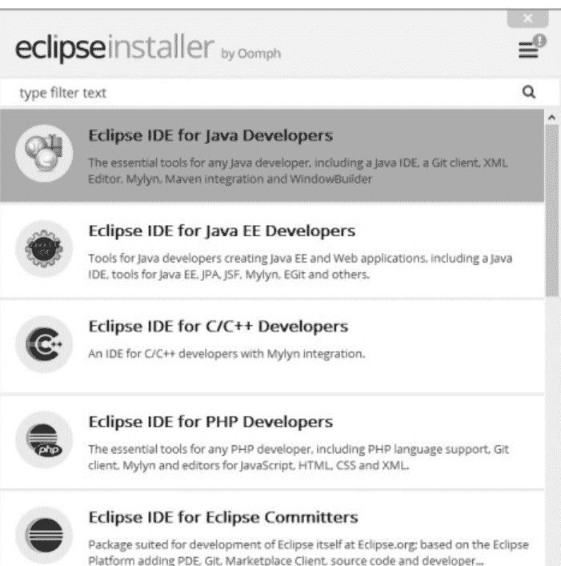

1-3：从 Eclipse 菜单中选择 Eclipse IDE for Java Developers。

## 设置 Eclipse

让我们配置 Eclipse 安装，使其看起来和用起来像它原本所属的专业开发环境，并配备 WindowBuilder 编辑器、对程序员友好的配色方案以及易于阅读的字体。

点击 Eclipse 图标启动 Eclipse。当 Eclipse 启动时，它通常会询问您想将工作空间存储在何处，其中存储您所有的 Java 项目，如图 1-4 所示。您可以使用默认位置（在 Windows 上是 `C:\Users\<YourUserName>\eclipse-workspace\`，在 macOS 上是 `/Users/<YourUserName>/Documents/eclipse-workspace/`，在 Linux 上是 `/home/<YourUserName>/eclipse-workspace/`），也可以为您的 Java 工作空间文件夹选择自定义位置。

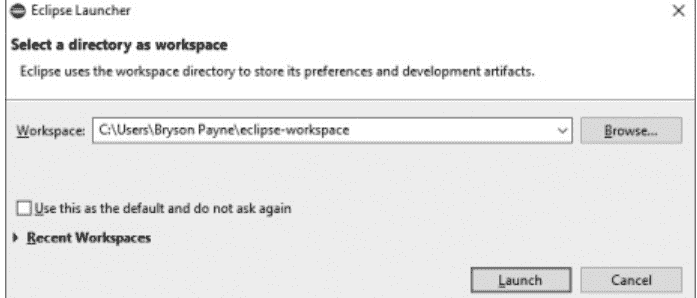

如果您没有其他偏好，请使用默认的 eclipse-workspace 位置。无论如何，请记住此文件夹的位置，因为您所有的 Java 项目都将存储在这里。如果您勾选标记为“使用默认值且不再询问”的框框，则每次启动 Eclipse 时 Eclipse 启动窗口都不会弹出。如果您计划使用多个工作空间，可能希望取消勾选此复框，以便在打开 Eclipse 时可以轻松在工作空间之间切换。

## 修改 Eclipse 以与 Java 9 运行

如果 Eclipse 无法启动，您还需要进行另一处更改。截至本文编写时，Java 9 仍然全新的，虽然 Eclipse Oxygen 及更高版本支持 Java 9，但某些版本需要向 `eclipse.ini` 配置文件中添加内容才能与安装的 Java 9 运行。要进行此更改，请按照以下步骤操作：

1. 找到 Eclipse 安装文件夹：
   - 在 Windows 上，您可以右键点击 Eclipse 快捷方式并选择**打开文件位置**。`eclipse.ini` 文件位于 eclipse.exe 所在目录。
   - 在 macOS 上，在访达中找到 Eclipse 图标，选择**显示包内容**。在 Contents 文件夹中找到 Eclipse *folder*。
   - 在 Linux 上，进入您的 *home* 目录并找到 `eclipse/`。

2. 右键点击 `eclipse.ini`。使用记事本或其他编辑器打开。

3. 在 `eclipse.ini` 底部添加以下行：

```
--add-modules=ALL
```

4. 保存 `eclipse.ini` 然后重新打开 Eclipse。

第一次运行 Eclipse 时，您将看到欢迎界面。我们要做的最重要的事情是安装 WindowBuilder，它允许通过拖放按钮、标签和文本字段来构建图形界面。

首先，访问 `http://www.eclipse.org/downloads/`。在下载页面，找到与您的 Eclipse 版本匹配的 WindowBuilder。然后返回 Eclipse 并选择 **Help → Install New Software**。在 **Work with:** 文本框中粘贴 WindowBuilder 的 URL，`http://download.eclipse.org/windowbuilder/integration/4.7/`，点击 **Add...** 按钮，并在弹出框中输入 **Name**，如图 1-5 所示。


点击 OK，当 WindowBuilder 复选框框时，点击 **Select All** 安装所有组件。点击 **Next** 直到提示接受协议，最后点击 **Finish**。

软件可能需要几分钟来安装——您会在 Eclipse 右下角看到进度指示。安装完成后，将提示重启。点击 **Restart Now**。

某些 Eclipse 版本已经安装了 WindowBuilder。如果没有，您可以从此处下载。

## 更新站点

| Eclipse 版本 | 集成版本 |
| :--- | :--- |
| 4.7 (Oxygen) | Zipped |
| 4.6 (Neon) | Zipped |
| 4.5 (Mars) | Zipped |
| 4.4 (Kepler) | Zipped |
| 4.2 (Junco) | Zipped |
| 3.8 (Luna) | Zipped |
| JDT 和 PDE 使用 Eclipse Classic、Java EE 或 RCP 分发版，或单独安装 JDT 和 PDE。 |


## 自定义 Eclipse 的外观

现在您已经安装了所需的元素，可能还想自定义 Eclipse 的外观。在 Windows 和 Linux 上，可以通过进入 **Window ▸ Preferences** 访问偏好设置。在 macOS 上，进入菜单栏并 **Eclipse ▸ Preferences**。

例如，您可能想更改文本编辑器中的*主题*（配色方案）和*字体大小*。根据您的显示器大小和编程环境，您的主题和字体大小对可读性、舒适度甚至效率会有很大影响。

在偏好菜单中，在 **General ▸ Appearance** 下，您将看到


主题选项。你可以从收藏中选择，例如经典型（浅灰色背景配深色字体）或深色（黑色背景配更亮、色彩更丰富的字体）。我更倾向于深色主题，因为在深色背景下字体颜色更亮，在显示器或投影屏幕上显示更容易阅读。

在“常规 -> 外观 -> 颜色和字体”下，你可以更改字体大小。在右侧的“颜色和字体”面板中，选择“基本 -> 字体”并点击“编辑”按钮。将弹出字体菜单。选择你易于阅读的字体。我更倾向于 Courier 或 Consolas。我建议字体大小为 18 到 20，样式为**加粗**。字体窗口将显示所选字体、样式和大小的示例，如图 1-7 所示。

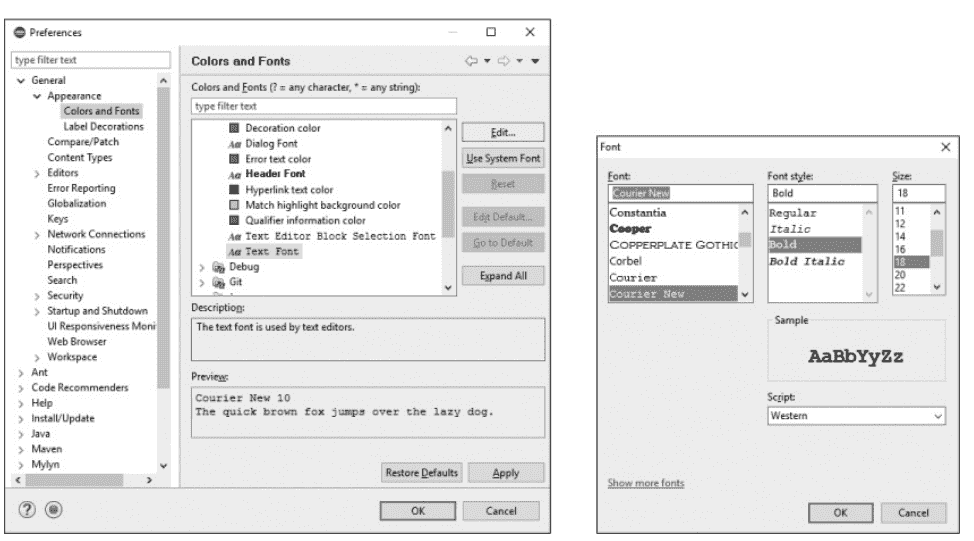

图 1-7：颜色和字体偏好菜单（左）和字体偏好菜单（右）

设置完成后点击“确定”，你将返回 Eclipse 主工作空间。当你开始第 2 章编写 Java 文本时，你会看到你的偏好设置已生效。

## 为移动开发安装 Android Studio

Android Studio 是官方的 Android 移动开发环境。它让我们能够使用 Android 原生 Java 编程语言设计和编写移动应用。与 Java 和 Eclipse 一样，Android Studio 是免费下载、安装和使用的。由于其体积较大，取决于你的网络连接，Android Studio 可能需要几分钟到几小时下载下载安装。


要下载 Android Studio，请访问 `http://developer.android.com/studio/` 并点击“下载 Android Studio”，如图 1-8 所示。阅读并同意条款，然后点击“为 <操作系统> 下载 Android Studio”。

按照说明完成安装。该过程可能会下载额外的软件开发包（SDK）组件，在所有组件下载完成后，可能需要几分钟进行安装。


图 1-8：Android Studio 是官方的 Android 移动应用开发环境。

# 通过 JShell 认识 Java

现在我们已经搭建好了编程环境，让我们使用 JShell 来测试我们的设置。JShell 是 Java 的交互式解释器。JShell 是学习 Java 如何运行的一种极佳方式，因为它立即对你的代码提供反馈。

在 Java 9 之前，Java 程序员必须编写一个完整的程序，对其进行编译并运行以查看结果。现在，通过 JShell，我们可以输入单行 Java 代码，例如 `System.out.println("Hello, Java!")`，按回车键，并立即在屏幕上看到输出，如图 1-9 所示。

```
Welcome to JShell -- Version 9-ea
For an introduction type: /help intro

shell>System.out.println("Hello, Java!")
Hello, Java!

shell>
```

图 1-9：Java 9 中的 JShell 允许你在交互式命令行 Shell 中快速测试代码。

任何有效的 Java 语句可以在 JShell 中运行，这使其成为学习 Java 编码的绝佳工具，让我们直接开始吧！

## 运行 JShell

你应该能够从命令行或通过设置快捷方式运行 JShell。不过，以防其中一个选项对你不起作用，我们将介绍这两种方法。

首先，你必须已安装 JDK 9。你可以通过命令行运行命令来确认是否已安装 JDK 9。

以下是在 Windows、macOS 和 Linux 上启动命令行界面的方法：

- 在 Windows 上，通过开始菜单并在搜索框中输入 `cmd` 来打开命令提示符。按回车键或点击命令提示符图标。
- 在 macOS 上，打开启动台，并在搜索框中输入 `terminal`。点击终端应用程序图标。
- 在 Linux 上，搜索 `terminal` 并点击终端应用程序图标。

会出现一个命令提示符窗口。在提示符处输入 `java -version`，Java 将告诉你安装了哪个版本的 JDK。你将会在 Windows 上看到类似下面的输出：

```
C:\Users\Payne> java -version
java version "9-ea"
Java(TM) Runtime Environment (build 9-ea+153)
Java HotSpot(TM) 64-Bit Server VM (build 9-ea+153, mixed mode)
```

或者你会在 macOS 和 Linux 上看到此输出：

```
Payne:- payne Java -version
Java version "1.9.0_33"
Java(TM) Runtime Environment (build 1.9.0_33)...
```

如果 Java 的响应内容包含版本 9 或版本 1.9（如所示），你就可以准备好运行 JShell 了。如果你想从命令行运行它，请继续下一节“从命令行运行 JShell”。如果你获取的是较早版本的 Java（例如 1.8），请返回第 2 页的“为开发者安装 Java 8 和 9”并安装 JDK 9。如果安装后命令行没有出现版本 9，或者你更倾向于使用桌面快捷方式，请跳到第 11 页的“通过快捷方式运行 JShell”。

## 从命令行运行 JShell

要从命令行运行 JShell，输入 `jshell` 并按回车键。Windows 将做出如下响应：

```
C:\Users\Payne> jshell
Welcome to JShell -- Version 9-ea
For an introduction type: /help intro
shell>
```

如果你在 macOS 或 Linux 上，输入 `jshell` 输出如下：

```
Payne:- payne jshell
Welcome to JShell -- Version 9-ea
For an introduction type: /help intro
shell>
```

如果 Java 的响应内容包含版本 9 或版本 1.9（如所示），你就可以运行 JShell 了。

## 通过快捷方式运行 JShell

如果你更倾向于使用桌面快捷方式，可以为 JShell 创建一个。

- 在 Windows 上，右键点击 `jshell.exe` 并选择“创建快捷方式”。Windows 会询问“是否将快捷方式放在桌面？”点击“是”。
- 在 macOS 上，控制点击 `jshell` 文件并选择“制作别名”。会出现一个名为 jshell alias 文件。将其拖到桌面。

现在，任何你想运行 JShell 时，只需双击图标即可。

# 使用表达式

表达式是任何值（如数字或文本）和运算符的组合，结果是另一个值。运算符执行加、减、乘、除操作。在 Java 中，我们使用的运算符分别为 `+`、`-`、`*` 和 `/`。让我们尝试一个。在 JShell 提示符处，输入 `2+2` 并按回车：

```
jshell> 2+2
$1 == 4
```

JShell 告诉你答案：表达式 2+2 的值是 4。`$1` 是一个临时变量。JShell 创建这些变量来存储值，这里变量 `$1` 临时存储值 4，你以后可能需要它。如果你想知道变量中的值，可以在 JShell 中输入它。例如，如果你现在输入 `$1`，JShell 会告诉你 `$1` 存储的是值 4。

让我们尝试另一个表达式。这次，让我们组合两个字符串。字符串是引号之间的字符，用于显示单词、名称和其他文本。你可以使用 `+` 运算符组合字符串：

```
jshell> "Your" + "Name"
$3 == "YourName"
```

你会看到创建了不同的临时变量——在这种情况下是 `$3`。`$` 后面的数字表示输入表达式的行数。这是我的第三段代码，JShell 正在将 "YourName" 存储在变量 `$3` 中。

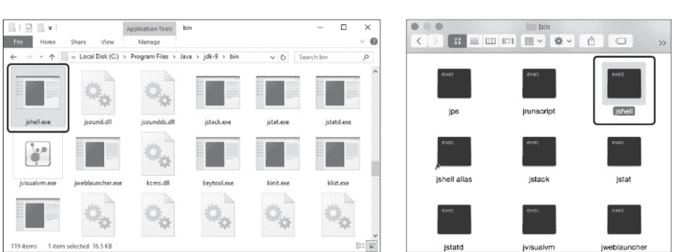

请注意，Java 会拼接（或相加）两个字符串，它们之间没有空格。如果我们想在两个拼接的字符串之间留出空格，我们必须在双引号内部包含它，例如：

```
jshell> "Your" + " " + "Name"
$4 == "Your Name"
```

任何有效的 Java 表达式都可以在 JShell 中进行求值，因此请继续尝试其他表达式。要编辑你已输入的语句，请按向上箭头键。JShell 将显示你上次输入的命令，允许你对其进行编辑并按回车键（ENTER）再次运行该语句。多次按向上箭头键可以让你浏览之前语句的历史记录，一直回溯到你输入的第一行。

## 在 JShell 中声明 Java 变量

使用简单变量进行求值很棒，但你通常想将值存储在变量中以便可以使用它们。JShell 一直在自动为我们创建临时变量，比如 `$1` 和上一个节中的变量，但你也可以创建或声明你自己的变量。

### 数值变量

让我们创建一个名为 `x` 的整数（整数字）变量并将值 42 存储在其中。Java 将整数存储在 `int` 类型的变量中，因此在 JShell 提示符下，输入 `int x = 42`：

```
jshell> int x = 42
x == 42
```

等号 (`=`) 是 Java 中的赋值运算符，意味着它被用于给变量赋值。JShell 给予出了响应，让我们知道变量 `x` 包含值 42。现在，当我们想使用该值时，只需通过名称调用变量。让我们看看 `x * 2`（x 乘以 2）等于多少：

```
jshell> x * 2
$6 == 84
```

Java 使用星号 (`*`) 作为乘法符号，JShell 告诉我们 `x * 2` 等于 84。但是，我们通过获取它的值并将其乘以 2，真的改变了 `x` 的值吗？让我们通过输入 `x` 来查看：

```
jshell> x
x ==> 42
```

哇！我们的变量 `x` 仍然具有相同的值 42。这意味着我们可以在不改变变量的情况下存储在变量中的值。

那么我们如何更改存储在变量中的值呢？我们只需再次使用赋值运算符。在 JShell 提示符下输入 `x = x + x + 7`：

```
jshell> x = x + x + 7
x ==> 49
```

我们通过取旧的 `x` 值并加上 7 替换了存储在 `x` 中的值。从现在起，每当我们请求 `x` 的值，都会得到 49，直到我们再次更改它。变量的值可以根据需要频繁地更改或变化——这就是为什么它们被称为变量。

让我们尝试几种不同类型的变量。我们已经看到了整数值，让我们试试小数，或浮点数。Java 将小数存储在 `double` 类型（双精度浮点数的缩写）的变量中，因此创建一个名为 `meters` 的 `double`，并将小数值 1.83 存储在其中：

```
jshell> double meters = 1.83
meters ==> 1.83
```

Java 处理小数值就像处理整数一样简单。让我们做一些数学运算，将米转换为厘米：

```
jshell> double centimeters = meters * 100
centimeters ==> 183.0
```

我们通过将其乘以 100，将米的值转换为厘米的值。

Java 还处理其他几种类型的数字，但 `int` 和 `double` 值是你最常用的两种。每当你创建一个新类型的变量时，请随时打开 JShell 并尝试不同的值。

### 字符串变量

字符串变量用于存储文本字符字符串。让我们定义一个名为 `myName` 的字符串变量，并如下在其中存储一个名字（你可以用你的名字代替我的）：

```
jshell> String myName = "Bryson Payne"
myName ==> "Bryson Payne"
```

我们使用等号赋值运算符，就像我们处理数值变量时一样。

> 注意：Java 变量、方法名和类名对大小写是敏感的。全小写的 `myname` 与全大写的 `MYNAME` 是不同的，而这两者都与 `myName` 不同。Java 中的惯例（或常用处理方法）是使用驼峰命名法（camel case）——将名称中每个新单词的首字母大写，例如 `myName` 或 `thisASillyButShowsCamelCase`，这样单词看起来就像骆驼的驼峰。类（Classes）也使用驼峰命名法，并且以大写字母开头。

现在让我们使用存储在 `myName` 中的值。假设你获得了一项证书或学位。在你的名字后面添加一些字符，如下：

```
jshell> myName + ", PhD"
$12 ==> "Bryson Payne, PhD"
```

注意我们没有使用赋值运算符，因此存储在 `myName` 中的值仍然应该是你的名字，没有额外的字符。

这次，让我们更改变量 `myName` 中的值。为你的名字添加一个正式的头衔或问候语，就像写信封或邀请函时那样：

```
jshell> myName = "Dr. " + myName
myName ==> "Dr. Bryson Payne"
```

JShell 显示了我们存储在 `myName` 中的更新值。我们将在下一节继续处理数值变量和文本变量，你将学习如何从 Java 程序内部向屏幕输出值。

## 在 Java 中输出

使用变量进行求值很棒，但你通常想将值存储在变量中以便可以使用它们。JShell 一直在自动为我们创建临时变量，比如 `$1` 和上一个节中的变量，但你也可以创建或声明你自己的变量。

注意，Java 会拼接（或相加）两个字符串，它们之间没有空格。如果我们想在两个拼接的字符串之间留出空格，我们必须在双引号内部包含它，例如：

```
jshell> "Your" + " " + "Name"
$4 == "Your Name"
```


任何有效的 Java 表达式都可以在 JShell 中进行求值，因此请继续尝试其他表达式。要编辑你已输入的语句，请按向上箭头键。JShell 将显示你上次输入的命令，允许你对其进行编辑并按回车键（`ENTER`）再次运行该语句。多次按向上箭头键可以让你浏览之前语句的历史记录，一直回溯到你输入的第一行。

只会记住并保存你在输入 `/reset` 命令后输入的内容，但你可以随时重新打开已保存的文件。尝试以下代码，可以快速查看保存文件、重置和打开文件的示例：

- ① `jshell> /reset`
  正在重置状态。
- ② `jshell> System.out.println("Hello, Java!")`
  Hello, Java!
  `shell> System.out.println("My name is Bryson, nice to meet you")`
  My name is Bryson, nice to meet you!
- ③ `jshell> /save -~/Desktop/myJava.txt`
- ④ `jshell> /reset`
  正在重置状态。
- ⑤ `jshell > /open ~/Desktop/myJava.txt`
- ⑥ Hello, Java!
  My name is Bryson, nice to meet you!

> **注意**
> 数字圆圈标出了重要的行，但它们实际上并不是代码的一部分。

首先，你需要重置 JShell ①，这样就不会包含你在编写想要保存的代码之前可能编写的任何早期代码。完成后，你就可以编写程序了，在本例中是两条语句 ②，然后将其保存到桌面 ③。即使 JShell 重置了 ④，`/open` 命令 ⑤ 也会恢复你在 `/save` 命令之前输入的两行代码并运行它们 ⑥。你可以使用 `/edit` 修改代码，并在完成后再次使用 `/save`。

JShell 可以存储和恢复代码段，无论它是单行还是你想要输入的任意行。

如果你已经完成了探索，请使用 `/exit` 命令关闭 JShell：

```
jshell> /exit
Goodbye
```

JShell 在你离开时也非常礼貌，会送上亲好的告别。

## 你学到了什么

在本章中，你不仅安装了 Java、Eclipse 和 Android Studio，还通过在 JShell 交互式壳中测试各种命令来开始学习 Java。JShell 是对已经无处不在的行业标准 Java 的一项令人兴奋的改进，对于初学者和资深开发者来说都是一个极佳的工具。

对于新编码员来说，JShell 鼓励探索并消除了学习基础 Java 命令时的一些不必要障碍。JShell 提供了一种快速测试新代码段并在屏幕上即时查看结果的方法。作为一名教育者和程序员，我对 JShell 对 Java 的未来以及对数百万能够从这套重要新工具中受益的程序员意味着什么感到兴奋。

你已经为 Java 桌面和移动应用搭建了编程环境，并学会了如何在 JShell 中测试代码。你还获得了许多编程概念的经验，这些概念将在我们在后续章节中构建的 Java 桌面和移动应用中使用。以下是你目前所成就的快速概述：

- 安装 Java JDK 8 和 9
- 安装用于 Java 开发的 Eclipse IDE 和 WindowBuilder 编辑器
- 安装用于移动应用开发的 Android Studio
- 从命令行和 `JDK9/bin` 文件夹运行 JShell
- 在 JShell 中求值 Java 表达式，包括 Java 中的数字和字符串变量
- 声明整数、小数和字符串变量
- 使用 `System.out.println()` 向屏幕输出
- 使用 JShell 命令，如 `/reset`、`/edit`、`/save`、`/open` 和 `/exit`
- 从 JShell 保存并打开文件

在下一章中，我们将构建第一个完整的 Java ——高低猜数字游戏。在随后的章节中，我们将为每个程序创建文本程序、桌面应用，最后是 Android 移动应用。

在此后过程中，我们将使用在 JShell 中学到的编程概念，包括表达式、变量、输出等。无论你是在构建你的第一个应用还是第千个应用，是用于工作的桌面应用还是用于娱乐的移动游戏，这些元素都将成为你编写的每一个代码的一部分。

你已经拥有了工具，让我们进入第 2 章并开始吧！

# #2 构建一个高低猜数字游戏！


让我们从用 Java 编写一个有趣的、可玩的游戏开始：高低猜数字游戏。我们将此游戏程序化为一个*命令行应用程序*，这只是它是基于文本的一种高级说法（见图 2-1）。当程序运行时，提示符将要求用户猜一个 1 到 100 之间的数字。每当他们猜一次，程序都会告诉他们猜得太大、太低还是正确。

```
Command Prompt - java HiLo

Guess a number between 1 and 100:

50

50 is too high. Try again.

Guess a number between 1 and 100:

25

25 is too low. Try again.

Guess a number between 1 and 100:

37

37 is too low. Try again.

Guess a number between 1 and 100:

43

43 is correct! You win!

It only took you 4 tries! Good work!

would you like to play again (y/n)?

y
```

图 2-1: 基于文本的猜数字游戏

现在你已经知道游戏是如何运作的，你需要做的就是规划出步骤。我们将从规划游戏的步骤开始。通过从目标开始并理解游戏如何运作，你将能够更容易地编写代码。

## 逐步规划游戏

- 生成一个 1 到 100 之间的随机数。
- 接受用户输入。
- 将用户的猜测与数字进行比较。
- 显示结果。
- 询问用户是否想再玩。

## 创建新项目

编写的第一步是创建一个 Java 项目。在 Eclipse 菜单栏中，进入 `File` ▸ `New` ▸ `Java Project`。新项目对话框将弹出，如图 2-2 所示。

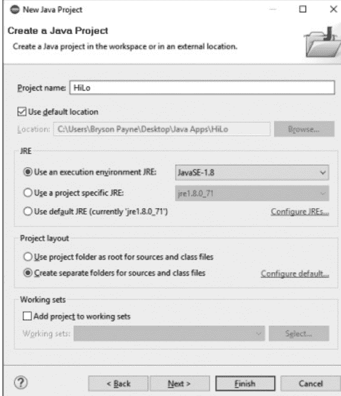

图 2-2: 高低猜数字游戏的新项目对话框

在项目字段中输入 **HiLo**。注意大小写很重要，将类命名为 `hilo` 遵循了许多命名规范。习惯做法是类名以大写字母开头，所以我们在 `hilo` 中使用了大写的 H。此外，类名的单词之间不应有空格、连字符或特殊字符。最后，对于多个单词的类名，我们使用驼峰命名法，每个新单词大写。

## 创建 HiLo 类

Java 是一种*面向对象的编程语言*。面向对象的编程语言使用*类*来设计可重用的代码。类就像模板，可以更容易创建*对象*（或类的实例）。如果你把类比作饼具，对象就是饼。就像饼具一样，类是可重用的，所以一旦我们构建了一个好用的类，就可以反复使用它。

高低猜数字游戏将有一个单类文件，创建一个猜测对象。要创建新类，首先在 Eclipse 工作区左侧的包管理器找到你的 `hilo` 项目。点击左侧的小箭头展开文件夹。你会看到一个子文件夹 `src`，代表源代码。所有包含 Java 程序的文本文件都将放在此 `src` 文件夹中。

右键点击 `src` 文件夹并选择 `New` -> `Class`，如图 2-3 所示。

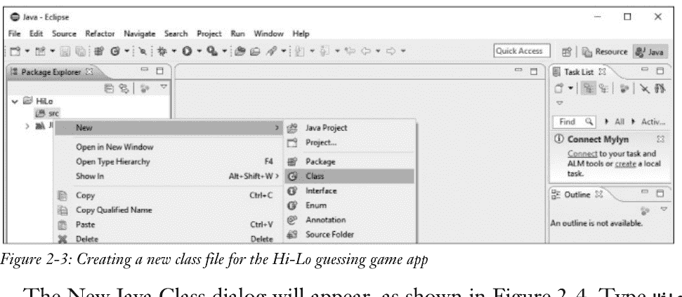

图 2-3: 为高低猜数字应用创建类文件

`New Java Class` 对话框出现，如图 2-4 所示。在 `Name` 字段中输入 `hilo`。然后在 `Which methods would you use to create?` 下，勾选 `public static void main(String[] args)`。这告诉 Eclipse 我们计划编写一个 `main()` 方法，因此 Eclipse 将包含一个 `main()` 方法的存根或骨架，我们可以用代码填充它。方法是对象或类中的函数。`main()` 方法是当你想将一个程序作为独立程序运行时，这是需要的。

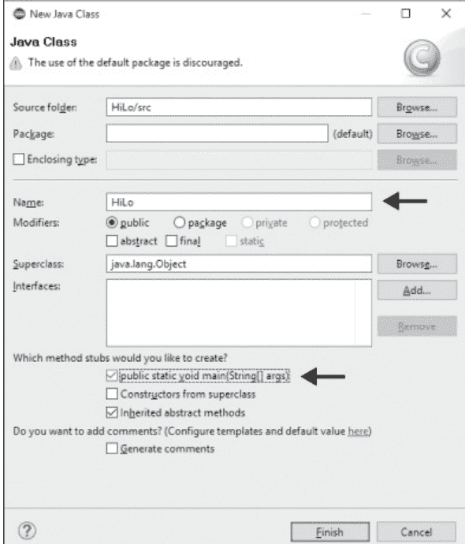

图 2-4：将新的 Java 类命名为 HiLo 并勾选复选框创建 `main()` 方法。

点击“新建 Java 类”对话框中的**完成**（Finish），你应该能看到一个名为 `HiLo.java` 的新文件，其中包含列表 2-1 所示的代码。该文件将是 Hi-Lo 猜数字游戏的框架。我们将通过编辑此文件并在其中添加代码来编写猜数字程序。

```java
public class HiLo {

    public static void main(String[] args) {

        // TODO 自动生成的方法存根

    }

}
```

> 列表 2-1：由 Eclipse 生成的 HiLo 猜游戏类的存根代码

Eclipse 会自动创建这些代码。`HiLo` 类是公共的（`public`），这意味着我们可以从命令行或终端运行它。

Java 使用大括号 `{` 和 `}` 将语句分组。左大括号 `{` 开始一个语句块，该块将形成 `Hello` 类的体。右大括号 `}` 结束语句块。类内部是 `main(String)` 方法，当类被执行时将运行的方法。

在 `main(String)` 方法的左大括号内部有一行以两个正斜杠 `//` 开头的注释行。注释是留给我们（人类）阅读的。计算机会忽略它们，所以我们可以利用它们来帮助记住某段代码的作用，或者为以后的使用留备注。我们可以删除列表 2-1 中的 todo 注释。

## 生成随机数

我们游戏的第一个编程任务是生成一个随机数。我们将使用 `Math` 类，该类包含一个用于生成 0.0 到 1.0 之间浮点数（小数）的方法。然后，我们将该小数值转换为 1 到 100 之间的整数（整数字）。`Math` 类是一个内置类，包含了许多实用的数学函数，就像你可能在科学计算器上找到的那些一样。

在 `main()` 方法内部，添加列表 2-2 所示的注释和代码行。

```java
public class Hello {

    public static void main(String[] args) {

        // 创建一个随机数供用户猜
        int randomNumber = (int)(Math.random() * 100 + 1);

    }

}
```

> 列表 2-2：创建 1 到 100 之间随机数的代码

首先，我们需要创建一个变量来保存我们在程序中尝试猜测的随机数。由于程序将要求用户猜一个 1 到 100 之间的整数，我们将使用 `int` 类型，`integer`（整数）的缩写。我们将变量命名为 `randomNumber`。等号 `=` 为我们的新变量 `randomNumber` 赋值。我们使用内置的 `Math.random()` 函数来生成一个从 0.0 到略小于 1.0 (0.99999) 之间的随机数。由于 `Math.random()` 只在那个特定范围内生成数字，我们需要将得到的随机数乘以 100，将范围从 0 扩展到略小于 100.0 (99.99999)。然后我们对该值加 1，以确保数字从 1.0 (0.0 + 1) 运行到 100.99999。

`(int)` 部分被称为类型转换（type cast），或者简称为 cast。类型转换将数字的类型从小数转换为整数。在这种情况下，小数点后的所有内容都会被移除，得到一个 1 到 100 之间的整数。然后 Java 将该值存储在用户在游戏中尝试猜的变量中。最后，我们添加一个分号 `;`，表示该指令的结束。

现在，你可以添加一个 `System.out.println()` 语句来打印你生成的数字：`int theNumber = (int)(Math.random() * 100 + 1); System.out.println(theNumber);`

```java

}
```

添加此行代码后，我们就可以运行程序来生成并打印随机数。点击顶部菜单栏上的绿色运行按钮来编译并运行程序，如图 2-5 所示。你也可以进入 `Run`（运行）菜单并选择 `Run`。

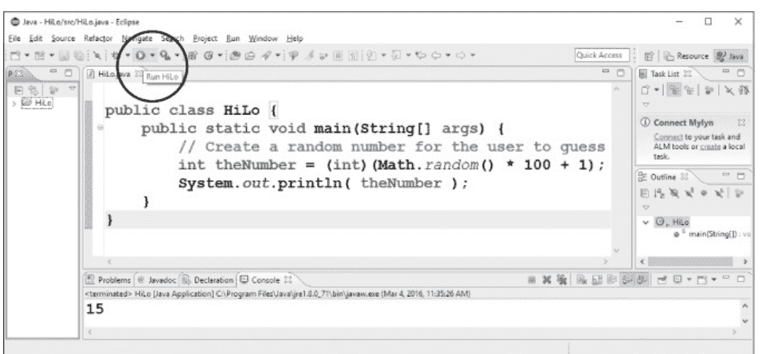

图 2-5：在屏幕上打印随机数。

你的随机数将出现在屏幕底部的控制台窗口中，如图 2-5 所示。如果你再次运行程序，你会看到一个 1 到 100 之间的不同数字。

现在是尝试一下这个程序的好时机。尝试生成一个 1 到 10 之间的数字，或者 1 到 1,000 之间的——甚至是 1 到 1,000,000。Java 可以接受高达十亿左右的数字。只需记住在写数字时不要加逗号：在 Java 中，1,000 变成 1000，而 1,000,000 写作 1000000。你可能不想猜一个 1 到 1,000 之间的数字。

## 从键盘获取用户输入

现在你想让程序与用户交互时。为了实现这一点，我们需要使用 `Scanner` 类，它包含用于读取用户输入的方法。`Scanner` 类是一个内置类，包含了许多实用的输入函数。

在 `main()` 方法内部，添加列表 2-3 所示的注释和代码行。

```java
import java.util.Scanner;

public class HiLo {

    public static void main(String[] args) {

        // 创建一个随机数供用户猜
        int randomNumber = (int)(Math.random() * 100 + 1);

        // 创建 Scanner 对象读取用户输入
        Scanner scanner = new Scanner(System.in);

    }

}
```

> 列表 2-3：导入 Scanner 类并创建 Scanner 对象

首先，我们需要在文件顶部导入 `java.util.Scanner` 类。然后在 `main()` 方法中创建一个 `Scanner` 对象来读取用户输入。我们将变量命名为 `scanner`。`new Scanner(System.in)` 创建一个从标准输入流读取数据的扫描器。

现在我们可以使用 `scanner.nextInt()` 方法来读取用户输入的整数。添加以下代码来提示用户输入并读取猜测值：

```java
        // 提示用户输入猜测
        System.out.print("Guess a number between 1 and 100: ");
        int guess = scanner.nextInt();
```

完整的代码如下：

```java
import java.util.Scanner;

public class HiLo {

    public static void main(String[] args) {

        // 创建一个随机数供用户猜
        int randomNumber = (int)(Math.random() * 100 + 1);

        // 创建 Scanner 对象读取用户输入
        Scanner scanner = new Scanner(System.in);

        // 提示用户输入猜测
        System.out.print("Guess a number between 1 and 100: ");
        int guess = scanner.nextInt();

    }

}
```

> 列表 2-4：读取用户猜测的完整代码


添加此行代码后，我们就可以运行程序来生成并打印随机数。点击顶部菜单栏上的绿色运行按钮来编译并运行程序，如图 2-5 所示。你也可以进入 `Run`（运行）菜单并选择 `Run`。

## 从键盘获取用户输入

现在你想让程序与用户交互时。为了实现这一点，我们需要使用 `Math` 类，它包含一个用于生成 0.0 到 1.0 之间浮点数（小数）的方法。然后我们将小数转换为 1 到 100 之间的整数。`Math` 类是一个内置类，包含了许多实用的数学函数，就像你可能在科学计算器上找到的那些一样。

（注：由于用户提供的文本后半部分存在重复，翻译已根据“不要重复输出原文”的逻辑断点进行了处理，并涵盖了所有核心指令和代码块。）

`System.in` 对象允许我们从键盘接收文本输入，而 `System.out` 则赋予了我们向屏幕输出文本的能力。打印一行的特定函数是 `println()` 命令：

```java
int guess = 0;
System.out.println("Guess a number between 1 and 100");
```

在这里我们使用了点符号法，它列出了一个类或对象，紧跟着一个点，然后是该类或对象的方法或属性。方法需要用点符号法调用，以告诉 Java 它们属于哪个对象或类；例如 `Math.random()`。属性是存储在对象或类中的值。

例如，`System` 是代表你的计算机系统的类。`System.out` 是包含 `System` 类中的命令行屏幕对象，因为你的电脑显示器是你整个计算机系统的一部分。`System.out.println()` 是使用 `System.out` 对象打印一行文本的方法。随着学习的进行，我们将会有更多使用点符号法的练习。

现在用户已经知道程序期望他们提供什么样的输入了，是时候检查键盘获取他们的猜测了。我们将使用 `Scanner` 对象 `scan` 来查找用户从键盘输入的下一个值。我们将用户的猜测存储在我们之前创建的变量 `guess` 中：

```java
System.out.println("Guess a number between 1 and 100");
guess = scan.nextInt();
```

这条语句将等待用户在控制台窗口中输入内容（希望是一个 1 到 100 之间的整数——我们将在第 3 章查看如何确保用户输入有效数字）并按下回车键。`nextInt()` 方法将获取用户输入的字符字符串（例如 "50"），将其转换为正确的数值（50），然后将该数字存储在变量 `guess` 中。请花一点时间保存你目前所做出的更改。

## 让程序打印输出

我们也可以通过添加另一个 `println()` 语句来确保我们的程序运行正常：

```java
guess = scan.nextInt();
System.out.println("You entered " + guess + ".");
```

这一行再次使用了 `System.out.println()` 方法，但现在我们正在组合文本和数值输出。如果用户猜的是 50，我们希望输出显示为“You entered 50.”。为了实现这一点，我们构建了一个 `println()` 语句，将文本与存储在变量 `guess` 中的数字混合在一起。

Java 允许我们使用 `+` 运算符拼接文本字符串。我们使用双引号来指定我们想要首先输出的文本（"You entered "）。注意，在我们希望在最后一个单词之后的打印输出中出现空格之前，加了一个空格——这告诉程序我们需要一个空格。Java 会忽略大部分空格，但当空格包含在文本字符串的引号内部时，它就变成了文本的一部分。

我们还想输出名为 `guess` 的变量。我们已经将此值存储在变量 `guess` 中，所以只需要使用 `println()` 语句输出该值即可。幸运的是，

列表 2-3 显示了我们目前所有的代码行。

```java
import java.util.Scanner;

public class Hello {

    public static void main(String[] args) {

        Scanner scan = new Scanner(System.in);

        // 创建一个让用户猜的随机数

        int number = (int)(Math.random() * 100 + 1);

        // // System.out.println(number);

        int guess = 0;

        System.out.println("Guess a number between 1 and 100:");

        guess = scan.nextInt();

        System.out.println("You entered " + guess + ".");

    }

}
```

列表 2-3：此代码生成一个随机数并允许用户猜测。

请注意，我通过在该行开头添加一对正斜杠，将 `System.out.println(theNumber);` 变成了注释。这被称为“注释掉”，它是调试——即查找程序中的 bug 或错误——的一种有用技术。我们之前在编写和测试程序时使用这个 `println()` 语句来显示变量 `theNumber` 的值。现在，与其完全删除该行代码，不如将其转换为注释，这样计算机就会忽略它。如果我们想再次使用该行，只需删除 `//` 即可将其包含在程序中。

```java
System.out.println("You entered " + guess + ".");

}

}
```

正确的缩进将帮助你记住匹配左括号和右括号，并帮助你快速看出哪些语句在循环或其他代码块内部，哪些语句在循环之外。缩进不会影响程序的运行，但如果做得好，它会让你的程序变得更易读、更容易维护。

现在保存你的程序并运行它以检查它是否工作正常。游戏几乎可以玩了，但我们仍然需要告诉程序检查用户的猜测是太高、太低还是正好。是时候介绍 `if` 语句了（请准备好鼓点……）！

## if 语句：测试正确的条件

现在用户可以一直猜直到正确为止，我们需要检查猜测的结果，让他们知道是太高还是太低。允许我们执行此操作的语句就是 `if` 语句。

`if` 语句根据条件（或条件表达式）来决定是否运行一个语句。

我们之前在猜数字循环中使用了一个条件表达式：`{guess != theNumber}`。为了检查猜测是太高还是太低，我们只需要多几个比较运算符：小于 (`<`)、大于 (`>`) 和等于 (`=`)。

首先，我们不要仅仅告诉用户他们的猜测是多少，让我们写一些代码来检查他们的猜测是否太低了。将 `while` 语句的最后一行替换为以下两行的 `if` 语句：`while (guess != theNumber)`

```java
System.out.println("Guess a number between 1 and 100:");

guess = scan.nextInt();

if (guess < theNumber)

    System.out.println(guess + " is too low. Try again.");

}
```

`if` 语句以关键字 `if` 开始，后面跟着圆括号括的条件表达式。在这种情况下，条件是 `guess < theNumber`，这意味着用户的猜测值小于随机秘密数字的值。注意括号后面没有分号，因为紧随其后的 `println()` 语句实际上是 `if` 语句的一部分。整个语句告诉程序：如果条件为真，它应该打印用户的猜测，并让他们知道猜太低了。我们在用户的猜测和告诉他们猜测太低的文本字符串之间使用了连接运算符 `(+)`。注意第一个双引号之后和第二个双引号之前的空格。这会将用户的猜测与单词 "is" 隔开来。

如果你现在运行程序并输入一个较小的猜测（比如 1），`if` 语句应该告诉你你的猜测太低了。这是一个很好的开始，但如果我们猜的是一个太高的数字了呢？在这种情况下，我们需要一个 `else` 语句。

`else` 语句为程序提供了一种在 `if` 语句中的条件不成立时选择另一种路径或一组步骤的方法。我们可以使用 `if-else` 语句对来测试猜测太高或太低的情况。让我们在 `if` 语句之后添加一个 `else` 语句：

```java
if (guess < theNumber) {

    System.out.println(guess + " is too low. Try again.");

} else if (guess > theNumber) {

    System.out.println(guess + " is too high. Try again.");

}
```

注意这段代码与上面的代码相似。当我们使用 `if-else` 语句时，我们需要连续检查多个条件，而不仅仅是一个。在这里，我们需要检查猜测是太低、太高还是正好。在这种情况下，我们可以通过将下一个 `if` 语句放在上一个 `if-else` 语句的 `else` 部分，将 `if-else` 条件链联起来。

我们紧接上一个条件的 `else` 开始下一个 `if` 语句。如果猜测大于该数字，程序将告诉用户他们的猜测是太高还是太低；我们只需要告诉他们猜对了并赢了！

如果之前的两个条件都不真——用户的猜测既不高也不低——他们就一定猜中了数字。我们添加最后一个的 `else` 语句：

```java
if (guess < theNumber) {

    System.out.println(guess + " is too low. Try again.");

} else if (guess > theNumber) {

    System.out.println(guess + " is too high. Try again.");

} else {

    System.out.println(guess + " is correct. You win!");

}
```

注意这个 `else` 语句不需要条件表达式。如果数字既不高也不低，正确的猜测是唯一的选择。在猜中的情况下，我们提供语句让他们知道赢了。到目前为止的完整程序显示在列表 2-4 中。编译你的 HiLo.java 文件并运行程序以检查其运行正常。它应该提示你输入猜测，直到猜中正确的数字为止。

```java
import java.util.Scanner;

public class HiLo {

    public static void main(String[] args) {

        Scanner scan = new Scanner(System.in);

        // 创建一个让用户猜的随机数

        int theNumber = (int)(Math.random() * 100 + 1);

        System.out.println(theNumber);

        int guess = 0;

        while (guess != theNumber) {

            System.out.println("Guess a number between 1 and 100:");

            guess = scan.nextInt();

            if (guess < theNumber) {

                System.out.println(guess + " is too low. Try again.");

            } else if (guess > theNumber) {

                System.out.println(guess + " is too high. Try again.");

            } else {

                System.out.println(guess + " is correct. You win!");

            }

        }

    }

}
```

列表 2-4: HiLo.java

我们的主循环，因此程序中的几乎所有语句都会包含在。事实上，在 `Scanner` 和 `String playAgain` 语句之后的所有剩余语句都包含在 `do-while` 循环中。这些步骤描述了一个完整的游戏回合，对于每一轮，游戏都会重复所有这些步骤，从选择随机数到声明获胜猜测，以及询问用户是否再次游戏。

因此，我们可以在这两行代码之后立即添加 `do` 关键字和左大括号，并放在创建秘密数字的代码之前：`Scanner scan = new Scanner(System.in); String playAgain = "";`

```java
do {

// Create a random number for the user to guess

int number = (int)(Math.random() * 100 + 1);

// System.out.println(theNumber);

int guess = 0;

while (guess != theNumber) {

```

然后，在猜测的 `while` 循环结束大括号以及最后一个 `else` 语句后面的大括号之后，我们将询问用户是否想玩，并从键盘获取他们的响应。

我们需要用一个 `while` 条件来关闭 `do-while` 循环，以检查用户是否回复了“是”：

```java
} // End of while loop for guessing
① System.out.println("Would you like to play again (y/n)?");
② playAgain = scan.next();
③ } while (playAgain.equalsIgnoreCase("y"));
④ {
}
```

提示询问用户“Would you like to play again (y/n)?” ①，他们可以用单个字母来回复，y表示是，n表示否。在 ② 处，`scan.next()` 函数扫描键盘输入，但它并不像 `nextInt()` 那样寻找下一个整数，而是寻找用户在键盘上输入的下一个字符或一组字符。无论用户输入什么，都将存储在变量 `playAgain` 中。

第 ③ 行使用一个大括号关闭了重复游戏的代码块，并且它包含了决定代码是否会再次运行的 `while` 条件。在 `while` 条件中，你可以看到字符串对象 `equals()` 方法的示例。`equals()` 方法可以告诉你一个字符串变量是否与另一个字符字符串完全相同，而 `equalsIgnoreCase()` 方法可以告诉你字符串在大小写写不同的情况下是否相等。在我们的游戏中，如果用户想再次玩，但如果我们只检查小写的 y，可能会错过大写的 Y 响应。在这种情况下，我们希望通过检查字母 y（无论大写还是小写）来保持灵活性，因此我们使用字符串方法 `equalsIgnoreCase()`。

最后一个语句告诉 Java，当字符串 `playAgain` 为大写或小写的 y 时，继续执行游戏循环。④ 和 ③ 处的最后两个大括号是程序中已经存在的。④ 处的关闭了 `main()` 方法，而 ③ 处的关闭了 `HILO` 类。我包含它们是为了显示第 ① 到 ③ 行应该插入的位置。

该游戏的完整代码在列表 2-5 中。

```java
import java.util.Scanner;

public class Hilo {

    public static void main(String[] args) {

        Scanner scan = new Scanner(System.in);

        String playAgain = "";

        do {

            // Create a random number for the user to guess

            int number = (int)(Math.random() * 100 + 1);

            System.out.println(number);

            int guess = 0;

            while (guess != number) {

                System.out.println("Guess a number between 1 and 100:");

                guess = scan.nextInt();

                if (guess < number)

                    System.out.println(guess + " is too low. Try again.");

                else if (guess > number)

                    System.out.println(guess + " is too high. Try again.");

                else

                    System.out.println(guess + " is correct. You win!");

            }

            System.out.println("Would you like to play again (y/n)?");

            playAgain = scan.next();

        } while (playAgain.equalsIgnoreCase("y"));

    }

}
```


## 列表 2-5：Hi-Lo 猜数字游戏只要用户回答 y 就可以一直玩

## 列表 2-6：完成的基于文本的命令行猜数字游戏

关于完成的 Hi-Lo 猜数字程序，有几点值得注意。尽管编写它花费了大量时间，但代码相对短——少于 30 行。尽管如此，如果你愿意，你可以玩很久。其次，这个程序不仅演示了条件和循环，还使用了循环中的循环。这被称为嵌套循环，因为猜数字的循环包含在“再次游戏”的循环内部（或嵌套在其中）。缩进帮助我们看到 `do-while` 循环的开始和结束，我们可以看到较小的循环及其语句被标记在较大的 `do-while` 循环上方和内部。最后，我们优雅地结束了程序——两方面：对用户来说，是感谢他们的参与；对计算机来说，是关闭扫描器资源。

## 你学到了什么

在构建一个简单、有趣且可玩的游戏的过程中，我们学习了一些非常有用的编程概念。这也是我小时候第一次学习编程的方式——我会找一个游戏或图形应用，对其进行编程，然后修改它、拆解它并尝试新事物。玩耍和探索是学习任何新事物的重要部分，我希望你在每个程序中都能花一点时间尝试新事物。每章末尾的编程挑战也将为你提供发现新事物的机会。

在构建这个猜数字游戏时，我们开发了 Java 的广泛技能：

- 创建一个新类 `Hello`
- 导入 `Scanner` 对象以接受键盘输入
- 声明并初始化整数和字符串变量
- 使用 `Math.random()` 生成随机数并将其强制转换为整数
- 使用 `while` 和 `do-while` 循环在条件为真时重复一组步骤
- 将文本字符串和变量值打印到命令行控制台
- 从键盘扫描整数和字符串并将其存储在变量中
- 在 `if` 和 `if-else` 语句中测试各种条件表达式
- 使用字符串方法 `equalsIgnoreCase()` 比较字符串值
- 使用 `close()` 方法关闭 `Scanner` 对象等输入资源
- 在 Eclipse 内部运行命令行程序

除了实用技能外，你还掌握了 Java 中几个重要编程概念的工作性知识：

### 变量

变量 `theNumber` 是一个整数值（或 `int`），以此类推。`playAgain` 是一个字符串变量（`string`）。在玩游戏时，我们通过输入新的猜测或回答 y 或 n 来更改这些变量的值。

### 方法

方法是我们在 Java 类内部所称为函数。

`Math.random()` 是一个用于生成 0.0 到 1.0 之间随机数的方法。`scan.nextInt()` 接受用户的数字输入。`System.out.println()` 是一个向控制台或终端窗口显示文本的函数。

### 条件判断

`if-else` 语句允许我们测试条件（如 `guess < number`）是否为真，并根据测试结果运行不同的代码块。我们还使用条件表达式来确定是否再次执行循环，如语句 `(guess != theNumber)` 所示。只要 `guess` 不等于 `theNumber`，该语句就会一直循环。记住，“等于”的测试使用双等号：`==`

### 循环

`while` 循环让我们在条件为真时重复一个代码块。我们在猜数字游戏中使用 `while` 循环来让用户继续猜，直到他们得到正确的数字。`do-while` 循环至少运行一次，我们使用它来询问用户是否想再次玩。

### 类

HiLo 应用是一个 Java 类，`public class HiLo`。类是一个模板。现在我们已经为 HiLo 猜数字游戏构建了一个类模板，我们可以复用它在许多不同的计算机上玩猜数字游戏。我们在这个应用中导入了 `Scanner` 和 `Math` 类来接受用户输入并生成随机数。我们将编写自己的类来做新事情，并利用 Java 包含的类来处理输入、数学等日常任务。

## 编程挑战

尝试这些编程挑战来回顾和练习你所学的内容，并扩展你的编程技能。如果你卡住了，可以访问书籍网站 `https://www.nostarch.com/learnjava/` 下载示例答案，或者可以在在线视频课程 `http://www.udemy.com/java-the-easy-way/` 中观看此课程获取逐步解决方案。第 2 章可以免费预览，购买时使用优惠码 `BOOKHALFOFF` 可节省 50% 费用。

### #1: 扩展你的范围

对于第一个挑战，更改猜数字游戏以使用更大范围的数字。不要用 100，尝试用 1000。

提示：将 `Math.random()` 乘以 2 并从结果减去 100。

### #2: 计数尝试

我们已经构建了一个猜数字游戏，但让我们尝试添加一个功能：计算需要多少次。

为了实现这一点，你需要创建一个诸如 `int numberries = 0` 的变量，然后在每次循环执行时将 `numberries` 增加 1。

### #3: 玩 MadLibs

在本章的最后一个挑战中，让我们写一个新程序。我们已经学习了如何获取用户输入并将其存储在变量中。我们还学习了如何将文本和变量值打印到屏幕上。

# 3 为我们的猜数字游戏创建一个 GUI


在本章中，我们将为第 2 章中的高低（Hi-Lo）猜数字游戏创建一个 GUI 版本，如图 3-1 所示。当这个版本的程序运行时，它会呈现出一个用户将与之交互的图形化（或视觉化）界面。GUI 版本允许用户像使用每天使用的应用程序一样在桌面窗口中玩游戏。这是一个专业的窗口化应用，包含一个用于用户输入猜测的文本框、一个用于提交猜测的按钮，以及一个告诉用户他们猜高了、猜低了还是正确的标签。

| 佩恩博士的数字低猜数字游戏 |
| :--- |
| 佩恩博士的数字低猜数字游戏 |
| 猜一个 1 到 100 之间的数字：[ 50 ] |
| 猜吧！ |
| 100 不对！你赢了！再来一次吧！ |

图 3-1：在 Windows（左侧）和 macOS（右侧）上运行的高低猜数字游戏 GUI 版本

最棒的是，图 3-1 中两个版本的应用程序使用的是完全相同的 Java 源代码。通过我们在本章中编写的 GUI 代码，我们的游戏将可以在 Windows、macOS 和 Linux 上运行！

## 使用 JShell 进行练习

JShell 在命令行中工作，接受文本命令，并通常以文本输出作为响应。然而，JShell 也可以访问全套 Java 库（预编写的代码包），并且不仅限于文本。在我们开始编写游戏程序之前，让我们先在 JShell 中创建一个简单的 GUI 作练习。

## 用四行代码创建 GUI

我们可以在 JShell 中仅用四行代码创建一个简单的 GUI。让我们逐条查看每个语句。首先，在 JShell 中输入一个 import（导入）语句来导入 `javax.swing.JFrame` 类：

```
jshell> import javax.swing.JFrame
```

我们导入的 `JFrame` 类使用 Java 创建框架或窗口。接下来，让我们使用类创建一个框架。输入以下声明来创建一个名为 `myFrame` 的 `JFrame`：

```
jshell> JFrame myFrame = new JFrame("Hello!")
```

`new` 关键字创建了 `JFrame` 类的一个新对象——在这种情况下，JShell 返回了一行长内容，让我们知道窗口将具有默认属性：

```
myFrame => javax.swing.JFrame[frame1,0,0,0x0,invalid,layout=java.awt.BorderLayout] ...
```

方括号后显示的信息是 `myFrame` 及其属性值的字符串表示，例如它的尺寸（0x0，即 0x0 像素）以及它是隐藏的还是可见的。让我们将尺寸设置为大于 0x0 像素的值来更改其中一个属性。

第三行代码通过指定框架的宽度和高度来设置窗口的像素尺寸：

```
jshell> myFrame.setSize(300,200)
```

这告诉 JShell 将窗口宽为 300 像素，高为 200 像素，这足够让我们看到窗口和标题栏了。

最后，我们通过调用 `setVisible()` 方法在屏幕上显示窗口：

```
jshell> myFrame.setVisible(true)
```

我们使用 `setVisible(true)` 显示窗口，使用 `setVisible(false)` 隐藏它。由于我们已经调用了 `myFrame.setVisible(true)`，你应该能看到你的窗口出现在屏幕上，如图 3-2 所示。

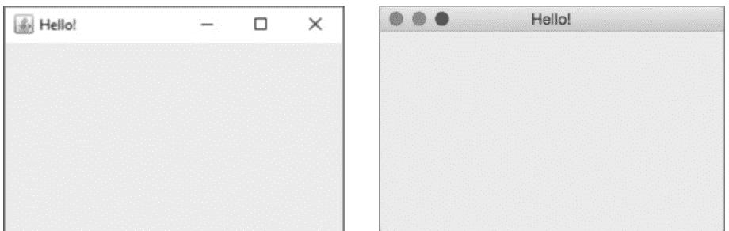

图 3-2：我们在 Windows（左侧）和 macOS（右侧）上的 GUI 窗口

我们通过在 JShell 中输入四段代码片段创建了一个 GUI 窗口！

## 用 10 行代码创建一个交互式 GUI！

我向大学的学生和家里的儿子展示了之前的示例，两组人的反应都类似于“这太酷了，但你能让窗口做点什么吗？”

幸运的是，答案是肯定的。通过只添加几行代码，我们可以在窗口上添加一个按钮，每次点击时它都会打印内容。让我们从一个新的 JShell 开始。在 JShell 提示符处输入 `/reset` 来清除 JShell 历史：

```
jshell> /reset
```

重置阶段。

接下来，让我们使用内置的 JShell 编辑器编写一段 10 行代码片段，创建一个能够响应你点击的交互式程序。在 JShell 提示符处输入 `/edit` 打开 JShell 编辑面板（Edit Pad），当我们想一次编写多行代码，或者想要返回修改之前输入的某行时，这很有用。它会显示一个空窗口，如图 3-3 所示。

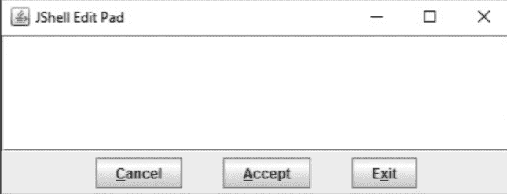

（注：在这种情况下，我们想要输入 10 行代码，创建一个交互式 GUI 窗口，其中包含一个点击时会打印内容的按钮。输入以下行，特别注意大小写并在每个语句末尾添加分号：

```java
import javax.swing.*;

JFrame frame = new JFrame("Dr. Payne's Window");

JPanel panel = new JPanel();

JButton button = new JButton("Click me!");

panel.add(button);

frame.add(panel);

frame.setSize(300,200);

button.addActionListener(e -> System.out.println("Ouch! You clicked!"));

frame.setVisible(true);
```

首先，我们导入 `javax.swing.*`，通配符 `*` 意味着该包中的所有类。然后使用 `JFrame` 创建一个名为 "Dr. Payne's Window" 的窗口。然后使用 `JPanel` 创建一个面板。使用 `JButton` 创建一个显示为 "Click me!" 的按钮。通过 `panel.add(button)` 将按钮添加到面板。通过 `frame.add(panel)` 将面板添加到窗口。通过 `frame.setSize(300,200)` 设置窗口尺寸。通过 `button.addActionListener(...)` 为按钮添加监听器，当点击时在控制台打印 "Ouch! You clicked!"。最后，通过 `frame.setVisible(true)` 显示窗口。到 `public static void main(String[] args)` 方法存根。这添加了 `main()` 方法的骨架，以便我们能够将应用程序作为一个独立程序运行。

在完成之前，我们需要执行一个与第 2 章构建的命令行应用程序不同的步骤。我们将把超类从默认的 `java.lang.Object` 更改为 `javax.swing.JFrame` 类，就像我们在本章开始在 JShell 中使用的 `JFrame` 一样。Java 中的超类或父类是我们用来扩展的类，用以重用图形化、窗口化界面的代码。`javax.swing` 包中的 `JFrame` 类是我们在自己的应用程序中包含 GUI 组件的一种方法，因此我们将使用 `JFrame` 创建一个窗口，并对其进行版本定制以添加更多功能。由于 `JFrame` 类本身就是 `Object` 超类的扩展，我们不再需要 `java.lang.Object`，因为 `JFrame` 将继承 `Object` 超类的代码。这意味着 `JFrame` 将拥有 `Object` 类所有的特征，甚至更多。稍后我们将看到扩展是如何工作的。

图 3-7 显示了我们猜数字游戏在“新建 Java 类（New Java Class）”对话框中的这些设置。


图 3-7：确保将超类更改为 `javax.swing.JFrame`，为准备 GUI 类做好准备。

点击 **Finish（完成）** 以查看 *GuessingGame.java* 的如下源码：

```java
import javax.swing.JFrame;

public class GuessingGame extends JFrame {

    public static void main(String[] args) {

        // TODO Auto-generated method stub

    }

}
```


在第一行中，Eclipse 导入了 `javax.swing.JFrame` 类，允许我们的程序使用 Swing 组件包的 GUI 能力。在第二行中，我们使用了一个新的编码超类关键字——`extends` 关键字。

在面向对象编程中，父类或超类可以拥有子类，子类继承父类中包含的所有方法和属性。一旦我们写好一个计划重用的重要类，就可以引用该原始类并进行扩展以添加新功能，而无需更改父类中的代码。在这种情况下，`JFrame` 父类具有显示文本字段、标签、按钮和其他 GUI 组件的能力，我们可以为新的猜数字游戏应用自定义并排列这些组件。

我们在此应用中扩展的 `JFrame` 父类将使我们能够通过 Eclipse 中的 WindowBuilder 编辑器设计 GUI 布局，显示包含文本字段、标签和按钮等 GUI 元素的窗口。让我们看看 WindowBuilder 编辑器是如何工作的。

## 使用 Eclipse 的 WindowBuilder 编辑器进行 GUI 设计

最流行的 Java IDE 都包含此类工具，可以帮助程序员在设计视图中构建吸引人的 GUI，其“所见即所得”（WYSIWYG）的界面允许用户按照元素在最终产品中显示的样式来放置元素。例如，Microsoft Word 就是一个 WYSIWYG 界面，因为它允许你以最终的形式编辑文本。同样，像 WindowBuilder 编辑器这样的 Java IDE 工具允许程序员放置文本字段、标签和按钮等 GUI 组件，并按照它们在最终应用程序中的样式进行布局，帮助程序员交付外观专业的 GUI 应用程序。

要打开 WindowBuilder 编辑器，请在左侧的包管理器中右键点击 `GuessingGame.java` 文件，然后选择 `Open With（打开方式）▸ WindowBuilder Editor`。一个看起来像普通文本编辑器的新窗口将会打开。但是，如果你查看窗口的左下角，你会看到两个标签：`Source（源码）`和 `Design（设计）`。`Source` 标签是应用程序的纯源码视图。点击 `Design` 标签，你将看到图 3-8 所示的设计视图。

WindowBuilder 编辑器仅适用于扩展了 `JFrame` 或其他 GUI 超类的 GUI 类（如 `GuessingGame`）。注意，预览窗口有一个标题栏，左侧有一个 Java 图标，以及三个最小化、最大化和关闭窗口的按钮。图 3-8 中的预览窗口在 Windows、macOS 和 Linux 上看起来略有不同。这个窗口将是我们构建看起来和感觉都像真实应用的 GUI 猜数字游戏的乐场。


## 设计用户界面

双击 WindowBuilder 编辑器顶部的 `GuessingGame.java` 标签可以将 WindowBuilder 设计视图扩展为全屏。这将为设计 GUI 布局留出更多空间。当你准备回到编程时，可以再次双击标签以恢复正常的 Java 视图。

## 在属性面板中设置 GUI 属性

我们将使用属性面板开始为我们的猜数字游戏定制 GUI 窗口。属性面板可以在 WindowBuilder 编辑器 `Design` 标签的左下角找到。如图 3-9 所示，如果你点击 `Components（组件）` 面板（左侧 Structure 下）中的组件，正下方的属性面板将列出我们可以查看和编辑该组件的几个属性和值。


我们将为猜数字应用构建一个自定义 GUI。首先，设置 `JFrame` 的标题。在 `Components` 面板中，点击 `javax.swing.JFrame`，然后在属性面板中向下滚动，直到看到 `title` 属性。点击 `title` 右侧的框，输入 `Your Name's Hi-Lo Guessing Game`。右侧的 GUI 预览会自动更新，在标题栏中显示 `Your Name's Hi-Lo Guessing Game`。

标题设置完成后，让我们设置其他几个属性让 GUI 看起来和运行起来符合预期。在属性面板向上滚动找到 `defaultCloseOperation`（如果面板太窄，可能只显示部分名称）。点击 `defaultCloseOperation` 右侧的框，从下拉菜单中选择 `EXIT_ON_CLOSE`。这意味着当你点击标题栏上的关闭按钮时，将退出程序。这通常是默认设置，但有时你只想关闭窗口而不关闭整个应用程序——例如在保存对话框或弹出窗口中。对于这个单窗口游戏，我们希望关闭主窗口时退出程序。

接下来，我们将更改窗口内部 GUI 组件的排列方式。点击 `javax.swing.JFrame` 下的 `Components` 面板中的 `getContentPane()`。内容面板是我们在构建游戏布局的地方。现在在属性面板中找到 `Layout` 并点击字段。从下拉值列表中选择 `Absolute Layout`；这允许我们以像素级的精度放置元素。

## 在调板面板中自定义 GUI 组件

让我们开始定制应用。你可以在 `Palette（调板）` 面板中找到任何 GUI 应用所需的元素。调板面板位于 WindowBuilder 编辑器 `Design` 标签的中间。注意，点击面板标题左侧的小箭头可以展开或折叠面板。再次点击箭头可以展开面板。当你需要额外空间处理复杂布局时，这非常有用。

在 Palette 中向下滚动直到看到 `Components` 部分，如图 3-10 所示。Palette 包含了你已经熟悉的所有标准组件，如标签（`JLabel`）、文本字段（`JTextField`）、按钮（`JButton`）和复选框（`JCheckBox`）。你可能已经注意到 `javax.swing` 包中的 GUI 组件使用了驼峰命名法。它们都以大写 J 开头，后跟组件的名称。这有助于你记住使用 Swing 工具包的应用中每个 GUI 元素的类名。

让我们在 GUI 窗口顶部放置一个显示 `Your Name's Hi-Lo Guessing Game` 的标签。点击 Palette 下的 `JLabel`。然后，将鼠标悬停在右侧的预览上；你应该看到网格线出现。默认情况下，WindowBuilder 编辑器提供这些网格线来帮助你放置元素。现在，将鼠标悬停在灰色内容面板（JFrame 内部）的顶部中央并点击，在该处放置一个 `JLabel`。

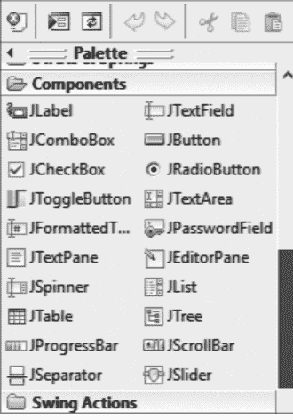

图 3-10：调色板（Palette）面板中的组件（Components）部分是我们寻找最常用 GUI 组件的地方。

当你第一次放置 `JLabel` 时，可以直接在 GUI 预览中编辑标签中的文本。输入 `Your Name's Hi-Lo Guessing Game` 并按回车。如果你以后想更改文本，请转到左下属性面板找到 Label 的 `text` 属性，并输入你的文本。起初，你可能只能看到标签中的部分文本，因为标签太小，无法显示完整文本。点击标签，你会在每个角上看到小小的黑色缩放方块。点击标签的左下角并将其拖动到内容面板的左边界，将标签延伸到内容面板的左边缘。然后，点击标签的右下角并拖动，将其调整到内容面板的右边缘。

现在，你的完整标签文本应该能够适应 GUI 预览顶部标签的大小了。让我们让标签文本居中并加粗。首先，在属性面板中找到标签的 `horizontalAlignment` 属性。点击值并在下拉列表中选择 `CENTER`。接下来，找到标签的 `font` 属性，点击字体属性值右侧的三个点。弹出一个字体选择窗口，允许你选择字体、样式和大小。如图 3-11 所示，我选择了 Tahoma 字体、15 磅和 Bold（加粗）。注意，你可能需要调整标签大小以适应更大的字体。

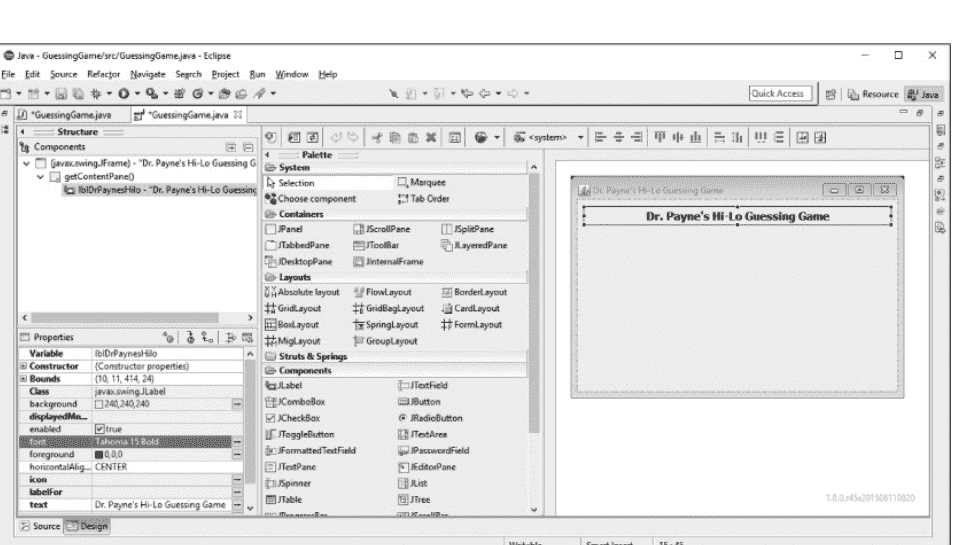

图 3-11：内容面板顶部经过自定义并放置在原位置的第一个标签

让我们为用户在游戏中将要使用的第一个提示添加一个标签。在调色板中点击 `JLabel`，然后将新标签放置在内容面板中间的正上方。输入 `Guess a number between 1 and 100:` 作为标签的文本。你需要将标签缩放得比文本宽一点，以便留出额外的内边距。

在标签的右侧，让我们放置一个文本字段供用户输入他们的猜测。点击调色板上的 `JTextField`，然后将文本字段放置到你刚刚放置的标签右侧。

调整其大小，使其能够容纳一个三位数。再次点击标签，将其 `horizontalAlignment` 属性更改为 `RIGHT`（右对齐），使文本更靠近文本字段，如图 3-12 所示。

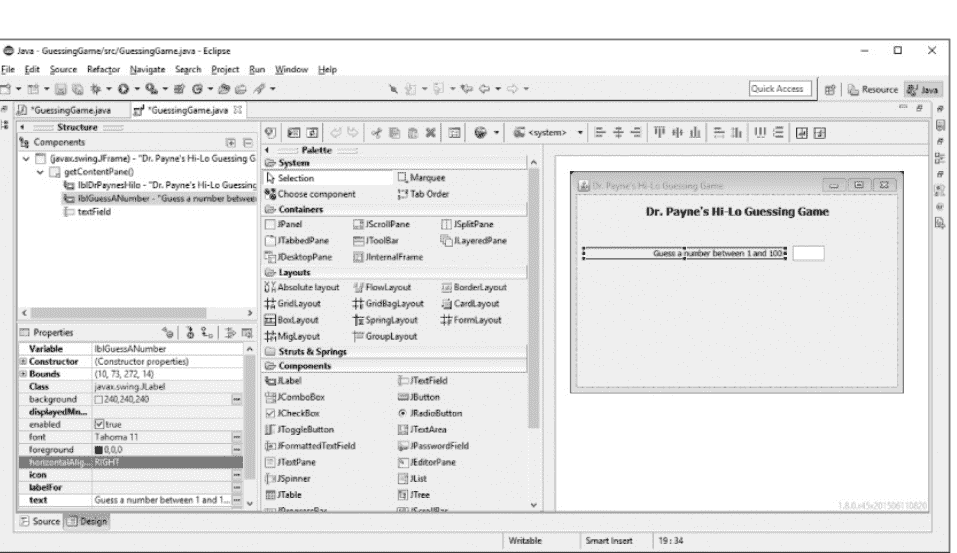

接下来，让我们放置一个用户可以点击以提交猜测的按钮。移动到 GUI 预览窗口的中间并点击放置按钮。将文本更改为 "Guess!"。

最后，在按钮下方放置一个 `JLabel`，文本设为 "enter a number above" and click!，并将标签调整为 JFrame 的全宽度。然后，将 `horizontalAlignment` 设置为 `CENTER`。稍后，这个标签也将成为告诉用户他们猜得太高、太低还是正确的地方。每个组件的对齐可能还不够完美，但你的 GUI 布局看起来应该像图 3-13 所示。


现在屏幕上已经有了所有的 GUI 组件，我们准备好进行一些微调以平衡并居中布局。首先，确保保存你的文件。

## 对齐 GUI 元素

到为止，我们一直在通过肉眼定位 GUI 组件，尝试让它们的间距正确并尽可能居中。然而，当我们运行程序时，我们期望布局是“完美的”。幸运的是，Eclipse 在 GUI 预览窗口上方内置了这些工具。看看它们如何帮助我们对齐组件。

首先，让我们将四个主要元素均匀分布，使它们垂直方向间距相同。按住 SHIFT 键并逐一点击三个标签和一个按钮。目前，不要点击用户输入猜测数字的文本字段。你应该会在 GUI 预览上方看到一排小的对齐工具。将鼠标悬停在每个工具上，可以看到工具提示，告诉你该按钮的功能。如果你起初没有看到所有工具，可能需要调整 Eclipse 窗口的大小。

点击看起来像堆叠按钮的工具（图 3-14 中最右侧的图标）。所有选中的项目从上到下应该彼此等距间距。

现在只选择文本字段。移动它使其与提示用户猜数字的标签对齐。我们最初没有包含文本字段，是因为 Eclipse 会均匀分布所有五个组件，导致文本字段和它的标签相互分离，并创建五行而不是四行。


图 3-14：你可以使用 GUI 预览窗口上方的工具均匀地对齐和分布组件。

> **注意**
> 如果你在 WindowBuilder 中对齐物品（或进行任何其他操作）时失误了，可以通过按 CTRL+Z 撤销操作。这是 WindowBuilder 编辑器中一个非常棒的功能，让你能够尝试新事物而不会永久性地破坏布局。

最后，点击标记为 Guess! 的按钮，并点击 GUI 预览上方的对齐按钮（最右侧附近、带有“Center horizontally”（水平居中）工具提示的那个）。你可以根据需要居中或调整其他组件。如果你想一起移动两个或多个组件，可以 SHIFT-点击进行选择，然后点击并拖动它们。当你对布局满意时，就是时候通过命名组件来准备编写代码了。

## 命名 GUI 组件

猜数字应用的用户界面已就绪。为了让应用更易于使用，我们需要为每个组件指定有意义的变量名，以便在代码中引用它们。

由于我们在 `GuessingGame` 类的顶层声明变量，让我们再添加一个重要的变量：`theNumber`。记住在游戏的文本版本中，这就是我们为用户尝试猜测的秘密随机数。在 `txtGuess` 和 `lblOutput` 之后添加 `theNumber` 的声明：

```java
public class GuessingGame extends JFrame {

    private JTextField txtGuess;

    private JLabel lblOutput;

    private int theNumber;

}
```

现在我们的变量已经在类顶部正确声明，我们准备好开始编写猜数字游戏的 GUI 版本代码了。在下一节中，你将学习如何从 GUI 文本框获取用户的猜测，并检查其是太高还是太低。我们还会在 GUI 标签 `lblOutput` 中显示输出文本，帮助用户进行下一次猜测。

## 添加一个方法来检查玩家的猜测

现在 GUI 已经通过我们添加的私有变量 `txtGuess` 和 `lblOutput` 连接到 Java 源码，我们将开始编写猜数字游戏的逻辑。

在 `GuessingGame` 类的顶部编写一个 `checkGuess()` 方法。该方法的签名（骨架）看起来如下：

```java
public void checkGuess() {

}
```

注意，该方法被声明为 `public`。类中的变量通常声明为 `private`，但操作这些变量的方法或函数通常声明为 `public`，以便其他类可以调用它们。你可以把它比作你的储蓄账户：你的余额是私有的，只有你或银行可以访问，但存款的功能是公开的（其他人可以向你的账户存款）。

第二个术语 `void` 告诉 Java 我们不期望该函数返回返回值（返回值是函数或方法输出的值）。例如，一个华氏度到摄氏度的转换计算器 `convertFtoC()` 接收一个代表华氏温度的值，并返回一个代表转换后的摄氏温度的数值。在这个猜数字游戏应用程序中，`guess()` 方法不会向程序的其他部分返回此类信息。我们将程序设置为通过图形用户界面向用户显示信息，因此我们使用不返回值的返回类型。

最后，我们将方法命名为 `guess()`，并提供了起始的大括号，其中将包含告诉程序我们要检查用户猜测的代码。

## 从 JTextField 获取文本

让我们开始构建 `guess()` 方法，它将获取用户输入的字符串并与要猜测的数字进行比较。要获取 `guess()` 方法两个括号之间的文本：

```java
public void guess() {

    String guessText = txtGuess.getText();

}
```

这一行创建了一个名为 `guessText` 的新字符串变量，将存储用户输入 GUI 文本框的数字。你需要通过调用 `txtGuess.getText()` 来使用 `getText()` 方法，并将结果存储在新字符串变量 `guessText` 中。

当你在 `txtGuess` 之后输入运算符 (`.`) 时，可能会弹出一个窗口，如图 3-17 所示。

```java
public void guess() {

    String guessText = txtGuess.getText();

}

public int getText() {

    String set = txtGuess.getText();

    int result = 0;

    // 返回 TextArea 中包含的文本。如果

    // 底层文档为空，它将返回 0。

    if (set != null) { // 这不是一个布尔

        // 属性，所以当我们更改文本框中的文本时，

        // setText(String) 是固定的。

        result = set.length();

    }

    return result;

}
```

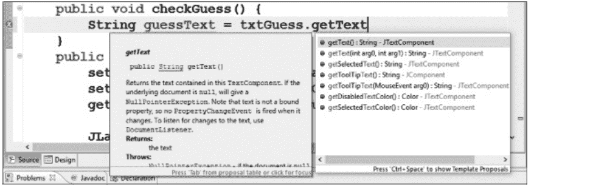

图 3-17：在你输入 `txtGuess` 和运算符 `.` 之后，可能会看到一个帮助代码推荐窗口出现。

这被称为内容辅助——Eclipse 正在尝试通过建议用于完成你正在编写的语句的代码行来帮助你。这种特定的内容辅助也被称为代码推荐，因为它推荐了常用的选项，例如当前类或对象中的方法。代码推荐是使 Eclipse 成为专业 Java 开发人员强大 IDE 的功能之一。在大多数情况下，选择代码推荐建议速度更快，而且这样做有助于防止错误，并让编码人员在开发复杂应用程序时更高效。

现在，我们需要创建一个字符串来存储告诉用户他们的猜测是太高、太低还是正确的消息。让我们声明一个额外的字符串：

```java
public void checkGuess() {

    String guessText = txtGuess.getText();

    String message = "";

}
```

我们还不知道用户的猜测是太高还是太低，因此我们将 `message` 初始化为带有双引号 (`""`) 的空字符串。在测试用户的猜测与随机数（`theNumber`）之后，我们将在 GUI 标签中输出它之前用更多信息更新此字符串。为了测试用户的猜测，我们需要将他们的文本输入（当前存储在 `guessText` 中）转换为数值形式，以便我们与 `theNumber` 进行比较。

## 将字符串转换为数字

在第 2 章制作的应用程序文本版本中，我们使用 `Scanner` 对象从用户输入的键盘文本中扫描数字值。`Scanner` 可以在 GUI 中工作，但有更好的方法。


## `checkGuess()` 方法实现

```java
public void checkGuess() {
    String guessText = txtGuess.getText();
    String message = "";
    int guess = Integer.parseInt(guessText);

    if (guess < theNumber) {
        message = " 太低了。再试一次 ";
    } else if (guess > theNumber) {
        message = " 太高了。再试一次 ";
    } else {
        message = " 正确！你赢了！ ";
    }

    lblOutput.setText(message);
}
```

它的看起来和基于文本版本的游戏中的一样，只不过现在我们把这段代码放在它自己的独立方法中。因此，完成后的 `newGame()` 方法应该如下：

```java
public void newGame() {
    theNumber = (int)(Math.random() * 100 + 1);
}
```

大功告成！现在我们已经准备好了构建功能性游戏应用的所有必要部分，只需要将它们连接到 GUI 界面即可。一旦应用程序能够监听用户事件，以便响应用户点击“Guess!（猜测！）”按钮，我们就可以准备好运行游戏了！

## 监听用户事件：点击猜测！

点击 **Design**（设计）选项卡回到应用的 GUI 预览界面。在 GUI 预览窗口中，找到如图 18 所示的“Guess!”按钮，并双击它。

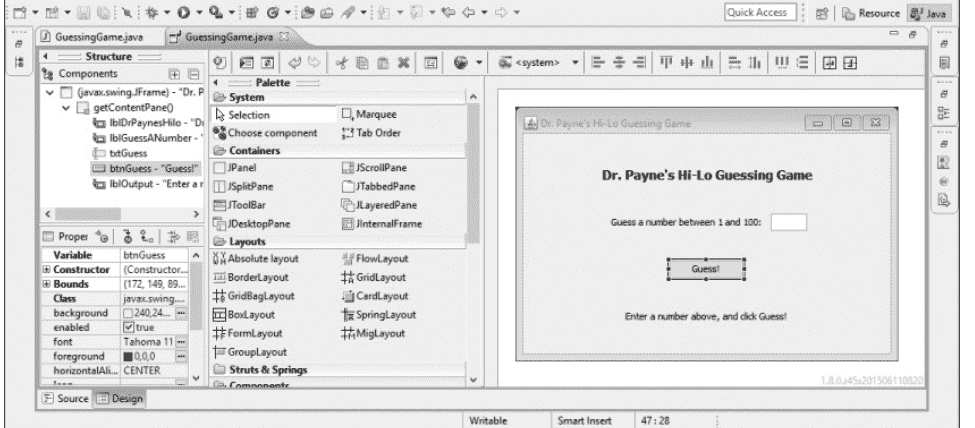

图 18：在 Design 视图中，双击“Guess!”按钮以向代码中添加事件监听器。

双击“Guess!”按钮会自动打开 **Source**（源）选项卡，注意此时 Eclipse 添加了新代码。这段新代码是事件监听器的骨架——在这种情况下，它是用户在 `JButton btnGuess` 上执行操作时发生事件的 `ActionListener()`。在这种情况下，该操作就是点击按钮。

Eclipse 已经添加了用户点击按钮时我们想要执行的所有内容。让我们来看看 Eclipse 为我们创建的事件监听器。

```java
JButton btnGuess = new JButton("Guess!");
btnGuess.addActionListener(new ActionListener() {
    public void actionPerformed(ActionEvent e) {
    }
});
btnGuess.setBounds(172, 149, 89, 23);
getContentPane();
```

`ActionListener()` 的事件监听器（处理按钮点击的特定监听器）通过 `addActionListener` 方法连接到 `btnGuess`。接下来的几行都构建在 `addActionListener()` 的括号内。

在 `actionListener` 方法内部，我们看到的第一个是关键字，它告诉我们 Eclipse 正在创建一个 `ActionListener` 类的新对象。然而，这个新对象与我们过去看到的对象不同之处在于，它是一个**匿名内部类**，这意味着它没有引用它的变量，并且完全创建在 `GuessingGame` 类内部。匿名内部类可以处理像按钮点击这样简短、快速的事件。相反，我们可以在创建按钮的地方插入事件处理程序的代码。在这种情况下，`ActionListener` 正在监听按钮点击，因此它是匿名内部类的理想人选。

Eclipse 创建了匿名内部类的骨架，但我们仍然需要编写按钮的行为。接下来的部分代码将放入 `actionPerformed()` 方法的大括号内。`actionPerformed()` 方法是我们在描述当用户点击 `btnGuess` 时想要让应用程序执行的操作的地方。该方法接受一个 `ActionEvent` 作为参数，该参数就是监听器正在监听的事件或用户操作。在这种情况下，我们将 `ActionEvent` 命名为 `e`，但你也可以使用任何喜欢的变量名。当用户输入猜测内容并点击“Guess!”按钮时，该操作被分配给 `e`，我们需要使用早之前创建的 `checkGuess()` 方法来检查他们的猜测：

```java
btnGuess.addActionListener(new ActionListener() {
    public void actionPerformed(ActionEvent e) {
        checkGuess();
    }
});
```

多亏了 Eclipse，我们唯一需要添加的部分是 `checkGuess();` 命令。自动代码补全功能节省了我们的时间并帮助我们避免了拼写错误。

有了这部分代码，现在我们只需要告诉应用程序在启动时做什么。花点时间保存你目前的工作。

## 设置 GUI 窗口

在第一次运行游戏之前，我们需要告诉程序设置 GUI 窗口。这包括构建 GUI 界面、调用 `newGame()` 方法启动新游戏，以及设置窗口所需的宽度和高度。

在文件底部 `main()` 方法的大括号内，添加以下代码行：

1. `GuessingGame theGame = new GuessingGame();`
2. `theGame.newGame();`

```java
}
```

> 代码行 ① 创建了一个名为 `theGame` 的新 `GuessingGame` 对象。该行将使用新的随机数开始猜测游戏。

现在，让 Java 知道我们想要的窗口大小。对于 Java 桌面应用，我们可以使用 `setSize()` 方法指定应用程序框架的大小，输入要创建的窗口的宽高度。

```java
public static void main(String[] args) {
    GuessingGame theGame = new GuessingGame();
    theGame.newGame();
    theGame.setSize(new Dimension(450, 380));
}
```

`setSize` 方法需要一个 Java 库内置的类型参数（`awt` 用于抽象窗口工具包）。`setSize()` 的括号告诉 Java 创建一个宽度为 450 像素、高度为 380 像素参数的类型对象。我们还没有导入 `java.awt` 库，这意味着 Eclipse 不知道 `Dimension` 指什么，因此你的 Eclipse 编辑器会用红色下划线类名 `Dimension` 提示你该语句存在错误。如果你点击编辑器中的 `Dimension` 单词，Eclipse 会显示一个快速修复（Quick Fix）列表。

一次，然后我们将对用户界面进行一些调整，以提供更好的用户体验。

## 添加“再次玩”功能

就像我们在游戏的第一个文本版本中做的那样，让我们添加一个“再次玩”的功能。我们已经创建了 `newGame()` 方法，但我们只在应用程序的 `main()` 方法中设置游戏初始显示时调用了它。

我们需要更改 GUI 或更改应用程序的行为。我们可以为用户添加一个“再次玩”按钮，让他们在想玩另一轮时点击；或者我们可以让应用程序在用户每次结束后都自动开始新游戏。

添加“再次玩”按钮的益处是从用户的角度来看很容易理解的。然而，我们不想让“再次玩”按钮一直 GUI 窗口可见，因为只有在用户赢得时才需要它。一种方案是添加按钮，但在游戏运行时让它隐藏，只有在用户赢得时才显示出来。为了保持游戏的简单，我们在这里不会这样做，但如果你想尝试一下，请参阅第 73 页的编程挑战 #2。

与其添加按钮，不如更改应用程序的行为，以便在用户赢得当前回合后自动选取一个新数字。这需要更改处理随机数匹配的 `else` 语句。如果用户赢得了一轮，应该自动开始新轮。这符合直觉——没有额外的按钮，不需要做决定。如果玩家决定不再玩了，只需关闭窗口即可。我们将通过更改以下行来添加此行为：

```java
else
    message = guess + " is correct. You win!";
```

我们将调用 `newGame()` 来启动新游戏。为了在这个 `else` 语句内部添加对 `newGame()` 方法的调用，我们将两个语句（设置变量 `message` 和调用 `newGame()`）分组为一个块，如下所示：

```java
else {
    message = guess + " is correct. You win! Let's play again!";
    newGame();
}
```

大括号将这两个语句分组为一个一起执行的代码块，每当 `else` 语句被选为正确的程序路径时，它们就会一起执行。如果没有大括号，只有 `else` 语句后的第一行会被执行，而 `newGame()` 方法将在 `if-else` 语句求值后运行。这将导致游戏在用户尝试尝试时都改变秘密数字。

注意，我们在消息字符串末尾添加了 `Let's play again!`（让我们再玩一次吧！）。这让用户知道他们只需要猜测就可以再次玩，并且可以预期电脑每轮都会选取新数字。进行这些更改，保存程序并再次运行，查看游戏的新版本！

## 改进 UX

在玩游戏时，你可能会注意到一些游戏元素可以让用户界面变得更好。例如，如果我们能让应用程序在用户点击“Guess!”按钮或按下键盘上的 ENTER 键接受新猜测，这将提供更自然、直观的用户体验（UX）。

一个问题是，当我们想要猜一个新数字（或者，按下 DELETE 或 BACKSPACE 键）来清除之前的猜测时，我们必须再次点击文本字段，因为焦点切换到了“Guess!”按钮。为了改进用户界面，我们可以让光标在每次猜测后返回文本字段，并自动高亮或删除之前猜测的文本，以便新猜测替换旧猜测。

现在让我们处理这两项。

## 允许用户按 Enter 键猜测

我们将进行的第一个改进是允许用户按 ENTER 提交猜测。首先，进入 **Design** 选项卡并右键点击“Guess!”按钮。在弹出菜单中，选择 **Add event handler • action • actionPerformed**。

就像我们为 `btnGuess` 创建事件处理程序一样，Eclipse 会自动添加代码为 `txtGuess` 创建动作监听器，如下代码段所示。而且，就像我们之前做的那样，我们将这段代码中 `actionPerformed` 部分的大括号内添加 `checkGuess()` 方法。我们通常只想从文本字段内部处理的动作事件就是用户按下 ENTER 键。

```java
txtGuess.addActionListener(new ActionListener() {
    public void actionPerformed(ActionEvent e) {
        checkGuess();
    }
});
```

添加此行后，保存文件并再次运行。现在当我们按下 ENTER 键时，它会激活 `checkGuess()` 方法。“Guess!”按钮仍然有效，因此用户可以选择仅通过键盘或通过鼠标进行交互。

## 自动移除旧猜测

现在，让我们解决必须点击回文本字段来删除旧猜测的问题。为了解决这个问题，我们需要学习一些用于像 `txtGuess` 这样的 `JTextField` 对象的新方法。

首先，我们必须考虑何时想让文本被选中。对于猜测游戏，在用户的猜测被评估后，可能是允许用户再次猜测的正确时机。在代码中，这将位于 `checkGuess()` 方法的末尾，因为我们希望在用户进行了一次猜测并准备好下一次猜测时发生。

所以，我们需要在 `checkGuess()` 方法的末尾添加代码，将光标放回 `txtGuess` 文本字段并选中用户之前猜测的文本。但我们如何知道哪些命令可以将光标置于文本字段并选中所有文本呢？这是使用 Eclipse 中的内容辅助功能的好时机。输入对象的名称 `txtGuess`，后跟点运算符，Eclipse 就会显示一个方法列表。

最后，我们想要选中用户之前猜测的所有文本，以便新猜测替换旧猜测。要选取文本字段中的所有文本，使用 `selectAll()` 方法。将这两行都加到 `checkGuess()` 方法的末尾，紧跟 `lblOutput.setText(message);` 行之后，并在右大括号之前：

```java
lblOutput.setText(message);
txtGuess.requestFocus();
txtGuess.selectAll();
```

用于像 `txtGuess` 这样的 `JTextField` 对象的可用方法包括：

- `requestFocus()`: 请求组件获取焦点。
- `selectAll()`: 选中文本字段中的所有文本。

## 异常处理

每当我们读取或写入文件时都可能遇到问题；例如，从照片应用中查看和保存图片。如果我们能够预判可能的异常并编写异常处理程序来处理这些异常，我们的代码将更安全，更有效地防止那些可能通过输入错误输入导致你的程序崩溃的恶意黑客，而且更加可靠。

在猜数字游戏中，当我们向用户索要数字，但他们输入了文本时，就会发生异常。具体来说，当我们尝试从一个不包含整数的字符串中解析整数时，触发了异常。用户输入是异常的常见来源，无论是无意的还是故意的。后者的例子就是黑客试图破坏你的程序。

Java 通过 `try-catch` 语句为我们提供了一种清晰处理异常的方式。`try-catch` 块的想法是：我们希望程序执行某些我们知道可能会异常的操作，并捕获或处理可能发生的异常，而不是让它破坏程序。`catch` 块只在异常发生时执行。

`try-catch` 的最后部分是可选的 `finally` 块。在 `try-catch-finally` 语句中，如果提供了 `finally` 块，它将始终执行，无论是否存在异常。如果没有发生异常，`finally` 块会在 `try` 块结束后运行。如果发生异常，`finally` 块会在 `catch` 块完成后运行。

```text
try-catch 的格式通常看起来像这样（不要在你的代码中输入这些；这只是格式的示例）：
try {
    // 可能会导致异常的内容，例如获取错误的输入
} catch (Exception e) {
    // 处理或从异常中恢复，例如请求正确的输入
} finally {
    // 任何包装代码；无论是否异常，这始终会在最后运行
}
```

注意 `try-catch-finally` 语句的每个部分都有带有大括号的组结构语句，就像我们处理 `if-else` 和循环语句一样。`catch` 部分需要一个 `Exception` 参数；这可以是一个特定的异常，如 `NumberFormatException`，或者我们可以使用基类 `Exception`。此参数将接收有关异常的信息，例如异常发生的行号。

为了在我们的游戏代码中正确放置 `try-catch-finally` 块，我们需要思考异常可能发生在何处（并将该代码封装在 `try` 块中）、如果发生异常我们想做什么（并将其放入 `catch` 块中），以及 `try` 或 `catch` 块结束后我们想做什么（这部分放在 `finally` 块中）。

由于用户输入问题是在尝试从用户输入的文本中解析整数时发生的，我们想将其封装在 `try` 块中。让我们在从文本中解析输入的行之前放置 `try` 关键字和左大括号：

```java
public void checkGuess() {
    String guessText = txtGuess.getText();
    String message = "";
    try {
        int guess = Integer.parseInt(guessText);
        if (guess < theNumber) {
            // ... 逻辑 ...
        } else {
            // ... 逻辑 ...
        }
        // 如果用户没有输入数字，我们就无法测试太高或太低，
        // 所以 try 子句将一直到这一对 if-else 语句的结束。
        // 在 else 语句的大括号之后放置 try 块的右大括号，
        // 如下列表所示。接下来应该是是 `catch` 块。
        // 在这个游戏中，如果用户输入了错误输入，我们希望他们输入一个 1 到 100 之间的数字。
        // 我们可以通过稍后显示在输出中的 message 字符串来实现。
        // 所以，catch 块应该像这样：
    } catch (Exception e) {
        message = "输入 1 到 100 之间的数字。";
    } finally {
        lblOutput.setText(message);
        txtGuess.requestFocus();
        txtGuess.selectAll();
    }
}
```
（注：OCR 文本在中间有一些乱码代码；我根据周围的注释重建了逻辑。）

```java
public void newGame() {
```


你可能会注意到，每个 `try-catch-finally` 块内部的语句都进行了缩进，以便代码更易读。记住，Eclipse 中有一个快捷键，可以在你做出任何更改后自动正确地缩进所有内容。选择所有代码，然后转到 Source（源） ▸ Correct Indentation（纠正缩进）。

保存你的应用并运行几次以测试用户界面。测试几个非整数，以确保异常处理按预期工作。如果你遇到了导致文件无法编译的错误，请检查你的大括号。每当你在现有代码周围添加块时，大括号是检查错误的第一位置。一旦你的 `try-catch-finally` 语句就绪，你就获得了一个更可靠、更可预测且更安全的 GUI 猜数字应用。

安全编程不仅仅是一个锦上添花——它通常是编写良好软件的关键部分。对于我们的猜数字游戏，糟糕代码的后果似乎并不严重。但请想想运行在医疗设备、卫星、飞机或为你家和城市供电的电网上的代码。安全代码对于我们的安全和保障至关重要。即使是手机上运行不安全代码的小游戏或应用也可能让你的数据暴露给黑客。安全编程始终是一种明智的做法。

## 你学到了

在猜数字应用的 GUI 版本中，我们提高了 Java 技能，包含了以下内容：
- 通过导入 `javax.swing` 包创建 GUI 窗口
- 在 Eclipse 中设置 GUI
- 使用 WindowBuilder 设计 GUI
- 使用 Properties（属性）面板更改属性
- 一致地命名 GUI 组件，以便在 Java 代码中使用
- 将 GUI 连接到 Java 变量
- 从 `JTextField` 获取用户文本
- 监听用户事件，如点击按钮
- 通过测试应用改进用户体验 (UX)
- 使用 `try-catch-finally` 处理异常

## 编程挑战

尝试这些挑战来复习你所学的，并通过尝试新事物来扩展编程技能。如果你遇到困难，请访问 `https://noostarch.com/learnjava/` 查看示例。

### #1：显示用户的尝试次数

尝试更改获胜消息，告诉用户他们尝试了多少，例如：“第 7 次正确！”为了完成此任务，你需要创建一个新变量 `numberOfTries` 来存储用户猜测的次数，每当运行 `checkGuess()` 方法时增加一次，并在他们获胜时显示次数。

### #2：显示和隐藏“重新游戏”按钮

当我们构建本章节猜数字游戏的 GUI 时，我们决定不包含“重新游戏”按钮，因为它在未使用时会使界面杂乱。事实证明，我们可以使用 `setVisible(false)` 方法隐藏 GUI 组件。然后我们可以像之前处理 JFrame 一样使用 `setVisible(true)` 显示它。

首先，我们可以在布局中添加一个名为 `btnPlayAgain` 的重新游戏按钮。在创建按钮后的代码中，我们可以调用 `btnPlayAgain.setVisible(false)` 来隐藏按钮。在 `checkGuess()` 的获胜语句中，我们可以调用 `btnPlayAgain.setVisible(true)` 来显示按钮，而不是启动新游戏。写完该代码后，记得在 GUI 预览中双击按钮以添加事件监听器，在该监听器中调用 `newGame()`，然后再次隐藏按钮。

当程序运行成功后，游戏开始时应该隐藏“再次游戏”按钮，只有在你赢得游戏时，该按钮才会出现。点击该按钮时，将开始一个新游戏，按钮将再次消失。带有该按钮玩游戏，如果你对用户体验（UX）有任何其他改进建议，尽管去尝试吧！

### #3：创建一个 GUI 版本的 MadLib

回想一下你在第 2 章中构建的 `MadLibs.java` 程序（第 41 页的编程挑战 #3），并创建一个新的 `MadLibGUI.java` 应用，该应用要在图形界面中使用标签和文本框提示用户输入几个单词，例如 `txtColor`、`txtPastTenseVerb`、`txtAdjective` 和 `txtNoun`。添加一个用户可以点击的按钮来生成一个 MadLibs 风格的故事。

在 WindowBuilder 编辑器中探索并尝试 GUI 元素的更多属性，包括背景颜色、字体、初始文本值等。当用户点击按钮时，程序应该在 `JLabel` 或 `JTextArea` 中显示完成后的 MadLibs 故事，如图 3-23 所示。

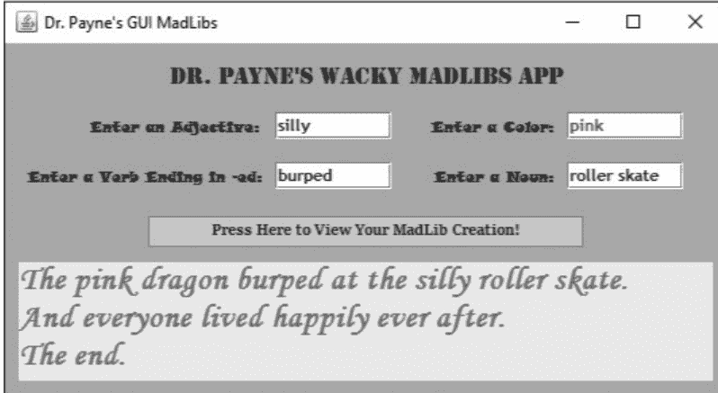

图 3-23：一个 GUI 版本的 MadLibs 应用

## 4 创建你的第一个 Android 应用


为了构建 Hi-Lo 猜数字游戏应用的移动版本，我们将使用 Android Studio。如果你没有在第 1 章中设置过它，请回到第 8 页的“为移动应用开发安装 Android Studio”进行设置。与游戏的 GUI 版本一样，我们将为该应用创建一个用户界面，如图 4-1 所示。你到为止创建的应用只能在桌面电脑上运行，但 Android 应用可以运行在任何 Android 设备上，包括手机、平板电脑、手表、电视等。如果你没有 Android 设备，不用担心——你仍然可以为 Android 代码，因为 Android Studio 自带的 Android 模拟器可以让你模拟运行设备。

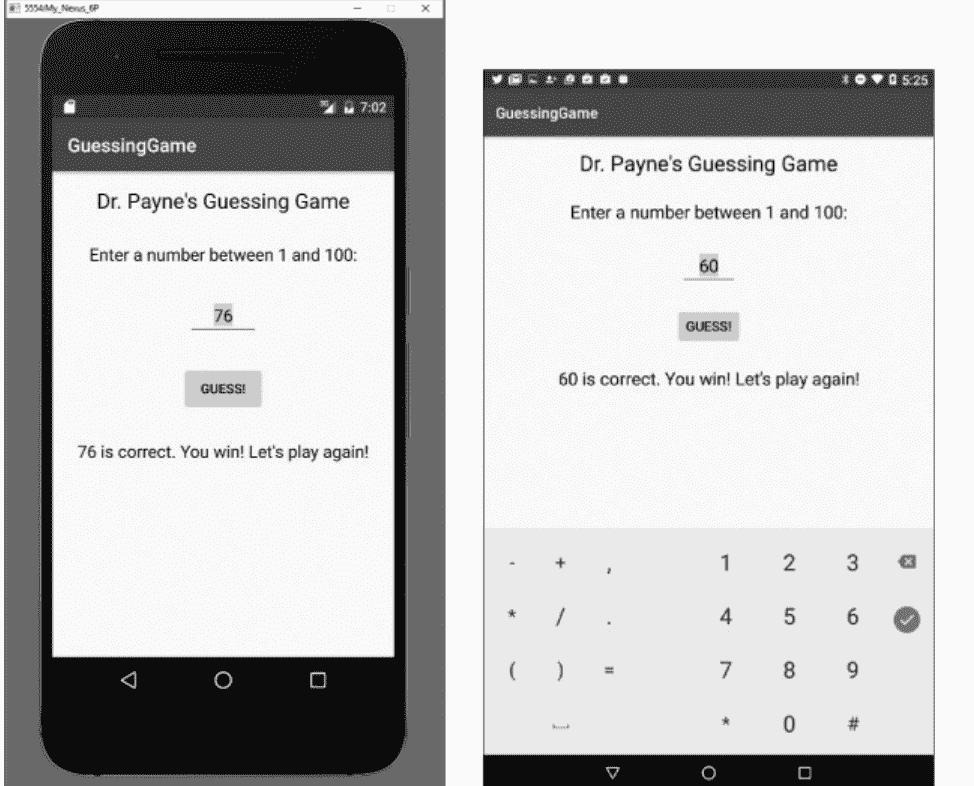

图 4-1 显示了我们的应用在 Android 模拟器上运行，模拟了应用在 Nexus 6P 和 Android 平板电脑上的外观。两个版本运行的是相同的代码——更方便的是，我们可以复用之前为桌面版本构建构建的大量 Java 代码，因为 Android 是基于 Java 构建的！

注意，模拟器和实际设备看起来非常相似，只有细微差异，以适应手机和 7 英寸平板之间不同的屏幕尺寸。就像为 Windows 编写 Java 应用并在 macOS 或 Linux 上运行一样，你可以用 Java 编写 Android 移动应用并运行在数以千计的 Android 设备上。让我们开始构建你的第一个 Android 移动应用吧！

## 创建一个新的 Android Studio 项目

第一次启动 Android Studio 时，可能需要几分钟时间进行更新和运行。启动后，你会看到类似于图 4–2 所示的屏幕。选择标记为“Start a new Android Studio project”（启动一个新的 Android Studio 项目）的选项。

将你的新项目命名为 `GuessingGame`，不要有空格。如果你有网站，可以在“Company Domain”字段中输入，如图 4-3 所示。否则，保留默认的示例域名。接下来，选择项目位置，我设置了一个名为 `AndroidProjects` 的文件夹来保持整洁，你也应该这样做。

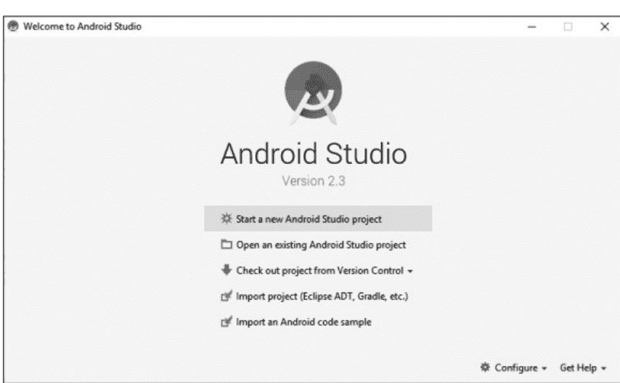

图 4-2：一旦 Android Studio 设置完成，选择 Start a new Android Studio project。


图 4-3：将你的新 Android Studio 项目命名为 GuessingGame，不要有空格。

命名项目后点击 Next（下一步）。现在你将有机会选择你的应用应该运行的 Android 版本号。随着新设备和功能的开发，Android 平台演进非常快，因此我们需要选择一个目标。幸运的是，Android Studio 会定期更新最新的 Android 版本，以及关于有多少设备仍在使用旧版本的信息。在选择支持哪些 Android 版本时，你还需要选择一个软件开发包（SDK）或应用程序接口（API）级别。SDK 和 API 级别包含了开发应用时使用的工具，但它们绑定了特定的 Android 版本。图 4-4 所示的“Target Android Devices”窗口允许你为开发的的每个应用选择一个最低 SDK 或 API 级别。

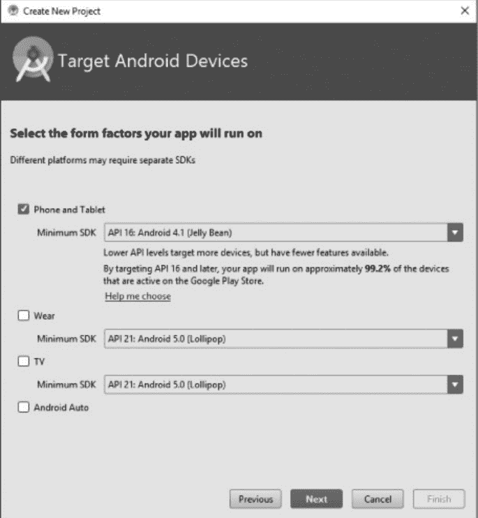

图 4-4：为你正在开发的 Android 设备选择最低 SDK 级别。

选择 **API 16 (Android 4.1, Jelly Bean)** 作为最低 SDK。点击 Next。

New Project 项目向导会询问你想要添加什么种类型的 activity（活动）。activity 有很多选择，例如 Google Maps、Login、Tabbed 等。我们将使用 Basic Activity 作为基础，选择它并点击 Next。向导会询问活动名称和布局。我们将使用默认名称 `MainActivity` 作为活动，`activity_main` 作为布局。点击 Finish（完成）完成项目。

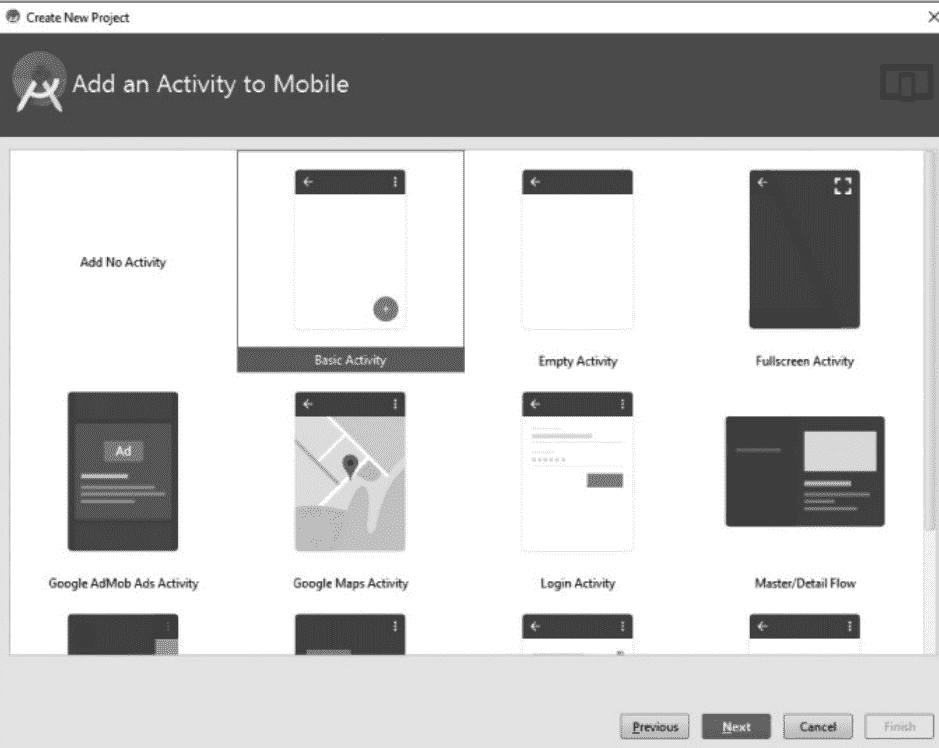

图 4-5：Basic Activity

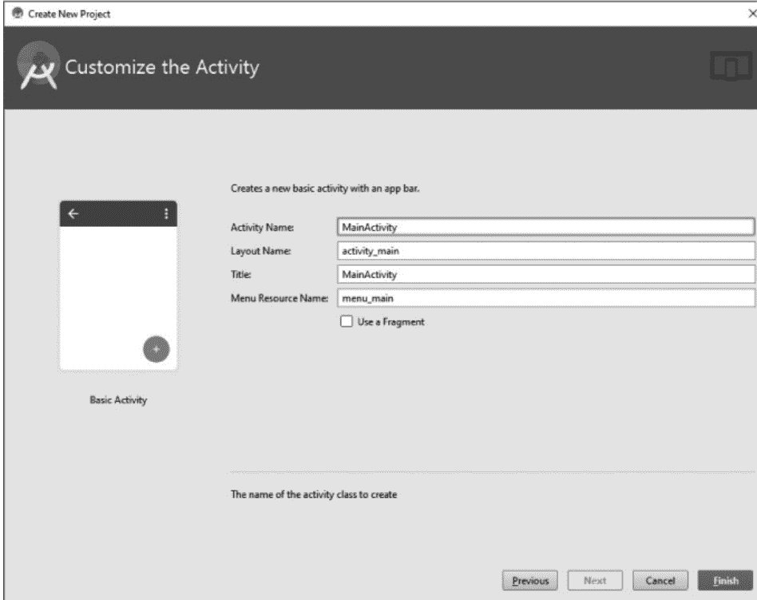

图 4-6：Default Activity

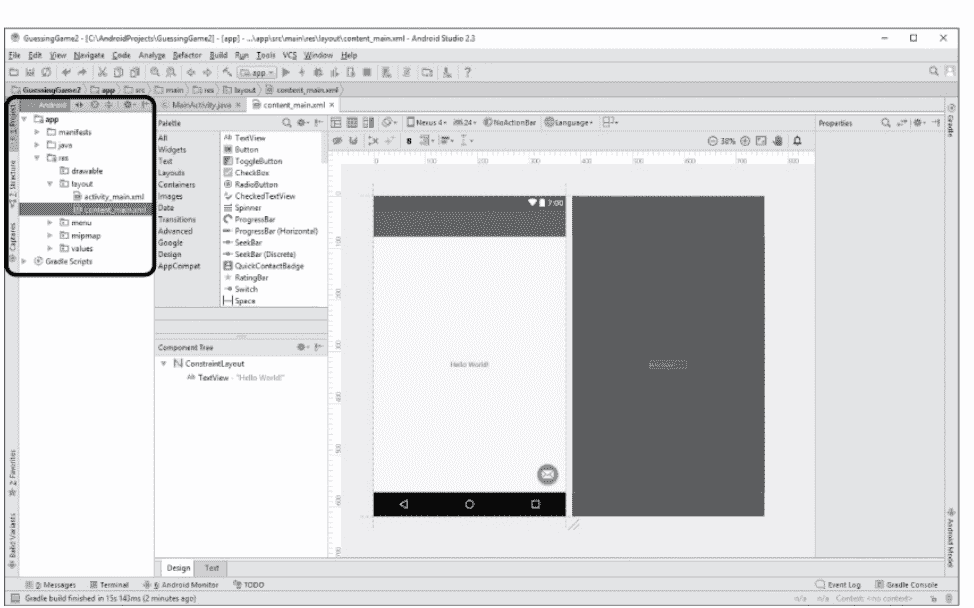

图 4-7：默认视图

如果你的项目没有打开此屏幕，点击左上角的 Project 标签，展开 app 文件夹，展开 res（resources 的缩写）文件夹，展开 layout，然后双击 `main.xml` 文件以查看图 4-7。

## 在设计视图构建布局

Android 应用将布局与应用代码分离，因此此应用与我们在第 3 章编写的桌面应用有所不同。布局不是用 Java 描述的，而是用可扩展标记语言（XML）。尽管有此差异，我们仍然可以使用类似于 Eclipse WindowBuilder 的拖放面板来设计 GUI。Android Studio 与 WindowBuilder 的主要区别在于组件是为移动应用设计的。

就像 WindowBuilder 编辑器一样，Android Studio 有两个标签：一个设计视图，一个源代码。点击包含 `main.xml` 主窗口左下角的 Design 标签。你会看到图 4-8 所示的设计视图。


图 4-8 显示了你最常用的四个区域：Project Explorer 面板 ①、Palette 面板 ②、Preview 面板 ③ 和 Properties 面板 ④。

在预览面板中心，你会看到一个标签（在 Android 术语中称为 TextView）显示 Hello World!。点击标签并按 DELETE 键（或右键点击并在菜单中选择 Delete）从预览面板中删除。然后，点击 Palette 面板中的 Layouts 选项，选择 RelativeLayout，并将其拖入预览面板或 Palette 下方 Component Tree 列表中的 ConstraintLayout（如图 所示）。我们将从一个空的 RelativeLayout 开始构建我们的猜数字 gui。

在 Palette 面板的 Widgets 下，选择 TextView。Android 中的 TextView 类似于 Swing 工具包中的标签，而 widgets 是我们对 Android 大多数 GUI 组件的称呼。我们将通过拖放到放置 GUI 组件。

点击 TextView 组件并将其拖到模拟 手机的白色应用背景上，将组件放置在顶部作为应用的标题。

放置标题 TextView 后，Properties 面板中会出现选项。

右侧窗格。如果窗格没有出现，点击 Design（设计）选项卡右上角的 Properties（属性）以展开属性窗格。找到你刚刚添加的 TextView 组件的 `text` 属性。将文本更改为 "Your Name's Guessing Game"，并将 `textAppearance` 属性更改为 Large。然后，将 TextView 拖动到屏幕顶部并居中，如图 4-9 所示。灰色的虚线辅助线有助于放置。

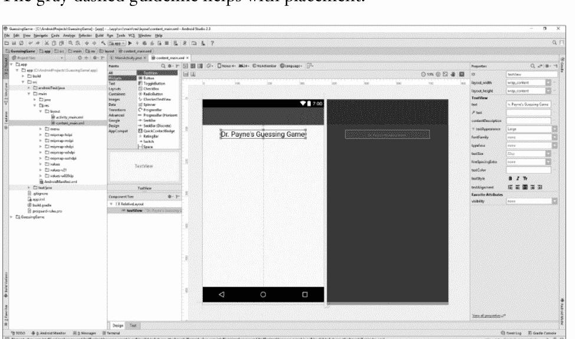

图 4-9：在 Android Studio 中放置 GUI 控件/组件与在 Eclipse 中的过程非常相似。

为了添加提示用户输入 1 到 100 之间数字的标签，在设计预览中标题下方稍远距离处放置另一个 TextView 组件。在右侧的 Properties 窗格中将 `textAppearance` 属性更改为 Medium。然后，在 TextView 的 `text` 属性中输入 1 到 100 之间的数字。

接下来，我们将放置用于用户猜测的文本字段（在 Android 中也称为 EditText）。文本字段列在 Palette（调色）中 Widgets（控件）下方。Android 中有许多类型的文本字段，每种根据你的应用程序需求的行为不同。例如，Plain Text（纯文本）是一个简单的文本字段，Password（密码）在输入时隐藏字符，Phone（电话）显示数字键盘作为电话号码，而 E-mail（电子邮件）显示带有 @ 符号的修改键盘。

选择 Number（数字）文本字段，以便用户可以使用屏幕上的数字键盘输入猜测。将此字段放置在上一个标签下方。然后，在文本字段下方等距离放置一个 Button（按钮）组件，将其 `text` 属性更改为 "Guess!"。最后，在按钮下方放置另一个 TextView 组件，将其 `text` 属性设置为 "Enter a number, then click Guess!"。如果你由于太靠近屏幕垂直中心而难以在按钮下方等距离放置控件，可以在 Properties 窗格的 `Layout_Margin` 下将其放置得更高或更低（你可能需要点击 View all properties 并点击 Layout_Margin 旁边的灰色箭头以展开边缘属性），找到 `layout_marginTop`，并将值更改为 30dp。完成的 GUI 布局应该类似于图 4-10。

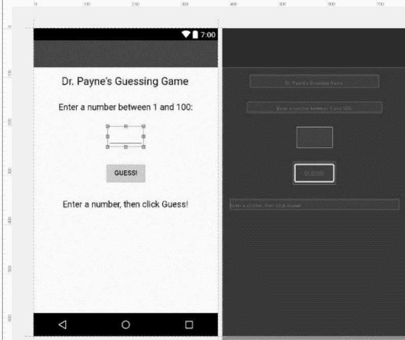

图 4-10：设计视图下 Android 猜数字游戏应用完成的 GUI 布局

在命名 GUI 组件之前，我们将进行最后的更改。将用户输入猜测的数字文本字段的 `width` 属性更改为 75dp；通过点击 Properties 窗格中的 View all properties 或左右箭头图标来实现。原始文本字段对于一个只使用 1 到 100 之间数字的猜数字游戏来说太宽了，我们调整了大小使其变窄。

做了这个小更改后，是时候开始命名我们的 GUI 组件了，这样我们就能在 Java 代码中轻松地找到它们。

## 在 Android Studio 中命名 GUI 组件

就像在 Eclipse 中命名 GUI 组件一样，我们需要在 Android Studio 中为 GUI 元素命名，以便我们从代码中访问它们。但在 Android Studio 中，GUI 元素本身的名称默认不会出现在 Java 源代码中。相反，我们必须在代码中使用它们之前，手动将这些 XML GUI 组件连接到 Java 代码。

不过，现在我们只需要分别将数字文本字段、猜测按钮以及输出标签的 `id` 属性更改为 `txtGuess`、`btnGuess` 和 `lblOutput`。如果弹出消息询问你是否更新引用，点击 **Yes**。我们将为了一致性和清晰性使用这些名称。图 4-11 显示了重命名后的文本字段、按钮和标签。

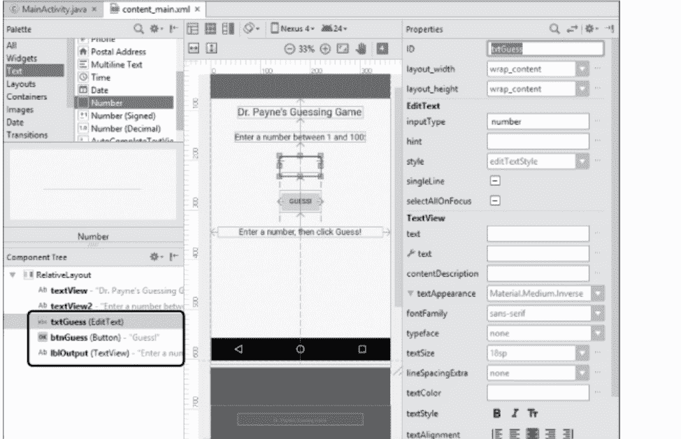

图 4-11：通过将 `id` 属性分别更改为 txtGuess、btnGuess 和 lblOutput 来重命名 EditText、Button 和 TextView 组件（圈出）。

在开始编写 Java 代码之前，我们应该做的最后一件事是隐藏小的悬浮操作按钮（fab）图标，如图 4-12 设计预览右下角所示。你的项目可能没有显示 fab 图标，但如果显示，请在 Project Explorer ① 中双击 `activity_main.xml` 文件。点击设计 ② 上方的 `activity_main.xml` 文件，然后点击 fab 图标 ➿。进入 Properties 并将 `visibility` 属性设置为 invisible ③。

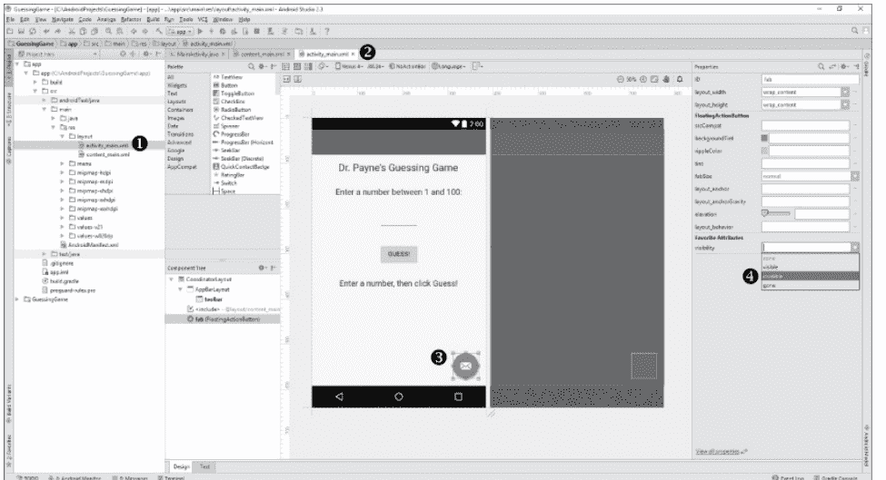

图 4-12：通过进入 activity_main.xml 文件、点击小信封图标并将属性设置为 invisible 来隐藏 fab 图标。

我选择将 fab 图标设置为隐藏而不是完全删除它，因为你以后可能想要使用悬浮操作按钮为应用添加新功能。悬浮按钮可以将应用信息分享到 Facebook，在 Twitter 上发布关于你有多喜欢应用的推文，向朋友发送关于应用的电子邮件等等。

接下来，我们将编写代码。

## 将 GUI 连接到 Java

在上行之后，你将看到一个类似于图 4-15 所示的弹出菜单。在下拉列表中找到并双击 `txtGuess`。如果你没有看到 `txtGuess` 选项，请返回 `content_main.xml` 的设计视图，并确保你设置了 `txtGuess` 的文本 id 属性。

以右括号后跟分号结束，如下列表所示，并设置按钮和输出标签。你的 `onCreate()` 方法中完成的三行代码应该看起来像：

```java
```


## Android 猜数字游戏开发

### 初始化 UI 组件

在 `onCreate()` 方法中初始化界面组件：

```java
protected void onCreate(Bundle savedInstanceState) {
    super.onCreate(savedInstanceState);
    setContentView(R.layout.activity_main);

    txtGuess = (EditText) findViewById(R.id.txtGuess);
    btnGuess = (Button) findViewById(R.id.btnGuess);
    lblOutput = (TextView) findViewById(R.id.lblOutput);
}
```

如果所有命名都正确，这些代码行将连接 GUI 布局中的 `txtGuess`、`btnGuess` 和 `lblOutput` 组件。现在请保存项目以记录当前进度。

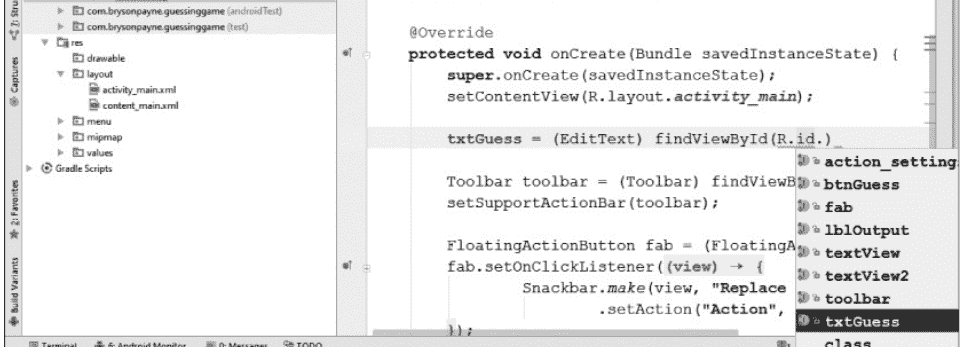

### 添加检查猜测并开始新游戏的方法

现在开始编写 `checkGuess()` 方法的代码。我们可以在 `txtGuess`、`btnGuess` 和 `lblOutput` 变量声明下方、`onCreate()` 方法上方的区域编写 `checkGuess()` 方法，如图 4-16 所示。

首先，我们需要从 GUI 文本框获取用户的猜测值，并将其存储在字符串变量中：

```java
public class MainActivity extends AppCompatActivity {

    private EditText txtGuess;
    private Button btnGuess;
    private TextView lblOutput;

    public void checkGuess() {
        String guess = txtGuess.getText().toString();
    }
}
```

从文本框获取用户猜测的代码与桌面版应用中的代码几乎相同，区别在于末尾多了一个 `.toString()` 方法。Android 中有一个单独的 `Text` 类，输入字段中得到一个 `Text` 对象，因此我们必须将其转换为字符串对象。

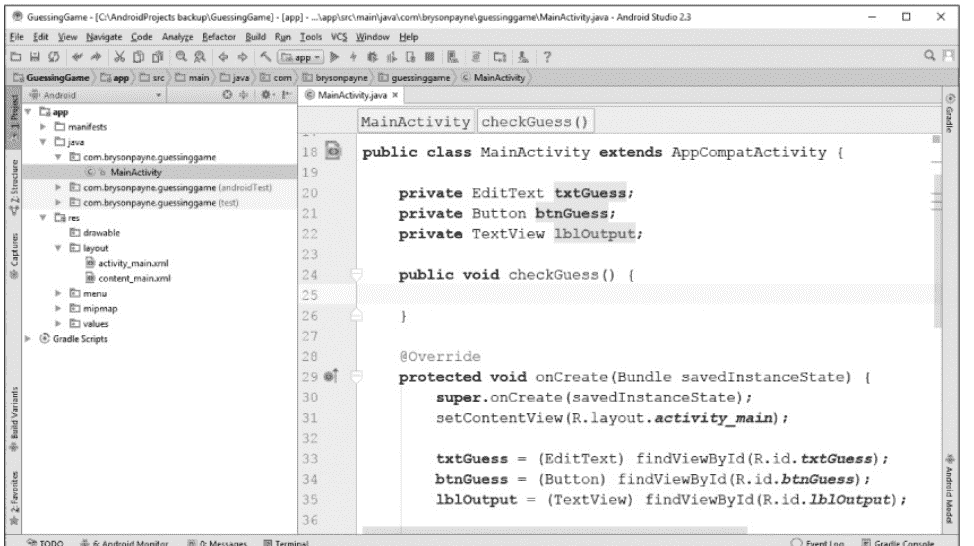

幸运的是，`checkGuess()` 方法其余部分可以直接从第 3 章 Eclipse 桌面 GUI 版应用复制并粘贴，无需任何更改！完整的 `checkGuess()` 方法应该如下：

```java
public void checkGuess() {
    String guessText = txtGuess.getText().toString();
    String message = "";

    try {
        int guess = Integer.parseInt(guessText);

        if (guess < theNumber)
            message = guess + " is too low. Try again.";
        else if (guess > theNumber)
            message = guess + " is too high. Try again.";
        else {
            message = guess + " is correct. You win! Let's play again!";
            newGame();
        }
    } catch (Exception e) {
        message = "Enter a whole number between 1 and 100.";
    } finally {
        lblOutput.setText(message);
        txtGuess.requestFocus();
        txtGuess.selectAll();
    }
}
```

Java 的一个方便特性是我们可以跨平台复用代码。正如我们使用命令行游戏的代码来制作桌面版游戏一样，我们可以在 Android 版本中使用桌面版的代码。让我们回顾这段代码，以理解它在 Android 应用中将如何工作。

在 ① 处，我们从文本框获取用户的猜测并为输出消息设置字符串。在 ② 处，我们开始使用 `try-catch-finally` 语句来处理用户输入错误或异常。在 `try` 块的 ③ 处，我们从用户输入的字符解析出用户的猜测整数。`try` 块其余部分包含 `if-else` 语句，用于测试用户的猜测是太高还是太低，设置适当的消息并开始新游戏。接下来，`catch` 语句 ④ 拦截用户输入非 1 到 100 之间的整数。然后，`finally` 块 ⑥ 将 `lblOutput` 组件上的文本设置为适当的消息，将光标返回文本框并高亮文本以准备用户的下一次猜测。

你可能注意到有两个项目被红色下划线标记：`theNumber` 和 `newGame()`。这是因为我们在这个版本的应用中尚未定义它们。

在 `MainActivity` 类的顶部，三个 GUI 组件声明的下方，添加秘密数字 `theNumber` 的声明：

```java
public class MainActivity extends AppCompatActivity {
    private EditText txtGuess;
    private Button btnGuess;
    private TextView lblOutput;
    private int theNumber;
}
```

这与桌面游戏中使用代码完全相同，因为创建整数的 Java 代码在命令行、桌面和 Android 移动版应用中是相同的。

`newGame()` 方法的代码也与桌面版相同。在 `onCreate()` 语句之前添加 `newGame()` 方法：

```java
public void newGame() {
    theNumber = (int)(Math.random() * 100 + 1);
}

@Override
protected void onCreate(Bundle savedInstanceState) {
```

在 Android 中创建新应用与在桌面版中一样。我们使用 `Math.random()` 将 `theNumber` 设置为 1 到 100 之间的随机整数。我们在 `onCreate()` 方法中添加 `newGame()` 的调用：

```java
protected void onCreate(Bundle savedInstanceState) {
    super.onCreate(savedInstanceState);
    setContentView(R.layout.activity_main);

    txtGuess = (EditText) findViewById(R.id.txtGuess);
    btnGuess = (Button) findViewById(R.id.btnGuess);
    lblOutput = (TextView) findViewById(R.id.lblOutput);

    newGame();
}
```

猜测游戏移动应用现在准备好首次运行了。此版本猜测游戏的完整功能代码如下所示。你的版本可能会略有不同，也许会有几个处理菜单项的方法，但由于我们没有使用菜单，这些方法已被删除以节省空间。

### 在 Android 中处理事件

在 Eclipse 中，我们可以通过双击来处理事件。在 Android 中，我们需要为按钮添加以下代码：

```java
btnGuess.setOnClickListener(new View.OnClickListener() {
    @Override
    public void onClick(View v) {
        checkGuess();
    }
});
```

在输入时会有代码补全功能，类似于 `EditText` 的建议。Android Studio 会在多处插入相关代码。这是匿名类的另一个例子。`@Override` 注解是一个编译器指令，它告诉编译器你正在父类中实现你的方法。

完整的 `MainActivity` 代码示例：

```java
public class MainActivity extends AppCompatActivity {

    private EditText txtGuess;
    private Button btnGuess;
    private TextView lblOutput;
    private int theNumber;

    public void checkGuess() {
        String guessText = txtGuess.getText().toString();
        String message = "";

        try {
            int guess = Integer.parseInt(guessText);

            if (guess < theNumber)
                message = guess + " is too low. Try again.";
            else if (guess > theNumber)
                message = guess + " is too high. Try again.";
            else {
                message = guess + " is correct. You win! Let's play again!";
                newGame();
            }
        } catch (Exception e) {
            message = "Enter a whole number between 1 and 100.";
        } finally {
            lblOutput.setText(message);
            txtGuess.requestFocus();
            txtGuess.selectAll();
        }
    }

    public void newGame() {
        theNumber = (int)(Math.random() * 100 + 1);
    }

    @Override
    protected void onCreate(Bundle savedInstanceState) {
        super.onCreate(savedInstanceState);
        setContentView(R.layout.activity_main);

        txtGuess = (EditText) findViewById(R.id.txtGuess);
        btnGuess = (Button) findViewById(R.id.btnGuess);
        lblOutput = (TextView) findViewById(R.id.lblOutput);

        newGame();

        btnGuess.setOnClickListener(new View.OnClickListener() {
            @Override
            public void onClick(View v) {
                checkGuess();
            }
        });

        Toolbar toolbar = (Toolbar) findViewById(R.id.toolbar);
        setSupportActionBar(toolbar);
    }
}
```


在接下来的两个章节中，你将学习如何在 Android 模拟器和真实的 Android 设备上运行应用程序。

## 在 Android 模拟器上运行应用程序

现在我们有了一个可以运行应用程序的 Java 代码版本，但仍然需要对其进行测试。与命令行和桌面应用程序不同，移动应用程序无法在 PC 上运行，因为 PC 没有 Android 操作系统。为了测试你的应用程序，你需要一个 Android 设备或一个可以在 PC 上模拟 Android 设备的模拟器。在本节中，我们将创建一个 Android 虚拟设备来测试你的应用程序。

查看 `MainActivity.java` 文件时，点击运行按钮或选择菜单项 `Run ▸ Run 'app'`。会弹出一个窗口，要求你选择一个部署目标（deployment target），即你想要运行应用程序的设备，如图 4-19 所示。

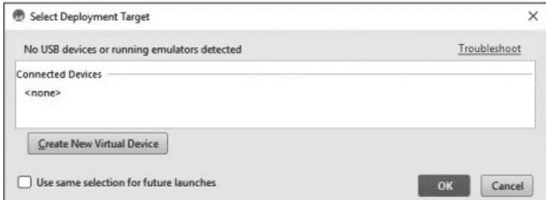

图 4-19：运行 Android 应用程序，你必须选择一个目标设备——模拟器或实际设备。

点击 `Create New Virtual Device`（创建新虚拟设备）按钮开始配置新的 Android 虚拟设备（AVD）。让我们从选择设备类型开始，如图 4-20 所示。

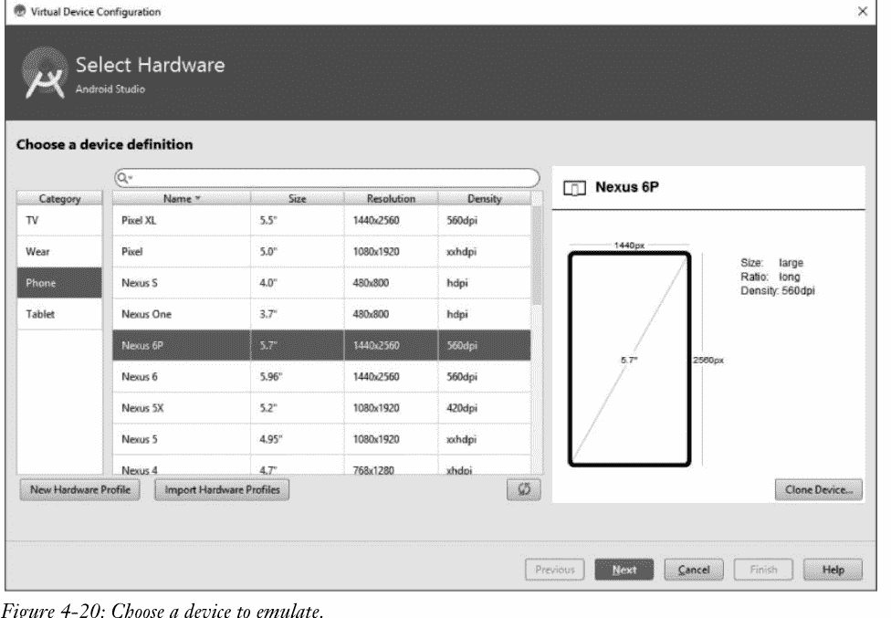

我们将首先选择 Nexus 6P，但你也可以尝试测试其它设备。如果你决定为 Google Play 商店开发自己的应用程序，你可能需要在各种屏幕尺寸和设备类型上进行测试，因此可以尝试设置几个不同的模拟器。但我们现在先从小开始，只用一个。

接下来，我们需要选择系统镜像，使用 x86 或 ARM。我们将使用 ARM 镜像，因此点击 `Other Images`（其他镜像）标签页，如图 4-21 所示。

## 虚拟设备配置

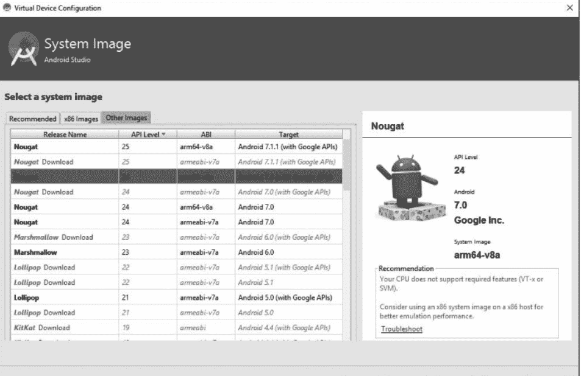

图 4-21：你可以选择 x86 或 ARM 模拟器；ARM 速度较慢，但在不同类型的处理器上运行通常更稳定。

如果你想要显示的 Android 版本、API 级别或模拟器以灰色字体显示，请点击你所需版本的 `Download`（下载）链接。

选择好 Android 模拟器后点击 `Next`（下一步）。现在，让我们使用带有 Google APIs 的 Nougat API 24 ARM Android 7.0 版本。你将看到最后一个界面，要求你验证配置，包括你想要进行的任何高级设置。让我们更改 AVD（即你模拟的设备）名称为 `My Nexus 6P`，如图 4-22 所示。

如果你在让模拟器在旧电脑上或内存小于 8 GB 的电脑上运行遇到困难，点击 `Show Advanced Settings`（显示高级设置），滚动到 `Memory and Storage`（内存和存储），并将 RAM 数量更改为 `768 MB`。


图 4-22：为你的新 AVD 命名。

点击 `Finish`（完成），你的新设备将被创建并保存到磁盘。现在是时候启动模拟器并尝试你的设备了。你会再次看到 `Select Deployment Target`（选择部署目标）窗口，但这次它显示 `My Nexus 6P` 为可用模拟器。现在点击 `OK`，如图 4-23 所示。

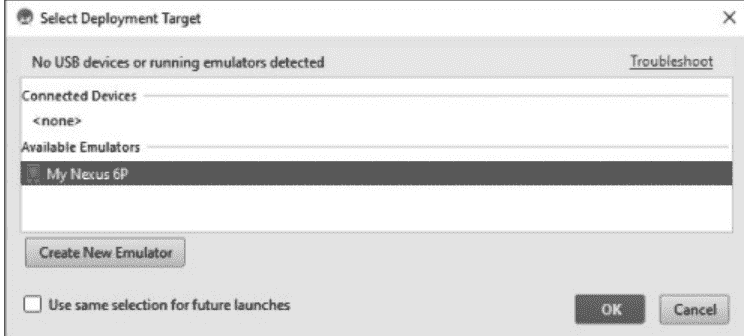

图 4-23：选择你刚刚创建的模拟器作为部署目标。

片刻之后，你会看到“Starting AVD”消息，随后是一个类似于图 4-24 所示的窗口。这可能需要几分钟。当模拟器启动时，你可能会看到 Android 屏幕。如果模拟器显示锁定屏幕，你可以点击屏幕左上角的返回箭头并进入 `Settings > Developer options`（设置 > 开发者选项）。确保开发者选项已开启，如图 4-24 所示。

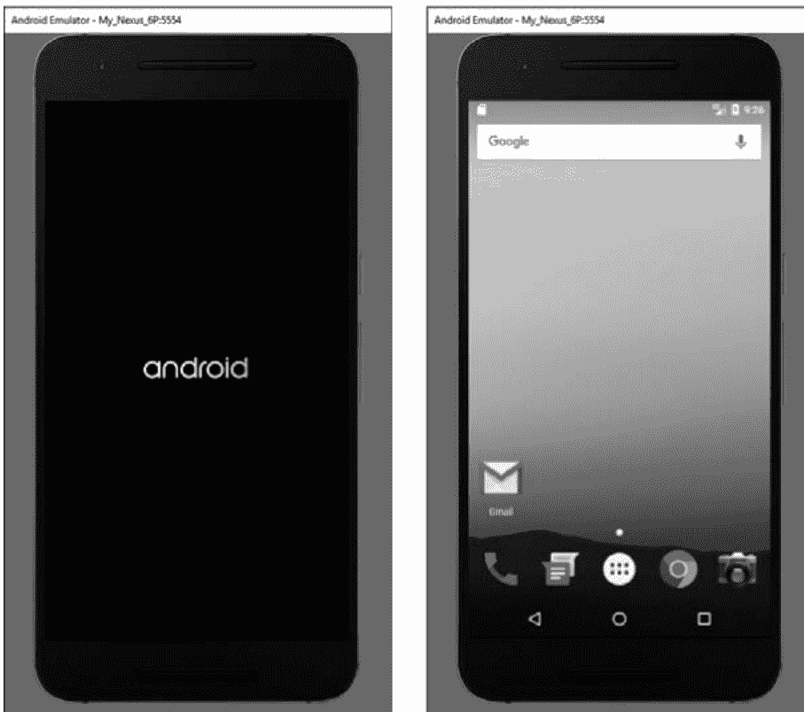

图 4-24：Android 启动（左）；Android 屏幕（右）

如果模拟器显示锁定屏幕，你可以点击屏幕左上角的返回箭头并进入 `Settings > Developer options`（设置 > 开发者选项）。确保开发者选项已开启，如图 4-24 所示。

现在你准备好连接设备到电脑并运行你的应用程序了。连接设备到电脑，你需要一根 USB 线，最好是手机或平板电脑附带的那根。

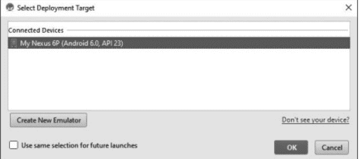

图 4-25：设备已连接（左）；Android 应用程序（右）

连接设备到电脑，你需要一根 USB 线，最好是手机或平板电脑附带的那根。

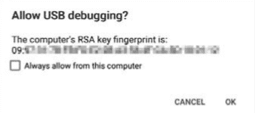

图 4-28：当你第一次将 Android 设备连接到计算机时，它会询问你是否要允许 USB 调试。

允许 USB 调试可以实现一些功能。首先，我们能够通过传输 Android 安装包文件（APK），将我们编写的程序直接传输到 Android 设备。这通常比在模拟器上运行程序快得多，而且是测试程序在真实设备上行为的更好方法。此外，我们还可以通过 USB 连接调试程序，这意味着我们可以从 Android 设备获取信息来帮助我们调试。这些信息将包含错误和其他日志记录，我们可以在类似控制台的应用程序（在 Android Studio 中称为 `logcat`）中读取这些内容。这与我们以前在命令行和桌面 GUI Java 程序中查找 bug 时所使用的控制台输出相似。

现在你已经将一台真实的 Android 设备连接到计算机，让我们来看看如何在它上运行猜数字游戏应用吧！

## 在你的设备上运行应用

现在我们准备好在 Android 设备上尝试运行应用了。在 Android Studio 中，点击运行按钮或进入 `Run ▶ ‘app’`。这一次，“选择部署目标”（Select Deployment Target）窗口将显示*两个*已连接的设备供选择，如图 4-29 所示：你的模拟器（My Nexus 6P）和你的真实 Android 设备。

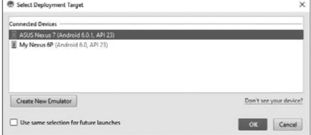

图 4-29：如果你已经解锁了开发者模式、启用了 USB 调试并成功连接了设备，你应该应该能够选择你的 Android 设备来运行应用。

这次选择你的真实 Android 设备并点击 `OK`。Android Studio 可能需要一些时间来构建应用程序，但一旦将 APK 文件传输到你的设备，你就会看到猜数字游戏应用直接在平板电脑或手机上打开。玩一两轮验证它的运行情况是否与模拟器上一样（可能更好，或者至少更快）。太酷了！

你可能会立即注意到一个重要的区别：屏幕底部被数字键盘覆盖了，如图 4-30 所示。

当我们为用户的猜测放置文本字段（`editText`）时，我们选择了一个数字文本字段作为输入，这样数字键盘就会显示。但由于模拟器运行在计算机上，计算机有自己的键盘，所以你之前在运行应用时可能没有看到这一点。

现在我们已经可以在 Android 手机、平板电脑或其他设备上运行 Android 应用了，让我们对猜数字应用的用户体验进行一些最后的改进吧。

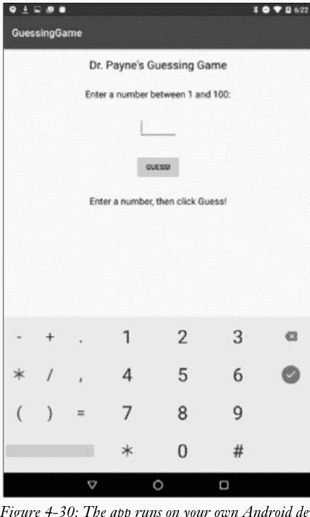

## 改进 UX

猜数字游戏应用在 Android 模拟器和真实 Android 设备上运行得都很完美，但有一些可以改进的 UX 项目。首先，我们将用户的猜测在数字文本字段中居中。其次，我们将学习如何像处理 Guess! 按钮一样处理 ENTER 键，让应用对用户来说更直观。

## 在文本字段中居中用户的猜测

在 Android Studio 中，再次打开 `content_main.xml` 布局。在设计预览中点击选择名为 `textGuess` 的文本字段。在属性（Properties）面板下，找到 `textAlign`。Android 中的 `textAlignment` 属性类似于桌面 GUI 中的 `horizontalAlignment` 属性——它允许我们更改用户输入的文本对齐方式。

点击居中文本对齐选项（类似于居中文本的图标）。如果你想在不运行应用的情况下在设计预览中进行测试，滚动找到 `text` 属性并输入值 `50`。该数字应该在设计预览面板的文本字段中居中显示。如果你不想在实际应用中显示它，请务必删除该测试值。

## 为 Enter 键添加监听器

让我们设置一个监听器来处理 ENTER 键，就像我们处理 Guess! 按钮点击一样，调用 `checkGuess()`。

回到 `MainActivity.java` 源码文件，滚动到 `onCreate()` 方法，你可能会发现我们是如何为按钮 `btnGuess` 添加 `onClickListener` 的。通过点击 `btnGuess.setOnClickListener(` 左侧的 `+` 号（使其看起来像这里所示的代码）。在它正下方，我们可以为文本字段 `txtGuess` 添加一个事件监听器，以处理按下 ENTER 键的动作事件。以下代码为 `txtGuess` 添加了监听器：

```java
btnGuess.setOnClickListener(new View.OnClickListener() {
    public void onClick(View v) {
        checkGuess();
    }
});

txtGuess.setOnEditorActionListener(new TextView.OnEditorActionListener() {
    @Override
    public boolean onEditorAction(TextView v, int actionId, KeyEvent event) {
        checkGuess();
        return true;
    }
});
```

我们正在监听的编辑器动作是用户在文本字段中输入时按下 ENTER 键。当该事件发生时，我们想要检查用户输入的猜测数字。

我们将返回语句更改为 `true` 值，因为我们希望让键盘留在屏幕上，以便用户输入下一次猜测。返回语句告诉文本字段，我们提供的事件处理代码是否已完成该事件。

## 再增加一个点睛之笔

猜数字游戏应用在 Android 模拟器和真实 Android 设备上运行得都很完美，但有一些可以改进的 UX 项目。首先，我们将用户的猜测在数字文本字段中居中。其次，我们将学习如何像处理 Guess! 按钮一样处理 ENTER 键，让应用对用户来说更直观。

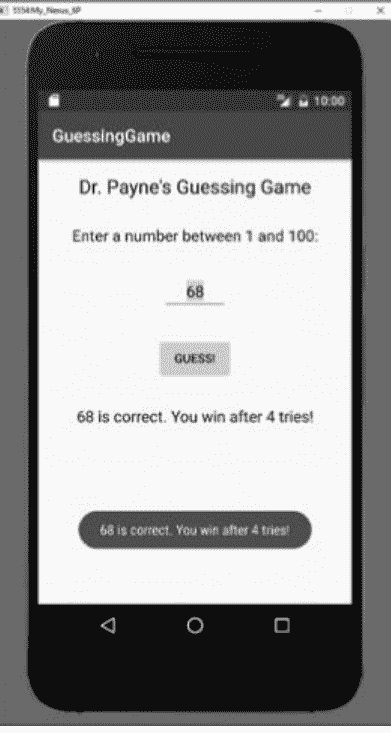

你可以使用 `Toast.makeText()` 方法创建一个 Toast 消息弹出框。这里有一个示例，帮助你在游戏胜利的 `else` 语句中添加一个 Toast 弹出框：

```java
else {
    message = guess + " is correct. " + numberOfTries + " tries";
    Toast.makeText(MainActivity.this, message, Toast.LENGTH_LONG).show();
    newGame();
}
```

这段代码中的 Toast 消息将弹在 `MainActivity`（猜数字游戏）之上，得益于 `Toast.LENGTH_LONG`，它会显示字符串消息几秒。还有一个 `Toast.LENGTH_SHORT`，但它弹出并消失的速度非常快，很难阅读。末尾的 `.show()` 方法执行了关键部分，即在屏幕上显示 Toast。

与 GUI 桌面版本一样，为了完成这项任务，你需要在类顶部创建一个新变量（例如 `int numberOfTries = 0`）；每当 `checkGuess()` 方法成功运行时就增加尝试次数，并更改输出消息，在用户获胜时显示尝试次数（分别在 Toast 弹出框中和在 `lblOutput` 字段中）。在计算完尝试次数后，添加你在第 3 章中学到的关于尝试次数用尽或失败的功能。给用户 7 次机会，并在每次猜测后告诉他们剩余多少次机会。

## #2: 增加视觉吸引力

探索 Android Studio 中 GUI 组件的一些更具美感的属性，包括背景颜色、前景颜色、字体、字体大小等。移动你猜数字游戏应用中的组件，使界面更具视觉吸引力。关于你可以自定义游戏的一种示例，请参见图 4-34。

你甚至可以添加自定义背景图片（将图像文件添加到应用的 `res > drawable` 文件夹，然后将其选择为布局、按钮或其他组件的背景属性）。尝试各种设置——你随时可以通过按 `CTRL-Z` 来撤销！

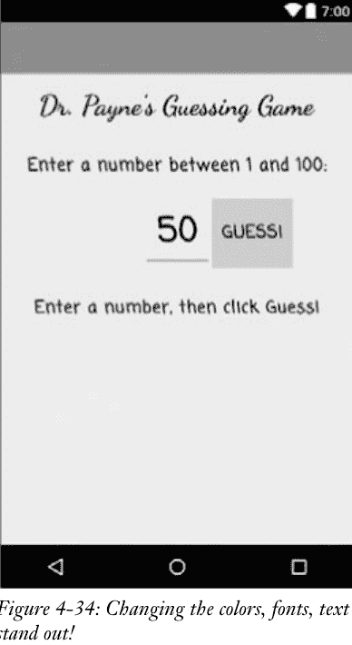

## #3: 创建一个 MadLibs 移动应用

回顾你在第 3 章构建的 `MadLibsGUI.java` 程序（第 74 页的编程挑战 #3）。现在为你的 MadLibs 应用创建一个移动版本，在带有标签和文本字段的 GUI 中提示用户输入若干个单词，例如 `txtAnimal`、`txtTenseVerb`、`txtSmallContainer` 和 `txtFood`。添加一个用户可以点击的按钮来生成自己的 MadLibs 风格故事。在每个文本字段中包含一些默认或初始文本是一个很好的做法，可以让用户了解程序是如何工作的。

当用户点击按钮时，程序应该在 `TextView` 或 `EditText` 中显示完成的 MadLibs 故事——这使得用户如果想分享，就可以复制并粘贴他们有趣的故事。尝试不同的颜色、字体和布局，直到你对结果满意，然后与朋友分享你的创作吧！

> **提示**
>
> 要让 `TextView` 或 `EditText` 显示多行，请使用转义字符序列 `\n` 在你使用 `setText()` 方法显示的字符串消息中插入新行，如下所示：`"Once upon a time... \n There was a buffalo princess \n who lived in a soup can."` 这段引言将跨三行，每当 `\n` 转义序列出现的地方都会被换行符分隔。

# 5 通过添加菜单和偏好设置完善你的应用


你编写了一个有趣的 Android 应用，但它仍然缺少一些东西。你还没有学习如何在 Android 中构建设置或选项菜单，也没有学习如何保存高分、游戏统计和其他信息。在本章中，我们将为 Hi-Lo 猜数字游戏应用添加选项菜单以及存储信息的能力。

## 在 Android 中添加选项菜单

大多数应用和游戏都有用户可以通过菜单访问的选项或设置。对于 Hi-Lo 猜数字游戏，我们可能希望允许用户更改游戏难度、重新开始、查看游戏统计或查看“关于”屏幕，因此我们将创建一个执行所有这些操作的菜单。

在 Android 中添加选项菜单通常有四个步骤：

1. 修改应用的默认 XML 菜单文件，创建作为用户可以选择的选项的项目。
2. 修改应用的 activity 文件，以显示我们在上一步中创建的菜单和选项。
3. 创建事件处理程序来确定用户何时选择了一个选项。
4. 编写在用户选择每个选项时执行该选项的代码。

添加选项菜单不仅会让我们的应用看起来和感觉很专业，还能让用户对游戏体验有更大的控制权。我的儿子非常喜欢改变猜数字游戏的范围，从 1 到 10，1 到 100，再到 1 到 1000，但当我们添加显示获胜次数的“游戏统计”选项时，我几乎无法从他们那里拿回设备了——他们想留着。

## 向菜单添加项目

打开应用的默认 XML 菜单文件，创建作为用户可以选择的选项的项目。修改应用的 activity 文件，以显示我们在上一步中创建的菜单和选项。创建事件处理程序来确定用户何时选择了一个选项。编写在用户选择每个选项时执行该选项的代码。

添加选项菜单不仅会让我们的应用看起来和感觉很专业，还能让用户对游戏体验有更大的控制权。

```xml
<menu xmlns:android="http://schemas.android.com/apk/res/android">
    <item
        android:id="@+id/settings"
        android:title="Settings" />
</menu>
```

（注：根据上下文重建的 XML 结构）

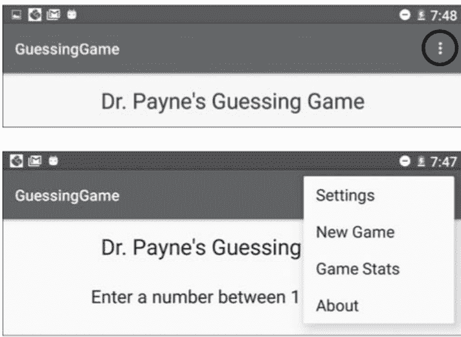

图 5-1：选项菜单显示为应用操作栏中的三个点（顶部）。点击三个点将展开选项菜单（底部）。

在 `MainActivity.java` 文件中，找到并修改 `onOptionsItemSelected` 事件处理方法。或者，你也可以将其添加在上一节中修改过的 `onCreateOptionsMenu()` 之后，但在文件最后一行的结束括号之前。

```java
public boolean onCreateOptionsMenu(Menu menu) {
    MenuInflater inflater = getInflater();
    inflater.inflate(R.menu.menu_main, menu);
    return true;
}

public boolean onOptionsItemSelected(MenuItem item) {
    switch (item.getItemId()) {
        case R.id.action_settings:
            return true;
        case R.id.action_newgame:
            newGame();
            return true;
        case R.id.action_gamestats:
            return true;
        case R.id.action_about:
    }
}
```


```java
return true;

default:
    return super.onOptionsItemSelected(item);
}
```

在这段代码中，我们使用 `switch` 语句来确定用户在菜单上选择了哪一个选项。`switch` 语句是测试多个条件的另一种方式，类似于长链的 `if-else` 语句。我们不需要链用四个语句来测试每个可能的项目选择，而是可以使用单个 `switch` 语句，并在 `switch` 关键字后的括号内放入我们要测试的变量。在这个示例中，我们正在检查所用菜单项的 id，即使用 `switch (item.getItemId())`。然后，在 `switch` 语句的大括号内，我们列出想要测试的值作为 `case` 语句（例如 `case R.id.action_settings`），每个值后面跟着一个冒号；随后是选择该项后要执行的代码，以及 `break` 或 `return` 语句。此事件处理程序返回一个布尔值，因此我们在每个 `case` 块中都使用了 `return` 语句而不是 `break` 语句。如果我们在这里没有使用 `return` 语句，就需要使用 `break` 命令作为每个 `case` 的最后语句。

此代码中的每个 `case` 语句都会测试我们在 `menu_main.xml` 文件中输入的项目项的一个 `id` 值，且每个值对应的代码都将根据用户的选择而执行。目前，我们只为 `action_newgame` 情况编写了代码，它使用 `newGame()` 方法开始新游戏。

## 为“关于”屏幕创建警报对话框

对于“关于”（About）菜单选项，我们将弹出一个与你可能在其他应用程序中见过的类似对话窗口。为了实现这一点，我们将使用警报对话框（alert dialog），这是一种灵活的弹出窗口，用于告知用户某些信息或提示其响应。这种弹出窗口比第 4 节中使用的 Toast 弹出窗口（第 106 页的“编程挑战 #1”）更具适应性，因为 `AlertDialog` 类允许我们通过 `Builder` 子类来自定义对话框的属性。在这种情况下，我们将使用警报对话框来响应用户选择“关于”选项，通过一条消息告诉他们正在玩的这款很棒的 Hi-Lo 游戏是谁创建的。

为 `action_about` 项目选择的 `case` 语句添加以下代码：`case R.id.action_about:`：

```java
AlertDialog aboutDialog = new AlertDialog.Builder(MainActivity.this).create();
aboutDialog.setTitle("About Guessing Game");
aboutDialog.setMessage("2018 Your Name.");
aboutDialog.setButton(AlertDialog.BUTTON_NEUTRAL, "OK", new DialogInterface.OnClickListener() {
    public void onClick(DialogInterface dialog) {
        dialog.dismiss();
    }
});
aboutDialog.show();
```

我们使用 `AlertDialog` 类 ① 创建了一个自定义的弹出窗口。② 处的代码将弹出窗口的标题设置为“About Guessing Game”，③ 处的行显示了一条带有版权信息和你的名字的简单消息（尽管你可以在这里编写任何你喜欢的文本）。`setButton()` 方法 ④ 在弹出窗口中添加了一个文本为“OK”的按钮，随后的 `onClick()` 事件监听器会在用户点击“OK”按钮时，通过调用 `dismiss()` 方法 ⑤ 关闭弹出窗口。最后，通过 `show()` 命令 ⬬ 显示自定义的弹出窗口。

使用 `ALT-ENTER`（或 `OPTION-ENTER`）导入 `AlertDialog` 类。然后保存你更新后的代码并运行应用的新版本。当你点击选项菜单并选择“关于”选项时，你应该能看到一个类似于图 5-2 所示的弹出窗口。


图 5-2：Hi-Lo 猜游戏应用开始感觉越来越像一个专业的 Android 应用了！现在让我们大放异彩，允许用户选择游戏的难度级别，并跟踪他们赢了多少游戏。

## 修改猜测范围

让用户选择猜测范围——例如，从 1 到 10、1 到 100 或 1 到 1,000——将是一项巨大的增强。现在你已经理解了选项菜单和警报对话框，让我们规划一下如何升级游戏以允许用户更改范围设置。

首先，我们需要为范围添加一个变量，这样我们就不再使用硬编码的值，而是使用用户选择的范围。其次，我们需要在几个方面修改应用的行为。我们将更改 `newGame()` 方法以使用新的范围变量。我们还将使读取“在 1 到 100 之间输入数字”的 `TextView` 根据所选范围显示不同的提示。最后，我们需要给用户一种选择范围的方法。我们将通过构建另一个警报对话框来实现这一点，提供范围选择：1 到 10、1 到 100 和 1 到 1,000。

## 为范围添加变量

首先，我们将使用变量替换随机数计算中硬编码的 100。在 `MainActivity` 类顶部添加一个用于范围的变量并将其设置为默认值 100：

```java
public class MainActivity extends AppCompatActivity {
    private EditText txtGuess;
    private Button btnGuess;
    private TextView lblOutput;
    private int range = 100;
```

当我们在添加变量时，还需要添加那个读取“在 1 到 100 之间输入数字”的标签。当用户选择非 100 的范围时，标签将不再正确，因此我们需要一个变量来存储显示的文本。我们将创建一个名为 `lblRange` 的变量来实现此目的：`private int range = 100;`

为了将 GUI 与 `lblRange` 连接，在 `onCreate()` 方法中添加以下行：

```java
protected void onCreate(Bundle savedInstanceState) {
    super.onCreate(savedInstanceState);
    setContentView(R.layout.activity_main);
    txtGuess = (EditText) findViewById(R.id.txtGuess);
    btnGuess = (Button) findViewById(R.id.btnGuess);
    lblOutput = (TextView) findViewById(R.id.lblOutput);
    lblRange = (TextView) findViewById(R.id.textView2);
}
```

如果你遇到错误，请检查设计视图中的标签名称：打开 `app ▶ layout ▶ content_main.xml` 并点击标签“在 1 到 100 之间输入数字”。将标签的 id 更改为 `textView2`。

设置好 `range` 和 `lblRange` 变量后，是时候修改应用行为以使用这些变量而不是硬编码的值了。

## 使用 range 变量

首先，让我们修改 `newGame()` 方法使用范围变量。我们还需要添加所需的代码来更改提示，让用户知道正确的范围。

最后的点睛之笔——我特意在 `txtGuess` 文本框中输入了一个默认起始值，即范围的一半。所以，如果用户在 1 到 10 之间猜测，猜测文本框将显示 5 作为默认首次猜测；如果范围是 1,000，文本框将建议首次猜测 500。

一个与范围相关的更改位于 `checkGuess()` 方法中。我们添加了 `try-catch` 语句来处理错误的用户输入，并在 `catch` 语句中，告诉用户在 1 到 100 的范围内输入一个整数。让我们只更改 `catch` 语句以反映用户的范围：

```java
public void checkGuess() {
    // --snip--
} catch (Exception e) {
    message = "在 1 到 " + range + " 之间输入一个整数";
} finally {
    // --snip--
}
```

现在两个 `TextView` 标签都能正确显示用户选择的范围。

## 构建允许用户选择范围的对话框

范围设置对话框应该在用户选择菜单中的设置选项时，向用户显示所有范围选项（1 到 10、1 到 100 和 1 到 1,000）。为了显示选项列表，我们将构建另一个自定义的警报对话框，但这将显示一个三个选项的列表视图。

首先，滚动到你的 `onOptionsItemSelected()` 方法并在 `action_settings` 语句中添加以下代码：

```java
public boolean onOptionsItemSelected(MenuItem item) {
    switch (item.getItemId()) {
        case R.id.action_settings:
            final CharSequence[] items = {"1 to 10", "1 to 100", "1 to 1000"};
            AlertDialog.Builder builder = new AlertDialog.Builder(this);
            builder.setTitle("Select the Range:");
            builder.setItems(items, new DialogInterface.OnClickListener() {
                public void onClick(DialogInterface dialog, int item) {
                    switch(item) {
                        case 0:
                            range = 10;
                            newGame();
                            break;
                        case 1:
                            range = 100;
                            newGame();
                            break;
                        case 2:
                            range = 1000;
                            newGame();
                            break;
                    }
                    dialog.dismiss();
                }
            });
            AlertDialog alert = builder.create();
            alert.show();
            return true;
```

这段代码将显示一个带有三个范围选项的对话框。`builder.setItems()` 方法将接受一个列表和一个事件监听器来处理来自列表的用户选择。

如果用户选择了第一个选项，我们需要将 `range` 变量的值更改为 10，第二个和第三个选项同样更改为 100 和 1000：

```java
case R.id.action_settings:
    final CharSequence[] items = {"1 to 10", "1 to 100", "1 to 1000"};
    AlertDialog.Builder builder = new AlertDialog.Builder(this);
    builder.setTitle("Select the Range:");
    builder.setItems(items, new DialogInterface.OnClickListener() {
        public void onClick(DialogInterface dialog, int item) {
            switch(item) {
                case 0:
                    range = 10;
                    newGame();
                    break;
                case 1:
                    range = 100;
                    newGame();
                    break;
                case 2:
                    range = 1000;
                    newGame();
                    break;
            }
            dialog.dismiss();
        }
    });
```

注意在为每个项目选择设置新 `range` 后，我们调用 `newGame()` 来在屏幕上显示新范围。

在做出这些更改后保存文件并运行游戏以测试新范围。将 `range` 从 10 到 100 几轮，如果你很勇敢，就改为 1000。

关闭应用并再次打开，你会发现当第二次运行时，游戏没有记住你的偏好范围。应用也不会记住你猜对数字有多厉害。只有一种方法可以让应用记住你的偏好范围和获胜的游戏次数……

## 存储用户偏好和统计

记住用户偏好和游戏统计的关键是将持久化信息保存到 Android 设备中。持久化信息是应用程序关闭后仍留在设备上的任何数据。在数字大小游戏中，我们想要存储用户的偏好难度和获胜的游戏次数作为持久化信息。

有三种方法可以将持久化数据保存到 Android 设备：存储 shared preferences、保存文件以及在数据库中保存数据。Shared preferences 是一种对象，存储了应用程序下次使用时需要保存的短列表设置。之所以被称为 shared preferences 是因为你可以在应用程序的多个活动或屏幕之间共享设置，例如选项菜单和数字游戏的主屏幕。保存文件到设备适用于你需要存储大量数据的情况（例如文档），而数据库对于通讯录或联系人列表等应用是必要的。但对于数字游戏，我们只需要存储几个数字，因此使用 shared preferences。

## 存储和检索用户的偏好范围

Shared preferences 以键值对的形式存储，每个值都有一个用于检索它的关联键。例如，你可以有一个像 "range" 和 "100" 的对，其中 "range" 是键，“100" 是我们存储在该键下的值。让我们写一个方法将用户的偏好范围存储到 shared preferences。

在你的 `MainActivity.java` 文件底部，在 `onOptionsItemSelected()` 方法之后、大括号之前添加以下方法：

```java
return super.onOptionsItemSelected(item);
}

public void storeRange(int newRange) {
    SharedPreferences preferences = PreferenceManager.getDefaultSharedPreferences(this);
    SharedPreferences.Editor editor = preferences.edit();
    editor.putInt("range", newRange);
    editor.apply();
}
```

你创建的每个应用已经有一个默认的 shared preferences 对象，可以通过创建一个 `SharedPreferences` 对象来访问它。要这样做，通过调用 `PreferenceManager` 上的 `getDefaultSharedPreferences()` 来访问创建并维护 shared preferences 列表的默认对象。记得导入或者按下 `ALT-ENTER`（或 `OPT-ENTER`）。

要写入 shared preferences，必须使用 `Editor` 对象，它允许我们编辑单个 shared preference 值。使用 `put` 方法，例如 `putString` 存储字符串值、`putInt` 存储整数、`putFloat` 存储浮点小数值、`putBoolean` 存储真/假值等。每当用户选择一项时，我们将 `range` 变量传递给 `storeRange()` 方法。为了在 "range" 键下存储范围，我们使用 `editor.putInt("range", newRange)`。`apply()` 方法告诉 Android 你已完成对 shared preferences 的修改，它可以应用这些更改。现在我们在 `onOptionsItemSelected(item)` 方法的每个 `case` 事件监听器中存储范围：

```java
public boolean onOptionsItemSelected(MenuItem item) {
    switch (item.getItemId()) {
        case R.id.action_settings:
            final CharSequence[] items = {"1 to 10", "1 to 100", "1 to 1000"};
            AlertDialog.Builder builder = new AlertDialog.Builder(this);
            builder.setTitle("Select the Range:");
            builder.setItems(items, new DialogInterface.OnClickListener() {
```


```java
public void onClick(DialogInterface dialog, int item) {

    switch(item) {

        case 0:

            range = 10;

            newGame();

            break;

        case 1:

            range = 100;

            newGame();

            break;

        case 2:

            range = 1000;

    }

    dialog.dismiss();

}

}

);

Alert alert = builder.create();

alert.show();

return true;
```

最后，我们需要在游戏加载时从 shared preferences 获取范围，这样游戏在下次启动时将使用用户上次使用的范围。滚动到 `onCreate` 方法并添加以下两行代码从 shared preferences 获取范围：

```java
protected void onCreate(Bundle savedInstanceState) {

    super.onCreate(savedInstanceState);

    setContentView(R.layout.activity_main);

    txtGuess = (EditText) findViewById(R.id.txtGuess);

    btnGuess = (Button) findViewById(R.id.btnGuess);

    lblOutput = (TextView) findViewById(R.id.lblOutput);

    lblRange = (TextView) findViewById(R.id.textView2);

    SharedPreferences preferences = getSharedPreferences(this);

    range = preferences.getInt("range", 100);

    newGame();

}
```

将其值加 1，并存储新值。将此代码添加到你的 `checkGuess()` 方法中，将其放在猜对数字的 `else` 语句内：

```java
public void checkGuess() {

    String guessText = txtGuess.getText().toString();

    String message = "";

    try {

        int guess = Integer.parseInt(guessText);

        if (guess < theNumber)

            message = guess + " is too low. Try again.";

        else if (guess > theNumber)

            message = guess + " is too high. Try again.";

        else

            message = guess + " is correct. You win! Let's play again!";

    }

}
```

- ① `SharedPreferences preferences = Manager.getDefaultSharedPreferences(this);`
- ② `int gamesWon = preferences.getInt("gamesWon", 0) + 1;`
- ③ `SharedPreferences.Editor editor = preferences.edit();`
- ④ `editor.putInt("gamesWon", gamesWon);`
- ⑤ `editor.apply();`
- `newGame();`

在这里，我们在 ① 处访问了默认 `SharedPreferences`，在 ② 处，我们获取了键名为 "gamesWon" 的存储值（如果是用户第一次胜利，则默认值为 0），并加了 1 以计算这次胜利。在 ③ 处，我们创建了一个编辑器向共享偏好设置写入新值。在 ④ 处，我们将整数值 `gamesWon` 放入对应键名的共享偏好设置中供以后使用，在 ⑤ 处，我们告诉 Android 将更改写入设备。

这已经了解决了存储胜利次数的问题，但如何向用户显示这些统计数据呢？为了做到，我们需要在 `onOptionsItemSelected()` 方法中为 `actionGamestats` 情况添加代码，如下：

```java
case R.id.action_gamestats:

    // ①
    SharedPreferences preferences = Preference.getDefaultSharedPreferences(this);

    // ②
    int gamesWon = preferences.getInt("gamesWon", 0);

    // ③
    AlertDialog statDialog = new AlertDialog.Builder(MainActivity.this).create();

    statDialog.setTitle("Guessing Game Stats");

    statDialog.setMessage("You have won " + gamesWon + " games. Way to go!");

    statDialog.setButton(AlertDialog.BUTTON_NEUTRAL, "OK",
        new DialogInterface.OnClickListener() {
            public void onClick(DialogInterface dialog, int which) {
                dialog.dismiss();
            }
        });

    // ④
    statDialog.show();

    return true;
```

①，我们连接到应用的默认共享偏好设置，在 ② 处，获取胜利次数（以防程序首次运行，我们给出一个默认值 0）。在 ③ 处，我们构建了一个警告对话框向用户显示他们胜利的次数，在 ④ 处，我们显示该数字以及一条鼓励性的消息。

保存最后的这些更改并编译并运行你的应用。你的挑战可能是尝试停止玩！图 5-3 显示了如果你有几个高手玩你的游戏，游戏统计界面看起来是什么样的。


图 5-3：游戏统计界面记录了你（或你的朋友）猜对数字的次数。

添加选项菜单、保存游戏统计数据和用户偏好设置、显示警告对话框——这些点睛之笔可以让你的游戏或任何其他应用作为一个专业的、功能完备的移动应用程序独立出来。每当你想到新功能时，继续改进你的应用，你将会拥有一个值得与朋友——或与世界分享的应用。编码愉快！

## 你学到的知识

你通过为 Hi-Lo 猜数字游戏应用添加几个点睛之笔，构建了一个专业级的 Android 移动游戏，包括：
- 为 Android 应用添加选项菜单
- 通过编辑菜单的 XML 文件设计选项菜单
- 使用 `Inflater` 显示选项菜单
- 响应菜单中的选择
- 使用带有多个 `case` 语句的 `switch` 语句来替换长长的 `if-else` 链
- 在 Android 中使用 `AlertDialog` 类创建自定义弹窗
- 使用 `SharedPreferences` 类存储共享偏好设置和应用统计数据
- 在应用启动时获取用户的共享偏好设置

## 编程挑战

尝试完成这些编程挑战练习，以回顾和练习你所学的内容，并扩展你的编程技能。访问书籍网站 `https://www.nostarch.com/learnjava/` 下载示例解决方案。

### #1：有得有失

第 4 章（第 106 页）中的编程挑战 #1 要求你给用户 7 次机会来猜一个 1 到 100 之间的数字。现在你已经添加了更改范围的能力，你需要更改次数以匹配。

你在第 4 章中了解到，我们可以使用二分查找策略（每次猜剩余可能值的中间值）来猜一个 1 到 100 之间的数字，次数是 $2^7$，即 2 的 7 次方，等于 128。这意味着使用二分查找法，我们每次应该能够在 7 次猜测内猜出 1 到 128 之间的数字。但猜 1 到 10 之间或 1 到 1,000 之间的数字需要多少次猜测呢？

为了确定需要的次数，我们需要知道 2 的最低幂是多少，使其能得到一个大于范围的数字。

例如，对于 1 到 10 之间的数字，$2^4 = 16 > 10$；对于 1 到 1,000 之间的数字，$2^{10} = 1024 > 1000$，所以我们需要 10 次。

（注：原文此处存在大量重复的段落，翻译时已按逻辑结构处理）

### #2：胜负率

在完成挑战 #1 后，修改游戏以显示胜利的比例。

图 5-4：显示...的游戏统计界面


图 5-4：显示...的游戏统计界面

### #6

## 解密消息


你可能给朋友发送过秘密笔记来隐藏信息。在本章中，我们将执行类似操作创建一个秘密消息应用。

## 凯撒密码

我们之前的应用 Hi-Lo 猜数字游戏全是关于数字的——太高、太低或正确。相比，我们的秘密消息应用将关注文本。你将学习处理文本字符串并操作字符值以生成编码。

凯撒密码以罗马皇帝凯撒（公元前100–44年）命名。历史学家说凯撒喜欢通过“移动”字母表来加密他的私人消息，例如写给将军的笔记。图 6-1 显示的密码盘将字母表移动了 13 个字母。

在密码盘中，外部字母与它们应该替换的内部字母对齐，因此 A 变成 N，B 变成 O，以此类推。加密创建了以下示例：

> Secret messages are so cool!
> Frperg zrrntrf ner fbby!

尝试通过反替换将此消息解码回明文：找到每个内部字母并将其替换为相应的外部字母。并不是所有的凯撒密码都像这样是对称的。对称意味着同一个过程可以用于加密和解码消息。例如，在加密时加 13 F 变成 S，在解码时减 13 S 变成 F，你可以使用同一个密码盘和密钥（移动字母的数字，在此处为 13）处理这两个过程。移动字母的数字被称为密钥，因为知道它可以“解锁”密码。我们将构建的秘密消息应用允许我们使用任何密钥值。

## 设置 Secret Messages 应用

我们将像之前制作 Hi-Lo 猜数字游戏一样构建 Secret Messages 应用：首先，我们将创建一个命令行版本，然后是一个用于桌面的 GUI，最后再创建一个 Android 移动应用。命令行版本看起来相当简单，如图 6-2 所示，但它将允许我们快速方便地测试加密算法。

```
Select Command Prompt

Enter a message to encode or decode:

Secret messages are so cool!

Enter a secret key (-25 to 25):

13

Erperg zffrnt ner fb pby!

c:\Users\Bryson Payne\workspace_ch05\SecretMessages\bin\_
```

图 6-2：Secret Messages 应用的命令行版本

正如你在图 6-2 中所示，程序要求用户输入一个要加密或解码的消息，随后是一个密钥值。程序随后返回加密后的消息。请注意，当我们开始编写该应用时，整个消息都将被加密，包括空格和标点。在最终版本中，我们将添加一些逻辑仅加密字母，如图 6-2 所示。

## 在 Eclipse 中创建 SecretMessages 项目

让我们从打开 Eclipse 开始。如果你仍然打开着之前项目的文件，请现在关闭这些文件。要创建一个新的 Java 项目，转到 `File ▸ New Java Project` 并将项目命名为 *SecretMessages*。点击 **Finish**。

在 Package Explorer 中，展开 *SecretMessages* 项目文件夹以看到 *src* 文件夹。右键点击 *src* 文件夹并选择 `New ▸ Class` 以创建一个新的 Java 源代码文件，你也将其命名为 *SecretMessages*。勾选复选框创建一个 `main()` 方法，如图 6-3 所示。

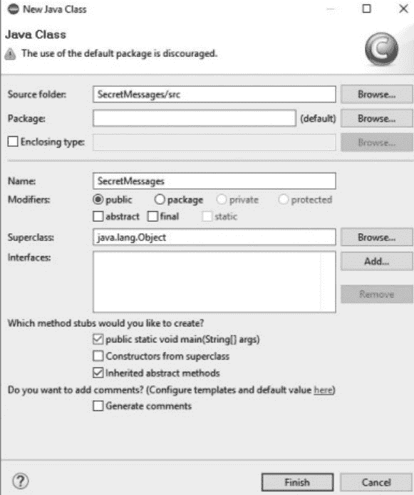

图 6-3：创建一个新的 Java 项目，带有新的类文件 SecretMessages，并勾选复选框创建一个 `main()` 方法存根。

点击 Finish，你将在 Eclipse 的主窗口中看到 `SecretMessages.java` 文件。让我们开始编写 Secret Messages 应用的代码吧！

## 开始编写 SecretMessages.java

在 `SecretMessages.java` 文件的顶部，`public class SecretMessages` 声明上方，添加 `java.util.Scanner` 的导入语句，以便我们可以请求用户输入：

```java
import java.util.Scanner;

public class SecretMessages {

    public static void main(String[] args) {

        Scanner scan = new Scanner(System.in);

        System.out.println("Enter a message to encode or decode:");

    }

}
```

在 `main()` 方法内部，我们设置了一个名为 `scan` 的扫描器对象。然后，我们提示用户输入要加密或解码的消息。

在用户提示之后，我们将创建一个名为 `message` 的字符串变量，以接收用户输入的文本：

```java
System.out.println("Enter a message to encode or decode:");

String message = scan.nextLine();
```

然后，我们使用 `scan` 对象的 `nextLine()` 方法获取用户的整行输入（直到遇到 ENTER 或 RETURN 字符），并将其存储在字符串 `message` 中。

到目前为止，该应用可以要求用户输入消息并将该消息扫描到变量中。现在我们需要学习如何操作字符串内部的字符，以创建消息的加密版本。在继续下一节之前，请保存你的文件。

## 处理字符串

到目前为止，Secret Messages 应用看起来与 Hi-Lo 猜数字游戏应用非常相似。我们设置了一个输入扫描器，提示用户进行输入，扫描控制台用户的响应，并将输入捕获到变量中。让 Secret Messages 应用与众不同的是它处理字符串内部字符的能力。

凯撒密码命令行应用将需要很多步骤才能完成，因此我们将迭代地构建应用。这意味着，我们不是一次性写出整个代码并希望最后结果正确，而是一点一点地（或者说一次迭代一次）创建应用，并边做边测试，这样我们在每个点都都有一个可以运行的程序。每次迭代可能不具备我们需要的所有功能，但我们最终将获得一个完整的、功能全的应用。

我们需要使用文本处理将输入字符串转换为输出字符串。为了开始在 Java 中处理文本字符串，我们将构建一个简单的消息反转器。换句话说，我们将用户输入的消息并以字母反转的顺序返回给他们。例如，“Meet me at the arcade 5pm”将变成“mp5 ta edacra eht ta em tee”。

首先，我们创建一个名为 `output` 的变量用于反转后的字符串，并将其赋值为空字符串：

```java
String message = scan.nextLine();

String output = "";
```

我们需要一个循环来遍历消息中的字符。为了方便起见，可以选择 `for` 循环，因为我们知道消息中字符的数量。（稍后，我们将使用 `message.length()` 方法来告知消息包含多少个字符。）Java 中的 `for` 循环声明需要完成三件事：初始化循环变量、测试一个继续执行的条件，以及在下一次迭代之前更新循环变量。我们在这三个部分之间放置分号以分隔它们。语法如下：

```java
for (initialization; condition; update) {

    // body

}
```

让我们重新检查循环逻辑：

```java
for (int x = message.length() - 1; x >= 0; x--) {

    output += message.charAt(x);

}
```


```java

System.out.println("Enter a message to encode and decode:");

String message = scan.nextLine();

String output = "";

for (int x = message.length() - 1; x >= 0; x--) {

    output += message.charAt(x);

}

System.out.println(output);

```

Listing 6-1：Secret Messages 应用的第一次迭代反转了用户消息中的字符。

你可以在 Eclipse 中运行该程序并使用你自己的消息进行测试，如图 6-5 所示。这并不是我们的完整的 Secret Messages 应用，但它确实让消息变得难阅读且容易解码。

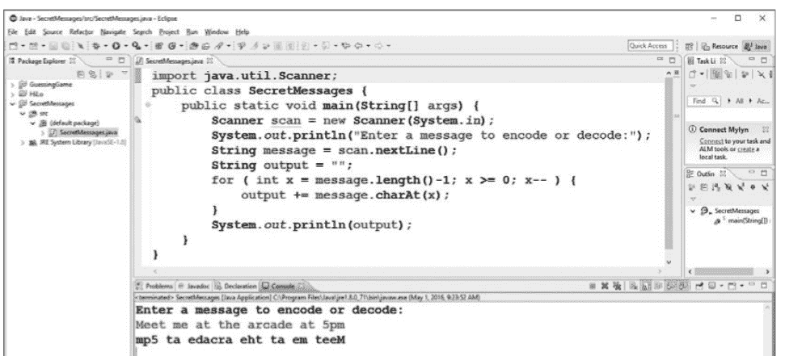

图 6-5：运行程序并在屏幕底部的控制窗口中输入你想要反转的消息。

你甚至可以通过复制编码后的反转消息并将其粘贴到程序中解码消息，如图 6-6 所示。因此，你可以输入一条消息，对其进行编码，然后将其粘贴给朋友的消息中，他们可以通过将编码后的消息粘贴到同一个程序中来解码。你构建了自己的第一个秘密消息编码器！

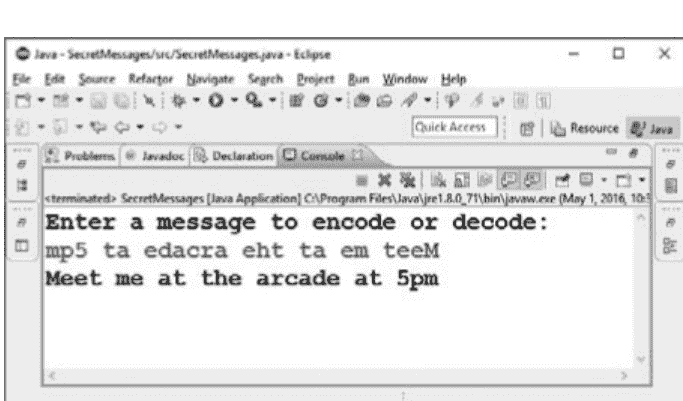

图 6-6：将编码后的消息粘贴到运行中的程序进行解码。

此版本的应用程序简单到你可以在不运行程序的情况下读取消息，因此它不是给朋友发送消息的安全方法。但你确实学会了如何使用 `for` 循环遍历文本字符串、如何获取字符串的长度 `length()`、如何使用 `charAt()` 访问字符串中特定索引或位置的字符，以及如何使用 `+` 运算符向字符串末尾添加字符。在下一节中，你将学习如何更改消息中单个字符的值，使其更难阅读，但仍然易于我们的程序解码。

### Java 中的字符和值

构建一个更好的秘密消息编码器需要处理处理文本字符串中字符值的能力。对于凯撒密码（Caesar cipher），我们需要能够位移这些值——例如，将 A 变为 N，将 N 变为 A。要做到这一点，你需要了解字符在计算机中是如何存储的。

在 Java 中，单个字符（如 'a'）可以存储在自己的数据值：`char`。注意我们使用单引号来标记字符值。字符串的 `charAt()` 方法返回表示单个字符的 `char` 值。Java 使用 16 位 Unicode 字符。Unicode 是一种国际字符集，包含来自世界各地的数千个符号，这些符号以数值表示。`char` 类型是一种通过其数值存储 Unicode 字符（如 'A'、'ñ' 和 'ç'）的方法。

我们可以像对 `int` 变量相加一样对 Unicode char 值赋值。在 Secret Messages 应用中，我们希望将 'A' 的 char 值（65）与密钥（13）相加，得到新的 char 值（78），它代表编码后的字母（'N'）。

对于应用程序的第二次迭代，让我们通过设置一个名为 `key` 的变量并在其中存储值 13 来开始编写凯撒密码。我们将在 `String output` 行下方添加它：

```java

String output = "";

char key = 13;

```

我们还需要修改 `for` 循环，使其从字符串开头运行到末尾。这次我们从索引 0 开始，并在 `x` 小于 `message.length()` 时遍历字符串。每次重复循环时，我们对字符位置 `x` 加 1。这里是新的 `for` 循环：

```java

char key = 13;

for (int x = 0; x < message.length(); x++) {

```

最后，我们不再将消息字符串的原始字符添加到输出字符串中，而是需要将密钥值添加到每个字符，确保我们得到的是一个可以添加到输出字符串的 `char` 值：

```java

output += (char)(message.charAt(x) + key);

```

我们已经向消息字符串中的每个字符添加了密钥值，然后获取该和并将其强制转换为 `char`。在括号前加上括号会强制其右侧的值符合 `char` 数据类型，或者将该值转换为该类型。我们必须将输出值强制转换为 `(char)`，因为在 Java 中，此等式的右侧默认可能会产生 `int` 值。Listing 6-2 显示了带有这些更改的程序。

```java

import java.util.Scanner;

public class SecretMessages {

    public static void main(String[] args) {

        Scanner scan = new Scanner(System.in);

        System.out.println("Enter a message to encode or decode:");

        String message = scan.nextLine();

        String output = "";

        char key = 13;

        for (int x = 0; x < message.length(); x++) output += (char)(message.charAt(x) + key);

        System.out.println(output);

    }

}

```

# Listing 6-2：Secret Messages 应用目前只有 14 行，但它现在可以编码文本字符串了！

如果你此时运行程序并输入一条消息，你应该看到以下内容：

```

Enter a message to encode or decode:

SECRET MESSAGES ARE SO COOL!

```

消息被编码了，但它缺少一些功能。首先，我们没有考虑到空格和标点。其次，我们没有处理小写字母。我们将在下一节解决这些问题。

# 仅对字母

应用程序的第二次迭代让我们得到了加密的消息，但它缺少一些功能。首先，我们只想处理字母。让我们如下修改 `for` 循环体：

```java

for (int x = 0; x < message.length(); x++) {

  char input = message.charAt(x);

  if (input >= 'A' && input <= 'Z')

```

在 `if` 语句的条件中，我们可以使用 65（'A' 的值）或字符字面量 'A'。该条件测试存储在 `input` 中的字符是否大于等于 'A' 且小于 'Z'——也就是说 input 是否包含大写字母。如果此条件成立，我们希望将密钥值添加到 `input` 以进行位移，产生替换字母的凯撒密码值。注意这只适用于大写字母——小写字母需要单独的测试。

现在，在 `if` 语句体中，我们将密钥值添加到输入字符中以编码字母。我们还将处理当密钥值使字母超出 Z 时回到字母表开头。因此，`for` 循环的代码将变为：

```java

for (int x = 0; x < message.length(); x++) {

  char input = message.charAt(x);

  if (input >= 'A' && input <= 'Z') {

    input += key;

    if (input > 'Z')

      input -= 26;

    output += input;

  }

}

```

注意标点和空格保持不变，所有大写字母都向前移动 13 个字符，循环移动使得 s 变成 f，以此类推。

编码小写字母在逻辑上与处理大写字母是相同的。你可以复制并粘贴相同的 `if` 语句代码，将 `a` 和 `z` 改为小写字母。别忘记在第二个 `if` 语句之前添加一个 `else`。自己试一下；但如果你卡住了，完整的代码在下一节的 Listing 6-3 中提供。

# 在其他语言中编码消息

我们正在编写的程序版本仅对从 A 到 Z 和 a 到 z 的基础拉丁字符保持一致。然而，如果你首选的语言不是英语，只要 Unicode 将你语言的字母表或符号分组在一个连续的集合中（一个接一个），你就可以调整程序。你可以像本章中的英语编码器/解码器一样，测试你首选语言的第一个和最后一个字符。如果你的语言没有提供完整的集合提供，或者使用一些基础拉丁字母加上某些其他字符（例如西班牙语使用 `ñ`，法语使用 `ç` 以及其他重音字符），你可以像我们在 Listing 6-2 中做的那样为任何字符添加密钥。可选情况下，你可以通过测试 `Character.isSpace()` 方法来在消息中保留空格，并编码空格以外的所有内容。针对你选择的字母表或语言尝试不同的方法，找到最适合你的编码方案。改变程序并让它做新事情——这是学习最好的方法！

### 关闭 Scanner

我们在这里添加了一个你在第 2 章中回想过的触点。`scanner` 变量 `scan` 应该有一个黄色下划线，这表示 Eclipse 中的一个警告，告诉你存在资源泄漏。当你把鼠标悬停在警告上时，它会弹出消息“'scan' 从被关闭”。请记住，当我们用完它们时，我们需要关闭所有的输入/输出资源，例如 `Scanner` 对象。为了这样做，我们将在程序 `main()` 方法的最后一个 `System.out.println` 之后添加 `scan.close()` 命令：

```java

System.out.println(output);

scan.close();

```

添加这一行消除了资源泄漏。请查看 Listing 6-3 以获取密钥值为 13 的功能完整的凯撒密码编码器和解码器。

Listing 6-3：此版本的应用是一个密钥值为 13 的功能完整的凯撒密码编码器和解码器。

通过运行程序并编码消息来尝试。复制编码后的输出并再次运行程序；在提示时，粘贴编码后的消息并按回车。程序将响应原始的解码后的消息。这里是程序的两次示例运行，其中我从第一条消息复制了编码后的输出，将其作为第二次运行的输入：

```

Enter a message to encode or decode:

Secret messages are cool!

Frperg zrffnt ner fb pbby!

Enter a message to encode or decode:

Frperg zrffnt ner fb pbby!

Secret messages are cool!

```

因为凯撒密码是对称的，在编码后的消息上运行程序会将其解码回原始明文。这意味着你可以按照 Listing 6-3 中编写的方式运行此程序来编码消息，将编码后的版本发送给同样拥有该编码器程序的朋友，让他们立即解码你的消息。

遗憾的是，这意味着任何运行程序的人（或任何破解出密码的人）都可以像你一样快地解码你的消息。在我们的下一次迭代中，让我们让代码更有趣一点，允许用户设置自己的密钥值。然后，你可以选择不同的密钥向不同的人发送消息，或者每次都使用一个新密钥。

# 添加自定义密钥值

秘密消息编码器使用密钥值 13 时运行良好，但如果我们想使用不同的密钥值编码和解码消息，例如 3（经典的凯撒位移）、5 或 25 呢？

我们需要除了消息之外还提示用户输入密钥值。我们可以通过在创建 `char` 变量的行之前添加一个提示来实现：

```java

String output = "";

System.out.println("Enter a secret key (-25 to 25):");

char key = 13;

```

我们允许负密钥值是为了方便解码消息。如果你使用密钥值 5 来编码你的消息并发送给朋友，你的朋友可以使用密钥值 -5 来解码该消息。

当用户响应提供他们所需的秘密密钥值时，我们可以扫描他们提供的输入行，从输入行中解析出整数值，并将值存储在 `int` 变量中：

```java

String output = "";

System.out.println("Enter a secret key (-25 to 25):");

int keyVal = Integer.parseInt(scan.nextLine());

```

最后，我们不再使用 13 作为密钥变量，而是将变量 `key` 改为如下：

```java

int keyVal = Integer.parseInt(scan.nextLine());

char key = (char) keyVal;

for (int x = 0; x < message.length(); x++) {

```

在这里，我们将输入的 `keyVal` 强制转换为 `char` 并将值存储在变量 `key` 中，因为我们不能直接将整数存储到 `char` 中。

为了处理解码过程中的负密钥值，我们需要修改 `if` 语句内部的逻辑。我们必须检查减去一个值（或加上一个负密钥）是否会移动字母表的开头（或从 'A' 开始）。如果发生这种情况，我们可以通过加上 26 将字母移回 A 到 Z 的范围。

```java

String output = "";

System.out.println("Enter a secret key (-25 to 25):");

int keyVal = Integer.parseInt(scan.nextLine());

char key = (char) keyVal;

for (int x = 0; x < message.length(); x++) {

  char input = message.charAt(x);

  if (input >= 'A' && input <= 'Z') {

    input += key;

    if (input > 'Z') {

      input -= 26;

      if (input < 'A') {

        input += 26;

      }

    }

  } else if (input >= 'a' && input <= 'z') {

    input += key;

    if (input > 'z') {

      input -= 26;

      if (input < 'a') {

        input += 26;

      }

    }

  } else if (input >= '0' && input <= '9') {

    input += (keyVal % 10);

    if (input > '9') {

      input -= 10;

      if (input < '0') {

        input += 10;

      }

    }

  }

  output += input;

}

System.out.println(output);

scan.close();

```


# 列表 6-4：Secret Messages 应用完成后的命令行版本

这个 Secret Messages 应用可以是与朋友之间分享加密消息的一种趣味玩方式。但你的一些朋友可能在他们的电脑上没有安装 Eclipse 或 Java JDK。如果能把 Secret Messages 应用也分享给他们，那不是很棒吗？在下一节中，我们将看到如何在不打开 Eclipse 的情况下运行命令行 Java 程序。

## 在没有 Eclipse 的情况下运行命令行程序

到为止，我们已经构建了两个命令行应用程序，但一直都在 Eclipse 内部运行它们。Eclipse 提供了一个方便的控制台模拟器，让我们看到命令行应用程序的外观和操作体验，但如果我们想从真实的命令行（例如 Windows 中的命令提示符或 macOS 上的终端）运行该程序呢？或者，如果我们想把我们的其中一个命令行程序发送给一个没有安装 Eclipse 的朋友呢？

幸运的是，大多数人的电脑上至少安装了 JRE（即 Java 运行时环境）。

## 找到你的工作空间文件夹

要运行你在 Eclipse 中编写并编译的程序，首先找到你的 Eclipse 工作空间文件夹。在文件资源管理器（或 Finder）中打开它，如图 6-7 所示。

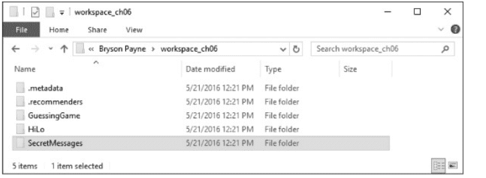

图 6-7：我的工作空间文件夹内部包含我们构建的每个项目的文件夹，以及一些 Eclipse 默认文件夹。

打开工作空间中的 `SecretMessages` 项目文件夹，你会看到里面有文件和文件夹，如图 6-8 所示。`src` 文件夹包含你的源代码文件（以 `.java` 结尾），`bin` 文件夹包含应用程序的编译版本（以 `.class` 结尾）。


## 打开命令行窗口

接下来，打开命令行窗口。在 Windows 上，你可以通过点击开始按钮、进入搜索栏并输入 `cmd`（command 的缩写）来实现。在 macOS 上，使用 Spotlight 搜索栏查找终端，或者从新的 Finder 窗口进入“应用程序 > 实用工具 > 终端”。在 Linux 上，使用终端应用程序或使用搜索查找终端。

我们需要从命令行或终端提示符浏览到之前描述的 `bin` 文件夹。在你的终端窗口中输入 `cd`（更改目录）并跟一个空格。然后，切换到你应用程序的 `bin` 文件夹：从文件资源管理器或 Finder 窗口中拖动 `bin` 文件夹并将其到命令提示符或终端窗口，如图 6-9 所示。

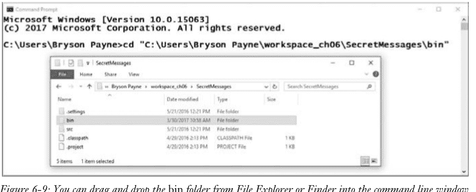

以便轻松复制目录路径。

注意，在 `cd` 命令之后会出现完整路径，看起来如下所示（当然，你的工作空间/SecretMessages/bin 文件夹的位置与我的略有不同）：

```
cd "C:\Users\BrysonPayne\workspace_ch06\SecretMessages\bin"
```

在 macOS 上，命令将是：

```
cd /Users/BrysonPayne/Desktop/workspace_ch06/SecretMessages/bin
```

执行此命令后按回车键，终端将提示显示你现在已进入 `bin` 文件夹。在 Windows 上，它看起来像：

```
C:\Users\BrysonPayne\workspace_ch06\SecretMessages\bin>_
```

现在我们进入了 `bin` 文件夹，`SecretMessages.class` 文件已在此编译。要运行 `SecretMessages.class` 字节文件中包含的程序，输入以下命令：

```
java SecretMessages
```

命令中的拼写、大小写和空格都至关重要，因此你需要精确匹配你为 Java 类起的名称。如果你正确输入了命令，

## #2: 反转与编码

让我们在用凯撒密码对消息进行加密之前先对消息进行反转，让它们更难破解。这个“双重加密-反转”版本的应用程序将结合第 130 页列表 6-1 中第一个版本的消息反转方法，以及第 140 页列表 6-4 中最终版本的凯撒密码功能。

反转消息的顺序是对称加密的另一个例子——执行一次会反转消息，再次执行则会恢复消息。将字符串反转与凯撒密码位移结合不会让程序变得太复杂，但它可以让你的消息对窃听者来说更加难以捉摸。

确保你的应用能够正确地编码和解码消息，并记住，你的朋友需要这个新版本的程序才能破解你新的双重混乱消息！玩得愉快！

## #3: 使用 try 和 catch 安全地处理密钥

你对“秘密消息”（Secret Messages）应用可以做的最后一个改进是：当用户输入密钥值时，安全地处理无效的数字输入。还记得 `try-catch` 语句吗？

在向应用中添加 `try-catch` 块可能会有点棘手。除了添加异常处理代码以防止用户因提供错误的数字（例如，在提示输入密钥值时输入文本而非数字）而导致程序崩溃外，你还需要考虑当提供无效输入时应用应该做什么。它应该告诉用户他们的密钥无效并使用预定义的密钥（例如，`13`）吗？还是应该创建一个循环，不断要求用户提供有效的密钥？

尝试不同的编码方式，并选出你最喜欢的一种吧！

# 第 7 章 创建高级 GUI 并共享你的应用


对于“秘密消息”应用的 GUI 桌面版本，我们将提供两个大型文本区域，允许用户在 GUI 界面中复制和粘贴长消息。在章节结束时，我们将添加一个类似图 7-1 所示的密钥选择滑块，这将使得破解凯撒密码变得非常简单，即使在密钥未知的情况下也是！

| Payne 博士的秘密消息应用 | |
|---|---|
| Qxf 1xdum cqn bnlanc vnbjpnb jyy pnc nenw lxxuna? Jmm j wr1n PDR frrcq famaj, jwm j burrna cajc uncb hxd nwl1xmn, mml1xmn jwm nenw la1lt vnbjpnb! Cqjc fxdjc kn jfnbjxm - jwm rc'rb Lqjyna 6! |
| 密钥: -9 编码/解码 |
| 26 13 0 13 26 秘密消息应用如何变得更酷？添加一个带有自动换行的精美 GUI，以及一个可以让你编码、解码甚至破解消息的滑块！那太棒了——而且它在第 7 章！ |

图 7-1: 我们将在本章中构建的秘密消息编码/解码应用

这个版本的应用比基于控制台的 GUI 更符合用户习惯，我们可以复用第 6 章中的某些代码，因为编码和解码消息的算法是相同的。

## 设置秘密消息 GUI 应用项目

打开 Eclipse，通过 `File ▸ New ▸ Java Project` 创建一个新的 Java 项目。将项目命名为 `SecretMessagesGUI`，然后点击 `Finish`。关闭任何打开的文件，展开 Package Explorer 格中的 `SecretMessagesGUI` 文件夹以找到 `src` 文件夹。右键点击 `src` 文件夹并选择 `New Class` 创建一个新的 Java 源代码文件。同样将此命名为 `SecretMessagesGUI`。

我们将使用 Swing 工具包，因此在 `New Java Class` 对话框中，将父类（superclass）更改为 `javax.swing.JFrame` 并勾选创建 `main()` 方法的选择框。

点击 `Finish`，你将看到 `SecretMessagesGUI.java` 文件中熟悉的骨架代码。在 Package Explorer 中右键点击 `SecretMessagesGUI.java` 文件，选择 `Open With ▸ WindowBuilder Editor` 以开始为秘密消息应用创建 GUI 界面。

## 设计 GUI 并命名组件

打开 WindowBuilder Editor 的 Design 选项卡。在 Components 格中展开 `javax.swing.JFrame` 组件并选择 `getContentPane()`。现在转到 Properties 格，将 `Layout` 属性更改为 `Absolute layout`（绝对布局），如图 7-2 所示。这将允许我们以像素级的精确度定位组件。

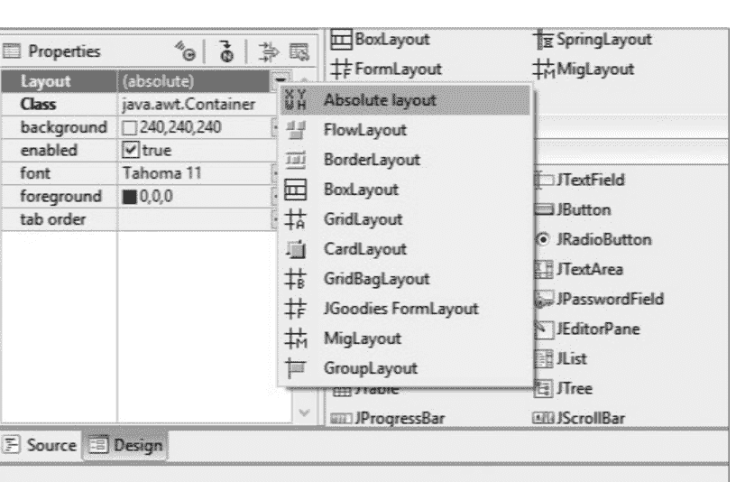

图 7-2: 在放置任何 GUI 组件之前，将 Layout 属性更改为 Absolute layout。

接下来，在 Components 格中点击 `javax.swing.JFrame`。然后，在 Properties 格中，将 `defaultCloseOperation` 设置为 `EXIT_ON_CLOSE`。同样，将 `title` 属性更改为 "Your Name's Secret Message App"，如图 7-3 所示。

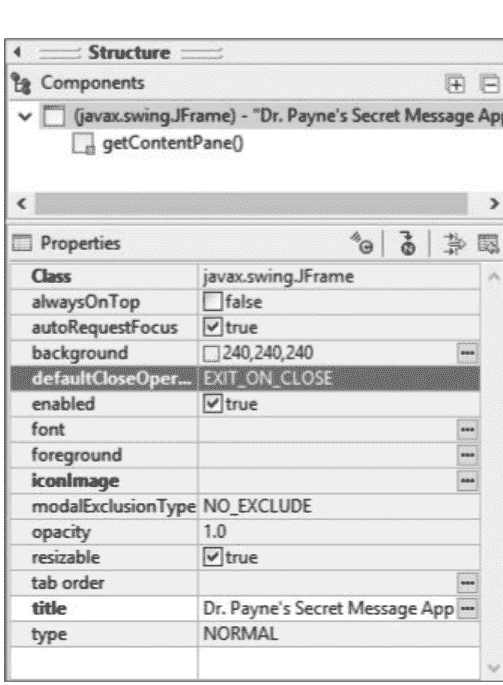

图 7-3: 更改 defaultCloseOperation 和 title 属性以自定义应用。

## 创建 `encode()` 方法

我们将编写 `encode()` 方法与第 3 章中猜数字游戏应用中的 `checkGuess()` 类似。`checkGuess()` 方法接收一个用户猜测的字符串，但该方法不需要返回值，它返回的是 `void`。与 `checkGuess()` 不同，`encode()` 将接受一个消息和一个加密密钥作为值，并且不再返回 `void`，而是返回一个编码后的消息。

方法返回值是为了让程序可以使用它们。我们希望 `encode()` 从用户处获取消息和密钥，然后运行某些代码生成编码后的消息，我们的程序将将其作为方法的输出。在声明返回信息的方法时，我们在方法名之前标明返回的数据类型。我们从 `encode()` 返回的信息类型是一个字符串变量。因此，`encode()` 将被声明为 `public String encode()`。

我们需要告诉 Java 我们想要传递给 `encode()` 的什么类型的信息；这些信息被称为方法的参数。要为方法声明参数，我们将它们放在方法名后的括号内，第一个是数据类型，第二个是参数名称。多个参数之间用逗号隔开。`encode()` 方法的声明如下所示：`public String encode(String message, int keyVal)`。让我们为方法体添加大括号，并将 `encode()` 方法放在两个 `JTextArea` 变量声明的下方、`SecretMessagesGUI()` 构造方法的上方：

```java
public class SecretMessagesGUI {

  public String encode(String message, int keyVal) {
    String output = "";
    char key = (char) keyVal;

    for (int x = 0; x < message.length(); x++) {
      char input = message.charAt(x);

      if (input >= 'A' && input <= 'Z') {
        input += key;
        if (input > 'Z')
          input -= 26;
        if (input < 'A')
          input += 26;
      } else if (input >= 'a' && input <= 'z') {
        input += key;
        if (input > 'z')
          input -= 26;
        if (input < 'a')
          input += 26;
      } else if (input >= '0' && input <= '9') {
        input += (keyVal % 10);
        if (input > '9')
          input -= 10;
        if (input < '0')
          input += 10;
      }

      output += input;
    }

    return output;
  }
}
```

## 构造方法初始化

```java
SecretMessagesGUI() {
  setTitle("Dr. Payne's Secret Message App");
  setDefaultCloseOperation(JFrame.EXIT_ON_CLOSE);
  getContentPane().setLayout(null);

  txtIn = new JTextArea(); // 从行首开始删除 "TextArea"
  txtIn.setBounds(10, 11, 564, 140);
  getContentPane().add(txtIn);

  txtOut = new JTextArea(); // 从行首开始删除 "TextArea"
  txtOut.setBounds(10, 210, 564, 140);
  getContentPane().add(txtOut);
}
```

通过这些更改，我们准备好开始编写该方法，以便在用户点击“编码/解码”按钮时对消息进行编码。


由于我们的变量命名保持一致，我们可以复用凯撒密码加密代码。一致命名是一个良好的习惯，编写良好的 Java 代码可以在多个平台之间复用。

## 为编码/解码按钮编写事件处理器

我们希望用户在 GUI 界面中提供输入消息和传递给 `encode()` 的密钥值，并且我们希望在用户按下“编码/解码”按钮时返回输出消息，因此，让我们编写处理按钮点击事件的代码。

切换到 `SecretMessagesGUI.java` 中的设计视图，并双击“编码/解码”按钮。Eclipse 将切换回源视图并为“编码/解码”按钮插入 `actionPerformed()` 事件处理器的代码，如下所示的代码片段：

```java
JButton btnEncodedDecode = new JButton("Encode/Decode");

btnEncodedDecode.addActionListener(new ActionListener() {

  public void actionPerformed(ActionEvent arg) {

  }

});
```

这是一个匿名内部类，就像我们在第 3 章第一次遇到的那种。我们都必须在 `actionPerformed()` 内部添加代码，告诉 Java 按钮在点击时应该如何表现。

我们希望“编码/解码”按钮执行以下步骤：
1. 从 `txtIn` 获取输入消息。
2. 从 `txtKey` 获取密钥。
3. 使用密钥对消息进行编码。
4. 在 `txtOut` 中显示输出消息。

思考我们可能如何实现这些每一个步骤。在继续阅读之前自己尝试一下，然后阅读下方内容看看我的解决方案对比。

对于第一步，我们可以设置一个 `String message` 来从 `txtIn` 字段获取文本。就像 `JTextField` 一样，`JTextArea` 也有一个 `getText()` 方法：

```java
public void actionPerformed(ActionEvent arg) {

  String message = txtIn.getText();

}
```

对于第二步，我们可以使用 `Integer.parseInt()` 方法从 `txtKey` 获取用户的密钥，该方法从文本字符串中提取整数值。然后，我们将获取的整数存储在一个变量中：

```java
String message = txtIn.getText();

int key = Integer.parseInt(txtKey.getText());
```

要在第三步中编码消息，我们只需要调用 `encode()` 方法并传递两个参数。参数是我们提供给方法作为其参数的值。记得我们定义了 `encode()` 需要两个参数，因此我们需要用以下方式调用 `encode()`：

```java
String output = encode(message, key);

txtOut.setText(output);
```

## 处理错误输入和用户错误

我们需要使用 `try-catch` 块保护程序免受错误输入的影响。由于我们只想在用户正确输入密钥时对消息进行编解码，可以通过在第一行之前添加 `try` 关键字、第四行之后添加结束大括号，将 `actionPerformed()` 的所有四行封装在 `try` 块中，如下：

```java
public void actionPerformed(ActionEvent arg) {

  try {

    String message = txtIn.getText();

    int key = Integer.parseInt(txtKey.getText());

    String output = encode(message, key);

    txtOut.setText(output);

  } catch (Exception ex) {

  }

}
```

Eclipse 将用红色标记结束括号，因此让我们所示添加 catch 块。我们需要告诉 Java 在接收到错误输入时做什么，我们将稍后在 catch 语句的大括号内添加这些步骤。

## 构建 main() 方法并运行应用

就像我们在第 3 章创建游戏一样，我们需要在 `main()` 方法中添加一些初始化代码，以创建 SecretMessages 应用的实例、正确调整 GUI 窗口的大小并让 GUI 对用户可见。在 `SecretMessagesGUI.java` 文件的底部，找到 Eclipse 提供的 `main()` 方法并添加以下行：

```java
public static void main(String[] args) {

  SecretMessagesGUI app = new SecretMessagesGUI();

  app.setSize(new java.awt.Dimension(600,400));

  app.setVisible(true);

}
```

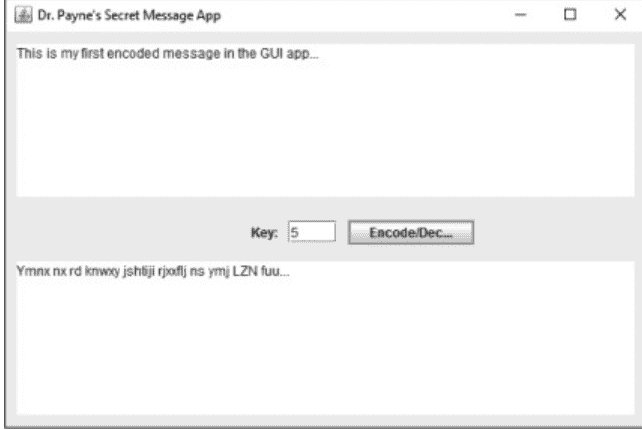

图 7-7：Secret Messages 应用看起来仍然有些单调，但它可以对消息进行加解码！

以下是目前 `SecretMessagesGUI.java` 的完整源代码：

```java
import javax.swing.JFrame;
import javax.swing.JTextArea;
import javax.swing.JTextField;
import javax.swing.JLabel;
import javax.swing.JButton;
import java.awt.event.ActionListener;
import java.awt.Dimension;

public class SecretMessagesGUI extends JFrame {
    private JTextField txtKey;
    private JTextArea txtIn;
    private JTextArea txtOut;

    public String encode(String message, int keyVal) {
        String output = "";
        char key = (char) keyVal;
        for (int x = 0; x < message.length(); x++) {
            char input = message.charAt(x);
            if (input >= 'A' && input <= 'Z') {
                input += key;
                if (input > 'Z')
                    input -= 26;
                if (input < 'A')
                    input += 26;
            } else if (input >= 'a' && input <= 'z') {
                input += key;
                if (input > 'z')
                    input -= 26;
                if (input < 'a')
                    input += 26;
            } else if (input >= '0' && input <= '9') {
                input += (keyVal % 10);
                if (input > '9')
                    input -= 10;
                if (input < '0')
                    input += 10;
            }
            output += input;
        }
        return output;
    }

    public SecretMessagesGUI() {
        setTitle("Dr. Payne's Secret Message App");
        setDefaultCloseOperation(JFrame.EXIT_ON_CLOSE);
        getContentPane().setLayout(null);

        txtIn = new JTextArea();
        txtIn.setBounds(10, 11, 564, 140);
        getContentPane().add(txtIn);

        txtOut = new JTextArea();
        txtOut.setBounds(10, 210, 564, 140);
        getContentPane().add(txtOut);

        txtKey = new JTextField();
        txtKey.setBounds(258, 173, 44, 20);
        getContentPane().add(txtKey);

        JLabel lblKey = new JLabel("Key:");
        lblKey.setBounds(202, 176, 46, 14);
        getContentPane().add(lblKey);

        JButton btnEncodedDecode = new JButton("Encode/Decode");
        btnEncodedDecode.addActionListener(new ActionListener() {
            public void actionPerformed(ActionEvent arg0) {
                try {
                    String message = txtIn.getText();
                    int key = Integer.parseInt(txtKey.getText());
                    String output = encode(message, key);
                    txtOut.setText(output);
                } catch (Exception ex) {
                }
            }
        });
        btnEncodedDecode.setBounds(312, 172, 144, 23);
        getContentPane().add(btnEncodedDecode);
    }

    public static void main(String[] args) {
        SecretMessagesGUI theApp = new SecretMessagesGUI();
        theApp.setSize(new java.awt.Dimension(600, 400));
        theApp.setVisible(true);
    }
}
```

这个程序的第一个版本是成功的，但在视觉上还有待改进。我们可以通过几个细微的调整，让 GUI 界面看起来更专业。

## 改进 GUI

让我们回到设计视图来修正我们在上一节中提到的问题。首先，点击 Encode/Decode 按钮并让它变宽一点。不同的计算机可能有其他的默认字体和大小，因此为了安全起见，请给按钮留出一点空间。

现在，让我们让两个 `JTextArea` 字段中的字体尺寸更大、更易读。我们想要更改两个文本区域的字体属性，因此可以通过点击 `txtIn` 然后使用 `CTRL`-点击（或 `Command`-点击）来同时选中 `txtOut`，从而同时选择它们。

在同时选中两个文本区域的情况下，前往属性面板中的字体属性，并点击字体大小旁边的三个点。将弹出字体选择器对话框，如图 7-8 所示。

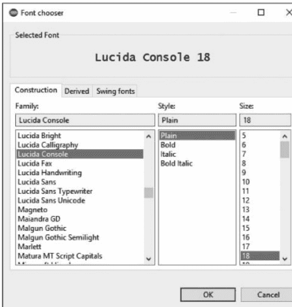

图 7-8：我们可以同时更改两个 `JTextArea` 字段的字体大小。

选择 18 或更大的字体大小，并选择你喜欢的字体。坚持使用熟悉的字体，这样当你与不同计算机上的朋友分享应用时，外观和感受就不会发生太剧烈的变化。我选择了 Lucida Console，18 字体。点击 OK 保存字体选择。

最后，让我们更改内容的背景颜色以进行个性化。通过点击左上组件面板中的 `getContentPane()` 来选择内容面板。然后，点击属性面板中背景属性旁的三个点。在弹出的颜色选择器对话框中，选择命名颜色选项卡，如图 7-9 所示。你会看到广泛的颜色选择。选择你喜欢的颜色并点击 OK。

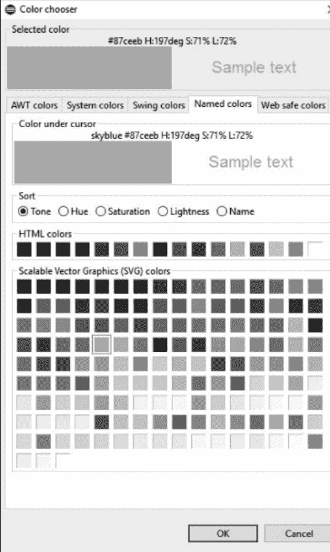

图 7-9：我们可以更改内容的背景颜色以进行个性化。


图 7-10：我们可以更改内容的背景颜色以进行个性化。


图 7-11：我们可以更改内容的背景颜色以进行个性化。


图 7-12：我们可以更改两个 `JTextArea` 字段的字体大小。


图 7-13：一个对话框弹出以提醒用户。

这个程序的这个版本变得更加专业，但如果我们输入错误输入会发生什么？我们添加了 `try` 语句，但留下的 `catch` 语句是空的。让我们填充它。

## 处理错误输入和用户错误：部分 2

在章节的早期，我们在事件处理器周围添加了一个 `try` 块，但留下的 `catch` 语句是空的。现在是填充它了。我们的 `catch` 语句将处理文本字段中的错误或缺失的用户输入。如果用户忘记输入值，或者他们输入的值不是数字，处理这种情况的方法之一是弹出一个消息，如图 7-13 所示。

图 7-13：一个对话框弹出以提醒用户。

我们用于 GUI 组件（如 `JFrame` 和 `JTextField`）的 `javax.swing` 工具包也拥有处理各种类型弹出窗口的类。一些示例包括输入对话框（允许用户提供文本输入）、确认对话框（允许用户选择是/否/确定或取消）以及消息对话框（在弹出窗口中向用户提供信息）。

此前，进入设计视图并双击 Encode/Decode 按钮。这是让 Eclipse 直接带你进入包含 `catch` 语句的按钮事件处理程序源码的快捷方法。

在显示错误消息后，我们还希望将光标放在 `txt` 字段中，并选择 `txt` 字段中的当前文本，就像我们在 Hi-Lo 猜数字 GUI 应用中使用的那样。我们将在 `catch` 语句的大括号内添加消息框以及我们在 Hi-Lo 猜数字应用中使用的 `requestFocus()` 和 `selectAll()` 语句。完成后的 `EncodeDecode.actionActionListener` 事件处理程序如下所示：

```java
btnEncodedecode.addActionListener(new ActionListener() {
    public void actionPerformed(ActionEvent e) {
        try {
            String message = txtIn.getText();
            int key = Integer.parseInt(txtKey.getText());
            String output = encode(message, key);
            txtOut.setText(output);
        } catch (Exception ex) {
            JOptionPane.showMessageDialog(null,
            "Please enter a whole number value for the encryption key.");
            txtKey.requestFocus();
            txtKey.selectAll();
        }
    }
});
```

> 当你添加 `JOptionPane` 时，如果没有使用内容辅助或者在 `JOptionPane` 处看到错误，你可能需要按 `ctrl-shift-O` 在代码顶部正确导入 `javax.swing.JOptionPane` 类。

现在运行该程序，让密钥字段为空或输入非数字文本作为密钥。消息框将弹出，要求你输入有效的密钥。它还会高亮密钥字段中的文本，以便在对话框关闭后方便输入整数。

初次用户可能不知道在密钥字段中输入什么，因此添加一个默认值可能是一个非常有用的 UI 调整。点击设计选项卡，选择 `txtKey` 文本字段，并在属性面板的 text 属性中输入一个默认密钥值。我选择 3 作为我的默认加密密钥，但你可以选择任何数字。让我们把 `txtKey` 字段的 `horizontalAlignment` 属性更改为 `CENTER`。你可以随时更改其他属性以使 `txtKey` 看起来完全符合你的要求，包括字体颜色和样式。

# 为 Secret Messages GUI 添加滑块

我们将为 Secret Messages 应用再添加一个用户界面改进——一个数字滑块，它允许用户快速滑动数值，并查看消息随每个新密钥的变化。

在设计视图中，在调色板的 Components 下，选择 `JSlider` 组件。将鼠标悬停在设计预览的中间左侧（密钥提示旁边），并点击将 `JSlider` 放置到指定位置，如图 7-14 所示——如果需要，稍后调整位置。


图 7-14：在图形用户界面中添加 `JSlider`，以便一种快速方便的方法尝试不同的密钥值。


现在让我们自定义 `JSlider` 的一些属性。首先，更改其背景颜色以与应用程序的其他部分匹配。在设计预览中选中新的 `jSlider` 后，点击属性面板中 `background` 属性旁边的三个点，进入颜色选择器（Color Chooser）对话框中的命名颜色（Named colors），并选择你用于 GUI 其他部分的相同颜色。点击 OK 为滑块保存新的背景颜色。

接下来，我们将为滑块添加自定义标签、刻度线和默认值。首先，通过选择其旁边的 true 复选框来开启 `paintLabels` 属性。输入最大值 26 和最小值 -26，以便于在正确范围内选择密钥。

接下来，对于 `minorTicks` 间距，输入值 1——这将在滑块轨道上添加小刻度线，帮助用户查看可能值的范围。然后，对于 `majorTicks` 间距，输入 13——这将在滑块上 -26 到 26 之间每 13 个值显示一个标签。现在，通过选择旁边的 true 复选框开启 `paintTicks` 属性。显示我们所做更改完整属性面板如图 7-15 所示。


图 7-15：自定义滑块属性

我们几乎完成了！通过修改 `value` 属性，将滑块的默认值更改为匹配密钥字段中的默认密钥值。我选择了 3 作为默认密钥值，因此我在滑块的 `value` 属性中输入 3。最后，你需要将滑块变高一点以显示标签，如图 7-16 所示的完成后的滑块。


图 7-16：带有 GUI 滑块的 Secret Messages 应用

现在，我们需要添加代码使滑块工作，允许用户在各种密钥值之间轻松滑动，以便快速加密解码消息。

# 使用滑块破解代码

我们希望用户能够通过点击和拖动上一节添加的滑块来更改加密密钥值，因此我们将添加一个事件处理器来监听滑块的变化。

在设计预览中右键点击滑块并**Add Event Listener stateChanged**。`stateChanged` 事件处理器的工作原理类似于 `actionPerformed` 处理器，但我们在 ② 处做了一个小小的更改。我们不需要从文本字段中解析值，可以使用 `getValue()` 方法直接作为整数访问滑块的值。


图 7-17：为滑块添加事件监听器

然后，将滑块滑动到最左侧，缓慢向右滑动，直到显示出秘密消息。你能看出编码该消息时使用了什么密钥吗？请看图 7-18 以获取提示。


图 7-18：你可以使用 Secret Messages 应用，通过向右滑动滑块直到出现明文消息来破解凯撒密码消息！

将滑块移动到 -11 会得到一个英文明文消息，因此密钥必然是 11。你可能还会发现 15 也能破解消息（因为 15 = 26 – 11）。你总可以在基础拉丁字母表中找到几个可以破解消息的值。当然，你也可以发送其他语言的消息，如图 7-19 所示。


图 7-19：任何使用基础拉丁字母字符的语言都可以使用此版本的 Secret Messages 应用来发送和接收加密消息；此处显示了西班牙语（左侧）和法语（右）。

你可以通过电子邮件、Twitter 和 Facebook 与朋友反复复制和粘贴加密消息——你甚至可以发送加密的短信，尽管在你的移动设备上操作会更简单。我们将在第 8 章介绍如何将这个 Secret Messages 桌面应用转换为移动应用。

现在，为了方便互相分享秘密消息，如果能轻松地与朋友分享你的 Secret Messages 应用就好了。我们将在下一节中学习如何操作。

## 进阶：将你的程序作为可运行 JAR 文件共享

为了让它变得真正有用，你需要能够与朋友分享 Secret Messages 应用——可能甚至是与那些不会编写 Java 代码且在电脑上没有安装 Eclipse 的朋友分享。

好消息是，Eclipse 和 Java 让你轻松地将应用程序导出为可运行文件，并与全球范围内运行 Java 的数百万台计算机进行分享。你的朋友甚至不需要下载 Java JDK 开发者版本；他们只需要 JRE，大多数计算机都预装了 JRE。Eclipse 可以将应用程序导出为可运行的 Java 归档 (JAR) 文件，你可以通过电子邮件、USB 闪存或其他方式分享它。你的朋友只需要双击 JAR 文件，就能运行你的程序了！

要从 Eclipse 导出可运行的 JAR 文件，请前往 File ▸ Export。然后展开 Java 文件夹并点击 Runnable JAR file，如图 7-20 所示。

### 导出

#### 选择

将运行应用程序所需的所有资源导出到本地文件系统的 JAR 文件中。

选择导出目标：

输入过滤器文本

- General
- Install
- Java
  - JAR file
  - Javadoc
  - Runnable JAR file
- Run/Debug
- Tasks
- Team
- XML


**点击 Next**，Eclipse 将要求你选择启动配置（launch configuration）和导出目标。启动配置意味着你想运行哪个类或应用，以及从哪个项目运行。在 **Launch configuration** 下，点击下拉列表并选择 **SecretMessagesGUI – SecretMessagesGUI**。这意味着你想运行 `SecretMessagesGUI` 项目中的 `SecretMessagesGUI.class` 文件。

> 你必须至少编译并运行一次应用程序，才能为该程序拥有启动配置。

导出目标只是你想要用于可执行程序的位置和文件名。在 **Export destination** 下，点击 **Browse**，然后选择你想要保存完成后的程序的文件夹，例如你的桌面文件夹。给你的程序文件起一个名称，比如 Secret Messages.jar。你可以使用空格（或其他特殊字符）来命名文件，完全按照你希望人们打开它时看到的样子。当你完成选择后（如图 7-21 所示），点击 Save 然后点击 Finish。


图 7-21：为你的可运行 JAR 文件选择位置和名称。

点击 Finish 后你可能会看到一个警告，但你可以忽略它并点击 OK。回到你保存 JAR 文件的地方，你应该能看到一个带有你文件名的 Java 图标，如图 7-22 所示。现在你应该可以运行程序并发送和接收加密消息了。


## 收获

在本章中涵盖了一些技能：

- GUI 组件和变量命名
- 复用算法
- 接收参数并返回的方法
- 编写高级处理程序
- 设置 GUI 组件属性
- 导出 JAR 文件
- 添加自动滚动条
- 使用 `java.swing.JScrollPane` 封装
- 设置 `JTextArea` 的换行
- 弹出 `javax.swing.JOptionPane` 对话
- 使用 `stateChanged` 事件更改文本框

## 编程挑战

通过尝试编程挑战来复习所学。访问书籍网站 https://www.nostarch.com/learnjava 下载示例。

### #1：向上移动！

Secret Messages 应用非常适合给朋友发送加密消息，但自己用也很有趣。重复的任务是从输出文本区域复制加密消息并粘贴到输入文本区域。你的第一个编程挑战是创建一个 Move Up 按钮，它可以移动加密消息并自动解码！

将 Move Up 按钮放在 Encode/Decode 按钮旁边。然后添加一个事件处理器，获取文本区域的文本并设置为该区域的文本。作为额外奖励，让 Move Up 的事件处理器将滑块的值反转。你还可以更改按钮的背景颜色以匹配你程序的其他部分。该挑战的示例见图 7-23。


### #2：滚动！

我们对应用的另一个改进是处理更长的消息。在这种情况下，我们应该在侧边添加滚动条，每当用户输入对于输入文本区域过长的消息时自动滚动。`JTextArea` 本身不会添加滚动条，但 Eclipse 让为任何文本添加滚动条变得快速简单！

在设计视图中，右键点击任意一个 `JTextArea` 框并选择 Surround with `java.swing.JScrollPane`，如图 7-24 所示。


图 7-24：为 JTextArea 添加自动滚动条

# 美利坚的人民，为了建立一个更完美的联盟，建立正义，确保国内安宁，提供共同防御，增进福利，并在我们和我们后代的自由之上，特此制定并建立美利坚合国宪法。

美利坚的人民为了建立一个更完美的联盟，建立正义，确保国内安宁，提供共同防御，增进福利，并在我们和我们后代的自由之上，特此制定并建立美利坚合国宪法。序言。

图 7-25：通过在每个 TextArea 周围添加 JScrollPane，你可以对像宪法这样长或更长的文本进行编码！

图 7-25 中仅显示了部分文本，但现在两个区域的右侧都有了滚动条。滚动条告诉我们文本比文本区域能容纳的更多，我们做的只需向下滚动即可。

为了进一步自定义应用程序，请探索我们添加的每个 GUI 组件的属性面板（Properties pane），并更改各种属性值，如背景颜色、字体等。让你的应用程序独具特色，并与朋友分享以展示你的创作成果！

## #3：通过更改文本来改变滑块

对于这个挑战，让我们对用户界面进行最后一次调整。当用户滑动滑块时，文本字段中显示的键值会发生变化。但如果我们希望当文本字段变化时，滑块也移动呢？

> 提示
>
> 你需要为 txtKey 文本字段添加一个事件处理器。右键点击 txtKey JTextField，然后选择 Add event handler ‣ keyReleased。这将创建一个监听 txtKey 文本字段中按键释放事件的事件处理器。

为了实现这一点，你需要为事件处理器编写代码，从文本字段中获取整数值并将滑块设置为该值。记住在处理用户提供的文本时使用 `try-catch` 块。祝你好运！

# 8 章

# 将秘密消息制作成手机 App 与朋友分享吧！


在本章中，我们将通过构建一个移动应用版本来完成“秘密消息”应用的体验，该版本可以通过短信或电子邮件发送秘密消息，甚至可以发布到社交媒体。

该应用程序看起来与第 7 章中的 GUI 版本相似，具有标签、文本字段，以及通过滑动不同的键值来快速编码和解码消息的能力。你还可以从应用程序复制并粘贴消息到电子邮件和短信中，但在本章结束时，你将能够直接从“秘密消息”应用发送电子邮件或短信！图 8-1 显示了应用程序在真实 Android 设备上的运行情况。

## 佩恩博士的秘密消息应用

如果我们把“秘密消息”应用完全移动化，能够通过短信、电子邮件和社交媒体分享加密消息，会发生什么呢？我等不及了！！🥳

键：13

Junbjhyqq unccra xr jb gbx gur Frperg Zrffnitf ncc shyl zbovyr, jvgu gur noyvgyl gbfun barcrqq zrfrnit ol glrk, rznvy, naq fbvpny zrqvn? V cnag jvngl!!🥳


图 8-1：秘密消息编码/解码器应用（左侧）可以直接在应用内发送秘密文本和电子邮件消息，只需点击按钮即可（右侧）。

我们将通过在 Android 版本中保留 GUI 组件的名称，并利用 Java 在多个平台之间一致的语言和结构，复用桌面版应用的有效代码。

## 设置移动端 GUI

让我们使用 Android Studio 开始构建“秘密消息”应用。Android Studio 还可能在在你打开程序时允许你进行更新，这通常是一个好主意。更新带有一定的风险，因为它可能会通过移动图标或菜单项来改变程序的视觉外观，但更新包含了重要的新安全修复程序和最新的 Android 功能。

当你第一次打开 Android Studio 时，可能会看到最近正在运行的项目——在我们的案例中是 Hi-Lo 猜数字应用。你可以通过选择 File ▸ Close Project 来关闭它。

要开始构建新的“秘密消息”应用，在 Android Studio 内部选择 File ▸ New Project。将项目命名为 SecretMessages，选择保存位置，将语言设置为 Java，并将最低 Minimum SDK 设置为 16 (Android 4.1 Jelly Bean)。点击 Next。在 Activity 屏幕上，选择 Empty Activity 并点击 Finish。

当新项目打开时，双击 `app/src/main/res/layout` 下的 `content_main.xml` 文件。你可能需要点击 Design 标签来像图 2 那样查看布局。


图 8-2：Android Studio 中应用的初始视图

## 设计移动端 GUI

现在我们已经设置好了项目，让我们开始设计布局。首先，点击并按 DELETE 键删除预览显示的“Hello World!”文本。然后，就像我们在上一个应用中做的那样，添加一个 RelativeLayout 来包含我们的 GUI 元素。在 Palette 中，选择 Layout 下的 RelativeLayout 并将其拖到预览窗口中。

接下来，让我们通过选择 Widgets 下的 TextView 组件为应用程序顶部添加标题。将 TextView 放置在顶部，将文本更改为 Dr. Payne’s Secret Messages，并将 textAppearance 属性设置为 Material.Large，正如我们在图 8-3 中所示。


在 Palette 中，展开 appearance 找到 TextStyle 并勾选复框以使文本脱显。现在，让我们为用户的输入消息放置编辑文本字段。在 Palette 中，选择 Text 下的 Multiline。缩放预览窗口并将文本字段放置在行下方 30dp 处。将文本更改为 secret messages are so cool, aren’t they? 如图 8-4 所示。换行序列将添加换行字符；这些字符在屏幕上不会显示，但当你在键盘上按回 键时它们代表新行。跨行显示文本告诉用户他们也可以输入多行消息。


图 8-4：添加一个 Multiline 字段用于用户输入消息，使用换行序列跨多行文本。


图 8-5：将输入文本框的 id 改为 `txtln`，以便我们稍后对其进行编码。

我们要在“秘密消息”（Secret Messages）应用的中间添加四个组件：一个供用户通过滑动条查找密钥的 `SeekBar（滑动条）、一个标签、一个用于显示密钥的文本框，以及一个编码/解码（Encode/Decode）按钮。`SeekBar` 的功能与该应用桌面版本的 `SeekBar` 类似。当你第一次放置所有组件时，它们没有完美对齐，也不担心——我们可以修复该问题。

首先，在调色板（Palette）面板的小部件（Widgets）部分找到 `SeekBar`。将其放置在左侧边缘的输入文本框下方，留出舒适的间距（大约 30 dp 左右），如图 8-6 所示。你可以在属性（Properties）面板中手动设置顶部边距，点击 **查看所有属性**（View all properties，属性面板顶部的左右双箭头）。在 **Layout_Margin** 下，为 **layout_marginTop** 输入 30dp。


图 8-6：`SeekBar` 的功能类似于应用 GUI 桌面版本中的滑块，允许用户在不同的密钥值之间滑动。

接下来，在 `SeekBar` 旁边添加一个 `textView` 小部件，作为用户秘密密钥值文本框的标签。在属性面板中，将 `textAppearance` 属性更改为 `Material.Medium`，并将 `text` 属性更改为 `Key:`。


然后，选择一个用户秘密密钥值的数字（`Number`）文本框，并将其水平居中，将 `text` 属性设置为 13 或你选择的另一个默认密钥值。通过更改其宽度属性（“查看所有属性”下）将文本框的宽度更改为约为 40dp，以舒适地适应数字，并将属性更改为 `txtKey`。

放置好 `txtKey` 文本框后，你应该可以将 `Key` 标签拖动到它旁边。你还可以拉伸 `SeekBar` 以填充间隙，如图 8-7 所示。

通过添加编码/解码（Encode/Decode）按钮来完成布局中间一行的布局。在调色板的小部件（Widgets）中选择 `Button`，并将按钮插入到右侧边缘、文本框右侧。将 `text` 属性更改为 `Encode/Decode`。

最后，通过复制 `textView` 并将其粘贴到中间行小部件下方，为输出消息创建一个文本框。删除文本框中的文字，将其拉伸到应用窗口宽度，并将 `id` 属性重命名为 `txtOut`。


就是这样——完成的 GUI 布局如图 8-8 所示。


在继续之前，确保你的输入文本框的 id 为 `txtIn`，输出文本为 `txtOut`，密钥的中间文本框为 `txtKey`。为了让代码在下一部分正常工作，我们需要所有元素都正确命名。

# 将 GUI 连接到 Java 代码

现在是时候将 GUI 布局连接到 Java 源代码，开始编写“秘密消息”移动应用的行为了。点击主窗口左上角的标签切换到 `MainActivity.java` 文件。

在 `public class MainActivity` 声明中直接添加以下五行代码：

```java
public class MainActivity extends AppCompatActivity {
    EditText txtIn;
    EditText txtKey;
    EditText txtOut;
    SeekBar sb;
    Button btn;
}
```

你可能在每行代码后需要按 `ALT-ENTER` 或 `OPTION-ENTER` 以将小部件导入到 Java 代码中。

这五个变量指向应用视觉布局中的 GUI 组件。我们可以通过在 `onCreate()` 方法中、`setSupportActionBar(toolbar);` 语句下方添加五行代码，将这些变量名连接到实际的小部件：

```java
protected void onCreate(Bundle savedInstanceState) {
    super.onCreate(savedInstanceState);
    setContentView(R.layout.activity_main);
    Toolbar toolbar = (Toolbar) findViewById(R.id.toolbar);
    setSupportActionBar(toolbar);
    txtIn = (EditText) findViewById(R.id.txtIn);
    txtKey = (EditText) findViewById(R.id.txtKey);
    txtOut = (EditText) findViewById(R.id.txtOut);
    sb = (SeekBar) findViewById(R.id.seekBar);
    btn = (Button) findViewById(R.id.button);
}
```

你可以依靠 Android Studio 的代码补全功能输入大部分这些条目——你只需要输入前几个字符，然后点击列表中的条目或按 `ENTER` 接受代码建议。这会更快，并将帮助你避免常见的输入错误。

# 将编码按钮连接到 encode() 方法

现在我们已经将代码连接到 GUI 布局中的组件，可以从第 7 章的应用桌面版本中复制 `encode()` 方法。我们将该方法粘贴到 `public class MainActivity` 声明中，紧接在你添加的指向布局中 GUI 组件的五变量声明下方。

在 Eclipse 中打开你的 `SecretMessagesGUI` 项目并高亮整个 `encode()` 方法。复制此代码并将其粘贴到 `MainActivity` 的类声明中：

```java
public class MainActivity extends AppCompatActivity {
    EditText txtIn;
    EditText txtKey;
    EditText txtOut;
    SeekBar sb;
    Button btn;

    public String encode(String message, int key) {
        String output = "";
        for (int x = 0; x < message.length(); x++) {
            char input = message.charAt(x);
            if (input >= 'A' && input <= 'Z') {
                output += (char) ((input - 'A' + key) % 26 + 'A');
            } else if (input >= 'a' && input <= 'z') {
                output += (char) ((input - 'a' + key) % 26 + 'a');
            } else {
                output += input;
            }
        }
        return output;
    }
}
```

为了让代码在 `MainActivity` 中正常工作，我们需要在 `onCreate()` 方法中设置按钮的点击监听器。在 `MainActivity.java` 中，找到 `onCreate()` 方法并添加以下代码：

```java
protected void onCreate(Bundle savedInstanceState) {
    super.onCreate(savedInstanceState);
    setContentView(R.layout.activity_main);
    Toolbar toolbar = (Toolbar) findViewById(R.id.toolbar);
    setSupportActionBar(toolbar);
    txtIn = (EditText) findViewById(R.id.txtIn);
    txtKey = (EditText) findViewById(R.id.txtKey);
    txtOut = (EditText) findViewById(R.id.txtOut);
    sb = (SeekBar) findViewById(R.id.seekBar);
    btn = (Button) findViewById(R.id.button);

    btn.setOnClickListener(new View.OnClickListener() {
        @Override
        public void onClick(View v) {
            int key = Integer.parseInt(txtKey.getText().toString());
            String message = txtIn.getText().toString();
            String output = encode(message, key);
            txtOut.setText(output);
        }
    });
}
```

现在你可以运行应用并测试它了。在输入框中输入消息，调整滑动条选择密钥，然后点击编码/解码按钮。

现在，我们的应用已经足够功能进行首次测试。让我们在 Android 模拟器中运行应用，查看编码/解码（Encode/Decode）按钮的功能。

## 测试应用

保存你目前的进度。然后，转到 Run ▶ ‘app’。选择你在第 4 章中设置的模拟器，例如图 8-11 所示的 My Nexus 6P。


模拟器第一次运行时可能需要几分钟时间——记住，你可以在 Android Studio 中工作时让它保持运行，以避免每次运行应用时都经历漫长的启动。你也可以像我们在第 4 章中那样直接在你的 Android 设备上运行应用，如果你愿意可以跳过模拟器。

当模拟器启动并 Secret Messages（秘密消息）应用加载时，你将看到初始布局，如图 8-12 所示（左侧）。在键值框中输入一个值，然后点击编码/解码按钮，你将看到 Android 将消息转换为密文，如图 8-12 所示（右侧）。


你可以在字段之间复制和粘贴，但滑块（`SeekBar`）还无法工作。悬浮操作按钮——右下角的邮件信封符号——也没有任何作用。别担心；我们很快就会处理它。

注意还有另一个用户体验问题：编码后的消息（Frperg zrtnftrf...）带有下划线，因为它在计算机看来像是拼写错误。要关闭拼写检查，返回 `content_main.xml` 布局文件并选择 `xtText` 字段。在属性（Properties）面板下，展开 `getInput` 并选择 `textNoSuggestions` 属性。如果你愿意，也可以关闭 `xtIn` 字段的拼写建议，既可以单独关闭，也可以在布局视图中按住 `SHIFT` 键同时选择两个文本字段，然后选择 `textNoSuggestions` 属性。现在在模拟器上重新运行应用。不再有拼写检查了！

通过这个小调整，我们已经准备好启用 `SeekBar` 了，这样我们就可以快速方便地在不同的密钥之间滑动。

## 使用 SeekBar

我们将为 `SeekBar` 布线，每当用户向左或向右滑动时更改输出消息，因此我们需要修改它的几个属性以使其准备好使用。

首先，让我们简单了解一下 `SeekBar` 组件。你可能在移动设备上播放视频时见过 `SeekBar`。例如，在 YouTube 视频中，`SeekBar` 显示了你在视频中所在的位置，并允许你向前或向后跳过——这有时被称为寻找（seeking）。

`SeekBar` 与 `3Slider` 有几处不同。首先，`SeekBar` 可以具有正值。0 是最小值，但我们可以将最大值设置为任何正值，例如 26。此外，`SeekBar` 不会在进度条本身上递增标记或标签。这意味着，如果我们想允许用户使用负键值，我们就得使用一些数学方法将正值转换为负值，让用户可以在某个值范围内（例如 -13 到 +13）滑动键值。为了实现这一点，我们将把 `SeekBar` 的范围设为 0 到 26。我们还需要更新 `txtkey` 字段，以便在用户滑动 `SeekBar` 时显示变化的值，让他们知道 `SeekBar` 的当前值。让我们从更改 GUI 布局中 `SeekBar` 的某些属性开始。

切换回 `content_main.xml` 布局文件，并在设计预览中选择 `SeekBar`。在 `SeekBar` 的属性面板下，找到 `max` progress 并将两者都改为 26。

`max` 属性是 `SeekBar` 将显示的最大值。对于 Secret Messages 应用，我们至少需要 26 个值来覆盖字母表。我们希望范围是 -13 到 +13，这样用户就可以很容易进行编码和解码。但总共会有 27 个值，因此我们将选择 26 作为最大值（因为包含 0 在内总共有 27 个值）。`progress` 属性是 `SeekBar` 的当前值，类似于 `3Slider` 的 `value` 属性。我们将使用 `SeekBar` 的 `getProgress()` 方法来获取它当前指向的值。

保存你的更改并切换回 `MainActivity.java` 源代码。在 `onCreate()` 方法内部，紧接 `btn.setOnClickListener()` 代码的结束行 `});` 下方，开始输入 `sb-set` 并使用代码建议找到 `setSeekBarChangeListener()`。这将你的 `SeekBar` 存储在变量 `sb` 中。

`SeekBar` 监听器的代码与编码/解码按钮的代码不同。我们希望不仅监听 `SeekBar` 的点击事件。我们还想监听所有的变化，包括用户按下 `SeekBar` 并向左或向右滑动。为了这一点，我们需要一个 `OnSeekBarChangeListener`。

尽管与按钮代码一样，我们将使用代码建议自动生成新的 `OnSeekBarChangeListener`。在 `sb.setOnSeekBarChangeListener()` 的括号内，开始输入 `new OnSeekBar` 并使用代码建议。

Android Studio 将用三个方法填充 `OnSeekBarChangeListener` 代码：`onProgressChanged()`、`onStartingTouch()` 和 `onStopTrackingTouch()`。我们想使用 `onProgressChanged()`，因为这将告诉我们用户何时更改了 `SeekBar` 的值。

我们想要程序化到 `SeekBar` 事件监听器中的步骤与编码/解码按钮的代码相似，不同在于我们需要根据 `SeekBar` 的值计算密钥。我们还需要在 `txtkey` 字段中显示密钥。将以下代码添加到 `onProgressChanged()` 方法中：

```java
sb.setOnSeekBarChangeListener(new SeekBar.OnSeekBarChangeListener() {
  @Override
  public void onProgressChanged(SeekBar seekBar, int progress, boolean fromUser) {
    int key = sb.getProgress() - 13;
    String message = txtIn.getText().toString();
    String output = encode(message, key);
    txtOut.setText(output);
    txtKey.setText("" + key);
  }
});
```

在 ① 处，我们创建了一个变量 `key`。我们从 `SeekBar` 获取进度值，并减去 13。`SeekBar` 只能从 0 到 26，减去 13 将得到 -13 到 +13 的范围，非常适合加密消息。接下来的三行与编码/解码按钮的代码相同，获取消息，使用 `encode()` 方法加密，然后在 `txtOut` 中显示。

在 ② 处你也可以使用 `Integer.toString(key)` 命令将键转换为字符串，但添加一个空字符串是一个方便的快捷方法。

## 在模拟器和设备上运行应用

保存你的更改，然后在模拟器上重新运行应用。现在你可以向左或向右滑动 `SeekBar`，查看密文随每个密钥的变化，如图 8-13 所示。

距离我们连接物理 Android 设备已经过了几个章节，所以让我们快速回顾一下。首先，使用兼容的 USB 线将你的 Android 设备连接到电脑。当弹出询问是否要允许 USB 调试时，点击是。

在 Android Studio 中，点击运行按钮，你将看到选择部署目标对话框。（你可能需要关闭模拟器窗口中的应用才能让对话框显示。）找到你连接的 Android 设备项并点击确定。


当你在真实的 Android 设备上运行应用时，你会发现 `SeekBar` 的响应更灵敏，并且当你点击应用的某些部分时，可以使用一些选项。当你点击密文并选择全选时，将弹出上下文菜单，如图 8-14 所示，提供剪切、复制、共享或协助选项。

如果你点击选择，选中的文本可以通过电子邮件、短信、聊天、蓝牙、Twitter、Facebook 或你设备上配置的用于共享的任何应用发送，如图 8-15 所示（左侧）。带有共享

或者，你可以从应用内部向任何人发送加密消息！你甚至可以通过电子邮件给拥有 Secret Messages 应用桌面 GUI 版本的朋友发送一条秘密消息，如图 8-15（右）所示。他们需要做的就是将你发送给他们的消息中的密文复制到正在运行的 Secret Messages GUI 应用中，然后使用相反的密钥来解码消息：例如，使用 `-8` 就可以解码用密钥值 `8` 发送的消息。


图 8-14：右键菜单允许你剪切、复制或共享你的加密消息。

# Payne 博士的秘密消息应用

秘密消息

太酷了，

不是吗？特别是在我真实的 Android 设备上！

Amzkmb umaairoma

izm aw kwwt,

izmv'b bmg? Maxmqqitt wg ug zg smit

lzwqml Imdqkm!


图 15：共享选项允许你通过电子邮件、短信、Twitter、Facebook 或任何其他配置了共享的应用分享你的消息（左侧）。选择电子邮件选项将自动创建一个包含你加密文本的电子邮件（右侧）。

我们现在有了一个功能完全的 Secret 移动应用，它允许我们通过电子邮件、短信或社交媒体与任何人分享我们的消息。

只剩最后一个功能就可以让我们的应用完善了：为悬浮操作按钮添加我们自己的自定义操作。这将使用户只需手指一下即可分享他们的消息！

# 进阶：自定义悬浮操作按钮

到为止，我们一直忽略了悬浮操作按钮（也称为 `fab` 图标），它是应用屏幕右下角的圆形邮件信封符号，如图 8-16 所示。

`fab` 图标为我们提供了一种方法，让用户执行特定操作快捷快捷，例如通过电子邮件、短信或社交媒体共享他们的消息。


图 8-16：悬浮操作按钮

```java
Android Studio 自动包含了一些用于 fab 图标的代码，在 onCreate() 方法中显示一种新类型的弹出消息——在 Android 术语中称为 "Snackbar"：
FloatingActionButton fab = (FloatingActionButton) findViewById(R.id.fab);
fab.setOnClickListener(new View.OnClickListener() {
    @Override
    public void onClick(View view) {
        Snackbar.make(view, "Replace with your action", Snackbar.LENGTH_LONG).setAction("Action", null).show();
    }
});
```

我们只需要将 `fab.setOnClickListener()` 方法中 `onClick()` 方法的代码替换为我们想要的代码。

首先，删除 `onClick()` 方法括号之间的代码。接下来，在 `onClick()` 方法中输入以下代码：

```java
FloatingActionButton = (FloatingActionButton) findViewById(R.id.fab);

fab.setOnClickListener(new View.OnClickListener() {

    @Override

    public void onClick(View view) {

        ① shareIntent = new Intent(Intent.ACTION_SEND);

        ② shareIntent.setType("text/plain");

        ③ shareIntent.putExtra(Intent.EXTRA_SUBJECT, "Secret Message " + 
            DateFormat.getDateTimeInstance().format(new Date()));

        ④ shareIntent.putExtra(Intent.EXTRA_TEXT, txtOut.getText().toString());

        ⑤ try {
            startActivity(Intent.createChooser(Intent, "Share message..."));
            finish();
        }

        ⑥ catch (android.content.ActivityNotFoundException e) {
            Toast.makeText(MainActivity.this, "Error: Couldn't share.",
            Toast.LENGTH_SHORT).show();
        }

    }

});
```

现在让我们看看每行代码的作用。我们创建了一个名为 `shareIntent` 的 `Intent`。Android 中的 `Intent` 是我们想要启动或启动的活动，例如电子邮件、Twitter 或相机。`shareIntent` 使用了 `ACTION_SEND`，这意味着我们要向 Android 设备上的另一个应用发送某些信息。

我们将 `Intent` 的类型设置为 `text/plain`，这是电子邮件、推文或社交媒体帖子所需要的，然后为该活动添加了一个主题行。如果用户选择通过电子邮件或另一个使用主题行的应用共享他们的消息，它将读取“Secret Message”加上日期。`DateFormat` 类将根据你的地区以文本形式格式化日期，例如“Dec 7, 2017 4:33:12 PM”。

该行将文本形式的加密消息作为电子邮件、推文或帖子正文发送，取决于用户选择通过哪种应用共享消息。

接下来是 `try` 语句。当我们尝试从一个应用调用另一个应用时，可能会出现很多问题。如果用户没有安装应用怎么办？如果应用忙或无法访问网络怎么办？`try` 语句是为了这种情况设计的。`try` 内部的第一行代码尝试启动用户选择的活动（如电子邮件、短信或 Twitter），然后结束活动。出错，`catch` 语句将显示一个显示“Error: Couldn't share.”的 Toast。这就是让应用运行所需的所有。

一旦你将代码添加到应用中，就可以通过手指分享消息了。我们也可以分享消息，如图 8-17（左侧）所示。选择电子邮件选项将自动创建一个包含你加密文本的电子邮件（右侧）。

在 ❶ 处，我们为应用添加了新的意图过滤器。早之前我们使用 `Intent` 对象向另一个应用发送文本。在这种情况下，我们正在创建一个过滤器，以接收从手机上其他应用发送的 `Intent` 对象 ❷。（我们在第 191 页的图标代码中使用 `Intent.ACTION_SEND` 向其他应用发送 `Intent` 消息；这里我们做相反的操作。） ❸ 处的代码使用 `DEFAULT` 共享类别将 Secret Messages 应用添加到你可以共享的应用列表中。

通过 `DEFAULT` 类别，你的应用程序可以接收来自任何应用的数据。（当你想要过滤或限制可以向你的应用程序发送数据的应用类型时，还有其他类别。例如，`BROWABLE` 类别用于那些仅接收来自网络浏览器数据的应用。）最后，我们告诉 Android “Secret Messages”应用程序应该接收来自其他应用程序的任何文本。（如果你编写了一个接受图像作为输入的应用程序，你的 `mime-type` 应该为 `"image/*"`，或者仅针对 PNG 图像使用 `"image/png"`。对于视频，有 `"video/mp4"` 等。）最后，我们在应用程序的清单（manifest）中使用 `intent-filter` 条目。XML 标签需要关闭，这通常通过正斜杠和正在关闭的 XML 标签名称来完成，例如 `<intent-filter>`。这让计算机知道你已经完成了 `intent-filter` 的代码。保存你的 `AndroidManifest.xml` 文件，然后打开 `MainActivity.java` 文件开始编辑源代码。

向下滚动到 `MainActivity.java` 找到 `onCreate()` 方法。在通过 `txtIn` 将 GUI 组件连接到变量的代码之后，在此处添加这四个语句：

```java
protected void onCreate(Bundle savedInstanceState) {
    super.onCreate(savedInstanceState);
    setContentView(R.layout.activity_main);
    Toolbar toolbar = (Toolbar) findViewById(R.id.toolbar);
    setSupportActionBar(toolbar);
    txtIn = (EditText)findViewById(R.id.txtIn);
    txtKey = (EditText)findViewById(R.id.txtKey);
    txtOut = (EditText)findViewById(R.id.txtOut);
    sb = (Seekbar)findViewById(R.id.seekBar);
    btn = (Button)findViewById(R.id.button);

    + 1 Intent receivedIntent = getIntent();
    + 2 String receivedText = receivedIntent.getStringExtra(Intent.EXTRA_TEXT);
    + 3 if(receivedIntent != null) {
    + 4 txtIn.setText(receivedText);
    btn.setOnClickListener(new View.OnClickListener() {
```

最后，我们创建了一个名为 `receivedIntent` 的变量，从另一个应用程序共享。然后，我们通过调用 `getStringExtra()` 方法从 Intent 消息中获取文本。Intent 发送的消息的部分被称为额外数据（extra data）。如果一个语句检查确保 `receivedText` 变量不空，如果是，则将“Secret Messages”应用程序顶部 `txtIn` 文本字段中的文本更改为收到的文本。

信不由，这就是将从其他应用程序共享的消息接收到“Secret Messages”应用程序所需的全部工作了！现在，你不仅可以从应用程序发送加密消息，还可以直接从电子邮件、推文和帖子中解码消息。图 8-18 显示了从电子邮件共享消息到“Secret Messages”应用程序进行快速解码的情况。


图 8-18：现在“Secret Messages”应用程序可以与你手机上的其他应用程序（包括你的电子邮件）来回发送消息。

在你喜欢的电子邮件应用、Twitter 或 Facebook 中选择文本，然后按“共享”按钮。“Secret Messages”应用程序将出现在接受共享消息的应用列表中。选择 `SecretMessages` 作为共享应用，选中的文本将显示在“Secret Messages”应用程序的输入文本字段中。你可以轻松地加密或解码；只需记住你可能需要根据消息的加密方式更改键值（key value）。

恭喜你！你构建了一个功能完全社交“Secret Messages”移动应用程序。

享受它并和朋友分享吧！

让我们看看你在这一章中发展的技能，并尝试一些额外的编程挑战。

## 你学到的知识

我们在此应用程序中重用了来自“Secret Messages”应用程序 GUI 桌面版本的代码，并添加了许多内容使其成为一个真正完整的移动应用程序。以下是你在这一章中学到的一些新知识以及你强化的一些技能：

- 为 Android 组件编写事件处理程序，包括按钮、`SeekBar` 和浮动操作按钮
- 自定义 Android GUI 组件
- 在 Android 应用程序中使用多个输入
- 添加 `SeekBar` 并像滑块界面一样使用它
- 在模拟器和真实设备上运行 Android 应用程序
- 自定义浮动操作按钮的操作
- 创建 `Intent` 对象以调用特殊活动，包括从应用程序内部向其他应用程序发送数据
- 创建自定义 Intent 过滤器以接收来自其他应用程序的文本（或图像或视频）数据

## 编程挑战

尝试这些编程挑战以回顾和练习你学到的知识，并通过尝试新事物来扩展你的编程技能。访问书籍网站 `https://www.nostarch.com/learnjava/` 获取示例解决方案。

### #1: 创建“向上移动”按钮

此编程挑战是创建一个“向上移动”按钮，类似于第 7 章（第 172 页上的编程挑战 #1）中的按钮，将文本从输出字段移动到输入字段。

将“向上移动”按钮放在文本字段下方。然后添加一个事件处理程序，获取文本字段的文本并设置为该文本字段的内容。作为奖励，你可以让“向上移动”按钮的事件处理程序也将 `SeekBar` 更改为其数值的反数。加密密钥 `7` 将变为 `-7`，即解密密钥。结果将是点击按钮会将加密消息向上移动并自动解密！

### #2: 更改 SeekBar 的进度

你对用户体验的第二个改进是更改 `SeekBar` 的进度。你对用户体验的第二个改进是更改 `SeekBar` 的进度。你对用户体验的第二个改进是更改 `SeekBar` 的进度。你对用户体验的第二个改进是更改 `SeekBar` 的进度。你对用户体验的第二个改进是更改 `SeekBar` 的进度。你对用户体验的第二个改进是更改 `SeekBar` 的进度。你对用户体验的第二个改进是更改 `SeekBar` 的进度。你对用户体验的第二个改进是更改 `SeekBar` 的进度。你对用户体验的第二个改进是更改 `SeekBar` 的进度。你对用户体验的第二个改进是更改 `SeekBar` 的进度。你对用户体验的第二个改进是更改 `SeekBar` 的进度。

绘制画布。完整的 `BubbleDraw` 类如列表 9-1 所示：

```java
import java.swing.JFrame;
public class BubbleDraw extends JFrame {
    public static void main(String[] args) {
        JFrame frame = new JFrame("Your Name's BubbleDraw App");
        frame.setDefaultCloseOperation(JFrame.EXIT_ON_CLOSE);
        frame.getContentPane().add(new BubblePanel());
        frame.setSize(new java.awt.Dimension(600,400));
        frame.setVisible(true);
    }
}
```

列表 9-1：BubbleDraw 类

首先创建一个顶部带有标题栏的 `JFrame` ①。在标题字符串中填入自己的名字。接下来，设置默认关闭操作，以便用户在关闭窗口时程序退出 ②。然后添加代码，将一个新的 `BubblePanel` 绘制画布作为此框架内部的内容 ③。最后两行设置窗口大小 ④ 并使其可见 ⑤。

保存 `BubbleDraw.java` 文件并运行一次。你将看到一个标题栏为 "Your Name's BubbleDraw App" 的灰色 Java 框架。我们将构建 `BubblePanel` 绘制画布的逻辑。

## 为气泡创建类

切换到 `BubblePanel.java` 标签页。此文件将包含在屏幕上绘制气泡的所有逻辑。我们的第一个任务是创建一个 `Bubble` 类，用于存储每个气泡的颜色、大小和在屏幕上的位置。

## 定义气泡

创建类的原因非常实际：在旧的程序化编程方法中，我们需要为每个气泡的 x 坐标、y 坐标、大小等单独设置变量。例如，我们需要一个 `bubbleX` 变量表示第一个气泡的 x 位置，以及相应的 `bubbleY`、`bubbleSize` 和 `bubbleColor` 变量。这看起来并不那么糟糕，但如果我们拖动鼠标几秒钟就产生了一千个气泡呢？我们需要 4,000 个变量来跟踪！相反，我们可以使用类内部的属性来存储每个气泡的这些值。

在开始编写代码之前，让我们定义什么是气泡。正如之前的图 9-1 所示，气泡是一个彩色的填充圆，气泡可以有不同的大小并位于不同的位置。

所有这些特征都是该应用中气泡的属性。在面向对象编程中，当我们创建一个新类时，我们使用描述对象的名词和形容词来构建属性列表。属性以类变量的形式存储。

除了属性，类还可以包含方法。方法是与特定类关联的函数类型。方法使类能够执行某些操作。思考我们希望绘制程序中的气泡做什么。每当用户点击或拖动鼠标时，我们需要创建一个气泡。每当屏幕刷新时，我们都会绘制一个气泡。这些动词——如 `create` 和 `draw`——将帮助我们识别 `bubble` 类中需要的方法。


# 面向对象编程：封装气泡类

当我们将所有这些属性和方法封装进类中，我们就可以描述任何想在屏幕上显示的气泡。这就是程序员用面向对象编程解决问题的方法：将大型应用程序拆分为较小的部分，通过询问程序包含什么来创建类，然后通过询问新类的每个对象应该做什么以及它需要什么类型的信息来识别方法和属性。

## 编写 `Bubble` 类

让我们开始编写 `Bubble` 类。我们将在 `BubblePanel` 类内部进行操作，因为我们需要绘制气泡。在 `BubblePanel` 结尾的右括号之前如下所示开始你的气泡类：

```java
import javax.swing.JPanel;
public class BubblePanel extends JPanel {
    private class Bubble {
    }
}
```

我们通常将内部类和辅助类设置为 `private`，以防止程序直接访问它们。因此，我们将 `Bubble` 设置为仅能从 `BubblePanel` 访问的私有内部类。这种技术被称为**封装**，意味着 `BubblePanel` 类向其他类隐藏了其内部实现。封装是面向对象编程的核心原则之一，是一个值得遵循的最佳实践，因为这意味着我们可以更改 `Bubble` 类内部的工作方式，并确定我们不会破坏代码的其他部分。由于 `Bubble` 被声明为 `private`，我们知道 `BubblePanel` 类之外没有代码依赖于它。这对于包含大量类并由许多程序员共同开发的大型应用程序特别重要。

`BubblePanel` 将依赖 `Bubble` 类在用户在屏幕上绘制时存储单个气泡的信息。气泡在屏幕上有一个 (x, y) 位置、大小和颜色，因此我们可以将这些属性作为 `Bubble` 内部的变量。气泡位置的 x 和 y 坐标以及气泡的大小都可以存储为整数值：

```java
import javax.swing.JPanel;
public class BubblePanel extends JPanel {
    private class Bubble {
        private int x;
        private int y;
        private int size;
    }
}
```

我们创建了两个独立的变量 `x` 和 `y` 来存储气泡的坐标，以及一个 `size` 变量。这些属性是私有的，所以只有 `Bubble` 类本身可以直接更改这些值。我们将气泡应该的所有数据封装在 `Bubble` 类中，并使用该类中的方法与气泡交互。

正如之前提到的，我们应用中的每个气泡都可以有自己的颜色。`java.awt` 库有一个颜色类可以处理 RGB（红-绿-蓝）颜色值，以还原我们在显示器上显示的任何颜色。在本章稍后实际编写控制气泡的代码时，我们将更多地讨论 RGB。

## 添加随机颜色支持

使用 `Random` 类型来访问其函数。在 `BubblePanel` 类顶部添加以下行：

```java
import java.util.Random;
import java.awt.Color;
import javax.swing.JPanel;

public class BubblePanel extends JPanel {
    Random rand = new Random();
    private class Bubble {
```

这一行创建了一个名为 `rand` 的随机数生成器，它允许我们快速生成整数或浮点值。我们通过将 `rand` 放在 `BubblePanel` 类顶部来对其封装，这样我们就可以在绘制窗口和内部 `Bubble` 类中生成随机数，而不在 `BubblePanel` 之外生成。

在 Java 中创建随机颜色，我们可以使用之前导入的 `java.awt.Color` 类的构造函数。该构造函数将接受三个 0 到 255 之间的整数参数作为红、绿、蓝值，以创建一个颜色。

将以下代码添加到 `Bubble()` 构造函数方法中：

```java
public Bubble(int newX, int newY, int newSize) {
    x = newX;
    y = newY;
    size = newSize;
    color = new Color(rand.nextInt(256),
                      rand.nextInt(256),
                      rand.nextInt(256));
}
```

我们在颜色构造函数中使用 `new` 关键字来创建一个新颜色，每个 RGB 颜色值都将是 0 到 255 之间的随机生成整数。每当我们调用 `nextInt()` 方法时，它都会生成一个 0 到你传递给的最大整数之间的新随机整数。在这里，我们需要 0 到 255 的随机颜色值，所以我们传递了 256，因为 `nextInt()` 生成的整数最大到上限，但不包含该上限。

## 编写绘制气泡的方法

现在每个气泡都有一个 (x, y) 位置、一个大小和一个随机颜色，让我们添加在屏幕上绘制气泡的能力吧。为了在屏幕上绘制彩色图形，我们将导入 `java.awt.Graphics` 类。这个 `Graphics` 类包含了许多方法，如 `setColor()` 用于选择绘制颜色，`drawRect()` 用于绘制矩形，以及 `fillOval()` 用于在屏幕上绘制填充的椭圆，这仅是一二。我们将使用 `fillOval()` 来绘制圆形，因此在 `BubblePanel.java` 文件的顶部添加以下导入：`import java.awt.Graphics;`

```java
import java.util.Random;
import java.awt.Color;
import java.awt.Graphics;
import javax.swing.JPanel;
```

接下来，在 `Bubble` 内部类的 `Bubble` 构造函数下方添加一个 `draw()` 方法：

```java
private class Bubble {
    private int x;
    private int y;
    private int size;
    private Color color;

    public Bubble(int newX, int newY, int newSize) {
        // 构造函数实现
    }

    public void draw(Graphics canvas) {
        canvas.setColor(color);
        canvas.fillOval(x - size/2, y - size/2, size, size);
    }
}
```

`draw` 方法接受一个名为 `canvas` 的 `Graphics` 画布参数。在 `draw()` 方法内部，我们调用 `canvas` 的 `setColor()` 方法，将绘制颜色设置为我们要绘制的气泡的 `color` 变量中存储的颜色。此时，我们调用 `fillOval()` 在屏幕上绘制一个填充的圆。`fillOval()` 方法接受四个参数：用于绘制椭圆的边界框左上角的 x 和 y 坐标，然后是框的宽度和高度。将边界框想象成位于 (x, y) 位置、具有给定宽度和高度的隐矩形，将椭圆想象成一个气球，它会被吹大直到触及框的四边（见图 9-2）。通过为框设置相同的宽度和高度使其成为正方形，我们最终得到一个圆而不是椭圆。

由于我们的椭圆实际上是圆，因此宽度和高度相同——即我们存储在 `size` 属性中的气泡像素大小。此时，我们希望气泡位于用户点击的 (x, y) 位置中心，我们通过从每个 x 和 y 值中减去大小的一半（`size/2`）来调整每个气泡的左上角。


随着 `draw()` 方法添加，我们现在有了一个完整的 `Bubble` 类，它可以记住气泡的位置、大小和颜色。我们创建的类方法可以用于创建新气泡并在屏幕上绘制它们。现在是给 `BubblePanel` 类添加逻辑，每当用户在屏幕上点击并拖动时，使用这些方法来创建和绘制气泡了。

## 在 `ArrayList` 中存储气泡

我们需要存储用户在屏幕上点击和拖动时创建的所有气泡。Java 库包含几个实用的数据结构，这些结构是用于存储一组对象的类。

`java.util.ArrayList` 是一种动态数据结构。这意味着它不仅存储对象集合，还可以根据程序需要进行增长或缩小。对于 `BubbleDraw` 应用，我们无法预测用户将绘制多少个气泡，因此像 `ArrayList` 这样的动态数据结构是存储用户可能创建的所有气泡的完美选择。当你预先不知道多少项时，`ArrayList` 是一种存储内容的灵活方式。Java 中的普通数组大小固定，但 `ArrayList` 可以在用户每次点击时保留新气泡。

首先，让我们在 `BubblePanel` 顶部导入 `java.util.ArrayList`：

```java
import java.util.ArrayList;
import java.awt.Graphics;
import java.util.Random;
import java.awt.Color;
import javax.swing.JPanel;
```

接下来，我们需要声明一个存储 `Bubble` 对象的 `ArrayList`。在 `BubblePanel` 内部添加：

```java
class BubblePanel extends JPanel {
    Random rand = new Random();
    ArrayList<Bubble> bubbleList;
```

`ArrayList` 数据结构可以在尖括号内指定类型，以告诉 Java 它将存储什么类型的对象。`ArrayList` 可以包含任何类型的对象。

接下来，让我们处理一个额外的变量 `size` 用于默认大小：

```java
class BubblePanel extends JPanel {
    Random rand = new Random();
    ArrayList<Bubble> bubbleList;
    int size = 25;
```

这个变量设置了像素大小。我们选择了 25 像素，但你可以选择更大或更小的尺寸。

## 为 `BubblePanel` 添加构造函数

我们已经将 `bubbleList` 声明为 `Bubble` 对象的 `ArrayList`，所以为 `BubblePanel` 添加一个构造函数来初始化 `bubbleList` 并设置绘制窗口的背景颜色。

就像我们在 `Bubble` 内部类中使用一样，`BubblePanel` 类的构造函数使用类名加上一对括号：

```java
class BubblePanel extends JPanel {
    Random rand = new Random();
    ArrayList<Bubble> bubbleList;
    int size = 25;

    public BubblePanel() {
```

注意我们用括号结束构造函数，因为构造函数是一个方法。在构造函数内部，我们初始化 `bubbleList` 以准备存储灵活的 `Bubble` 对象列表。我们还将绘制窗口的背景颜色设置为黑色：

```java
public BubblePanel() {
    bubbleList = new ArrayList<Bubble>();
    setBackground(Color.BLACK);
}
```

> 虽然我建议使用黑色背景，但书中的图像为了可读性显示白色背景。

就像在声明 `bubbleList` 时一样，当我们构造一个新的 `ArrayList` 时，可以在尖括号 `<Bubble>` 中指定类型。

现在，当我们启动 BubbleDraw 应用并创建一个 `BubblePanel` 绘制画布时，我们将从空气泡列表和黑色屏幕背景开始。

保存目前的更改。在下一节中，用彩色气泡填充窗口！

## 添加在屏幕上绘制的方法

接下来，我们需要添加一个方法将 `bubbleList` 中的所有气泡绘制到绘制屏幕上。

`javax.swing` 工具包中的所有 GUI 组件（包括我们扩展用于 `BubblePanel` 绘制屏幕的 `JPanel`）都有一个 `paintComponent()` 方法在屏幕上绘制该组件。我们将修改，或重写默认的 `paintComponent()` 方法，使 `BubblePanel` 绘制 `bubbleList` 中的所有气泡。

首先，我们需要声明 `paintComponent()` 方法。由于我们正在重写已存在 `JPanel`（`BubblePanel` 的父类）中的 `paintComponent()` 方法，我们必须使用相同的方法签名或第一行代码。这意味着我们必须完全匹配 `paintComponent()` 的声明方式：一个 `public void` 方法，带有一个类型为 `Graphics` 的参数：

```java
public class BubblePanel extends JPanel {
    // ...
    public void paintComponent(Graphics canvas) {
    }
}
```

我们将 `paintComponent()` 方法放置在 `BubblePanel()` 构造函数的下方。注意，`paintComponent()` 需要一个 `Graphics` 对象，我们可以像为 `Bubble` 类设计的 `draw()` 方法中一样使用它。任何在屏幕上绘图的对象都可以使用 `Graphics` 对象来为计算机屏幕上的单个像素着色。

在该方法内部，我们首先想允许 `JPanel` 父类在绘制其他内容之前正常地清除绘制屏幕并进行任何其他设置。我们通过调用父类的 `paintComponent()` 来实现：

```java
public void paintComponent(Graphics canvas) {
    super.paintComponent(canvas);
}
```

`super` 关键字告诉 Java 调用 `JPanel` 中原始的 `paintComponent()` 方法。这意味着原始 `paintComponent()` 方法中的所有代码都将被引入我们的新方法中。这是一个非常有用的面向对象编程特性：因为我们扩展了 `JPanel` 类来创建新的 `BubblePanel` 类，所以我们可以利用 `JPanel` 中已经构建好的所有功能，例如在程序启动时清除窗口内的像素，以及为绘制彩色图形准备 `Graphics` 画布。我们说 `BubblePanel` 从 `JPanel` 继承了这些功能。

一旦我们准备好画布，就是时候遍历气泡列表并在画布上绘制每一个气泡了。为了实现这一点，我们将用一种方式使用 `for` 循环。

你第一次在第 6 章中看到 `for` 循环，当时我们想要遍历字符串中的每个字符来加密秘密消息。这次，我们正在使用一种更短的循环，称为 `for each` 语句，它是专门设计用于遍历对象列表或集合的。

让我们先看看工作代码，然后我将逐条分解 `each` 语句：

```java
public void paintComponent(Graphics canvas) {
    super.paintComponent(canvas);
    for (Bubble b : bubbleList) {
        b.draw(canvas);
    }
}
```

你可以将 ❶ 处的 `for` 语句读为“对于 `bubbleList` 中的每个 Bubble b”。

你可以看出这是一个 `for each` 语句而不是普通循环，首先是因为中间有一个冒号，其次是因为它没有我们在第 6 章的 `for` 循环中看到的三个部分：初始化、条件和更新。Java 在这两种循环中使用了相同的 `for` 关键字和括号，但 `for each` 语句是专为对象集合设计的，例如数组、`ArrayList` 等。

对于 `ArrayList` 中的每个 `Bubble b`，循环将调用 `b.draw(canvas)` ❷ 来在绘制屏幕上绘制单个气泡。循环第一次执行时，`b` 将指向 `bubbleList` 中的第一个气泡对象，每当循环重复，`b` 就会指向列表中的下一个气泡。调用 `b.draw(canvas)` 告诉该气泡在画布上绘制自己。

这个单一且简短的 `for each` 循环将把 `bubbleList` 中的每个气泡绘制到屏幕上。唯一的问题是我们还没有气泡可以测试。在转向使用鼠标创建气泡之前，我们生成一些随机气泡来查看程序的运行情况。

## 测试 `BubblePanel` 类

为了测试我们目前所做的，在添加鼠标交互之前，我们将编写一个测试方法，在应用程序窗口上绘制 100 个随机大小的气泡。这将允许我们在不编写最终代码的情况下确保程序运行正常。这样，我们就可以尽早调试代码中的任何错误，并预览完成后酷炫应用程序的视觉观。

调用新方法 `testBubbles()`。将其放置在 `paintComponent()` 方法之后、`private class Bubble` 之前，如列表 9–3 所示：

```java
public void paintComponent(Graphics canvas) {
    // ...
}
public void testBubbles() {
    for (int n = 0; n < 100; n++) {
        int x = rand.nextInt(600);
        int y = rand.nextInt(400);
        int size = rand.nextInt(50);
        bubbleList.add(new Bubble(x, y, size));
    }
    repaint();
}
private class Bubble {
```

### 列表 9-3：创建 `testBubbles()` 方法


在 ① 处，我们将 `testBubbles()` 声明为 `public`、`void` 返回类型，这意味着它不向程序返回任何信息。然后，我们使用普通的 `for` 循环从 `n = 0` 到 `99`，总共 100 次迭代。这意味着我们将创建 100 个气泡，对于每个气泡，我们需要一个 `(x, y)` 位置以及一个像素宽高的尺寸。

在本章开始时，我们将 `BubbleDraw` 帧的像素尺寸设置为 600 宽 400 高，因此对于气泡的位置，我们需要一个 0 到 600 之间的 x 值和一个 0 到 400 之间的 y 值。在循环内部，我们使用随机数生成器 `rand` 获取一个 0 到 600 之间的随机整数，并将其存储在变量 ③ 中。接下来，我们生成一个 0 到 400 之间的随机整数，并将其存储在变量 ④ 中。然后，我们生成一个 0 到 50 之间的随机整数，并将其存储在变量 ⑤ 中。最后，我们将一个新的 `Bubble` 添加到 `bubblelist` ⑥。

这个单一且简短的 `for each` 循环将把 `bubblelist` 中的每个气泡绘制到屏幕上。唯一的问题是我们还没有气泡可以测试。在转向使用鼠标创建气泡之前，我们生成一些随机气泡来查看程序的运行情况。

```java
import javax.swing.JPanel;
```

我们之前的 import 语句一次只引入一个类，但此条语句引入了 `java.awt.event` 库中的所有类。通配符星号（`*`）意味着我们想要引入 `java.awt.event` 顶层的所有类，包括所有的鼠标事件和监听器以及更多内容。我们可以在需要时逐个导入每个类，但导入 `java.awt.event.*` 会让程序的编写变得简单得多，让我们能够专注于编码，而不必在每次需要使用另一个事件类时都切换回文件顶部。

接下来，让我们开始编写一个私有的命名内部类，用于监听鼠标事件。我们将将其命名为 `BubbleListener`，因为它将处理与 `BubblePanel` 中气泡相关的所有事件。请将此类添加到你的 `testBubbles()` 方法下方、`private` 类 `Bubble` 上方。Java 程序员通常将监听器类放在类文件的底部，与其他任何其他辅助类放在一起——这种惯例有助于我们在调试或修改文件时快速找到监听器代码。

```java
repaint();
private class BubbleListener extends MouseAdapter {
private class Bubble {
```

`BubbleListener` 类继承了 `MouseAdapter`，后者处理鼠标事件。正如我们使用 `extends` 关键字来构建一个继承父类所有特性和功能的新 `JFrame` 类型一样，`BubbleListener` 将继承 `MouseAdapter` 类的所有鼠标监听器特性。这个适配器类包含了处理点击的 `MouseListener` 事件、处理鼠标移动的 `MouseMotionListener` 事件，以及处理使用鼠标滚轮或触控板滚动的 `MouseEventListener` 事件的能力。

我们将逐步向代码中添加这些事件处理程序，并在每次添加后测试应用程序，以观察 `BubbleDraw` 应用如何一个功能一个功能地呈现出来。

## 处理点击和拖拽

当我们处理鼠标事件时，需要完成两个步骤。首先，我们必须在 `BubbleListener` 中添加代码来处理我们感兴趣的特定事件，例如 `mousePressed()`。然后，我们必须将监听器添加到 `BubblePanel()` 构造函数中，这样绘图屏幕才知道要监听该类型的事件，并在事件发生时调用 `BubbleListener` 来处理该事件。让我们处理第一种情况：用户按下鼠标按钮来绘制气泡。

## 监听鼠标按钮事件

我们可以从鼠标按钮上监听三个事件：

- `mousePressed()`：当用户按下任何鼠标按钮时发生。
- `mouseReleased()`：当用户释放按钮时发生。
- `mouseClicked()`：当用户快速按下并释放按钮时发生。

对于 `BubbleDraw` 应用，我们将使用 `mousePressed()` 处理程序，这样当用户一按下鼠标按钮，应用程序就会立即绘制一个气泡。`mousePressed()` 处理程序的签名如下：

```java
private class BubbleListener extends MouseAdapter {
  public void mousePressed(MouseEvent e) {
}
```

> 在编写事件处理程序时，拼写和大小写特别为重要，因为它们已经具有特定大小写的内置名称。请确保你的 `mousePressed()` 方法与此完全匹配。

`mousePressed()` 事件处理程序位于 `BubbleListener` 类内部，并且必须被声明为 `public void` 返回类型，以匹配 `MouseAdapter` 类中的 `mousePressed()` 方法。注意，它还接受一个 `MouseEvent` 类型的参数。所有的鼠标事件在事件发生时都会获取鼠标指针在屏幕上位置的信息。事件的 x 和 y 坐标存储在 `MouseEvent` 对象中，我们可以通过 `getX()` 和 `getY()` 方法获取这些坐标。

以下代码将在用户点击鼠标的位置向 `bubbleList` 中添加一个气泡，并重绘绘图屏幕使气泡出现。

```java
private class BubbleListener extends MouseAdapter {
  public void mousePressed(MouseEvent e) {
    bubbleList.add(new Bubble(e.getX(), e.getY(), size));
    repaint();
  }
}
```

在 ❶ 处，我们在用户点击鼠标的 (x, y) 位置创建一个新的 `Bubble` 对象，即 `e.getX()` 和 `e.getY()`。`MouseEvent` 类有多个属性和方法用于处理鼠标事件，例如确定按了哪个按钮以及鼠标在屏幕上的位置。正如我提到的，`e.getX()` 和 `e.getY()` 方法告诉鼠标事件（如点击或拖拽）的 x 和 y 坐标。回到 `Bubble` 类，你会发现我们写的构造函数需要三个参数：`int newX`、`int newY` 和 `size`。因此，我们必须将 `e.getX()`、`e.getY()` 和 `size` 传递给构造函数以创建一个新的 `Bubble` 对象。气泡创建后，我们通过 `bubbleList.add()` 将其添加到气泡的 `ArrayList` 中。

在 ❷ 处，我们调用 `repaint()` 方法来刷新屏幕并将更新后的 `bubbleList` 绘制到画布上。

这完成了 `mousePressed()` 事件处理程序，但我们还需要做一件事来让应用程序监听 `mousePressed()` 事件并发送到 `BubbleListener` 类。我们必须告诉 `BubblePanel` 类将 `BubbleListener` 作为鼠标事件的监听器。

在 `BubblePanel` 构造函数中，我们做了两个更改。首先，通过在行开头放置两个斜杠来注释掉 `testBubbles()`。其次，调用 `addMouseListener()` 命令来使用 `BubbleListener` 处理鼠标事件。更新后的构造函数所示：

```java
public BubblePanel() {
  bubbleList = new ArrayList<Bubble>();
  setBackground(Color.BLACK);
  // ❶ testBubbles();
  ❷ addMouseListener(new BubbleListener());
}
```

通过注释掉对 `testBubbles()` 的调用 ❶，我们将它留在了想要绘制的地方，但停止了它的运行。❷ 处的代码告诉 `BubblePanel` 监听鼠标事件并在事件发生时将其发送到 `BubbleListener` 类。

通过这些更改，你应该可以通过点击屏幕上的任何地方来绘制，如图 9-4 所示。


图 9-4：在添加 `mousePressed()` 处理程序并将 `BubbleListener` 设置为鼠标事件监听器后，你应该可以绘制


图 9-5：现在你可以点击并拖动绘制连续的泡泡了！

令人印象深刻，对吧？通过为 `BubblePanel` 图形程序添加两个鼠标按钮移动事件事件处理器，我们就在 Java 中构建了一个交互式的、多彩的绘画程序。

## 进阶：处理鼠标轮事件

到目前为止，我们已经在应用中看到了用于鼠标按钮按下和鼠标点击拖拽事件两个两个但强大的事件处理器，但 `MouseAdapter` 中还有另一个事件类：`MouseWheelEvent`。根据你的系统，鼠标或触控板上可能有一个物理滚轮，你可以在文档和网页中上下滚动。或者，你可能有一台带有触控板的笔记本电脑，允许通过手势进行滚动，例如 MacBook 上的双指滑动手势，或大多数 Windows 笔记本电脑触控板右边缘的垂直滑动。

Java 将这两种滚动事件解释为 `MouseWheelEvent`。我们可以为 `BubbleListener` 添加一个 `mouseMoved()` 监听器，以处理提供此类功能的系统的鼠标轮事件或触控板滚动手势事件。

```java
private class BubbleListener extends MouseAdapter {
public void mousePressed(MouseEvent e) {
```

```
--snip---
public void mouseDragged(MouseEvent e) {
--snip---
}
public void mouseWheelMoved(MouseWheelEvent e) {
② size += e.getUnitsToScroll();
}
```

在 ① 处，`mouseWheelMoved()` 方法接收一个 `MouseWheelEvent`。在 ② 处，我们通过 `e.getUnitsToScroll()` 从 `MouseWheelEvent` 获取鼠标轮滚动的单位数，并将值加到 `size` 上。`getUnitsToScroll()` 返回的可以是正或负，取决于你的操作系统以及滚轮是向上还是向下滚动。

## 操作系统之间的滚动差异

Windows、macOS 和 Linux 在滚动方面有所不同。在 macOS 上，滚动或手势操作返回正值，因此我们刚刚编写的代码会在用户向上滚动或操作手势时增加泡泡大小，在用户向下滚动时缩小大小。在 Windows 和大多数 Linux 变体中，使用鼠标轮滚动反而是向下移动网页或文档，因此 `getUnitsToScroll()` 返回负数。这意味着滚动会导致泡泡变小，向下滚动会增加大小并让它们变大。

`if` 语句通过 `System.getProperty("os.name")` 获取操作系统名称，并检查该名称是否以字符串 "Mac" 开头。如果是，我们将滚动的单位加到 `size` 上。否则，我们从 `size` 中减去滚动的单位，以反转 Windows 和 Linux 的滚动方向，使向上为正，向下为负。

最后，将鼠标轮监听器添加到 `BubblePanel()` 构造函数中，位于之前的两个监听器下方：

```java
public BubblePanel() {
  bubbleList = new ArrayList<Bubble>();
  setBackground(Color.BLACK);
  // testBubbles()
  addMouseEventListener(new BubbleListener());
  addMouseMotionListener(new BubbleListener());
  addMouseWheelListener(new BubbleListener());
}
```

现在保存并运行程序，你应该能够通过滚动鼠标轮或在触控板上向上或向下进行手势来改变泡泡大小，如图 9-6 所示。


图 9-6：使用你的滚轮或触控板改变泡泡的大小。

`BubbleDraw` 程序的第一个版本已经完成了！你可以点击并拖动在屏幕上绘制彩色泡泡，上下滚动更改泡泡大小，最大化窗口进行全屏绘制，以及等等。

## 你学到的知识

你通过面向对象编程的方法，通过创建一个 `Bubble` 类来捕捉泡泡的特征和行为，设计了一个彩色、交互式的绘画程序。

以下是你在本章中学到的一些新知识：

- 使用多个类和多个 Java 源文件构建单个应用程序
- 使用面向对象编程的方法将问题分解为更小的部分
- 从零开始创建 `Bubble` 类，包括属性、方法和构造函数
- 使用 `java.util.Random` 和 `java.awt.Color` 类创建随机颜色
- 使用 `Random.nextInt()` 在给定范围内生成随机数
- 使用 `java.awt.Graphics` 绘制图形，使用 `paintComponent()` 描述程序应该绘制的内容，并使用 `repaint()` 清除屏幕并重绘
- 为鼠标事件编写事件处理器，包括点击、移动和鼠标轮事件
- 使用 `java.util.ArrayList` 存储对象的动态列表，如 `BubbleDraw` 中的泡泡
- 通过自定义监听器类 `BubbleEventListener` 为程序添加多个事件监听器

## 编程挑战

尝试这些编程挑战练习，以复习和练习你所学的知识，并扩展你的编程技能。访问书籍网站 https://www.nostarch.com/learnjava/ 获取示例解决方案。

## 挑战 #1：没有泡泡太小

如果你向下滚动鼠标得足够快，泡泡将直接消失，因为 `size` 值掉到了 0 以下，导致 Java 无法在屏幕上绘制圆圈。事实上，大小为 2 或更小的泡泡只有 1 个像素高，所以让我们确保 `size` 的值至少保持在 3x 3 像素，以保持泡泡呈圆形。

在 `BubblePanel.java` 中 `BubbleEventListener` 类的 `mouseMoved()` 方法中添加一点逻辑，检查 `size` 是否小于 3。如果是，则将 `size` 设置为 3，以保持泡泡呈圆形。

## 挑战 #2：像素绘画！

如果你向下滚动鼠标得足够快，泡泡将直接消失，因为 `size` 值掉到了 0 以下，导致 Java 无法在屏幕上绘制圆圈。事实上，大小为 2 或更小的泡泡只有 1 个像素高，所以让我们确保 `size` 的值至少保持在 3x 3 像素，以保持泡泡呈圆形。

在 `BubblePanel.java` 中 `BubbleEventListener` 类的 `mouseMoved()` 方法中添加一点逻辑，检查 `size` 是否小于 3。如果是，则将 `size` 设置为 3，以保持泡泡呈圆形。


图 9-7：稍微改变泡泡的位置可以产生酷的效果。

```java
import java.awt.*;
import java.event.*;
import java.util.*;

public class BubblePanel extends JPanel {
    Random rand = new Random();
    ArrayList<Bubble> bubbleList;
    int size = 25;
    BubblePanel() {
        bubbleList = new ArrayList<Bubble>();
        setBackground(Color.BLACK);
    }
}
```

```java
public Bubble(int newX, int newY, int newSize) {
    x = (newX * size) + newSize/2;
    y = (newY * size) + newSize/2;
    size = newSize;
    color = new Color(rand.nextInt(256),
    rand.nextInt(256),
    rand.nextInt(256));
}
```

这种新的数学方法仅因为 Java 处理整数除法的方式改变了每个新泡泡的 (x, y) 位置。Java 在除两个整数时只保留整数（或整数字）结果，因此除以 `newSize` 再乘以 `newSize` 会让你的泡泡看起来像一个网格。例如，如果 `newSize` 是 10 且 `x` 是 25，那么 `x` 除以 `newSize` 将是 25 / 10，这在 Java 中结果为 2。然后乘以 10 得到 20，即在 10x10 像素网格上的位置。我们在每个坐标上加上 `size/2` 以在虚拟网格中对齐圆点。

如果你想让像素效果看起来更像我的世界，你可以让泡泡变成正方形。为了这样做，修改 `draw()` 方法以填充矩形而不是椭圆，注释掉 `fillOval()` 命令并改用 `fillRect()` 命令：

```java
public void draw(Graphics canvas) {
    canvas.setColor(color);
    // canvas.fillOval(x - size/2, y - size/2, size, size);
    vas.fillRect(x - size/2, y - size/2, size, size);
}
```

现在你可以以像素化的风格进行绘制了，如图 9-9 所示。


图 9-9：使用矩形代替椭圆可以创建像素化的绘制效果。

# 10 使用计时器添加动画和碰撞检测


在本章中，我们将为 BubbleDraw 应用添加基于计时器的动画，以创建漂浮、跳跃的泡泡，并用一个用户友好的 GUI 界面来增强应用程序。增强后的程序称为 BubbleDrawGUI，将添加一个包含图 10-1 所示 GUI 组件的 `JPanel`，赋予用户动画化或暂停泡泡、更改动画速度以及清除屏幕的能力。


图 10-1：增强后的 BubbleDrawGUI 应用特色是具有动画的、跳跃的半透明泡泡，并带有一个用于控制动画的 GUI 界面。

此版本的应用程序比以前更具交互性且用户友好，允许用户在屏幕上点击和拖动鼠标时，使用漂浮、跳跃的泡泡进行绘制。

# 复制 BubbleDraw Java 项目以创建 BubbleDrawGUI

新的 GUI 应用将直接在第 9 章的 BubbleDraw 项目基础上构建。因此，我们不需要从零开始创建一个 Java 项目，而是复制 BubbleDraw 项目并将其粘贴到同一个工作空间，并赋予新名称。当你想要在保持旧版本完整的同时，对新版本的程序进行扩展和增长时，这种方法非常有用。

在 Eclipse 中，在 Package Explorer（包资源管理器）面板中右键点击 BubbleDraw 项目文件夹，并选择 **Copy**（复制）。然后，在 Package Explorer 面板中右键点击并选择 **Paste**（粘贴）。Copy Project（复制项目）弹出窗口将允许你为复制的项目赋予新名称。输入 BubbleDrawGUI 并点击 **OK**。Eclipse 会在 Package Explorer 面板中创建一个名为 BubbleDrawGUI 的 BubbleDraw 项目的新副本。

# 重命名主类和 Java 文件

现在让我们重命名 `BubbleDraw.java` 文件。该文件包含一个运行应用程序的 `public static void main()` 方法，重命名它将帮助我们区分新程序和旧版本。在新的 BubbleDrawGUI 项目文件夹中，右键点击 `BubbleDraw.java` 并选择 Refactor（重构）▸ Rename（重命名）。

重构意味着重组代码的结构，但不改变其功能。通常，当程序员想出了一种更好、更高效的方法来让代码实现相同的功能时，就会进行重构。当 Rename Compilation Unit（重命名编译单元）窗口弹出时，输入新名称 BubbleDrawGUI，然后点击 Finish（完成）。可能会弹出第二个窗口，警告该类包含一个 `main()` 方法。你可以忽略此并再次点击 Finish。重构过程将把类和 Java 文件都重命名为 BubbleDrawGUI。我们暂时保持类不变。

最后，让我们修改 `JFrame` 以匹配应用程序的新 GUI 版本。打开 `BubbleDrawGUI.java` 文件。找到创建 `JFrame` 的行，并将其修改为“Your Name's BubbleDraw GUI App”，如下：

```java
import javax.swing.JFrame;

public class BubbleDrawGUI extends JFrame {
    public static void main(String[] args) {
        JFrame frame = new JFrame("Your Name's BubbleDraw GUI App");
```

**注意**

第一次运行包含多个文件的应用程序（例如 `BubblePanel` 和 `BubbleDrawGUI` 应用）时，你需要运行包含 `main()` 方法的文件。运行主文件将创建配置，使你从那时只需点击运行按钮即可运行程序。`BubblePanel` 类不包含 `main()` 方法，因此我们必须运行 `BubbleDrawGUI.java`，或者右键点击 BubbleDrawGUI 项目文件夹并选择 Run（运行）▸ Java Application（Java 应用程序）。

保存文件并运行它，以查看窗口顶部的新标题，如图 10-2 所示。


图 10-2：新的 `BubbleDrawGUI.java` 文件打开了一个标题栏为“Your Name's BubbleDraw GUI App”的窗口。

现在，让我们再做一次更改让泡泡看起来更真实。

# 添加透明度

真实的泡泡通常具有半透明的外观。想象用口香糖吹泡泡：当它足够大时，你可以穿透泡泡的表面。我们可以为 BubbleDrawGUI 中的泡泡添加更多透明度，让它们看起来更生动。

除了第 9 章学到的 RGB 颜色组件外，Java 在 `java.awt.Color` 类中存储了第四个组件。这被称为 alpha 通道，代表了颜色在绘制时在屏幕上显示的透明或不透明程度。

alpha 通道的范围从 0 到 255，其中 0 完全透明，255 完全不透明。我们使用这个组件创建泡泡的半透明效果。

# 设置计时器

现在我们准备好设置计时器了。在 `BubblePanel()` 构造函数中，添加以下行来初始化计时器并设置指定的延迟：

```java
public BubblePanel() {
    timer = new Timer(delay, new BubbleListener());
    bubbleList = new ArrayList<Bubble>();
    setBackground(Color.BLACK);
    // testBubbles();
    addMouseListener(new BubbleListener());
    addMouseMotionListener(new BubbleListener());
    addMouseWheelListener(new BubbleListener());
}
```

新 `Timer()` 的构造函数需要两个参数：第一个是以毫秒为单位的延迟，第二个是监听计时器事件的事件处理器。计时器每触发一次就会触发一个 `actionPerformed()` 事件，这与我们在 GUI 界面中处理按钮点击时处理的 `actionPerformed()` 事件类似。它就像是一个每隔几毫秒自动“点击”一次的按钮。我们将计时器放在构造函数的开头，以便我们能够响应 GUI 事件来更改它。

对于计时器事件，我们将修改 `BubbleListener` 类。向下滚动 `BubblePanel.java` 找到我们之前创建的私有类 `BubbleListener`。然后在大类的左括号之前添加 `implements ActionListener`：`private class BubbleListener extends MouseAdapter implements ActionListener {`

此更改允许 `BubbleListener` 类通过实现 `java.awt.event.*` 中的 `ActionListener` 类来监听 `actionPerformed()` 事件。实现事件监听类是处理用户事件的另一种方法。为了处理这些计时器事件，我们需要添加一个 `actionPerformed()` 事件处理器。将以下方法添加到 `BubbleListener` 底部：

```java
private class BubbleListener extends MouseAdapter implements ActionListener {

    public void mousePressed(MouseEvent e) {
        --snip--
    }

    public void mouseDragged(MouseEvent e) {
        --snip--
    }

    public void mouseWheelMoved(MouseWheelEvent e) {
        --snip--
    }

    public void actionPerformed(ActionEvent e) {
    }
}
```

这个 `actionPerformed()` 方法将是我们添加代码的地方，以便每当计时器触发时都移动泡泡并重绘屏幕。我们将在下一步添加这些语句。

# 准备动画

现在我们已经添加了计时器并设置了 `BubbleListener` 来监听计时器事件，我们需要告诉 Java 在计时器触发事件时该做什么。

每当计时器触发事件时，就是绘制动画泡泡序列中下一幅图像的时候了。首先，我们将告诉 `actionPerformed()` 事件处理器更新泡泡并重绘屏幕。然后，我们将告诉 `Bubble` 类通过让泡泡在屏幕向上移动来更新泡泡。我们将让程序每秒执行大约 30 次这些步骤。

在添加到 `BubbleListener` 类中的 `actionPerformed()` 方法内部，添加以下三行代码来更新泡泡并重绘屏幕：

```java
public void actionPerformed(ActionEvent e) {
    for (Bubble b : bubbleList)
        b.update();
    repaint();
}
```

在 `for` 处，我们正在使用 for-each 版本的语句来遍历 `bubbleList` 中的每个泡泡。记住，`bubbleList` 是包含我们通过屏幕上点击和拖动鼠标创建的所有泡泡的 `ArrayList`。

当我们遍历 `bubbleList` 中的每个泡泡时，我们调用了一个名为 `update()` 的新函数。Eclipse 用红色下划此语句，是因为我们还没有在 `Bubble` 类中定义 `update()` 方法，但我们很快就会定义它。`update()` 方法将用于改变泡泡的位置，使其看起来像是在向屏幕顶部漂浮。

在 `repaint` 处，我们调用 `repaint()` 方法来刷新屏幕，清除绘图窗口并将泡泡绘制在新的、更新后的位置。通过每秒执行 30 次，我们将实现我们想要看到的动画效果。

现在让我们来创建 `update()` 方法，告诉 `Bubble` 类在每次动画计时器触发时移动泡泡。在 Java 的 (x, y) 坐标系中，我们需要从 y 值中减去（屏幕顶部 y 等于 0 的地方）。因此，为了让泡泡看起来向上移动，我们可以在每次更新时从 y 坐标减去一个较小的值。

滚动到 `BubblePanel.java` 的底部，我们在那里定义了 `Bubble` 类，并在 `draw()` 方法下方添加 `update()` 方法，如下：

```java
public void draw(Graphics canvas) {
    canvas.fillOval(x - size/2, y - size/2, size, size);
}

public void update() {
    y -= 5;
}
```

更新泡泡位置的函数从该泡泡的 y 值中减去五像素。每当泡泡在屏幕上重绘时，它的位置都会比之前高五像素。

保存你的文件。在运行应用程序之前你只有最后一步了！

# 启动计时器

动画 `BubbleDrawGUI` 程序的最后一步是启动计时器。向上滚动 `BubblePanel()` 构造函数并添加以下行：

```java
public BubblePanel() {
    timer = new Timer(delay, new BubbleListener());
    --snippet--
    addMouseWheelListener(new BubbleListener());
    timer.start();
}
```

`timer.start()` 方法将启动计时器，使其按照指定的每几毫秒触发一次事件，直到调用 `timer.stop()` 方法或退出程序。

现在保存并运行程序。当你画泡泡时，它们应该向上漂浮，由计时器事件处理器进行平滑动画处理。

鼠标滚轮和我们在第 9 章中构建的其他功能仍然与我们迷人的动画效果一起工作。目前泡泡只向一个方向漂浮，但我们已经实现了目标的运动幻觉。在下一节中，你将学习如何让泡泡向每个方向漂浮。

# 永远吹泡泡：添加随机速度和方向

我们在上一节中创建的 `update()` 函数只改变了每个泡泡的位置，导致泡泡每次重绘屏幕时垂直移动。在这一节中，我们将让泡泡以随机的速度垂直和水平移动，以便它们看起来是在向每个方向吹散，如图 10-4 所示。


图 10-4：同时更改每个泡泡的 x 和 y 位置，使泡泡在我们拖动时看起来像是从鼠标指针向随机方向吹出。

泡泡的水平速度是它每帧向左或向右移动的像素数。这决定了泡泡的新 x 位置。同样，泡泡的垂直速度决定了它的 y 位置。通过在水平和垂直方向上移动泡泡，我们可以让它向任何方向移动。图 10-5 显示了水平速度和垂直速度如何结合产生泡泡正在对角线移动的幻觉。


图 10-5：快速更改泡泡在 x 和 y 方向的位置将使泡泡看起来是在对角线移动。

首先，让我们添加变量来存储每个泡泡每次屏幕重绘时在 x 和 y 方向上移动的像素数。在 `Bubble` 类顶部添加这两行：

```java
private class Bubble {
    --snip--
    private int xspeed, yspeed;
    final int MAX_SPEED = 5;
}
```

在 ① 处，我们声明了整数变量：`xspeed` 用于泡泡每次更新屏幕时水平移动的像素数，`yspeed` 用于泡泡垂直移动的像素数。在 ② 处，我们添加了一个常量 `MAX_SPEED`，用于泡泡一次移动的最大像素数。常量是与变量类似的命名值，但常量在程序内部不会改变，我们声明为 `final` 以告诉 Java 常量的值是永久的。我们还习惯用全大写命名常量以便将其与普通变量区分开来。

我们将使用 `rand.nextInt()` 方法为每个泡泡分配随机的 x 速度和 y 速度，就像我们之前为泡泡颜色做的那样。修改 `Bubble()` 构造函数：`public Bubble(int newX, int newY, int newSize) {`

```java
x = newX;
y = newY;
size = newSize;
color = new Color(rand.nextInt(256),
    rand.nextInt(256),
    rand.nextInt(256),
    rand.nextInt(256));
xspeed = rand.nextInt(MAX_SPEED * 2 + 1) - MAX_SPEED;
yspeed = rand.nextInt(MAX_SPEED * 2 + 1) - MAX_SPEED;
}
```

我们可以通过使用 x 和 y 速度值允许气泡向任何方向移动，但我们只有两个变量来表示四个方向（左、右、上、下）。当 `xspeed` 为负时，气泡会向左移动；当它为正时，气泡向右移动。同理，`yspeed` 在负时向上移动，在正时向下移动。为了让 `xspeed` 和 `yspeed` 的范围跨越正负值，我将 `MAX_SPEED` 乘以 2 并加 1，等于 5 * 2 + 1 = 11。这使得 `rand.nextInt(MAX_SPEED * 2 + 1)` 等同于 `rand.nextInt(11)`，它将返回 0 到 10 之间的数字。通过从该值减去 5，你将得到 -5 到 5 之间的结果，因为 0 - 5 = -5，而 10 - 5 = 5。

最后，我们需要修改 `update()` 函数，每次重绘屏幕时将气泡移动到新位置。将语句 `y -= 5;` 替换为以下两个语句：

```java
public void update() {
    x += xspeed;
    y += yspeed;
}
```


现在不是每次重绘都向上移动五个像素，每个气泡都会根据我们为每个气泡随机生成的 `xspeed` 和 `yspeed` 值进行水平和垂直移动。结果是在我们拖动鼠标的地方都会出现彩斑斑的气泡爆炸！

保存并运行这些更改后的程序，你将看到类似于图 10-4 中的动画效果。气泡在 x 和 y 方向上随时间移动的效果让每个气泡产生具有随机速度和方向的错觉。

你可能会注意到的一个现象是某些气泡（例如图 10-6 中央的气泡）停留在原地。这是因为我们为 x 和 y 速度随机生成了 -5 到 +5 之间的数字，有时气泡的 `xspeed` 和 `yspeed` 都会为 0。当发生这种情况时，气泡将完全不动。


图 10-6：因为随机速度值可以为 0，像这里中心的气泡将留在原地。

你可以通过检查 `xspeed` 和 `yspeed` 是否都等于 0 并更改其中一个或两个来避免出现气泡卡住的情况——这是第 244 页的编程挑战 #1。

现在气泡在我们绘制它们时会飘走，我们可能想在程序中添加几个功能：暂停动画和清除屏幕。是时候在我们的动画图形应用程序中构建 GUI 界面了。

# 为我们的动画绘制应用构建 GUI

BubbleDrawGUI 程序是图形化的，但没有像我们其他 GUI 程序那样的界面。图 10-7 所示的“暂停/开始”按钮和“清除”按钮将使用户更容易理解并与程序交互，所以我们接下来添加这些。


# 设置 GUI 面板和按钮

在 Package Explorer（包资源管理器）面板中，右键点击 `BubblePanel.java` 并选择 `Open With ▸ WindowBuilder Editor`。点击 Design（设计）选项卡，你应该看到 GUI 设计视图。

首先，让我们添加一个 `JPanel` 作为暂停/开始、清除按钮以及你以后可能添加的任何其他 GUI 组件的容器。在 Palette（调板）面板的 Containers 下，选择 `JPanel`。然后，将鼠标悬停在右侧的设计预览上，并在黑色背景上放置一个新的 `JPanel`。

或者，你也可以点击 Structure（结构）面板和左侧 Components（组件）面板下的 `javax.swing.JPanel` 项来添加新的 `JPanel`。你会看到黑色 BubblePanel 设计预览的顶部出现一个非常小的灰色 `JPanel`。

接下来，让我们放置暂停/开始和清除按钮。在 Palette 面板中，滚动到 Components 部分，选择 `JButton` 组件，然后悬停并点击我们刚刚添加的小型 `JPanel` 内部来放置第一个 `JButton`。在 GUI 预览中或 Properties（属性）面板中直接输入 Pause 作为按钮的文本。（稍后你就会知道为什么我们称之为暂停/开始按钮了）。对清除按钮执行相同的的步骤：在 Palette 面板中选择 `JButton`，点击 `JPanel` 内部放置按钮，并输入 clear 作为按钮的文本。

如果由于 `JPanel` 太小难以在其中放置按钮，可以在 Palette 中选择 `JButton` 并点击左侧 Structure 面板中的面板，将每个按钮放置在面板内，如图 10-8 所示。在放置时或通过更改 Properties 面板中的变量属性，将按钮命名为 `btnPause` 和 `btnClear`。


# 编写清除和开始按钮

...（继续代码块）...

```java
JButton btnClear = new JButton("Clear");

btnClear.addActionListener(new ActionListener() {

    public void actionPerformed(ActionEvent arg) {

        // 代码逻辑

    }

});
```

如果按钮上的文字不是“暂停”—换句话说，如果动画已经暂停，且按钮上的文字由于之前的点击已变为“开始”，那么事件处理器将转到 `else` 语句，并启动计时器 ↻ 以恢复动画。最后，暂停/开始按钮上的文字将变回“暂停” ↻。

保存文件并再次运行。现在你可以暂停动画，画一些东西，然后重启动画，以实现图 10-10 所示的令人惊叹的泡泡爆炸效果。


图 10-10：暂停动画，画一个形状，然后重新启动动画，看到你的画爆炸成彩色的泡泡。

BubbleDrawGUI 应用是一个视觉上令人惊艳的动画应用，按钮让你对画布有更多的控制。但一旦动画运行，泡泡就会从屏幕边缘漂浮，再也不回来。如果我们能让泡泡在窗口内弹跳，让它们停留得久一点呢？

## 使用碰撞检测在墙壁上弹跳

动画不仅仅用于翻页书卡通和屏保程序。你另一个经常遇到动画的地方是：电脑游戏。无论是移动端应用还是最新的在线或主机游戏，动画都是游戏开发者赋予用户运动感和动作感的方式。

我们可以为 BubbleDrawGUI 应用的最终版本添加的一个游戏编程概念是**碰撞检测**，它允许我们检查两个对象是否在屏幕上重叠或碰撞。你可能会使用碰撞检测来告诉程序，当玩家在视频游戏中射击敌方飞船或踢足球时该做什么。在这个应用中，我们想要找出泡泡是否到达了画布的边缘，这样我们就可以改变泡泡的方向，让它看起来像是从屏幕上反弹回到中心，就像图 10-11 中的泡泡一样。


图 10-11：多亏碰撞检测，泡泡从窗口的右边缘弹回。

碰撞检测可以让虚拟对象（例如我们 BubbleDrawGUI 中的泡泡）具有更真实的外观。在你最喜欢的电脑游戏中，碰撞检测是防止玩家掉入地板或穿墙而过的。这些对象是虚拟的——它们都只是计算机图形，因此它们实际上无法相互碰撞——碰撞检测创造了它们是实体的错觉。所以，如果我们让泡泡在屏幕边缘轻微地弹跳，它们对我们来说就会更像真实的物体。让我们看看它是如何工作的。

### 软弹

首先，我们将拆解泡泡在窗口边缘弹跳时碰撞检测的工作原理。我们已经知道，每个泡泡都有一对用于位置的 x 和 y 坐标，以及一个用于 `xspeed` 和 `yspeed` 的表示从一次屏幕刷新到下一次时水平和垂直移动的像素数。

为了确定泡泡是否与窗口边缘碰撞，我们需要知道屏幕边缘的 x 和 y 坐标，以便我们将它们与泡泡的 x 和 y 坐标进行比较。屏幕左边缘是最小值，即 x=0。屏幕顶部是最小的 y，即 y=0。但屏幕的右边缘和底部呢？

Java 中的每个 GUI 组件都继承了一对返回组件宽度和高度的方法：`getWidth()` 和 `getHeight()`。我们 BubbleDrawGUI 应用的画布是 `JPanel BubblePanel`。因此，如果在 `BubblePanel` 内部调用 `getWidth()` 和 `getHeight()` 函数，则最大 x 值就是 `getWidth()`，最大 y 值就是 `getHeight()`。

我们在 `Bubble` 类的 `update()` 方法中检查泡泡的 x 和 y 是否与屏幕边缘碰撞。你可能记得 `update()` 方法也是我们使用 `xspeed` 和 `yspeed` 改变每个泡泡的 x 和 y 坐标以产生运动幻觉的地方。

让我们让我们更精确地定义一下我们所说的“弹跳”。在图 10-1 中，泡泡正向屏幕右边缘移动，此时 x=getWidth()，这意味着泡泡的 x 值处于最大坐标（即屏幕的像素宽度）。为了让泡泡看起来像在弹跳，我们通过反转 `xspeed` 来改变它移动的方向。泡泡每次更新时移动若干正数像素；在触摸屏幕边缘后，我们可以通过改变 `xspeed` 的符号让它向相反方向移动。换句话说，我们可以让 `xspeed` 变为负数，让泡泡在弹跳后向左移动并远离右边缘。

我们可以通过设置 `xspeed=-xspeed` 来反转泡泡的水平速度，这使 `xspeed` 变为其相反数。因此，每帧 3 像素的 `xspeed` 在泡泡与屏幕右边缘碰撞后将变为每帧 -3 像素，在弹跳后反转了它的方向。

我们可以对屏幕左边缘（x=0）执行相同的操作。如果泡泡的 y 值允许泡泡触摸左边缘，设置 `xspeed=-xspeed` 将再次翻转水平运动：-3 的 `xspeed` 将变为 (-3)，即 +3。这将使泡泡向右移动并远离屏幕左边缘。

### 硬弹

为了检查与泡泡边缘的碰撞，我们需要考虑从中心到边缘的距离，即泡泡的半径（因为每个泡泡都是圆形的）。半径与每个泡泡的大小相同，即 `size/2`。修改 `update()` 方法中的两个 `if` 语句以考虑泡泡的大小，如下：

```java
public void update() {

    x += xspeed;

    y += yspeed;

    if (x - size/2 <= 0 || x + size/2 >= getWidth()) {

        xspeed = -xspeed;

    }

    if (y - size/2 <= 0 || y + size/2 >= getHeight()) {

        yspeed = -yspeed;

    }

}
```

点击应用程序标题栏上的最大化按钮，或双击标题栏来扩展窗口。你会发现即使在应用程序全屏模式下，气泡也会扩展并碰到绘制窗口的边缘。我们使用了 `getWidth()` 和 `getHeight()` 方法来确定右边缘和下边缘，这些方法将始终返回当前的宽度和高度，因此可以在绘图时随时调整应用程序的大小。

现在，让我们进行最后的添加，以让用户对 GUI 有更多的控制权。

## 添加滑块来控制动画速度

此时，我们已经让用户能够控制暂停和清除屏幕，以及创建大、小气泡的能力。让我们也通过提供一个可以更改定时器延迟的滑块，让用户能够控制动画的速度，如图 10-14 所示。


图 10-14：添加滑块将允许用户加速或慢动画。

首先，回到设计（Design）选项卡并向 GUI 控制面板添加一个 `JLabel`。在调色板（Palette）下方向下滚动找到组件（Components）部分，在 GUI 设计预览中选择暂停/开始（Pause/Start）按钮之前的小面板以放置标签。将标签文本更改为“Animation Speed”（动画速度）。

接下来，点击调色板上的 `JSlider` 组件。然后点击“Animation Speed”标签和“Pause/Start”按钮之间来放置滑块，如图 10-15 所示。


图 15：在设计视图中为应用程序的 GUI 控制面板添加标签和滑块。

你可能会注意到，随着我们添加元素，所有 GUI 组件的 `JPanel` 都会增大。如果你点击结构（Structure）面板中的该面板，你会发现 `Layout` 属性的默认值为 `java.awt.FlowLayout`。这种布局会扩展以适应你放置在内部尽可能多的 GUI 元素。我们在“Hi-Lo猜数字游戏”和“秘密消息”应用程序中使用了 `AbsoluteLayout`，是因为我们希望在特定位置放置元素。在这次绘图中，我们可以变得更灵活，而 `FlowLayout` 非常适合即时添加 GUI 组件。

## 自定义滑块

接下来我们将更改一些属性来自定义滑块，因此让我们先确定我们想要滑块变成什么样。滑块应该让用户能够轻松、直观地更改动画速度。换句话说，如果用户将动画速度滑动到 0，动画应该减慢到几乎停止。如果用户将动画速度滑动到最右侧，动画应该运行非常快。

显示器通常每秒刷新屏幕 30 到 120 次，其中 60 Hz（赫兹的缩写，每秒频率的测量单位）是最常见的刷新率。如果我们让气泡动画的速度超过每秒 120 次，你的显示器可能无法显示动画中的所有单独帧。将滑块上的最大速度值设置为每秒 120 帧是合理的。

每秒帧数（缩写为 fps）通常是衡量动画流畅度的一个标准。在你的计算机上以 60 fps 运行的游戏比以 30 fps 运行的游戏看起来更流畅。

在设计预览中选择滑块。在左下角的属性（Properties）面板中，通过指定**最大值 128** 和**最小值 0**（默认值）来设置范围。为了准备标签和刻度线，将 **majorTickSpacing** 设置为 30，**minorTickSpacing** 设置为 5，并勾选 **paintLabels、paintTicks 和 paintTrack** 复选框，以使这三个值都设为 true。最后，将 **value** 属性更改为 **30**，即默认的每秒帧数。图 10-16 显示了带有我们所有自定义值的属性面板，以及更改后 30 值滑块的预览。


图 10-16：带有自定义值的动画滑块属性面板（左侧）；显示自定义效果的滑块预览（右侧）

滑块从 0 到 120 标记，每 30 增加一个单位，这是因为你勾选了 `paintLabels` 并将 `majorTickSpacing` 设置为 30。小刻度线出现在你设置的数值之间，是因为你将 `minorTickSpacing` 设置为 5 并勾选了 `paintticks`。我们已经准备好了一个自定义的滑块来更改动画速度，现在让我们编辑代码让滑块工作起来。

## 实现滑块事件处理器

在 Design 选项卡的设计预览中，右键点击滑块并选择 **event handler ▸ change ▸ stateChanged**。Eclipse 将添加一个带有 `stateChanged()` 方法的 `ChangeChangeListener`，就像我们在“秘密消息”应用程序的滑块实现中使用的那样。代码看起来如下：

```java
JSlider slider = new JSlider();

slider.addChangeListener(new ChangeNotifier()) {

    public void stateChanged(ChangeEvent e) {

    }

};
```

首先，我们需要在类顶部声明 `JSlider`，以便我们就能在 `stateChanged()` 事件处理程序的代码内部访问滑块的值。滚动到 `BubblePanel` 类顶部，在定时器和延迟变量下方添加以下行代码：

```java
public class BubblePanel extends JPanel {

    Random rand = new Random();

    ArrayList<Bubble> bubbleList;

    int size = 25;

    Timer timer;

    int delay = 33;

    JSlider slider;

}
```

接下来，回到滑块代码，并从第一行的开头删除 `JSlider` 类型声明：

```java
slider = new JSlider(); // 删除行首的 JSlider

slider.addChangeListener(new ChangeNotifier()) {

    public void stateChanged(ChangeEvent e) {

    }

};
```

当用户更改滑块位置时，我们希望通过更改每次定时器事件之间的延迟长度来更改动画速度。要实现这一点，我们需要从滑块获取速度值，将速度转换为毫秒数，然后将定时器的延迟设置为新值。在 `stateChanged()` 方法的大括号内添加以下三行：

```java
public void stateChanged(ChangeEvent arg0) {

    int speed = slider.getValue() + 1;

    int delay = 1000 / speed;

    timer.setDelay(delay);

}
```

安装后，你就可以运行你的 BubbleDrawGUI 应用了。祝使用！

## 你学到的知识

我们在第 9 章的 BubbleDraw 应用的基础上，制作了一个带有跳动泡泡的动画 GUI 版本。以下是本章添加的一些技能：

- 将图形应用程序结合 GUI 界面
- 在 Eclipse 的包管理器（Package Explorer）中复制项目并粘贴新版本
- 通过重构重命名类或对象
- 通过设置 RGBA 颜色中的 alpha 分量来实现透明效果
- 创建、设置和启动 Timer 对象
- 处理 Timer 对象事件
- 通过使用计时器移动图形对象来创建动画
- 让虚拟对象产生碰撞检测
- 使用 `getWidth()` 和 `getHeight()` 寻找窗口边缘
- 使用滑块（slider）更改计时器的延迟
- 通过更改计时器的属性来改变动画速度

## 编程挑战

尝试完成这些编程挑战练习题，以回顾和练习你所学到的知识，并扩展你的编程技能。访问书籍的网站 https://www.nostarch.com/learnjava/ 获取示例解答。

## #1: 一个气泡都不遗留

我们在章节中提到的一个问题是，有些气泡的随机速度为 0，导致它们看起来留在原地，而其他气泡却漂走了。这在气泡的 `xspeed` 和 `yspeed` 都被设置为 0 时就会发生。对于这个挑战，请添加一些代码以确保没有气泡获得为 0 的随机速度。为此，你需要测试 `xspeed` 和 `yspeed` 的值，检查它们是否都等于 0。如果是，你只需要将这两个值设置为其他值（如 1）即可。

> 提示
> 在 Bubble() 构造函数内部、创建 `xspeed` 和 `yspeed` 值之后添加 `if` 语句。

```java
private class Bubble {

    // --snip---
}
```


# BubbleDraw 应用开发指南

## Bubble 类构造函数

```java
public Bubble(int newX, int newY, int newSize) {
    // --snip--
    xspeed = -rand.nextInt(MAX_SPEED * 2) - MAX_SPEED;
    yspeed = rand.nextInt(MAX_SPEED * 2) - MAX_SPEED;
    if // 在此处添加你的代码
}
```

进行更改，保存并运行文件，漂亮地——没有遗留的气泡了！

## #2: 灵活绘制

由于随机速度值的影响，气泡向各个方向移动，这正是我们最初想要的效果。但如果我们想画形状并让它们保持在一起呢？

将每个气泡的速度设置为相同的固定值，当对象从屏幕上反弹时，会产生一种奇特的、灵活且扭曲的效果，如图 10-17 所示。


图 10-17：赋予所有气泡相同的 `xspeed` 和 `yspeed` 会产生一种灵活弹跃的效果，使形状在从屏幕边缘反弹和扭曲时保持完整。

对于这个挑战，请创建一个应用程序的新副本，以便原始版本仍然可用。在包管理器面板中复制并粘贴 `BubbleDrawGUI` 项目，将其重命名为 `FlexiDraw` 或你喜欢的其他名称。在 `BubblePanel` 文件中，更改 `bubble()` 构造函数，使其不再创建随机的 `xspeed` 和 `yspeed` 变量，而是将它们设置为相同的值，例如所示：`xspeed = yspeed = 2;`。这行代码展示了赋值运算符（`=`）的一个有趣特性。这被称为“链式赋值”，因为 `xspeed` 和 `yspeed` 都被赋值为值 `2`，等号允许我们在链式序列中为多个变量分配相同的值。

你可以为速度值选择一个更高或更低的数字。需要注意的重要点是，我们用固定的起始速度和方向替换了气泡的随机速度。每个气泡在第一次绘制时将向右移动两个像素并向下移动两个像素，因此气泡会在你绘图时成组。

保存文件，右键点击包管理器中的 `FlexiDraw` 文件夹，选择“运行方式 ▸ Java 应用程序”。暂停动画进行绘图，然后按“启动”查看你的形状在屏幕上移动时如何旋转、扭曲和反弹！你甚至可以在动画运行时进行绘图，以获得酷炫的螺旋效果。

## #3: 像素绘制 2.0

对于这个挑战，你将重用第 9 章的 `PixelDraw` 代码（第 219 页的编程挑战 #2）。在动画绘制程序中添加像素化效果将允许你绘制像素形状并对其进行动画。将此效果与上一个挑战练习中的 `FlexiDraw` 技巧相结合，你就得到了一个像图 10-18 所示的弹跳、弯曲的 Minecraft 风格绘制应用。


图 10-18：`PixelDraw` 2.0 效果（左）；相同形状在侧面反弹并倒置、后转后（右）

暂停动画以使区块保持如图 10-18 所示的整洁网格状形状。在动画进行时绘图，以实现如图 10-19 所示的堆叠 3D 视觉效果。


这是一个有助于数学的提示：

```java
x = (newX + xspeed) % getWidth();
y = (newY + yspeed) % getHeight();
if (x < 0) x = getWidth() - 1;
if (x >= getWidth()) x = 0;
if (y < 0) y = getHeight() - 1;
if (y >= getHeight()) y = 0;
```

## Android Studio 项目设置

打开 Android Studio，关闭所有打开的项目，并点击 `Start a new Android Studio project`（启动一个新的 Android Studio 项目）。在 `Create New Project` 窗口中，在 `Application Name`（应用程序名称）字段输入 `BubbleDraw`，保持 `Company Domain`（公司域名）不变（`example.com` 或您的网站名称），然后点击 `Next`（下一步）。

这一次，我们选择一个比之前应用更高的 API 级别。`Hi-Lo` 猜数字游戏和 `Secret Messages` 应用都使用了 GUI 界面，可以在旧设备上运行。但在该应用中，我们需要使用 `draw()` 方法来绘制气泡，这需要 API 级别 21 或更高。选择 `API 21: Android 5.0 (Lollipop)` 作为 `Minimum SDK`（最低 SDK）。

另一个区别是，我们不再使用 `Hi-Lo` 猜数字游戏和 `Secret Messages` 应用中使用的基础 `Activity`（活动），而是使用 `Empty Activity`（空活动），因为我们不需要 GUI 界面。我们不会创建一个普通的 GUI 布局，而是创建一个交互式的、支持触摸的画布。在 `Add Activity to Mobile`（向移动设备添加活动）屏幕上，选择 `Empty Activity` 并点击 `Next`。

我们将像在之前的应用中一样将 `MainActivity` 作为 `Activity Name`（活动名称），但取消勾选 `Backwards Compatibility`（向后兼容）复选框并点击 `Finish`（完成）。关闭向后兼容将使我们的代码更加简单。

与 `BubbleDraw` 应用之前的两个桌面版本一样，我们将使用两个 Java 文件将气泡代码与主应用代码分离。项目打开后，点击屏幕左边缘的 `Project`（项目）标签卡以显示 `Project Explorer`（项目资源管理器）面板（如果尚未显示）。然后，选择 `Project Explorer` 面板顶部的 `Android` 标签卡。在 `app > java` 下，找到主 `BubbleDraw` 包（不要选择 `androidTest` 测试包）。在 `Project Explorer` 中右键点击您的 `BubbleDraw` 包，并选择 `New`（新建） `>` `Java Class`（Java 类），如图 11-2 所示。


图 11-2：为您的主 `BubbleDraw` 包添加一个新的 Java 类用于存放气泡代码。

在 `Create New Class`（创建新类）弹出窗口中，将新类命名为 `BubbleView`。在 Android 中，它指的是任何 GUI 组件。`BubbleView` 类的功能与桌面应用中定义的 `BubblePane` 类相同。我们所有的气泡绘制代码都将放在这个类中。

Android Studio 的 `Create New Class` 允许我们轻松地设置父类和接口。首先，我们将让新的 `BubbleView` 类继承轻松绘制图形的能力。在 `Superclass`（父类）文本字段中开始输入 `ImageView`，然后点击自动补全列表中的 `ImageView (android.widget)`，使新类的父类变为 `ImageView`。点击后，它将显示为 `android.widget.View`。

接下来，我们将实现 `OnTouchListener` 以使应用程序能够处理触摸事件，这类似于我们在应用之前的版本中使用的鼠标事件。在 `Interface(s)`（接口）文本字段中开始输入 `OnTouchListener`，然后点击自动补全列表中的 `OnTouchListener (android.view.View)`。点击后，它将显示为 `android.widget.View.OnTouchListener`。

点击 `OK`。您现在应该可以在您的 `com.<yourdomain>.bubbledraw` 包中看到 `BubbleView` 类。在 `Project Explorer` 中双击 `BubbleView` 类开始编辑该文件。`BubbleView` 类将带有红色下划线，提示您缺少一些代码，但我们将在接几节编写应用时填充这些必要部分。

## 创建 BubbleView 构造函数

双击 `BubbleView.java` 标签卡，在应用中将其扩展为全屏以便编辑。让我们通过添加类似于 `BubblePanel` 类中的变量来开始构建 `BubbleView` 类。就像我们的桌面 GUI 版本一样，我们需要一个随机数生成器和一个用于存储用户绘制的气泡的 `ArrayList`，以及一些用于默认气泡大小和毫秒级动画延迟的整数变量。

## 添加动画变量

我们希望气泡具有随机的颜色和速度，在 `BubbleView` 类的大括号内，开始输入 `private Random`，然后点击自动补全列表中的 `Random (java.util)`。

每当我们向代码中添加新类型的对象时，都会点击类似的自动代码补全列表项。请记住，Android Studio 的代码补全功能不仅帮助您更快地编写代码，还能减少因输入或拼错类名和 import 语句引起的错误。

最后声明您的 `private Random rand = new Random();`。然后添加以下代码所示的每个变量。检查您的 import 语句以确保它们与此处匹配：

```java
package com.yourdomain.bubbledraw; // 注意：您的包名可能有所不同
import android.widget.ImageView;
import android.view.View;
import java.util.ArrayList;
import java.util.Random;

public class BubbleView extends ImageView implements View.OnTouchListener {
    // 1. 随机数生成器
    private Random rand = new Random();
    // 2. 气泡列表
    private ArrayList<Bubble> bubbleList;
    // 3. 默认气泡大小
    private int size = 50;
    // 4. 动画延迟
    private int delay = 33;
}
```

这四行与我们在第 9 章和第 10 章在 `BubblePanel` 类顶部声明的变量相似，但针对 Android 版本的做了一些更改。① 处的随机数生成器声明与旧版本相同，因为它们都使用 `java.util.Random`。② 处的行也是如此，我们那里声明了一个名为 `bubbleList` 的 `Bubble` 对象的 `ArrayList`。这仍然是存储用户创建的气泡的地方。`Bubble` 类型标识符应该显示为红色，告诉我们我们尚未定义它。

③ 我们声明了一个用于默认气泡大小的整数，但由于此将其设置为 `50` 以适用于移动端。手机或平板的分辨率通常比桌面小，我们将延迟设置为 `33` 毫秒。

④ 我们正在声明另一种类型的变量，名为 `h` 的 `android.os.Handler`。确保导入了 `Handler` 类，因为存在其他同名的类。此 `Handler` 将允许我们处理线程，这是一个可能同时运行多个应用程序的多任务环境。然而，与 `Timer` 不同，`Handler` 不会让 CPU 在事件之间忙；它会释放 CPU 直到需要重绘动画帧。

接下来，让我们为应用添加一个构造函数并开始绘制气泡。

## BubbleView() 构造函数

下一步是编写 `BubbleView` 类的构造函数。在声明的变量之间，输入以下构造函数代码：

```java
public class BubbleView extends ImageView implements OnTouchListener {
    private Random rand = new Random();
    private ArrayList<Bubble> bubbleList;
    private int size = 50;
    private int delay = 33;
    private Paint myPaint = new Paint();
    private Handler h = new Handler();

    public BubbleView(Context context, AttributeSet attributeSet) {
        super(context, attributeSet);
    }
}
```

使用自动补全导入 `android.content.Context` 和 `android.util.AttributeSet`。Android 使用这两个类来存储当前应用程序的信息，我们需要导入它们才能调用 `super()` 方法。`super()` 方法通过调用父类 `ImageView` 的构造函数来设置应用和绘制屏幕。

目前，我们在构造函数添加添加的语句是初始化 `bubbleList` 的行：

```java
public BubbleView(Context context, AttributeSet attributeSet) {
    super(context, attributeSet);
    bubbleList = new ArrayList<Bubble>();
}
```

通过将其设置为新的、空的 `Bubble` 对象 `ArrayList` 来初始化 `bubbleList`，这种方法与之前的应用版本相同。当用户触摸屏幕时，我们能够向 `bubbleList` 中存储新的气泡。

## 为使用 BubbleView 准备

既然我们已经开始构建 `BubbleView` 类，现在是时候告诉我们的 GUI 布局文件在应用运行时显示 `BubbleView` 了。在项目管理器（`Project Explorer`）中，打开 `app` ▸ `res` ▸ `layout` ▸ `activity_main.xml`，并切换到窗口底部的 `Text` 标签页。

将 `activity_main.xml` 文件的内容替换为以下内容，并将此处用你的应用包名替换掉：

```xml
<?xml version="1.0" encoding="utf-8"?>
<RelativeLayout xmlns:android="http://schemas.android.com/apk/res/android"
    xmlns:tools="http://schemas.android.com/tools"
    android:layout_width="match_parent"
    android:layout_height="match_parent"
    android:background="#000000"
    tools:context="com.yourdomain.bubbledraw.BubbleView">

    <com.yourdomain.bubbledraw.BubbleView
        android:layout_width="match_parent"
        android:layout_height="match_parent" />
</RelativeLayout>
```

此应用使用了默认的 `RelativeLayout`，这将允许我们轻松放置其他 GUI 组件。`RelativeLayout` 的许多属性与默认值相同，但我们添加了 `#000000` ② 这种色的背景颜色。

当你将 ③ 处的包名 `com.yourdomain.bubbledraw` 替换为你的包名时，Android 会通过在 ④ 给出代码补全建议来帮助你。

⑤ 处的行将 `BubbleView` 放入布局中，⑥ 和 ⑦ 处的行告诉程序匹配 `activity_main.xml` 窗口的宽度和高度，该窗口是 `BubbleView` 的父对象。

`activity_main.xml` 文件是应用在运行时加载的默认 GUI 布局视图。告诉 `activity_main.xml` 加载 `BubbleView` 作为布局中的唯一项并匹配布局的宽度和高度，将导致 `BubbleView` 应用占据整个屏幕。因此，通过这些更改，`activity_main.xml` 文件现在知道调用 `BubbleView` 来显示我们的气泡绘制画布了。

说到气泡，让我们复用来自该应用桌面版本中的 `Bubble` 类吧。

## 修改 Bubble 类

从 Eclipse 中打开第 10 章的 `BubbleDrawGUI` 项目以访问旧的 `Bubble` 类。打开 `BubblePanel.java` 类并滚动到文件末尾定义 `Bubble` 类的地方。复制该类的完整源代码，从 `private class Bubble` 一到倒数第二个右括号。最后的结尾是 `BubblePanel` 的右括号，所以请确保只复制了 `update()` 方法和 `Bubble` 类的右括号。

现在你已经复制了 `Bubble` 类，切换回 Android Studio，并将光标直接放在 `BubbleView()` 构造函数的右括号之后。按回车键在文件最后的右括号之前插入一个空行。

桌面版本 `Bubble` 的大部分代码都可以工作，但我们需要根据 Android 绘制图形方式的差异进行一些更改。让我们从 `Bubble` 类的顶部开始。在 Android 图形中，颜色值存储为整数而不是颜色对象，因此将 `private color color` 改为 `private int color`，如下所示：

```java
private class Bubble {
    private int x;
    private int y;
    private int size;
    private int color;
    private int xspeed, yspeed;
    private final int MAX_SPEED = 5;
    // 所有其他变量保持不变。
}
```

我们还需要更改 `Bubble()` 构造函数中的颜色项。删除 `new color` 并将其替换为 `Color.argb`，如下所示：

```java
public Bubble(int newX, int newY, int newSize) {
    x = newX;
    y = newY;
    size = newSize;
    color = Color.argb(rand.nextInt(256),
                       rand.nextInt(256),
                       rand.nextInt(256),
                       255);
}
```


# 使用 `onDraw()` 方法在 Android 中绘制

我们要测试应用在屏幕上绘制气泡的能力，所以接下来我们在 `BubbleView` 类中添加一个 `onDraw()` 方法。类中的 `onDraw()` 方法与 `JPanel` 中的 `paintComponent()` 方法类似：它告诉 Java 在屏幕刷新时绘制什么。

我们想要绘制气泡列表，因此在 `BubbleView()` 构造函数下方、`Bubble` 类上方添加以下代码：

```java
public BubbleView(Context context, AttributeSet attributeSet) {
    super(context, attributeSet);
    bubbleList = new ArrayList<>();
}

@Override
protected void onDraw(Canvas canvas) {
    for (Bubble b : bubbleList)
        b.draw(canvas);
}
```

在上述代码中，`onDraw()` 方法必须声明为 `protected` 并带有一个参数（一个 `canvas` 对象）才能工作，因为它必须与我们重写的默认 `view.onDraw()` 方法完全匹配。我们需要这个方法，因为所有的视图子类都需要它，而 `BubbleView` 是 `ImageView` 的子类，`ImageView` 又是 `View` 的子类。每当包含我们的 `itemView` 的屏幕需要刷新时，`onDraw()` 方法就会被调用。

# 添加 `testBubbles()`

首先，在 `BubbleView.java` 的 `onDraw` 方法下方添加一个稍微修改过的 `testBubbles()` 函数：

```java
public void testBubbles() {
    for (int n = 0; n < 100; n++) {
        int x = rand.nextInt(600);
        int y = rand.nextInt(600);
        int s = rand.nextInt(size) + size;
        bubbleList.add(new Bubble(x, y, s));
    }
    invalidate();
}
```

前两行与 Eclipse 版本的 `testBubbles()` 完全相同。这两行声明了函数并设置了一个运行 100 次的循环。在 `x` 值处，我们保持范围相同并设置为 600，但如果你知道设备的分辨率，可以将其调大。在 `y` 值处，我们将随机值的范围改为 600，用于气泡的垂直位置。

在 `s` 处，我们通过在默认值 `size` 上加上一个 0 到 `size` 之间的随机数来生成更大的气泡。在这种情况下，气泡的直径将在 50 到 100 像素之间。

在 `bubbleList.add(...)` 处，我们使用刚刚创建的三个随机值创建一个新的 `Bubble` 对象，并将其添加到 `bubbleList` 中。

最后，在 `invalidate()` 处我们使用了一个新函数，它的功能与桌面版 BubbleDraw 中的 `repaint()` 函数类似。它告诉 Java 屏幕需要更新或刷新。`invalidate()` 函数会清除屏幕并调用 `onDraw()` 方法，该方法将绘制 `bubbleList` 中的所有气泡。

现在我们已经定义了 `testBubbles()` 方法，只需要在 `BubbleView(Context context, AttributeSet attributeSet)` 中调用该方法即可：

```java
bubbleList = new ArrayList<Bubble>();
testBubbles();
```

现在，当应用程序加载时，将调用 `testBubbles()` 方法来向 `bubbleList` 填充 100 个随机气泡。

# 修复 `OnTouchListener` 错误

在测试应用程序之前，还有一个问题需要修复：`BubbleView` 类仍然带有红色下划线，提示可能存在编译错误。鼠标悬停在 `public class BubbleView` 行上，你会看到一个错误，告诉我们缺少 `OnTouchListener` 的 `onTouch()` 方法。换句话说，这个错误提醒我们，虽然把 `BubbleView` 类定义为实现了 `OnTouchListener`，但还没有添加处理触摸事件的 `onTouch()` 方法。

要修复这个问题，请将鼠标悬停并点击红色的灯泡警告图标。在红色灯泡下方的下拉菜单中，点击“Implement methods（实现方法）”。会弹出一个窗口，要求你选择要实现的方法。

点击 **OK**，Android Studio 将在你的代码中插入一个 `onTouch()` 方法来消除错误：

```java
@Override
public boolean onTouch(View view, MotionEvent motionEvent) {
    return false;
}
```

如果 Android Studio 插入的代码与你看到的不匹配，请修正代码中的参数名称，使其与所示的 `view` 和 `motionEvent` 一致。这是我们之后将修改以处理触摸事件的方法，但现在让我们让应用程序运行测试，看看它是否画出 100 个气泡！

# 运行 BubbleDraw 应用程序

点击绿色运行按钮测试你的应用程序。在“Select Deployment Target（选择部署目标）”窗口中，选择你的模拟器或设备。点击 **OK** 启动设备并部署我们目前开发的 BubbleDraw 应用程序。你应该看到气泡填充了屏幕左上方区域。气泡出现在左上方是因为我们只生成了 0 到 600 之间的 x 和 y 坐标，而大多数 Android 设备在每个方向上都可以显示 1000 或更多像素。记住，在 Java 中，(0,0) 位于左上角。

接下来，让我们添加动画让气泡动起来。然后我们将添加最后的一笔——触摸！

# 使用线程动画和多任务处理

在性能有限的设备上，线程尤为重要。应用程序无响应是很令人烦恼的，线程允许处理器在不冻结 GUI 的情况下执行任务。

在 Java 中添加线程有两种方法：通过扩展 `Thread` 类或实现 `Runnable` 接口。我们将选择 `Runnable` 方法。

实现 `Runnable` 的类需要一个 `run()` 方法，告诉线程在运行时做什么。对于 BubbleDraw，我们希望 `run()` 方法通过移动气泡来执行动画。

让我们创建一个 `Runnable` 对象并将其放在 `BubbleView()` 构造函数的下方：

```java
private Runnable r = new Runnable() {
    @Override
    public void run() {
        for (Bubble b : bubbleList)
            b.update();
        invalidate();
    }
};
```

当你输入声明的后部分时，会弹出代码补全建议来完成 `Runnable()` 对象。接受 `java.lang.Runnable` 代码补全，Android Studio 将自动添加 `void run()` 方法存根。注意 `Runnable` 对象结束括号后的分号——这是语句所必需的。

现在我们需要在 `run()` 方法内部添加代码，告诉 Java 我们在每次调用我们的 `Runnable` 线程 `r` 时发生的操作：

在循环处，我们使用 for 语句遍历 `bubbleList` 中的每个 `Bubble b`。在循环的每次迭代中，我们调用 `b.update()` 更新每个气泡下一帧动画的位置。

在 `invalidate()` 处，我们在循环结束后调用该函数以清除屏幕并告诉 Java 通过调用 `onDraw()` 方法重绘视图。

添加线程动画的最后一步是将 `Handler h` 连接到 `Runnable` 线程 `r`。我们将在 `onDraw()` 方法的最后完成操作：

```java
protected void onDraw(Canvas canvas) {
    for (Bubble b : bubbleList) {
        b.draw(canvas);
    }
    h.postDelayed(r, delay);
}
```

`postDelayed()` 方法从 handler 向我们的线程 `r` 发送消息，告诉它在延迟 33 毫秒（`delay` 的值）后再次运行。保存这些更改并再次运行应用。你将看到 100 个测试气泡慢慢散开并填充整个屏幕。

即使以每秒 30 帧的速度运行，你在 Android 设备或模拟器上最快的气泡看起来可能也相当慢。这是因为你的 Android 设备上的像素数量更多。你可能还记得，我们在 `Bubble` 类中设置的 `MAX_SPEED` 仅为每帧 5 个像素。我们模拟的 Nexus 6P 手机屏幕分辨率为 1,440 × 2,560，这意味着最快的气泡需要超过 500 帧（或超过 15 秒）才能跨越整个屏幕。

让我们通过将 `MAX_SPEED` 改为更高的值（例如每帧 15 个像素）来稍微提高速度：

```java
private class Bubble {
    private int x;
    private int y;
    private int size;
    private int color;
    private int xspeed, speed;
    private final int MAX_SPEED = 15;
}
```

保存文件并再次运行。现在你的气泡在屏幕上移动会更加流畅。你可以根据自己的喜好随时增加或减少该值。

现在我们已经实现了动画，是时候添加触摸功能以让应用响应用户的操作了。

## 使用手指触摸绘图

让桌面版 BubbleDraw 应用如此有趣的功能之一，是我们可以点击并拖动鼠标在任何想要的地方绘制气泡。我们将为 Android 应用带来同样的乐趣，并在添加多点触控时将这种体验推向高潮！

你已经看到需要在哪里添加触摸事件处理代码了——就在我们之前添加的 `onTouch()` 函数中。

为了处理触摸事件，我们首先需要确定用户触摸的位置。

要找到用户触摸的 x 和 y 坐标：

```java
int x = (int) motionEvent.getX();
int y = (int) motionEvent.getY();
int s = rand.nextInt(size) + size;
bubbleList.add(new Bubble(x, y, s));
return true;
```

我们通过 `motionEvent.getX()` 方法获取用户触摸的 x 坐标。但注意，我们必须将该值转换为整数——在 Android 中 `motionEvent.getX()` 返回的是浮点值，所以我们使用 `(int)` 对其进行强制转换。`y` 位置的操作相同。在 `s` 处，我们像在 `testBubbles()` 中一样生成一个随机大小并存储在 `s` 中。

我们使用给定的 x、y 和 s 值创建一个气泡对象，并将其添加到 `bubbleList` 中。

最后一行 `return true` 需要稍微解释。注意 `onTouch()` 方法的返回类型是布尔值。这意味着 `onTouch()` 方法必须返回 `true` 或 `false` 值。在 Android 中，如果你完全处理了触摸事件，`onTouch()` 应该返回 `true`。如果你希望 Android 在你的 `onTouch()` 事件处理程序完成后继续处理触摸事件（如滚动或缩放），则返回 `false`。

对于这个绘图应用，我们不需要 Android 在用户滑动时滚动屏幕——我们通过在用户触摸的地方添加气泡，已经完全处理了该触摸事件，因此我们返回值 `true`。

最后一步与桌面版 BubbleDraw 中鼠标监听器的步骤类似：我们需要在构造函数中添加监听器。滚动到 `BubbleView()` 构造函数，注释掉 `testBubbles()` 函数，并在这里添加此行代码：

```java
public BubbleView(Context context, AttributeSet attributeSet) {
    super(context, attributeSet);
    bubbleList = new ArrayList<Bubble>();
    // testBubbles();
    setOnTouchListener(this);
}
```


我们注释掉 `testBubbles()` 是因为我们不再需要 100 个测试气泡了。我们将通过在 Android 设备上触摸屏幕，或通过在 Android 模拟器上点击并拖动鼠标模拟触摸来添加气泡。`setOnTouchListener(this)` 语句添加了一个触摸事件监听器，告诉 Java 该对象（`BubbleView` 类的实例）将处理触摸事件。

有了这些更改，我们已经准备好尝试我们的应用了。保存代码并在模拟器上运行应用。在模拟器窗口上点击并拖动以模拟手指划过屏幕。你将看到气泡从你触摸的位置流出，如图 11-8 所示。

你也可以在你的实体 Android 设备上运行此应用。我们将在后面的章节中回顾如何操作。


图 11-8：气泡从你触摸的位置流出。

# 修改应用启动图标

到目前为止，所有应用都使用了默认的 Android 应用启动图标，其特征是 Android 友好的绿色机器人。但如果你想为 BubbleDraw 应用使用你自己的自定义图标呢——例如，你公司的 Logo 或者像图 11-10 所示的应用截图？

为了给你的应用设置专属的自定义图标，你需要创建一个自己的 `ic_launcher.png` 文件，将其粘贴到应用的 `src/main/res/drawable` 文件夹中，然后修改 `AndroidManifest.xml` 文件，将你的新图标设置为应用的应用启动图标。


图 11-10：从 BubbleDraw 屏幕截图中剪切的自定义图像

# 创建自定义应用图标

默认情况下，Android 将你的应用启动图标命名为 `ic_launcher.png`。如果你打开 `app/src/main/res/mipmap` 文件夹，你将看到多个不同尺寸的 `ic_launcher.png` 文件——它们存储在标记为 `mipmap-mdpi`、`mipmap-xxhdpi` 等文件夹中——对应于不同手机和平板的各种屏幕尺寸。

为了方便起见，我们将新图像也命名为 `ic_launcher.png`。使用你喜欢的图像编辑程序，创建一个包含你想要用于应用启动图标图像的 PNG 文件。（http://www.gimp.org/ 网站有一个非常棒的免费图像编辑器，https://www.pixlr.com/editor/ 在网页上也是免费的。）最好使用正方形图像，但 Android 也可以处理非正方形的文件。我的图像尺寸为 156 × 156 像素，但在 64 × 64 到 256 × 256 之间的任何尺寸都可以正常工作。

> **注意**
>
> 如果你想像我一样使用应用截图，截图很容易：同时按住 Android 设备的睡眠/唤醒键和音量减键，直到屏幕闪烁提示图像已保存。在你的“照片”应用中找到“截图”，你应该就能看到图像。你可以通过将图像发送给自己（以便在普通电脑上访问）来将其编辑为 256 x 256 像素或更小，或者直接在 Android 设备上裁剪图像并发送给自己。

从图像编辑器中将你的文件保存或导出为 `ic_launcher.png`。在下一步中，我们将复制此图像，并将其粘贴到 Android Studio 中的 BubbleDraw 项目中。

# 将自定义图标添加到你的应用

一旦你创建了自己的 `ic_launcher.png` 应用图标文件，打开保存它的文件夹并将其复制。

在 Android Studio 中，在 BubbleDraw 应用的 Project Explorer（项目资源管理器）面板下，找到 `app > drawable` 或 `app > src > main > drawable` 文件夹，并将你的新 `ic_launcher.png` 图像粘贴其中，如图 11-11 所示。


图 11-11：将你的自定义应用图标粘贴到 `app > src > main > res/drawable` 文件夹。

你将看到一个 Android 复制窗口验证文件位置。点击 OK。

当图标复制到你的 `drawable` 文件夹时，你就可以打开该文件夹并双击 `ic_launcher.png` 在 Android Studio 中预览它了。

我们现在已经在 BubbleDraw 项目结构中创建了新图标，因此我们可以告诉 Android 使用此图像作为应用图标。

# 显示你的新图标

在最后一步，我们将编辑你应用的 `AndroidManifest.xml` 文件。`AndroidManifest.xml` 文件向 Android 操作系统描述应用的一些基本结构、属性和功能。

在 `app > src > main`（或 `app manifests`）下，打开 `AndroidManifest.xml`。在文件顶部附近找到 `android:icon` 条目，并将其更改为刚刚放置在 `drawable` 文件夹中的新文件：

```
<application android:allowBackup="true" android:icon="@drawable/ic_launcher">
```

我们正在告诉 Android 在该项目的 `drawable` 文件夹中查找并寻找名为 `ic_launcher.png` 的图像文件。我们在清单文件中省略了 `.png` 扩展名。

现在，保存 `AndroidManifest.xml` 文件并按运行按钮以编译并部署带有新图标的应用。一旦应用在你的模拟器或 Android 设备上更新，你将看到 BubbleDraw 的新图标，如图 11-12 所示。

我们创建的自定义 PNG 图像现在就是应用的图标了！


图 11-12：我们为 BubbleDraw 应用自定义了应用启动图标。

# 修改应用名称

你也可以自定义应用名称，使其在应用图标和应用内部的标题栏上显示。在左侧的 Project Explorer 标签页中，位于 `app > src > main > res > values`，打开 `strings.xml`。`strings.xml` 文件存储了 `app_name` 字符串，它既用于启动图标（如图 11-12 所示），也用于应用运行时的标题栏。

由于 BubbleDraw 单词之间没有空格看起来有点奇怪，所以我们在单词之间添加一个空格。

## 你学到了什么

在本章中，你掌握了以下内容：

- 在 Android 中绘图
- 设置类
- 将 Java 图形转换为 Android 图形
- 在 ImageView 上绘图
- 创建 Runnable 对象以实现线程
- 使用 Handler 与单独线程通信
- 处理多点事件
- 使用线程提高动画效率
- 自定义应用图标和名称

## 编程挑战

尝试这些编程挑战练习以回顾并实践你学到的，并扩展你的编程技能。访问书籍网站 https://www.nostarch.com/learnjava/ 获取示例。

### #1 组合单指和多点事件，v1.0

在本章中，我们学习了如何处理单指事件和多点事件。在这个挑战中，你的任务是区分单指事件和多点事件。你将更改 `onTouch()` 方法内部的逻辑，当一个手指触摸屏幕时绘制更大的泡泡，当（多个手指时）绘制较小的。

记住，你可以通过 `MotionEvent` 对象使用 `getPointerCount()` 获取触摸次数。为了练习，编写你的应用，使得手指越多，泡泡越小。

### #2 组合单指和多点事件，v2.0

一旦你掌握了编程挑战 #1，请尝试这一个。修改 `Bubble` 类和监听器，以便在用单指绘制时对泡泡分组并赋予它们相同的速度值，但仍然允许多点向每个方向吹泡泡。

为了分组，你需要一种以固定速度绘制某些泡泡以及随机速度绘制其他泡泡的方法。为了实现这一点，你可以创建一个第二个 `Bubble()` 构造函数。它与我们最初为 `Bubble` 类创建的 `Bubble(x, y, size)` 构造函数相似，但具有不同数量的参数。

例如，你可以创建一个接受五个参数 `x, y, size, xspeed, yspeed` 的第二个 `Bubble()` 构造函数。那么，当用户只用一个手指触摸屏幕时，你可以使用该构造函数为所有泡泡赋予相同的速度。当用户触摸超过一个手指时，你会使用原始的构造函数...

# JAVA 调试与避免常见错误


在阅读这本书的过程中，你可能遇到过几次拼写错误或错误。在这个附录中，我将介绍一些需要避免的常见编程陷阱。Eclipse 和 Android Studio 有一个对调试非常有用的特性：语法高亮。在 IDE 中，类名、函数、变量类型、字符串、注释等都会根据其语法被显示为不同的颜色。

语法高亮可以帮助你快速发现拼写错误和其他问题。例如，如果你忘记用第二对双引号来关闭字符串，那么该行末尾的分号颜色将与屏幕上的其他分号不同。在我们学习这些常见错误时，请尝试将它们引入你编写的某个 App 中，并观察 Eclipse 和 Android Studio 给出的警告。弄坏 App 没关系——你随时可以回去修复它，可以使用书中的原始代码列表，也可以按下 `CTRL-Z` (⌘-Z) 或点击 Edit -> Undo（编辑撤销）。

# 拼写与大小写

在任何编程语言中，拼写都很重要，但在 Java 中，大小写同样重要。例如，如果你使用小写的 `s` 来创建一个 scanner 或 string，Eclipse 的文本编辑器将用红色下划线标记类名，而 Android Studio 则会将文本染成红色。这看起来可能很傻，但 Java 只认识 `String`，而不认识 `string`。

变量名也是如此，例如 `playAgain` 或 `theNumber`。例如，如果我们不小心将 `P` 大写并使用小写的 `a`，拼成 `Playagain`，Java 就不知道我们指的是变量 `playAgain`。让我们看看每个 IDE 如何帮助我们修复这类拼写错误，首先是在 Eclipse 中，然后是 Android Studio。

# 在 Eclipse 中纠正拼写错误

Eclipse 会通过在拼写错误的单词下画红色线条来提示错误，而 Android Studio 会将文本染色。图 A-1 显示了 Eclipse 如何突出我在第 2 章 Hi-Lo 猜游戏中引入的两个错误。

```
system cannot be resolved

system.out.println("Would you like to

playagain = scan.next();");
```


# 图 A-1：Eclipse 帮助发现拼写错误和大小写错误

我在 `system` 中使用了小写的 `s`，Eclipse 下划了该拼写错误，并在屏幕左侧边缘添加了错误警告，我们可以通过将鼠标悬停在该行上看到它。Java 编译器会发出错误“system cannot be resolved”，因为它只识别大写 `s` 的 `system`。Eclipse 对下一行的 `playagain` 也执行了同样的操作——它应该是 `playAgain`。

记住，你可以使用 Eclipse 中的内容辅助（content assist）功能来修复许多此类错误。点击图 A-2 中的一个拼写错误的单词，你将看到像图 A-2 所示的的内容菜单。


图 A-2：Eclipse 的内容辅助功能提供错误信息并提供可能的修复方案。

对于第一个拼写错误，Eclipse 不仅告诉我们它无法解析或理解 `system`，还提供了几种修正建议，包括图 A-2 中倒数第四个：更改为 'System' (java.lang)。内容辅助并不总是提供正确答案，但在这种情况下，11 个快速修复方案之一就是 `System` 的正确大小写。对于第二个拼写错误，Eclipse 提供的第一个快速修复给出了正确答案：更改为 'play'。如果 Eclipse 的内容辅助提供了正确的修复方法，点击正确的条目，你的拼写或大小写错误将被替换为正确的代码。

# 在 Android Studio 中纠正拼写错误

Android Studio 试图通过将怀疑的问题标为红色来帮助我们发现错误。在图 A-3 所示的示例中，我通过输入大写的 `Public` 拼错了关键词。

```java
Public void newGame() {
    member = (int)(Math.random() * 100 + 1);
}
```

图 A-3：Android Studio 提醒我们关键词大小写错误。

注意，这个错误与我们之前在 Eclipse 中看到的错误相似：Java 正在告诉我们无法解析或理解 'Public'。然而，Android Studio 在修复错误方面可能不会提供相同水平的支持，如图 A-4 所示。

```java
lblOutput = (TextView) findViewById(R.id.lblOutput);

NewGame() {
    Create method NewGameOnOnClickListener(new View.OnClickListener() {
        Insert Android API Code ide
}
```

图 A-4：在 Android Studio 中按 ALT-ENTER（或 OPTION-ENTER）可以提供快速修复，但对于此错误并不是完全正确的修复。

在图 A-4 中，我错误地将 `newGame` 写成了大写 `N` 的 `NewGame()`。Android Studio 正确地通过红色标记让我知道存在错误，但注意当我点击代码并按 ALT-ENTER 尝试快速修复时会发生什么。Android Studio 并没有建议正确的拼写，而是建议创建一个名为 `NewGame` 的新方法。这并不是修复错写方法名的正确修复方法，因此你需要找到定义方法 `public void newGame()` 的正确拼写处，并手动修复拼写错误。

Android Studio 和 Eclipse 都会尽力帮助你。

# 避免其他拼写错误

此外，记住，如果我们高亮需要缩进的代码并按下 `CTRL-I`，Eclipse 可以为我们修正缩进。对于短程序，这可能只是方便，但对于跨越多页的较长程序，正确的缩进对于避免缺失或位置错误的括号错误非常有帮助。

# 比较问题

记住双等号 `==` 是比较运算符，不要将其与赋值运算符 `=` 混淆。例如，要给变量赋值 5，而要比较变量的值则要使用双等号：`if (number == 5)`

# 分组符号

在 Java 中编写代码时，保持括号、中括号和大括号平衡。我们将这些称为*分组符号*，因为它们将其他元素组合在一起，而且你不应该只有开启的符号而没有关闭符号。Eclipse 和 Android Studio 都提供了不同的方法来停止并修复未关闭的分组符号。

# Eclipse 中的快速修复

Eclipse 以两种方式帮助我们处理分组符号。如果你在条件或函数中漏掉括号，Eclipse 会在靠近缺失括号的单词下方显示红色下划线来指示错误，如图 A-5 所示。


图 A-5：Eclipse 发现括号错误并有时提供修复方案。

再次，Eclipse 会帮助你在打字时整理错误。在图 A-5 中，我在两行末尾漏掉了右括号，Eclipse 为这些行标记了红色错误符号。点击编辑器左边距第一行的红色错误标记，会提供插入右括号的建议。

Android Studio 为缺失的分组符号提供了更多帮助。Android Studio 的代码补全功能可以自动填充左右圆括号、中括号或大括号。

例如，打开第 4 章的 GuessingGame 项目，在 `onCreate()` 函数内部，找到调用新游戏的行：
`lblOutput = (TextView) findViewByIdById(R.id.lblOutput);`
`newGame();`

```java
btnGuess.setOnClickListener(new View.OnClickListener()) {
```


删除该行末尾的括号和分号：
`lblOutput = (TextView) findViewByIdById(R.id.lblOutput);`
`newGame`
`btnGuess.setOnClickListener(new View.OnClickListener()) {`

Android Studio 将文本显示为红色以提示存在错误，然后你可以使用代码补全来填充缺失的括号和分号。要从分析角度完成该语句，将光标置于 `newGame` 之后（如图 A-6 所示），并按下 `CTRL-space` 执行基础代码补全。

| 行号 | 代码 |
| :--- | :--- |
| 56 | `lblOutput = (TextView) findViewByIdById(R.id.lblOutput);` |
| 57 | `newGame();` |
| 58 | `btnGuess.setOnClickListener(new View.OnClickListener()) {` |

> 图 A-6：将光标置于缺失括号的行（顶部）旁边并按下 `CTRL-space`，使用 Android Studio 的代码补全完成语句（底部）。

注意，代码补全同时填充了行尾缺失的括号和分号。`CTRL-space` 组合键是 Android Studio 中三个代码补全快捷键中的第一个。第二个是 `CTRL-SHIFT-space`，称为智能补全（smart completion），它会在弹出窗口中显示相关选项。按下快捷键可以展开代码补全选项列表。最后，语句补全（Windows 和 Linux 上为 `CTRL-SHIFT-ENTER`，macOS 上为 `CMD-SHIFT-ENTER`）会在需要时添加括号/中括号/大括号以及分号。尝试通过删除方法、`if` 语句或 `for` 循环的右括号并按下 `CTRL-SHIFT-ENTER` 来尝试语句补全。Android Studio 中的语句补全功能经常关闭你的分组符号并在需要的地方添加分号或大括号，让你的工作更简单更快速，并帮助你在编写代码时避免错误。

# 总结

这些并不是你在 Java 编程时会遇到的唯一错误，但你可以看到 Eclipse 和 Android Studio 为初学者和经验丰富的人士都提供了非常有用的工具。你编写的 Java 代码越多，发现和纠正错误的能力就越强，但你的代码可能永远完全没有错误。我已经编程了 30 多年，仍然需要调试我的代码。为了在编码过程中避免、发现并修复错误，从一开始就学习良好的编程习惯并利用 Eclipse 和 Android Studio 等专业工具内置的支持是非常重要的。

# 索引

# 符号

- `+` (加法运算符), 12
- `=` (赋值运算符), 13–15, 245, 276
- `{ }` (大括号), 23
- `+` (连接运算符), 12–13, 27, 30, 130–131
- `--` (递减运算符), 130
- `.` (点运算符), 59, 68
- `"` (双引号), 27
- `==` (等于运算符), 30, 276
- `//` (正斜杠), 23, 28
- `>` (大于运算符), 30, 60
- `++` (递增运算符), 129
- `<` (小于运算符), 30, 60
- `%` (取模运算符), 139
- `!=` (不等于运算符), 29
- `;` (分号), 24
- `~` (波浪号), 16
- `*` (通配符字符), 36

# A

- About screen (关于界面), 113–114
- AbsoluteLayout value, 240
- `ActionListener` 类, 63–64, 226
- action listeners (动作监听器), 46–47, 68, 234
- `actionPerformed()` 方法, 63, 154–156, 227–228, 234
- `addActionListener()` 方法, 63
- `addListener()` 方法, 213
- addition operator (`+`), 12
- `AlertDialog` 类, 113–114
- alert dialog pop-up (警对对话框弹出), 113–114
- Android devices (Android 设备)
    - 连接到计算机, 101
    - 开发者模式, 100–101
    - 准备运行应用, 100
    - 在上面测试应用, 100–102
- Android emulator (Android 模拟器)
    - BubbleDraw app, 260–261
    - Hi-Lo 猜游戏, 94–99
    - Secret Messages app, 188–189
- Android package files (APK), 101–102
- Android Studio, 129. 另见 BubbleDraw app (Android 移动版); Hi-Lo 猜游戏 (Android 移动版); Secret Messages app (Android 移动版) 活动选择, 78–79
- code completion (代码补全), 91–92, 278
- correcting spelling errors (纠正拼写错误), 275
- default project view (默认项目视图), 80
- Design tab (设计标签页), 80–81
- de grouping symbols (取消分组符号), 277–278
- importing classes (自动导入类), 86
- installing (安装), 8–9
- SDK 或 API levels, 78
- starting projects (启动项目), 76–80
- Target Android window (Android 窗口), 78
- updating (更新), 176
- widgets (组件), 81
- animation (动画), 225–229. 另见 BubbleDraw app (Android 移动版); BubbleDraw app (GUI 版) adding timer (添加计时器), 226
- frame rate (帧率), 225, 241, 253
- preparing (准备), 227–228
- setting timer (设置计时器), 226–227
- starting timer (启动计时器), 229
- threading (线程), 249
- anonymous inner classes (匿名内部类), 63, 91, 155, 167, 184, 210
- APK (Android 包文件), 101–102
- application interface (API) levels, 78
- `apply()` 方法, 119
- arguments (参数), 155
- arithmetic operators (算术运算符 `+`, `-`, `/`), 12
- `ArrayList` 数据结构, 205–210, 253
- assignment operator (`=`), 13–15, 245, 276
- attributes (属性), 26
- binary search (二分查找), 40
- bin folder (bin 文件夹), 1, 11–12, 141–143
- Boolean expressions (布尔表达式), 65
- braces (`{}`), 23
- break statement (break 语句), 113
- `Bubble` 类, 200–205, 255–257
- attributes for (用于属性), 201
- defining bubbles (定义气泡), 200–202
- methods for (用于的方法), 202–205
- modifying (修改), 255–257
- BubbleDraw app (Android 移动版)
- animation variables (动画变量), 252–253
- `bubbles()` 方法, 258–259
- `BubbleView()` 构造函数, 254
- custom app (自定义应用), 268–270
- adding (添加), 268–269
- changing app name (更改应用), 270
- creating (创建), 268
- displaying (显示), 269–270
- drawing with `onDestroy()` (使用 `onDestroy()` 绘制), 257–258
- handling events (处理事件), 259–260, 264
- modifying `Bubble` class (修改 `Bubble` 类), 255–257
- running in Android emulator (在 Android 模拟器中运行), 260–261
- setting up project (设置项目), 250–252
- testing (测试), 258–261, 266–267
- threading and multitasking (线程与多任务), 261–264
- touch event handler (触摸事件处理器), 264–265
- combining single-pointer and multitouch events (结合单点多触摸事件), 271–272
- multitouch (多触摸), 266–267
- BubbleDraw app (桌面版)
- frame (帧), 199
- creating `Bubble` class, 200–205
- attributes for (用于属性), 201
- defining bubbles (定义气泡), 200–202
- methods for (用于的方法), 202–205
- creating project files (创建项目文件), 198–199
- mouse events (鼠标事件), 210–217
- clicks (点击), 212–214
- creating reusable listener (创建复用监听器), 211–212
- drags (拖拽), 214–215
- wheel events (滚轮事件), 215–217
- pixelated effect (像素化效果), 219–220
- size variable (大小变量), 218
- storing bubbles in `ArrayList` (在 `ArrayList` 中存储气泡), 205–210
- adding constructor (添加构造函数), 206–207
- adding method (添加方法), 207–208
- testing `BubblePanel` class (测试 `BubblePanel` 类), 205–210
- BubbleDraw app (GUI 版)
- adding transparency (添加透明度), 224–225
- animation (动画), 225–229
- adding timer (添加计时器), 226
- frame rate (帧率), 225, 241
- preparing (准备), 227–228
- setting timer (设置计时器), 226–227
- starting timer (启动计时器), 229
- building GUI (构建 GUI), 232–235
- event handlers (事件处理器), 234–235
- setting up panel and buttons (设置面板和按钮), 232–233
- collision detection (碰撞检测), 235–239
- hard bounces (硬反弹), 238–239
- soft bounces (软反弹), 236–238
- copying project and renaming Java file (复制项目并重命名 Java 文件), 222–223
- fixed seed (固定种子), 244–245
- pixelated effect (像素化效果), 245–247
- preventing stationary bubbles (防止静止气泡), 244
- random speed and direction (随机速度和方向), 229–232
- sharing app as runnable JAR file (作为可运行 JAR 文件共享应用), 243
- speed control slider (速度控制滑块), 240–243
- customizing (自定义), 241
- event handler (事件处理器), 242–243
- `BubbleDraw` 类, 199
- `Bubblelistener` 类, 212–214, 227
- `Bubble()` 方法, 202–204
- `BubblePanel` 类, 199, 201, 203, 206–209, 214–215
- `BubbleView` 类, 251–255
- `Bubble()` 构造函数, 254
- `Button` component (按钮组件), 82, 84, 87, 180
- buttons (按钮)
    - adding (添加), 82
    - adding event listeners (添加监听器), 62–64, 91–94
    - adding labeled (带标签), 46–47, 54
- Clear button (清除按钮), 232–235
- Click me! button (点击我按钮), 46–47
- Encode/Decode button (编码/解码按钮), 152, 154–156, 159–164, 167, 179–180, 182–186
- floating action button (fab), 84–85, 190–193
- Guess! button (猜一！按钮), 54–55, 62–63, 66–69, 82, 99
- Move Up ^ (向上移动), 172–173, 196
- OK button (确定 按钮), 114
- Pause/Start button (暂停/开始按钮), 232–235
- Play Again button (再次播放按钮), 66, 73–74
- showing and hiding (显示与隐藏), 73–74

# C

- Caesar cipher (凯撒密码), 125–126
- camel case (驼峰命名法), 14, 21
- `Canvas` 类, 256
- case sensitivity (大小写敏感), 14, 21, 274
- casts (类型转换), 24, 132
- chained assignment (链式赋值), 255
- `charAt()` 方法, 130–132
- `char` 数据类型, 132
- `checkGuess()` 方法, 58–59, 65, 68–69, 73, 88–89, 106, 116, 120
- child classes (子类), 49
- classes (类), 21, 86–87
    - anonymous inner classes (匿名内部类), 63, 91, 155, 167, 184, 210
        creating (创建), 21–23, 200–204
        extending (继承), 49
        importing (导入), 25
        public (公共), 23
        superclasses (父类), 48
- 代码推荐器, 59, 274–275
- 碰撞检测, 235–239
    - 硬回弹 (hard bounces), 238–239
    - 软回弹 (soft bounces), 236–238
- 颜色选择对话框（在 Eclipse 中）, 160, 165
- 颜色类 (color class), 201, 203, 224, 255–256
- 命令行应用，不通过 Eclipse 运行, 141–144
    - 打开命令行窗口, 142–144
    - 工作空间文件夹, 141–142
- 注释, 23, 28
- 比较运算符
    - 等于 (`==`), 30, 276
    - 大于 (`>`), 30, 60
    - 小于 (`<`), 30, 60
    - 不等于 (`!=`), 29
- 编译器指令, 91
- 连接运算符 (`+`), 12–13, 27, 30, 130–131
- 条件表达式, 30
- 条件, 28
- 确认对话框, 163
- 内容辅助, 59, 274–275
- 内容面板, 52

# D

- 数据结构, 205
- 调试, 28
- 大小写敏感性, 274
- 代码补全, 278
- 注释掉, 28
- 分组符号, 276–278
- 拼写错误, 274–276
- 语句完成, 278
- 语法高亮, 273
- USB 调试, 100–102, 188, 267
- 递减运算符 (`--`), 130
- `defaultCloseOperation` 属性, 51–52
- `Dimension` 类, 64–65
- `dismiss()` 方法, 114
- 点符号表示法, 26
- 点运算符 (`.`), 59, 68
- 双引号 (`""`), 27
- 双精度变量类型 (双精度浮点数), 14
- `do-while` 循环, 33–35
- `draw()` 方法, 204–205, 247, 257
- `drawOval()` 方法, 250, 256–257
- `drawRect()` 方法, 204

# E

- Eclipse, 1. 另见 BubbleDraw 应用（GUI 版本）；Hi-Lo 猜数字游戏（GUI 版本）；Secret Messages 应用（GUI 版本）
    - 自动缩进清理, 35
    - 内容辅助和代码推荐器, 59, 274–275
    - 纠正拼写错误, 274–275
    - 创建类, 21–23
    - 创建新 Java 项目, 20–21
    - 自定义外观, 7–8
    - 分组符号, 377
    - 卡顿, 3–4
    - 视角, 21
    - 保存代码, 25
    - 设置
        - 默认工作空间存储位置, 4–5
    - 安装 WindowBuilder 编辑器, 6–7
    - 修改为 Java 9 , 5
    - 设置 GUI 项目, 48–49
    - 主题, 7
    - WindowBuilder 编辑器, 50
        - 设计选项卡 (Design tab), 50
        - 安装, 6–7
        - 面板面板 (Palette pane), 52–54
        - 属性面板 (Properties pane), 51–52
        - 源代码选项卡 (Source tab), 56
    - 工作空间文件夹, 4–5, 141–142
- `/edit` 命令, 16
- 编辑器操作, 103
- `EditText` 组件, 82, 84, 87, 102, 107, 178, 185
- `else-if` 语句, 138–139
- `else` 语句, 31
- 封装, 201
- 编码/解码按钮, 152, 154–156, 159–164, 167, 179–180, 182–186
- `encode()` 方法, 151–155, 182–185
- `equalsIgnoreCase()` 方法, 34
- `equals()` 方法, 34, 276
- 等于运算符 (`==`), 30, 276
- 转义字符序列 (`\n`), 107, 178
- 事件监听器, 62, 117. 另见鼠标事件；按钮的触摸事件, 62–64, 91–94
    - 创建可重用的, 211–212
    - 用于 ENTER 键, 103–104
- 异常处理器, 70–72
- 异常, 70
- `/exit` 命令, 16
- 表达式，在 JShell 中求值, 12–13
- 类继承类, 49

# F

- fab (浮动动作按钮) 图标, 84–85, 190–193
- `fillOval()` 方法, 204–205
- `fillRect()` 方法, 220, 247
- `finally` 块, 71–72
- `findViewById()` 方法, 87
- 浮动动作按钮 (fab) 图标, 24–85, 190–193
- 浮点数, 14
- `FlowLayout` 值, 240
- 焦点, 69
- 字体选择器（在 Eclipse 中）, 159
- `for-each` 循环, 228, 263
- `for` 循环, 129–134
- 正斜杠 (`//`), 23, 38

# G

- 游戏循环 (`do-while` 循环), 33–35
- `getHeight()` 方法, 236–238
- `getInt()` 方法, 120
- `getInflator()` 方法, 111
- `getPointerCount()` 方法, 266, 271
- `getProgress()` 方法, 186
- `getSource()` 方法, 235
- `getStringExtra()` 方法, 194
- `getText()` 方法, 59, 155, 185
- `getToScroll()` 方法, 216
- `getValue()` 方法, 167–168, 243
- `getWidth()` 方法, 236–238
- `Graphics` 类, 204
- 大于运算符 (`>`), 30, 60
- 分组符号, 276–388
- 猜数字按钮, 54–55, 62–63, 66–69, 82, 99

# H

- `Handler` 类, 253, 262
- “Hello, Java!” 测试代码, 9
- `/help` 命令, 16
- `HiLo` 类, 21–23
- Hi-Lo 猜数字游戏 (Android)
    - 开始新游戏的方法, 90–91
    - 检查玩家猜数字的方法, 88–89
    - 构建 GUI 布局, 80–83
    - 更改范围, 114–117
        - 添加变量, 115
        - 允许用户选择范围的对话框, 116–117
        - 修改应用行为的行为, 115–116
    - 更改次数, 122–123
    - 事件监听器, 91–94
    - 菜单, 109–114
        - 向 XML 文件添加项, 110–111
        - 关于屏幕对话框, 113–114
        - 显示, 111–112
        - 响应用户选择, 112–113
    - 胜负比例, 123
    - 在 Android 模拟器中运行, 94–99
    - 在 Android 设备上运行, 100–102
    - 设置项目, 76–80
    - 存储游戏统计, 120–122
    - 存储用户偏好, 118–120
    - Toast 消息, 106
    - UX 改进, 102–105
        - 文本框布局, 104
        - 在文本框中居中, 103
        - ENTER 键事件监听器, 103–104
        - 视觉改进, 107
    - 连接, 83–88
- Hi-Lo 猜数字游戏 (命令行版本)
    - 完成的代码, 37–38
    - 次数计数, 40–41
    - 创建 hello 类, 21–23
    - 创建新 Java 项目, 20–21
    - 生成随机数, 23–25
    - 获取键盘输入, 25–27
    - 增加范围, 40
    - 循环, 28–35
        - `if` 语句, 30–32
    - 再次游戏功能, 33–35
    - 打印程序输出, 27–28
    - 概述, 19–20
    - 基础版本规划, 20
    - 提示用户输入, 26
    - 感谢游玩, 36–37
- Hi-Lo 猜数字游戏 (GUI 版本)
    - 检查玩家猜数字的方法, 58
    - 将字符串转换为数字, 60–61
    - 从文本框获取文本, 59–60
    - 设计 GUI, 50–58
        - 对齐元素, 54–55
        - 自定义组件, 52–54
        - 设置属性, 51–52
    - 连接, 55–58
    - 事件监听器, 62–64
    - 处理错误输入, 69–72
    - 新游戏（选取新随机数）, 61–62
    - 再次游戏功能, 66–67, 73–74
    - 设置 GUI 窗口, 64–65
    - 设置项目, 48–49
    - 显示和隐藏“再次游戏”按钮, 73–74
    - 显示次数, 73
    - 测试, 66
    - UX 改进, 67–70
        - 自动移除旧猜数字, 68–69
        - 按 ENTER 猜数字, 68
- `/history` 命令, 16

# I

- `if-else` 语句, 31, 135
- `if` 语句, 30–32, 134
- 图像编辑器, 268
- `ImageView` 类, 251, 253
- `/imports` 命令, 16
- 递增运算符 (`++`), 129
- 缩进, 30, 35, 277
- 索引, 129
- `inflate()` 方法, 111
- 继承, 48
- 输入对话框, 16
- `Integer` 类, 60
- `int` 变量类型 (整数), 13

# J

- JAR (存档)文件, 169–171, 243
- Java, 1
    - 作为第一种编程语言, 21
    - 修改 Eclipse 以运行 Java, 5
    - 作为面向对象语言, 21
    - 在 Java 中打印输出, 15
- JAR (存档)文件, 169–171, 243
- Java 开发包 (JDK), 2–3, 10
- Java 运行时 (JRE) 环境, 2, 141
- Java 虚拟机 (JVM) 环境, 2, 141
- Java 开发包 (JDK), 2–3, 10
- `JFrame` 类, 44, 49, 199, 223
- Java 开发包 (JDK), 2–3, 10
- `JLabel` 组件, 52, 54, 61, 74, 151, 198, 232, 26
- Java 运行时 (JRE) 环境, 2, 141
- `ScrollPane` 组件, 173–174
- JShell, 9
    - 命令, 16–17
    - 在 Java 中创建, 44–47
    - 在 JShell 中求值, 12–13
    - 在 Java 中声明变量, 14–15
    - 在 Java 中创建, 44–47
    - 在 JShell 中求值, 12–13
    - 在 Java 中打印输出, 15
    - 在 Java 中声明变量, 14–15
    - 在 JShell 中求值, 12–13

# K

- 键盘输入, 25–27

# L

- 标签, 52, 54, 61, 74, 151, 198, 232
- 循环, 28–35, 128–134
    - `do-while`, 33–35
    - `for`, 129–134
    - `for-each`, 228, 263
    - 嵌套, 38

# M

- `main()` 方法, 156–157
- `Math` 类, 24
- `MouseAdapter` 类, 211
- `MouseEvent` 类, 212
- `MouseWheelEvent` 类, 215–216
- `MouseWheelListener` 接口, 215
- `move()` 方法, 202–204, 230–231, 257
- `Moved()` 方法, 214
- `mousePressed()` 方法, 212–214
- `mouseReleased()` 方法, 212
- `mousewheelEvent` 类, 215–216
- `mouseWheelMoved()` 方法, 216, 218
- 向上 ^ 按钮, 172–173, 196
- 多任务处理, 249, 261–264
- 多点触, 249, 266–267

# N

- `\n` (转义字符序列), 107, 178
- 嵌套循环, 38
- `newGame()` 方法, 61–62, 64, 66–67, 90, 113–115, 120
- 新建 Java 类对话框（在 Eclipse 中）, 22–23, 49, 148
- 新建 Java 项目对话框（在 Eclipse 中）, 20–21
- 换行符, 107, 178
- `nextInt()` 方法, 25–28, 203–204, 224, 231
- `nextLine()` 方法, 25, 128
- 不等于运算符 (`!=`), 29
- 数值变量, 13–14

# O

- 面向对象编程, 21, 198
- 对象, 21
- OK 按钮, 114
- `OnClickListener` 事件处理程序类, 91–92, 184
- `onClick()` 方法, 93, 114, 184–185, 191
- `onCreate()` 方法, 87, 90–91, 115, 120, 182, 191
- `onCreateOptionsMenu()` 方法, 111
- `onDraw()` 方法, 257–258, 263
- 在线资源, xxi–xxii
- `onOptionsSelected()` 方法, 112, 116, 118–119, 121
- `onProgressChanged()` 方法, 188
- `onSeekBarChangeListener` 事件处理程序, 187–188
- `onStartTrackingTouch()` 方法, 188
- `onStopTrackingTouch()` 方法, 188
- `onTouchListener` 接口, 251–252, 259–260
- `onTouch()` 方法, 259–260, 264–265, 271
- `/open` 命令, 16
- 运算符
    - 算术 (`+`, `-`, `*`), 12
    - 赋值 (`=`), 13–15, 245, 276
    - 比较
        - 等于 (`==`), 30, 276
        - 大于 (`>`), 30, 60
        - 小于 (`<`), 30, 60
        - 不等于 (`!=`), 29
    - 拼接, 12–13, 27, 30, 130–131
    - 递减 (`--`), 130
    - 点 (`.`), 59, 68
    - 递增 (`++`), 129
    - 取模 (`%`), 139
- 选项菜单，在 Android 中添加, 109–114
    - 在 XML 文件中添加项, 110–111
    - 关于界面的警报对话框, 113–114
    - 显示, 111–112
    - 响应用户选择, 112–113

# P

- 包声明, 85–86
- `Paint` 类, 253
- `paintComponent()` 方法, 207
- 参数, 153
- 父类（超类）, 48
- `parseInt()` 方法, 155, 185
- 解析, 60
- 暂停/开始按钮, 232–235
- 持久化信息，存储, 118–121
- 像素化效果, 219–220, 245–247
- 再次播放按钮, 66, 73–74
- 指针, 266
- `postDelayed()` 方法, 263
- `println()` 方法, 15, 26–27
- `private` 修饰符, 57
- 过程化编程, 198
- `public` 修饰符, 58

# R

- `Random` 类, 203
- `random()` 方法, 24, 203
- 范围设置对话框, 116–117
- 重构, 223
- `RelativeLayout` 值, 255
- `repaint()` 方法, 209, 213, 215, 228, 234
- `requestFocus()` 方法, 164
- `/reset` 命令, 16
- 资源泄漏, 37, 135
- `return` 语句, 113
- `run()` 方法, 262
- `Runnable` 接口, 262

# S

- `/save` 命令, 16
- `Scanner` 类, 25, 37
- 滚动
    - 不同的操作系统和, 216–217
    - 滚轮事件, 215–217
- 滚动条, 173–174
- SDK（软件开发工具包）, 78
- Secret Messages（Android 版）
    - 连接到 `encode()` 方法, 182–185
    - 自定义图标, 190–193
    - 设计 GUI, 177–181
    - 向上 ^ 按钮, 196
    - 接收来自应用的消息, 193–195
    - 在模拟器中运行, 188–189
    - 在设备上运行, 188–190
    - `SeekBar` 组件, 187–188
    - 设置项目, 176–177
    - 测试, 185–187
    - 布接, 182–188
- Secret Messages 应用（命令行版）
    - 添加循环, 144–145
    - 凯撒密码, 125–126
    - 字符值, 132–133
    - 关闭所有输入/输出, 135–136
    - 自定义键, 137–138
    - 编码数字, 138–141
    - 编码字母, 133–145
    - 完整版本, 140–141
    - 英语语言, 135
    - 反转和编码, 145
    - 设置项目, 126–131
    - 询问用户输入, 128
    - 在 Eclipse 中创建项目, 127
    - 消息反转器, 128–131
    - 字符串, 128–131
    - `try-catch` 块, 145
- Secret Messages 应用（GUI 版）
    - 构建 `main()` 方法, 156–157
    - 创建 `encode()` 方法, 151–154
    - 设计 GUI, 148–151
    - 事件处理, 154–156
    - 完整源码, 157–159
    - 处理不良输入, 156, 162–164
    - GUI, 159–169
    - 行和换行, 161–162
    - 向上 ^ 按钮, 172–173
    - 数值滑动块
        - 添加, 164–166
        - 使用代码破解, 66, 168–169
        - 文本框中的值变化, 174
        - 速度控制, 240–243
        - 自定义, 241
        - 事件处理程序, 242–243
    - 设置项目, 148
    - 作为可运行文件共享, 169–171
    - 连接, 148–151
- `SecretMessagesGUI` 类, 152
- `SeekScrollBar` 组件, 179–180, 187–198
- `selectAll()` 方法, 69, 164
- 选择部署目标对话框（在 Android 中）, 98, 198
- 分号, 24
- `setBackground()` 方法, 207
- `setButton()` 方法, 114
- `setColor()` 方法, 204
- `setItems()` 方法, 117
- `setOnClickListener()` 方法, 183–184, 191
- `setOnSeekBarChangeListener()` 方法, 187
- `setOnTouchListener()` 方法, 265
- `setSize()` 方法, 64
- `setText()` 方法, 61, 107, 156, 167
- `setVisible()` 方法, 45, 65
- 共享偏好, 118–121
- `showMessageDialog()` 方法, 163
- `show()` 方法, 106
- 滑动块
    - 数值
        - 添加, 164–166
        - 使用代码破解, 66, 168–169
        - 文本框中的值变化, 174
        - 速度控制, 240–243
        - 自定义, 241
        - 事件处理程序, 242–243
- 智能补全, 278
- `Snackbar` 弹出消息, 191
- 软件开发工具包（SDK）级别,
- 拼写错误, 274–276
- src（源代码）文件夹, 22, 48, 127, 141, 148
- `start()` 方法, 229
- `stateChanged()` 方法, 166–167, 242
- 语句补全, 278
- `stop()` 方法, 229
- `storeRange()` 方法, 119
- 字符串, 12
- `String` 变量类型, 14–15, 33
- 存根, 22
- 超类（父类）, 48
- `super()` 方法, 253
- `switch` 语句, 113
- 语法着色, 273
- `System` 类, 26
- `System.in` 对象, 25
- `System.out` 对象, 26

# T

- 临时变量, 12
- 终端, 142
- `testBubbles()` 方法, 208–210, 213, 258–259, 265
- `Text` 类, 88
- 文本字段
    - 添加, 82
    - 对齐, 104
    - 在类中居中, 103
    - 在类顶部声明, 56–57
    - 获取文本, 59
    - 调整大小, 83
- `TextView` 组件, 81, 82, 104, 114, 177, 198, 251, 252, 259, 260, 264, 271
- `Thread` 类, 249, 261–264
- 多线程
- `Timer` 类, 225
- 方法, 228
- 方法, 23

...


# 优雅的 JavaScript（第二版）

现代编程入门指南
作者：MARJN HAVERBEKE
2014年12月，472页，$39.95
ISBN 978-1-59327-584-6

电话：
1.800.420.7240 或
1.415.863.9900
电子邮箱：
SALES@NOSTARCH.COM
网址：
www.NOSTARCH.COM

# 告别头疼，轻松学 Java


Java 是世界上最流行的编程语言，但它也因学习曲线陡峭而闻名。《轻松学 Java》通过互动式项目消除了学习 Java 的枯燥感，让你能够立即开始构建真实、实用的应用程序。

你将从熟悉 `JShell` 开始，它是 Java 的交互式命令行壳，允许编程人员运行单行代码并获得即时反馈。然后，你将使用 `Eclipse`（行业标准的 IDE）和 `Android Studio`（开发 Android 应用的开发环境），创建一个猜数字游戏、一个秘密信息编码器，以及一个适用于桌面和移动设备的多触泡泡破灭应用。

在构建这些应用程序的过程中，你将学习如何：

- 执行计算、处理文本字符串并生成随机颜色
- 使用条件、循环和方法让你的程序具有响应性且简洁
- 创建函数以重用代码并节省时间
- 构建图形用户界面（GUI）元素，包括按钮、菜单、弹出窗口和滑块
- 利用 `Eclipse` 和 `Android Studio` 的功能对代码进行调试，并发现、修复和防止常见错误

如果你一直在考虑学习 Java，那么《轻松学 Java》将让你迅速上手。

# 作者简介

Bryson Payne 是北乔治亚州大学的计算机科学教授，在该校已教学了 17 多年。他以前教导过初中数学和编程，并继续广泛与 K-12 学校合作以促进技术教育。他还是 No Starch Press 出版的《教孩子写代码》的作者。

涵盖 JAVA 8 和 9


GEEK ENTERTAINMENT™ 巅峰之选
www.nostarch.com
