# 轻松学 Java：编程入门实用指南

作者：Bryson Payne

## 关于作者

Bryson Payne 博士是乔治亚大学计算机科学终身教授，自1998年以来在那里任教。他是注册信息安全专业人员 (CISSP) 和认证伦理黑客 (CEH) 等其他认证人员。他是 UNG 计算机系主任。他是畅销书籍《Kids to Code: A Parent-Friendly Guide to Programming》（No Starch Press, 2015）的作者，该书已有五种语言（韩语、葡萄牙语、俄语、英语）。他的课程覆盖全球超过20,000名学生。

## 目录

- 引言
- 第1章 入门
- 第2章 构建一个数字大小猜游戏应用！
- 第3章 为我们的猜数字游戏创建一个 GUI
- 第4章 创建你的第一个 Android 应用
- 第5章 通过添加菜单和偏好设置完善你的应用
- 第6章 解密秘密消息
- 第7章 创建高级 GUI 并共享你的应用
- 第8章 将秘密消息制作手机应用与朋友分享！
- 第9章 用你的鼠标绘制彩色泡泡！
- 第10章 添加动画与碰撞检测
- 第11章 将 BubbleDraw 变为多触控 Android 应用
- 附录：JAVA 调试与避免常见错误
- 索引

## 致谢

这本书的出版如果没有 No Starch Press 团队的卓越支持将是不可能的。特别感谢 Bill Pollock, Tyler Ortman, Riley Hoffman, Jan Cash, Serena Yang, Amanda Hariri 和 Julia Borden Riley Brown，他们在编辑、评审和营销方面付出的不懈努力，以及在无数方面帮助我从初稿改进了本书。

感谢 Bryan Fagan 作为技术评审员所做的出色工作。

感谢我所有的学生和学生，他们激励我继续创作有趣、吸引的内容——特别是 Susan Rahman、Justin 和 Diane Turner、Jacob Elliott、Brian Bryan、Aaron Walker、Robert Brown、Trent Daniel、Seth Park、Simon Singh、Andrew Miller；Ctrl-Alt-Del 机器人团队 Jackson Grant、Quinn Kerns、Grace 和 Jack Halley、Matthew Harpy 以及 David Knight。感谢来自 150 个国家参加我在线课程的学生们，特别是 Hayden Redd 和 Bob Watson。

在第 2 章中，你将编写你的第一个应用程序——数字猜数字游戏（Hi-Lo），这是一个基于文本的命令行程序，让玩家猜一个 1 到 100 之间的随机数。在第 3 章中，你将把猜数字游戏升级为窗口化的桌面应用程序，配备完整的图形用户界面（GUI），其中包含标签、文本字段和一个可点击的按钮。

在第 6 章中，你将开始一个新程序——秘密消息应用（Secret Messages），这是一个基于文本的程序，使用凯撒密码对消息进行加密。在第 7 章中，你将通过添加一个滑条为该应用进行 GUI 升级，让你能够快速破解凯撒密码。然后，在第 8 章中，你将制作一个具有共享功能的移动端秘密消息应用，它允许用户通过按钮工具，通过电子邮件、短信或社交媒体来回地分享秘密消息。

在第 9 章中，你将开始书中视觉吸引力最强的部分——泡泡绘制应用（BubbleDraw），该应用允许用户在屏幕上绘制彩色的泡泡。在第 10 章中，你将添加动画，让泡泡在绘制时在屏幕上漂浮和跳动，而在第 11 章中，你将添加多触控功能，以便同时在几处绘制泡泡。到本章结束，你将拥有一个看起来非常专业的应用程序，你想和你的所有朋友分享它！

最后，在附录中，你会在如何在 `Eclipse` 和 `Android Studio` 中编写 Java 程序时，找到调试和避免常见错误的提示。

## 我需要什么工具？

你将在本书中学习使用的编程工具 `Eclipse` 和 `Android Studio` 是工业界最流行的两种 Java 工具，所以一旦你读完这本书，你就可以准备好立即编写真实的应用程序了。最棒的是，它们都是免费下载和使用的！

要开始学习，你只需要接入互联网以及一台运行 `Windows`、`macOS` 或 `Linux` 的普通桌面电脑或笔记本电脑。你甚至不需要 `Android` 手机或平板电脑就可以构建移动应用程序，因为 `Android` 自带了一个免费的 `Android` 设备模拟器，你可以用它来测试你的程序。当然，如果你有 `Android` 设备，你将直接在手机或平板电脑上运行你的移动应用。

## 在线资源

如果你需要额外的帮助，可以在书的官方网站 `https://www.nostarch.com/learnjava/` 免费下载所有应用程序的源代码。而且，如果你想获得一对一教程的逐步视频指导，`http://www.udemy.com/java-the-easy-way/` 的在线课程将引导你完成每一个示例和每一行代码。使用优惠券代码 `BOOKHALFOFF` 可享受课程 50% Off 的折扣。你可以随时在在线课程中向我提问或直接发消息。

## 现在就开始！

学习 Java 编程你没有任何可失，唯有获益。从今天开始吧。编程是开启新可能之世界的钥匙，学习 Java 可能是你迈向新职业和新未来的第一步。无论年龄大小，我的大学生们有一个共同点：他们迈出了那第一步。他们写下了第一行代码和第一个程序，然后从那里开始学习和成长。你也可以同样做。

正如中国谚语所说：“种树最好的时机是 20 年前，其次是现在。”无论你现在是在上学还是考虑开启第二职业生涯，学习编程的时机就是现在。

## 第1章 开始之旅

在本章中，你将通过在电脑上安装 `Java`、`Eclipse` 和 `Android Studio` 开始，然后通过在交互式命令行 shell `JShell` 中测试一些命令来熟悉基础 Java 编程。

`Java` 是一种强大的多平台编程语言，`Eclipse` 和 `Android Studio` 是工业界最流行的两种 Java 工具，所以一旦你读完这本书，你就可以准备好立即编写真实的应用程序了。最棒的是，它们都是免费下载和使用的！

要开始学习，你只需要接入互联网以及一台运行 `Windows`、`macOS` 或 `Linux` 的普通桌面电脑或笔记本电脑。你甚至不需要 `Android` 手机或平板电脑就可以构建移动应用程序，因为 `Android` 自带了一个免费的 `Android` 设备模拟器，你可以用它来测试你的程序。当然，如果你有 `Android` 设备，你将直接在你的手机或平板电脑上运行你的移动应用。

## 在线资源


如果你需要额外的帮助，可以在书的官方网站 `https://www.nostarch.com/learnjava/` 免费下载所有应用程序的源代码。而且，如果你想获得一对一教程的逐步视频指导，`http://www.udemy.com/java-the-easy-way/` 的在线课程将引导你完成每一个示例和每一行代码。使用优惠券代码 `BOOKHALFOFF` 可享受课程 50% Off 的折扣。你可以随时在在线课程中向我提问或直接发消息。

## 现在就开始！

学习 Java 编程你没有任何无可失，唯有获益。从今天开始吧。编程是开启新可能之世界的钥匙，学习 Java 可能是你迈向新职业和新未来的第一步。无论年龄大小，我的大学生们都有一个共同点：他们迈出了那第一步。他们写下了第一行代码和第一个程序，然后从那里开始学习和成长。你也可以同样做。

正如中国谚语所说：“种树最好的时机是 20 年前，其次是现在。”无论你现在是在上学还是考虑开启第二职业生涯，学习编程的时机就是现在。

# GETTING STARTED


在本章中，你将通过在电脑上安装 Java、Eclipse 和 Android Studio 开始，然后通过在交互式命令行 shell `JShell` 中测试一些命令来熟悉基础 Java 编程。

如果你没有其他偏好，请使用默认的 `eclipse-workspace` 路径。无论如何，请记住此文件夹的路径是你存储所有 Java 项目的地方。如果勾选“使用此作为默认值并不再询问”，每次启动 Eclipse 时将不会弹出 Eclipse 启动器窗口。如果你计划使用多个工作空间，你可能希望取消勾选复选框，这样在打开 Eclipse 时就可以轻松地在工作空间之间切换。

## 修改 Eclipse 以配合 Java 9 运行

如果 Eclipse 无法启动，你还需要进行另一处更改。在编写本文时，Java 9 仍然是全新的版本，虽然 Eclipse Oxygen 及更高版本支持 Java 9，但某些版本需要向 `eclipse.ini` 配置中添加额外内容，以便在安装了 Java 9 的情况下运行。要进行此项更改，请按照以下步骤操作：

1. 找到你的 Eclipse 安装文件夹：
   - 在 Windows 上，你可以右键点击 Eclipse 快捷方式并选择**打开文件位置**。`eclipse.ini` 文件与 `eclipse.exe` 程序位于同一文件夹。
   - 在 macOS 上，在 Finder 的“应用程序”文件夹中找到 Eclipse 应用，按 CONTROL-点击 Eclipse 图标，并选择**显示包内容**。打开 `Contents` 文件夹，然后进入 `Eclipse` 文件夹，你会在文件列表中看到 `eclipse.ini`。
   - 在 Linux 上，进入主目录并打开 `eclipse/java-oxygen/eclipse` 来找到 `eclipse.ini`。

2. 右键点击或 CONTROL-点击 `eclipse.ini` 文件。选择**打开方式...**然后选择记事本、`TextEdit` 或你喜欢的文本编辑器。

3. 在 `eclipse.ini` 文件的末尾添加以下行：

```
--modules=ALL-SYSTEM
```

4. 保存 `eclipse.ini` 并重新打开 Eclipse。从现在起 Eclipse 应该可以正常启动。

第一次运行 Eclipse 时，你会看到一个欢迎屏幕。根据你的 Eclipse 版本，此屏幕可能包含一些实用的项目和教程，也可能更简单。如果你愿意，可以随意点击并探索一下，当你准备好继续时，点击顶部的 X 关闭“欢迎”标签页。

## 安装 WindowBuilder 编辑器

我们对 Eclipse 进行的最重要升级是安装 WindowBuilder 编辑器，它允许我们通过在应用程序的图形化预览上拖放按钮、标签和文本字段等 GUI 元素来构建窗口应用程序。

某些版本的 Eclipse 已经安装了 WindowBuilder 编辑器，但我们将介绍安装或更新的步骤，以确保你准备好从第三章开始构建 GUI 应用程序。

首先，访问 `http://www.eclipse.org/windowbuilder/` 并点击**Download（下载）**。在下载页面，找到与你的 Eclipse 版本匹配的 WindowBuilder 版本（对于 Eclipse Oxygen，即版本 4.7），右键点击或 CONTROL-点击相应的链接，并复制地址，如图 1 所示。

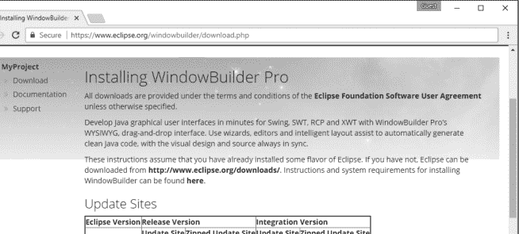

图 1：找到最新的 WindowBuilder 下载链接并复制链接地址。

接下来，回到 Eclipse 并选择 **Help（帮助）› Install New Software（安装新软件）**。在 **Work** 框中：粘贴 WindowBuilder 编辑器的 URL（对于 Eclipse Oxygen，为 `http://download.eclipse.org/windowbuilder/WB/integration/4.7/`），点击 **Add...（添加...）**按钮，并在弹出窗口的 Name（名称）字段中输入 **wb**，如图 1 所示。

点击 **OK**，检查安装窗口中是否出现 WindowBuilder，点击 **Select All（全选）**安装所有需要的 WindowBuilder 组件。一路点击 **Next（下一步）** 直到提示你接受许可协议，直到点击 **Finish（完成）**。

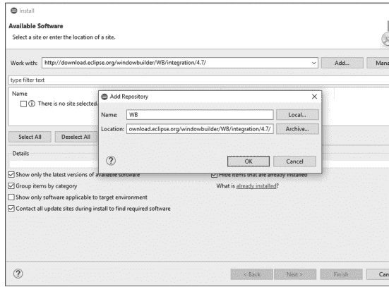

图 1-6：使用 Eclipse 的 Install New Software 窗口添加 WindowBuilder 编辑器。

软件可能需要几分钟进行安装——你会在 Eclipse 的右下角看到进度指示。安装完成后，将提示你重启 Eclipse。点击 Restart Now（立即重启），WindowBuilder 安装将完成。

接下来，让我们添加一些可选的微调，通过更改背景、文本颜色和字体，让 Eclipse 中的代码更容易阅读。

## 自定义 Eclipse 的外观和感觉

现在你已经安装了所需的元素，你可能还想自定义 Eclipse 的外观。在 Windows 和 Linux 上，你可以通过 **Window（窗口） ▸ Preferences（偏选项）** 访问设置。在 macOS 上，进入菜单栏并选择 **Eclipse ▸ Preferences**。

例如，你可能想更改文本编辑器中的主题（调色板）和字体大小。根据你的显示器大小和编程环境，你的主题和字体大小会极大影响可读性、舒适度甚至效率。

在 Preferences 菜单中，在 **General（常规） ▸ Appearance（外观）** 下，你会看到 Theme（主题）选项。你可以从收藏中选择，如 Classic（浅灰色配深色字体）或 Dark（黑色背景配亮且色彩丰富的字体）。我更喜欢 Dark 主题，因为深色背景下字体颜色更亮，在显示器或投影屏幕上可能更容易阅读。

在 **General ▸ Appearance ▸ Colors and Fonts（颜色和字体）** 下，你可以更改字体大小。在右侧的 Colors and Fonts 格中，选择 **Basic（基础） ▸ Text Font（文本字体）** 并点击 Edit（编辑）按钮。字体菜单将弹出。选择一个你可以轻松阅读的字体。我更倾向于 `Courier` 或 `Consolas`。我建议字体大小为 18 到 20，字体样式为 Bold（加粗）。字体窗口将显示示例。


图 1-7：。


图 1-6：Windows （左） 颜色和字体）

在 macOS 或 Linux 上，消息和提示符看起来相似：

```
Payne:~ payne$ jshell
| Welcome to JShell -- Version 9-ea
| For an introduction type: /help intro
```

```
jshell>
```

如果你看到了 `jshell>` 提示符，说明你已经准备好继续到第 12 页的“在 JShell 中处理 Java 表达式”了。如果在安装 JDK 9 后你的电脑上 `jshell` 命令无法工作，请尝试按照下一节的步骤操作。

## 从快捷方式运行 JShell

如果你在从命令行运行 `JShell` 时遇到任何问题，或者你更倾向于从桌面快捷方式运行它，请按照这些指令从 JDK 9 bin 文件夹访问 `JShell` 并设置快捷方式。（bin 文件夹表示二进制文件，即用计算机语言编写的、由 1 和 0 组成的程序。）

遗憾的是，这种方法在 Linux 上并不可靠，但你应该可以使用命令行方法。

你可以在以下目录中找到 `JShell`：

- 在 Windows 上，使用：`C:\Program Files\Java\jdk-9\bin\jshell.exe`
- 在 macOS 上，使用 `/Library/Java/JavaVirtualMachines/jdk-9.jdk/Contents/Home/bin/jshell`

你的 JDK 文件夹可能标记为 `jdk-1.9.x`；它的工作方式相同。导航到电脑的 JDK 9 bin 文件夹并找到 `JShell` 文件，如图 1-10 所示。

你可以双击 `JShell` 文件的图标来运行 `JShell`。你也可以创建一个快捷方式，直接从桌面运行 `JShell` 以便方便：

- 在 Windows 上，右键点击 `jshell.exe` 并选择“创建快捷方式”。Windows 显示“无法在此处创建快捷方式。你想将快捷方式放在桌面上吗？”。点击“是”。
- 在 macOS 上，按 Control 点击 `jshell` 文件并选择“制作别名”。会出现一个名为 `jshell alias` 的文件。将其拖到桌面。

现在，每当你想运行 `JShell` 的时候，只需双击桌面上的图标，就可以开始编写 Java 代码了。

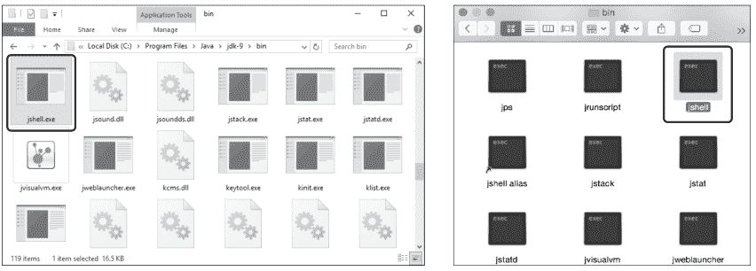

## 在 JShell 中处理 Java 表达式

表达式是任何值（如数字或文本）的组合，结果是另一个值。运算符执行加、减、乘或除等操作。在 Java 中，我们用于这些运算符的符号分别是 `+`、`-`、`*` 和 `/`。让我们用一个简单的数学表达式尝试。在 `JShell` 提示符下，输入 `2+2` 并按回车：

```
jshell> 2+2
$1 => 4
```

`JShell` 告诉你是答案：表达式 `2+2` 的值是 4。`$1` 是一个临时变量。`JShell` 创建这些变量来存储值，在这里变量 `$1` 临时存储值 4，以防你以后想使用它。如果你想知道变量中存什么值，可以在 `JShell` 中输入它。例如，如果你现在输入 `$1`，`JShell` 会告诉你 `$1` 存储的值是 4：

```
jshell> $1
$1 => 4
```

让我们尝试另一个表达式。这次，让我们组合两个文本字符串。字符串是引号之间的字符，用于显示单词、名称和其他文本。你可以使用 `+` 运算符组合字符串：

```
jshell> "Yourz" + "Name"
$3 => "YourName"
```

你会看到创建一个不同的变量——在这种情况下是 `$3`。`$` 之后的数字表示输入表达式的代码行数。这是我的第三段代码，所以 `JShell` 将 "YourName" 存储在变量 `$3` 中。

另请注意，Java 会拼接（或相加）这两个字符串，中间没有空格。如果我们想在两个拼接的字符串之间留一个空格，必须在双引号内包含它，如下：

```
jshell> "Your" + " " + "Name"
$4 => "Your Name"
```

任何有效的 Java 表达式都可以在 `JShell` 中求值，所以请继续多尝试几个表达式。要编辑已输入的语句，请按向上箭头键。`JShell` 将显示你最后输入的命令，允许你对其进行编辑并按回车再次运行该语句。多次按向上箭头可以滚动查看之前语句的历史，一直滚动到你输入的第一行。

## 在 JShell 中声明 Java 变量

使用简单值求表达式的值很棒，但你通常想将值存储在变量中，以便以后使用。`JShell` 一直都在为我们创建临时变量，如上一节中的 `$1` 和 `$3`，但你也可以创建或声明自己的变量。

### 数字变量

让我们创建一个名为 `x` 的整数变量并将值 `42` 存储其中。Java 将整数存储在 `int` 类型的变量中，因此在 `JShell` 提示符下，输入 `int x = 42`：

```
jshell> int x = 42
x => 42
```

等号 (`=`) 是 Java 中的赋值运算符，意味着它用于给变量赋值。`JShell` 做出响应，让我们知道变量 `x` 包含 42。现在，当我们想使用该值时，可以直接通过名字调用它。让我们看看 `x * 2`（x 乘以 2）等于多少：

```
jshell> x * 2
$2 => 84
```

Java 使用 `*` 作为乘法符号，`JShell` 告诉我们 `x * 2` 等于 84。等等，`x` 的值仍然是 42！我们只是计算了结果，没有赋值。为了改变值，我们使用赋值运算符：

```
jshell> x = x * 2
x => 84
```

现在 `x` 是 84。让我们把它加上 7：

```
jshell> x = x + 7
x => 91
```

`x` 的值现在是 91。这就是赋值运算符的工作。

### 字符串变量

`String` 是字符序列。在 Java 中，我们使用 `String` 类型来存储文本。让我们创建一个名为 `myName` 的 `String` 变量：

```
jshell> String myName = "Bryson"
myName => "Bryson"
```

我们可以通过分配新字符串来更改 `String` 变量的值：

```
jshell> myName = "Jane"
myName => "Jane"
```

我们还可以使用 `+` 运算符拼接字符串：

```
jshell> myName + " Doe"
"Jane Doe"
```

## 在 Java 中输出

到目前为止，我们一直在通过将表达式输入 `JShell` 来求值它们的值，但在开始编写实际程序时通常不会这样。在 Java 程序中，我们在输入时不会看到任何回显。

当我们想在屏幕上打印内容时，我们使用打印函数，如 `System.out.println()`，它将一行输出打印到系统控制台，或者如果你在使用上一节中相同的 `JShell` 窗口，你可以打印存储的值：

```
jshell> System.out.println(x)
49
```

如果遇到错误，声明新变量 `x = 49` 然后再次运行打印语句。

注意，这次 `JShell` 不会响应 `x => 49`，因为你没有要求它求值。`println()` 语句只打印你放在括号内的内容，即变量 `x`，所以它直接返回 49。

> **注意**
>
> 每当你需要向读者打印信息时，`System.out.println()` 语句将允许你打印出你想传达的内容。

# JShell 命令

`JShell` 非常易用，以至于你可能永远不想离开它，但最终你将需要处理其他工作，例如使用 Java 构建令人兴奋的桌面应用和移动应用。让我们来看看 `JShell` 提供的命令，包括退出 `JShell` 的命令。

在 `JShell` 提示符下，输入 `/help`：

```
jshell> /help
```

`JShell` 将响应它识别的所有特殊命令完整列表。我们在每个命令前都加上了正斜杠 `/`，表示我们正在直接与 `JShell` 程序对话，而不是 Java 语言。以下是 `JShell` 识别的命令的简略版本：

- `/list [name or id]|[-start]` -- 列出你输入的源码
- `/edit <name or id>` -- 根据名称或 ID 编辑引源码条目
- `/save <[all|-history][-start]` -- 将代码片段保存到文件
- `/open <file>` -- 打开文件作为源码输入
- `/vars <name or id>[-start]` -- 列出声明的变量及其值
- `/imports` -- 列出导入的项目
- `/exit` -- 退出 jshell
- `/reset` -- 重置 jshell
- `/history` -- 你输入内容的历史
- `/help <command>|<subject>` -- 获取关于 jshell 的信息

尝试一些命令，比如 `/list` 来查看你输入的所有源码。你会发现 `JShell` 在需要的地方行尾添加了分号——分号是 Java 分程序中多个语句的方式。历史记录显示了你输入的内容，包括像 `/help`、`/list` 和 `/history` 等命令。

在下一章及之后的章节中编写普通的 Java 程序时，你将在文件中工作，频繁保存，并重新打开你想要处理的文件。在 `JShell` 中，一旦关闭 `JShell` 窗口，你输入的所有内容都会消失——除非你保存了它们。坦白说，`JShell` 包含了保存、打开和编辑你产生的极佳代码片段的能力。要保存代码，使用 `/save` 命令并指定你想存储文件的位置：

```
jshell> /save "~/filename.txt"
```

波浪号 (`~`) 代表你计算机上的目录，因此此命令会将你自打开 `JShell` 以来（或自上次 `/reset` 以来）输入的所有代码保存到设备上的文件中。查看你的电脑屏幕，你应该能看到这个新文件。

要再次打开该文件，请使用 `/open` 命令并告诉 `JShell` 在哪里找到它：


```jshell
jshell > /open "~/filename.txt"
```

JShell 将打开文件并运行代码。当你编写了想要以后保存的代码片段时，使用 `/save` 和 `/open` 命令让你的代码从一次 JShell 会话持续到下一次。

要开始一个新的代码片段，使用 `/reset` 命令。JShell 将记住并保存你在 `/reset` 命令之后输入的内容，但你可以随时重新加载已保存的文件。尝试以下代码，作为保存文件、重置和打开文件的快速示例：

```
- jshell> /reset
  - Resetting state.
- jshell> System.out.println("Hello, Java!")
Hello, Java!
- jshell> System.out.println("My name is Bryson, nice to meet you!")
My name is Bryson, nice to meet you!
- jshell> /save ~/Desktop/myJava.txt
  - Resetting state.
- jshell> /open ~/Desktop/myJava.txt
Hello, Java!
My name is Bryson, nice to meet you!
```

数字圈标出了重要的行，但它们实际上并不是代码的一部分。

首先，需要重置 JShell ①，这样你就不会包含任何在你想要保存的代码之前可能编写的代码。一旦完成，你就可以编写你的程序（在这种情况下是两个打印语句 ②），并将其保存到你的桌面 ③。即使在 JShell 之后 ④，`/open` 命令也会回溯你在 `/save` 命令之前输入的两行代码 ⑤。你可以使用 `/edit` 修改代码并在完成后再次使用 `/save`。

JShell 可以存储和回溯你感兴趣的单行或多行代码。如果你已完成，使用 `/exit` 命令关闭 JShell：

```
jshell> /exit
Goodbye
```

JShell 离开也很礼貌，对你说再见。

# 你学到了什么

在本章中，你不仅安装了 Java、Eclipse 和 Android Studio，还通过在 JShell 交互 shell 中测试各种命令开始学习 Java。JShell 是对普及 Java 的一项兴奋的改进，对于初学者和资深开发者来说都是很好的工具。对于新手来说，JShell 鼓励探索并消除了学习基础命令的一些不必要障碍。对于经验丰富的程序员，JShell 提供了一种快速测试代码并在屏幕上立即显示结果的方法。作为一名教育者和程序员，我对 JShell 对 Java 的未来以及数百万能够从这套新工具中受益的程序员感到兴奋。你为 Java 桌面和移动应用设置了编程环境，并学会了如何在 JShell 中测试代码。你获得了在后续章节中将使用的编程概念经验：

- 安装 Java JDK
- 为开发者安装 Eclipse IDE
- 为移动开发安装 Android Studio
- 从命令行运行 JShell
- 在 JShell 中评估 Java 表达式，包括数字和文本
- 在 Java 中声明整数、小数和字符串变量
- 使用 `System.out.println()` 输出输出
- 使用 `/reset`、`/edit`、`/save`、`/open` 和 `/exit` 等 JShell 命令
- 保存并打开文件

在下一章中，我们将构建第一个完整的 Java 应用——数字猜大小游戏。在随后的章节中，我们将创建文本程序、桌面应用，最后为我们的程序创建移动应用。在此过程中，我们将使用在 JShell 中学到的编程概念，包括表达式、变量、输出等。无论你是在构建第一个应用还是第千个、桌面应用还是趣味游戏，这些元素将成为你代码的一部分。你已经拥有了工具，让我们进入第 2 章开始吧！

# 2

# 构建一个数字猜大小游戏应用！


让我们从用 Java 编写一个有趣的游戏开始：数字猜大小游戏。我们将此游戏编写为命令行应用程序，这只是它是基于文本的一种高级说法（见图 2-1）。当程序运行时，提示符将要求用户在 1 到 100 之间猜一个数字。每当他们猜时，程序都会告诉他们数字是太大、太小还是正确。

```
Guess a number between 1 and 100:
50 is too high. Try again.
Guess a number between 1 and 100:
25 is too low. Try again.
Guess a number between 1 and 100:
37 is too low. Try again.
Guess a number between 1 and 100:
43 is correct! You win!
it took you 4 tries! Good work!
would you like to play again (y/n)?
y
```

图 2-1：基于文本的数字猜大小游戏

现在你已经知道游戏是如何运作的，你必须编写编写它的步骤。我们将先从高层面上规划应用，然后编写一个游戏的简单版本。通过带着目标开始并理解如何玩游戏，你将能够更容易掌握技能，并有目的地学习它们。在完成编码后，你还可以立即享受游戏。

# 逐步规划游戏

让我们思考为了让数字猜大小游戏运行而我们需要编写的所有步骤。游戏的基本版本需要执行以下操作：

1. 生成一个 1 到 100 之间的随机数供用户猜。
2. 显示提示符或一行文本，要求用户在该范围内猜一个数字。
3. 接受用户的猜测作为输入。
4. 将用户的猜测与计算机数字进行比较，判断是太大、太小还是正确。
5. 在屏幕上显示结果。
6. 提示用户猜另一个数字，直到他们猜对。
7. 询问用户是否想再次玩。

我们将从这个基础结构开始。在第 40 页的编程挑战 #2 中，你将尝试添加额外功能，告诉用户猜对数字花了多少次。

# 创建一个新的 Java 项目

在 Eclipse 中编写新 Java 应用的第一步是创建一个项目。在菜单栏上，转到 `File > New > Java Project`（或者选择 `File > New > Project`，然后在 New Project 向导中选择 `Java Project`）。Java Project 对话框应该弹出，如图 2-2 所示。

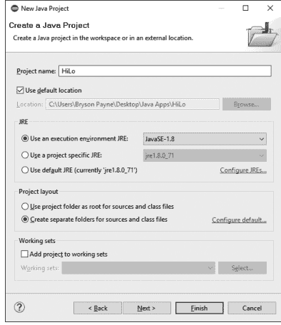

图 2-2：用于 Hi-Lo 猜数字游戏的 New Java Project 对话框

在 `Project name` 字段中输入 `HiLo`。注意，Java 对大小写非常敏感，我们习惯于所有的项目、文件和类名都用大写字母开头，这是一种常见的做法。我们将使用驼峰命名法，因为 `Hi` 和 `Lo` 是两个单词：`HiLo`。保持所有其他设置不变并点击 **Finish**（完成）。取决于你使用的 Eclipse 版本，可能会询问你是否想使用 Java 视图打开项目。Eclipse 中的*视角*是为特定语言编程设置的工作区集。点击 **Yes**（是），告诉 Eclipse 你希望设置工作区以便进行 Java 开发。

## 创建 HiLo 类

Java 是一种面向对象的编程语言。面向对象编程使用类来设计可重用的编程代码。类是模板，可以更容易地创建对象（或类的实例）。如果你把类比作一个饼干模具，那么对象就是饼干。而且就像饼干模具一样，类是可重用的，所以一旦我们构建了一个有用的类，就可以反复使用它来创建任意数量的对象。

Hi-Lo 猜数字游戏将有一个类文件，该文件创建一个包含运行游戏所需代码的猜数字对象。我们将新类命名为 `HiLo`。这遵循了几种 Java 命名规范。通常做法是将所有类名以大写字母开头，因此我们在 `HiLo` 中使用了大写 H。此外，类名内部不应有空格、连字符或特殊字符。最后，对于多单词的类名，我们可以使用驼峰命名法，每个单词的首字母大写，例如 `HiLo`、`GuessingGame` 和 `BubbleDrawApp`。

要创建新的 HiLo 类，在 Eclipse 工作区左侧的 `Package Explorer`（包管理器）面板中找到你的 HiLo 项目文件夹。点击其左侧的小箭头来展开文件夹。你应该看到一个名为 `src` 的子文件夹，用于存放源代码。所有包含你 Java 程序的文本都将在这个 `src` 文件夹中。

右键点击 `src` 文件夹并选择 `New > Class`（新建类），如图 2-3 所示。

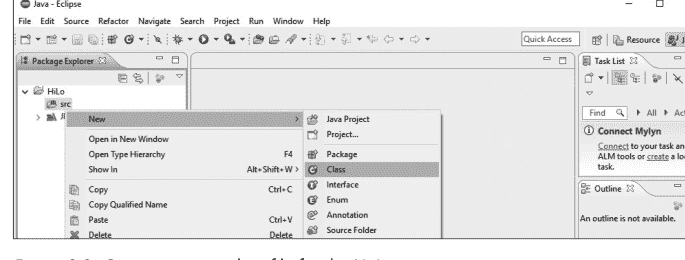

**图 2-3：**为 Hi-Lo 猜数字游戏创建一个新的类文件

弹出 `New Class` 对话框，如图 2-4 所示。在 `Name` 字段中输入 `HiLo`。然后，在 `Which method stubs would you like to create?`（你想创建哪些方法存根？）下，勾选 `public static void main(String[] args)`。这告诉 Eclipse 我们计划编写一个 `main()` 程序方法，因此 Eclipse 将包含一个 `main()` 方法的存根（或骨架），我们可以在其中填充自己的代码。方法是对象或类中的函数。`main()` 方法是类作为独立程序运行时所需的方法。

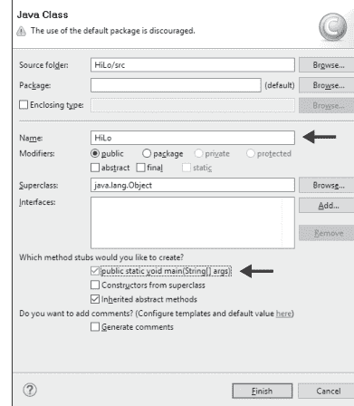

**图 2-4：**将新 Java 类命名为 HiLo 并勾选框以创建 `main()` 方法。

在 `New Java Class` 对话框中点击 `Finish`，你应该能看到一个名为 `HiLo.java` 的新文件，其中包含显示 2-1 所示的代码。这个 Java 文件将是 Hi-Lo 猜数字程序的框架。我们将通过编辑此文件并在内部添加代码来编写猜数字游戏。

```java
public class HiLo {
    public static void main(String[] args) {
        // Todo Auto-generated method stub
    }
}
```

显示 2-1：Eclipse 生成的 HiLo 猜数字类的存根代码

Eclipse 会自动创建这些代码。类 `HiLo` 意味着我们可以从命令行或终端运行它。

Java 使用大括号 `{ }` 将语句分组。左大括号 `{` 开始一个语句块，该块将形成 `HiLo` 类的体。右大括号 `}` 结束语句块。类内部是 `main()` 方法，它是类执行时运行的方法。

在 `main()` 方法的左大括号内有一行以双斜杠 `//` 开头的注释。注释是给我们（人类）看的，计算机会忽略它们，因此我们可以使用它们来帮助记住某段代码的作用，或者为以后使用留下备注。你可以删除显示 2-1 中的 `Todo`。

## 生成随机数

我们游戏的第一个编程任务是生成一个随机数。

我们将使用 `Math` 类，它包含一个用于生成 0.0 到 1.0 之间随机浮点数（小数）的方法。然后，我们将该小数转换为 1 到 100 之间的整数。`Math` 类是一个内置类，包含了许多有用函数，就像你在高级计算器上找到那些一样。

在 `main()` 方法内部，添加显示 2-2 所示的注释和代码行。新代码用黑色显示，现有代码用灰色显示。

```java
public class HiLo {
    public static void main(String[] args) {
        // Create a random number for the user to guess
        int theNumber = (int)(Math.random() * 100 + 1);
    }
}
```

显示 2-2：在 1 到 100 之间创建随机数的代码

首先，我们需要创建一个变量来存储我们在游戏中要尝试猜测的随机数。由于应用程序将让用户猜一个 1 到 100 之间的整数，我们将使用 `int` 类型（代表 integer）。我们将变量命名为 `theNumber`。等号 `=` 将值赋给 `theNumber` 变量。我们使用内置的 `Math.random()` 函数生成一个 0.0 到略小于 1.0（0.99999）之间的随机数。由于 `Math.random()` 只在那个特定范围内生成数字，我们需要将随机数乘以 100，将范围从 0.0 扩展到略小于 100.0（99.9999）。然后我们对该值加 1，以确保数字范围从 1.0（0.0 + 1）到 100.99999。

`(int)` 部分被称为类型转换，或简称为 cast。类型转换了数字的类型。

```java
public static void main(String[] args) {
    Scanner scan = new Scanner(System.in);
    // 创建一个随机数供用户猜测
    int number = (int)(Math.random() * 100 + 1);
    System.out.println(number);
    int guess = 0;
}
```

该语句声明了一个 `int` 类型的变量 `guess` 并将其初始化为起始值 `0`。某些编程语言要求在不同的代码行中声明和初始化变量，但 Java 允许程序员在单行中完成变量的声明和初始化。Java 要求每个变量都必须用特定的类型（即它应该存储的信息种类）进行声明。用户的猜测将是一个整数，因此我们将 `guess` 声明为 `int`。

接下来，我们提示用户输入猜测。我们可以通过向控制台（命令行）打印一行文本来让用户知道程序已准备好输入。我们通过 `System` 类作为计算机系统的一部分访问这个基于文本的类，就像我们处理键盘输入那样。但接着，我们希望使用输出信息供用户阅读。让我们能够访问命令行控制台的对象是 `System.out`。类似于允许我们从键盘接收文本输入的 `System.in` 对象，`System.out` 赋予了我们向屏幕输出文本的能力。打印一行文本的特定函数是 `println()`。

```java
int guess = 0;
System.out.println("Guess a number between 1 and 100:");
```

在这里，我们使用了点符号表示法，它列出了一个类或对象，后面跟着一个点，然后是该类或对象的方法或属性。方法需要使用点符号表示法来调用，以告诉 Java 它们属于哪个对象或类；例如 `Math.random()`。属性是存储在对象或类中的值。

例如，`System` 是一个代表你计算机系统的类。`System.out` 是包含在 `System` 类中的命令行屏幕对象，因为你的显示器是你整个计算机系统的一部分。`System.out.println()` 是一个使用 `System` 对象打印一行文本的方法。随着我们的继续，我们将更多地练习使用点符号表示法。

现在用户知道程序期望他们提供什么样的输入了，是时候检查键盘获取他们的猜测了。我们将使用之前创建的名为 `scan` 的 `Scanner` 对象。`Scanner` 有一个名为 `nextInt()` 的方法，用于寻找用户从键盘输入的下一个 `int` 值。我们将用户的猜测存储在之前创建的变量 `guess` 中：

```java
System.out.println("Guess a number between 1 and 100:");
guess = scan.nextInt();
```

该语句将等待用户在控制台窗口中输入（希望是 1 到 100 之间的整数——我们将在第 3 章学习如何确保用户输入的是有效数字）并按下回车键。`nextInt()` 方法将用户输入的文本字符字符串（例如 `"50"`）转换为正确的数值（50），然后将该数字存储在变量 `guess` 中。请花一点时间保存你到今为止所做的更改。

# 让程序打印输出

我们还可以通过添加另一个 `println()` 语句来确保我们的程序正在运行：

```java
guess = scan.nextInt();
System.out.println("You entered " + guess + ".");
```

这一行使用了 `System.out.println()` 方法，但现在我们正在组合文本和数字输出。如果用户猜的是 50，我们希望输出显示为 `"You entered 50."`。为了实现这一点，我们构建了一个混合了数字与文本的 `println()` 语句。

Java 允许使用 `+` 运算符来连接字符串。我们使用双引号来指定我们想要首先输出的文本（`"You entered "`）。注意结束引号前的空格——这是我们希望在打印输出的最后一个单词之后出现空格的地方。Java 会忽略大部分空格，但当空格包含在文本字符串的双引号内时，它就变成了文本的一部分。

我们还想打印用户猜测的数字。我们已将此值存储在变量 `guess` 中，所以只需要使用 `println()` 语句输出该值即可。坦率地说，在 Java 中，当你将变量包含在 `println()` 语句中，Java 会打印该变量包含的值。因此，紧接连接运算符 `+` 后面的是变量名 `guess`。最后，我们想发送带有句号的句子，所以我们使用另一个连接，后面跟着双引号中我们需要的文本，使其看起来像 `"."`。

显示 2-3 汇总了我们到目前为止的所有代码行。


```java
import java.util.Scanner;

public class HiLo {
    public static void main(String[] args) {
        Scanner scan = new Scanner(System.in);
        // 创建一个随机数供用户猜测
        int theNumber = (int)(Math.random() * 100 + 1);
        // System.out.println(theNumber);
        int guess = 0;
        System.out.println("Guess a number between 1 and 100:");
        guess = scan.nextInt();
        System.out.println("You entered " + guess + ".");
    }
}
```

虽然这一行新代码设置了扫描对象，但它实际上还没有请求输入。为了让用户输入猜测，我们需要通过要求他们输入一个数字来提示他们。然后，我们将获取他们从键盘输入的数字并将其存储在一个变量中，以便将其与计算机的随机数进行比较。让我们存储用户猜测的变量命名为一个容易记忆的名字，比如 `guess`。在下一后面添加以下行：

该语句声明了一个 `int` 类型的变量 `guess` 并将其初始化为起始值 `0`。某些编程语言要求在不同的代码行中声明和初始化变量，但 Java 允许程序员在单行中完成变量的声明和初始化。Java 要求每个变量都必须用特定的类型（即它应该存储的信息种类）进行声明。用户的猜测将是一个整数，因此我们将 `guess` 声明为 `int`。

接下来，我们提示用户输入猜测。我们可以通过向控制台（命令行）打印一行文本来让用户知道程序已准备好输入。我们通过 `System` 类作为计算机系统的一部分访问这个基于文本的类，就像我们处理键盘输入那样。但接着，我们希望使用输出信息供用户阅读。让我们能够访问命令行控制台的对象是 `System.out`。类似于允许我们从键盘接收文本输入的 `System.in` 对象，`System.out` 赋予了我们向屏幕输出文本的能力。打印一行文本的特定函数是 `println()`。

```java
int guess = 0;
System.out.println("Guess a number between 1 and 100:");
```

在这里，我们使用了点符号表示法（dot notation），它列出了一个类或对象，后面跟着一个点，然后是该类或对象的方法或属性。方法需要使用点符号表示法来调用，以告诉 Java 它们属于哪个对象或类；例如 `Math.random()`。属性是存储在对象或类中的值。

例如，`System` 是一个代表你计算机系统的类。`System.out` 是包含在 `System` 类中的命令行屏幕对象，因为你的显示器是你整个计算机系统的一部分。`System.out.println()` 是一个使用 `System` 对象打印一行文本的方法。随着我们的继续，我们将更多地练习使用点符号表示法。

现在用户知道程序期望他们提供什么样的输入了，是时候检查键盘获取他们的猜测了。我们将使用之前创建的名为 `scan` 的 `Scanner` 对象。`Scanner` 有一个名为 `nextInt()` 的方法，用于寻找用户从键盘输入的下一个 `int` 值。我们将用户的猜测存储在之前创建的变量 `guess` 中：

```java
System.out.println("Guess a number between 1 and 100:");
guess = scan.nextInt();
```

该语句将等待用户在控制台窗口中输入（希望是 1 到 100 之间的整数——我们将在第 3 章学习如何确保用户输入的是有效数字）并按下回车键。`nextInt()` 方法将用户输入的文本字符字符串（例如 `"50"`）转换为正确的数值（`50`），然后将该数字存储在变量 `guess` 中。请花一点时间保存你到今为止所做的更改。

# 让程序打印输出

我们还可以通过添加另一个 `println()` 语句来确保我们的程序正在运行：

```java
guess = scan.nextInt();
System.out.println("You entered " + guess + ".");
```

这一行使用了 `System.out.println()` 方法，但现在我们正在组合文本和数字输出。如果用户猜的是 `50`，我们希望输出显示为 `"You entered 50."`。为了实现这一点，我们构建了一个混合了数字与文本的 `println()` 语句。

Java 允许使用 `+` 运算符来连接字符串。我们使用双引号来指定我们想要首先输出的文本（`"You entered "`）。注意结束引号前的空格——这是我们希望在打印输出的最后一个单词之后出现空格的地方。Java 会忽略大部分空格，但当空格包含在文本字符串的双引号内时，它就变成了文本的一部分。

我们还想打印用户猜测的数字。我们已将此值存储在变量 `guess` 中，所以只需要使用 `println()` 语句输出该值即可。坦率地说，在 Java 中，当你将变量包含在 `println()` 语句中，Java 会打印该变量包含的值。因此，紧接连接运算符 `+` 后面的是变量名 `guess`。最后，我们想发送带有句号的句子，所以我们使用另一个连接，后面跟着双引号中我们需要的文本，使其看起来像 `"."`。

2-3 汇总了我们到目前为止的所有代码行。

```java
import java.util.Scanner;

public class HiLo {
    public static void main(String[] args) {
        Scanner scan = new Scanner(System.in);
        // 创建一个随机数供用户猜测
        int theNumber = (int)(Math.random() * 100 + 1);
        // System.out.println(theNumber);
        int guess = 0;
        System.out.println("Guess a number between 1 and 100:");
        guess = scan.nextInt();
        System.out.println("You entered " + guess + ".");
    }
}
```

正确的缩进可以帮助你记住匹配左括号和右括号，并能帮助你快速看出哪些语句在循环或其他代码块内部，哪些语句在循环之外。缩进不会影响程序的运行方式，但如果做得好，它会让你的程序变得更易于阅读和维护。

现在，保存你的程序并运行它，以检查它是否正常工作。游戏现在几乎可以玩了，但我们仍然需要告诉程序去检查用户的猜测是太高、太低还是正好。现在是（请准备鼓掌……）`if` 语句的时间了！

## if 语句：测试正确的条件

现在用户被允许不断猜测，直到我们需要检查猜测结果并告诉他们是太高还是太低为止。允许我们执行此操作的语句是 `if` 语句。

`if` 语句将根据某个条件（或条件表达式）决定执行一次某个语句块，或者完全不执行。

在猜测循环之前，我们使用了一个条件表达式：`(guess != Number)`。为了检查猜测是否太高或太低，我们需要几个比较运算符：小于 (`<`)、大于 (`>`) 和等于 (`==`)。

首先，与其直接告诉用户他们的猜测是多少，不如写一些代码来检查他们的猜测是否太低。将 `while` 语句的最后一行替换为以下两行的 `if` 语句：

```java
while (guess != Number) {
  System.out.println("Guess a number between 1 and 100:");
  guess = scan.nextInt();
  if (guess < Number) {
    System.out.println("" + guess + " is too low. Try again.");
  }
}
```

该语句以括号中的关键字 `if` 开始。在这种情况下，条件是 `guess < Number`，这意味着用户的猜测值小于秘密数字的值。注意，在随后的 `println()` 语句之前没有分号，它实际上是 `if` 语句的一部分。我们告诉程序，如果条件为真，它应该打印用户的猜测，并让他们知道猜太低了。我们在用户的猜测和告诉他们猜测太低的文本字符串之间使用了连接运算符 `(+)`。注意第一个双引号之后和 `is` 之前的空格。这把用户的猜测值与单词隔开来。

如果你运行程序并输入一个较低的猜测（例如 `1`），该语句应该告诉程序说你的猜测太低了。这是一个良好的开始，但如果我们猜了一个太高的数字呢？在这种情况下，我们需要一个 `else` 语句。

`else` 语句提供了一种方法在 `if` 语句中的条件不为真时选择另一种步骤的方法。我们可以使用 `if-else` 配对来测试太高或太低的猜测。让我们在 `if` 语句之后添加一个 `else` 语句：

```java
if (guess < theNumber)
  System.out.println(guess + " is too low. Try again.");
else if (guess > theNumber)
  System.out.println(guess + " is too high. Try again.");
```

注意上面的代码看起来与之前的代码相似。当我们使用 `if-else` 语句时，我们需要连续检查多个条件。在这里，我们需要检查猜测是太低、太高还是正好。在这种情况下，我们可以通过将下一个语句放在上一个 `if-else` 语句的 `else` 部分来链接 `if-else` 条件。我们紧接在上一个条件的 `else` 之后开始下一个语句。如果猜测更高，程序可以告诉用户猜测太高或太低，我们只需要告诉他们是否猜中了并获胜了！

如果之前的两个条件都不为真——用户的猜测既不太高也不低——那么他们一定猜中了那个数字。所以我们添加一个 `else` 语句：

```java
if (guess < theNumber)
  System.out.println(guess + " is too low. Try again.");
else if (guess > theNumber)
  System.out.println(guess + " is too high. Try again.");
else
  System.out.println(guess + " is correct. You win!");
```

注意，对于这个最后的 `else` 语句不需要条件表达式。如果数字既不高也不低，那么猜中是唯一的选择。在猜中的情况下，我们提供语句让用户知道他们获胜了。到目前为止的程序如列表 2-4。保存你的 `HiLo.java` 并运行程序以检查它是否正常工作。它应该提示你输入猜测，直到你猜中正确的数字。

```java
import java.util.Scanner;

public class HiLo {
  public static void main(String[] args) {
    Scanner scan = new Scanner(System.in);
    // 创建一个随机数供用户猜测
    int theNumber = (int)(Math.random() * 100 + 1)
```


语句将包含在 `do-while` 循环中。这些步骤描述了一次完整的游戏流程，因此对于每一轮游戏，程序都会重复所有步骤，通过选择一个新的随机数作为胜利猜测，并要求用户再次游戏。

因此，我们可以在创建秘密数字的代码之前，在这两行之后立即添加关键字和左大括号：

```java
Scanner scan = new Scanner(System.in);
String playAgain = "";
do {
    // Create a random number for the user to guess
    int theNumber = (int)(Math.random() * 100 + 1);
    System.out.println(theNumber);
    int guess = 0;
    while (guess != theNumber) {
```

然后，在用于的 `while` 循环结束括号以及最后一个语句的括号之后，我们将要求用户再次游戏并从键盘获取他们的响应。接着我们需要通过一个条件来关闭 `do-while` 循环，检查用户是否回复了：

```java
// End of while loop
System.out.println("Would you like to play again (y/n)?");
playAgain = scan.next();
while (playAgain.equalsIgnoreCase("y"));
```

提示词询问用户“Would you like to play again (y/n)?”，用户可以用单个字母回复，`y` 表示是，`n` 表示否。`scan.next()` 扫描键盘输入，但它不像 `nextInt()` 那样寻找下一个整数，而是寻找用户在键盘上输入的下一个字符或字符组。无论用户输入什么，都将存储在变量 `playAgain` 中。

该行使用大括号关闭了重复游戏的代码块，并且它包含了决定代码是否会再次运行的条件。在 `while` 条件中，你可以看到字符串对象 `equals()` 方法的示例。`equals()` 方法告诉你一个字符串变量是否与另一个字符字符串完全相同，而 `equalsIgnoreCase()` 方法则告诉你，即使它们的大小写不同，这些字符串是否相等。在我们的游戏中，如果用户想再次游戏，他们被要求输入 `y`。然而，如果我们测试的是小写的 `y`，我们可能会漏掉大写的 `Y` 响应。在这种情况下，我们希望对该字母具有灵活性，无论大写还是小写，因此我们使用字符串方法 `equalsIgnoreCase()`。

最后的 `while` 语句告诉 Java，只要字符串变量 `playAgain` 是大写或小写的 `y`，就继续游戏循环。位于 ⓐ 和 ⓑ 的最后两个右大括号是程序已经存在的。Ⓒ 处关闭了 `main()` 方法，而 ⓓ 处关闭了整个 Hilo 类。我包含它们是为了显示 ⓔ 行应该插入的位置。

到为止的完整游戏在列表 2-5 中。

```java
import java.util.Scanner;
public class Hilo {
    public static void main(String[] args) {
        Scanner scan = new Scanner(System.in);
        String playAgain = "";
        do {
            // Create a random number for the user to guess
            int number = (int)(Math.random() * 100 + 1);
            System.out.println(number);
            int guess = 0;
            while (guess != number) {
                System.out.println("Guess a number between 1 and 100:");
                guess = scan.nextInt();
                if (guess < number) {
                    System.out.println(guess + " is too low. Try again.");
                } else if (guess > number) {
                    System.out.println(guess + " is too high. Try again.");
                } else {
                    System.out.println(guess + " is correct. You win!");
                }
            }   // End of while loop for guessing
            System.out.println("Would you like to play again (y/n)?");
            playAgain = scan.next();
        } while (playAgain.equalsIgnoreCase("y"));
    }
}
```

列表 2-5：Hi-Lo 猜数字游戏准备好开始或重新。

检查代码以确保你已在正确的位置添加了所有内容，检查你的括号和分号，并花一点时间保存文件。我们将在下一节测试游戏。

> 你的缩进（每行开头的制表间距）看起来与最后的代码片段并不完全相同，因为我们在几个新地方添加了大括号。坦率地说，在 Java 中添加新功能（包括循环和其他代码块）非常常见，Eclipse 有一个菜单可以自动清理缩进。首先，在屏幕上选择（高亮）`HiLo.java` 文件中的所有文本，然后进入 `Source > Correct Indentation`。Eclipse 会正确缩进每行代码，以显示哪些语句旨在分组在一起。正如之前提到的，

## 测试游戏


现在游戏循环已经就绪，我们将对其进行测试。首先，保存你的 `HiLo.java` 文件并在 Eclipse 中选择 Run。程序将生成一个随机数并要求你猜。如果你的猜测太低或太高，程序会告诉你；如果你猜对了，它会祝贺你。最后，程序会询问你是否想再次进行游戏。如果你输入 `y`，游戏将使用新数字重启；如果你输入其他任何内容，程序将结束。

图 2-6：完成的基于文本的命令行猜数字游戏

关于完成的 Hi-Lo 猜数字程序，有几点值得注意。首先，尽管编写它花费了大量工作，但代码非常短——不到 30 行。尽管如此，如果你想玩，它是可以运行的。其次，这个程序不仅演示了条件和循环，还使用了嵌套循环。这被称为嵌套循环，因为猜数字的循环被包含在“再次玩一次”的循环之中，或者说嵌套在它内部。缩进帮助我们看清 `do-while` 循环的开始和结束，我们可以看到较小的循环及其语句被缩进在较大的 `do-while` 循环内部。最后，我们整洁地结束了程序——对用户来说，是感谢他们的参与；对计算机来说，是关闭了扫描器（`scanner`）。

# 你学到了什么

在构建一个简单、有趣且可玩的游戏的过程中，我们学习了一些非常有用的编程概念。这也是我小时候学习编程的方式——我会找一个有趣的游戏或图形化应用，对其进行编程，然后对其进行修改、拆解并尝试新事物。玩耍和探索是学习任何新事物的重要部分，我希望你在每个程序中都能花一点时间尝试新事物。每章末尾的编程挑战也将为你提供尝试新事物的机会。

在构建这个猜数字游戏时，我们开发了系列 Java 技能：

- 创建一个新类 `HiLo`
- 导入现有的 Java 包 `java.util.Scanner`
- 使用 `Scanner` 对象接收键盘输入
- 声明并初始化整数和字符串变量
- 使用 `Math.random()` 生成随机数并将其强制转换为整数
- 使用 `while` 和 `do-while` 循环在条件为真时重复一组步骤
- 在命令行控制台打印文本字符串和变量值
- 从键盘扫描整数和字符串并将其存储在变量中
- 在 `if` 和 `if-else` 语句中测试条件表达式
- 使用 `String` 方法的 `equalsIgnoreCase()` 比较字符串值
- 使用 `close()` 方法关闭如 `Scanner` 对象之类的输入资源
- 在 Eclipse 内部运行命令行程序

除了实用技能外，你还掌握了 Java 中几个重要编程概念的操作性知识：

**变量（Variables）** `theNumber` 是一个整数变量，类型为 `int`，用于猜数字。`answer` 是一个字符串变量，类型为 `String`。我们在玩过程中通过输入新的猜数字或回答 "n" 来改变变量的值。

**方法（Methods）** 方法是我们在 Java 类内部所称的“函数”。`Math.random()` 是一个生成 0.0 到 1.0 之间随机数的方法。`scan.nextInt()` 方法接收用户的数字输入。`System.out.println()` 是一个向控制台或终端窗口显示文本的函数。

**条件语句（Conditionals）** `if-else` 语句允许我们测试条件（如 `guess < number`）是否为真，并根据结果运行代码块。我们还使用表达式来确定是否再次执行循环，例如 `while guess != theNumber` 语句。只要 `guess` 不等于 `theNumber`，该语句就会一直循环。记住，“等于”的测试符号是双等号：`==`。

**循环（Loops）** 循环让我们在条件为真时重复一段代码块。我们在猜数字游戏中使用 `while` 循环来不断询问用户另一个数字，直到他们猜中正确的数字。`do-while` 循环至少运行一次，我们用它来询问用户是否想再次玩。

**类（Classes）** 整个 HiLo 应用是一个 Java 类，`public class HiLo` 是一个模板。现在我们为 HiLo 游戏构建了一个类，我们就可以复用它在许多不同的计算机上玩猜数字游戏。我们在应用中导入了 `Scanner` 和 `Math` 类来接收输入和生成随机数。我们将概述类以执行新操作，并利用 Java 已经包含的类来处理输入等日常任务。

## 编程挑战

尝试这些编程挑战来回顾和练习你所学的内容，并扩展你的技能。如果你遇到困难，可以访问书籍的网站 `https://www.nostarch.com/learnjava/` 下载示例解决方案，或者在在线视频课程 `http://www.udemy.com/java-the-easy-way/` 中观看视频以获取逐步步进的解决方案。第 2 章可以免费预览，在购买完整课程时可以使用优惠码 `BOOKHALFTOFF` 享受 50% 的折扣。

### #1：扩展你的范围

对于第一个编程挑战，将猜数字游戏修改为使用更大范围的数字。不要用 1 到 100，尝试让用户在 -100 到 100 之间猜数字！

#### 提示 (HINT)

将 `Math.random()` 乘以 200 并从结果减去 100。

记住同时修改生成随机数的编程语句和告诉用户他们应该猜范围的提示信息。如果你想让游戏简单点，可以将范围从 1 改为 10，当你只需要四次就能猜中秘密数字时，会让朋友们大惊讶。尝试其他范围，比如 1 到 1,000，甚至 1 到 1,000,000，或者如果你想的话可以使用负数范围！（记住，在 Java 中写数字时不能使用逗号。）你不仅会变得更擅长编程，还能提高数学能力。随你喜欢修改程序并尽情享受吧！

#### 策略性猜词 (STRATEGIZE YOUR GUESSES)

你可能会发现，猜数字游戏玩得越多，反应就越快。你可能会发现，通过不断玩猜数字游戏，你就能更快地猜出数字。这种技术被称为二分搜索。每次猜数字都会将范围缩小一半。尝试看！

### #2：计数次数 (Counting Trials)

我们已经构建了一个很酷的游戏，但让我们尝试添加一个功能。你的挑战是计算并报告用户猜中数字花了多少次。为了完成这项任务，你需要创建一个新变量如 `int numberTries = 0;`，并在每次循环时增加 `numberTries`。你可以通过 `numberTries += 1` 实现。可能需要几次才能让代码正确运行，但这是值得的。在第 3 章，你将在另一个版本构建此功能。

### #3：玩空游戏 (Playing Libs)

在本章的最后一个挑战中，让我们写一个全新的程序。我们学习了如何获取用户输入并存储在变量中。我们还学习了如何向屏幕打印文本和值。有了这些技能，你可以构建更有趣程序。

你玩过空游戏吗？让我们尝试用我们的新技能构建一个这种风格程序。空游戏要求玩家提供各种单词，颜色、过去式动词、形容词，然后将玩家选择的词插入模板中，通常会产生有趣的故事。现在，挑战是写一个新程序 `MadLibs.java`，它包含一个 `main()` 方法来提示用户输入几个单词。这些单词应该分别存储在不同的 `String` 变量中，如 `color`、`pastTenseVerb`、`adjective` 和 `noun`，并将它们初始化为空字符串。在用户输入最后一个单词后，程序应该通过用用户提供的单词替换空字符串来打印完整的句子或故事，如下：

```
System.out.print("The " + color + " dragon " + pastTenseVerb + " is at the " + adjective + " knight.");
System.out.println(knight + ", who was born on a sturdy, " + noun + " ".");
```

注意第一个语句是 `print()` 语句。`print()` 语句在行尾继续，允许我们构建更长的段落或故事。然而，`println()` 语句在打印时总是跳过一行，就像你在行尾按了回车键一样。你可以使用不同的变量名如 `noun`、`noun2` 和 `noun3` 写一个更长的空故事。尝试一下，准备好迎接你创作的有趣故事吧！

# 3 为我们的猜数字游戏创建一个 GUI


在本章中，我们将为第 2 章中的 Hi-Lo 猜游戏创建一个 GUI 版本，如图 3-1 所示。当这个版本的程序运行时，它会呈现出一个用户与之交互的图形（或视觉）界面。GUI 版本允许用户像使用每天使用的应用程序一样在桌面窗口中玩游戏。这是一个专业的窗口化应用，包含一个用于用户猜测的文本字段、一个用于提交猜测的按钮，以及一个告诉用户猜高了、猜小了还是正确的标签。

### Payne 博士的高低猜数字游戏

猜一个 1 到 100 之间的数字：50

猜猜！

在上方输入一个数字，点击猜猜！

### Payne 博士的高低猜数字游戏

猜一个 1 到 100 之间的数字：100

猜猜！

100 正确！你赢了！让我们再来一次吧！

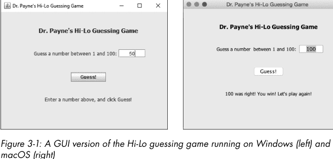

最重要的是，完全相同的 Java 源代码生成了图 3-1 中的两个版本应用程序。通过我们在本章中编写的 GUI 代码，游戏可以在 Windows、macOS 和 Linux 上运行！

### 使用 JShell 进行练习

JShell 在命令行中工作，接受文本命令并通常以文本输出响应。然而，JShell 也可以访问全 Java 库——预先编写的代码包——并且不仅局限于文本。在我们开始编写游戏之前，让我们先创建一个简单的 JShell 来进行练习。

### 用四行代码创建 GUI

我们可以在 JShell 中仅用四行代码创建一个简单的 GUI 窗口。让我们逐条查看每个语句。首先，在 JShell 中输入一个导入语句来导入 `javax.swing.JFrame` 类：

```
jshell import javax.swing.JFrame
```

我们刚刚创建的帧是一个使用 Java 的框架或窗口。接下来，让我们使用该类创建一个框架。输入以下声明来创建一个名为 `myFrame` 的 `JFrame`：

```
jshell JFrame myFrame = new JFrame("Hello!")
```

`new` 关键字创建了一个 `JFrame` 类的对象——在这种情况下，这是一个我们将编程并在标题栏中显示“Hello!”的 GUI 窗口。有一行长代码告诉我们窗口将具有的一些默认属性：

```
myFrame ==> java.swing.JFrame[frame1,0,0,0,invalid,hidden,layout=java.BorderLayout ...
```

括号后显示的信息是 `myFrame` 及其属性值的字符串表示，例如它的 own（0x，即 0 比 0 像素）以及它是隐藏还是可见。让我们通过将大小设置为大于 0x0 像素来更改其中一个属性。

第三行代码通过指定框架的宽度和高度来设置窗口的像素大小：

```
jshell myFrame.setSize(300,200)
```

这告诉 Java 让窗口宽为 300 像素，高为 200 像素，足够让我们看到窗口和标题栏。

最后，通过调用 `setVisible()` 方法在屏幕上显示窗口：

```
jshell myFrame.setVisible(true)
```

我们使用 `setVisible(true)` 显示窗口，使用 `setVisible(false)` 隐藏它。由于我们调用了 `myFrame.setVisible(true)`，你应该能看到窗口如图 3-2 所示出现。

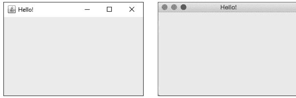

图 3-2：我们在 Windows [左] 和 macOS [右] 上的 GUI 窗口

我们仅通过在 JShell 中输入四段代码就创建了一个 GUI 窗口！

### 用 10 行代码创建一个交互式 GUI！

我向大学的学生和家里的儿子展示了之前的例子，两组人的反应都类似于：“这真的很酷，但你能让窗口做些什么吗？”

幸运的是，答案是肯定的。通过多添加几行代码，我们可以在窗口上添加一个按钮，每次点击时都会打印内容。

让我们从一个新的 JShell 开始。在 JShell 提示符处输入 `/reset` 来清除 JShell 历史：

```
jshell /reset
| Resetting state.
```

接下来，让我们使用内置的 JShell 编辑器编写一段 10 行代码，以创建一个响应你点击的交互式 GUI 应用。在 JShell 提示符处输入 `/edit` 来打开 JShell 编辑器：

```
jshell >edit
```

当我们想要一次性编写多行代码，或者想要返回编辑早些输入的某行代码时，JShell Edit Pad 非常有用，如图 3-3 所示的空窗口。

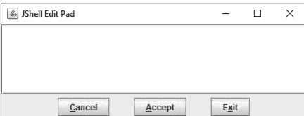

图 3-3：JShell Edit Pad 是编写简短代码段的方便编辑器。

在这种情况下，我们想要输入 10 行代码，创建一个交互式 GUI，其带有一个按钮，点击时会打印某些内容。输入以下行，注意大小写，并在每个语句末尾添加分号：

```
import javax.swing.*;
JFrame window = new JFrame("Bryson's Window");
JPanel panel = new JPanel();
JButton button = new JButton("Click me!");
panel.add(button);
window.add(panel);
window.setSize(300,100);
button.addActionListener(e -> 
    System.out.println("Ouch! You clicked!"));
window.setVisible(true);
```

首先是 Swing 类，包括 `JFrame`。库末尾的星号 (`*`) 是通配符，意味着“包含此包中的所有类”。然后我们像上一个例子一样创建一个 `JFrame`，在窗口内部创建一个面板。面板将作为标签和按钮等 GUI 组件的容器。接下来添加一个带有“Click me!”文本的按钮。③ 将按钮添加到我们的 GUI 面板，然后 ② 将面板添加到窗口。然后我们将窗口大小设置为 300 像素宽、100 像素高 ⑤，类似于上一个例子。④ 行是魔法发生的地方：在这里为“Click me!”按钮添加一个监听器，每当用户点击时都会响应。每当用户点击 GUI 按钮时，监听器会在控制台打印“Ouch! You clicked!”我们在构建的应用中使用这样的监听器让程序与用户交互。最后我们让窗口可见，就可以点击按钮来测试程序了。当你完成所有 10 行代码并检查准确性后，点击 JShell Edit 中的 **Accept** 按钮来接受代码并在 JShell 中运行，如图 3-4 所示。

```
JShell Edit Pad
import java.swing.*;
JFrame window = new JFrame("Bryson's Window");
JPanel panel = new JPanel();
JButton button = new JButton("Click me!");
panel.add(button);
window.add(panel);
window.setSize(300,100);
button.addActionListener((e ->
    System.out.println("Ouch! You clicked!"));
window.setVisible(true));
```

图 3-4：在 JShell Edit Pad 中输入所有 10 行代码后点击 **Accept**。


用鼠标点击标记为 **Click me!** 的按钮，你将在 JShell 窗口看到如下 Java 输出：

```
jshell> Ouch! You clicked!
Ouch! You clicked!
Ouch! You clicked!
```

如果你关闭了这个小 GUI 窗口，要让它回来，你要做的是重复显示窗口的最后一行。回到 JShell 命令行窗口按几次回车以获取提示符和光标，然后输入以下内容：

```
jshell window.setVisible(true)
```

当我们将可见性属性设置为 true 时，窗口重新出现；如果你关闭窗口，可见性属性就会变为 false。这段 10 行代码已经足够酷了，但现在你将学习如何构建带有 GUI 的游戏！

### 在 Eclipse 中设置 GUI 应用

如果你在 Eclipse 中仍有第 2 章的 HiLo 项目，如图 3-6 所示，请关闭或最小化你可能正在处理的其他 Java 文件的编辑器窗口。此外，通过点击左侧 Package Explorer 中 HiLo 文件夹旁的小箭头来折叠 HiLo 项目，这允许我们在单个工作区中保持项目在一起而不会混淆。


图 3-6：关闭任何打开的文件并折叠 HiLo 项目。

从 Eclipse 菜单栏，转到 File > New > Java Project，并将项目命名为 GuessingGame。在输入名称后，点击右下角的 Finish。这创建了新的项目文件夹，我们在其中开发猜数字游戏的 GUI 版本。

在 Package Explorer 中展开 GuessingGame 文件夹并找到 `src` 文件夹。右键点击 `src` 文件夹（在 macOS 上为使用 CONTROL-CLICK）并选择 New > Class。新类名为为 `GuessingGame`。务必使用驼峰法，类名以大写 G 开头。勾选 `public static void main(String[]) args` 方法旁边的框框。这增加了 `main()` 方法的骨架，以便我们作为独立程序运行应用程序。


在完成之前，我们需要与第 2 章中构建的命令行应用不同地执行一个步骤。我们将超类从默认的 `java.lang.Object` 更改为 `javax.swing.JFrame` 类，即我们在本章开始在 JShell 中使用的 `JFrame`。Java 中的超类或父类是我们扩展的类，以便重用已经写好的代码，在本例中，它是构建图形化窗口化界面所需的代码。`javax.swing` 包中的 `JFrame` 类是我们在自己的应用程序中包含 GUI 组件的方法之一，因此我们将使用 `JFrame` 创建窗口，然后对其进行版本定制以添加更多功能。由于 `JFrame` 类本身是 `Object` 超类的扩展，我们不需要 `java.lang.Object`，因为 `JFrame` 将继承 `Object` 超类的代码。这意味着 `JFrame` 将拥有 `Object` 类的所有功能，以及更多。我们稍后将看到扩展是如何工作的。

图 3-7 显示了猜数字游戏新建 Java 类对话框中的这些设置。

### Java 类

不建议使用默认包。

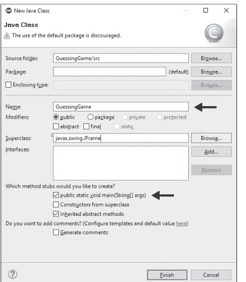

图 3-7：将父类更改为 `javax.swing.JFrame`，为 GUI 类做准备。

点击“完成”（Finish）查看 `GuessingGame.java` 的以下源代码：

```java
import javax.swing.JFrame;
public class GuessingGame extends JFrame {
    public static void main(String[] args) {
        // Todo Auto-generated method stub
    }
}
```

在第一行中，Eclipse 导入了 `javax.swing.JFrame` 类，允许我们的程序使用 Swing 包中的 GUI 能力。在第二行中，我们使用了一种全新的编码超能力：`extends` 关键字。在面向对象编程中，父类（或超类）可以拥有子类，子类继承父类中包含的所有方法和属性。一旦我们写了一个想要重用的重要类，我们就可以引用该原始类并扩展它以添加新功能，而无需更改父类中的代码。在这种情况下，`JFrame` 父类具有显示文本字段、标签、按钮和其他 GUI 组件的能力，我们可以为新的游戏应用对其进行自定义和布局。

我们在本节中扩展的 `JFrame` 父类将允许我们通过 Eclipse 中的 WindowBuilder 编辑设计 GUI 布局，从而显示一个包含文本字段、标签和按钮等 GUI 元素的窗口。让我们接下来看看 WindowBuilder 编辑是如何工作的。

### 使用 Eclipse 的 WindowBuilder 编辑设计 GUI

流行的 Java IDE 包含此类工具，帮助程序员在设计视图中构建吸引人的 GUI，并具有“所见即所得”（WYSIWYG）界面。WYSIWYG 界面允许用户按照元素在最终产品中的外观进行设计。例如，Microsoft Word 就是一个 WYSIWYG 界面，允许你根据最终打印效果编辑文本。同样，WindowBuilder 编辑等 Java IDE 工具允许程序员放置文本字段、标签和按钮等 GUI 组件，使其外观与最终窗口应用程序中的样式一致，帮助程序员交付外观专业的 GUI 应用。

要打开 WindowBuilder 编辑，请在项目资源管理器（Project Explorer）中右键点击 `GuessingGame.java` 文件，然后选择**用 WindowBuilder 打开**（Open With WindowBuilder Editor）。将打开一个看起来像普通文本编辑器的窗口。但如果你查看窗口的左下角，你会看到两个新标签：源（Source）和设计（Design）。“源”标签是应用程序的纯文本代码。如果你点击“设计”视图，你将看到图 3-8 所示的设计视图。

WindowBuilder 编辑器仅在 GUI 类中出现，例如 `GuessingGame` 或其他 GUI 父类之一。注意，预览窗口有一个标题栏，左侧有一个 Java 图标，并有三个用于最小化、最大化和关闭窗口的按钮。图 3-8 中的预览窗口在 Windows、macOS 和 Linux 上的看起来略有不同。此窗口将是我们构建 GUI 猜数字游戏的游乐场。

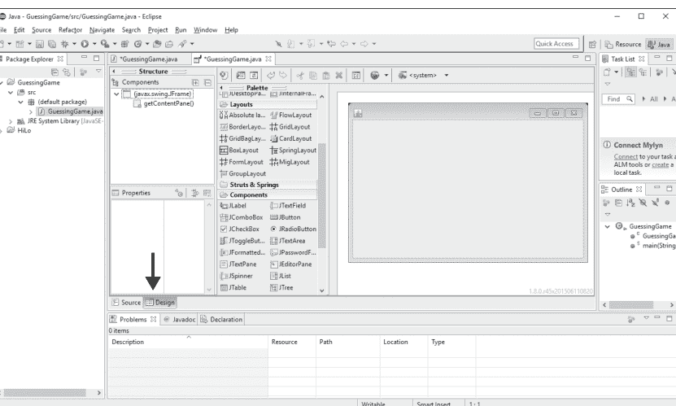

图 3-8：WindowBuilder 编辑器的“设计”标签页可以让你轻松地构建 GUI 窗口应用程序。

### 设计界面

双击 WindowBuilder 编辑器顶部的 `GuessingGame.java` 标签，以将 WindowBuilder 设计视图扩展为全屏。这将为设计 GUI 布局留出更多空间。当你准备好回到编程时，可以再次双击标签以恢复标准的 Java 视图。

### 在属性面板中设置 GUI 属性

我们将使用属性面板（Properties pane）来开始为我们的猜数字游戏自定义 GUI 窗口。属性面板可以在 WindowBuilder 编辑器“设计”标签的左下方找到。如图 3-9 所示，如果你点击组件面板（Components pane，位于左侧 Structure 下方）中的组件，属性面板会立即列出几个值，我们可以查看并编辑它们。

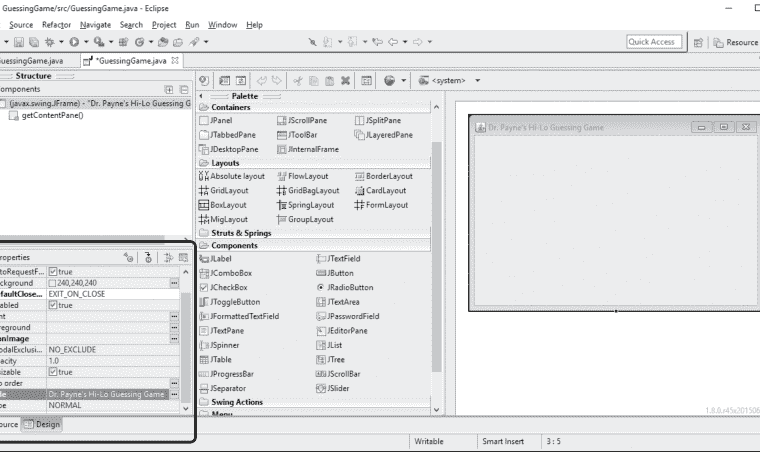

图 3-9：属性面板可以帮助你自定义应用程序中每个 GUI 组件的属性。

我们将为猜数字游戏构建一个自定义的 GUI 窗口。首先，让我们更改此 Frame（框架）的标题。在组件面板中，向下滚动到属性面板，直到看到 `title`（标题）属性。在 `title` 右侧的空框中输入 `Your Name's Hi-Lo Guessing Game`。（将斜体文本替换为你的名字；此即可！）。输入标题文本后，按回车键。右侧的 GUI 预览将自动更新，显示标题栏中的 `Your Name's Hi-Lo Guessing Game`。

标题完成后，让我们设置几个属性，让 GUI 的外观和行为符合我们对猜游戏的要求。向上滚动属性面板找到 `defaultCloseOperation`（默认关闭操作）（如果面板太窄，可能只显示名称的一部分 `defaultClose...`）。点击 `defaultCloseOperation` 右侧的框，从下拉菜单中选择 `EXIT_ON_CLOSE`。这意味着当你点击此 `JFrame` 的按钮时将退出程序。这通常是默认设置，但有时你只想关闭窗口而不是整个应用程序——例如，在保存对话框或弹出窗口中。对于此窗口，我们希望在主窗口关闭时退出应用程序。

接下来，我们将更改 GUI 组件在 `JFrame` 内部的排列。点击组件面板中的 `getContentPane()` 项（就在 `javax.swing.JFrame` 下方）。内容面板（content pane）是 `JFrame` 的内部，我们在那里构建 GUI 布局。现在，在属性面板中找到 `Layout`（布局），点击字段右侧的向下箭头。从下拉列表中选择 `Absolute Layout`（绝对布局）；这使我们能够以像素精度放置 GUI 元素。

### 在调色板中自定义 GUI 组件

让我们开始自定义我们的猜数字游戏。你可以在调色板（Palette）面板中找到任何 GUI 应用所需的内容。调色板面板位于 WindowBuilder 编辑器“设计”标签的中间。注意，你可以通过点击面板标题左侧的小箭头来展开或折叠面板。点击箭头展开面板。当你需要大型、复杂的 GUI 布局时，这非常有用。

在调色板中，向下滚动直到看到 Components（组件）部分，如图 3-10 所示。调色板包含了你已经熟悉的所有标准组件，如标签 (`JLabel`)、文本字段 (`JTextField`)、按钮 (`JButton`) 和复选框 (`JCheckBox`)。你可能已经注意到 `javax.swing` 包中的 GUI 组件都以大写字母 `J` 开头，后面跟着驼峰命名法的名称。这使得易于记住使用 Swing 工具包的应用程序中每个 GUI 元素的类名。

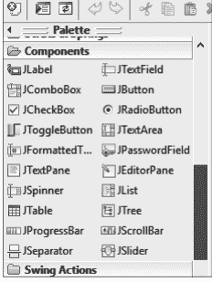

图 3-10：调色板面板中的“组件”部分是我们寻找最常用组件的地方。

让我们在 GUI 窗口顶部放置一个显示 `Your Name's Hi-Lo Guessing Game` 的标签。点击调色板中 Components 下的 `JLabel`。然后，将鼠标在 GUI 预览上移动；你应该看到网格线出现。默认情况下，WindowBuilder 提供这些网格线来帮助放置元素。现在，当鼠标靠近灰色内容面板（`JFrame` 内部）的中心时，在该处点击一个 `JLabel`。

当你放置 `JLabel` 时，可以直接在 GUI 预览中编辑标签中的文本。输入 `Your Name's Hi-Lo Guessing game` 并按回车键。如果你想更改文本，转到左侧属性面板中 Label 的 `text` 属性并输入你的文本。起初，你可能只看到标签的一部分，因为标签太小了。点击标签，你会在每个角看到缩放框。点击标签的左下角并将其拖到内容面板的左边界，以扩展面板的左边缘。然后，点击标签的右下角并拖动以调整到其右边缘。

现在你的完整标签文本应该在标签中了。接下来让我们让标签居中并固定。首先，是属性面板中标签的 `horizontalAlignment`（水平对齐）属性。点击值并从下拉列表中选择 `CENTER`。找到标签的属性并点击值右侧的三个点。将打开一个选择窗口，允许你选择字体、大小和样式。选择 `Tahoma`、15 点和加粗，如图 3-11 所示。你可能需要调整标签的大小以适应较大的字体。

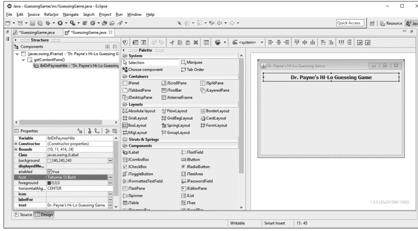

图 3-11：第一个标签已自定义并放置在内容面板的顶部

让我们为用户在游戏中将看到的第一个提示添加一个标签。点击调色板面板中的 `JLabel`，然后将新标签放置在内容面板正上方。输入 `Guess a number between 1 and 100:` 作为标签的文本。你需要稍微调整标签的大小以留出额外的边距。

在标签的右侧，让我们放置一个文本字段，供用户输入他们猜的数字。点击调色板上的 `JTextField`，并将文本字段放置在它刚刚放置的标签右侧。

调整其大小，使其能够容纳三位数数字。再次点击标签并将其 `horizontalAlignment` 属性更改为 `RIGHT`，使文本更接近文本字段，如图 3-12 所示。

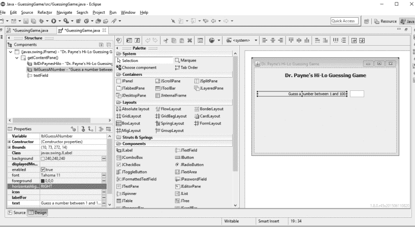

接下来，让我们放置一个用户可以点击以提交猜测的按钮。在调色板（Palette）上，找到并将鼠标悬停在 GUI 视图窗口的中间，点击放置按钮（Button）。将文本更改为 `Guess!`。

最后，在按钮下方放置一个标签（label），将其内容设置为 `Enter number above and click Guess!`，将其调整为 `JFrame` 的全宽度。然后，将水平对齐方式（`horizontalAlignment`）设置为 `CENTER`。稍后，这个标签也将告诉用户他们猜高了、猜低了还是猜对了。

现在所有的 GUI 组件都已在屏幕上，我们准备好对布局进行一些微调，以平衡并居中。请确保保存您的文件。

#### 对齐 GUI 元素

到目前为止，我们一直在通过肉眼调整组件的位置，尝试正确设置间距并尽可能让它们居中。然而，当我们运行程序时，期望布局是“完美”的。幸运的是，Eclipse 内置工具可以帮助我们对齐组件。

首先，让我们将四个主要元素均匀分布，保持相同的间距。按住 SHIFT 键逐个点击三个标签和一个按钮来选中它们。现在，不要点击用户输入猜测的文本框。你会看到 GUI 预览窗口上方出现一小排对齐工具。鼠标悬停在每个工具上，

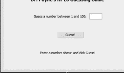

图 3-13：GUI 布局包含了所有组件，但尚未完美对齐。

查看工具提示，它会告诉你该按钮的作用。如果你起初没有看到所有工具，可能需要调整 Eclipse 窗口的大小。

点击看起来像堆叠按钮的工具（图 3-14 中最右侧的图标）。现在选中的四个项目在从上到下的间距应该是相等的。

现在只选择文本框。移动它，使其与提示用户猜数字的标签对齐。我们最初没有包含文本框，是因为 Eclipse 会均匀分布所有五个组件，导致文本框和它的标签分开，并创建五行而不是四行。


图 3-14：你可以使用 GUI 预览上方的工具均匀地对齐和排列组件。

如果你在 WindowBuilder 中对齐内容（或进行任何其他操作）时弄错了，可以通过 `CTRL-Z` 或 `Shift-Z` 撤销之前的操作。这是 WindowBuilder 编辑器中一个非常棒的安全功能，让你可以尝试新事物而不会永久性破坏布局。

最后，点击标记为 `Guess!` 的按钮，并点击 GUI 预览上方的对齐按钮（右侧带有“Center horizontally in window（在窗口中水平居中）”工具的那个一个）。你可以根据需要居中或调整其他组件。要同时移动两个或多个组件，可以 SHIFT-点击同时选中它们，然后点击并拖动它们。

当你对布局满意时，就是时候通过命名组件来准备编写代码了。花点时间保存更改。

#### 为代码命名 GUI 组件

猜数字应用程序的用户界面已为玩家准备就。然而，为了让应用程序更容易处理，我们需要在 Java 源代码中进行一些最后的微调，我们将在那里编写游戏的其他部分。我们需要命名每个组件，以便在源代码中引用它们。

这一步有时被称为“接线（wiring up）”，因为我们将程序所需的每个 GUI 组件连接到 Java 源代码中可以访问的变量名。在我们添加每个 GUI 元素时，Eclipse 已经为我们命名了名称，但我们想要更改这些名称。选择用户输入猜测的文本框。如果你在属性（Properties）中查看，你会看到最顶部的属性是 `Variable`（变量）。Eclipse 默认给你的第一个文本框给出的变量名可能是 `something-nt text field`。点击 `Variable` 属性旁的值，并将此文本框的变量重命名为 `txtGuess`，如图 3-15 所示。

| Properties | |
| :--- | :--- |
| Variable | `txtGuess` |
| Bounds | (25, 91, 140) |
| Class | `javax.swing.JTextField` |
| background | 255,255,255 |
| columns | |
| dropDown | `USELECTION` |
| editable | true |
| font | Arial 10,1 |
| foreground | 0,0 |
| horizontalAlign | `LEADING` |
| toolTip | | |

图 3-15：重命名每个 GUI 元素的变量，以便我们在 Java 源码中使用它们。

`txtGuess` 这个名称会提醒我们这是一个文本框，并且了用户的猜测。你会发现，一致且逻辑清晰地命名 GUI 组件将帮助你更快更高效地编写代码，且错误更少。

重命名文本框后，选择 GUI 窗口底部显示 `Enter a number above and click Guess!` 的标签。这个标签将为用户输出信息，例如猜高了、猜低了或赢了！，所以让我们将其重命名为 `lblOutput`。这个名称将帮助我们记住这是一个标签，并且我们想用它输出。在 WindowBuilder 的 Source（源码）选项卡中，你会看到 Eclipse 已经命名了标签（图 3-16）。

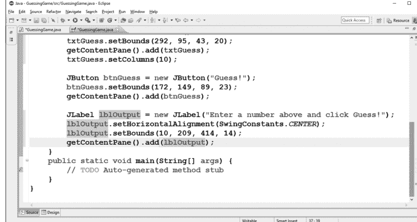

图 3-16：Eclipse 在 Source 选项卡中将标签命名为 `lblOutput`。

### 将 GUI 连接到你的代码

滚动到 `GuessingGame` 类的顶部，你会看到 Eclipse 这样声明文本字段：

```java
public class GuessingGame extends JFrame {
    private JTextField txtGuess;
```

在这个猜数字应用程序中，我们将能够访问用户输入到字段中的值，因此 Eclipse 已经在类级别声明了它。我们也想访问 `lblOutput` 以便向用户显示文本（当他们猜高、猜低或正确时）。因此我们需要在类顶部添加更多声明，就在 `txtGuess` 声明之后：

```java
public class GuessingGame extends JFrame {
    private JTextField txtGuess;
    private JLabel lblOutput;
```

此行代码将 `lblOutput` 声明为指向应用程序 GUI 布局中 `JLabel` 对象的变量。我们选择将此对象设为私有以隐藏数据，但我们仍然可以在 `GuessingGame` 类中使用它。

最后一个更改是修正最初声明 `lblOutput` 的那行代码，在类底部附近。代码中类似这样的这一行：

```java
JLabel lbl1output = new JLabel("Enter a number above and click Guess!");
```

将其更改为：

```java
lblOutput = new JLabel("Enter a number above and click Guess!");
```

当我们 `GuessingGame` 类的顶级别声明变量时，再添加一个重要的变量：`theNumber`。记得在游戏的文本版本中，这就是我们给用户尝试猜测的秘密随机数的名字。在 `txtGuess` 和 `lblOutput` 之后为 `theNumber` 添加声明：

```java
public class GuessingGame extends JFrame {
    private JTextField txtGuess;
```


```java
private JLabel lbl1output;
private int theNumber;
```

既然我们已经在类顶部正确声明了变量，现在准备开始编写猜数字游戏应用的 GUI 版本了。在下一节中，你将学习如何从 GUI 文本框中获取用户的猜测，并判断该数字是太高还是太小。我们还会在 GUI 标签 `lbl1output` 中显示输出文本，帮助用户进行下一次猜测。

## 添加一个方法来检查玩家的猜测

现在 GUI 已经通过添加的私有变量 `txtGuess` 和 `lbl1output` 连接到 Java 源代码，我们将开始编写猜游戏的逻辑。

让我们在 `GuessingGame` 类顶部编写一个名为 `checkGuess()` 的方法。该方法的签名（或骨架）看起来如下：

```java
public class GuessingGame extends JFrame {
    private JTextField txtGuess;
    private JLabel lbl1output;
    private int theNumber;
    public void checkGuess() {
}
```

注意，该方法被声明为 `public`。类中的变量通常被声明为 `private`，但操作这些变量的方法通常被声明为 `public`，以便其他类可以调用它们。你可以将其比作检查账户：你的余额是私有的（`private`），只有你或银行可以访问，但存款的功能是公开的（`public`，其他人可以向你的账户存钱）。

第二个术语 `void` 告诉 Java 我们不期望有一个返回值，返回值是函数或方法返回的值。例如，一个从华氏度到摄氏度的转换器函数 `convertToCelsius()` 可能会接收一个代表华氏温度的值，并返回一个代表转换后的摄氏温度的数值。在这个猜数字应用中，`checkGuess()` 方法不会向程序的其他部分返回此类信息。我们将编写程序通过图形用户界面向用户显示信息，因此我们使用不返回值的返回类型。

最后，我们为方法命名为 `checkGuess()`，并提供了起始的大括号，大括号内将包含告诉程序如何检查用户猜测的代码。

## 从 JTextField 获取文本

让我们开始构建 `checkGuess()` 方法，它将获取用户输入的字符串并将其与猜测的数字进行比较。在 `checkGuess()` 方法的两个括号之间添加此行：

```java
public void checkGuess() {
    String guessText = txtGuess.getText();
}
```

这一行创建了一个名为 `guessText` 的新 `String` 变量，它将保存用户输入 GUI 文本框的数字。要获取下面的文本，我们需要通过调用 `txtGuess.getText()` 来使用 `getText()` 方法，并将结果存储在新字符串变量 `guessText` 中。

当你在 `txtGuess` 之后使用点运算符 `.` 输入时，可能会弹出一个窗口，如图 3-17 所示。

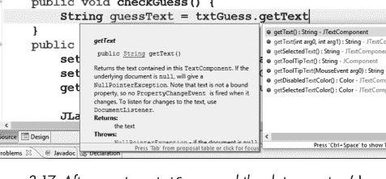

图 3-17：在你输入 `txtGuess` 和点运算符 `.` 后，你可能会看到一个实用的代码建议窗口。

这被称为内容辅助——Eclipse 通过建议用于完成你正在编写的语句的代码行来提供帮助。这种类型的内容辅助也是代码推荐器，因为它会推荐常用选项，例如当前类或对象的方法。代码推荐是使 Eclipse 成为专业 Java 开发者强大 IDE 的功能之一。在大多数情况下，选择代码推荐器不仅更快，而且这样做有助于防止错误，并让程序员在开发复杂应用程序时保持高效。

现在，我们需要创建一个字符串来告诉用户他们的猜测是太高、太小还是正确。让我们再创建一个额外的字符串：

```java
public void checkGuess() {
    String guessText = txtGuess.getText();
    String message = "";
}
```

我们不知道用户的猜测是太高还是太低，所以我们将 `message` 初始化为一个带有双引号（`""`）的空字符串。

在用户对随机数（`theNumber`）进行猜测后，在向 GUI 标签输出它之前，我们将用更多信息来更新这个字符串。为了测试用户的猜测，我们需要将他们存储在 `guessText` 中的文本输入转换为数值形式，以便我们能将其与 `theNumber` 进行比较。

## 将字符串转换为数字

在第 2 节中创建的该应用的文本版本中，我们使用 `Scanner` 从用户输入的键盘扫描数字值。`Scanner` 可以在 GUI 中工作，但有一种更紧凑的方法更适用于这个版本。

就像 `Math` 类有 `Math.random()` 让我们能够生成随机数一样，还有一个用于处理整数的类 `Integer`。`Integer` 类有几个对处理数字非常有用的函数，包括一个用于查找文本字符串的方法 `Integer.parseInt()`。在 `String message = ""` 下方输入以下行：

```java
public void checkGuess() {
    String guessText = txtGuess.getText();
    String message = "";
    int guess = Integer.parseInt(guessText);
}
```

首先，这一行声明 `guess` 为一个整数变量。然后，它从用户输入的文本中搜索并解析整数。例如，猜测 "50" 将变成数字 50。最后，它将该数字存储在变量 `guess` 中。我们需要用户猜测的数值版本以便与 `theNumber` 比较。注意，这些 `if-else` 语句与文本版本中的几乎相同，不同在于我们不会打印到控制台。相反，我们将输出到 GUI 标签，因为我们把消息（太高、太小或正确）存储在变量中，而不是直接输出到控制台窗口。我们仍然需要向用户显示 `message`，因此我们将使用 `lbl1output` 标签来完成。我们将如下使用 `setText` 方法：

```java
else
    message = guess + " is correct. You win!"
lbl1output.setText(message);
```

此命令通过将 `JLabel lbl1output` 的文本属性更改为正确的 `String` 变量，在 GUI 中向用户显示消息。你完成的 `checkGuess()` 看起来应该是：

```java
public void checkGuess() {
    String guessText = txtGuess.getText();
    String message = "";
    int guess = Integer.parseInt(guessText);
    if (guess < number) {
        message = guess + " is too low. Try again."
    } else if (guess > number) {
        message = guess + " is too high. Try again."
    } else {
        message = guess + " is correct. You win!"
        lbl1output.setText(message);
    }
}
```

接下来，我们需要编写为 `theNumber` 分配随机值的代码。我们将使用 `newGame()` 方法，因为我们希望在用户开始新游戏时都有一个随机数。

## 开始新游戏

我们希望在每次运行猜数字游戏时都让电脑挑选一个新的、秘密的、随机数，因此在 `GuessingGame` 类的方法中执行这样做是合理的。通过这样做，我们可以在用户赢得并想玩新游戏时调用该方法。

该 `newGame()` 方法的签名与 `checkGuess()` 方法相似。将其放置在 `checkGuess` 的结束括号之后、`public GuessingGame()` 之前：

```java
lbl1output.setText(message);
}
public void newGame() {
}
public GuessingGame() {
```

我们将此方法设为 `public`，以便可以从外部类进行调用。我们还需要告诉 Java 就像 `checkGuess()` 方法一样，此方法没有需要返回的信息，因此其返回类型为 `void`。

右括号 `)`。该方法目前是空的，大括号之间什么都没有，我们稍后处理这个问题。

在此应用中创建一个新游戏仅意味着我们告诉计算机选择一个随机数。将此随机值赋值给 `thenNumber` 的代码看起来和运行起来与文本版本游戏中的代码一样，只是我们将这段代码放在了它自己的独立方法中。

因此，完成后的 `newGame()` 方法应该像这样：

```java
public void newGame() {
    thenNumber = (int)(Math.random() * 100 + 1);
}
```

搞定！现在我们已经准备好了构建功能性游戏应用的所有必要部分，因此只需将它们连接到 GUI 界面即可。一旦应用能够监听用户事件以便响应用户点击“Guess!（猜测！）”按钮，我们就可以运行游戏了！

## 监听用户事件：点击猜测！

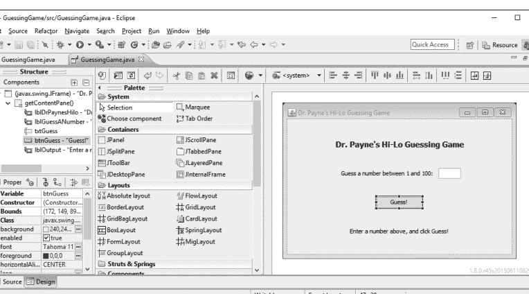

> 图 3-18：在设计视图中，双击“Guess!”按钮向代码中添加事件监听器。

双击“Guess!”按钮会自动打开 Source（源代码）标签，你会发现 Eclipse 添加了新代码。这段新代码是事件监听器的骨架——在这种情况下，它是用户在 `JButton btnGuess` 上执行操作时触发事件的 `ActionListener()`。在这种情况下，操作就是点击按钮。

Eclipse 已经添加了所有内容，唯独缺少用户点击按钮时想要执行的动作。让我们来看看 Eclipse 为我们创建的事件监听器。

```java
btnGuess = new JButton("Guess!");
btnGuess.addActionListener(new ActionListener() {
    public void actionPerformed(ActionEvent e) {
    }
});
btnGuess.setBounds(172, 149, 89, 23);
getContentPane().addActionListener(btnGuess);
```

用于 `actionPerformed()` 的事件监听器（处理按钮点击的特定监听器）通过 `addActionListener()` 方法与 `btnGuess` 连接。接几行代码除了 `addActionListener()` 函数的括号外都是完全相同的。

在 `addActionListener()` 方法内部，我们看到的第一个东西是关键字 `new`，它告诉我们 Eclipse 正在创建一个 `ActionListener` 类的新对象，这与我们过去看到的不同，尽管它是一个匿名内部类，意味着它没有引用它的变量，并且它完全创建在 `GuessGame` 类内部。匿名内部类可以帮助我们更快地编写代码，因为我们不需要构建一个完全独立的类来处理像按钮点击这样快速的事件。相反，我们可以在创建按钮的地方直接插入事件处理程序的代码。在这种情况下，`ActionListener` 将仅监听按钮点击，因此它是匿名内部类的完美人选。

Eclipse 创建了匿名内部类的骨架。接下来的这部分代码将放在 `actionPerformed()` 方法的大括号内，在其中我们描述了当用户点击 `btnGuess` 时，我们想要让应用执行的操作。该方法接受一个 `ActionEvent` 作为参数，即监听器正在监听的事件或用户操作。在这种情况下，我们将 `ActionEvent` 命名为 `e`，但你可以使用任何喜欢的变量名。当用户输入猜测值并点击“Guess!”按钮时，该操作被赋值给 `e`，我们需要通过创建的 `checkGuess()` 方法来检查他们的猜测：

```java
btnGuess.addActionListener(new ActionListener() {
    public void actionPerformed(ActionEvent e) {
        checkGuess();
    }
});
```

感谢 Eclipse，我们唯一添加的是 `checkGuess();` 命令。自动代码完成功能为我们节省了时间并帮助我们避免了拼写错误。

这段代码就绪后，我们只需要告诉应用在启动时运行。请花点时间保存目前的工作。

## 设置 GUI 窗口

在第一次运行游戏之前，我们需要告诉程序执行什么来设置 GUI 窗口。这包括构建 GUI 界面、通过调用 `newGame()` 方法开始新游戏，以及设置窗口所需的宽度和高度。

在文件底部 `main()` 方法的大括号内，添加以下代码行：

```java
public static void main(String[] args) {
    GuessingGame theGame = new GuessingGame();
    theGame.newGame();
}
```

第一行代码创建了一个名为 `theGame` 的新 `GuessingGame`。第二行代码将使用随机数开始猜测游戏。

现在，让我们给 Java 一个我们想要的尺寸。对于 GUI 桌面应用，我们可以使用 `setSize()` 指定应用框架的大小，输入我们要创建的窗口的宽度和高度。

```java
public static void main(String[] args) {
    GuessingGame theGame = new GuessingGame();
    theGame.setSize(new Dimension(450, 300));
}
```

`setSize()` 方法需要一个内置 `java.awt` 库（抽象工具包）的 `Dimension` 类型参数。包含 `setSize()` 的括号告诉 Java 创建一个 `Dimension` 类型的对象，宽度和高度参数为 300 像素。但我们还没有导入 `java.awt` 库，这意味着 Eclipse 不知道 `Dimension` 指什么，所以你的编辑器会通过用红色下划线标记类名提示该语句存在错误。如果你点击编辑器中的 `Dimension` 单词，Eclipse 会向你显示快速修复列表，正如图 3-19 所示。如果你无法获取弹出窗口，请将光标放在 `Dimension` 上。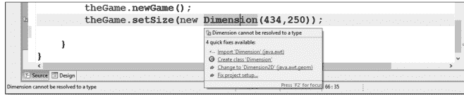

我们希望使用 `java.awt` 包中的 `Dimension` 类，**导入 'Dimension'** 是正确的。点击它，将其添加到页面顶部。

```java
import java.swing.JFrame;
import java.swing.JLabel;
import java.swing.SwingConstants;
import java.awt.Dimension;
import java.awt.Font;
import java.swing.JTextField;
```

最后，在 `main()` 方法中添加此内容使应用可见：

```java
theGame.setSize(new Dimension(450, 300));
theGame.setVisible(true);
```

此命令调用了 `GuessingGame` 的可见属性。我们希望将其设置为 `true`，这是一个布尔值。

## 开始游戏！

代码完成后，现在是保存 GuessingGame 文件的好时机。点击运行按钮或从菜单选择运行。游戏窗口将会出现。尝试输入一些猜测看看应用是否正常。在玩游戏时，检查每个组件以确保它工作。确保测试“Guess!”按钮、底部的标签和文本框。如果发现问题，返回检查代码。注意错误发生的地方以缩小范围。随着学习编程，你会更擅长发现错误。图 3-20 显示了应用正常工作时的样子。

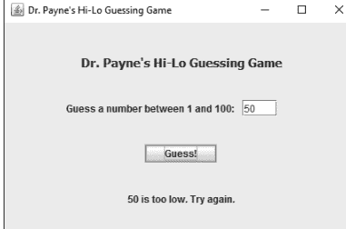

图 3-20：“Guess!”按钮起作用了！

当你的游戏可以玩时，你就准备好进行下一步了。

现在游戏是可以玩的，但只到你赢得为止。当前版本的应用没有告诉 Java 在我们每次赢得时都启动新游戏的代码。

首先，让我们设置好在赢得一次后继续玩游戏，然后对用户界面进行一些调整以提供更好的体验。

## 添加再次游戏功能

就像我们在第一个文本版本的游戏中所做的那样，让我们添加一个再次游戏的功能。我们已经创建了 `newGame()` 方法，但在设置应用初始显示的 `main()` 方法中只调用了该方法。

我们需要更改 GUI 或者更改应用行为。我们可以添加一个“再次游戏”按钮让用户在想玩另一轮时点击，或者我们可以直接让应用在用户每次赢得时自动开始新游戏。

只有在用户获胜时才需要。一种方案是添加一个按钮，但在游戏运行时让它不可见，只有在用户获胜时才显示。为了保持游戏简单，我们不会这样做，但如果你感兴趣尝试一下，请参阅第 73 页的“编程挑战 #2”。

与其添加按钮，不如改变应用程序的行为，以便当用户赢得当前回合时，会自动选取一个新数字。这只需要修改程序的一个部分，即处理猜测数字与随机数匹配的 `else` 语句。如果用户赢得了一回合，新回合应该自动开始。这符合直觉——没有额外的按钮，也不需要做任何决定。如果玩家决定不再玩了，只需直接关闭窗口即可。我们将通过修改以下几行代码来实现这种行为：

```
else
message = guess + " is correct. You win!"
```


我们将调用 `newGame()` 来启动新游戏。为了在这个元素内部添加对 `newGame()` 方法的调用，我们将两个语句（设置变量 `message` 和调用 `newGame()`）组合为一个块，如下：

```
else {
    message = guess + \
    " is correct. Let's play again!"
    newGame();
}
```

括号将这两个语句分组为一个单一的代码块，每当该元素被选择为正确的程序路径时，它们就会一起执行。如果没有括号，只会执行 `element` 语句后的第一行，而 `newGame()` 方法将在 `if-else` 语句求值后运行。这会导致游戏在用户每次尝试猜测时都改变秘密数字。

注意，我们在消息字符串的末尾添加了“Let's play again!（让我们再玩一次吧！）”。这让用户知道他们可以通过猜测再次游戏，并且可以预期电脑每回合都会选取新数字。完成这些更改，保存程序并运行它，查看游戏的新版本！

## 改进用户体验 (UX)

在你玩游戏时，你可能会注意到一些可以使用户界面变得更好的游戏元素。例如，如果程序能够在用户点击“Guess!”按钮或按下键盘上的 `Enter` 键时同时接受新的猜测，那将提供更自然、更直观的用户体验（UX）。

另一个问题是，当我们想要猜一个新数字时，必须突出并选中旧数字（或者，按下 `DELETE` 或 `BACKSPACE` 键）来清除之前的猜测。我们还必须点击回文本框，因为焦点切换到了“Guess!”按钮上。为了改进用户界面，我们可以让光标在每次猜测后返回文本框，并自动高亮或删除之前的猜测内容，以便新的猜测能够替换旧的。让我们处理这两项。

## 允许用户按 Enter 键猜测

我们将进行的第一项改进是允许用户按 `ENTER` 键提交他们的猜测。首先，进入 Design 选项卡并右键点击“Guess!”按钮。在弹出菜单中，选择 `Add event handler > actionPerformed`。就像我们为 `btnGuess` 创建事件处理器时一样，Eclipse 会自动添加代码为 `txtGuess` 创建动作监听器，就像我们之前做的那样，我们这段代码的 `actionPerformed()` 部分括号内部添加 `checkGuess()` 方法。我们通常想要从文本框内部处理的事件就是用户按下 `ENTER` 键。

```
txtGuess.addActionListener(new ActionListener() {
    public void actionPerformed(ActionEvent e) {
        checkGuess();
    }
});
```

添加此行代码后，文件将找到并运行它。现在，当我们按下 `ENTER` 键时，它会激活 `checkGuess()` 方法。“Guess!”按钮依然存在，所以用户可以选择仅通过键盘或鼠标进行交互。

## 自动移除旧猜测

现在，让我们解决必须点击回文本框来删除旧猜测的问题。为了解决这个问题，我们需要学习一些处理像 `txtGuess` 这样的 `JTextField` 对象的方法。首先，我们要考虑文本被选中的情况。对于猜数字游戏，在用户的猜测被评估后可能是允许用户再次猜测的正确时。因此，我们需要 `checkGuess()` 方法内部添加代码，将光标放回文本框并选中用户之前猜测的文本。但我们如何知道哪些命令会将光标放在文本框并选中所有文本呢？这是使用 Eclipse 内容辅助（content assist）的好时机。输入对象的名称 `txtGuess`，然后加上点运算符 (`.`），Eclipse 就会显示可用方法的列表，如图 3-21 所示。

```
public void requestFocus() {
    setText(String text) : Component - 21
setFocus(boolean focus) : Component - 15
hasFocus() : Component - 2
public void setText(String text) : Component - 1
public void action(ActionEvent evt, Object obj) : Component - 0
addComponent(Component comp) : Component
getText();
```

*图 3-21：内容辅助功能显示了 JTextField 可用的所有方法。*

当你看到有几十个方法可以处理像 `txtGuess` 这样的 `JTextField` 时，我们要寻找的是 `requestFocus()`。该函数的文档说：“请求此组件获取输入焦点。”在这种情况下，焦点就是光标。该方法将完全按照我们的要求，每当用户再次猜测时，光标都会被放回文本框。

最后，我们想要选中用户之前猜测的所有文本，以便他们新的猜测会自动替换旧的。要选中文本框中的所有文本，请使用 `selectAll()` 方法，它也列在 Eclipse 的辅助建议列表中。将这两行添加到 `checkGuess()` 方法的末尾，紧跟在 `lblOutput.setText(message);` 行之后，并在闭括号之前：

```
lblOutput.setText(message);
txtGuess.requestFocus();
txtGuess.selectAll();
```

现在是保存你的应用程序的好时机。当你再次尝试运行游戏时，你应该感到更流畅、更直观的用户体验。猜数字游戏终于有了一个优雅、易用的 GUI。

Java 通过 `try-catch` 语句提供了一种处理异常的异常。`try-catch` 块的想法是：我们希望程序尝试执行某些可能导致异常的操作，并捕获或处理可能发生的异常，而不让它破坏程序。`catch` 块仅在发生异常时执行。

`try-catch` 的最后部分是可选的 `finally` 块。如果提供了 `finally` 块，无论是否发生异常，它始终会被执行。`try` 块结束后 `finally` 块仍然运行。如果发生异常，`finally` 块会在 `catch` 块完成后运行。

`try-catch` 的格式如下（不要将其输入你的代码中；这只是格式的示例）：

```java
try {
  // 可能引起异常的操作，例如获取错误的输入
} catch (Exception e) {
  // 处理或从异常恢复，例如请求正确的输入
} finally {
  // 任何清理代码；无论是否发生异常，这将在最后运行
}
```

我们使用大括号将 `try-catch-finally` 语句中每个部分的语句分组，就像我们处理 `if-else` 和循环语句一样。`catch` 部分需要一个 `Exception` 参数；它可以是一个特定的异常（如 `NumberFormatException`），或者我们可以使用基类 `Exception`。此参数将接收有关 `Exception` 的信息，例如异常发生的行数。

为了在游戏代码中正确放置 `try-catch-finally` 块，我们需要考虑异常可能发生的地方（并将其封装在 `try` 块中）、如果发生异常我们想做什么（并将其放入 `catch` 块中），以及在 `try` 或 `catch` 块完成后我们都想做什么（这部分放在 `finally` 块内部）。

由于当我们尝试从输入的文本中解析整数时发生了用户输入问题，我们希望将其封装在 `try` 块中。让我们在解析文本输入的代码行之前直接放置 `try` 关键字和左大括号：

```java
public void checkGuess() {
  String guestText = txtGuess.getText();
  String message = "";
  try {
    int guess = Integer.parseInt(guestText);
    if (guess < theNumber
```

如果用户没有输入数字，我们就无法测试是太高还是太低，因此 `try` 将一直延伸到这对 `if-else` 语句的结尾。在 `else` 语句的右大括号之后放置 `try` 块的右大括号，如下列表所示。`catch` 关键字应该紧随其后。在桌游戏中，如果用户输入了错误的内容，我们只想让他们输入一个 1 到 100 之间的整数。我们可以通过稍后显示在 `lbl1output` 中的 `message` 字符串来实现。因此，`catch` 块应该如下：

```java
else {
    message = guess + 
    "is correct. Win! Let's play again!";
    newGame();
}
catch (Exception e) {
    message = "Enter a whole number between 1 and 100.";
}
```

我们想要取的最后一步（无论是否发生异常）是显示输出消息、请求文本框焦点并选择所有文本以准备下次输入。这三个语句将进入 `finally` 块，位于我们刚刚添加的 `catch` 语句的右大括号之后：

```java
finally {
    lbl1output.setText(message);
    txtGuess.requestFocus();
    txtGuess.selectAll();
}
public void newGame()
```

你会注意到每个 `try-catch` 块内部的语句都缩进了，以便代码更易读。记住

保存你的应用并运行几次以测试用户界面。测试几个非整数以确保异常处理按预期方式工作。如果你遇到阻止编译的错误，请检查你的大括号。每当我们在代码周围添加块时，大括号是检查错误的第一地方。一旦 `try-catch-finally` 语句就绪，你就获得了一个更可靠、更可预测且更安全的 GUI 猜数字游戏版本。

安全编程不仅仅是一个加分项——它是编写良好软件的关键部分。对于我们的猜数字游戏，糟糕的代码似乎没事。但想想运行在医疗设备、卫星、汽车、飞机或向你家和城市供电的电网上的代码。安全代码对你的安全和保障至关重要。即使是手机上的一个小游戏或运行不安全的代码也可能暴露数据。安全编程始终是一种明智的做法。

# 你学到的

在猜数字游戏的 GUI 版本中，我们提升了 Java 技能，包含了以下内容：

- 通过导入 `javax.swing` 包创建 GUI 窗口
- 在 Eclipse 中设置 GUI 应用
- 使用 WindowBuilder 编辑器设计 GUI
- 使用属性面板一致性地更改 GUI 组件，以便在 Java 代码中轻松使用
- 将 GUI 元素连接到 Java 变量和编程
- 从 `JTextField` 获取用户文本并并在程序中使用
- 监听用户事件，例如点击按钮
- 通过脑中测试应用来提高用户体验（或称 UX）
- 使用 `try-catch-finally` 处理异常

# 编程挑战

尝试这些挑战来回顾并练习你所学的内容，并通过尝试新事物来扩展你的编程技能。如果你遇到困难，请访问 https://www.nostarch.com/learnjava/ 获取示例解决方案。

## #1：向用户显示他们尝试了多少次

尝试更改获胜消息，在我们获胜时告诉用户他们尝试了多少次，如下所示：

2 is correct. Win! After  tries tries!

为了完成此任务，你需要创建一个新变量（例如 `numberOfTries`）来存储用户猜测了多少次，每当 `checkGuess()` 运行一次增加尝试次数，并在获胜时向用户显示尝试次数。试一下吧！

## #2：显示和隐藏“再次游戏”按钮

当我们为本章猜数字游戏构建 GUI 时，我们决定不包含“再次游戏”按钮，因为在未使用时会使界面杂乱。事实证明，我们可以使用 `setVisible(false)` 隐藏 GUI 组件。然后我们可以使用 `setVisible(true)` 显示它，就像我们处理 `JFrame` 时一样。

首先，在 GUI 布局中添加“再次游戏”，命名为 `btnPlayAgain`。在按钮创建后的代码中，我们会调用 `btnPlayAgain.setVisible(false)` 来隐藏按钮。在 `checkGuess()` 中的获胜 `else` 语句中，我们会调用 `btnPlayAgain.setVisible(true)` 来显示按钮。在开始之前有一个重要说明：与其他按钮（`btn`）不同，你需要在类顶部声明 `private Button btnPlayAgain`，但在下面的代码中不需要重新声明该按钮。

当你运行后，游戏应该从隐藏的“再次游戏”开始，并在赢得游戏时显示按钮。当你点击按钮时，游戏将重新，按钮将再次出现。

## #3：创建一个 GUI Madlib

回顾你在第 2 章中构建的 `MadLib.java` 程序（第 41 页的编程挑战），并创建一个新的 `MadLibGUI.java` 应用，使用带有标签和文本框的图形用户界面提示用户输入几个单词，例如 `txtColor`、`txtPastSenseVerb`、`txtAdjective` 和 `txtNoun`。添加一个用户可以点击以生成 MadLibs 风格故事的按钮。

探索 WindowBuilder 编辑器 GUI 元素的多个属性，包括背景颜色、字体、初始文本值等。当用户点击按钮时，程序应该在 `JLabel` 或 `TextArea` 中显示完成的 MadLibs 故事，如图 3 所示。

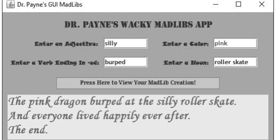

图 3-23：一个 GUI Madlibs 应用

# 4

## 创建你的第一个 Android 应用程序


为了构建 Hi-Lo（大小猜）猜数字游戏 App 的移动版本，我们将使用 Android Studio。如果你在第 1 章中没有设置该软件，请返回到第 8 页的“为移动应用开发安装 Android Studio”进行设置。与游戏的 GUI 版本一样，我们也要为该应用创建一个用户界面，如图 4-1 所示。你目前为止创建的应用程序只能运行在你的桌面电脑上，但 Android 应用程序可以运行在任何 Android 设备上，包括手机、平板电脑、手表、电视等。如果你没有 Android 设备，也不担心——你仍然可以为 Android 编写代码，因为 Android Studio 自带的 Android 模拟器可以让你模拟运行设备。

图 4-1：猜数字游戏在本章将变为一个移动应用。该应用在模拟的 Android 手机（左侧）和真实的 Android 平板电脑（右侧）上。

图 4-1 显示了我们的应用在 Android 模拟器上运行，模拟了应用在 Nexus 6P 上的外观，以及在 Android 平板上的外观。两个版本运行的是相同的代码——而且更方便，我们可以重用许多为之前的桌面版本构建的 Java 代码，Android 正基于这些代码构建的！

注意，模拟器和实际设备看起来非常相似，某些细微差异是为了适应手机和 7 英寸平板电脑之间的屏幕尺寸。就像你可以为 Windows 编写 Java 应用并在 macOS 或 Linux 上运行它一样，你可以用 Java 编写 Android 应用并运行在数以千计的任何 Android 设备上。让我们开始构建你的第一个 Android 移动应用吧！

### 创建新的 Android Studio 应用项目

第一次启动 Android Studio 时，可能需要几分钟来进行更新和运行。启动后，你将看到如图 4-2 所示的屏幕。选择标签为 **Start a new Android Studio project.**（新建 Android Studio 项目）。

将你的项目命名为 *GuessingGame*，如果你有网站，可以在 Company Domain（公司域名）字段中输入，如图 4-3 所示。否则，保留默认的示例域名。接下来，选择项目位置。我设置了一个名为 *AndroidProjects* 的文件夹来保持整洁，你也应该这样做。

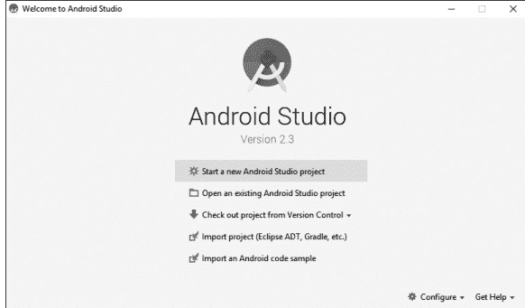

**图 4-2：** 一旦 Android Studio 完成设置，选择 **Start a new Android Studio project.**。

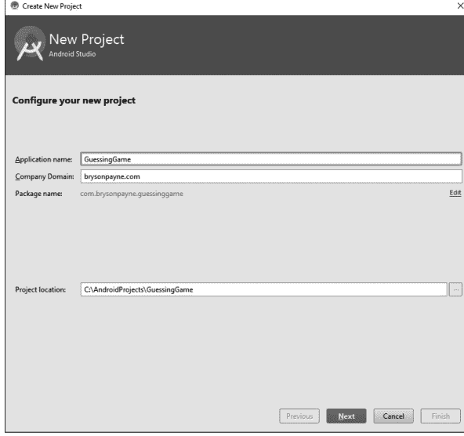

**图 4-3：** 将你的新 Android Studio 项目命名为 GuessingGame，不要空格。

命名项目后点击 **Next**（下一步）。现在你有机会选择你的应用应该运行在哪个 Android 版本上。随着新设备和功能的开发，Android 平台发展迅速，因此我们需要选择一个目标。幸运的是，Android Studio 会定期更新最新的 Android 版本，以及关于有多少设备仍在使用旧版本的信息。在选择支持哪些 Android 版本时，你还需要选择一个软件开发包（SDK）或应用程序接口（API）级别。SDK 和 API 级别包含了你开发应用时使用的工具，但它们与特定的 Android 版本绑定。图 4-4 所示的 Target（目标）窗口允许你为你开发的每个应用选择最低 SDK 或 API 级别。

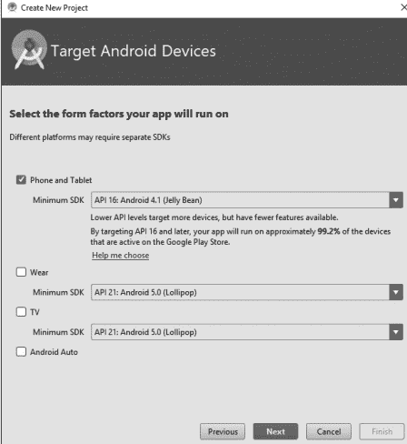

**图 4-4：** 为你正在开发的 Android 设备选择最低 SDK 级别。

选择 **API 16 (Android 4.1, Jelly Bean)** 作为猜数字游戏应用。Android Studio 将告诉你该版本运行在超过 99% 的活跃 Android 设备上。点击 **Next**。

项目向导程序会询问你想要为应用添加什么种类型的 activity（活动）。activity 是用户可以执行的操作。每个 activity 通常都有自己独立的带有用户界面的屏幕布局，如图 4-5 所示。


应用的主 Activity 有很多选择，例如 Google Maps（Google 地图）、Login（登录）、Settings（设置）、Tabbed Activities（选项卡活动），而 Basic Activity（基础活动）将为猜数字游戏应用提供良好的基础，因此选择该选项并点击 **Next**。

我们在接下来的屏幕上使用 Android Studio 提供的默认名称（如图 4-6 所示）：活动名称使用 **MainActivity**，布局使用 **activity_main**。Activity 文件包含运行应用的 Java 源代码。布局是一个包含应用界面的独立文件。点击 **Finish**（完成）完成你的项目设置。

### 向手机端添加 Activity

- Add No Activity（无活动）
- Basic Activity（基础活动）
- Empty Activity（空活动）
- Fullscreen Activity（全屏活动）
- Google AdMob Ads Activity（Google AdMob 广告活动）
- Google Maps Activity（Google 地图活动）
- Login Activity（登录活动）
- Master/Detail Flow（主详情流）

图 4-5：选择 Basic Activity 作为应用的基础。

### 自定义 Activity

创建一个带有应用栏的新基础活动。

| Activity Name（活动名称） | MainActivity |
| --- | --- |
| Layout Name（布局名称） | activity_main |
| Title（标题） | MainActivity |
| Menu Resource Name（菜单资源名称） | menu_main |

- Use a Fragment（使用 Fragment）
- Basic Activity（基础活动）

图 4-6：为活动名称和布局保留默认值。

### 创建你的第一个应用

项目可能需要几分钟来构建，Android Studio 创建文件并设置 GuessingGame 项目。

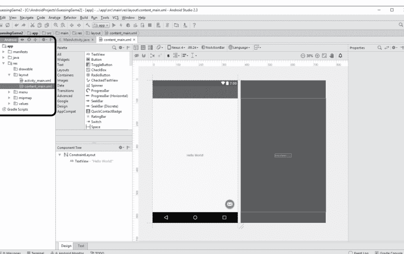

图 4-7：Android Studio 中的默认视图

如果项目没有打开，点击左上角的 Project（项目）标签，展开 `app` 文件夹，展开 `res` 文件夹，展开 `layout`，双击 `content_main` 文件，类似于图 4-7。

Android 应用将布局与代码分离，因此布局不是用 Java，而是可扩展标记语言（XML）。幸运的是，尽管如此，我们仍然可以使用类似于 Eclipse 的拖放面板来设计 GUI 视图。

就像 WindowBuilder 编辑器一样，Android Studio 有两个标签，一个用于设计视图，一个用于源代码。点击包含 `content_main` 的窗口左下角的 Design（设计）标签。你会看到图 4-8 所示的设计视图。

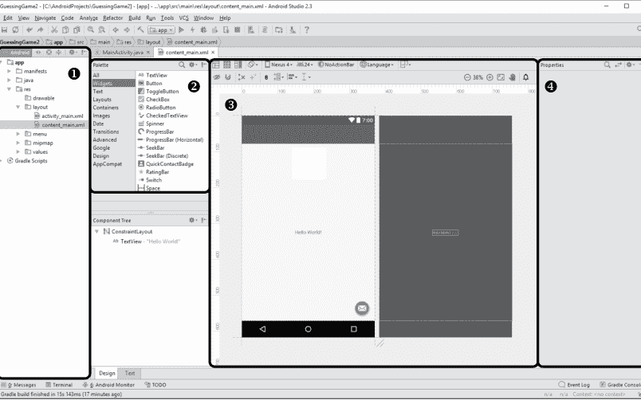

图 4-8：Android Studio 拥有类似于 WindowBuilder 的设计视图。

图 4-8 显示了你最经常使用的设计视图四个区域：Project Explorer（项目管理器）面板 ①、Palette（面板）面板 ②、Preview（预览）面板 ③ 以及 Properties（属性）面板 ④。

在预览面板中央，你会看到一个标签——在 Android 术语中称为 `TextView`——显示 Hello World！点击标签并按 DELETE 键（或右键点击并从菜单选择 Delete）从预览面板中删除它。然后，点击面板中的 Layouts（布局）选项，选择 `RelativeLayout`，并将其拖到预览面板中或拖到面板下方 Component Tree（组件树）列表中。我们将使用一个空的 `RelativeLayout` 来构建我们的 GUI 视图。

在面板中，在 Widgets（控件）下选择 `TextView`。Android 中的 `TextView` 类似于 Swing 工具包中的 `JLabel`，而 widgets 是对 Android 大部分 GUI 组件的统称。通过拖放到设计预览中放置 GUI 组件。点击 `TextView` 并将其拖到模拟手机的白色背景上，将组件放置在顶部作为手机的标题。

放置标题 `TextView` 后，你将在右侧的属性面板中看到选项。如果面板没有出现，点击 Design 标签右上角的 Properties 以展开属性面板。找到你刚刚添加的 `TextView` 组件的属性。将文本更改为 Your Name's Guessing Game，并将外观属性更改为 Large。然后将 `TextView` 拖到图 4-9 所示的屏幕顶部中央。灰色虚引导线有助于放置。

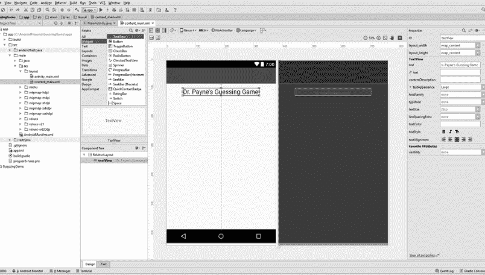

图 4-9：在 Android Studio 中放置 GUI 控件/组件与在 Eclipse 中的过程非常相似。

要添加提示用户输入 1 到 100 之间数字的标签，请在第一个下方的设计预览中放置另一个 `TextView` 控件。在右侧的属性面板中将 `textAppearance` 属性更改为 Medium。然后，在 `TextView` 的文本中输入“Enter a number between 1 and 100:”。

接下来，我们将放置用户猜测所需的文本字段（在 Android 中也称为 `EditText`）。文本字段列在调色板（Palette）面板的 Widgets 列表下方。Android 中有许多类型的文本字段，每种类型的行为根据您的应用程序的需求有所异。例如，Plain Text（纯文本）是一个简单的文本字段。Password（密码）在输入时会隐藏字符。Phone（电话）会显示数字键盘并将输入格式化为电话号码，Email（电子邮件）会显示带有 `@` 符号的修改版键盘。

选择 Number 字段，以便用户可以使用屏幕上的数字键盘输入他们的猜测。此字段恰好位于上一个标签下方。然后，在按钮下方放置另一个 `TextView` 控件，并将其属性设置为“Enter a number, then click Guess!”。如果您因为太靠近屏幕垂直中心而难以将其与按钮保持等距离放置，请在属性面板的 `Layout_Margin` 下将其放置在更低或更高的位置（您可能需要查看所有属性，然后点击 `Layout_Margin` 旁边的灰色箭头以展开边缘属性），找到 `layout_marginTop`，并将值更改为 30dp。完成后的 GUI 布局应该与图 4-10 相似。

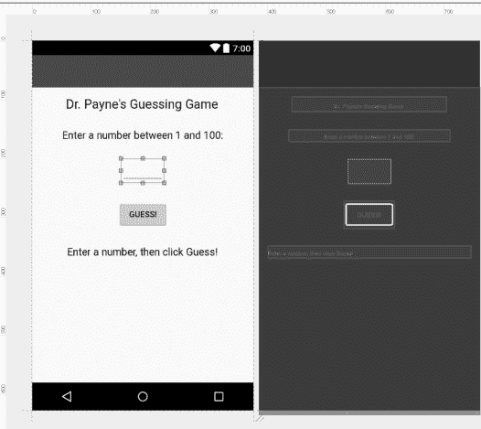

图 4-10：完成的 GUI 布局。

在为 GUI 组件命名之前，我们将进行最后一次更改。将用户输入猜测的文本字段的 `width` 属性更改为 75dp；通过点击属性面板中的“View all properties”（查看所有属性）或左右箭头图标来实现。原始文本字段对于一个仅使用 1 到 100 之间数字的猜数字游戏来说太宽了，因此我们调整了大小使其变窄。

完成这个小更改后，时候开始为我们的 GUI 组件命名了，这样我们就能在 Java 代码中轻松找到它们。

## 在 Android Studio 中命名 GUI 组件

正如我们在 Eclipse 中命名 GUI 组件一样，我们需要在 Android Studio 中命名 GUI 元素，以便我们从代码中访问它们。在 Android Studio 中，GUI 元素本身的名称默认不会出现在 Java 源代码中。相反，我们必须在代码中使用它们之前，手动将这些 XML GUI 组件连接到 Java 代码。

不过，现在我们只需要将数字文本字段、猜测按钮和底部标签的 `id` 属性分别更改为 `txtGuess`、`btnGuess` 和 `lblOutput`。如果弹出消息询问是否要更新用处（update usages），请点击 Yes。为了一致和方便，我们将使用这些名称。图 4-11 显示了重命名后的文本字段、按钮和标签。

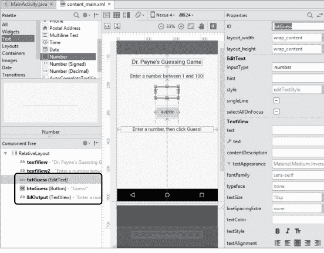

图 4-11：通过将 `id` 属性分别更改为 `txtGuess`、`btnGuess` 和 `lblOutput` 来重命名 EditText、Button 和 TextView 组件（圈出）。

在开始编写 Java 代码之前，我们应该做的最后一件事是隐藏浮动按钮（fab）图标，如图 4-12 设计预览右下角所示。您的项目可能不会显示 fab，但如果显示，请双击 Project Explorer 面板中的 `activity_main.xml` 文件。

1. 点击设计上方的 `activity_main.xml` 标签。
2. 然后点击该图标。
3. 进入 Properties（属性）并将 `visibility` 属性设置为 `invisible`。

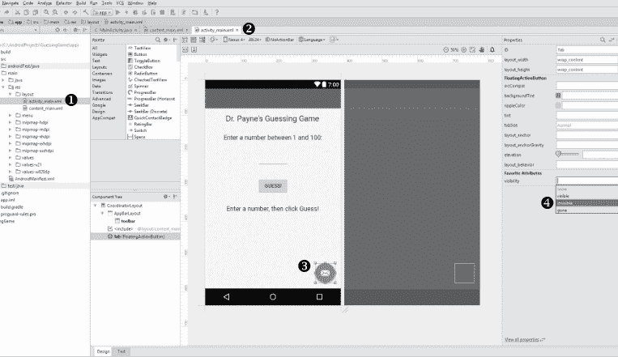

图 4-12：通过点击 `activity_main.xml` 文件、点击小信封图标并将 `visibility` 属性设置为 invisible 来隐藏 fab 图标。

我选择在您完全删除它后将 fab 图标设置为不可，因为您以后可能想使用浮动按钮为您的应用程序添加新功能。浮动按钮可以将应用程序信息共享到 Facebook，在 Twitter 上发布关于您喜欢该应用的推文，向朋友发送有关该的电子邮件等。

接下来，我们将使用 GUI，以便在 Java 中编写应用程序的其他部分。

## 在 Android Studio 中将 GUI 连接到 Java

是时候将 GUI 连接到 Java 了，我们可以为猜数字游戏应用编写代码。首先，在 Project Explorer 面板中打开 Java 源代码文件，路径为 `app > main > com.example.guessinggame（或您的包名） > MainActivity`。双击 MainActivity 打开 `MainActivity.java` 源代码。

您可能已经注意到 Project Explorer 中的文件夹有另一个包，或者可能标签相同，但在包名后带有 `(test)` 或 `(android)`。这些包用于应用程序的测试，工程师在其中评估质量、安全功能以进行软件质量保证。我们不会处理质量保证。

R 代表资源（resources），通常存储在 `res` 文件夹中。当您开始输入前面的行时，会看到一个像图 4-15 所示的弹出菜单。

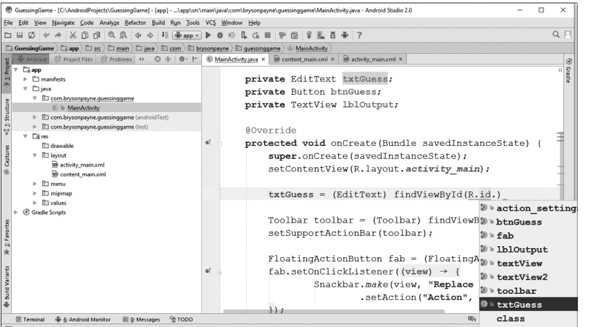

图 4-15：Android Studio 通过实用的下拉选项，帮助我们将 Java 代码与布局中的 GUI 资源“连线”起来。

### 添加方法以检查代码并开始新游戏

让我们开始编写 `checkGuess()` 函数的代码。我们可以在 `txtGuess`、`btnGuess` 和 `lblOutput` 变量声明下方编写 `checkGuess()` 方法，并将其放置在 `onCreate()` 方法上方，如图 4-16 所示。

首先，我们需要从 GUI 文本框获取用户的猜测，并将其存储在一个 String 变量中：

```java
public class MainActivity extends AppCompatActivity {
    private EditText txtGuess;
    private Button btnGuess;
    private TextView lblOutput;
    public void checkGuess() {
        String guessText = txtGuess.getText().toString();
    }
}
```

从文本框获取用户猜测的代码与桌面版本的应用几乎完全相同，区别在于末尾多了一个 `.toString()` 方法。Android 中有一个独立的 Text 类，输入到文本框中的文本是一个 Text 对象，因此我们必须将该对象转换为 String 对象。

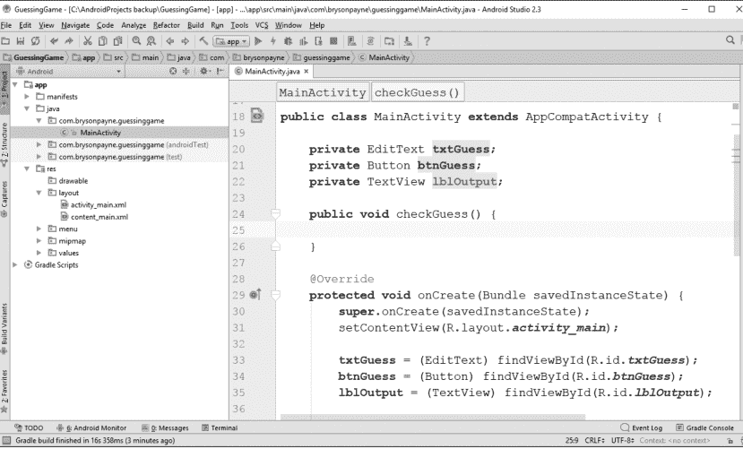

图 4-16：在 Java 中开始编写 checkGuess() 方法

幸运的是，`checkGuess()` 方法的其余部分可以直接从第 3 章 Eclipse GUI 的应用中复制并粘贴，无需任何修改！完整的 `checkGuess()` 方法如下：


```java
public void checkGuess() {
    String stringText = txtGuess.getText().toString();
    String message = "";
    try {
        int guess = Integer.parseInt(guessText);
        if (guess < theNumber)
            message = guess + " is too low. Try again.";
        else if (guess > theNumber)
            message = guess + " is too high. Try again.";
        else {
            message = guess + " is correct. Let's play again!";
            newGame();
        }
    } catch (Exception e) {
        message = "Enter a whole number between 1 and 100.";
    }
    finally {
        lblOutput.setText(message);
        btnGuess.requestFocus();
        btnGuess.selectAll();
    }
}
```

# 创建你的第一个 Android 应用

Java 的便利特性之一是我们可以跨平台重用代码。就像我们使用命令行游戏代码来制作桌面游戏一样，我们也可以在 Android 版本中使用桌面版本的代码。让我们回顾这段代码，以理解它在 Android 应用中如何工作。在 ❶ 处，我们从字段获取用户的猜测，并为输出消息设置字符串。在 ➁ 处，我们开始一个 `try-catch-finally` 语句来处理用户错误或异常。在 `try` 块内部，我们从用户输入的字符解析出猜测的整数。`try` 块的其余部分包含了 if-else 语句，用于测试用户的猜测是否太高或太低、设置适当的消息并开始新游戏。接下来，`catch` 语句 Ⓒ 告诉用户输入 1 到 100 之间的数字。然后，`finally` ➏ 通过适当的消息设置 `lblOutput` 的文本，将光标返回文本框并高亮文本。

你可能会注意到有几项被红线下划了：该数字和 `newGame()`。这是因为我们在这个应用版本中尚未定义它们。

在 `MainActivity` 类顶部，三个 GUI 控件声明下方，为秘密数字添加 `theNumber` 声明：

```java
public class MainActivity extends AppCompatActivity {
    private EditText txtGuess;
    private Button btnGuess;
    private TextView lblOutput;
    private int theNumber;
}
```

这与我们在桌面游戏中使用代码是一致的，因为用于创建整数的 Java 代码在命令行、桌面和 Android 移动版本中都是相同的。`newGame()` 方法的代码与桌面版本相同。在 `onCreate()` 语句之前添加 `newGame()` 方法：

```java
public void newGame() {
    theNumber = (int)(Math.random() * 100 + 1);
}
@Override
protected void onCreate(Bundle savedInstanceState) {
```

在 Android 应用中创建新游戏就像在桌面应用中一样。我们使用 `Math.random()` 函数将 `theNumber` 设置为 1 到 100 之间的随机整数。

我们可以在 `onCreate()` 方法中添加 `newGame()` 的调用，位于连接三个 GUI 组件之后：

```java
protected void onCreate(Bundle savedInstanceState) {
    super.onCreate(savedInstanceState);
    setContentView(R.layout.activity_main);
    txtGuess = (EditText) findViewById(R.id.txtGuess);
    btnGuess = (Button) findViewById(R.id.btnGuess);
    lblOutput = (TextView) findViewById(R.id.lblOutput);
    newGame();
}
```

当游戏启动时，程序将调用 `newGame()` 方法为用户挑选一个随机数。现在，我们需要处理按钮点击事件并学习如何操作。

## 在 Android 中处理事件

在 Eclipse 中，我们能够为按钮添加监听器。遗憾的是，在 Android Studio 中并不那么简单，因为它提供了类似的辅助功能。要为按钮点击添加监听器，你会看到：

```java
btnGuess.setOnClickListener(new View.OnClickListener() {
    @Override
    public void onClick(View v) {
        checkGuess();
    }
});
```

熟悉吗？这是另一个匿名类的示例。桌面版本也有内部类，但命名略有不同。你可能注意到 Android 在多个地方插入了 `@Override`。这是一个编译器指令，它告诉编译器你正在父类中实现该方法。

```java
} catch (Exception e) {
    message = "Enter a whole number between 1 and 100.";
} finally {
    lblOutput.setText(message);
    txtGuess.requestFocus();
    txtGuess.selectAll();
}

public void newGame() {
    theNumber = (int)(Math.random() * 100 + 1);
}

@Override
protected void onCreate(Bundle savedInstanceState) {
    super.onCreate(savedInstanceState);
    setContentView(R.layout.activity_main);
    txtGuess = (EditText) findViewById(R.id.txtGuess);
    btnGuess = (Button) findViewById(R.id.btnGuess);
    lblOutput = (TextView) findViewById(R.id.lblOutput);
    newGame();
    btnGuess.setOnClickListener(new View.OnClickListener() {
        @Override
        public void onClick(View v) {
            checkGuess();
        }
    });
    Toolbar toolbar = (Toolbar) findViewById(R.id.toolbar);
    setSupportActionBar(toolbar);
}
```

在接下来的章节中，你将学习如何在 Android 模拟器和真实设备上运行应用。

# 在 Android 模拟器上运行应用

我们现在有了一个可以运行应用的 Java 代码版本，但仍然需要进行测试。与命令行和桌面应用不同，移动应用无法运行在 PC 上，因为 PC 没有 Android 操作系统。为了测试你的应用，你需要一个 Android 设备或一个可以在 PC 上模拟 Android 设备的模拟器。在本节中，我们将创建一个 Android 虚拟设备来测试你的应用。

在查看 `MainActivity.java` 文件时，按下运行按钮或选择菜单项 `Run ▶ 'app'`。会弹出的窗口，要求你选择部署目标，即你想要运行应用的设备，如图 4-19 所示。

图 4-19：要运行 Android 应用，你必须选择一个目标设备——模拟器或实际设备。

点击 **Create New Virtual Device**（创建新虚拟设备）按钮开始配置新的 Android 设备 (AVD)。让我们从选择设备类型开始，如图 4-20 所示。然后点击 **Next**（下一步）。

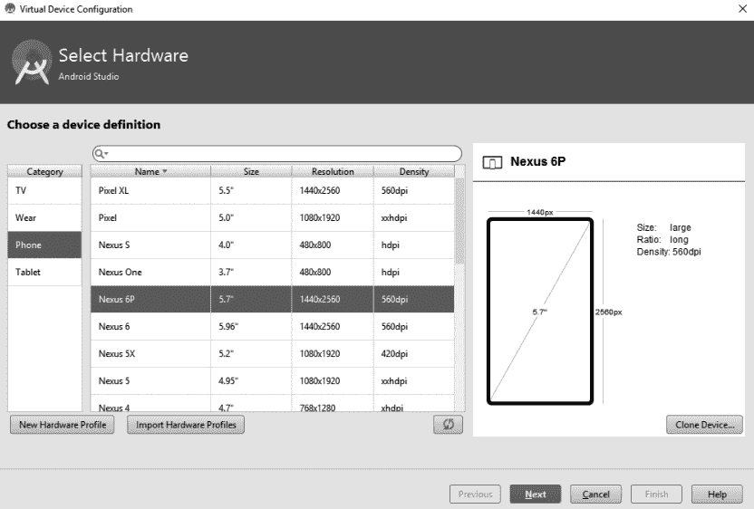

图 4-20：选择要模拟的设备。

我们首先选择 Nexus 6P，但你也可以自由测试其它设备。如果你决定为 Google Play 商店开发自己的应用，你可能需要在不同的屏幕尺寸和设备类型上进行测试，因此你可以尝试设置几个不同的模拟器。我们先从一个开始。

## 下一步，我们需要选择系统镜像，通常是 x86 或 ARM。我们将使用 ARM 镜像，因此点击 Other Images（其他镜像）选项卡，如图 4-21 所示。

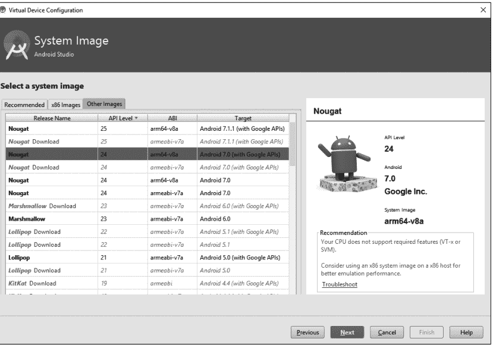

| Recommended | API Level | Target | Description |
| :--- | :--- | :--- | :--- |
| Nougat Download | 25 | arm64-v8 | Android 7.1.1 (带有 Google APIs) |
| Nougat Download | 25 | armeabi-v7a | Android 7.1.1 (带有 Google APIs) |
| Nougat Download | 24 | armeabi-v7a | Android 7.0 (带有 Google APIs) |
| Nougat | 24 | arm64-v8 | Android 7.0 |
| Nougat | 24 | armeabi-v7a | Android 7.0 |
| Marshmallow Download | 22 | armeabi-v7a | Android 6.0 (带有 Google APIs) |
| Marshmallow | 23 | armeabi-v7a | Android 5.1 (带有 Google APIs) |
| Lollipop Download | 22 | armeabi-v7a | Android 5.1 |
| Lollipop | 21 | armeabi-v7a | Android 5.0 |
| Lollipop Download | 21 | armeabi-v7a | Android 5.0 |
| KitKat Download | 19 | armeabi | Android 4.4 (带有 Google APIs) |

图 4-21：你可以选择 x86 或 ARM 模拟器，ARM 速度较慢，但在不同类型的处理器上运行往往更稳定。

如果显示的 Android 版本、API 级别或模拟器是灰色字体，请点击你所需版本的 **Download**（下载）链接。

当你选择好所需的 Android 模拟器后，点击 **Next**。现在，让我们使用带有 Google APIs 的 Nougat API Android 7.0 版本。你将看到一个最终界面，要求你验证配置，包括你想要更改的任何高级设置。让我们将 AVD（即你正在模拟的设备）名称更改为 *My Nexus 6P*，如图 4-22 所示。

如果你在让模拟器在旧旧电脑或内存小于 8 GB 的电脑上运行遇到困难，请点击 **Show Advanced Settings**（显示高级设置），滚动到 Memory and Storage（内存与存储），并将 RAM 数量改为 **768 MB**。

### Android 虚拟设备 (AVD)

| AVD Name | Configuration |
| :--- | :--- |
| Nexus 6P | 5.7 1440x2560 hdpi |
| Nougat | 7.1.1 arm64-v8 |

### Recommendation（建议）

- 你的 CPU 不支持所需的功能 (VT-x)。
- 考虑在 x86 主机上使用 x86 系统镜像以获得更好的模拟。

### Startup orientation（启动方向）

- Portrait（竖屏）
- Landscape（横屏）

### Emulated Performance（模拟性能）

- Graphics: Automatic（自动）

### Device Frame（设备帧）

- Enable Device Frame（启用设备帧）

### Advanced Settings（高级设置）

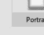

### Verify Configuration（验证配置）

- 此 AVD 的名称。

图 4-22：命名你的 AVD。

点击 Finish，你的新设备将被创建并保存到磁盘。现在是启动模拟器并尝试你的设备了。你会再次看到 Select Target 窗口，这次显示 Nexus 6P 为可用模拟器。现在点击 OK，如图 23 所示。

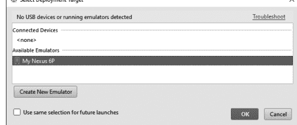

图 4-23：选择你刚刚创建的模拟器作为目标。

片刻后，你会看到“Starting AVD”消息，随后是一个类似启动界面的模拟器窗口，如图 24 所示。第一次运行模拟器时可能会看到锁屏。

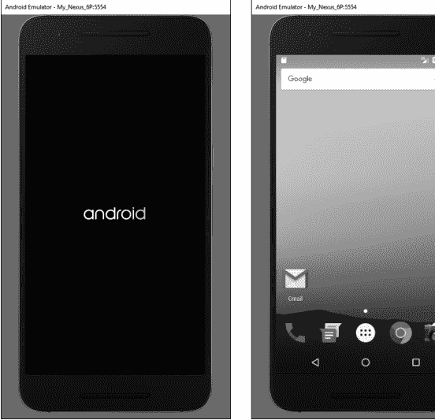

图 24：Android 模拟器启动[左]，虚拟设备的主界面[右]

如果你的模拟器显示锁屏，点击屏幕底部的锁并向上滑动解锁虚拟设备，类似于在实际手机上操作。你可能会看到一个或两个欢迎界面，尽管点击它们直到进入主界面，如图 24。

现在返回 Android Studio 并按下运行按钮。这次你会在 Select Target 对话框中看到 AVD（见图 25）。选择你的设备并点击 OK。

| Select Deployment Target（选择部署目标） | |
| :--- | :--- |
| Connected Devices（已连接设备） | Nexus 6P (Android 6.0, API 23) |
| Create New Emulator（创建新模拟器） | 没看到你的设备？ |
| Use same selection for future launches（以后使用相同选择） | OK / Cancel |

图 4-25：运行时模拟器出现在连接设备列表中。

项目将再次构建，并将应用的可执行版本传输到模拟器（第一次运行模拟器时可能会要求你更新 Android SDK）。几分钟后，你将在模拟器上看到你的猜游戏！

我们已经编写了完整的应用，因此你可以立即在模拟器上玩游戏。查看图 26 以了解应用中游戏回合的样子。

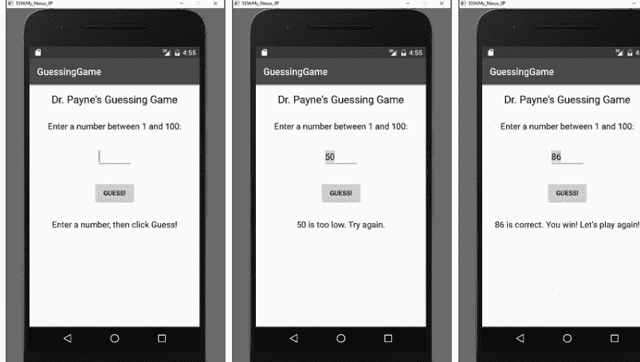

图 4-26：Android 模拟器上运行的猜游戏（左），猜一次后（中），猜中后（右）。

它的工作方式与桌面应用一样，但是在 Android 模拟器上。使用键盘输入猜测并使用鼠标点击 Guess! 按钮。我们还需要改进一些一些用户体验，就像我们对 GUI 桌面应用所做的那样，但我们的 Android 移动应用功能完备！

在改进 UX 之前，我们将介绍如何在真实设备上运行应用。现在，保持你的 Android 模拟器开启。用时不可以最小化，但在编程时让它在后台运行以避免启动时间。

> 如果你没有 Android 设备，可以跳到第 102 页的“改进 UX”。

# 在真实 Android 设备上运行应用

在真实设备上运行应用可能需要准备，如果你使用 USB 线将设备连接到电脑，就可以快速运行。

## 准备你的设备

在将应用部署到 Android 设备之前，你必须在设备上启用开发者模式。你还需要更改一些设置来开发和调试应用。

在你的 Android 设备上，点击 Settings（设置），然后滚动到设置菜单底部找到 About（关于）、About phone（关于手机）或 About device（关于设备）部分。在 About 界面的底部，你会找到 Build number（版本号）。连续点击版本号七次启用隐藏的开发者模式。开发者模式允许你在自己的设备上测试开发的应用。图 4-27 显示了已解锁开发者模式的设置菜单（左）和关于菜单（中）。

解锁开发者模式后，点击 About 界面左上角的返回箭头并打开 Settings options（设置选项）。确保开发者选项已开启，如图 4-27（右）所示。你还应该开启 USB 调试。

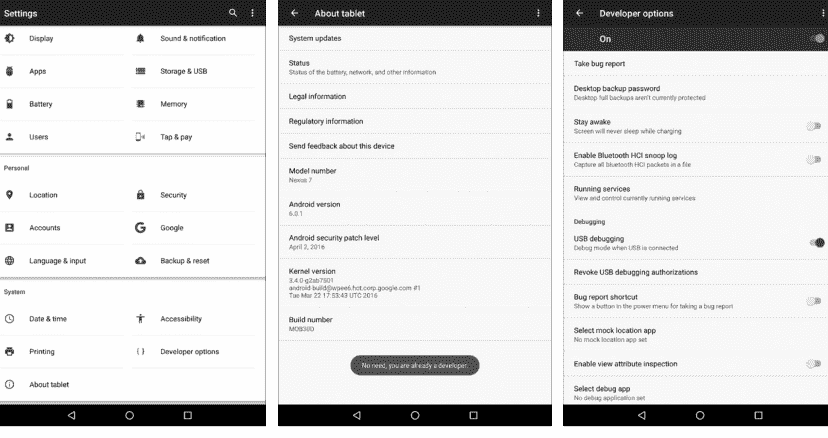

现在你准备好将 Android 手机或其他任何设备连接到电脑并运行你的应用了。

## 连接您的设备

要将 Android 设备连接到计算机，你需要一根 USB 数据线，最好是与手机或平板电脑附带的那根。它应该是一根 micro-USB 数据线，通常作为设备充电器的一部分提供。请注意，并非所有的充电器都是功能齐全的 USB 线——如果你在完成以下步骤后数据线无法工作，请尝试另一根。


使用 USB 数据线连接设备。插上后，你的手机或平板电脑屏幕上将显示如图 4-28 所示的窗口，询问你是否允许来自刚刚连接的计算机的 USB 调试。点击确定。你可以勾选“始终来自此计算机”旁的复选框，这样下次通过同一台计算机连接时就不会再弹出。

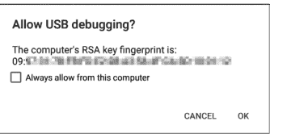

图 4-28：当你首次连接设备到计算机时，它会询问你是否允许 USB 调试。

允许 USB 调试可以实现几个功能。首先，我们能够通过传输 Android 包文件 (APK) 将我们编写的程序直接传输到 Android 设备。这通常比在模拟器上运行应用程序要快，而且是测试应用程序在真实设备上行为更好的方法。此外，我们还可以通过 USB 连接调试应用程序，这意味着我们可以从 Android 设备获取信息来帮助我们调试。这些信息将包括错误和其他日志条目，我们可以在类似控制台的应用程序（在 Android Studio 中称为 `logcat`）中读取这些信息。这与我们以前在命令行和桌面 GUI Java 程序中寻找 bug 时使用的控制台输出相似。现在你已经将真实的 Android 设备连接到计算机，让我们看看如何在设备上运行猜数字游戏应用吧！

## 在您的设备上运行应用

现在我们准备好在 Android 设备上尝试该应用了。在 Android Studio 中，点击运行按钮或进入 `Run → 'app'`。这次，“选择部署目标”（Select Deployment Target）窗口将显示两个已连接的设备供选择，如图 4-29 所示：你的模拟器 (My Nexus 6P) 和你的真实 Android 设备。

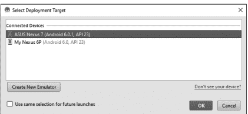

图 4-29：如果你已解锁开发者模式、启用了 USB 调试并成功连接了设备，你应该应该能够选择你的 Android 设备来运行应用。

这次选择你的真实 Android 设备并点击确定。Android Studio 可能需要一些时间来构建应用程序，一旦它将 APK 传输到你的设备，你将看到平板电脑或手机上直接打开游戏应用。玩一两轮以验证它的运行情况是否与模拟器中完全一样（可能更好，或者至少更快）。太酷了！

当你立即注意到一个重要的区别时：屏幕底部被数字键盘覆盖了，如图 4-50 所示。

当我们为用户的猜数字放置文本框（`EditText`）时，我们选择了数字文本字段（Number text field）作为输入，这样就会显示数字键盘。但由于模拟器运行在计算机上，计算机有自己的键盘，所以当你运行应用模拟器时可能没有看到这一点。

现在我们已经可以在 Android 手机、平板电脑或其他设备上运行 Android 应用了，让我们对猜数字游戏应用的用户体验做最后的几项改进吧。

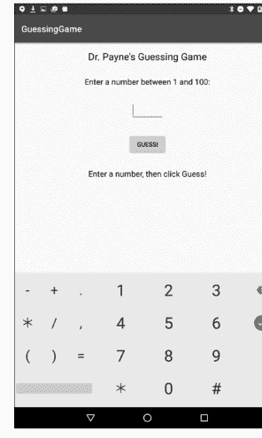

图 4-50：应用在你的 Android 设备上运行并默认显示数字键盘。

## 改进 UX（用户体验）

猜数字游戏应用在模拟器和真实 Android 设备上运行得良好，但有几个 UX 项目可以改进。首先，我们将用户的猜数字在文本字段中居中。其次，我们将学习如何让 `ENTER` 键像处理“猜！”按钮一样，以使用户更加直观。

## 在文本字段中居中用户的猜数字

在 Android Studio 中，再次打开 `content_main.xml` 布局文件。在设计视图中点击文本框 `txtGuess`。在属性面板中，找到 `textAlign`。Android 中的 `textAlign` 属性类似于桌面 GUI 中的 `horizontalAlignment` 属性——它允许我们更改文本的对齐方式。

点击居中文本对齐选项，像居中文本的图标。如果你想在不运行应用的情况下在设计预览中显示，滚动找到 `text` 属性并输入值 50。数字应该会在设计预览面板中居中。如果你不想在实际应用中显示，请务必删除该文本值。

## 为回车键添加监听器

让我们设置一个事件监听器来处理回车键，就像我们处理“猜！”按钮的点击一样，调用 `checkGuess()`。

回到 `MainActivity.java` 源代码文件，滚动到 `onCreate()` 方法，找到我们为按钮 `btnGuess` 添加 `OnClickListener` 的地方。（你可能需要通过点击 `btnGuess.setOnClickListener` 左侧的 `+` 来展开事件监听器代码，使其看起来像这里所示的代码。）随后，我们可以为文本字段 `txtGuess` 添加监听器以处理如按下回车键之类的动作事件。以下代码为 `txtGuess` 添加了监听器：

```java
btnGuess.setOnClickListener(new View.OnClickListener() {
    public void onClick(View v) {
        checkGuess();
    }
});
```

```java
txtGuess.setOnEditorActionListener(new TextView.OnEditorActionListener() {
    @Override
    public boolean onEditorAction(TextView v, int actionId, KeyEvent event) {
        checkGuess();
        return true;
    }
});
```

## #1: 为尝试次数“干杯”（Toast）

在第 3 章的编程挑战中，你修改了胜利消息，告诉用户他们获胜用了多少尝试：

> 62 是正确的！你在尝试 7 次后获胜了！

让我们在 Android 版本中做类似的事情，但有一个小变化——或者，我应该说，是一个 Toast？Toast 是一种用于创建弹出式消息窗口的 Android 组件。Toast 弹出窗口是显示快速通知的方便方式，例如错误信息或告诉用户已获胜的提示。参见 4-33 中屏幕底部的 Toast 消息。

你可以使用 `Toast.makeText()` 创建 Toast 消息弹出窗。这里有一个示例，帮助你在游戏胜利的 `else` 语句中添加 Toast 弹出窗：

```java
else {
    message = guess +
        " is correct. You win after " + numberOfTries + " tries!";
    Toast.makeText(MainActivity.this, message,
        Toast.LENGTH_LONG).show();
}
```

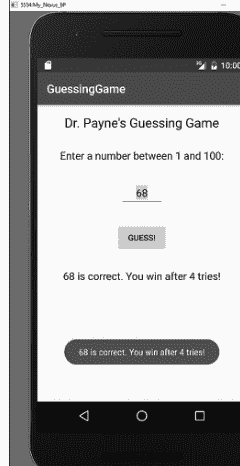

图 4-33：Toast 消息在屏幕上弹出，提醒用户注意重要信息。

此代码中的消息将在 MainActivity（我们的猜数字游戏）上方弹出，显示 String 消息几秒钟，时长为 `Toast.LENGTH_LONG`。虽然也有一个 Toast，但它弹出并出现得非常快，可能难以阅读。末尾的 `.show()` 方法执行了关键部分，即在屏幕上显示 Toast。

与 GUI 桌面版本相比，为了完成此任务，你需要在类顶部创建一个新变量（例如 `int numberOfTries`），每当 `checkGuess()` 方法成功运行时就增加尝试次数，并更改输出消息，在用户获胜时向其显示尝试次数（分别在 Toast 弹出窗和 `lbloutput` 字段中显示）。在计算尝试次数的同时，添加你在第 3 章中学过的次数用尽或失败的功能。给用户七次机会，并在每次猜测后告诉他们剩余多少次。

## #2: 增加视觉吸引力

探索 Android Studio 中 GUI 组件的一些更具审美属性，包括背景颜色、前景颜色、字体、`textSize` 等。移动你猜数字游戏应用中的组件，使界面更具视觉吸引力。关于如何自定义你的游戏，示例请参阅 4-34。

你甚至可以添加自定义背景图像（将图像文件添加到应用 -> `res/drawable` 文件夹，并将其选择为布局、按钮或其他组件的背景属性）。通过各种设置——你始终可以通过按下 `CTRL-Z` 来撤销！

## #3: 创建一个 MadLibs 移动应用

回想你在第 3 章构建的 MadLibJava 程序（第 74 页的编程挑战 #3）。现在，你的 MadLibs 应用的一个版本将在一个带有标签和文本字段的 GUI 中提示用户输入几个单词，例如 `txtBigAnimal`、`txtTextVerse`、`txtSmallContainer` 和 `txtFood`。添加一个用户可以点击的按钮来生成他们自己的 MadLibs 风格故事。在每个文本字段中包含默认或初始文本可能是一个很好的做法，只需让用户直观了解程序的原理。

当用户点击按钮时，程序应该在 `TextView` 或 `EditText` 中显示完成的 MadLibs 故事——`EditText` 使用户如果想分享就可以复制并粘贴他们有趣的故事。

要让 `TextView` 或 `EditText` 显示多行，要在使用 `setText()` 方法显示的 String 消息中插入新行，如下所示：“从前……有一位住在汤罐里的水水牛公主。”这段引用将跨越三行，并在转义序列出现的地方用换行符分隔。

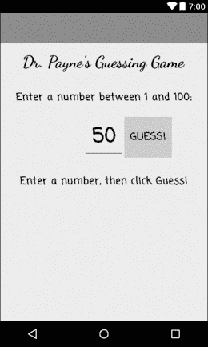

> **提示**

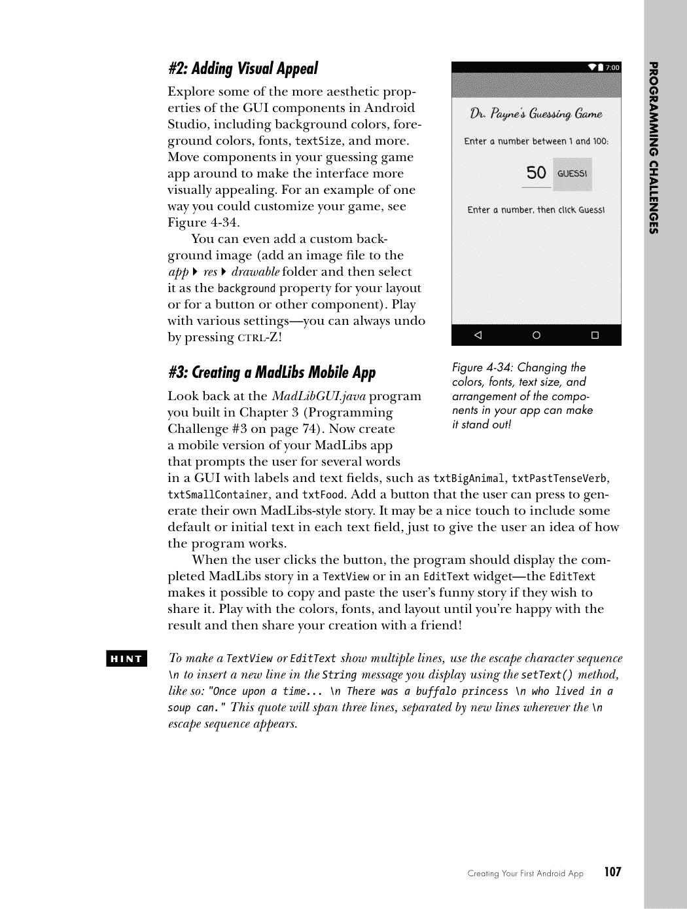

## 通过添加菜单和偏好完善你的应用


你编写了一个有趣的 Android 应用，但它仍然缺少一些东西。你还没有学习如何在 Android 中构建设置或选项菜单，也没有学习如何保存高分、游戏统计数据和其他信息。在本章中，我们将为猜数字游戏添加一个选项菜单并具备存储信息的能力。

### 在 Android 中添加选项菜单

大多数应用程序和游戏都有可以通过菜单访问的选项或设置。对于猜数字游戏，我们可能希望用户更改难度、重新开始、查看游戏统计或查看关于界面，因此创建一个可以执行这些操作的菜单。

在 Android 中添加选项菜单有四个高级步骤：

1. 修改应用的默认 XML 菜单文件，创建用户可以选择的项目。
2. 修改应用的 Activity 文件以显示用户选择的菜单。
3. 为选中的选项创建事件处理器。
4. 编写执行每个选项的代码。

添加选项菜单不仅让我们的应用看起来更专业，而且让用户控制游戏体验。

### 为菜单添加项目

要添加项目，我们首先需要设置菜单。在 Android Studio 中打开 `menu_main.xml` 文件，并在编辑器中将代码更改如下所示：

```xml
<menu xmlns:android="http://schemas.android.com/apk/res/android">
  <item
    android:id="@+id/action_settings"
    android:title="设置" />
  <item
    android:id="@+id/action_newgame"
    android:title="新游戏" />
  <item
    android:id="@+id/action_stats"
    android:title="游戏统计" />
  <item
    android:id="@+id/action_about"
    android:title="关于" />
</menu>
```

### 显示选项菜单

我们已经设置了菜单，但为了显示它，我们需要向应用的 `MainActivity.java` 文件添加一些 Java 代码。在项目资源管理器的 `app > java > 你的包名` 下打开 `MainActivity.java`。

在 MainActivity 部分，你会找到一个名为 `onCreateOptionsMenu()` 的方法。将其修改为下面的代码片段（如果你的代码中没有 `onCreateOptionsMenu()` 方法，我们需要在 `onCreate()` 大括号之后、MainActivity 最终大括号之前添加以下代码）。

```java
public boolean onCreateOptionsMenu(Menu menu) {
    MenuInflater inflater = getMenuInflater();
    inflater.inflate(R.menu.menu_main, menu);
    return true;
}
// MainActivity.java 文件的最终大括号
```


图 5-1：选项菜单以三个点的形式显示在应用的操作栏（顶部）中。点击这三个点将展开选项菜单（底部）。

你会发现，点击选项还没有产生任何反应，因为我们还没有添加响应用户选择的代码。我们将在接下来完成这一操作。

# 响应用户选择

当用户从菜单中选择一个选项时，我们希望应用执行所请求的操作。为了让应用执行此操作，我们需要添加一个事件处理器，用来跟踪用户选择了哪一个选项。我们将使用与每个项目关联的 `id` 属性来区分不同的选择。

在 `MainActivity.java` 文件中，找到并修改 `onOptionsItemSelected()` 事件处理器。或者，你也可以将其添加到我们在上一节中修改的 `onCreateOptionsMenu()` 之下，但在文件最后行的结束大括号之前。

```java
public boolean onCreateOptionsMenu(Menu menu) {
    MenuInflater inflater = getMenuInflater();
    inflater.inflate(R.menu.menu_main, menu);
    return true;
}

public boolean onOptionsItemSelected(MenuItem item) {
    switch (item.getItemId()) {
        case R.id.action_settings:
            return true;
        case R.id.action_newgame:
            newGame();
            return true;
        case R.id.action_stats:
            return true;
        case R.id.action_about:
            return true;
        default:
            return super.onOptionsItemSelected(item);
    }
}
```

在这段代码中，我们使用 `switch` 语句来确定用户选择了菜单中的哪一个选项。`switch` 语句是测试多个条件的另一种方法，类似于长 `if-else` 语句链。不过，我们不需要链接四个 `if-else` 语句来测试每个可能的菜单项选择，可以使用单个 `switch` 语句，并在 `switch` 后的括号内放入我们要测试的变量。在这个示例中，我们正在检查用户选择的菜单项的 id，所以我们使用 `switch (item.getItemId())`。然后，在 `switch` 语句的大括号内，我们将想要测试的值列为 `case` 语句（例如 `case R.id.action_settings`），每个语句后面都跟着一个冒号、相应的要运行的代码，以及一个 `break` 或 `return` 语句。此事件处理器返回一个布尔值，因此我们在 `case` 块中使用了 `return` 语句而不是 `break` 语句。如果这里没有 `return` 语句，我们需要使用 `break` 命令作为每个 `case` 的最后一个语句。

代码中的每个 `case` 都会测试我们在 `menu_main.xml` 文件中输入的项目 id 值，每个值对应的代码将根据用户的选择而执行。目前，我们只为 `action_newgame` `case` 写了代码，它使用 `newGame()` 方法开始新游戏。其他情况需要编写更多的代码，因此我们将逐一个地定义。

# 为“关于”屏幕创建警报对话框弹窗

对于“关于”菜单，我们将弹出一个与你可能过的其他应用程序类似的对话框。为了实现这一点，我们将使用警报对话框（alert dialog），这是一个灵活的弹窗，用于通知用户某些信息或提示其响应。这种弹窗比第 4 章中使用的 `Toast` 弹窗（第 106 页的编程挑战 #1）更具适应性，因为 `AlertDialog` 允许我们通过 `Builder` 子类来自定义对话框的属性。在这种情况下，我们将使用警报对话框来响应用户选择“关于”选项，显示一条消息告诉他们他们了正在玩的超酷的 Hi-Lo 猜数字游戏。

为 `action_about` 项目的 `case` 语句添加以下代码：


```java
case R.id.action_about:
    AlertDialog aboutDialog = new AlertDialog.Builder(MainActivity.this).create();
    aboutDialog.setTitle("About Guessing Game");
    aboutDialog.setMessage(R.string.c2018_Your Name);
    aboutDialog.setButton(AlertDialog.BUTTON_NEUTRAL, "OK",
        new DialogInterface.OnClickListener() {
            public void onClick(Dialog dialog, int which) {
                dialog.dismiss();
            }
        });
    aboutDialog.show();
    return true;
```

我们使用 `AlertDialog.Builder` 类来创建一个自定义的弹窗。代码将弹窗窗口的标题设置为“About Guessing Game”，带有版权信息和你的名字的那行将显示一条简单的消息（尽管你可以编写任何喜欢的文本）。`setButton()` 方法向弹窗添加了一个文本为“OK”的按钮，随后的 `()` 事件监听器会在用户点击 OK 时通过调用 `dismiss()` 方法来捕获弹窗。最后，通过 `show()` 命令显示自定义的弹窗。

使用 `ALT-ENTER`（或 `OPT-ENTER`）导入 `AlertDialog` 类。然后保存更新后的代码并运行应用的新版本。当你点击选项菜单并选择“关于”选项时，你应该能看到一个类似图 5-2 的弹窗窗口。


图 5-2：一个自定义警报对话框弹窗

Hi-Lo 猜数字游戏应用开始感觉越来越像一个专业的 Android 应用了！现在，让我们更进一步，允许用户选择游戏的难度级别，并跟踪他们赢了多少场游戏。

# 修改猜数字范围

让用户选择范围——例如从 1 到 10、1 到 100 或 1 到 1,000——将是一个巨大的增强。现在你已经理解了选项菜单和警报对话框，让我们规划一下如何升级游戏以允许用户更改范围设置。

首先，我们需要为范围添加一个变量，这样就不用硬编码值 100，而是使用用户选择的范围。其次，我们需要以几种方式修改应用的行为。我们将修改 `newGame()` 方法以使用新的范围变量。我们还将让读取“输入 1 到 100 之间的数字：”的 `TextView` 根据所选的范围显示不同的提示。最后，我们需要给用户一种选择范围的方法。我们将通过构建另一个包含三个范围选择（1 到 10、1 到 100 和 1 到 1,000）的自定义警报对话框来完成。

# 为范围添加变量

首先，我们将用于随机数计算的硬编码值 100 替换为变量。在 `MainActivity` 类的顶部添加一个范围的变量，并将其设置为默认值 100：

```java
public class MainActivity extends AppCompatActivity {
    private EditText txtGuess;
    private Button btnGuess;
    private TextView lbOutput;
    private int theNumber;
    private int range = 100;
```

在添加变量的同时，让我们为读取“输入 1 到 100 之间的数字”的标签添加第二个 `TextView`。当用户选择非 100 的范围时，该标签不再正确，因此我们需要一个变量来存储相应的文本。我们将创建一个名为 `lbRange` 的变量来执行：

```java
private int range = 100;
private TextView lbRange;
```

通过在 `onCreate()` 中添加代码将 GUI 连接到 `lbRange` 变量：

```java
protected void onCreate(Bundle savedInstanceState) {
    super.onCreate(savedInstanceState);
    setContentView(R.layout.activity_main);
    txtGuess = (EditText) findViewById(R.id.txtGuess);
    btnGuess = (Button) findViewById(R.id.btnGuess);
    lb1Output = (TextView) findViewById(R.id.lb1Output);
    lbRange = (TextView) findViewById(R.id.textView2);
}
```

如果你遇到错误，请检查设计视图中提示 `TextView` 的名称：“输入 1 到 100 之间的数字”。将该标签的 id 属性更改为 `textView2`。

设置好 `range` 和 `lbRange` 变量后，是时候修改应用的行为以使用这些而不是硬编码的值了。

```java
public void newGame() {
    theNumber = (int)(Math.random() * range + 1);
    lbRange.setText("Enter a number between 1 and " + range + ".");
    txtGuess.setText("" + range/2);
}
```

```txt
txtGuess.requestFocus();
txtGuess.selectAll();
```

此外，在使用范围来正确选择随机数的同时，我们也更改了 `lblRange` 提示，使其也使用范围变量。最后三行是收尾工作——我特意在 `txtGuess` 文本框中输入了一个默认起始值，即范围的一半。因此，如果用户在 1 到 10 之间进行猜测，猜测文本字段将显示 5 作为默认的第一个猜测；如果范围是 1000，文本框将推荐 500 作为第一次猜测。

最后一个与范围相关的更改发现在 `checkGuess()` 方法中。我们添加了一个 `try-catch` 语句来处理无效的输入输入，并且在 `catch` 语句中，我们告诉用户在 1 到 100 的范围内输入一个有效数字。让我们来修改 `catch` 语句以反映用户选择的范围：

```java
public void checkGuess() {
  // --snip---
} catch (Exception e) {
  message = "Enter a whole number between 1 and " + range + ".";
} finally {
  // --snip---
}
```

现在，两个 `TextView` 标签将正确显示用户选择的范围。现在是时候构建一个对话框，允许用户选择游戏的难度级别了。

# 构建对话框允许用户选择范围

每当用户在菜单中选择“设置”选项时，范围设置对话框应该向用户显示所有的范围选项（1 到 10，1 到 100 和 1 到 1000）。为了显示选项列表，我们将构建另一个自定义对话框，但这次将显示一个包含三个范围选项的列表视图。

首先，回到你的 `onItemSelected(MenuItem item)` 方法，并在 `action_settings` 的 `case` 语句中添加以下代码：

```java
public boolean onItemSelected(MenuItem item) {
  switch (item.getItemId()) {
    case R.id.action_settings:
      final String[] items = {"1 to 10", "1 to 100", "1 to 1000"};
      AlertDialog.Builder builder = new AlertDialog.Builder(this);
      builder.setTitle("Select the Range:");
      builder.setItems(items, null);
      AlertDialog alert = builder.create();
      alert.show();
      return true;
```

这六行代码将显示一个带有三个猜测范围选项列表视图的警报对话框，但我们只需要添加一点代码来处理用户的选择。`builder.setItems()` 方法将同时接受项目列表和一个处理用户从列表中选择的事件监听器。

如果用户选择了第一个选项，我们需要将 `range` 变量更改为 10，同样，第二个和第三个选项分别改为 100 和 1000。事件监听器的代码放在 `builder.setItems()` 内部：

```java
case R.id.action_settings: items = {"1 to 10", "1 to 100", "1 to 1000"};
AlertDialog.Builder builder = new AlertDialog.Builder(this);
builder.setTitle("Select the Range:");
builder.setItems(items, new DialogInterface.OnClickListener() {
    public void onClick(DialogInterface dialog, int item) {
        switch (item) {
            case 0:
                range = 10;
                newGame();
                break;
            case 1:
                range = 100;
                newGame();
                break;
            case 2:
                range = 1000;
                newGame();
                break;
        }
        dialog.dismiss();
    }
});
AlertDialog alert = builder.create();
alert.show();
return true;
```

注意，在我们为每个项目选择设置新范围后，我们调用了 `newGame()` 来在该范围内创建一个新的随机数，并更改用户屏幕上的提示以显示该范围。

进行这些更改后保存文件并运行游戏以测试新选项。将范围从 1 改到 10 并猜几轮，返回 1 到 100，如果你足够勇敢，就尝试 1 到 1,000。

无论如何，关闭应用并重新打开

# 存储用户偏好和游戏统计

在不同会话之间记住用户偏好和游戏统计数据的关键是将持久化信息保存到你的 Android 设备上的能力。持久化信息是指应用关闭后仍保留在设备上的任何数据。在“大小猜猜”游戏中，我们希望将用户偏好的难度级别和获胜次数作为持久化信息存储。

有三种方法可以将数据持久化到你的 Android 设备上：存储共享偏好（shared preferences）、保存文件和在数据库中存储数据。共享偏好是一类对象，用于存储你的应用在下次使用时需要保存的较短设置列表。它们之所以被称为共享偏好，是因为你可以在应用的多个 Activity 或屏幕之间共享这些设置，例如猜猜游戏中的选项菜单和主游戏屏幕。将文件保存到设备在需要存储大量数据（如文本文档）时非常有用，而数据库对于地址簿或联系人列表之类的应用是必不可少的。对于猜猜游戏，我们只需要存储几个数字，所以我们使用共享偏好。

# 存储和检索用户的偏好范围

共享偏好以键/值对的形式存储，每个值都有一个关联的键。例如，你可能有一对如 "range" 和 "100" 这样的值对。为了存储用户的偏好范围，我们使用 "range"。为了存储用户的偏好范围，我们使用 "range" 键。每当用户选择新范围时，我们将 `range` 变量传递给 `storeRange()` 方法。为了将新范围存储在 "range" 键下，我们使用 `editor.putInt("range", newRange);`。`apply()` 方法告诉 Android 已修改共享偏好，并可以应用更改。

现在我们更改 `range` 为共享偏好，我们需要在 `onSelectedItem(item)` 方法监听器中添加 `storeRange()` 函数：

```java
public boolean onItemSelected(MenuItem item) {
    switch (item.getItemId()) {
        case R.id.action_settings:
            String[] items = {"1 to 10", "1 to 100", "1 to 1000"};
            AlertDialog.Builder builder = new AlertDialog.Builder(this);
            builder.setTitle("Select the Range:");
            builder.setItems(items, new DialogInterface.OnClickListener() {
                public void onClick(DialogInterface dialog, int item) {
                    switch (item) {
                        case 0:
                            range = 10;
                            storeRange(10);
                            newGame();
                            break;
                        case 1:
                            range = 100;
                            storeRange(100);
                            newGame();
                            break;
                        case 2:
                            range = 1000;
                            storeRange(1000);
                            newGame();
                            break;
                    }
                    dialog.dismiss();
                }
            });
            AlertDialog alert = builder.create();
            alert.show();
            return true;
        default:
            return super.onOptions(item);
    }
}
```

要写入共享偏好，我们必须使用 `Editor` 对象，它允许我们编辑单个共享偏好值。为了存储特定的键/值对，我们使用 `put` 方法，例如 `putString` 存储字符串值、`putInt` 存储整数、`putFloat` 存储浮点小数、`putBoolean` 存储布尔值。在 `MainActivity.java` 的底部，在 `onOptionsItemSelected()` 方法之后、大括号之前添加以下方法：

```java
public void storeRange(int newRange) {
    SharedPreferences preferences = PreferenceManager.getDefaultPreferences(this);
    SharedPreferences.Editor editor = preferences.edit();
    editor.putInt("range", newRange);
    editor.apply();
}
```

你制作的每个应用已经有一个默认的共享偏好对象，你可以通过调用 `getDefaultPreferences()` 来访问它。最后，我们需要在游戏加载时检索范围，这样用户上次选择的范围将是游戏下次使用的范围

运行。滚动到 `onCreate()` 方法并添加以下行以从共享界面（shared preferences）获取范围：


```java
protected void onCreate(Bundle savedInstanceState) {
    super.onCreate(savedInstanceState);
    setContentView(R.layout.activity_main);
    txtGuess = (EditText) findViewById(R.id.txtGuess);
    btnGuess = (Button) findViewById(R.id.btnGuess);
    lb1Output = (TextView) findViewById(R.id.lb1Output);
    lbRange = (TextView) findViewById(R.id.txtView2);
    SharedPreferences preferences = PreferenceManager.getDefaultSharedPreferences(this);
    range = preferences.getInt("range", 100);
    newGame();
}
```

注意，我们在调用游戏之前获取了共享界面，以确保用户在每次启动应用时都能获得他们使用过的范围。`getInt()` 方法查找键为 "range" 的存储值，但如果没有找到值，第二个参数将告诉它默认值为 100。我们这样做是为了确保 `range` 在用户第一次运行应用时就有值。

保存文件，编译并运行。这一次，选择一个不同的范围，然后完全关闭应用。下次启动应用时，相同的范围将在这里等着你！

# 存储胜场场数

高分、排行榜、连胜——任何记录我们成就的内容都是为了让我们想要更努力、玩得更久并打破纪录。我们将为游戏添加的最后一个完善功能：跟踪胜场场数。再次，我们可以轻松地存储这些共享界面。

当用户通过猜对数字赢得一局时，我们可以使用共享界面来获取他们胜出的场数，将其加 1 并存储新值。将此代码添加到你的 `checkGuess()` 方法中，放在胜利猜词对应的 `else` 语句内部：

```java
SharedPreferences preferences = PreferenceManager.getDefaultSharedPreferences(this);
int gamesWon = preferences.getInt("gamesWon", 0) + 1;
SharedPreferences.Editor editor = preferences.edit();
editor.putInt("gamesWon", gamesWon);
editor.apply();
newGame();
```

在这里，我们访问了默认的 `SharedPreferences`，获取了键名 "gamesWon" 下的值（如果是用户第一次获胜，则默认为 0），并加 1 以计算这次胜利。随后，我们创建了一个编辑器在相应的键下写入新值以备后用，最后，我们告诉 Android 将更改写入设备。

这已经处理了胜场场数的存储，但如何向用户显示它们呢？为了做到这一点，我们需要在 `onItemSelected()` 方法中为 *gamestats* 情况添加代码，如下所示：

首先，我们连接到应用的默认共享界面，然后我们获取胜场场数（在这种情况下，如果是程序首次运行，我们给出一个默认值 0）。然后，我们构建一个警告对话框（alert dialog）向用户显示他们胜出的场数，最后，我们显示数字以及一条鼓励信息。

保存该更改并编译并运行你的应用。你的最后一个挑战可能是尝试停止玩！图 5-3 显示了如果有几个数学高手玩你的游戏，游戏统计界面可能是什么样子。


图 5-3：游戏统计界面跟踪了（你）猜对正确数字的次数。

添加选项菜单、保存游戏统计和用户偏好、显示警告对话框——这些完善功能可以让你的游戏或任何其他应用真正成为一个专业的、功能完备的移动应用程序。随着你想到新功能并不断对你的应用进行改进，你将拥有一个值得与朋友——甚至与世界分享的应用。编码愉快！

# 你学到的知识

你通过为 Hi-Lo 猜数字应用添加几个完善功能，构建了一个专业级的 Android 移动游戏，包括：

- 为 Android 应用添加选项菜单
- 通过编辑 `menu.xml` 文件设计选项菜单
- 使用 `Inflater` 显示选项菜单
- 响应菜单中的用户选择
- 使用带有多个 `case` 语句的 `switch` 语句替换 `if-else` 链
- 使用 `AlertDialog` 类在 Android 中创建自定义弹出窗口
- 使用 `SharedPreferences` 类存储共享界面并使用统计数据
- 在应用启动时获取用户的共享界面

## 编程挑战

尝试这些编程挑战练习，以回顾并实践你所学的知识，并扩展你的编程技能。访问书籍网站 `https://www.nostarch.com/learnjava/` 下载示例解决方案。

### #1：胜败有常

第 4 章（第 106 页）中的编程挑战 #1 要求给用户七次机会来猜 1 到 100 之间的数字。现在你添加了更改范围的能力，你需要更改尝试次数以匹配。

你在第 4 章学到，我们可以使用二分查找策略（每次都猜剩余可能值的中间）来猜 1 到 100 之间的数字，因为 $2^7$（即 7 次方）是 128。这意味着我们能够猜中那个数字。

要找到底数的几次方等于目标数字的指数，你可以使用对数。Java 有 `Math.log10()` 方法，它可以接收一个数字并找到指数。当你将一个数的对数除以另一个数字的对数时，结果等同于以第二个数为底取第一个数的对数。这意味着除以 `Math.log(2)` 将告诉你 2 的几次方。因为指数可以是小数，而你不希望用户使用像 7.25 这样的非整数猜数字次数，你需要向上舍入并将结果转换为 `int`。要找到对应范围所需的猜数字次数，可以使用表达式 `(int)(Math.log(range)/Math.log(2))+1`。

修改 Hi-Lo 猜数字游戏，使最大猜数字次数适应范围，包括在游戏启动时以及用户在选项菜单中选择新范围时。例如，你可以创建一个变量 `maxtries` 来代替硬编码的数字 7。

### #2：胜负比

完成编程挑战 #1 后，修改 Hi-Lo 猜数字应用以同时存储胜场场数和负场场数。修改游戏统计菜单以获取这两个数字，并显示胜场数、总游戏场数以及胜率（胜场除以总场数，乘以 100）。图 5-4 显示了一个示例。

> ### 猜数字统计
>
> 你在 381 局中赢得了 368 局，胜率为 97%！
>
> 得好！
>
> OK
>
> 图 5-4：显示胜率的游戏统计界面

凯撒密码以罗马皇帝尤利斯·凯撒（公元前100年至44年）的名字命名。历史学家说，凯撒喜欢对他的私信进行加密，例如通过“位移”字母表字母。例如，图 6-1 所示的密码盘将字母表移动了 13 个字母。

在盘中，外层字母与其应该替换的内层字母对齐，因此 $A$ 变成 $N$，$B$ 变成 $O$，以此类推。这种加密产生了以下内容：

Secret messages are so cool!

Frperg zrffntr ner pbby!

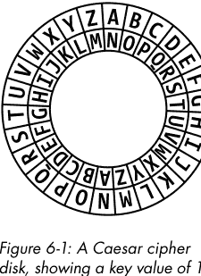

第一行是*明文*：消息原始的可读版本。第二行是*密文*：消息的加密版本。

通过反转替换将此消息还原为原始状态：找到每个内层字母并将其替换为对应的外层字母。

并不是所有的凯撒密码都是像这样的。*对称*意味着该过程可以同时用于加密和解码消息。例如，通过位移 13 位加密时，$F$ 变成 $S$，而通过减去 13 位解码时，$S$ 变成 $F$，你可以使用同一个密码盘和*密钥*——在 particular情况下，位移字母的数字（即 13）被称为密钥，因为知道了它就能“解锁”密文。Secret Messages 应用将允许我们使用任何密钥值。

# 搭建 Secret Messages 应用

我们将像制作 Hi-Lo 猜数字游戏一样构建 Secret Messages 应用：首先，我们将创建一个命令行版本，然后是一个适用于桌面的 GUI 版本，最后是一个 Android 移动应用。命令行版本看起来会非常简单，如图 6-2 所示，但它将允许我们快速方便地测试加密算法。

```
C:\Users\Bryson Payne\workspace_ch0\SecretMessages\bin>Java SecretMessages
Enter message to encode or decode:
Secret messages are so cool!
Enter a key (-25 to 25):
13
Frperg zrffntr ner pbby!
C:\Users\Bryson Payne\workspace_ch0\SecretMessages\bin>_
```

图 6-2：Secret Messages 应用的命令行版本。

正如你在图 6-2 中看到的，程序要求用户输入一个要加密或解码的消息，随后是一个秘密密钥值。程序用加密后的消息作为响应。注意，当我们开始编写该应用时，整个消息都将被加密，包括空格和标点符号。在最终版本中，我们将添加一些逻辑仅加密字母，如图 6-2 所示。

# 在 Eclipse 中创建 Secret Messages 项目

让我们从打开 Eclipse 开始。如果你还有之前项目的文件，现在关闭这些文件。要创建一个新的 Java 项目，转到 `File > New > Java Project`，并将项目命名为 `SecretMessages`。点击 Finish。

在 Package（包）展开器中，找到 `SecretMessages` 项目文件夹以查看 `src` 文件夹。右键点击 `src` 文件夹并选择 `New > Class` 来创建一个新的 Java 源文件，名称也命名为 `SecretMessages`。勾选创建 `main()` 方法的选框，如图 6-3 所示。

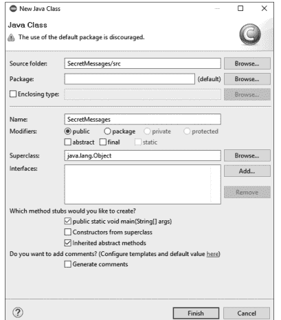

图 6-3：创建一个新的 Java 项目，带名为 `SecretMessages` 的新类，并勾选创建 `main()` 方法存根的选择框。

点击 Finish，你将在 Eclipse 的主窗口看到 `SecretMessages.java` 文件。让我们开始编写 Secret Messages 应用吧！

# 开始编写 SecretMessages.java

在 `SecretMessages.java` 文件的顶部，`public class SecretMessages` 声明上方，添加 `java.util.Scanner` 的导入语句，以便我们向用户输入：

```java
import java.util.Scanner;
public class SecretMessages {
    public static void main(String[] args) {
        Scanner scan = new Scanner(System.in);
        System.out.println("Enter a message to encode or decode:");
    }
}
```

在 `main()` 方法内部，① 处我们设置了一个名为 `scan` 的 `Scanner` 对象。然后，在 ② 处提示用户输入一个要加密或解码的消息。在用户提示之后，我们将创建一个名为 `message` 的 `String` 变量，用于接收用户输入的文本行：

```java
System.out.println("Enter a message to encode or decode:");
String message = scan.nextLine();
```

然后，我们使用 `scan` 对象的 `nextLine()` 方法获取用户的下一行完整输入（直到遇到 ENTER 或 RETURN 字符），并存储在字符串 `message` 中。

到目前为止，该应用可以要求用户输入消息并将消息扫描到变量中。现在我们需要学习如何操作字符串内部的字符以创建消息的加密版本。在继续下一节之前，请保存你的文件。

# 字符串处理

> 我们将通过迭代来构建应用。这意味着，我们不会一次性写完整个应用并希望代码最后能运行，而是一点地、或者说一次迭代地构建我们的应用，并在每个点进行测试。每次迭代，我们都将拥有所需的所有功能，但最终我们将获得一个完整的、功能全的应用。

我们需要使用文本处理来操作输入字符串。为了开始在 Java 中处理字符串，我们将构建一个简单的反转器。换句话说，我们会告诉用户输入的内容，然后以字母反序顺序将其返回给他们。例如，“Meet me at 5”将变成“5 ta em tee”。

首先，我们创建一个名为 `output` 的变量用于反转后的字符串，并将其设置为空字符串：

```java
String message = scan.nextLine();
String output = "";
```

我们需要一个循环来遍历消息中的字符。为了方便起见，我们可以选择 `for` 循环，因为我们知道消息中字符的数量。（稍后，我们将使用 `message.length()` 方法来告诉我们消息包含多少字符。）Java 中的 `for` 循环声明需要完成三件事：初始化循环变量、一个继续运行的条件以及更新循环变量。我们在这三个部分之间放置分号以将它们分开。语法如下：

```
for ( initialization; condition; update ) { body }
```

例如，使用此代码创建一个 `for` 循环：

```java
for ( int x = 0; x < 10; x++) { System.out.println(x); }
```

此循环将打印数字 0 到 9。初始化设置了循环变量的值。

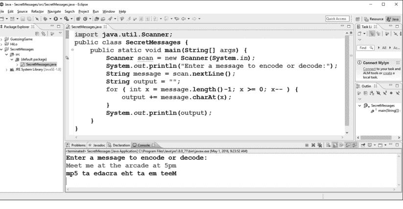

你可以通过复制编码后的反转消息并将其粘贴到程序中来解码，如图 6-6 所示。这样你可以输入一条消息，对其进行编码，然后粘贴到给朋友的消息中，接着他们可以通过将编码的消息粘贴到同一个程序中来解码。你构建了你的第一个秘密编码器！

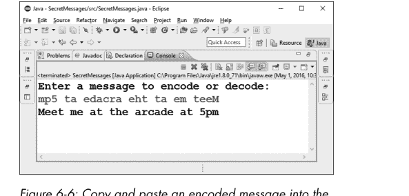

这个版本的应用程序简单到你甚至可以在不运行程序的情况下直接读取消息，因此它不是向朋友发送消息的一种非常安全的方法。但是，你是如何学会使用 `for` 循环遍历文本字符串的，如何使用 `charAt()` 访问字符串中给定索引或位置的特定字符，以及如何使用 `+` 运算符向字符串末尾添加字符的呢？在下一节中，你将学习如何更改消息中单个字符的值，使其更难阅读，但仍然易于我们的程序解码。

## Java 中的字符和值

构建一个更好的秘密消息编码器需要处理文本字符串中字符值的能力。对于凯撒密码法，我们需要能够位移值——例如，将 `A` 变为 `N`，将 `N` 变为 `A`。要做到这一点，你需要了解计算机是如何存储字符的。

在 Java 中，单个字符（如 `'A'`）可以存储在它们自己的数据类型中：`char`。注意我们使用单引号来标记字符值。字符串的 `charAt()` 方法返回一个表示单个字符的 `char` 值。Java 使用 16 位 Unicode 字符。Unicode 是一种国际字符集，包含了来自世界数千个字符和符号，它们以数值的形式表示。`char` 类型可以是 `'A'`、`'ñ'` 和 `'ç'`。

我们可以像给 `int` 变量赋值一样添加 Unicode `char`。在秘密消息应用程序中，我们希望将 `'A'` 的 `char` 值 (65) 加到 `char` (13) 上，得到新的 `char` 值 (78)，它代表编码后的字母 (`'N'`)。

对于我们应用程序的第二次迭代，让我们通过设置一个名为 `key` 的 `char` 值并将值 13 存储其中来开始编写凯撒密码。我们将将其添加在 `String output` 下方：

```java
String output = "";
char key = 13;
```

我们还需要修改 `for` 循环，使其从字符串开始运行到结束。这次我们从索引 0 开始，并在 `x` 小于 `message.length()` 时遍历字符串。每次重复循环时，给 `x`（字符位置）加 1。这里是新的 `for` 循环：

```java
char key = 13;
for ( int x = 0; x < message.length(); x++ ) {
```

最后，我们不再需要将消息字符串的原始字符添加到输出字符串中，而是需要给每个字符加上 `key` 值，确保我们得到的是一个可以加到输出字符串的值：

```java
output += (char)(message.charAt(x) + key);
```

我们已经为消息字符串中的每个字符添加了 `key` 值，然后将该和强制转换为 `char`。在表达式前用圆括号括起 `char` 会强制该值符合 `char` 数据类型，或将该值转换为该类型。我们必须在这里将输出值转换为 `(char)`，因为在 Java 中，等式的右侧默认可能会产生一个 `int`。列表 6-2 显示了带有更改的程序。

```java
import java.util.Scanner;
public class SecretMessages {
    public static void main(String[] args) {
```

列表 6-2：秘密消息应用程序仍然只有 14 行，但它现在可以对文本字符串进行编码了

如果你在此时运行程序并输入一条消息，你应该看到如下所示输出：

Enter a message to encode or decode:（输入要编码或解码的消息：）

Secret messages are so cool!

rpr?-rr?ntr-n-r?|-pl|y.

消息被编码了，但它并不是我们完全预期的样子。首先，我们解码了所有字符，包括空格和标点符号。其次，我们没有绕回字母表的开头，因为我们总是给每个字符加 13，而没有考虑到末尾的字母需要绕回字母表的开头，导致输出中出现了奇怪的符号。我们将在下一节涵盖这两个问题。

## 编码字母


# 秘密消息应用程序的第二次迭代

秘密消息应用程序的第二次迭代给了我们一个编码后的消息，但缺少我们在最终应用程序中需要的某些功能。创建最终应用程序所需的升级将需要 `if` 语句形式的逻辑，以便仅编码字母（而不是空格或标点），并在编码过程中使字母表循环。我们将在第三迭代中处理这些改进。

首先，我们想对每个字符执行一些测试，而不仅仅是将字符添加到输出消息中。让我们如下更改 `for` 循环的主体：

```java
for (int x = 0; x < message.length(); x++) {
  char input = message.charAt(x);
}
```

存储在 `input` 中的字符将是消息中的第一个字符、第二个，依此类推。我们需要逐个测试每个字符，检查它是否是我们想要通过添加 `key` 来编码的字符。如果字符是空格或标点符号，我们将保持原样。为了让字母表在编码时循环，我们需要处理字符超出范围的情况。在循环中使用以下语句：

```java
for (int x = 0; x < message.length(); x++) {
  char input = message.charAt(x);
  if (input >= 'A' && input <= 'Z') {
    input += key;
    if (input > 'Z') {
      input -= 26;
    }
    output += (char)input;
  } else {
    output += input;
  }
}
```

（注：此处原文逻辑在提供的片段中略有重复，已根据语境整合翻译并保持结构一致）

```java
for ( int x = 0; x < message.length(); x++ ) {
  char input = message.charAt(x);
  if (input >= 'A' && input <= 'Z') {
    input += key;
    if (input > 'Z')
      input -= 26;
  }
  else if (input >= 'a' && input <= 'z') {
    input += key;
    if (input > 'z')
      input -= 26;
  }
  output += input;
  }
  System.out.println(output);
  scan.close();
}
```

列表 6-3：此版本的应用程序是一个功能完整的凯撒密码加密解密器，密钥值为 13。

你可以通过运行运行程序并加密消息来尝试。然后复制加密后的输出并再次运行程序；在提示时，粘贴加密的消息并按回车键。程序将响应原始的解码消息。这里是程序的两个示例，我将第一条消息的加密输出复制作为第二个消息的输入：

输入要加密或解码的消息：

Secret messages are so cool!

Frperg zrffntrf ner fb pby!

输入要加密或解码的消息：

Frperg zrffntrf ner fb pby!

Secret messages are so cool!

由于凯撒密码是对称的，对加密后的消息运行程序会将消息解码回其原始明文。这意味着你可以按照列表 6-3 所示的内容运行此程序来加密消息，将加密后的版本发送给同样拥有加密器的朋友，并让他们立即解码你的消息。

遗憾的是，这意味着任何运行程序的人（或任何破解密码的人）都可以像你一样快速地解码你的消息。在我们的下一次迭代中，让我们通过允许用户设置自己的密钥值来让代码变得稍微有趣一点。这样，你可以选择不同的密钥向不同的人发送消息，或者每次都使用新密钥。

## 添加自定义密钥值

秘密消息加密器在密钥值为 13 时运行良好，但如果我们想使用不同的密钥值来加密和解密消息，例如 3（经典的凯撒密码位移）或 5 或 25 呢？

我们需要在消息之外还要提示用户输入密钥值。我们可以在创建 `char key` 变量的行之前添加一个提示来实现这一点：

```java
String output = "";
System.out.println("Enter a secret key (-25 to 25):");
char key = 13;
```

我们允许负密钥值是为了方便解码消息。如果你使用密钥值 5 来加密消息并发送给朋友，你的朋友可以使用密钥值 -5 来解码消息。

当用户响应他们所需的秘密密钥值时，我们可以扫描他们提供的输入行，从输入行解析出整数值，并将该值存储在 `int` 变量中：

```java
String output = "";
System.out.println("Enter a secret key (-25 to 25):");
int keyVal = Integer.parseInt(scan.nextLine());
```

最后，我们不再使用 13 作为密钥值，而是将密钥改为：

```java
int keyVal = Integer.parseInt(scan.nextLine());
char key = (char) keyVal;
for (int x = 0; x < message.length(); x++) {
```

在这里，我们将输入的 `keyVal` 强制转换为 `char`并将该值存储在变量 `key` 中，因为我们不能直接将整数存储到 `char` 中。

为了处理解码过程中的负密钥值，我们需要修改 `if` 语句内部的逻辑。我们必须检查减去一个值（或加上负密钥）是否会将字母移出字母表的开头（小于 'A'）。如果发生了这种情况，我们可以通过加上 26 将字母移回 A 到 Z 的范围。我们将以下代码添加到处理大写字母的 `if` 语句中：

```java
if (input > 'A' && input <= 'Z')
{
    input += key;
    if (input > 'Z')
        input -= 26;
    if (input < 'A')
        input += 26;
}
```

如果我们输入负密钥，我们会检查是否移到了 A 之前，并加上 26 以回到字母表的末尾。记得在随后的 `else-if` 语句的小写逻辑中执行相同的操作：

```java
else if (input >= 'a' && input <= 'z') {
    input += key;
    if (input > 'z')
        input -= 26;
    if (input < 'a')
        input += 26;
}
```

在这些更改之后，你将能够运行程序使用你自己的自定义密钥来加密和解码消息。你的程序运行结果应该像下面的所示：

输入要加密或解码的消息：

**You've written a really cool app in Java!**

输入秘密密钥 (-25 to 25):

7

Fvb'cl dypalu ylhssf jvs hvw pu Qhch!

输入要加密或解码的消息：

Fvb'cl dypalu ylhssf jvs hvw pu Qhch!

输入秘密密钥 (-25 to 25):

-7

**You've written a really cool app in Java!**

由于凯撒密码是对称的，对加密后的消息运行程序会将消息解码回其原始明文。这意味着你可以按照列表 6-3 所示的内容运行此程序来加密消息，将加密后的版本发送给同样拥有加密器的朋友，并让他们立即解码你的消息。

## 加密数字

我们现在处理了字母，但如果我们想也加密数字，我们需要为 '0' 到 '9' 的范围添加逻辑。与字母的逻辑类似，我们将使用取模运算符来确保数字在十进制范围内正确地回绕。

```java
System.out.println(output);
scan.close();
```

列表 6-4：Secret Messages 应用的完成后的命令行版本

这个 Secret Messages 应用可以用来和朋友来回发送乱码的消息，这会很有趣。但你的某些朋友可能没有在电脑上安装 Eclipse 或 Java JDK。如果能和他们一起分享这个 Secret Messages 应用不是很好吗？在下一节中，我们将看到如何在不打开 Eclipse 的情况下运行命令行程序。

## 在没有 Eclipse 的情况下运行应用程序

到目前为止我们已经建立了两个命令行应用程序，但我们一直是在 Eclipse 内部运行它们的。Eclipse 提供了一个方便的控制台模拟器，让我们看到命令行程序的外观和感受，但如果我们想从真正的命令行（例如 Windows 中的命令提示符或 macOS 中的终端）运行程序该怎么办？或者，如果我们想把我们的其中一个命令行程序发送给一个没有安装 Eclipse 的朋友呢？

幸运的是，大多数人的电脑上至少安装了 JRE（即 Java 运行时环境）。

### 寻找工作空间文件夹

要运行你在 Eclipse 中编写并编译的程序，首先要找到你的工作空间文件夹。在文件资源管理器（或 Finder）中打开它，如图 6-7 所示。

| 名称 | 修改日期 | 类型 | 大小 |
|---|---|---|---|
| .metadata | 5/21/2016 12:21 PM | 文件文件夹 | |
| .recommenders | 5/21/2016 12:21 PM | 文件文件夹 | |
| GuessingGame | 5/21/2016 12:21 PM | 文件文件夹 | |
| HiLo | 5/21/2016 12:21 PM | 文件文件夹 | |
| SecretMessages | 5/21/2016 12:21 PM | 文件文件夹 | |

图 6-7：我的工作空间内部包含我们目前为止的每个项目的文件夹，以及一些 Eclipse 默认文件夹。

打开工作空间内的 SecretMessages 项目文件夹，你会在里面看到几个文件和文件夹，如图 6-8 所示。`src` 文件夹包含你的源代码文件（以 .java 结尾），`bin` 文件夹包含你程序的编译后的版本（以 .class 结尾）。

### SecretMessages

| 名称 | 修改日期 | 类型 | 大小 |
|---|---|---|---|
| .settings | 5/21/2016 12:21 PM | 文件文件夹 | |
| bin | 3/30/2017 10:58 AM | 文件文件夹 | |
| trc | 5/21/2016 12:21 PM | 文件文件夹 | |
| .classpath | 4/29/2016 2:13 PM | CLASPATH 文件 | 1 KB |
| .project | 4/29/2016 2:13 PM | PROJECT 文件 | 1 KB |

图 6-8：在 SecretMessages 项目文件夹内部找到 bin 文件夹。

### 打开命令行窗口

接下来，打开一个命令行窗口。在 Windows 上，你可以通过点击开始按钮、进入搜索栏、输入 `cmd`（command 的缩写）并按回车键。在 macOS 上，使用 Spotlight 搜索查找 Terminal，或者从新的 Finder 访问“应用程序 > 实用工具 > 终端”。在 Linux 上，打开终端或使用搜索查找 Terminal。

我们需要从命令行或终端提示符进入之前描述的 `bin` 文件夹。在终端窗口中输入 `cd`（change directory）后跟一个空格。要切换目录到你程序的 `bin` 文件夹，可以从文件资源管理器或 Finder 中拖动 `bin` 文件夹并将其释放到命令提示符或终端窗口，如图 6-9 所示。


图 6-9：可以将 bin 文件夹从资源管理器或 Finder 拖入命令行窗口，以便轻松复制目录路径。

注意，文件路径出现在 `cd` 命令之后，看起来如下（你的工作空间/SecretMessages/bin 文件夹的位置与我的略有不同，这是当然）：

```
cd "C:\Users\Bryson Payne\workspace_ch06\SecretMessages\bin"
```

在 macOS 上，命令将是：

```
cd /Users/BrysonPayne/Desktop/workspace_ch06/SecretMessages/bin
```

输入此命令后按回车，终端将更改提示符显示你已进入 `bin` 文件夹。在 Windows 中，它看起来像这样：

```
C:\Bryson Payne\workspace_ch06\SecretMessages\bin>_
```

我们已进入 `bin` 文件夹，`SecretMessages.class` 文件就在这里。要运行 `SecretMessages.class` 字节码文件中的程序，输入以下命令：

```
C:\Bryson Payne\workspace_ch06\SecretMessages>java SecretMessages
```

命令中的拼写、大小写和空格都至关重要，因此你需要精确匹配你给 Java 类命的名称。如果你输入了命令，程序应该运行，你可以使用消息和密钥进行测试，如下：

```
C:\Bryson Payne\workspace_ch06>java SecretMessages
Enter a message to encode or decode:
I'm running my app directly from the command line terminal!
Enter a secret key (-25 to 25):
12
u'y dgyzzks ykb mdufqxk rday ftq oayymzp xuxq fqduyzxm
```

| Microsoft Windows [Version 10.0.15063] |
|---|
| (C) 2017 Microsoft Corporation. All rights reserved. |
| C:\Bryson Payne>cd "C:\Users\Bryson Payne\workspace_ch06\SecretMessages" |
| C:\Bryson Payne\workspace_ch06>java SecretMessages |
| Enter a message to encode or decode: |
| I'm running my app directly from the command line terminal! |
| Enter a secret key (-25 to 25): |
| 12 |
| u'y dgyzzks ykb mdufqxk rday ftq oayymzp xuxq fqduyzxm |
| C:\Bryson Payne\workspace_ch06\SecretMessages>java SecretMessages |
| u'y dgyzzks ykb mdufqxk rday ftq oayymzp xuxq fqduyzxm |

# 7 创建高级 GUI 并共享你的应用程序


对于“秘密消息”应用程序的 GUI 桌面版本，我们将提供两个大的文本区域，允许用户在 GUI 界面中复制和粘贴长消息。

在本章结束时，我们将添加一个类似于图 7-1 所示的滑动条来选择密钥，这将使得破解凯撒密码变得非常简单，即使在密钥未知的情况下也是如此。

## 设置秘密消息 GUI 项目

打开 Eclipse，通过点击**文件 (File)** > **新建 (New)** > **Java 项目 (Java Project)** 创建一个新的 Java 项目。将项目重命名为 `SecretMessagesGUI`，然后点击**完成 (Finish)**。关闭所有打开的文件，并在包资源管理器（Package Explorer）中浏览 SecretMessagesGUI 项目文件夹以找到 `src` 文件夹。右键点击 src 文件夹并选择**新建 (New)** > **类 (Class)** 以创建一个新的 Java 源代码文件。同样将其命名为 `SecretMessagesGUI`。

我们将再次使用 Swing 工具包，因此在“新建 Java”对话框中，将父类更改为 `javax.swing.JFrame`，并勾选创建 `main(String[] args)` 方法的选框。

点击完成，你将看到 SecretMessagesGUI 文件一些熟悉的骨架代码。在包资源管理器中右键点击 SecretMessagesGUI 文件，选择**打开方式 (Open With)** > **WindowBuilder Editor**，开始为“秘密消息”应用程序创建 GUI 界面。

## 设计 GUI 并命名组件

打开 WindowBuilder 编辑器的设计（Design）选项卡。在组件（Components）面板中展开 `javax.swing.JFrame` 组件并选择 `getContentPane()`。现在进入属性（Properties）面板，将布局（Layout）属性更改为*绝对布局 (Absolute layout)*，如图 7-2 所示。这将允许我们以像素级的精度定位组件。

> 图 7-1：我们将在章中构建的秘密消息编码器/解码器

此版本的应用程序比基于控制台的应用程序更友好，我们将可以使用第 6 章中的代码，因为编码和解码消息的算法是相同的。


接下来，在组件面板中点击 `javax.swing.JFrame`。然后，在属性面板中，将默认关闭操作（`defaultCloseOperation`）设置为 `EXIT_ON_CLOSE`。此外，将标题（`title`）属性更改为 `Your Name's Secret Message App`，如图 7-3 所示。


创建高级 GUI 并共享你的应用程序 149

接下来，让我们留出空间来构建一个稍微大的 GUI 界面，以便我们可以编码和解码更长的消息。在组件面板中仍选中 `javax.swing.JFrame` 时，点击设计预览中的窗口边框。点击窗口右下角的小缩放框，向下并向右拖动，将框架调整为 600 像素乘 400 像素，如图 7-4 所示。


图 7-4：调整 JFrame 以容纳更大的消息。

现在我们准备好开始放置 GUI 界面组件。对于应用程序的 GUI 版本，我们希望能够编码和解码长消息，因此我们放置的第一个组件是 `JTextArea`。类似于 `JTextField`，文本区域也允许你输入文本，但 `JTextArea` 可以包含、显示甚至多行文本。

要为用户输入消息创建第一个 `JTextArea`，在调色板（Palette）的组件下点击 `JTextArea`。然后将其放置在设计预览中的 JFrame 附近。点击并拖动以绘制一个高度约为内容面板三分之一的 `JTextArea`，并在 `JTextArea` 与框架边缘之间留出微小的边距。`JTextArea` 的宽度约为 564 像素，高度为 140 像素。然后，在属性面板中，将变量（Variable）属性更改为 `txtIn`。

为了为输出的消息创建第二个 `JTextArea`，在预览面板中右键点击 `txtIn`，选择**复制 (Copy)**，右键点击内容面板并选择**粘贴 (Paste)**。将新的 `JTextArea` 放置在框架的底部边缘。要命名新的 `JTextArea`，将变量（Variable）属性更改为 `txtOut`。你最终将有两个 `JTextArea` 组件，如图 7-5 所示。


**图 7-5：** 复制并粘贴 `txtIn` 以创建第二个 `JTextArea` 并将其命名为 `txtOut`。

接下来，我们为 `txtKey` 添加一个文本字段。在调色板面板的组件下点击 `JTextField`，然后点击内容面板中心附近放置 `JTextField`。将 `JTextField` 的变量属性更改为 `txtKey` 并将其大小调整为原始大小的一半。

为 `txtKey` 的文本添加一个标签（Label），输入 `key` 作为标签的文本。将水平对齐方式（`horizontalAlignment`）设置为**右对齐 (RIGHT)**。最后，在 `txtKey` 的右侧添加一个按钮（`JButton`），输入 `Encode/Decode` 作为按钮文本。

```java
for (int x = 0; x < message.length(); x++) {
    char input = message.charAt(x);
    if (input >= 'A' && input <= 'Z') {
        input += key;
        if (input > 'Z')
            input -= 26;
        if (input < 'A')
            input += 26;
    } else if (input >= 'a' && input <= 'z') {
        input += key;
        if (input > 'z')
            input -= 26;
        if (input < 'a')
            input += 26;
    } else if (input >= '0' && input <= '9') {
        input += (keyVal % 10);
        if (input > '9')
            input -= 10;
        if (input < '0')
            input += 10;
    }
    output += input;
}
return output;
```

我们的变量命名是一致的，因此可以复用凯撒密码加密代码。一致的命名是一个良好的习惯，而在 Java 中编写良好的代码可以在多个平台之间复用。

## 为编码/解码按钮编写事件处理器

我们希望用户在 GUI 界面中同时提供输入消息和传递给 `encode()` 方法的密钥值，并且我们希望在用户点击“编码/解码（Encode/Decode）”按钮时返回消息，因此，让我们编写处理按钮点击事件的代码。

切换到 `SecretMessageGUI.java` 中的设计视图，并双击编码/解码按钮。Eclipse 将切换回源码视图，并为编码/解码按钮插入 `actionPerformed()` 事件处理器的代码，如下代码段所示：

```java
JButton btnDecode = new JButton("Encode/Decode");
btnDecode.addActionListener(new ActionListener() {
    public void actionPerformed(ActionEvent arg) {
    }
});
```

这是一个匿名内部类，就像我们在第 3 章首次遇到的那种。我们只需要在 `actionPerformed()` 内部添加代码，告诉 Java 按钮在被点击时应该如何表现。

我们希望编码/解码按钮执行以下步骤：

1. 从 `txtIn` 获取输入消息。
2. 从 `txtKey` 获取密钥。
3. 使用密钥对消息进行编码。
4. 在 `txtOut` 中显示输出消息。

思考我们如何完成这些每一个步骤。在继续阅读之前，自己尝试一下，然后阅读下方内容看看我的解决方案如何对比。

对于第一步，我们可以设置一个 `String` 变量，从 `txtIn` 字段获取文本。只需 `JTextField` 或 `TextArea` 都有 `getText()` 方法：

```java
public void actionPerformed(ActionEvent arg) {
  String message = txtIn.getText();
```

对于第二步，我们可以使用 `Integer.parseInt()` 方法从 `txtKey` 获取用户的密钥，该方法可以从文本字符串中提取整数值。然后我们将获取的整数存储在一个名为如下的变量中：

```java
String message = txtIn.getText();
int key = Integer.parseInt(txtKey.getText());
```

在第三步中编码，我们只需要调用 `encode()` 方法并向其传递两个参数。参数是我们传递给方法的值，因此我们需要为 `encode()` 传递两个参数。记住，我们定义 `encode()` 需要两个参数，即变量 `message` 和 `key`。

我们可以使用语句 `encode(message, key)` 来调用 `encode()`。执行完毕后，它将返回编码后的消息并进行输出。注意，方法返回的是值本身，而不是存储该值的变量。此外，编码后的消息存储在 `output` 中，但当 `encode()` 返回 `output` 时，我们实际上只得到了编码后的字符串。这意味着 `encode()` 内部创建的所有代码和变量都不会带到程序的其他部分，一旦 `encode()` 返回，`output` 变量就不存在了。如果我们想保存它，就需要将方法返回的值存储在一个新变量中。为了保持命名的一致性，让我们也将新变量命名为 `output`：

```java
String message = txtIn.getText();
int key = Integer.parseInt(txtKey.getText());
String output = encode(message, key);
```

最后，我们将使用 `setText()` 方法在 `txtOut` 中显示输出消息：

```java
String message = txtIn.getText();
int key = Integer.parseInt(txtKey.getText());
String output = encode(message, key);
txtOut.setText(output);
```

`actionPerformed()` 方法几乎完成了，只是缺少一些错误处理。我们使用了 `Integer.parseInt()` 方法，如果用户输入了错误内容，它可能会抛出异常，我们需要添加 `try-catch` 语句。

## 处理错误输入和用户错误

处理按钮点击的代码包含了对 `Integer.parseInt()` 的调用，我们在第 3 章中了解到，如果用户输入错误内容，该方法可能会抛出异常。特别是如果用户将文本框字段留空或在 `JTextField` 中输入整数以外的任何内容，`Integer.parseInt()` 方法将失败。

我们需要使用 `try-catch` 块保护程序免受错误输入的影响。由于我们只会在用户正确输入加密密钥时才编码或解码消息，可以将 `actionPerformed()` 的所有四行封装在一个 `try` 块中，在第一行之前添加 `try` 关键字和左括号，并在第四行之后添加右括号，如下：

```java
public void actionPerformed(ActionEvent arg) {
  try {
    String message = txtIn.getText();
    int key = Integer.parseInt(txtKey.getText());
    String output = encode(message, key);
    txtOut.setText(output);
  } catch (Exception e) {
  }
}
```

## 构建 main() 方法并运行程序

正如我们在第 3 章中所创建的那样，我们需要在 `main()` 中添加一些代码来创建 GUI 的实例。接下来，我们设置 `JFrame` 的大小以匹配布局，最后将 `JFrame` 属性设置为 `true` 以显示应用程序。

```java
));
btnEncodeddecode.setBounds(312, 172, 144, 23);
getContentPane().add(btnEncodeddecode);
public static void main(String[] args) {
    SecretMessagesGUI app = new SecretMessagesGUI();
    app.setSize(new java.awt.Dimension(600, 400));
    app.setVisible(true);
}
```

该程序的第一个版本是成功的，但在视觉效果上还有待改进之处。我们可以通过少量的调整，让 GUI 界面看起来更专业。

## 改进 GUI

让我们回到设计界面，纠正编码/解码按钮以及我们在上一节中提到的问题。首先，将按钮调得宽一点。不同的计算机可能有不同的默认字体和大小，因此为了安全起见，请给按钮留出额外的空间。

现在，让我们让两个 `JTextArea` 字段中的字体变得更易读。我们希望通过点击 `txtIn` 并使用 CTRL-点击（或 Cmd-点击）选择 `txtOut`，从而同时更改 `txtIn` 和 `txtOut` 的字体属性。

在同时选中两个文本区域后，在属性面板（Properties pane）中找到字体属性，点击字体大小旁边的三个点。将字体选择对话框，如图 7-8 所示。


图 7-8：我们可以同时更改两个 `JTextArea` 字段的字体属性。

选择 18 或更大的字体大小，并选择你喜欢的字体。坚持使用熟悉的字体，这样当你与不同计算机上的朋友分享应用时，外观和感受就不会发生太剧的变化。我选择了 Lucida Console，18 磅。点击 OK 保存字体选择。

最后，让我们更改内容面板（content pane）的背景颜色以个性化。通过点击左上角组件面板中的 `getContentPane()` 来选择内容面板。然后，点击属性面板中背景属性旁边的三个点。在弹出的颜色选择对话框中，选择“命名颜色”（Named colors）选项卡，如图 7-9 所示。你会看到广泛的颜色选择。选择你喜欢的颜色并点击 OK。


图 7-9：更改内容面板和按钮的背景颜色，使应用程序更加时尚。

你还可以更改编码/解码按钮的背景颜色。你可能在设计预览中看不到所有的更改，但如果你运行程序，就应该能看到你的新选择，如图 7-10 所示，以及你选择的任何背景颜色。


**图 7-10：** 修改按钮大小和字体大小后的 GUI。

你还可以根据喜好自定义许多其他属性。探索每个组件的属性面板并不断调整，直到你的应用程序看起来如你所示。记得停止并保存程序，以免你的更改被擦除！

## 设置自动换行和单词换行

到目前为止，我在示例中使用的消息都短于一行。但如果我们输入几行文本会发生什么呢？

尝试在输入文本区域输入或粘贴一个长句子。我将使用美国总统亚伯拉罕·林肯的《格蒂斯堡演说》的第一句：

> 四十二又七年前，我们的先祖在这片土地上建立了一个新的国家，它在自由中产生，并坚持生而平等的理念。

你可以使用这个句子，也可以编写你自己的长句子。无论如何，只要你输入它，你就会发现一个问题，如图 7-11 所示。


**图 7-11：** 应用程序中的较长消息不会在行尾自动换行。

要按完整的单词换行较长的文本，你需要在属性面板中更改每个文本区域的两个属性。在设计预览中选中两个 `JTextArea` 对象，然后在属性中勾选 `lineWrap`（自动换行）和 `wrapStyleWord`（换行样式）复选框。首先，选择 `lineWrap`，告诉 Java 将超过一行的文本换行到下一行。将换行样式设置为 `wrapStyleWord` 则告诉 Java 在整个单词的末尾断行，就像你在文字处理器中或书中看到的那样。

现在保存并运行程序。将你的长句子粘贴到第一个文本框中，你应该会注意到有所改进。文本现在正确地跨越到多行，并在每行能够容纳的完整单词后断行。输入回车键并点击编码/解码按钮，你将看到输出文本区域中的文本换行，如图 7-12 所示。


> 图 7-12：将 `lineWrap` 和 `wrapStyleWord` 属性都设置为 `true`，结果是得到了一个带有单词换行的漂亮多行界面。

这个版本的程序看起来变得越来越专业了，但如果我们在加密密钥的文本字段中输入错误输入会发生什么？嗯，什么都不会发生。我们之前添加了一个 `try` 语句，但没有完成 `catch` 语句。让我们现在来完成它。我们还将学习如何创建弹出消息对话框来提示用户错误。

## 处理错误输入和用户错误：第 2 部分

在章的前面，我们在事件处理器周围添加了一个 `try` 块，但留空了 `catch` 语句的主体。现在是时候代码填充它了。

我们的 `catch` 语句将处理 `txtKey` 文本字段中的错误或缺失输入。如果用户忘记输入加密密钥的值，或者他们输入的值不是数字，处理方法之一是弹出一个消息框，如图 7-13 所示。


图 7-13：弹出对话框以提示用户错误。

当你使用 `JOptionPane` 时，如果你没有使用内容辅助或者在 `JOptionPane` 处看到错误，你可能需要按下 `CTRL-SHIFT-O` 在代码顶部正确导入 `javax.swing.JOptionPane` 类。

现在运行程序，尝试留空密钥或输入非数字文本。消息对话框将弹出，要求你输入值。它还会高亮密钥字段中的文本，以便输入数字。初次用户可能不知道在密钥字段中输入什么，因此添加默认值可能是一个很有用的 UI 调整。点击 Design 标签，选择 `txtKey` 字段，并在属性面板中输入默认值。我将选择 3 作为默认加密密钥，但你可以选择任何数字。让我们将 `txtKey` 的水平对齐属性设置为 CENTER。可以自由更改其他属性，使 `txtKey` 完全符合你的要求。

编码/解码按钮完成后的事件处理器所示：


```java
btnEncodeddecode.Action.addActionListener(new ActionListener() {
    public void actionPerformed(ActionEvent e) {
        try {
            String message = txtIn.getText();
            int key = Integer.parseInt(txtKey.getText());
            String output = encode(message, key);
            txtOut.setText(output);
        } catch (Exception ex) {
            JOptionPane.showMessageDialog(null,
                "请输入加密密钥的数字值");
            txtKey.requestFocus();
            txtKey.selectAll();
        }
    }
});
```

# 在秘密消息 GUI 中添加滑块

我们将为消息应用程序添加一项用户界面改进——一个数字滑块，它允许用户快速滑动选择密钥值，并观察消息随每个新密钥的变化。

在设计视图中，在调色板（`Palette`）组件下选择 `JSlider` 组件。悬停在设计预览的左中间、密钥提示旁边，点击将 `JSlider` 拖放到该位置，如图 7-14 所示——如果需要，稍后可以调整滑块。


现在我们来自定义 `JSlider` 的一些属性。首先，让我们更改背景颜色以匹配应用程序的其他部分。在设计视图中选中新的 `JSlider`，在“颜色选择器”（`Color Chooser`）对话框中进入“命名颜色”（`Named colors`），选择与你在 GUI 其他部分相同的颜色。点击“确定”为滑块保存新的背景颜色。

将 `JSlider` 添加到图形界面中，作为一种快速、方便的方法区分不同的键值。

接下来，我们将为滑块添加自定义刻度（`ticks`）和默认值。首先，通过勾选 `paintLabels` 旁边的复选框来开启标签显示。最大值输入 26，最小值输入 -26，以便在正确的范围内轻松选择键值。

接下来，对于 `minorTicks` 属性，输入值 1——这会在滑块轨道上添加小刻度，帮助用户查看可能值的范围。然后，对于 `majorTicks` 属性，输入 13——这将会在滑块上 -26 到 25 之间每 13 个值显示一个标签。现在，通过勾选 `paintTicks` 旁边的复选框来开启刻度显示。包含我们所做更改的完整属性面板如图 7-15 所示。


图 7-15：自定义滑块的属性

创建高级 GUI 并共享你的应用程序 165

我们快要完成了！通过修改 `value` 属性，将滑块的默认值更改为与键文本字段中的默认键值匹配。我选择了 3 作为我的默认键值，我将在滑块的 `value` 属性中输入 3。你需要让滑块变高一点以显示标签，如图 7-16 中所示后的完成滑块所示。


图 7-16：带有 GUI 滑块的秘密消息应用程序

现在，我们需要添加代码使滑块工作起来，允许用户轻松地在各种键值之间滑动，以便快速编码和解码消息。

# 使用滑块破解密码

我们希望用户能够通过点击和拖动我们在上一节中添加的滑块来更改加密键值，因此接下来我们将添加一个事件处理器来监听滑块的变化。

在设计视图中右键点击或按住控制 键点击滑块，进入 **添加事件处理器（Add event handler） > stateChanged**，如图 7-17 所示。`stateChanged` 事件处理器的工作方式与编码/解码按钮的 `actionPerformed` 事件处理器类似，但每当用户更改滑块位置以更新加密键时，它都会运行。


图 7-17：为滑块添加事件处理器，用于检测用户何时更改滑块的值

当你点击为滑块添加 `stateChanged` 事件处理器时，Eclipse 会自动生成另一个匿名内部类，就像它为编码/解码按钮创建的类一样。但在查看该匿名类之前，我们需要先将 `JSlider` 添加到带有 `TextArea` 声明的类顶部。为了做到，我们必须将 `JSlider` 声明为实例变量。`SecretMessagesGUI` 顶部的最后一行所示：

```java
public class SecretMessagesGUI extends JFrame {
    private JTextArea txtIn;
    private JTextArea txtOut;
    private JSlider slider;
```

然后，向下滚动到滑块代码。记住，当你迷路时，可以随时切换回设计视图并右键直接在代码中添加事件处理器。现在，更改第一行，删除 `JSlider` 声明，如下所示：

```java
slider = new JSlider();
slider.addChangeListener(new ChangeListener() {
    public void stateChanged(ChangeEvent args)
```

滑块的首要动作是更新 `txt` 字段以显示滑块的当前位置。我们可以通过 `getValue()` 方法获取滑块的当前位置，并通过 `setText()` 方法设置 `txt` 字段的文本。将它们结合起来，我们可以编写 `stateChanged()` 方法的第一行：

```java
public void stateChanged(ChangeEvent args) {
    txtkey.setText("" + slider.getValue() + "");
```

`slider.getValue()` 返回一个整数——滑块的当前位置——因此我们添加一个空字符串将其转换为字符串值。这将更改 `txt` 字段显示滑块的值。但它不会自动使用新值重新编码消息。如果你现在运行程序，仍然需要点击编码/解码按钮来更改消息。

让我们修改 `stateChanged()` 方法中的代码，使滑块像编码/解码按钮一样更新消息。我们可以从编码/解码按钮的语句中复制代码，并粘贴到滑块 `stateChanged()` 方法的第一行之后，变为：

```java
slider = new JSlider();
slider.addChangeListener(new ChangeListener() {
    public void stateChanged(ChangeEvent args) {
        txtkey.setText("" + slider.getValue() + "");
        String message = txtIn.getText();
        int key = slider.getValue();
        String output = encode(message, key);
        txtOut.setText(output);
    }
```


在 `stateChanged` 方法中的代码从编码/解码按钮的语句中复制，并粘贴到滑块 `stateChanged()` 方法的第一行之后，使其：

# 导出可运行 JAR 文件

## 可运行 JAR 文件规范

选择一个“Java Application”启动配置来创建可运行的 JAR。

| 启动配置 | SecretMessagesGUI - SecretMessagesGUI |
|---|---|
| 导出目标 | C:\Users\Bryson Payne\Desktop\SecretMessages.jar |
| 库处理 | 将所需的库提取到生成的 JAR 中<br>- 将所需的库打包到生成的 JAR 中<br>- 将所需的库复制到生成的 JAR 旁的子文件夹中<br>- 保存为 ANT 脚本 |
| 脚本位置 | C:\Users\Bryson Payne\workspace_ch7\workspace_ch07.xml |


图 7-21：为你的可运行 JAR 文件选择位置和名称。

要从 Eclipse 导出可运行的 JAR 文件，请转到 `File` ▸ `Export`。然后展开 `Java` 文件夹并点击 `Runnable JAR file`，如图 7-20 所示。


图 7-20：通过导出可运行的 JAR 文件与他人共享你的应用程序。

点击 `Next`，Eclipse 会要求你选择启动配置（`launch configuration`）和导出目标（`export destination`）。启动配置意味着你想要运行哪个类或程序以及来自哪个项目。在 `Launch configuration` 下，点击下拉列表并选择 `SecretMessagesGUI – SecretMessagesGUI`。这意味着你想要运行 `SecretMessages` 项目中的 `SecretMessages` 类。

> 你必须至少编译并运行一次你的应用程序，才能为该程序拥有启动配置。

导出目标只是你想要为可执行程序使用的位置和文件名。在 `Export destination` 下，点击 `Browse`，然后选择你想要保存完成的程序所在的目标文件夹（例如，你的桌面文件夹）。为你的程序文件命名，例如 `SecretMessages.jar`。你可以使用空格（或其他特殊字符）为文件命名，以便人们在打开它时看到你想要的名称。当你完成选择后（如图 7-21 所示），点击 `Save` 然后点击 `Finish`。

点击 `Finish` 后，可能会看到一个警告，但你可以忽略它并点击 `OK`。转到你保存 JAR 文件的位置，你应该能看到一个带有文件名的 Java 图标，如图 7-22 所示。现在你应该能够运行程序并接收加密消息了。


图 7-22：Windows（左）和 macOS（右）上可执行 JAR 文件的桌面图标

> 注意：在较新版本的 macOS 上，你需要在首次点击应用程序时按住 `CONTROL` 键，然后选择 `Open`，最后在弹出的对话框中点击 `Open` 以允许应用程序运行。

某些程序可能会出于安全考虑阻止以 `.jar` 结尾的文件，但你可以将文件上传到你喜爱的文件共享程序（例如 Dropbox、Google Drive 或 SkyDrive）并从那里分享文件。一旦你的朋友拥有该文件，他们只需要运行它，你们就可以互相分享加密的消息了。

> 注意：你也可以为第 3 章的猜测游戏程序导出可运行的 JAR 文件。只需对 `GuessingGame.project` 中的 `GuessingGame.java` 文件遵循相同的步骤即可。

# 你学到的知识

你在此应用程序中重用了基于文本的 Secret Messages 程序的代码，并大大扩展了对 GUI 界面设计编程的理解。以下是本章涵盖的一些技能：

- 一致地命名 GUI 组件和变量，以提高代码的可读性和重用性
- 重用算法，例如我们从此程序的文本版本复制的 `encode()` 方法
- 声明接受参数并返回信息的方法
- 为更多种 GUI 组件（包括按钮、滑块和文本字段）编写更高级的事件处理器
- 在设计视图中处理 GUI 组件的属性以进一步自定义 UI
- 为 `JTextarea` 对象设置行换行（`line wrap`）和单词换行（`word wrap`）
- 弹出 `java.swing.JOption` 对话框，包括消息对话框
- 添加并使用 `JSlider` 滑块
- 使用滑块上的 `stateChanged()` 事件处理器更改文本字段的文本
- 导出可运行的 JAR 文件以与朋友分享你的应用程序

## 编程挑战

尝试这些编程挑战来复习练习你学到的知识，并通过尝试新事物来扩展你的编程技能。访问书籍网站 `https://www.nostartch/learnjava/` 下载示例解决方案。

### #1：更上一层楼！

Secret Messages 应用程序对于向朋友发送简单的加密消息非常棒，但自己用它也很有趣。一个反复出现的任务是从输出文本中复制加密消息，并将其粘贴到输入文本区域。你的第一个编程挑战是创建一个 Move Up 按钮，它可以将加密消息向上移动（^ 按钮），并自动对其解码！

在 Encode/Decode 按钮旁边放置 Move ^ 按钮。然后，添加一个事件处理器，从 `txtIn` 文本区域获取文本并将其设置为 `txtIn` 文本区域的文本。作为额外奖励，使用 Move ^ 按钮的事件处理器将滑块的值变为其相反数。你还可以更改按钮的背景以匹配你应用程序的其他部分。该挑战的示例解决方案如图 7-23 所示。

### #2：滚动起来！

我们可以做的另一个改进是处理更长的消息。在这种情况下，我们应该添加一个滚动条。`JTextArea` 本身不会添加滚动条，但 Eclipse 让添加 `JScrollPane` 变得简单。


图 7-23：添加 Move ^ 按钮以交换消息和滑块值


图 7-24：在每个 TextArea 周围使用 JScrollPane

你还需要对另一个 TextArea 这样做。完成后，运行程序，在文本框中输入一条长消息。

# 8

创建秘密消息

一个可以与朋友分享的

手机应用！


在本章中，我们将通过构建一个移动端应用版本来完成“秘密消息”应用的体验，该版本可以通过短信或电子邮件发送秘密消息，甚至可以发布到社交媒体。

该应用的外观与第 7 章中的 GUI 版本相似，包含标签、文本字段，以及通过滑动选择不同的键值来快速编码和解码消息的功能。你还可以将消息从应用中复制并粘贴到电子邮件和短信中，但到本章结束，你将能够直接从“秘密消息”应用本身发送电子邮件或短信！图 8-1 显示了该应用在真实 Android 设备上的运行情况。

# Payne 博士的秘密消息应用

如果我们让“秘密消息”完全移动端化，使其能够通过短信、电子邮件和社交媒体分享加密消息，会发生什么呢？等不及待了！！

Jung Jhyq unccra jr jr gbux Frzpr zfrnftrc shyyl zobyl, jvgu nur novygyl fun baprqbqr zfrnftrc if grkq, rzny, naq fbpvny zrqnm? V. pnaq jvgll!!


如果我们让“秘密消息”完全移动端化，使其能够通过短信、电子邮件和社交媒体分享加密消息，会发生什么呢？等不及待了！！

Jung Jhyq unccra jr jr gbux Frzpr zfrnftrc shyyl zobyl, jvgu nur novygyl fun baprqbqr zfrnftrc if grkq, rzny, naq fbpvny zrqnm? V. pnaq jvgll!!


图 8-1：“秘密消息”编码器/解码器应用[左]只需点击一下按钮（右），即可从应用内部直接发送短信和电子邮件消息。

我们将通过在 Android 版本中保留 GUI 组件名称，并利用 Java 在多个平台之间一致的语言和结构，来复用桌面应用的有效代码。

# 设置移动端 GUI

让我们使用 Android Studio 开始构建“秘密消息”应用。Android Studio 可能会会在你打开程序时允许你进行更新，这通常是一个好主意。更新带有一定的风险，因为它可能会更改移动图标或菜单项的外观和感受，但更新也包含了重要的新安全修复和最新的 Android 功能。

当你首次打开 Android Studio 时，你会看到最近工作过的项目——在我们的案例中是 Hi-Lo 猜数字游戏应用。你可以通过选择 **File › Close Project** 来关闭它。

要开始构建新的“秘密消息”应用，请在 Android Studio 内部选择 **File › New Project**，或者在欢迎界面上选择 **Start a new Android Studio**。

将新项目命名为 *SecretMessages*，将其保存到你所在的位置，并点击 **Next**。


在目标 Android 设备上，为手机和平板的 Minimum SDK 选择 API 16: Android 4.1 (Jelly Bean)，正如我们在做 Hi-Lo 游戏应用时做的那样，然后点击 Next。选择 **Basic Activity** 来添加 Activity 屏幕并点击 Next。在 **Customize the Activity** 屏幕上：

新项目的配置和打开可能需要一些时间。当新项目打开时，双击 Project Explorer 中 `app res > layout` 下的 `content_main.xml` 文件，你可能需要关闭来自悬浮操作按钮的弹出消息（我们稍后会用到它）。你的屏幕应该与图 8-2 相似。你可能需要点击 Design 标签来查看 GUI 预览。


图 8-2：Android Studio 中应用的初始视图。

# 设计移动端 GUI

现在我们已经设置好了新项目，让我们开始设计应用的布局。首先，通过点击选中并按 DELETE 键来删除设计预览中的“Hello World!”文本。然后，正如我们在上一个应用中做的那样，让我们添加一个 `RelativeLayout` 来包含我们的 GUI 元素：在 Palette 面板中，在 Layout 下，选择 `RelativeLayout` 并将其拖入 Preview 面板，或者拖到 Component Tree 下的 `ConstraintLayout` 之上。

接下来，通过选择 Palette 中 Widgets 下的 `TextView` 组件，为应用顶部添加一个标题。将 `TextView` 组件放置在屏幕顶部中央，将文本更改为 Your Name's Secret Messages App，然后在 Properties 面板中将 `textAppearance` 更改为 `Material.Large`，正如我在图 8-3 中做的那样。


图 8-3：在页面顶部添加一个大标题，用你的名字进行个性化。

在 Properties 面板中，展开 appearance 找到 `TextStyle` 并勾选 bold 复选框以使文本脱颖而出。

现在，让我们编辑用于用户输入消息的 `EditText` 文本字段。在 Palette 中，选择 Multiline Text。缩放设计视图并查看标题下方约 30 dp 处的文本字段。将文本更改为 Secret messages are so cool, aren't they?如图 8-4 所示。转义序列将添加换行符；这些字符不会显示在屏幕上，但它们代表了你通过跨多行按 ENTER 键获得的新行。多行显示让用户知道他们输入多行消息。


图 8-4：为用户输入消息添加 Multiline Text 字段，使用 `\n` 转义序列跨越多行文本。

178 第 8 章

你还可以更改用户在任何时刻看到的文本行数。在 Multiline Text 展开的 Properties 面板下，你可以将 `lines` 属性更改为 4，例如。为了在所有设备上都能看到多行消息，请在 `inputType` 的下拉列表中勾选 `textMultiline` 复选框。

最后，将输入字段的 id 更改为 `txtIn`，并将其拉到应用的整个宽度，如图 8-5 所示。


图 8-5：输入字段的更改

我们将为“秘密消息”添加四个组件：一个供用户滑动选择密钥的 `SeekBar`、一个标签、一个文本字段和一个 Encode/Decode 按钮。`SeekBar` 的功能将类似于桌面版本。如果首次放置组件时没有完美对齐，请担心——稍后我们可以修复。

首先，在 Properties 面板中找到 `SeekBar`。将其放置在应用顶部，留出 30dp 边缘，如图 8-6 所示。

接下来，在 `SeekBar` 旁边添加一个 `TextView` 组件作为文本字段的标签。在 Properties 面板中将 Appearance 属性更改为 `Material.Medium` 并 `text` 属性更改为 Key。

然后选择一个 Number 文本字段作为用户的秘密密钥，并将其水平居中，文本属性设置为 13 或你选择的默认密钥值。通过更改 `width` 属性（在 View all properties 下）将文本字段宽度改为 40dp 以适应数字，然后将 `id` 属性更改为 `txtKey`。

在 `txtKey` 字段到位后，你应该可以将 Key 标签拖动到直接邻近它。你还应该能够拉伸 `SeekBar` 以填充间隙，如图 8-7 所示。

通过添加 Encode/Decode 按钮完成布局的中间行。在 Palette 中选择 Widgets 并在文本字段右侧插入按钮。将 `text` 属性更改为 Encode/Decode。

最后，通过复制文本字段并将其放在中间行组件下方创建一个输出消息的文本字段。删除文本字段中的文本，将其拉伸到应用窗口的宽度，并将 `id` 属性重命名为 `txtOut`。


就是这样——完成后的 GUI 布局如图 8-8 所示。


在继续之前，确保你的输入文本框的 id 为 `txtIn`，输出文本框为 `txtOut`，中间用于密钥的文本框为 `txtKey`。我们需要这些元素都命名正确，以便代码在下一部分正常工作。

## 将 GUI 连接到 Java 代码

现在是时候将 GUI 布局连接到 Java 源代码，以开始编写“秘密消息”（Secret Messages）移动应用程序的行为了。点击主窗口左上角的标签切换到 `MainActivity.java` 文件。

在 `public class MainActivity` 声明中直接添加以下五行代码：

```java
public class MainActivity extends AppCompatActivity {
    EditText txtIn;
    EditText txtKey;
    EditText txtOut;
    SeekBar sb;
    Button btn;
```

你可能需要在每行代码后按下 `ALT-ENTER` 或 `OPTION-ENTER`，以便将控件导入到 Java 代码中。

这五个变量指向应用程序视觉布局中的 GUI 组件。我们可以通过在 `onCreate()` 方法中 `setSupportActionBar(toolbar)` 语句下方添加五行代码，将这些变量重命名为实际控件：

```java
protected void onCreate(Bundle savedInstanceState) {
    super.onCreate(savedInstanceState);
    setContentView(R.layout.activity_main);
    Toolbar toolbar = (Toolbar) findViewById(R.id.toolbar);
    setSupportActionBar(toolbar);
    txtIn = (EditText)findViewById(R.id.txtIn);
    txtKey = (EditText)findViewById(R.id.txtKey);
    txtOut = (EditText)findViewById(R.id.txtOut);
    sb = (SeekBar)findViewById(R.id.seekbar);
    btn = (Button)findViewById(R.id.button);
```

你可以依靠 Android Studio 的代码辅助来完成大部分条目的自动补全——你只需要输入前几个字符，然后从列表中选择该条目或按 `ENTER` 接受代码建议。这样速度更快，并能帮助你避免常见的输入错误。

## 将编码按钮连接到 encode() 方法

现在我们已经将代码连接到 GUI 布局中的组件，可以从第 7 章的桌面版本中复制 `encode()` 方法了。我们将该方法粘贴到 `public class MainActivity` 声明中，就在你添加的指向布局中 GUI 组件的变量声明的下方。

在 Eclipse 中打开你的 SecretMessagesGUI 桌面项目并高亮整个 `encode()` 方法。复制此代码并粘贴到 Android Studio 的 `public class MainActivity` 声明中：

```java
public class MainActivity extends AppCompatActivity {
    EditText txtIn;
    EditText txtKey;
    EditText txtOut;
    SeekBar sb;
    Button btn;
    public String encode(String message, int keyVal) {
        String output = "";
        char keyChar = (char) keyVal;
        for (int x = 0; x < message.length(); x++) {
            char input = message.charAt(x);
            if (input >= 'A' && input <= 'Z') {
                input += keyChar;
                if (input > 'Z')
                    input -= 26;
                if (input < 'A')
                    input += 26;
            } else if (input >= 'a' && input <= 'z') {
                input += keyChar;
                if (input > 'z')
                    input -= 26;
                if (input < 'a')
                    input += 26;
            } else if (input >= '0' && input <= '9') {
                input += (keyVal % 10);
                if (input > '9') {
                    input -= 10;
                    if (input < '0')
                        input += 10;
                }
            }
            output += input;
        }
        return output;
    }
}
```

现在我们已经有了 `encode()` 方法，只需要在每次点击编码/解码按钮时调用该方法即可。我们将为编码/解码按钮创建一个 `OnClickListener` 并在那里调用 `encode()` 方法。

在 `MainActivity.java` 的 `onCreate()` 方法内部，开始输入代码 `btn.setOnClickListener` 直到弹出代码建议，如图 8-9 所示。在列表中选择 `setOnClickListener()`。

```java
protected void onCreate(Bundle savedInstanceState) {
    super.onCreate(savedInstanceState);
    setContentView(R.layout.activity_main);
    Toolbar toolbar = (Toolbar) findViewById(R.id.toolbar);
    setSupportActionBar(toolbar);
    txtIn = (EditText) findViewById(R.id.txtIn);
    txtKey = (EditText) findViewById(R.id.txtKey);
    txtOut = (EditText) findViewById(R.id.txtOut);
    btn = (Button) findViewById(R.id.button);

    btn.setOnClickListener(new View.OnClickListener() {
        @Override
        public void onClick(View v) {
            // 代码写在这里
        }
    });
}
```

图 8-9：你可以依靠 Android 的代码建议来自动填充。（注意：OCR 文本在代码块中包含严重错误，此处已根据标准的 Android 开发模式进行了修正）。

现在我们已经有了 `encode()` 方法，只需要在每次点击编码/解码按钮时调用该方法即可。我们将为编码/解码按钮创建一个 `OnClickListener` 并在那里调用 `encode()` 方法。

为了编码用户输入 `txtKey` 的消息，我们首先需要获取他们输入的密钥。我们将在 `onClick()` 方法的范围内添加以下代码：

```java
btn.setOnClickListener(new View.OnClickListener() {
    @Override
    public void onClick(View v) {
        int key = Integer.parseInt(txtKey.getText().toString());
        String message = txtIn.getText().toString();
        String output = encode(message, key);
        txtOut.setText(output);
    }
});
```

# 测试应用程序

现在，我们的应用程序足以进行首次测试。让我们在 Android 模拟器中运行程序，查看编码/解码按钮的作用。

保存你目前的进度。然后，转到 Run ▶ Run ‘app’。选择你在第 4 章中设置的模拟器，例如 My Nexus 6P，如图 8-11 所示。


图 8-11：选择模拟器

模拟器第一次运行可能需要几分钟时间——记住，你可以在 Android Studio 中工作时让它运行，以避免每次运行应用时都要漫长的启动过程。你也可以像我们在第 4 章中所做的那样，直接在 Android 设备上运行应用，跳过模拟器。

当模拟器启动且 Secret Messages（秘密消息）应用加载时，你将看到初始布局，如图 8-12（左）所示。输入一个键值，然后点击 Encode/Decode（编码/解码）按钮，你将看到 Android 将消息转换为密文，如图 8-12（右）所示。


图 8-12：在 Nexus 6P Android 模拟器上运行 Secret Messages 应用（左）；点击 Encode/Decode 按钮创建加密文本（右）。

你可以在字段之间进行复制和粘贴，但如果滑动条（Seekbar）不起作用，浮动操作按钮——右下角的邮件信封符号——没有任何作用。别担心；我们会处理这些的。

注意还有另一个用户体验问题：加密消息（Frperg zffnft...）带有下划线，因为它在计算机看来像是拼写错误的文本。要关闭拼写检查，返回 `content_main.xml` 布局并选择 `txtOut` 字段。在属性（Properties）面板下，展开 `inputType` 并选择 `textNoSuggestions` 属性。如果你愿意，也可以关闭 `txt` 字段的拼写建议，可以在布局视图中按住 SHIFT 同时选择两个字段并选择 `textNoSuggestions` 属性。现在在模拟器上重新运行应用。不再有拼写检查了！

通过这个小调整，我们准备好让 SeekBar 上线，这样我们就可以快速方便地在键值之间滑动了。

## 使用 SeekBar

我们将连接 SeekBar，在用户向左或向右滑动时更改输出消息，因此我们需要修改它的几个属性以供使用。

首先，让我们简单了解一下 SeekBar 组件。在你的移动设备上，例如在 YouTube 视频上播放视频时，SeekBar 显示了你在视频中的位置，并允许你向前或向后跳过——这有时被称为寻找（seeking）。

SeekBar 与 J5Slider 有几点不同。首先，SeekBar 只能有正值。0 是最小值，但我们可以将最大值设置为任何正值，例如 26。此外，SeekBar 不在条本身上显示标记或标签。这意味着如果我们如果我们允许用户使用负值，就必须使用一些数学方法将正值转换为负值，以便用户可以滑动键值穿过某个值范围，例如从 -13 到 +13。为了实现这一点，我们将 SeekBar 的范围设为 0 到 26。我们还需要更新 `textView`，在用户滑动 SeekBar 时显示变化的值，让他们知道 SeekBar 的当前值。让我们从更改 GUI 布局中 SeekBar 的某些属性开始。


返回 `content_main.xml` 布局文件并在设计视图中选择 SeekBar。在 SeekBar 的属性面板中，找到 `max` 和 `progress` 并将其更改为 26。

Secret Messages 应用需要 26 个值来覆盖整个字母表。我们希望范围是 -13 到 +13，以便用户更容易进行编码和解码。总共有 27 个值，因此我们选择 26 作为最大值（因为包含 0 时就是 27 个值）。`progress` 是 SeekBar 的当前值，类似于 J5Slider 的 `value` 属性。我们将使用 SeekBar 的 `get()` 方法来获取 SeekBar 当前指向的值。

保存你的更改并切换回 `MainActivity.java` 代码文件。在 `onCreate()` 方法中，在 `btn.setOnClickListener()` 代码的结束行 `);` 下方，开始输入 `sb.set` 并使用代码建议器找到 `Listener()`。这将你的 SeekBar 存储在变量 `sb` 中。

SeekBar 的代码与 Encode/Decode 按钮的代码不同。我们不仅想监听 SeekBar 的点击事件。我们想监听所有的变化，包括用户按下 SeekBar 并向左或向右滑动它。为此，我们需要一个 `OnSeekBarChangeListener`。

就像按钮代码一样，你将使用代码建议器自动生成新的 `OnSeekBarChangeListener()`。在 `sb.setOnSeekBarChangeListener()` 之后，输入 `new OnSeekBar` 并使用代码建议。

Android Studio 将为 `OnSeekBarChangeListener` 填充三个方法：`onProgressChanged()`、`onStartTrackingTouch()` 和 `onStopTrackingTouch()`。我们想使用 `onProgressChanged()`，因为这将告诉我们用户何时更改了 SeekBar 值。

我们在 SeekBar 事件监听器中编写的步骤与 Encode/Decode 按钮的代码类似，不同的是我们需要根据 SeekBar 的值计算键。我们还需要在 `txt` 字段中显示键。在 `onProgressChanged()` 方法中添加以下代码行：

```
sb.setOnSeekbarChangeListener(new Seekbar.OnSeekbarChangeListener() {
  @Override
  public void onProgressChanged(Seekbar seekbar
```

命名为 `key` 的变量。我们从 SeekBar 变量获取进度值，并从该值减去 13。SeekBar 的范围可以是 0 到 26，减去 13 将得到 -13 到 +13 的范围，非常适合编码和解码。以下代码行与 Encode/Decode 按钮相同：

```java
int key = seekbar.getProgress() - 13;
txtOut.setText(String.valueOf(key));
```

现在在模拟器上重新运行应用。不再有拼写检查了！

通过这个小调整，我们准备好让 SeekBar 上线，这样我们就可以快速方便地在键值之间滑动了。

Android Studio 在 `onCreate()` 方法中自动包含了一些用于 fab 图标的代码，它用于显示一种新类型的弹出消息——在 Android 术中被称为 "Snackbar"。

```java
FloatingActionButton fab = (FloatingActionButton) findViewById(R.id.fab);
fab.setOnClickListener(new View.OnClickListener() {
    @Override
    public void onClick(View view) {
        Snackbar.make(view, "Replace with your own action", Snackbar.LENGTH_LONG)
            .setAction("Action", null).show();
    }
});
```

我们只需要将 `fab.setOnClickListener()` 的 `onClick()` 方法中的代码替换为我们想要的内容。

首先，删除 `onClick()` 方法大括号之间的代码。接下来，将以下代码放入 `onClick()` 方法中：

```java
FloatingActionButton fab = (FloatingActionButton) findViewById(R.id.fab);
fab.setOnClickListener(new View.OnClickListener() {
    @Override
    public void onClick(View view) {
        Intent shareIntent = new Intent(Intent.ACTION_SEND);
        shareIntent.setType("text/plain");
        shareIntent.putExtra(Intent.EXTRA_SUBJECT, "Secret Message " +
            DateFormat.getInstance().format(new Date()));
        shareIntent.putExtra(Intent.EXTRA_TEXT, txtout.toString());
        try {
            startActivity(Intent.createChooser(shareIntent, "Share message ..."));
        } catch (android.ActivityNotFoundException ex) {
            Toast.makeText(MainActivity, "Error: Couldn't share.",
                Toast.LENGTH_SHORT).show();
        }
    }
});
```

现在让我们看看每行代码的作用。在 `shareIntent` 处，Android 中的 `Intent` 是一个我们想要启动或运行的活动，例如电子邮件、Twitter 或其他。`shareIntent` 使用了 `ACTION_SEND`，我们需要它将信息发送到 Android 设备上的另一个应用。

我们将 `Intent` 的类型设置为 `text/plain`，这是电子邮件、推文或社交媒体帖子所需要的，然后为活动添加了一个主题行。如果用户选择通过电子邮件或使用另一个带有主题行的应用程序共享他们的消息，它将读取“Secret Message”加上日期。`DateFormat` 类将根据你所在的地区将日期格式化为文本格式，例如“Dec 7, 2017 4:33:12 PM”。

① 处的代码将来自 `txtout` 的编码消息作为电子邮件、推文或帖子的正文发送，取决于用户选择通过哪个应用共享他们的消息。

接下来是 `try` 语句 ②。当我们尝试从一个应用内部调用另一个应用时，可能会出现很多问题。如果用户没有安装电子邮件应用怎么办？如果应用正在忙或无法访问网络怎么办？`try` 语句就是为了应对这种情况。`try` 语句内部的这一行代码尝试启动用户选择的活动（如电子邮件、短信或 Twitter），并将信息传递给选定的应用，最后在下一行完成该活动。

如果发生错误或异常，`catch` 语句 ③ 将显示一个 `Toast` 消息（一种弹出框），内容为“Error: Couldn't share.”。

这就是我们让 fab 图标工作所需的全部内容。记住，在输入代码行时，按 `ALT-ENTER`（或 `OPTION-ENTER`）来导入新类。记住，如果 Android Studio 用红色下划线标出一个新类，说明它尚未被导入，此时按 `ALT-ENTER`（或 `OPT-ENTER`）将自动添加正确的导入语句，正如我们在第 4 章中所做的那样。

一旦添加了代码并导入了类，再次运行应用。

编码消息后，按屏幕底部的三角形隐藏键盘。然后点击屏幕右侧的 fab 图标，如图 8-17（左）所示。在“Share message...” 下的应用列表中选择电子邮件应用，并在邮件正文中输入编码后的消息，如图 8-17（右）所示。


## 第 8 章

现在我们只需点击图标即可从应用中发送秘密消息了！但为了让这个应用真正配得上 Google Play Store，我们需要赋予它接收来自应用外部秘密消息的能力。

## 从其他应用接收秘密消息

让我们对 Secret Messages 应用的移动版本进行最后一次升级。我们可以从应用共享、发送电子邮件或推文编码消息，但如果我们想在不复制粘贴到应用的情况下接收电子邮件、推文和帖子的文本呢？为了解决这个问题，我们可以将应用添加到 Android 的分享列表中，这样其他应用就可以将文本直接发送到 Secret Messages 应用——这只需要几行代码！

这是一项高级技术，让我们逐步完成这一过程。首先，在 Project Explorer 窗格中打开 `manifests` 下的 `AndroidManifest.xml`。清单文件存储了应用的“货运”信息，就像船的舱单列出所有在船上的运输货物一样。你可以为整个应用声明属性，并包含运行应用所需的 Android 设备配置，就像你在跨海运输时可以声明板箱或包裹的内容一样。

为了实现这一点，你需要编辑一些 XML 文件标签来标记文件中所包含的信息。通常，标签的格式为括号括起的名称，例如 `<tag>`。在这种情况下，我们需要修改清单的 `intent-filter` 标签项，该条目包含关于应用接受什么内容的信息。

```xml
<intent-filter>
  <action android:name="android.intent.MAIN" />
  <category android:name="android.category.LAUNCHER" />
  <action android:name="android.intent.SEND" />
  <category android:name="android.intent.DEFAULT" />
  <data android:mimeType="/*" />
</intent-filter>
```

在 ① 处，我们向应用添加了一个新的意。之前我们使用 `Intent` 发送到另一个应用。通过 `DEFAULT` 类别，我们正在创建一个过滤器来接收来自任何应用的数据。例如，mimeType 可能是 `image/*` 或 `image/png` 用于图片。对于视频，则是 `video/mp4` 等。

最后，我们需要关闭应用中的 XML 标签，通常通过正斜杠加上标签名称来完成。这表示你已经完成了过滤器的代码。保存你的 `AndroidManifest.xml` 文件，然后打开 `MainActivity.java` 文件开始编写 Java 源码。

滚动到 `MainActivity` 找到 `onCreate()` 方法。在连接 GUI 组件到变量的代码之后，添加以下语句：

```java
protected void onCreate(Bundle savedInstanceState) {
    super.onCreate(savedInstanceState);
    setContentView(R.layout.activity_main);
    Toolbar toolbar = (Toolbar) findViewById(R.id.toolbar);
    setSupportActionBar(toolbar);
    xtint = (EditText) findViewById(R.id.xtint);
    txtKey = (EditText) findViewById(R.id.txtKey);
    txtOut = (EditText) findViewById(R.id.txtOut);
    sb = (Seekbar) findViewById(R.id.seekBar);
    btn = (Button) findViewById(R.id.button);

    Intent receivedIntent = getIntent();
    String receivedText = receivedIntent.getStringExtra(Intent.EXTRA_TEXT);
    if (receivedText != null) {
        xtint.setText(receivedText);
        btn.setOnClickListener(new View.OnClickListener());
    }
}
```

在 处，我们创建了一个名为 `receivedIntent` 的变量来处理从其他应用共享的传入意。然后，通过调用 `getStringExtra()` 方法从意消息中获取文本。由意 发送的消息部分被称为额外数据。一个 `if` 语句检查 `receivedText` 变量是否为空，如果是，则将 Secret Messages 应用顶部 `xtint` 字段的文本更改为接收文本

难以相信，这就是接受其他应用分享所需的全部工作！现在，你不仅可以从应用发送编码消息，还可以直接从电子邮件、推文和帖子解码消息。图 8-18 显示了从电子邮件分享消息到 Secret Messages 应用进行快速解码的样子。

Android Emulator - Neus_BP_AP_24-0534

Android Emulator - Neus_BP_AP_24-0534

Android Emulator - Neus_BP_AP_24-0534


图 8-18：现在，Secret Messages 应用可以与手机上的其他应用（包括你的电子邮件）来回发送消息。

在你最喜爱的电子邮件应用、Twitter 或 Facebook 中选择文本，并按下“共享”按钮。Secret Messages 应用将出现在接受共享消息的应用程序列表中。选择 SecretMessages 作为共享应用，选中的文本将显示在 Secret Messages 应用的输入字段中。你可以轻松地进行编码或解码；只需记住，根据消息编码的方式，你可能需要更改键值。

恭喜你！你构建了一个功能完备的社交型 Secret Messages 移动应用。使用它，并和朋友分享吧！

让我们来看看你在本章中掌握的技能，以及几个额外的编程挑战。

# 你学到了什么

我们在该应用中复用了 Secret Messages GUI 桌面版本的代码，并添加了许多内容，使其成为一个真正的全移动应用。以下是你在本章中学到的一些新知识以及强化的一些技能：

- 为 Android 组件（包括按钮、进度条 `SeekBar` 和浮动操作按钮）编写事件处理器
- 自定义 Android GUI 组件
- 在 Android 应用中使用多行文本输入
- 添加 SeekBar 并像使用滑块界面一样使用它
- 在模拟器和真实设备上运行 Android 应用
- 自定义浮动按钮的操作
- 创建自定义 `Intent` 对象以调用特殊活动，包括从应用内部向其他应用发送数据
- 创建自定义 `Intent` 过滤器以接收从其他应用的文本（或图像或视频）数据

## 编程挑战

尝试这些编程挑战来回顾并练习你所学的内容，并通过尝试新事物来扩展你的编程技能。访问书籍网站 https://www.nostarch/learnjava/ 获取示例解决方案。

### ##1：创建一个“向上移动”按钮

这个编程挑战是创建一个“向上移动 ^”的按钮，类似于第 7 章（第 172 页上的编程挑战 #1）中的按钮，它可以将文本从输出字段移动到输入字段。

将“向上移动 ^”按钮放在 `txtout` 文本字段下方。然后添加一个事件处理器，从 `txtout` 文本字段获取文本并将其设置为 `txtIn` 文本字段的文本。作为一个额外，你可以让“向上移动 ^”按钮的事件处理器也将 SeekBar 的值更改为相反的值。加密密钥 7 将变为 -7，即解密密钥。结果将是：点击按钮会将编码后的消息向上移动并自动解码！

### ##2：更改 SeekBar 的进度

你可以对用户体验做的第二个改进是：每当用户在 `txtKey` 字段中手动输入键值时，更改 SeekBar 的进度属性。尝试一下吧！

> 不要为 `txtKey` 字段创建事件处理器，而是修改编码/解码按钮的代码，将 SeekBar 的进度更改为与 `txtKey + 13` 的值匹配——记住 SeekBar 的范围是从 0 到 26，或者 -13 到 +13。你只需要一两行代码即可。

## 用你的鼠标画彩色的泡泡吧！


在接下来的三章，我们将构建 BubbleDraw，这是一个交互式的动画绘图应用，它允许用户在桌面版本中使用鼠标、在移动版本中使用手指绘制浮动的、弹跳的彩色的泡泡！

BubbleDraw 应用的第一版本看起来将像图 9-1 所示，每个泡泡都是不同的随机颜色。它将允许用户在应用窗口上点击并拖动鼠标时，绘制随机颜色的泡泡。用户还可以通过上下滚动鼠标轮，或通过使用触控板或触摸屏上的滚动手势来改变泡泡的大小。


图 9-1：BubbleDraw 应用允许用户使用鼠标绘制随机颜色的泡泡。


# 使用面向对象编程构建 BubbleDraw 应用

我们将使用面向对象的编程方法来构建 BubbleDraw 应用。你到为止学过的变量、函数、循环和条件语句被称为过程化编程。过程化编程涉及以线性方式逐步编写程序，有点类似于遵循食谱。面向对象编程使用了所有这些概念，但它允许我们通过将一个大型软件项目分解为称为“对象”的小部分来编写更大、更复杂的应用程序。

例如，泡泡是 BubbleDraw 应用中一个重要的实体，因此当我们开始编写此应用时，泡泡可能会变成对象。首先，我们将解决什么是泡泡的问题。其次，我们将弄清楚如何在大量泡泡上存储信息以及如何在屏幕上绘制它们。最后，我们将添加点击和拖动鼠标来创建泡泡的能力。我们不再编写单独的代码片段来单独控制每个泡泡。

## 封装与 Bubble 类设计

我们通常将内部类和辅助类设置为私有（`private`），以防止其他程序直接访问。因此，为了让 `Bubble` 成为一个只能从 `BubblePanel` 访问的内部类，我们将其声明为私有。这种技术被称为**封装**（encapsulation），意味着 `BubblePanel` 向其他类隐藏了它的工作机制。封装是面向对象编程的核心原则之一，它是一个值得遵循的最佳实践，因为这意味着我们可以在内部更改 `Bubble` 类，并确定不会破坏代码的其他部分。由于 `Bubble` 被声明为私有，我们知道 `Bubble` 类外部没有任何代码依赖于它。这对于包含大量类且由许多程序员共同维护的大型应用程序来说尤为重要。

`BubblePanel` 将依赖 `Bubble` 类，以便在用户在屏幕上绘图时存储单个气泡的信息。气泡在屏幕上有一个 `(x, y)` 位置、一个大小和一个颜色，因此我们可以将这些属性设置为 `Bubble` 内部的变量。气泡位置的 `x` 和 `y` 坐标以及气泡的大小可以作为整数值存储：

```java
import javax.swing.JPanel;
public class BubblePanel extends JPanel {
    private class Bubble {
        private int x;
        private int y;
        private int size;
    }
}
```

我们创建了两个独立的变量 `x` 和 `y` 来存储气泡的坐标，以及一个 `size` 变量。这些属性是私有的，因此 `Bubble` 类本身可以直接更改这些值。我们将气泡应该拥有的所有数据封装在 `Bubble` 类中，并使用该类中的方法与气泡进行交互。

如前文提到的，我们应用程序中的每个气泡都可以有自己的颜色。`java.awt.Color` 有一个处理 RGB（红、绿、蓝）颜色值的类，用以重现我们在显示器上显示的任何颜色。我们将在本节稍后实际编写控制气泡的代码时，稍作讨论一下 RGB，所以现在只需在文件顶部导入 `java.awt.Color` 类，并在 `Bubble` 类中添加一个名为 `color` 的属性，如下：

```java
import java.awt.Color;
import javax.swing.JPanel;
public class BubblePanel extends JPanel {
    private class Bubble {
        private int x;
        private int y;
        private int size;
        private Color color;
    }
}
```

现在，我们已经添加了希望每个气泡拥有的四个属性（`x`、`y`、`size` 和 `color`），我们可以开始构建气泡的行为（或函数），以给这些属性赋值。我们将通过在 `Bubble` 类内部添加方法来实现这一点。

## 设计气泡的方法

`Bubble` 类将有两个动作，我们将它们转换为方法：创建气泡和在桌面屏幕上绘制气泡。

创建对象的方法有一个特殊的名称：构造函数（constructors）。构造函数通过为对象的属性赋值来设置一个对象。当我们在构造函数内部为属性赋值时，我们正在对其进行初始化。对于 `Bubble` 类，我们希望初始化单个气泡的 `x`、`y`、`size` 和 `color` 属性。

## 构建构造函数

构造函数以 `public` 关键字开头，紧接着是类名和一对括号。如果有任何想要作为对象传递的参数，请将它们放在括号内。我们希望在每个气泡创建时为它分配 `x`、`y` 和 `size` 值，因此 `Bubble` 类的构造函数的形式如下：

```java
private class Bubble {
    private int x;
    private int y;
    private int size;
    private Color color;
    public Bubble(int newX, int newY, int newSize) {
        x = newX;
        y = newY;
        size = newSize;
    }
}
```

> **列表 9-2：Bubble 类构造函数**

每个气泡的坐标和大小将由用户决定，我们要在创建每个新气泡时，将 `x` 和 `y` 坐标以及大小作为整数值传递给 `Bubble()` 构造函数。这些值是我们传递给 `Bubble()` 方法的三个参数，分别称为 `newX`、`newY` 和 `newSize`。在代码中，当我们处理创建气泡的操作时，我们是在私有的 `Bubble` 类之外的。这意味着我们无法直接访问气泡的属性，因此无法为每个气泡的 `x`、`y` 和 `size` 属性赋值。为了解决这个问题，我们通过 `Bubble()` 构造函数为属性赋值，该构造函数接收用户的输入；将输入值分配给 `newX`、`newY` 和 `newSize`；并将输入值赋值给气泡的属性。

我们还希望气泡具有随机颜色。由于颜色是随机的，我们不需要通过参数将其传递给构造函数。相反，我们可以在构造函数内部创建颜色。

我们需要使用 `Math` 类的 `Math.random()` 生成随机 RGB 值为每个气泡创建一个颜色。RGB 的原理是通过组合计算机显示器上不同数量的红、绿、蓝光来产生不同的颜色。在编程中，这三种颜色的每一种都由 0（最小）到 255（最大）之间的整数表示。要制作一种颜色，我们需要三个 0 到 255 之间的整数，用逗号隔开并将它们放在括号之间。例如，纯红的 RGB 值为 `(255, 0, 0)`，意味着完全红色、没有绿色和没有蓝色。黄色在 RGB 中是 `(255, 255, 0)`，意味着红色和绿色量最大，但没有蓝色。总之，可以这样创建超过 1600 万种 RGB 颜色值。

`java.util.Random` 类包含一个方法 `nextInt()`，它会生成随机整数。`Random` 类包含许多方法，包括 `nextInt()`，它将允许我们生成随机整数。为了使用它，我们需要在 `BubblePanel.java` 顶部导入：

```java
import java.util.Random;
import java.awt.Color;
import javax.swing.JPanel;
```

由于 `Random` 是一个类，我们需要创建一个 `Random` 类型的对象。在 `BubblePanel` 类中添加以下代码：

```java
import java.util.Random;
import java.awt.Color;
import javax.swing.JPanel;

public class BubblePanel extends JPanel {
    Random rand = new Random();
    private class Bubble {
        // ...
    }
}
```

这行代码创建了一个名为 `rand` 的随机数生成器，它允许我们生成随机值。使用 `Random` 关键字的构造函数来生成 0 到 255 之间的整数。每当你调用 `nextInt()` 方法时，它都会生成随机整数，不包括上限。在 `Bubble()` 构造函数添加以下代码：

```java
public Bubble(int newX, int newY, int newSize) {
    x = newX;
    y = newY;
    size = newSize;
    color = new Color(rand.nextInt(256), rand.nextInt(256), rand.nextInt(256));
}
```

## 编写绘制气泡的方法

现在每个气泡都有了 `(x, y)` 位置、一个大小和随机颜色，让我们添加在屏幕上绘制气泡的能力。我们将导入 `java.awt.Graphics` 类。这个 `Graphics` 类包含许多方法，如 `setColor()` 选择颜色、`drawRect()` 绘制矩形以及 `fillOval()` 绘制填充的椭圆，仅列举几个。我们将使用 `fillOval()` 来绘制我们的圆形，因此在 `BubblePanel.java` 顶部添加导入语句：

```java
import java.awt.Graphics;
import java.util.Random;
import java.awt.Color;
import javax.swing.JPanel;
```

接下来，在 `Bubble` 内部类中添加 `draw()` 方法，位于 `Bubble` 构造函数下方：

```java
private class Bubble {
    private int x;
    private int y;
    private int size;
    private Color color;
    public Bubble(int newX, int newY, int newSize) {
        x = newX;
        y = newY;
        size = newSize;
        color = new Color(rand.nextInt(256), rand.nextInt(256), rand.nextInt(256));
    }
    public void draw(Graphics canvas) {
        canvas.setColor(color);
        canvas.fillOval(x - size/2, y - size/2, size, size);
    }
}
```

`draw()` 方法接受一个参数，一个名为 `canvas` 的 `Graphics` 对象。在 `draw()` 方法内部，我们通过 `canvas` 调用 `setColor()` 将绘制颜色设置为我们要绘制的气泡在 `color` 变量中存储的颜色。在这里，我们调用 `fillOval()` 在屏幕上绘制填充的圆形。`fillOval()` 方法接受四个参数：绘制椭圆的边界框的左上角坐标，随后是该框的宽度和高度。将边界框想象成 `(x, y)` 位置处的一个不可见的矩形，其宽度和高度决定了椭圆，像一个气球，会被吹大直到触碰到框的四边（见图 9-2）。通过设置相同的宽度和高度使其成为正方形，我们将得到一个圆而不是椭圆。

由于我们的椭圆实际上是圆形，因此宽度和高度值相同，即存储在 `size` 属性中的气泡大小。我们希望气泡位于我们点击的 `(x, y)` 位置中心，因此通过从每个 `x` 和 `y` 值中减去大小的一半（`size/2`）来调整每个气泡的左上角。

加上 `draw()` 方法后，我们就有了一个完整的 `Bubble` 类，它可以记住气泡的位置、大小和颜色。该类的方法可以创建新气泡并在屏幕上绘制它们。现在是时候为 `BubblePanel` 类添加逻辑，当用户在屏幕上点击和拖动时使用这些方法来创建和绘制气泡了。


> **图 9-2：** `fillOval()` 方法接受四个参数：左上角的 `x` 和 `y` 坐标，以及椭圆的宽度高度。

## 在 ArrayList 中存储气泡


我们需要一种方法来存储用户在屏幕上点击和拖动时创建的所有气泡。Java 库包含了几种实用的数据结构，这些都是存储对象的类。

`java.util.ArrayList` 是一种动态数据结构。这意味着它不仅可以存储对象的集合，还可以根据程序的需要增长或缩小。对于 `BubbleDraw` 应用，我们无法预测用户会画多少个气泡，因此像 `ArrayList` 这样的动态结构是存储我们可能创建的所有气泡的完美选择。当你预先不知道需要多少个项目时，`ArrayList` 是一种存储内容的灵活方式。Java 中的普通数组具有固定大小，但 `ArrayList` 可以在用户每次点击时不断添加新气泡。

首先，在 `BubblePanel.java` 文件的顶部导入 `java.util.ArrayList`，以便我们可以访问 `ArrayList` 数据类型：

```java
import java.util.ArrayList;
import java.awt.Graphics;
import java.util.Random;
import java.awt.Color;
import javax.swing.JPanel;
```

接下来，我们需要声明一个持有 `Bubble` 类对象的 `ArrayList`。在 `BubblePanel` 类内部，添加以下声明：

```java
public class BubblePanel extends JPanel {
    Random rand = new Random();
    ArrayList<Bubble> bubbleList;
}
```

`ArrayList` 数据结构可以在角括号 `< >` 内接受类型指定符，告诉 Java `ArrayList` 将持有什么类型的对象。`ArrayList` 可以持有任何类型的对象，但我们声明的 `bubbleList` 将仅包含 `Bubble` 类的对象。

接下来，我们处理另一个额外的变量 `size`，用于默认气泡大小：

```java
public class BubblePanel extends JPanel {
    Random rand = new Random();
    ArrayList<Bubble> bubbleList;
    int size = 25;
}
```

此 `size` 变量设置了气泡直径的像素大小。我选择了 25 像素，但如果你愿意，可以选择更大或更小的尺寸。

## 为 BubblePanel 添加构造函数

我们已经将 `bubbleList` 声明为 `Bubble` 对象的动态 `ArrayList`，因此为 `BubblePanel` 类添加一个构造函数来初始化 `bubbleList` 并设置绘制窗口的背景颜色。

就像我们在 `Bubble` 内部类中使用的那样，`BubblePanel` 类的构造函数加上类名，后跟一对括号。

```java
public class BubblePanel extends JPanel {
    Random rand = new Random();
    ArrayList<Bubble> bubbleList;
    int size = 25;
    public BubblePanel() {
    }
}
```

注意，我们用左、右括号结束构造函数，因为构造函数是一个方法。在构造函数中，我们初始化 `bubbleList` 以准备好存储灵活的 `Bubble` 对象 `ArrayList`。我们还将绘制窗口的背景颜色设置为黑色：

```java
public BubblePanel() {
    bubbleList = new ArrayList<Bubble>();
    setBackground(Color.BLACK);
}
```

> 虽然我建议该应用使用黑色背景，但为了可读性，书中的图像显示为白色背景。

就像声明 `bubbleList` 一样，当我们构造一个新的 `ArrayList` 时，我们可以在数组括号 `<Bubble>` 中指定我们想要存储的对象类型。

在 `setBackground()` 方法处，我们使用该方法是因为 `BubblePanel` 扩展了 `JPanel`，我们已经看到 `JPanel` 对象具有背景颜色。我们将背景设置为之前导入的类中的颜色常量 `Color.BLACK`。它的 RGB 值为 (0, 0, 0)。

现在，当我们启动 `BubbleDraw` 应用并创建一个 `BubblePanel` 绘制画布时，我们将从一个空的气泡列表和黑色屏幕背景开始。

保存目前为止的更改。在下一节中，我们将用彩色的气泡填充该窗口！

## 添加一个在屏幕上绘制的方法

接下来，我们需要添加一个方法将 `bubbleList` 中的所有气泡绘制到绘制屏幕上。

`javax.swing` 工具包中的所有 UI 组件（包括为 `BubblePanel` 绘制屏幕扩展的 `JPanel`）都需要我们处理绘制。为此，我们重写 `paintComponent()` 方法，这是在 `JPanel` 中绘制的标准方式。

首先，我们调用 `super.paintComponent(g)` 让父类处理背景。然后，我们遍历列表，并在每个气泡上调用 `draw()` 方法。

```java
public void paintComponent(Graphics g) {
    super.paintComponent(g);
    for (Bubble b : bubbleList) {
        b.draw(g);
    }
}
```

```java
public void paintComponent(Graphics canvas) {
    // --snip---
}
```

```java
public void testBubbles() {
    for (int n = 0; n < 100; n++) {
        int x = rand.nextInt(600);
        int y = rand.nextInt(400);
        int size = rand.nextInt(50);
        bubbleList.add(new Bubble(x, y, size));
    }
    repaint();
}
```

```java
private class Bubble {
    // ...
}
```

列表-3: 创建 `testBubbles()` 方法

在此，我们将 `testBubbles()` 声明为 `public`，并使用 `void` 返回类型，这意味着它不会向程序传回任何信息。然后，我们使用一个普通的循环从 0 运行到 99，总共迭代 100 次。这意味着我们创建了 100 个气泡，对于每个气泡，我们需要一个 (x, y) 位置以及一个以像素为单位的宽高尺寸。

在本章的开始部分，我们将 `BubbleDraw` 窗口的像素尺寸设置为 600x400；对于气泡的位置，我们需要一个 0 到 600 之间的 x 值以及一个 0 到 400 之间的 y 值。在 `for` 循环内部，我们使用随机数生成器来获取一个 0 到 600 之间的随机整数，并将其存储在变量 `x` 中。然后，我们生成屏幕上气泡中心的 x 坐标。接着，生成一个 0 到 400 之间的 y 坐标值并设置为 `y`。接下来，对于气泡的像素尺寸，我们生成一个 0 到 50 之间的随机数。最后一步是使用刚刚生成的随机 x、y 和 size 创建一个新的 `Bubble` 对象，并将该新 `Bubble` 添加到 `ArrayList` 列表 `bubbleList` 中。

最后，我们调用了 `repaint()`。通常在绘制新图形之前，我们需要通过绘制一个空白的背景来清除屏幕，但 `repaint()` 会替我们完成这项工作。注意，我们不需要使用 `paintComponent()` 方法来清除屏幕背景；我们只需要绘制来自 `bubbleList` 的气泡即可。`repaint()` 方法负责重绘背景并调用 `paintComponent()`，因此每当我们想要刷新或重绘屏幕时都会调用它。

在测试应用程序之前，还有最后一步需要完成——我们需要在 `BubblePanel` 构造函数中调用 `testBubbles()` 方法。在你的 `BubblePanel` 构造函数添加以下代码行：

```java
public BubblePanel() {
    bubbleList = new ArrayList<Bubble>();
    setBackground(Color.BLACK);
    testBubbles();
}
```

保存 `BubblePanel.java`，然后切换到 `BubbleDraw.java` 标签页。保存该文件并在 Eclipse 中点击运行按钮。第一次编译和运行运行时，你需要从 `BubbleDraw.java` 标签页运行该文件，因为 `BubbleDraw` 包含了运行程序的 `main()` 方法。你应该能看到一个布满了彩色、随机分布的气泡的窗口，类似于图 9-3。


图 9-3: 每当你运行此版本的 BubbleDraw 应用程序时，`testBubbles()` 方法都会在屏幕上绘制 100 个气泡。

如果你喜欢随机气泡的外观，可以花一点时间尝试修改 `testBubbles()` 方法中的数字。看看你是否可以绘制 200、500 甚至 1000 个气泡而不是 100 个。让气泡更大，可以通过为 `size` 生成一个更大的随机数，或者在生成随机数后给 `size` 加上一个值。尝试 x 和 y 值，看看是否能让每个气泡都适应屏幕，而不是让部分气泡在边缘被切掉。

你可以根据意愿任意修改 `testBubbles()` 方法；这是一个尝试新事物并立即看到每个更改视觉效果的绝佳机会。在下一节添加鼠标交互时，我们会注释掉 `testBubbles()` 方法，所以你可以放心地实验 `testBubbles()`，无需担心丢失程序的其他部分。

# 从源码处理鼠标事件

BubbleDraw 应用程序的目标是允许用户使用鼠标绘制气泡。我们在上一节中已经看到绘制气泡的部分可以正常工作。现在，我们需要做的就是添加鼠标交互。

我们将使用事件监听器赋予程序处理鼠标点击、鼠标移动和事件滚轮滚动的能力。在第 3 章和第 7 章中，我们使用匿名内部类为 GUI 程序添加了事件监听器来处理按钮点击、滑块和文本字段变化；但如果我们在这个程序中使用匿名内部类，我们需要为每种类型的事件分别创建三个独立的监听器，这将很难维护。此外，在其中两个事件（点击和拖动鼠标）中，我们希望结果是相同的：每当用户在屏幕上点击鼠标或在屏幕上拖动鼠标时，程序都应该添加气泡。直接拥有一个事件块要比为一个事件写监听器然后将代码粘贴到另一个中要容易得多。因此，为了使应用程序易于管理，我们将创建一个单一的命名的事件监听器，它可以响应所有三种类型的事件。

# 创建可用的事件监听器

在创建事件监听器之前，我们需要额外导入一个库。

```java
import java.awt.event.*;
import java.util.ArrayList;
import java.awt.Graphics;
import java.util.Random;
import java.awt.Color;
import javax.swing.JPanel;
import javax.swing.JFrame;
```

通配符 `*` 意味着我们需要该包中的所有类。我们将使用它引入 `BubblePanel` 需要的事件监听器。

```java
private class BubbleListener extends MouseAdapter {
    public void mousePressed(MouseEvent e) {
        bubbleList.add(new Bubble(e.getX(), e.getY(), size));
        repaint();
    }
}
```

`BubbleListener` 继承自 `MouseAdapter`，后者处理鼠标事件。当我们使用 `extends` 关键字构建新类时，`BubbleListener` 将继承父类的所有特性。

# 处理点击和拖拽

处理鼠标事件时，我们需要完成两个步骤。首先，我们在 `BubbleListener` 中添加代码处理所需的事件，例如 `mousePressed()`。然后，我们需要在 `BubblePanel()` 构造函数中添加监听器，以便屏幕知道监听该类型的事件并调用 `BubbleListener` 处理事件。让我们处理第一种情况，用户按下鼠标按钮。

# 监听鼠标按钮事件

从鼠标按钮可以监听的三个事件：

- `mousePressed()`：用户按下任何鼠标按钮时触发。
- `mouseReleased()`：用户释放按钮时触发。
- `mouseClicked()`：用户快速按下并释放时触发。

对于 BubbleDraw 应用程序，我们将使用 `mousePressed()` 处理器，这样程序在用户按下鼠标按钮时就会绘制一个气泡。`mousePressed()` 事件处理器的签名所示：

```java
private class BubbleListener extends MouseAdapter {
    public void mousePressed(MouseEvent e) {
    }
}
```

> 注意：在编写事件处理器时，拼写和大小写特别重要，因为它们已经具有特定大小写的内置名称。确保你的 `mousePressed()` 方法与此完全一致。

`mousePressed()` 事件处理器位于 `BubbleListener` 类内部，并且必须声明为 `public` `void` 返回类型，以匹配 `MouseAdapter` 类中的 `mousePressed()` 方法。注意它还接受一个 `MouseEvent` 类型的参数。所有的鼠标事件都会获取事件发生时鼠标指针的位置信息。鼠标事件的 x 和 y 坐标存储在 `MouseEvent` 对象中，我们可以通过 `getX()` 和 `getY()` 方法获取这些坐标。

以下代码在用户点击鼠标的位置向 `bubbleList` 中添加一个气泡，然后重绘绘制屏幕。

```java
private class BubbleListener extends MouseAdapter {
    public void mousePressed(MouseEvent e) {
        bubbleList.add(new Bubble(e.getX(), e.getY(), size));
        repaint();
    }
}
```

接下来，我们在用户点击鼠标的 (x, y) 位置（即 `e.getX()` 和 `e.getY()`）创建一个新的 `Bubble` 对象。`MouseEvent` 具有几个用于处理鼠标事件的属性和方法，例如查找按了哪个按钮以及鼠标在屏幕上的位置。正如我提到的，`getX()` 和 `getY()` 方法告诉我们鼠标事件（如点击或拖拽）的 x 坐标和 y 坐标。回看 `Bubble` 类，你会发现我们编写的构造方法接受三个参数：`int newX`、`int newY` 和 `int newSize`。因此，我们必须将 `getX()`、`getY()` 和 `size` 传递给构造函数以创建一个新的 `Bubble` 对象。一旦气泡创建，我们就通过 `bubbleList.add()` 将其添加到气泡的 `ArrayList` 中。

接下来，我们调用 `repaint()` 方法刷新屏幕，并将更新后的 `bubbleList` 绘制到画布上。

这完成了 `mousePressed()` 事件处理器，但我们仍然需要操作一步来让程序监听 `mousePressed()` 事件并将其发送到 `BubbleListener` 类。我们将 `BubblePanel` 设置为鼠标事件的监听器。

在 `BubblePanel()` 构造函数中进行两处更改。首先，通过行首添加两个正斜杠来注释掉 `testBubbles()` 行。其次，调用 `addMouseListener` 命令使用 `BubbleListener` 处理鼠标事件。更新后的构造函数如下：

```java
public BubblePanel() {
    bubbleList = new ArrayList<Bubble>();
    setBackground(Color.BLACK);
    // testBubbles();
    addMouseListener(new BubbleListener());
}
```

通过注释掉对 `testBubbles()` 的调用，我们将其保留在原地以备以后绘制测试气泡，但停止了它的运行，这样我们就可以使用鼠标测试交互式的 BubbleDraw 应用了。新的一行代码告诉 `BubblePanel` 监听鼠标事件，并在事件发生时将其发送到 `BubbleListener` 类。

完成这些更改后，你应该能够运行 BubbleDraw 应用并使用鼠标按钮在点击的任何地方放置气泡，如图 9-4 所示。


非常酷！你可以反复点击以在屏幕上绘制形状和图案，但通过拖动鼠标来绘制气泡会更简单。让我们下一步处理这个问题。

# 监听鼠标移动事件

鼠标移动事件与鼠标按钮按下是不同类型的事件，但它们仍然可以在扩展 `MouseAdapter` 的类（如 `BubbleListener`）中处理。两种鼠标移动事件是 `mouseMoved()` 和 `mouseDragged()`。

`mouseMoved()` 事件在鼠标移动过绘制窗口的任何时候都会发生。`mouseDragged()` 事件在按下按钮的同时移动鼠标时每次都会发生。由于我们只想在用户点击并拖拽鼠标时绘制气泡，我们将在 `BubbleListener` 类中实现 `mouseDragged()` 事件处理器，然后将在 `BubblePanel` 构造函数中添加一个鼠标移动监听器以激活该监听器。

在 `BubbleListener` 类中添加 `mouseDragged()` 事件处理器，如下：


```java
private class BubbleListener extends MouseAdapter {
    public void mousePressed(MouseEvent e) {
        // --snip-- --
    }
    public void mouseDragged(MouseEvent e) {
        bubbleList.add(new Bubble(e.getX(), e.getY(), size));
        repaint();
    }
}
```

你会发现代码看起来几乎和 `mousePressed()` 事件处理器一模一样，除了名称 `mouseDragged()` 之外。这是因为它们都处理鼠标事件。`mousePressed()` 方法在用户按下鼠标按钮时处理事件，而 `mouseDragged()` 在用户每次拖拽鼠标时都会被调用。在应用程序中，这两个事件的行为应该是相同的，即向 `bubbleList` 中添加气泡并调用 `repaint()` 函数。

接下来，使用以下语句在 `BubblePanel` 构造函数中将 `BubbleListener` 作为运动监听器：

```java
public BubblePanel() {
    bubbleList = new ArrayList<Bubble>();
    setBackground(Color.BLACK);
    testBubbles();
    addMouseListener(new BubbleListener());
    addMouseMotionListener(new BubbleListener());
}
```

再次运行程序来测试这个新的事件监听器。保存你的代码，按运行按钮，并在出现的应用程序窗口中进行点击和拖拽，如图 9-5 所示。


**图 9-5：** 现在你可以点击并拖拽来绘制连续的气泡流了！

令人印象深刻对吧？仅仅通过为 `BubblePanel` 图形应用添加鼠标按钮和鼠标移动事件的事件处理器，我们在 Java 中构建了一个交互式的、彩色的绘制应用程序。

# 奖励：处理鼠标滚轮事件

到目前为止，我们在应用程序中看到了处理鼠标按钮和点击拖拽事件的两个小但强大的事件处理器，但在 `MouseAdapter` 中还有另一个类：`MouseWheelEvent`。根据你的系统，你的鼠标或触控板上可能有一个物理滚轮，用来向上向下滚动。或者，你的触控板上有一个双指手势，允许你向上向下滚动。Windows、macOS 和 Linux 在滚动方面有所不同。在 macOS 上，滚动返回正值，所以我们可以增加大小。在 Windows 和 Linux 上，向下滚动会翻页，返回一个负数。这意味着向上滚动会导致气泡变小，而向下滚动则会让它们变大。

如果你想让你的应用程序在三个操作系统上以相同的方式工作，将代码改为：

```java
public void mouseWheelMoved(MouseWheelEvent e) {
    if(System.getProperty("os.name").startsWith("Mac"))
        size += e.getToScroll();
    else
        size -= e.getToScroll();
}
```

`if` 语句通过 `System.getProperty("os.name")` 获取操作系统名称并检查是否以 "Mac" 开头。如果是，我们将滚动单位增加大小。否则，从大小中减去滚动单位反转 Windows 和 Linux 的滚动。

最后，将鼠标滚轮监听器添加到 `BubblePanel()` 构造函数中，就在之前的两个监听器下方：

```java
public BubblePanel() {
    bubbleList = new ArrayList<Bubble>();
    setBackground(Color.BLACK);
    // testBubbles();
    addMouseListener(new BubbleListener());
    addMouseMotionListener(new BubbleListener());
    addMouseWheelListener(new BubbleWheelListener());
}
```

保存并运行应用程序，你应该能够通过滚动鼠标滚轮或在触控板上向上向下滑动来更改气泡大小，如图 9-6 所示。


**图 9-6：** 使用鼠标滚轮或触控板改变气泡的大小。

`BubbleDraw` 应用程序的第一版本完成了！你可以点击并拖拽在屏幕上绘制彩色气泡，通过向上向下滚动更改气泡大小，最大化窗口进行全屏绘制，以及更多。

# 你学到的知识

你通过面向对象编程的方法设计了一个彩色、交互式的绘图程序，并创建了一个 `Bubble` 类来捕捉泡泡的特征和行为。

以下是你在这一章中学到的一些新知识：

- 构建一个包含多个类和多个 Java 源代码文件的单个应用程序
- 使用面向对象编程的方法将问题拆解为更小的部分
- 从零开始构建 `Bubble` 类，包括属性、方法和构造函数
- 使用 `java.util.Random` 和 `java.awt.Color` 类创建随机颜色
- 使用 `java.util.Random.nextInt(range)` 在给定范围内生成随机数
- 使用 `java.awt.Graphics` 类绘制图形
- 使用 `paint()` 方法描述你的程序应该绘制的内容，并使用 `repaint()` 清除屏幕并重绘
- 为鼠标事件（包括点击、移动和鼠标轮事件）编写事件处理程序
- 使用 `java.util.ArrayList` 类存储对象的动态列表，例如 `BubbleDraw` 中的泡泡
- 使用自定义的监听器类 `BubbleEventListener` 为应用程序添加多个事件监听器

## 编程挑战

尝试这些编程挑战练习，以复习和练习你学的内容，并扩展你的编程技能。访问书籍网站 https://www.nostarch.com/learnjava/ 获取示例解决方案。

### #1: 泡泡太小

如果你向下滚动鼠标足够多，泡泡就会直接消失，因为尺寸降到了 0 以下，导致 Java 无法在屏幕上绘制圆。事实上，尺寸为 2 或更小会产生只有单像素尾的泡泡，因此让我们确保 `size` 的值至少保持在 3 像素的像素，以保持泡泡呈圆形。

在 `BubbleListener` 的 `mouseWheelMoved()` 方法中添加逻辑，检查 `size` 变量是否小于 3。如果是，将 `size` 设置为 3，以保持泡泡在屏幕上可见。将此新语句添加到 `mouseWheelMoved()` 方法的末尾，这样你会在更改之后检查尺寸，而不是之前。

运行更改后的程序，你应该能够滚动鼠标轮，直到泡泡只有几个像素宽，但它们将不再消失。你干得好！

### #2: 像素绘画

在 `new Bubble()` 对象的构造函数中添加一点数学运算，你就可以创建出酷炫的像素化效果，如图 9-7 所示。


**图 9-7:** 稍微改变泡泡的位置可以创建出酷炫的像素绘画效果。

让我们复制 `BubbleDraw` 项目文件夹，以便在新项目中进行更改，而不丢失原始程序。双击你的 `BubblePanel.java` 标签以恢复默认视图，然后在包资源管理器中，按 `Ctrl-C` 或 `Cmd-C` 复制 `BubbleDraw` 项目文件夹。按 `Ctrl-V` 或 `Cmd-V` 将文件夹的新副本粘贴到工作区。将文件夹重命名为 `PixelDraw`，如图 9-8 所示。

```java
import java.awt.event.*;
class BubblePanel extends JPanel {
    Random random = new Random();
    ArrayList<Bubble> bubbleList;
    int size = 25;
    BubblePanel() {
        bubbleList = new ArrayList<Bubble>();
        setBackground(Color.BLACK);
    }
}
```

**图 9-8:** 你可以在包资源管理器中复制项目文件夹并粘贴它以创建一个新副本。

修改 `Bubble()` 构造函数的代码，如下所示私类 `Bubble`：

```java
public void Bubble(int newX, int newY, int newSize) {
    x = (newX / newSize) * newSize + size/2;
    y = (newY / newSize) * newSize + size/2;
    size = newSize;
    color = new Color(rand.nextInt(256),
        rand.nextInt(256),
        rand.nextInt(256));
}
```

这种新的数学运算仅改变了每个新泡泡的 `(x, y)` 位置，因为 Java 处理两个整数值的除法方式。当你除两个整数时，Java 只保留整数（或整数）结果，除以 `newSize` 再乘以 `newSize` 会让你的泡泡看起来像在网格上，正如你在图 9-7 中看到的，如果 `newSize` 是 10 且 `x` 是 25，那么 `x` 除以 `newSize` 将是 `25 / 10`，在 Java 中结果为 2。通过乘以 10 得到 20，即泡泡在 10×10 像素网格上的位置。我们在每个坐标上加上 `newSize/2`，以使点在虚拟网格中居中。记住，滚动鼠标轮仍然会改变泡泡的大小，因此你可以绘制粗糙、块状的图像，也可以绘制精细、像素完美的绘画。

如果你想让像素效果更像我的世界（Minecraft），你可以让泡泡变成正方形。为此，注释掉 `fillOval()` 命令并使用 `fillRect()` 命令，将 `draw()` 方法更改为填充矩形：

```java
public void draw(Graphics canvas) {
    canvas.setColor(color);
    // canvas.fillOval(x - size/2, y - size/2, size, size);
    canvas.fillRect(x - size/2, y - size/2, size, size);
}
```

现在你就可以以像素化的风格绘画了，如图 9-9 所示。


**图 9-9:** 使用矩形代替椭圆产生像素效果。

# 10 带有计时器的动画与碰撞检测


在本章中，我们将为 `BubbleDraw` 程序添加基于计时器的动画，创建浮动的泡泡，并增强程序的用户友好型 GUI 界面。增强后的 `BubbleDrawGUI` 程序将包含图 10-1 所示的 GUI 组件，赋予用户动画泡泡、更改速度以及清除屏幕的能力。


**图 10-1:** 增强后的 `BubbleDrawGUI` 程序具有动画跳动的功能。

## 复制 BubbleDraw 项目创建 BubbleGUI

增强后的 `BubbleDrawGUI` 程序具有动画跳动的泡泡。

（注：原文中该部分存在大量重复的句子，已根据翻译要求进行了精简处理，确保逻辑连贯）

现在，让我们再进行一次修改，让气泡看起来更真实。

## 添加透明度

真实的气泡通常具有半透明的外观。想象一下吹一个口香糖泡泡：一旦吹泡泡变得足够大，你就能穿透气泡薄薄的表面。我们可以为 `BubbleDrawGUI` 中的气泡添加透明度，让它们看起来更生动。

除了你在第 9 章中学习的 RGB 颜色外，Java 还可以在 `java.awt.Color` 类中存储第四个组件。这被称为 alpha 分量，它代表了颜色在其他对象前面绘制时，在屏幕上显示的透明或不透明程度。就像 RGB 颜色值一样，alpha 组件的值范围是从 0 到 255。alpha 值为 0 会使颜色不可见，128 会让它看起来像水彩画一样半透明，而 255 则会完全遮挡其后面的任何对象。

由于 `Color` 类的构造函数可以接受 alpha 值作为第四个参数（紧跟在 RGB 值之后），我们只需要修改 `BubblePanel.java` 文件中的一行代码即可添加透明度。打开 `BubbleDrawGUI` 项目 `src` 文件夹下的 `BubblePanel.java`，滚动到文件末尾定义 `Bubble` 类的地方：

```java
private class Bubble {
    private int x;
    --snap--
    color = new Color(rand.nextInt(256),
                      rand.nextInt(256),
                      rand.nextInt(256),
                      rand.nextInt(256) );
}
```

在这里，我们通过添加一个范围从 0 到 255 的第四个随机值来改变变量的构造函数。通过在 `color` 语句的第三个 `rand.nextInt(256)` 后面添加一个逗号，并在 `Color()` 构造函数的右括号之前添加第四个 `rand.nextInt(256)` 来实现。请仔细检查你的逗号和括号是否与此处的代码一致，否则程序将无法运行。

保存文件并运行它。点击屏幕绘制略微重叠的点，如图 10-3 所示。

现在你会发现，气泡不仅具有随机颜色而且具有不同程度的透明度。有些气泡是不透明的，完全遮盖了背后的屏幕；而另一些气泡则非常透明，几乎不可见。我们的气泡比以往任何时候都有气泡感了！现在让我们让它们浮起来，使其外观更加真实。

## 添加动画：气泡上升！

动画是通过在屏幕上显示一系列图像创造的运动幻觉。你可能在笔记本上创建过翻页书风格的动画：每一幅画都比前一幅略微移动，当你翻动笔记本时，就能看到动画活了过来。我们将添加这种效果，让气泡在 `BubbleDrawGUI` 应用中看起来像是在向上漂浮。

为了让气泡动起来，我们需要在屏幕上绘制所有气泡，稍微改变它们的位置，然后每秒重新绘制几次屏幕。我们每重新绘制一次屏幕被称为“帧”。如果我们重绘得足够快，我们的眼睛和大脑就会填补帧之间的间隔，使我们相信同一个物体沿着平滑的路径移动。动画的帧率（即我们重绘的速度）通常约为每秒 30 帧。我们将使用一个新类 `javax.swing.Timer`（用于创建计时器）来告诉程序重绘气泡。我们还将使用一个事件处理器，在每次计时器触发时更新气泡的位置并重绘屏幕。

创建动画气泡有四个步骤：添加计时器、设置计时器、准备动画和启动计时器。这些和你为游戏或任何其他使用计时器的 Java 应用添加动画时使用的步骤相同。


## 添加计时器

为了在我们的应用中添加计时器，我们需要导入 `javax.swing.Timer` 类。

在你的 `BubblePanel.java` 文件顶部添加以下导入语句：

```java
import javax.swing.Timer;
import java.awt.event.*;
import java.util.ArrayList;
import java.awt.Graphics;
import java.util.Random;
import java.awt.Color;
import javax.swing.JPanel;
```

从 `javax.swing` 导入 `Timer` 类允许我们创建一个计时器对象，按照我们选择频率触发事件。注意代码片段的第二行，我们已经导入了 `java.awt.event.*`。这一行导入了所有的 `java.awt` 事件处理器，包括我们将用于处理计时器事件的 `ActionListener`。

接下来，在 `BubblePanel` 类内部添加两个变量：一个名为 `timer` 用于计时器，另一个名为 `delay` 的 `int` 用于存储计时器在重绘场景之前等待的毫秒数：

```java
public class BubblePanel extends JPanel {
    Random rand = new Random();
    ArrayList<Bubble> bubbleList;
    int size = 25;
    Timer timer;
    int delay = 33;
}
```

在 Java 中，我们知道需要等待多少毫秒（即秒的千分之一）来触发计时器事件。毫秒真的非常快，所以我选择了 33 毫秒的延迟。这将导致屏幕每秒重绘约 30 次，因为 1 秒 = 1000 毫秒，1000 / 33 ≈ 每秒 30 次绘制。这与电视上动画的速度差不多。

## 设置计时器

现在我们准备好设置计时器了。在 `BubblePanel()` 构造函数内部，添加以下代码来初始化计时器并设置给定的 `delay`：

```java
public BubblePanel() {
    bubbleList = new ArrayList<>();
    setBackground(Color.BLACK);
    timer = new Timer(delay, new BubbleListener());
    timer.start();
}
```


`Timer` 的构造函数需要两个参数：第一个是 `delay`，第二个是处理事件的 `BubbleListener`。为了响应计时器事件，我们需要在 `BubblePanel.java` 中找到 `BubbleListener` 类：

```java
private class BubbleListener extends MouseAdapter {
    public void mousePressed(MouseEvent e) {
        --snap--
    }
    public void mouseDragged(MouseEvent e) {
        --snap--
    }
    public void mouseMoved(MouseWheelEvent e) {
        --snap--
    }
    public void actionPerformed(ActionEvent e) {
        --snap--
    }
}
```

## 准备动画

现在我们添加了计时器并设置了 `BubbleListener`，我们需要告诉计时器触发时要做什么。每当计时器触发时，都需要绘制动画序列中的下一帧。首先，我们将让 `actionPerformed` 事件处理器更新气泡并重绘屏幕。

在添加到 `BubbleListener` 的 `actionPerformed` 方法中，添加以下代码：

```java
public void actionPerformed(ActionEvent e) {
  for (Bubble b : bubbleList) {
    b.update();
  }
  repaint();
}
```

在 ① 我们使用 for-each 语句遍历 `bubbleList` 中的每个气泡。记住 `bubbleList` 是我们通过点击和拖拽鼠标创建的所有气泡的 `ArrayList`。

当我们遍历 `bubbleList` 中的每个气泡时，可以对它们调用一个名为 `update()` 的新函数。Eclipse 在此处画了红线，因为我们尚未在 `Bubble` 类中定义 `update()` 方法，但稍后就会定义。在 ② 我们调用 `repaint()` 方法刷新屏幕，清除绘制窗口并在更新后的新位置绘制气泡。通过每秒执行操作 30 次，我们实现了想要的动画效果。

现在让我们在 `Bubble` 类中创建 `update()` 方法，告诉它在动画计时器每次触发时如何移动气泡。滚动到定义 `Bubble` 类的 `BubblePanel`，在 `draw()` 方法下方添加 `update()` 方法，如下：

```java
public void draw(Graphics canvas) {
  canvas.setColor(color);
  canvas.fillOval(x - size/2, y - size/2, size, size);
}
public void update() {
  y -= 5;
}
```

## 启动计时器

动画 BubbleDrawGUI 应用的最后一步是启动计时器。

向上找到 `BubblePanel()` 构造函数并添加以下行：

```java
public BubblePanel() {
    timer = new Timer(delay, new BubbleListener());
    --snip---
    addMouseWheelListener(new BubbleListener());
    timer.start();
}
```

`timer.start()` 方法将启动计时器，使其按照指定的每几毫秒触发一次事件，直到调用 `timer.stop()` 方法或退出程序。

现在保存并运行程序。当你绘制泡泡时，它们应该向上漂浮，由计时器处理器进行平滑动画处理。

滚轮和我们在第 9 章中构建的其他功能在我们迷人的动画效果下仍然可以运行。目前泡泡只向一个方向漂浮，但我们已经实现了目标运动幻觉。在下一节中，你将学习如何让泡泡向各个方向漂浮。

## 永远吹泡泡：添加随机速度和方向

我们在上一节中创建的 `update()` 函数仅更改了每个泡泡的 y 坐标，导致泡泡在每次重绘屏幕时都会垂直移动。在本节中，我们将让泡泡以随机速度水平和垂直移动，以便它们看起来是在向各个方向吹气，如图 10-4 所示。


图 10-4：同时更改每个泡泡的 x 和 y 坐标，会使泡泡在我们拖动时看起来像是从鼠标指针向随机方向吹出的。

泡泡的水平速度是它每帧向左或向右移动的像素数。这决定了泡泡的新 x 。同样，泡泡的垂直速度决定了它的 y 坐标。通过在水平和垂直方向上移动泡泡，我们可以让它向任何方向移动。图 10-5 显示了水平速度和垂直速度如何结合，产生泡泡正在对角线移动的幻觉。


图 10-5：在 x 和 y 方向上改变泡泡的位置将使泡泡看起来在屏幕上沿对角线移动。

首先，让我们添加变量来存储每个泡泡在每次重绘屏幕时在 x 和 y 方向移动的像素数。在 `Bubble` 类顶部添加这两行：

```java
private class Bubble {
  --snip-
  private int color;
  private int xspeed, yspeed;
  private final int MAX_SPEED = 5;
}
```

我们声明了两个整数变量：`xspeed` 用于泡泡在每次屏幕更新时水平移动的像素数，`yspeed` 用于泡泡垂直移动的像素数。我们添加了一个常量 `MAX_SPEED`，作为泡泡一次移动的最大像素数。常量是与变量类似的命名值，但常量在程序内部不会改变，因此我们将其声明为 `final` 以确保常量值是永久的。按照惯例使用大写字母命名常量，以便将其与普通变量区分开。

我们将使用 `rand.nextInt()` 方法为每个泡泡赋予随机的 x 和 y 速度，就像我们处理泡泡颜色时一样。在 `Bubble()` 构造函数中添加这两行：

```java
public Bubble(int newX, int newY, int newSize) {
  x = newX;
  y = newY;
  size = newSize;
  color = new Color(rand.nextInt(256), rand.nextInt(256), rand.nextInt(256));
  xspeed = rand.nextInt(MAX_SPEED * 2 + 1) - MAX_SPEED;
  yspeed = rand.nextInt(MAX_SPEED * 2 + 1) - MAX_SPEED;
}
```

我们需要添加 x 和 y 变量允许泡泡向任何方向移动，但我们只有两个变量对应四个方向（左或右，上或下）。我们可以通过同时使用正负值来处理这个问题。

当 `xspeed` 为负时，泡泡向左移动；当它为正时，泡泡向右移动。`yspeed` 在为负时使泡泡向上移动，为正时向下移动。为了让 `xspeed` 和 `yspeed` 的范围包含负值正值，我将 `MAX_SPEED` 乘以 2 并加 1，这等于 $5 \times 2 + 2 + 1 = 13$（注：原文示例计算为15*2+2+1=11可能为笔误，此处遵循逻辑）。这使得 `rand.nextInt(MAX_SPEED * 2 + 1)` 等同于 `rand.nextInt(11)`，它将返回 0 到 10 之间的数字。通过从中减去 `MAX_SPEED`，你将得到一个 -5 到 +5 之间的结果，因为 $0 - 5 = -5$，且 $10 - 5 = 5$。

最后，我们需要更改 `update()` 函数，在每次重绘屏幕时将泡泡移动到新位置。将 `bubble y -= 5;` 替换为以下语句：

```java
public void update() {
    x += xspeed;
    y += yspeed;
}
```

与其每次重绘屏幕都移动五个像素，每个泡泡将根据我们为该泡泡随机生成的 `xspeed` 水平移动，根据 `yspeed` 垂直移动。结果是一个彩纷的动画。保存并运行程序，你将看到泡泡向各个方向漂浮。


图 10-8：构建 GUI 时，你可以从调色板（Palette）中选择组件并将其直接添加到结构面板（Structure pane）中。我们在刚刚创建的面板中添加了 `btnPause` 和 `btnClear`。

在某些情况下，结构面板是向 GUI 添加组件的一种有用方法，例如当我们在设计预览中无法清楚看到 `JPanel`，或者当我们想要更改 GUI 中组件的顺序或分组时。图 10-9 显示了完成 GUI 中的两个按钮。


图 10-9：完成的 GUI 中的暂停/开始和清除按钮

现在我们已经将暂停/开始和清除按钮添加到了绘图屏幕顶部，是时候编写按钮的事件处理程序了。

## 编写清除和暂停/开始按钮

让我们从清除（Clear）按钮开始。清除屏幕上所有气泡的一种方法是将 `bubbleList` 变量重置为空列表——这样，就没有气泡需要绘制了，用户可以开始重新绘画。要实现此行为，双击清除按钮（记住，在 Design 标签页中双击按钮将为该按钮创建一个事件监听器并将你切换回 Source 标签页），然后在 `bubbleList` 动作监听器的大括号内添加以下行：

```java
JButton btnClear = new JButton("Clear");
btnClear.addActionListener(new ActionListener() {
    public void actionPerformed(ActionEvent event) {
        bubbleList = new ArrayList<Bubble>();
        repaint();
    }
});
panel.add(btnClear);
```

在 ➀ 处，我们通过将其赋值一个新的包含 `Bubble` 对象的 `ArrayList` 来清除 `bubbleList` 变量。这个新列表是空的，因此我们要做的就是重绘屏幕，我们将得到像打开应用时一样的整洁黑色背景。在 ② 处，我们调用 `repaint()` 函数来绘制空屏幕。运行程序。然后画几个气泡并点击清除按钮清除屏幕。

切换回 Design 标签页并双击暂停/开始按钮以创建另一个事件监听器。当用户点击暂停/开始按钮时，我们不仅通过停止计时器来停止动画，还将按钮上的文本更改为“Start”。然后，当用户再次点击时，我们希望重启计时器以恢复动画并将按钮文本改回“Pause”。

当你双击暂停/开始按钮时，在 Eclipse 的 `actionPerformed()` 方法中输入以下代码。

确保你在 `actionPerformed()` 方法中的 `ActionEvent` 变量名为 `e`，如此代码中所示。

```java
JButton btnPause = new JButton("Pause");
btnPause.addActionListener(new ActionListener() {
    public void actionPerformed(ActionEvent e) {
        JButton btn = (JButton)e.getSource();
        if (btn.getText().equals("Pause")) {
            timer.stop();
            btn.setText("Start");
        }
        else {
            timer.start();
            btn.setText("Pause");
        }
    }
});
panel.add(btnPause);
```

在 ➀ 处，从右到左，我们使用 `getSource()` 方法找到点击了哪个按钮，将其强制转换为 `JButton` 变量，并将按钮的引用存储为 `btn`。`getSource()` 方法对于判断 GUI 元素是否被点击或更改非常有用，特别是当你同时为多个元素编写事件处理程序时。在这个示例中，我们使用 `getSource()` 来访问按钮的属性，例如其文本属性。

在 ➁ 处，我们检查按钮上的文本是否等于字符串“Pause”。如果是，我们停止计时器 ➶ 以暂停动画，然后将按钮上的文本更改为字符串“Start” ��。

如果按钮上的文本不是“Pause”——换句话，如果动画已经暂停且按钮文本已通过之前的点击更改为“Start”——事件处理程序将进入 `else` 部分并启动计时器 Ⓡ 以恢复动画。最后，暂停/开始按钮的文本将改回“Pause” ⓔ。

保存文件并运行一次。现在你可以暂停动画，画一些东西，然后重启动画，以实现图 10 所示的掉落、气泡爆炸的效果。


图 10-10：暂停动画，画一个形状，并再次启动动画，看到你的画作爆炸成彩色气泡。

BubbleDrawGUI 应用是一个视觉上惊艳的动画应用，按钮让用户对绘图屏幕有更多的控制。但一旦动画运行，气泡就会飘出屏幕边缘永不再回来。如果我们能让气泡在窗口内反弹，让它们停留得久一点会怎样？

## 通过碰撞检测实现碰撞反弹

动画不仅用于翻页书和屏幕保护程序。在另一个地方你经常遇到动画：计算机游戏。无论是移动端应用还是最新的在线或主机游戏，动画开发者都为用户提供了运动感和动作感。

我们可以为为 BubbleDrawGUI 应用添加的一个非常有用的游戏编程概念是碰撞检测。如果气泡撞到屏幕边缘，我们希望反转它的方向让它反弹。为了实现这一点，我们需要检查气泡的 x 或 y 坐标是否超过了窗口边界。

如果气泡的 x 坐标小于 0 或大于屏幕宽度，我们就反转 `xspeed`。同样，如果 y 坐标小于 0 或大于屏幕高度，我们就反转 `yspeed`。

以下是带有碰撞检测的 `update()` 方法代码：

```java
public void update() {
    x += xspeed;
    y += yspeed;

    if (x <= 0 || x >= getWidth()) {
        xspeed = -xspeed;
    }
    if (y <= 0 || y >= getHeight()) {
        yspeed = -yspeed;
    }
}
```

这将导致气泡在窗口墙壁上反弹，创造出更加动态、更吸引人的动画。我们甚至可以添加更多类型的碰撞检测，例如气泡相互碰撞或与其他物体碰撞。

```java
}
yspeed = -yspeed;
```

如果气泡的 y 值低于 0，或者超过了像素单位的屏幕高度，我们将 `yspeed` 改为 `-yspeed`，使气泡向相反方向移动。

一旦你在 `update()` 方法中添加了这些内容，保存并再次运行文件。这一次，你将看到气泡在四个边缘轻和地反弹。你可能会注意到一个小问题：气泡在看起来反弹之前，会在任何方向上移出屏幕一半，如图 10-12 所示。


图 10-12：在窗口边缘有很多气泡在反弹之前几乎移出了屏幕的一半。

这种“软”反弹的发生是因为我们正在检查每个气泡中心与屏幕边缘之间的碰撞。回记得在第 9 章中，我们将每个气泡以用户点击的 (x, y) 坐标为中心点，因此每个气泡的 x 和 y 值代表气泡中心的位置。为了让气泡完全留在屏幕上，我们需要测试每个气泡的外部边缘与绘图窗口边缘之间的碰撞。

### 硬反弹

为了检查与每个气泡边缘的碰撞，我们考虑到每个气泡中心到边缘的距离，即气泡的半径（因为每个气泡都是完美的圆）。半径等于每个气泡尺寸值的一半，即 `size/2`。修改 `update()` 方法中的 `if` 语句，如下考虑每个气泡的大小：

```java
public void update() {
    x += xspeed;
    y += yspeed;
    if (x - size/2 <= 0 || x + size/2 >= getWidth())
        xspeed = -xspeed;
    if (y - size/2 <= 0 || y + size/2 >= getHeight())
        yspeed = -yspeed;
}
```

当我们从 `x` 中减去 `size/2` 来查看气泡的左边缘是否接触了屏幕左侧（当 `x - size/2` 小于或等于零时），除法在减法之前执行。因此 `size/2` 会先被求值并从 `x` 中减去，所以我们不需要在 `size/2` 周加上括号。我们还在 `x` 上加上 `size/2` 来查看气泡的右边缘是否接触屏幕的右边缘，这意味着 `x + size/2` 大于或等于 `getWidth()`。当我们进行相同的更改来检查每个气泡的顶边缘 (`y - size/2`) 和底边缘，查看它们是否分别接触了绘图窗口的顶部或底部。

保存你的程序并再次运行。现在，所有创建的气泡（无论大小）都坚实地从窗口边缘反弹，如图 10-13 所示。


图 10-13：现在我们的气泡对窗口边缘进行“硬”反弹，外观更加坚实。

点击应用程序标题栏上的最大化按钮或双击标题栏来扩展窗口。你会发现，即使应用程序处于全屏状态，气泡也会扩展并从绘图窗口的边缘反弹。我们使用 `getWidth()` 和 `getHeight()` 方法来确定右边缘和底边缘，这些方法将始终返回当前宽度和高度，可以在绘图时随时调整应用程序的大小。


现在让我们进行最后的添加，以让用户对 GUI 有更强的控制。

## 添加滑块控制动画速度

此时，我们已经让用户能够对暂停和清除屏幕进行控制，以及创建大大小气泡的能力。让我们通过提供一个改变计时器延迟的滑块，也让他们控制动画速度，如图 10-14 所示。


图 10-14：添加滑块将允许用户加速或减慢动画。

首先，切换回 Design（设计）标签页，向 GUI 控制面板添加一个 `JLabel` 和 `JSlider`。向下滚动 Palette（调板）找到 Components（组件）部分并选择 `JLabel`。在 GUI 预览中 Pause/Start 按钮之前的小面板内点击以放置标签。将标签文本更改为 Animation Speed（动画速度）。

接下来，点击调板上的 `JSlider` 组件。然后点击它旁边放置滑块，如图 10-15 所示。


图 10-15：在设计视图的 GUI 控制面板中添加标签和滑块。

你可能会注意到随着元素的添加，所有 GUI 组件的 `JPanel` 都会增大。如果你在 Structure（结构）面板中点击 `JPanel`，你会发现 Layout 属性的默认值为 `java.awt.FlowLayout`。这种布局会适应你放置在其中的任何 GUI 元素。我们使用了 `AbsoluteLayout` 处理特定位置。

## 自定义滑块

当用户更改滑块位置时，我们希望通过更改计时器事件之间的延迟长度来改变动画速度。为了做到这一点，我们需要从滑块获取速度值，将速度转换为毫秒数，然后将计时器的延迟设置为新值。

## 实现滑块处理器

在 Design 标签页的设计预览中，右键点击滑块并选择 Add event handler changeChanged。Eclipse 将添加一个带有 `stateChanged()` 方法的 `ChangeListener`，就像我们在滑块应用程序中使用的那样。代码如下：

```java
JSSlider slider = JSSlider();
slider.addChangeListener(new ChangeNotifier() {
    public void stateChanged(ChangeEvent arg) {
}
});
```

在 ① 处，我们使用 `getValue()` 方法从滑块获取速度值，并将其存储在名为 `speed` 的整数变量中。但请注意，在这里我们将滑块的值加了 1。我们这样做是为了防止在 ② 处发生除以零的错误，在该处我们将 1000 除以 `speed`，以确定每帧之间的延迟毫秒数。滑块可以一直调到 0，但通过向其值加 1，我们防止了设备产生错误：1000/0 会抛出除以零异常，但 1000/1 会给我们在每帧之间非常慢的 1000 毫秒，感觉动画几乎停止了。当用户将滑块移动到 0 时，动画不会停止。要完全停止动画，他们需要点击“暂停/开始”按钮。

最后，我们通过设置新的毫秒值 ③ 来更新计时器（timer）。这将通过改变事件之间的时间间隔来减慢或加快动画。

保存文件并运行。来回移动滑块，你会发现你现在可以控制动画的速度了。

BubbleDrawGUI 是我们为止最具互动性、最有趣且视觉吸引力的应用——这是一个带有 GUI 界面的图形动画绘制应用，让你对动画有完全的控制。玩一会儿——并为你自己的出色工作感到自豪吧！

# 分享与共享

这也是一个非常适合与朋友分享的好应用。要从 Eclipse 导出可运行的 JAR 文件，进入 File > Export。然后，展开 Java 文件夹并点击 JAR file。点击 Next，在 Launch configuration（启动配置）下，点击下拉列表并选择 BubbleDrawGUI—BubbleDrawGUI。

在 export destination（导出目标）下，点击 Browse，并选择你想保存完成的应用程序的目标文件夹，例如桌面。为你的程序文件命名一个名称，例如 `BubbleDraw.jar`。点击 Save（保存），然后点击 Finish（完成）。

找到你保存 JAR 文件的位置，运行它，并将其分享给朋友。如果你的朋友没有 Eclipse，只要他们安装了 Java，就能运行你的 BubbleDrawGUI 应用。尽情享受吧！

# 你学到了什么

我们在第 9 章的 BubbleDraw 应用的基础上，制作了一个带有弹跳泡泡的动画 GUI 版本。以下是我们在本章添加的一些技能：

- 将图形应用与 GUI 界面结合
- 在 Eclipse 的 Package Explorer 中复制项目并粘贴新版本
- 通过重构（refactoring）重命名类或对象
- 通过设置 RGBA 颜色中的 alpha 分量来使用透明度
- 创建、设置和启动计时器（Timer）
- 处理 Timer 对象事件
- 使用计时器移动图形对象来创建动画
- 通过碰撞检测让虚拟对象弹跳
- 使用 `getWidth()` 和 `getHeight()` 寻找窗口边缘
- 改变滑块以改变计时器的延迟

## 编程挑战

尝试这些编程挑战练习，以复习和实践你学到的知识，并扩展你的编程技能。访问书籍网站 https://www.nostarch.com/learnjava/ 获取示例解决方案。

### #1：不留任何一个泡泡

我们在章节中提到的一个问题是，某些泡泡会获得 0 的随机速度，导致它们看起来停在原地，而其他泡泡则向外漂去。这在泡泡的 `xspeed` 和 `yspeed` 都为 0 时就会发生。对于这个挑战，请添加一些代码以确保没有泡泡获得 0 的随机速度。为此，你需要测试 `xspeed` 和 `yspeed` 的值，检查它们是否都等于 0。如果是，你只需要将这些值设置为其他值，例如 1。

> 在 `Bubble()` 构造函数内部、创建 `xspeed` 和 `yspeed` 值之后添加 `if` 语句。

```java
private class Bubble {
    --snip--
    public Bubble(int newX, int newY, int newSize) {
        xspeed = rand.nextInt(MAX_SPEED * 2) - MAX_SPEED;
        yspeed = rand.nextInt(MAX_SPEED * 2) - MAX_SPEED;
        if // 在此处添加你的代码
    }
}
```

做出更改，保存并运行文件，搞定——不再有孤立的泡泡了！

### #2：灵活绘制

由于随机速度值的存在，泡泡向各个方向移动，这正是我们想要的效果。但如果我们想画形状并让它们保持在一起呢？

将每个泡泡的速度设置为同一个相同的固定值，会在对象从屏幕边缘弹回时产生一种奇特的、扭曲的效果，如图 10-17 所示。


图 10-17：给所有泡泡相同的 xspeed 和 yspeed 会产生一种灵活的、弹跳的效果，使形状在从屏幕边缘反弹和扭曲时保持在一起。

对于这个挑战，请为应用程序创建一个新副本，以确保原始版本可用。在 Package Explorer 窗格中复制并粘贴 BubbleDRAW 项目，将其重命名为 FlexiDraw 或你选择的任何名称。在 BubblePaint 文件中，创建 `Bubble()` 构造函数，使其不再是创建随机的 `xspeed` 和 `yspeed` 变量，而是将它们设置为相同的值，如下所示：

```java
xspeed = yspeed = 2;
```

这行代码利用了赋值运算符（=）的一个有趣特性。这被称为链赋值（chained assignment），因为 `xspeed` 和 `yspeed` 都被赋值为值 2，等号允许我们为链中的多个变量分配相同的值。

你可以选择一个更高或更低的数字作为速度值。

保存文件，点击 FlexiDraw 文件夹，并选择 Run As > Java Application。暂停动画，然后按 Start（开始）看到形状在屏幕上弯曲、扭曲并弹跳。

### #3：像素绘图 2.0

对于这个挑战，你将复用第 9 章的 BubbleDraw 代码来添加像素化效果，让泡泡动画。将这种效果与上一个挑战的 FlexDraw 技巧相结合，你就得到了一个如图 10-17 所示的应用程序。

## 编程挑战

（注：此处第 219 页的编程挑战 #2）

添加像素化效果，让泡泡变成正方形的。

对于这个挑战，你将复用第 9 章的 BubbleDraw 代码（第 219 页的编程挑战 #2）。添加像素化效果，让泡泡动画。将这种效果与上一个挑战的 FlexDraw 技巧相结合，你就得到了一个如图 10-17 所示的应用程序。


图 10-18：给所有泡泡相同的 xspeed 和 yspeed 会产生一种灵活的、弹跳的效果，使形状在从屏幕边缘反弹和扭曲时保持在一起。


图 10-19：PixelDraw 2.0 代码在拖动鼠标运行时会创建一个堆叠的 3D 效果。

（注：此处第 219 页的编程挑战 #2）

这里有一个提示可以帮助进行计算：为了实现块状风格，你需要根据 `newsize` 将屏幕“划分”成网格，其中 `newsize` 是每个网格的大小。对于 x 坐标，我们通过将 `newX` 除以 `newsize` 来实现，这得到一个没有小数点的整数，然后将其乘以 `newsize` 以得到一个 `newsize` 的倍数的整数。这将泡泡的 x 坐标放置在用户点击的网格边缘。例如，如果 `newsize` 是 10，除法和乘法会将 x 坐标对齐到 10 的网格线上。如果我们在这里停止，这将导致泡泡的中心位于网格线的交叉点。由于我们希望泡泡包含在网格块内，第二个部分（+ newsize/2）将泡泡移动到该块的中心。

最后，通过将 `draw()` 方法改为 `fillRect()` 来绘制矩形而不是泡泡。

就是这些！但你可以——并且应该进行额外的更改来进一步定制新应用并使其属于自己。更改 BubbleGUI 文件中的 JFrame 标题，或者如果你愿意，甚至可以重构/重命名文件。天空没有极限！

在做出这些更改后，你能够绘制出美丽的、块状的、像素化的且动画作品。截屏并推特给你的朋友。使用标签 #JavaTheEasyWay 或推特我 @brysonpayne，我也会将其推给我的几千个朋友！

使用计时器添加动画和碰撞检测 247


## 将 BUBBLEDRAW 制作多触控 Android 应用程序

我们的最终应用将是 BubbleDraw 的多触控 Android 版本，它允许用户通过手指——或者全部 10 根手指——来绘制泡泡。

Android 设备中的处理器通常比桌面 CPU 小得多且速度更慢。如果你曾经遇到过“应用未响应”（App Not Responding）错误，你就知道当应用程序消耗了设备过多处理能力时会发生什么。因此，此版本的应用程序将不再使用线程，而是使用一种名为*线程*（threading）的新型动画方法，这将减少应用程序对处理能力的消耗。线程使我们能够同时运行多个应用程序，或者进行*多任务处理*。

新的 BubbleDraw 应用还将利用多触控。请看图 11-1，它显示了泡泡从几个不同的位置涌出，这些地方是我小儿子 Max 用手指触摸屏幕的地方。


图 11-1：BubbleDraw 的 Android 版本将使用多触控功能，使用户可以同时在屏幕的多个位置绘制泡泡。

移动版 BubbleDraw 应用将重用桌面版和 GUI 版本许多功能，例如我们在第 10 章中完成构建的 Bubble 类的源代码。然而，我们在 Android 上绘制图形的方式存在一些差异，而且由于我们还添加了线程和多触控，你将需要学习一些新的应用构建技术。你将以 BubbleDraw 应用为基础开发这些新技能。

## 设置 BubbleDraw 项目

打开 Android Studio，关闭任何项目，并点击“Start a new Android Studio project”（启动一个新的 Android Studio 项目）。在“Create Project”（创建项目）窗口中，在 Application Name 字段中输入 BubbleDraw，Company Domain 保持不变（example.com 或你的网站名称），然后点击“Next”（下一步）。

这一次，我们需要选择一个比之前应用程序更高的 API 级别。Hi-Lo 猜数字和 Secret Messages 都使用了可以在旧 Android 设备上运行的 GUI 界面。在这个应用程序中，我们需要使用 `draw()` 方法来绘制泡泡，这需要 API 21 或更高版本。选择 API: 21: Android 5.0 (Lollipop) 作为 Minimum SDK。

另一个区别是，我们不再使用在 Hi-Lo 猜数字和 Secret Messages 应用中使用的基础 Activity（活动），而是在此应用中使用 Empty Activity（空活动），因为我们不需要基础 GUI。我们不会创建一个普通的 GUI 应用布局，而是要创建一个交互式的、支持触摸的绘制画布。在“Add Activity to Mobile”（向移动设备添加活动）屏幕上，我们选择 **Empty Activity** 并点击 **Next**。

我们将像在之前的应用程序中一样，将 MainActivity 保为 Activity Name，但勾选 **Backwards Compatibility**（向后兼容）复选框并点击“Finish”（完成）。关闭向后兼容将保持我们的代码简单。

与 BubbleDraw 应用的之前的桌面版本一样，我们将使用两个 Java 文件来将泡泡与主应用程序代码分开。一旦项目打开，如果左侧的 Project 标签卡未显示，请点击它。然后，在 Project Explorer 格的顶部选择 **Android** 标签卡。在 **app > java** 下，找到主 BubbleDraw 包（不要选择 androidTest 或 test 包）。在 Project Explorer 中右键点击 BubbleDraw 包，并如图 11-2 所示选择 **New**。


图 11-2：为你的主 BubbleDraw 包添加新的 Java 类以编写泡泡代码。

在 Create Class（创建类）窗口中，输入新类 BubbleView。在 Android 中，View 是一个 UI 组件。BubbleView 类的功能与桌面应用中的 BubblePanel 类相同。我们所有的绘制代码将放在这个类中。

Android Studio 的 Create Class 窗口允许我们轻松地设置父类和接口。首先，我们将让新的 BubbleClass 继承轻松绘制图形的能力。在 **Superclass** 文本字段中，开始输入 **ImageView**，并在下拉列表中使新类的父类变为 ImageView。点击它后，它将显示为 android.widget.ImageView。

接下来，我们将实现一个 OnTouch 接口，使我们的应用程序能够处理触摸事件，类似于之前应用程序版本中使用的鼠标事件。在 **Interface(s)** 文本字段中，开始输入 OnTouchListener，然后在自动完成下拉列表中点击 OnTouchListener (android.view.View)。一旦点击，它将显示为 android.view.OnTouchListener。

点击 OK。你现在应该可以在你的 <yourdomain>.bubbledraw 包中看到 BubbleView 类。双击 Project Explorer 中的 BubbleView 类以开始编辑文件。BubbleView 类可能会被标记红色下划线，以提示它缺少一些代码，但我们将在接下来的章节中编写应用程序时填补这些需要的部分。

## BubbleView 构造函数

双击 BubbleView.java 将其在应用程序中扩展为全屏，以便于编辑。让我们通过添加与 BubblePanel 类相似的变量来开始构建 BubbleView 类。就像在我们应用程序的桌面版和 GUI 版本一样，我们将……

# 创建 BubbleView() 构造函数

下一步是为 BubbleView 类编写构造函数。在我们刚刚声明的变量下方，按照如下方式输入构造函数：


```java
public class BubbleView extends ImageView implements View.OnTouchListener {
    private Random rand = new Random();
    private ArrayList<Bubble> bubbleList;
    private int size = 50;
    private int delay = 33;
    private Paint myPaint = new Paint();
    private Handler h = new Handler();

    public BubbleView(Context context, AttributeSet attributeSet) {
        super(context, attributeSet);
    }
```

使用自动代码补全导入 `android.content.Context` 和 `android.util.AttributeSet`。Android 使用这两个类来存储有关当前应用程序的信息，我们需要它们来调用 `super()` 方法。`super()` 方法通过调用父类 `ImageView` 的构造函数来设置应用和绘制屏幕。

目前，我们在构造函数中添加的唯一语句是初始化 `bubbleList` 的行代码：

```java
public BubbleView(Context context, AttributeSet attributeSet) {
    super(context, attributeSet);
    bubbleList = new ArrayList<Bubble>();
}
```

通过将 `bubbleList` 设置为新的空 `Bubble` 对象 `ArrayList` 来初始化它，这与应用程序之前的版本中的操作相同。当用户触摸屏幕时，我们能够在 `bubbleList` 中存储名称。

## 准备使用 BubbleView 的布局

现在我们已经开始编写 `BubbleView` 类了，是时候告诉我们的 GUI 布局文件在应用运行时显示 `BubbleView` 了。在项目资源管理器中，打开 `res > layout > activity_main.xml` 并切换到窗口底部的 **Text**（文本）标签。

将 `activity_main.xml` 文件的内容替换为以下内容，并用你的包名替换：

```xml
<?xml version="1.0" encoding="utf-8"?>
<RelativeLayout xmlns:android="http://schemas.android.com/apk/res/android"
    xmlns:tools="http://schemas.android.com/tools"
    android:layout_width="match_parent"
    android:layout_height="match_parent"
    android:background="#000000"
    tools:context="com.yourdomain.bubbledraw.BubbleView">
    <com.yourdomain.bubbledraw.BubbleView
        android:layout_width="match_parent"
        android:layout_height="match_parent" />
</RelativeLayout>
```

此应用使用了 `RelativeLayout` ①，它允许我们以后轻松地放置其他 GUI 组件。许多 `RelativeLayout` 属性与默认值相同，但我们添加了 #000000 ② 的背景颜色，即黑色。

当你将包名 `com.yourdomain.bubbledraw` ③ 替换为你的包名时，Android 会通过在 ④ 提供代码补全建议来帮助你。

⑤ 处的行将 `TextView` 设置为与 `activity_main.xml` 窗口宽度和高度匹配，而窗口就是 `BubbleView` 对象。

`activity_main.xml` 文件是你的应用运行时加载的默认 GUI 视图。告诉 `activity_main.xml` 加载布局中的项并匹配布局的宽度和高度会导致 `BubbleView` 应用占据全屏。因此，通过更改，`activity_main.xml` 文件现在知道调用 `BubbleView` 来显示你的泡泡绘制画布。

说到泡泡，让我们复用此应用桌面版本的 `Bubble` 类。

## 修改 Bubble 类

从 Eclipse 中打开第 10 章的 BubbleDraw 项目以访问旧的 `Bubble` 类。打开 `BubblePanel.java` 类并滚动到文件底部的定义 `Bubble` 类的地方。复制类的源代码，从 `private class Bubble` 直到倒数第二个大括号。文件中的最后一个括号是 `BubblePanel` 的结束括号，所以请确保只复制 `update()` 方法和 `Bubble` 类的大括号。

现在你已经复制了 `Bubble` 类，切换回 Android Studio，并将光标直接放在 `BubbleView()` 构造函数的结束括号之后。按回车键在文件底部的最后一个类之前插入一个空行。

大部分来自桌面版 Bubble 代码都可以运行，但我们需要进行一些更改以适应 Android 图形的差异，颜色值存储为整数而不是 `Color` 对象，因此将 `private Color color` 更改为 `private int`，如下所示：

```java
private class Bubble {
    private int x;
    private int y;
    private int size;
    private int color;
    private int xspeed, yspeed;
    private final int MAX_SPEED = 5;
}
```

所有其他变量保持不变。

我们还需要更改 `Bubble()` 构造函数中的颜色条。

删除 `new Color` 并将其替换为 `Color.argb`，如下所示：

```java
public Bubble(int newX, int newY, int newSize) {
    x = newX;
    y = newY;
    size = newSize;
    color = Color.argb(rand.nextInt(256),
                      rand.nextInt(256),
                      rand.nextInt(256),
                      rand.nextInt(256));
    xspeed = rand.nextInt(MAX_SPEED * 2) - MAX_SPEED;
    yspeed = rand.nextInt(MAX_SPEED * 2) - MAX_SPEED;
}
```

务必移除 `new` 关键字，因为使用了 `Color.argb`。

接下来，我们需要更改 `Bubble` 类中的 `draw()` 方法。用以下内容替换我们编写的 `draw()` 方法：

```java
public void draw(Canvas canvas) {
    myPaint.setColor(color);
    canvas.drawOval(x - size/2, y - size/2, x + size/2, y + size/2, myPaint);
}

public void update() {
    // update logic here
}
```

在 ① 处，`draw()` 方法接收 `android.graphics.Canvas` 参数而不是 `java.awt.Graphics`。请确保在输入时或通过点击它并按 `Alt+Enter` 来导入 `android.graphics.Canvas`。

```java
@Override
protected void onDraw(Canvas canvas) {
    for (Bubble b : bubbleList)
        b.draw(canvas);
}
```

此时，`onDraw()` 方法必须声明为 `protected` 并带有一个参数（即一个 `Canvas` 对象）才能工作，因为它与我们要覆盖的默认 `View.onDraw()` 方法完全匹配。我们需要这个方法是因为所有的 `View` 子类都需要它，而 `BubbleView` 是 `ImageView` 的子类，`ImageView` 又是 `View` 的子类。当包含我们 `BubbleView` 的屏幕需要刷新时，就会调用 `onDraw()` 方法。

`onDraw()` 方法内部复用了 for-each 循环来调用每个气泡的 `draw()` 函数。② 处的代码可以读作：“对于 `bubbleList` 中的每个 `Bubble`，在 Android `Canvas` 上绘制 `b`。”

在能够测试绘制彩色气泡的 App 之前，只需要几个步骤。让我们完成这些步骤，以查看 Android BubbleDraw 应用的早期 Beta 测试。

## 使用 100 个气泡测试 BubbleDraw

我们在 BubbleDraw 桌面应用的第一版本中写了一个短方法 `testBubbles()`。它看起来如下所示：

```java
public void testBubbles() {
    for (int n = 0; n < 100; n++) {
        int x = rand.nextInt(600);
        int y = rand.nextInt(400);
        int size = rand.nextInt(50);
        bubbleList.add(new Bubble(x, y, size));
    }
    repaint();
}
```

`testBubbles()` 的目的是在实现鼠标和定时器事件处理器之前，看看我们是否能在屏幕上绘制气泡。让我们在 App 的 Android 版本上也试一下。

### 添加 testBubbles()

首先，在 `BubbleView.java` 的 `onDraw()` 方法下方添加一个稍微修改过的 `testBubbles()` 函数：

```java
@Override
protected void onDraw(Canvas canvas) {
    for (Bubble b : bubbleList)
        b.draw(canvas);
}

public void testBubbles() {
    for (int n = 0; n < 100; n++) {
        int x = rand.nextInt(600);
        int y = rand.nextInt(600);
        int s = rand.nextInt(size) + size;
        bubbleList.add(new Bubble(x, y, s));
    }
    invalidate();
}

private class Bubble {
    // ...
}
```

前两行与 Eclipse 版本的 `testBubbles()` 相同。这些行声明了函数并设置了一个运行 100 次的 for 循环。在 ③ 处，保持 x 值的范围不变并设置为 600，但如果你知道设备的分辨率，可以将其调大。在 ④ 处，我们将气泡垂直位置的随机值范围改为 600。

在 ⑤ 处，我们通过在默认值 `size` 基础上加上一个 0 到 `size` 之间的随机数来生成更大的气泡。在这种情况下，气泡的直径范围将在 50 到 100 像素之间。

在 ⑥ 处，我们使用刚刚创建的三个随机值创建一个新的 `Bubble` 对象，并将其添加到 `bubbleList` 中。

最后，在 ⑦ 处使用了一个新函数 `invalidate()`，它的作用与 BubbleDraw 桌面版本中的 `repaint()` 函数类似。它告诉屏幕需要更新或刷新。`invalidate()` 函数会清除屏幕并调用 `onDraw()` 方法，该方法将绘制 `bubbleList` 中的所有气泡。

现在我们定义了 `testBubbles()` 方法，只需要在 `BubbleView` 构造函数中调用该方法进行尝试即可：

```java
public BubbleView(Context context, AttributeSet attributeSet) {
    super(context, attributeSet);
    bubbleList = new ArrayList<Bubble>();
    testBubbles();
}
```

现在，当 App 加载时，将调用 `testBubbles()` 方法在 `bubbleList` 中填充 100 个随机气泡。

### 修复 OnTouch 错误

在测试 App 之前，只剩下一个问题要解决了：`BubbleView` 仍然带有红色下划线，提示我们可能存在编译错误。鼠标悬停在 `public class BubbleView` 这一行，你会看到一个错误，告诉我们缺少一个用于 `OnTouchListener` 的 `onTouch()` 方法。这个错误提醒我们，定义了实现 `OnTouchListener` 的 `BubbleView` 类，但还没有添加 `onTouch()` 方法来处理触摸。

要修复此错误，将鼠标悬停在上面并点击红色的灯泡警告图标。在红色灯泡下方的下拉菜单中，选择“Implement methods”（实现方法）。将弹出一个窗口，要求你选择要实现的方法，如图 11-4 所示。


点击 **OK**，Android Studio 将在代码中插入一个 `onTouch()` 方法以消除错误：

```java
@Override
public boolean onTouch(View view, MotionEvent motionEvent) {
    return false;
}
```

如果 Android Studio 插入的内容与你看到的不符，请修正代码中的参数名称，使其与所示的 `view` 和 `motionEvent` 匹配。这是我们之后修改以处理触摸事件的方法，但现在让我们先运行测试，看看它是否绘制了 100 个气泡！

### 运行 BubbleDraw App

点击运行按钮测试你的 App。在“Select Deployment”（选择部署）窗口中，选择你的模拟器或设备。正如“在模拟器上运行 App”第 94 页所示，选择模拟器或设备。如图 11-5 所示。


如图 11-6 所示，选择模拟器或设备。


由于我们还没有添加动画或交互，这与 App 的版本相同。接下来，让我们添加动画让气泡移动。

## 在 Java 中使用线程动画和多任务

我们用于实现流畅动画的线程与我们的 `Timer` 类似，但不会损害 CPU。线程对于手机和手机等处理能力有限的设备尤为重要。无响应 App 特别令人烦恼，线程有助于防止这种情况。

我们之前创建的 `Handler` 对象允许我们与线程通信。在 App 中，我们将创建一个执行动画以更新气泡的线程。

在 Java 中添加线程有两种方式：通过扩展 `Thread` 类或通过实现 `Runnable` 接口。我们将选择 `Runnable` 方式。

实现 `Runnable` 的类需要一个 `run()` 方法，告诉线程在运行时做什么。对于 BubbleDraw，我们将使用 `run()` 方法通过移动气泡和重绘场景来执行动画。

让我们在 `BubbleView` 构造函数下方创建一个名为 `r` 的 `Runnable` 对象：

```java
public BubbleView(Context context, AttributeSet attributeSet) {
    super(context, attributeSet);
    bubbleList = new ArrayList<Bubble>();
    testBubbles();
}

private Runnable r = new Runnable() {
    @Override
    public void run() {
    }
};

@Override
protected void onDraw(Canvas canvas) {
    // ...
}
```

在声明的后半部分 ①，代码补全建议弹出新的 `Runnable` 对象。接受 `java.lang.Runnable` 代码补全，Android Studio 将自动添加 `public void run()` 方法存根 ②。注意 `Runnable` 对象结束括号后的分号——这是必要的，因为我们正在同时定义 `r` 并将其赋值给一个新的 `Runnable` 对象。③ 处的分号完成了我们在 ④ 处开始的语句。自动代码补全没有添加 `Runnable` 对象结束括号后的分号 ⑤，请确保你已添加它以避免编译错误。

现在我们需要向 `run()` 方法内部添加代码，告诉 Java 每次调用 `Runnable` 线程 `r` 时要发生什么：

```java
private Runnable r = new Runnable() {
    @Override
    public void run() {
        for (Bubble b : bubbleList)
            b.update();
        invalidate();
    }
};
```


```java
protected void onDestroy(Canvas canvas) {
  for (Bubble b : bubbleList)
    b.draw(canvas);
}
```

我们再次使用 `for-each` 语句来遍历每一个 `Bubble bubble bubbleList`。在循环的每次迭代中，我们调用 `b.update()` 来更新每个气泡在下一帧动画中的位置。

随后在循环运行结束后，我们调用 `invalidate()` 函数来清除屏幕，并告诉 Java 通过调用 `onDestroy()` 方法来重绘视图。添加线程动画的最后一步是将处理器（handler）连接到线程。我们在 `onDestroy()` 方法的末尾完成：

```java
protected void onDestroy(Canvas b) {
  for (Bubble b : bubbleList)
    b.drawDelayed(r, delay);
  h.postDelayed(r, delay);
}
```

`postDelayed()` 方法从处理器向线程发送消息，告诉它在延迟 33 毫秒（即 `delay` 的值）后再次运行。

保存这些更改并重新运行应用。你会看到 100 个气泡缓慢扩散并填充整个屏幕，如图 11 所示。

即使在每秒 30 帧的速度下，你的气泡可能看起来相当慢。这是因为你的 Android 设备或模拟器上的像素更多。你可能还记得我们在 `Bubble` 类中设置的 `MAX_SPEED` 仅为每帧 5 像素。我们演示的 Nexus 6P 手机屏幕分辨率为 1,440 × 2,560，这意味着最快的气泡需要超过 500 帧（或超过 15 秒）才能跨越整个屏幕。


图 11-7：起飞了！得益于线程动画，我们的气泡终于动起来了。

通过将 `MAX_SPEED` 改为更高的值（例如每帧 15 像素），让我们稍微提高一下速度：

```java
private class Bubble {
    private int x;
    private int y;
    private int size;
    private int color;
    private int xspeed, yspeed;
    private final int MAX_SPEED = 15;
```

保存文件并运行。你的气泡会在屏幕上移动得更加流畅。可以根据你的喜好增加或减小该值。

现在我们已经实现了动画，是时候添加触摸功能来让应用响应用户的操作了。

# 使用手指触摸绘图

让桌面版 BubbleDraw 应用如此有趣的一个特性是，我们可以通过点击并拖动鼠标在任何想要的地方绘制气泡。我们将为 Android 应用带来同样程度的乐趣，并且在添加多点触（multitouch）时将其体验推向新高度！

我已经看到需要在哪里添加触摸事件处理器代码了——就在我们之前添加的 `onTouch()` 函数中。

要处理触摸事件，首先我们需要确定用户触摸的位置。我们在该位置添加一个气泡。

要找到用户触摸的 x 和 y 坐标，我们可以使用 `motionEvent.getX()` 和 `motionEvent.getY()`。让我们添加完整的 `onTouch()` 方法并对其拆解：

```java
public boolean onTouch(View view, MotionEvent motionEvent) {
    int x = (motionEvent.getX());
    int y = (motionEvent.getY());
    int s = rand.nextInt(size) + size;
    bubbleList.add(new Bubble(x, y, s));
    return true;
}
```

在 `x` 处，我们通过 `motionEvent.getX()` 方法获取触摸的 x 位置。但注意，我们必须将该值转换为整数——在 Android 中 `motionEvent.getX()` 返回的是浮点值，所以我们使用 `(int)` 对其进行缓存。`y` 位置的处理方式相同，在 `y` 处，我们像在 `testBubbles()` 中做的那样生成一个随机大小并存储在 `s` 中。

在 `s` 处，我们根据给定的 x、y 和 s 值创建一个 `Bubble` 对象并将其添加到 `bubbleList` 中。

`return true` 这一行需要解释一下。注意 `onTouch` 方法的返回类型是布尔型（boolean）。这意味着 `onTouch()` 方法必须返回 `true` 或 `false` 值。在 Android 中，如果你已经完全处理了触摸事件，`onTouch()` 方法应该返回 `true`。如果你希望 Android 在你的 `onTouch()` 事件处理器执行完成后处理触摸事件（如滚动或缩放），则返回 `false`。

对于这个绘图应用，我们不需要 Android 在用户滑动时滚动屏幕——通过在用户触摸的地方添加气泡，我们已经为应用完全处理了触摸事件，因此我们返回 `true` 值。

最后一步与 BubbleDraw 的鼠标监听器版本类似：我们需要在构造函数中添加监听器。滚动到 `BubbleView()` 构造函数，注释掉 `testBubbles()` 函数，并在这里添加代码行：

```java
public BubbleView(Context context, AttributeSet attributeSet) {
  super(context, attributeSet);
  bubbleList = new ArrayList<Bubble>();
  // testBubbles()
  setOnCompleteListener(this);
}
```

我们注释掉对 `testBubbles()` 的调用是因为我们不再需要那 100 个气泡了。我们将通过在 Android 设备上触摸屏幕，或通过点击并拖动鼠标模拟 Android 模拟器上的触摸来添加气泡。`setOnCompleteListener(this)` 语句为触摸事件添加了监听器，告诉 Java `BubbleView` 类的对象将处理触摸事件。

有了这些更改，我们准备好尝试我们的应用了。保存代码并在模拟器上运行应用。在模拟器窗口上点击并拖动，以模拟手指在屏幕上滑动。你会看到气泡从你触摸的位置跟随出现，如图 11-8 所示。

你也可以在你的物理 Android 设备上运行它。我们将在下一节介绍如何操作，在添加同时处理屏幕上多个触摸事件的能力之后。


> 图 11-8：点击并拖动鼠标模拟模拟器上的单指触摸，一串气泡就会流而出。

# 使用多点触同时用 10 根手指绘图！

你可能玩过利用多点触的应用，比如一个双人游戏，你用一个手指控制屏幕的一侧，而你的朋友控制另一侧。如果你有这种经历，就能理解多点触带来的强大力量。

好消息是，在 Android 中处理多个触摸事件的代码与处理单次触摸一样简单！事实上，我们只需要在 `onTouch()` 中添加一个语句并修改几行代码，我们的应用就能处理多点触。

告诉我们同时发生了多少次触摸事件的方法是 `getPointerCount()`。我们可以添加一个循环为当前触摸的每一个指针添加气泡：

```java
public boolean onTouch(View view, MotionEvent motionEvent) {
    for (int n = 0; n < motionEvent.getPointerCount(); n++) {
        int x = (int)motionEvent.getX(n);
        int y = (int)motionEvent.getY(n);
        bubbleList.add(new Bubble(x, y, s));
    }
    return true;
}
```

① 我们添加了一个循环参数，`n` 从 0 增加到当前触摸指针的数量。`motionEvent.getPointerCount()` 返回指针数量。如果只有一个触摸事件，`getPointerCount()` 将返回 1，循环只运行一次（即 `n = 0`）。对于两个事件，`motionEvent` 将获取值 0 和 1，依此类推。

② 我们修改了 `motionEvent.getX()` 方法，在括号中插入 `n` 而不是 `getX()`）。指针在触摸事件中是有编号的，将变量 `n` 作为参数传递给 `motionEvent.getX(n)` 将获取当前触摸事件中第 n 个触摸指针的 x 位置。因此，`getX(0)` 将返回第一个触摸的 x 坐标，`getX(1)` 将返回第二个触摸的 x 坐标，依此类推。

③ 我们对每个触摸的 y 坐标执行相同的操作，使用 `getY(n)`。最后，不要忘记关闭 for 循环的大括号 ④。

就是这些了！Java 和 Android 让处理多点触变得简单。

# 在 Android 设备上测试多点触事件

保存你的代码以便我们再次运行应用。这次，我们将在物理 Android 设备上运行应用。遗憾的是，我们无法在 Android 模拟器上无法单个鼠标模拟多点触事件，因此你需要在真实的手机或平板电脑上运行应用。

首先，使用 USB 线将你的 Android 设备连接到运行 Android Studio 的计算机上。允许从计算机到设备进行 USB 调试（参见第 100 页的“在真实的 Android 设备上运行应用”）。如果模拟器中正在运行 BubbleDraw 应用，请将其关闭。然后，按下运行（run）或转到 **Run > Run ‘app’**。

在 Deployment Target（部署目标）窗口中，找到并选择你的设备——我的设备是 Nexus 7——然后点击 **OK**。Android Studio 将重新编译应用并将其部署到你的设备。

当应用启动时，看起来像是一个黑屏，标题栏显示“BubbleDraw”。但是，当你将一个或多个手指放在屏幕上时，情况就会变得有趣起来，如图 11-9 所示。


**图 11-9：** 用两个 [左侧]、三个（中间）或四个手指 [右侧] 触摸我的 Android 设备屏幕，会产生多条彩色、跳动的气泡流。

当你拖动手指划过屏幕时，气泡似乎会从你的指尖流出，无论你是使用一个手指、两个、五个还是十个手指！

我们还有一个没有提到的酷炫功能：要清除屏幕，只需将你的设备横向放置（确保你设备的旋转锁定已设置为“自动旋转”，而不是“竖屏模式”）。方向的改变会强制应用重新初始化 BubbleView，从而重置列表并清除屏幕。这是一个很酷的效果，它让感觉更加具有触感和交互性。

我们对最终的 BubbleDraw 应用只需再进行最后一项自定义。我们将把默认的 Android 应用图标替换为我们自己的图标。

## 更改应用图标

到为止，所有的应用都使用了默认的 Android 启动器图标，其特点是 Android 友好的绿色机器人。但如果你想为 BubbleDraw 应用使用自己的自定义图标——例如，你公司的 Logo，或者如图 11-10 所示的应用截图呢？


图 11-10：从 BubbleDraw 截图中裁剪的自定义图像

为了给你的应用自定义自定义图标，你需要创建 `ic_launcher.png` 文件，将其粘贴到 `app src main > drawable` 文件夹中，然后修改 `AndroidManifest.xml` 文件，使用你的新图标作为应用的启动器图标。

## 创建自定义图标

默认情况下，Android 将你的应用启动器图标命名为 `ic_launcher.png`。如果你打开 `app src main > mipmap` 文件夹，你会看到各种尺寸的 `ic_launcher.png` 文件——它们存储在标记为 `mipmap_mdpi`、`mipmap_xxhdpi` 的文件夹中——这些文件夹与不同手机和平板电脑的尺寸对应。

为了方便起见，我们将新图像也命名为 `ic_launcher.png`。使用你最喜欢的图像编辑程序，创建一个包含你想用于应用图标图像的 PNG 文件。（网站 https://www.gimp.org/editor/ 在网页上也是免费的。）最好使用正方形图像，但 Android 也可以处理非正方形的文件。我的图像尺寸为 156 × 156 像素，但在 64 × 64 到 256 × 256 像素之间的任何尺寸都可以正常工作。

> 如果你想像我一样使用应用截图，截图非常简单：同时按住 Android 设备的睡眠/唤醒键和音量减键，直到屏幕闪烁提示你图像已保存。在你的“照片”应用中，找到“截图”，你应该就能看到那张图像。你可以通过将图像发送邮件给自己来将其编辑为 256 × 256 像素或更小，以便在你的普通电脑上访问它，或者直接在你的 Android 设备上进行裁剪并发送给自己。

从图像编辑器中将文件保存为 `ic_launcher.png`。在下一步中，我们将复制此图像并将其粘贴到 Android Studio 中的 BubbleDraw 项目中。

## 将自定义图标添加到你的应用

一旦你创建了自己的了自己的 `ic_launcher.png` 应用图标，打开保存它的文件夹并复制该文件。

在 Android Studio 中，在 BubbleDraw 应用的 Project Explorer（项目资源管理器）面板下，找到 `app res drawable` 或 `app src > main > res drawable` 文件夹，并将你的新 `ic_launcher.png` 图像粘贴其中，如图 11-1 所示。


图 11-1：将你的新自定义图标粘贴到 `app res src > main > res drawable` 文件夹中。

你现在会看到 Android 副本正在验证文件位置。点击 OK。

当图标复制到你的 `drawable` 文件夹中，并双击 `ic_launcher.png` 进行预览时，你就可以在 Android Studio 中打开它了。我们现在在 BubbleDraw 项目结构中有了创建的新图标，因此我们可以告诉 Android 使用此图像作为应用图标。

## 显示你的新图标

对于这最后一步，我们将编辑你应用的 `AndroidManifest.xml`。`AndroidManifest.xml` 文件描述了应用的一些基本结构、属性和功能。

在 `app src > main ( manifests)` 打开 `AndroidManifest.xml`。在文件顶部找到 `android:icon`，将其更改为你刚刚粘贴到 drawable 文件夹中的文件：

```xml
<application
    android:allowBackup="true"
    android:icon="@drawable/ic_launcher"
```

保存 `AndroidManifest.xml` 文件，然后按下运行按钮编译并部署应用。一旦应用在模拟器或设备上更新，你就能看到图标，如图 11-12 所示。

## 更改应用名称

你还可以自定义应用在应用图标和标题栏中显示的名称。在你的项目管理器中，找到 `res > values > strings.xml`。`strings.xml` 存储了 app_name。

```xml
<resources>
    <string name="app_name">BubbleDraw</string>
</resources>
```

## 学习知识

从第一章以来你走了很远。在构建了三个完整的应用后，你获得了许多技能并将这些能力付诸实践。在本章中，你强化了某些技能并增加了以下能力：

- 在 Android 中绘图
- 向项目中添加新类
- 设置变量和导入类
- 从零构建类构造函数
- 将 AWT 图形转换为 Android 图形
- 使用 draw() 方法在 ImageView 上绘图
- 创建 Runnable 对象实现多线程
- 使用 Handler 与另一个线程通信
- 使用多线程提高效率
- 使用 MotionEvent 处理多点事件
- 自定义应用启动图标和名称

## 编程挑战

这些编程挑战旨在复习练习你所学的知识，并扩展你的编程技能。访问书籍网站 https://www.nostarch.com/learnjava 查看示例。

### #1 结合单指与多点事件，v1.0

在本章中，我们学习了如何处理单触事件和多触事件。在这个挑战中，你的任务是区分单触事件和多点触事件。你将在 `onTouch()` 方法内部编写逻辑，当一个手指触摸屏幕时绘制较大的气泡，当多个手指触摸屏幕时绘制较小的气泡。

记住，你可以使用 `onTouch()` 方法中 MotionEvent 对象的 getPointerCount() 来获取触摸数量。作为额外练习，编写代码让手指越多，气泡越小。

### #2 结合单指与多点事件，v2.0

一旦你掌握了编程挑战 #1，请尝试这个。修改相应的 Bubble 类和 `onTouch()` 监听器，以便在使用单指绘图时通过给它们相同的速度值来对气泡分组，但仍然允许多点触控向每个方向吹气泡。

这将对 `onTouch()` 监听器进行类似于编程挑战 #1 的修改。但为了对气泡分组，你需要一种方法以固定速度和随机速度绘制气泡。

速度。在单触摸事件期间绘制的泡泡应该以相同的固定速度移动，这样它们看起来是成组的，而多触摸绘制的泡泡则应该继续被分配随机速度值。

为了实现这一点，你可以创建一个第二个 `Bubble()` 构造函数。它将与我们最初为 `Bubble` 类创建的 `Bubble(x, y, size)` 构造函数类似，但参数数量会有不同。


例如，你可以创建一个接受五个参数 `x, y, size, xspeed` 和 `yspeed` 的第二个 `Bubble()` 构造函数。然后，每当用户用一个手指触摸屏幕时，就可以使用该构造函数给所有泡泡赋予相同的速度值。当用户用多个手指触摸屏幕时，你就使用原始的构造函数，让泡泡向随机方向流动。

## JAVA 中的调试与规避常见错误


在阅读这本书的过程中，你可能在途中犯过几次拼写错误或错误。在这个附录中，我将介绍一些需要避免的常见编程陷阱。Eclipse 和 Android Studio 有一个对调试非常有用的功能，就是语法高亮。类名、函数、变量类型、字符串、注释等在 IDE 中会根据其语法被涂成不同的颜色。

语法高亮可以帮助你快速发现拼写错误和其他问题。例如，如果你忘记用第二对双引号来关闭字符串，该行末尾的分号颜色将与屏幕上其他分号不同。在我们学习这些常见错误时，请尝试将它们引入你编写的某一个应用程序中，并寻找 Eclipse 和 Android Studio 给出的警告。应用程序崩溃了也没关系——你可以随时回去修复它，可以使用书中的原始代码列表，也可以按 `CTRL-Z (⌘-Z)` 或点击 `Edit ▸ Undo`（编辑 撤销）。

### 拼写与大小写

拼写在任何编程语言中都很重要，但在 Java 中，大小写也很重要。例如，如果你使用小写的 `s` 来创建一个 scanner 或 string，Eclipse 中的文本编辑器将用红色下划线标记类名，而 Android Studio 则不会给文本上色。这看起来可能很傻，但 Java 只识别 `String`。

变量名也是如此，例如 `playAgain` 或 `theNumber`。例如，如果我们不小心将 `P` 大写并使用小写的 `s`，拼写为 `Playagain`，Java 并不理解我们指的是变量 `playAgain`。让我们看看每个 IDE 如何帮助我们，分别在 Eclipse 和 Android Studio 中纠正这些这类拼写错误。

### 在 Eclipse 中纠正拼写错误

Eclipse 会通过红色下划线拼写错误的单词来提醒你此错误，而 Android Studio 会给文本上色。图 A-1 显示了 Eclipse 如何突出我在使用第 2 章 Hi-Lo 游戏引入的两个错误。

```
system cannot be resolved
system.out.println("Would you like to play again=" + scan.next());
```

图 A-1：Eclipse 发现拼写错误和大小写错误。

我在 `system` 中使用了小写的 `s`，Eclipse 下划了拼写错误的单词——在屏幕左边缘添加一个错误警告，你可以通过悬停在其上方看到。Java 编译器发出错误 "system cannot be resolved"。这意味着 Java 无法确定 `system` 是什么，因为它只识别大写 S 的 `System`。Eclipse 对该行中的 `playAgain` 也执行了同样的操作——它应该是 `playAgain`。

记住你可以使用 Eclipse 中的内容辅助（content assist）功能来修复许多此类错误。点击图 A-1 中的一个拼写错误的单词，你就会看到类似图 A-2 那样的内容辅助。

| system cannot be resolved | playagain cannot be resolved to a variable |
| :--- | :--- |
| 11 quick fixes available: | 5 fixes available: |
| ☐ Create 'system' | ☐ Change to 'playAgain' |
| ☐ Create interface... | ☐ Create local variable 'playagain' |
| ☐ Change to 'System'(java.lang) | ☐ Create field 'playagain' |
| ☐ Change to 'SystemColor'(java.awt) | |
| ☐ Change to 'SystemTray'(java.awt) | ☐ Create parameter 'playagain' |
| ☐ Fix project setup... | ☒ Remove assignment |
| | Press F2 for focus |

图 A-2：Eclipse 的内容辅助功能提供了错误的信息并提供了可能的修复。

对于第一个拼写错误，Eclipse 不仅告诉我们无法解析或理解 `system`，还提供了几种可能的修正，包括图 A-2 从下数第四的 `Change to 'System' (java.lang)`。内容辅助并不总是有正确答案，但在这种，提供的 11 个快速修复之一就是 `System` 的正确大小写。对于第二个拼写错误，Eclipse 提供的第一个快速修复就是正确答案 `Change to 'playAgain'`。如果 Eclipse 的内容辅助提供了正确答案，点击正确的选项，你的拼写或大小写错误将被替换为正确的代码。

### 在 Android Studio 中纠正类型

Android Studio 尝试通过将怀疑的问题涂成红色来帮助发现错误。在图 A-3 的示例中，我通过输入大写的 `Public` 拼写错了该单词。

```
}
public void newGame() {
// Cannot resolve symbol 'Public'
    member = (int)(Math.random() * 100 + 100);
}
```

图 A-3：Android Studio 突出显示了错误。

### Eclipse 中的快速修复

Eclipse 能够通过几种方式帮助我们处理分组符号。如果你在条件或函数中漏掉了括号，Eclipse 会在最接近缺失括号的单词下方显示一条红色下划线来指示该错误，如图 A-5 所示。

```
Syntax error, insert ") to complete Expression
int guess = scan.nextInt();
if (guess < theNumber)
    System.out.println(guess)
```

图 A-5：Eclipse 帮助查找括号的错误，有时还能修复其他问题。

再次，Eclipse 会尽力帮助你解决输入处出现的错误。在图 A-5 中，我在两行的末尾漏掉了括号，Eclipse 在这些处标记了红色的错误符号。点击编辑器左侧边缘上第一行的红色错误标记，会提供插入右括号的建议。

如果你将光标置于右大括号或左大括号之前，Eclipse 会勾勒出对应的、用于开启或关闭文本块的大括号。尝试点击任何程序中大括号旁的光标来体验。

此外，请记住 Eclipse 可以为我们修正缩进——我们只需选中需要缩进的代码并按下 `CTRL-I`。对于短项目，这可能是一个很方便的，但对于跨多个页的长项目，正确的缩进对于避免因大括号位置错误导致的错误非常有帮助。

### Android Studio 中的代码补全

Android Studio 为分组符号提供了更强大的帮助。Android Studio 的代码补全功能可以自动填充左右括号、中括号或大括号。

例如，在第 4 章的 GuessingGame 项目中，找到 `onCreate()` 函数内部调用新游戏的这一行：

```
l1bOutput = (TextView) findViewById(R.id.l1bOutput);
newGame();btnGuess.setOnClickListener(new View.OnClickListener());
```

删除行尾的括号和分号：

```
l1bOutput = (TextView) findViewById(R.id.l1bOutput);
newGame;
btnGuess.setOnClickListener(new View.OnClickListener());
```

Android Studio 会将文本显示为红色以提示存在错误，你可以使用代码补全来填充缺失的括号和分号。要自动完成该语句，将光标放在 `newGame` 之后（如图 A-6 所示），并按下 `CTRL-space` 执行基础代码补全。

| 行号 | 代码 |
| 56 | lblOutput = (TextView) findViewById(R.id.lblOutput); |
| 57 | newGame(); |
| 58 | btnGuess.setOnClickListener(new View.OnClickListener()) { |
| 56 | lblOutput = (TextView) findViewById(R.id.lblOutput); |
| 57 | newGame()); } |
| 58 | btnGuess.setOnClickListener(new View.OnClickListener()) { |

图 A-6：将光标置于缺失括号的行上 [顶部]，并按下 `CTRL-space` 使用 Android Studio 的代码补全完成语句 [底部]。

注意，代码补全同时填充了括号和结束该行的分号。`CTRL-space` 组合键只是 Android Studio 中三个代码快捷键中的第一个。第二个是 `CTRL-SHIFT-SPACE`，称为智能补全，它会在弹出窗口中显示选项。按下键盘快捷键可以展开代码补全选项列表。最后，语句完成（Windows 和 Linux 上为 `CTRL-SHIFT-ENTER`，macOS 上为 `CTRL-SHIFT-ENTER`）会在需要时添加括号/中括号/大括号以及结束分号。尝试通过删除方法、if 语句或 for 循环中的右括号并按下 `CTRL-SHIFT-ENTER` 来测试语句完成。Android Studio 的语句完成功能通常会在需要的地方关闭你的分组符号并添加分号或大括号，让你的工作更简单更快速，并帮助你在编写代码时避免错误。

### 总结

这些远不是你在 Java 编程时会遇到的所有错误，但你可以看到 Eclipse 和 Android Studio 为初学者和经验丰富的人士都提供了非常有用的工具。你编写的 Java 代码越多，发现和纠正错误的能力就越强，但你的代码可能永远不会完全没有错误。我已经编程了 30 多年，仍然需要调试我的代码。为了在编程过程中避免、发现并修复错误，从一开始就学习良好的编程习惯并利用 Eclipse 和 Android Studio 等专业工具内置的支持是非常重要的。

## 索引

## 符号

- `+` (加法运算符), 12
- `=` (赋值运算符), 13–15, 245, 276
- `{}` (大括号), 23
- `+` (连接运算符), 12–13, 27, 90, 130–131
- `--` (递减运算符), 130
- `.` (点运算符), 25
- `""` (双引号运算符), 27
- `==` (等于运算符), 30, 276
- `//` (正斜杠), 23, 28
- `>` (大于运算符), 30, 60
- `++` (递增运算符), 129
- `<` (小于运算符), 30, 60
- `%` (取模运算符), 139
- `!=` (不等于运算符), 29
- `;` (分号), 24
- `~` (波浪号), 16
- `*` (通配符), 46
- Android 包文件 (APK), 101–102
- Android Studio, 1. *另阅*
    - BubbleDraw 应用 (Android 移动版);
    - Hi-Lo 猜数字游戏 (Android 移动版);
    - Secret Messages 应用;
- Activity (活动), 78–79
- Android 模拟器, 94–99
- 代码补全, 91–92, 278
- 纠正错误, 275
- 默认视图, 80
- 设计标签, 27
- 分组符号, 27–278
- 导入类, 86
- SDK, 77
- 启动项目, 76–80
- Target (目标), 60
- 控件, 81
- 动画, 225–229, *另阅*
    - BubbleDraw 应用 (Android 移动版);
    - BubbleDraw 应用 (桌面版);
- 计时器, 226–227
- 帧, 225–241, 253
- 准备, 227–228
- 设置计时器, 226–227
- 线程, 249
- 匿名类, 63, 155, 267, 284
- APK (Android 包文件), 101–102
- 应用接口, 78
- 运算符, 12–15
- 属性, 155
- 算术运算符, 12

## A

- 关于, 113–114
- Activity (活动), 78
- 监听器, 46–47, 68, 113–114, 156, 234–235
- 对话框, 113–114
- 二进制搜索, 40
- 大括号, 23
- Break 语句, 113
- 赋值运算符, 13–15
- 布尔表达式, 65
- 构造函数, 206–207, 254
- 碰撞检测, 235–239
- 硬性边界, 238–239
- 软反射, 236–238
- 规格, 244–245
- 像素化效果, 244–245
- 限制, 218
- 存储, 205–210
- 属性, 201
- Bubble 类, 200–205
- BubbleDraw 应用 (Android 移动版), 210
- BubbleDraw 应用 (桌面版), 225
- BubbleView 构造函数, 254
- 更改应用名称, 270
- 创建, 268
- 显示, 269–270
- 构建 GUI, 232–259
- 事件处理器, 234–235
- 设置面板和按钮, 232–235
- 绘制 draw() 方法, 257–258
- 处理触摸监听事件, 259–264, 265
- 修改类, 255–257
- 在 Android 模拟器中运行, 260–261
- 随机速度和方向, 229–232
- 防止静态气泡, 244
- 共享运行文件, 243
- 滑
- 速度滑块, 240–243
- 自定义, 241

## C

- 添加带有标签的，46–47
- 清空按钮 (Clear button), 232–235
- 点击！按钮，46–47
- 编码/解码按钮 (Encode/Decode button), 152, 154–156, 159–164, 167, 179–180, 182–186
- 注释，23, 28
- 比较运算符
  - 等于 (`=`), 30, 276
  - 大于 (`>`), 30, 60
  - 小于 (`<`), 30, 60
  - 不等于 (`!`), 29
- 编译器指令, 91
- 拼接运算符 (`+`), 12–13, 27, 30, 130–131
- 条件表达式, 30
- 条件, 28
- 确认对话框, 163
- 内容辅助, 59, 274–275
- 内容面板, 52
- 浮动动作按钮, 84–85, 190–193
- 猜！按钮 (Guess! button), 54–55, 62–63, 66–69, 82, 93
- 向上移动 `^`, 172–173, 196
- OK 按钮, 114
- 暂停/开始按钮, 232–235
- 再次播放按钮, 66, 73–74
- 显示与隐藏，73–74

## C

- 凯撒密码 (Caesar cipher), 125–126
- 驼峰命名命名法 (camel case), 14, 21
- Canvas 类, 256
- 大写敏感性, 14, 21, 274
- 类型转换 (type casts), 24, 132
- 链式赋值, 245
- charAt() 方法, 130–132
- char 数据类型, 132
- checkGuess() 方法, 58–59, 68–69, 73–88–89, 106, 116, 120
- 数据结构, 205
- 调试, 28
- 大写敏感性, 274
- 代码补全, 278
- 注释掉, 228
- 分组符号, 276–278
- 拼写错误, 274–276
- 语句完成, 278
- 语法高亮, 273
- USB 调试, 100–102, 188, 267
- 递减运算符 (`–`), 130
- 默认关闭操作属性 (defaultCloseOperation), 51–52
- Dimension 类, 64–65
- 子类, 49
- 类, 21, 86–87
- 匿名内部类, 63, 91, 155, 167, 184, 210
- 创建, 21, 200–204
- 结束, 49
- 导入, 25
- public, 23
- 超类, 48
- 清空按钮 (Clear button), 232–235
- 点击！按钮, 46–47
- close() 方法, 37, 135
- 代码补全, 91–92, 278
- 代码推荐器, 59, 274–275
- 碰撞检测, 235–239
- 硬边界, 228–239
- 软边界, 236–238
- 颜色选择器对话框（在 Eclipse 中）,160, 165
- Color 类, 201, 203, 224, 255–256
- 命令行应用，在不使用 Eclipse 的情况下运行,141–144
- 打开命令行窗口,142–144
- 工作区文件夹,141–142

# Eclipse

- 另请参见：BubbleDraw 应用（GUI 版本）；Hi-Lo 猜数字游戏（GUI 版本）；Secret Messages 应用（GUI 版本）
- 自动缩进清理,35
- 内容辅助和代码推荐器,59, 274–275
- 索引 281


# Eclipse（续）

- 纠正拼写错误, 274–275
- 创建类, 21–23
- 创建新的 Java 项目, 20–21
- 自定义外观, 7–8
- 分组符号, 277
- 安装, 3–4
- 保存代码, 25
- 设置
  - 默认工作区存储位置, 4–5
  - 安装 WindowBuilder 编辑器, 6–
  - 修改以配合 Java 9 运行, 5
  - 设置 GUI 项目, 48–49
  - 主题, 7
- WindowBuilder 编辑器, 50
  - 设计卡 (Design tab), 50
  - 安装, 6–
  - 调色板面板 (Palette pane), 52–54
  - 属性面板 (Properties pane), 51–52
  - 源代码卡 (Source tab), 56
  - 工作区文件夹, 4–5, 141–142
- `/edit` 命令, 16
- 编辑器操作, 103
- `EditComponent`, 82, 84, 102, 178, 185
- else-if 语句, 138–139
- else 语句, 31
- 封装, 201
- 编码/解码按钮, 152, 154–156, 159–164, 179–180, 182–186
- `encode()` 方法, 151–155, 182–185
- `equalsIgnoreCase()` 方法, 34
- `equal()` 方法, 34, 276
- 转义字符 (`\n`), 107, 178
- 事件监听器, 62, 117. 另请参见：events
- for 按钮, 62–64, 91–94, 创建, 211–212
- for ENTER, 103–104
- 异常处理器, 70–72
- 异常, 70
- `/exit` 命令, 16
- 在 JShell 中的表达式, 12–13
- 扩展类, 49
- 浮动动作按钮 (fab) 图标, 84–85, 190–193
- `fillOval()` 方法, 204–205
- `fillRect()` 方法, 220, 247
- finally 块, 71–72
- `findViewById()` 方法, 87
- 浮动动作按钮 (fab) 图标, 84–85, 190–193
- 浮点数, 14–240
- Font Composer（在 Eclipse 中）, 159
- for-each 循环, 228, 263
- for 循环, 129–134
- 前向共享 (`//`), 23, 28
- 游戏循环 (do-while), 33–35
- `getHeight()` 方法, 236–238
- `getInt()` 方法, 120, 255
- `getInflater()` 方法, 111
- `getPointerCount()` 方法, 266, 271
- `getProgress()` 方法, 186
- `getSource()` 方法, 235
- `getString()` 方法, 194
- `getText()` 方法, 59, 155, 183
- `getUnitSize()` 方法, 216
- `getValue()` 方法, 167–168, 243
- `getWidth()` 方法, 236–238
- `Graphics` 类, 204
- 大于运算符 (`>`), 30, 60
- 分组符号, 276–278
- 猜, 54–55, 62–63, 66–99, 82, 93
- `Handler` 类, 253, 262
- "Hello, Java!" 测试代码, 9
- `/help` 命令, 16
- `HiLo` 类, 21–23
- Hi-Lo 猜数字游戏（Android 手机版）
  - 添加开始游戏的方法, 90–101
  - 添加检查玩家猜测的方法, 88–89
  - 构建 GUI 布局, 80–83
- 索引 282
- 更改猜测范围, 114–117
- 添加变量, 115
- 修改应用行为使用变量, 115–116
- 更改次数, 122–123
- 事件监听器, 91–94
- 选项菜单, 109–114
- 向 XML 文件添加项, 110–111
- 关于屏幕的警告对话框, 113–114
- 显示, 111–112
- 响应用户选择, 112–113
- 胜负率, 123
- 在 Android 模拟器中运行, 94–99
- 在真实的 Android 设备上运行, 100–102
- 设置项目, 76–80
- 游戏状态, 120–122
- 存储用户设置, 118–120
- Toast 消息, 106
- UX 改进, 102–105
- 对齐文本框, 104
- 在文本框中居中, 103
- ENTER 键事件监听器, 103–104
- 视觉时刻, 107
- 接接配置, 83–88–
- HiLo 猜数字游戏（命令行版）
  - 完成的代码, 37–38
  - 计数次数, 40–41
  - 创建 HiLo 类, 21–23
  - 创建新的 Java 项目, 20–21
  - 生成随机数, 23–25
  - 获取键盘输入, 25–27
  - 增加数字范围, 40
  - 循环, 28–35
  - if 语句, 30–32
  - 再次播放功能, 33–35
  - 让程序打印输出, 27–28
  - 概述, 19–20
  - 基础版本, 20
  - 提示用户输入, 26
  - 测试, 36–37
  - 感谢玩, 36–37
- HiLo 猜数字游戏（GUI 版本）
  - 添加检查猜测的方法, 58
  - 将字符串转换为数字, 60–61
  - 从文本框获取文本, 59–60
  - 设计 GUI, 50–58
  - 对齐元素, 54–55
  - 自定义组件, 52–54
  - 事件监听器, 62–64
  - 处理错误输入, 69–72
  - 新游戏（随机）, 61–62
  - 再次播放功能, 66–67, 73–74
  - 设置 GUI 窗口, 64–65
  - 设置项目, 48–49
  - 显示与隐藏, 73–74
  - 显示次数, 73
  - 测试, 67–70
  - if-else 语句, 31, 135
  - if 语句, 30–32, 134
  - `/imports` 命令, 16
  - 缩进, 30, 35, 277
  - 索引, 129
  - `inflate()` 方法, 111
  - 输入对话框, 163
  - `Integer` 类, 60
  - `invalidate()` 方法, 259, 263
  - `isSpace()` 方法, 135
  - item 标签, 111
  - UX 改进, 67–70
  - 移除旧猜测, 68–69
  - 按 Enter 猜测, 68

# J

- `JTextField` 组件, 52–53, 56–57, 59–68, 69, 151–152
- JVM（虚拟机）软件, 1–2, 141
- JAR（归档）文件, 169–171, 243
- Java 作为第一种语言, 1
- Java 作为面向对象的语言, 21
- Java 9,
- JAR（归档）文件, 169–171, 243
- Java 开发包 (JDK), 2–3, 10
- Java 视角（Eclipse）, 21
- Java 运行时（JRE）软件, 1–2, 141
- JVM（虚拟机）软件, 1–2, 141
- 键对, 118

# L

- 标签, 52–54, 81–82
- 对齐, 53
- 编辑, 53, 81–82
- 字体, 53
- 编码命名, 56
- `length(B)` 方法, 129–131
- 较小运算符, 30, 60
- 行属性, 162
- `/list` 命令, 16
- 对数, 123
- `log(C)` 方法, 123
- 循环, 28, 135–145
- do-while 循环, 33–35
- for-each 循环, 228, 263
- for 循环, 129–134
- 嵌套, 38
- while 循环, 28–30
- `JButton` 组件, 46, 52, 54, 63, 74, 151, 252
- `JComboBox` 组件, 2–3, 10
- JDK（Java 开发包）,
- `JFrame` 类, 44, 48–49, 199
- `JLabel` 组件, 52–54, 57, 61, 74, 151, 240
- `JOptionPane` 组件, 46, 198–199
- `JPanel` 组件, 46, 207–208, 240
- JRE（Java 运行时）软件, 1–2, 141
- `JScrollPane` 组件, 173–174
- `JShell`, 9
- 命令, 16–17
- 创建 GUI 变量, 44–47
- 在其中声明 Java 变量, 13–15
- 在其中评估 Java 表达式, 12–13
- "Hello, Java!" 测试代码, 9
- 在其中打开代码, 16
- 输出输出, 15
- 运行, 9–11
- 从命令行, 10–11
- 确认已安装的 JDK 版本, 10
- 从快捷键, 11–12
- 在其中创建的代码, 16
- 开始新的代码片段, 17
- 测试 Java 设置, 9–17
- JShell 编辑路径, 46–167
- Jslinker 编译器, 164–167
- `JTextArea` 组件, 150–152
- 滚动条, 173–174
- 文本换行, 162

# M

- `Madlibs` 类, 41
- MadLibs 游戏
  - Android 手机版, 107
  - 命令行版, 41
  - `main()` 方法
  - 桌面版, 210
  - GUI 版本, 222–223
- Hi-Lo 猜数字游戏
  - 命令行版, 22–23, 25, 39
  - GUI 版本, 48, 64–65
- Secret Messages 应用
  - 命令行版, 127–128, 135–136
  - GUI 版本, 148–157
- 主要刻间距属性, 165, 241
- `makeText()` 方法, 106
- manifest 文件, 193
- 数学课程，23
- 数学表达式，12
- `MenuInflator` 类，111
- `<menu` 标签，110–111
- 消息对话框，163–164
- 方法，220–210
- 设计，202–205–207
- 显示可用方法使用
- 内容资产，68–99
- 方法签名，207
- `minorFocusSpacing` 属性，165, 241
- 取模运算符 (`%`), 139
- `MouseAdapter` 类, 212
- `MouseClicked()` 方法, 212
- `mouseDragged()` 方法, 214–215
- `MouseEvent` 类, 213
- 鼠标事件, 210–217
  - 点击, 212–214
  - 创建可重用的事件监听器, 211–215
  - 拖放 (drag), 214–215
  - 滚轮事件, 215–217
- `mouseMoved()` 方法, 214
- `mousePressed()` 方法, 212–214
- `mouseReleased()` 方法, 212
- `MouseWheel` 类, 215–216
- `mouseWheelMoved()` 方法, 216, 218
- 上移 ^ 按钮, 172–173, 196
- 多任务处理, 249, 261–264
- 多点触控, 249–267
- OK 按钮, 114
- `OnClickListener` 事件处理类, 91–92, 184
- `onClick()` 方法, 93, 114, 185–191
- `onCreate()` 方法, 87, 90–91, 115, 182, 191
- `onCreateMenu()` 方法, 111
- `onDraw()` 方法, 257–258, 263
- 在线资源, xxii–291
- `onOptionsItemSelected()` 方法, 112, 116, 118–121
- `ProgressChanged()` 方法, 188
- `onSeekChangeListener` 事件监听器, 187–188
- `onStartTracking()` 方法, 208
- `onStopTracking()` 方法, 188
- `touchListener` 接口, 251–252, 256–260
- `touch()` 方法, 259–260, 264–265
- `/open` 命令, 16
- 运算符
  - 算术 (`+`, `*`), 12
  - 赋值 (`=`), 13–15, 247
  - 比较
    - 等于 (`==`), 30, 26
    - 大于 (`>`), 30, 60
    - 小于 (`<`), 30, 60
    - 不等于 (`!=`), 29
  - 拼接, 12–23, 30, 130–131
  - 递减 (`--`), 30
  - 点 (`.`), 59, 68
  - 递增 (`++`), 129
  - 取模 (`%`), 139

# N

- `\n` (转义序列), 107, 178
- 嵌套循环, 38
- `newGame()` 方法, 61–62, 64, 66–67, 90, 113–115, 120
- 新类对话框（在 Eclipse 中）, 22–23, 149
- 新 Java 项目对话框（在 Eclipse 中）, 20–21
- 换行符, 107, 178
- `nextInt()` 方法, 25, 27–28, 203–204, 224, 231
- `nextLine()` 方法, 25, 128
- 不等于运算符 (`!=`), 29
- 数型变量, 13–14

# P

- 包声明, 85–86
- `Paint` 类, 253
- `paintComponent()` 方法, 207
- 参数, 153
- 父类（超类）, 48
- `parseInt()` 方法, 155, 185

# 0

- 面向对象编程, 21, 198
- 对象, 21
- 解析, 60
- 暂停/开始按钮, 232–235
- 持久化信息存储, 118–121
- 像素化效果, 219–220, 245–247
- 再次播放按钮, 66, 73–74
- 指针, 266
- `postdelayed()` 方法, 263
- `println()` 方法, 15, 26–27
- `private` 修饰符, 57
- 过程化编程, 198
- `public` 修饰符, 58
- 在真实的 Android 设备上运行, 188–190
- `SeekBar` 组件, 187–188, 196
- 项目设置. 176–177
- 测试, 185–187
- 连接, 182–188

## 秘密消息（命令行版本）

- 添加循环到, 144–145
- 凯撒密码, 125–126
- 字符值, 132–133
- 关闭所有输入/输出资源, 135–136

# R

- `Random` 类, 203
- `random()` 方法, 24, 203
- 范围设置对话框, 116–117
- 重构, 223
- 布局值, 255
- `repaint()` 方法, 209, 213, 228–234
- `requestFocus()` 方法, 164
- `/reset` 命令, 16
- 资源泄漏, 37, 135
- 返回语句, 113
- `run()` 方法, 262
- `Runnable` 接口, 262

## 秘密消息（GUI 版本）

- 自定义键值, 137–138
- 数字编码, 138–141
- 仅对字母编码, 138–141
- 完整版本, 140–141
- 非英语语言, 135
- 反转与编码, 145
- 项目设置, 126–131
- 询问用户输入, 128
- 在 Eclipse 中创建项目, 127
- 消息接收器, 128–131
- try-catch 块, 145
- `building()` 方法, 156–157
- `encode()` 方法, 151–154
- 设计 GUI, 148–151
- 事件处理器, 154–156
- 完整源码, 157–159
- 处理坏输入, 156–162
- 改进 GUI, 159–162

## 秘密消息（Android 版本）

- `EditText` 到 `encode()` 方法, 182–185
- 自定义图标, 190–193
- 设计 GUI, 177–181
- 上移 ^ 按钮, 196
- 接收来自其他应用的, 193–195
- 在 Android 模拟器上运行, 188–189
- 上移 ^ 按钮, 172–173
- 数字 滑块, 164
- 使用代码破解, 66, 168–169
- 文本框中的值移动, 174
- 滚动条, 173–174
- 项目设置, 148
- 作为可运行文件, 169–171
- 连接, 148–151
- `SecretMessages` 类, 152
- `SeekBar` 组件, 179–180, 187–188, 196
- `selectAll()` 方法, 69, 164

# $

- `/save` 命令, 16
- `Scanner` 类, 25, 37
- 滚动
  - 不同的操作系统, 216–217
  - 滚轮事件, 215–217
  - 滚动条, 173–174
- SDK（软件开发包）
  - 层级, 78

## 索引

- 部署目标（在 Android Studio 中）, 98, 198
- 临时变量, 12
- `Text` 类, 88
- 对齐, 104
- 在类顶层居中, 56–57
- 获取文本, 59
- 尺寸, 83
- 连接, 55–56, 83–84
- `TextView` 组件, 81–82, 84,
- `setBackground()` 方法, 207
- `setButton()` 方法, 114
- `setColor()` 方法, 204
- `setItems()` 方法, 117
- `setOnClickListener()` 方法, 183–184, 191
- `setOnChangeListener()` 方法, 187
- `setOnTouchListener()` 方法, 265
- `setSize()` 方法, 64
- `setText()` 方法, 61, 107, 156
- `setVisible()` 方法, 45, 65


# 索引

- `showMessageDialog(method)`，163, 114, 177
- `setMethod(method)`，106
- 类，262
- 多线程，249, 261–264
- 线程，253
- `Timer` 类，225–227
- 数字添加，164–166
- 使用代码破解，168–169
- 文本框中的值移动，174
- 自定义，240–243
- 标题属性，51
- Toast 消息，88, 185
- 触摸事件，251–252, 259–260, 264–265
- 智能补全，278
- 弹出消息，191
- 软件开发包 (SDK) 层级，78
- 透明（源）文件夹，22, 148, 171
- `catch` 语句，71–72, 145, 156, 162–163
- `changed(method)`，166–167, 242
- `start(method)`，229
- `stop(method)`，229
- `store(method)`，119
- 字符串，12
- `String` 变量类型，14–15, 33
- `super`（父类），48
- `super(method)`，253
- `switch` 语句，113
- 语法着色，273
- `System` 类，26
- `System.in` 对象，26–27
- `System.out` 对象，15
- 类型（转换），24, 132
- 撤销，55
- Unicode，132
- `update(method)` 方法，228–237, 258
- 用户体验 (UX)，67
- 变量
  - 声明与初始化，26
  - 在类顶层声明，56–57
  - 在 JShell 中声明，13–15
  - `void` 修饰符，58

# W

- 所见即所得 (WYSIWYG) 接口，50
- `while` 循环，28–30
- 通配符 (`*`)，46
- WindowBuilder 编辑器（在 Eclipse 中），50–52
- 设计标签，50
- 调色板，52–54
- 属性面板，51–52
- 源码标签，56
- 窗口关闭操作，51–52
- 内容区域，44–45
- 尺寸，64
- 标题，51
- `wrapStyle` 属性，162
- WY（所见即所得）接口，50

《Learn Java the Easy Way》使用 New Baskerville, Futura, Dogma 和 TheSansMonoset。

# 资源

- 访问 <https://www.nostarch.com/learnjava/> 获取资源、勘误和更多信息。
- 来自 NO STARCH PRESS 的更多实干货书籍
- ![img/3adc91bcbd2fd7adb1324b7a6780674_313_0.png]
- ![img/3adc91bcbd2fd7adb1324b7a6780674_313_1.png]
- ![img/3adc91bcbd2fd7adb1324b7a6780674_313_2.png]

# 教你的孩子编程

- 面向友好的 Python 编程指南，BRYSON PAYNE 著，2015年4月，336 页，$29.95
- ISBN 978-1-59327-614-0
- 彩色

# Kids编写 iPhone 应用

- Swift 的趣味介绍，GLORIA WINGST 和 MATT MCCCOY 著，2017年6月，336 页，$29.95
- ISBN 978-1-59327-756-7
- 彩色

# Python 速成

- ERIC MATTHES 编写的实战、项目型编程入门，2015年11月，560 页，$39.95
- ISBN 978-1-59327-605-4
- ![img/3adc91bcbd2fd7adb1324b7a6780674_313_3.png]
- ![img/3adc91bcbd2fd7adb1324b7a6780674_313_4.png]
- ![img/3adc91bcbd2fd7adb1324b7a6780674_313_5.png]

# 告别头疼的 Java

# 涵盖 Java 8 和 9

Java 是世界上最流行的编程语言，但它也以学习曲线陡峭而闻名。《轻松学 Java》（*Learn Java the Easy Way*）通过实战项目消除了学习 Java 的枯燥感，让你能够立即构建出真实且功能完备的应用程序。

你将从熟悉 JShell 开始，它是 Java 的交互式命令行外壳，允许程序员运行单行代码并获得即时反馈。随后，你将使用行业标准 IDE Eclipse 以及用于开发 Android 应用的环境 Android Studio，为桌面和移动设备创建一个猜数字游戏、一个秘密消息编码器以及一个多触控泡泡绘制应用。

在构建这些应用的过程中，你将学习到：

- 执行计算、处理文本字符串并生成随机颜色
- 使用条件、循环和方法让你的程序具有响应性且简洁
- 创建函数以重用代码并节省时间
- 构建图形用户界面（GUI）元素，包括按钮、菜单、弹出窗口和滑块
- 利用 Eclipse 和 Android Studio 的功能对代码进行调试，并发现、修复和防止常见错误

如果你一直考虑学习 Java，那么《轻松学 Java》将让你迅速进入状态。

## 作者

Bryson Payne 是北乔治亚州大学的计算机科学教授，在该校已教学 17 多年。他曾教授过初中数学和编程，并继续与 K–12 学校广泛合作以推广技术教育。他是 No Starch Press 出版书籍《教孩子编程》（*Teach Your Kids to Code*）的作者。


GEEK ENTERTAINMENT™ 的极致体验

www.nostarch.com

$29.95 ($39.95 CDN)

ISBN: 978-1-59327-805-2

52995


