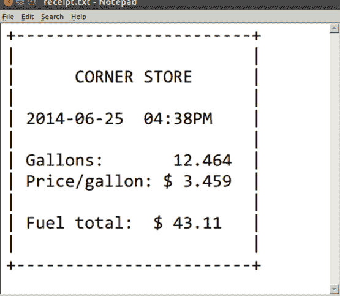
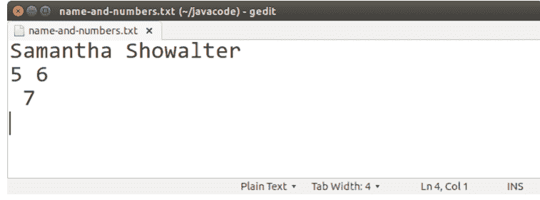

# Java 学习指南，第 2 版

## 在 Twitter 上推文这本书！

请通过在 Twitter 上传播这本书来帮助 Graham Mitchell！

此书建议的推特推文内容为：

> 我正准备使用《难从之路学 Java”来学习编程 #LJTHW

此书建议的话题是 `#LJTHW`。

点击此链接在 Twitter 上搜索该标签，了解其他人对这本书的评价：

https://twitter.com/search?q=#LJTHW

## 前言：在做中学习

在二十多年的时间里，我一直在教初学者如何编程。超过 2000 名学生上过我的课程，离开时已经学会了如何编写可以运行的简单程序。有些人只学了一点点，而另一些人在短短几年内就获得了惊人的技能。

我有很多非常出色的学生，但我的大多数学生都是没有经验、对编程没有特殊天赋的普通孩子。这本书就是为像他们这样的普通人写的。

大多数编程书籍和教程都是由那些极具天赋且对真实初学者缺乏经验的人编写的。他们的书往往涵盖了太多内容，进度过快，并且高估了真正初学者的理解能力。

如果你有丰富的经验或极高的天赋，你可以从几乎任何资源中学习编程。我有时会读到这样的评论：“我教我 9 岁的女儿写代码，她在六周后就做出了她的第一个 Android 应用！”如果你是天才童，那么这本书就不是为你准备的。

我也开始相信，编写大量的小程序是不可替代的。这就是你在这本书中要做的。你将输入一些小程序并运行它们。

> “最好的学习方法就是去实践。” – P.R. Halmos

## 简介：Java

Java 并不是一种为初学者设计的语言。我深信，大多数“初级”Java 书只适用于已经知道如何编程的人或天才者。

我可以教你 Java，即使你从未编程过，即使你不是天才。但我打算教你如何“走捷径”。

我要教你的是 Java。但并不是*全部*的 Java。我必须跳过某些部分，因为你还没有准备好学习它们。但如果你认为自己已经准备好学习 Java 更复杂的部分，那么 1) 你错了，并且 2) 去买另一本书吧。市场上有很多书籍会以比你处理快得多的速度将 Java 所有的复杂性全部抛给你。

特别是，我有一个巨大的遗漏：我将避开面向对象编程（OOP）这个话题。我深信，感到不适的初学者无法同时学习编程和学习面向对象编程。我几乎从未见过这种情况。

我正在写一本后续书籍，将涵盖面向对象编程以及 Java 的一些更复杂的部分。但你应该先完成这本书。我教学生编程已经很多很多年了，从未有一个学生从大学毕业后来看我说：“我真希望你当初花时间在基础知识上。”

## 你将学到

- 如何安装 Java 编译器和用于编写程序的文本编辑器
- 如何创建、编译和运行你的第一个 Java 程序
- 变量，以及如何从用户和文件获取输入
- 使用 `if` 语句进行决策
- 循环（`for`、`while`、`do-while`）
- 数组
- 记录（Records）

在最后的一章中，你将编写一个不那么简单的文本冒险游戏，关卡将从文本文件中加载。你应该能够编写一个像红心（Hearts）或黑花（Spades）这样的文本牌牌。

书中的所有示例都可以在 Java 1.5 或任何更高版本中运行。

## 你将不会学到

- 图形
- 面向对象编程
- 如何制作 Android 应用
- Java 不同“版本”的细节
- Javascript

### 没有图形

我喜欢图形，与例如 C++ 相比，Java 中的图形并不难，但我无法涵盖所有内容又能良好地教好基础，所以必须舍弃一些东西。

### 没有 OOP

在我看来，面向对象编程在入门书中没有立足之地。

### 没有 Android

Android 应用非常复杂，如果你是初学者，一个应用远超你的能力。不过，书中的任何内容都不会损害你制作应用的机会，而且这种更友好、更缓的节奏可能会在其他书籍让你沮丧放弃时让你坚持下去。

### 没有特定版本

例如，我不会涵盖任何关于 Java SE 7 和 Java SE 8 之间差异的知识。如果你在意这些差异，那么这本书不适合你。

我也不会涵盖任何最近才添加到 Java 中的内容。这本书是为了学习编程基础，以及多年来 Java 基础发生的变化。

### 没有 Javascript

> “Javascript” 是一种编程语言的名字，“Java” 也是一种编程语言的名字。这两种语言之间没有任何关系。它们是完全无关的。

我希望在这一本之后写更多的书。我的第二本书将涵盖 Java 中的面向对象编程。我的第三本书将涵盖制作一个简单的 Android 应用，前提是你已经读完了前两本书。

## 如何使用这本书

虽然我提供了一个包含书中所有练习源代码的 zip 压缩包，但你应该手动输入它们。

对于每个练习，手动输入代码。你自己，手写。否则你还能如何学习呢？我以前的学生没有没有人通过通过阅读别人的代码就成为编程高手的。

完成学习练习（Study Drills）。然后看练习答案（如果你有的话），将你的解决方案与我的进行对比。到最后，你将能够编写代码，至少学会一点。

### 练习 0：环境搭建

#### Windows

##### 安装好用的文本编辑器 (Notepad++)

1. 使用浏览器访问 `notepad-plus.org`，下载最新版本的 Notepad++ 文本编辑器并安装。你不需要管理员权限。
2. 一旦安装好 Notepad++，运行它并关闭自动完成，因为这对初学者没有好处。打开“设置”菜单并选择“选项”。然后点击左侧列表部分的“自动完成”。最后取消勾选“每次输入时启用自动完成”框，然后点击“关闭”按钮。
3. 最后，在 Notepad++ 运行时，右键点击 Windows 任务栏上的 Notepad++ 按钮并点击“固定到任务栏”。这将使以后启动编程会变得更简单。

##### 打开终端窗口 (PowerShell)

1. 点击开始按钮打开开始菜单。（在 Windows 8 及更高版本中，你可以直接按 `Windows` 键 + `S` 打开搜索框。）在搜索框中输入“powershell”。
2. 从结果列表中选择“PowerShell”。
3. 右键点击任务栏上的 PowerShell 按钮并选择“固定到任务栏”。
4. 在 PowerShell/终端窗口中输入：

```powershell
javac -version
```

你可能会看到一条红色的错误信息，显示“无法将 'javac' 识别为 cmdlet、函数...”

这只是意味着 JDK 尚未安装并添加到 `PATH` 中，这正是我们目前预期的状况。

#### 安装 Java SE 开发工具包 (JDK)

1. 使用浏览器访问 [Oracle Java 下载页面](#)。
2. 点击页面左侧顶部的“Java”按钮下载 Java 平台 (JDK) 8u92。点击此按钮将带你进入一个标题为“Java SE Development Kit 8 Downloads”的页面。
3. 在此页面上，你需要接受许可协议，然后选择列表底部的“Windows x86”版本。下载 8u92 版本或任何更新版本的的文件。

如果你确定运行的是 64 位的 Windows，那么下载“Windows x64”版本的 JDK 也可以的。如果你不确定，则应该下载“x86”（又名 32 位）版本，它可以同时运行在 32 位和 64 位的 Windows 上。

你不需要下载“Demos and Samples”（演示与示例）。

4. 下载完成后，运行 `jdk-8u92-windows-i586.exe` 进行安装。点击“Next >”后，第一次你会看到一个显示 `Install to: C:\Program Files (x86)\Java\jdk1.8.0_92\` 或类似内容的屏幕。记下这个位置；你很快就会用到它。
5. 一直点击“Next”直到完成。你完全清楚自己在操作什么；最好是直接按照它的要求进行安装。

#### 将 JDK 添加到 PATH

1. 现在 JDK 已经安装好了，你需要找到它安装目录的确切名称。查看 C 盘中的 Program Files 文件夹，或者如果有的话，查看 `C:\Program Files (x86)`。你正在寻找一个名为 Java 的文件夹。那是一个名为 `jdk1.8.0_92` 的文件夹，里面有一个 `bin` 文件夹。文件夹名称必须包含 `jdk1.8`。确保有一个 `bin` 文件夹。
2. 一旦你点击进入 `bin` 文件夹内部，就可以左键点击文件夹位置，它会变成类似于 `C:\Program Files (x86)\Java\jdk1.8.0_92\bin` 的内容。你可以写下它，或者选中并右键复制到剪贴板。
3. 一旦 JDK 安装完成并且知道了此位置，打开你的终端窗口（PowerShell）。在 PowerShell 中，输入以下内容：

```powershell
[Environment]::SetEnvironmentVariable("Path","$env:Path;C:\Program Files (x86)\Java\jdk1.8.0_92\bin","User")
```

将所有内容放在同一行，即：

输入或粘贴 `[Environment]::SetEnvironmentVariable("Path","$env:Path;`

先不要按 ENTER。你可以通过右键点击将其粘贴到 PowerShell 中。

然后输入或粘贴上面的文件夹位置。如果你安装的是 x86 (32 位) 版本的 8u92 JDK，它应该是：

```text
C:\Program Files (x86)\Java\jdk1.8.0_92\bin
```

然后在末尾添加 `"User"`。最后，按 ENTER。

如果你遇到错误，说明你输入的内容有误。你可以按向上箭头获取上一条命令，并使用左右方向键找到并修复你的错误，然后再次按 ENTER。

一旦 `SetEnvironmentVariable` 命令完成且没有报错，通过在提示符处退出关闭 PowerShell 窗口。如果不关闭 PowerShell 窗口，你刚刚做的更改将不会生效。

#### 确保 JDK 已正确安装

1. 重新启动 PowerShell。
2. 在提示符处输入 `javac -version`。

```bash
javac -version
```

你应该会看到类似 `1.8.0_92` 的响应。

3. 在提示符处输入 `java -version`。

```bash
java -version
```

你应该会看到类似 `java version "1.8.0_92"` 的响应。

确保它们报告的是相同的版本号！否则，你可能安装了两个不同的（不兼容的）Java 版本，并在完成本书中的练习时遇到困难。

如果版本号不匹配，进入控制面板的“添加或删除程序”。删除所有与 Java、JDK、JRE 相关的程序。如果安装了 Eclipse，也将其删除。删除所有与 Java 相关的内容并重新开始。

然而，如果两个命令都运行成功且没有报错，版本号也匹配，那么恭喜你！让这一切运行起来并不容易，你可能已经具备完成这本书所需的条件！

不过，先不要进入下一个练习！我们应该习惯使用命令行进行导航，因为你将在书中运行程序。

#### 命令行导航 (PowerShell)

你应该创建一个新文件夹来存放你所有的代码。完成这本书后，你将会有 100 个新文件，如果它们都放在一个地方会更好。

#### macOS

##### 安装 Java SE 开发工具包 (JDK)

1. 点击左上角附近的巨大的“Java”按钮下载 Java 平台 (JDK) 8u92，这将带你进入上一个标题为“Java SE Development Kit 8 Downloads”的另一个页面。
2. 在此页面上，你必须接受许可协议，然后从列表中间选择“Mac OS X x64”版本。下载 8u92 版本或更高版本的文件。

你不需要下载“Demos and Samples”（演示与示例）。

3. 下载完成后，运行 `jdk-8u92-macos-x64.dmg` 进行安装。
4. 一直点击“Next”（下一步）直到完成。除非你非常清楚自己在做什么，否则最好测试一下安装程序，除非它要求你。

##### 将 JDK 添加到 PATH

你可以跳过这部分，因为在 Apple 计算机上，JDK 安装程序会自动为你完成这一操作。不过，你可能需要关闭并重新打开终端使更改生效。

##### 确保 JDK 安装正确

1. 再次启动终端（Terminal）。
2. 在提示符处输入 `javac -version`。

```bash
javac -version
```

你应该会看到类似 `javac 1.8.0_92` 的响应。

3. 输入 `java -version`。

```bash
java -version
```

你应该会看到类似 `java "1.8.0_92"` 的响应。

确保两者报告的版本号相同！如果不是，你可能安装了两个不同（不兼容的）Java 版本，在完成本书中的练习时将会遇到困难。

如果版本号不匹配，请卸载所有与 Java、JDK、JRE 相关的程序。如果安装了 Eclipse，也将其删除。删除所有 Java 相关内容并重新开始。

但是，如果两个命令运行正常且没有报错且版本号匹配，恭喜你！完成这些工作相当困难，你可能已经具备完成书中剩余内容的能力！

不过先不要进入下一个练习！我们要习惯使用命令行进行导航，因为你将通过它运行书中编写的程序。

##### 命令行（终端）中的导航

你应该创建一个新文件夹来存放所有的代码。读完这本书后，你将会有至少 100 个新文件，将它们都放在一个地方会更好。

- 在下文中，我交替使用“folder”（文件夹）和“directory”（目录）这两个词。它们的意思相同。“directory”一词要老得多，但自 20 世纪 80 年代以来，图形操作系统一直使用文件夹图片来表示目录，所以这个词也被使用了。


输入 `ls` 然后按回车键（ENTER）。（字母“L”，代表 list 列表）。此命令将列出当前文件夹/目录的内容。


`cd` 命令意味着“change directory”（切换目录），它将带你进入“Documents”文件夹，后续的命令将在那里生效。

注意你的提示符会发生变化，显示你现在位于新文件夹内部。例如，当我第一次打开终端时，我的提示符是：

```
localhost:~\ mitchell
```

一旦我切换到“Documents”目录，提示符就会变为：

```
localhost:Documents mitchell$
```

进入后你应该再次输入 `ls` 来查看 Documents 目录的内容。现在我们准备好创建文件夹了。


`mkdir` 意味着“make directory”（创建目录），它将在当前位置创建一个新文件夹。之后输入 `ls` 应该会显示新目录已在那里。如果你愿意，可以给文件夹起一个“javahard”以外的名字。每台电脑只需要创建一个这个文件夹。


进入 `javahard` 文件夹。之后，输入 `ls`，它应该什么都不列出（毕竟该目录是空的）。

```bash
cd
```

这就是你如何使用 `cd` 命令返回上一级。输入它后，你将回到“Documents”目录，你的提示符应该已经发生变化以反映这一点。

再次执行命令回到“javahard”文件夹。

现在，使用鼠标打开你之前安装的文本编辑器。输入一句话或类似内容并将文件保存为 `test.txt`。将其保存到你刚刚创建的“javahard”文件夹中。

回到终端窗口并执行 `ls` 命令以查看你刚刚创建的文件。

> 如果你觉得酷炫一点，就不需要使用鼠标切换回终端；在 Mac 上可以按 `Command` + `Tab`，或者在 Windows 或 Linux 上按 `Alt` + `Tab` 来切换应用程序。
>
> 按住 `Command` 键。保持按住。然后释放一次 `Tab` 键。在按住 `Command` 键的同时，多次按下 `Tab` 键直到你的终端窗口被选中，然后松开 `Command` 键即可。

##### 处理烦人的 JAVA_TOOL_OPTIONS 消息

但是，在我的电脑上，运行任何 Java 工具都会向终端窗口打印一条烦人的消息：

```
Picked up JAVA_TOOL_OPTIONS: -javaagent:/usr/share/java/jayayana.jar
```

这是因为 Eclipse 没有这个 JAR 文件无法工作。但我们不会使用 Eclipse，而且这条消息很困扰我，`.profile`（文件名以点开头，所以它是隐藏的）

1. 启动你的文本编辑器。点击“Open”（打开）。
2. 确保你处于“Home”（主）目录。
3. 在“Open”窗口的任何地方点击右键，并在“Show Hidden Files”（显示隐藏文件）旁边勾选。
4. 打开名为 `.profile` 的文件。
5. 在文件末尾添加以下行：

#### Linux

##### 确保 JDK 安装正确

1. 在提示符处输入 `java -version`。

```bash
java -version
```


你应该能看到类似 `openjdk version "1.8.0_91"` 的响应。请确保它们报告的版本号相同！如果不是，你可能安装了两个不同的（不兼容的）Java 版本，这你在完成本书中的练习时将会遇到困难。

如果版本号不匹配，请卸载所有与 Java、JDK、JRE 相关的程序。如果安装了 Eclipse，请将其删除。删除所有与 Java 相关的内容并重新开始。

然而，如果两个命令都运行成功且没有出现错误，并且版本号匹配，那么恭喜你！让这一切运行起来相当困难，你可能已经具备完成书中剩余内容的了！

不过，先不要进入下一个练习！我们应该习惯操作命令行，因为你以后将通过它运行在书中编写的程序。

##### 命令行（终端）中的导航


你应该创建一个新文件夹来存放所有的代码。在完成这本书后，你将会有至少 100 个新文件，将它们放在一个地方会更好。

> 在下文中，我将交替使用“folder”（文件夹）和“directory”（目录）这两个词。它们的意思相同。“directory”一词要老得多，但从 20 世纪 80 年代开始，图形操作系统使用文件夹图片来表示目录，所以现在也被常用。


输入 `ls` 然后按回车键。（那是“list”中的字母“L”。）此命令将列出当前文件夹的内容。

```bash
cd Documents
```


`cd` 命令意味着“更改目录”（change directory），它将带你进入“Documents”文件夹，以便后续命令在该处生效。注意，你的提示符会发生变化，显示你已在新文件夹内部。例如，当我第一次打开终端时，我的提示符是：

```bash
michael@localhost:~$
```

一旦我进入“Documents”，提示符就会变为：

```bash
michael@localhost:~/Documents$
```

到达那里后，你应该再次输入 `ls` 来查看 Documents 的内容。现在我们准备好创建文件夹了。

```bash
mkdir folder
```

`mkdir` 意味着“创建目录”（make directory），将在当前位置创建一个新文件夹。之后输入 `ls` 应该会显示该新目录已存在。你可以可以给文件夹起一个与“folder”不同的名字。你只需要为每台电脑创建一次。

```bash
cd folder
```

进入该文件夹。之后，输入 `ls`，它应该什么都不显示（毕竟目录是空空的）。

```bash
cd ..
```

这就是你如何使用 `cd` 命令返回上一级目录。在你输入它后，你将回到“Documents”目录，你的提示符应该已经发生变化以反映这一点。

再次进入“folder”。现在，使用鼠标打开你之前安装的文本编辑器。输入一个句子或内容，并将文件保存为 `test.txt`。将其保存到你创建的文件夹中。回到终端窗口并使用 `ls` 命令查看你刚刚创建的文件。

如果你想酷炫一点，就不需要用鼠标切换回终端了：你只需要按键即可。

## 练习 1：一条重要信息

`(` 和 `)` 被称为“parentheses”（括号的复数形式）。其中一个被称为“parenthesis”（单数），但有些人直接称它们为 parens（发音为“puh-RENZ”）。其中一个 `(` 有时被称为“left paren”（左括号），另一个 `)` 被称为“right paren”（右括号），因为括号通常成对出现，且一个在另一个的左侧。出于类似的原因，左括号 `(` 也称为“open paren”（开括号），右括号 `)` 称为“close paren”（闭合括号）。

第 2 行有一个左括号和一个右括号。

`[ ]` 被称为“brackets”（中括号/括号），但许多程序员称它们为“square brackets”（方括号）以确保没有混淆。在 Java 中，圆和方括号*不是*互换的。括号也是成对出现的，它们被称为“left bracket”（或“open bracket”）和“right bracket”（或“close bracket”）。

第 2 行中，紧挨着有一个左方括号和一个右方括号，整个文件中没有其他括号。

`{ }` 被称为“braces”（大括号），有些程序员称它们为“curly braces”（花大括号）。它们总是以左右大括号 / 开闭大括号的形式成对出现。

`"` 是“quotation mark”（引号），但通常缩写为“quote”。它们总是成对出现的。在 Java 中，成对的第一个通常被称为“open quote”（左引号），第二个被称为“close quote”（右引号），尽管它们在两个地方的字符完全相同。第一个引号用于开始某个内容，第二个引号则结束该内容。

`'` 在技术上是“apostrophe”（省号），但几乎所有的程序员都称它们为“single quotes”（单引号）。出于如此，问号经常被称为“double quote”（双引号）。在某些编程语言中，单引号和双引号是可以互换的，但 Java 不是。Java 有时会使用单引号，但在书中它们非常罕见。

`.` 在技术上是“period”（句号），但几乎所有的程序员都说“dot”（点）。它们在编程语言中被频繁使用，作为分隔符而不是结束符，因此我们不称它们为 periods。

这个程序中有四个点（dot）和一个句号（period）。

`;` 被称为“semicolon”（分号）。它位于键盘上字母 `L` 和引号之间。Java 使用大量的分号，尽管在这个程序中只有两个：一个在第 3 行末尾，另一个在第 4 行末尾。

最后，`<` 是“less-than sign”（小于号），`>` 是“greater-than sign”（大于号），但有时它们被用作类似括号的符号。当它们被这样用时，通常被称为“angle brackets”（角括号）。Java 使用角括号，但你不会在书中看到它们。

好了，回到逐行分析。你已经正确地输入了第一行。

你应该通过按一次 `TAB` 键来开始第二行。你的光标将移动几个空格（可能是 4 或 8 个）。然后再次输入单词 `public`，一个空格，单词 `static`，一个空格，单词 `void`，一个空格，单词 `main`，后面跟一个左括号（单词 "main" 和括号之间没有空格）。括号之后有一个空格，大写 'S' 开头的单词 `String`，一对紧挨着的左、右方括号，一个空格，单词 `args`，一个空格，一个右括号，最后一个空格，以及第二个大括号。

所以，第二行以一个制表符开头，总共七个空格，且 "String" 中的 'S' 是大写的。呼。

第三行以两个制表符开头。你的文本编辑器可能已经让你的光标直接位于 "public" 中的 'p' 下方。如果是这样，你只需要按一次 `TAB`。如果不是，按两次得到两个制表符。在制表符之后，输入大写 'S' 开头的单词 `System`，然后是一个点（period），然后是单词 `out`，另一个点（单词是 "Print"，尽管末尾没有 'i' 或 'e'），一个左括号，一个空格，一个引号（左引号），句子 `I am determined to learn how to code.`（句子以句号结束），然后是右引号、右括号和分号。

所以，第 3 行有三个制表符、九个空格、两个点（period）、一对引号、一个左括号，且只有两个大写字母。

第 4 行与第 3 行几乎相同，但第 5 行的句子开头只有一个制表符。你的文本编辑器在那那里为你放了两个制表符，你应该可以通过按一次 `BACKSPACE` 键来删掉多余的制表符。然后之后，大括号应该与 `public static` 中的 'p' 对齐，因为那是匹配的左大括号所在。

最后，第 6 行没有制表符，多了一个大括号。你可以在第 6 行后按 `ENTER`，或者 Java 并不在意。注意我们在文件中有两个左括号和两个大括号。三个左括号和三个右括号。两个“左引号”和两个“右引号”。一个左方括号和一个右方括号。它们总是这样成对的。

还要注意，每当我们写一个左括号时，下面的行开头制表符就更多，相应的减少。

好了，现在将此（如果你还没保存的话）保存为 `FirstProg.java`，并将其保存在练习 1 中创建的“文件夹”中。确保文件名完全匹配："First" 中的 'F' 是大写的，"Prog" 中的 'P' 是大写的，其他全部小写。文件名中不能有空格。Java 将拒绝运行任何名称带有空格的程序。还要确保文件名以 `.java` 结尾而不是 `.txt`。

## 编译你的第一个程序

现在程序已经写好，希望没有错误（我们很快就会发现），启动你的终端（或 PowerShell）并切换到代码保存的目录。

然后列出目录以确保 Java 文件存在。在我的电脑上，这些命令看起来像：

```
mitchell@localhost:~$ cd Documents
mitchell@localhost:~/Documents$ cd folder
mitchell@localhost:~/Documents/folder$ ls
FirstProg.java.txt
mitchell@localhost:~/Documents/folder$
```

将来，由于你的终端可能和我的不一样，我会这样缩写提示符：

```
cd Documents
ls
```

这样就不会那么困惑了，因为需要忽略的“错误”内容变少了，你只需要看你应该输入什么以及应该看到什么。

好了。我们用 Java 这种语言编写了一系列指令。但计算机不能以这种形式直接执行我们的命令。我们必须把这个文件交给“编译器”（compiler），它是一个将我们的指令翻译成计算机可以执行的类似 0 和 1 的程序。在 Java 中，这种 0-1 文件被称为“bytecode”（字节码）。我们将运行 Java 编译器来“编译”你的源代码，生成一个我们可以执行的字节码文件。

Java 编译器名为 `javac`（'c' 代表 compiler）。它的正确读音是 "java-see"，尽管很多人读成 "java-ack。（那些人是不对的，但也理解）。

总之，我们使用 `javac` 这样编译程序：

```
javac FirstProg.java
```

如果你对细节极其并且按照我说的做了，这个命令将运行一秒钟，然后终端将再次显示提示符而不显示其他内容。

然而，如果你犯了某种错误，你会看到这样的错误：

```
FirstProg.java:6: error: reached end of file while parsing
}
^
1 error
```

不要太担心具体的错误信息。当编译器感到困惑时，它会尝试猜测可能做错了什么。遗憾的是，这些猜测是为专家程序员设计的，所以它对初级错误通常猜得并不好。

这是一个你可能得到的另一种错误信息的示例：

```
FirstProg.java:3, error: ';' expected
System.out.println("I am determined to learn how to code.")

1 error
```

在这种情况下，编译器是正确的；错误在第 3 行，具体的错误是缺少了分号（';' expected）。该行以冒号（:）结束，但它应该是分号（;）。

这里还有一个一个：

```
FirstProg.java:1: error: class Firstprog is public, should be declared in a file named FirstProg.java
public class FirstProg
^
1 error
```

这次是一个大小写错误。代码中写的是 `public class Firstprog`（注意 'p' 是小写的），但文件名是 `FirstProg.java`。因为它们不完全匹配（包括大小写），编译器就会感到困惑并报错。

所以，如果你有任何错误信息，修复它们，然后保存代码，回到终端再次编译。

## 练习 1：一条重要信息

如果你在文本编辑器中更改了代码，在尝试重新编译之前必须保存文件。如果你没有保存更改，即使文本编辑器中的代码是正确的，你仍然在编译之前保存的旧版本代码。

最终你会写对的，它将在没有任何错误且没有任何任何消息的情况下通过编译。列出目录，你应该能看到字节文件已出现在文件夹中：

```
javac FirstProg.java
ls
```

`FirstProg.class FirstProg.java test.txt`

现在我们已经成功创建了字节文件，可以通过运行名为 `java` 的 Java虚拟机（JVM）程序来运行（或“执行”）它：

```
java FirstProg
```

## 你应该看到的

| 我决心学习编程。 |

| 今天日期是 |

> 注意，你输入的命令是 `java FirstProg`，而不是 `java FirstProg.java` 甚至 `java FirstProg.class`，尽管 `FirstProg.class` 是在 JVM 中执行的字节文件的名称。

你兴奋吗？你刚刚编写了第一个 Java 程序并运行了它！如果你已经走了这么远，那么只要你每天努力并且不放弃，你几乎肯定拥有完成这本书所需的条件。

## 学习练习

在大多数练习之后，我会列出一些你在输入代码并使其编译运行后应该尝试的额外任务。有些学习练习相当简单，有些则更具挑战性，但你应该始终尝试一下。

- 1. 修改第 4 行引号内的内容以包含今天的日期。做出更改后保存文件，编译文件并再次运行。

- 2. 修改第 3 行引号内的内容，让计算机显示你的名字。

## 完成学习练习后你应该看到的

```
java FirstProg
```

> 我，Graham Mitchell，决心学习编程。

> 今天日期是 2015 年 11 月 22 日，星期日。

## 练习 2：更多打印

好了，现在我们已经解决了第一个困难的任务，我们将做另一个任务。很棒的一点是，在这个练习中，我们仍然有很多设置代码（每次都几乎完全相同），但设置代码与“有用”代码的比例要好得多。

将以下文本输入到名为 `GasolineReceipt.java` 的单个文件中。确保与我写的完全匹配，包括空格、标点和大小写。

你在第 4 行看到的小竖线 (`|`) 是“管道”字符，你可以使用 `Shift + 反斜杠 (\)` 来输入它。假设你使用的是普通的美国键盘，管道/反斜键位于退格键（Backspace）和回车键（Enter）之间。

GasolineReceipt.java

```java
public class GasolineReceipt {
    public static void main(String[] args) {
        System.out.println("+---------------------------------");
        System.out.println("|              CORNER STORE              |");
        System.out.println("| 2015-03-29      04:38PM               |");
        System.out.println("|                                   |");
        System.out.println("| Gallons:            10.870              |");
        System.out.println("| Price/gallon: $ 2.089             |");
        System.out.println("|                                   |");
        System.out.println("| Fuel total:      $ 22.71          |");
        System.out.println("|                                   |");
        System.out.println("+---------------------------------");
    }
}
```

注意第一行与上一个作业相同，但类名现在是 `GasolineReceipt` 而不是 `FirstProg`。还要注意，你存放内容的文件名是 `GasolineReceipt.java` 而不是 `FirstProg.java`。这并不是巧合。

在 Java 中，每个文件只能包含一个类，且公共类（`public class`）的名称必须与文件名匹配（包括大小写），只是文件名以 `.java` 结尾，而公类名不是。

那么，Java 中的 "public class" 是什么意思呢？我等你长大了再告诉你。说真的，现在就尝试进入那种细节是大多数“初学者”放弃的原因。

实际上，现在尝试进入那种细节是大多数“初学者”放弃的原因。

```
java FirstProg
```

当你运行它时，你应该看到类似这样的输出：

| +--------------------------------- |

| |              CORNER STORE              |

| | 2015-03-29      04:38PM               |

| |                                   |

| | Gallons:            10.870              |

| | Price/gallon: $ 2.089             |

| |                                   |

| | Fuel total:      $ 22.71          |

| |                                   |

| | +--------------------------------- |

## 练习 3：打印选择

| Alpha |

| Bravo |

| Charlie |

| Delta |

| EchoFoxtrotGolf |

| Hotel |

| India |

| This is a test. |

你能看出其中的区别吗？

`print()` 和 `println()` 都会在屏幕上显示引号的内容。但 `print()` 在完成打印后会移动到新行，而 `println()` 则不会：它显示内容后会将光标留在行尾，以便接下来的打印语句从该行的相同位置开始打印。

你还会注意到（在第 8 行）我们可以写一个括号内什么都没有的 `println()` 语句。没有引号，也没有任何内容。该语句指令计算机不打印任何内容，然后将光标移动到下一行的开头。


# 练习 3：打印选择

| Alpha |
|-------|
| Bravo |
| Charlie |
| Delta |
| EchoFoxtrotGolf |
| Hotel |
| India |
| This is a test. |

你能看出其中的区别吗？

`print()` 和 `println()` 都会在屏幕上显示引号的内容。但 `println()` 在完成打印后会移动到新行，而 `print()` 则不会：它显示内容后会将光标留在行尾，以便接下来的打印语句从该行的相同位置开始打印。

你还会注意到（在第 8 行）我们可以写一个括号内什么都没有的 `println()` 语句。没有引号，也没有任何内容。该语句指令计算机不打印任何内容，然后将光标移动到下一行的开头。

你可能还会注意到这个程序中有几行是空的（第 5、9、12 和 17 行）。在第一次练习中，当我写道你必须“完全匹配我写的内容，包括空格、标点符号和大小写”时，我并没有完全诚实。Java 编译器会忽略你代码中额外的空行。你可以添加或删除它们，程序的运行结果完全一样。

我的学生指责我“满口谎言”。事实确实。我通过惨痛教训学到，当学生正在学习编程这类困难的内容时，告诉他们真相会让他们感到非常困惑。因此，我会过度简化我的话语，即使这在技术上是不准确的。

如果你已经知道如何编程，并且由于我的这些“谎言”让你感到反感，那么这本书将很难读。但对于那些初学者来说，我向你保证，你起初确实希望我简化问题。我承诺最终会揭示真相。

无论如何，在第 19 行，我又做了一个新尝试。到目前为止，你只在引号内打印过单个字符串（`String`）。但只要在打印前将这些内容组合起来，打印多个内容也是完全没问题的。

所以在第 19 行，我有三个带引号的“字符串”：单词 `"this"`、一个空格、单词 `"is is"`、一个空格、单词 `"a"`，最后是一个空格，后跟着 `"test"` 再加一个句号。在这六个字符串之间都有一个加号（`+`），所以第 19 行总共有五个加号。当你把

> 什么是 `"String"`？一对引号之间的一系列字符（字母、数字、符号）。我稍后会详细解释。

在字符串之间加上加号时，Java 会将它们相加，形成一个引号内的长字符串，然后一次性显示出来。

如果你的代码中出现错误，很可能是在第 19 行。记住正确地开始和结束所有引号，并确保所有细节正确都是很有挑战性的。

希望今天的课程相对简单。别担心，我会在下节课上补回。

## 练习

- 1. 在代码末尾添加一条打印语句，显示句子“I am learning Java the Hard Way!”。像第 19 行那样将其拆分，使每个字符串中只有两个或三个单词并在之间加上符号。确保空格也包含在内！

脚注：

* *技术上，将较小的单词组合成一个较大的单词被称为“拼接”（concatenation），而不是“相加”。Java 将字符串拼接在一起。*

# 练习 4：转义序列和注释

你是否考虑过，如果我们想在屏幕上显示引号会发生什么？我们所有想要显示的内容都包含在 `println()` 语句的引号之间，在引号*内部*放入一个引号会导致问题。

大多数编程语言都允许使用“转义序列”，你通过某种字符来指示下一个字符应该以正常方式处理。

以下是关于 Java 转义序列的注释。

命名为 `EscapeSequencesComments.java`

```java
public class EscapeSequencesComments {
    public static void main(String[] args ) {
        // 此练习演示了转义序列与注释（如这些）
        System.out.print("Learn Java\n\tthe\\Hard\\Way\\n");
        System.out.print("\\TLearn Java the \\Hard\\Way\\n");
        // System.out.print("Learn Java the Hard Way ");
        System.out.print("Hello\n"); // 这一行打印 Hello。
        System.out.print("Jelly\n"); // 这一行打印 Jelly。
        /* 敏捷的棕色狐狸跳过了一只懒狗。
        // System.out.print(/* testing */.println("Hard to believe, eh?");
        System.out.println("Surprised?"/* abcde */ Or what did you expect?");
        System.out.println("\\ // - =\\ \\\\ "); // 需要 2 个生成 1 个
        System.out.print("I hope you understand \\escape sequences\\" now.\n");
        // 以及注释。 )
    }
}
```

当你运行它时，你应该看到这些。

| Learn | Java |
|-------|------|
| Hard  | Way  |

```text
Learn Java
	Hello
Jelly
Hard to believe, eh?
Surprised?/* abcde */ Or what did you expect?
\ // - =\ \\\ 
I hope you understand \escape sequences\ now.
```

> (That's not a good comment, though;任何知道 Java 的程序员都知道这行代码做了什么。通常你应该通过注释解释为什么代码在那里，而不是代码做了什么。你会随着编程水平的提高而写出更好的注释。)

第 8 行做了一些事情。`\b` 是“退格”的转义序列，所以它显示 "Jello"，然后发射一个退格字符。这删除了 "o"，然后显示 "y"（以及一个 `\v` 到下一行）。

第 9 行和 10 行是一个块注释。块注释以 `/*`（斜杠星号）开始，以 `*/`（星号斜杠）结束，无论是在同一行还是二十行之后。之间的所有内容都被视为注释并被编译器忽略。

你可以在第 11 行看到块注释的意外示例。在第 12 行你可以看到字符串（引号中的内容）优先于块注释。第 13 行和 14 行证明了要在屏幕上显示反斜杠，必须用另一个反斜杠来转义。这在处理 Windows 风格路径时很重要；尝试打开 `"C:\Users\Graham_Mitchell\Desktop\foo.txt"` 在 Java 中无法运行，因为编译器会尝试解释 `"U"`。你需要双写反斜杠。如第 7 和 8 行所示，双斜杠将行标记为注释。事实上，我们可以写：

```java
System.out.println("A" ); // prints 'A'
```

...这样完全可行。从斜杠到行尾的内容都会被编译器忽略。

## 练习

- 1. 如果你在 `println` 单词中间插入块注释会发生什么？在第 13 行尝试一下。然后在第 18 行下方添加一条注释，说明它是否可以编译。如果有效，则保留第 13 行的块注释；如果失败，则将其移除。

- 2. 重新打开上练习的代码并另存为 `PrintingChoicesEscapes.java`。重写它，使其具有相同的输出，但只使用带有转义序列的单个 `println()` 语句。

# 练习 5：在变量中保存信息

如果程序只能做在屏幕上打印内容的事情，那么程序将非常无聊。我们希望程序具有交互性。

遗憾的是，交互性需要几个不同的概念共同工作，一次性解释所有内容可能会让人困惑。我将一个一个介绍它们。

首先是变量！如果你上过代数课，你对数学中的变量概念并不陌生。编程语言也有变量，而且基本概念是相同的：

> “变量是一个名称，它指向一个存储值的位置。”

Java 中的变量与数学变量有四个主要区别：

- 1. 变量名可以比一个字母长。
- 2. 变量可以存储不仅仅是数字；它们还可以存储单词。
- 3. 在第一次创建变量时，你必须选择该变量将存储什么类型的值。
- 4. 变量的值（但不是它的类型）在整个程序过程中可以改变。例如，变量 `score` 的初始值可能为 0，但在程序结束时，`score` 可能会存储 413500。

好了，讨论足够了。让我们开始看代码吧！我不会告诉你文件名应该叫什么，你得自己想出来。

```java
public class CreatingVariables {
    public static void main(String[] args) {
        int x, y, age;
        double seconds, e, checking;
        String firstName, lastName, title;

        x = 10;
        y = 400;
        age = 39;
        seconds = 4.71;
        e = 2.7182818284590423536;
        checking = 1.89;

        firstName = "Graham";
        lastName = "Mitchell";
        title = "Mr.";

        System.out.println("The variable x contains " + x + ");
        System.out.println("The value " + y + " is stored in the variable y.");
        System.out.println("The experiment took " + seconds + " seconds.");
        System.out.println("A favorite irrational # " + e + ");
    }
}
```

## 你看到的

> 变量 x 包含 10。

值 400 存储在变量 y 中。

实验花费了 4.71 秒。

最喜欢的无理数是欧拉数：2.718281828459045

希望你不仅仅是 $1.89！

我的名字是 Mr. Graham Mitchell

在第 3 行，我们声明了变量；前三个被命名为 `x`、`y` 和 `age`。这三个变量都是“整数”（`int`），这是一种可以存储两个十亿之间数值的变量类型。

整数类型的变量可以存储值 10。它可以存储值 -8192。整数变量可以存储 123456789。它不能存储 3.14，因为它有小数部分。整数变量不能存储 10000000000，因为十亿太大了。

在第 4 行，我们声明了名为 `seconds`、`e` 和 `checking` 的变量。这三个变量是“浮点数”（`double`），这是一种可以存储带有小数部分的数字的变量类型。“Double”是“双精度浮点数”的缩写。在本书中，我将交替使用“double”和“floating-point”这两个术语。

* declare - 告诉程序变量的名称（或“标识符”）和类型。

就是那种令人困惑的，但我并没有发明这些术语；我只是教它们。

浮点数变量可以存储值 -8192.71。（它可能有小数部分，但不必有）。双精度浮点数变量可以存储 ±1.79769 × 10³⁰⁸ 到 4.94065 × 10⁻³⁰⁸ 之间的几乎任何值。

然而，`double` 的精度有限。注意在第 12 行，我们将值 `2.71828182845904523536` 存储到变量 `e` 中，但当我在第 22 行输出该值时，只输出了 `2.718281828459045`。`double` 没有足够的有效位数来存储 `2.71828182845904523536` 巨大、巨大的值。（而且单精度浮点变量（即 `float`）的有效位数比 `double` 少。整数具有完美的精度，但只能存储整数。这就是为什么它们不再被使用。）

我们在本次练习中将看到的最后一种变量类型是 `String`。在第 5 行，我们声明了 `String` 变量：`firstName`、`lastName` 和 `title`。`String` 变量可以存储单词和短语；string 是“字符字符串”的缩写。

第 7 行到第 9 行初始化了三个整数值。值 10 被存储在 `x` 中。在此之前，`x` 存在，但它的值是未定义的。400 存储在 `y` 中，39 存储在 `age` 中。

第 11 行到第 13 行给 `double` 变量赋了初始值，第 15 行到第 17 行初始化了三个 `String` 变量。第 19 行到 24 行初始化了...


# 练习 5：在变量中保存信息

如果程序只能做在屏幕上打印内容的事情，那么程序将非常无聊。我们希望程序具有交互性。

遗憾的是，交互性需要几个不同的概念共同工作，一次性解释所有内容可能会让人困惑。我将一个一个介绍它们。

## 变量

首先是变量！如果你上过代数课，你对数学中的变量概念并不陌生。编程语言也有变量，而且基本概念是相同的：

> “变量是一个名称，它指向一个存储值的位置。”

Java 中的变量与数学变量有四个主要区别：

1. 变量名可以比一个字母长。
2. 变量可以存储不仅仅是数字；它们还可以存储单词。
3. 在第一次创建变量时，你必须选择该变量将存储什么类型的值。
4. 变量的值（但不是它的类型）在整个程序过程中可以改变。例如，变量 `score` 的初始值可能为 0，但在程序结束时，`score` 可能会存储 413500。

好了，讨论足够了。让我们开始看代码吧！我不会告诉你文件名应该叫什么，你得自己想出来。

```java
public class CreatingVariables {
    public static void main(String[] args) {
        int x, y, age;
        double seconds, e, checking;
        String firstName, lastName, title;

        x = 10;
        y = 400;
        age = 39;
        seconds = 4.71;
        e = 2.7182818284590423536;
        checking = 1.89;

        firstName = "Graham";
        lastName = "Mitchell";
        title = "Mr.";

        System.out.println("The variable x contains " + x + ");
        System.out.println("The value " + y + " is stored in the variable y.");
        System.out.println("The experiment took " + seconds + " seconds.");
        System.out.println("A favorite irrational # " + e + ");
    }
}
```

## 你看到的

> 变量 x 包含 10。
>
> 值 400 存储在变量 y 中。
>
> 实验花费了 4.71 秒。
>
> 最喜欢的无理数是欧拉数：2.718281828459045
>
> 希望你不仅仅是 $1.89！
>
> 我的名字是 Mr. Graham Mitchell

在第 3 行，我们声明了变量；前三个被命名为 `x`、`y` 和 `age`。这三个变量都是“整数”（`int`），这是一种可以存储两个十亿之间数值的变量类型。

整数类型的变量可以存储值 `10`。它可以存储值 `-8192`。整数变量可以存储 `123456789`。它不能存储 `3.14`，因为它有小数部分。整数变量不能存储 `10000000000`，因为十亿太大了。

在第 4 行，我们声明了名为 `seconds`、`e` 和 `checking` 的变量。这三个变量是“浮点数”（floating-point），这是一种可以存储带有小数部分的数字的变量类型。“Double”是“双精度浮点数”的缩写。在本书中，我将交替使用“double”和“floating-point”这两个术语。

> **declare** - 告诉程序变量的名称（或“标识符”）和类型。

就是那种令人困惑的，但我并没有发明这些术语；我只是教它们。

浮点数变量可以存储值 `-8192.71`。（它可能有小数部分，但不必有）。双精度浮点数变量可以存储 ±1.79769 × 10³⁰⁸ 到 4.94065 × 10⁻³⁰⁸ 之间的几乎任何值。

然而，`double` 的精度有限。注意在第 12 行，我们将值 `2.71828182845904523536` 存储到变量 `e` 中，但当我在第 22 行输出该值时，只输出了 `2.718281828459045`。`double` 没有足够的有效位数来存储 `2.71828182845904523536` 巨大、巨大的值。（而且单精度浮点变量（即 `float`）的有效位数比 `double` 少。整数具有完美的精度，但只能存储整数。这就是为什么它们不再被使用。）

我们在本次练习中将看到的最后一种变量类型是 `String`。在第 5 行，我们声明了 `String` 变量：`firstName`、`lastName` 和 `title`。`String` 变量可以存储单词和短语；string 是“字符字符串”的缩写。

第 7 行到第 9 行初始化了三个整数值。值 `10` 被存储在 `x` 中。在此之前，`x` 存在，但它的值是未定义的。`400` 存储在 `y` 中，`39` 存储在 `age` 中。

第 11 行到第 13 行给 `double` 变量赋了初始值，第 15 行到第 17 行初始化了三个 `String` 变量。第 19 行到 24 行初始化了...


## 练习 6：数学运算

现在我们知道如何声明和初始化变量了，可以进行一些数学运算。

```java
public class MathOperations {
    public static void main(String[] args) {
        int a, b, c, d, e, f;
        double x, y, z;

        a = 10;
        b = 27;
        c = a + b;
        d = a - b;
        e = a * b;
        f = a / b;

        System.out.println("a + b = " + c);
        System.out.println("a - b = " + d);
        System.out.println("a * b = " + e);
        System.out.println("a / b = " + f);

        x = 1.1;
        y = x * x;
        z = x / 2;

        System.out.println("x * x = " + y);
        System.out.println("x / 2 = " + z);

        int g = b % 10;
        System.out.println("b % 10 = " + g);

        String one = "dog";
        String two = "house";
        System.out.println(one + two);
    }
}
```

### 运行结果

```
a + b = 37
a - b = -17
a * b = 270
a / b = 0
x * x = 1.2100000000000002
x / 2 = 0.55
b % 10 = 7
doghouse
```

加号（`+`）可将两个整数或浮点数相加，也可将一个整数和一个浮点数相加（顺序不限）。减号（`-`）用于一个数减去另一个数。与加法一样，它适用于两个整数、浮点数，或一个整数和一个浮点数。星号（`*`）用于乘法。你也可以在第 15 行看到 Java 了解正确的运算顺序：`b` 先乘以 3，然后再加上 `a`。斜杠（`/`）用于除法。注意当整数除以整数时（如第 17 行），结果也是整数而非浮点数。百分号（`%`）表示“取模”，本质上是除法后剩下的余数。在第 19 行，`b` 除以 10，余数（7）存入 `g`。模运算是一种相当简单的数学运算，但在公立学校甚至大学课程中不常教授。维基百科的例子足够说明：我们每次看典型的 12 小时制时钟时都在做模运算。8 小时后是什么时间？一旦到达 12:00 就会“循环”，所以会是 3 点。（8+7 = 15，15-12 = 3）

> concatenate - 将字符串首尾相连。

```java
int x = (7+8) % 12; // x 被设置为 3
```

模运算在编程中的用途比你想象的多，但在本书中不会大量使用。

## 常见问题

为什么 1.1 等于 1.1 而不是 1.2？

为什么 0.333333 + 0.666666 等于 0.999999 而不是 1.0？有时数学运算会产生循环小数，而大多数计算机在处理数字前会将其转换为二进制。结果发现 1/4 在二进制中是循环小数。

还记得上一个练习我说的吗：`double` 的问题在于精度有限。在本书中你大多可以忽略这一事实，但我希望你记住：浮点变量有时给出的值会比你预期的略有不同。


在第 3 行，我们声明了变量；前三个被命名为 `x`、`y` 和 `age`。这三个变量都是“整数”（integer），这是一种可以存储两个十亿之间数值的变量类型。

整数类型的变量可以存储值 `10`。它可以存储值 `-8192`。整数变量可以存储 `123456789`。它不能存储 `3.14`，因为它有小数部分。整数变量不能存储 `10000000000`，因为十亿太大了。

在第 4 行，我们声明了名为 `seconds`、`e` 和 `checking` 的变量。这三个变量是“浮点数”（floating-point），这是一种可以存储带有小数部分的数字的变量类型。“Double”是“双精度浮点数”的缩写。在本书中，我将交替使用“double”和“floating-point”这两个术语。

`declare` - 告诉程序变量的名称（或“标识符”）和类型。

就是那种令人困惑的，但我并没有发明这些术语；我只是教它们。

浮点数变量可以存储值 `-8192.71`。（它可能有小数部分，但不必有）。双精度浮点数变量可以存储 `±1.79769 × 10³⁰⁸` 到 `4.94065 × 10⁻³⁰⁸` 之间的几乎任何值。

然而，`double` 的精度有限。注意在第 12 行，我们将值 `2.71828182845904523536` 存储到变量 `e` 中，但当我在第 22 行输出该值时，只输出了 `2.718281828459045`。`double` 没有足够的有效位数来存储 `2.71828182845904523536` 巨大、巨大的值。（而且单精度浮点变量（即 `float`）的有效位数比 `double` 少。整数具有完美的精度，但只能存储整数。这就是为什么它们不再被使用。）

我们在本次练习中将看到的最后一种变量类型是 `String`。在第 5 行，我们声明了 `String` 变量：`firstName`、`lastName` 和 `title`。`String` 变量可以存储单词和短语；string 是“字符字符串”的缩写。

第 7 行到第 9 行初始化了三个整数值。值 `10` 被存储在 `x` 中。在此之前，`x` 存在，但它的值是未定义的。`400` 存储在 `y` 中，`39` 存储在 `age` 中。

第 11 行到第 13 行给 `double` 变量赋了初始值，第 15 行到第 17 行初始化了三个 `String` 变量。第 19 行到 24 行初始化了...

## 练习 7：从人类获取输入

现在我们已经练习了一会儿创建变量，我们将来看看交互式程序的另一部分：让运行我们程序的人类有机会输入输入某些内容。

请继续输入这些代码，但注意程序中的第一行**不是** `public` 类行。这一次我们从一个 `import` 语句开始。

并不是每个程序都需要从人类那里获取交互式输入，因此这并不是 Java 语言的核心部分。就像方程式 1 赛车不包含空调系统一样，编程语言通常都有一个很小的核心，然后根据需要可以包含许多可选的库（library）¹。

当你第一次运行这个程序时，它只会打印第一行：

> ¹库（library）或“模块” - 一段为程序添加额外功能的代码，它可能包含也可能不包含在任何特定的程序中

### 练习 7：从人类获取输入

```
法国的首都是哪座城市？
```

...然后光标会对着你闪烁，等待你输入一个单词。当我运行程序时，我输入了 "Paris" 这个词，但即使你输入不同的单词，程序的运行方式也是一样的。在你输入一个单词并按回车键后，程序将继续运行并打印：

```
6 乘以 7 等于几？？
```

...以此此类。假设你对每个问题都输入了合理的答案，最后看起来应该是这样的：

### 你应该看到的内容

```
法国的首都是哪座城市？
Paris
6 乘以 7 等于几？？
42
输入一个 0.0 到 1.0 之间的数字。
2.3
你还有什么想说的吗？
没有了。
```

现在让我们来谈谈代码。第 1 行有一个 `import` 语句。我们导入的库是 `java.util.Scanner`。这个库包含了某些功能，允许我们从键盘、计算机或其他文件或互联网向程序中获取信息。

第 3 行和第 4 行希望是无聊的。在第 5 行我们看到了新东西：我们创建了一个名为 "keyboard" 的 "Scanner 对象。（名字不一定非要是 "keyboard"；只要你在代码的每个地方都使用它，就可以使用不同的单词。）这个名为 keyboard 的 Scanner 对象包含了我们称之为函数或“方法”（methods）的能力。在使用 Scanner 对象之前，你必须先创建并命名它。

在第 8 行，我们要求名为 keyboard 的 Scanner 对象为我们做一些事情。说：“Keyboard，运行你的 `next()` 函数”。Scanner 对象会暂停程序并等待人类输入内容。一旦人类输入了内容并按回车键，Scanner 对象就会将其封装成一个 `String` 并允许你的代码继续执行。

在第 11 行，我们要求 Scanner 对象执行它的 `nextInt()` 函数。这会暂停程序，等待人类输入内容并按回车键，然后将其封装成整数值（如果可能的话）并继续执行。

如果人类在这里输入的不是整数怎么办？尝试再次运行程序，并在第二个问题处输入 `41.9` 作为答案。

程序会崩溃且不再执行其他语句，因为 `41.9` 无法封装成整数值：`41.9` 是一个 `double`（双浮点数）。以后我们将学习处理此类问题的错误检查的方法，但在此期间，如果人类输入了错误导致程序崩溃，我们将归咎于人类没有遵守指示，而不会为此担心。

第 14 行允许人类输入内容，Scanner 对象将尝试将其转换为浮点值，而第 17 行允许人类输入一个 `String`。（任何内容都可以被封装为 `String`，包括数字，所以这不太可能会失败）。

尝试多运行几次程序，注意它什么时候崩溃，什么时候不会。

## 学习练习

- 1. 输入一些不同的内容让程序在第二个问题处崩溃。你输入了什么？在代码末尾添加注释，内容类似 `// 当我输入 [空白] 时，第二个问题崩溃`。

- 2. 输入让程序在第三个问题崩溃的内容。你输入了什么？在代码末尾添加另一个注释，解释为什么会崩溃以及原因。

## 练习 8：存储人类的回应

在上练习中，你学习了如何暂停程序并允许人类输入内容。但输入的内容去哪里了？当你对第一个问题输入答案 "Paris" 时，那个答案去哪了？嗯，它在输入后就被丢弃了，因为你没有编写任何指令告诉 Scanner 对象将它存储在哪里。这就是今天课程的主题。

```java
import java.util.Scanner;
public class RudeQuestions {
    public static void main( String[] args ) {
        String name;
        int age;
        double weight, income;
        Scanner keyboard = new Scanner(System.in);
        System.out.print("你好。你叫什么名字？ ");
        name = keyboard.next();
        System.out.print("你好," + name + "！你多大了？ ");
        age = keyboard.nextInt();
        System.out.println("所以你 " + age + " 岁了？还不大呢。\ ");
        System.out.print(" + name + " 你多重？ ");
        weight = keyboard.nextDouble();
        System.out.println("所以你重 " + weight + " 公斤？真重。\ ");
        System.out.print("你的收入是多少？ ");
        income = keyboard.nextFloat();
        System.out.println("你每年赚 " + income + " 元。真多啊！ ");
    }
}
```

## 练习 8：存储人类的回答

### RudeQuestionsTypesEverywhere.java

```java
public class RudeQuestionsTypesEverywhere {
    public static void main(String[] args ) {
        Scanner keyboard = new Scanner(System.in);

        System.out.print("Hello. What is your name? ");
        String name = keyboard.next();

        System.out.print("HI, " + name + "! How old are you ? ");
        int age = keyboard.nextInt();

        System.out.println("How much do you weigh, " + age + ", eh? That's not so old.");
        double weight = keyboard.nextDouble();

        System.out.println("weight: " + weight + "! Better keep that quiet!! ");
        System.out.println("Finally, what's your income, " + name + " ? ");
        double income = keyboard.nextDouble();

        System.out.print("Hopefully that is " + income + " per hour ");
        System.out.println(" and not per year! ");
        System.out.println("Well, thanks for answering my rude questions, ");
        System.out.println(name + ".");
    }
}
```

呼！你不是很高兴每次使用变量时不需要做这些事情吗？另一方面，你也可以为自己必须声明变量类型而感到一点抱歉。许多现代编程语言都具有“类型推断”（type inference）功能；编译器可以根据你在代码中使用变量的方式来推断它的类型。Python 和 Swift 就是一些可以推断类型的编程语言。Java 没有类型推断，但我写了一些代码，展示了如果它有这个功能，这个练习将会是什么样子。再次，不要尝试输入这段代码；它是无法编译的。

### 练习 8：存储人类的回答（隐式类型）

```java
public class RudeQuestionsImpliedTypes {
    public static void main( String[] args ) {
        Scanner keyboard = new Scanner(System.in);
        System.out.print("Hello. What is your name? ");
        String name = keyboard.next();
        System.out.print("Hi, " + name + " ! How old are you? ");
        int age = keyboard.nextInt();
        System.out.print("So you're " + age + ", That's not very old.");
        System.out.print("How much do you weigh, " + name + " ? ");
        double weight = keyboard.nextDouble();
        System.out.print("Finally, what's your income, " + name + " ? ");
        double income = keyboard.nextDouble();
        System.out.print("Hopefully that is " + income + " per hour ");
        System.out.println(" and not per year! ");
        System.out.print("Well, thanks for answering my rude questions, ");
        System.out.println(name + ".");
    }
}
```

例如，在第 6 行，此类语言的编译器能够推断出 `name` 是一个变量，并且它必须用于存储字符串——这就是你存入它的内容。

有些编程语言更进一步，允许将变量的类型从代码的一部分更改到另一部分。这些语言被称为“动态类型”（dynamically typed）。Ruby、Javascript 和 Perl 是流行的动态类型语言。动态类型使得它们更强大，但也使得某些静态类型检查器可以轻松捕获的错误变得可能。

这些都不重要，你现在学习的是 Java，而不是其他那些编程语言。你必须使用静态类型（static typing）和显式类型（manifesting typing），你很快就会习惯的。在开始赋值之前指定变量的类型，这个要求过分吗？我想你会发现这并不难。

如果你还没有做“学习练习（Study Drills）”，也许你应该回到顶部重新读一遍这个练习的代码。

## 学习练习 (Study Drills)

- 1. 当你在程序期待 `double` 类型时输入整数值，程序会崩溃吗？请在代码底部的注释中给出答案，并写下你对为什么会或不会的猜测。

- 2. 当你在程序期待 `String` 时输入数值（整数或小数），程序会崩溃吗？请在代码底部的注释中给出答案，并写下你对为什么会或不会的猜测。

- 3. 输入会导致程序在每个问题上崩溃的内容，并添加注释解释是什么导致崩溃以及原因。

- 4. 添加一个你自定义的新变量。再增加一个问题（不需要很无礼）。让用户将你问题的答案输入你的新变量中，随后在屏幕上显示用户的回答。

## 练习 9：使用用户输入进行计算

现在我们知道如何从用户那里获取输入并存储在变量中了，由于我们知道如何进行基础数学运算，我们现在可以编写第一个实用程序了！

```java
import java.util.Scanner;
public class BMICalculator {
    public static void main(String[] args) {
        Scanner keyboard = new Scanner(System.in);
        double m, kg, bmi;

        System.out.print("Your height in m: ");
        m = keyboard.nextDouble();

        System.out.print("Your weight in kg: ");
        kg = keyboard.nextDouble();

        bmi = kg / (m * m);

        System.out.println("Your BMI is " + bmi);
    }
}
```

## 你应该知道

| Your height in m | Your weight in kg | BMI |
| :--- | :--- | :--- |
| 1.75 | 73 | 23.6734 |
| 1.80 | 75 | 23.1481 |

## 练习 10：变量只存储数值

| 购买价格是多少？ | 7.99 |
| :--- | :--- |
| 商品价格 | 7.99 |
| 销售税 | 0.0 |
| 总成本 | 0.0 |

你对这个输出结果感到惊讶吗？你是否预期 $7.99 的销售税会显示类似 $0.66 这样的数字，而不是一个大大的零？总成本应该是 $8.65 左右，对吧？发生了什么呢？

发生的情况是，在 Java（以及大多数编程语言）中，变量不能存储公式。变量只能存储数值。

看第 10 行。我的学生认为那行代码将 `price * 0.0825` 的公式 存储到了变量 `salesTax` 中，然后稍后人类将数值 `7.9` 存储到变量中。他们认为在第 17 行打印 `salesTax` 时，计算机实际上以某种方式“运行”了该公式。

事实并非如此。事实上，这个程序本不应该通过编译。变量 `price` 变量在第 10 行甚至还没有一个正确的值。它之所以有一个值，仅仅是因为我在第 8 行声明了它。

通常我们在程序的顶部声明变量，并在稍后对其进行初始化。但在第 8 行，我同时声明了 `price` 并*初始化*了变量，这被称为“定义”该值。`salesTax` 和 `total` 在第 8 行并没有定义，只是被声明了。

所以，第 14 行，人类输入的内容并没有*初始化 price*；`price` 已经有一个初始值（`0`）。但人类输入的（`7.99` 或其他数字）*在执行之前会被存储到变量中*。`0` 被替换成了 `7.99`。

从第 8 行到 13 行，变量 `price` 包含该值。当第 14 行执行且我们正在等待人类输入内容时，`price` 仍然包含 `0`。但当第 14 行完成后，无论人类输入了什么都被存储到了 `price` 中，替换了零。从第 15 行到程序结束，变量 `price` 包含数值 `7.99`（或输入的任何内容）。

通过这一点，我们可以看到第 10 行真正发生了什么。第 10 行*并没有将*公式存储到 `salesTax` 中，但它确实存储了一个值。什么值？它获取了代码中*此时变量 price 的值*（此时是 `0`），乘以 `0.0825`（此时仍为零），并将该零存储到 `salesTax` 中。


当第 10 行开始时，`salesTax` 的值是未定义的（`salesTax` 已声明但未定义）。到第 10 行结束时，`salesTax` 持有数值 0。没有任何一行代码改变了 `salesTax`（没有一行以 `salesTax =` 开头的代码），所以值从未改变，当在第 17 行显示时，`salesTax` 仍然是零。

第 11 行也类似。它获取了此时 `price` 的值（零），并加上了此时 `salesTax` 的值（也是零），并将和（零）存储到变量 `total` 中。`total` 的值从未改变，且 `total` 并不“记住”它的值来自于一个涉及某些变量的公式。

事实就是这样。变量存储的是数值，而不是公式。计算机程序不是规则的集合，而是计算机按顺序执行的指令序列，代码中后出现的内容取决于之前发生的情况。

> （当然，实际上可以将一个公式封装起来并给它分配一个名称。那么在代码中使用该名称将导致公式在每次被引用时运行。我们将其称为“函数定义”和“函数调用”，但现在讨论这些太复杂了。无论如何，在这个程序中并没有发生这种情况。）

## 学习练习

1. 删除第 8 行的 `= 0`，使得 `price` 不在第 8 行被定义，仅被声明。当你尝试编译代码时会发生什么？错误信息合理吗？（现在把 `= 0` 加回来让程序通过编译。）
2. 移动给 `salesTax` 和 `total` 赋值的两行代码，让它们出现在 `price` 被赋予真实值之后。确认程序现在运行符合预期。
3. 既然这些行现在出现在变量 `price` 被正确赋予真实值之后了，请再次尝试删除第 8 行的 `=0`。程序仍然报错吗？你感到惊讶吗？

## 练习 11：变量修改快捷方法

变量的值可以随着程序的运行而发生变化。（除非你编写代码去改变它，否则它不会改变，但我的意思是它是可以改变的。）

事实上，这非常常见。我们经常做的一是对取一个变量并向它加上某些内容。例如，假设变量 `x` 包含数值 10。我们想给它加 2，使得 `x` 现在包含 12。

我们可以这样做：

```
int x = 10,      // x 是 10, tempX 未定义
tempX = x + 2;      // x 仍然是 10, tempX 现在是 12
x = tempX;           // x 已变为 12
```

这能行得通，但很麻烦。如果我们愿意，可以利用变量在代码行开始时有一个值，而在行结束时被存储了另一个值的特性。所以我们可以这样写：

```
int y = 10;      // y 是 10
y = 2 + y;           // y *变为* (2 加上 y 的当前值)
```

这同样有效。第二行的意思是“取 `y` 的当前值 (10)，加上 2，并将和 (12) 存储到变量 `y` 中。”所以当第二行代码开始执行时，`y` 是 10，当执行完毕时，`y` 是 12。相加的顺序并不重要，所以我们甚至可以这样做：

```
int m = 10;
m = m + 2;
```

...这与之前的示例完全相同。好了，现在看代码！

## 练习 11：变量修改快捷方法

```
public class VariableChangeShortcuts {
    public static void main(String[] args) {
        int i, j, k;

        i = 5;
        j = 5;
        k = 5;

        i = 5;
        j = 5;
        k = 5;
        System.out.println("i: " + i + " j: " + j + " k: " + k);
        i += 3;
        j -= 3;
        k *= 3;
        System.out.println("i: " + i + " j: " + j + " k: " + k);

        i = 5;
        j = 5;
        k = 5;
        System.out.println("i: " + i + " j: " + j + " k: " + k);
        i += 4;
        j -= 2;
        k *= 3;
        System.out.println("i: " + i + " j: " + j + " k: " + k);

        i = 5;
        j = 5;
        k = 5;
        System.out.println("i: " + i + " j: " + j + " k: " + k);
        i++;
        j--;
        System.out.println("i: " + i + " j: " + j + " k: " + k);

        i = j = 5;
        System.out.println("i: " + i + " j: " + j + " k: " + k);
    }
}
```

# 练习 11：变量修改快捷键

第 32 行看起来像是一个拼写错误，如果你在自己的代码中这样写，很可能真的是错误。注意我们没有写 `+=`而是写了 `=+`。这可以通过编译，但它的解释方式不像你预期的那样。编译器看到的是 `i = +1;`，即“将 `i` 设置为正 1”。第 33 行也类似：“将 `j` 设置为负 2”。所以请注意这一点。

在第 38 行我们看到了另一个快捷键：“后置自增运算符” `i++` 仅意味着“给 `i` 中的任何值加 1”。这与编写 `i = i + 1` 或 `i += 1` 是一样的。给变量加 1 是很常见的（你会看到的）。这就是为什么它有一个专门的快捷键。

最后，在下一行中我们看到了“后置自减运算符”：`j--`。它从 `j` 的值中减去 1。

今天的课程很特殊，因为这些快捷键是可选的。你可以编写一辈子代码而从未使用它们。但大多数程序员都是懒惰的，不想多输入任何字符，所以如果你阅读他人的代码，你会经常看到这些符号。

特别是 `i++`。你会一直看到它。

## 学习练习

1. 在底部添加代码，将 `i` 的值重置为 5。然后在下一行，仅使用 `-=` 将 `i` 的值改为 0。接着在随后的行中，在屏幕上显示 `i` 的新值。
2. 在另一个学习练习下方添加代码，将 `i` 的值重置为 5，然后仅使用 `++` 将 `i` 的值改为 10 并再次显示它。（这需要多于一行代码。）

（这些学习练习目前还没有视频。）

## 练习 12：布尔表达式

到为止，我们只见过三种类型的变量：

- `int` 整数：存储数字（正数或负数），没有小数部分。
- `double`：“双精度浮点”数（正数或负数），可以有小数部分。
- `String`：字符字符串，存储单词、短语、符号、句子等任何内容。

```
import java.util.Scanner;
public class BooleanExpressions {
    public static void main(String[] args ) {
        Scanner keyboard = new Scanner(System.in);
        boolean a, b, c, d, e, f;
        double x, y;

        System.out.print("Give me two numbers. First: ");
        x = keyboard.nextDouble();
        System.out.print("Second: ");
        y = keyboard.nextDouble();

        a = (x < y);
        b = (x <= y);
        c = (x == y);
        d = (x != y);
        e = (x > y);
        f = (x >= y);

        System.out.println(x + " is LESS THAN " + y + ": " + a);
```

## 练习 12：布尔表达式

```
System.out.println(x + " is LESS THAN / EQUAL TO " + y + ": " + b);
System.out.println(x + " is EQUAL TO " + y + ": " + c);
System.out.println(x + " is NOT EQUAL TO " + y + ": " + d);
System.out.println(x + " is GREATER THAN " + y + ": " + e);
System.out.println(x + " is GREATER THAN / EQUAL TO " + y + ": " + f);
System.out.println();
System.out.println(!(x < y) + " " + (x >= y));
System.out.println(!(x <= y) + " " + (x > y));
System.out.println(!(x != y) + " " + (x == y));
System.out.println(!(x > y) + " " + (x <= y));
System.out.println(!(x >= y) + " " + (x < y));
```

## 你应该看到什么

```
Give me two numbers. First: 3
Second: 4
3.0 is LESS THAN 4.0: true
3.0 is LESS THAN / EQUAL TO 4.0: true
3.0 is EQUAL TO 4.0: false
3.0 is NOT EQUAL TO 4.0: true
3.0 is GREATER THAN 4.0: false
3.0 is GREATER THAN / EQUAL TO 4.0: false
```

```
false false
false false
true true
false false
true true
true true
```

在第 14 行，布尔变量 `a` 被设置了一个特殊的值：与变量 `y` 比较的结果。如果 `x` 的值小于 `y`，则比较为真，布尔值 `true` 存储在 `a` 中。如果比较为假，则布尔值 `false` 存储在 `a` 中。（我认为这比写出来更容易理解。）

第 15 行类似，但比较是“小于等于”，且布尔结果存储在 `b` 中。

第 16 行是“等于”：如果 `x` 持与 `y` 相同的值，`c` 将设置为 `true`。第 17 行的比较是“不等于”。第 18 行和第 19 行分别是“大于”和“大于等于”。

在第 21 行到 26 行，我们在屏幕上显示了所有布尔变量的值。

第 29 行到 34 行引入了非运算符 (`!`)，它会翻转布尔值。所以从第 29 行开始，我们显示比较的取反结果。

## 学习练习

1. 为代码添加注释，解释每个布尔表达式的作用。
2. 尝试修改代码使用不同的数字，观察输出发生的变化。

## 练习 14：复合布尔表达式

输入你的年龄：40

输入你的年收入：49000

你有多可爱，分值范围从 0.0 到 10.0？7.5

允许和我的孙子交往吗？false

我们可以看到，对于复杂的布尔表达式，你可以使用括号来分组，并使用符号 `&&` 表示“与”（AND），使用 `||` 表示“或”（OR）。

我知道你在什么：使用 `&`（“安符”或“符号”）来表示“与”是有道理的，但为什么要用两个？又是是谁的主意用 `|`（“竖线符号”）来表示“或”的呢？

> 嗯，可能是 Ken Thompson 的主意。Java 语法是模仿 C++ 语法建模的，而 C++ 基本上是复制了 C 的语法，而 C 是经过 B 语法的修改，由 Dennis Ritchie 和 Ken Thompson 发明的。

B 语言曾用 `&` 和 `|` 表示“与”和“或”，但它们是“位运算”的：它们只对两个整数起作用，一次处理一个位，对每对位进行位与或位或操作，在每次比较中输出 1 或 0。（使用 `|` 可能是因为它看起来很有数学感，而且 PDP-7 计算机键盘上的键，而 B 最初是为它开发的。）

当 Ken 和 Dennis 开始开发 C 语言来取代 B 语言时，他们认为需要一种逻辑上的“与”和“或”，而单符号的内容已经被占用了，所以他们使用两个 `&` 符号来表示逻辑“与”，使用两条竖线（或“竖线”）表示逻辑“或”。

对你来说幸运的是，你不需要知道这些。你只需要记住输入什么并确保正确即可。

接下来的部分会有点奇怪，因为我要向你展示“与”和“或”的“真值表”，你必须把“与”认为是一个在两个值上执行的操作，而不是连接词。

这里是“与”的真值表：

| 输入 | 输出 |
| :--- | :--- |
| A B | A && B |
| true true | true |
| true false | false |
| false true | false |
| false false | false |

## 练习 14：复合布尔表达式

你是这样阅读这些图表的：让我们假定我们健忘的奶奶决定，只有在邮轮便宜且价格包含酒精的情况下，她才会去邮轮。所以我们假定语句 A 是“邮轮便宜”，陈述 B 是“包含酒精”。表格中的每一行都是一种可能的邮轮情况。

第 1 行是两个陈述都为真的邮轮。奶奶会对 1 号邮轮感到兴奋！是的！“邮轮便宜”且“包含酒精”都是真的，所以“奶奶会去”(A && B) 也是真的。

第 2 号邮轮很便宜，但不包含酒精（陈述 B 为假）。所以奶奶不感兴趣：当 A 为真且 B 为假时，(A && B) 为假。

明白了吗？现在是“或”的真值表：

| A | B | A \|\| B |
| :--- | :--- | :--- |
| true | true | true |
| true | false | true |
| false | true | true |
| false | false | false |

假设如果一辆二手车看起来很酷或者它非常省油，奶奶就会买。陈述 A 是“车看起来很酷”，B 是“每加仑油里程数高”，结果 A OR B 决定了奶奶是否会买这辆车。

1 号车帅极了，而且一箱油能跑很远。奶奶感兴趣吗？老天，可以！我们可以说值 `true` OR 与值 `true` 的结果是 `true`。

事实上，奶奶唯一不喜欢的情况是两者都为假。涉及 OR 的表达式只有当它的**两个**组件都为假时，它才为假。

## 学习训练

- 许多人有两个奶奶。让我们假定另一位奶奶只想开心。添加一个问题“你如何让他们开心？”和一个变量来存储它的答案。添加一个名为 `allowed` 的布尔变量，并编写一个新的表达式，当这个人接近你的年龄并让你感到开心（快乐值在 10 分中大于 7 分）时，该表达式为真。

（这个学习练习目前还没有视频。）

## 练习 15：使用 If 语句做决策

嘿！我非常喜欢这个练习。你刚才经历了一些相当无聊的练习，所以是时候学习一些有用且不是超级难的东西了。

我们将学习如何编写带有决策的代码，这样输出就不总是总是相同的。执行的代码取决于人类输入的内容。

```
AgeMessages.java
import java.util.Scanner;
public class AgeMessages {
    public static void main(String[] args) {
        Scanner keyboard = new Scanner(System.in);
        int age;
        System.out.print("How old are you? ");
        age = keyboard.nextInt();
        System.out.println("You are: ");
        if (age < 13) {
            System.out.println("\ttoo young to create a Facebook account");
        }
        if (age < 16) {
            System.out.println("\ttoo young to get a driver's license");
        }
        if (age < 18) {
            System.out.println("\ttoo young to get a tattoo");
        }
        if (age < 21) {
            System.out.println("\ttoo young to drink");
        }
        if (age < 35) {
            System.out.println("\ttoo young to run for President of the U.S.");
        }
    }
}
```

## 练习 15：使用 If 语句做决策

好了，这被称为 if 语句。if 语句以关键字 `if` 开头，后面跟着括号中的“条件”。该条件必须是一个求值为真或假的布尔表达式。注意，当我使用大括号时，里面的内容缩进了一层。该代码块被称为“体部”。

当 if 语句的条件为真时，会执行体内的代码。当 if 语句的条件为假时，体内的代码将**跳过**。你可以在体内部编写任意行数的代码。

如果 if 语句的条件为假，体内的代码永远不会被执行。

```
How old are you? 17
You are:
	too young to create a Facebook account
	too young to get a driver's license
	too young to get a tattoo
	too young to drink
	too young to run for President of the U.S.
```

第二个语句是虚假的，因为 17 小于 18，所以体内的代码被跳过了。

第三个语句是真实的：17 小于 18，所以体内的代码没有被跳过。

## 学习训练

- 如果输入一个大于 35 的年龄，会打印什么？为什么？
- 添加另一个 if 语句将年龄与 65 进行比较。如果年龄大于或等于 65，说“你可以退休了！”


- 对于每个 `if` 语句，添加另一个相反的 `if` 语句。例如，如果年龄大于或等于 13，说“可以创建 Facebook 账号”。完成后，无论输入什么年龄，程序都应该显示信息。

## 练习 16：更多的 If 语句

这个练习几乎没有新内容。只是更多 `if` 语句的练习，因为它们非常重要。这也会帮助你记住关系运算符。

### ComparingNumbers.java

```java
import java.util.Scanner;

public class ComparingNumbers {
    public static void main(String[] args) {
        Scanner keyboard = new Scanner(System.in);
        double first, second;

        System.out.print("Give me two numbers. First: ");
        first = keyboard.nextDouble();
        System.out.print("Second: ");
        second = keyboard.nextDouble();

        if (first < second) {
            System.out.println(first + " is LESS THAN " + second);
        }
        if (first <= second) {
            System.out.println(first + " is LESS/EQUAL TO " + second);
        }
        if (first == second) {
            System.out.println(first + " is EQUAL TO " + second);
        }
        if (first > second) {
            System.out.println(first + " is GREATER/EQUAL TO " + second);
        }
        if (first > second) {
            System.out.println(first + " is GREATER THAN " + second);
        }
        if (first != second) {
            System.out.println(first + " is NOT EQUAL TO " + second);
        }
    }
}
```

## 练习 16：更多的 if 语句

## 你应该看到的内容

```
给我两个数字。第一个：3
第二个：4
3.0 小于 4.0
3.0 小于/等于 4.0
3.0 不等于 4.0
```

在第 29 行，你会发现我做了一件有点可疑的操作：最后一个 `if` 语句的体部没有用任何大括号 `{}` 括起来。这样可以吗？

实际上，是可以的。当一个 `if` 语句的体部没有大括号时，只有条件判断后的第一行代码会被包含在体部中。因此，由于这整个练习中的所有 `if` 语句体部内都只有一行代码，所以这个练习中所有 `if` 语句的大括号都是可选的。你可以删掉它们，程序运行的效果也完全相同。不过，加上它们永远不会错，而且有些程序员无论如何总是会加上大括号。

## 学习训练

1. 在第 29 行之后再添加一行代码，内容为 `System.out.println("Hey.");`。对其进行缩进，使其与上面的 `println()` 语句对齐，如下所示：

```java
if (first != second)
    System.out.println(first + " is NOT EQUAL TO " + second);
System.out.println("Hey.");
```

运行程序，看看发生了什么。"Hey" 的部分是 `if` 语句体部的一部分吗？换句话说，当语句被跳过时，"Hey" 也会被跳过吗？还是说它无论如何都会运行？你怎么想？

2. 在最后一个 `if` 语句的体部加上大括号，使得 "Hey" 那一行成为体部的一部分。然后，移除所有其他语句体部的大括号，使得程序中只有最后一个 `if` 语句带有大括号。确认一切运行结果符合预期。

## 练习 17：否则（带有 else 的 if 语句）

所以，`if` 语句非常棒。几乎每种编程语言都有它们，而且你一直在使用它们。事实上，光是 `if` 语句本身就足够强大了，你只用 `if` 语句就能做很多事情。

但有时，有其他东西会让事情更方便一点。快速看这个例子！下面表达式的逻辑反面是什么？

```java
if (onGuestList || age >= 21 || (gender.equals("F") && attractiveness >= 8))
```

嗯？看懂了吗？如果你说：

```java
if (!onGuestList || age >= 21 || (gender.equals("F") && attractiveness >= 8))
```

...那么你是对的，而且你是我的同类人。聪明，而且知道什么时候该让机器替你工作。如果你说：

```java
if (!onGuestList && age < 21 && (!gender.equals("F") || attractiveness < 8))
```

...那么你是对的……干得不错。这要写对其实相当困难。但是这个表达式的逻辑反面呢：

```java
if (expensiveDatabaseThatTakes45SecondsToLookup(username, password) == true)
```

我们真的想写：

```java
if (expensiveDatabaseThatTakes45SecondsToLookup(username, password) == false)
```

...因为现在我们得花 90 秒来写 `if` 语句，而不是 45 秒了。幸运的是，编程语言给了我们其他东西。（是的，我忍不住说了。）

## 练习 17：否则（带有 else 的 if 语句）

### ClubBouncer.java

```java
public class ClubBouncer {
    public static void main(String[] args) {
        int age = 22;
        boolean onGuestList = false;
        double allure = 7.5;
        String gender = "F";

        if (onGuestList || age >= 21 || (gender.equals("F") && allure >= 8)) {
            System.out.println("You are allowed to enter the club.");
        } else {
            System.out.println("You are not allowed to enter the club.");
        }
    }
}
```

## 你应该看到的内容

> You are allowed to enter the club.

当 `if` 语句的体部没有大括号时，只有条件判断后的第一行代码会被包含在体部中。因此，由于这整个练习中的所有 `if` 语句体部内都只有一行代码，所以这个练习中所有 `if` 语句的大括号都是可选的。你可以删掉它们，程序运行的效果也完全相同。不过，加上它们永远不会错，而且有些程序员无论如何总是会加上大括号。

## 练习 19：带有 If 和 Else 链的互斥

你的小组来到某人面前，但在他们看到你的表现之前，没有人开始调情。如果你看起来进展顺利，你的朋友就会退后并让你们单独相处。然而，如果你被其他某个伴侣拒绝了，你觉得没有顾虑了并开始尝试。

这基本上就是 `else if` 的工作原理。`else` 语句（在 `if` 前面带有 `else` 的语句）包含一个可能为真也为假的条件。但 `else` 意味着 `if` 语句只有在假设前一个语句（仅限紧邻的前一个）为假的情况下，才会检查其是否为真。

第 18 行的 `else` 使该 `if` 语句依赖于第 15 行开始的 `if` 语句：如果它是真，即使第 18 行的语句本身为真也会被跳过。第 21 行的 `else` 使它的 `if` 语句依赖于上一个 `if` 语句，依此类推。而最后第 33 行的 `else` 就像群里最小的狗：只有当链中所有的 `if` 语句都为假时它才有机会。

我们将在下个练习中简单讨论这一点，所以现在足够了。

## 学习训练

1. 去掉第 21 行 `if` 语句前面的 `else`。运行程序，输入 15.5 作为 BMI。你看到这如何让第 21 行的 `if` 语句“脱队”并不再关心之前的 `if` 语句了吗？

2. 不要让人直接输入 BMI，而是让他们输入身高和体重，由程序计算 BMI。


## 练习 20：更多的 If 和 Else 链

好了，让我们进一步观察如何使用 `else` 和 `if` 构建条件链。

坦白：尽管我确实就读于德克州大学奥斯汀分校（UT Austin），但我认为这不是他们真实的录取标准。在决定是否申请备用学校时，不要依赖这个程序的输出。

### CollegeAdmission.java

```java
import static java.lang.System.*;
import java.util.Scanner;

public class CollegeAdmission {
    public static void main(String[] args ) {
        Scanner keyboard = new Scanner(System.in);
        int math;

        out.println("Welcome to the UT Austin College Admissions Interface!");
        out.print("Please enter your math score (200-800): ");
        math = keyboard.nextInt();

        if ( math >= 790) {
            out.print("CERTAIN ");
        } else if ( math >= 710) {
            out.print("SAFE ");
        } else if ( math >= 580) {
            out.print("PROBABLE ");
        } else if ( math >= 500) {
            out.print("UNCERTAIN ");
        } else if ( math >= 350) {
            out.print("UNLIKELY ");
        } else // below 390
            out.print("DENIED ");
        out.println();
    }
}
```

## 你应该看到的

> Welcome to the UT Austin College Admissions Interface!
>
> Please enter your SAT math score (200-800): 730
>
> Admittance status: SAFE

现在，针对这个练习中的新内容，我应该解释一下我在程序中采取的快捷方法。你注意到顶部有第二个 `import` 语句了吗？如果没有，说明你的代码没有编译，或者你认为我到处用 `out.println` 而不是 `System.out.println` 是犯了错误。

嗯，我不想在这本书里讨论面向对象的代码，因为那对初学者来说非常友善，但你可以这样想：Java 中有一个名为 `System` 的内置对象。在该对象内部是另一个名为 `out` 的对象。这个名为 `out` 的对象包含一个名为 `print()` 和 `println()` 的方法。

所以当你写 `System.out.println` 时，你是在要求计算机运行 `out` 对象内部的 `print` 方法，而 `out` 对象位于 `System` 对象内部（本身是内置导入库 `java.lang.System` 的一部分）。

正因如此，我可以直接使用 `out.println` 而不是 `System.out.println`。

## 练习 21：嵌套 if 语句

```java
else {
    title = "Mr.";
}
System.out.println(" " + title + " " + last);
}
```

## 你应该看到的内容

| 名: Graham |
| 姓: Mitchell |
| 性别 (M/F): M |
| 年龄: 40 |
| Mitchell 先生 |

你可能已经发现，我喜欢搞点小花样让你们保持警觉。你注意到我这次做了什么不同的地方吗？


通常情况下，我会在程序的顶部声明所有的变量并给它们赋值（或“初始化”它们）。但实际上，在你准备好使用变量之前，并不非要声明它。所以这次，我在第一次给变量赋值的同一行中声明了所有变量（`title` 除外）。

那么，为什么我没有在第 18 行声明 `title` 呢？因为它在之后将不在“作用域”（scope）内。作用域是指程序中变量可见的地方。通用规则是：变量一旦被声明，它就处于作用域内，从代码中的该点开始，直到它被声明所在的块结束。之后该变量将离开作用域并无法再次使用。

让我们来看一个例子：第 21 行定义（声明并初始化）了一个名为 `married` 的 String。它被声明在女性性别的 `if` 块内部。这个变量从第 23 行一直到第 30 行（该语句块的右括号处）都有效。`married` 变量在程序的其他地方都没有出现；在第 22 行或第 31 到 38 行引用它会导致编译器错误。

这就是为什么我必须在程序开始部分声明 `title`。如果我在第 18 行声明它，该变量就会在的一行之后离开作用域，即在“小于 20 岁”块的右括号出现时。因为我需要 `title` 直到第 36 行都是可见的，所以我需要确保在第 37 行结束的代码块内声明了它。

不过，我本可以等到第 16 行再声明它。

## 练习 21：嵌套 if 语句

无论如何，关于这个练习没什么特别好说的，除了它演示了 `if` 语句和 `else` 如何嵌套在其他语句内部。不过我在学习练习中准备了一个小惊喜。

## 学习练习

1. 将第 31 行的 `else` 改为合适的 `if` 语句，例如：

```java
if ( gender.equals("M") )
```

注意，程序现在无法编译了。你能发现为什么吗？

这是因为变量在第 6 行声明了，但没有立即赋值。变量在此时必须有一个值，否则在第 36 行打印 `title` 的值时，将无法显示变量的值。我们将尝试显示一个未定义变量的值：它没有值。编译器想要防止这种情况。

当第 31 行是 `else` 时，编译器可以保证无论通过嵌套 `if` 语句的哪个路径，`title` 总是能获得值。一旦我们将其改为普通的 `if` 语句，人类就有了一种方法可以通过输入某些内容让其绕过所有的嵌套 `if` 语句而不给 `title` 赋值。你能想出一个方法吗？

（在提示输入性别时，他们可以输入 20 或更大的年龄，以及一个不同于 "M" 或 "F" 的字母。这样两个性别的 `if` 语句都不会成立。）

我们可以通过将 `if` 语句改回 `else`（可能是个好主意）或者在声明 `title` 的时候就初始化它（反正这也是个好主意）来修复这个问题：

```java
String title = "error";
```

...或者类似的做法。现在无论如何 `title`都有值，编译器就满意了。

## 练习 22：使用 Switch 进行决策

`if` 语句并不是 Java 中比较变量与值之间唯一的方法。有一种叫做 `switch` 的结构。我不经常使用它们，但你还是应该熟悉它们，以防读到别人使用了 `switch` 的代码。

### ThirtyDays.java

```java
import java.util.Scanner;

public class ThirtyDays {
    public static void main(String[] args) {
        Scanner keyboard = new Scanner(System.in);
        int month, days;
        String monthName;

        System.out.print("Which month? (1-12) ");
        month = keyboard.nextInt();

        switch(month) {
            case 1: monthName = "January"
                break;
            case 2: monthName = "February"
                break;
            case 3: monthName = "March"
                break;
            case 4: monthName = "April"
                break;
            case 5: monthName = "May"
                break;
            case 6: monthName = "June"
                break;
            case 7: monthName = "July"
                break;
            case 8: monthName = "August"
                break;
            case 9: monthName = "September"
                break;
            case 10: monthName = "October";
                break;
            case 11: monthName = "November";
                break;
            case 12: monthName = "December";
                break;
            default: monthName = "error";
        }

        /* Thirty days hath
        April, June and November
        All the rest have thirty-one
        Except the month alone... */

        switch(month) {
            case 9:
            case 4:
            case 6:
            case 11: days = 30;
                break;
            case 2: days = 28;
            default: days = 31;
        }

        System.out.println(days + " " + monthName);
    }
}
```

## 你应该看到

`switch` 语句以关键字和括号开始。括号内部是一个表达式。`switch` 语句体由大括号包含。在 `switch` 语句内部是许多 `case` 语句。每个 `case` 语句都跟一个值和一个冒号。如果 `case` 语句后面没有 `break` 语句，程序会继续执行后续 `case` 语句，这被称为“穿透”（fall-through）。`default` 语句用于处理任何未匹配 `case` 的情况。

`switch` 语句比一系列 `if-else` 语句更清晰，特别是当你要将变量与多个常量进行比较时。`break` 语句用于跳出 `switch` 块。如果没有 `break`，程序会一直执行下去直到遇到 `break` 或块的结束。

`switch` 语句可以用于替代多个 `if-else if` 结构。

`switch` 语句只能用于整数、字符、枚举或 `String`。它不能用于浮点数或布尔值。

`switch` 语句在处理多个可能的分支时非常有用。

`switch` 语句是 `if` 语句的有效替代方案。

`switch` 语句可以提高代码的易读性。

`switch` 语句在 Java 开发中非常常见。

`switch` 语句是处理逻辑分支的强大工具。

`switch` 语句可以让你的代码结构更加简洁。

`switch` 语句是理解复杂逻辑流的基础。

`switch` 语句是高级编程中必不可少的一部分。

## 练习 23：更多字符串比较

```java
33 System.out.println( name + " comes BEFORE lisp" );
```

```java
35 System.out.println("lisp isn't a made-up language!");
```

```java
36 if ( name.compareTo("lisp") > 0 )
```

```java
37 System.out.println( name + " comes AFTER lisp" );
```

```java
39 if ( name.compareTo("python") < 0 )
```

```java
40 System.out.println( name + " comes BEFORE python" );
```

```java
41 if ( name.compareTo("python") == 0 )
```

```java
42 System.out.println("python isn't a made-up language!");
```

```java
43 if ( name.compareTo("python") > 0 )
```

```java
44 System.out.println( name + " comes AFTER python" );
```

```java
46 if ( name.compareTo("ruby") < 0 )
```

```java
47 System.out.println( name + " comes BEFORE ruby" );
```

```java
48 if ( name.compareTo("ruby") == 0 )
```

```java
49 System.out.println("ruby isn't a made-up language!");
```

```java
50 if ( name.compareTo("ruby") > 0 )
```

```java
51 System.out.println( name + " comes AFTER ruby" );
```

```java
53 if ( name.compareTo("visualbasic") < 0 )
```

```java
54 System.out.println( name + " comes BEFORE visualbasic" );
```

```java
55 if ( name.compareTo("visualbasic") == 0 )
```

```java
56 System.out.println("visualbasic isn't a made-up language!");
```

```java
57 if ( name.compareTo("visualbasic") > 0 )
```

```java
58 System.out.println( name + " comes AFTER visualbasic" );
```

```java
59 }
```

```java
60 }
```

## 你应该看到的内容

- 编造一个编程语言的名字！juniper
- juniper comes AFTER c++
- juniper comes AFTER go
- juniper comes AFTER java
- juniper comes BEFORE lisp
- juniper comes BEFORE python
- juniper comes BEFORE ruby
- juniper comes BEFORE visualbasic

## 练习 23：更多字符串比较（续）

（课程忍不住添加了一些新东西。在第 9 行，我没有使用 Scanner 对象的 `.next()` 方法来读取字符串，而是使用了 Scanner 对象的 `.nextLine()` 方法。区别在于，如果你输入了空格，`.next()` 会停止读取，所以如果你输入 "visual basic"，它只会读取 "visual" 并把剩下的部分留在那里。当你使用 `.nextLine()` 时，它会读取你输入的所有内容，包括空格和制表符——直到你按下回车键并将所有内容合并成一个长字符串存储在变量中）。

你使用 String 对象的 `.compareTo()` 方法来比较两个字符串。`.compareTo()` 方法的工作方式可能不像你预期的那样，但它的工作原理非常有天才之处。比较涉及两个字符串：第一个字符串是 `.compareTo()` 左侧的字符串；第二个字符串是括号里的字符串。比较结果会被简化为一个整数！如果我们把第一个字符串称为 `self`，第二个称为 `other`，它看起来像这样：

```java
int n = self.compareTo(other);
```

所以 `self` 将自己与 `other` 进行比较。如果 `self` 等于 `other`（长度相同且每个字符相同），则 `n` 被设置为 0。如果 `self` 在字母顺序上于 `other`，则 `n` 被设置为负数（小于 0 的数）。如果 `self` 在字母顺序上后于 `other`，则 `n` 被设置为正数（大于 0 的数）。

天才之处在于：因为 `.compareTo()` 返回的是一个整数而不是布尔值真假，我们只需要这一个方法就可以完成所有比较：小于、大于、小于或等于等。

因为如果 `self` 等于 `other` 我们得到 0，如果 `self` 小于 `other` 我们得到一个小于 0 的数，我们可以写：

```java
( self.compareTo(other) <= 0 )
```

如果结果小于 0，则 `if` 语句为真；如果结果等于 0，则 `if` 语句也为真。所以这有点像写：

```java
( self <= other )
```

……除了我刚刚写的代码实际上无法编译，而 `.compareTo()` 技巧可以。如果你问我的话，这非常酷。这就是核心思想。对于初学者来说这很困惑，用起来稍微困难，但一旦你掌握了就完全不是（这不只是 `.compareTo()` 的问题，到处都是如此，除非你写代码来修复它）。大小写很重要。"Bob" 和 "bob" 是不一样的。因为 Unicode 值的原因，"Bob" 在字母顺序上位于 "bob" 之前。如果你想避免这个问题，有很多方法，比如其中一种：立即将其转换为小写，然后将其与小写形式进行比较。

## 学习训练

1. 使用你喜欢的技巧，让这个程序即使在人类输入不同大小写的情况下也能运行。

### 脚注

计算机只处理数字。字母不是数字，但有一个巨大的传说，将每个出现过的字符都映射到 1263 个数字之一，这些数字唯一地标识该字符。字母 "B" 的 UTF-8 值是 66；字母 "b" 的值是 98。

## 练习 24：随机选择数字

我们将花几个练习来学习一些在编程书中并不总是看到的内容：如何让计算机在范围内选择一个数字。这是因为你可以写很多软件而不需要计算机随机挑选数字。然而，随机数能让我们制作一些交互式游戏，这完全值得学习这个略显奇怪的概念的痛苦。

### RandomNumbers.java

```java
public class RandomNumbers {
    public static void main(String[] args) {
        int a, b, c, d;
        double rps;

        rps = Math.random();
        if (rps < 0.3333333) // 将 1/3 的时间执行
            System.out.println("ROCK");
        } else if (rps < 0.6666667) {
            System.out.println("PAPER");
        } else {
            System.out.println("SCISSORS");
        }

        // 随机选取整数，每个 1-10
        a = 1 + (int)(10*Math.random());
        b = 1 + (int)(10*Math.random());
        c = 1 + (int)(10*Math.random());
        d = 1 + (int)(10*Math.random());
        System.out.println(a + "\t" + b + "\t" + c + "\t" + d);

        // 随机选取整数，每个 1-6
        a = 1 + (int)(6*Math.random());
        b = 1 + (int)(6*Math.random());
        c = 1 + (int)(6*Math.random());
        d = 1 + (int)(6*Math.random());
    }
}
```


```java
29  System.out.println("1-6:\t" + a + "\t" + b + "\t" + c + "\t" + d );

32  // 选取单个随机整数，1-100
33  a = 1 + (int)(100*Math.random());
34  System.out.println("1-100:\t" + a + "\t" + b + "\t" + c + "\t" + d );

36  // 选取四个随机整数，每个 1-100
37  a = 1 + (int)(100*Math.random());
38  b = 1 + (int)(100*Math.random());
39  c = 1 + (int)(100*Math.random());
40  d = 1 + (int)(100*Math.random());
41  System.out.println("1-100:\t" + a + "\t" + b + "\t" + c + "\t" + d );

43  // 选取四个随机整数，每个 0-99
44  a = 0 + (int)(100*Math.random());
45  b = 0 + (int)(100*Math.random());
46  c = (int)(100*Math.random());
47  d = (int)(100*Math.random());
48  System.out.println("0-99:\t" + a + "\t" + b + "\t" + c + "\t" + d );

50  // 选取四个随机整数，每个 10-20
51  a = 10 + (int)(11*Math.random());
52  b = 10 + (int)(11*Math.random());
53  c = 10 + (int)(11*Math.random());
54  d = 10 + (int)(11*Math.random());
55  System.out.println("10-20:\t" + a + "\t" + b + "\t" + c + "\t" + d );

57  // 显示四个随机浮点数，每个 [0-1]
58  System.out.println("0-1:\t" + Math.random() + "\t" + Math.random());
59  System.out.println("0-1:\t" + Math.random() + "\t" + Math.random());

61    r = 10 * Math.random();
62    System.out.println("0-9:\t" + (int)r);
63
64    System.out.println("1-10:\t" + (1 + (int)r) );
65  }
```

## 练习 24：随机选择数字

### 输出示例

```
1-10: 5 9 3 6
1-6: 4 6 6 4
1-100: 49 49 49 49
1-100: 28 88 37 3
0-99: 25 33 2 80
10-20: 13 14 17 19
0-1: 0.5254653132864 0.16490799299718129
0-1: 0.899317499533012 0.588540917626921
0-9.99: 1.4591530859519309
0-9: 1
1-10: 2
```

> **注意**：你的输出看起来和我的不一样。记住，数字是随机的。

### `Math.random()` 详解

Java 有一个内置函数叫做 `Math.random()`。每当你调用这个函数时，它都会产生一个在 `[0.0, 1.0)` 范围内的随机双精度数（也就是说，它可能正好是 `0.0`，但永远不可能是 `1.0`，而是范围内的某个值）。如果我们将

```java
double x = Math.random();
```

...那么 `x` 的值可以是 `0.0`、`0.12354`、`0.3` 或 `0.99999999`，而永远不是 `1.0`，也不会大于 `1.0`。在第 6 行，调用了 `Math.random()` 函数，并将结果存储在一个名为 `rps` 的变量中。

所以，大约每三次运行中就有一次，`rps` 的随机值会小于 `0.3333333`。如果是，我们就打印“ROCK”。如果它小于 `0.6666667`（但由于 `else` 的存在，不会小于 `0.3333333`），我们就打印“PAPER”。其余时间我们打印“SCISSORS”。

如果你能运行这个程序 1000 次并统计结果，你会发现每个词大约都会出现 1/3 的时间。

思路就是这样。但有时我需要的不是 0 到 1 之间的随机双精度数；我想要一个 1 到 10 之间的随机整数。或者 1 到 100 之间的。

在大多数 Java 版本中，我们无法控制 `Math.random()` 给我们的数值范围，因此我们必须进行一些数学计算来转换这个在 0.0 到 1.0 之间的随机值，使其落在一个不同的范围内。

另一种方法是，Java 中有一个可以导入的类可以提供不同形式的随机数，但要获取特定范围内的单个整数并不容易，所以我目前向你展示的方法。

### 代码分析

在第 18 到 21 行，我们选取了四个新的随机数。我们将它们每一个乘以 10，然后将它们全部转换为整数，最后给每个数字加 1。

这一系列数学操作将每个数字变成一个始终在 1 到 10 之间的数字。

这段代码选取了更多的随机数并执行了相同的步骤，但最终得到了 1 到 6 之间的随机整数。（这是包含边界的，所以 1 和 6 都是可能的。）以下是步骤：

- `Math.random()` 生成一个从 0 到 0.9999999999 的随机双精度数
- `6*Math.random()` 将其缩放到 0 到 5.9999999999
- `(int)(6*Math.random())` 将其转换为整数，丢弃小数点后的部分；从 0 到 5
- `1 + (int)(6*Math.random())` 加 1，将其转换为 1 到 6

第 32 行让计算机选择一个 1 到 100 之间的随机整数并放入变量 `a` 中。注意 `a` 只包含一个值的副本，所以多次打印 `a` 只会显示同一个数字。打印 `a` 的值并让它再次变化。

下一段代码选取 1 到 100 之间的随机数并将它们放入变量中，然后显示出来。

第 43 行的代码选取了更多的随机数，但由于我们没有给它们加 1，它们的范围是 0 到 99。（从输出上很难判断，但请相信我。如果你运行这个程序 1000 次，第 47 行偶尔会打印 `a`，偶尔会打印 99，但永远不会是 100。）

从第 50 行开始，有一段代码选取 10 到 20 之间的随机数：

- `Math.random()` 生成一个从 0 到 0.9999999999 的随机双精度数
- `11*Math.random()` 使其变为 0 到 10.9999999999
- `(int)(11*Math.random())` 将其转换为整数 0 到 10
- `10 + (int)(11*Math.random())` 加 10，使其现在是 10 到 20

通常，你乘以范围内的随机整数个数。乘以 6 得到六种可能的数字。然后加的数字（截断/转换）被称为“起点”，并在所有数学计算完成后结束。这就是我们乘以 11 的原因，因为我们想要从 10 开始。所以如果我想要 10 到 13 之间的随机数：

- 有 2 到 13（包含）这些数字，我们想要的最小数字是 2。

所以，`2 + (int)(12*Math.random())` 会给我们一个 2 到 13 之间的随机数。事实上，

```java
int q = lo + (int)((hi-lo+1)* Math.random()); // 从 lo 到 hi
```

数值个数是 `(hi-lo+1)`；+1 是为了考虑到减法得到的是距离而不是点。剩余的代码（从第 57 行开始）显示了一些数学步骤。如果你仍然感到困惑就研究一下，或者就跳过。

### 练习

- 在底部添加代码，让计算机选取 1 到 3 之间的随机整数并打印在屏幕上。
- 添加代码选取 5 到 10 之间的随机整数并显示。运行多次程序以确认你的数字始终在该范围内。

> （这些练习没有视频。）

### 脚注

¹ 编程中如果计算距离而不是停止点，会出现一种常见的逻辑错误；这被称为“栅栏问题”。这个名字源于以下脑筋急转弯：如果我用一堆略大于一米的木板建造一个五米长的栅栏，需要多少根柱子？你需要五块板或六根柱子。

## 练习 25：使用循环循环

这是我最喜欢的练习之一，因为你将学习如何让代码块重复。如果你做到了，你就能编写各种有趣的东西。

在练习了几个循环基础知识后，我们会回到随机数。

### EnterPIN.java

```java
import java.util.Scanner;
public class EnterPIN {
    public static void main(String[] args) {
        Scanner keyboard = new Scanner(System.in);
        int pin, entry;

        pin = 12345;

        System.out.println("WELCOME TO THE BANK OF JAVA.");
        System.out.print("ENTER YOUR PIN: ");
        entry = keyboard.nextInt();

        while ( entry != pin ) {
          System.out.println("\nINCORRECT PIN. TRY AGAIN.");
          System.out.print("ENTER YOUR PIN: ");
          entry = keyboard.nextInt();
        }

      System.out.println("\nPIN ACCEPTED. YOUR ACCOUNT BALANCE IS $425.17");
    }
}
```

### 你应该看到的输出

```
WELCOME TO THE BANK OF JAVA.
ENTER YOUR PIN: 123

INCORRECT PIN. TRY AGAIN.
ENTER YOUR PIN: 1234

INCORRECT PIN. TRY AGAIN.
ENTER YOUR PIN: 12345

PIN ACCEPTED. YOUR ACCOUNT BALANCE IS $425.17
```

### 代码讲解

在第 14 行，你第一次看到了 `while` 循环。两者都有一个条件，被检查是真是假。如果条件为假，循环和语句将跳过体内的所有代码。而当条件为真时，循环和语句都会执行其体内的所有代码。

唯一的区别是 `if` 语句为真时只执行大括号内的代码一次，而 `while` 循环为真时执行大括号内的代码一次，然后返回再次检查条件。如果条件仍然为真，体内的代码将再次执行。然后它再次检查条件，如果条件为真则再次运行体。

事实上，你可以说，只要检查时条件为真，`while` 循环就会反复执行体内的所有代码。

当检查时条件为假时，循环就会跳过体内的所有代码，程序的其余部分将继续。

### 学习练习

1. 在向某人询问 PIN 码之前，先向他们询问密码。（应该是一个字符串）

   在第一个循环之前添加第二个 `while` 循环，只要他们的答案不是正确的密码，该循环就会持续。这样在你完成后，该人必须输入正确的密码，然后输入正确的 PIN 才能看到他们的账户余额。

   记住在比较字符串时需要使用 `.equals()`，而“不等于”的写法如下：

   `( ! typedPassword.equals("hunter2") )`

   前面的感叹号表示“不”或“反之”。

> （此学习练习暂无视频。）

## 练习 26：猜数字游戏

现在你已经学会了如何使用 `while` 循环进行重复，我们将编写一个另一个人类可能真的喜欢运行的程序！你是否像我一样兴奋？！？！

我们还将使用一个随机数，这是你在几个练习前学过的如何做到的。

### High.java

```java
import java.util.Scanner;
public class High {
    public static void main(String[] args) {
        Scanner keyboard = new Scanner(System.in);
        int secret, guess;

        secret = 1 + (int)(100*Math.random());

        System.out.println("I'm thinking of a number between 1-100." );
        System.out.println("Try to guess it!");
        System.out.print(" > ");
        guess = keyboard.nextInt();

        while (secret != guess) {
            if (guess < secret) {
                System.out.print("Sorry, your guess is too low.");
                System.out.print(" Try again.\n " );
                guess = keyboard.nextInt();
            }
            if (guess > secret) {
                System.out.print("Sorry, your guess is too high.");
                System.out.print(" Try again.\n " );
                guess = keyboard.nextInt();
            }
        }
        System.out.println("You guessed it! What are the odds?!?" );
    }
}
```

### 你应该看到

```
I'm thinking of a number between 1-100.
Try to guess it!
> 50
Sorry, your guess is too low. Try again.
> 75
Sorry, your guess is too low. Try again.
> 87
Sorry, your guess is too high. Try again.
> 81
Sorry, your guess is too low. Try again.
> 84
Sorry, your guess is too low. Try again.
> 86
Sorry, your guess is too high. Try again.
> 85
You guessed it! What are the odds?!
```

### 代码讲解

在第 8 行，计算机从 1 到 100 之间选择一个随机整数并将其存储在变量 `secret` 中。我们让人类来猜数字。

第 15 行开始了一个 `while` 循环。它说：“只要变量 `secret` 的值与变量 `guess` 的值不同……就运行以下代码块。”第 16 行到第 25 行是循环体。每当条件为真时，这十二行代码就会执行一次。

在循环体内，我们有几条语句。我们已经知道人类的猜测与秘密数字不同，否则我们根本不会进入 `while` 循环！但我们不知道猜测是因为太低了还是太高了导致的错误，所以通过这些语句来查明并显示相应的错误信息。

显示错误信息后，我们允许他们再次猜测。人类（希望如此）输入一个数字，然后将其存储在变量 `guess` 中，覆盖掉该变量中之前的猜测。

由于循环体执行完整个过程后，程序会跳回第 15 行并再次检查条件。如果该条件*仍然*为真（他们的猜测仍然不等于秘密数字），整个循环体将再次执行一次。如果条件现在为假（因为他们猜中了），那么整个循环体将被跳过，程序将直接跳转到第 27 行。

如果循环结束，我们就知道条件为假。所以这里不需要 `if` 语句；在这里打印“你猜中了”是安全的。

### 学习练习

1. 这段代码应该更短一些！注意第 18 行和第 19 行与第 22 行和第 23 行相同。这太蠢了；没有理由在两个语句中写相同的代码。
2. 将这两行合并为一份，并放在两个 `if` 语句之后（但仍在 `while` 循环体内部）。
3. 确认程序仍然可以工作。在测试此类程序时，我通常会“作弊”，在第一次猜测之前添加代码来打印秘密数字的值。
4. 那么，一旦我确定一切运行正常，我就把代码删掉。

> （此学习练习没有视频。）

## 练习 27：死循环

有时让学生惊讶的是，创建一个永远重复的循环是如此简单。这些被称为“死循环”，我们有时故意创建它们，但通常它们是逻辑错误的结果。这里有一个例子：

### KeepGuessing.java


```java
import java.util.Scanner;
public class KeepGuessing {
    public static void main(String[] args) {
        Scanner keyboard = new Scanner(System.in);
        int secret, guess;
        secret = 1 + (int)(Math.random()*10);
        System.out.println("I have chosen a number between 1 and 10.");
        System.out.println("Try to get it.");
        System.out.print("Your guess: ");
        guess = keyboard.nextInt();
        while (secret != guess) {
            System.out.println("That is incorrect. Guess again.");
            System.out.print("Your guess: ");
        }
        System.out.println("That's right! You're a good guesser.");
    }
}
```

## 你应该看到

例如，我在网络协议课程中的作业之一是写一个 Web 服务器。Web 服务器监听网络请求。它们找到请求的页面并通过网络发送到浏览器。然后它们等待另一个请求。Web 服务器旨在在机器启动时自动启动，一直运行，只有在机器关机时才关闭。

## 练习 27：死循环

```
I have chosen a number between 1 and 10.
Try to guess it.
Your guess: 4
That is incorrect. Guess again.
Your guess: That is incorrect. Guess again.
Your guess: That is incorrect. Guess again.
Your guess: That is incorrect. Guess again.
Your guess: That is incorrect. Guess again.
Your guess: That is incorrect. Guess again.
Your guess: That is incorrect. Guess again.
Your guess: That is incorrect. Guess again.
Your guess: That is incorrect. Guess again.
Your guess: That is incorrect. Guess again.
Your guess: That is incorrect. Guess again.
Your guess: That is incorrect. Guess again.
Your guess: That is incorrect. Guess again.
Your guess: That is incorrect. Guess again.
Your guess: That is incorrect. Guess again.
Your guess: That is incorrect. Guess again.
Your guess: That is incorrect. Guess again.
Your guess: That is incorrect. Guess again.
Your guess: ^C
```

程序并没有自动停止；我必须在它不断重复时按下 `CTRL-C` 来停止。

这段代码有一个死循环。第 15 行检查变量 `secret` 的值是否不同变量 `guess` 的值。如果是，它就会执行循环体并跳到第 19 行。

问题在于，一旦 `secret` 和 `guess` 不同，程序永远无法到达改变任何变量的代码，因此循环会无限重复第 15 行到第 18 行。

所以当你编写 `while` 循环的条件时，尽量在心里记住：“我需要确保这个条件最终变为假。”

## 学习练习

1. 修复代码，使其不再包含死循环。

## 练习 28：使用循环进行错误检查

到目前为止，这本书大部分都在忽略错误检查。我们假设人类会遵循指示，如果他们不遵守指示破坏了我们的程序，我们就怪用户而不理会。

这在你刚刚学习时是完全没问题的。错误检查很困难，这就是为什么大程序会有 Bug，而且需要整群的人努力工作来确保软件尽可能没有 Bug。

但你很快就要进入编写一些错误检查的阶段了。

### SafeSquareRoot.java

```java
import java.util.Scanner;

public class SafeSquareRoot {
    public static void main(String[] args) {
        Scanner keyboard = new Scanner(System.in);
        double x, y;

        System.out.print("Give me a number, and I'll find its square root.");
        System.out.print("No negatives, please.");
        x = keyboard.nextDouble();

        while (x < 0) {
            System.out.println("I won't take the square root of a negative.");
            System.out.print("\nNew number: ");
            x = keyboard.nextDouble();
        }

        y = Math.sqrt(x);
        System.out.println("The square root of "+x+" is "+y+"");
    }
}
```

## 你应该看到

```
给我一个数字，我将找出它的平方根。（请不要输入负数。）-8
我不会对负数开平方根。

新数字: -7
我不会对负数开平方根。

新数字: -200
我不会对负数开平方根。

新数字: 5
5.0 的平方根是 2.23606797749979
```

从第 12 行开始是一个我们所说的“输入保护循环”的示例。在第 18 行，我们将对变量 `x` 中的任何值开平方根，但在此之前，我们希望确保它包含一个正数。（Java 并没有对虚数提供内置支持）。我们可以使用内置的绝对值函数 `Math.abs()`，但我正试图演示**错误检查**，好吗？

在第 10 行，我们让用户输入一个数字。我们礼貌地要求输入正数，但他们可以输入任何想输入的内容。（他们甚至可以输入 "M Mxyzptlk"，但我们的错误检查技能还不够先进，无法应付这种情况。）

所以从第 12 行，我们检查他们是否遵循了指示。如果 `x` 的值为负数（小于 0），我们就回到第 12 行并检查该条件是否仍然成立。他们仍然没有遵循指示吗？如果是，再次显示错误信息并给他们另一次机会。

计算机会不耐烦或无聊，所以人类被困在这个循环中，直到他们遵守为止。他们可以输入两亿次负数，每次计算机都会礼貌地抱怨并让他们重新输入。

最终，人类会聪明并输入一个非负数。循环的条件将为假（false），循环体将被跳过（finally），执行将接管第 17 行，在那里我们可以保存一个我们知道是正数的数字平方根。

这样的程序到处都是。你必须这样做，因为人类是不可靠的，而且经常做意料之外的事情。当你的蹒学学爬上笔记本并在程序运行时开始敲击键盘时会发生什么？我们希望程序不要崩溃。

哦，你注意到了吗？我在这个程序里改了一些东西。到目前为止，我在书中每当在屏幕上打印内容时，我都在括号和引号之间留了一个空格，如下：

```java
System.out.println("This is a test.");
```

我这样做是因为我想明确表示引号内的内容（技术上说是一个“字符串字面量”）是一个整体，而括号是另一个。但 Java 实际上并不在乎这些空格。（记住，我满嘴谎言。）如果你留下这些空格，你的程序将能够编译并运行得完全相同：

```java
System.out.println("This is a test.");
```

你可能注意到在第 20 行，我省略了字符串字面量和加号之间的空格。这种间距方式不会影响 Java 程序的语法，尽管许多公司和其他软件编写小组有“风格指南”，如果你想让小组的其他成员感到高兴，它们会告诉你如何正确地格式化你的代码。

有些人对此非常在意。他们认为你应该始终使用空格而不是制表符（tabs）来缩进代码，或者始终将代码块的左括号放在下一行的开头：

```java
if ( age < 16 )
{
    allowed = false;
}
```

...像那样。我认为对于你的代码，你应该尝试其他风格，并做让自己开心的事。当你与他人合作时，你应该以让他们高兴的方式格式化代码。甚至有工具可以自动更改你的代码格式以适应某种风格！（搜索 "source code beautifier" 或 "Java pretty printer" 来查看一些示例。）

## 学习训练

- 在程序顶端添加另一个输入保护循环。问他们“你准备好了吗？”，在他们回答“YES!”之前不要继续。

记得使用 `.equals()` 来比较字符串（Strings），并使用 `!` 表示“非”。

（此学习训练目前还没有视频。）

## 练习 29：do-while 循环

在这个练习中，我将要做一些我通常不做的事情。我将向你展示在 Java 中创建循环的另一种方法。由于你在练习中只看了 `while` 循环，向你展示不同类型的循环可能会让你困惑。通常，我喜欢在学生做某件事一段时间之后再向他们展示新方法。如果你感到困惑，可以尽管跳过这个练习。这完全不会伤害到你，你可以在信心后回来查看。

总之，在 Java 中创建循环有多种方法。除了 `while` 循环，还有 `do-while` 循环。它们几乎是相同的，因为它们都会检查一个条件。如果条件为真，则执行循环体。如果条件为假，循环体将被跳过（第一次）。那么区别是什么？输入代码，我们来聊聊。

### CoinFlip.java

```java
import java.util.Scanner;

public class CoinFlip {
    public static void main(String[] args) {
        Scanner keyboard = new Scanner(System.in);
        String coin, again;
        int streak = 0;
        boolean gotHeads;

        do {
            gotHeads = Math.random() < 0.5;
            if (gotHeads) {
                coin = "HEADS";
            } else {
                coin = "TAILS";
            }

            System.out.println("You flipped a " + coin);

            if (gotHeads) {
                streak++;
                System.out.print(streak + ". Would you like to flip again? ");
                again = keyboard.next();
            } else {
                System.out.println("You lose!");
                streak = 0;
                again = "n";
            }
        } while (again.equals("y"));
        System.out.println("Final score: " + streak);
    }
}
```

### 你看到的是

```
You flipped a HEADS
1. Would you like to flip again? y
You flipped a TAILS
You lose!
Final score: 0
```

`while` 循环和 `do-while` 循环之间只有两个区别：1. `while` 循环在进入循环体之前检查条件，而 `do-while` 循环在之后检查。

在计算机科学中，`while` 循环被称为“预测试”循环（pre-test，因为它们先检查条件），而 `do-while` 被称为“后测试”循环（post-test，因为它们在之后检查）。

## 学习练习

1. 修改代码，使其使用 `while` 循环代替 `do-while` 循环。确保它可以通过编译且运行结果相同。

2. 将其改回 `do-while` 循环。（以后当你忘记如何编写 `do-while` 循环时，你可能会回来看这段代码，我们不希望你唯一的示例被变成了 `while` 循环。）

## 练习 30：逐个累加数值

这个练习将演示一个你必须做*很多次*的事情：处理一次只能获取一个的值。

如果我让你用户输入三个数字并将它们相加，而且如果我承诺他们只需要恰好输入三个数字（不多不少，也不要少），你可能会写出类似这样的代码：

```java
int a, b, c, total;
a = keyboard.nextInt();
b = keyboard.nextInt();
c = keyboard.nextInt();
total = a + b + c;
```

如果我告诉你你要输入*五个*数字，你的代码可能看起来这样：

```java
double num1, num2, num3, num4, total;
num1 = keyboard.nextDouble();
num2 = keyboard.nextDouble();
num3 = keyboard.nextDouble();
num4 = keyboard.nextDouble();
num5 = keyboard.nextDouble();
total = num1+num2+num3+num4+num5;
```


但如果告诉你想输入一百个数字呢？或者一千个？或者*也许*是三个或五个，我不确定？那么你需要不同的方法。你需要一个循环（毕竟我们通过它来重复操作）。你还需要一个变量，在数值出现时一次对其进行累加。一个初始值为“无”并逐个累加数值的变量被称为“累加器”（accumulator）变量，虽然这是一个很老老的词了，如果你的朋友不满四十岁，他们可能没听过。

无论如何，基本思想如下：

## 练习 30：逐个累加

### RunningTotal.java

```java
import java.util.Scanner;
public class RunningTotal {
    public static void main(String[] args ) {
        Scanner keyboard = new Scanner(System.in);
        int current, total = 0;

        System.out.print("输入一组数值，我会把它们相加。 ");
        System.out.println("当你输入 0 时我会停止.");

        do {
            System.out.print("Value: ");
            current = keyboard.nextInt();
            total += current;
            System.out.println("目前的总计是: " + total);
        } while (current != 0);

        System.out.println("最终总计是: " + total);
    }
}
```

## 你将看到什么

输入一组数值，我会把它们相加。当你输入 0 时我会停止。

Value: 3

目前的总计是: 3

Value: 4

目前的总计是: 7

Value: 5

目前的总计是: 12

Value: 6

目前的总计是: 18

Value: 0

目前的总计是: 18

最终总计是: 18

我们需要两个变量：一个用来存储用户刚刚输入的值（`current`），另一个用来存储当前的运行总额（嗯……`total`）。在第 6 行，我们确保在开始时给 `total` 赋值为 0。你很快就会明白为什么了。

### 练习 30：逐个累加

在第 13 行，用户可以输入一个数字。这位于 `do-while` 循环体内部，无论如何它至少运行一次，所以这段代码总是执行。假设他们首先输入了 3。

在第 14 行，魔法发生了。我们将用户输入的值加到变量 `total` 中已有的任何值上。初始时 `total` 为 0，所以这行代码将 `current` 加进去，并将新数字存回 `total`。`total` 不再是 0；它现在有了和 `current` 相同的值。`total` 原本是 0，现在是 3。

我们打印小计，并在第 16 行检查 `current` 是否为 0。假设它是 4。变量 `total` 变为 `current` (4) 加上 `total` 原有的值 (3)，所以现在 `total` 是 7。

程序再次检查条件，过程继续。最终用户输入了 0，这个 0 被加到总额中（这并不会损坏它），条件为假，因此 `do-while` 循环停止循环。

## 学习练习

1. 重写代码，使用 `while` 循环代替 `do-while` 循环。（最初无法编译。）在循环开始前添加/修改某些内容，使其通过编译并保持正常工作。然后改回 `do-while`。（并保留你为了让 `while` 版本通过编译而做的任何修改。）

2. 当用户输入 0 结束程序时，它会打印“目前的总计”，然后打印“最终总计”。这看起来很尴尬，所以修复代码，当循环即将结束时跳过打印“目前的总计”。不过要确保在其他时候仍然打印。

## 练习 31：骰子游戏的数值累加

Pig 是一个简单的游戏（如果你想了解更多，可以阅读维基百科上的 Pig 条目）。基本思想是掷骰子。如果你掷出 1，得分就会丢失。如果你掷出其他数字，就将该数字加到你的总分中。你一直这样做，直到你的总分达到 100 或你掷出 1。在本节中，我们将为这个游戏编写电脑 AI。

### DiceComputer.java

```java
import java.util.Scanner;
public class DiceComputer {
    public static void main(String[] args) {
        Scanner keyboard = new Scanner(System.in);
        int roll, total = 0;

        while (total < 100) {
            System.out.print("Computer rolls: ");
            roll = keyboard.nextInt();
            if (roll == 1) {
                total = 0;
                System.out.println("出了 1！总分重置了.");
            } else {
                total += roll;
                System.out.println("现在的总分是: " + total);
            }
        }
        System.out.println("电脑赢了，得了 " + total + " 分！");
    }
}
```

## 练习 32：名为“猪”（Pig）的骰子游戏

```java
26 System.out.print(" so far this round.\n" );
27 System.out.print("\tWould like to \"roll\""
```

```java
68  System.out.println("The computer wins.");
69  }
70  }
71 }
```

## 你应该看到的

你有 0 分。

你掷了 6。

本回合目前你有 6 分。

你想再次“掷骰”还是“停止”？掷骰

你掷了 1。

这结束了你的回合。

你以 0 分结束了本回合。

电脑有 0 分。

电脑掷了 2。

本回合目前有 2 分。

电脑将再次掷骰。

电脑掷了 5。

本回合目前有 7 分。

电脑将再次掷骰。

电脑掷了 6。

本回合目前有 13 分。

电脑将再次掷骰。

电脑掷了 6。

本回合目前有 19 分。

电脑将再次掷骰。

电脑掷了 6。

本回合目前有 25 分。

电脑以 25 分结束了本回合。

...跳过一会儿，老兄

你有 70 分。

你掷了 1。

这结束了你的回合。

你以 70 分结束了本回合。

电脑有 85 分。

电脑掷了 2。

本回合目前有 2 分。

电脑将再次掷骰。

电脑掷了 5。

本回合目前有 7 分。

电脑将再次掷骰。

电脑掷了 6。

本回合目前有 13 分。

电脑将再次掷骰。

电脑掷了 4。

本回合目前有 17 分。

电脑将再次掷骰。

电脑掷了 4。

本回合目前有 21 分。

电脑以 106 分结束了本回合。

电脑赢了。

我们用两个变量开始程序：`ptot` 存储人类的总分，`ctot` 存储电脑的总分。它们都从 0 开始。

第 12 行开始是一个巨大的 `do-while` 循环，它基本上包含了整个游戏，并且直到第 62 行才结束。向下滚动可以看到，这个循环只要 `ptot` 和 `ctot` 都小于 100 就会一直重复。当任何一个玩家达到 100 分或更多时，条件不再成立，`do-while` 循环就不会再次执行。

在那个 `do-while` 循环结束之后（从第 64 行开始），有一个语句和一个 `else` 分支来决定胜者。

让我们向上滚动查看人类的回合，它从第 13 行开始。`turnTotal` 是人类在本回合中目前获得的分数。由于现在是回合的开始，我们应该将其初始化为 0。

第 16 行是一个 `do-while` 循环的开始，它包含了人类的回合。它在第 31 行结束，第 16 行到第 31 行之间的所有代码只要人类没有掷出 1 并且人类继续选择再次掷骰，就会一直重复。

人类的每次掷骰都像电脑一样开始：从 1 到 6 之间选择一个随机数。我们在第 18 行打印出结果。

现在可能会发生两种情况：要么点数是 1 —— 人类失去本回合获得的所有分 —— 或者点数是 2-6，且点数被加到他们的 `turnTotal` 中。我们显示相应的消息，并在第 27-29 行给人类一个机会，是再次掷骰还是在停止时继续。在第 31 行，`do-while` 循环的条件将检查并在适当的情况下跳转回第 16 行。

一旦玩家的回合结束，我们将 `turnTotal` 累加到 `ptot` 中。如果 `ptot` 大于 100，则游戏结束。否则，如果 `ctot` 大于 100，则游戏也结束。

当任何一个玩家达到 100 分或更多时，条件不再成立，`do-while` 循环就不会再次执行。

在那个 `do-while` 循环结束之后（从第 64 行开始），有一个语句和一个 `else` 分支来决定胜者。

让我们向上滚动查看人类的回合，它从第 13 行开始。`turnTotal` 是人类在本回合中目前获得的分数。由于现在是回合的开始，我们应该将其初始化为 0。

第 16 行是一个 `do-while` 循环的开始，它包含了人类的回合。它在第 31 行结束，第 16 行到第 31 行之间的所有代码只要人类没有掷出 1 并且人类继续选择再次掷骰，就会一直重复。

人类的每次掷骰都像电脑一样开始：从 1 到 6 之间选择一个随机数。我们在第 18 行打印出结果。

现在可能会发生两种情况：要么点数是 1 —— 人类失去本回合获得的所有分 —— 或者点数是 2-6，且点数被加到他们的 `turnTotal` 中。我们显示相应的消息，并在第 27-29 行给人类一个机会，是再次掷骰还是在停止时继续。在第 31 行，`do-while` 循环的条件将检查并在适当的情况下跳转回第 16 行。

一旦玩家的回合结束，我们将 `turnTotal` 累加到 `ptot` 中。如果 `ptot` 大于 100，则游戏结束。否则，如果 `ctot` 大于 100，则游戏也结束。

## 练习题

1. 删除第 4 行第一个函数调用末尾的括号，使其看起来像这样：

`erebor;`

编译时会发生什么？（然后把括号加回来。）

2. 删除第二个函数调用（第 6 行的那个）。你可以直接删除整行代码，也可以在行首处加上斜杠，让编译器认为它是一条注释，如下所示：

`// erebor();`

编译它，但在运行它之前，你认为输出会有什么不同？
运行它看看你的猜想是否正确。

## 练习 34：调用函数绘制旗帜

现在你已经了解了定义函数和调用函数的绝对基础知识，让我们通过定义 11 个函数来练习一下吧！

这个程序中没有数字 0。所有看起来像 O 的地方都是大字母 O。另外注意，36 和 40 行使用的是 `print()` 而不是 `println()`。

### OverlyComplexFlag.java

```java
import static java.lang.System.*;

class OverlyComplexFlag {

    public static void main(String[] args) {

        printTopHalf();

        print48Colons();

        print480Hs();

        print48Colons();

        print480Hs();

        print48Colons();

        print480Hs();

    }

    public static void print48Colons() {

        out.println("|------------------------------------------------------|");

    }

    public static void print480Hs() {

        out.println("|00000000000000000000000000000000000000000000|");

    }

    public static void print29Colons() {

        out.println("|--------------------------------------|");

    }

    public static void printPledge() {

        out.println("I pledge allegiance to the flag.");

    }

    public static void print290hs() {

        out.println("00000000000000000000000000");

    }

    public static void print6Stars() {

        out.print("| * * * * * ");

    }

    public static void print5Stars() {

        out.print("| * * * * ");

    }

    public static void printSixStarLine() {

        print6Stars();

        print290hs();

    }

    public static void printFiveStarLine() {

        print5Stars();

        print290Colons();

    }

    public static void printTopHalf() {

        out.println("________________________________");

        // 上面的一行引号内有1 个空格，然后是 48 个下划线

        printSixStarLine();

        printFiveStarLine();

        printFiveStarLine();

        printFiveStarLine();

        printSixStarLine();

        printFiveStarLine();

        printSixStarLine();

    }

}
```


## 练习 34：调用函数绘制旗帜

```
| | * * * * * | 000000000000000000000000 |
| :--- | :--- | :--- |
| * * * * * | :::: | |
| * * * * * | 000000000000000000000000 | |
| * : | :::: | |
| * * * * * | 000000000000000000000000 | |
| * : | :::: | |
| * * * * * | 000000000000000000000000 | |
| * : | :::: | |
| * * * * * | 000000000000000000000000 | |
| * : | :::: | |
| * * * * * | 000000000000000000000000 | |
| * : | :::: | |
| * * * * * | 000000000000000000000000 | |
| * * | | | | | | | |
```

这个练习太荒谬了。没有任何合理的理由让任何自尊的程序员编写这样的绘制旗帜的代码。写这个程序感觉很愚蠢。但函数是很重要的，我更倾向于使用愚蠢的例子而不是难以追踪的真实例子。那么我们该如何追踪这个程序的执行呢？从开头开始：`main()` 的第一行。`main` 的第一件事是调用 `printTopHalf()` 函数。因此 `main` 暂停并跳转到 `printTopHalf()` 函数，它位于第 53 行。`printTopHalf` 的第一件事移动到第 56 行，这是另一个函数调用！`main()` 仍在等待 `printTopHalf()` 完成，现在 `printTopHalf()` 本身在暂停，等待 `printSixStarLine()` 完成并返回。`printSixStarLine()` 从第 44 行开始，它调用 `print6Stars()` 函数。该函数（谢天谢）只在屏幕上显示某些东西。`print6Stars()` 在第 37 行返回，返回到第二行 (45) `printSixStarLine()`，那里有另一个函数调用。`printSixStarLine()` 结束，返回控制权到第 56 行。在这一点，解释所有的函数将比让你自己追踪执行路径要困惑得多，这在练习题中。

1. 这很糟糕，但我将让你追踪整个程序。打印出代码，拿一把铅笔，每当函数返回时就画线。当你完成时，它看起来应该像一盘意大利面！
2. 在第 27 到 29 行你发现了一个名为 `printPledge()` 的定义。但这个函数的输出从未出现。为什么呢？在 `main()` 的末尾添加一个调用来运行这个函数，这样它就会出现在旗帜下方。

（尽管这个程序很糟糕，我对那个旗帜感到很自豪。如果你用尺子测量一切，你会发现我的旗帜实际上花了很多时间在测量和调整上。）

## 练习 35：用函数显示骰子

上一个练习中的函数让情况变得更糟。所以今天我们准备好观察使用函数让程序变得更好的情况。

Yacht 是一种老的骰子游戏，为了商业游戏 Yahtzee 而修改。它涉及一次掷五个骰子并根据各种组合得分。最稀有的组合是“The Yacht”，即五颗骰子显示相同的数字。

这个程序不进行评分，它一直掷五个骰子直到它们都一样。运行速度很快，即使尝试很多次也不太花时间。

### YachtDice.java

```java
public class YachtDice {

    public static void main(String[] args) {

        int r1, r2, r3, r4, r5;

        boolean allSame;

        do {

            r1 = 1 + (int)(Math.random()*6);

            r2 = 1 + (int)(Math.random()*6);

            r3 = 1 + (int)(Math.random()*6);

            r4 = 1 + (int)(Math.random()*6);

            r5 = 1 + (int)(Math.random()*6);

            System.out.print("\nYou rolled: " + r1 + " " + " + r2 + " " + " + " ");

            System.out.println(r3 + " " + " + r4 + " " + " + r5");

            showDice(r1);

            showDice(r2);

            showDice(r3);

            showDice(r4);

            showDice(r5);

            allSame = ( r1 == r2 && r2 == r3 && r3 == r4 && r4 == r5 );

        } while (! allSame);

        System.out.println("The Yacht!!");

    }

    public static void showDice(int roll) {}

}
```

```java
System.out.println("+----+");

if ( roll == 1 ) {

    System.out.println("| |");

    System.out.println("| o |");

    System.out.println("| |");

} else if ( roll == 2 ) {

    System.out.println("| o |");

    System.out.println("| | |");

    System.out.println("| o |");

} else if ( roll == 3 ) {

    System.out.println("| o |");

    System.out.println("| o |");

    System.out.println("| o |");

} else if ( roll == 4 ) {

    System.out.println("| o o |");

    System.out.println("| | |");

    System.out.println("| o o |");

} else if ( roll == 5 ) {

    System.out.println("| o o |");

    System.out.println("| o |");

    System.out.println("| o o |");

} else if ( roll == 6 ) {

    System.out.println("| o o |");

    System.out.println("| o o |");

    System.out.println("| o o |");

}
```

### 程序运行示例

```
你掷出了: 4 3 5 2 6

+---+
|o o |
|   |
|o o |
+---+
+---+
| o |
| o |
| o |
+---+
+---+
|o o |
| o |
|o o |
+---+
+---+
| o |
|   |
| o |
+---+
+---+
|o o |
|o o |
|o o |
+---+
```

```
你掷出了: 3 3 3 3 2

+---+
| o |
| o |
| o |
+---+
+---+
| o |
| o |
| o |
+---+
+---+
| o |
| o |
| o |
+---+
+---+
| o |
| o |
| o |
+---+
+---+
| o |
|   |
| o |
+---+
...等等
```

```
你掷出了: 4 4 4 4 4
+----+
| o o|
|    |
| o o|
+----+
+----+
| o o|
|    |
| o o|
+----+
+----+
| o o|
|    |
| o o|
+----+
+----+
| o o|
|    |
| o o|
+----+
+----+
| o o|
|    |
| o o|
+----+
大骰点（The Yacht）！！
```

除了第 19 行花哨的布尔表达式外，这个练习中很有意思的地方是一个名为 `showDice` 的单函数。

### 练习 35：使用函数显示骰子

在第 7 行到第 11 行之间，我们选择了五个随机数（每个数字范围在 1 到 6 之间），并将结果存储在五个整型变量 `r1` 到 `r5` 中。

我们想用 `if` 语句在屏幕上显示骰子值的图片，但我们不想写五遍相同的 `if` 语句（因为变量不同，我们不得不这样做）。解决方案是创建一个接收参数的函数。

在第 25 行，你看到了 `showDice` 函数定义的开始。在名称（或“标识符”）`showDice` 之后是一组括号，括号之间声明了一个变量！这个变量被称为“参数”。`showDice` 函数有一个参数。该参数是一个命名为 `roll` 的整数。

这里是一些示例：

```
showDice;               // 错误（不带括号指的是变量而不是函数调用）
showDice();             // 错误（函数调用必须有一个参数，不能为零）
showDice(1);            // 正确（一个参数正恰好）
showDice(4);            // 正确
showDice(1+2);          // 正确
showDice(r2);           // 正确
showDice(r5);           // 正确
showDice(r3-r4 / 2);    // 正确（奇怪但合法）
showDice(17);           // 正确（尽管它不会显示骰子图片）
showDice(3, 4);         // 错误（函数调用必须有一个参数，不能有两个）
showDice(2.0);          // 错误（参数必须是整数，不能是浮点数）
showDice("two");        // 错误（参数必须是整数，不能是字符串）
showDice(false);        // 错误（参数必须是整数，不能是布尔值）
```

在所有情况下，参数的副本都会存储在参数中。因此，如果你像 `showDice(3);` 那样调用函数，函数会被调用，值 `3` 将存储在参数 `roll` 中。因此到第 26 行时，变量 `roll` 已经声明并初始化为值 `3`。

如果我们使用变量调用函数 `showDice(r2);`，那么函数会被调用，在执行函数体之前，`r2` 中当前任何值的副本都将存储在参数 `roll` 中。

在第 14 行执行了 `showDice` 函数，`roll` 将设置为 `r1` 中的任何值相等。

在第 15 行再次调用了 `showDice`，但这次 `roll` 将设置为 `r2` 中的任何值相等。第 16 行调用 `showDice` 的同时将其参数值设置为 `r3` 的值。以此类推。

### 练习 35：使用函数显示骰子（续）

通过这种方式，我们基本上多次运行同一段代码，但每次掷骰都替换不同的变量。这为我们节省大量的代码。

作为比较，我还写了这个练习的一个不使用函数的简化双骰子版本。注意我必须重复两次完全相同的 `if` 语句序列：每个变量重复一次。还要注意，虽然定义函数比简单的复制粘贴 `if` 语句并更改变量稍微多一点工作，但双骰子版本比五骰子版本长。

### YachtDiceNoFunctions.java

```java
public class YachtDiceNoFunctions {

    public static void main(String[] args) {

        int r1
```


## 练习 36：从函数返回值

有些函数有参数，有些没有。参数是向函数发送值的方法。只有一种方法可以从函数获取值：返回值。这个练习给出了使用三角形公式计算面积的示例。

### HeronsFormula.java

```java
public class HeronsFormula {
    public static void main(String[] args) {
        double a, g;
        String twos = "sides ";
        a = triangleArea(3, 3, 3);
        System.out.println("A triangle with sides 3,3,3 has area " + a);
        a = triangleArea(3, 4, 5);
        System.out.println("A triangle with sides 3,4,5 has area " + a);
        g = triangleArea(7, 8, 9);
        System.out.println(twos + "7,8,9 has area " + g);
        a = triangleArea(5, 12, 13);
        System.out.println("A triangle with sides 5,12,13 has area " + a);
        a = triangleArea(10, 9, 11);
        System.out.println(twos + "10,9,11 has area " + a);
        g = triangleArea(8, 15, 17);
        System.out.println(twos + "8,15,17 has area " + g);
    }

    // 这个函数计算边长 a, b, c 的三角形的面积
    public static double triangleArea(int a, int b, int c) {
        double s = (a + b + c) / 2;
        double A = Math.sqrt(s * (s - a) * (s - b) * (s - c));
        // 计算面积后，你必须“返回”计算出的值：
        return A;
    }
}
```

### 你应该看到

| A triangle with sides 3,3,3 has area 2.0 |
| :--- |
| A triangle with sides 3,4,5 has area 6.0 |
| A triangle with sides 7,8,9 has area 26.83281572999748 |
| A triangle with sides 5,12,13 has area 30.0 |
| A triangle with sides 10,9,11 has area 42.2640687119285 |
| A triangle with sides 8,15,17 has area 60.0 |

### 代码解析

如果你需要我提供关于我的车长什么样的信息，那么这些就是参数。如果你已经知道哪辆是我的，你就不需要参数了。

最后你回来并说：“我已完成任务”。这就像一个不返回值的函数。

```java
rollUpWindows(); // 如果你不需要参数
rollUpWindows("Toyota", "Corolla", 2008, "blue"); // 如果你需要参数
```

在任何情况下，函数都会执行并离开去完成它的工作，但不会返回任何值。现在，看示例 #2：

我们又在我的教室里。我正在在线尝试更新我的汽车保险，网页要求我输入汽车的车牌号。我不记得了，所以我让你去停车场帮我拿。

最后你回来并告诉我车牌号。可能你把它写在了一张废纸上，或者你把它背下来记在了脑子里。当你把它给我时，我亲自把它抄下来。这就像一个返回值的函数。

```java
String plate;

plate = retrieveLicensePlate(); // 如果你不需要参数
plate = retrieveLicensePlate("Toyota", "Corolla", 2008, "blue"); // 如果你需要的话
```

如果我很无礼，你可以回到我的教室并把值给我，我用手指捂住耳朵让你听见我的话，或者拒绝写下来以便让我快速拿到。如果你调用了一个返回返回值的函数，你可以选择不将返回值存储到变量中，让该值消失：

```java
// 返回了一个值但丢失了
retrieveLicensePlate("Toyota", "Corolla", 2008, "blue");
```

```java
// 返回了面积但我们拒绝将其存储到变量中
triangleArea(3, 3, 3);
```

这通常是一个坏主意，但也许你有你的理由。无论如何，回到代码。

在第 9 行，我们调用了 `triangleArea` 函数。我们传入了 3, 4 和 5 作为三个参数。`3` 被存储为变量 `a` 的值（在第 20 行）。`4` 被存储在 `b` 中，`5` 被放入 `c` 中。它使用这些参数值运行第 23 行和第 24 行的代码。结束时，变量 `A` 中存储了值。

在第 27 行，我们将值返回到变量 `A` 中。这个值传回第 9 行，被存储到变量 `a` 中。注意，`main()` 和 `triangleArea()` 都有一个变量 `a`，但这些变量是不同的。它们有不同的类型和含义，并且持有不同的值。这并不是问题。

另外请注意，在第 11 行，我们将函数的返回值存储入一个名为 `g` 的变量中，而不是 `a`。这也可以。`triangleArea()` 函数不知道也不在乎存储其返回值的变量的名称。它甚至不知道你是存储了返回值还是将其丢弃了！它返回了值，这就足够了。

好了，为了确保你能理解为什么函数是值得费劲的，这里有一个不使用函数编写此程序的示例。

### HeronsFormulaNoFunction.java

```java
public class HeronsFormulaNoFunction {
    public static void main(String[] args) {
        int a, b, c;
        double s, A;

        a = 3;
        b = 3;
        c = 3;
        s = (a + b + c) / 2;
        A = Math.sqrt(s * (s - a) * (s - b) * (s - c));
        System.out.println("边长为 3,3,3 的三角形面积为 " + A);

        a = 7;
        b = 8;
        c = 9;
        s = (a + b + c) / 2;
        A = Math.sqrt(s * (s - a) * (s - b) * (s - c));
        System.out.println("边长为 7,8,9 的三角形面积为 " + A);

        a = 3;
        b = 4;
        c = 5;
        s = (a + b + c) / 2;
        A = Math.sqrt(s * (s - a) * (s - b) * (s - c));
        System.out.println("边长为 3,4,5 的三角形面积为 " + A);

        a = 5;
        b = 5;
        c = 5;
        s = (a + b + c) / 2;
        A = Math.sqrt(s * (s - a) * (s - b) * (s - c));
        System.out.println("边长为 5,5,5 的三角形面积为 " + A);

        a = 10;
        b = 10;
        c = 10;
        s = (a + b + c) / 2;
        A = Math.sqrt(s * (s - a) * (s - b) * (s - c));
        System.out.println("边长为 10,10,10 的三角形面积为 " + A);
    }
}
```

## 练习 37: 形状面积

```
Shape Area Calculator version 0.1 (c) 2015 LJtHW Sample Output, Inc.

--=-=-=-=-=-=-=-=-=-

1) 三角形
2) 圆形
3) 矩形
4) 退出
> 1

Base: 3
Height: 5
The area is 7.5

--=-=-=-=-=-=-=-=-=--

1) 三角形
2) 圆形
3) 矩形
4) 退出
> 2

Radius: 3
The area is 28.27433882308138
--=-=-=-=-=-=-=-=-=-=-

1) 三角形
2) 圆形
3) 矩形
4) 退出
> 4
```

我们在第 50 行定义了一个计算三角形面积的函数（只需要底和高）。它需要两个参数并返回一个 `double` 类型的值。在第 51 行我们声明了一个变量 `A`。这个变量是函数的“局部”变量。尽管在第 57 行也声明了一个名为 `A` 的变量，但它们并不是同一个变量。（这就像有两个名字叫 "Michael" 的朋友；仅仅因为他们名字相同并不意味着他们是同一个人。）

变量 `b`（定义在第 23 行）的值在第 26 行的函数调用中被作为参数 `base` 的初始值传递进去。`b` 被存储在 `base` 中是因为 `b` 刚好排在第一位，而不是因为 `base` 以 `b` 开头。计算机并不在乎这些。只有顺序很重要。

在第 53 行，`A` 的值被返回给 `main`，并最终存储在名为 `area` 的变量中。

在第 62 行开始定义的矩形面积函数中，我做了三件奇怪的事。

首先，形式参数（formal parameters）是第 62 行函数定义中声明的变量，而实参（arguments）是第 40 行函数调用括号中的变量。这几近是一个巧合，但并没有任何意义。这好比一个名为 "Steven" 的演员扮演一个名为 "Steven" 的角色。来自 `main` 版本 `length` 的值被存储到 `rectangleArea` 的 `length` 变量中，是因为它们都列在括号中，没有其他原因。

其次，我没有费心为第 63 行函数将返回的结果创建一个变量。我直接返回了表达式 `length * width` 的值。函数会计算出该值并直接返回，而从不将其存储在变量中。

第三，矩形面积值在第 40 行返回给 `main`，但我没有费心将返回值存储在变量中：我直接将其打印到屏幕上。（我在 `HeronsFormula` 中也这样做了，但我没有强调）。这完全没问题而且非常常见。我们经常调用函数并几乎总是使用函数的返回值，但并不总是需要将返回值存储在自己的变量中。

最后，在进入下一个主题之前，我应该提到，在 Java 中，函数只能返回一个值。在某些编程语言中，函数可以返回多个值。在 Java 中，函数可以返回一个值或不返回值（如果函数是 `void`），但绝不会返回多个值。

附注：这些函数有点傻。如果我们真的需要一个形状面积计算器，我不确定为一个仅有一行代码的公式创建一个整个函数是否值得。但无论如何，这对解释很有帮助。

### 学习训练

1. 添加一个计算正方形面积的函数。将其也添加到菜单中。

## 练习 38: 使用 Javadoc 重新审视三十天

在上一个练习中，我们写了一些可能可以省略的函数。今天的练习中，我们将重做之前的练习，通过使用函数使其变得更好。


而且，因为我总是喜欢介绍新东西，我在每个函数的代码上方添加了特殊的注释，称为“Javadoc 注释”。你应该把它们输入进去。

### ThirtyDaysFunctions.java

```java
import java.util.Scanner;

/**
 * 包含了易于处理月份的函数。
 */
public class ThirtyDaysFunctions {
    public static void main(String[] args) {
        Scanner kb = new Scanner(System.in);

        System.out.print("Which month? (1-12) ");
        int month = kb.nextInt();

        System.out.println(monthDays(month) + " days hath " + monthName(month));
    }

    /**
     * 根据给定的月份数字 (1-12) 返回名称。
     * @author Graham Mitchell
     * @param month 月份数字 (1-12)
     * @return 月份的英文名称，如果超出范围则返回 "error"
     */
    public static String monthName(int month) {
        String monthName = "error";

        if ( month == 1 ) {
            monthName = "January";
        else if ( month == 2 )
            monthName = "February";
        else if ( month == 3 )
            monthName = "March";
        else if ( month == 4 )
            monthName = "April";
        else if ( month == 5 )
            monthName = "May";
        else if ( month == 6 )
            monthName = "June";
        else if ( month == 7 )
            monthName = "July";
        else if ( month == 8 )
            monthName = "August";
        else if ( month == 9 )
            monthName = "September";
        else if ( month == 10 )
            monthName = "October";
        else if ( month == 11 )
            monthName = "November";
        else if ( month == 12 )
            monthName = "December";

        return monthName;
    }

    public static int monthDays(int month) {
        int days;
        switch(month) {
            case 1: days = 31; break;
            case 2: days = 28; break;
            case 3: days = 31; break;
            case 4: days = 30; break;
            case 5: days = 31; break;
            case 6: days = 30; break;
            case 7: days = 31; break;
            case 8: days = 31; break;
            case 9: days = 30; break;
            case 10: days = 31; break;
            case 11: days = 30; break;
            case 12: days = 31; break;
            default: days = 0; break;
        }
        return days;
    }
}
```

## 你应该看到的内容

Javadoc 注释的第一行是该对象（类或函数）的单句摘要。然后还有像 `@author` 或 `@return` 这样的标签，提供了关于谁编写了代码、函数预期的参数或它将返回值的详细信息。

好了，现在是见证时刻了。像编译代码一样进入终端窗口，输入以下命令：

```
javadoc ThirtyDaysFunctions.java
```

`javadoc` 是随 Java 编译器一起提供的自动生成文档的工具。你通过在类、函数或变量上方编写块注释来直接在代码中编写文档。

注释以 `/**` 开始，以 `*/` 结束，其间的每一行都以星号 (`*`) 开头。

## 学习练习

1. 查看其中一个内置 Java 类的 javadoc 文档：`java.util.Scanner`²¹ 。注意看它看起来和 javadoc 工具生成的文档有多相似？所有的官方 Java 文档都是使用 javadoc 工具创建的，学习如何阅读它将成为成为 Java 程序员的重要组成部分。现在不要过度担心细节，只需尝试感受一下它的外观即可。

左上角是作为 Java 部分包含的所有代码包列表，在其下方左侧是你可以导入的所有类/库列表，这可以节省你编写代码的时间。专业 Java 程序员做的大部分工作就是编写代码将 Java 库粘合在一起。

现在看这些可能让你感到无从下手。没关系，因为你刚刚开始。希望现在没有人指望你能理解其中的很多内容。事实上，程序员只知道内置 Java 库的一小部分，当他们需要做某些新事物时，他们会在互联网上搜索并阅读文档，就像你一样！

> ²¹ <http://docs.oracle.com/javase/7/docs/api/index.html?java/util/Scanner.html>

## 练习 39：导入标准库

在上一个练习中，你对 Java 中提供的所有内置模块有了一个恐怖的了解。今天我们将观察一个“简单”程序，它花了我大约半小时来编写，因为我花了大量时间在互联网上搜索、导入东西以及尝试不起作用的方法。

不过，这段代码是可以运行的。它允许人类输入密码（或者实际上任何内容），然后打印你在代码中输入的内容，别忘记在第 6 行末尾加上 `throws Exception`。

### PasswordDigest.java

```java
import java.security.MessageDigest;
import java.util.Scanner;
import javax.xml.bind.DatatypeConverter;

public class PasswordDigest {
    public static void main(String[] args) throws Exception {
        Scanner keyboard = new Scanner(System.in);
        String pw, hash;

        MessageDigest digest = MessageDigest.getInstance("SHA-256");

        System.out.print("Password: ");
        pw = keyboard.nextLine();

        digest.update(pw.getBytes("UTF-8"));
        hash = DatatypeConverter.printHexBinary(digest.digest());

        System.out.println( hash );
    }
}
```

## 你应该做什么

```
Password: password
5E8BA8498DA28047151D0E56F8DC6292773603D0D6AABBD062A11EF721D1542D8
```

64 个字符的长度是该字符串的 SHA-256 摘要。对于你的输入，该消息摘要始终是相同的。

如果你输入不同的密码，你当然会得到不同的摘要：

```
Password: hunter2
F52FB3D2B3B886FF88EF6C4906285F482AF15DDBC29541F94BC526A3F6C7
```

在编程早期，当机器开始拥有用户名和密码时，显然你不想在数据库中存储密码本身。相反，它们会存储密码的某种加密哈希。

加密哈希有两个实用的属性：

1. 它们是一致的。给定的输入总是产生相同的输出。
2. 它们是单向的。你可以轻松地计算给定输入的输出，但要推算出你给出的某个输入的输入是非常困难或不可能的。

`SHA-256` 是一个非常好的哈希函数，它为给定的输入（或“消息”）产生一个“摘要”，该摘要始终正好是 256 位。在这里，我们没有尝试处理位，而是打印了这些位的十六进制表示。由于每个十六进制（16 进制）数字对应 4 位，因此我们最终得到了 64 个字符的长度。

（注：此处原文中存在重复段落，已去重并保持逻辑通顺）

（如果你真的想安全地存储密码，你应该使用 `bcrypt`，它是为了这种情况而创建的。不幸的是，它在 Java 中不是内置的，所以你需要下载别人写的库。）

好了，关于密码的话够了，让我们过一遍这段代码。你可能需要打开以下两个项的 javadoc：

- `java.security.MessageDigest`
- `javax.xml.bind.DatatypeConverter`

在第 1 和 3 行我们导入将使用的库。在第 10 行我们创建一个 `MessageDigest` 类型的变量。在这种情况下我们使用的是 `"SHA-256"`，但 `"SHA-1"` 也可以。在第 12 和 13 行我们使用 `String` 类的 `getBytes()` 方法，参数为 `"UTF-8"`。这会将字符串转换为 UTF-8 字节列表，将其作为参数传递给 `MessageDigest` 的 `update` 方法。在第 16 行我们调用 `MessageDigest` 的 `digest` 方法。这给了我们字节列表，但不适合打印在屏幕上，因此我们将字节列表传递给 `DatatypeConverter` 的 `printHexBinary` 方法。它返回一个字符串，我们存储在变量 `hash` 中。然后显示哈希值。

如果这个练习让你感到有些压力，别担心。如果你能完成书中的前 39 个练习，你就能学会做这类事情。你必须学会阅读 javadoc 文档来了解别人已经写了什么以及如何连接它们来实现你的目标。这需要大量的练习！我第一次写这个练习花了半个多小时，而我从 80 年代就开始编程了，并从 1996 年开始学习 Java。

## 学习练习

1. 查看此练习中所有方法的 javadoc 文档：`getInstance`、`getBytes`、`update`、`digest` 和 `printHexBinary`。查看它们期望什么样的参数以及它们返回值的类型。
2. 从第 6 行末尾删除 `throws Exception`。尝试编译。（然后把它还原。）在下一个练习中，我们将稍微了解一下异常。

## 练习 40：写入文件的程序

我们现在将从关注函数中休息一下，去学习一些简单的东西。我们将创建一个可以将信息写入文本文件的程序，而不仅仅是能将内容打印在屏幕上。

在你输入这段代码时，不要漏掉第 4 行末尾的 `throws Exception`。（在这个练习中，我将解释它的含义。）

### ReceiptRevisited.java

## 你应该做什么

*

没错。当你运行程序时，它看起来似乎什么都没做。但如果你写得正确，它应该会在你代码所在的文件夹中创建一个名为 `receipt.txt` 的文件。你可以使用编写代码时使用的同一个文本编辑器来查看此文件。

如果由于某种原因，你使用的是 Windows Vista 自带的记事本，它看起来可能会像这样：



在记事本中打开的文件“receipt.txt”的截图

在第 1 行，有一个新的 Java 类导入语句，这将让这一切变得简单。

在第 5 行，我们声明了一个变量。该变量的类型是 `PrintWriter`，我将其命名为 `fileout`（尽管变量名并不重要）。

在这一行中，我们为 `PrintWriter` 变量赋值：指向新 `PrintWriter` 对象的引用。不过，创建 `PrintWriter` 对象需要一个参数。我们提供的参数是一个包含目标输出文件的 `String`。（即要写入的文件的文件名。）

好消息是，一旦设置好了 `PrintWriter` 对象，其他一切都很简单。因为你实际上一直在处理与最开始时非常相似的 `PrintWriter`！这是因为有 `System.out` `PrintWriter`！

所以在第 7 行，你可以看到向文件写入看起来与在屏幕上打印非常相似。`String` (`+------`) 不会打印在屏幕上。它将作为 `file.txt` 的第一行存储！

如果文件夹中已存在名为 `receipt.txt` 的文件，其内容将被覆盖且不进行警告。如果文件不存在，则将创建它。

练习中另一个重要的行是第 19 行。它实际上保存了文件内容并关闭了它，这样你的程序就无法再对其写入。如果你删掉这一行，你的程序可能会创建一个名为 `receipt.txt` 的文件，但该文件是空的。

好了，在结束练习之前，我想简要讨论一下 `throws Exception`。这不是我们在实际编程中会做的事情，要正确解释它超出了本书的范围，但我想提到它。

在练习的原始版本中，当你在函数的第一行之后加上 `throws Exception` 时，意味着“我在这个函数里写了可能无法运行的内容，如果失败了它就会崩溃（通过抛出异常）”。

在这种情况下，可能运行失败的是表达式 `new PrintWriter("receipt.txt")`，因为它尝试在当前文件夹中打开一个文件进行写入。如果已经有一个名为 `"receipt.txt"` 的文件且该文件是只读的，或者文件夹是只读的，或者由于其他原因程序无法获取写入该文件的权限，它就会失败。

因此，我们应该检测并处理异常，例如：

### ReceiptRevisitedException.java

```java
import java.io.IOException;
import java.io.PrintWriter;

public class ReceiptRevisitedException {
    public static void main(String[] args ) throws IOException {
        PrintWriter fileout;

        try {
            fileout = new PrintWriter("receipt.txt");
        } catch (IOException e) {
            System.out.println("对不起，我无法打开 'receipt.txt' 进行写入.");
            System.out.println("也许文件已存在且只读的？");
            fileout = null;
            System.exit(1);
        }

        fileout.println("+----------------------------------+");
        fileout.println("|                               |");
        fileout.println("|               CORNER STORE                |");
        fileout.println("|                               |");
        fileout.println(" 2014-06-25 04:38PM |");
        fileout.println("| |");
        fileout.println(" Gallons: 12.464 |");
        fileout.println(" Price/gallon: $ 3.459 |");
        fileout.println("| |");
        fileout.println(" Fuel total: $ 43.11 |");
        fileout.println("| |");
        fileout.println("---------------------------------\-");
        fileout.close();
    }
}
```


`try` 块意味着“这段代码可能会抛出异常，但请尝试一下”。如果一切顺利（没有抛出异常），则跳过 `catch` 块。如果抛出了异常，将执行 `catch` 块，抛出的异常将作为参数传递进来。（我将异常命名为 `err`，尽管它可以是任何名字。）

在 `catch` 块内部，我打印了一条合适的错误信息，然后通过调用内置的 `System.exit()` 结束程序。如果你向 `System.exit()` 传递参数 0，程序将结束，0 表示“一切正常”。参数 1 意味着“此程序正在结束，是因为发生了某些问题”。

所以我在本书中不会再使用 `catch` 了，但至少你现在知道通过放置 `throws Exception` 你规避了什么。

## 学习训练

1. 嘿，学会如何使用变量！选择一个每加仑的价格并放入一个 `double` 变量中，让用户输入他们想要多少加仑汽油。计算总费用。

然后将收据打印到文件中，但替换细节，使文件根据他们输入的内容而看起来不同。我会移除收据右侧的竖线，因为对齐线条会很困难。

（目前还没有这个学习练习的视频。）

## 完成学习练习后你应该看到的

```
油价为每加仑 $1.959。
你需要多少加仑？11.607
总费用: $ 22.73813

将自定义收据写入 'receipt.txt'... 完成。
```

## 练习 41：从文件中获取数据

向文件写入信息的程序只是故事的一部分。在这个练习中，你将学习如何从现有文件中读取信息。

如果你输入这段代码并编译运行，它会崩溃。因为它正在尝试从一个名为 `name-and-numbers.txt` 的文本文件中读取，该文件必须与你的代码在同一个文件夹中。你可能还没有这样一个文件！

所以在编写代码之前，让我们创建一个包含字符串和三个整数的文本文件。我的文件看起来像：



在记事本中打开的文件“name-and-numbers.txt”

好了，看代码！

### GettingFromFile.java

```java
import java.io.File;
import java.util.Scanner;

public class GettingFromFile {
    public static void main(String[] args) throws Exception {
        String name;
        int a, b, c, sum;

        System.out.print("正在从文件中获取名称和数字...");
        Scanner file = new Scanner(new File("name-and-numbers.txt"));
        name = file.nextLine();
        a = file.nextInt();
        b = file.nextInt();
        c = file.nextInt();

        file.close();
        System.out.println("完成.");
        System.out.println("你的名字是 " + name);
        sum = a + b + c;
        System.out.println(a + "+" + c + " = " + sum);
    }
}
```

## 你应该看到的

正在从文件中获取名称和数字...完成。

你的名字是 Samantha Showalter

5+6+7 = 18

## 练习训练

1. 打开文本文件并更改名称或数字。保存。然后再次运行你的程序（你不需要重新编译；代码没有更改，而且在运行之前它不会打开该文件）。

## 练习 42：从文件中获取所有数据

在上一个练习中，我们知道文件的内容：一行包含一个数字，然后是恰好三个数字。如果文件中仅有七个数字，则只有第一个会被使用。如果文件中只有两个数字，程序在运行时将报错并结束。

所以，我们经常使用循环来获取文件中的所有值，无论它们多还是少！

首先，在代码所在的文件夹中创建一个名为 `some-words.txt` 的新文件。我的文件看起来如下：

### some-words.txt

The man in black fled across the desert, and the gunslinger followed.

Ask not what your country can do for you; ask what you can do for your country.

i will be

Moving in the Street of here

bodyfeel 1 inga ro undMe the traffic of

lovely;muscles-sinke x pirin g S

uuddenl

Y

totouch

不过，内容并不太重要，这正是其意义所在！一旦这个文件存在并包含单词，你就应该能够输入并运行下面的代码。

### GettingWholeFile.java

```java
import java.io.File;
import java.util.Scanner;

public class GettingWholeFile {
    public static void main(String[] args) throws Exception {
        int fourLetter = 0;
        int caps = 0;

        String fn1 = "some-words.txt";
        String fn2 = "GettingWholeFile.java";

        Scanner wordReadr = new Scanner(new File(fn1));

        while (wordReadr.hasNext()) {
            String w = wordReadr.next();
            if (w.length() == 4) {
                fourLetter++;
            }
        }
        wordReadr.close();

        Scanner selfInput = new Scanner(new File(fn2));
        while (selfInput.hasNext()) {
            String token = selfInput.next();
            if (Character.isUpperCase(token.charAt(0))) {
                caps++;
            }
        }
        selfInput.close();

        System.out.println(fourLetter + " four-letter words in " + fn1 + ");\nSystem.out.println(caps + " words start with capitals in " + fn2 + ");");
    }
}
```

## 你应该看到

four-letter words in some-words.txt

16 words start with capitals in GettingWholeFile.java

和之前一样，我们创建了一个 `Scanner` 对象并将其附加到从文件中读取（第 12 行）。这次，文件名存储在 `String` 变量中。我们的 `Scanner` 被称为 `wordReadr`，但我们可以叫它任何名字。

第 14 行是魔法开始的地方。如果 `Scanner` 中还有我们还没看到的内容，`.hasNext()` 返回 `true`；如果文件为空或我们已经读取了所有内容，它返回 `false`。

所以只要文件中还有内容，`while (wordReadr.hasNext())` 就会为 `true`（并循环），并在看到所有内容后停止。

### 练习 42：从文件中获取所有数据

在循环体内部，我们将单个 `String` 读取到一个名为 `w` 的新局部变量中。如果 `w` 的长度为四个字符，我们就给计数器加1。

一旦循环结束，我们就读取了文件的所有内容，因此对其进行 `.close()`。

然后，从第 22 行开始，我们创建另一个 `Scanner` 对象并附加它以读取第二个文件。（这个文件是你刚刚编写的 Java 文件）。

第 25 行需要解释。

所以这个循环计算了 `GettingWholeFile.java` 中以大写字母开头的单词数量。

## 练习训练

1. 在文件末尾添加注释，说明它们包含哪些单词。然后重新编译并运行程序以确认这一点。

（目前还没有这个练习。）

## 练习 43：保存高分

现在你已经知道了如何从文件中获取信息以及如何将信息写入文件，我们可以创建一个保存高分的游戏。

这是你几个练习之前的硬币游戏，但现在高分被保存了。

### CoinFlipSaved.java

```java
import java.io.File;
import java.io.PrintWriter;
import java.util.Scanner;

public class CoinFlipSaved {
    public static void main(String[] args) throws Exception {
        Scanner keyboard = new Scanner(System.in);
        String coin, again, bestName, saveFileName = "flip-score";
        int streak = 0, best;
        boolean gotHeads;

        File f = new File(saveFileName);
        if (f.exists() && f.length() > 0) {
            Scanner input = new Scanner(f);
            bestName = input.next();
            best = input.nextInt();
            System.out.println("High score is " + best);
        } else {
            System.out.println("game file doesn't exist or is empty.");
            best = -1;
        }

        do {
            gotHeads = Math.random() < 0.5;
            if (gotHeads) {
                coin = "HEADS";
                streak++;
                System.out.println("coin is...");
            } else {
                coin = "TAILS";
                streak = 0;
            }
            System.out.print("Would you like to flip again (y)? ");
            again = keyboard.next();
        } while (again.equals("y"));

        System.out.println("Final score: " + streak);
        if (streak > best) {
            System.out.println("That's a high score!");
            System.out.print("Your name: ");
            bestName = keyboard.next();
        } else if (streak == best) {
            System.out.println("That ties the high score.");
        } else {
            System.out.println("You'll have to do better than " + best);
        }

        PrintWriter out = new PrintWriter(f);
        out.println(bestName);
        out.println(best);
        out.close();
    }
}
```

## 你应该看到

game file doesn't exist or is empty.

coin is... HEADS

That's 1 in row...

Would you like to flip again (y)? y

coin is... HEADS

That's 2 in row...

Would you like to flip again (y)? y

coin is... HEADS

That's 3 in row...

Would you like to flip again (y)? y

coin is... TAILS

Final score: 0

That's a high score!

Your name: Mitchell

在第 66 到 69 行，我们将当前的高分以及获得高分者的姓名保存到文件中。这可能是一个新分数，也可能是我们在程序开始时读取的旧值。

## 学习训练

1. 修改程序，使其仅在出现*新*获胜者时才保存高分文件。目前，程序*每次*运行时，它都会从头开始重写高分文件，即使没有任何变化。

2. 用文本编辑器打开高分文件并手动修改它来“黑进”高分文件。用你惊人的手气让你的朋友们印象深刻吧！

## 练习 44：使用 For 循环进行计数

正如你在之前的练习中所看到的，`while` 循环和 `do-while` 循环可以用来让操作发生多次。

但这两类循环的设计目的都是只要条件为真就一直运行。如果我们提前知道想要执行某事的多少次，Java 有一种特殊的循环专门用于改变变量的值：`for` 循环。

### CountingFor.java

```java
import java.util.Scanner;

public class CountingFor {
    public static void main(String[] args) {
        Scanner keyboard = new Scanner(System.in);
        int n;
        String message;
        System.out.println("输入一条消息，我会显示它五次.");
        System.out.print("Message: ");
        message = keyboard.nextLine();
        for (n = 1; n <= 5; n++) {
            System.out.println(n + " " + message);
        }
        System.out.println("现在我将显示十次，并按 5 计数.");
        for (n = 5; n <= 50; n += 5) {
            System.out.println(n + " " + message);
        }
        System.out.println("最后，倒数三次。");
        for (n = 3; n > 0; n -= 1) {
            System.out.println(n + " " + message);
        }
    }
}
```

## 你应该看到的

```
输入一条消息，我会显示它五次。
Message: Howdy, y'all!
1. Howdy, y'all!
2. Howdy, y'all!
3. Howdy, y'all!
4. Howdy, y'all!
5. Howdy, y'all!

现在我将显示十次，并按 5 计数。
5. Howdy, y'all!
10. Howdy, y'all!
15. Howdy, y'all!
20. Howdy, y'all!
25. Howdy, y'all!
30. Howdy, y'all!
35. Howdy, y'all!
40. Howdy, y'all!
45. Howdy, y'all!
50. Howdy, y'all!

最后，倒数三次。
3. Howdy, y'all!
2. Howdy, y'all!
1. Howdy, y'all!
```

第 13 行演示了一个非常基础的 `for` 循环。每个 `for` 循环都有三个部分，中间用分号隔开。大多数循环会选择一个变量并在三个部分中使用该变量名。

1. 初始化语句告诉你从哪里开始。
2. 只要条件为真，循环就会继续进行。
3. 更新语句控制变量每次如何改变。

第一部分（`n=1`）无论循环重复多少次都只发生一次。它发生在循环的开始，通常是为将用于控制循环的变量设置值。在这种情况下，我们的“循环控制变量”是 `n`，它的初始值是 1。这第一部分被称为“初始化”语句。

第二部分（`n <= 5`）是条件，就像 `while` 或 `do-while` 循环一样。`for` 循环是一个预测试循环，就像 `while` 循环，这意味着该条件在循环开始之前就会进行测试。如果条件为真，将执行一次循环体。如果条件为假，则将跳过循环体，循环结束。


第三部分（`n++`）在循环的每次迭代后运行，在再次检查条件之前运行。记住 `++` 会给变量加 1。第三部分有时被称为“更新语句”。

括号中的三个部分之后是花括号，它包含了循环的“体”。在 Java 中，你可以将它们单独放在一行。但中间部分（条件）不是一个完整的语句，它只是一个求值为真或假的表达式。因此，如果我们展开这个循环，这些是按顺序将发生的语句：

```
n = 1; // 检查 n <= 5，结果为真
System.out.println(1 + " " + message);
n++; // 所以现在 n 是 2
System.out.println(2 + " " + message);
n++; // 所以现在 n 是 3
System.out.println(3 + " " + message);
n++; // 所以现在 n 是 4
System.out.println(4 + " " + message);
n++; // 所以现在 n 是 5
System.out.println(5 + " " + message);
n++; // 所以现在 n 是 6
// 检查 n <= 5，结果为假。循环停止。
```

注意第一部分发生了一次，而第三部分发生了多次。

## 练习 45：凯撒密码（遍历字符串）

这本质上就是这样，只不过我们希望偏移量能够“回绕”，因此第 14 到 21 行确保了最终值仍然是一个字母。最后在第 23 行，我们获取 `u` 的值，将其强制转换为 `char` 并返回。

在 `main()` 函数中，第 27 到 34 行的内容相当无聊。在解释 `for` 循环之前，我需要解释两个 `String` 类方法：`charAt()` 和 `length()`。

如果你有一个 `String`，你可以使用 `charAt()` 方法从中提取单个字符。如下：

```
String s = "Howdy";
char c = s.charAt(2);
// 现在 c == 'w'
// s.length() 是 5
```

`charAt()` 是从零开始索引的，它获取字符串的第一个字符。如果 `s.length()` 告诉 `s` 中有多少个字符，那么 `s.charAt(s.length()-1)` 获取的就是最后一个字符。

现在我们可以理解第 36 行的 `for` 循环了。初始化部分声明了一个循环控制变量并将其设置为 0。条件是只要 `i` 小于消息中的字符数。更新部分每次让 `i` 加 1。

在第 37 行，发生了很多操作。我们使用 `charAt()` 方法提取出明文消息的第 `i` 个字符。该字符和偏移值作为参数传递给 `shiftLetter()` 函数，该函数返回位移后的字母。最后，位移后的字母被附加到 `cipher` 字符串的末尾。

当循环结束时，它逐个遍历了消息的每个字母，并根据字母位移后的版本构建了新消息。

练习中的学习训练（Study Drill）也相当困难。如果你对目前的代码感到无从下手，应该直接跳到下一个练习。

## 学习训练

1. 修改代码从文本文件读取明文消息，而不是让人工手动输入。然后，不要只在屏幕上显示密文，添加代码将密文存储到文件中。

## 学生常见问题

**我应该从文件中读取偏移量，还是仍然让人工手动输入？** 两种方法都可以。让人工输入更有意义，因为这样你就可以“加密”任何想要的文件。

**我应该写到读取的同一个文件中吗？** 可能不应该。输出文件应该是不同的。为了获得额外加分，可以让人工输入要加密文件的*名称*，并根据输入文件名生成输出文件名。

## 练习 46：嵌套循环

在编程中，“嵌套”（nested）一词通常意味着将某物放在同一个东西内部。“嵌套循环”是指一个循环内部包含另一个循环。如果你操作正确，这意味着每当外层循环执行一次迭代时，内层循环都会重复所有的迭代。

（一次“迭代”是指重复过程中的单次操作）

### Nesting.Loops.java

```java
public static void main(String[] args) {
    // 这是 #1 - 我会称它为 "CN"
    for (char c='A'; c <= 'E'; c++) {
        for (int n=1; n <= 3; n++) {
            System.out.println(c + " " + n);
        }
    }

    System.out.println("\n");

    // 这是 #2 - 我会称它为 "AB"
    for (int a=1; a <= 3; a++) {
        for (int b=1; b <= 3; b++) {
            System.out.print("(" + a + "," + b + ")");
        }
        // 你会在这里添加一行代码。
    }

    System.out.println("\n");
}
```

## 你应该做的

### 练习 46：嵌套循环

```
A 1
A 2
A 3
B 1
B 2
B 3
C 1
C 2
C 3
D 1
D 2
D 3
E 1
E 2
E 3
```

```
(1,1) (1,2) (1,3) (2,1) (2,2) (2,3) (3,1) (3,2) (3,3)
```

我不打算解释解释这个。只需观察输出并完成学习训练。

## 学习训练

1. 查看第一组嵌套循环（“CN”）。哪个变量变化更快？是由外层循环控制的变量 (`c`) 还是内层循环控制的变量 (`n`)？
2. 修改第二组嵌套循环，让“c”循环在内部，而让“n”循环在外部。输出会如何变化？
3. 查看第二组嵌套循环（“AB”）。将 `print()` 语句改为 `println()`。输出会如何变化？（然后将其改回 `print()`）
4. 在指定位置添加 `System.out.println()` 语句（在内层循环的大括号之后，即“b”循环，但仍在外层循环内部）。输出会如何变化？

## 练习 47：生成并过滤值

嵌套 `for` 循环有时非常有用，因为它们非常紧凑，可以处理大量的组合。多年前，一个学生向我提出了这个问题：“布朗农民想花 $100.00 买羊（$10）、山羊（$3.50）和鸡（$0.50）。每种各买多少只？”

## 练习 48：数组 - 单个变量中的多个值

在本次练习中，你将学习两个新知识点。第一个是*超级*重要的，第二个只是挺酷的。

在 Java 中，“数组”（array）是一种变量类型，它虽然有一个名称（“标识符”），但包含多个值。在我看来，在你学会操作数组之前，你不能称自己为真正的程序员。所以，这是一个好消息。你离目标不远了！

### ArrayIntro.java

```java
public class ArrayIntro {

    public static void main( String[] args ) {

        String[] planets = { "Mercury", "Venus", "Earth", "Mars",
            "Jupiter", "Saturn", "Uranus", "Neptune" };

        for ( String p : planets ) {
            System.out.println("\t" + p.toUpperCase());
        }
    }
}
```

## 你应该做的

### 练习 48：数组 - 单个变量中的多个值

| 行星 | 大写 |
| :--- | :--- |
| 水星 | MERCURY |
| 金星 | VENUS |
| 地球 | EARTH |
| 火星 | MARS |
| 木星 | JUPITER |
| 土星 | SATURN |
| 天王星 | URANUS |
| 海王星 | NEPTUNE |

在第 3 行，我们声明并定义了一个名为 `planets` 的变量。它不仅仅是一个 String；注意方括号。这个变量是一个 String *数组*。这意味着这一个变量持有了所有八个 String，并且它们被分放在不同的槽位，以便我们可以逐个访问它们。

这一行的大括号其用途与通常不同。所有这些值都括在引号中，因为它们是 String。每个值之间有逗号，整个初始化列表都位于大括号中。末尾有一个分号。

（将初始化列表分成两行，是因为在本书的打印版中它无法挤在一行内。你可以像我写的那样留着它，它可以运行；或者你可以把所有的 String 放在更长的一行中。）

本次练习的第二个新知识点是一种新的 for 循环。（这有时被称为“foreach”循环，因为它工作起来有点像另一种编程语言中的循环，在那种语言中关键字是 `each` 而不是 `for`。它也被称为“增强型 for 循环”）

在第 6 行，你会看到这个 foreach 循环。它的读法是这样的：“对于数组 'planets' 中的每个 String 'p'……”

所以，在这个循环体内部，String 类型 `p` 将获得数组 `planets` 中每个值的拷贝。循环第一次执行时，`p` 将包含数组中第一个值（"Mercury"）的拷贝。第二次执行时，`p` 将包含数组中第二个值（"Venus"）的拷贝。以此类推，直到数组中的所有值都被处理过。循环将自动停止。

在循环体内部（第 7 行？），我们只是在打印 `p` 的当前值以及 `p` 的大写版本。我想，这只是为了好玩吧。

这种新的 for 循环只适用于这种复合变量：即那些拥有一个名称但包含多个值的变量。数组不是 Java 中唯一的复合变量类型，但在本书中我们不会涉及其他任何类型。

数组是一项大内容，所以对这次练习来说足够了。我想在你“收工走人”（完成任务）之前，绝对确保你理解了作业中发生了什么。

## 训练题

- 创建第二个 String 数组，并使用初始化列表将几个值放入其中。
- 添加第二个 foreach 循环，在屏幕上逐一个地显示新数组中的值。

（目前还没有该训练题的视频。）

## 练习 49：在数组中查找内容

更多关于数组的内容！在本次练习中，我们将研究如何找到某个特定值。我们在这里使用的技术有时被称为“线性搜索”，因为它是从数组的第一个槽位开始查找，然后移动到第二个槽位，然后是第三个，以此类推。

### ArrayLinearSearch.java

```java
import java.util.Scanner;

public class ArrayLinearSearch {

    public static void main(String[] args ) {
        Scanner keyboard = new Scanner(System.in);

        int[] orderNumbers = { 12345, 54321, 101010, 867309, 31415, 271828 };

        int toFind;

        System.out.print("There are " + orderNumbers.length);
        System.out.println(" orders in the database.");

        System.out.print("Orders: ");

        for ( int num : orderNumbers ) {
            System.out.print(num + " ");
        }

        System.out.println();

        System.out.print("Which order to find?");
        toFind = keyboard.nextInt();

        for ( int num : orderNumbers ) {
            if ( num == toFind) {
                System.out.println(num + " found.");
            }
        }
    }
}
```

## 你应该看到的

### 练习 49：在数组中查找内容

数据库中有 6 个订单。
订单: 12345 54321 101010 867309 31415 271828
想找哪个订单？38753

## 学习练习

1. 表达某物*不在*数组中的另一种方法是：*计数*匹配项的数量。然后，当循环结束，如果计数器仍为 0，你就知道它不在那里。

你可以创建一个具有不同值的新数组，或者修改希腊凡人英雄数组中的某些名称以产生一些重复项。然后添加第二个 `for` 循环，使用计数器来判断是否找到了某个值。

（此学习练习目前还没有视频。）

## 练习 51：不使用 foreach 循环的数组

正如你现在可能注意到的，数组和 `foreach` 循环设计是为了很好地配合工作。但在某些情况下，我们并没有那样做。

- `foreach` 循环无法反向遍历数组；它只能正向遍历。
- `foreach` 循环不能用于修改数组中的值。`foreach` 循环变量是数组内容的只读副本，修改它不会影响数组。

此外，我们一直只是将值放入初始化列表（就是大括号那种）中，这有其局限性：

- 初始化列表仅在数组首次声明时有效；你不能在代码的其他地方使用它。
- 初始化列表最适合相对较小的数组，如果你在数组中有 1000 多个值，初始化列表将非常不好用。
- 如果我们希望数组中的值来自文件或其他我们在编写代码时尚不存在的地方，初始化列表就对我们没有帮助。

所以，还有另一种方法在数组中存储值并访问它们。事实上，这比你一直所做的更常见。使用方括号和槽索引，我们可以单独访问数组的各个槽。

### ArraySlotAccess.java

```java
public class ArraySlotAccess {

    public static void main( String[] args ) {
        int[] arr = new int[3];

        // 我们始终使用 for 循环来访问数组的每个槽。
        for ( int i=0; i < arr.length; i++) {
            arr[i] = 1 + (int)(Math.random()*100);
        }

        // 显示数组中的所有值通常是这样
        System.out.print("Values: ");
        for (int i=0; i < arr.length; i++) {
            System.out.print(arr[i] + " ");
        }
        System.out.println();

        // 让我们一步步拆解...
        // 逐个将数字放入数组的每个槽中。
        arr[0] = 6;
        arr[1] = 7;
        arr[2] = 8;

        // 逐个显示这些槽中的值。
        System.out.println("Values: " + arr[0] + " " + arr[1] + " " + arr[2]);

        // 逐个向数组的每个槽中放入 1-100 的随机数。
        arr[0] = 1 + (int)(Math.random()*100);
        arr[1] = 1 + (int)(Math.random()*100);
        arr[2] = 1 + (int)(Math.random()*100);

        // 再次逐个显示它们。
        System.out.println("Values: " + arr[0] + " " + arr[1] + " " + arr[2]);

        // 这有点傻，但试着理解它。
        int m = 0;
        arr[m] = 1 + (int)(Math.random()*100);
        m = 1;
        arr[m] = 1 + (int)(Math.random()*100);
        m = 2;
        arr[m] = 1 + (int)(Math.random()*100);

        // 再次显示它们。
        System.out.print("Values: ");
        m = 0;
        System.out.print(arr[m] + " ");
        m = 1;
        System.out.print(arr[m] + " ");
        m = 2;
        System.out.print(arr[m] + " ");

        System.out.println();

        // 这更傻了，但它有效。
        int n = 0;
        arr[n] = 1 + (int)(Math.random()*100);
        n++;
        arr[n] = 1 + (int)(Math.random()*100);
        n++;
        arr[n] = 1 + (int)(Math.random()*100);
        n++;

        // 再次显示。
        System.out.print("Values: ");
        n = 0;
        System.out.print(arr[n] + " ");
        n++;
        System.out.print(arr[n] + " ");
        n++;
        System.out.print(arr[n] + " ");
        System.out.println();

        // 现在这个循环有意义吗？
        for (int q=0; q < arr.length; q++) {
            arr[q] = 1 + (int)(Math.random()*100);
        }

        // 我希望如此。如果不是，再读一遍代码。
        System.out.print("Values: ");
        for (int q=0; q < arr.length; q++) {
            System.out.print(arr[q] + " ");
        }
        System.out.println();
    }
}
```

## 你应该做的

### 练习 51：不使用 foreach 循环的数组

```
Values: 82 42 59
Values: 6 7 8
Values: 13 21 41
Values: 42 44 78
Values: 83 93 78
Values: 61 74 96
```


在第 4 行，我们没有使用初始化列表创建了一个整数数组。3 表示数组的容量为 3。由于我们没有提供值，数组中的每个槽都从 0 开始。

在第 7 到 9 行，我们跳过了困难部分：使用 `for` 循环来更改数组的所有位置。也就是说，变量 `i` 从 0 到 2，而不是手动重复代码。

在循环体内，我们向数组的每个槽中存储 1-100 的随机数。我稍后解释。

在第 13 到 17 行，我们使用相同的循环将数组中的所有值显示在屏幕上。如果这两个循环对你来说没有意义，那你运气不错！剩余的代码解释了这种技术。

所以让我们看到第 22 行，它使用方括号和名称将值 6 存储在数组的 0 槽中。

也许看起来看起来奇怪。在大多数编程语言中，数组的第一个槽是 0。你也可以说数组的第一个槽索引为 0，因为引用数组槽的数字被称为“index”。这些统统应该被称为“indices”（IN-DEE-SEE），但大多数人直接说“indices”。

所以 Java 与所有编程语言一样，采用从零开始索引。这意味着我们的数组有三个槽，编号为 0-1-2。

数组的第一个槽是 0。这个数组可以容三个值，最后一个索引是 2。除了习惯它，你对此无能为。所以 `.length` 是 3，但没有索引为 3 的槽。这可能是你 Bug 的源头，但最终你会学会的。

总之，第 21 到 23 行向数组的三个槽中存储了值。（所有槽以前都有随机数，但那些被覆盖了。）

在第 26 行，我们将数组中的所有当前值取出，你可以看到它们发生了变化。

在第 30 到 32 行，我们向数组的每个槽中放入随机数，并在第 35 行打印出来。

从第 39 行开始，我做了一些傻事。尝试在练习结束前不要做判断。

## 练习 51：不使用 foreach 循环的数组

忘记你可能想这样做的原因，你看到第 40 行与第 30 行基本相同吗？第 40 行将随机数存储到数组的一个位置。哪个位置？索引取决于 `m` 的当前值。而 `m` 是当前的。所以我们将随机数存储在索引为 0 的槽中。好吗？

所以在第 41 行，我们将 `m` 的值从 0 改为 1。然后在第 42 行，我们在由 `m` 值索引的槽中存储一个随机值，即索引 1。清楚了吗？奇怪，但合法。

我在第 47 到 54 行使用了花技巧再次在屏幕上显示所有值。现在，这在客观上比我在第 26 行所做的要糟糕。我的意思是，我用了 8 行代码来实现我以前用一行就能完成的事。（跟我）

在第 58 到 64 行，我们做了一些可能比 39 行更糟糕的事情。第 58 行和 59 行是相同的，但在第 60 行将 `n` 增加 1 的操作上，我只是说“将 `n` 的值加 1”。所以 `n` 原本是 0；在该语句执行后它包含了 1。

## 练习训练

1. 在代码顶部，将数组的容量更改为 1000 而不是 3。不要更改任何其他代码，重新编译并再次运行。猜怎么着？那些 `for` 循环在编写和理解时可能多费一点精力，但一旦写好，它们处理 1000 个值和处理 3 个值的效果一样好。这非常酷。

## 学生常见问题

你为什么在最初几个循环中使用变量 `i` 来存储数组索引，然后在其他地方使用 `m`，在另一个地方使用 `n`，最后使用 `q` 呢？

你必须那样修改它吗？

不需要。事实上，在实际代码中，我几乎总是在循环中使用 `i` 作为数组索引。（实际上，`i` 是 "index" 的缩写）。但 `i` 并没有什么神奇之处。唯一重要的是你的索引变量按顺序持有 0，然后是 1，再是 2 等。你可以反复使用同一个索引变量（大多数人都是这样做），也可以每次都使用不同的变量。

## 练习 52：最低温度

我创建了一个文本文件，包含了从 1995年1月1日到2013年6月23日德克萨斯州奥斯汀的每日平均气温。由于缺少了一些数据，文件中总共有 6717 个温度值。你在这里查看这些数字：

- https://learnjavathehardway.org/txt/avg-daily-temps-atx.txt

数值单位是华氏度。此练习将从文件（甚至直接通过互联网）读取所有值到一个 `double` 类型的数组中，然后使用循环找到这 17-1/2 年内的最低温度。觉得有趣吗？我们开始吧。

### LowestTemperature.java

```java
import java.net.URL;
import java.util.Scanner;

public class LowestTemperature {
    public static void main(String[] args) throws Exception {
        String urlbase = "https://learnjavathehardway.org/txt/";
        double[] temps = arrayFromUrl(urlbase + "avg-daily-temps-atx.txt");
        System.out.println(temps.length + " temperatures in database.");
        double lowest = 9999.99;
        for (int i = 0; i < temps.length; i++) {
            if (temps[i] < lowest) {
                lowest = temps[i];
            }
        }
        System.out.print("The lowest average daily temperature was ");
        System.out.println(lowest + " F (" + fToC(lowest) + "C)");
    }
}
```

```java
public static double[] arrayFromUrl(String url) throws Exception {
    Scanner fin = new Scanner((new URL(url)).openStream());
    int count = fin.nextInt();
    double[] dubs = new double[count];
    for (int i = 0; i < dubs.length; i++)
        dubs[i] = fin.nextDouble();
    fin.close();
    return dubs;
}

public static double fToC(double f) {
    return (f - 32) * 5 / 9;
}
```

## 你应该看到

数据库中有 6717 个温度值。
最低平均气温度为 22.1F (-5.499999999999999C)

（如果你必须在没有互联网连接的机器上运行此程序，代码将无法工作。由于你已经学会了从文本文件中读取，你可以将其修改为从本地文件读取（即与代码同一文件夹下的文件，而不是互联网）。但如果你懒的话，我在下面列出了替代版本。）

嗯，首先我要说明的是，我做了一些困难的操作。在第 7 行，我们声明了一个名为 `temps` 的 `double` 数组，但并没有像往常那样直接设置它的容量：

```java
double[] temps = new double[6717];
```

...而是使用一个函数返回值的数组来初始化该数组！让我们来看看这个函数。

## 练习 53：邮件地址（记录）

今天的练习是关于我所说的“记录”（records）。在 C 和 C++ 编程语言中，它们被称为“结构体”（structs）。数组是一个变量中的一组不同的值，这些值都具有相同的类型，并通过索引（槽位编号）进行区分。而记录是一个变量中的几个不同的值，但这些值可以是不同的类型，并且通过名称（通常称为“字段”）进行区分。^27

将以下代码输入到名为 `MailingAddresses.java` 的文件中。写 `class Address` 的那行是正确的，但你不能将文件命名为 `Address.java`，否则它无法工作。

### MailingAddresses.java

```java
1 class Address {
2     String street;
3     String city;
4     String state;
5     int zip;
4 }
6
7 public class MailingAddresses {
8     public static void main(String[] args) {
9         Address uno, dos, tres;
10
11         uno = new Address();
12         uno.street = "191 Marigold Lane";
13         uno.city = "Miami";
14         uno.state = "FL";
15         uno.zip = 33179;
16
17         dos = new Address();
18         dos.street = "3029 Los Lane";
19         dos.city = "Crafton";
20         dos.state = "PA";
21         dos.zip = 15205;
22
23         tres = new Address();
24         tres.street = "2693 Hannah Street";
25         tres.city = "Hickory";
26         tres.state = "NC";
27         tres.zip = 28601;
28
29         System.out.println(uno.street);
30         System.out.println(uno.city + " , " + uno.state + " , " + uno.zip);
31         System.out.println("\n" + dos.street);
32         System.out.println(dos.city + " , " + dos.state + " , " + dos.zip);
33         System.out.println("\n" + tres.street);
34         System.out.println(tres.city + " , " + tres.state + " , " + tres.zip);
35     }
36 }
```

^27 它唯一的问题是：Java 实际上并没有记录（records）。事实证明，一个带有方法且只有公共字段的嵌套类工作起来就像结构体一样，只要它不符合“Java 方式”。但我是在乎它是否符合 Java 方式。我已经教学生很长时间了，我相信即使你不理解记录，你也能很好地理解面向对象编程。因此，我用一种完美运行的方式来伪造了它，这种代码在许多不同的编程语言中都是非常棒的代码。某个死板的面向对象 Java 顽固子会偶然发现这个练习，并给我发一封充满恶意的邮件，指责我做错了，为什么要给这些可怜的“豆豆”填满谎言？哦，好吧。

## 你应该看到的内容

191 Marigold Lane
Miami, FL 33179

3029 Losh Lane
Crafton, PA 15205

2693 Hannah Street
Hickory, NC 28601

所以在第 1 到第 6 行，我们定义了一个 `Address` 记录。（我知道它写的是 `class` 而不是 `record`。如果我可以对此做些什么，我保证我会这样做。无论都应该称它为“record”，或者如果你真的想，也可以称它为“struct”。如果你把它叫“class”，会困扰任何热爱面向对象编程的 Java 程序员，而如果你把它叫“struct”，至少 C 和 C++ 程序员会能听懂。）

我们的记录有四个字段。第一个字段是 `String street`。第二个字段是 `String city`。依此类推。然后在第 8 行，我们的“真实”类开始了。在第 10 行，我们声明了三个名为 `uno`、`dos` 和 `tres` 的变量。这些变量不是整数或字符串；它们是 `Address` 类型的记录。每个内部都有四个字段。

在第 12 行，我们必须在变量中存储一个 `Address` 对象，因为记住我们只声明了变量，它们还没有被初始化。

处理好之后，你将发现我们可以将字符串 "191 Marigold Lane" 存储到名为 `uno` 的 Address 的 `street` 字段中，这正是我们在第 13 行所做的。第 14 行将字符串 "Miami" 存储到记录 `uno` 的 `city` 字段中。

我不打算去解释程序的其余部分发生了什么，我觉得这已经很清楚了。我想唯一值得提到的是，虽然记录中的三个字段是字符串，但 `zip` 字段是一个整数。记录的字段可以是你想要的任何类型。

## 学习训练

1. 在第 10 行创建第四个 Address 变量，并修改代码将你的邮寄地址放在其中。别忘记在底部将其打印出来。

## 常见问题

你从哪里得到这些地址的？是我编造的。我非常确定那些地址不存在。如果由于某种奇迹我编造了一个真实的地址，请告诉我我会修改它。

## 脚注：

### 练习 54：从文件读取记录

这个练习将向你展示如何从文本文件中读取值到记录中。还有一个循环示例，可以读取整个文件，无论它有多长。如果你在没有连接互联网的机器上运行此程序，这段代码将无法按所示工作，虽然改动很小。代码访问了这个文件，如果你需要，可以下载它。将以下代码输入到名为 `ActorList.java` 的文件中。（写 `class Actor` 的那行是正确的，但你不能将文件命名为 `Actor.java`，否则它无法工作。）

```java
1 import java.util.Scanner;
2
3 class Actor {
4     String name;
5     String role;
6     String birthdate;
7 }
8
9 class ActorList {
10     public static void main(String[] args) throws Exception {
11         String url = "cast.txt";
12         Scanner inputFile = new Scanner(new java.io.File(url));
13         while (inputFile.hasNext()) {
14             Actor a = getActor(inputFile);
15             a.name = inputFile.nextLine();
16             a.role = inputFile.nextLine();
17             a.birthdate = inputFile.nextLine();
18             System.out.println(a.name + " played " + a.role + " was born on " + a.birthdate);
19         }
19         inputFile.close();
20     }
21
22     static Actor getActor(Scanner input) {
23         Actor a = new Actor();
24         return a;
25     }
26 }
```

## 你应该看到的内容


所有其他记录仍在文件中并显示在屏幕上，但它们的值目前没有被存储在任何变量中。

我们可以修复这个问题，但要等到下一次练习。

## 学习习练

1. 在读取所有记录的循环内部添加一个计数器。循环结束后，在屏幕上显示一条关于处理了多少条记录的消息。

（此学习习练还没有视频。）

## 练习 55：记录数组

记录很棒，数组更好，但当你将记录放入数组时，这个世界上没有没有什么是你无法用代码实现的。

### StudentDatabase.java

```java
class Student {
    String name;
    int credits;
    double gpa;
}

public class StudentDatabase {
    public static void main(String[] args) {
        Student[] db = new Student[3];
        db[0] = new Student();
        db[0].name = "Esteban";
        db[0].credits = 43;
        db[0].gpa = 2.9;
        db[1] = new Student();
        db[1].name = "Dave";
        db[1].credits = 15;
        db[1].gpa = 4.0;
        db[2] = new Student();
        db[2].name = "Michelle";
        db[2].credits = 132;
        db[2].gpa = 3.72;
        for (int i = 0; i < db.length; i++) {
            System.out.println("Name: " + db[i].name);
            System.out.println("Credit hours: " + db[i].credits);
            System.out.println("GPA: " + db[i].gpa + "\n");
        }
    }

    int maxLoc = 0;
    for (int i = 1; i < db.length; i++)
        if (db[i].gpa > db[maxLoc].gpa)
```


## 练习 55：记录数组

```java
maxLoc = i;

System.out.println(db[maxLoc].name + " has the highest GPA.");

}
}
```

## 你应该知道的

Name: Esteban
学分: 43
GPA: 2.9

Name: Dave
学分: 15
GPA: 4.0

Name: Michelle
学分: 132
GPA: 3.72

Dave 有最高的 GPA。

当你在变量定义中某个内容的右侧看到方括号时，它表示“……的数组”。事实上，由于这本书快结束了，也许我应该解释一下 `public static void main` 的逻辑。至少部分解释。

```java
public static void main( String[] args )
```

这一行声明了一个名为 `main` 的函数。该函数需要一个参数：名为 `args` 的 String 数组（"arguments" 的缩写）。该函数不返回任何值；它是 `void` 类型。
总之。

第 9 行将 `db` 声明为可以持有“Student 数组”的变量。目前还没有数组，只是一个可能持有数组的变量。就像我们说的那样……

```java
int n;
```

……还没有整数。变量 `n` 可能可以包含一个整数，但它现在目前还没有数字。`n` 被声明为未定义。同样，一旦第 9 行执行完毕，`db` 就是一个可以指向 Student 数组的变量，但仍然未定义。

幸运的是我们不需要等很久；第 10 行通过创建一个具有三个槽位的实际 Student 数组来初始化 `db`。从这一点起，`db` 被定义，`db.length` 为 3，且 `db` 拥有三个合法的索引：0 和 1。

好了，在这个点，`db` 是一个 Student 记录数组。除了它并不是真的，`db` 是一个 Student 变量数组，每个变量都可能持有一个 Student 记录，但目前一个都没有持有。数组中的所有三个槽位都是未定义的。

> （技术上，它们包含 `null`，这是 Java 中引用变量在尚未包含对象时使用的特殊值。）

在第 12 行，创建一个 Student 对象并存储在数组的第一个槽位（索引 0）中是非常重要的。在第 13 行，我们可以将值存储到 `db` 数组中索引 0 的 Student 记录的 `name` 字段中。

让我们从外部开始追踪：

| 表达式 | 类型 | 描述 |
| :--- | :--- | :--- |
| `db` | `Student[]` | 一个 Student 记录数组 |
| `db[]` | `Student` | 单个 Student 记录（第一个） |
| `db[0].name` | `String` | 数组中第一个 Student 的 name 字段 |
| `db.name` | error | 整个数组没有单一的 name 字段 |

所以第 13 行将值存储到数组中第一条记录的 `name` 字段中。第 14 行和 15 行将值存储到该记录的剩余字段中。第 17 行到 25 行创建并填充了数组中的另外两个记录。

在第 27 行到 31 行，我们使用循环在屏幕上显示所有值。

然后第 33 行到 36 行找到 GPA 最高的学生。这值得更详细地解释。在第 33 行，`maxLoc` 不持有最高 GPA 的值；它只持有它的索引。

当我把 `i` 放入 `maxLoc` 时，我的意思是“在代码的这一点，据我所知，得分最高的学生在槽位 `i` 中。”这可能不是真的，但我们还没有查看数据库中的任何值，这已经是一个很好的起点了。

然后在第 34 行，我们设置了循环来遍历数组的每个槽位。然而，循环从 1（第二个槽位）开始。为什么？

因为 `maxLoc` 已经是 0 了。如果 `i` 也从 0 开始，那么 `if` 语句将比较

```java
if ( db[0].gpa > db[0].gpa )
```

……那是浪费时间。通过让 `i` 从 1 开始，循环第一次运行时，`if` 语句会进行如下比较：

```java
if ( db[1].gpa > db[0].gpa )
```

“如果 Dave 的 GPA 大于 Esteban 的 GPA，则将 `maxLoc` 修改为 `i` 的当前值。”

当循环结束后，`maxLoc` 最高 GPA 记录的索引。这正是我们在第 38 行显示的内容。

## 学习习练

1. 将数组容量改为 4 而不是 3。现在编译并运行程序。
2. 添加一些代码将值存到字段中。
3. 添加代码让程序找到学分最少的学生。

## 练习 56：记录数组（温度回顾）

这个练习从文件中填充记录数组。现在你应该知道你需要下载该文件的副本。

- 文件第一行没有数字告诉有多少条记录。
- 除了温度外，每条记录还有月份、日期和年份。
- 文件中有坏数据。特别是，当数据可用时，我们使用 -99 作为无数据标记。

## 练习 56：从文件读取记录数组（重温温度）

已加载 6717 个每日温度。
11 月 540 天的平均每日温度为：59.7

第 3 行到第 6 行定义了记录（record），它将存储单个平均每日温度值（double 类型），但也包含了月份、日期和年份的字段。

第 14 行定义了一个记录数组。然而，我们遇到了一个问题：在不提供容量的情况下我们无法定义数组，而在看到文件中有多少条记录之前，我们并不知道容量是多少。这个问题有三种可能的解决方案：

1. 不要使用数组。使用其他东西，比如可以随着条目的添加自动增长的数组。这实际上是正确的解决方案，但那个“其他东西”超出了本书的讨论范围。
2. 读取两次文件。第一次只为了统计记录的数量，然后创建一个完美大小的数组。然后将所有值读入数组中，直到速度变慢。
3. 不要担心让数组大小正确。只需让它“足够大”即可。然后在读取记录的同时统计你实际有多少条记录，并在循环中使用实际数量而不是数组的容量。这并不完美，但它可行且简单。编写软件有时需要妥协，这就是其中之一。

第 14 行声明了数组并将其定义为一万槽位：“足够大”。

在第 17 行，我们开始一个循环来从文件中读取所有值。我们使用索引变量 `i` 来跟踪下一个需要填充数组中的哪个槽位。只要文件中还有我们未处理的整数，且数组容量尚未耗尽，循环就会继续进行。

仅仅因为我们通过让数组“足够大”使用了捷径，并不意味着我们会在这方面很愚蠢。如果文件最终大于数组的容量，我们希望尽早停止读取文件，而不是让程序因 `ArrayOutOfBoundsException` 异常崩溃。

第 18 行定义了一个名为 `e` 的 `TemperatureRecord`。第 19 行到第 22 行将文件的后续几个值加载到该记录的相应字段中。

但记住，我们的文件中存在“缺失”值。某些日期的温度读数为 -99，因此我们在第 23 行使用一个 `if` 语句来检测是否要将其存入数据库。

在第 24 行出现了一个新东西：Java 关键字 `continue`。`continue` 仅在循环体内部合法。它的意思是“跳过循环体内的剩余代码并返回顶部进行下一次迭代”。

这有效地丢弃了当前（无效的）记录，因为它跳过了第 25 行和第 26 行，而这两行本应将当前记录存储在数组的下一个可用槽位中，然后增加索引。

有些人并不喜欢使用 `continue`，而是像这样写：

```java
if ( e.temperature != -99 ) {

  tempDB[i] = e;

  i++;

}
```

这样做完全没问题。只有当温度不是 -99 时才将此条目放入数组。我更倾向于使用 `continue`，因为在我看来代码看起来更整洁，但合情的人会有不同意见。听从你认为最有道理的即可。

一旦第 27 行的循环完成，确保关闭文件并将最终索引存储到 `numRecords`，这样我们就可以在任何循环中使用它代替 `tempDB.length`。毕竟，我们把数组建得比需要的大，最后的 3283 个槽位（在本例中）是空的。不仅循环到 `numRecords` 效率略高，我们还可以借此避免任何无效记录。

在第 31 行，我们在屏幕上显示记录的数量，这可以帮助你在读取时查看是否发生了任何错误。

第 35 行到第 39 行遍历我们所有的记录。任何月份字段为 11（11 月）的记录都会被加到一个运行总和中。

当循环结束时，第 41 行计算了平均值。结果。

在第 43 行到第 45 行，我们计算了 11 月记录的平均值。这并不完美，但它可行且简单。编写软件有时需要妥协，这就是其中之一。

## 练习 57：一副扑牌

```java
String[] names = { " ", "two", "three", "four", "five", "six",
```

...但随后我担心我的代码里有一个 Bug，因为很难判断是由于什么都没有打印，还是因为 `names[i]`（或 `names[1]`）的值有问题。所以我在那两个索引处放置了单词，但把它们全部写成了大写，这样如果它们被打印出来，我就能发现。

在第 28 行，我们创建了一个变量，我将用来跟踪下一个需要放入 `Card` 的哪个索引。也就是说，我将始终持有数组中下一个可用槽位的索引。

第 29 行定义了我们的包含 52 张牌的数组（索引从 0 到 51）。

第 31 行是另一个 `foreach` 循环。变量 `s` 将被设置为 "clubs"（梅花），然后是 "diamonds"（方片），接着是 "hearts"（红桃），最后是 "spades"（黑桃）。

第 32 行开始了另一个 `for` 循环，但它是嵌套的。记住，这个循环的作用是在外层循环改变 `s` ("clubs") 之前，让 `v` 从 2 遍历到 14。

第 33 行定义了一张牌 `c`。在第 34 行，我们将这张牌的字段设置为 `s` 中当前的值（即 "clubs"）。

根据循环执行的次数不同，`v` 将是 2 到 14 之间的某个值，因此在第 35 行，我们使用 `v` 作为 `names` 数组的索引。也就是说，当 `v` 为 5 时，我们进入数组的第 6(1) 个槽位，在那里我们将找到字符串 "five"。我们将该值的副本放入当前牌的 `name` 字段中。

第 36 行到 41 行将从 2 到 11 的整数存储在当前牌的 `value` 字段中。我们需要 `v` 从 2-14 遍历以便进行查找表，但由于这部分已经完成了，我们需要确保没有牌牌的值会是 12、13 或 14。

第 14 号牌是王牌（ace），所以我们使用 11 作为牌值。然后第 11、12 和 13 号牌是花牌（face cards），所以它们的牌值均为 10。任何其他牌值保持原样即可。

最后，我们将这张牌存储到牌组的下一个可用槽位中（用 `i` 索引），并让 `i` 加 1。

当嵌套循环完成后，就已成功创建了标准牌中的所有 52 张牌，并为它们赋予了与黑杰玩法中使用方式相匹配的值。如果你想确保无误，可以取消第 14 行 `displayDeck()` 的注释。

最后一点是 `buildDeck()` 需要返回新的完整的 `Cards` 数组，以便将其存储在 `main()` 方法第 13 行的 `deck` 变量中。

## 练习

1. 添加一个名为 `shuffleDeck()` 的函数。它应该接受一个牌数组作为参数且没有返回值（void）。洗牌的一种方法是从 0-51 之间随机选择两个数字，并“交换”这些槽位的牌。然后将该代码放在一个重复大约 1000 次的循环中。这要做到这一点有点棘手。

在本书的早先版本中，我收到一位数学家的邮件，抱怨我的洗牌方法并不好。特别是，它不仅效率低下，而且是“有偏”的。这意味着某些结果出现的概率比其他结果更高。这是一个非常合理的批评！如果你觉得洗牌代码很容易写并想改进它，请考虑重写 `shuffle()` 函数以使用某种无偏性的方法，例如 Fisher-Yates 洗牌算法。

## 练习 58：终极项目 - 文本冒险游戏

如果你已经完成了目前为止的所有练习，那么你应该准备好接受这个最终项目了。它比你做过的任何其他练习都长，但并没有最后几个练习困难。

你的最后一个练习是一个基于文本的冒险游戏引擎。我说的引擎是指代码对冒险本身一无所知；故事 100% 取决于文件内容。更改文件就可以更改游戏玩法。

所以首先下载一份游戏数据文件的副本，并将其保存到你存放代码的相同文件夹中。

- https://learnjavatheardway.org/txt/text-adventure-rooms.txt

然后，你最好开始打字了。这是一个很长的项目，但我认为它是值得的。

### TextAdventureFinal.java

```java
import java.util.Scanner;

class Room {

    int roomNumber;

    String roomName;

    String description;

    int numExits;

    String[] exits = new String[10];

    int[] destinations = new int[10];

}

public class TextAdventureFinal {

    public static void main(String[] args ) {

        Scanner keyboard = new Scanner(System.in);

        // 从文件初始化房间

        Room[] rooms = loadRoomsFromFile("text-adventure-rooms.txt");

    }

}
```

> ³ https://learnjavatheardway.org/txt/text-adventure-rooms.txt

### 练习 58：终极项目 - 文本冒险游戏（续）

```java
19 showAllRooms(rooms); // 调试

21 // 好，开始游戏吧！

22 int currentRoom = 0;

23 String ans;

24 while (currentRoom >= 0) {

25 Room cur = rooms[currentRoom];

26 System.out.print(cur.description);

27 System.out.print("> ");

28 ans = keyboard.nextLine();

29

32 boolean found = false;

33 for (int i=0; i<cur.numExits; i++) {

34 if (cur.exits[i].equals(ans)) {

35 found = true;

36 break;

37 }

38 }

39 if (!found) {

40 System.out.println("我不明白。");

41 }

}
```

```java
55 static Room[] loadRoomsFromFile(String filename) {

56 Scanner file = null;

57 try {

58 file = new Scanner(new java.io.File(filename));

59 } catch (java.io.IOException e) {

60 System.out.println("无法打开 '" + filename + "'.");

61 return null;

62 }

70 int numRooms = file.nextInt();

71 Room[] rooms = new Room[numRooms];

73 int roomNum = 0;

74 while (file.hasNext()) {

75 Room r = getRoom(file);

}
```

```java
public static Room getRoom(Scanner f) {

79 if (!f.hasNextInt()) {

80 return null;

81 }

82 Room r = new Room();

83 r.roomNumber = f.nextInt();

84 f.nextLine();

85 r.roomName = f.nextLine();

86 while (f.hasNext()) {

87 String line = f.nextLine();

88 if (line.equals("%%")) {

89 break;

90 }

91 r.description += line + "\n";

92 }

93 // 读取出口

94 for (int i=0; i<r.numExits; i++) {

95 String[] parts = f.nextLine().split(":");

96 r.exits[i] = parts[0];

97 r.destinations[i] = Integer.parseInt(parts[1]);

98 }

99 }

}
```

```java
109 rooms[roomNum] = r;

110 roomNum++;

111 }

112 file.close();

113 return rooms;

114 }
```


## 练习 58：最终项目 - 文本冒险游戏

好了，现在来看代码。第 3 行到第 10 行定义了一个房间的记录（record）。你可以看到为冒险游戏文件中所有的内容都设置了字段。你可能没有猜到的是，字符串数组（`exits`）和目标房间编号数组（`destinations`）的任意容量为 10，并且有一个 `numExits` 字段来跟踪该房间实际上有多少个出口。如果需要一个房间有多于 10 个出口，可以自由增大此容量。

进入 `main()` 函数，第 17 行定义了房间数组，并通过 `loadRoomsFromFile()` 函数进行初始化，我稍后会解释。

第 19 行有一个被注释的 `showAllRooms()` 函数调用，用于调试。

在第 22 行，我们看到了 `currentRoom` 变量的定义，它存储玩家所在的房间编号。他们从房间 0 开始，即文件中的第一个房间。第 26 行是字符串 `ans` 的声明，它将存储玩家输入的任何内容。

第 24 行是主循环的开始。只要 `currentRoom` 变量大于等于 0，循环就会持续。因此我们用它来停止游戏：当玩家死亡（或获胜）时，我们将 `currentRoom` 设置为 -1。

`rooms` 数组包含了游戏中所有位置的列表。玩家所在的房间编号存储在变量 `currentRoom` 中。因此 `rooms[currentRoom]` 是当前房间的完整记录。在第 25 行，我们将该房间的拷贝到 `Room` 变量 `current` 中（我这样做是因为我懒，想输入 `.description` 而不是 `rooms[currentRoom].description`）。

提到这里，第 26 行打印了当前房间的描述，它存储在 `description` 字段中。

在第 27 行和第 28 行，我们打印一个提示并让玩家输入一个字符串表示想去的地方。

第 32 行到第 38 行遍历了该房间的出口数组，检查是否有任何出口与输入匹配。请记住，`exits` 的容量是 10，所以在循环中我们计数到 `numExits` 的值，而不是 `exits.length`。

如果我们找到了匹配玩家命令的出口，我们将 `flag` 设置为 true（这样我们就知道是否他们输入了有效内容）。然后，`destinations` 数组中的房间编号增加。这样，当主循环再次重复时，我们将跳转到新房间。

在第 39 行我们检查 `flag`。如果为 false，意味着玩家输入了出口列表中不存在的内容。此时程序会报错。由于 `currentRoom` 没有改变，主循环再次运行时将只会打印他们所在房间的描述。

这就是主循环和 `main()` 函数的结束。剩下的工作是从冒险游戏文件填充 `rooms` 数组。

## 练习 58：最终项目 - 文本冒险游戏

第 44 行是 `loadRoomsFromFile()` 函数的开始，它接受文件名作为参数并返回 `Rooms` 数组。

（我不希望在这个文件中出现任何异常，所以这里有一个 `try-catch` 块。它打开文件。）

到第 54 行，意味着文件已成功打开。我们读取文件的第一行来获取有多少个房间。第 55 行定义了一个具有适当容量的 `Room` 数组。

第 58 行我创建了一个变量 `roomNum`，它有两个用途：首先，它是 `rooms` 数组中下一个可用槽位的索引；其次，它用于双重检查文件中的房间编号和数组的槽位编号是否一致。如果不一致，说明游戏数据文件存在错误。如果在第 61 行检测到此类错误，程序会报错并退出（`System.exit`）。

第 59 行是“读取所有房间”循环的开始。只要文件中还有我们见过的内容，它就会一直运行。这里有一个潜在错误：如果文件顶部的房间数量不对，此循环可能会超出数组范围（例如，如果文件第一行说有 7 个房间，但实际上有 8 个）。

在第 60 行，我们使用 `getRoom()` 函数读取单个房间。

第 61 行到 65 行是我之前提到的房间编号检查，然后第 66 行将这个新房间存储到数组的下一个可用槽位。第 67 行增加房间索引。因此在第 71 行，我们将 `rooms` 数组返回给 `main()` 函数。

在该循环结束后，所有房间都已从文件中读取并存储到数组的槽位中。

第 74 行到第 82 行是 `showRooms()` 函数，我用它进行调试。它在屏幕上显示所有房间，并为每个房间显示所有出口及其去向。

我们的最后一个函数是 `getRoom()`，它期望传入一个 `Scanner` 作为参数并返回单个 `Room` 对象。

在第 86 行和 87 行，它检查文件格式是否正确。如果是，返回 `null`。第 89 行和第 90 行检查输入是否为整数。如果不是，返回 `null`。第 93 行读取文件的下一部分。第 94 行读取房间名称。第 96 行和第 97 行检查行是否为空。如果是，将 `description` 设置为空字符串。第 99 行将行赋值给变量。第 100 行检查该行是否有效。如果是，将该行添加到描述中。第 102 行检查我们是否刚刚读取了内容。第 104 行将该行添加到描述的末尾。

第 108 行定义了 `i`，我用它作为要填充内容的 `exits` 和 `destinations` 数组的索引。从第 109 行开始，有另一个无限循环来读取所有出口。第 110 行读取整行。第 111 行和第 112 行停止循环。现在我们需要将此行拆分为两部分。幸运的是，`String` 类有一个名为 `split()` 的内置方法。

```
line.split(":") 搜索字符串行并拆分它，直到看到冒号。

它返回一个字符串数组。例如，如果 line 包含 "this test"，那么

line.split(":") 将返回一个包含 ("this", "test") 的数组。在我们的情况下，

line 中只有一行，所以它返回类似 ("refrigerator", "3") 的内容。
```

因此，在第 113 行之后，`parts[0]` 出口单词（如 "refrigerator"），而 `parts[1]` 包含目标房间编号的字符串（如 "3"）。这对我们来说并不行，因为我们需要房间编号是整数而不是字符串。

再次幸运的是我们，Java 的标准库来救场了。有一个内置函数可以将字符串转换为整数：`Integer.parseInt()`。我们在第 115 行使用它。

记得 `i` 是 `exits` 数组的索引，我们需要在其中存储下一个值。因此第 114 行将 `parts[0]`（出口名称）存储到 `exits` 数组的相应槽位。第 115 行将解析后的整数存储到 `destinations` 数组中。

## 练习 58：最终项目 - 文本冒险游戏

将 `parts[1]`（要移动的房间编号）从 String 转换为 int，并存储在 `destinations` 数组的相同位置。然后，第 116 行增加了下一次迭代的出口索引。

最终我们会遇到一个 `%`，这个循环就会停止运行。不过，这里存在一个潜在的 Bug。`exits` 数组有十个槽位。如果数据文件中某个房间超过十个出口，这个循环将一直运行到超出数组末尾并导致程序崩溃。所以千万不要这样做。

循环结束后，我们的索引 `i` 将包含我们读取的房间实际总数。因此，我们在第 118 行将其存储到当前房间的 `numExits` 字段中。

这样就可以了。房间中的所有字段都已赋予了值，我们将这个 `Room` 对象返回到 `loadRoomsFromFile()` 函数的第 60 行。

## 学习训练

- 1. 编写你自己的文本冒险游戏。如果你觉得写得不错，可以发邮件给我！（（Mitchell 老师的真实学生不需要完成这项练习即可获得全分。）
- 2. 添加一个存档功能，让玩家可以输入内容来停止游戏，游戏会将他们的当前房间编号存储到文本文件中，并在游戏重新开始时加载它。

## 下一步计划

你做到了！
如果你完成了所有的练习并并了学习训练，并且理解了自己在做什么，那么恭喜你！Java 对初学者来说不是一门容易的语言，所以给自己打打鼓励吧。
你现在已经掌握了编程的基础，更重要的是，你有了大量阅读代码、理解代码和修复 Bug 的经验。这些都是程序员的重要工具。有了这些技能，你应该能够拿起任何关于编程的书并很好地应付。
然而，你的旅程还没有结束。输入他人的程序很难，但从零开始编写自己的程序要困难得多。此外，你了解 Java 的基础，但对“面向对象编程”一无所知。
目前，你在三个方面还存在短板：

- 你需要更多的练习，特别是编写自己的程序。
- 你还不面向对象编程 (OOP)。
- 你并不熟悉标准库。

### 你不熟悉标准库。

专业的 Java 程序员花费大量时间编写少量的代码，将他人编写的模块“粘合”在一起。其中许多内容包含在 Java 自身，并且可以被“import”。
Java 的标准库是以对象包的形式提供的，因此在这一方面取得进步之前，你必须了解面向对象编程。

### 你需要更多的练习。

我在公立学校教的学生通过完成这本书中的练习来开始学习，但这并不是我要求他们做的全部。他们还必须从零开始编写很多程序。你可以在这里查看作业列表：

Programming by Doing³⁴

³⁴https://programmingbydoing.com/

### 下一步计划

我强烈建议完成这些练习。一旦你完成了，这里还有其他用于练习的资源：

- CodingBat³⁵ - 短小、有针对性的练习题。这些对于准备计算机科学高级位分（AP）考试的学生来说，是极佳的练习。
- ProjectEuler³⁶ - 一系列具有挑战性的数学/计算机编程问题，解决这些问题需要超越数学本身的洞察力。虽然数学会帮助你找到优雅且高效的方法，但解决大多数问题还需要使用计算机和编程技能。

### 你不懂 OOP。

Java 是一门面向对象的语言。无论你完成我这些作业时有多出色，在精通 OOP 之前，你永远不能自称是 Java 程序员。

我正在写这本书的续作，教授面向对象编程：我希望在 2016 年 4 月之前完成，或者至少在 2016 年 9 月之前。你不需要发邮件问我是否完成了，我可以保证我不会保守。learnjavatethehardward.org 在新书发布后一定会提到。

你也可以在 <leanpub.com/javahard2> 查看它是否已经发布。然而，在完成之前，我必须推荐其他人的书。

- Maria 和 Gary Litvin 写的 Java Methods³⁷ - 一本为学生准备 APCS 考试而设计的优秀书籍。从一开始就教授对象和面向对象编程。
- 亚马逊上的任何其他高评价 Java 书。几乎所有教 Java 的书都会涵盖对象和 OOP。如果你在完成我的书之后学习了其他书，我很听听你对它的评价！

非常感谢你使用我的书开启编程之旅。请在推特上标记 @grahammitchell 并使用 #LJhTW 告诉我！

祝编程愉快！
- Graham Mitchell
