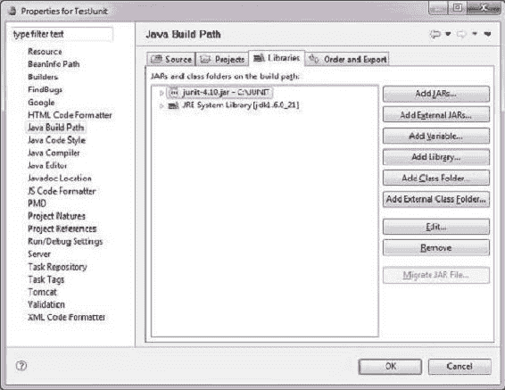

# 学习 JUnit：解释如何在 Java 项目单元测试中使用 JUnit

我想将本书献给使用它的学生们。祝愿你们未来职业成功，希望你们永停止学习。

# 目录

- 概述
- 环境搭建
- 测试框架
- 基础用法
- API
- 编写测试用例
- 使用断言
- 执行步骤
- 执行测试
- 测试套件
- 忽略测试
- 时间测试
- 异常测试
- 参数化测试
- 集成 ANT 插件
- 集成 Eclipse 插件
- 扩展

# 概述

测试是检查应用程序功能以确保其运行符合要求的过程。单元测试出现在开发人员层面；它是对单一实体（类或方法）的测试。单元测试在帮助软件公司向客户交付优质产品方面起着至关重要的作用。

单元测试有两种完成方式——手动测试和自动化测试。

| 手动测试 | 自动化测试 |
| :--- | :--- |
| 在没有任何工具支持的情况下手动执行测试用例被称为手动测试。 | 借助工具支持并使用自动化工具执行测试用例被称为自动化测试。 |
| **耗时且枯燥** —— 因为测试用例是由人工执行的，所以速度非常慢且枯燥。 | **快速** —— 自动化运行测试用例的速度远快人工。 |
| **巨大的人力投入** —— 由于测试用例需要手动执行，手动测试需要更多的测试人员。 | **较的人力投入** —— 使用自动化工具执行测试用例，因此自动化测试需要的测试人员较少。 |
| **可靠性较低** —— 手动测试的可靠性较低，因为它必须考虑到人为错误。 | **更可靠** —— 自动化测试是精确且可靠的。 |
| **不可编程** —— 无法通过编程来编写复杂的测试以获取隐藏信息。 | **可编程的** —— 测试人员可以编写复杂的测试来引出隐藏信息。 |

## 什么是 JUnit？

JUnit 是一个用于 Java 编程语言的单元测试框架。它在测试驱动开发中起着至关重要的作用，是一系列统称为 xUnit 的单元测试框架。

JUnit 提倡“先测试后编码”的思想，强调为一段可以测试的代码设置测试数据，先进行测试然后再进行实现。这种方法类似于“测一点，写一点，再测，再写一点”。它提高了程序员的生产力和程序代码的稳定性，从而减少了程序员的压力和花费在调试的时间。

## JUnit 的特性

- JUnit 是一个开源框架，用于编写和运行测试。
- 提供注解（annotations）来识别测试方法。
- 提供断言（assertions）来测试预期结果。
- 提供测试运行器（test runners）来运行测试。
- JUnit 测试允许你更快地编写代码，从而提高质量。
- JUnit 优雅地简单。它不复杂且耗费时间更短。
- JUnit 测试可以自动运行，它们会检查自己的结果并提供即时反馈。不需要手动梳阅测试结果报告。
- JUnit 测试可以组织成测试套件，其中包含测试用例甚至其他测试套件。
- JUnit 在条中显示测试进度，如果测试运行顺利，条显示为绿色，当测试失败时变为红色。

## 什么是单元测试用例？

单元测试用例是代码的一部分，用于确保另一部分代码（方法）按预期工作。为了快速获得所需结果，需要一个测试框架。JUnit 是 Java 编程语言的完美单元测试框架。

正式书面的单元测试用例的特点是具有已知输入和预期输出，这些在测试执行之前就已经计算出来。必须定义已知输入和预期输出。

# 环境搭建

## 本地搭建

JUnit 是一个 Java 框架。

### 系统要求

- JDK: 1.5 或以上。
- 内存：无要求。
- 磁盘空间：无要求。

### 第 1 步：验证 Java

首先，打开控制台验证 Java。

| OS | 任务 | 命令 |
| :--- | :--- | :--- |
| Windows | 打开控制台 | `java -version` |
| Linux | 打开终端 | `java -version` |
| Mac | 打开终端 | `java -version` |

检查系统的输出：

| OS | 输出 |
| :--- | :--- |
| Windows | 1.8_xx (Java 运行时) |
| Linux | 1.8_xx (Java 运行时) |
| Mac | 1.8_xx (Java 运行时) |

如果你的系统中没有安装 Java，请先下载 Java 开发工具包（SDK）。

### 第 2 步：设置 JAVA 环境

将 `JAVA_HOME` 环境变量指向 Java 安装的基础目录。

| OS | 输出 |
| :--- | :--- |
| Windows | 将 `JAVA_HOME` 设置为 `C:\Program Files\Java\jdk1.8_xx` |
| Linux | `export JAVA_HOME=/usr/local/` |
| Mac | `export JAVA_HOME=/Library/Java` |

将 Java 编译器位置添加到系统 `Path` 中。

| OS | 输出 |
| :--- | :--- |
| Windows | 将 `C:\Program Files\Java\jdk1.8_xx\bin` 添加到 `Path` 变量末尾。 |
| Linux | `export PATH=$PATH:$JAVA_HOME/bin/` |
| Mac | 不需要 |

### 第 3 步：下载 JUnit 包

从 `http://www.junit.org` 下载最新版本的 JUnit 包。在编写本教程时，我们下载了 `junit4.12.jar` 并将其拷贝到 `C:\JUnit` 文件夹。

| OS | 文件名 |
| :--- | :--- |
| Windows | `junit4.12.jar` |

### 第 4 步：设置 JUnit 环境

将 `JUNIT_HOME` 环境变量指向存储 JUNIT 包的基础目录。假设我们已将 `junit4.12.jar` 存储在 `JUNIT` 文件夹。

| OS | 输出 |
| :--- | :--- |
| Windows | 将 `JUNIT_HOME` 设置为 `C:\JUnit` |
| Linux | `export JUNIT_HOME=/usr/local/JUNIT` |
| Mac | `export JUNIT_HOME=/Library/JUNIT` |

### 第 5 步：设置 CLASSPATH 变量

将 `CLASSPATH` 环境变量指向 JUNIT 包的位置。

| 序号 | OS 与描述 |
| :--- | :--- |
| 1 | Windows 将环境变量 `CLASSPATH` 设置为 `%CLASSPATH%;%JUNIT_HOME%\junit4.12.jar;.;` |
| 2 | `export CLASSPATH = $CLASSPATH:$JUNIT_HOME/junit4.12.jar:.` |
| 3 | `export CLASSPATH = $CLASSPATH:$JUNIT_HOME/junit4.12.jar:.` |

## 第 6 步：测试 JUnit 设置

在 `C:\>JUNIT_WORKSPACE` 中创建一个名为 `TestJunit` 的 java 类文件

```java
import org . junit . Test ;

import static org . junit . Assert . assertEquals ;

public class TestJunit {
    @Test
    public void testAdd () {
        String str = "Junit is working fine" ;
        assertEquals ( "Junit is working fine" , str );
    }
}
```

在 `C:\>JUNIT_WORKSPACE` 中创建一个名为 `TestRunner` 的 java 类文件以执行测试用例。

```java
import org . junit . runner . JUnitCore ;
import org . junit . runner . Result ;
import org . junit . runner . notification . Failure ;

public class TestRunner {
    public static void main ( String [] args ) {
        Result result = JUnitCore . runClasses ( TestJunit . class );
        for ( Failure failure : result . getFailures ()) {
            System . out . println ( failure . toString ());
        }
        System . out . println ( result . wasSuccessful ());
    }
}
```

## 第 7 步：验证结果

使用 `javac` 编译器按照如下方式编译类 ＝

`C:\JUNIT_WORKSPACE>javac TestJunit.java TestRunner.java`

现在运行 Test Runner 查看结果，如下所示 ：

`C:\JUNIT_WORKSPACE>java TestRunner`

验证输出。

true

# 测试框架

JUnit 是一种 `回归测试框架`，供开发人员用于在 Java 中实现单元测试，加速编程速度并提高代码质量。JUnit 框架可以轻松地集成到以下任一工具中 ：

- Eclipse
- Ant
- Maven

## JUnit 测试框架的特性

JUnit 测试框架提供了以下重要特性 ：

- 测试固件 (Fixtures)
- 测试套件 (Test suites)
- 测试运行器 (Test runners)
- JUnit 类

### 测试固件 (Fixtures)

`Fixtures` 是一组对象的固定状态，作为运行测试的基准。测试固件的目的是确保有一个已知且固定的环境来运行测试，以便结果是可重复的。它包括 ＝

- `setUp()` 方法，它在每次测试调用之前运行。
- `tearDown()` 方法，它在每个测试方法之后运行。

让我们检查一个示例 ＝

```java
import junit . framework ..*;

public class JavaTest extends TestCase {
    protected int value1 , value2 ;
    // 给值赋值
    protected void setUp (){
        value1 = 3 ;
        value2 = 3 ;
    }
    // 两个值之和的测试方法
    public void testAdd (){
        double result = value1 + value2 ;
        assertTrue ( result == 6 );
    }
}
```

## 测试套件 (Test Suites)

测试套件将几个单元测试用例打包并一起运行。在 JUnit 中，`@RunWith` 和 `@Suite` 注解都用于运行套件测试。下面是一个使用 `TestJunit1` & `TestJunit2` 测试类的示例。

```java
import org . junit . runner . RunWith ;
import org . junit . runners . Suite ;

//JUnit 套件测试
@RunWith ( Suite . class )
@Suite . SuiteClasses ({
    TestJunit1 . class , TestJunit2 . class
})
public class JunitTestSuite {
}
```

```java
import org . junit . Test ;
import org . junit . Ignore ;
import static org . junit . Assert . assertEquals ;

public class TestJunit1 {
    String message = "Robert" ;
    MessageUtil messageUtil = new MessageUtil ( message );
    @Test
    public void testAdd () {
        // 示例内容
    }
}
```

*(注：由于原文示例中部分代码不完整或存在截断，此处翻译仅根据逻辑翻译了描述部分)*

```java
for (Failure failure : result.getFailures()) {
    System.out.println(failure.toString());
}
System.out.println(result.wasSuccessful());
}
```

现在运行测试运行器（Test Runner），它将运行在 TestCase 类中定义的测试用例。

```bash
C:\JUNIT_WORKSPACE>java TestRunner
```

验证输出结果。

```
Hello World
testPrintMessage(TestJunit): expected:<[New Wor]d> but was:<[Hello Worl]d>
false
```

# API

JUnit 中最重要的包是 `junit.framework`，它包含了所有的核心类。其中一些重要的类如下 −

| 序号 | 类名 | 功能 |
| :--- | :--- | :--- |
| 1 | Assert | 一组断言方法。 |
| 2 | TestCase | 测试用例定义了运行多个测试的测试固件（fixture）。 |
| 3 | TestResult | TestResult 收集执行测试用例的结果。 |
| 4 | TestSuite | TestSuite 是测试的组合。 |

## Assert 类

以下是 `org.junit.Assert` 类的声明 −

```java
public class Assert extends java.lang.Object
```

该类提供了一组用于编写测试的断言方法。系统仅记录失败的断言。Assert 类的一些重要方法如下 −

| 序号 | 方法与描述 |
| :--- | :--- |
| 1 | `void assertEquals(boolean expected, boolean actual)` 检查两个基本数据类型/对象是否相等。 |
| 2 | `void assertFalse(boolean condition)` 检查条件是否为假。 |
| 3 | `void assertNotNull(Object object)` 检查对象是否不为空。 |
| 4 | `void assertNull(Object object)` 检查对象是否为空。 |
| 5 | `void assertTrue(boolean condition)` 检查条件是否为真。 |
| 6 | `void fail()` 在不带消息的情况下导致测试失败。 |

让我们在示例中使用上面提到的一些方法。在 `C:\>JUNIT_WORKSPACE` 中创建一个名为 `TestJunit1.java` 的 java 类文件。

```java
import org.junit.Test;
import static org.junit.Assert.*;

public class TestJunit1 {
    @Test
    public void testAdd() {
        //测试数据
        int num = 5;
        String temp = null;
        String str = "Junit is working fine";
        //检查相等性
        assertEquals("Junit is working fine", str);
        //检查为假条件
        assertFalse(num > 6);
        //检查非空值
        assertNotNull(temp);
    }
}
```

接下来，在 `C:\>JUNIT_WORKSPACE` 中创建一个名为 `TestRunner1.java` 的 java 类文件，以执行测试用例。

```java
import org.junit.runner.JUnitCore;
import org.junit.runner.Result;
import org.junit.runner.notification.Failure;

public class TestRunner1 {
    public static void main(String[] args) {
        Result result = JUnitCore.runClasses(TestJunit1.class);
        for (Failure failure : result.getFailures()) {
            System.out.println(failure.toString());
        }
        System.out.println(result.wasSuccessful());
    }
}
```

使用 `javac` 编译测试用例和 Test Runner 类。

```bash
C:\JUNIT_WORKSPACE>javac TestJunit1.java TestRunner1.java
```


现在运行测试运行器，它将运行在`TestCase`类中定义的测试用例。

```bash
C:\JUNIT_WORKSPACE>java TestRunner1
```

验证输出结果。

```
true
```

## TestCase 类

以下是`org.junit.TestCase`类的声明 −

```java
public abstract class TestCase extends Assert implements Test
```

测试用例定义了运行多个测试的测试固件。`TestCase`类的一些重要方法如下 −

| 序号 | 方法与描述 |
| :--- | :--- |
| 1 | `int countTestCases()` 统计由`run(TestResult result)`执行的测试用例数量。 |
| 2 | `TestResult createResult()` 创建默认的`TestResult`对象。 |
| 3 | `String getName()` 获取`TestCase`的名称。 |
| 4 | `TestResult run()` 运行此测试的便利方法，使用默认的`TestResult`对象收集结果。 |
| 5 | `void run(TestResult result)` 运行测试用例并将结果收集在`TestResult`中。 |
| 6 | `void setName(String name)` 设置`TestCase`的名称。 |
| 7 | `void setUp()` 设置固件，例如打开网络连接。 |
| 8 | `void tearDown()` 拆卸固件，例如关闭网络连接。 |
| 9 | `String toString()` 返回测试用例的字符串表示形式。 |

让我们在示例中使用上面提到的一些方法。在`C:\>JUNIT_WORKSPACE`中创建一个名为`TestJunit2.java`的 java 类文件。

```java
import junit.framework.TestCase;
import org.junit.Before;
import org.junit.Test;

public class TestJunit2 extends TestCase {
    protected double fValue1;
    protected double fValue2;

    @Before
    public void setUp() {
        fValue1 = 2.0;
        fValue2 = 3.0;
    }

    @Test
    public void testAdd() {
        //统计测试用例数量
        String name = "testAdd";
        System.out.println("Test Name = " + name);
        //设置名称
        setName("testAdd");
        String newName = getName();
        System.out.println("Updated Case Name = " + newName);
    }

    //关闭连接
    public void tearDown() {
        //tearDown 逻辑
    }
}
```

接下来，在`C:\>JUNIT_WORKSPACE`中创建一个名为`TestRunner2.java`的 java 类来执行测试用例。

```java
import org.junit.runner.JUnitCore;
import org.junit.runner.Result;
import org.junit.runner.notification.Failure;

public class TestRunner2 {
    public static void main(String[] args) {
        Result result = JUnitCore.runClasses(TestJunit2.class);
        for (Failure failure : result.getFailures()) {
            System.out.println(failure.toString());
        }
        System.out.println(result.wasSuccessful());
    }
}
```

## TestResult 类

以下是`org.junit.TestResult`类的声明 −

```java
public class TestResult extends Object
```

`TestResult`收集执行测试用例的结果。它是收集模式的实例。测试框架区分失败（failures）和错误（errors）。失败是预期的且通过断言检查。错误是非预期的问题，例如`ArrayIndexOutOfBoundsException`。

| 序号 | 方法与描述 |
| :--- | :--- |
| 1 | `void addError(Test test, Throwable t)` 将错误添加到列表中。 |
| 2 | `void addFailure(Test test, AssertionFailedError t)` 将失败添加到列表中。 |
| 3 | `void endTest(Test test)` 通知结果测试已完成。 |
| 4 | `int errorCount()` 获取错误的数量。 |
| 5 | `Enumeration<TestFailure> errors()` 返回错误的枚举器。 |
| 6 | `int failureCount()` 获取失败的数量。 |
| 7 | `void run(TestCase test)` 运行一个`TestCase`。 |
| 8 | `int runCount()` 获取运行的测试数量。 |
| 9 | `void startTest(Test test)` 通知结果测试将开始。 |
| 10 | `void stop()` 标记测试运行应该停止。 |

在`C:\>JUNIT_WORKSPACE`中创建一个名为`TestJunit3.java`的 java 类文件。

```java
import org.junit.Test;
import junit.framework.AssertionFailedError;
import junit.framework.TestResult;

public class TestJunit3 extends TestResult {
    // 添加错误
    public synchronized void addError(Test test, Throwable t) {
        super.addError((junit.framework.Test) test, t);
    }

    // 添加失败
    public synchronized void addFailure(Test test, AssertionFailedError t) {
        super.addFailure((junit.framework.Test) test, t);
    }

    @Test
    public void testAdd() {
        //添加任何测试
    }

    // 标记测试运行应该停止。
    public synchronized void stop() {
        //在此处停止测试
    }
}
```

```java
import org.junit.runner.JUnitCore;
import org.junit.runner.Result;
import org.junit.runner.notification.Failure;

public class TestRunner3 {
    public static void main(String[] args) {
        Result result = JUnitCore.runClasses(TestJunit3.class);
        for (Failure failure : result.getFailures()) {
            System.out.println(failure.toString());
        }
        System.out.println(result.wasSuccessful());
    }
}
```

使用`javac`编译测试用例和 Test Runner 类。

```bash
C:\JUNIT_WORKSPACE>javac TestJunit3.java TestRunner3.java
```

现在运行 Test Runner，它将运行在提供的 Test Case 类中定义的测试用例。

```bash
C:\JUNIT_WORKSPACE>java TestRunner3
```

验证输出。

```
true
```

## TestSuite 类

以下是`org.junit.TestSuite`类的声明：

```java
public class TestSuite extends Object implements Test
```

`TestSuite`是测试的组合（Composite）。它运行一组测试用例。`TestSuite`类的一些重要方法如下 −

| 序号 | 方法与描述 |
| :--- | :--- |
| 1 | `void addTest(Test test)` 向测试套件（suite）中添加一个测试。 |
| 2 | `void addTestSuite(Class<? extends TestCase> testClass)` 将给定类中的测试添加到套件中。 |
| 3 | `int countTestCases()` 计算此测试将运行的测试用例数量。 |
| 4 | `String getName()` 返回套件名称。 |
| 5 | `void run(TestResult result)` 运行测试并将它们的结果收集在`TestResult`中。 |
| 6 | `void setName(String name)` 设置套件名称。 |
| 7 | `Test testAt(int index)` 返回指定索引处的测试。 |
| 8 | `int testCount()` 返回此套件中测试的数量。 |
| 9 | `static Test warning(String message)` 返回一个会失败并记录警告消息的测试。 |

在`C:\>JUNIT_WORKSPACE`中创建一个名为`JunitTestSuite.java`的 java 类文件来创建测试套件。

```java
import junit.framework.*;

public class JunitTestSuite {
    public static void main(String[] a) {
        // 在套件中添加测试
        TestSuite suite = new TestSuite(TestJunit1.class, TestJunit2.class, TestJunit3.class);
        TestResult result = new TestResult();
        suite.run(result);
        System.out.println("Number of test cases = " + result.runCount());
    }
}
```

使用`javac`编译测试套件类。

```bash
C:\JUNIT_WORKSPACE>javac JunitTestSuite.java
```

现在运行测试套件。

```bash
C:\JUNIT_WORKSPACE>java JunitTestSuite
```

验证输出。

```
No of Test Case = 1
Test Case Name = testAdd
Updated Test Case Name = testNewAdd
Number of test cases = 3
```

# 编写测试

在这里我们将看到一个使用 POJO 类、业务逻辑类和测试类进行 JUnit 测试的完整示例，该示例将由测试器运行。

在`C:\>JUNIT_WORKSPACE`中创建`EmployeeDetails.java`，它是一个 POJO 类。

```java
public class EmployeeDetails {
    private String name;
    private double monthlySalary;
    private int age;

    /**
    * @return 名称
    */
    public String getName() {
        return name;
    }

    /**
    * @param name 要设置的名字
    */
    public void setName(String name) {
        this.name = name;
    }

    /**
    * @return 月薪
    */
    public double getMonthlySalary() {
        return monthlySalary;
    }

    /**
    * @param monthlySalary 要设置的月薪
    */
    public void setMonthlySalary(double monthlySalary) {
        this.monthlySalary = monthlySalary;
    }

    /**
    * @return 年龄
    */
    public int getAge() {
        return age;
    }

    /**
    * @param age 要设置的年龄
    */
    public void setAge(int age) {
        this.age = age;
    }
}
```

`EmployeeDetails`类用于 −

*   获取/设置员工的名字。
*   获取/设置员工的月薪。
*   获取/设置员工的年龄。

在`C:\>JUNIT_WORKSPACE`中创建一个名为`EmpBusinessLogic.java`的文件，它包含业务逻辑。

```java
public class EmpBusinessLogic {
    // 计算员工的年薪
    public double calculateYearlySalary(EmployeeDetails employeeDetails) {
        double yearlySalary = 0;
        yearlySalary = employeeDetails.getMonthlySalary() * 12;
        return yearlySalary;
    }

    // 计算员工的调薪金额
    public double calculateAppraisal(EmployeeDetails employeeDetails) {
        double appraisal = 0;
        if (employeeDetails.getMonthlySalary() < 10000) {
            appraisal = 500;
        } else {
            return appraisal;
        }
    }
}
```

`EmpBusinessLogic`类用于计算

*   员工的年薪。
*   员工的调薪金额。

在`C:\>JUNIT_WORKSPACE`中创建一个名为`TestEmployeeDetails.java`的文件，它包含测试用例。


```java
import org.junit.Test;
import static org.junit.Assert.*;

public class TestEmployeeDetails {
    EmpBusinessLogic empLogic = new EmpBusinessLogic();
    EmployeeDetails employee = new EmployeeDetails();

    // 测试年薪
    @Test
    public void testYearlySalary() {
        employee.setName("Rajeev");
        employee.setMonthlySalary(8000);
        employee.setAge(25);
        double salary = empLogic.calculateYearlySalary(employee);
        assertEquals(96000, salary);
    }

    // 测试调薪金额
    @Test
    public void testAppraisal() {
        employee.setName("Rajeev");
        employee.setMonthlySalary(8000);
        employee.setAge(25);
        double appraisal = empLogic.calculateAppraisal(employee);
        assertEquals(500, appraisal);
    }
}
```

创建一个`TestRunner.java`类来执行测试用例。

```java
import org.junit.runner.JUnitCore;
import org.junit.runner.Result;
import org.junit.runner.notification.Failure;

public class TestRunner {
    public static void main(String[] args) {
        Result result = JUnitCore.runClasses(TestEmployeeDetails.class);
        for (Failure failure : result.getFailures()) {
            System.out.println(failure.toString());
        }
        System.out.println(result.wasSuccessful());
    }
}
```

使用`javac`编译测试用例和 Test Runner 类。

```bash
C:\JUNIT_WORKSPACE>javac EmployeeDetails.java EmpBusinessLogic.java TestEmployeeDetails.java TestRunner.java
```

现在运行 Test Runner，它将运行在提供的`TestEmployeeDetails`类中定义的测试用例。

```bash
C:\JUNIT_WORKSPACE>java TestRunner
```

验证输出。

`true`

# 使用断言

## 断言

所有的断言都在`Assert`类中。

```java
public class Assert extends java.lang.Object
```

该类提供了一组断言方法，用于编写测试。只有失败的断言会被记录。`Assert`类的一些重要方法如下 −

| 序号 | 方法与描述 |
| :--- | :--- |
| 1 | `void assertEquals(expected, actual)`检查两个基本类型/对象是否相等。 |
| 2 | `void assertTrue(boolean condition)`检查条件是否为真。 |
| 3 | `void assertFalse(boolean condition)`检查条件是否为假。 |
| 4 | `void assertNotNull(Object object)`检查对象不为空。 |
| 5 | `void assertNull(Object object)`检查对象是否为空。 |
| 6 | `void assertSame(object1, object2)` `assertSame()`方法测试两个引用是否指向同一个对象。 |
| 7 | `void assertNotSame(object1, object2)` `assertNotSame()`方法测试两个引用是否指向不同的对象。 |
| 8 | `void assertArrayEquals(expectedArray, resultArray)` `assertArrayEquals()`方法将测试两个数组是否相等。 |

让我们在示例中使用上述某些方法。在`C:\>JUNIT_WORKSPACE`中创建一个名为`TestAssertions.java`的 java 类文件。

```java
import org.junit.Test;
import static org.junit.Assert.*;

public class TestAssertions {
    @Test
    public void testAssertions() {
        //测试数据
        String str1 = new String("abc");
        String str2 = new String("abc");
        String str3 = null;
        String str4 = "abc";
        String str5 = "abc";
        int val1 = 5;
        int val2 = 6;
        String[] expectedArray = {"one", "two", "three"};
        String[] resultArray = {"one", "two", "three"};

        //Check that two objects are equal
        assertEquals(str1, str2);

        //Check that a condition is true
        assertTrue(val1 < val2);

        //Check that a condition is false
        assertFalse(val1 > val2);

        //Check that an object isn't null
        assertNotNull(str1);

        //Check that an object is null
        assertNull(str3);

        //Check if two object references point to the same object
        assertSame(str4, str5);

        //Check if two object references not point to the same object
        assertNotSame(str1, str3);

        //Check whether two arrays are equal to each other.
        assertArrayEquals(expectedArray, resultArray);
    }
}
```

接下来，在`C:\>JUNIT_WORKSPACE`中创建一个名为`TestRunner.java`的 Java 类文件来执行测试用例。

```java
import org.junit.runner.JUnitCore;
import org.junit.runner.Result;
import org.junit.runner.notification.Failure;

public class TestRunner2 {
    public static void main(String[] args) {
        Result result = JUnitCore.runClasses(TestAssertions.class);
        for (Failure failure : result.getFailures()) {
            System.out.println(failure.toString());
        }
        System.out.println(result.wasSuccessful());
    }
}
```

使用`javac`编译测试用类和 Test Runner 类。

```
C:\JUNIT_WORKSPACE>javac TestAssertions.java TestRunner.java
```

现在运行 Test Runner，它将运行提供的测试用例类中定义的测试用例。

```
C:\JUNIT_WORKSPACE>java TestRunner
```

验证输出。

`true`

# 注解 (Annotation)

注解类似于你可以添加到代码中的元标记，并应用于方法或类。JUnit 中的这些注解提供了关于测试方法的以下信息 −

- 哪些方法将在测试方法运行之前和之后运行。
- 哪些方法将在所有方法之前和之后运行，以及。
- 哪些方法或类在执行期间将被忽略。

下表提供了 JUnit 中注解的列表及其含义 −

| 序号 | 注解与描述 |
| :--- | :--- |
| 1 | `@Test` | `@Test`注解告诉 JUnit 映射其所附加的 `public void` 方法可以作为测试用例运行。 |
| 2 | `@Before` | 某些测试在运行之前需要创建相似的实例。在 `public void` 方法上添加`@Before`会导致该方法在每个 Test 方法运行之前运行。 |
| 3 | `@After` | 如果你在 Before 方法中分配了外部资源，你需要在测试运行后释放它们。在 `public void` 方法上添加`@After`会导致该方法在 Test 方法运行后运行。 |
| 4 | `@BeforeClass` | 在 `public static void` 方法上添加`@BeforeClass`会导致它在类中的任何测试方法运行之前运行一次。 |
| 5 | `@AfterClass` | 这将在所有测试完成后执行该方法。它可以用于执行清理工作。 |
| 6 | `@Ignore` | `@Ignore`注解用于忽略测试，该测试将不会执行。 |

在`C:\>JUNIT_WORKSPACE`中创建一个名为`JunitAnnotation.java`的 Java 类文件来测试注解。

```java
import org.junit.After;
import org.junit.AfterClass;
import org.junit.Before;
import org.junit.BeforeClass;
import org.junit.Ignore;
import org.junit.Test;

public class JunitAnnotation {
    //在类前执行
    @BeforeClass
    public static void beforeClass() {
        System.out.println("in before class");
    }

    //在类后执行
    @AfterClass
    public static void afterClass() {
        System.out.println("in after class");
    }

    //在测试前执行
    @Before
    public void before() {
        System.out.println("in before");
    }

    //在测试后执行
    @After
    public void after() {
        System.out.println("in after");
    }

    //测试用例
    @Test
    public void test() {
        System.out.println("in test");
    }

    //忽略测试用例，将不会执行
    @Ignore
    public void ignoreTest() {
        System.out.println("in ignore test");
    }
}
```

接下来，在`C:\>JUNIT_WORKSPACE`中创建一个名为`TestRunner.java`的 Java 类文件来执行注解。

```java
import org.junit.runner.JUnitCore;
import org.junit.runner.Result;
import org.junit.runner.notification.Failure;

public class TestRunner {
    public static void main(String[] args) {
        Result result = JUnitCore.runClasses(JunitAnnotation.class);
        for (Failure failure : result.getFailures()) {
            System.out.println(failure.toString());
        }
        System.out.println(result.wasSuccessful());
    }
}
```

使用`javac`编译测试用类和 Test Runner 类。

```
C:\JUNIT_WORKSPACE>javac JunitAnnotation.java TestRunner.java
```

现在运行 Test Runner，它将运行提供的测试用例类中定义的测试用例。

```
C:\JUNIT_WORKSPACE>java TestRunner
```

验证输出。

`in before class`

`in before`

`in test`

`in after`

`in after class`

# 执行顺序 (Execution Procedure)

本章解释了 JUnit 中方法的执行顺序。下面讨论了带有示例的执行顺序。

```java
import org.junit.After;
import org.junit.AfterClass;
import org.junit.Before;
import org.junit.BeforeClass;
import org.junit.Ignore;
import org.junit.Test;

public class ExecutionProcedure {
    //在类前运行一次
    @BeforeClass
    public static void beforeClass() {
        System.out.println("in before class");
    }

    //在类后运行一次
    @AfterClass
    public static void afterClass() {
        System.out.println("in after class");
    }

    //在每个测试前运行
    @Before
    public void before() {
        System.out.println("in before");
    }

    //在每个测试后运行
    @After
    public void after() {
        System.out.println("in after");
    }

    //测试用例
    @Test
    public void test() {
        System.out.println("in test");
    }

    //忽略测试用例，将不会执行
    @Ignore
    public void ignoreTest() {
        System.out.println("in ignore test");
    }
}
```

`public class JUnitCore extends java.lang.Object`

在这里我们将看到如何借助`JUnitCore`来执行测试。

## 创建类

在`C:\>JUNIT_WORKSPACE`中创建一个待测试的 java 类，例如`MessageUtil.java`。

```java
/*
* 此类在控制台上打印给定的消息。
*/
public class MessageUtil {
    private String message;

    // 构造函数
    //@param message 要打印的消息
    public MessageUtil(String message) {
        this.message = message;
    }

    // 打印消息
    public String printMessage() {
        System.out.println(message);
        return message;
    }
}
```

## 创建测试用例类

- 创建一个 java 测试类，例如`TestJunit.java`。


在你的测试类中添加一个测试方法`testPrintMessage()`。

为方法`testPrintMessage()`添加注解`@Test`。

实现测试条件并使用 JUnit 的`assertEquals` API 检查该条件。

在`C:\>JUNIT_WORKSPACE`中创建一个名为`TestJunit.java`的 java 类文件。

```java
import org . junit . Test ;
import static org . junit . Assert . assertEquals ;

public class TestJunit {
    String message = "Hello World" ;      
    MessageUtil messageUtil = new MessageUtil ( message );
    @Test
    public void testPrintMessage () {
        assertEquals ( message , messageUtil . printMessage ());
    }
}
```

## 创建测试运行类

现在在`C:\>JUNIT_WORKSPACE`中创建一个名为`TestRunner.java`的 java 类来执行测试用例。它导入了`JUnitCore`类并使用`runClasses()`方法，该方法接受测试类名作为参数。

```java
import org . junit . runner . JUnitCore ;
import org . junit . runner . Result ;
import org . junit . runner . notification . Failure ;

public class TestRunner {
    public static void main ( String [] args ) {
        Result result = JUnitCore . runClasses ( TestJunit . class );
        for ( Failure failure : result . getFailures ()) {
            System . out . println ( failure . toString ());
        }
        System . out . println ( result . wasSuccessful ());
    }
}
```

使用`javac`编译测试用类和测试运行类。

`C:\JUNIT_WORKSPACE>javac MessageUtil.java TestJunit.java TestRunner.java`

现在运行测试运行类，它将运行在提供的测试用例类中定义的测试用例。

`C:\JUNIT_WORKSPACE>java TestRunner`

验证输出。

Hello World

true

# 套件测试

`Test suite`（测试套件）用于组合单元测试用例并一起运行。在 JUnit 中，`@RunWith`和`@Suite`注解都用于运行套件测试。本章举了一个包含两个测试类`TestJunit1`和`TestJunit2`的示例，它们使用测试套件一起运行。

## 创建类

在`C:\>JUNIT_WORKSPACE`中创建一个待测试的 java 类，例如`MessageUtil.java`。

```java
/*
* 此类在控制台上打印给定的消息。
*/
public class MessageUtil {
    private String message ;
    // 构造函数
    //@param message 要打印的消息
    public MessageUtil ( String message ){
        this . message = message ;
    }
    // 打印消息
    public String printMessage (){
        System . out . println ( message );
        return message ;
    }
    // 在消息中添加 "Hi!"
    public String salutationMessage (){
        message = "Hi!" + message ;
        System . out . println ( message );
        return message ;
    }
}
```

## 创建测试用例类

在`C:\>JUNIT_WORKSPACE`中创建一个名为`TestJunit1.java`的 java 类文件。

```java
import org . junit . Test ;
import org . junit . Ignore ;
import static org . junit . Assert . assertEquals ;

public class TestJunit1 {
    String message = "Robert" ;      
    MessageUtil messageUtil = new MessageUtil ( message );
    @Test
    public void testPrintMessage () {      
        System . out . println ( "Inside testPrintMessage()" );
        assertEquals ( message , messageUtil . printMessage ());
    }
}
```

在`C:\>JUNIT_WORKSPACE`中创建一个名为`TestJunit2.java`的 java 类文件。

```java
import org . junit . Test ;
import org . junit . Ignore ;
import static org . junit . Assert . assertEquals ;

public class TestJunit2 {
    String message = "Robert" ;      
    MessageUtil messageUtil = new MessageUtil ( message );
    @Test
    public void testSalutationMessage () {
        System . out . println ( "Inside testSalutationMessage()" );
        message = "Hi!" + "Robert" ;
        assertEquals ( message , messageUtil . salutationMessage ());
    }
}
```

## 创建测试套件类

- 创建一个 java 类。
- 在类上附加`@RunWith(Suite.class)`注解。
- 使用`@Suite.SuiteClasses`注解添加 JUnit 测试类的引用。

在`C:\>JUNIT_WORKSPACE`中创建一个名为`TestSuite.java`的 java 类文件来执行测试用例。

```java
import org . junit . runner . RunWith ;
import org . junit . Suite ;

@RunWith(Suite.class)
@Suite.SuiteClasses({TestJunit1.class,TestJunit2.class})
public class TestSuite {
}
```

## 创建测试运行类

在`C:\>JUNIT_WORKSPACE`中创建一个名为`TestRunner.java`的 java 类来执行测试用例。

```java
import org . junit . runner . JUnitCore ;
import org . junit . runner . Result ;
import org . junit . runner . notification . Failure ;

public class TestRunner {
    public static void main ( String [] args ) {
        Result result = JUnitCore . runClasses ( TestSuite . class );
        for ( Failure failure : result . getFailures ()) {
            System . out . println ( failure . toString ());
        }
        System . out . println ( result . wasSuccessful ());
    }
}
```

使用`javac`编译所有类。

`C:\JUNIT_WORKSPACE>javac MessageUtil.java TestJunit1.java TestJunit2.java TestSuite.java TestRunner.java`

现在运行测试运行类，它将运行在提供的测试用例类中定义的测试用例。

`C:\JUNIT_WORKSPACE>java TestRunner`

验证输出。

Inside testPrintMessage()

Robert

Inside testSalutationMessage()

Hi Robert

true

# Ignore 测试

有时在运行测试用例时我们的代码还没有准备好，导致测试用例失败。`@Ignore`注解有助于这种情况。

- 标记了`@Ignore`的测试方法将不会执行。
- 如果测试类标记了`@Ignore`，则它的测试方法都不会执行。

现在让我们来看看`@Ignore`的作用。

## 创建类

在`C:\>JUNIT_WORKSPACE`中创建一个待测试的 java 类，例如`MessageUtil.java`。

（代码同上）

## 创建测试用例类

- 在`C:\>JUNIT_WORKSPACE`中创建一个 java 测试类，例如`TestJunit.java`。
- 在你的测试类中添加一个测试方法`testPrintMessage()`或`testSalutationMessage()`。
- 为方法`testPrintMessage()`添加一个`@Ignore`。

在`C:\>JUNIT_WORKSPACE`中创建一个名为`TestJunit.java`的 java 类文件。

```java
import org . junit . Test ;
import org . junit . Ignore ;
import static org . junit . Assert . assertEquals ;

public class TestJunit {
    String message = "Robert" ;      
    MessageUtil messageUtil = new MessageUtil ( message );
    @Ignore
    @Test
    public void testPrintMessage () {      
        System . out . println ( "Inside testPrintMessage()" );
        assertEquals ( message , messageUtil . printMessage ());
    }

    @Test
    public void testSalutationMessage () {
        System . out . println ( "Inside testSalutationMessage()" );
        message = "Hi!" + "Robert" ;
        assertEquals ( message , messageUtil . salutationMessage ());
    }
}
```

# 参数化测试

JUnit 提供了一种使用不同数据多次运行相同测试的方法。这是通过`@Parameterized`注解和数据源实现的。

## 创建类

创建一个要进行测试的 Java 类，例如在`C:\>JUNIT_WORKSPACE`中创建`MessageUtil.java`。

添加一个处理消息的方法。

```java
/*
* 此类在控制台上处理给定的消息。
*/
public class MessageUtil {
    private String message;

    //构造函数
    //@param message 要打印的消息
    public MessageUtil (String message){
        this.message = message;
    }

    // 处理消息
    public void processMessage(String input){
        System.out.println("Processing: " + input);
    }
}
```

## 创建测试用例类

创建一个 Java 测试类，例如`TestJunit.java`。使用`@Parameterized`为测试提供多个输入。

在`C:\>JUNIT_WORKSPACE`中创建一个名为`TestJunit.java`的 Java 类文件。

```java
import org.junit.Test;
import org.junit.Parameterized;
import static org.junit.Assert.assertEquals;

@Parameterized(name = "{0}")
public class TestJunit {
    private String input;
    private String expected;

    public TestJunit(String input, String expected) {
        this.input = input;
        this.expected = expected;
    }

    @Test
    public void testProcessMessage() {
        MessageUtil messageUtil = new MessageUtil(input);
        // 为了演示，我们检查逻辑
        assertEquals(expected, input);
    }

    @Parameters
    public static Object[] data() {
        return new Object[][] {
            {"Robert", "Robert"},
            {"Hi!", "Hi!"},
            {"JUnit", "JUnit"}
        };
    }
}
```

## 创建测试运行器类

在`C:\>JUNIT_WORKSPACE`中创建一个名为`TestRunner.java`的 Java 类来执行测试用例。

```java
import org.junit.runner.JUnitCore;
import org.junit.runner.Result;
import org.junit.runner.notification.Failure;

public class TestRunner {
    public static void main(String[] args) {
        Result result = JUnitCore.runClasses(TestJunit.class);
        for (Failure failure : result.getFailures()) {
            System.out.println(failure.toString());
        }
        System.out.println(result.wasSuccessful());
    }
}
```

使用`javac`编译`MessageUtil`、`TestJunit`和`TestRunner`类。

`C:\JUNIT_WORKSPACE>javac MessageUtil.java TestJunit.java TestRunner.java`

现在运行 Test Runner，它将使用提供的数据运行测试用例。

`C:\JUNIT_WORKSPACE>java TestRunner`

验证输出结果。所有参数化测试均已执行。

true

JUnit 4 引入了一个名为`parameterized tests`（参数化测试）的新功能。参数化测试允许开发者使用不同的值多次运行测试。创建参数化测试需要遵循以下五个步骤。

- 使用`@RunWith(Parameterized.class)`注解测试类。
- 创建一个带有`@Parameters`注解的公共静态方法，该方法返回一个`Objects`的`Collection`（以`Array`形式）作为测试数据集。
- 创建一个公共构造函数，接收等同于测试数据某一个“行”的参数。
- 为测试数据的每一“列”创建一个实例变量。
- 使用实例变量作为测试数据源创建你的测试用例。


测试用例将为每行数据调用一次。让我们来看看参数化测试的实际运行情况。

## 创建一个类

创建一个要测试的 Java 类，例如在`C:\>JUNIT_WORKSPACE`中创建`PrimeNumberChecker.java`。

```java
public class PrimeNumberChecker {
    public Boolean validate ( final Integer primeNumber ) {
        for ( int i = 2 ; i < ( primeNumber / 2 ); i ++) {
            if ( primeNumber % i == 0 ) {
                return false ;
            }
        }
        return true ;
    }
}
```

## 创建参数化测试用例类

创建一个 Java 测试类，例如`PrimeNumberCheckerTest.java`。在`C:\>JUNIT_WORKSPACE`中创建一个名为`PrimeNumberCheckerTest.java`的 Java 类文件。

```java
import java . util . Arrays ;
import java . util . Collection ;
import org . junit . Test ;
import org . junit . Before ;
import org . junit . runners . Parameterized ;
import org . junit . runners . Parameterized . Parameters ;
import org . junit . runner . RunWith ;
import static org . junit . Assert . assertEquals ;

@RunWith ( Parameterized . class )
public class PrimeNumberCheckerTest {
    private Integer inputNumber ;
    private Boolean expectedResult ;
    private PrimeNumberChecker primeNumberChecker ;

    @Before
    public void initialize () {
        primeNumberChecker = new PrimeNumberChecker ();
    }

    // 每个参数都应该作为参数放在这里
    // 每当运行器触发时，它将传递
    // 我们在 primeNumbers() 方法中定义的参数
    public PrimeNumberCheckerTest ( Integer inputNumber , Boolean expectedResult ) {
        this . inputNumber = inputNumber ;
        this . expectedResult = expectedResult ;
    }

    @Parameterized . Parameters
    public static Collection primeNumbers () {
        return Arrays . asList ( new Object [][] {
            { 2 , true },
            { 6 , false },
            { 19 , true },
            { 22 , false },
            { 23 , true }
        });
    }

    // 此测试将运行 5 次，因为我们定义了 5 个参数
    @Test
    public void testPrimeNumberChecker () {
        System . out . println ( "Parameterized Number is : " + inputNumber );
        assertEquals ( expectedResult ,
        primeNumberChecker . validate ( inputNumber ));
    }
}
```

## 创建测试运行类

在`C:\>JUNIT_WORKSPACE`中创建一个名为`TestRunner.java`的 Java 类来执行测试用例。

```java
import org . junit . runner . JUnitCore ;
import org . junit . runner . Result ;
import org . junit . runner . notification . Failure ;

public class TestRunner {
    public static void main ( String [] args ) {
        Result result = JUnitCore . runClasses ( PrimeNumberCheckerTest . class );
        for ( Failure failure : result . getFailures ()) {
            System . out . println ( failure . toString ());
        }
        System . out . println ( result . wasSuccessful ());
    }
}
```

使用`javac`编译`PrimeNumberChecker`、`PrimeNumberCheckerTest`和`TestRunner`类。

```bash
C:\JUNIT_WORKSPACE>javac PrimeNumberChecker.java PrimeNumberCheckerTest.java
```

`TestRunner.java`

现在运行测试运行器，它将运行提供的测试用例类中定义的测试用例。

```bash
C:\JUNIT_WORKSPACE>java TestRunner
```

验证输出。

```
Parameterized Number is : 2
Parameterized Number is : 6
Parameterized Number is : 19
Parameterized Number is : 22
Parameterized Number is : 23
true
```

# 使用 ANT 插件

我们将通过示例演示如何使用 ANT 运行 JUnit。请按照下面的步骤操作。

## 步骤 1：下载 Apache Ant

根据你正在使用的操作系统下载`Apache Ant`。

| OS | 归包名称 |
| :--- | :--- |
| Windows | apache-ant-1.8.4-bin.zip |
| Linux | apache-ant-1.8.4-bin.tar.gz |
| Mac | apache-ant-1.8.4-bin.tar.gz |

## 步骤 2：设置 Ant 环境

将环境变量`ANT_HOME`指向基础目录位置，即 Ant 库存储在你的机器上的位置。我们假设 Ant 库存储在`apache-ant-1.8.4`文件夹中。

| 序号 | OS 及描述 |
| :--- | :--- |
| 1 | Windows：将环境变量`ANT_HOME`设置为`C:\Program Files\Apache Software Foundation\apache-ant-1.8.4` |
| 2 | Linux：`export ANT_HOME = /usr/local/apache-ant-1.8.4` |
| 3 | Mac：`export ANT_HOME = /usr/local/apache-ant-1.8.4` |

将 Ant 编译器位置添加到系统路径如下：

| OS | 输出 |
| :--- | :--- |
| Windows | `%ANT_HOME%\bin` |
| Linux | `PATH=$ANT_HOME/bin` |
| Mac | `PATH=$ANT_HOME/bin` |

## 步骤 3：下载 JUnit

下载适合你操作系统的 JUnit 包。

| OS | 归包名称 |
| :--- | :--- |
| Windows | junit-4.1.jar |
| Linux | junit-4.1.jar |
| Mac | junit-4.1.jar |

## 步骤 4：创建项目结构

*   在`C:\>JUNIT_WORKSPACE`中创建`test`文件夹。
*   在`C:\>JUNIT_WORKSPACE`中创建`src`文件夹。
*   在`C:\>JUNIT_WORKSPACE`中创建`lib`文件夹。
*   将`junit-4.1.jar`复制到`lib`文件夹。
*   将`PrimeNumberChecker.java`复制到`src`文件夹。
*   将`PrimeNumberCheckerTest.java`复制到`src`文件夹。
*   在`C:\>JUNIT_WORKSPACE`中创建一个名为`build.xml`的文件。

## 创建 build.xml

我们将使用 Ant 中的`<junit>`任务来执行我们的测试用例。

```xml
<project name="JunitTest" default="test" basedir=".">
    <property name="testdir" location="test" />
    <property name="srcdir" location="src" />
    <property name="full-compile" value="true" />

    <path id="classpath.base" />
    <path id="classpath.test">
        <pathelement location="lib/junit-4.1.jar" />
        <pathelement location="${testdir}" />
        <pathelement location="${srcdir}" />
        <path refid="classpath.base" />
    </path>

    <target name="clean">
        <delete verbose="${full-compile}">
            <fileset dir="${testdir}" includes="**/*.class" />
        </delete>
    </target>

    <target name="compile" depends="clean">
        <javac srcdir="${srcdir}" destdir="${testdir}" verbose="${full-compile}">
            <classpath refid="classpath.test" />
        </javac>
    </target>

    <target name="test" depends="compile">
        <junit>
            <classpath refid="classpath.test" />
            <formatter type="brief" usefile="false" />
            <test name="TestMessageUtil" />
        </junit>
    </target>
</project>
```

验证输出。

Buildfile: `C:\JUNIT_WORKSPACE\TestJunitWithAnt\build.xml`

`clean:`

`compile:`

```text
[ javac] Compiling 2 source files to C:\JUNIT_WORKSPACE\TestJunitWithAnt\test
[ javac] [parsing started C:\JUNIT_WORKSPACE\TestJunitWithAnt\src\MessageUtil.java]
[ javac] [parsing completed 18ms]
[ javac] [parsing started C:\JUNIT_WORKSPACE\TestJunitWithAnt\src\TestMessageUtil.java]
[ javac] [parsing completed 2ms]
[ javac] [search path for source files: C:\JUNIT_WORKSPACE\TestJunitWithAnt\src]
[ javac] [loading java\lang\Object.class(java\lang:Object.class)]
[ javac] [loading java\lang\String.class(java\lang:String.class)]
[ javac] [loading org\junit\Test.class(org\junit:Test.class)]
[ javac] [loading org\junit\Ignore.class(org\junit:Ignore.class)]
[ javac] [loading org\junit\Assert.class(org\junit:Assert.class)]
[ javac] [loading java\lang\annotation\Retention.class(java\lang\annotation:Retention.class)]
[ javac] [loading java\lang\annotation\RetentionPolicy.class(java\lang\annotation:RetentionPolicy.class)]
[ javac] [loading java\lang\annotation\Target.class(java\lang\annotation:Target.class)]
[ javac] [loading java\lang\annotation\ElementType.class(java\lang\annotation:ElementType.class)]
[ javac] [loading java\lang\annotation\Annotation.class(java\lang\annotation:Annotation.class)]
[ javac] [checking MessageUtil]
[ javac] [loading java\lang\System.class(java\lang:System.class)]
[ javac] [loading java\io\PrintStream.class(java\io:PrintStream.class)]
[ javac] [loading java\io\FilterOutputStream.class(java\io:FilterOutputStream.class)]
[ javac] [loading java\lang\OutputStream.class(java\io:OutputStream.class)]
[ javac] [loading java\lang\StringBuilder.class(java\lang:StringBuilder.class)]
[ javac] [loading java\lang\AbstractStringBuilder.class(java\lang:AbstractStringBuilder.class)]
[ javac] [loading java\lang\CharSequence.class(java\lang:CharSequence.class)]
[ javac] [loading java\io\Serializable.class(java\io:Serializable.class)]
[ javac] [loading java\lang\Comparable.class(java\lang:Comparable.class)]
[ javac] [loading java\lang\StringBuffer.class(java\lang:StringBuffer.class)]
[ javac] [wrote C:\JUNIT_WORKSPACE\TestJunitWithAnt\test\MessageUtil.class]
[ javac] [checking TestMessageUtil]
[ javac] [wrote C:\JUNIT_WORKSPACE\TestJunitWithAnt\test\TestMessageUtil.class]
[ javac] [total 281ms]
```

`test:`


```text
[ junit] Testsuite: TestMessageUtil
[ junit] Tests run: 2, Failures: 0, Errors: 0, Time elapsed: 0.008 sec
[ junit]
[ junit] ------------- Standard Output ---------------
[ junit] Inside testPrintMessage()
[ junit] Robert
[ junit] Inside testSalutationMessage()
[ junit] Hi!Robert
[ junit] ------------- ---------------- ---------------
```

构建成功

总时间: 0 秒

# 在 Eclipse 中使用插件

若要在 Eclipse 中设置 JUnit，请按照以下步骤进行。

## 步骤 1：下载 JUnit 存档

根据你系统上使用的操作系统下载对应的 JUnit jar 包。

| 操作系统 | 存档名称 |
| :--- | :--- |
| Windows | `junit4.10.jar` |
| Linux | `junit4.10.jar` |
| Mac | `junit4.10.jar` |

假设你已将上述 JAR 文件复制到文件夹 `C:\>JUnit` 中。

## 步骤 2：设置 Eclipse 环境

打开 eclipse → 右键点击项目并点击 `property` > `Build Path` > `Configure Build Path`，使用 `Add External Jar` 按钮在库中添加 `junit-4.10.jar`。



我们假设你的 Eclipse 内置了 JUnit 插件。如果 `C:\>eclipse\plugins` 目录下没有该插件，你可以从 JUnit Plugin 下载。将下载的 zip 文件解压到 Eclipse 的插件文件夹中。最后重启 Eclipse。

现在你的 Eclipse 已经准备好进行 JUnit 测试用例的开发。

## 步骤 3：在 Eclipse 中验证 JUnit 安装

在 Eclipse 的任意位置创建一个名为 `TestJunit` 的项目。然后在项目中创建一个名为 `MessageUtil` 的类进行测试。

```java
/*
* 此类在控制台上打印给定的消息。
*/
public class MessageUtil {
    private String message ;
    // 构造函数
    //@param message 要打印的消息
    public MessageUtil ( String message ){
        this . message = message ;
    }
    // 打印消息
    public String printMessage (){
        System . out . println ( message );
        return message ;
    }
}
```

在项目中创建一个测试类 `TestJunit`。

```java
import org . junit . Test ;
import static org . junit . Assert . assertEquals ;

public class TestJunit {
    String message = "Hello World" ;
    MessageUtil messageUtil = new MessageUtil(message);

    @Test
    public void testPrintMessage () {
        assertEquals ( message , messageUtil . printMessage ());
    }
}
```

项目结构如下：


最后，右键点击程序并作为 JUnit 运行。


验证输出。


# 扩展

* Cactus
* JWebUnit
* XMLUnit

## Cactus

Cactus 是一个用于服务器端代码的简单测试框架（Servlets, EJBs, Tag Libs, Filters）。其目的是降低编写测试的成本。它扩展了 JUnit。

Cactus 生态系统由几个组件组成：

* **Cactus Framework** 是 Cactus 的核心。它是提供测试的引擎。
* **Cactus Integration Modules** 是前端，提供了简单的方法（Ant, Eclipse 插件）。

以下代码演示了如何使用 Cactus：

```java
import org . apache . cactus.*;
import junit . framework ..

public class TestServlet extends TestCase {
    // 初始化要测试的类
    SampleServlet servlet = new SampleServlet ();
    @Test
    public void testServlet () {
        // 在 session 中设置变量
        session . setAttribute ( "name" , "value" );
        // 调用要测试的方法，传递 HttpServletRequest 对象（例如）
        String result = servlet . doSomething ( request );
        // 验证测试是否成功
        assertEquals ( "something" , result );
        assertEquals ( "otherValue" , session . getAttribute ( "otherName" ));
    }
}
```

## JWebUnit

JWebUnit 是一个基于 Java 的 Web 应用测试框架。它封装了 HtmlUnit 和 Selenium 等测试框架。

JWebUnit 提供了一个高级 Java API 来导航 Web 应用，并结合一组断言。这包括链接导航、表单输入和提交、表格内容验证以及其他典型的 Web 应用功能。

简单的导航方法和现成的断言比仅使用 JUnit 或 HtmlUnit 能更快创建测试。如果你想从 HtmlUnit 切换到其他插件（如即将推出的 Selenium），无需重写测试。

这是一个示例代码：

```java
import junit . framework . TestCase ;
import net . sourceforge . jwebunit . WebTester ;

public class ExampleWebTestCase extends TestCase {
    private WebTester tester ;
    public ExampleWebTestCase ( String name ) {
        super ( name );
        tester = new WebTester ();
    }
    // 设置基础 URL
    public void setUp () throws Exception {
        getTestContext (). setBaseUrl ( "http://myserver:8080/myapp" );
    }
    // 测试基础信息
    @Test
    public void testInfoPage () {
        beginAt ( "/info.html" );
    }
}
```

## XMLUnit

XMLUnit 提供单一的 JUnit 扩展类 `XMLTestCase` 以及一组辅助类，允许对以下内容进行断言：

* 两个 XML 段之间的差异（通过 `Diff` 和 `DetailedDiff` 类）。
* XML 的有效性（通过 `Validator` 类）。
* 使用 XSLT 转换 XML 的结果（通过 `Transform` 类）。
* 对 XML 片段进行 XPath 表达式的评估（通过实现 `XpathEngine` 接口的类）。
* 通过 DOM 遍历暴露的 XML 片段中的单个节点（通过 `NodeTest` 类）。

让我们假设有两个想要比较的 XML 片段，并断言它们是相等的。我们可以编写如下的简单测试类 −

```java
import org . custommonkey . xmlunit . XMLTestCase ;

public class MyXMLTestCase extends XMLTestCase {
    // 此测试方法比较两个 XML 片段
    @Test
    public void testForXMLEquality () throws Exception {
        String myControlXML = "<msg><uuid>0x00435A8C</uuid></msg>" ;
        String myTestXML = "<msg><localId>2376</localId></msg>" ;
        assertXMLEqual ( "Comparing test xml to control xml" , myControlXML , myTestXML );
    }
}
```

## MockObject

在单元测试中，模拟对象（mock objects）可以模拟复杂的真实（非 mock）对象的行为，因此当真实对象无法或难以集成到单元测试中时，它们非常有用。

使用模拟对象进行测试的通用编码风格如下：

* 创建模拟对象的实例。
* 在模拟对象中设置状态和期望。
* 使用模拟对象作为参数调用领域代码。
* 验证模拟对象的一致性。

下面是一个使用 Jmock 使用 MockObject 的示例。

```java
import org . jmock . Mockery ;
import org . jmock . Expectations ;

class PubTest extends TestCase {
    Mockery context = new Mockery ();
    public void testSubReceivesMessage () {
        // set up
        final Sub sub = context . mock ( Sub . class );
        Pub pub = new Pub ();
        pub . add ( sub );
        final String message = "message" ;
        // expectations
        context . checking ( new Expectations () {
            oneOf ( sub ). receive ( message );
        });
        // execute
        pub . publish ( message );
        // verify
        context . assertIsSatisfied ();
    }
}
```
