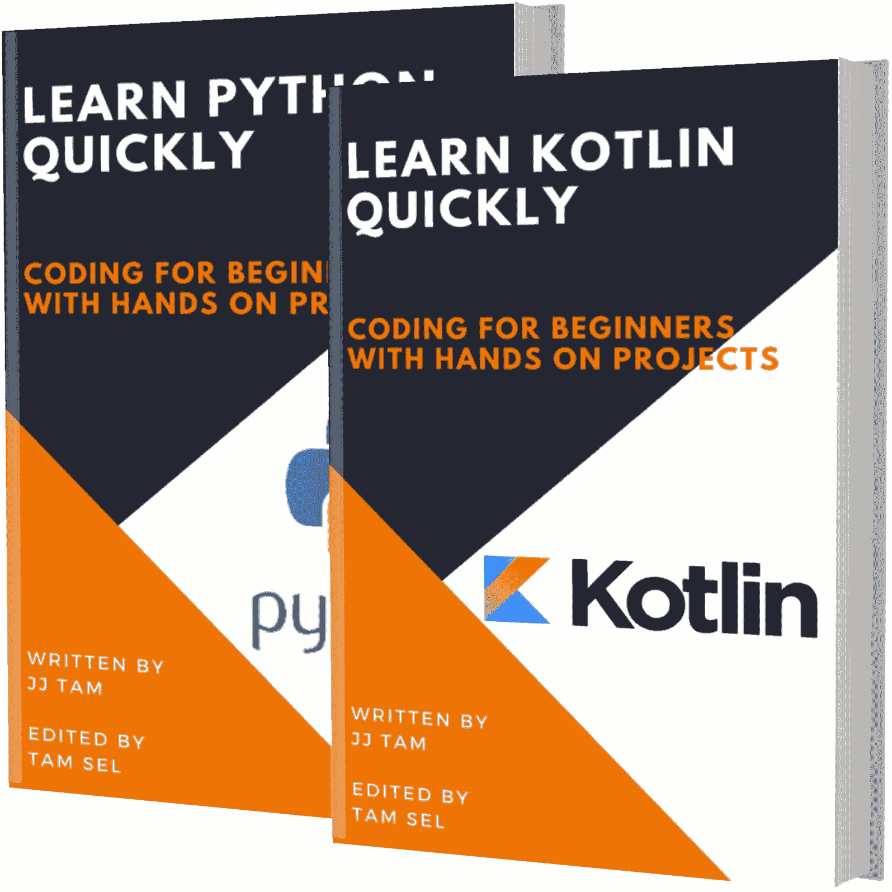
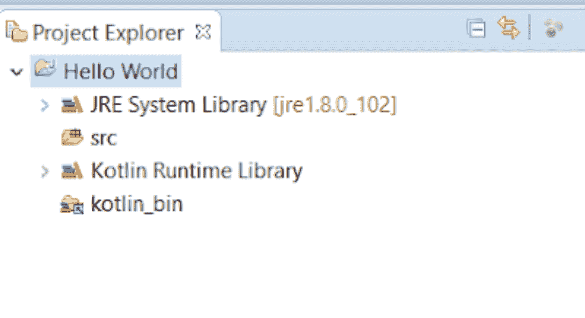
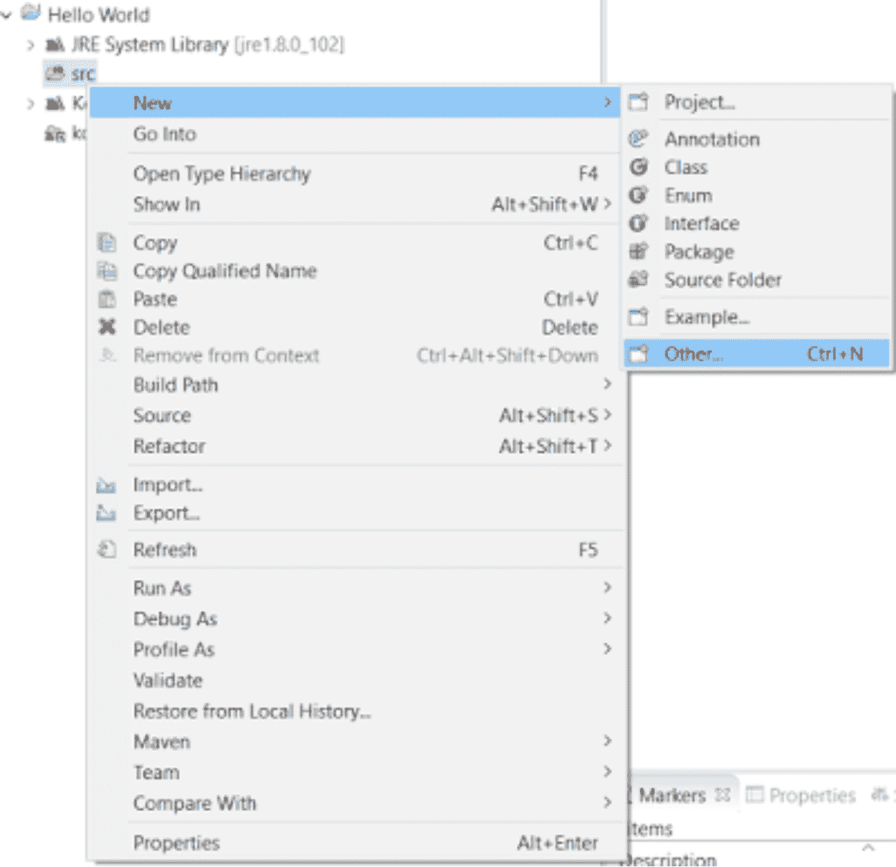
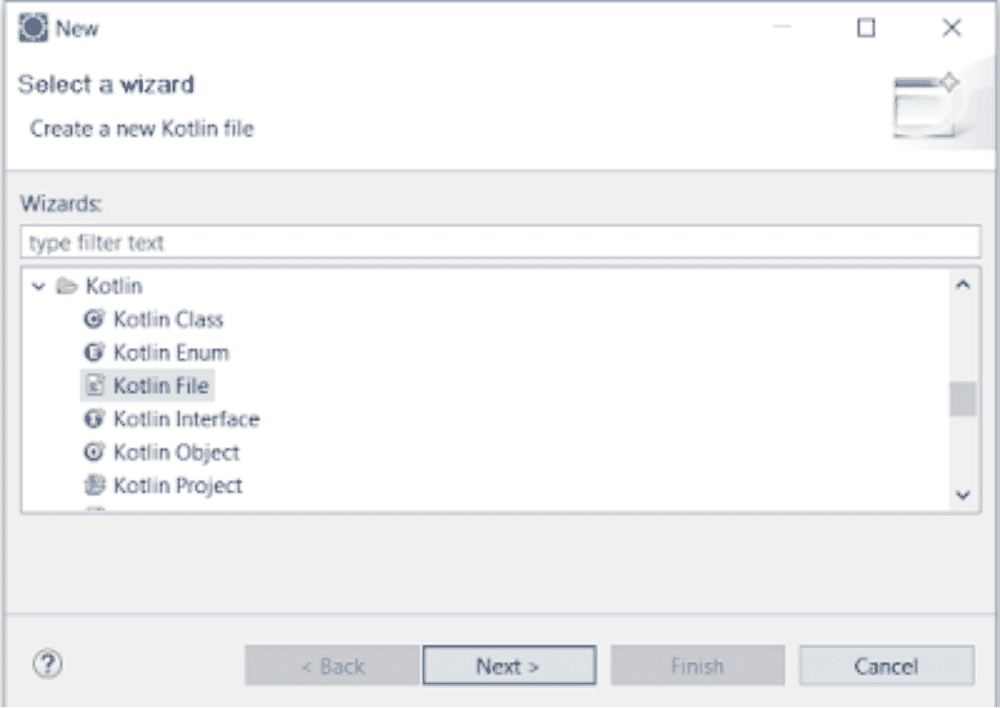
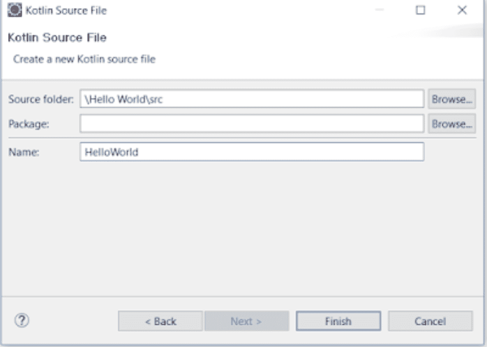
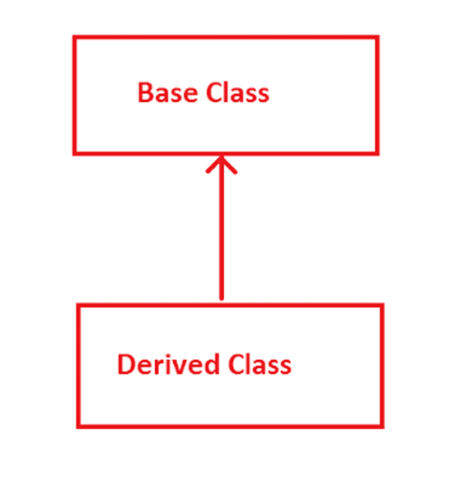
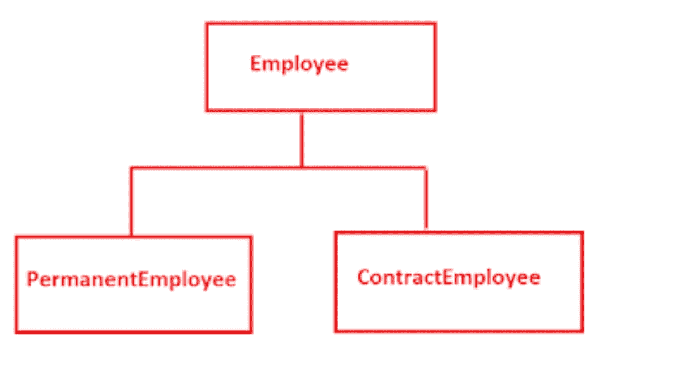

# 快速学习 Kotlin 与 Python

## 面向初学者的编程实战项目

### 作者：J J TAM

- Kotlin 简介
- 安装 Kotlin
- 在命令行模式下安装 Kotlin
- Kotlin：Hello World 程序
- 在 Kotlin 中定义变量
- Kotlin 中的数据类型
- Kotlin：可空类型
- Kotlin：数字
- Kotlin：字符
- Kotlin：将字符转换为 Int
- Kotlin：布尔值
- Kotlin：字符串
- Kotlin：字符串模板表达式
- Kotlin：数组
- Kotlin：定义空值数组
- Kotlin：使用工厂函数定义数组
- Kotlin：打印数组元素
- Kotlin：位运算符
- Kotlin：逻辑运算符
- Kotlin：控制流语句
- Kotlin：if 语句
- Kotlin：if-else 语句
- Kotlin：if-else if-else
- Kotlin：when 表达式
- Kotlin：将 when 用作 if-else if 阶梯
- Kotlin：将 When 用作表达式
- Kotlin：for 循环
- Kotlin：while、do-while 循环
- Kotlin：break 语句
- Kotlin：continue 语句
- Kotlin：类与对象
- Kotlin：声明属性
- Kotlin：为属性添加 getter 和 setter
- Kotlin：定义类的成员函数
- Kotlin：const：编译期常量
- Kotlin：const 与 val 的区别
- Kotlin：lateinit：延迟初始化属性
- Kotlin：构造函数
- Kotlin：次构造函数
- Kotlin：为主构造函数传递默认值
- Kotlin：定义私有主构造函数
- Kotlin：如何创建对象
- Kotlin：继承
- Kotlin：方法重写
- Kotlin：属性重写
- Kotlin：调用父类方法
- Kotlin：嵌套类
- Kotlin：内部类
- Kotlin：接口
- Kotlin：实现接口时的重写冲突
- Kotlin：对象表达式
- Kotlin：定义单例对象
- Kotlin：伴生对象
- Kotlin：匿名内部类
- Kotlin：抽象类
- Kotlin：函数
- Kotlin：使用参数名调用函数
- Kotlin：函数默认参数
- Kotlin：unit（或 void）函数
- 快速学习 PYTHON
- 在 MAC OS 上安装 Python
- Python：Hello World 程序
- Python 交互式命令行
- Python：运算符
- Python 中的算术运算符
- Python 中的关系运算符
- Python 中的赋值运算符
- Python 中的逻辑运算符
- Python 中的位运算符
- Python 中的成员运算符
- Python 中的身份运算符
- Python：短路运算符
- Python 中的字符串
- Python：if 条件
- Python：while 语句
- Python：for 语句
- Python：break 语句
- Python：continue 语句
- Python：函数
- Python：函数：return 语句
- Python：函数：默认参数值
- Python：函数：关键字参数
- Python 列表
- Python：list extend：追加给定列表的元素
- Python：insert：在指定位置插入元素
- Python：list remove：移除元素
- Python：list: pop: 移除列表中的最后一个元素
- Python：list：清除列表中的所有元素
- Python：list：index：获取元素的索引
- Python：list：对列表元素进行排序
- Python：count：统计元素出现次数
- Python：list：反转列表元素
- Python：list：del：删除元素
- Python：遍历列表
- Python：元组
- Python：集合
- Python：求列表的交集与并集
- Python：字典
- Python 模块
- Python：模块中的可执行语句
- Python：直接从模块导入函数
- Python：在其他模块中导入模块
- Python 命令行参数
- Python：文件处理
- Python：读取文件
- Python：向文件写入数据
- Python：类与对象
- Python：类：内置类属性
- Python：`__init__` 方法
- Python：重载 `__init__` 方法
- Python：类变量与实例变量
- Python：继承
- Python：多重继承
- Python：异常
- Python：异常处理
- Python：用户自定义异常
- Python global 关键字
- Python：获取模块名称
- Python：获取变量类型
- Python：生成随机数

# 快速学习 KOTLIN

## 面向初学者的编程实战项目

### 作者：J J TAM

## Kotlin 简介

Kotlin 是一种高级编程语言，运行在 JVM 上。Kotlin 将源代码编译为 Java 字节码，并使用 JVM 运行应用程序。你可以交替使用 Java 和 Kotlin，这意味着你可以从 Java 调用 Kotlin 函数，反之亦然。

### 先决条件

需要具备 Java 基础知识。

### Kotlin 是面向对象的吗？

是的，Kotlin 是面向对象的语言，你可以创建类、对象，并应用多态、继承等面向对象编程概念。

### Kotlin 是函数式语言吗？

是的，Kotlin 是一种函数式语言。在函数式编程语言中，函数是基本的构建块，你可以返回一个函数，将函数作为参数传递给其他函数等。

### Kotlin 是开源的吗？

是的。

### 使用 Kotlin 可以开发哪类应用程序？

- 构建移动应用程序
- 开发服务器端应用程序
- 你可以开发任何能用 Java 开发的应用程序

# Kotlin 基础教程

## 常见问题

### 可以在浏览器中运行 Kotlin 代码吗？

Kotlin 可以编译为 JavaScript，因此你可以在浏览器中运行应用程序。

### Kotlin 是静态类型语言吗？

是的，Kotlin 是静态类型语言。对于静态类型语言，变量的类型在编译时已知。你可以参考我的文章 *statically vs dynamically typed languages* 来了解静态类型和动态类型语言的区别。

### Kotlin 可以推断类型吗？

是的，与 Java 不同，你不需要在定义变量时指定类型。Kotlin 会根据上下文推断类型。

例如：

```kotlin
var name = "JJTam"
```

由于 `"JJTam"` 被赋值给变量 `name`，Kotlin 推断其类型为 `String`。

```kotlin
var age = 28
```

由于数字 `28` 被赋值给变量 `age`，Kotlin 推断其类型为 `Int`。

## 安装 Kotlin

Kotlin 可以通过命令行模式安装，也可以安装在 Eclipse、IntelliJ 等 IDE 中。

- 在命令行模式下安装 Kotlin
- 在 Eclipse 中安装 Kotlin
- 在 IntelliJ 中安装 Kotlin

### 在命令行模式下安装 Kotlin

从以下位置下载 Kotlin。在撰写本文时，`1.1.4` 是最新版本。

`https://github.com/JetBrains/kotlin/releases/tag/v1.1.4`

解压下载的 zip 文件，并将 `bin` 目录添加到系统路径。

打开新的命令提示符并输入 `kotlinc` 命令。

```
C:\>kotlinc
Welcome to Kotlin version 1.1.4 (JRE 1.8.0_102-b14)
Type :help for help, :quit for quit
>>>
```

如上面的输出所示，它显示了 Kotlin 版本和底层 JRE 版本。

输入命令 `:help` 以列出可用命令。

```
C:\>kotlinc
Welcome to Kotlin version 1.1.4 (JRE 1.8.0_102-b14)
Type :help for help, :quit for quit
>>>
```

你可以在 Kotlin 提示符中计算表达式。

```
>>> var a = 10
>>> var b = 20
>>> a + b
30
>>> a-b
- 10
>>> a*b
200
>>> a/b
0
>>> println(a)
10
>>> println( "value of b : " + b)
value of b : 20
```

## Kotlin: Hello World 程序

`.kt` 是 Kotlin 文件的扩展名。

创建文件 `HelloWorld.kt`，内容如下。

**HelloWorld.kt**

```kotlin
fun main (args:Array<String>){
    println( "Hello World" )
}
```

关键字 `fun` 用于定义函数。

`main` 是应用程序的主函数。程序执行从这里开始。

`args:Array<String>`

在 Kotlin 中，变量名先声明，然后是类型。在上面的例子中，`args` 是字符串数组类型的变量。

`println("Hello World")`

上面的语句将消息 `Hello World` 打印到控制台。如你所见，与 Java 不同，Kotlin 语句不以 `;` 结尾。

### 编译 HelloWorld.kt

打开命令提示符并输入命令 `kotlinc HelloWorld.kt`。

```
C:\Users\JJTam\Documents\Study\Kotlin\Programs>kotlinc HelloWorld.kt

C:\Users\JJTam\Documents\Study\Kotlin\Programs>dir
 Volume in drive C is OSDisk
 Volume Serial Number is 1034-4F6F

 Directory of C:\Users\JJTam\Documents\Study\Kotlin\Programs

09/02/2017  11:18 AM    <DIR>          .
09/02/2017  11:18 AM    <DIR>          ..
09/02/2017  11:09 AM                57 HelloWorld.kt
09/02/2017  11:18 AM               980 HelloWorldKt.class
09/02/2017  11:18 AM    <DIR>          META-INF
               2 File(s)          1,037 bytes
               3 Dir(s)  63,190,188,032 bytes free
```

如你所见 `dir` 命令的输出，你可以观察到 Kotlin 生成了 `HelloWorldKt.class` 和一个 `META-INF` 目录。

### 运行 HelloWorld.kt

你可以使用 `kotlin HelloWorldKt` 命令运行 HelloWorld 文件。

```
C:\Users\JJTam\Documents\Study\Kotlin\Programs>kotlin HelloWorldKt
Hello World
```

### 创建并运行 JAR

你也可以创建 JAR 文件，并使用 Java 启动器运行 JAR 文件。

使用命令 `kotlinc HelloWorld.kt -include-runtime -d HelloWorld.jar` 创建 JAR 文件。

`-include-runtime` 选项告诉 Kotlin 编译器，在 `HelloWorld.jar` 文件中包含 Kotlin 运行时。

```
C:\Users\JJTam\Documents\Study\Kotlin\Programs>kotlinc HelloWorld.kt -include-runtime -d HelloWorld.jar

C:\Users\JJTam\Documents\Study\Kotlin\Programs>dir
 Volume in drive C is OSDisk
 Volume Serial Number is 1034-4F6F

 Directory of C:\Users\JJTam\Documents\Study\Kotlin\Programs

09/02/2017  11:24 AM    <DIR>          .
09/02/2017  11:24 AM    <DIR>          ..
09/02/2017  11:24 AM           869,262 HelloWorld.jar
09/02/2017  11:09 AM                57 HelloWorld.kt
               2 File(s)        869,319 bytes
               2 Dir(s)  63,401,816,064 bytes free
```

一旦 JAR 文件创建完成，你可以像运行其他 JAR 文件一样调用它。使用命令 `java -jar HelloWorld.jar`

```
C:\Users\JJTam\Documents\Study\Kotlin\Programs>java -jar HelloWorld.jar
Hello World
```

## 在 Eclipse 中设置 Kotlin

打开 Eclipse。Help -> Eclipse Marketplace。


搜索 Kotlin。


点击 `Install` 按钮安装 Kotlin 插件。

安装成功后，Eclipse 会要求重启。重启 Eclipse。

### 创建新的 Kotlin 项目

打开 Eclipse。File -> New -> Other。


Kotlin -> Kotlin Project。


按 Next。

在 `Kotlin Project` 窗口中，将项目名命名为 `Hello World`，然后点击 Finish 按钮。

Kotlin 项目结构如下所示。



### 创建 HelloWorld.kt 文件

右键点击 `src` 文件夹 -> New -> Other。



选择 `Kotlin File` 并按 Next。



将文件名命名为 `Hello World` 并按 `Finish` 按钮。



将以下代码片段复制到 `HelloWorld.kt` 文件中。

**HelloWorld.kt**

```kotlin
fun main (args: Array<String>) {
    println("Hello World" )
}
```

### 运行 HelloWorld.kt 文件

右键点击 HelloWorld.kt 文件的源代码 -> Run As -> Kotlin Application。


如果一切顺利，你可以在控制台中看到消息 `Hello World`。


## 在 Kotlin 中定义变量

变量是用于存储数据的命名内存位置。

### 语法

```kotlin
var variableName : DataType = value
val variableName : DataType = value
```

`var` 和 `val` 都是关键字。

例如：

```kotlin
var a : Int  =10;
```

`a` 是 `Int` 类型，赋值为 `10`。

```kotlin
val b : Double = 1.23
```

`b` 是 `Double` 类型，赋值为 `1.23`。关键字 `val` 用于定义常量（不可变对象）。

**HelloWorld.kt**

```kotlin
fun main (args: Array<String>) {
    var a : Int  = 10 ;
    val b : Double = 1.23
    println( "a : ${a}" )
    println( "b : ${b}" )
}
```

```
C:\>kotlinc HelloWorld.kt
C:\>kotlin HelloWorldKt
a : 10
b : 1.23
```

## Kotlin 中的数据类型

Java 有 `int`、`float`、`char` 等原始类型，Kotlin 呢？

从用户的角度来看，Kotlin 将一切设计为对象，但在运行时布尔值、数字和字符表示为原始类型。

**HelloWorld.kt**


```kotlin
fun main (args: Array<String>) {
    var doubleVar: Double = 1.23
    var floatVar: Float = 1.23f
    var longVar: Long = 123
    var intVar: Int = 123
    var shortVar: Short = 123
    var byteVar: Byte = 123
    println( "doubleVar : ${doubleVar}" )
    println( "doubleVar : ${floatVar}" )
    println( "longVar : ${longVar}" )
    println( "intVar : ${intVar}" )
    println( "shortVar : ${shortVar}" )
    println( "byteVar : ${byteVar}" )
}
```

**输出**

```
doubleVar : 1.23
doubleVar : 1.23
longVar : 123
intVar : 123
shortVar : 123
byteVar : 123
```

## Kotlin: 可空类型

默认情况下，Kotlin 引用类型（`Int`、`Float`、`Double`、`String` 等）不接受 `null` 值。Kotlin 引入此特性是为了避免空指针异常。

**Test.kt**

```kotlin
fun main (args: Array<String>) {
    var name : String = "JJTam"
    name = null
}
```

当你尝试编译上述程序时，Kotlin 会抛出以下错误。

```
ERROR: Null can not be a value of a non-null type String (6, 9)
```

### 如何定义可以接受 null 值的变量？

通过使用可空类型，你可以定义接受 `null` 值的变量。在引用类型后追加 `?` 以接受 `null` 值。

| Type | Nullable type |
|------|---------------|
| Int | Int? |
| String | String? |
| Double | Double? |
| Person | Person? |

例如：

```kotlin
var id: Int? = 1
var name: String? = "JJTam"
var salary: Double? = 123.456
var person: Person? = Person( "JJTam" )

id = null
name = null
salary = null
person = null
```

## Kotlin: 数字

Kotlin 提供以下数据类型来支持数字。

| Data Type | Size in Bits |
|-----------|--------------|
| Double | 64 |
| Float | 32 |
| Long | 64 |
| Int | 32 |
| Short | 16 |
| Byte | 8 |

## Kotlin：数字

```kotlin
fun main(args: Array<String>) {
    var doubleVar: Double = 1.23
    var floatVar: Float = 1.23f
    var longVar: Long = 123
    var intVar: Int = 123
    var shortVar: Short = 123
    var byteVar: Byte = 123
    println("doubleVar : ${doubleVar}")
    println("doubleVar : ${floatVar}")
    println("longVar : ${longVar}")
    println("intVar : ${intVar}")
    println("shortVar : ${shortVar}")
    println("byteVar : ${byteVar}")
}
```

**输出**

```
doubleVar : 1.23
doubleVar : 1.23
longVar : 123
intVar : 123
shortVar : 123
byteVar : 123
```

## 十六进制、八进制和二进制字面量表示法

Kotlin 支持十六进制和二进制表示法，但不支持八进制表示法。十六进制数通过前缀 `0x` 表示。

```kotlin
fun main(args: Array<String>) {
    var hexaNum: Int = 0x123
    var binaryNum: Int = 0b10101010
    println("hexaNum : ${hexaNum}")
    println("binaryNum : ${binaryNum}")
}
```

**输出**

```
hexaNum : 291
binaryNum : 170
```

你也可以使用 `_` 来表示数字。

```kotlin
fun main(args: Array<String>) {
    var ten = 10
    var hundred = 100
    var thousand = 1000
    var tenThousand = 10_000
    var oneLaksh = 100_000
    var tenLaksh = 1_000_000
    println("ten : ${ten}")
    println("hundred : ${hundred}")
    println("thousand : ${thousand}")
    println("tenThousand : ${tenThousand}")
    println("oneLaksh : ${oneLaksh}")
    println("tenLaksh : ${tenLaksh}")
}
```

**输出**

```
ten : 10
hundred : 100
thousand : 1000
tenThousand : 10000
oneLaksh : 100000
tenLaksh : 1000000
```

## Kotlin：字符

`Char` 关键字用于定义单个字符。字符用单引号括起来。

示例

```kotlin
var myChar: Char = 'a'
```

```kotlin
fun main(args: Array<String>) {
    var myChar: Char = 'a'
    println("Value of myChar is : ${myChar}")
}
```

**输出**

```
Value of myChar is : a
```

Java 支持的所有转义序列在 Kotlin 中同样支持。

### 将字符转换为整数

`Char` 类型提供了 `toInt()` 方法，用于将字符转换为整数。

```kotlin
fun main(args: Array<String>) {
    var myChar: Char = 'a'
    println("Value of myChar is : ${myChar}")
    println("Value of myChar in int is : ${myChar.toInt()}")
}
```

**输出**

```
Value of myChar is : a
Value of myChar in int is : 97
```

## Kotlin：布尔值

`Boolean` 类型用于表示 `true`、`false` 状态。

```kotlin
fun main(args: Array<String>) {
    var trueState: Boolean = true
    var falseState: Boolean = false
    println("Value of trueState is : ${trueState}")
    println("Value of falseState is : ${falseState}")
}
```

**输出**

```
Value of trueState is : true
Value of falseState is : false
```

## Kotlin：字符串

`String` 是字符的集合，用双引号括起来。Kotlin 中的字符串通过关键字 `String` 定义，且这些字符串是*不可变的*。

示例

```kotlin
var message: String = "Good Morning"
```

```kotlin
fun main(args: Array<String>) {
    var message: String = "Good Morning"
    println(message)
}
```

**输出**

```
Good Morning
```

Java 支持的所有转义序列（`\n`、`\t`、`\a` 等）在 Kotlin 中同样支持。

示例

```kotlin
var message: String = "Good Morning\nHow are you\nsee you soon"
```

```kotlin
fun main(args: Array<String>) {
    var message: String = "Good Morning\nHow are you\nsee you soon"
    println(message)
}
```

**输出**

```
Good Morning
How are you
see you soon
```

如果你不想执行转义，则将字符串嵌入 `"""`（三引号）中。

```kotlin
fun main(args: Array<String>) {
    var message: String = """Good Morning\nHow are you\nsee you soon
After two lines\bgood bye"""
    println(message)
}
```

**输出**

```
Good Morning\nHow are you\nsee you soon
After two lines\bgood bye
```

### 字符串模板表达式

通过使用模板表达式，你可以在字符串中计算表达式。模板表达式以 `$` 符号开头，后跟一个名称。

示例

```kotlin
var a = 10
println("Value of a is : $a")
```

任意表达式用花括号括起来

```kotlin
var str = "Hello World"
println("$str length is ${str.length}")
```

```kotlin
fun main(args: Array<String>) {
    var a = 10
    var str = "Hello World"
    println("Value of a is : $a")
    println("$str length is ${str.length}")
}
```

**输出**

```
Value of a is : 10
Hello World length is 11
```

## Kotlin：数组

`Array` 表示相同类型元素的集合。Kotlin 提供了 `Array` 类来表示数组。

通过使用库函数 `arrayOf`，你可以定义一个数组。

示例

```kotlin
val numbers: Array<Int> = arrayOf(10, 20, 30, 40, 50)
```

```kotlin
fun main(args: Array<String>) {
    val numbers: Array<Int> = arrayOf(10, 20, 30, 40, 50)
    for (element in numbers) {
        println(element)
    }
}
```

**输出**

```
10
20
30
40
50
```

Kotlin 提供了以下库函数来定义基本类型的数组。

- `byteArrayOf()`
- `shortArrayOf()`
- `intArrayOf()`
- `longArrayOf()`
- `floatArrayOf()`
- `doubleArrayOf()`
- `CharArray()`
- `BooleanArray()`

```kotlin
fun main(args: Array<String>) {
    var a: ByteArray = byteArrayOf(1, 2, 3)
    val b: ShortArray = shortArrayOf(1, 2, 3)
    val c: IntArray = intArrayOf(1, 2, 3)
    var d: LongArray = longArrayOf(1L, 2L, 3L)
    val e: FloatArray = floatArrayOf(1f, 2f, 3f)
    val f: DoubleArray = doubleArrayOf(1.1, 2.2, 3.3)
    var g: CharArray = charArrayOf('a', 'b', 'c')
    var h: BooleanArray = booleanArrayOf(true, false, true)
    println("Elements of Byte array are : ")
    for (ele in a) {
        println(ele)
    }
    println("\n\nElements of Short array are : ")
    for (ele in b) {
        println(ele)
    }
    println("\n\nElements of Int array are : ")
    for (ele in c) {
        println(ele)
    }
    println("\n\nElements of Long array are : ")
    for (ele in d) {
        println(ele)
    }
    println("\n\nElements of Float array are : ")
    for (ele in e) {
        println(ele)
    }
    println("\n\nElements of Double array are : ")
    for (ele in f) {
        println(ele)
    }
    println("\n\nElements of Char array are : ")
    for (ele in g) {
        println(ele)
    }
    println("\n\nElements of Boolean array are : ")
    for (ele in h) {
        println(ele)
    }
}
```

**输出**

```
Elements of Byte array are :
1
2
3

Elements of Short array are :
1
2
3

Elements of Int array are :
1
2
3

Elements of Long array are :
1
2
3

Elements of Float array are :
1.0
2.0
3.0

Elements of Double array are :
1.1
2.2
3.3

Elements of Char array are :
a
b
c

Elements of Boolean array are :
true
false
true
```

### 定义空值数组

Kotlin 提供了 `arrayOfNulls` 库函数来定义空值数组。

```kotlin
fun main(args: Array<String>) {
    var a: Array<Int?> = arrayOfNulls(5)
    for (element in a) {
        println(element)
    }
}
```

**输出**

```
null
null
null
null
null
```

### 使用工厂函数定义数组

Kotlin 提供了一个工厂函数，它接受大小和一个函数 `f` 作为参数来定义数组。函数 `f` 用于为数组提供初始值。

```kotlin
var squares = Array(5, { i -> i * i })
```

上面的语句定义了一个大小为 5 的数组 `squares`，并初始化为 `{1, 4, 9, 16, 25}`


```kotlin
fun main(args: Array<String>) {
    var squares = Array(5, { i -> i * i })
    var cubes = Array(5, { i -> i * i * i })
    println("Elements in squares array : ")
    for (ele in squares) {
        println(ele)
    }
    println("\nElements in cubes array : ")
    for (ele in cubes) {
        println(ele)
    }
}
```

**输出**

```
Elements in squares array :
0
1
4
9
16

Elements in cubes array :
0
1
8
27
64
```

### 打印数组元素

在我之前的文章中，我解释了什么是数组以及如何在 Kotlin 中定义它。在这篇文章中，我将展示如何打印数组的元素。

#### 使用 For 循环打印数组元素

```kotlin
fun main(args: Array<String>) {
    var arr: Array<Int> = arrayOf(1, 2, 3, 4)
    for (ele in arr) {
        println(ele)
    }
}
```

**输出**

```
1
2
3
4
```

#### 使用 `Arrays.toString` 方法打印数组元素

```kotlin
import java.util.Arrays

fun main(args: Array<String>) {
    var arr: Array<Int> = arrayOf(1, 2, 3, 4)
    println(Arrays.toString(arr))
}
```

**输出**

```
[1, 2, 3, 4]
```

#### 使用 `array.indices` 打印数组元素

```kotlin
fun main(args: Array<String>) {
    var arr: Array<Int> = arrayOf(2, 3, 5, 7)
    for (index in arr.indices) {
        println(arr[index])
    }
}
```

**输出**

```
2
3
5
7
```

#### 使用 `array.withIndex` 打印数组元素

```kotlin
fun main(args: Array<String>) {
    var arr: Array<Int> = arrayOf(2, 3, 5, 7)
    for ((index, value) in arr.withIndex()) {
        println("index : $index, value : $value")
    }
}
```

**输出**

```
index : 0, value : 2
index : 1, value : 3
index : 2, value : 5
index : 3, value : 7
```

#### 使用 While 循环打印数组元素

```kotlin
fun main(args: Array<String>) {
    var arr: Array<Int> = arrayOf(2, 3, 5, 7)
    var sizeOfTheArray = arr.size;
    var index: Int = 0;
    while (index < sizeOfTheArray) {
        println("index : $index, value : ${arr[index]}")
        index++
    }
}
```

**输出**

```
index : 0, value : 2
index : 1, value : 3
index : 2, value : 5
index : 3, value : 7
```

## Kotlin：位运算符

下表总结了 Kotlin 支持的位运算符。

| 运算符 | 描述 | Java 等价 |
| --- | --- | --- |
| `shl` | 执行有符号左移 | `<<` |
| `shr` | 执行有符号右移 | `>>` |
| `ushr` | 执行无符号右移 | `>>>` |
| `and` | 按位与 | `&` |
| `or` | 按位或 | `&#124;` |
| `xor` | 按位异或 | `^` |
| `inv()` | 按位取反 | `~` |

除了 `inv()` 之外，所有其他运算符都以**中缀形式**使用。例如：`var1 shl var2`、`var1 or var2`

### 1. `shl`：执行有符号左移

左移运算符将所有位向左移动一位，即**将数值翻倍**。

语法：

```
variable shl n
```

将变量左移 'n' 位。`Variable shl n` 等价于 `variable = variable * 2 的 n 次方`

```
var1 shl 1 = 2 * 2 的 1 次方 = 4
var1 shl 2 = 2 * 2 的 2 次方 = 8
var1 shl 9 = 2 * 2 的 9 次方 = 1024
```

LeftShift.kt

```kotlin
fun main (args: Array<String>) {
  var var1: Int = 2
  var res1 = var1 shl 1
  var res2 = var1 shl 2
  var res3 = var1 shl 9
  println( "res1 : ${res1}" )
  println( "res2 : ${res2}" )
  println( "res3 : ${res3}" )
}
```

输出

```
res1 : 4
res2 : 8
res3 : 1024
```

### 2. `shr`：执行有符号右移

右移运算符将所有位向右移动一位，即**将数值减半（除以 2）**。

语法：

```
variable shr n
```

将变量右移 'n' 位。`Variable shr n` 等价于 `variable = variable / 2 的 n 次方`

```
var a : Int = 128
a shr 1 = 128 / (2 的 1 次方) = 64
a shr 2 = 128 / (2 的 2 次方) = 32
```

RightShift.kt

```kotlin
fun main (args: Array<String>) {
  var a: Int = 128
  var res1 = a shr 1
  var res2 = a shr 2
  var res3 = a shr 3
  println( "res1 : ${res1}" )
  println( "res2 : ${res2}" )
  println( "res3 : ${res3}" )
}
```

输出

```
res1 : 64
res2 : 32
res3 : 16
```

### 3. `ushr`：无符号右移

将所有位向右移动一位，并将最左边的位设为 0。

语法

```
Variable ushr n
```

UnsignedRightShift.kt

```kotlin
fun main (args: Array<String>) {
  var a: Int = - 128
  var res1 = a ushr 1
  println( "res1 : ${res1}" )
}
```

输出

```
res1 : 2147483584
```

解释

-128 的补码形式为

```
11111111 11111111 11111111 10000000
```

`>>>` 将位向右移动一位，并将最左边的位替换为 0。

因此 (`-128 ushr 1`) 的结果如下序列

```
01111111 11111111 11111111 11000000
```

### 4. 按位 `and`、`or`、`xor`

| Bit1 | Bit2 | and | or |
| --- | --- | --- | --- |
| 0 | 0 | 0 | 0 |
| 0 | 1 | 0 | 1 |
| 1 | 0 | 0 | 1 |
| 1 | 1 | 1 | 1 |

HelloWorld.kt

```kotlin
fun main (args: Array<String>) {
  var a: Int = 8
  var b: Int = 9
  println( "a and b is ${a and b} " )
  println( "a or b is ${a or b} " )
  println( "a xor b is ${a xor b}" )
}
```

输出

```
a and b is 8
a or b is 9
a xor b is 1
```

解释

```
a   = 0000 1000
b   = 0000 1001
a&b = 0000 1000

a   = 0000 1000
b   = 0000 1001
a|b = 0000 10001

a   = 0000 1000
b   = 0000 1001
a^b = 0000 0001
```

注意：按位运算符仅适用于 `byte`、`short` 等整数值，**不适用于** `float`、`double`、`Boolean`。

### 5. `inv()`：按位取反

取反运算符将 1 变为 0，将 0 变为 1。

示例

```
var a : Int = 8
```

`a` 的二进制格式为

```
0 0 0 0 0 1 1 1
```

`a.inv()` 的二进制格式为

```
1 1 1 1 1 0 0 0
```

Inverse.kt

```kotlin
fun main (args: Array<String>) {
  var a: Int = 8
  println( "Value of a is : ${a}" )
  println( "inversion of a is : ${a.inv()}" )
}
```

输出

```
Value of a is : 8
inversion of a is : -9
```

## Kotlin：逻辑运算符

Kotlin 支持逻辑运算符（也称为**布尔运算符**），用于组合多个条件。

- `||` – 惰性析取
- `&&` – 惰性合取
- `!` - 否定

### 1. `||` – 惰性析取

`operand1 || operand2`：如果任一操作数为 true，则返回 true，否则返回 false。

| 操作数 1 | 操作数 2 | 结果 |
| --- | --- | --- |
| False | false | false |
| False | true | true |
| True | false | true |
| True | true | true |

BooleanOr.kt

```kotlin
fun main (args: Array<String>) {
  var operand1: Boolean = false
  var operand2: Boolean = false
  println( "${operand1} || ${operand2}: ${(operand1 || operand2)}" )
  operand1 = false
  operand2 = true
  println( "${operand1} || ${operand2}: ${(operand1 || operand2)}" )
  operand1 = true
  operand2 = false
  println( "${operand1} || ${operand2}: ${(operand1 || operand2)}" )
  operand1 = true
  operand2 = true
  println( "${operand1} || ${operand2}: ${(operand1 || operand2)}" )
}
```

输出

```
false || false : false
false || true : true
true || false : true
true || true : true
```

为什么 `||` 被称为**惰性析取**？

如果第一个表达式求值为 true，则 Kotlin 不会计算整个表达式。因此，逻辑 OR 被称为**短路 OR**（或）**惰性析取运算符**。

LazyDisjunciton.kt

```kotlin
fun main (args: Array<String>) {
  var a : Int = 10
  var b : Int = 21
  if ((a < b) || (a++ < b)) {
    System. out .println( "This statement evaluated" );
  }
  System. out .println( "a is not incremented " + a);
  if ((a > b) || (a++ > b)) {
    System. out .println( "This statement is evaluated" );
  }
  System. out .println( "a is incremented " + a);
}
```

输出

```
This statement evaluated
a is not incremented 10
a is incremented 11
```

### 2. `&&` – 惰性合取

`operand1 && operand2`：如果两个操作数都为 true，则返回 true，否则返回 false。

| 操作数 1 | 操作数 2 | 结果 |
| --- | --- | --- |
| False | false | false |
| False | true | false |
| True | false | false |
| True | true | true |

BooleanAnd.kt

```kotlin
fun main (args: Array<String>) {
  var operand1: Boolean = false
  var operand2: Boolean = false
  println( "${operand1} && ${operand2}: ${(operand1 && operand2)}" )
  operand1 = false
  operand2 = true
  println( "${operand1} && ${operand2}: ${(operand1 && operand2)}" )
  operand1 = true
  operand2 = false
  println( "${operand1} && ${operand2}: ${(operand1 && operand2)}" )
  operand1 = true
  operand2 = true
  println( "${operand1} && ${operand2}: ${(operand1 && operand2)}" )
}
```

输出

```
false && false: false
false && true: false
true && false: false
true && true: true
```

为什么 `&&` 被称为**惰性合取运算符**？

如果表达式中的第一个语句求值为 false，则 Kotlin 不会计算整个表达式。因此，逻辑 AND 被称为**短路 AND**。

LazyConjunction.kt

```kotlin
fun main (args: Array<String>) {
  var a: Int = 10
  var b: Int = 21
  if ((a > b) && (a++ > b)) {
    System. out .println( "This statement not evaluated" );
  }
  System. out .println( "a is not incremented " + a);
  if ((a < b) && (a++ < b)) {
    System. out .println( "This statement is evaluated" );
  }
  System. out .println( "a is incremented " + a);
}
```

输出

```
a is not incremented 10
This statement is evaluated
a is incremented 11
```

### 3. 逻辑非 (`!`) 运算符

如果操作数为 false，`!` 运算符将其求值为 true。

如果操作数为 true，`!` 运算符将其求值为 false。

| 操作数 | 结果 |
| --- | --- |
| False | true |
| True | false |

LogicalNot.kt


```kotlin
fun main (args: Array<String>) {
  var operand1: Boolean = false
  var operand2: Boolean = true
  println( "operand1 : ${operand1}" )
  println( "!operand1 : ${!operand1}" )
  println( "operand2 : ${operand2}" )
  println( "!operand2 : ${!operand2}" )
}
```

输出

```
operand1 : false
!operand1 : true
operand2 : true
!operand2 : false
```

## Kotlin：`===` 与 `==`

Kotlin 支持两种类型的相等性。

- **引用相等**
- **结构相等**

### 引用相等（`===`）

`===` 运算符用于检查两个引用是否指向同一个对象。

例如：

`ref1 === ref2`

如果引用`ref1`和`ref2`指向同一个对象，则上述语句返回`true`，否则返回`false`。

### 结构相等（`==`）

结构相等用于检查两个引用的值是否相等（通过使用 Java 的`equals()`方法进行检查）。

例如：

`ref1 == ref2`

如果`ref1.equals(ref2)`返回`true`，则上述语句返回`true`，否则返回`false`。

#### Equality.kt

```kotlin
fun main (args: Array<String>) {
  var intVar1 : Int = 10000
  var intBoundedVar1 : Int? = intVar1
  var intBounderdVar2 : Int? = intVar1
  println( "(intBoundedVar1===intBounderdVar2) : ${(intBoundedVar1 === intBounderdVar2)}" )
  println( "(intBoundedVar1==intBounderdVar2) : ${(intBoundedVar1 == intBounderdVar2)}" )
}
```

#### 输出

```
(intBoundedVar1===intBounderdVar2) : false
(intBoundedVar1==intBounderdVar2) : true
```

## Kotlin：控制流语句

Kotlin 提供了控制流语句：

- 用于决策（`if`、`if-else`、`when`）
- 用于循环（`for`、`while`、`do-while`）

### 决策语句

- `if` 语句
- `if-else` 语句
- `if-else if-else` 阶梯
- `when` 语句

### 循环语句

- `for`
- `while`
- `do-while`

## Kotlin：`if` 语句

`if` 告诉程序在条件求值为`true`时执行代码段。

### 语法

```kotlin
if(condition){
  // 如果条件为真则执行
}
```

#### IfStmt.kt

```kotlin
fun main (args: Array<String>) {
  var marks: Int = 20
  if (marks < 35 ) {
    println( "You failed in the Exam. Better luck next time" );
  }
  marks = 55
  if (marks < 35 ) {
    println( "You failed in the Exam again. Better luck next time" );
  }
}
```

#### 输出

```
You failed in the Exam. Better luck next time
```

## Kotlin：`if-else` 语句

如果条件为`true`，则执行`if`块代码，否则执行`else`块代码。

### 语法

```kotlin
if(condition){
}else{}
```

#### IfElse.kt

```kotlin
fun main (args: Array<String>) {
  var marks: Int = 65
  if (marks < 35 ) {
    println( "You failed in the Exam. Better luck next time" );
  } else {
    println( "You passed in the exam" )
  }
}
```

#### 输出

```
You passed in the exam
```

## Kotlin：`if-else if-else`

通过使用`if-else if-else`结构，你可以在多个选项中进行选择。`if`语句后面可以跟一个可选的`else if`...`else`语句，这对于测试各种条件非常有用。

#### IfElseIf.kt

```kotlin
fun main (args: Array<String>) {
  var marks: Int = 65
  if (marks < 35 )
    println( "You are failed" );
  else if (marks < 50 )
    println( "You are passed and got third class" );
  else if (marks < 60 )
    println( "You are passed and got second class" );
  else if (marks < 70 )
    println( "You are passed and got first class" );
  else
    println ( "You are passed and got distinction" );
}
```

#### 输出

```
You are passed and got first class
```

## Kotlin：`when` 表达式

`when` 相当于 Java 中的`switch`语句。

### 语法

```kotlin
when(expression){
  1 -> {
    //执行某些操作
  }
  2 -> {
    //执行某些操作
  }
  else -> {
    //执行某些操作
  }
}
```

`when` 按顺序将表达式与所有可能的 case 进行匹配求值。如果没有一个 case 满足，则执行`else`块。

#### WhenDemo.kt

```kotlin
fun main (args: Array<String>) {
  var a : Int = 5
  when (a){
    12 -> println("Value 12 is checked" )
    5 -> println("Value 5 is checked" )
    3 -> println("Value 3 is checked" )
    else -> println("No value is checked" )
  }
}
```

#### 输出

```
Value 5 is checked
```

你可以在`when`表达式中组合多个分支语句。

#### WhenDemo.kt

```kotlin
fun main (args: Array<String>) {
  var a : Int = 5
  when (a){
    2 , 3 , 5 , 7 -> println("Prime number" )
    4 , 6 , 8 -> println("Even number other than 2" )
    else -> println("No value is checked" )
  }
}
```

#### 输出

```
Prime number
```

你也可以使用任意表达式作为分支条件。例如，我使用`2+3`作为分支条件。

#### WhenDemo.kt

```kotlin
fun main (args: Array<String>) {
  var a : Int = 5
  when (a){
    2 +3 -> println("Checked value 5" )
    4 , 6 , 8 -> println("Even number other than 2" )
    else -> println("No value is checked" )
  }
}
```

#### 输出

```
Checked value 5
```

你也可以在分支条件中检查范围（或）不在范围内。

#### WhenDemo.kt

```kotlin
fun main (args: Array<String>) {
  var a : Int = 5
  when (a){
    in 1..5 , in 11..15 -> println("a is in between  tight 1 to 5 (or) 11 to 15" )
    in 6..10 -> println("a is in range of 6 to 10" )
    else -> println("x is not in range" )
  }
}
```

#### 输出

```
a is in between 1 to 5 (or) 11 to 15
```

## Kotlin：将 `when` 用作 `if-else if` 阶梯

你也可以将`when`表达式用作`if-elseif`阶梯。如果你不为`when`表达式指定任何参数，它可以作为`if-else if`阶梯使用。

#### ConditionDemo.kt

```kotlin
fun main (args: Array<String>) {
  var marks: Int = 65
  if (marks < 35 )
    println( "You are failed" );
  else if (marks < 50 )
    println( "You are passed and got third class" );
  else if (marks < 60 )
    println( "You are passed and got second class" );
  else if (marks < 70 )
    println( "You are passed and got first class" );
  else
    println ( "You are passed and got distinction" );
}
```

#### 输出

```
You are passed and got first class
```

你可以使用`when`表达式实现上述`if-else if-else`逻辑，如下所示。

#### WhenDemo.kt

```kotlin
fun main (args: Array<String>) {
  var marks: Int = 65
  when {
    (marks < 35 ) -> println( "You are failed" )
    (marks < 50 ) -> println( "You are passed and got third class" )
    (marks < 60 ) -> println( "You are passed and got second class" )
    (marks < 70 ) -> println( "You are passed and got first class" )
    else -> println( "You are passed and got distinction" )
  }
}
```

#### 输出

```
You are passed and got first class
```

## Kotlin：将 `When` 用作表达式

你可以将`when`用作表达式。如果将`when`用作表达式，则匹配分支的值将成为`when`表达式的值。

#### WhenDemo.kt

```kotlin
fun main (args: Array<String>) {
  var a : Int = 2
  var s : String = "cube"
  var result = when {
    s.equals( "double" ) -> a * a
    s.equals( "cube" ) -> a * a * a
    else -> a
  }
  println( "result is $result" )
}
```

#### 输出

```
result is 8
```

## Kotlin：`for` 循环

`for` 循环用于遍历集合、数组、范围等。通过使用`for`循环，你可以遍历任何提供迭代器的东西。

### 遍历数组

### 语法

```kotlin
for(ele in array){
}
```

#### ArrayDemo.kt

```kotlin
fun main (args: Array<String>) {
  var arr: Array<Int> = arrayOf( 2 , 3 , 5 , 7 )
  for (ele in arr){
    println(ele)
  }
}
```

#### 输出

```
2
3
5
7
```

### 遍历范围

#### ArrayDemo.kt

```kotlin
fun main (args: Array<String>) {
  for (ele in 1.. 10 ){
    println(ele)
  }
}
```

#### 输出

```
1
2
3
4
5
6
7
8
9
10
```

### 遍历字符串

#### ArrayDemo.kt

```kotlin
fun main (args: Array<String>) {
  var message = "Good Morning"
  for (c in message){
    print(c)
  }
}
```

#### 输出

```
Good Morning
```

## Kotlin：`while`、`do-while` 循环

### `while` 循环

`while` 语句执行一段语句块，直到某个条件为`true`。

### 语法

```kotlin
while (expression) {
  //statements
}
```

`while` 语句中的表达式必须求值为布尔值，否则编译器将抛出错误。`while` 语句首先对表达式求值，直到表达式求值为`true`，它执行`while`块内的代码，否则退出`while`循环。

示例：使用`while`循环打印从 0 到 9 的数字。

#### WhileDemo.kt

```kotlin
fun main (args: Array<String>) {
  var counter : Int = 0
  while (counter < 10 ){
    println(counter)
    counter++
  }
}
```

#### 输出

```
0
1
2
3
4
5
6
7
8
9
```

### `do-while` 循环

`do-while` 也是一种类似`while`的循环结构，但它在循环底部而不是顶部对其表达式求值。

### 语法

```kotlin
do {
  //statement(s)
} while (expression)
```

#### DoWhileDemo.kt

```kotlin
fun main (args: Array<String>) {
  var counter : Int = 0
  do {
    println(counter)
    counter++
  } while (counter < 10 )
}
```

#### 输出

```
0
1
2
3
4
5
6
7
8
9
```

### `while` 和 `do-while` 有什么区别？

`do` 代码块中的语句至少会执行一次，即使表达式的计算结果为 false。

## Kotlin：`break` 语句

`break` 语句用于跳出循环。`break` 语句有两种使用形式。

- 无标签 break
- 带标签 break

### 无标签 break

无标签 break 用于跳出最近的闭合循环。

**语法**

```kotlin
break
```

**BreakDemo.kt**

```kotlin
fun main(args: Array<String>) {
    for (i in 1..10) {
        println(i)
        if (i == 5) {
            break
        }
    }
}
```

**输出**

```
1
2
3
4
5
```

**BreakDemoInnerLoop.kt**

```kotlin
fun main(args: Array<String>) {
    for (i in 1..5) {
        for (j in 1..i) {
            print("$j")
        }
        println()
    }
}
```

**输出**

```
1
12
123
1234
12345
```

### 带标签 break

Kotlin 允许我们为任何表达式添加标签。

**如何创建标签？**

定义一个标识符，后跟`@`符号。

例如：`outerLoop@`、`processState@`

通过指定标签，我们可以跳出该标签对应的循环。

**语法**

```kotlin
break@labelIdentifier
```

例如


`break@outerLoop`
`break@processState`

### `LabelledBreakDemo.kt`

```kotlin
fun main(args: Array<String>) {
    var counter: Int = 0;
    outerLoop@ for (i in 1..5) {
        for (j in 1..i) {
            counter++
            print("$j")
            if (counter == 6) {
                println("\nBreaking out of the outer loop")
                break@outerLoop
            }
        }
        println()
    }
}
```

**输出**

```
1
12
123
Breaking out of the outer loop
```

## Kotlin：`continue` 语句

`continue` 语句跳过循环的当前迭代（例如：`for`、`while`、`do-while` 循环）。与 `break` 类似，`continue` 也有两种形式。

1. 无标签 `continue`
2. 带标签 `continue`

### 无标签 `continue`

**语法**

```kotlin
continue;
```

**`ContinueDemo.kt`**

```kotlin
fun main(args: Array<String>) {
    for (i in 1..10) {
        if (i % 2 != 0) {
            continue
        }
        print("$i ")
    }
}
```

**输出**

```
2 4 6 8 10
```

**`UnlabelledContinueInnerLoop.kt`**

```kotlin
fun main(args: Array<String>) {
    for (i in 1..5) {
        for (j in 1..10) {
            if (j % 2 != 0) {
                continue
            }
            print("$j ")
        }
        println()
    }
}
```

**输出**

```
2 4 6 8 10
2 4 6 8 10
2 4 6 8 10
2 4 6 8 10
2 4 6 8 10
```

### 带标签 `continue`

Kotlin 允许我们为任何表达式添加标签。

**如何创建标签？**

定义一个标识符，后跟 `@` 符号。

例如：`outerLoop@`、`processState@`

我们可以将 `continue` 语句与标签一起使用。

**语法**

```kotlin
continue@labelIdentifier
```

例如

```kotlin
continue@outerLoop
continue@processState
```

**`ContinueLabelledDemo.kt`**

```kotlin
fun main(args: Array<String>) {
    outerLoop@ for (i in 1..5) {
        for (j in 1..10) {
            if (j > 5) {
                println()
                continue@outerLoop
            }
            print("$i ")
        }
    }
}
```

**输出**

```
1 1 1 1 1
2 2 2 2 2
3 3 3 3 3
4 4 4 4 4
5 5 5 5 5
```

## Kotlin：类与对象

### 现实世界中的对象与类

#### 对象

对象是现实世界中的实体。例如，书、猫、盒子、公交车、键盘、人、屏幕、手机等，都是对象。

**我们如何区分对象**

1. 依据它们的属性
2. 依据它们的行为

**基于属性区分两个对象**

假设有两个人 A 和 B。首先，我们尝试找出"人"这一对象可能的属性。

人的可能属性

`height`、`weight`、`color`、`Education Qualification`、`country`、`address` 都属于人的属性。

现在通过比较这些属性，我们可以轻松区分两个人。

| 属性 | 人 A | 人 B |
| --- | --- | --- |
| 身高 | 6ft | 5.5ft |
| 体重 | 75Kg | 60Kg |
| 肤色 | 白色 | 黑色 |
| 国家 | 印度 | 美国 |

如上图所示，两个人都有各自的属性，因此我们可以依据这些属性来区分他们。

**基于行为区分两个对象**

考虑同样的两个人 A 和 B。我们尝试找出"人"这一对象可能的行为。

可能的行为有

`walk`、`run`、`swim`、`eat`、`sleep`、`see`、`hear` 等。现在通过比较这些行为，我们可以轻松区分两个人。

| 行为 | 人 A | 人 B |
| --- | --- | --- |
| 步行 | 10km/hr | 12km/hr |
| 跑步 | 20km/hr | 18km/hr |
| 睡眠 | 8 小时/天 | 6 小时/天 |

### 类

用通俗的话来说，我把类称为类别。所有人都属于人类别，猫、狮子、大象属于动物类别。因此，类或类别是一组具有相似属性和行为的对象。

### 编程术语中的对象与类

#### 什么是对象？

对象是相关状态和行为的软件捆绑体。Kotlin 的主要优势在于，你可以将 Kotlin 中的对象与现实世界中的对象进行比较。因此，在 Kotlin 中处理对象非常容易。

#### 什么是类？

类是创建对象的蓝图或原型。你可以使用 `class` 关键字来定义类。

**语法**

```kotlin
class ClassName {
  // 属性
  // 函数
}
```

**示例**

```kotlin
class Employee {
  var firstName : String = ""
  var lastName : String = ""
}
```

上面的代码片段定义了 `Employee` 类，它定义了两个属性（`firstName`、`lastName`）。

如何为 `Employee` 类定义对象？

```kotlin
var emp1 = Employee()
```

上面的语句用于为 `Employee` 类定义一个对象。

如何访问与对象 `emp1` 相关联的属性？

对象的成员（`firstName` 和 `lastName`）使用 `.` 符号来访问。

**语法**

```kotlin
objName.propertyName
```

**示例**

```kotlin
emp1.firstName = "Chamu"
emp1.lastName = "Delhi"
```

**`Employee.kt`**

```kotlin
class Employee {
  var firstName: String = ""
  var lastName: String = ""
}
```

**`Main.kt`**

```kotlin
fun main (args: Array<String>) {
  var emp1 = Employee()
  emp1.firstName = "Chamu"
  emp1.lastName = "Delhi"
  println( "First name : ${emp1.firstName}" )
  println( "Last name : ${emp1.lastName}" )
}
```

**输出**

```
First name : Chamu
Last name : Delhi
```

## Kotlin：声明属性

你可以在类中定义属性。属性可以是可变的（mutable）或不可变的（一旦定义便无法更改）。

### 如何定义可变属性？

可变属性使用 `var` 关键字定义。

**示例**

```kotlin
var name : String = "JJTam"
```

### 如何定义不可变属性？

不可变属性使用 `val` 关键字定义。

**示例**

```kotlin
val name : String = "JJTam"
```

```kotlin
class Employee{
  var name : String = "JJTam"
  var age : Int = 28
  val orgID : String = "ORG1234"
}
```

如你所见，在 `Employee` 类中，我将 `name` 和 `age` 定义为可变属性，`orgID` 定义为不可变属性。

### 如何访问类中的属性？

通过定义对象，你可以访问类的属性。使用 `.` 符号来访问类的实例属性。

**语法**

```kotlin
objectName.propertyName
```

**`HelloWorld.kt`**

```kotlin
class Employee {
  var name: String = "JJTam"
  var age: Int = 28
  val orgID: String = "ORG1234"
}

fun main (args: Array<String>) {
  var emp = Employee()
  println( "name : ${emp.name}" )
  println( "age : ${emp.age}" )
  println( "orgID : ${emp.orgID}" )
}
```

**输出**

```
name : JJTam
age : 28
orgID : ORG1234
```

定义属性时无需添加属性类型，Kotlin 环境会自动推断。但添加类型可以提高程序的可读性。

```kotlin
class Employee {
  var name = "JJTam"
  var age = 28
  val orgID = "ORG1234"
}
```

## Kotlin：属性的 getter 和 setter

在我之前的文章中，我解释了如何定义属性，除了定义之外，我们还可以为属性添加 getter 和 setter 方法。

**语法**

```kotlin
var <propertyName>[: <PropertyType>] [= <property_initializer>]
[<getter>]
[<setter>]
```

定义属性时，`PropertyType`、`getter` 和 `setter` 都是可选的。

**`HelloWorld.kt`**

```kotlin
class Employee {
  var name: String = "JJTam"
  get () = field
  set (value) {
    field = value
  }
  var age : Int = 28
  get () = field
  set (value) {
    field = value
  }
  val orgID = "ORG1234"
}

fun main (args: Array<String>) {
  var emp = Employee()
  println("name : ${emp.name}" )
  println("age : ${emp.age}" )
  println("orgID : ${emp.orgID}" )
}
```

**输出**

```
name : JJTam
age : 28
orgID : ORG1234
```

如你所见，我使用了 `field` 标识符来引用幕后字段。按照惯例，setter 方法使用 `value` 作为参数名，但你可以使用任何名称。

### 为什么我需要 getter 和 setter 方法？

getter 和 setter 方法用于在发送/设置信息之前对数据进行转换/验证。

```kotlin
var age : Int = 28
get() = field
set(value) {
  if(value < 0 || value > 100)
    field = 3
}
```

例如，在上面的代码片段中，setter 方法在将年龄设置到属性之前对其进行验证。如果用户将年龄设置为 `<0` 或 `> 100`，年龄将被设置为 `3`。下面是完整的可运行应用。

**`HelloWorld.kt`**

```kotlin
class Employee {
  var name: String = "JJTam"
  get () = field
  set (value) {
    field = value
  }
  var age: Int = 28
  get () = field
  set (value) {
    if (value < 0 || value > 100 )
      field = 3
  }
  val orgID = "ORG1234"
}

fun main (args: Array<String>) {
  var emp = Employee()
  println("name : ${emp.name}" )
  println("age : ${emp.age}" )
  println("orgID : ${emp.orgID}" )
  emp.age = -100
  println("\nAfter setting the age to -100" )
  println("name : ${emp.name}" )
  println("age : ${emp.age}" )
  println("orgID : ${emp.orgID}" )
}
```

**输出**

```
name : JJTam
age : 28
orgID : ORG1234

After setting the age to -100
name : JJTam
age : 3
orgID : ORG1234
```

Kotlin 为可变属性（使用 `var` 关键字定义的属性）提供默认的 getter 和 setter 方法，而为不可变属性（使用 `val` 关键字定义的属性）仅提供 getter 方法。

```kotlin
var name = "JJTam" // 类型为 String，具有默认的 getter 和 setter
val orfID = "orf1234" // 类型为 String，具有默认的 getter
```

## Kotlin：定义类的成员函数

Kotlin 中的函数使用 `fun` 关键字定义。

**示例：**

```kotlin
fun square(x : Int) : Int{
  return x*x
}
```

上面的代码片段定义了一个名为 `square` 的函数，它接受一个 `Int` 类型的参数并返回整数。

**`Employee.kt`**

```kotlin
class Employee {
  private var firstName: String = ""
  private var lastName: String = ""
  fun getFirstName (): String {
    return firstName
  }
  fun getLastName (): String {
    return lastName
  }
  fun setFirstName (firstName: String) {
    this .firstName = firstName
  }
  fun setLastName (lastName: String) {
    this .lastName = lastName
  }
}
```

**`Main.kt`**

```kotlin
fun main (args: Array<String>) {
  var emp1 = Employee()
  emp1.setFirstName( "Chamu" )
  emp1.setLastName( "Delhi" )
  println( "firstName : ${emp1.getFirstName()}" )
  println( "lastName : ${emp1.getLastName()}" )
}
```

**输出**

```
firstName : Chamu
lastName : Delhi
```

## Kotlin：成员属性必须初始化

在 Kotlin 中，成员属性要么被初始化，要么必须声明为抽象。让我们通过一个例子来看看。

**`Employee.kt`**

```kotlin
class Employee {
  private var firstName: String
  private var lastName: String
  fun getFirstName (): String {
    return firstName
  }
  fun getLastName (): String {
    return lastName
  }
  fun setFirstName (firstName: String) {
    this .firstName = firstName
  }
  fun setLastName (lastName: String) {
    this .lastName = lastName
  }
}
```

尝试编译上面的程序，你会得到如下错误。

```
C:\>kotlinc Employee.kt
Employee.kt:2:2: error: property must be initialized or be abstract
        private var firstName: String
        ^
Employee.kt:3:2: error: property must be initialized or be abstract
        private var lastName: String
```

### 如何消除上述错误？


有两种方法，要么初始化属性，要么将属性设为抽象。

**方法 1：先初始化 `firstName` 和 `lastName` 属性**

**`Employee.kt`**

```kotlin
class Employee {
  private var firstName: String = ""
  private var lastName: String = ""
  fun getFirstName (): String {
    return firstName
  }
  fun getLastName (): String {
    return lastName
  }
  fun setFirstName (firstName: String) {
    this .firstName = firstName
  }
  fun setLastName (lastName: String) {
    this .lastName = lastName
  }
}
```

**方法 2：将属性设为抽象**

**`Employee.kt`**

```kotlin
abstract class Employee {
  abstract var firstName: String
  abstract var lastName: String
}
```

## Kotlin：`const`：编译时常量

你可以使用 `const` 关键字定义编译时常量。

**示例**

```kotlin
const val VENDOR_NAME = "Self Learning Java blog"
```

**`HelloWorld.kt`**

```kotlin
const val VENDOR_NAME = "Self Learning Java blog"
const val PI = 3.14

fun main (args: Array<String>) {
  println( "Vendor Name $VENDOR_NAME" )
  println( "Value of PI : $PI" )
}
```

**输出**

```
Vendor Name Self Learning Java blog
Value of PI : 3.14
```

定义编译时常量时，属性必须满足以下前提条件。

* 顶层属性或对象的成员

* 使用 `String` 类型或基本类型的值进行初始化

* 没有自定义 `getter`

## Kotlin：`const` 与 `val`

`const` 关键字用于定义编译期常量，也就是说，`const` 变量的值在编译时就已经确定。而 `val` 则用于定义运行期常量。

例如，你不能像下面这样定义 `const`。

```kotlin
const val PICon = getPI()
```

当你尝试编译包含上述语句的 Kotlin 程序时，你会遇到如下错误。

> `'Const 'val' has type 'Unit'. Only primitives and String are allowed'.`

这是因为 `getPI()` 是在运行期求值并将值赋给 `PICon`，但 `const` 是用来在编译期定义常量的。

请看下面的可运行示例。

**`HelloWorld.kt`**

```kotlin
const val VENDOR_NAME = "Self Learning Java blog"
val PICon = getPI()

fun getPI (): Double {
    return 3.14
}

fun main (args: Array<String>) {
    println( "Vendor Name $VENDOR_NAME" )
    println( "Value of PI : $PICon" )
}
```

**输出**

```
Vendor Name Self Learning Java blog
Value of PI : 3.14
```

## Kotlin：`lateinit`：延迟初始化属性

默认情况下，Kotlin 不允许存在未初始化的属性。你必须在声明时（或）在构造函数中对其进行初始化。让我用一个例子来说明。

**`HelloWorld.kt`**

```kotlin
class Employee {
    var id : String
    var name : String
    var city : String
}
```

当你尝试编译上述程序时，你会遇到如下错误。

```
ERROR: Property must be initialized or be abstract (2, 2)
ERROR: Property must be initialized or be abstract (3, 2)
ERROR: Property must be initialized or be abstract (4, 2)
```

### 如何解决上述问题？

有三种方法：

- a. 在声明时初始化变量

- b. 在构造函数中定义变量

- c. 使用延迟初始化

#### 在声明时初始化变量

```kotlin
class Employee {
    var id: String = "123"
    var name: String = "JJTam"
    var city: String = "Ongole"
}
```

#### 在构造函数中定义变量

```kotlin
class Employee {
    var id: String
    var name: String
    var city: String

    constructor() {
        id = "123"
        name = "JJTam"
        city = "Ongole"
    }
}
```

#### 使用延迟初始化

通过使用 `lateinit` 关键字，我们可以告知 Kotlin 该变量将在稍后某个时间点进行初始化。

```kotlin
class Employee {
    lateinit var id: String
    lateinit var name: String
    lateinit var city: String
}
```

### 我可以在初始化之前访问 `lateinit` 属性吗？

不可以。如果你尝试在初始化之前访问 `lateinit` 属性，你会遇到 `UninitializedPropertyAccessException`。

**`HelloWorld.kt`**

```kotlin
class Employee {
    lateinit var id: String
    lateinit var name: String
    lateinit var city: String
}

fun main (args: Array<String>) {
    var obj = Employee()
    println( "Id : ${obj.id}" )
}
```

当你尝试运行上述程序时，你会遇到如下异常。

```
Exception in thread "main" kotlin.UninitializedPropertyAccessException: lateinit property id has not been initialized
    at Employee.getId(HelloWorld.kt:2)
    at HelloWorldKt.main(HelloWorld.kt:10)
```

要解决该错误，请在访问之前定义 `lateinit` 属性。

**`HelloWorld.kt`**

```kotlin
class Employee {
    lateinit var id: String
    lateinit var name: String
    lateinit var city: String
}

fun main (args: Array<String>) {
    var obj = Employee()
    obj.id = "123"
    println( "Id : ${obj.id}" )
}
```

**输出**

```
Id : 123
```

## Kotlin：构造函数

Kotlin 类有一个主构造函数和一个或多个次构造函数。构造函数使用 `constructor` 关键字定义。

### 主构造函数

主构造函数定义为类头的一部分。

示例

```kotlin
class Employee constructor(fName: String, lName: String) {
    ....
    ....
}
```

**`Employee.kt`**

```kotlin
class Employee constructor (fName: String, lName: String) {
    init{
        println( "fName : $fName, lName : $lName" )
    }
}
```

**`Main.kt`**

```kotlin
fun main (args: Array<String>) {
    var emp1 = Employee( "Hareesh" , "Seeram" )
}
```

**输出**

```
fName : Hareesh, lName : Seeram
```

`init{}` 相当于 Java 的初始化块，用于放置对象初始化代码。该块在每次对象实例化时都会被调用。

如果主构造函数没有任何修饰符（或）注解，定义主构造函数时可以省略 `constructor` 关键字。

**`Employee.kt`**

```kotlin
class Employee (fName: String, lName: String) {
    init{
        println( "fName : $fName, lName : $lName" )
    }
}
```

#### 将成员变量定义为主构造函数的一部分

如果你在主构造函数的类型参数前添加 `var`/`val` 关键字，它会在类中创建一个字段。

**`Main.kt`**

```kotlin
class Employee ( var firstName: String, var lastName: String) {}

fun main (args: Array<String>) {
    var emp1 = Employee( "Hareesh" , "Seeram" )
    println( "firstName : ${emp1.firstName}, lastName : ${emp1.lastName}" )
}
```

**输出**

```
firstName : Hareesh, lastName : Seeram
```

在上述代码片段中，我将 `firstName` 和 `lastName` 字段定义为主构造函数的一部分。

## Kotlin：次构造函数

Kotlin 类可以有多个次构造函数。

### 如何定义次构造函数？

你应该使用 `constructor` 关键字来定义次构造函数。

**语法**

```kotlin
constructor(arguments){
```

```kotlin
class Employee {
  var firstName: String = ""
  var lastName: String = ""
  constructor(firstName: String) {
    this.firstName = firstName
    this.lastName = firstName
  }
  constructor(firstName: String, lastName: String) {
    this.firstName = firstName
    this.lastName = lastName
  }
}

fun printEmployee(emp: Employee) {
  println("firstName : ${emp.firstName}, lastName : ${emp.lastName}")
}

fun main(args: Array<String>) {
  var emp1 = Employee("Hareesh", "Seeram")
  var emp2 = Employee("Praneeth")
  printEmployee(emp1)
  printEmployee(emp2)
}
```

输出

```
firstName : Hareesh, lastName : Seeram
firstName : Praneeth, lastName : Praneeth
```

主构造函数必须被次构造函数显式调用。我的意思是，如果一个类有主构造函数，那么次构造函数必须直接或通过其他 `constructors` 间接地委托给主构造函数。

```kotlin
class Employee(var firstName: String) {
  ...
  ...
  constructor(fName: String, lName: String) : this(fName) {
    this.lastName = lName
    this.id = ""
  }
}
```

在上面的例子中，`Employee` 类有一个主构造函数，我们在定义次构造函数时使用 `this` 关键字调用主构造函数。

**`ConstructorDemo.kt`**

```kotlin
class Employee(var firstName: String) {
  var lastName: String = ""
  var id: String = ""
  constructor(fName: String, lName: String) : this(fName) {
    this.lastName = lName
    this.id = ""
  }
  constructor(fName: String, lName: String, id: String) : this(fName) {
    this.lastName = lName
    this.id = id
  }
}

fun printEmployee(emp: Employee) {
  println("id : ${emp.id}, firstName : ${emp.firstName}, lastName : ${emp.lastName}")
}

fun main(args: Array<String>) {
  var emp1 = Employee("JJTam")
  var emp2 = Employee("Hareesh", "Seeram")
  var emp3 = Employee("Praneeth", "Sai", "123")
  printEmployee(emp1)
  printEmployee(emp2)
  printEmployee(emp3)
}
```

输出

```
id : , firstName : JJTam, lastName :
id : , firstName : Hareesh, lastName : Seeram
id : 123, firstName : Praneeth, lastName : Sai
```

## Kotlin：向主构造函数传递默认值

你可以向主构造函数传递默认值。

示例：

```kotlin
class Employee(var firstName: String = "JJTam", var lastName: String = "Delhi") {
}
```

上面的代码片段为 `Employee` 类定义了一个带有默认值的主构造函数。

```kotlin
var emp1 = Employee()
```

由于我们没有向构造函数传递任何参数，`firstName` 和 `lastName` 将使用默认值进行初始化。`firstName` 被初始化为 `JJTam`，`lastName` 被初始化为 `Delhi`

```kotlin
var emp2 = Employee("Rachit")
```

由于我们只传递了第一个参数，`firstName` 被赋值为 `Rachit`，`lastName` 被赋值为 `Delhi`

```kotlin
var emp3 = Employee("Shwetha", "kam")
```

`firstName` 被赋值为 `Shwetha`，`lastName` 被赋值为 `Kam`。

**`ConstructorDemo.kt`**

```kotlin
class Employee(var firstName: String = "JJTam", var lastName: String = "Delhi") {
}

fun printEmployee(emp: Employee) {
  println("firstName : ${emp.firstName}, lastName : ${emp.lastName}")
}

fun main(args: Array<String>) {
  var emp1 = Employee()
  var emp2 = Employee("Rachit")
  var emp3 = Employee("Shwetha", "kam")
  printEmployee(emp1)
  printGrouped: emp2)
  printEmployee(emp3)
}
```

输出

```
firstName : JJTam, lastName : Delhi
firstName : Rachit, lastName : Delhi
firstName : Shwetha, lastName : kam
```

## Kotlin：定义私有主构造函数

通过在类头中指定 `private` 访问修饰符，你可以定义私有主构造函数。

**`PrivateConDemo.kt`**


```kotlin
class Employee private constructor(var firstName: String) {
  var lastName: String = ""
  constructor(fName: String, lName: String) : this(fName) {
    this.lastName = lName
  }
}

fun printEmployee(emp: Employee) {
  println("firstName : ${emp.firstName}, lastName : ${emp.lastName}")
}

fun main(args: Array<String>) {
  var emp1 = Employee("Shwetha", "kam")
  printEmployee(emp1)
}
```

输出

```
firstName : Shwetha, lastName : kam
```

## Kotlin：如何创建对象

与 Java 不同，定义对象时不需要 `new` 关键字。

语法

```kotlin
var objectName = ClassName(arguments)
```

示例

```kotlin
var emp1 = Employee("Shwetha")
var emp2 = Employee("JJTam", "G")
```

`ConstructorDemo.kt`

```kotlin
class Employee {
  var firstName: String = ""
  var lastName: String = ""
  constructor(fName: String) {
    this.firstName = fName
    this.lastName = fName
  }
  constructor(fName: String, lName: String) {
    this.firstName = fName
    this.lastName = lName
  }
}

fun printEmployee(emp: Employee) {
  println("firstName : ${emp.firstName}, lastName : ${emp.lastName}")
}

fun main(args: Array<String>) {
  var emp1 = Employee("Shwetha")
  var emp2 = Employee("JJTam", "G")
  printEmployee(emp1)
  printEmployee(emp2)
}
```

输出

```
firstName : Shwetha, lastName : Shwetha
firstName : JJTam, lastName : G
```

## Kotlin：继承

继承是可重用性的概念。通过使用继承，一个类的对象可以获得另一个类对象的属性和方法。

通过使用继承，你可以通过扩展现有类来创建新类。新类称为派生类，现有类称为基类。



示例

```kotlin
open class BaseClass {
}

class DerivedClass : BaseClass {
}
```

默认情况下，Kotlin 中的所有类都是 final 的。要使这些类可继承，你应该使用关键字 `open`。

让我们通过一个例子来了解继承特性。在每个组织中，有两种员工。

a. 正式员工

b. 合同工

正式员工和合同工都共享 `firstName`、`lastName` 和 `id` 等属性。而合同工有单独的薪酬公司。我们可以将这些共同属性（`firstName`、`lastName` 和 `id`）放在单独的类 `Employee` 中，并让 `PermanentEmployee` 和 `ContractEmployee` 类从共同的基类 `Employee` 继承这些属性。



```kotlin
open class Employee {
}

class PermanentEmployee : Employee {
}

class ContractEmployee : Employee {
}
```

找到下面的可运行应用程序。

`Inheritance.kt`

```kotlin
open class Employee {
  var firstName: String = ""
  var lastName: String = ""
  var id: String = ""
  constructor(firstName: String, lastName: String, id: String) {
    this.firstName = firstName
    this.lastName = lastName
    this.id = id
  }
  open fun getEmployee(): String {
    return "firstName : $firstName, lastName: $lastName, id: $id"
  }
}

class PermanentEmployee : Employee {
  var healthInsuranceNumber = ""
  var salary: Double = 0.0
  constructor(firstName: String, lastName: String, id: String, healtInsuranceNumber: String, salary: Double) : super(firstName, lastName, id) {
    this.healthInsuranceNumber = healtInsuranceNumber
    this.salary = salary
  }
  override fun getEmployee(): String {
    return super.getEmployee() + ", healthInsuranceNumber: $healthInsuranceNumber, salary: $salary"
  }
}

class ContractEmployee : Employee {
  var payRollCompany = "ABC"
  constructor(firstName: String, lastName: String, id: String, payRollCompany: String) : super(firstName, lastName, id) {
    this.payRollCompany = payRollCompany
  }
  override fun getEmployee(): String {
    return super.getEmployee() + ", payRollCompany: $payRollCompany"
  }
}

fun main(args: Array<String>) {
  var emp = PermanentEmployee("JJTam", "Delhi", "123", "health3425", 56789.01)
  println(emp.getEmployee())
}
```

输出

```
firstName : JJTam, lastName: Delhi, id: 123, healthInsuranceNumber: health3425, salary: 56789.01
```

```kotlin
constructor(firstName: String, lastName: String, id: String, healtInsuranceNumber: String, salary: Double) : super(firstName, lastName, id)
```

如果超类没有默认构造函数，那么所有子类构造函数都必须显式调用超类构造函数。

默认情况下，所有函数和类都是不可继承的（final），要使它们可继承，你应该使用关键字 `open`。

```kotlin
open class Employee {
  open fun getEmployee(): String {
    return "firstName : $firstName, lastName: $lastName, id: $id"
  }
}
```

要覆盖超类的函数，你应该使用 `override` 关键字。

```kotlin
class PermanentEmployee : Employee {
  override fun getEmployee(): String {
    return super.getEmployee() + ", healthInsuranceNumber: $healthInsuranceNumber, salary: $salary"
  }
}
```

### 重要要点

a. 如果类有主构造函数，基类型可以在那里立即初始化，使用主构造函数的参数。

b. 如果类没有主构造函数，那么每个次构造函数都必须使用 `super` 关键字初始化基类型，或委托给这样做的另一个构造函数。请注意，在这种情况下，不同的次构造函数可以调用基类型的不同构造函数。

## Kotlin：覆盖方法

通过使用 `override` 关键字，你可以覆盖基类的方法。默认情况下，类中的所有方法都是 final 的（不可覆盖），你可以通过使用 `open` 关键字使它们可覆盖。

`Override.kt`

```kotlin
open class BaseClass {
  open fun sayHello() {
    println("******Hello World******")
  }
}

class DerivedClass : BaseClass() {
  override fun sayHello() {
    println("@@@@Hello World@@@@@")
  }
}

fun main(args: Array<String>) {
  var obj = DerivedClass()
  obj.sayHello()
}
```

输出

```
@@@@Hello World@@@@@
```

正如你在上面的代码片段中观察到的，`DerivedClass` 继承自 `BaseClass`。`DerivedClass` 的 `sayHello()` 方法使用 `override` 关键字覆盖了 `BaseClass` 的 `sayHello()` 方法。

使用关键字 `override` 定义的方法本身是开放的，因此 `DerivedClass` 的子类可以覆盖此方法。

`Override.kt`

```kotlin
open class BaseClass {
  open fun sayHello() {
    println("******Hello World******")
  }
}

open class DerivedClass : BaseClass() {
  override fun sayHello() {
    println("@@@@Hello World@@@@@")
  }
}

class ChildDerivedClass : DerivedClass() {
  override fun sayHello() {
    println("####Hello World####")
  }
}

fun main(args: Array<String>) {
  var obj = ChildDerivedClass()
  obj.sayHello()
}
```

输出

```
####Hello World####
```

如果你想禁止重新覆盖，请使用关键字 `final`。

示例

```kotlin
open class DerivedClass : BaseClass() {
  final override fun sayHello() {
    println("@@@@Hello World@@@@@")
  }
}
```

`Override.kt`

```kotlin
open class BaseClass {
  open fun sayHello() {
    println("******Hello World******")
  }
}

open class DerivedClass : BaseClass() {
  final override fun sayHello() {
    println("@@@@Hello World@@@@@")
  }
}

class ChildDerivedClass : DerivedClass() {
  override fun sayHello() {
    println("####Hello World####")
  }
}

fun main(args: Array<String>) {
  var obj = ChildDerivedClass()
  obj.sayHello()
}
```

当你尝试编译上面的程序时，Kotlin 编译器会抛出以下错误。

```
'sayHello' in 'DerivedClass' is final and cannot be overridden
```

## Kotlin：覆盖属性

在我之前的文章中，我解释了如何覆盖方法，属性的覆盖与方法的覆盖类似。

下面的分步程序解释了如何覆盖属性。

步骤 1：在基类中使用 `open` 修饰符定义变量。

```kotlin
open class BaseClass {
  open var name: String = "Base Class"
}
```

步骤 2：在子类中使用相同的名称和 `override` 修饰符重新定义变量。

```kotlin
open class DerivedClass : BaseClass() {
  override var name: String = "Derived Class"
}
```

找到下面的可运行应用程序。

`Inheritance.kt`

```kotlin
open class BaseClass {
  open var name: String = "Base Class"
}

open class DerivedClass : BaseClass() {
  override var name: String = "Derived Class"
}

fun main(args: Array<String>) {
  var obj = DerivedClass()
  println("name : $obj.name")
}
```

输出

```
name : Derived Class
```

### 我可以用 var 属性覆盖 val 属性吗？

是的，你可以用 `var` 属性覆盖 `val` 属性。

`Inheritance.kt`

```kotlin
open class BaseClass {
  open val name: String = "Base Class"
}

open class DerivedClass : BaseClass() {
  override var name: String = "Derived Class"
}

fun main(args: Array<String>) {
  var obj = DerivedClass()
  println("name : ${obj.name}")
}
```

### 我可以用 val 属性覆盖 var 属性吗？

不，你不能用 `val` 属性覆盖 `var` 属性。

`Inheritance.kt`

```kotlin
open class BaseClass {
  open var name: String = "Base Class"
}

open class DerivedClass : BaseClass() {
  override val name: String = "Derived Class"
}

fun main(args: Array<String>) {
  var obj = DerivedClass()
  println("name : ${obj.name}")
}
```

当你尝试编译上面的程序时，你会遇到以下编译错误。

```
ERROR: Var-property public open val name: String defined in DerivedClass cannot be overridden by val-property public open var name: String defined in BaseClass (6, 11)
```

## Kotlin：调用超类方法

通过使用 `super` 关键字，你可以调用超类方法。

语法

```kotlin
super.methodName
```

`SuperDemo.kt`

```kotlin
open class BaseClass {
  open fun printMsg() {
    println("Hello Base class")
  }
}

open class DerivedClass : BaseClass() {
  override fun printMsg() {
    println("Hello Derived class")
    super.printMsg()
  }
}

fun main(args: Array<String>) {
  var obj = DerivedClass()
  obj.printMsg()
}
```

输出

```
Hello Derived class
Hello Base class
```

## Kotlin：嵌套类

一个类可以嵌套在另一个类中。

示例


```kotlin
class Outer {
  class Nested {
  }
}
```

### 如何创建嵌套类的对象？

```kotlin
var obj = Outer.Nested()
```

`NestedClass.kt`

```kotlin
class Outer {
  fun printMsg() {
    println("Inside Outer class")
  }
  class Nested {
    fun printMsg() {
      println("Inside Nested class")
    }
  }
}

fun main(args: Array<String>) {
  var outerObj = Outer()
  var nestedObj = Outer.Nested()
  outerObj.printMsg()
  nestedObj.printMsg()
}
```

输出

```
Inside Outer class
Inside Nested class
```

### 我可以在嵌套类中访问外部类中定义的成员变量吗？

不，你不能在嵌套类中访问外部类中定义的成员变量。

`NestedDemo.kt`

```kotlin
class Outer {
  private var x = 10
  class Inner {
    fun getX() = x
  }
}
```

当你尝试编译上面的程序时，你会遇到以下错误。

```
Unresolved reference: x
```

## Kotlin：内部类

内部类类似于嵌套类，唯一的区别是你可以从内部类访问外部类的成员。

### 如何定义内部类？

内部类使用关键字 `inner` 定义。

### 如何定义内部类的对象？

```kotlin
var innerObj = Outer().Inner()
```

`InnerDemo.kt`

```kotlin
class Outer {
  fun printMsg() {
    println("Inside Outer class")
  }
  inner class Inner {
    fun printMsg() {
      println("Inside Inner class")
    }
  }
}

fun main(args: Array<String>) {
  var outerObj = Outer()
  var innerObj = Outer().Inner()
  outerObj.printMsg()
  innerObj.printMsg()
}
```

输出

```
Inside Outer class
Inside Inner class
```

你可以从内部类访问外部类的成员变量。

`InnerDemo.kt`

```kotlin
class Outer {
  private var x = 10
  inner class Inner {
    fun getX() = x
  }
}

fun main(args: Array<String>) {
  var innerObj = Outer().Inner()
  var x = innerObj.getX()
  println("x = $x")
}
```

输出

```
x = 10
```

## Kotlin：接口

### 什么是接口？

接口是与外部世界的契约。

### 这是什么意思？

举个例子，假设所有手机都有一个标准，根据该标准，以下是手机应提供的基本功能。


供应商 1 用 JAVA 语言提供手机功能

供应商 2 用 C++ 语言提供手机功能

供应商 3 用 JAVA 语言提供手机功能

供应商 4 用 C 语言提供手机功能

这意味着所有供应商都提供相同的功能，但他们提供的方式不同。

另一个例子是 IBM JAVA 和 Oracle JAVA 都提供 JAVA 功能，但他们实现功能的方式不同。

### 如何在 Kotlin 中定义接口？

你可以使用 `interface` 关键字定义接口。Kotlin 中的接口类似于 Java8 中的接口。

```kotlin
interface InterfaceName {
  /* 没有函数体的方法 */
  fun method1()
  /* 有函数体的方法 */
  fun mehtod2() {
  }
}
```

### 如何实现接口？

Kotlin 类可以实现一个或多个接口。

语法

```kotlin
class ClassName : Interface1, Interface2...InterfaceN {
}
```

找到下面的可运行应用程序。

`HelloWorld.kt`

```kotlin
interface Arithmetic {
  fun sum(a: Int, b: Int): Int
  fun sub(a: Int, b: Int): Int
}

class ArithmeticImpl : Arithmetic {
  override fun sum(a: Int, b: Int): Int {
    return a + b
  }
  override fun sub(a: Int, b: Int): Int {
    return a - b
  }
}

fun main(args: Array<String>) {
  var obj = ArithmeticImpl()
  println("Sum of 10 and 20 is : ${obj.sum(10, 20)}")
  println("Sub of 10 and 20 is : ${obj.sub(10, 20)}")
}
```

输出

```
Sum of 10 and 20 is : 30
Sub of 10 and 20 is : -10
```

### 一个类可以实现多个接口吗？

是的，一个类可以实现多个接口。

```kotlin
class ArithmeticImpl : Arithmetic, Message {
}
```

在上面的例子中，`ArithmeticImpl` 类实现了 `Arithmetic` 和 `Message` 接口。

找到下面的可运行应用程序。

`HelloWorld.kt`

```kotlin
interface Arithmetic {
  fun sum(a: Int, b: Int): Int
  fun sub(a: Int, b: Int): Int
}

interface Message {
  fun amoutMe(): String
}

class ArithmeticImpl : Arithmetic, Message {
  override fun sum(a: Int, b: Int): Int {
    return a + b
  }
  override fun sub(a: Int, b: Int): Int {
    return a - b
  }
  override fun amoutMe(): String {
    return "ArithmeticImpl class"
  }
}

fun main(args: Array<String>) {
  var obj = ArithmeticImpl()
  println("Sum of 10 and 20 is : ${obj.sum(10, 20)}")
  println("Sub of 10 and 20 is : ${obj.sub(10, 20)}")
  println(obj.amoutMe())
}
```

输出

```
Sum of 10 and 20 is : 30
Sub of 10 and 20 is : -10
ArithmeticImpl class
```

### 我可以在接口中定义属性吗？

是的，你可以在接口中定义属性。属性可以是抽象的，也可以有定义。

`HelloWorld.kt`

```kotlin
interface InterfaceName {
  /* Function without body */
  fun method1()
  /* Function with body */
  fun mehtod2() {
  }
}
```

### 如何实现接口？

Kotlin 类可以实现一个或多个接口。

语法

```kotlin
class ClassName : Interface1, Interface2...InterfaceN {
}
```

找到下面的可运行应用程序。

`HelloWorld.kt`

```kotlin
interface Arithmetic {
  fun sum(a: Int, b: Int): Int
  fun sub(a: Int, b: Int): Int
}

class ArithmeticImpl : Arithmetic {
  override fun sum(a: Int, b: Int): Int {
    return a + b
  }
  override fun sub(a: Int, b: Int): Int {
    return a - b
  }
}

fun main(args: Array<String>) {
  var obj = ArithmeticImpl()
  println("10 和 20 的和是：${obj.sum(10, 20)}")
  println("10 和 20 的 pecified 差是：${obj.sub(10, 20)}")
}
```

输出

```
10 和 20 的和是：30
10 和 20 的差是：-10
```

### 一个类可以实现多个接口吗？

是的，一个类可以实现多个接口。

```kotlin
class ArithmeticImpl : Arithmetic, Message {
}
```

在上面的例子中，`ArithmeticImpl` 类实现了 `Arithmetic` 和 `Message` 接口。

找到下面的可运行应用程序。

`HelloWorld.kt`

```kotlin
interface Arithmetic {
  fun sum(a: Int, b: Int): Int
  fun sub(a: Int, b: Int): Int
}

interface Message {
  fun amoutMe(): String
}

class ArithmeticImpl : Arithmetic, Message {
  override fun sum(a: Int, b: Int): Int {
    return a + b
  }
  override fun sub(a: Int, b: Int): Int {
    return a - b
  }
  override fun amoutMe(): String {
    return "ArithmeticImpl class"
  }
}

fun main(args: Array<String>) {
  var obj = ArithmeticImpl()
  println("10 和 20 的和是：${obj.sum(10, 20)}")
  println("10 和 20 的差是：${obj.sub(10, 20)}")
  println(obj.amoutMe())
}
```

输出

```
10 和 20 的和是：30
10 和 20 的差是：-10
ArithmeticImpl class
```

### 我可以在接口中定义属性吗？

是的，你可以在接口中定义属性。属性可以是抽象的，也可以有定义。

`HelloWorld.kt`

```kotlin
interface DemoInterface {
  var variable1: String
  val variable2: String
    get() = "Hello World"
}

class MyClass : DemoInterface {
  override var variable1: String = "Hello"
}

fun main(args: Array<String>) {
  var obj = MyClass()
  println("variable1 : ${obj.variable1}")
  println("variable2 : ${obj.variable2}")
}
```

输出

```
variable1 : Hello
variable2 : Hello World
```

## Kotlin：实现接口时的覆盖冲突

如果你正在实现多个接口，而这些接口具有相同的方法签名，那么你会遇到冲突场景。

`HelloWorld.kt`

```kotlin
interface Interface1 {
  fun welcomeMessage(name: String) {
    println("Welcome $name")
  }
}

interface Interface2 {
  fun welcomeMessage(name: String) {
    println("Good Morning $name")
  }
}

class MyClass : Interface1, Interface2 {
}
```

当你尝试编译上面的程序时，你会遇到以下错误。

```
ERROR: Class 'MyClass' must override public open fun welcomeMessage(name: String): Unit defined in Interface1 because it inherits multiple interface methods of it (13, 1)
```

### 如何解决上述错误？

通过在 `MyClass` 中重写函数 `welcomeMessage`，你可以消除上述错误。

```kotlin
class MyClass : Interface1, Interface2 {
    override fun welcomeMessage(name: String) {
        println("Hello $name")
    }
}
```

查看下面的可运行应用。

`HelloWorld.kt`

```kotlin
interface Interface1 {
    fun welcomeMessage(name: String) {
        println("Welcome $name")
    }
}

interface Interface2 {
    fun welcomeMessage(name: String) {
        println("Good Morning $name")
    }
}

class MyClass : Interface1, Interface2 {
    override fun welcomeMessage(name: String) {
        println("Hello $name")
    }
}

fun main(args: Array<String>) {
    var obj = MyClass()
    obj.welcomeMessage("JJTam")
}
```

输出

```
Hello JJTam
```

### 如何从类中调用接口方法的实现？

通过使用 `super` 关键字，你可以从类中调用接口方法的实现。

示例

```kotlin
class MyClass : Interface1, Interface2 {
    override fun welcomeMessage(name: String) {
        super<Interface1>.welcomeMessage(name)
        super<Interface2>.welcomeMessage(name)
    }
}
```

查看下面的可运行应用。

`HelloWorld.kt`

```kotlin
interface Interface1 {
    fun welcomeMessage(name: String) {
        println("Welcome $name")
    }
}

interface Interface2 {
    fun welcomeMessage(name: String) {
        println("Good Morning $name")
    }
}

class MyClass : Interface1, Interface2 {
    override fun welcomeMessage(name: String) {
        super<Interface1>.welcomeMessage(name)
        super<Interface2>.welcomeMessage(name)
    }
}

fun main(args: Array<String>) {
    var obj = MyClass()
    obj.welcomeMessage("JJTam")
}
```

输出

```
Welcome JJTam
Good Morning JJTam
```

## Kotlin：对象表达式

如果你想创建一个对现有类稍作修改的对象，可以使用匿名类。通过使用对象表达式，你可以创建匿名类。

例如，


```kotlin
open class PrintUtil {
    public open fun welcomeMessage(name: String) {
        println("Hello $name")
    }
}
```

现在我们可以像下面这样定义匿名类。

```kotlin
/* 使用匿名类定义对象 */
var anonymousObj: PrintUtil = object : PrintUtil() {
    override fun welcomeMessage(name: String) {
        println("Welcome $name")
    }
}
```

正如你在上面的代码片段中观察到的，我使用对象表达式定义了对象`anonymousObj`。对象表达式使用关键字`object`来定义。

**HelloWorld.kt**

```kotlin
open class PrintUtil {
    public open fun welcomeMessage(name: String) {
        println("Hello $name")
    }
}

fun main(args: Array<String>) {
    var obj = PrintUtil()
    obj.welcomeMessage("JJTam")
    /* 使用匿名类定义对象 */
    var anonymousObj: PrintUtil = object : PrintUtil() {
        override fun welcomeMessage(name: String) {
            println("Welcome $name")
        }
    }
    anonymousObj.welcomeMessage("JJTam")
}
```

**Output**

```
Hello JJTam
Welcome JJTam
```

在定义匿名类时，你也可以传递带参数的构造函数

```kotlin
open class PrintUtil(var greeting: String) {
    public open fun welcomeMessage(name: String) {
        println("Hello $name")
    }
}
```

我们可以像下面这样定义匿名类。

```kotlin
/* 使用匿名类定义对象 */
var anonymousObj: PrintUtil = object : PrintUtil("Good Morning") {
    override fun welcomeMessage(name: String) {
        println("Welcome $name")
    }
}
```

查看下面的可运行应用。

**HelloWorld.kt**

```kotlin
open class PrintUtil(var greeting: String) {
    public open fun welcomeMessage(name: String) {
        println("Hello $name")
    }
}

fun main(args: Array<String>) {
    var obj = PrintUtil("Good Morning")
    obj.welcomeMessage("JJTam")
    /* 使用匿名类定义对象 */
    var anonymousObj: PrintUtil = object : PrintUtil("Good Morning") {
        override fun welcomeMessage(name: String) {
            println("Welcome $name")
        }
    }
    anonymousObj.welcomeMessage("JJTam")
}
```

### 我可以定义没有任何超类型的匿名对象吗？

是的，你可以定义没有任何超类型的匿名对象。

**示例**

```kotlin
val newAnonymousObj = object {
    var x: Int = 1
    var y: Int = 2
    var z: Int = 3
    fun welcomeUser(name: String) {
        println("Hello $name")
    }
}
```

查看下面的可运行应用。

**HelloWorld.kt**

```kotlin
fun main(args: Array<String>) {
    val newAnonymousObj = object {
        var x: Int = 1
        var y: Int = 2
        var z: Int = 3
        fun welcomeUser(name: String) {
            println("Hello $name")
        }
    }
    newAnonymousObj.welcomeUser("JJTam")
    println("Value of x is : ${newAnonymousObj.x}")
    println("Value of y is : ${newAnonymousObj.y}")
    println("Value of z is : ${newAnonymousObj.z}")
}
```

**Output**

```
Hello JJTam
Value of x is : 1
Value of y is : 2
Value of z is : 3
```

### 对象表达式可以访问其封闭块的代码吗？

是的，对象表达式可以访问其封闭块的代码。

**HelloWorld.kt**

```kotlin
fun main(args: Array<String>) {
    var message = "Hello, Good Morning"
    val newAnonymousObj = object {
        fun welcomeUser(name: String) {
            println("$message $name")
        }
    }
    newAnonymousObj.welcomeUser("JJTam")
}
```

**Output**

```
Hello, Good Morning JJTam
```

## Kotlin：定义单例对象

通过使用`object`关键字，你可以定义单例对象。

### 语法

```kotlin
object ObjectName {
}
```

**示例**

```kotlin
object mySingleTonObj {
    var x: Int = 10
    var y: Int = 20
}
```

你可以直接使用对象名访问单例对象的成员变量和函数。

**示例**

```kotlin
mySingleTonObj.x
mySingleTonObj.y
```

查看下面的可运行应用。

**HelloWorld.kt**

```kotlin
class MyClass {
    object mySingleTonObj {
        var x: Int = 10
        var y: Int = 20
    }

    fun printSingletonObj() {
        println("Value of x is  : ${mySingleTonObj.x}")
        println("Value of y is  : ${mySingleTonObj.y}")
    }
}

fun main(args: Array<String>) {
    var obj = MyClass()
    obj.printSingletonObj()
}
```

**Output**

```
Value of x is  : 10
Value of y is  : 20
```

### 单例对象可以有超类型吗？

是的，单例对象可以有超类型。

**示例**

```kotlin
object mySingleTonObj : Arithmetic {
    override fun sum(x: Int, y: Int): Int {
        return x + y
    }
}
```

查看下面的可运行应用。

**HelloWorld.kt**

```kotlin
interface Arithmetic {
    fun sum(x: Int, y: Int): Int
}

class MyClass {
    object mySingleTonObj : Arithmetic {
        override fun sum(x: Int, y: Int): Int {
            return x + y
        }
    }

    fun getSum(x: Int, y: Int): Int {
        return mySingleTonObj.sum(x, y)
    }
}

fun main(args: Array<String>) {
    var obj = MyClass()
    var result = obj.getSum(10, 20)
    println("Sum of 10 and 20 is : $result")
}
```

**Output**

```
Sum of 10 and 20 is : 30
```

### 对象声明可以是局部的吗？

对象声明不能是局部的。例如，你不能在函数内部定义它们。

**HelloWorld.kt**

```kotlin
fun main(args: Array<String>) {
    object mySingleTonObj {
        fun sum(x: Int, y: Int): Int {
            return x + y
        }
    }
}
```

当你尝试编译上述程序时，你会遇到如下错误。

```
Named object 'mySingleTonObj' is a singleton and cannot be local. Try to use anonymous object instead
```

## Kotlin：伴生对象

通过使用伴生对象，你可以使用类名来访问成员（无需定义对象）。

**HelloWorld.kt**

```kotlin
class TestClass {
    companion object {
        fun sayHello() {
            println("Hello")
        }
    }
}

fun main(args: Array<String>) {
    TestClass.sayHello()
}
```

**Output**

```
Hello
```

正如你在上面的代码片段中看到的，我使用`TestClass`调用了伴生对象的`sayHello`函数（没有创建`TestClass`的任何对象）。

你可以为伴生对象命名。

```kotlin
companion object FunModules {
    fun sayHello() {
        println("Hello")
    }
}
```

**HelloWorld.kt**

```kotlin
class TestClass {
    companion object FunModules {
        fun sayHello() {
            println("Hello")
        }
    }
}

fun main(args: Array<String>) {
    TestClass.sayHello()
}
```

**Output**

```
Hello
```

通过在伴生对象上添加`@JvmStatic`注解，你可以在任何 Java 类中将其用作静态成员。

**HelloWorld.kt**

```kotlin
import kotlin.jvm.JvmStatic

class TestClass {
    companion object {
        @JvmStatic
        fun sayHello() {
            println("Hello")
        }
    }
}
```

**CompanionDemo.java**

```java
public class CompanionDemo {
    public static void main(String args[]) {
        TestClass.sayHello();
    }
}
```

**Output**

```
Hello
```

## Kotlin：匿名内部类

匿名内部类可以使用对象表达式来创建。

**示例**

```kotlin
printMessage(object : PrinterUtil() {
    override fun welcomeMessage() {
        println("Good Morning customer")
    }
})
```

查看下面的可运行应用。

**HelloWorld.kt**

```kotlin
open class PrinterUtil {
    open fun welcomeMessage() {
        println("Welcome user")
    }
}

fun printMessage(printUtl: PrinterUtil) {
    printUtl.welcomeMessage()
}

fun main(args: Array<String>) {
    printMessage(object : PrinterUtil() {
        override fun welcomeMessage() {
            println("Good Morning customer")
        }
    })
}
```

**Output**

```
Good Morning customer
```

## Kotlin：抽象类

抽象类可以包含没有实现的方法。抽象类使用`abstract`关键字定义。

**示例**

```kotlin
interface Arithmetic {
    fun sum(x: Int, y: Int): Int
    fun sub(x: Int, y: Int): Int
    fun mul(x: Int, y: Int): Int
    fun div(x: Int, y: Int): Int
}

abstract class ArithmeticImpl : Arithmetic {
    override fun sum(x: Int, y: Int): Int {
        return x + y
    }

    override fun sub(x: Int, y: Int): Int {
        return x - y
    }
}
```

你不能为抽象类定义实例（对象）。

### 抽象方法

就像你定义抽象类一样，你可以使用关键字`abstract`来定义抽象方法（没有实现的方法）。

```kotlin
abstract class ArithmeticImpl : Arithmetic{
  override fun sum (x : Int, y : Int) : Int{
    return x + y
  }
  override fun sub (x : Int, y : Int) : Int{
    return x - y
  }
  abstract fun areaofCircle (radius : Int) : Int
}
```

在上面的代码片段中，我将`areaOfCircle`声明为抽象方法。任何继承此抽象类的具体类都必须为所有抽象方法提供实现。

```kotlin
class ConcreteArithmetic : ArithmeticImpl() {
  override fun mul (x: Int, y: Int): Int {
    return x * y
  }
  override fun div (x: Int, y: Int): Int {
    return x / y
  }
  override fun areaofCircle (radius: Int): Double {
    return 3.14 * radius * radius
  }
}
```

以下是可运行的应用程序。

`HelloWorld.kt`


```kotlin
interface Arithmetic {
  fun sum (x: Int, y: Int): Int
  fun sub (x: Int, y: Int): Int
  fun mul (x: Int, y: Int): Int
  fun div (x: Int, y: Int):Int
}

abstract class ArithmeticImpl : Arithmetic {
  override fun sum (x: Int, y: Int): Int {
    return x + y
  }
  override fun sub (x: Int, y: Int): Int {
    return x - y
  }
  abstract fun areaofCircle (radius: Int): Double
}

class ConcreteArithmetic : ArithmeticImpl() {
  override fun mul (x: Int, y: Int): Int {
    return x * y
  }
  override fun div (x: Int, y: Int): Int {
    return x / y
  }
  override fun areaofCircle (radius: Int): Double {
    return 3.14 * radius * radius
  }
}

fun main (args: Array<String>) {
  var obj = ConcreteArithmetic()
  var sumOf10And20 = obj.sum( 10 , 20 )
  var subOf10And20 = obj.sub( 10 , 20 )
  var mulOf10And20 = obj.mul( 10 , 20 )
  var divOf10And20 = obj.div( 10 , 20 )
  var areaOfCircle = obj.areaofCircle( 5 )
  println( "sumOf10And20 = $sumOf10And20" )
  println( "subOf10And20 = $subOf10And20" )
  println( "mulOf10And20 = $mulOf10And20" )
  println( "divOf10And20 = $divOf10And20" )
  println( "areaOfCircle = $areaOfCircle" )
}
```

输出

```
sumOf10And20 = 30
subOf10And20 = -10
mulOf10And20 = 200
divOf10And20 = 0
areaOfCircle = 78.5
```

## Kotlin：函数

函数是一组语句块，用于复用代码。在 Kotlin 中，有两种类型的函数。

* Kotlin 库函数（例如：`print`、`sqrt`等）
* 用户自定义函数

## Kotlin 用户自定义函数

在本教程系列中，我将重点介绍用户自定义函数。在 Kotlin 中，函数使用 `fun` 关键字定义。

### 语法

```
fun functionName(parameters) : returnType{
}
```

如果不指定 `returnType`，则将其视为 void 方法。`parameters` 是可选的。参数必须指定类型，多个参数之间用逗号（`,`）分隔。

### 语法

```
fun functionName(param1 : type, param2: type …. paramN:type) : returnType{
}
```

### 示例

```kotlin
// 无参数的 void 函数
fun printWelcomeMessage() {
    println("Welcome buddy")
}

// 带一个参数的 void 函数
fun printWelcomeMessage(name: String) {
    println("Welcome $name")
}

// 带两个参数的 void 方法
fun printWelcomeMessage(firstName: String, lastName: String) {
    println("Welcome [$firstName, $lastName]")
}

// 无参数的非 void 函数
fun getWelcomeMessage(): String {
    return "Welcome"
}

// 带一个参数的非 void 函数
fun getWelcomeMessage(name: String): String {
    return "Welcome $name"
}

// 带两个参数的非 void 函数
fun getWelcomeMessage(firstName: String, lastName: String): String {
    return "Welcome [$firstName, $lastName]"
}
```

#### FunctionsDemo.kt

```kotlin
// 无参数的 void 函数
fun printWelcomeMessage () {
    println( "Welcome buddy" )
}

// 带一个参数的 void 函数
fun printWelcomeMessage (name: String) {
    println( "Welcome $name" )
}

// 带两个参数的 void 方法
fun printWelcomeMessage (firstName: String, lastName: String) {
    println( "Welcome [$firstName, $lastName]" )
}

// 无参数的非 void 函数
fun getWelcomeMessage (): String {
    return "Welcome"
}

// 带一个参数的非 void 函数
fun getWelcomeMessage (name: String): String {
    return "Welcome $name"
}

// 带两个参数的非 void 函数
fun getWelcomeMessage (firstName: String, lastName: String): String {
    return "Welcome [$firstName, $lastName]"
}

fun main (args: Array<String>) {
    printWelcomeMessage()
    printWelcomeMessage( "Ram" )
    printWelcomeMessage( "Ram" , "JJTam" )
    var message = getWelcomeMessage()
    println( "${message}" )
    message = getWelcomeMessage( "Ram" )
    println( "${message}" )
    message = getWelcomeMessage( "Ram" , "JJTam" )
    println( "${message}" )
}
```

#### 输出

```
Welcome buddy
Welcome Ram
Welcome [Ram, JJTam]
Welcome
Welcome Ram
Welcome [Ram, JJTam]
```

如果函数体只有一条语句，则可以省略花括号 `{}`

### 示例

```kotlin
fun square(x: Int) = x * x
fun cube(x: Int) = x * x * x
fun printMessage() = "Hello World"
```

#### FunctionsDemo.kt

```kotlin
fun square (x: Int) = x * x
fun cube (x: Int) = x * x * x
fun printMessage () = "Hello World"

fun main (args: Array<String>) {
    println( "Square of 10 is ${square(10)}" )
    println( "Cube of 10 is ${cube(10)}" )
    println(printMessage())
}
```

#### 输出

```
Square of 10 is 100
Cube of 10 is 1000
Hello World
```

## Kotlin：使用参数名调用函数

在 Kotlin 中，可以使用参数名调用函数，这类似于 Python 中的"关键字参数"特性。

```kotlin
fun printEmployee(id: String, firstName: String, lastName: String, designation: String) {
    println("\nid : $id\nfirstName : $firstName\nlastName : $lastName\ndesignation : $designation")
}
```

在 Kotlin 中，可以使用参数名来调用函数。

```kotlin
printEmployee(id = "1", firstName = "JJTam", lastName = "Delhi", designation = "engineer")
```

指定参数名的一个优点是，在调用函数时可以更改参数的顺序。

```kotlin
printEmployee(designation = "engineer", firstName = "JJTam", lastName = "Delhi", id = "1")
```

### KeyWordArgsDemo.kt

```kotlin
fun printEmployee (id: String, firstName: String, lastName: String, designation: String) {
    println( "\nid : $id\nfirstName : $firstName\nlastName : $lastName\ndesignation : $designation" )
}

fun main (args: Array<String>) {
    printEmployee( "1" , "JJTam" , "Delhi" , "Engineer" )
    printEmployee(id = "1" , firstName = "JJTam" , lastName = "Delhi" , designation = "engineer" )
    printEmployee(designation = "engineer" , firstName = "JJTam" , lastName = "Delhi" , id = "1" )
}
```

#### 输出

```
id : 1
firstName : JJTam
lastName : Delhi
designation : Engineer

id : 1
firstName : JJTam
lastName : Delhi
designation : engineer

id : 1
firstName : JJTam
lastName : Delhi
designation : engineer
```

## Kotlin：函数默认参数

我们可以为函数参数指定默认值。当调用函数时未指定任何值时，将使用这些默认值。

```kotlin
fun readFile(offset: Int = 0, numOfBytes: Int = 1024) {
    println("Reading file from offset : $offset, numOfBytes : $numOfBytes ")
}

readFile()
```

由于 `readFile()` 调用时没有参数，`offset` 和 `numOfBytes` 被设置为默认值。

```kotlin
readFile(10)
```

由于 `readFile()` 调用时带有一个参数 `10`，`offset` 被设置为 `10`，`numOfBytes` 被设置为默认值 `1024`。

```kotlin
readFile(10, 300)
```

由于 `readFile()` 调用时带有两个参数，`offset` 被设置为 `10`，`numOfBytes` 被设置为 `1024`。

### DefaultValues.kt

```kotlin
fun readFile (offset: Int = 0 , numOfBytes: Int = 1024 ) {
    println( "Reading file from offset : $offset, numOfBytes : $numOfBytes " )
}

fun main (args: Array<String>) {
    readFile()
    readFile( 10 )
    readFile( 10 , 300 )
}
```

#### 输出

```
Reading file from offset : 0, numOfBytes : 1024
Reading file from offset : 10, numOfBytes : 1024
Reading file from offset : 10, numOfBytes : 300
```

命名参数进一步增强了这个特性，当你想为某些参数设置值，而其余参数使用默认值时。

```kotlin
readFile(numOfBytes=500)
```

由于 `readFile()` 调用时指定了 `numOfBytes` 为 `500`

#### FunctionsDemo.kt

```kotlin
fun readFile (offset: Int = 0 , numOfBytes: Int = 1024 ) {
    println( "Reading file from offset : $offset, numOfBytes : $numOfBytes " )
}

fun main (args: Array<String>) {
    readFile(numOfBytes= 500 )
}
```

#### 输出

```
Reading file from offset : 10, numOfBytes : 1024, bufferSize :  JaysCode 500
```

## Kotlin：unit（或）void 函数

返回 `Unit` 的函数类似于 Java 中的 void 函数。如果函数不返回任何值，其返回类型为 `Unit`。

### UnitDemo.kt

```kotlin
fun welcome (name: String) : Unit {
    println( "Welcome $name" )
    return Unit // 你也可以直接调用 return
}

fun main (args: Array<String>) {
    var returnValue = welcome( "Hari JJTam" )
    println( "Returned value is $returnValue" )
}
```

#### 输出

```
Welcome Hari JJTam
Returned value is kotlin.Unit
```

在 unit 函数中，指定 `Unit` 类型和返回 `Unit` 是可选的。

### UnitDemo.kt

```kotlin
fun welcome (name: String) {
    println( "Welcome $name" )
}

fun main (args: Array<String>) {
    var returnValue = welcome( "Hari JJTam" )
    println( "Returned value is $returnValue" )
}
```

## Kotlin：单表达式函数

当函数返回单个表达式时，可以省略花括号。

### 示例

```kotlin
fun square(num: Int) = num * num
fun cube(num: Int) = num * num * num
```

#### FunctionDemo.kt

```kotlin
fun square (num: Int) = num * num
fun cube (num: Int) = num * num * num

fun main (args: Array<String>) {
    println( "Square of 5 is ${square(5)}" )
    println( "Cube of 5 is ${cube(5)}" )
}
```

#### 输出

```
Square of 5 is 25
Cube of 5 is 125
```

## Kotlin：局部函数

在 Kotlin 中，可以在其他函数内部定义函数。

### 示例

```kotlin
fun factorial(n: Int): Int {
    fun fact(n: Int): Int {
        if (n == 0) return 1
        return n * fact(n - 1)
    }
    if (n < 0) return -1
    else return fact(n)
}
```

如上面的代码片段所示，我在 `factorial` 函数内部定义了 `fact`。`fact` 是局部函数，而 `factorial` 是外部函数。


## `FunctionDemo.kt`

```kotlin
fun factorial (n: Int): Int {
    fun fact (n: Int): Int {
        ifOxford if (n == 0 ) return 1
        return n * fact(n - 1 )
    }
    if (n < 0 ) return - 1
    else return fact (n)
}

fun main (args: Array<String>) {
    var factorialOf5 = factorial( 5 )
    println( "factorial Of 5 : $factorialOf5" )
}
```

### 输出

```
factorial Of 5 : 120
```

局部函数可以访问外部函数中定义的数据。

## Kotlin：成员函数

在类（或）对象内部定义的函数称为成员函数。

### 示例

```kotlin
class Number {
    fun isEven(num: Int): Boolean {
        return num % 2 == 0
    }
}
```

在上面的代码片段中，`isEven` 是一个成员函数。

#### `FunctionDemo.kt`

```kotlin
class Number {
    fun isEven (num: Int): Boolean {
        return num % 2 == 0
    }
}

fun main (args: Array<String>) {
    var obj = Number()
    var is5Even = obj.isEven( 5 )
    var is6Even = obj.isEven( 6 )
    println( "Is 5 Even : $is5Even" )
    println( "Is 6 Even : $is6Even" )
}
```

#### 输出

```
Is 5 Even : false
Is 6 Even : true
```

---

# 快速学习 Python

## 面向初学者的编程实战项目

作者：J J Tam

我从事 IT 工作已经快 5 年了，我喜欢使用 Java 工作，并探索开源包。如今我觉得用 Java 工作有些无聊，所以想学习一门新语言，我的一个朋友建议我学习 Python。我立刻想到，为什么要学习 Python 呢？

以下是促使我学习 Python 的一些原因……（第一个也是最好的原因是，我已经厌倦了 5 年使用同一种语言工作……:)）

a. Python 是开源的，可在 Windows、Mac OS X 和 Unix 操作系统上使用。你可以免费下载和使用 Python。

b. Python 有趣且易于学习。Python 提供了可交互使用的解释器，这使得试验语言特性变得容易。

c. 你可以用 C 或 C++ 实现的新函数和数据类型来扩展 Python 解释器

d. 与 C、C++ 和 Java 相比，Python 能多次提高开发者的生产力。

e. 无需编译 Python 程序，开发完成后即可立即运行。

f. 我们可以轻松地将 Python 项目从一个平台移植到另一个平台（当然 Java 也提供了这一特性）

g. 丰富的内置库。有许多第三方开源库可用于日志记录、Web 开发（Django —— 用 Python 编写的流行开源 Web 应用框架）、网络、数据库访问等。

h. Python 拥有非常庞大的社区，无论你在 Python 中遇到什么问题，都能快速获得帮助。

## 在 MAC OS 上安装 Python

**步骤 1：** 从以下位置下载 Python 软件。我下载了 pkg 文件以在 mac os 上安装。

`https://www.python.org/downloads/`

**步骤 2：** 点击 pkg 文件。


按继续。


按继续。


接受许可协议并按继续。


你可以使用 `Change Install Location` 按钮更改安装位置，然后按安装按钮。


安装成功后，你将看到以下屏幕。


安装成功后，打开终端并输入 `python3`（因为我安装了 Python 3.5）。

```
$ python3
Python 3.5 . 0 (v3. 5.0 :374 f501f4567, Sep 12 2015 , 11 :00 :19 )
[GCC 4.2 . 1 (Apple Incutm Inc. build 5666 ) (dot 3 )] on darwin
Type "help" , "copyright" , "credits" or "license" for more information.
>>> quit()
```

使用 `quit()` 退出 Python 提示符。

### `python3` 的位置

```
$ which python3
/Library/Frameworks/Python.framework/Versions/3.5/bin/python3
$ which python3.5
/Library/Frameworks/Python.framework/Versions/3.5/bin/python3.5
```

在 Windows 机器上，Python 通常位于 `C:\Python35`。

## Python：Hello World 程序

打开任意文本编辑器，复制语句 `print ('hello world')` 并将文件保存为 `hello.py`。

### `hello.py`

```python
print ('hello world')
```

打开终端（或）命令提示符，使用命令 `python3 hello.py` 运行文件 `hello.py`。你将获得如下输出

```
$ python3 hello.py
hello world
```

### 当你指示 Python 运行脚本时会发生什么？

Python 首先将你的源代码编译为字节码，然后将其发送到 Python 虚拟机（PVM）。字节码是源代码的平台无关表示。PVM 逐条读取字节码并执行它们。


**注意：**

字节码不是机器可理解的代码，它是 Python 特有的表示形式。

## Python 交互式命令行

打开命令提示符（或）终端，输入 `python3` 命令。这将打开 Python 交互式会话。

```
$ python3
Python 3.5.0 (v3.5.0:374f501f4567, Sep 12 2015, 11:00:19)
[GCC 4.2.1] on darwin
Type "help", "copyright", "credits" or "license" for more information.
>>>
```

### 如何退出 Python 解释器

在 Windows 上，按 `Ctrl-Z` 可以退出此会话；在 Unix 上，请尝试按 `Ctrl-D`。另一种方法是直接调用 `quit()` 函数来退出 Python。

```
$ python3
Python 3.5.0 (v3.5.0:374f501f4567, Sep 12 2015, 11:00:19)
[GCC 4.2.1] on darwin
Type "help", "copyright", "credits" or "license" for more information.
>>> quit()
$
```

你可以在 Python 解释器中输入任何语句（或）表达式，解释器会执行这些语句并给出结果。

```
>>> 10+20
30
>>> 20*20
400
>>> print('Hello World')
Hello World
```

**注意：** 在 Unix 上，Python 3.x 解释器默认不会以 `python` 名称安装，以避免与其他已安装的 Python 2.x 可执行文件冲突。

## Python：运算符

运算符是一种符号，用于执行操作。以下是 Python 支持的运算符。

- 算术运算符

- 关系运算符

- 赋值运算符

- 逻辑运算符

- 位运算符

- 成员运算符

- 身份运算符

### Python 中的算术运算符

以下是 Python 支持的算术运算符。

| 运算符 | 描述 | 示例 |

| + | 加法 | `2+3` |

| - | 减法 | `2-3` |

| * | 乘法 | `2*3` |

| / | 除法始终返回浮点数值。要仅获取整数结果，请使用 `//`。 | `2/3` 返回 `0.6666666666666666` |

| // | 地板除法，舍弃小数部分 | `2//3` 返回 `0` |

| % | 返回除法的余数。 | `2%3` |

| ** | 幂运算 | `2**3` 返回 2 的 3 次方 = `8` |

```
>>> 4 + 2
6
>>> 4 - 2
2
>>> 4 / 2
2.0
>>> 4 * 2
8
>>> 4 // 2
2
>>> 4 ** 2
16
```

### Python 中的关系运算符

关系运算符用于判断一个操作数是否大于、小于、等于或不等于另一个操作数。

| 运算符 | 描述 | 示例 |

| == | 等于 | `a==b` 如果 a 等于 b 则返回 true，否则返回 false |

| != | 不等于 | `a!=b` 如果 a 不等于 b 则返回 true，否则返回 false。 |

| > | 大于 | `a>b` 如果 a > b 则返回 true，否则返回 false。 |

| >= | 大于或等于 | `a>=b` 如果 a >= b 则返回 true，否则返回 false。 |

| < | 小于 | `a<b` 如果 a < b 则返回 true，否则返回 false。 |

| <= | 小于或等于 | `a<=b` 如果 a <= b 则返回 true，否则返回 false。 |

```
>>> a = 10
>>> b = 12
>>> a == b
False
>>> a != b
True
>>> a > b
False
>>> a >= b
False
>>> a < b
True
>>> a <= b
True
```

### Python 中的赋值运算符

赋值运算符用于给变量赋值。以下是 Python 提供的赋值运算符。

| 运算符 | 描述 |

| = | `a=10` 将 10 赋值给变量 a |

| += | `a+=10` 等同于 `a=a+10` |

| -= | `a-=10` 等同于 `a=a-10` |

| *= | `a*=10` 等同于 `a=a*10` |

| /= | `a/=10` 等同于 `a=a/10` |

| //= | `a//=10` 等同于 `a=a//10` |

| %= | `a%=10` 等同于 `a=a%10` |

| **= | `a**=10` 等同于 `a=a**10` |

```
>>> a = 10
>>> a
10
>>>
>>> a += 10
>>> a
20
>>>
>>> a -= 10
>>> a
10
>>>
>>> a *= 10
>>> a
100
>>>
>>> a /= 10
>>> a
10.0
>>>
>>> a //= 10
>>> a
1.0
>>>
>>> a **= 10
>>> a
1.0
```

#### 多重赋值

你可以同时为多个变量赋值。

```
>>> a, b, c = 10, 'hello', 12.345
>>> a
10
>>> b
'hello'
>>> c
12.345
```

### Python 中的逻辑运算符

以下是 Python 支持的逻辑运算符。

| 运算符 | 描述 |

| and | 'a and b' 如果 a 和 b 都为 true，则返回 true。否则返回 false。 |

| or | 'a or b' 如果 a 和 b 都为 false，则返回 false，否则返回 true。 |

| not | 'not a' 如果 a 为 false 则返回 True，否则返回 true |

```
>>> a = bool(0)
>>> b = bool(1)
>>>
>>> a
False
>>> b
True
>>>
>>> a and b
False
>>>
>>> a or b
True
>>>
>>> not a
True
>>>
>>> not(a and b)
True
>>>
>>> not(a or b)
False
```

### Python 中的位运算符

Python 支持以下位运算符，用于对整数执行位运算。

| 运算符 | 描述 |

| >> | 位右移 |

| << | 位左移 |

| & | 位与 |

| ^ | 位异或 |

| &#124; | 位或 |

| ~ | 位非 |

以下文章清楚地解释了位运算符。http://self-learning-java-tutorial.blogspot.in/2014/02/bit-wise-operators.html

```
>>> a = 2
>>> a >> 1
1
>>>
>>> a << 1
4
>>>
>>> a & 3
2
>>> a | 3
3
>>>
>>> ~a
-3
```

### Python 中的成员运算符

成员运算符用于测试某个值或变量是否存在于序列（字符串、列表、元组、集合和字典）中。

| 运算符 | 描述 |

| in | 如果值/变量在序列中找到，则返回 true，否则返回 false。 |

| not in | 如果值/变量在序列中未找到，则返回 True，否则返回 false |

```
>>> primeNumbers = [2, 3, 5, 7, 11]
>>> 2 in primeNumbers
True
>>> 4 in primeNumbers
False
>>> 4 not in primeNumbers
True
```

### Python 中的身份运算符

身份运算符用于比较两个对象的内存位置。

| 运算符 | 描述 |

| is | `a is b` 如果 a 和 b 指向同一对象，则返回 true，否则返回 false。 |

| is not | `a is not b` 如果 a 和 b 不指向同一对象，则返回 true，否则返回 false。 |

```
>>> name1 = "Hari JJTam"
>>> name2 = name1
>>> name3 = "Hari JJTam"
>>> name4 = "abc"
>>>
>>> name1 is name2
True
>>> name1 is name3
False
>>> name1 is name4
False
>>> name1 is not name3
True
```

## Python：短路运算符

布尔运算符 `and`、`or` 被称为短路运算符，这是因为一旦结果确定，表达式的求值就会停止。

### 为什么布尔 and 被称为短路运算符？

因为如果表达式中的第一个语句求值为 false，那么 Python 就不会对整个表达式求值。因此布尔 `and` 被称为短路 and。

### 为什么布尔 OR 被称为短路运算符？

因为如果第一个语句求值为 true，那么 Python 就不会对整个表达式求值。

## Python 中的字符串

字符串是用单引号（'…'）、双引号（"…"）（或）三引号（"""…""" 或 ''' … '''）指定的一系列字符。Python 中的字符串是不可变的，即具有固定值的对象。

```
>>> str1 = 'Hello World'
>>> str2 = "Hello World"
>>> str3 = """Hello
... World... """
>>> str1
'Hello World'
>>> str2
'Hello World'
>>> str3
'Hello\nWorld\n'
```

特殊字符用反斜杠转义。

```
>>> message = 'He don\'t know about this'
>>> message
"He don't know about this"
```

`print` 方法将 \（反斜杠）开头的字符视为特殊字符。

```
>>> print('firstline\nsecondline')
firstline
secondline
```

如你所见，`\n` 输出换行。如果你不希望以 \ 开头的字符被解释为特殊字符，可以在第一个引号前添加 `r` 来使用原始字符串

```
>>> print(r'firstline\nsecondline')
firstline\nsecondline
```

### 连接字符串

'+' 运算符用于连接字符串。

```
>>> hello = "Hello,"
>>> message = "How are you"
>>> info = hello + message
>>> info
'Hello,How are you'
```

两个或多个相邻的字符串字面量会自动连接。

```
>>> 'Hello ' "How " 'are ' 'you'
'HelloHowareyou'
```

### 重复字符串

使用 '*'，我们可以重复字符串。

```
>>> 'hi' * 2
'hihi'
>>> 'hi' * 2 + 'hello' * 3
'hihihellohellohello'
```

### 从字符串中访问特定字符

你可以使用索引位置访问字符串的特定字符。


```
>>> name = "Hello World"
>>> name[0]
'H'
>>> name[6]
'W'
```

索引`0`表示第 1 个字符，`1`表示第 2 个字符，依此类推。

你也可以使用负数进行索引。`-1`表示最后一个字符；`-2`表示倒数第二个字符，依此类推。

```
>>> name
'Hello World'
>>> name[-1]
'd'
>>> name[-2]
'l'
>>> name[-7]
'o'
```

### 切片

切片用于获取给定字符串的子字符串。

| 示例 | 描述 |
| --- | --- |
| `string[start:end]` | 返回从索引`start`（包含）到`end`索引（不包含）的子字符串。 |
| `string[:end]` | 返回从索引`0`（包含）到`end`索引（不包含）的子字符串。 |
| `string[start:]` | 返回从索引`start`到末尾的子字符串。 |
| `string[-2:]` | 返回从倒数第 2 个字符到末尾的字符。 |

```
>>> message = "Hello World"
>>> message[0:5]
'Hello'
>>> message[5:]
' World'
>>> message[:]
'Hello World'
>>> message[-2:]
'ld'
>>> message[-5:-2]
'Wor'
```

### 获取字符串长度

函数`len(str)`用于获取字符串的长度。

```
>>> message
'Hello World'
>>> len(message)
11
>>> len("How are you ")
11
```

## Python：if 条件语句

### "if" 语句

`"if"`告诉程序在条件求值为真时执行该段代码。

**语法**

```
if_stmt ::=
  "if" expression ":" suite
```

**test.py**

```python
a = 10
if (a < 10):
    print("a is less than 10")
if (a == 10):
    print("a is equal to 10")
if (a > 10):
    print("a is greater than 10")
```

```
$ python3 test.py
a is equal to 10
```

### if-else 语句

如果条件为真，则执行`if`代码块。否则执行`else`代码块。

**语法**

```
if_stmt ::=
  "if" expression ":" suite
                  ["else" ":" suite]
```

**test.py**

```python
a = 10
if (a != 10):
    print("a is not equal to 10")
else:
    print("a is equal to 10")
```

### if-elif-else 语句

通过使用`if-elif-else`结构，你可以选择多种替代方案。`if`语句后面可以跟可选的`elif...else`语句。

**语法**

```
if_stmt ::=
  "if" expression ":" suite
              ( "elif" expression ":" suite )*
              ["else" ":" suite]
```

**test.py**

```python
a = 10
if (a > 10):
    print("a is greater than 10")
elif (a < 10):
    print("a is less than 10")
else:
    print("a is equal to 10")
```

```
$ python3 test.py
a is equal to 10
```

**注意：**

a. 在 Python 中，任何非零整数值都被视为真；零为假。

**test.py**

```python
if (100):
    print("Hello")
else:
    print("Bye")
```

```
$ python3 test.py
Hello
```

b. 任何具有非零长度的序列（字符串、列表等）为真，空序列为假。

**test.py**

```python
list = []
data = "abc"
if (list):
    print("list is not empty")
else:
    print("list is empty")
if (data):
    print("data is not empty")
else:
    print("data is empty")
```

```
$ python3 test.py
list is empty
data is not empty
```

## Python：while 语句

`while`语句执行一段代码块，直到某个条件为真。

**语法**

```
while_stmt ::=
  "while" expression ":" suite
                          ["else" ":" suite]
```

`else`子句是可选的。如果表达式求值为假，则`else`子句将执行（如果存在`else`），然后终止。

**test.py**

```python
a = 2
print("Even numbers are ")
while (a < 10):
    print(a, end=' ')
    a += 2
else:
    print("\nExit from loop")
print("Done ")
```

```
$ python3 test.py
Even numbers are
2 4 6 8
Exit from loop

Done
```

## Python：for 语句

Python 的`for`语句用于遍历任何序列（如列表、字符串）中的项目。

**语法**

```
for_stmt ::=
  "for" target_list "in" expression_list ":" suite
              ["else" ":" suite]
```

`else`子句是可选的，它在循环终止后执行。

**test.py**

```python
names = ["Phalgun ", "Sambith ", "Mahesh ", "swapna "]
for name in names:
    print(name)
else:
    print("Exiting from loop")
print("Finsihed Execution ")
```

```
$ python3 test.py
Phalgun
Sambith
Mahesh
swapna
Exiting from loop
Finsihed Execution
```

## Python：break 语句

`break`语句用于跳出`for`、`while`等循环。

**test.py**

```python
i = 0
while (1):
    i += 2
    print(i)
    if (i == 10):
        break
else:
    print("Exiting loop")
print("Finished Execution ")
```

```
$ python3 test.py
2
4
6
8
10
Finished Execution
```

正如你观察到的输出，`else`子句中的`print`语句没有打印出来。这是因为，当`break`语句终止循环时，`else`子句不会执行。

## Python：continue 语句

`continue`语句跳过`for`、`while`等循环的当前迭代。

**test.py**

```python
i = 2
while (i < 20):
    i += 2
    if (i % 2 != 0):
        continue
    print(i)
else:
    print("Exiting loop")
print("Finished Execution ")
```

上面的程序打印所有小于 20 的偶数（不包括 20）。

```
$ python3 test.py
4
6
8
10
12
14
16
18
20
Exiting loop
Finished Execution
```

## Python：函数

函数是由名称标识的语句块。关键字`def`用于定义函数。函数主要用于两个原因。

a. 使代码更易于构建和理解

b. 重用代码

**语法**

```
def functionName(argument1, argument2 …. argumentN):
```

**test.py**

```python
def factorial(n):
    if (n <= 1):
        return 1
    result = 1
    for i in range(2, n + 1):
        result *= i
    return result

print(factorial(1))
print(factorial(2))
print(factorial(3))
print(factorial(4))
print(factorial(5))
```

```
$ python3 test.py
1
2
6
24
120
```

在函数定义之前创建的变量，只有在函数不修改该值的情况下，才能在函数内部读取。

**test.py**

```python
# Create the x variable and set to 44
x = 44

# Define a simple function that prints x
def f():
    x += 1
    print(x)

# Call the function
f()
```

运行上面的程序，你会得到以下错误。

```
$ python3 test.py
Traceback (most recent call last):
  File "test.py", line 11, in <module>
    f()
  File "test.py", line 7, in f
    x += 1
UnboundLocalError: local variable 'x' referenced before assignment
```

删除`x += 1`语句并重新运行上面的程序，`x`的值将打印到控制台。

## Python：函数：return 语句

`return`语句用于将值从函数返回给调用者。

**test.py**

```python
def factorial(n):
    if (n <= 1):
        return 1
    result = 1
    for i in range(2, n + 1):
        result *= i
    return result

print(factorial(1))
print(factorial(2))
print(factorial(3))
print(factorial(4))
print(factorial(5))
```

```
$ python3 test.py
1
2
6
24
120
```

不带表达式参数的`return`返回`None`。

```python
def hello():
    print("Hello")

print(hello())
```

```
$ python3 test.py
Hello
None
```

## Python：函数：默认参数值

在 Python 中，你可以为函数参数传递默认值。

```python
def welcomeMessage(name='user', message='Hello'):
    print(message, name)
```

你可以通过以下方式调用上述函数。

`welcomeMessage()`：打印`Hello user`

`welcomeMessage('JJTam')`：打印`Hello JJTam`

`welcomeMessage('JJTam', "Welcome")`：打印`Welcome JJTam`

```python
# test.py
def welcomeMessage(name='user', message='Hello'):
    print(message, name)

welcomeMessage()
welcomeMessage('JJTam')
welcomeMessage('JJTam', "Welcome")
```

```
$ python3 test.py
Hello user
Hello JJTam
Welcome JJTam
```

**注意：** 默认值只计算一次。因此，在使用列表、字典等可变对象时要小心。例如，以下函数在后续调用中会累积结果。

```python
# test.py
def getEvenNumbers(limit, result=[]):
    i = 2
    while (i < limit):
        result.append(i)
        i += 2
    return result

print(getEvenNumbers(4))
print(getEvenNumbers(8))
print(getEvenNumbers(12))
```

```
$ python3 test.py
[2]
[2, 2, 4, 6]
[2, 2, 4, 6, 2, 4, 6, 8, 10]
```

如果你不希望默认值在后续调用之间共享，可以像下面这样编写函数：

```python
def getEvenNumbers(limit, result=None):
    if result is None:
        result = []
    i = 2
    while (i < limit):
        result.append(i)
        i += 2
    return result

print(getEvenNumbers(4))
print(getEvenNumbers(8))
print(getEvenNumbers(12))
```

```
$ python3 test.py
[2]
[2, 4, 6]
[2, 4, 6, 8, 10]
```

## Python：函数：关键字参数

函数也可以使用关键字参数调用，即通过使用参数名称。

```python
def printEmployee(id, firstName, lastName, designation='Engineer'):
    print(id, firstName, lastName, designation)
```

上述函数可以通过以下方式调用。

```python
printEmployee(id=1, lastName='Delhi', firstName='Hari')
printEmployee(lastName='JJTam', firstName='Rama', id=2)
printEmployee(designation='Tech Lead', lastName='Battu', firstName='Gopi', id=3)
```

```python
# test.py
def printEmployee(id, firstName, lastName, designation='Engineer'):
    print(id, firstName, lastName, designation)

printEmployee(id=1, lastName='Delhi', firstName='Hari')
printEmployee(lastName='JJTam', firstName='Rama', id=2)
printEmployee(designation='Tech Lead', lastName='Battu', firstName='Gopi', id=3)
```

```
$ python3 test.py
1 Hari Delhi Engineer
2 Rama JJTam Engineer
3 Gopi Battu Tech Lead
```

**注意：**

a. 关键字参数必须跟在位置参数之后。

```python
def printEmployee(id, firstName, lastName, designation='Engineer'):
    print(id, firstName, lastName, designation)

printEmployee(1, lastName='Delhi', firstName='Hari', "engineer")
```

当你尝试编译上述文件时，你会得到以下错误。

```
$ python3 test.py
  File "test.py", line 4
    printEmployee(1, lastName='Delhi', firstName='Hari', "engineer")
                                                         ^^^^^^^^^
SyntaxError: positional argument follows keyword argument
```

## Python 列表

列表是方括号之间用逗号分隔的一组值。

```python
>>> primes = [2, 3, 5, 7, 11, 13, 17, 19, 23]
>>> primes
[2, 3, 5, 7, 11, 13, 17, 19, 23]
```


`primes` 是一个包含素数的列表。

```python
>>> students = ["Hari", "JJTam", "Kiran", "Ravi"]
>>> students
['Hari', 'JJTam', 'Kiran', 'Ravi']
```

`students` 是一个包含所有学生姓名的列表。

列表可以包含任何类型的数据。

```python
>>> objects = [1, 3, "Hello", 10.23]
>>> objects
[1, 3, 'Hello', 10.23]
```

你可以使用索引访问列表的元素。

```python
>>> objects
[1, 3, 'Hello', 10.23]
>>> objects[0]
1
>>> objects[2]
'Hello'
```

`objects[0]` 返回列表 `objects` 的第一个元素。

`objects[1]` 返回列表 `objects` 的第二个元素。

`-ve` 索引也可用于访问列表的元素。

```python
>>> objects
[1, 3, 'Hello', 10.23]
>>> objects[-1]
10.23
>>> objects[-3]
3
```

### 切片

切片用于获取子列表。

| 示例 | 说明 |
|---------|-------------|
| `list[start:end]` | 返回从起始索引（包含）到结束索引（不包含）的子列表。 |
| `list[:end]` | 返回从索引 0（包含）到结束索引（不包含）的子列表。 |
| `list[start:]` | 返回从起始索引到末尾的子列表。 |
| `list[-2:]` | 返回从倒数第二个到末尾的列表。 |

```python
>>> objects[1, 3, 'Hello', 10.23]
>>> objects[-1]
10.23
>>> objects[-3]
3
>>> objects
[1, 3, 'Hello', 10.23]
>>>
>>> objects[:]
[1, 3, 'Hello', 10.23]
>>>
>>> objects[2:]
['Hello', 10.23]
>>>
>>> objects[:3]
[1, 3, 'Hello']
>>>
>>> objects[-2:]
['Hello', 10.23]
```

### 连接两个列表

`+` 运算符用于连接两个列表。

```python
>>> even = [2, 4, 6, 8, 10]
>>> odd = [1, 3, 5, 7, 9]
>>> numbers = even + odd
>>> numbers
[2, 4, 6, 8, 10, 1, 3, 5, 7, 9]
```

列表是可变的；你可以更改列表中的值。

```python
>>> numbers
[2, 4, 6, 8, 10, 1, 3, 5, 7, 9]
>>> numbers[0] = 12
>>> numbers[1] = 14
>>> numbers
[12, 14, 6, 8, 10, 1, 3, 5, 7, 9]
```

### 在列表末尾添加元素

列表提供了 `append` 方法，用于在列表末尾添加新元素。

```python
>>> numbers
[12, 14, 6, 8, 10, 1, 3, 5, 7, 9]
>>>
>>> numbers.append(11)
>>> numbers.append(13)
>>>
>>> numbers
[12, 14, 6, 8, 10, 1, 3, 5, 7, 9, 11, 13]
```

### 切片赋值

如果你想替换列表中的一系列元素，可以使用切片表示法。

`numbers[2:5] = [21, 22, 23]`

上述语句分别用 21、22、23 替换索引 2、3、4 处的元素。

`numbers[:] = []`

上述语句通过将所有元素替换为空列表来清空列表。

```python
>>> numbers
[12, 14, 6, 8, 10, 1, 3, 5, 7, 9, 11, 13]
>>>
>>> numbers[2:5] = [21, 22, 23]
>>> numbers
[12, 14, 21, 22, 23, 1, 3, 5, 7, 9, 11, 13]
>>>
>>> numbers[:] = []
>>> numbers
[]
```

### 获取列表长度

使用 `len` 函数，你可以获取列表的长度。

```python
>>> vowels = ['a', 'e', 'i', 'o', 'u']
>>> len(vowels)
5
```

### 嵌套列表

一个列表可以嵌套在另一个列表中。例如，在下面的示例中，`numbers` 包含 3 个列表，第一个列表表示奇数，第二个列表表示偶数，第三个列表表示质数。

```python
>>> numbers = [[1, 3, 5, 7], [2, 4, 6, 8], [2, 3, 5, 7, 11]]
>>> numbers
[[1, 3, 5, 7], [2, 4, 6, 8], [2, 3, 5, 7, 11]]
>>>
>>> numbers[0]
[1, 3, 5, 7]
>>>
>>> numbers[1]
[2, 4, 6, 8]
>>>
>>> numbers[2]
[2, 3, 5, 7, 11]
>>>
>>>
>>> len(numbers)
3
>>> len(numbers[0])
4
>>> len(numbers[1])
4
>>> len(numbers[2])
5
>>>
>>> numbers[0][1] = 9
>>> numbers[1][1:4] = [10, 12, 14]
>>> numbers
[[1, 9, 5, 7], [2, 10, 12, 14], [2, 3, 5, 7, 11]]
```

## Python：list extend：追加给定列表的元素

Python 提供了 `extend` 方法，用于追加给定列表中的所有项目。

`test.py`

```python
evenNumbers = [2, 4, 6]
oddNumbers = [1, 3, 5]
numbers = []
numbers.extend(evenNumbers)
print(numbers)
numbers.extend(oddNumbers)
print(numbers)
```

```python
$ python3 test.py
[2, 4, 6]
[2, 4, 6, 1, 3, 5]
```

## Python：insert：在指定位置插入元素

列表提供了 `insert` 方法，用于在指定位置插入元素。

### 语法

`list.insert(i, x)`

- `list.insert(0, x)`：在列表开头插入元素 `x`。
- `list.insert(len(list), x)`：在列表末尾插入元素 `x`。
- `list.insert(2, x)`：在第 2 个位置插入元素 `x`。

`test.py`

```python
list = [2, 4, 6]
print(list)
list.insert(0, -2)
print(list)
list.insert(len(list), 8)
print(list)
list.insert(2, 3)
print(list)
```

```python
$ python3 test.py
[2, 4, 6]
[-2, 2, 4, 6]
[-2, 2, 4, 6, 8]
[-2, 2, 3, 4, 6, 8]
```

## Python：list remove：移除元素

列表提供了 `remove` 方法，用于从中移除元素 `x`。

### 语法

`list.remove(x)`

`remove` 方法移除列表中值为 `x` 的第一个项目。

`test.py`

```python
list = [2, 4, 6, 6, 4, 2]
print(list)
list.remove(6)
print(list)
```

```python
$ python3 test.py
[2, 4, 6, 6, 4, 2]
[2, 4, 6, 4, 2]
```

如果元素不在列表中，`remove` 方法会抛出错误。

`test.py`

```python
list = [2, 4, 6, 6, 4, 2]
print(list)
list.remove(60)
print(list)
```

```python
$ python3 test.py
[2, 4, 6, 6, 4, 2]
Traceback (most recent call last):
  File "test.py", line 4, in <module>
    list.remove(60)
ValueError: list.remove(x): x not in list
```

## Python：list：pop：移除列表中的最后一个元素

`list.pop([i])`

不带参数的 `pop` 方法移除列表中的最后一个元素。如果指定位置 `i`，则移除位置 `i` 处的元素并返回它。

`test.py`

```python
list = [2, 4, 6, 6, 4, 2]
print(list)
print("Removing last element ", list.pop())
print(list)
print("Removing element at index 2 ", list.pop(2))
print(list)
```

```python
$ python3 test.py
[2, 4, 6, 6, 4, 2]
Removing last element  2
[2, 4, 6, 6, 4]
Removing element at index 2  6
[2, 4, 6, 4]
```

## Python：list：清除列表中的所有元素

列表提供了 `clear` 方法，用于清除列表中的所有元素。

`test.py`

```python
list = [2, 4, 6, 6, 4, 2]
print(list)
list.clear()
print(list)
```

```python
$ python3 test.py
[2, 4, 6, 6, 4, 2]
[]
```

## Python：list：index：获取元素的索引

`list.index(x)`

`list` 提供了 `index` 方法，返回值为 `x` 的第一个项目的索引。

`test.py`

```python
list = [2, 4, 6, 6, 4, 2]
print(list)
print("index of 2 is ", list.index(2))
print("index of 4 is ", list.index(4))
print("index of 6 is ", list.index(6))
```

```python
$ python3 test.py
[2, 4, 6, 6, 4, 2]
index of 2 is  0
index of 4 is  1
index of 6 is  2
```

如果元素不在列表中，会抛出错误。

`test.py`

```python
list = [2, 4, 6, 6, 4, 2]
print(list)
print("index of 20 is ", list.index(20))
```

```python
$ python3 test.py
[2, 4, 6, 6, 4, 2]
Traceback (most recent call last):
  File "test.py", line 4, in <module>
    print("index of 20 is ", list.index(20))
ValueError: 20 is not in list
```

## Python：list：对列表元素进行排序

`list` 提供了 `sort` 方法，用于对列表元素进行排序。默认情况下，`sort` 方法按升序对元素进行排序。要按降序对元素进行排序，请传递 `reverse=True` 参数。

`test.py`

```python
list = [12, 5, 32, 43, 21, 356]
print(list)
list.sort()
print(list)
list.sort(reverse=True)
print(list)
```

```python
$ python3 test.py
[12, 5, 32, 43, 21, 356]
[5, 12, 21, 32, 43, 356]
[356, 43, 32, 21, 12, 5]
```

## Python：count：统计元素出现的次数

列表提供 `count` 方法，用于统计元素在结果中出现的次数。

`test.py`

```python
list = [12, 5, 32, 43, 21, 356, 5, 21]
print(list)
print("5 appears ", list.count(5), " times ")
print("12 appears ", list.count(12), " times ")
```

```python
$ python3 test.py
[12, 5, 32, 43, 21, 356, 5, 21]
5 appears  2  times
12 appears  1  times
```

## Python：list：反转列表元素

列表提供了 `reverse` 方法，用于反转列表元素。

`test.py`

```python
list = [12, 5, 32, 43, 21, 356, 5, 21]
print(list)
list.reverse()
print(list)
```

```python
$ python3 test.py
[12, 5, 32, 43, 21, 356, 5, 21]
[21, 5, 356, 21, 43, 32, 5, 12]
```

```python
[21, 5, 356, 21, 43, 32, 5, 12]
```

## Python: list: 复制列表元素

`List` 提供了 `copy` 方法，用于获取列表的浅拷贝。

`test.py`

```python
list = [12, 5, 32, 43, 21, 356, 5, 21]
list1 = list.copy()
print(list)
print(list1)
list1.append(12345)
print(list)
print(list1)
```

```python
$ python3 test.py
[12, 5, 32, 43, 21, 356, 5, 21]
[12, 5, 32, 43, 21, 356, 5, 21]
[12, 5, 32, 43, 21, 356, 5, 21]
[12, 5, 32, 43, 21, 356, 5, 21, 12345]
```

## Python: list: del: 删除元素

使用 `del` 语句，可以通过索引从列表中移除元素。

`test.py`

```python
list = [12, 5, 32, 43, 21, 356, 5, 21]
print(list)
del list[0]
del list[5]
print(list)
```

```python
$ python3 test.py
[12, 5, 32, 43, 21, 356, 5, 21]
[5, 32, 43, 21, 356, 21]
```

使用 `del` 语句，可以从列表中移除切片。

`test.py`

```python
list = [12, 5, 32, 43, 21, 356, 5, 21]
print(list)
del list[2:6]
print(list)
```

```python
$ python3 test.py
[12, 5, 32, 43, 21, 356, 5, 21]
[12, 5, 5, 21]
```

使用 `del` 语句，可以清空列表。`del list[:]` 会移除列表 `list` 中的所有元素。

`test.py`

```python
list = [12, 5, 32, 43, 21, 356, 5, 21]
print(list)
del list[:]
print(list)
```

```python
$ python3 test.py
[12, 5, 32, 43, 21, 356, 5, 21]
[]
```

使用 `del` 语句，可以删除变量本身。一旦删除变量，就无法再使用它。如果在删除后尝试使用该变量，将会报错。

`test.py`

```python
list = [12, 5, 32, 43, 21, 356, 5, 21]
print(list)
del list
list[0] = 1
```

```python
$ python3 test.py
[12, 5, 32, 43, 21, 356, 5, 21]
Traceback (most recent call last):
  File "test.py", line 5, in <module>
    list[0] = 1
TypeError: 'type' object does not support item assignment
```

## Python: 遍历列表

### 使用 for 循环

```python
for var in list:
    # 在此处进行处理
```

你可以像上面这样使用 `for` 循环来遍历列表。下面的例子解释了这一点。

```python
>>> countries = ['India', 'China', 'Pakisthan', 'Sri Lanka', 'Bangladesh']
>>> for i in countries:
...     print(i)
...
India
China
Pakisthan
Sri Lanka
Bangladesh
```

### 使用 enumerate 方法遍历列表

使用 `enumerate` 函数

`enumerate` 函数返回列表中的位置及其对应的值。


```
>>> countries
['India', 'China', 'Pakisthan', 'Sri Lanka', 'Bangladesh']
>>> for i,v in enumerate(countries):
...     print(i, v)
...
0 India
1 China
2 Pakisthan
3 Sri Lanka
4 Bangladesh
```

### 反向遍历序列

使用`reversed`函数来反向遍历序列。

```
>>> countries
['India', 'China', 'Pakisthan', 'Sri Lanka', 'Bangladesh']
>>>
>>> for i in reversed(countries):
...     print(i)
...
Bangladesh
Sri Lanka
Pakisthan
China
India
```

### 按排序顺序遍历序列

使用`sorted`函数来按排序顺序遍历序列。

```
>>> for i in sorted(countries):
...     print(i)
...
Bangladesh
China
India
Pakisthan
Sri Lanka
```

### 同时遍历多个列表

使用`zip`函数来同时遍历多个列表。

```
>>> for country, capital in zip(countries, capitals):
...     print(country, capital)
...
India Delhi
China Beijing
Pakisthan Islamabad
Sri Lanka Sri Jayawardenepura - Kotte
Bangladesh Dhaka
```

### 使用索引遍历

```
>>> countries
['India', 'China', 'Pakisthan', 'Sri Lanka', 'Bangladesh']
>>>
>>> for i in range(len(countries)):
...     print(countries[i])
...
India
China
Pakisthan
Sri Lanka
Bangladesh
```

## Python: 元组

元组与列表类似，由多个用逗号分隔的值组成。

### 元组与列表的区别

a. 列表是可变的，而元组是不可变的

b. 元组可以包含异构数据，而列表通常包含同构数据。

`test.py`

```
employee = (1, "Hari Krihsna", "Delhi", 12345.678)
print(employee)
print(employee[0])
print(employee[1])
print(employee[2])
print(employee[3])
```

```
$ python3 test.py
(1, 'Hari Krihsna', 'Delhi', 12345.678)
1
Hari Krihsna
Delhi
12345.678
```

如上面的例子所示，元组中的元素用圆括号括起来。尽管元组是不可变的，但你可以创建包含可变对象（如列表）的元组。

`test.py`

```
employee = (1, [])
print(employee)
employee[1].append(2)
employee[1].append(4)
employee[1].append(6)
print(employee)
```

```
$ python3 test.py
(1, [])
(1, [2, 4, 6])
```

### 打包和解包

你可以不使用圆括号来定义元组。

例如，

```
employee=1, "Hari Krihsna", "Delhi", 12345.678
```

上面是元组打包的例子。

```
id, firstName, lastName, salary = employee
```

上面是元组解包的例子。序列解包要求等号左侧的变量数量与序列中的元素数量相同。

`test.py`

```
employee = 1, "Hari Krihsna", "Delhi", 12345.678
id, firstName, lastName, salary = employee
print(id)
print(firstName)
print(lastName)
print(salary)
```

```
$ python3 test.py
1
Hari Krihsna
Delhi
12345.678
```

### 连接元组

`+`运算符用于连接元组。

```
>>> tuple1 = (1, "HI", 2, 45.65)
>>> tuple2 = ("abcdef", 54, 67)
>>> tuple3 = tuple1 + tuple2
>>> tuple3
(1, 'HI', 2, 45.65, 'abcdef', 54, 67)
```

### 切片

与列表一样，你可以使用切片符号来访问元组。

| 示例 | 说明 |
| --- | --- |
| `tuple[start:end]` | 返回从索引`start`（包含）到`end`索引（不包含）的元组。 |
| `tuple[:end]` | 返回从索引`0`（包含）到`end`索引（不包含）的元组。 |
| `tuple[start:]` | 返回从索引`start`到末尾的元组。 |
| `tuple[-2:]` | 返回从倒数第二个到末尾的元素。 |

```
>>> tuple1 = (1, 'HI', 2, 45.65)
>>> tuple1[0:]
>>> tuple1[:]
>>> tuple1[:3]
>>> tuple1[2:5]
```

### `'*'`: 重复元组元素

`'*'`是重复运算符，用于重复元组的元素。

```
>>> tuple1 = (1, 'HI', 2, 45.65)
>>>
>>> tuple1 * 3
(1, 'HI', 2, 45.65, 1, 'HI', 2, 45.65, 1, 'HI', 2, 45.65)
```

### 删除元组元素

正如我所说，元组是不可变的，因此无法从元组中删除元素。但你可以使用`del`语句删除整个元组。

```
>>> tuple1 = (1, "HI", 2, 45.65)
>>>
>>> del tuple1
>>> tuple1
Traceback (most recent call last):
  File "<stdin>", line 1, in <module>
NameError: name 'tuple1' is not defined
```

观察输出，抛出了异常；这是因为删除后，元组不再存在。

## Python：集合

集合是一个无序且不重复的元素集合。我们可以对集合执行并集、交集、差集和对称差集运算。

### 如何创建集合

你可以使用`{}`或`set()`函数创建集合。`set()`创建空集合。

```
>>> evenNumbers={2, 4, 6, 8, 8, 4, 10}
>>> evenNumbers
{8, 10, 2, 4, 6}
```

观察上面的代码片段，`evenNumbers`是一个包含偶数的集合。观察输出，集合不包含重复元素。

集合支持以下操作。

#### `len(s)`：集合的基数

返回集合的基数（不同元素的数量）。

```
>>> evenNumbers = {2, 4, 6, 8, 8, 4, 10}
>>> len(evenNumbers)
5
```

#### `x in s`：检查元素是否在集合中

`'in'`运算符用于检查元素是否在集合中，如果元素在集合中则返回`true`，否则返回`false`。

```
>>> evenNumbers
{8, 10, 2, 4, 6}
>>>
>>> 100 in evenNumbers
False
>>>
>>> 2 in evenNumbers
True
```

#### `x not in s`：检查元素是否在集合中

`'not in'`运算符与`'in'`运算符相反，如果元素不在集合中则返回`true`，否则返回`false`。

```
>>> evenNumbers
{8, 10, 2, 4, 6}
>>>
>>> 10 not in evenNumbers
False
>>>
>>> 100 not in evenNumbers
True
```

#### `isdisjoint(other)`

如果两个集合不相交则返回`true`，否则返回`false`。如果两个集合没有共同元素，则称它们为不相交。

```
>>> evenNumbers
{8, 10, 2, 4, 6}
>>>
>>> evenNumbers.isdisjoint({1, 3, 5, 7})
True
>>>
>>> evenNumbers.isdisjoint({1, 3, 5, 7, 8})
False
```

#### `issubset(other)`

如果此集合是`other`的子集则返回`true`，否则返回`false`。

```
>>> evenNumbers
{8, 10, 2, 4, 6}
>>>
>>> evenNumbers.issubset({2, 4})
False
>>>
>>> evenNumbers.issubset({2, 4, 6, 8, 10, 12})
True
```

#### `set <= other`

如果集合中的每个元素都在`other`中则返回`true`。

#### `set < other`

如果集合是`other`的真子集则返回`true`，即`set >= other`且`set != other`。

```
>>> evenNumbers
{8, 10, 2, 4, 6}
>>>
>>> evenNumbers <= {2, 4, 6, 8, 10}
True
>>> evenNumbers <= {2, 4, 6, 8, 10, 12}
True
>>>
>>> evenNumbers < {2, 4, 6, 8, 10}
False
>>> evenNumbers < {2, 4, 6, 8, 10, 12}
True
```

### 两个集合的并集

`union(other, ...)`

`set | other | ...`

```
>>> evenNumbers = {2, 4, 6, 8, 10}
>>> oddNumbers = {1, 3, 5, 7, 9}
>>> result = evenNumbers | oddNumbers
>>> result
{1, 2, 3, 4, 5, 6, 7, 8, 9, 10}
```

### 两个集合的交集

`intersection(other, ...)`

`set & other & ...`

```
>>> evenNumbers = {2, 4, 6, 8, 10}
>>> powersOf2 = {1, 2, 4, 8, 16}
>>> result = evenNumbers & powersOf2
>>> result
{8, 2, 4}
```

### 两个集合的差集

`difference(other, ...)`

`set - other - ...`

返回一个新集合，包含在集合中但不在其他集合中的元素。

```
>>> evenNumbers
{8, 10, 2, 4, 6}
>>> powersOf2
{16, 8, 2, 4, 1}
>>> evenNumbers - powersOf2
{10, 6}
>>> powersOf2 - evenNumbers
{16, 1}
```

### 两个集合的对称差集

`symmetric_difference(other)`

`set ^ other`

如果`A`和`B`是两个集合，那么`A`和`B`的对称差集是`A^B = (A-B) union (B-A)`

```
>>> evenNumbers
{8, 10, 2, 4, 6}
>>> powersOf2
{16, 8, 2, 4, 1}
>>> evenNumbers - powersOf2
{10, 6}
>>> powersOf2 - evenNumbers
{16, 1}
>>>
>>> evenNumbers ^ powersOf2
{1, 6, 10, 16}
```

### 复制集合元素

`'copy'`函数返回一个新集合，包含`s`的浅拷贝。

```
>>> evenNumbers
{8, 10, 2, 4, 6}
>>> temp = evenNumbers.copy()
>>> temp
{8, 10, 2, 4, 6}
```

### 更新集合

`update(other, ...)`

`set |= other | ...`

通过添加其他集合的元素来更新集合。

```
>>> evenNumbers
{8, 10, 2, 4, 6}
>>> oddNumbers
{9, 3, 5, 1, 7}
>>> powersOf2
{16, 8, 2, 4, 1}
>>>
>>> evenNumbers.update(oddNumbers, powersOf2)
>>> evenNumbers
{1, 2, 3, 4, 5, 6, 7, 8, 9, 10, 16}
```

### 所有集合的交集

`intersection_update(other, ...)`

`set &= other & ...`

更新集合，只保留在它和所有其他集合中都存在的元素。

```
>>> numbers
{1, 2, 3, 4, 5, 6, 7, 8, 9, 10, 16}
>>> oddNumbers
{9, 3, 5, 1, 7}
>>> powersOf2
{16, 8, 2, 4, 1}
>>> numbers.intersection_update(oddNumbers, powersOf2)
>>> numbers
{1}
```

### 差集更新

`difference_update(other, ...)`

`set -= other | ...`

更新集合，删除在其他集合中找到的元素。

```
>>> oddNumbers
{9, 3, 5, 1, 7}
>>> powersOf2
{16, 8, 2, 4, 1}
>>> oddNumbers.difference_update(powersOf2)
>>> oddNumbers
{9, 3, 5, 7}
```

### 对称差集更新

`symmetric_difference_update`

`set ^= other`

更新集合，只保留在任一集合中找到但不在两个集合中都存在的元素。

```
>>> oddNumbers
{9, 3, 5, 7}
>>> powersOf2
{16, 8, 2, 4, 1}
>>> oddNumbers.symmetric_difference_update(powersOf2)
>>> oddNumbers
{1, 2, 3, 4, 5, 7, 8, 9, 16}
```

### 向集合添加元素

`'add'`方法用于向集合添加元素。

```
>>> temp
{2, 3, 5, 7}
>>>
>>> temp.add(11)
>>> temp.add(13)
>>>
>>> temp
{2, 3, 5, 7, 11, 13}
```

### 从集合中删除元素

`'remove'`方法用于从集合中删除元素。

```
>>> temp
{2, 3, 5, 7, 11, 13}
>>>
>>> temp.remove(2)
>>> temp
{3, 5, 7, 11, 13}
>>>
>>> temp.remove(11)
>>> temp
{3, 5, 7, 13}
```

如果元素不在集合中，则抛出`KeyError`。

```
>>> temp.remove(100)
Traceback (most recent call last):
  File "<stdin>", line 1, in <module>
KeyError: 100
```

### 删除任意元素

`'pop()'`用于删除并返回集合中的任意元素。如果集合为空，则抛出`KeyError`。

```
>>> temp
{5, 7, 13}
>>> temp.pop()
5
>>>
>>> temp.pop()
7
>>> temp.pop()
13
>>> temp.pop()
Traceback (most recent call last):
  File "<stdin>", line 1, in <module>
KeyError: 'pop from an empty set'
```

### 删除集合中的所有元素

`'clear'`方法用于删除集合中的所有元素。

```
>>> powersOf2
{16, 8, 2, 4, 1}
>>>
>>> powersOf2.clear()
>>> powersOf2
set()
```

## Python：查找列表的交集和并集

以下程序实现：

a. 列表中的唯一元素

b. 两个列表的交集

c. 两个列表的并集。

`test.py`


```python
def unique (a):
    return list (set (a))

def intersect (a, b):
    return list (set (a) & set (b))

def union (a, b):
    return list (set (a) | set (b))

if __name__ == "__main__" :
    a = [2 , 4 , 6 , 8 , 10 , 10 , 8 , 6 ]
    b = [2 , 4 , 8 , 16 , 1 , 3 , 5 , 2 , 4 ]
    print (unique(a))
    print (intersect(a, b))
    print (union(a, b))
```

```
$ python3 test.py
[8, 2, 10, 4, 6]
[8, 2, 4]
[1, 2, 3, 4, 5, 6,  Crane, 10, 16]
```

## Python：字典

字典用于存储键值对，类似于其他语言中的关联数组、映射。

```
>>> employee s = { 1 : { "Hari JJTam " , "Delhi " }, 2 : { "Prithi " , "Nair " }, 3 : { "Mohan " , "Shekkappa " }}
>>> employees [ 1 ]
{'Hari JJTam', 'Delhi'}
>>>
>>> employees [ 2 ]
{'Prithi', 'Nair'}
>>>
>>> employees [ 3 ]
{'Shekkappa', 'Mohan'}
```

如上面的示例所示，`employees` 是一个字典，它将员工 ID 映射到他们的姓名（名字和姓氏）。

| Id | 姓名 |
|---|---|
| 1 | {"Hari JJTam", "Delhi"} |
| 2 | {"Prithi", "Nair"} |
| 3 | {"Mohan", "Shekkappa"} |

字典通过键进行索引，键是不可变类型。你可以使用字符串、数字或任何其他不可变类型作为键。如果元组只包含字符串、数字或元组，则可以用作键。

### 使用 dict 构造函数构建字典

`class dict(**kwarg)`

`class dict(mapping, **kwarg)`

`class dict(iterable, **kwarg)`

上述构造函数用于定义字典。

```python
>>> emps = dict([(1, "Pradeep"), (2, "Srinath"), (3, "Thushar")])
>>> emps
{1: 'Pradeep', 2: 'Srinath', 3: 'Thushar'}
>>> a = dict(one=1, two=2, three=3)
>>> a
{'two': 2, 'three': 3, 'one': 1}
>>> b = dict({'three': 3, 'one': 1, 'two': 2})
>>> b
{'two': 2, 'three': 3, 'one': 1}
```

### 获取字典中的项目数量

使用 `len` 方法获取字典中的项目数量。

```python
>>> employees
{1: {'Hari JJTam', 'Delhi'}, 2: {'Prithi', 'Nair'}, 3: {'Shekkappa', 'Mohan'}}
>>> 
>>> len(employees)
3
```

### 获取与键关联的值

使用 `D[key]` 获取与键关联的值。

```python
>>> employees[1]
{'Hari JJTam', 'Delhi'}
>>> employees[2]
{'Prithi', 'Nair'}
>>> employees[3]
{'Shekkappa', 'Mohan'}
```

如果键不在字典中，则抛出 `KeyError`。

```python
>>> employees[5]
Traceback (most recent call last):
  File "<stdin>", line 1, in <module>
KeyError: 5
```

### 覆盖与键关联的值

`d[key] = value`

上述语句覆盖与键关联的值，如果键不存在，则创建新项。

```python
>>> employees
{1: {'Hari JJTam', 'Delhi'}, 2: {'Prithi', 'Nair'}, 3: {'Shekkappa', 'Mohan'}}
>>> employees[4] = {"Ranganath", "Thippisetty"}
>>> employees[1] = {"Phalgun", "Garimella"}
>>> 
>>> employees
{1: {'Garimella', 'Phalgun'}, 2: {'Prithi', 'Nair'}, 3: {'Shekkappa', 'Mohan'}, 4: {'Ranganath', 'Thippisetty'}}
```

### 删除与键关联的项

`del d[key]`

使用 `del` 语句删除与键关联的项（项指 `<key, value>` 对）。

```python
>>> employees
{1: {'Garimella', 'Phalgun'}, 2: {'Prithi', 'Nair'}, 3: {'Shekkappa', 'Mohan'}, 4: {'Ranganath', 'Thippisetty'}}
>>> del employees[2]
>>> 
>>> employees
{1: {'Garimella', 'Phalgun'}, 3: {'Shekkappa', 'Mohan'}, 4: {'Ranganath', 'Thippisetty'}}
```

如果键不在字典中，则抛出 `KeyError`。

```python
>>> del employees[2]
Traceback (most recent call last):
  File "<stdin>", line 1, in <module>
KeyError: 2
```

### 检查键是否存在

`key in d`

如果键在字典中，`in` 运算符返回 true，否则返回 false。

```python
>>> employees
{1: {'Garimella', 'Phalgun'}, 3: {'Shekkappa', 'Mohan'}, 4: {'Ranganath', 'Thippisetty'}}
>>> 
>>> 2 in employees
False
>>> 
>>> 3 in employees
True
```

### 检查键是否不存在

`key not in d`

如果键不在字典中，`not in` 运算符返回 true，否则返回 false。

```python
>>> employees
{1: {'Garimella', 'Phalgun'}, 3: {'Shekkappa', 'Mohan'}, 4: {'Ranganath', 'Thippisetty'}}
>>> 
>>> 2 not in employees
True
>>> 
>>> 3 not in employees
False
```

### 获取字典的迭代器

`iter(d)`

`iter` 函数返回字典键的迭代器。

```python
>>> for key in iter(employees):
...     print(key, employees[key])
...
1 {'Garimella', 'Phalgun'}
3 {'Shekkappa', 'Mohan'}
4 {'Ranganath', 'Thippisetty'}
```

### 删除字典中的所有项

使用 `clear` 函数删除字典中的所有项。

```python
>>> employees
{1: {'Garimella', 'Phalgun'}, 3: {'Shekkappa', 'Mohan'}, 4: {'Ranganath', 'Thippisetty'}}
>>> 
>>> employees.clear()
>>> employees
{}
```

### 复制字典

使用 `copy()` 方法获取此字典的浅拷贝。

```python
>>> employees = {1: {'Garimella', 'Phalgun'}, 3: {'Shekkappa', 'Mohan'}, 4: {'Ranganath', 'Thippisetty'}}
>>> employees
{1: {'Garimella', 'Phalgun'}, 3: {'Shekkappa', 'Mohan'}, 4: {'Ranganath', 'Thippisetty'}}
>>> 
>>> emps = employees.copy()
>>> emps
{1: {'Garimella', 'Phalgun'}, 3: {'Shekkappa', 'Mohan'}, 4: {'Ranganath', 'Thippisetty'}}
```

### 从给定字典的键创建新字典

`fromkeys(seq[, value])`

使用 `seq` 中的键和设置为 `value` 的值创建新字典。

```python
>>> employees
{1: {'Garimella', 'Phalgun'}, 3: {'Shekkappa', 'Mohan'}, 4: {'Ranganath', 'Thippisetty'}}
>>> emps = employees.fromkeys([1, 2, 3], "default")
>>> emps
{1: 'default', 2: 'default', 3: 'default'}
```

### 获取与此键关联的值

`get(key[, default])`

使用 `get` 方法获取与给定键关联的值。如果键不存在，则返回默认值。如果未给定默认值，则默认为 `None`，因此此方法永远不会引发 `KeyError`。

```python
>>> employees
{1: {'Garimella', 'Phalgun'}, 3: {'Shekkappa', 'Mohan'}, 4: {'Ranganath', 'Thippisetty'}}
>>> employees.get(1)
{'Garimella', 'Phalgun'}
>>> 
>>> employees.get(5, {"Kiran Kumar", "Darsi"})
{'Kiran Kumar', 'Darsi'}
```

### 获取字典中的所有项

使用 `items` 方法获取字典中的所有项。

```python
>>> employees.items()
dict_items([(1, {'Garimella', 'Phalgun'}), (3, {'Shekkappa', 'Mohan'}), (4, {'Ranganath', 'Thippisetty'})])
```

### 从字典中获取所有键

使用 `keys()` 方法从字典中获取所有键。

```python
>>> employees.keys()
dict_keys([1, 3, 4])
```

### pop(key[, default])

如果键在字典中，`pop` 方法删除并返回与此键关联的值。如果键不存在，则返回默认值。如果未指定默认值，则抛出 `KeyError`。

```python
>>> employees
{1: {'Garimella', 'Phalgun'}, 3: {'Shekkappa', 'Mohan'}, 4: {'Ranganath', 'Thippisetty'}}
>>> 
>>> employees.pop(1)
{'Garimella', 'Phalgun'}
>>> 
>>> employees.pop(1, {"dummy"})
{'dummy'}
>>> 
>>> employees.pop(1)
Traceback (most recent call last):
  File "<stdin>", line 1, in <module>
KeyError: 1
```

### 从字典中删除任意项

使用 `popitem()` 方法从字典中删除随机项。如果字典为空，则抛出 `KeyError`。

```python
>>> employees
{3: {'Shekkappa', 'Mohan'}, 4: {'Ranganath', 'Thippisetty'}}
>>> 
>>> employees.popitem()
(3, {'Shekkappa', 'Mohan'})
>>> 
>>> employees.popitem()
(4, {'Ranganath', 'Thippisetty'})
>>> 
>>> employees.popitem()
Traceback (most recent call last):
  File "<stdin>", line 1, in <module>
KeyError: 'popitem(): dictionary is empty'
```

### setdefault(key[, default])

如果键在字典中，`setdefault` 方法返回与其关联的值，否则将键设置为 `default` 并返回 `default`。

```python
>>> employees
{}
>>> employees.setdefault(1, {'Shekkappa', 'Mohan'})
{'Shekkappa', 'Mohan'}
>>> 
>>> employees
{1: {'Shekkappa', 'Mohan'}}
>>> 
>>> employees.setdefault(1, {'Garimella', 'Phalgun'})
{'Shekkappa', 'Mohan'}
>>> 
>>> employees
{1: {'Shekkappa', 'Mohan'}}
```

### 从其他字典更新字典

`update([other])`

使用 `update` 方法从 `other` 更新字典的键/值对，覆盖现有键。

```python
>>> emps1 = {1: {'Garimella', 'Phalgun'}, 3: {'Shekkappa', 'Mohan'}, 4: {'Ranganath', 'Thippisetty'}}
>>> emps2 = {1: {'Hari JJTam', "Delhi"}, 5: {'Sudheer', 'Ganji'}}
>>> 
>>> emps1
{1: {'Garimella', 'Phalgun'}, 3: {'Shekkappa', 'Mohan'}, 4: {'Ranganath', 'Thippisetty'}}
>>> 
>>> emps2
{1: {'Hari JJTam', 'Delhi'}, 5: {'Ganji', 'Sudheer'}}
>>> 
>>> emps1.update(emps2)
>>> 
>>> emps1
{1: {'Hari JJTam', 'Delhi'}, 3: {'Shekkappa', 'Mohan'}, 4: {'Ranganath', 'Thippisetty'}, 5: {'Ganji', 'Sudheer'}}
>>> 
>>> emps2
{1: {'Hari JJTam', 'Delhi'}, 5: {'Ganji', 'Sudheer'}}
```

### 从字典中获取所有值

使用 `values` 方法从字典中获取所有值。

```python
>>> emps1
{1: {'Hari JJTam', 'Delhi'}, 3: {'Shekkappa', 'Mohan'}, 4: {'Ranganath', 'Thippisetty'}, 5: {'Ganji', 'Sudheer'}}
>>> 
>>> emps1.values()
dict_values([{'Hari JJTam', 'Delhi'}, {'Shekkappa', 'Mohan'}, {'Ranganath', 'Thippisetty'}, {'Ganji', 'Sudheer'}])
```

## Python 模块

模块是一个包含定义的文件。我们可以在模块文件中定义类、模块、变量等，并在其他 Python 脚本中重用它们。

例如，创建一个文件 `arithmetic.py` 并复制以下代码。

`arithmetic.py`

```python
def sum(a, b):
    return a + b

def subtract(a, b):
    return a - b

def mul(a, b):
    return a * b

def div(a, b):
    return a / b
```

打开 Python 解释器，使用 `import` 关键字导入模块并调用模块中定义的函数。

```python
>>> import arithmetic
>>> 
>>> arithmetic.sum(10, 20)
30
>>> arithmetic.subtract(10, 20)
-10
>>> arithmetic.mul(10, 20)
200
>>> arithmetic.div(10, 20)
0.5
```

### 如何获取模块名称

通过使用属性 `__name__`，你可以获取模块名称。

```python
>>> arithmetic.__name__
'arithmetic'
```

### 将模块的函数用作本地函数


```python
>>> import arithmetic
>>> sum = arithmetic.sum
>>> sub = arithmetic.subtract
>>> mul = arithmetic.mul
>>> div = arithmetic.div
>>> 
>>> sum(10, 20)
30
>>> mul(10, 20)
200
>>> sub(10, 20)
-10
```

## Python：模块中的可执行语句

模块可以包含可执行语句。这些语句仅在 `import` 语句中首次遇到模块名称时执行。

`arithmetic.py`

```python
print("Simple api to perform arithmetic operations")

def sum(a, b):
    return a + b

def subtract(a, b):
    return a - b

def mul(a, b):
    return a * b

def div(a, b):
    return a / b
```

```python
>>> import arithmetic
Simple api to perform arithmetic operations
>>> 
>>> arithmetic.sum(10, 20)
30
>>> import arithmetic
>>> 
>>> arithmetic.div(10, 20)
0.5
```

观察上面的代码片段，`print` 语句仅在模块首次导入时执行，第二次导入时不执行。

## Python：直接从模块导入函数

通过使用 `from`、`import` 关键字，我们可以直接从模块导入函数。

`arithmetic.py`

```python
print("Simple api to perform arithmetic operations")

def sum(a, b):
    return a + b

def subtract(a, b):
    return a - b

def mul(a, b):
    return a * b

def div(a, b):
    return a / b
```

```python
>>> from arithmetic import sum, subtract, mul, div
>>> 
>>> sum(10, 20)
30
>>> subtract(20, 30)
-10
```

使用语句 `from fibo import *` 导入所有函数。这会导入所有名称，除了以下划线（`_`）开头的名称。

## Python：在其他模块中导入模块

模块可以使用 `import` 语句导入其他模块。

`arithmetic.py`

```python
def sum(a, b):
    return a + b

def subtract(a, b):
    return a - b

def mul(a, b):
    return a * b

def div(a, b):
    return a / b
```

`main.py`

```python
import arithmetic

print(arithmetic.sum(10, 20))
print(arithmetic.subtract(10, 20))
print(arithmetic.mul(10, 20))
print(arithmetic.div(10, 20))
```

```bash
$ python3 main.py
30
-10
200
0.5
```

### 注意

不必将所有 `import` 语句放在模块的开头。你可以在需要时导入。

## Python 命令行参数

Python 脚本接受任意数量的命令行参数。此选项方便我们在运行时配置应用程序。

### 如何传递命令行参数

`python scriptname arg1 arg2 …argN`

通过使用 `sys` 模块，我们可以访问命令行参数。

`sys.argv[0]` 包含文件名

`sys.argv[1]` 包含第一个命令行参数，`sys.argv[2]` 包含第二个命令行参数，等等。

`arithmetic.py`

```python
def sum(a, b):
    return a + b

def subtract(a, b):
    return a - b

def mul(a, b):
    return a * b

def div(a, b):
    return a / b
```

`main.py`

```python
import arithmetic

if __name__ == "__main__":
    import sys
    a = int(sys.argv[1])
    b = int(sys.argv[2])
    print(sys.argv[0])
    print("a = ", a, "b = ", b)
    print(arithmetic.sum(a, b))
    print(arithmetic.subtract(a, b))
    print(arithmetic.mul(a, b))
    print(arithmetic.div(a, b))
```

```bash
$ python3 main.py 10 11
main.py
a =  10 b =  11
21
-1
110
0.9090909090909091
```

```bash
$ python3 main.py 8 13
main.py
a =  8 b =  13
21
-5
104
0.6153846153846154
```

## Python：文件处理

在本帖及后续帖子中，我将解释如何打开、读取和写入文件。

### 如何打开文件

要从文件读取数据或向文件写入数据，我们需要一个指向文件的引用对象。使用 `open` 方法获取文件对象。

`open(file, mode='r', buffering=-1, encoding=None, errors=None, newline=None, closefd=True, opener=None)`

`open` 函数以特定模式打开文件并返回相应的文件对象。如果无法打开文件，则抛出 `OSError`。

| 参数 | 说明 |

| `file` | 要打开的文件的完整路径。 |

| `mode` | 指定文件打开的模式。默认情况下文件以读取模式打开。 |

| `buffering` | `0`：关闭缓冲（仅在二进制模式下允许）`1`：行缓冲（仅在文本模式下可用）`>1`：以字节为单位指定缓冲区大小。如果未指定任何值，默认缓冲行为如下：a. 二进制文件以固定大小的块进行缓冲；缓冲区大小使用启发式方法确定，尝试确定底层设备的"块大小"，否则回退到 `io.DEFAULT_BUFFER_SIZE`。b. "交互式"文本文件使用行缓冲。 |

| `encoding` | 用于对文件进行编码/解码的编码类型。此值应在文本模式下使用。如果未指定编码，则使用的编码取决于平台。 |

| `errors` | 指定如何处理编码和解码错误。不能在二进制模式下使用 |

| `newline` | 控制通用换行模式的工作方式。一种解释文本流的方式，其中以下所有内容都被识别为行结束：Unix 行尾约定 `'\n'`、Windows 约定 `'\r\n'` 以及旧的 Macintosh 约定 `'\r'`。 |

| `closefd` | 如果 `closefd` 为 `False` 且给定的是文件描述符而非文件名，则文件关闭时底层文件描述符将保持打开状态。如果给定的是文件名，`closefd` 必须为 `True`（默认值），否则会引发错误 |

以下是打开文件时可以使用的不同模式。

| 模式 | 说明 |

| `'r'` | 打开用于读取 |

| `'w'` | 打开用于写入，首先截断文件 |

| `'x'` | 独占创建，如果文件已存在则失败 |

| `'a'` | 打开用于写入，如果文件存在则追加到末尾 |

| `'b'` | 二进制模式 |

| `'t'` | 文本模式（默认） |

| `'+'` | 打开磁盘文件用于更新（读取和写入） |

例如，`data.txt` 包含以下数据。

```
data.txt
First line
Second line
Third line
Fourth line
```

```
>>> f = open("/Users/hariJJTam_Delhi/data.txt")
>>>
>>> f.read()
'First line\nSecond line\nThird line\nFourth line\n'
```

### Python：读取文件

以下方法用于读取文件内容。

- `read`

- `readline`

- `readlines`

#### `read(size)`

读取 `size` 字节的数据并将其作为字符串或字节对象返回。如果 `size` 为负数（或）省略，则返回所有文件内容。如果已到达文件末尾，`f.read()` 将返回空字符串（`''`）。

```
>>> f = open("/Users/hariJJTam_Delhi/data.txt")
>>> f.read()
'First line\nSecond line\nThird line\nFourth line\n'
```

#### `readline`

从文件中读取单行。字符串末尾保留一个换行符（`\n`）。如果文件到达末尾，则返回空字符串。

```
>>> f = open("/Users/hariJJTam_Delhi/data.txt")
>>> f.readline()
'First line\n'
>>> f.readline()
'Second line\n'
>>> f.readline()
'Third line\n'
>>> f.readline()
'Fourth line\n'
>>> f.readline()
''
```

#### `readlines`

`readlines` 方法用于将文件的所有行读取为列表。

```
>>> data = f.readlines()
>>> data
['First line\n', 'Second line\n', 'Third line\n', 'Fourth line\n']
```

#### 使用 `for` 循环读取文件

要从文件中读取行，可以对文件对象进行循环。

```
>>> f = open("/Users/hariJJTam_Delhi/data.txt")
>>> for line in f:
...     print(line)
...
First line

Second line

Third line

Fourth line
```

如您观察到的输出，每行之后都打印了换行。您可以通过向 `print` 方法传递 `end` 参数来消除这一点。

```
>>> f = open("/Users/hariJJTam_Delhi/data.txt")
>>> for line in f:
...     print(line, end='')
...
First line
Second line
Third line
Fourth line
```

### Python：向文件写入数据

Python 提供以下方法向文件写入数据。

- `write()`：用于向文件写入固定序列的字符。返回写入文件的字符数。

- `writelines()`：`writelines` 可以写入字符串列表。

```
>>> f = open("/Users/hariJJTam_Delhi/data.txt", 'w')
>>>
>>> f.write("Hello, How are you\n")
19
>>> f.write("I am fine, How is u\n")
20
>>> data = ["first line\n", "second line\n"]
>>> f.writelines(data)
>>> f.close()
>>>
>>> f = open("/Users/hariJJTam_Delhi/data.txt")
>>> for line in f:
...     print(line, end='')
...
Hello, How are you
I am fine, How is u
first line
second line
```

`write` 方法只接受字符串参数。如果您尝试插入非字符串数据，将会得到 `TypeError`。

```
>>> f = open("/Users/hariJJTam_Delhi/data.txt", 'w')
>>> f.write(123)
Traceback (most recent call last):
  File "<stdin>", line 1, in <module>
TypeError: write() argument must be str, not int
```

要写入字符串以外的内容，需要先将其转换为字符串。通过使用 `str` 函数，您可以将非字符串数据转换为字符串。

```
>>> a = 123.45
>>> temp = str(a)
>>> temp
'123.45'
>>>
>>> f = open("/Users/hariJJTam_Delhi/data.txt", 'w')
>>> f.write(temp)
6
>>>
>>> f.close()
>>>
>>> f = open("/Users/hariJJTam_Delhi/data.txt")
>>> f.read()
'123.45'
```

## Python：类和对象

类是创建对象的蓝图。

### 语法

```
class ClassName:
    <statement-1>
    ...
    <statement-N>
```

`class` 关键字用于定义类。您可以从一个类实例化任意数量的对象。

### 语法

```
objName = new ClassName(arguments)
```

`test.py`

```python
class Employee:
    """ Employee class """
    noOfEmployees = 0  # 类级别变量

    def __init__(self, id, firstName, lastName):
        self.id = id
        self.firstName = firstName
        self.lastName = lastName
        Employee.noOfEmployees = Employee.noOfEmployees + 1

    def displayEmployee(self):
        print(self.id, self.firstName, self.lastName)

emp1 = Employee(1, "Hari JJTam", "Delhi")
print("Total Employees", Employee.noOfEmployees)
emp2 = Employee(2, "PTR", "Nayan")
print("Total Employees", Employee.noOfEmployees)
emp3 = Employee(3, "Sankalp", "Dubey")
print("Total Employees", Employee.noOfEmployees)

emp1.displayEmployee()
emp2.displayEmployee()
emp3.displayEmployee()
```

```
$ python3 test.py
Total Employees 1
Total Employees 2
Total Employees 3
1 Hari JJTam Delhi
2 PTR Nayan
3 Sankalp Dubey
```

### `__init__(arguments)`

`__init__` 是一个特殊的函数，称为构造函数，用于初始化对象。在 `Employee` 类中，`__init__` 方法用于在创建时将 `id`、`firstName`、`lastName` 初始化到对象。

### `noOfEmployees=0`

`noOfEmployees` 是一个类变量，由所有对象共享。类变量使用类名访问，如 `ClassName.variableName`，`Employee.noOfEmployees` 用于访问类变量 `noOfEmployees`。

### 实例变量

实例变量具有对象独有的值。通常这些在 `__init__` 方法中定义。`Employee` 类有 3 个实例变量 `id`、`firstName`、`lastName`。

类中任何方法的第一个参数必须是 `self`。即使函数不使用它，此参数也是必需的。`self` 用于引用当前对象。

## Python：类：内置类属性

以下是内置类属性。

| 属性 | 说明 |

| `__dict__` | 包含类命名空间的字典。 |

| `__doc__` | 指向类的文档字符串 |

| `__name__` | 类名 |

| `__module__` | 定义该类的模块名 |

| `__bases__` | 表示该类基类的元组 |


```python
class Employee:
    """ Blue print for all employees """
    noOfEmployees = 0   # Class level variable

    def __init__(self, id, firstName, lastName):
        self.id = id
        self.firstName = firstName
        self.lastName = lastName
        Employee.noOfEmployees = Employee.noOfEmployees + 1

    def displayEmployee(self):
        print(self.id, self.firstName, self.lastName)

print("Employee.__doc__: ", Employee.__doc__)
print("Employee.__name__: ", Employee.__name__)
print("Employee.__module__: ", Employee.__module__)
print("Employee.__bases__: ", Employee.__bases__)
print("Employee.__dict__: ", Employee.__dict__)
```

```
$ python3 test.py
Employee.__doc__:  Blue print for all employees
Employee.__name__: Employee
Employee.__module__: __main__
Employee.__bases__: (<class 'object'>,)
Employee.__dict__: {'__module__': '__main__', '__dict__': <attribute '__dict__' of 'Employee' objects>, 'displayEmployee': <function Employee.displayEmployee at 0x1006dd7b8>, '__init__': <function Employee.__init__ at 0x1006dd730>, 'noOfEmployees': 0, '__weakref__': <attribute '__weakref__' of 'Employee' objects>, '__doc__': ' Blue print for all employees '}
```

## `__init__` 方法

`__init__` 是一个特殊函数，每当你创建对象时会自动调用（它与 C++、Java 中的构造函数相同）。

```python
class Employee:
    """ Blue print for all employees """
    noOfEmployees = 0   # Class level variable

    def __init__(self, id, firstName, lastName):
        print("Inside Employee constructor")
        self.id = id
        self.firstName = firstName
        self.lastName = lastName
        Employee.noOfEmployees = Employee.noOfEmployees + 1

    def displayEmployee(self):
        print(self.id, self.firstName, self.lastName)

emp1 = Employee(1, "Hari JJTam ", "Delhi ")
print("Total Employees ", Employee.noOfEmployees)
emp1.displayEmployee()
```

```
$ python Employee.py
Inside Employee constructor
('Total Employees', 1)
(1, 'Hari JJTam', 'Delhi')
```

观察输出，消息 `Inside Employee constructor` 首先被打印出来，即使程序没有显式调用 `__init__` 方法。这是因为，每当你创建对象时，Python 会在内部调用其 `__init__` 方法。

## 重载 `__init__` 方法

如果你熟悉 Java，你可以像下面这样重载构造函数。

```java
public class Employee {
    private int id;
    private String firstName, lastName;

    Employee() {
        id = -1;
        this.firstName = "Nil";
        this.lastName = "Nil";
    }

    Employee(int id, String firstName) {
        this(id, firstName, firstName);
    }

    Employee(int id, String firstName, String lastName) {
        this.id = id;
        this.firstName = firstName;
        this.lastName = lastName;
    }
    ........
}
```

在 Python 中，你必须编写一个构造函数来处理所有情况，使用默认参数、类型检查或能力测试。

例如，使用 `None` 重载 `__init__`：

```python
class Employee :
    """ Blue print for all employees """
    noOfEmployees= 0   # Class level variable
    def __init__ (self , id = None , firstName= None , lastName= None ):
        print ("Inside Employee constructor" )
        if (id is None and firstName is None and lastName is None ):
            self . id = - 1
            self . firstName = firstName
            self . lastName = lastName
        else :
            if (firstName is None ):
                self . firstName = self . lastName = "Nil"
            elif (lastName is None ):
                self . firstName = firstName
                self . lastName = firstName
            else :
                self . firstName = firstName
                self . lastName = lastName
            self . id = id
    def displayEmployee (self ):
        print (self . id, self . firstName, self . lastName)

emp1 = Employee(1 , "Hari JJTam" , "Delhi" )
emp2 = Employee(2 )
emp3 = Employee(3 , "PTR" )
emp4 = Employee()
emp1. displayEmployee()
emp2. displayEmployee()
emp3. displayEmployee()
emp4. displayEmployee()
```

```
$ python Employee.py
Inside Employee constructor
Inside Employee constructor
Inside Employee constructor
Inside Employee constructor
(1, 'Hari JJTam', 'Delhi')
(2, 'Nil', 'Nil')
(3, 'PTR', 'PTR')
(-1, None, None)
```

## 使用默认参数重载 `__init__`

```python
class Employee :
    """ Blue print for all employees """
    noOfEmployees= 0   # Class level variable
    def __init__ (self , id =- 1 , firstName= "Nil" , lastName= "Nil" ):
        self . id = - 1
        self . firstName = firstName
        self . lastName = lastName
    def displayEmployee (self ):
        print (self . id, self . firstName, self . lastName)

emp1 = Employee(id = 1 , firstName= "Hari JJTam" , lastName= "Delhi" )
emp2 = Employee(id = 2 )
emp3 = Employee(id = 3 , firstName= "PTR" )
emp4 = Employee()
emp1. displayEmployee()
emp2. displayEmployee()
emp3. displayEmployee()
emp4. displayEmployee()
```

```
$ python Employee.py
(-1, 'Hari JJTam', 'Delhi')
(-1, 'Nil', 'Nil')
(-1, 'PTR', 'Nil')
(-1, 'Nil', 'Nil')
```

## Python：类变量与实例变量

类变量与类相关联，对该类的所有实例（对象）都可用；而实例变量则是对象独有的，用于唯一标识该对象。

```python
class Employee :
    """ Blue print for all employees """
    # Class level variables
    noOfEmployees= 0
    organization= "abcde corporation"
    def __init__ (self , id =- 1 , firstName= "Nil" , lastName= "Nil" ):
        self . id = - 1
        self . firstName = firstName
        self . lastName = lastName
        Employee. noOfEmployees+= 1
    def displayEmployee (self ):
        print (self . id, self . firstName, self . lastName)

emp1 = Employee(id = 1 , firstName= "Hari JJTam" , lastName= "Delhi" )
emp1. displayEmployee()
print ( "Total Employees : " , Employe e . noOfEmployees)
print ( "Organization : " , Employe e . organization)
emp2 = Employee(id = 3 , firstName= "PTR" )
emp2. displayEmployee()
print ( "Total Employees : " , Employe e . noOfEmployees)
print ( "Organization : " , Employe e . organization)
```

```
$ python3 Employee.py
-1 Hari JJTam Delhi
Total Employees :  1
Organization :  abcde corporation
-1 PTR Nil
Total Employees :  2
Organization :  abcde corporation
```

如你所见，在 `Employee.py` 中，`noOfEmployees` 和 `organization` 是类变量，对所有实例都可用。类变量通过 `类名` 后跟点号再跟变量名的方式访问。

`Employee.noOfEmployees`：用于访问类变量 `noOfEmployees`。

`Employee.organization`：用于访问类变量 `organization`。

## Python：继承

继承是**可重用性**的概念。一个类的对象可以通过继承获得另一个类对象的属性和方法。

### 语法

```
class DerivedClassName (BaseClassName1, BaseClassName2 ... BaseClassNameN):
    < statement- 1 >
    ...
    < statement- N>
```

```python
class Parent :
    def printLastName (self ):
        print ("Delhi" )
    def printPermAddress (self ):
        print ("State : Andhra Pradesh" )
        print ("Country : India" )

class Child (Parent):
    def printName (self ):
        print ("Hari JJTam Delhi" )

child1 = Child()
child1. printName()
child1. printLastName()
child1. printPermAddress()
```

```
$ python3 inheritance.py
Hari JJTam Delhi
Delhi
State : Andhra Pradesh
Country : India
```

观察上面的程序，定义了两个类：父类和子类。`Parent` 类定义了两个方法 `printLastName` 和 `printPermAddress`。`Child` 类定义了一个方法 `printName`。`Child` 类从父类继承了 `printLastName` 和 `printPermAddress` 方法。

### 重写父类的方法

你可以在子类中重写父类的属性和方法。例如，下面的应用程序重写了 `Parent` 类的 `printPermAddress` 方法。

```python
class Parent :
    def printLastName (self ):
        print ("Delhi" )
    def printPermAddress (self ):
        print ("State : Andhra Pradesh" )
        print ("Country : India" )

class Child (Parent):
    def printName (self ):
        print ("Hari JJTam" )
    def printPermAddress (self ):
        print ("City : Bangalore" )
        print ("State : Karnataka" )
        print ("Country : India" )

child1 = Child()
child1. printName()
child1. printLastName()
child1. printPermAddress()
```

```
$ python3 inheritance.py
Hari JJTam
Delhi
City : Bangalore
State : Karnataka
Country : India
```

## Python：多重继承

一个类可以从多个类继承属性和方法。

```python
class A :
    def printA (self ):
        print ("I am in A" )

class B :
    def printB (self ):
        print ("I am in B" )

class C :
    def printC (self ):
        print ("I am in C" )

class D (A, B, C):
    def printD (self ):
        print ("I am in D" )

obj= D()
obj. printA()
obj. printB()
obj. printC()
obj. printD()
```

```
$ python3 MultipleInheritance.py
I am in A
I am in B
I am in C
I am in D
```

## Python：异常


异常是打断正常执行流程的事件。即使程序中的语句在语法上是正确的，它们也可能导致错误。

```
>>> 10 / 0
Traceback (most recent call last):
  File "<stdin>" , line 1 , in <module>
ZeroDivisionErro r : division by zero
>>>
>>> tempLis t = []
>>> tempList [ 2 0 ]
Traceback (most recent call last):
  File "<stdin>" , line 1 , in <module>
IndexErro r : list index out of range
```

观察上面的代码片段，`10/0` 导致 `ZeroDivisionError`。当程序尝试访问 `tempList` 的第 20 个元素时，导致 `IndexError`。

## Python：异常处理

Python 提供了 `try`、`except` 关键字来处理异常。

```
while True :
    try :
        x = int (input ("Enter input " ))
        print (x)
        break ;
    except ValueError :
        print ("Please enter valid number" )
```

```
$ python3 test.py
Enter input an
Please enter valid number
Enter input ana
Please enter valid number
Enter input ptr
Please enter valid number
Enter input 10
10
```

### try 和 except 块如何工作？

首先执行 `try` 块中的语句。如果没有异常发生，则跳过 `except` 子句，`try` 语句的执行结束。如果在 `try` 块的执行过程中发生任何异常，则跳过 `try` 子句的其余部分。

`try` 块后面可以跟多个 `except` 子句，如果 `try` 中抛出的异常与任何 `except` 子句后的异常匹配，则执行相应的 `except` 子句。

如果发生的异常与 `except` 子句中命名的异常不匹配，则将其传递给外部的 `try` 语句；如果找不到处理程序，则为未处理的异常，通过抛出异常消息停止执行。

`try` 块后面可以跟多个 `except` 子句

```
while True :
    try :
        x = int (input ("Enter divisor " ))
        y = int (input ("Enter dividend " ))
        print (x/ y)
        break ;
    except ValueError :
        print ("Please enter valid number" )
    except ZeroDivisionError :
        print ("y should be non zero" )
```

```
$ python3 test.py
Enter divisor 2
Enter dividend 0
y should be non zero
Enter divisor 4
Enter dividend 0
y should be non zero
Enter divisor 4
Enter dividend 2
2.0
```

### 在单个 except 子句中处理多个异常

`except` 子句可以捕获多个异常。例如 `except (ValueError, ZeroDivisionError)` 可以同时处理 `ValueError` 和 `ZeroDivisionError`。

```
while True :
    try :
        x = int (input ("Enter divisor " ))
        y = int (input ("Enter dividend " ))
        print (x/ y)
        break ;
    except (ValueError , ZeroDivisionError ):
        print ("Please enter valid number (or) y should be greater than 0" )
```

```
$ python3 test.py
Enter divisor 2
Enter dividend 0
Please enter valid number (or) y should be greater than 0
Enter divisor aa
Please enter valid number (or) y should be greater than 0
Enter divisor 2
Enter dividend 4
0.5
```

最后一个 `except` 子句可以省略异常名称。它用作全局异常处理程序。

```
while True :
    try :
        tempList= []
        print (tempList[10 ])
        break
    except ValueError :
        print ("Please enter valid number" )
    except ZeroDivisionError :
        print ("y should be non zero" )
    except Exception as inst:
        print ("Global handler" , inst)
        break
```

```
$ python3 test.py
Global handler list index out of range
```

### try…except…else 子句

`try…except` 语句可以有可选的 `else` 子句，它跟在 `except` 子句之后。如果 `try` 块没有抛出任何异常，`else` 子句将会被执行。

```
while True :
    try :
        x = int (input ("Enter divisor " ))
        y = int (input ("Enter dividend " ))
        print (x/ y)
    except ValueError :
        print ("Please enter valid number" )
    except ZeroDivisionError :
        print ("y should be non zero" )
    else :
        print ("Program executed successfully" )
        break
```

```
$ python3 test.py
Enter divisor 4
Enter dividend 2
2.0
Program executed successfully
```

### 异常参数

每当发生异常时，它会与一个称为异常参数的变量相关联。

```
while True :
    try :
        x = int (input ("Enter divisor " ))
        y = int (input ("Enter dividend " ))
        print (x/ y)
    except ValueError as inst:
        print (inst)
    except ZeroDivisionError as inst:
        print (inst)
    else :
        print ("Program executed successfully" )
        break
```

```
$ python3 test.py
Enter divisor qwerty
invalid literal for int() with base 10: 'qwerty'
Enter divisor 4
Enter dividend 0
division by zero
Enter divisor 2
Enter dividend 4
0.5
Program executed successfully
```

`except` 子句可以在异常名称后指定一个变量。该变量绑定到一个异常实例，参数存储在 `instance.args` 中。

```
while True :
    try :
        x = int (input ("Enter divisor " ))
        y = int (input ("Enter dividend " ))
        if y== 0 :
            raise Exception (x, y)
        print ("x/y = " ,x/ y)
        break
    except Exception as inst:
        arg1, arg2 = inst. args
        print ("arg1=" , arg1)
        print ("arg2=" , arg2)
```

```
$ python3 test.py
Enter divisor 2
Enter dividend 0
arg1= 2
arg2= 0
Enter divisor 2
Enter dividend 4
x/y =  0.5
```

如果异常有关联的参数，这些参数将作为异常消息的最后一部分打印出来。

```
while True :
    try :
        x = int (input ("Enter divisor " ))
        y = int (input ("Enter dividend " ))
        if y== 0 :
            raise Exception (x, y)
        print ("x/y = " ,x/ y)
        break
    except Exception as inst:
        print (inst)
```

```
$ python3 test.py
Enter divisor 2
Enter dividend 0
(2, 0)
Enter divisor 2
Enter dividend 4
x/y =  0.5
```

## Python：抛出异常

`raise` 语句用于抛出异常。

### 语法

```
raise_stmt ::=  "raise" [expression ["from" expression]]
```

如果没有表达式存在，`raise` 会重新抛出当前作用域中活动的最后一个异常。如果当前作用域中没有活动的异常，则会抛出 `RuntimeError` 异常，表明这是一个错误。

```
while True :
    try :
        dividend = int (input ("Enter divisor " ))
        divisor = int (input ("Enter dividend " ))
        if divisor== 0 :
            raise Exception ("divisor shouldn't be zero" )
        print (dividend/ divisor)
        break
    except Exception as inst:
        print (inst)
```

```
$ python3 test.py
Enter divisor 2
Enter dividend 0
divisor shouldn't be zero
Enter divisor 23
Enter dividend 43
0.5348837209302325
```

`raise Exception("divisor shouldn't be zero")` 当 `divisor` 为 0 时，`raise` 语句抛出异常。

## Python：用户自定义异常

你可以通过扩展 `Exception` 类来创建自定义异常。

```
class PasswordException (Exception ):
    def __init__ (self , value):
        self . value = value
    def __str__ (self ):
        return repr (self . value)

passwor d = input ( "Enter password \n " )
if (len (password) < 8 ):
    raise PasswordException("Minimum password lenght should be 8 characters" )
```

```
$ python3 test.py
Enter password
abcde
Traceback (most recent call last):
  File "test.py" , line 11 , in <module>
    raise PasswordException("Minimum password lenght should be 8 characters" )
__main__.PasswordExceptio n : 'Minimum password lenght should be 8 characters'
```

在这个例子中，默认的 `__init__()` 被重写了。新行为只是创建了 `value` 属性。这替代了创建 `args` 属性的默认行为。

## Python global 关键字

`global` 关键字用于在局部上下文中创建/修改全局变量（你也可以声明函数、类等）。

```
def function1 ():
    global data
    data= "Hello World"

def function2 ():
    print (data)

function1()
function2()
```

```
$ python3 test.py
Hello World
```

观察 `test.py`，即使 `data` 是在 `function1` 中声明的，它也能被 `function2` 访问。这是因为 `data` 是在全局作用域中声明的。

## Python：获取模块名称

Python 中的每个模块都有一个预定义属性 `__name__`。如果模块是由用户独立运行的，则模块名称为 `__main__`，否则它会返回完整的模块名称。

```
def sum (a,b):
    return a+ b

print ( "Module name : " ,__name__)
```

运行上面的程序，你会得到以下输出。

```
Module name :  __main__
```

```
import arithmetic

print ( "Module name : " ,arithmeti c . __name__)
```

运行 `test.py`，你会得到以下输出。

```
Module name :  arithmetic
Module name :  arithmetic
```

观察输出，模块名称打印了两次。模块可以包含可执行语句。这些语句只在模块名称首次在 `import` 语句中遇到时执行。因此 `arithmetic.py` 中的可执行语句也会被执行。

像下面这样更新 `arithmetic.py`，然后重新运行 `test.py`。

```
def sum (a,b):
    return a+ b

if (__name__== "__main__" ):
    print ("This program is run by itslef" )
else :
    print ("This module called by other module" )
```

你会得到以下输出。

```
This module called by other module
Module name :  arithmetic
```

## Python：获取变量类型

你可以使用 `type()` 函数或 `__class__` 属性来获取变量的类型。

```
>>> dat a = [ 1 , 2 , 3 , 4 ]
>>> type(data)
<class 'list'>
>>> dat a . __class__
<class 'list'>
>>>
>>> dat a = { 1 : "hari " , 2 : "JJTam " }
>>> type(data)
<class 'dict'>
>>> dat a . __class__
<class 'dict'>
```

### 使用 if 语句检查类型


```python
data = {1: "hari", 2: "JJTam"}

# Approach 1
if data.__class__.__name__ == 'dict':
    print("data is of type dictionary")
else:
    print("data is not dictionary type")

# Approach 2
if type(data).__name__ == 'dict':
    print("data is of type dictionary")
else:
    print("data is not dictionary type")

# Approach 3 indirectly
if type(data) == type(dict()):
    print("data is of type dictionary")
else:
    print("data is not dictionary type")
```

运行上面的程序，你会得到以下输出。

```
data is of type dictionary
data is of type dictionary
data is of type dictionary
```

### 检查对象是否是类的实例

`isinstance(object, classinfo)` 方法用于检查对象是否是给定类的实例。如果 `object` 参数是 `classinfo` 参数的实例，或是其子类的实例，则返回 `true`，否则返回 `false`。

```python
data = {1: "hari", 2: "JJTam"}

class Employee:
    def __init__(self, id, firstName, lastName):
        self.id = id
        self.firstName = firstName
        self.lastName = lastName

emp = Employee(1, "Hari", "JJTam")
print(isinstance(emp, Employee))
print(isinstance(emp, dict))
print(isinstance(data, dict))
```

运行上面的程序，你会得到以下输出。

```
True
False
True
```

## Python：生成随机数

Python 提供了 `random` 模块来生成随机数，通过使用 `random.seed` 方法可以初始化随机数生成器。

`random.seed(a=None, version=2)`

用于初始化随机数生成器。如果不为 `a` 指定值，则默认使用系统时间。`a` 可以是 `int` 或 `string`。

如果 `version=1`，则使用 `a` 的哈希值进行初始化；如果 `version=2`，则 `str`、`bytes` 或 `bytearray` 对象会被转换为 `int`，并使用其所有位。

以下方法用于在 Python 中生成随机数和随机打乱列表。

| 方法 | 说明 |
| --- | --- |
| `random.getrandbits(k)` | 返回一个具有 `k` 个随机比特位的整数。 |
| `random.randrange(a, b)` | 返回区间 `[a, b)` 内的一个整数。 |
| `random.randint(a, b)` | 返回一个随机整数 `N`，满足 `a <= N <= b`。它等价于 `random.randrange(a, b+1)`。 |
| `random.choice(seq)` | 从非空序列 `seq` 中返回一个随机元素。如果 `seq` 为空，则引发 `IndexError`。 |
| `random.shuffle(list)` | 就地打乱一个列表，即对其进行随机排列。 |
| `random.random()` | 返回区间 `[0.0, 1.0)` 内的下一个随机浮点数。 |
| `random.uniform(a, b)` | 返回一个随机浮点数 `N`，当 `a <= b` 时满足 `a <= N <= b`，当 `b < a` 时满足 `b <= N <= a`。 |
| `random.triangular(low, high, mode)` | 返回一个随机浮点数 `N`，满足 `low <= N <= high`，且在该区间内具有指定的众数。`low` 和 `high` 的默认值分别为 `0` 和 `1`。`mode` 参数默认为区间的中点，从而得到对称分布。 |

`os.urandom(n)`：返回一个长度为 `n` 的随机字节串，适用于加密用途。

```python
>>> import random
>>> 
>>> random.getrandbits(20)
700469
>>> random.getrandbits(10)
216
>>> 
>>> random.randrange(-10000, 234567)
160279
>>> random.randrange(-10000, 234567)
163448
>>> random.randrange(-10000, 234567)
141854
>>> random.randrange(-10000, 234567)
113743
>>> 
>>> 
>>> random.choice(list(range(10, 1000)))
448
>>> random.choice(list(range(10, 1000)))
459
>>> 
>>> random.choice([2, 4, 6, 8, 10, 12, 14, 16, 18, 20])
12
>>> random.choice([2, 4, 6, 8, 10, 12, 14, 16, 18, 20])
10
>>> random.choice([2, 4, 6, 8, 10, 12, 14, 16, 18, 20])
20
>>> random.choice([2, 4, 6, 8, 10, 12, 14, 16, 18, 20])
8
>>> 
>>> list = [2, 4, 6, 8, 10]
>>> random.shuffle(list)
>>> list
[8, 4, 2, 6, 10]
>>> 
>>> random.uniform(0, 10)
4.136505113937443
>>> random.uniform(0, 10)
7.627400639276029
>>> random.uniform(0, 10)
8.812919559259498
```
