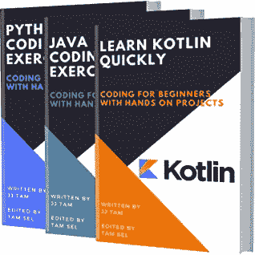
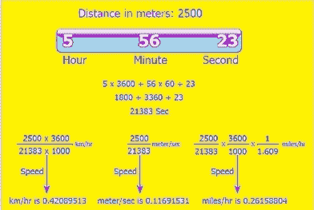
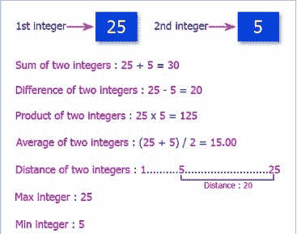

# 快速学习 Kotlin 以及编程练习

**Python 与 Java 初学者编程**

包含实战项目

作者：J J TAM

## Kotlin 简介

### Kotlin：Hello World 程序

### 在 Eclipse 中设置 Kotlin

### 在 Kotlin 中定义变量

### Kotlin 数据类型

### Kotlin：可空类型

### Kotlin：数字

### Kotlin：字符

### Kotlin：将字符转换为 Int

### Kotlin：布尔值

### Kotlin：字符串

### Kotlin：字符串模板表达式

### Kotlin：数组

### Kotlin：定义空值数组

### Kotlin：使用工厂函数定义数组

### Kotlin：打印数组元素

### Kotlin：位运算符

### Kotlin：逻辑运算符

### Kotlin：控制流语句

### Kotlin：if 语句

### Kotlin：if-else 语句

### Kotlin：if-else if-else

### Kotlin：when 表达式

### Kotlin：将 when 用作 if-else if 阶梯

### Kotlin：将 When 用作表达式

### Kotlin：for 循环

### Kotlin：while、do-while 循环

### Kotlin：break 语句

### Kotlin：continue 语句

### Kotlin：类与对象

### Kotlin：声明属性

### Kotlin：属性的 getter 和 setter

### Kotlin：定义类的成员函数

### Kotlin：const：编译时常量

### Kotlin：const 与 val

### Kotlin：lateinit：延迟初始化属性

### Kotlin：构造函数

### Kotlin：次要构造函数

### Kotlin：向主构造函数传递默认值

### Kotlin：定义私有主构造函数

### Kotlin：如何创建对象

### Kotlin：继承

### Kotlin：方法重写

### Kotlin：属性重写

### Kotlin：调用超类方法

### Kotlin：嵌套类

### Kotlin：内部类

## Python 编程练习

### 获取 Python 版本

### 检查数字

### Python 代码：移除第一项

### 筛选正数

### 统计数字 4 的个数

### 判断数字奇偶

### 获取给定字符串的 n 个副本

### 打印出不在另一个列表中的列表

### 在三行中分别显示姓名、年龄、地址

### 求解程序

### 金额的未来值

### 检查文件是否存在

### 转换距离

### 求所有项的和

### 所有项相乘

### 获取最大数字

### 获取最小数字

### 移除重复项

### 克隆或复制列表

### 两个列表的差集

### 生成所有排列

### 找出第二小的数

### 获取唯一值

### 获取元素的出现频率

### 生成所有子列表

### 查找共同项

### 创建列表

### 移除连续重复项

### 扁平化嵌套结构

## Java 编程练习

### 打印 hello

### 打印总和

### 两数相除

### 打印结果

### 打印乘法表

### 求面积

### 交换两个变量

### 打印人脸

### 华氏度转摄氏度

### 英寸转米

### 求所有数字之和

### 打印年数和天数

### 计算 (BMI)

### 计算速度（米）

### 两个指定整数相除

### 两个指定整数相乘

### 打印总和

### 找出三个数中的最大值

### 显示乘法表

### 显示图案

### 打印金字塔图案

### 显示数字菱形结构

---

# 快速学习 Kotlin

## Kotlin 简介

Kotlin 是一种在 **JVM** 上运行的高级编程语言。Kotlin 将源代码编译为 Java 字节码，并使用 **JVM** 运行应用程序。你可以交替使用 Java 和 Kotlin，这意味着你可以从 Java 调用 Kotlin 函数，反之亦然。

### 先决条件

需要具备 Java 基础知识。

### Kotlin 是面向对象的吗？

是的，Kotlin 是面向对象的语言，你可以创建类、对象，并应用面向对象编程概念，如多态、继承等。

### Kotlin 是函数式的吗？

是的，Kotlin 是一种函数式语言。在函数式编程语言中，函数是基本的构建块，你可以返回一个函数，将一个函数作为参数传递给另一个函数等。

### Kotlin 是开源的吗？

是的。

### 我可以使用 Kotlin 开发什么类型的应用程序？

* 构建移动应用程序
* 开发服务器端应用程序
* 你可以开发任何能用 Java 开发的应用程序

### 我可以在 Web 浏览器中运行 Kotlin 代码吗？

Kotlin 可以编译为 JavaScript，因此你可以在浏览器中运行应用程序。

### Kotlin 是静态类型的吗？

是的，Kotlin 是静态类型语言。对于静态类型语言，变量的类型在编译时已知。你可以参考我的文章《静态类型与动态类型语言》来了解静态类型和动态类型语言之间的区别。

### Kotlin 可以推断类型吗？

是的，与 Java 不同，你在定义变量时无需指定类型。Kotlin 根据上下文推断类型。

例如：

```kotlin
var name = "Krishna"
```

由于 `"Krishna"` 被赋值给变量 `name`，Kotlin 推断其类型为 `String`。

```kotlin
var age = 28
```

由于数字 `28` 被赋值给变量 `age`，Kotlin 推断其类型为 `int`。

## Kotlin：Hello World 程序

`.kt` 是 Kotlin 文件的扩展名。创建一个名为 `HelloWorld.kt` 的文件，内容如下。

`HelloWorld.kt`

```kotlin
fun main (args:Array<String>){

println( "Hello World" )

}
```

关键字 `fun` 用于定义函数。

`main` 是应用程序的主函数。程序执行从这里开始。

`args:Array<String>`

在 Kotlin 中，变量名先声明，类型在后。在上面的例子中，`args` 是字符串数组类型的变量。

`println("Hello World")`

上面的语句将消息 `Hello World` 打印到控制台。如你所见，与 Java 不同，Kotlin 语句不以 `;` 结尾。

### 编译 HelloWorld.kt

打开命令提示符并输入命令 `kotlinc HelloWorld.kt`。

```
C:\Users\Krishna\Documents\Study\Kotlin\Programs>kotlinc HelloWorld.kt

C:\Users\Krishna\Documents\Study\Kotlin\Programs>dir

Volume in drive C is OSDisk

Volume Serial Number is 1034-4F6F

Directory of C:\Users\Krishna\Documents\Study\Kotlin\Programs

09/02/2017  11:18 AM    <DIR>          .

09/02/2017  11:18 AM    <DIR>          ..

09/02/2017  11:09 AM                57 HelloWorld.kt

09/02/2017  11:18 AM               980 HelloWorldKt.class

09/02/2017  11:18 AM    <DIR>          META-INF

               2 File(s           1,037 bytes

               3 Dir(s)  63,190,188,032 bytes free
```

如你所见 `dir` 命令的输出，你可以观察到 Kotlin 生成了 `HelloWorldKt.class` 和一个 `META-INF` 目录。

### 运行 HelloWorld.kt

你可以使用 `kotlin HelloWorldKt` 命令来运行 `HelloWorldKt` 文件。

```
C:\Users\krishna\Documents\Study\Kotlin\Programs>kotlin HelloWorldKt

Hello World
```

### 创建并运行 jar

你也可以创建一个 jar 文件，并使用 Java 启动器来运行该 jar 文件。

使用命令 `kotlinc HelloWorld.kt -include-runtime -d HelloWorld.jar` 来创建 jar 文件。

`include-runtime` 选项告诉 Kotlin 编译器，在 `HelloWorld.jar` 文件中包含 Kotlin 运行时。

```
C:\Users\Krishna\Documents\Study\Kotlin\Programs>kotlinc HelloWorld.kt -include-runtime -d HelloWorld.jar

C:\Users\Krishna\Documents\Study\Kotlin\Programs>dir

Volume in drive C is OSDisk

Volume Serial Number is 1034-4F6F

Directory of C:\Users\Krishna\Documents\Study\Kotlin\Programs

09/02/2017  11:24 AM    <DIR>          .

09/02/2017  11:24 AM    <DIR>          ..

09/02/2017  11:24 AM           869,262 HelloWorld.jar

09/02/2017  11:09 AM                57 HelloWorld.kt

               2 File(s)        869,319 bytes

               2 Dir(s)  63,401,816,064 bytes free
```

一旦 jar 文件创建完成，你就可以调用该 jar 文件，就像运行其他 jar 文件一样。使用命令 `java -jar HelloWorld.jar`。

```
C:\Users\Krishna\Documents\Study\Kotlin\Programs>java -jar HelloWorld.jar

Hello World
```

## 在 Eclipse 中设置 Kotlin

打开 Eclipse。Help -> Eclipse Marketplace。


搜索 kotlin。


点击 `Install` 按钮来安装 Kotlin 插件。

安装成功后，Eclipse 会要求重启。重启 Eclipse。

### 创建新的 Kotlin 项目

打开 Eclipse。File -> New -> Other。


Kotlin -> Kotlin Project。


点击 Next。

在 `Kotlin Project` 窗口中，将项目名称设为 `Hello World`，然后点击 Finish 按钮。

Kotlin 项目结构如下所示。


### 创建 HelloWorld.kt 文件

右键点击 `src` 文件夹 -> New -> Other。


选择 `Kotlin File` 然后点击 Next。


将文件名设为 `HelloWorld`，然后点击 `Finish` 按钮。


将下面的代码片段复制到 `HelloWorld.kt` 文件中。

`HelloWorld.kt`

```kotlin
fun main (args: Array<String>) {

    println( "Hello World" )

}
```

### 运行 HelloWorld.kt 文件

右键点击 `HelloWorld.kt` 文件的源代码 -> Run As -> Kotlin Application。


如果一切顺利，你可以在控制台中看到消息 `Hello World`。


## 在 Kotlin 中定义变量

变量是用于存储数据的命名内存位置。

### 语法

```kotlin
var variableName : DataType = value

val variableName : DataType = value
```

`var` 和 `val` 都是关键字。

### 示例

```kotlin
var a : Int  =10;
```

`a` 是 int 类型，赋值为 10。

```kotlin
val b : Double = 1.23
```

`b` 是 Double 类型，赋值为 1.23。关键字 `val` 用于定义常量（不可变对象）。

`HelloWorld.kt`

```kotlin
fun main (args: Array<String>) {

  var a : Int  = 10 ;

  val b : Double = 1.23

    println( "a : ${a}" )

    println( "b : ${b}" )

}
```

```
C:\>kotlinc HelloWorld.kt

C:\>kotlin HelloWorldKt

a : 10

b : 1.23
```

## Kotlin 中的数据类型

Java 有 int、float、char 等原始类型，那么 Kotlin 呢？

从用户的角度来看，Kotlin 将所有东西都设计为对象，但在运行时，布尔值、数字和字符都表示为原始类型。

`HelloWorld.kt`

```kotlin
fun main (args: Array<String>) {

  var doubleVar: Double = 1.23

  var floatVar: Float = 1.23f

  var longVar: Long = 123

  var intVar: Int = 123

  var shortVar: Short = 123

  var byteVar: Byte = 123

    println( "doubleVar : ${doubleVar}" )

    println( "doubleVar : ${floatVar}" )

    println( "longVar : ${longVar}" )

    println( "intVar : ${intVar}" )

    println( "shortVar : ${shortVar}" )

    println( "byteVar : ${byteVar}" )

}
```

#### 输出

```
doubleVar : 1.23

doubleVar : 1.23

longVar : 123

intVar : 123

shortVar : 123

byteVar : 123
```

## Kotlin：可空类型


默认情况下，Kotlin 的引用类型（`Int`、`Float`、`Double`、`String` 等）不接受 `null` 值。Kotlin 引入此特性是为了避免空指针异常。

`Test.kt`

```
fun main (args: Array<String>) {

  var name : String = "Krishna"

    name = null

}
```

当你尝试编译上面的程序时，Kotlin 会抛出以下错误。

```
ERROR: Null can not be a value of a non-null type String (6, 9)
```

如何定义一个可以接受 `null` 值的变量？

通过使用可空类型，你可以定义一个接受 `null` 值的变量。在引用类型后追加 `?` 以接受 `null` 值。

| 类型 | 可空类型 |
|------|---------|
| `Int` | `Int?` |
| `String` | `String?` |
| `Double` | `Double?` |
| `Person` | `Person?` |

## 示例

```
  var id: Int? = 1

  var name: String? = "Krishna"

  var salary: Double? = 123.456

  var person: Person? = Person( "Krishna" )

    id = null

    name = null

    salary = null

    person = null
```

# Kotlin：数字

Kotlin 提供以下数据类型来支持数字。

| 数据类型 | 大小（位） |
|---------|-----------|
| `Double` | 64 |
| `Float` | 32 |
| `Long` | 64 |
| `Int` | 32 |
| `Short` | 16 |
| `Byte` | 8 |

`Numbers.kt`

```
fun main (args: Array<String>) {

  var doubleVar: Double = 1.23

  var floatVar: Float = 1.23f

  var longVar: Long = 123

  var intVar: Int = 123

  var shortVar: Short = 123

  var byteVar: Byte = 123

    println( "doubleVar : ${doubleVar}" )

    println( "doubleVar : ${floatVar}" )

    println( "longVar : ${longVar}" )
```

```
println("intVar : ${intVar}")

println("shortVar : ${shortVar}")

println("byteVar : ${byteVar}")

}
```

输出

```
doubleVar : 1.23

doubleVar : 1.23

longVar : 123

intVar : 123

shortVar : 123

byteVar : 123
```

## 十六进制、八进制和二进制字面量表示法

Kotlin 支持十六进制和二进制表示法，但不支持八进制表示法。十六进制数通过前缀 `0x` 来表示。

`Numbers.kt`

```
fun main(args: Array<String>) {

  var hexaNum : Int = 0x123

  var binaryNum : Int = 0b10101010

println("hexaNum : ${hexaNum}")

println("binaryNum : ${binaryNum}")

}
```

输出

```
hexaNum : 291

binaryNum : 170
```

你也可以使用 `'_'` 来表示数字。

`Numbers.kt`

```
fun main(args: Array<String>) {

  var ten = 10

  var hundred = 100

  var thousand = 1000

  var tenThousand = 10_000

  var oneLaksh = 100_000

  var tenLaksh = 1_000_000

println("ten : ${ten}")

println("hundred : ${hundred}")

println("th/thousand : ${thousand}")

println("tenThousand : ${tenThousand}")

println("oneLaksh : ${oneLaksh}")

println("tenLaksh : ${tenLaksh}")

}
```

输出

```
ten : 10

hundred : 100

thousand : 1000

tenThousand : 10000

oneLaksh : 100000

tenLaksh : 1000000
```

# Kotlin：字符

使用 `'Char'` 关键字来定义单个字符。字符用单引号括起来。

示例

```
var myChar : Char = 'a'
```

`HelloWorld.kt`

```
fun main(args: Array<String>) {

  var myChar : Char = 'a'

println("Value of myChar is : ${myChar}")

}
```

输出

```
Value of myChar is : a
```

Kotlin 支持 Java 所支持的所有转义序列。

# Kotlin：将字符转换为 Int

`Char` 类型提供了 `toInt()` 方法，用于将字符转换为整数。

`IntConverter.kt`

```
fun main(args: Array<String>) {

  var myChar : Char = 'a'

println("Value of myChar is : ${myChar}")

println("Value of myChar in int is : ${myChar.toInt()}")

}
```

输出

```
Value of myChar is : a

Value of myChar in int is : 97
```

# Kotlin：布尔值

`Boolean` 类型用于表示 `true`、`false` 状态。

`Booleans.kt`

```
fun main(args: Array<String>) {

  var trueState : Boolean  = true

  var falseState : Boolean  = false

println("Value of trueState is : ${trueState}")

println("Value of falseState is : ${falseState}")

}
```

输出

```
Value of trueState is : true

Value of falseState is : false
```

# Kotlin：字符串

字符串是字符的集合，用双引号括起来。Kotlin 中的字符串通过关键字 `String` 定义，且这些字符串是不可变的。

示例

```
var message: String = "Good Morning"
```

`StringsDemo.kt`

```
fun main(args: Array<String>) {

  var message: String = "Good Morning"

println(message)

}
```

输出

```
Good Morning
```

Kotlin 支持 Java 所支持的所有转义序列（`\n`、`\t`、`\a` 等）。

示例

```
var message: String = "Good Morning\nHow are you\nsee you soon"
```

`StringDemo.kt`

```
fun main(args: Array<String>) {

  var message: String = "Good Morning\nHow are you\nsee you soon"

println(message)

}
```

输出

```
Good Morning

How are you

see you soon
```

如果你不想进行转义，则将字符串嵌入 `"""`（三引号）中。

`StringDemo.kt`

```
fun main(args: Array<String>) {

  var message: String = """Good Morning\nHow are you\nsee you soon

      After two lines\bgood bye"""

println(message)

}
```

输出

```
Good Morning\nHow are you\nsee you soon

                                             After two lines\bgood bye
```

# Kotlin：字符串模板表达式

通过使用模板表达式，你可以在字符串中计算表达式。模板表达式以 `$` 符号开头，后跟一个名称。

示例

```
var a = 10

println("Value of a is : $a")
```

任意表达式用花括号括起来

```
var str = "Hello World"

println("$str length is ${str.length}")
```

`Expression.kt`

```
fun main(args: Array<String>) {

  var a = 10

  var str = "Hello World"

println("Value of a is : $a")

println("$str length is ${str.length}")

}
```

输出

```
Value of a is : 10

Hello World length is 11
```

# Kotlin：数组

数组表示相同类型元素的集合。Kotlin 提供了 `Array` 类来表示数组。

通过使用库函数 `arrayOf`，你可以定义一个数组。

示例

```
val numbers: Array<Int> = arrayOf(10, 20, 30, 40, 50)
```

`ArrayDemo.kt`

```
fun main(args: Array<String>) {

  val numbers: Array<Int> = arrayOf(10, 20, 30, 40, 50)

  for (element in numbers) {

  println(element)

}

}
```

输出

```
10

20

30

40

50
```

Kotlin 提供了以下库函数来定义基本类型数组。

- `byteArrayOf()`
- `shortArrayOf()`
- `intArrayOf()`
- `longArrayOf()`
- `floatArrayOf()`
- `doubleArrayOf()`
- `CharArray()`
- `BooleanArray()`

# Kotlin：定义 null 数组

Kotlin 提供了 `arrayOfNulls` 库函数来定义 `null` 值数组。

`ArrayOfNulls.kt`

```
fun main(args: Array<String>) {

  var a: Array<Int?> = arrayOfNulls(5)

  for (element in a) {

  println(element)

}

}
```

输出

```
null

null

null

null

null
```

# Kotlin：使用工厂函数定义数组

Kotlin 提供了一个工厂函数，该函数接受大小和一个函数 `'f'` 作为参数来定义数组。函数 `'f'` 用于为数组提供初始值。

```
var squares = Array(5, { i -> i * i })
```

上面的语句定义了一个大小为 5 的数组 `squares`，并初始化为 `{1, 4, 9, 16, 25}`

`ArrayFactoryFunction.kt`

```
fun main(args: Array<String>) {

  var squares = Array(5, { i -> i * i })

  var cubes = Array(5, { i -> i * i * i })

println("Elements in squares array : ")

  for (ele in squares) {

  println(ele)

}

println("\nElements in cubes array : ")

  for (ele in cubes) {

  println(ele)

}

}
```

输出

```
Elements in squares array :

0

1

4

9

16

Elements in cubes array :

0

1

8

27

64
```

# Kotlin：打印数组元素

在这篇文章中，我将展示如何打印数组的元素。

## 使用 for 循环打印数组元素

`ArrayUtil.kt`

```
fun main(args: Array<String>) {

  var arr: Array<Int> = arrayOf(1, 2, 3, 4)

  for (ele in arr) {

  println(ele)

}

}
```

输出

```
1

2

3

4
```

## 使用 `Arrays.toString` 方法打印数组元素

`ArrayUtil.kt`

```
import java.util.Arrays

fun main(args: Array<String>) {

  var arr: Array<Int> = arrayOf(1, 2, 3, 4)

println(Arrays.toString(arr))

}
```

输出

```
[1, 2, 3, 4]
```

## 使用 `array.indices` 打印数组元素

`ArrayUtil.kt`

```
fun main(args: Array<String>) {

  var arr: Array<Int> = arrayOf(2, 3, 5, 7)

  for (index in arr.indices) {

  println(arr[index])

}

}
```

输出

```
2

3

5

7
```

## 使用 `array.withIndex` 打印数组元素

`ArrayUtil.kt`

```
fun main(args: Array<String>) {

  var arr: Array<Int> = arrayOf(2, 3, 5, 7)

  for ((index, value) in arr.withIndex()) {

  println("index : $index, value : $value")

}

}
```

输出

```
index : 0, value : 2

index : 1, value : 3

index : 2, value : 5

index : 3, value : 7
```

## 使用 while 循环打印数组元素

`ArrayUtil.kt`

```
fun main(args: Array<String>) {

  var arr: Array<Int> = arrayOf(2, 3, 5, 7)

  var sizeOfTheArray = arr.size;

  var index : Int = 0;

  while (index < sizeOfTheArray){

  println("index : $index, value : ${arr[index]}")

  index++

}

}
```

输出

```
index : 0, value : 2

index : 1, value : 3

index : 2, value : 5

index : 3, value : 7
```

# Kotlin：位运算符

下表总结了 Kotlin 支持的位运算符。

| 运算符 | 描述 | Java 等价 |
| --- | --- | --- |
| `shl` | 执行有符号左移 | `<<` |
| `shr` | 执行有符号右移 | `>>` |
| `ushr` | 执行无符号右移 | `>>>` |
| `and` | 按位与 | `&` |
| `or` | 按位或 | `\|` |
| `xor` | 按位异或 | `^` |
| `inv()` | 按位取反 | `~` |

除了 `inv()` 之外，所有其他运算符都以中缀形式使用。

示例：

```
var1 shl var2

var1 or var2
```

## 1. `shl`：执行有符号左移

左移运算符将所有位向左移动一位，即，它将值加倍。

语法：

```
variable shl n
将变量左移 'n' 次。
```

`Variable shl n` 等于 `variable = variable * 2 的 n 次幂`


# Kotlin：位运算符

## 1. `shl`：执行有符号左移

左移运算符将所有位向左移动一位，即将其值加倍（乘以 2）。

**语法：**

```
variable shl n
```

将变量左移 `n` 次。

`variable shl n` 等于 `variable = variable * 2 power n`

```
var var1 : Int = 2

var1 shl 1 = 2 * 2 的 1 次幂 = 4

var1 shl 2 = 2 * 2 的 2 次幂 = 8
```

```
var1 shl 9 = 2 * 2 power 9 = 1024
```

`LeftShift.kt`

```kotlin
fun main (args: Array<String>) {
  var var1: Int = 2
  var res1 = var1 shl 1
  var res2 = var1 shl 2
  var res3 = var1 shl 9
  println( "res1 : ${res1}" )
  println( "res2 : ${res2}" )
  println( "res3 : ${res3}" )
}
```

**输出**

```
res1 : 4
res2 : 8
res3 : 1024
```

## 2. `shr`：执行有符号右移

右移运算符将所有位向右移动一位，即将其值减半（除以 2）。

**语法：**

```
variable shr n
```

将变量右移 `n` 次。

`variable shr n` 等于 `variable = variable / 2 power n`

```
var a : Int = 128
a shr 1 = 128 / (2 power 1) = 64
a shr 2 = 128 / (2 power 2) = 32
```

`RightShift.kt`

```kotlin
fun main (args: Array<String>) {
  var a: Int = 128
  var res1 = a shr 1
  var res2 = a shr 2
  var res3 = a shr 3
  println( "res1 : ${res1}" )
  println( "res2 : ${res2}" )
  println( "res3 : ${res3}" )
}
```

**输出**

```
res1 : 64
res2 : 32
res3 : 16
```

## 3. `ushr`：无符号右移

将所有位向右移动一位，并将最左边的位设为 0。

**语法：**

```
variable ushr n
```

`UnsignedRightShift.kt`

```kotlin
fun main (args: Array<String>) {
  var a: Int = - 128
  var res1 = a ushr 1
  println( "res1 : ${res1}" )
}
```

**输出**

```
res1 : 2147483584
```

**解释**

`-128` 的补码形式为：

```
11111111 11111111 11111111 10000000
```

`>>>` 将位向右移动一位，并将最左边的位替换为 0。

因此（`-128 ushr 1`）的结果如下：

```
01111111 11111111 11111111 11000000
```

## 4. 位运算 `and`、`or`、`xor`

| Bit1 | Bit2 | and | or | xor |
|------|------|-----|----|-----|
| 0    | 0    | 0   | 0  | 0   |
| 0    | 1    | 0   | 1  | 1   |
| 1    | 0    | 0   | 1  | 1   |
| 1    | 1    | 1   | 1  | 0   |

`HelloWorld.kt`

```kotlin
fun main (args: Array<String>) {
  var a: Int = 8
  var b: Int = 9
  println( "a and b is ${a and b} " )
  println( "a or b is ${a or b} " )
  println( "a xor b is ${a xor b}" )
}
```

**输出**

```
a and b is 8
a or b is 9
a xor b is 1
```

**解释**

```
   a    = 0000 1000
   b    = 0000 1001
   a&b = 0000 1000
   a    = 0000 1000
   b    = 0000 1001
   a|b = 0000 10001
   a     = 0000 1000
   b     = 0000 1001
   a^b = 0000 0001
```

**注意：**

位运算符仅适用于 `byte`、`short` 等整数值，不适用于 `float`、`double`、`Boolean`。

## 5. `inv()`：按位取反

取反运算符将位值为 1 的改为 0，位值为 0 的改为 1。

**示例**

```
var a : Int = 8
```

`a` 的二进制格式为 `0 0 0 0 0 1 1 1`。

`a.inv()` 的二进制格式为 `1 1 1 1 1 0 0 0`。

`Inverse.kt`

```kotlin
fun main (args: Array<String>) {
  var a: Int = 8
  println( "Value of a is : ${a}" )
  println( "inversion of a is : ${a.inv()}" )
}
```

**输出**

```
Value of a is : 8
inversion of a is : -9
```

# Kotlin：逻辑运算符

Kotlin 支持逻辑运算符（也称为布尔运算符），用于组合多个条件。

- `||` – 惰性析取
- `&&` – 惰性合取
- `!` - 否定

## 1. `||` – 惰性析取

`operand1 || operand2`：如果任一操作数为 `true`，则返回 `true`，否则返回 `false`。

| Operand1 | Operand2 | Evaluates To |
|----------|----------|--------------|
| False    | false    | false        |
| False    | true     | true         |
| True     | false    | true         |
| True     | true     | true         |

`BooleanOr.kt`

```kotlin
fun main (args: Array<String>) {
  var operand1: Boolean = false
  var operand2: Boolean = false
  println( "${operand1} || ${operand2}: ${(operand1 || operand2)}" )
  operand1 = false
  operand2 = true
  println( "${operand1} || ${operand2}: ${(operand1 || operand2)}" )
  operand1 = true
  operand2 = false
  println( "${operand1} || ${operand2}: ${(operand1 || operand2)}" )
  operand1 = true
  operand2 = true
  println( "${operand1} || ${operand2}: ${(operand1 || operand2)}" )
}
```

**输出**

```
false || false : false
false || true : true
true || false : true
true || true : true
```

**为什么 `||` 被称为惰性析取？**

如果第一个表达式求值为 `true`，那么 Kotlin 不会计算整个表达式。因此逻辑 OR 被称为短路 OR（或）惰性析取运算符。

`LazyDisjunciton.kt`

```kotlin
fun main (args: Array<String>) {
  var a : Int = 10
  var b : Int = 21
  if ((a < b) || (a++ < b)) {
    System. out .println( "This statement evaluated" );
  }
  System. out .println( "a is not incremented " + a);
  if ((a > b) || (a++ > b)) {
    System. out .println( "This statement is evaluated" );
  }
  System. out .println( "a is incremented " + a);
}
```

**输出**

```
This statement evaluated
a is not incremented 10
a is incremented 11
```

## 2. `&&` – 惰性合取

`operand1 && operand2`：如果两个操作数都为 `true`，则返回 `true`，否则返回 `false`。

| Operand1 | Operand2 | Evaluates To |
|----------|----------|--------------|
| False    | false    | false        |
| False    | true     | false        |
| True     | false    | false        |
| True     | true     | true         |

`BooleanAnd.kt`

```kotlin
fun main (args: Array<String>) {
  var operand1: Boolean = false
  var operand2: Boolean = false
  println( "${operand1} && ${operand2}: ${(operand1 && operand2)}" )
  operand1 = false
  operand2 = true
  println( "${operand1} && ${operand2}: ${(operand1 && operand2)}" )
  operand1 = true
  operand2 = false
  println( "${operand1} && ${operand2}: ${(operand1 && operand2)}" )
  operand1 = true
  operand2 = true
  println( "${operand1} && ${operand2}: ${(operand1 && operand2)}" )
}
```

**输出**

```
false && false: false
false && true: false
true && false: false
true && true: true
```

**为什么 `&&` 被称为惰性合取运算符？**

如果表达式中的第一个语句求值为 `false`，那么 Kotlin 不会计算整个表达式。因此，逻辑 AND 被称为短路 AND。

`LazyConjunction.kt`

```kotlin
fun main (args: Array<String>) {
  var a: Int = 10
  var b: Int = 21
  if ((a > b) && (a++ > b)) {
    System. out .println( "This statement not evaluated" );
  }
  System. out .println( "a is not incremented " + a);
  if ((a < b) && (a++ < b)) {
    System. out .println( "This statement is evaluated" );
  }
  System. out .println( "a is incremented " + a);
}
```

**输出**

```
a is not incremented 10
This statement is evaluated
a is incremented 11
```

## 3. 逻辑非（`!`）运算符

如果操作数为 `false`，`!` 运算符将其求值为 `true`。

如果操作数为 `true`，`!` 运算符将其求值为 `false`。

| Operand | Evaluates To |
|---------|--------------|
| False   | true         |
| True    | false        |

`LogicalNot.kt`

```kotlin
fun main (args: Array<String>) {
  var operand1: Boolean = false
  var operand2: Boolean = true
  println( "operand1 : ${operand1}" )
  println( "!operand1 : ${!operand1}" )
  println( "operand2 : ${operand2}" )
  println( "!operand2 : ${!operand2}" )
}
```

**输出**

```
operand1 : false
!operand1 : true
operand2 : true
!operand2 : false
```

# Kotlin：`===` 与 `==`

Kotlin 支持两种类型的相等性。

- 引用相等
- 结构相等

## 引用相等（`===`）

`===` 运算符用于检查两个引用是否指向同一个对象。

例如：

```
ref1 === ref2
```

如果引用 `ref1` 和 `ref2` 指向同一个对象，则上述语句返回 `true`，否则返回 `false`。

## 结构相等（`==`）

结构相等用于检查两个引用的值是否相等（通过使用 Java 的 `equals()` 方法检查）。

例如：

```
ref1 == ref2
```

如果 `ref1.equals(ref2)` 返回 `true`，则上述语句返回 `true`，否则返回 `false`。

`Equality.kt`

```kotlin
fun main (args: Array<String>) {
  var intVar1 : Int = 10000
  var intBoundedVar1 : Int? = intVar1
  var intBounderdVar2 : Int? = intVar1
  println( "(intBoundedVar1===intBounderdVar2) : ${(intBoundedVar1 === intBounderdVar2)}" )
  println( "(intBoundedVar1==intBounderdVar2) : ${(intBoundedVar1 == intBounderdVar2)}" )
}
```

**输出**

```
(intBoundedVar1===intBounderdVar2) : false
(intBoundedVar1==intBounderdVar2) : true
```

# Kotlin：控制流语句

Kotlin 提供了控制流语句：

- 用于决策（`if`、`if-else`、`when`）和
- 用于循环（`for`、`while`、`do-while`）

## 决策语句

- `if` 语句
- `if-else` 语句
- `if-else if-else` 阶梯
- `when` 语句

## 循环语句

- `for`
- `while`
- `do-while`

# Kotlin：`if` 语句

`if` 告诉程序在条件求值为 `true` 时执行代码段。

**语法：**

```
if(condition){
    // 如果条件为真则执行
}
```

`IfStmt.kt`

```kotlin
fun main(args: Array<String>) {
    var marks: Int = 20
    if (marks < 35) {
        println("You failed in the Exam. Better luck next time");
    }
    marks = 55
    if (marks < 35) {
        println("You failed in the Exam again. Better luck next time");
    }
}
```

**输出**

```
You failed in the Exam. Better luck next time
```

# Kotlin：`if-else` 语句

如果条件为真，则执行 `if` 代码块，否则执行 `else` 代码块。

**语法：**

```
if(condition){
}else{
}
```

`IfElse.kt`

```kotlin
fun main(args: Array<String>) {
    var marks: Int = 65
    if (marks < 35) {
        println("You failed in the Exam. Better luck next time");
    } else {
        println("You passed in the exam")
    }
}
```

**输出**

```
You passed in the exam
```

# Kotlin：`if-else if-else`

通过使用 `if-else if-else` 结构，你可以在多个选项中进行选择。

`if` 语句后面可以跟一个可选的 `else if...else` 语句，这对于测试各种条件非常有用。

`IfElseIf.kt`


```kotlin
fun main(args: Array<String>) {
    var marks: Int = 65
    if (marks < 35)
        println("You are failed");
    else if (marks < 50)
        println("You are passed and got third class");
    else if (marks < 60)
        println("You are passed and got second class");
    else if (marks < 70)
        println("You are passed and got first class");
    else
        println("You are passed and got distinction");
}
```

**输出**

```
You are passed and got first class
```

# Kotlin: when 表达式

`when` 相当于 Java 中的 `switch` 语句。

**语法**

```
when(expression){
    1 -> {//执行某些操作}
    2 -> {//执行某些操作}
    else -> {//执行某些操作}
}
```

`when` 会按顺序将表达式与所有可能的 case 进行匹配。如果没有一个 case 满足条件，则会执行 `else` 代码块。

`WhenDemo.kt`

```kotlin
fun main(args: Array<String>) {
    var a: Int = 5
    when (a) {
        12 -> println("Value 12 is checked")
        5 -> println("Value 5 is checked")
        3 -> println("Value 3 is checked")
        else -> println("No value is checked")
    }
}
```

**输出**

```
Value 5 is checked
```

你可以在 `when` 表达式中组合多个分支语句。

`WhenDemo.kt`

```kotlin
fun main(args: Array<String>) {
    var a: Int = 5
    when (a) {
        2, 3, 5, 7 -> println("Prime number")
        4, 6, 8 -> println("Even number other than 2")
        else -> println("No value is checked")
    }
}
```

**输出**

```
Prime number
```

你也可以使用任意表达式作为分支条件。例如，我使用了 `2+3` 作为分支条件。

`WhenDemo.kt`

```kotlin
fun main(args: Array<String>) {
    var a: Int = 5
    when (a) {
        2 + 3 -> println("Checked value 5")
        4, 6, 8 -> println("Even number other than 2")
        else -> println("No value is checked")
    }
}
```

**输出**

```
Checked value 5
```

你也可以在分支条件中检查范围（或不在范围内）。

`WhenDemo.kt`

```kotlin
fun main(args: Array<String>) {
    var a: Int = 5
    when (a) {
        in 1..5, in 11..15 -> println("a is in between 1 to 5 (or) 11 to 15")
        in 6..10 -> println("a is in range of 6 to 10")
        else -> println("x is not in range")
    }
}
```

**输出**

```
a is in between 1 to 5 (or) 11 to 15
```

# Kotlin: 将 when 用作 if-else if 阶梯

你也可以将 `when` 表达式用作 `if-elseif` 阶梯。如果你不为 `when` 表达式指定任何参数，它可以作为 `if-else if` 阶梯使用。

`ConditionDemo.kt`

```kotlin
fun main(args: Array<String>) {
    var marks: Int = 65
    if (marks < 35)
        println("You are failed");
    else if (marks < 50)
        println("You are passed and got third class");
    else if (marks < 60)
        println("You are passed and got second class");
    else if (marks < 70)
        println("You are passed and got first class");
    else
        println("You are passed and got distinction");
}
```

**输出**

```
You are passed and got first class
```

你可以使用 `when` 表达式实现上述 `if-else if-else` 逻辑，如下所示。

`WhenDemo.kt`

```kotlin
fun main(args: Array<String>) {
    var marks: Int = 65
    when {
        (marks < 35) -> println("You are failed")
        (marks < 50) -> println("You are passed and got third class")
        (marks < 60) -> println("You are passed and got second class")
        (marks < 70) -> println("You are passed and got first class")
        else -> println("You are passed and got distinction")
    }
}
```

**输出**

```
You are passed and got first class
```

# Kotlin: 将 when 用作表达式

你可以将 `when` 用作表达式。如果你将 `when` 用作表达式，匹配分支的值将成为 `when` 表达式的值。

`WhenDemo.kt`

```kotlin
fun main(args: Array<String>) {
    var a: Int = 2
    var s: String = "cube"
    var result = when {
        s.equals("double") -> a * a
        s.equals("cube") -> a * a * a
        else -> a
    }
    println("result is $result")
}
```

**输出**

```
result is 8
```

# Kotlin: for 循环

`for` 循环用于遍历集合、数组、范围等。

通过使用 `for` 循环，你可以遍历任何提供迭代器的东西。

## 遍历数组

**语法**

```
for(ele in array){
}
```

`ArrayDemo.kt`

```kotlin
fun main(args: Array<String>) {
    var arr: Array<Int> = arrayOf(2, 3, 5, 7)
    for (ele in arr) {
        println(ele)
    }
}
```

**输出**

```
2
3
5
7
```

## 遍历范围

`ArrayDemo.kt`

```kotlin
fun main(args: Array<String>) {
    for (ele in 1..10) {
        println(ele)
    }
}
```

**输出**

```
1
2
3
4
5
6
7
8
9
10
```

## 遍历字符串

`ArrayDemo.kt`

```kotlin
fun main(args: Array<String>) {
    var message = "Good Morning"
    for (c in message) {
        print(c)
    }
}
```

**输出**

```
Good Morning
```

# Kotlin: while、do-while 循环

## while 循环

`while` 语句在特定条件为真时执行一段语句块。

**语法**

```
while (expression) {
    //语句
}
```

`while` 语句中的表达式必须计算为布尔值，否则编译器会抛出错误。`while` 语句首先计算表达式，直到表达式计算为真时，它执行 `while` 代码块内的代码，否则跳出 `while` 循环。

**示例：** 使用 `while` 循环打印从 0 到 9 的数字。

`WhileDemo.kt`

```kotlin
fun main(args: Array<String>) {
    var counter: Int = 0
    while (counter < 10) {
        println(counter)
        counter++
    }
}
```

**输出**

```
0
1
2
3
4
5
6
7
8
9
```

## do-while 循环

`do-while` 也是一种类似 `while` 的循环结构，但它在循环底部而不是顶部计算表达式。

**语法**

```
do {
    //语句
} while (expression)
```

`DoWhileDemo.kt`

```kotlin
fun main(args: Array<String>) {
    var counter: Int = 0
    do {
        println(counter)
        counter++
    } while (counter < 10)
}
```

**输出**

```
0
1
2
3
4
5
6
7
8
9
```

## while 和 do-while 有什么区别？

即使表达式计算为假，`do` 代码块内的语句也至少执行一次。

# Kotlin: break 语句

`break` 语句用于终止最近的闭合循环。

`break` 语句可以以两种形式使用。

- 无标签 break
- 带标签 break

## 无标签 break

无标签 break 用于跳出最近的闭合循环。

**语法**

```
break
```

`BreakDemo.kt`

```kotlin
fun main(args: Array<String>) {
    for (i in 1..10) {
        println(i)
        if (i == 5) {
            break
        }
    }
}
```

**输出**

```
1
2
3
4
5
```

`BreakDemoInnerLoop.kt`

```kotlin
fun main(args: Array<String>) {
    for (i in 1..5) {
        for (j in 1..i) {
            print("$j")
        }
        println()
    }
}
```

**输出**

```
1
12
123
1234
12345
```

## 带标签 break

Kotlin 允许我们为任何表达式添加标签。

### 如何创建标签？

定义一个标识符，后跟 `@` 符号。

例如：

`outerLoop@`、`processState@`

通过指定标签，我们可以跳出该标签。

**语法**

```
break@labelIdentifier
```

例如

```
break@outerLoop
break@processState
```

`LabelledBreakDemo.kt`

```kotlin
fun main(args: Array<String>) {
    var counter: Int = 0;
    outerLoop@ for (i in 1..5) {
        for (j in 1..i) {
            counter++
            print("$j")
            if (counter == 6) {
                println("\nBreaking out of the outer loop")
                break@outerLoop
            }
        }
        println()
    }
}
```

**输出**

```
1
12
123
Breaking out of the outer loop
```

# Kotlin：`continue` 语句

`continue` 语句跳过循环的当前迭代（例如：`for`、`while`、`do-while` 循环）。与 `break` 类似，`continue` 也有两种形式。

1. 无标签 `continue`
2. 带标签 `continue`

## 无标签 `continue`

语法

```
continue;
```

`ContinueDemo.kt`

```kotlin
fun main(args: Array<String>) {
    for (i in 1..10) {
        if (i % 2 != 0) {
            continue
        }
        print("$i ")
    }
}
```

输出

```
2 4 6 8 10
```

`UnlabelledContinueInnerLoop.kt`

```kotlin
fun main(args: Array<String>) {
    for (i in 1..5) {
        for (j in 1..10) {
            if (j % 2 != 0) {
                continue
            }
            print("$j ")
        }
        println()
    }
}
```

输出

```
2 4 6 8 10
2 4 6 8 10
2 4 6 8 10
2 4 6 8 10
2 4 6 8 10
```

## 带标签 `continue`

Kotlin 允许我们为任何表达式添加标签。

### 如何创建标签？

定义一个标识符，后跟 `@` 符号。

例如：

`outerLoop@`、`processState@`

我们可以将 `continue` 语句与标签一起使用。

语法

```
continue@labelIdentifier
```

示例

```
continue@outerLoop
continue@processState
```

`ContinueLabelledDemo.kt`

```kotlin
fun main(args: Array<String>) {
    outerLoop@ for (i in 1..5) {
        for (j in 1..10) {
            if (j > 5) {
                println()
                continue@outerLoop
            }
            print("$i ")
        }
    }
}
```

输出

```
1 1 1 1 1
2 2 2 2 2
3 3 3 3 3
4 4 4 4 4
5 5 5 5 5
```

# Kotlin：类与对象

## 现实世界中的对象与类

### 对象

对象是现实世界中的实体。例如，书、猫、盒子、公交车、键盘、人、屏幕、手机等，都是对象。

### 我们如何区分对象

1. 依据它们的属性
2. 依据它们的行为

#### 基于属性区分两个对象

假设有两个人 A 和 B。

首先，让我们尝试找出人对象可能的属性。

人可能的属性

`height`（身高）、`weight`（体重）、`color`（肤色）、`Education Qualification`（教育资格）、`country`（国家）、`address`（地址）都属于人的属性。

现在通过比较这些属性，我们可以轻松区分两个人。

| 属性 | 人 A | 人 B |
| --- | --- | --- |
| 身高 | 6ft | 5.5ft |
| 体重 | 75Kg | 60Kg |
| 肤色 | 白色 | 黑色 |
| 国家 | 印度 | 美国 |


如上面的表格所示，两个人都有各自的属性，因此我们可以依据这些属性来区分他们。

## 基于行为区分两个对象

考虑同样的两个人 A 和 B。让我们尝试找出人对象可能的行为。

可能的行为有`walk`（走路）、`run`（跑步）、`swim`（游泳）、`eat`（吃饭）、`sleep`（睡觉）、`see`（看）、`hear`（听）等。现在通过比较这些行为，我们可以轻松区分两个人。

| 行为 | 人 A | 人 B |
| --- | --- | --- |
| 走路 | 10km/hr | 12km/hr |
| 跑步 | 20km/hr | 18km/hr |
| 睡觉 | 8 Hrs/day | 6Hrs/day |

### 类

通俗地说，我将类称为类别。

所有人都属于人类别。

`cat`（猫）、`lion`（狮子）、`Elephant`（大象）属于动物类别。

因此，类或类别是一组具有相似属性和行为的对象。

## 编程术语中的对象与类

### 什么是对象？

对象是一个包含相关状态和行为的软件包。Kotlin 的主要优势在于你可以将 Kotlin 中的对象与现实世界中的对象进行比较。因此在 Kotlin 中处理对象非常容易。

### 什么是类？

类是创建对象的蓝图或原型。

你可以使用`class`关键字来定义类。

语法：

```kotlin
class ClassName {
    // 属性
    // 函数
}
```

示例：

```kotlin
class Employee {
    var firstName: String = ""
    var lastName: String = ""
}
```

上面的代码片段定义了`Employee`类，它定义了两个属性（`firstName`、`lastName`）。

如何为`Employee`类定义对象？

```kotlin
var emp1 = Employee()
```

上面的语句用于为`Employee`类定义一个对象。

如何访问与对象`emp1`关联的属性？

对象的成员（`firstName`和`lastName`）使用`.`符号来访问。

语法：

```
objName.propertyName
```

示例：

```kotlin
emp1.firstName = "Chamu"
emp1.lastName = "Gurram"
```

`Employee.kt`：

```kotlin
class Employee {
    var firstName: String = ""
    var lastName: String = ""
}
```

`Main.kt`：

```kotlin
fun main(args: Array<String>) {
    var emp1 = Employee()
    emp1.firstName = "Chamu"
    emp1.lastName = "Gurram"
    println("First name : ${emp1.firstName}")
    println("Last name : ${emp1.lastName}")
}
```

输出：

```
First name : Chamu
Last name : Gurram
```

# Kotlin：声明属性

你可以在类中定义属性。属性可以是可变的（mutable）或不可变的（immutable，一旦定义就不能更改）。

### 如何定义可变属性？

可变属性使用`var`关键字定义。

例如：

```kotlin
var name: String = "Krishna"
```

### 如何定义不可变属性？

不可变属性使用`val`关键字定义。

例如：

```kotlin
val name: String = "Krishna"
```

```kotlin
class Employee {
    var name: String = "Krishna"
    var age: Int = 28
    val orgID: String = "ORG1234"
}
```

如你所见，在`Employee`类中，我将`name`和`age`定义为可变属性，`orgID`定义为不可变属性。

### 如何在类中访问属性？

通过定义对象，你可以访问类的属性。`.`符号用于访问类的实例属性。

语法：

```
objectName.propertyName
```

`HelloWorld.kt`：

```kotlin
class Employee {
    var name: String = "Krishna"
    var age: Int = 28
    val orgID: String = "ORG1234"
}

fun main(args: Array<String>) {
    var emp = Employee()
    println("name : ${emp.name}")
    println("age : ${emp.age}")
    println("orgID : ${emp.orgID}")
}
```

输出：

```
name : Krishna
age : 28
orgID : ORG1234
```

定义属性时不需要添加属性类型，Kotlin 环境会自动推断。但添加类型可以提高程序的可读性。

```kotlin
class Employee {
    var name = "Krishna"
    var age = 28
    val orgID = "ORG1234"
}
```

# Kotlin：属性的 Getter 和 Setter

在我之前的文章中，我解释了如何定义属性，除了定义之外，我们还可以为属性添加 getter 和 setter 方法。

语法：

```
var <propertyName>[: <PropertyType>] [= <property_initializer>]
    [<getter>]
    [<setter>]
```

`PropertyType`、`getter`和`setter`在定义属性时是可选的。

`HelloWorld.kt`：

```kotlin
class Employee {
    var name: String = "Krishna"
        get() = field
        set(value) {
            field = value
        }
    var age: Int = 28
        get() = field
        set(value) {
            field = value
        }
    val orgID = "ORG1234"
}

fun main(args: Array<String>) {
    var emp = Employee()
    println("name : ${emp.name}")
    println("age : ${emp.age}")
    println("orgID : ${emp.orgID}")
}
```

输出：

```
name : Krishna
age : 28
orgID : ORG1234
```

如你所见，我使用`field`标识符来引用幕后字段。按照惯例，setter 方法使用`value`作为参数名，但你可以使用任何名称。

### 为什么我需要 getter 和 setter 方法？

Getter 和 setter 方法用于在发送/设置信息之前对数据进行转换/验证。

```kotlin
var age: Int = 28
    get() = field
    set(value) {
        if (value < 0 || value > 100)
            field = 3
    }
```

例如，在上面的代码片段中，setter 方法在将年龄设置到`age`属性之前进行验证。如果用户将年龄设置为`<0`或`> 100`，年龄将被设置为`3`。以下是可运行的应用程序。

`HelloWorld.kt`：

```kotlin
class Employee {
    var name: String = "Krishna"
        get() = field
        set(value) {
            field = value
        }
    var age: Int = 28
        get() = field
        set(value) {
            if (value < 0 || value > 100)
                field = 3
        }
    val orgID = "ORG1234"
}

fun main(args: Array<String>) {
    var emp = Employee()
    println("name : ${emp.name}")
    println("age : ${emp.age}")
    println("orgID : ${emp.orgID}")
    emp.age = -100
    println("\nAfter setting the age to -100")
    println("name : ${emp.name}")
    println("age : ${emp.age}")
    println("orgID : ${emp.orgID}")
}
```

输出：

```
name : Krishna
age : 28
orgID : ORG1234

After setting the age to -100
name : Krishna
age : 3
orgID : ORG1234
```

Kotlin 为可变属性（使用`var`关键字定义的属性）提供默认的 getter 和 setter 方法，而对于不可变属性（使用`val`关键字定义的属性），则仅提供 getter 方法。

`var name = "Krishna"` // 类型为 String，具有默认的 getter 和 setter

`val orfID = "orf1234"` // 类型为 String，具有默认的 getter

## Kotlin：定义类的成员函数

Kotlin 中的函数使用`fun`关键字定义。

示例：

```kotlin
fun square(x : Int) : Int{
    return x*x
}
```

上面的代码片段定义了一个名为`square`的函数，它接受一个`Int`类型的参数，并返回整数。

`Employee.kt`：

```kotlin
class Employee {
  private var firstName: String = ""
  private var lastName: String = ""
  fun getFirstName (): String {
  return firstName
}
  fun getLastName (): String {
  return lastName
}
  fun setFirstName (firstName: String) {
  this .firstName = firstName
}
  fun setLastName (lastName: String) {
  this .lastName = lastName
}
}
```

`Main.kt`：

```kotlin
fun main (args: Array<String>) {
  var emp1 = Employee()
emp1.setFirstName( "Chamu" )
emp1.setLastName( "Gurram" )
println( "firstName : ${emp1.getFirstName()}" )
println( "lastName : ${emp1.getLastName()}" )
}
```

输出：

```
firstName : Chamu
lastName : Gurram
```

## Kotlin：成员属性必须初始化

在 Kotlin 中，成员属性要么初始化，要么必须声明为抽象。让我们通过一个例子来看看。

`Employee.kt`：

```kotlin
class Employee {
  private var firstName: String
  private var lastName: String
  fun getFirstName (): String {
  return firstName
}
  fun getLastName (): String {
  return lastName
}
  fun setFirstName (firstName: String) {
  this .firstName = firstName
}
  fun setLastName (lastName: String) {
  this .lastName = lastName
}
}
```

尝试编译上面的程序，你会得到如下错误。

```
C:\>kotlinc Employee.kt
Employee.kt:2:2: error: property must be initialized or be abstract
        private var firstName: String
^
Employee.kt:3:2: error: property must be initialized or be abstract
        private var lastName: String
```

如何消除上述错误？

有两种方法，要么初始化属性，要么将属性设为抽象。

方法 1：初始化属性`firstName`和`lastName`

`Employee.kt`：

```kotlin
class Employee {
  private var firstName: String = ""
  private var lastName: String = ""
  fun getFirstName (): String {
  return firstName
}
  fun getLastName (): String {
  return lastName
}
  fun setFirstName (firstName: String) {
  this .firstName = firstName
}
  fun setLastName (lastName: String) {
  this .lastName = lastName
}
}
```

方法 2：将属性设为抽象

`Employee.kt`：

```kotlin
abstract class Employee {
  abstract var firstName: String
  abstract var lastName: String
}
```

## Kotlin：const：编译时常量

你可以使用`const`关键字定义编译时常量。

示例：

```kotlin
const val VENDOR_NAME = "Self Learning Java blog"
```

`HelloWorld.kt`：

```kotlin
const val VENDOR_NAME = "Self Learning Java blog"
const val PI = 3.14
fun main (args: Array<String>) {
println( "Vendor Name $VENDOR_NAME" )
println( "Value of PI : $PI" )
}
```

输出：

```
Vendor Name Self Learning Java blog
Value of PI : 3.14
```

在定义编译时常量时，属性必须满足以下条件：

- 顶层或对象的成员
- 使用`String`类型或基本类型的值进行初始化
- 没有自定义 getter

## Kotlin：const 与 val

`const`关键字用于定义编译时常量，即 const 变量的值在编译时已知。而`val`用于定义运行时常量。

例如，你不能像下面这样定义 const。

```kotlin
const val PICon = getPI()
```

当你尝试编译包含上述语句的 Kotlin 程序时，你会得到如下错误。

`Const 'val' has type 'Unit'. Only primitives and String are allowed`

这是因为`getPI()`在运行时求值并将值赋给`PICon`，但`const`用于在编译时定义常量。

请看下面的可运行应用程序。

`HelloWorld.kt`：

```kotlin
const val VENDOR_NAME = "Self Learning Java blog"
val PICon = getPI()
fun getPI (): Double {
  return 3.14
}
fun main (args: Array<String>) {
println( "Vendor Name $VENDOR_NAME" )
println( "Value of PI : $PICon" )
}
```

输出：

```
Vendor Name Self Learning Java blog
Value of PI : 3.14
```

## Kotlin：lateinit：延迟初始化属性

默认情况下，Kotlin 不允许未初始化的属性。你必须在声明时（或）在构造函数中初始化它们。让我用一个例子来解释。

`HelloWorld.kt`：

```kotlin
class Employee {
  var id : String
  var name : String
  var city : String
}
```

当你尝试编译上面的程序时，你会得到如下错误。


```
ERROR: Property must be initialized or be abstract (2, 2)
ERROR: Property must be initialized or be abstract (3, 2)
ERROR: Property must be initialized or be abstract (4, 2)
```

如何解决上述问题？

有三种方法：

a. 在声明时初始化变量

b. 在构造函数中定义变量

c. 使用延迟初始化

### 在声明时初始化变量

```kotlin
class Employee {
  var id: String = "123"
  var name: String = "Krishna"
  var city: String = "Ongole"
}
```

### 在构造函数中定义变量

```kotlin
class Employee {
  var id: String
  var name: String
  var city: String
constructor() {
  id = "123"
  name = "Krishna"
  city = "Ongole"
}
}
```

### 使用延迟初始化

通过使用 `lateinit` 关键字，我们可以告知 Kotlin 该变量将在稍后某个时间点初始化。

```kotlin
class Employee {
lateinit var id: String
lateinit var name: String
lateinit var city: String
}
```

我可以在初始化之前访问 `lateinit` 属性吗？

不可以，如果你尝试在初始化之前访问 `lateinit` 属性，你会遇到 `UninitializedPropertyAccessException`

`HelloWorld.kt`

```kotlin
class Employee {
lateinit var id: String
lateinit var name: String
lateinit var city: String
}
fun main (args: Array<String>) {
  var obj = Employee()
println( "Id : ${obj.id}" )
}
```

当你尝试运行上面的程序时，你会遇到如下异常。

```
Exception in thread "main" kotlin.UninitializedPropertyAccessException: lateinit property id has not been initialized
         at Employee.getId(HelloWorld.kt:2)
         at HelloWorldKt.main(HelloWorld.kt:10)
```

要解决该错误，请在访问之前定义 `lateinit` 属性。

`HelloWorld.kt`

```kotlin
class Employee {
lateinit var id: String
lateinit var name: String
lateinit var city: String
}
fun main (args: Array<String>) {
  var obj = Employee()
obj.id = "123"
println( "Id : ${obj.id}" )
}
```

输出

```
Id : 123
```

## Kotlin：构造函数

Kotlin 类有一个主构造函数和一个或多个次构造函数。构造函数使用 `constructor` 关键字定义。

### 主构造函数

主构造函数定义为类头的一部分。

示例

```kotlin
class Employee constructor(fName: String, lName: String) {
         ....
         ....
}
```

`Employee.kt`

```kotlin
class Employee constructor (fName: String, lName: String) {
init{
  println( "fName : $fName, lName : $lName" )
}
}
```

`Main.kt`

```kotlin
fun main (args: Array<String>) {
  var emp1 = Employee( "Hareesh" , "Seeram" )
}
```

输出

```
fName : Hareesh, lName : Seeram
```

`init{}` 相当于 Java 的初始化块，用于放置对象初始化代码。该块在每次对象实例化时调用。

如果主构造函数没有任何修饰符（或）注解与之关联，你可以在定义主构造函数时省略 `constructor` 关键字。

`Employee.kt`

```kotlin
class Employee (fName: String, lName: String) {
init{
  println( "fName : $fName, lName : $lName" )
}
}
```

### 将成员变量定义为主构造函数的一部分

如果你在主构造函数中的类型参数前添加 `var`/`val` 关键字，它会在类中创建一个字段。

`Main.kt`

```kotlin
class Employee ( var firstName: String, var lastName: String) {
}
```

```kotlin
fun main(args: Array<String>) {
  var emp1 = Employee("Hareesh", "Seeram")
  println("firstName : ${emp1.firstName}, lastName : ${emp1.lastName}")
}
```

输出

```
firstName : Hareesh, lastName : Seeram
```

在上述代码片段中，我将 `firstName` 和 `lastName` 字段作为主构造函数的一部分进行了定义。

## Kotlin：次构造函数

Kotlin 类可以有多个次构造函数。

如何定义次构造函数？

应使用关键字 `constructor` 来定义次构造函数。

语法

```
constructor(arguments){
}
```

`ConstructorDemo.kt`

```
class Employee {
  var firstName: String = ""
  var lastName: String = ""

  constructor(firstName: String) {
    this.firstName = firstName
    this.lastName = firstName
  }

  constructor(firstName: String, lastName: String) {
    this.firstName = firstName
    this.lastName = lastName
  }
}

fun printEmployee(emp: Employee) {
  println("firstName : ${emp.firstName}, lastName : ${emp.lastName}")
}

fun main(args: Array<String>) {
  var emp1 = Employee("Hareesh", "Seeram")
  var emp2 = Employee("Praneeth")
  printEmployee(emp1)
  printEmployee(emp2)
}
```

输出

```
firstName : Hareesh, lastName : Seeram
firstName : Praneeth, lastName : Praneeth
```

主构造函数必须被次构造函数显式调用。我的意思是，如果一个类有主构造函数，那么次构造函数必须通过其他次构造函数直接或间接地委托给主构造函数。

```
class Employee(var firstName: String) {
  ....
  ....
  constructor(fName: String, lName: String) : this(fName) {
    this.lastName = lName
    this.id = ""
  }
}
```

在上述示例中，`Employee` 类有一个主构造函数，我们在定义次构造函数时使用 `this` 关键字来调用主构造函数。

`ConstructorDemo.kt`

```
class Employee(var firstName: String) {
  var lastName: String = ""
  var id: String = ""

  constructor(fName: String, lName: String) : this(fName) {
    this.lastName = lName
    this.id = ""
  }

  constructor(fName: String, lName: String, id: String) : this(fName) {
    this.lastName = lName
    this.id = id
  }
}

fun printEmployee(emp: Employee) {
  println("id : ${emp.id}, firstName : ${emp.firstName}, lastName : ${emp.lastName}")
}

fun main(args: Array<String>) {
  var emp1 = Employee("Krishna")
  var emp2 = Employee("Hareesh", "Seeram")
  var emp3 = Employee("Praneeth", "Sai", "123")
  printEmployee(emp1)
  printEmployee(emp2)
  printEmployee(emp3)
}
```

输出

```
id : , firstName : Krishna, lastName :
id : , firstName : Hareesh, lastName : Seeram
id : 123, firstName : Praneeth, lastName : Sai
```

## Kotlin：向主构造函数传递默认值

可以向主构造函数传递默认值。

示例：

```
class Employee(var firstName: String = "Krishna", var lastName: String = "Gurram") {
}
```

上述代码片段为 `Employee` 类定义了一个带有默认值的主构造函数。

```
var emp1 = Employee()
```

由于我们没有向构造函数传递任何参数，`firstName` 和 `lastName` 将使用默认值进行初始化。`firstName` 被初始化为 `Krishna`，`lastName` 被初始化为 `Gurram`。

```
var emp2 = Employee("Rachit")
```

由于我们只传递了第一个参数，`firstName` 被赋值为 `Rachit`，`lastName` 被赋值为 `Gurram`。

```
var emp3 = Employee("Shwetha", "kam")
```

`firstName` 被赋值为 `Shwetha`，`lastName` 被赋值为 `Kam`。

`ConstructorDemo.kt`

```
class Employee(var firstName: String = "Krishna", var lastName: String = "Gurram") {
}

fun printEmployee(emp: Employee) {
  println("firstName : ${emp.firstName}, lastName : ${emp.lastName}")
}

fun main(args: Array<String>) {
  var emp1 = Employee()
  var emp2 = Employee("Rachit")
  var emp3 = Employee("Shwetha", "kam")
  printEmployee(emp1)
  printEmployee(emp2)
  printEmployee(emp3)
}
```

输出

```
firstName : Krishna, lastName : Gurram
firstName : Rachit, lastName : Gurram
firstName : Shwetha, lastName : kam
```

## Kotlin：定义私有主构造函数

通过在类头中指定 `private` 访问修饰符，可以定义私有主构造函数。

`PrivateConDemo.kt`

```
class Employee private constructor(var firstName: String) {
  var lastName: String = ""

  constructor(fName: String, lName: String) : this(fName) {
    this.lastName = lName
  }
}

fun printEmployee(emp: Employee) {
  println("firstName : ${emp.firstName}, lastName : ${emp.lastName}")
}

fun main(args: Array<String>) {
  var emp1 = Employee("Shwetha", "kam")
  printEmployee(emp1)
}
```

输出

```
firstName : Shwetha, lastName : kam
```

## Kotlin：如何创建对象

与 Java 不同，创建对象时不需要使用 `new` 关键字。

语法

```
var objectName = ClassName(arguments)
```

示例

```
var emp1 = Employee("Shwetha")
var emp2 = Employee("Krishna", "G")
```

`ConstructorDemo.kt`

```
class Employee {
  var firstName: String = ""
  var lastName: String = equivalent

  constructor(fName: String) {
    this.firstName = fName
    this.lastName = fName
  }

  constructor(fName: String, lName: String) {
    this.firstName = fName
    this.lastName = lName
  }
}

fun printEmployee(emp: Employee) {
  println("firstName : ${emp.firstName}, lastName : ${emp.lastName}")
}

fun main(args: Array<String>) {
  var emp1 = Employee("Shwetha")
  var emp2 = Employee("Krishna", "G")
  printEmployee(emp1)
  printEmployee(emp2)
}
```

输出

```
firstName : Shwetha, lastName : Shwetha
firstName : Krishna, lastName : G
```

## Kotlin：继承

继承是**可复用性**的概念。通过使用继承，一个类的对象可以获取另一个类对象的属性和方法。

通过使用继承，可以通过扩展现有类来创建新类。新类称为**派生类**，现有类称为**基类**。


示例

```
open class BaseClass {
}

class DerivedClass : BaseClass {
}
```

默认情况下，Kotlin 中的所有类都是 final 的。要使这些类可以被继承，应使用关键字 `open`。

让我们通过一个示例来了解继承特性。在每个组织中，有两种类型的员工：

a. 正式员工

b. 合同员工

正式员工和合同员工都共享 `firstName`、`lastName` 和 `id` 等属性。而合同员工有单独的薪酬公司。我们可以将这些共同属性（`firstName`、`lastName` 和 `id`）放在单独的 `Employee` 类中，并让 `PermanentEmployee` 和 `ContractEmployee` 类从共同的基类 `Employee` 继承这些属性。


```
open class Employee {
}

class PermanentEmployee : Employee {
}

class ContractEmployee : Employee {
}
```


请查看下面的可运行应用程序。

`Inheritance.kt`

```kotlin
open class Employee {
  var firstName: String = ""
  var lastName: String = ""
  var id: String = ""

  constructor(firstName: String, lastName: String, id: String) {
    this.firstName = firstName
    this.lastName = lastName
    this.id = id
  }

  open fun getEmployee(): String {
    return "firstName : $firstName, lastName: $lastName, id: $id"
  }
}

class PermanentEmployee : Employee {
  var healthInsuranceNumber = ""
  var salary: Double = 0.0

  constructor(firstName: String, lastName: String, id: String, healtInsuranceNumber: String, salary: Double) : super(firstName, lastName, id) {
    this.healthInsuranceNumber = healtInsuranceNumber
    this.salary = salary
  }

  override fun getEmployee(): String {
    return super.getEmployee() + ", healthInsuranceNumber: $healthInsuranceNumber,EXTRA_TAG salary: $salary"
  }
}

class ContractEmployee : Employee {
  var payRollCompany = "ABC"
```

```kotlin
constructor(firstName: String, lastName: String, id: String, payRollCompany: String) : super(firstName, lastName, id) {
  this.payRollCompany = payRollCompany
}

override fun getEmployee(): String {
  return super.getEmployee() + ", payRollCompany: $payRollCompany"
}

}

fun main(args: Array<String>) {
  var emp = PermanentEmployee("krishna", "Gurram", "123", "health3425", 56789.01)
  println(emp.getEmployee())
}
```

输出

```
firstName : krishna, lastName: Gurram, id: 123, healthInsuranceNumber: health3425, salary: 56789.01
```

```
constructor(firstName: String, lastName: String, id: String, healtInsuranceNumber: String, salary: Double) : super(firstName, lastName, id)
```

如果超类没有默认构造函数，那么所有子类的构造函数都必须显式调用超类的构造函数。

默认情况下，所有函数和类都是不可继承的（`final`），要使它们可继承，需要使用关键字 `open`。

```kotlin
open class Employee {
  open fun getEmployee(): String {
    return "firstName : $firstName, lastName: $lastName, id: $id"
  }
}
```

要重写超类的函数，需要使用 `override` 关键字。

```kotlin
class PermanentEmployee : Employee {
  override fun getEmployee(): String {
    return super.getEmployee() + ", healthInsuranceNumber: $healthInsuranceNumber, salary: $salary"
  }
}
```

## 重要要点

a. 如果类有主构造函数，基类型可以（且必须）在那里直接使用主构造函数的参数进行初始化。

b. 如果类没有主构造函数，那么每个次构造函数都必须使用 `super` 关键字来初始化基类型，或者委托给另一个执行此操作的构造函数。注意，在这种情况下，不同的次构造函数可以调用基类型的不同构造函数。

# Kotlin：重写方法

通过使用 `override` 关键字，可以重写基类的方法。默认情况下，类中的所有方法都是 `final`（不可重写的），可以使用 `open` 关键字使它们可重写。

`Override.kt`

```kotlin
open class BaseClass {
  open fun sayHello() {
    println("******Hello World******")
  }
}

class DerivedClass : BaseClass() {
  override fun sayHello() {
    println("@@@@Hello World@@@@@")
  }
}

fun main(args: Array<String>) {
  var obj = DerivedClass()
  obj.sayHello()
}
```

输出

```
@@@@Hello World@@@@@
```

如上面的代码片段所示，`DerivedClass` 继承自 `BaseClass`。`DerivedClass` 的 `sayHello()` 方法使用 `override` 关键字重写了 `BaseClass` 的 `sayHello()` 方法。

使用关键字 `override` 定义的方法本身是开放的，因此 `DerivedClass` 的子类可以重写此方法。

`Override.kt`

```kotlin
open class BaseClass {
  open fun sayHello() {
    println("******Hello World******")
  }
}

open class DerivedClass : BaseClass() {
  override fun sayHello() {
    println("@@@@Hello World@@@@@")
  }
}

class ChildDerivedClass : DerivedClass() {
  override fun sayHello() {
    println("####Hello World####")
  }
}

fun main(args: Array<String>) {
  var obj = ChildDerivedClass()
  obj.sayHello()
}
```

输出

```
####Hello World####
```

如果你想禁止再次重写，使用关键字 `final`。

示例

```kotlin
open class DerivedClass : BaseClass() {
  final override fun sayHello() {
    println("@@@@Hello World@@@@@")
  }
}
```

`Override.kt`

```kotlin
open class BaseClass {
  open fun sayHello() {
    println("******Hello World******")
  }
}

open class DerivedClass : BaseClass() {
  final override fun sayHello() {
    println("@@@@Hello World@@@@@")
  }
}

class ChildDerivedClass : DerivedClass() {
  override fun sayHello() {
    println("####Hello World####")
  }
}

fun main(args: Array<String>) {
  var obj = ChildDerivedClass()
  obj.sayHello()
}
```

当你尝试编译上述程序时，Kotlin 编译器会抛出以下错误。

```
'sayHello' in 'DerivedClass' is final and cannot be overridden
```

# Kotlin：重写属性

在我之前的文章中，我解释了如何重写方法，属性的重写与方法的重写类似。

下面的分步过程解释了如何重写属性。

**步骤 1：** 在基类中使用 `open` 修饰符定义变量。

```kotlin
open class BaseClass {
  open var name: String = "Base Class"
}
```

**步骤 2：** 在子类中使用 `override` 修饰符重新定义同名变量。

```kotlin
open class DerivedClass : BaseClass() {
  override var name: String = "Derived Class"
}
```

以下是完整的可运行应用程序。

`Inheritance.kt`

```kotlin
open class BaseClass {
  open var name: String = "Base Class"
}

open class DerivedClass : BaseClass() {
  override var name: String = "Derived Class"
}

fun main(args: Array<String>) {
  var obj = DerivedClass()
  println("name : $obj.name")
}
```

输出

```
name : Derived Class
```

## 我可以用 `var` 属性重写 `val` 属性吗？

是的，你可以用 `var` 属性重写 `val` 属性。

`Inheritance.kt`

```kotlin
open class BaseClass {
  open val name: String = "Base Class"
}

open class DerivedClass : BaseClass() {
  override var name: String = "Derived Class"
}

fun main(args: Array<String>) {
  var obj = DerivedClass()
  println("name : ${obj.name}")
}
```

## 我可以用 `val` 属性重写 `var` 属性吗？

不，你不能用 `val` 属性重写 `var` 属性。

`Inheritance.kt`

```kotlin
open class BaseClass {
  open var name: String = "Base Class"
}

open class DerivedClass : BaseClass() {
  override val name: String = "Derived Class"
}

fun main(args: Array<String>) {
  var obj = DerivedClass()
  println("name : ${obj.name}")
}
```

当你尝试编译上述程序时，你会遇到以下编译错误。

```
ERROR: Var-property public open val name: String defined in DerivedClass cannot be overridden by val-property public open var name: String defined in BaseClass (6, 11)
```

# Kotlin：调用超类方法

通过使用 `super` 关键字，可以调用超类的方法。

## 语法

```
super.methodName
```

`SuperDemo.kt`

```kotlin
open class BaseClass {
  open fun printMsg() {
    println("Hello Base class")
  }
}

open class DerivedClass : BaseClass() {
  override fun printMsg() {
    println("Hello Derived class")
    super.printMsg()
  }
}

fun main(args: Array<String>) {
  var obj = DerivedClass()
  obj.printMsg()
}
```

输出

```
Hello Derived class
Hello Base class
```

# Kotlin：嵌套类

一个类可以嵌套在另一个类中。

示例

```kotlin
class Outer {
  class Nested {
  }
}
```

## 如何创建嵌套类的对象？

```kotlin
var obj = Outer.Nested()
```

`NestedClass.kt`

```kotlin
class Outer {
  fun printMsg() {
    println("Inside Outer class")
  }
  class Nested {
    fun printMsg() {
      println("Inside Nested class")
    }
  }
}

fun main(args: Array<String>) {
  var outerObj = Outer()
  var nestedObj = Outer.Nested()
  outerObj.printMsg()
  nestedObj.printMsg()
}
```

输出

```
Inside Outer class
Inside Nested class
```

## 我可以在嵌套类中访问外部类中定义的成员变量吗？

不，你不能在嵌套类中访问外部类中定义的成员变量。

`NestedDemo.kt`

```kotlin
class Outer {
  private var x = 10
  class Inner {
    fun getX() = x
  }
}
```

当你尝试编译上述程序时，你会遇到以下错误。

```
Unresolved reference: x
```

# Kotlin：内部类

内部类类似于嵌套类，唯一的区别是你可以从内部类访问外部类的成员。

## 如何定义内部类？

内部类使用关键字 `inner` 定义。

## 如何定义内部类的对象？

```kotlin
var innerObj = Outer().Inner()
```

`InnerDemo.kt`

```kotlin
class Outer {
  fun printMsg() {
    println("Inside Outer class")
  }
  inner class Inner {
    fun printMsg() {
      println("Inside Inner class")
    }
  }
}

fun main(args: Array<String>) {
  var outerObj = Outer()
  var innerObj = Outer().Inner()
  outerObj.printMsg()
  innerObj.printMsg()
}
```

输出

```
Inside Outer class
Inside Inner class
```

你可以从内部类访问外部类的成员变量。

`InnerDemo.kt`

```kotlin
class Outer {

  private var x = 10

inner class Inner {

  fun getX () = x

}

}

fun main (args: Array<String>) {

  var innerObj = Outer().Inner()

  var x = innerObj.getX()

println( "x = $x" )

}

Output

x = 10
```

## Python 编程练习

### 初学者编程

#### JJ TAM

#### 获取 Python 版本

##### 代码

```python
import sys
print("Python version")
print (sys.version)
print("Version info.")
print (sys.version_info)
```

#### 输出

```
Python version
3.6.6 (default, Jun 28 2018, 04:42:43)
[GCC 5.4.0 20160609]
Version info.
sys.version_info(major=3, minor=6, micro=6, releaselevel='final', serial=0)
```

#### 检查数字

### Python 代码


# Python 编程示例

## 判断数字的正负

```python
num = float(input("Input a number: "))
if num > 0:
   print("It is positive number")
elif num == 0:
   print("It is Zero")
else:
   print("It is a negative number")
```

**输出**

```
Input a number: 200
It is positive number
```

## 移除列表的第一个元素

```python
color = ["Red", "Black", "Green", "White", "Orange"]
print("\nOriginal Color: ",color)
del color[0]
print("After removing the first color: ",color)
print()
```

**输出**

```
Original Color:  ['Red', 'Black', 'Green', 'White', 'Orange']
After removing the first color:  ['Black', 'Green', 'White', 'Orange']
```

## 筛选正数

```python
nums = [34, 1, 0, -23]
print("Original numbers in the list: ",nums)
new_nums = list(filter(lambda x: x >0, nums))
print("Positive numbers in the list: ",new_nums)
```

**输出**

```
Original numbers in the list:  [34, 1, 0, -23]
Positive numbers in the list:  [34, 1]
```

## 统计列表中数字 4 的个数

```python
def list_count_4(nums):
  count = 0
  for num in nums:
    if num == 4:
      count = count + 1
  return count
print(list_count_4([1, 4, 6, 7, 4]))
print(list_count_4([1, 4, 6,  Spoon 4, 7, 4]))
```

**输出**

```
2
3
```

## 判断数字是奇数还是偶数

```python
num = int(input("Enter a number: "))
mod = num % 2
if mod > 0:
    print("This is an odd number.")
else:
    print("This is an even number.")
```

**输出**

```
Enter a number: 5
This is an odd number.
```

## 获取给定字符串的 n 个副本

```python
def larger_string(str, n):
   result = ""
   for i in range(n):
      result = result + str
   return result
print(larger_string('abc', 2))
print(larger_string('.py', 3))
```

**输出**

```
abcabc
.py.py.py
```

## 输出在另一个列表中不存在的元素

**数据**

```python
color_list_1 = set(["White", "Black", "Red"])
color_list_2 = set(["Red", "Green"])
```

预期输出：

```
{'Black', 'White'}
```

**示例程序**

```python
color_list_1 = set(["White", "Black", "Red"])
color_list_2 = set(["Red", "Green"])
print(color_list_1.difference(color_list_2))
```

**输出**

```
{'White', 'Black'}
```

## 在三行中分别显示姓名、年龄和地址

```python
def personal_details():
    name, age = "JJ Tam", 28
    address = "Bangalore, Karnataka, India"
    print("Name: {}\nAge: {}\nAddress: {}".format(name, age, address))
personal_details()
```

**输出**

```
Name: JJ Tam
Age: 28
Address: Bangalore, Karnataka, India
```

## 求解 `(x + y) * (x + y)` 的程序

**数据**

求解 `(x + y) * (x + y)` 的程序。

测试数据：`x = 4`，`y = 3`

预期输出：`(4 + 3) ^ 2) = 49`

```python
x, y = 4, 3
result = x * x + 2 * x * y + y * y
print("({} + {}) ^ 2) = {}".format(x, y, result))
```

**输出**

```
(4 + 3) ^ 2) = 49
```

## 金额的未来值

**给定利率和年数**

**数据**

测试数据：`amt = 10000`，`int = 3.5`，`years = 7`

预期输出：`12722.79`

```python
amt = 10000
int = 3.5
years = 7
future_value  = amt*((1+(0.01*int)) ** years)
print(round(future_value,2))
```

**输出**

```
12722.79
```

## 检查文件是否存在

```python
import os.path
open('abc.txt', 'w')
print(os.path.isfile('abc.txt'))
```

**输出**

```
True
```

## 转换距离

**英尺转换为英寸、码和英里**

```python
d_ft = int(input("Input distance in feet: "))
d_inches = d_ft * 12
d_yards = d_ft / 3.0
d_miles = d_ft / 5280.0
print("The distance in inches is %i inches." % d_inches)
print("The distance in yards is %.2f yards." % d_yards)
print("The distance in miles is %.2f miles." % d_miles)
```

**输出**

```
Input distance in feet: 100
The distance in inches is 1200 inches.
The distance in yards is 33.33 yards.
The distance in miles is 0.02 miles.
```

## 求列表中所有元素的和

```python
def sum_list(items):
    sum_numbers = 0
    for x in items:
        sum_numbers += x
    return sum_numbers
print(sum_list([1,2,-8]))
```

**输出**

```
-5
```

## 列表中所有元素相乘

```python
def multiply_list(items):
    tot = 1
    for x in items:
        tot *= x
    return tot
print(multiply_list([1,2,-8]))
```

**输出**

```
-16
```

## 获取列表中的最大数

```python
def max_num_in_list( list ):
    max = list[ 0 ]
    for a in list:
        if a > max:
            max = a
    return max
print(max_num_in_list([1, 2, -8, 0]))
```

**输出**

```
2
```

## 获取列表中的最小数

```python
def smallest_num_in_list( list ):
    min = list[ 0 ]
    for a in list:
        if a < min:
            min = a
    return min
print(smallest_num_in_list([1, 2, -8, 0]))
```

**输出**

```
-8
```

## 移除列表中的重复项

```python
a = [10,20,30,20,10,50,60,40,80,50,40]
dup_items = set()
uniq_items = []
for x in a:
    if x not in dup_items:
        uniq_items.append(x)
        dup_items.add(x)
print(dup_items)
```

**输出**

```
{40, 10, 80, 50, 20, 60, 30}
```

## 克隆或复制列表

```python
original_list = [10, 22, 44, 23, 4]
new_list = list(original_list)
print(original_list)
print(new_list)
```

**输出**

```
[10, 22, 44, 23, 4]
[10, 22, 44, 23, 4]
```

## 两个列表的差集

```python
list1 = [1, 3, 5, 7, 9]
list2=[1, 2, 4, 6, 7, 8]
diff_list1_list2 = list(set(list1) - set(list2))
diff_list2_list1 = list(set(list2) - set(list1))
total_diff = diff_list1_list2 + diff_list2_list1
print(total_diff)
```

**输出**

```
[9, 3, 5, 8, 2, 4, 6]
```

## 生成列表的所有排列

```python
import itertools
print(list(itertools.permutations([1,2,3])))
```

**输出**

```
[(1, 2, 3), (1, 3, 2), (2, 1, 3), (2, 3, 1), (3, 1, 2), (3, 2, 1)]
```

## 查找列表中第二小的数

```python
def second_smallest(numbers):
  if (len(numbers)<2):
    return
  if ((len(numbers)==2)  and (numbers[0] == numbers[1]) ):
    return
  dup_items = set()
  uniq_items = []
  for x in numbers:
    if x not in dup_items:
```

```python
uniq_items.append(x)

uniq_items.append(x)

dup_items.add(x)

uniq_items.sort()

return uniq_items[1]

print(second_smallest([1, 2, -8, -2, 0, -2]))

print(second_smallest([1, 1, 0, 0, 2, -2, -2]))

print(second_smallest([1, 1, 1, 0, 0, 0, 2, -2, -2]))

print(second_smallest([2,2]))

print(second_smallest([2]))
```

**输出**

```
-2
0
0
None
None
```

## 获取列表中的唯一值

```python
my_list = [10, 20, 30, 40, 20, 50, 60, 40]

print("Original List : ",my_list)

my_set = set(my_list)

my_new_list = list(my_set)

print("List of unique numbers : ",my_new_list)
```

**输出**

```
Original List :  [10, 20, 30, 40, 20, 50, 60, 40]

List of unique numbers :  [40, 10, 50, 20, 60, 30]
```

## 获取元素的频率

```python
import collections

my_list = [10,10,10,10,20,20,20,20,40,40,50,50,30]

print("Original List : ",my_list)

ctr = collections.Counter(my_list)

print("Frequency of the elements in the List : ",ctr)
```

**输出**

```
Original List :  [10, 10, 10, 10, 20, 20, 20, 20, 40, 40, 50, 50, 30]

Frequency of the elements in the List :  Counter({10: 4, 20: 4, 40: 2, 50: 2, 30: 1})
```

## 生成列表的所有子列表

```python
from itertools import combinations

def sub_lists(my_list):
    subs = []
    for i in range(0, len(my_list)+1):
        temp = [list(x) for x in combinations(my_list, i)]
        if len(temp)>0:
            subs.extend(temp)
    return subs

l1 = [10, 20, 30, 40]

l2 = ['X', 'Y', 'Z']

print("Original list:")

print(l1)

print("S")

print(sub_lists(l1))

print("Sublists of the said list:")

print(sub_lists(l1))

print("\nOriginal list:")

print(l2)

print("Sublists of the said list:")

print(sub_lists(l2))
```

**输出**

```
Original list:

[10, 20, 30, 40]

S

[[], [10], [20], [30], [40], [10, 20], [10, 30], [10, 40], [20, 30], [20, 40], [30, 40], [10, 20, 30], [10, 20, 40], [10, 30, 40], [20, 30, 40], [10, 20, 30, 40]]

Sublists of the said list:

[[], [10], [20], [30], [40], [10, 20], [10, 30], [10, 40], [20, 30], [20, 40], [30, 40], [10, 20, 30], [10, 20, 40], [ consecrate, [10, 30, 40], [20, 30, 40], [10, 20, 30, 40]]

Original list:

['X', 'Y', 'Z']

Sublists of the said list:

[[], ['X'], ['Y'], ['Z'], ['X', 'Y'], ['X', 'Z'], ['Y', 'Z'], ['X', 'Y', 'Z']]
```

## 查找两个列表的公共项

```python
```


# Python 集合操作与工具函数

## 集合交集

### Python 代码

```python
color1 = "Red", "Green", "Orange", "White"

color2 = "Black", "Green", "White", "Pink"

print(set(color1) & set(color2))
```

#### 输出

```
'Green', 'White'}
```

## 创建具有无限元素的列表

### Python 代码

```python
import itertools

c = itertools.count()

print(next(c))

print(next(c))

print(next(c))

print(next(c))

print(next(c))
```

#### 输出

```
0

1

2

3

4
```

## 移除给定列表中的连续重复项

### Python 代码

```python
from itertools import groupby

def compress(l_nums):
    return [key for key, group in groupby(l_nums)]

n_list = [0, 0, 1, 2, 3, 4, 4, 5, 6, 6, 6, 7, 8, 9, 4, 4 ]

print("Original list:")

print(n_list)

print("\nAfter removing consecutive duplicates:")

print(compress(n_list))
```

#### 输出

```
Original list:

[0, 0, 1, 2, 3, 4, 4, 5, 6, 6, 6, 7, 8, 9, 4, 4]

After removing consecutive duplicates:

[0, 1, 2, 3, 4, 5, 6, 7, 8, 9, 4]
```

## 扁平化嵌套列表结构

### Python 代码

```python
def flatten_list(n_list):
    result_list = []
    if not n_list: return result_list
    stack = [list(n_list)]
    while stack:
        c_num = stack.pop()
        next = c_num.pop()
        if c_num: stack.append(c_num)
        if isinstance(next, list):
            if next: stack.append(list(next))
        else: result_list.append(next)
    result_list.reverse()
    return result_list

n_list = [0, 10, [20, 30], 40, 50, [60, 70, 80], [90, 100, 110, 120]]

print("Original list:")

print(n_list)

print("\nFlatten list:")

print(flatten_list(n_list))
```

#### 输出

```
Original list:

[0, 10, [20, 30], 40, 50, [60, 70, 80], [90, 100, 110, 120]]

Flatten list:

[0, 10, 20, 30, 40, 50, 60, 70, 80, 90, 100, 110, 120]
```

# Java 编程练习

## 分别打印 hello 和你的名字

### Java 代码

```java
import java.util.Scanner;

public class Main {
    public static void main(String[] args)
    {
        Scanner input = new Scanner (System.in);
        System.out.print("Input your first name: ");
        String fname = input.next();
        System.out.print("Input your last name: ");
        String lname = input.next();
        System.out.println();
        System.out.println("Hello \n"+fname+" "+lname);
    }
}
```

#### 输出

```
Input your first name: JJ
Input your last name: TAM
Hello
JJ TAM
```

## 打印两个数的和

### Java 代码

```java
import java.util.Scanner;

public class Main {
    public static void main(String[] args)
    {
        Scanner input = new Scanner (System.in);
        System.out.print("Input the first number: ");
        int num1 = input.nextInt();
        System.out.print("Input the second number: ");
        int num2 = input.nextInt();
        int sum = num1 + num2;
        System.out.println();
        System.out.println("Sum: "+sum);
    }
}
```

#### 输出

```
Input the first number: 545
Input the second number: 455
Sum: 1000
```

## 将两个数相除并打印到屏幕上

### Java 代码

```java
import java.util.Scanner;

public class Main {
    public static void main(String[] args)
    {
        Scanner input = new Scanner (System.in);
        System.out.print("Input the first number: ");
        int a = input.nextInt();
        System.out.print("Input the second number: ");
        int b = input.nextInt();
        int d = (a/b);
        System.out.println();
        System.out.println("The division of a and b is:" +d);
    }
}
```

#### 输出

```
Input the first number: 100
Input the second number: 25
The division of a and b is:4
```

## 打印指定运算的结果

### Java 代码

```java
public class Main {
    public static void main(String[] args) {
        int w = -5 + 8 * 6;
        int x = (55 + 9) % 9;
        int y = 20 + (-3 * 5 / 8);
        int z = 5 + 15 / 3 * 2 - 8 % 3;
        System.out.print(w + "\n" + x + "\n" + y + "\n" + z);
    }
}
```

## 打印乘法表

### Java 代码

```java
import java.util.Scanner;

public class Main {
    public static void main(String[] args) {
        Scanner in = new Scanner(System.in);
        System.out.println("Input the Number: ");
        int n = in .nextInt();
        for (int i = 1; i <= 10; i++) {
            System.out.println(n + "*" + i + " = " + (n * i));
        }
    }
}
```

#### 输出

```
Input the Number:
15
15*1 = 15
15*2 = 30
15*3 = 45
15*4 = 60
15*5 = 75
15*6 = 90
15*7 = 105
15*8 = 120
15*9 = 135
15*10 = 150
```

## 求圆的面积和周长

### Java 代码

```java
import java.util.Scanner;

public class Main {
    public static void main(String[] args) {
        Scanner io = new Scanner(System.in);
        System.out.println("Input the radius of the circle: ");
        double radius = io.nextDouble();
        System.out.println("Perimeter is = " + (2 * radius * Math.PI));
        System.out.println("Area is = " + (Math.PI * radius * radius));
    }
}
```

#### 输出

```
Input the radius of the circle:

10

Perimeter is = 62.83185307179586

Area is = 314.1592653589793
```

## 交换两个变量

### Java 代码

```java
import java.util.Scanner;

public class Main {
    public static void main(String[] args) {
        int x, y, z;
        Scanner in = new Scanner(System.in);
        System.out.println("Input the first number: ");
        x = in.nextInt();
        System.out.println("Input the second number: ");
        y = in.nextInt();
        z = x;
        x = y;
        y = z;
        System.out.println(" Swapped values are3:" + x + " and " + y);
    }
}
```

#### 输出

```
Input the first number:

25

Input the second number:

50

Swapped values are3:50 and 25
```

## 打印一张脸

### Java 代码

```java
public class Main {
    public static void main(String[] args) {
        String[] arra = new String[5];
        arra[0] = " +\"\"\"\"\"+ ";
        arra[1] = "[| o o |]";
        arra[2] = " |  ^  |";
        arra[3] = " | '-' |";
        arra[4] = " +-----+";
        for (int i = 0; i < 5; i++) {
            System.out.println(arra[i]);
        }
    }
}
```

#### 输出

```
+"""""'+

[| o o |]

|  ^  |

| '-' |

+-----+
```

## 华氏度转摄氏度

### Java 代码

```java
import java.util.Scanner;

public class Main {
    public static void main(String[] Strings) {
        Scanner input = new Scanner(System.in);
        System.out.print("Input a degree in Fahrenheit: ");
        double fahrenheit = input.nextDouble();
        double  celsius =(( 5 *(fahrenheit - 32.0)) / 9.0);
        System.out.println(fahrenheit + " degree Fahrenheit is equal to " + celsius + " in Celsius");
    }
}
```

#### 输出

```
Input a degree in Fahrenheit: 96

96.0 degree Fahrenheit is equal to 35.55555555555556 in Celsius
```

## 英寸转米

### Java 代码

```java
import java.util.Scanner;

public class Main {
    public static void main(String[] Strings) {
        Scanner input = new Scanner(System.in);
        System.out.print("Input a value for inch: ");
        double inch = input.nextDouble();
        double meters = inch * 0.0254;
        System.out.println(inch + " inch is " + meters + " meters");
    }
}
```

#### 输出

```
Input a value for inch: 5

5.0 inch is 0.127 meters
```

## 求所有数字之和

### Java 代码

```java
import java.util.Scanner;

public class Main {
    public static void main(String[] Strings) {
        Scanner input = new Scanner(System.in);
        System.out.print("Input an integer between 0 and 1000: ");
        int num = input.nextInt();
        int firstDigit = num % 10;
        int remainingNumber = num / 10;
        int SecondDigit = remainingNumber % 10;
        remainingNumber = remainingNumber / 10;
        int thirdDigit = remainingNumber % 10;
        remainingNumber = remainingNumber / 10;
        int fourthDigit = remainingNumber % 10;
        int sum = thirdDigit + SecondDigit + firstDigit + fourthDigit;
        System.out.println("The sum of all digits in " + num + " is " + sum);
    }
}
```

#### 输出

```
Input an integer between 0 and 1000: 750

The sum of all digits in 750 is 12
```

## 打印年数和天数

### 从分钟数转换

### Java 代码


# Java 编程练习示例

## 1. 将分钟数转换为年数和天数

### Java 代码

```java
import java.util.Scanner;

public class Main {

    public static void main(String[] Strings) {

        double minutesInYear = 60 * 24 * 365;

        Scanner input = new Scanner(System.in);

        System.out.print("Input the number of minutes: ");

        double min = input.nextDouble();

        long years = (long) (min / minutesInYear);

        int days = (int) (min / 60 / 24) % 365;

        System.out.println((int) min + " minutes is approximately " + years + " years and " + days + " days");

    }

}
```

### 输出

```
Input the number of minutes: 123456

123456 minutes is approximately 0 years and 85 days
```

## 2. 计算身体质量指数（BMI）

### 身体质量指数

### Java 代码

```java
import java.util.Scanner;

public class Main {

    public static void main(String[] Strings) {

        Scanner input = new Scanner(System.in);

        System.out.print("Input weight in pounds: ");

        double weight = input.nextDouble();

        System.out.print("Input height in inches: ");

        double inches = input.nextDouble();

        double BMI = weight * 0.45359237 / (inches * 0.0254 * inches * 0.0254);

        System.out.print("Body Mass Index is " + BMI+"\n");

    }

}
```

### 输出

```
Input weight in pounds: 450

Input height in inches: 72

Body Mass Index is 61.03034545478814
```

## 3. 计算以米为单位的速度

### 每秒、每小时公里和每小时英里



### Java 代码

```java
import java.util.Scanner;

public class Main {

    public static void main(String[] args) {

Scanner scanner = new Scanner(System.in);

float timeSeconds;

float mps,kph, mph;

System.out.print("Input distance in meters: ");

float distance = scanner.nextFloat();

System.out.print("Input hour: ");

float hr = scanner.nextFloat();

System.out.print("Input minutes: ");

float min = scanner.nextFloat();

System.out.print("Input seconds: ");

float sec = scanner.nextFloat();

timeSeconds = (hr*3600) + (min*60) + sec;

mps = distance / timeSeconds;

kph = ( distance/1000.0f ) / ( timeSeconds/3600.0f );

mph = kph / 1.609f;

System.out.println("Your speed in meters/second is "+mps);

System.out.println("Your speed in km/h is "+kph);

System.out.println("Your speed in miles/h is "+mph);

scanner.close();

}

}
```

### 输出

```
Input distance in meters: 3000

Input hour: 5

Input minutes: 32

Input seconds: 29

Your speed in meters/second is 0.15038347

Your speed in km/h is 0.5413805

Your speed in miles/h is 0.3364702
```

## 4. 使用减法运算符进行除法运算

### 对两个指定整数进行除法运算

### Java 代码

```java
import java.util.Scanner;

public class Main {

public static float divide_using_subtraction(int dividend, int divider) {

if (divider == 0) {

      return 0;

}   

    float result = 0;

    while (dividend > divider) {

      dividend -= divider;

      result++;

    }

    float decimalPart = (float) dividend / (float) divider;

    result += decimalPart;

    return result;

  }

    public static void main(String[] args) {

Scanner in = new Scanner(System.in);

        System.out.print("Input the dividend: ");

        int dividend = in.nextInt();

System.out.print("Input the divider: ");

        int divider = in.nextInt();

System.out.println("\nResult: " + divide_using_subtraction(dividend,divider));               

}

}
```

### 输出

```
Input the dividend: 900

Input the divider: 30

Result: 30.0
```

## 5. 不使用乘法运算符进行乘法运算

### 对两个指定整数进行乘法运算

### Java 代码

```java
import java.util.*;

public class Main {

  public static int multiply(int n1, int n2) {

    int result = 0;

    boolean negative_num = (n1 < 0 && n2 >= 0) || (n2 < 0 && n1 >= 0);

    boolean positive_num = !negative_num;

    n1 = Math.abs(n1);

    for (int i = 0; i < n1; i++) {
```

[ 图片描述 ]

```java
if (negative_num && n2 > 0 || positive_num && n2 < 0)
    result -= n2;
else
    result += n2;
}

return result;
}

public static void main(String[] args) {
    Scanner in = new Scanner(System.in);
    System.out.print("Input the first number: ");
    int n1 = in.nextInt();
    System.out.print("Input the second number: ");
    int n2 = in.nextInt();
    System.out.println("\nResult: " + multiply(n1,n2));
}
}
```

### 输出

```
Input the first number: 25
Input the second number: 30
Result: 750
```

## 6. 打印总和

### 差值、乘积、平均值、距离、最大值和最小值



### Java 代码

```java
import java.util.Scanner;

public class Main {
    public static void main(String[] args) {
        Scanner in = new Scanner(System.in);
        System.out.print("Input 1st integer: ");
        int firstInt = in.nextInt();
        System.out.print("Input 2nd integer: ");
        int secondInt = in.nextInt();
        System.out.printf("Sum of two integers: %d%n", firstInt + secondInt);
        System.out.printf("Difference of two integers: %d%n", firstInt - secondInt);
        System.out.printf("Product of two integers: %d%n", firstInt * secondInt);
        System.out.printf("Average of two integers: %.2f%n", (double) (firstInt + secondInt) / 2);
        System.out.printf("Distance of two integers: %d%n", Math.abs(firstInt - secondInt));
        System.out.printf("Max integer: %d%n", Math.max(firstInt, secondInt));
        System.out.printf("Min integer: %d%n", Math.min(firstInt, secondInt));
    }
}
```

### 输出

```
Input 1st integer: 50
Input 2nd integer: 30
Sum of two integers: 80
Difference of two integers: 20
Product of two integers: 1500
Average of two integers: 40.00
Distance of two integers: 20
Max integer: 50
Min integer: 30
```

## 7. 找出三个数中的最大值

### Java 条件语句


### Java 代码

```java
import java.util.Scanner;

public class Main {
    public static void main(String[] args) {
        Scanner in = new Scanner(System.in);
        System.out.print("Input the 1st number: ");
        int num1 = in.nextInt();
        System.out.print("Input the 2nd number: ");
        int num2 = in.nextInt();
        System.out.print("Input the 3rd number: ");
        int num3 = in.nextInt();

        if (num1 > num2)
            if (num1 > num3)
                System.out.println("The greatest: " + num1);

        if (num2 > num1)
            if (num2 > num3)
                System.out.println("The greatest: " + num2);

        if (num3 > num1)
            if (num3 > num2)
                System.out.println("The greatest: " + num3);
    }
}
```

### 输出

```
Input the 1st number: 25
Input the 2nd number: 58
Input the 3rd number: 98
The greatest: 98
```

## 8. 显示乘法表

### 给定整数的乘法表

### Java 代码

```java
import java.util.Scanner;

public class Main {
    public static void main(String[] args) {
        int j, n;
        System.out.print("Input the number(Table to be calculated): ");
        {
            System.out.print("Input number of terms : ");
            Scanner in = new Scanner(System.in);
            n = in.nextInt();
            System.out.println("\n");
            for (j = 0; j <= n; j++)
                System.out.println(n + " X " + j + " = " + n * j);
        }
    }
}
```

### 输出

```
Input the number(Table to be calculated): Input number of terms : 7
7 X 0 = 0
7 X 1 = 7
7 X 2 = 14
7 X 3 = 21
7 X 4 = 28
7 X 5 = 35
7 X 6 = 42
7 X 7 = 49
```

## 9. 显示图案

### 直角三角形图案

#### 使用数字


### Java 代码

```java
import java.util.Scanner;

public class Main {
    public static void main(String[] args) {
        int i, j, n;
        System.out.print("Input number of rows : ");
        Scanner in = new Scanner(System.in);
        n = in.nextInt();
        for (i = 1; i <= n; i++) {
            for (j = 1; j <= i; j++)
                System.out.print(j);
            System.out.println("");
        }
    }
}
```

### 输出

```
Input number of rows : 9
1
12
123
1234
12345
123456
1234567
12345678
123456789
```

## 10. 打印金字塔图案


### Java 代码


```java
import java.util.Scanner;

public class Main {
    public static void main(String[] args) {
        int i, j, n, s, x;
        System.out.print("Input number of rows : ");
        Scanner in = new Scanner(System.in);
        n = in.nextInt();
        s = n + 4 - 1;
        for (i = 1; i <= n; i++) {
            for (x = s; x != 0; x--) {
                System.out.print(" ");
            }
            for (j = 1; j <= i; j++) {
                System.out.print(i + " ");
            }
            System.out.println();
            s--;
        }
    }
}
```

#### 输出

```
Input number of rows : 7
       1
      2 2
     3 3 3
    4 4 4 4
   5 5 5 5 5
  6 6 6 6 6 6
```
