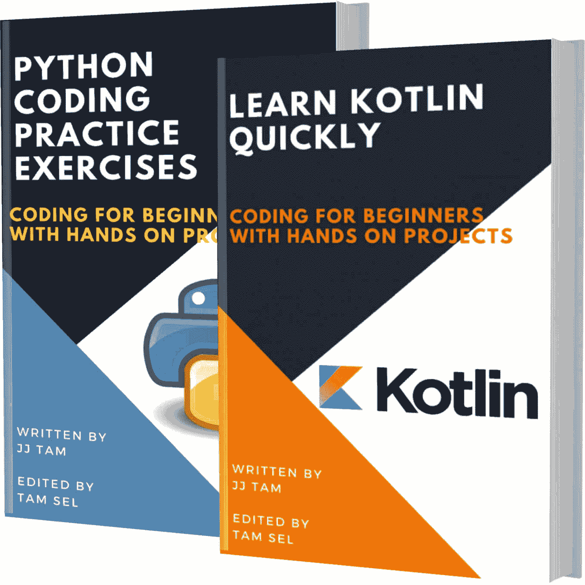

# 快速学习 Kotlin 以及 Python 编程练习

**初学者编程，包含动手项目**

作者：J J TAM

## Kotlin 简介

- Kotlin：Hello World 程序
- 在 Eclipse 中设置 Kotlin
- 在 Kotlin 中定义变量
- Kotlin 中的数据类型
- Kotlin：可空类型
- Kotlin：数字
- Kotlin：字符
- Kotlin：将字符转换为 Int
- Kotlin：布尔值
- Kotlin：字符串
- Kotlin：字符串模板表达式
- Kotlin：数组
- Kotlin：定义空值数组
- Kotlin：使用工厂函数定义数组
- Kotlin：打印数组元素
- Kotlin：位运算符
- Kotlin：逻辑运算符
- Kotlin：控制流语句
- Kotlin：if 语句
- Kotlin：if-else 语句
- Kotlin：if-else if-else
- Kotlin：when 表达式
- Kotlin：将 when 用作 if-else if 阶梯
- Kotlin：将 When 用作表达式
- Kotlin：for 循环
- Kotlin：while、do-while 循环
- Kotlin：break 语句
- Kotlin：continue 语句
- Kotlin：类和对象
- Kotlin：声明属性
- Kotlin：为属性添加 getter 和 setter
- Kotlin：定义类的成员函数
- Kotlin：const：编译时常量
- Kotlin：const 与 val
- Kotlin：lateinit：延迟初始化属性
- Kotlin：构造函数
- Kotlin：次要构造函数
- Kotlin：向主构造函数传递默认值
- Kotlin：定义私有主构造函数
- Kotlin：如何创建对象

## Python 编程练习

### Python 字符串 – 练习

- Python：反转字符串
- 在 Python 中移除换行符
- 查找共同值

### Python 数据类型：列表 – 练习

- Python：求列表中所有项的和
- 从列表中获取最大数
- 从列表中移除重复项

### Python 数据类型：字典 – 练习

- 向字典添加键
- 使用 for 循环遍历字典
- 合并两个 Python 字典
- 将字典中的所有项相乘
- 从字典中移除键
- 从对象的字段获取字典
- 合并两个字典，为共同键添加值
- 查找最高的 3 个值

---

# 快速学习 Kotlin

## Kotlin 简介

Kotlin 是一种在 JVM 上运行的高级编程语言。Kotlin 将源代码编译为 Java 字节码，并使用 JVM 运行应用程序。你可以交替使用 Java 和 Kotlin，这意味着你可以从 Java 调用 Kotlin 函数，反之亦然。

### 先决条件

需要具备 Java 基础知识。

### Kotlin 是面向对象的吗？

是的，Kotlin 是面向对象的语言，你可以创建类、对象，并应用多态、继承等面向对象编程概念。

### Kotlin 是函数式的吗？

是的，Kotlin 是一种函数式语言。在函数式编程语言中，函数是基本的构建块，你可以返回一个函数，将一个函数作为参数传递给另一个函数等。

### Kotlin 是开源的吗？

是的。

### 我可以使用 Kotlin 开发什么类型的应用程序？

- 构建移动应用程序
- 开发服务器端应用程序
- 你可以开发任何能用 Java 开发的应用程序

### 我可以在 Web 浏览器中运行 Kotlin 代码吗？

Kotlin 可以编译为 JavaScript，因此你可以在浏览器中运行应用程序。

### Kotlin 是静态类型的吗？

是的，Kotlin 是静态类型语言。对于静态类型语言，变量的类型在编译时已知。你可以参考我的帖子"静态类型与动态类型语言"，了解静态类型和动态类型语言之间的区别。

### Kotlin 可以推断类型吗？

是的，与 Java 不同，你在定义变量时无需指定类型。Kotlin 根据上下文推断类型。

示例：

```kotlin
var name = "Krishna"
```

由于 `"Krishna"` 被赋值给变量 `name`，Kotlin 推断类型为 `String`。

```kotlin
var age = 28
```

由于数字 `28` 被赋值给变量 `age`，Kotlin 推断类型为 `int`。

## Kotlin：Hello World 程序

`.kt` 是 Kotlin 文件的扩展名。创建一个文件 `HelloWorld.kt`，内容如下。

`HelloWorld.kt`

```kotlin
fun main (args:Array<String>){
    println( "Hello World" )
}
```

关键字 `fun` 用于定义函数。

`main` 是应用程序的主函数。程序从这里开始执行。

`args:Array<String>`

在 Kotlin 中，变量名先声明，后跟类型。在上面的例子中，`args` 是字符串数组类型的变量。

`println("Hello World")`

上面的语句将消息 `Hello World` 打印到控制台。如你所见，与 Java 不同，Kotlin 语句不以 `;` 结尾。

### 编译 HelloWorld.kt

打开命令提示符，输入命令 `kotlinc HelloWorld.kt`。

```
C:\Users\Krishna\Documents\Study\Kotlin\Programs>kotlinc HelloWorld.kt

C:\Users\Krishna\Documents\Study\Kotlin\Programs>dir

Volume in drive C is OSDisk
Volume Serial Number is 1034-4F6F
Directory of C:\Users\Krishna\Documents\Study\Kotlin\Programs

09/02/2017  11:18 AM    <DIR>          .
09/02/2017  11:18 AM    <DIR>          ..
09/02/2017  11:09 AM                57 HelloWorld.kt
09/02/2017  11:18 AM               980 HelloWorldKt.class
09/02/2017  11:18 AM    <DIR>          META-INF
               2 File(s)          1,037 bytes
               3 Dir(s)  63,190,188,032 bytes free
```

如你所见 `dir` 命令的输出，你可以观察到 Kotlin 生成了 `HelloWorldKt.class` 和一个 `META-INF` 目录。

### 运行 HelloWorld.kt

你可以使用 `kotlin HelloWorldKt` 命令运行 `HelloWorldkt` 文件。

```
C:\Users\krishna\Documents\Study\Kotlin\Programs>kotlin HelloWorldKt

Hello World
```

### 创建并运行 jar

你还可以创建 jar 文件，并使用 Java 启动器运行 jar 文件。

使用命令 `kotlinc HelloWorld.kt -include-runtime -d HelloWorld.jar` 创建 jar 文件。

`include-runtime` 选项告诉 Kotlin 编译器将 Kotlin 运行时包含在 `HelloWorld.jar` 文件中。

```
C:\Users\Krishna\Documents\Study\Kotlin\Programs>kotlinc HelloWorld.kt -include-runtime -d HelloWorld.jar

C:\Users\Krishna\Documents\Study\Kotlin\Programs>dir
Volume in drive C is OSDisk
Volume Serial Number is 1034-4F6F
Directory of C:\Users\Krishna\Documents\Study\Kotlin\Programs

09/02/2017  11:24 AM    <DIR>          .
09/02/2017  11:24 AM    <DIR>          ..
09/02/2017  11:24 AM           869,262 HelloWorld.jar
09/02/2017  11:09 AM                57 HelloWorld.kt

               2 File(s)        869,319 bytes

               2 Dir(s)  63,401,816,064 bytes free
```

jar 文件创建完成后，你可以像运行其他 jar 文件一样调用它。使用命令 `java -jar HelloWorld.jar`。

```
C:\Users\Krishna\Documents\Study\Kotlin\Programs>java -jar HelloWorld.jar

Hello World
```

## 在 Eclipse 中设置 Kotlin

打开 Eclipse。`Help` -> `Eclipse Marketplace`。


搜索 kotlin。


点击 `Install` 按钮安装 kotlin 插件。

安装成功后，Eclipse 会要求重启。重启 Eclipse。

### 创建新的 Kotlin 项目

打开 Eclipse。`File` -> `New` -> `Other`。


`Kotlin` -> `Kotlin Project`。


点击 `Next`。

在 `Kotlin Project` 窗口中，将项目名称设为 `Hello World`，然后点击 `Finish` 按钮。

Kotlin 项目结构如下所示。


### 创建 HelloWorld.kt 文件

右键点击 `src` 文件夹 -> `New` -> `Other`。


选择 `Kotlin File` 并点击 `Next`。


将文件名设为 `HelloWorld` 并点击 `Finish` 按钮。


将以下代码片段复制到 `HelloWorld.kt` 文件中。

`HelloWorld.kt`

```kotlin
fun main (args: Array<String>) {

println( "Hello World" )

}
```

### 运行 HelloWorld.kt 文件

右键点击 `HelloWorld.kt` 文件的源代码 -> `Run As` -> `Kotlin Application`。


如果一切顺利，你可以在控制台中看到消息 `Hello World`。


## 在 Kotlin 中定义变量

变量是用于存储数据的命名内存位置。

### 语法

```kotlin
var variableName : DataType = value

val variableName : DataType = value
```

`var` 和 `val` 都是关键字。

### 示例

```kotlin
var a : Int  =10;
```

`a` 的类型为 int，赋值为 10。

```kotlin
val b : Double = 1.23
```

`b` 的类型为 `Double`，赋值为 1.23。关键字 `val` 用于定义常量（不可变对象）。

`HelloWorld.kt`

```kotlin
fun main (args: Array<String>) {

  var a : Int  = 10 ;
  val b : Double = 1.23

println( "a : ${a}" )

println( "b : ${b}" )

}
```

```
C:\>kotlinc HelloWorld.kt

C:\>kotlin HelloWorldKt

a : 10

b : 1.23
```

## Kotlin 中的数据类型

Java 有像 `int`、`float`、`char` 等原始类型，那么 Kotlin 呢？

从用户的角度来看，Kotlin 将所有东西都设计为对象，但在运行时，布尔值、数字和字符都表示为原始类型。

`HelloWorld.kt`

```kotlin
fun main (args: Array<String>) {

  var doubleVar: Double = 1.23

  var floatVar: Float = 1.23f

  var longVar: Long = 123

  var intVar: Int = 123

  var shortVar: Short = 123

  var byteVar: Byte = 123

println( "double : ${doubleVar}" )

println( "doubleVar : ${floatVar}" )

println( "longVar : ${longVar}" )

println( "intVar : ${intVar}" )

println( "shortVar : ${shortVar}" )

println( "byteVar : ${byteVar}" )

}
```

#### 输出

```
doubleVar : 1.23

doubleVar : 1.23

longVar : 123

intVar : 123

shortVar : 123

byteVar : 123
```

## Kotlin：可空类型

默认情况下，Kotlin 的引用类型（`Int`、`Float`、`Double`、`String` 等）不接受 null 值。Kotlin 引入此特性是为了避免空指针异常。

`Test.kt`

```kotlin
fun main (args: Array<String>) {

  var name : String = "Krishna"

name = null

}
```

当你尝试编译上述程序时，Kotlin 会抛出以下错误。

```
ERROR: Null can not be a value of a non-null type String (6, 9)
```

如何定义一个可以接受 null 值的变量？

通过使用可空类型，你可以定义一个接受 null 值的变量。在引用类型后追加 `?` 即可接受 null 值。

| 类型 | 可空类型 |


|------|---------------|
| `Int` | `Int?` |
| `String` | `String?` |
| `Double` | `Double?` |
| `Person` | `Person?` |

## 示例

```
var id: Int? = 1
var name: String? = "Krishna"
var salary: Double? = 123.456
var person: Person? = Person("Krishna")

id = null
name = null
salary = null
person = null
```

# Kotlin：数字

Kotlin 提供以下数据类型来支持数字。

| 数据类型 | 位大小 |
|-----------|--------------|
| `Double` | 64 |
| `Float` | 32 |
| `Long` | 64 |
| `Int` | 32 |
| `Short` | 16 |
| `Byte` | 8 |

`Numbers.kt`

```
fun main(args: Array<String>) {
    var doubleVar: Double = 1.23
    var floatVar: Float = 1.23f
    var longVar: Long = 123
    var intVar: Int = 123
    var shortVar: Short = 123
    var byteVar: Byte = 123

    println("doubleVar : ${doubleVar}")
    println("doubleVar : ${floatVar}")
    println("longVar : ${longVar}")
    println("intVar : ${intVar}")
    println("shortVar : ${shortVar}")
    println("byteVar : ${byteVar}")
}
```

#### 输出

```
doubleVar : 1.23
doubleVar : 1.23
longVar : 123
intVar : 123
shortVar : 123
byteVar : 123
```

## 十六进制、八进制和二进制字面量表示法

Kotlin 支持十六进制和二进制表示法，但不支持八进制表示法。十六进制数通过前缀 `0x` 表示。

`Numbers.kt`

```
fun main(args: Array<String>) {
    var hexaNum: Int = 0x123
    var binaryNum: Int = 0b10101010

    println("hexaNum : ${hexaNum}")
    println("binaryNum : ${binaryNum}")
}
```

#### 输出

```
hexaNum : 291
binaryNum : 170
```

你也可以使用 `_` 来表示数字。

`Numbers.kt`

```
fun main(args: Array<String>) {
    var ten = 10
    var hundred = 100
    var thousand = 1000
    var tenThousand = 10_000
    var oneLaksh = 100_000
    var tenLaksh = 1_000_000

    println("ten : ${ten}")
    println("hundred : ${hundred}")
    println("thousand : ${thousand}")
    println("tenThousand : ${tenThousand}")
    println("oneLaksh : ${oneLaksh}")
    println("tenLaksh : ${tenLaksh}")
}
```

#### 输出

```
ten : 10
hundred : 100
thousand : 1000
tenThousand : 10000
oneLaksh : 100000
tenLaksh : 1000000
```

# Kotlin：字符

`Char` 关键字用于定义单个字符。字符用单引号括起来。

## 示例

```
var myChar: Char = 'a'
```

`HelloWorld.kt`

```
fun main(args: Array<String>) {
    var myChar: Char = 'a'

    println("Value of myChar is : ${myChar}")
}
```

#### 输出

```
Value of myChar is : a
```

Java 支持的所有转义序列 Kotlin 也都支持。

# Kotlin：将字符转换为 Int

`Char` 类型提供了 `toInt()` 方法，用于将字符转换为整数。

`IntConverter.kt`

```
fun main(args: Array<String>) {
    var myChar: Char = 'a'

    println("Value of myChar is : ${myChar}")
    println("Value of myChar in int is : ${myChar.toInt()}")
}
```

#### 输出

```
Value of myChar is : a
Value of myChar in int is : 97
```

# Kotlin：布尔值

`Boolean` 类型用于表示 `true`、`false` 状态。

`Booleans.kt`

```
fun main(args: Array<String>) {
    var trueState: Boolean = true
    var falseState: Boolean = false

    println("Value of trueState is : ${trueState}")
    println("Value of falseState is : ${falseState}")
}
```

#### 输出

```
Value of trueState is : true
Value of falseState is : false
```

# Kotlin：字符串

`String` 是字符的集合，用双引号括起来。Kotlin 中的字符串通过关键字 `String` 定义，且是**不可变的**。

## 示例

```kotlin
var message: String = "Good Morning"
```

`StringsDemo.kt`

```kotlin
fun main(args: Array<String>) {
    var message: String = "Good Morning"
    println(message)
}
```

## 输出

```
Good Morning
```

Java 支持的所有转义序列（`\n`、`\t`、`\a` 等）在 Kotlin 中同样支持。

## 示例

```kotlin
var message: String = "Good Morning\nHow are you\nsee you soon"
```

`StringDemo.kt`

```kotlin
fun main(args: Array<String>) {
    var message: String = "Good Morning\nHow are you\nsee you soon"
    println(message)
}
```

## 输出

```
Good Morning
How are you
see you soon
```

如果不想执行转义，则将字符串嵌入 `"""`（三引号）中。

`StringDemo.kt`

```kotlin
fun main(args: Array<String>) {
    var message: String = """Good Morning\nHow are you\nsee you soon
      After two lines\bgood bye"""
    println(message)
}
```

## 输出

```
Good Morning\nHow are you\nsee you soon
                                             After two lines\bgood bye
```

# Kotlin：字符串模板表达式

通过使用模板表达式，你可以在字符串中计算表达式的值。模板表达式以 `$` 符号开头，后跟一个名称。

## 示例

```kotlin
var a = 10
println("Value of a is : $a")
```

任意表达式用花括号括起来。

```kotlin
var str = "Hello World"
println("$str length is ${str.length}")
```

`Expression.kt`

```kotlin
fun main(args: Array<String>) {
    var a = 10
    var str = "Hello World"
    println("Value of a is : $a")
    println("$str length is ${str.length}")
}
```

## 输出

```
Value of a is : 10
Hello World length is 11
```

# Kotlin：数组

`Array` 表示相同类型元素的集合。Kotlin 提供了 `Array` 类来表示数组。

通过使用库函数 `arrayOf`，你可以定义一个数组。

## 示例

```kotlin
val numbers: Array<Int> = arrayOf(10, 20, 30, 40, 50)
```

`ArrayDemo.kt`

```kotlin
fun main(args: Array<String>) {
    val numbers: Array<Int> = arrayOf(10, 20, 30, 40, 50)
    for (element in numbers) {
        println(element)
    }
}
```

## 输出

```
10
20
30
40
50
```

Kotlin 提供了以下库函数来定义基本类型数组。

- `byteArrayOf()`
- `shortArrayOf()`
- `intArrayOf()`
- `longArrayOf()`
- `floatArrayOf()`
- `doubleArrayOf()`
- `CharArray()`
- `BooleanArray()`

# Kotlin：定义空值数组

Kotlin 提供了 `arrayOfNulls` 库函数来定义空值数组。

`ArrayOfNulls.kt`

```kotlin
fun main(args: Array<String>) {
    var a: Array<Int?> = arrayOfNulls(5)
    for (element in a) {
        println(element)
    }
}
```

## 输出

```
null
null
null
null
null
```

# Kotlin：使用工厂函数定义数组

Kotlin 提供了一个工厂函数，它接受大小和一个函数 `f` 作为参数来定义数组。函数 `f` 用于为数组提供初始值。

```kotlin
var squares = Array(5, { i -> i * i })
```

上述语句定义了一个大小为 5 的数组 `squares`，并初始化为 `{1, 4, 9, 16, 25}`。

`ArrayFactoryFunction.kt`

```kotlin
fun main(args: Array<String>) {
    var squares = Array(5, { i -> i * i })
    var cubes = Array(5, { i -> i * i * i })
    println("Elements in squares array : ")
    for (ele in squares) {
        println(ele)
    }
    println("\nElements in cubes array : ")
    for (ele in cubes) {
        println(ele)
    }
}
```

## 输出

```
Elements in squares array :
0
1
4
9
16

Elements in cubes array :
0
1
8
27
64
```

# Kotlin：打印数组元素

在本节中，我将展示如何打印数组的元素。

## 使用 for 循环打印数组元素

`ArrayUtil.kt`

```kotlin
fun main(args: Array<String>) {
    var arr: Array<Int> = arrayOf(1, 2, 3, 4)
    for (ele in arr) {
        println(ele)
    }
}
```

## 输出

```
1
2
3
4
```

## 使用 `Arrays.toString` 方法打印数组元素

`ArrayUtil.kt`

```kotlin
import java.util.Arrays

fun main(args: Array<String>) {
    var arr: Array<Int> = arrayOf(1, 2, 3, 4)
    println(Arrays.toString(arr))
}
```

## 输出

```
[1, 2, 3, 4]
```

## 使用 `array.indices` 打印数组元素

`ArrayUtil.kt`

```kotlin
fun main(args: Array<String>) {
    var arr: Array<Int> = arrayOf(2, 3, 5, 7)
    for (index in arr.indices) {
        println(arr[index])
    }
}
```

## 输出

```
2
3
5
7
```

## 使用 `array.withIndex` 打印数组元素

`ArrayUtil.kt`

```kotlin
fun main(args: Array<String>) {
    var arr: Array<Int> = arrayOf(2, 3, 5, 7)
    for ((index, value) in arr.withIndex()) {
        println("index : $index, value : $value")
    }
}
```

## 输出

```
index : 0, value : 2
index : 1, value : 3
index : 2, value : 5
index : 3, value : 7
```

## 使用 while 循环打印数组元素

`ArrayUtil.kt`

```kotlin
fun main(args: Array<String>) {
    var arr: Array<Int> = arrayOf(2, 3, 5, 7)
    var sizeOfTheArray = arr.size
    var index: Int = 0
    while (index < sizeOfTheArray) {
        println("index : $index, value : ${arr[index]}")
        index++
    }
}
```

## 输出

```
index : 0, value : 2
index : 1, value : 3
index : 2, value : 5
index : 3, value : 7
```

# Kotlin：位运算符

下表总结了 Kotlin 支持的位运算符。

| 运算符 | 描述 | Java 等价 |
|----------|-------------|---------------|
| `shl` | 执行有符号左移 | `<<` |
| `shr` | 执行有符号右移 | `>>` |
| `ushr` | 执行无符号右移 | `>>>` |
| `and` | 按位与 | `&` |
| `or` | 按位或 | `|` |
| `xor` | 按位异或 | `^` |
| `inv()` | 按位取反 | `~` |

除 `inv()` 外，所有其他运算符都以中缀形式使用。

## 示例

```kotlin
var1 shl var2
var1 or var2
```

## 1. `shl`：执行有符号左移

左移运算符将所有位向左移动一位，即*将值翻倍*。

语法：

```
variable shl n
```

将变量左移 `n` 次。

`variable shl n` 等于 `variable = variable * 2 的 n 次幂`。

```
var var1: Int = 2
var1 shl 1 = 2 * 2 的 1 次幂 = 4
var1 shl 2 = 2 * 2 的 2 次幂 = 8
var1 shl 9 = 2 * 2 的 9 次幂 = 1024
```

`LeftShift.kt`


```kotlin
fun main(args: Array<String>) {
    var var1: Int = 2
    var res1 = var1 shl 1
    var res2 = var1 shl 2
    var res3 = var1 shl 9
    println("res1 : ${res1}")
    println("res2 : ${res2}")
    println("res3 : ${res3}")
}
```

输出

```
res1 : 4
res2 : 8
res3 : 1024
```

## 2. `shr`：执行有符号右移

右移运算符将所有位向右移动一位，即*将值减半*（除以 2）

语法：

```
variable shr n
```

将变量右移 `n` 次。

`Variable shr n` 等于 `variable = variable / 2 的 n 次幂`

```
var a : Int = 128
a shr 1 = 128 / (2 的 1 次幂) = 64
a shr 2 = 128 / (2 的 2 次幂) = 32
```

`RightShift.kt`

```kotlin
fun main(args: Array<String>) {
    var a: Int = 128
    var res1 = a shr 1
    var res2 = a shr 2
    var res3 = a shr 3
    println("res1 : ${res1}")
    println("res2 : ${res2}")
    println("res3 : ${res3}")
}
```

输出

```
res1 : 64
res2 : 32
res3 : 16
```

## 3. `ushr`：无符号右移

将所有位向右移动一位，并将最左边的位设为 0

语法

```
Variable ushr n
```

`UnsignedRightShift.kt`

```kotlin
fun main(args: Array<String>) {
    var a: Int = -128
    var res1 = a ushr 1
    println("res1 : ${res1}")
}
```

输出

```
res1 : 2147483584
```

解释

-128 的 2 的补码形式为

```
11111111 11111111 11111111 10000000
```

`>>>` 将位右移一位，并将最左边的位替换为 0

因此 `(-128 ushr 1)` 如下所示

```
01111111 11111111 11111111 11000000
```

## 4. 按位 `and`、`or`、`xor`

| Bit1 | Bit2 | and | or | xor |
|------|------|-----|----|----|
| 0 | 0 | 0 | 0 | 0 |
| 0 | 1 | 0 | 1 | 1 |
| 1 | 0 | 0 | 1 | 1 |
| 1 | 1 | 1 | 1 | 0 |

`HelloWorld.kt`

```kotlin
fun main(args: Array<String>) {
    var a: Int = 8
    var b: Int = 9
    println("a and b is ${a and b} ")
    println("a or b is ${a or b} ")
    println("a xor b is ${a xor b}")
}
```

输出

```
a and b is 8
a or b is 9
a xor b is 1
```

解释

```
   a    = 0000 1000
   b    = 0000 1001
   a&b = 0000 1000
   a    = 0000 1000
   b    = 0000 1001
   a|b = 0000 10001
   a     = 0000 1000
   b     = 0000 1001
   a^b = 0000 0001
```

注意：

位运算符仅适用于 `byte`、`short` 等整数值，不适用于 `float`、`double`、`Boolean`。

## 5. `inv()`：按位取反

按位取反运算符将值为 1 的位变为 0，将值为 0 的位变为 1。

## 示例

`var a : Int = 8`

`a` 的二进制格式为 `0 0 0 0 0 1 1 1`

`a.inv()` 的二进制格式为 `1 1 1 1 1 0 0 0`

### `Inverse.kt`

```
fun main (args: Array<String>) {
  var a: Int = 8
  println( "Value of a is : ${a}" )
  println( "inversion of a is : ${a.inv()}" )
}
```

#### 输出

```
Value of a is : 8
inversion of a is : -9
```

# Kotlin：逻辑运算符

Kotlin 支持逻辑运算符（也称为布尔运算符），用于组合多个条件。

* `||` – 惰性析取
* `&&` – 惰性合取
* `!` - 否定

## 1. `||` – 惰性析取

`operand1 || operand2`：如果任一操作数求值为 `true`，则返回 `true`，否则返回 `false`。

| 操作数 1 | 操作数 2 | 求值结果 |
|----------|----------|----------|
| False | false | false |
| False | true | true |
| True | false | true |
| True | true | true |

### `BooleanOr.kt`

```
fun main (args: Array<String>) {
  var operand1: Boolean = false
  var operand2: Boolean = false
  println( "${operand1} || ${operand2}: ${(operand1 || operand2)}" )
  operand1 = false
  operand2 = true
  println( "${operand1} || ${operand2}: ${(operand1 || operand2)}" )
  operand1 = true
  operand2 = false
  println( "${operand1} || ${operand2}: ${(operand1 || operand2)}" )
  operand1 = true
  operand2 = true
  println( "${operand1} || ${operand2}: ${(operand1 || operand2)}" )
}
```

#### 输出

```
false || false : false
false || true : true
true || false : true
true || true : true
```

### 为什么 `||` 被称为惰性析取？

如果第一个表达式求值为 `true`，那么 Kotlin 将不会对整个表达式求值。因此逻辑 OR 被称为短路 OR（或）惰性析取运算符。

### `LazyDisjunciton.kt`

```
fun main (args: Array<String>) {
  var a : Int = 10
  var b : Int = 21
  if ((a < b) || (a++ < b)) {
    System. out .println( "This statement evaluated" );
  }
  System. out .println( "a is not incremented " + a);
  if ((a > b) || (a++ > b)) {
    System. out .println( "This statement is evaluated" );
  }
  System. out .println( "a is incremented " + a);
}
```

#### 输出

```
This statement evaluated
a is not incremented 10
a is incremented 11
```

## `&&` – 惰性合取

`operand1 && operand2`：如果两个操作数都求值为 `true`，则返回 `true`，否则返回 `false`。

| 操作数 1 | 操作数 2 | 求值结果 |
|----------|----------|----------|
| False | false | false |
| False | true | false |
| True | false | false |
| True | true | true |

### `BooleanAnd.kt`

```
fun main (args: Array<String>) {
  var operand1: Boolean = false
  var operand2: Boolean = false
  println( "${operand1} && ${operand2}: ${(operand1 && operand2)}" )
  operand1 = false
  operand2 = true
  println( "${operand1} && ${operand2}: ${(operand1 && operand2)}" )
  operand1 = true
  operand2 = false
  println( "${operand1} && ${operand2}: ${(operand1 && operand2)}" )
  operand1 = true
  operand2 = true
  println( "${operand1} && ${operand2}: ${(operand1 && operand2)}" )
}
```

#### 输出

```
false && false: false
false && true: false
true && false: false
true && true: true
```

### 为什么 `&&` 被称为惰性合取运算符？

如果表达式中的第一个语句求值为 `false`，那么 Kotlin 将不会对整个表达式求值。因此，逻辑 AND 被称为短路 AND。

### `LazyConjunction.kt`

```
fun main (args: Array<String>) {
  var a: Int = 10
  var b: Int = 21
  if ((a > b) && (a++ > b)) {
    System. out .println( "This statement not evaluated" );
  }
  System. out .println( "a is not incremented " + a);
  if ((a < b) && (a++ < b)) {
    System. out .println( "This statement is evaluated" );
  }
  System. out .println( "a is incremented " + a);
}
```

#### 输出

```
a is not incremented 10
This statement is evaluated
a is incremented 11
```

## 3. 逻辑非（`!`）运算符

如果操作数为 `false`，`!` 运算符将其求值为 `true`

如果操作数为 `true`，`!` 运算符将其求值为 `false`

| 操作数 | 求值结果 |
|--------|----------|
| False | true |
| True | false |

### `LogicalNot.kt`

```
fun main (args: Array<String>) {
  var operand1: Boolean = false
  var operand2: Boolean = true
  println( "operand1 : ${operand1}" )
  println( "!operand1 : ${!operand1}" )
  println( "operand2 : ${operand2}" )
  println( "!operand2 : ${!operand2}" )
}
```

#### 输出

```
operand1 : false
!operand1 : true
operand2 : true
!operand2 : false
```

## Kotlin：`===` 与 `==`

Kotlin 支持两种类型的相等性。

* 引用相等
* 结构相等

### 引用相等（`===`）

`===` 运算符用于检查两个引用是否指向同一个对象。

例如：

`ref1 === ref2`

如果引用 `ref1` 和 `ref2` 指向同一个对象，上述语句返回 `true`，否则返回 `false`。

### 结构相等（`==`）

结构相等用于检查两个引用的值是否相等（通过使用 Java 的 `equals()` 方法检查）。

例如：

`ref1 == ref2`

如果 `ref1.equals(ref2)` 返回 `true`，上述语句返回 `true`，否则返回 `false`。

### `Equality.kt`

```
fun main (args: Array<String>) {
  var intVar1 : Int = 10000
  var intBoundedVar1 : Int? = intVar1
  var intBounderdVar2 : Int? = intVar1
  println( "(intBoundedVar1===intBounderdVar2) : ${(intBoundedVar1 === intBounderdVar2)}" )
  println( "(intBoundedVar1==intBounderdVar2) : ${(intBoundedVar1 == intBounderdVar2)}" )
}
```

#### 输出

```
(intBoundedVar1===intBounderdVar2) : false
(intBoundedVar1==intBounderdVar2) : true
```

# Kotlin：控制流语句

Kotlin 提供控制流语句

用于决策（`if`、`if-else`、`when`）和

用于循环（`for`、`while`、`do-while`）

## 决策语句

* `if` 语句
* `if-else` 语句
* `if-else if-else` 阶梯
* `when` 语句

## 循环语句

* `for`
* `while`
* `do-while`

# Kotlin：`if` 语句

`if` 告诉程序在条件求值为 `true` 时执行代码段。

### 语法

```
if(condition){
  // 如果条件为真则执行
}
```

## `IfStmt.kt`

```
fun main (args: Array<String>) {
  var marks: Int = 20
  if (marks < 35 ) {
    println( "You failed in the Exam. Better luck next time" );
  }
  marks = 55
  if (marks < 35 ) {
    println( "You failed in the Exam again. Better luck next time" );
  }
}
```

#### 输出

```
You failed in the Exam. Better luck next time
```

# Kotlin：`if-else` 语句

如果条件为 `true`，则执行 if 块代码，否则执行 else 块代码。

## 语法：

```
if(condition){
}else{
}
```

## `IfElse.kt`

```
fun main (args: Array<String>) {
  var marks: Int = 65
  if (marks < 35 ) {
    println( "You failed in the Exam. Better luck next time" );
  } else {
    println( "You passed in the exam" )
  }
}
```

#### 输出

```
You passed in the exam
```

# Kotlin：`if-else if-else`

通过使用 `if-else if-else` 结构，你可以在多个选项中进行选择。

`if` 语句后面可以跟一个可选的 `else if...else` 语句，这对于测试各种条件非常有用。

## `IfElseIf.kt`


```
fun main (args: Array<String>) {
  var marks: Int = 65
  if (marks < 35 )
    println( "You are failed" );
  else if (marks < 50 )
    println( "You are passed and got third class" );
  else if (marks < 60 )
    println( "You are passed and got second class" );
  else if (marks < 70 )
    println( "You are passed and got first class" );
  else
    println ( "You are passed and got distinction" );
}
```

#### 输出

```
You are passed and got first class
```

# Kotlin：`when` 表达式

`when` 相当于 Java 中的 `switch` 语句。

### 语法

```
when(expression){
  1 -> {//执行某些操作}
  2 -> {//执行某些操作}
  else -> {//执行某些操作}
}
```

`when` 按顺序将表达式与所有可能的 case 进行匹配求值。如果没有任何一个 case 满足，则执行 `else` 块。

## WhenDemo.kt

```
fun main (args: Array<String>) {
  var a : Int = 5
  when (a){
    12 -> println( "Value 12 is checked" )
    5 -> println( "Value 5 is checked" )
    3 -> println( "Value 3 is checked" )
    else -> println( "No value is checked" )
  }
}
```

#### 输出

```
Value 5 is checked
```

你可以在 `when` 表达式中组合多个分支语句。

## WhenDemo.kt

```
fun main (args: Array<String>) {
  var a : Int = 5

  when (a){
    2 , 3 , 5 , 7 -> println( "Prime number" )
    4 , 6 , 8 -> println( "Even number other than 2" )
    else -> println( "No value is checked" )
  }
}
```

**输出**

```
Prime number
```

你还可以使用任意表达式作为分支条件。例如，我使用 `2+3` 作为分支条件。

## WhenDemo.kt

```
fun main (args: Array<String>) {
  var a : Int = 5
  when (a){
    2 + 3 -> println( "Checked value 5" )
    intonation , 6 , 8 -> println( "Even number other than 2" )
    else -> println( "No value is checked" )
  }
}
```

**输出**

```
Checked value 5
```

你还可以在分支条件中检查范围（或）不在范围内。

## WhenDemo.kt

```
fun main (args: Array<String>) {
  var a : Int = 5
  when (a){
    in 1.. 5 , in 11.. 15 -> println( "a is in between 1 to 5 (or) 11 to 15" )
    in 6.. 10 -> println( "a is in range of 6 to 10" )
    else -> println( "x is not in range" )
  }
}
```

**输出**

```
a is in between 1 to 5 (or) 11 to 15
```

## Kotlin：将 `when` 用作 if-else if 阶梯

你还可以将 `when` 表达式用作 if-elseif 阶梯。如果不向 `when` 表达式指定任何参数，它可以作为 if-else if 阶梯使用。

## ConditionDemo.kt

```
fun main (args: Array<String>) {
  var marks: Int = 65
  if (marks < 35 )
    println( "You are failed" );
  else if (marks < 50 )
    println( "You are passed and got third class" );
  else if (marks < 60 )
    println( "You are passed and got second class" );
  else if (marks < 70 )
    println( "You are passed and got first class" );
  else
    println ( "You are passed and got distinction" );
}
```

**输出**

```
You are passed and got first class
```

你可以使用 `when` 表达式实现上述 if-else if-else 逻辑，如下所示。

## WhenDemo.kt

```
fun main (args: Array<String>) {
  var marks: Int = 65
  when {
    (marks < 35 ) -> println( "You are failed" )
    (marks < 50 ) -> println( "You are passed and got third class" )
    (marks < 60 ) -> println( "You are passed and got second class" )
    (marks < 70 ) -> println( "You are passed and got first class" )
    else -> println( "You are passed and got distinction" )
  }
}
```

**输出**

```
You are passed and got first class
```

## Kotlin：将 `when` 用作表达式

你可以将 `when` 用作表达式。如果将 `when` 用作表达式，则匹配分支的值将成为 `when` 表达式的值。

## WhenDemo.kt

```
fun main (args: Array<String>) {
  var a : Int = 2
  var s : String = "cube"
  var result = when {
    Eccleston .equals( "double" ) -> a * a
    s.equals( "cube" ) -> a * a * a
    else -> a
  }
  println( "result is $result" )
}
```

**输出**

```
result is 8
```

# Kotlin：`for` 循环

`for` 循环用于遍历集合、数组、范围等。

通过使用 `for` 循环，你可以遍历任何提供迭代器的东西。

## 遍历数组

**语法**

```
for(ele in array){
}
```

## ArrayDemo.kt

```
fun main (args: Array<String>) {
  var arr: Array<Int> = arrayOf( 2 , 3 , 5 , 7 )
  for (ele in arr){
    println(ele)
  }
}
```

**输出**

```
2
3
5
7
```

## 遍历范围

## ArrayDemo.kt

```
fun main (args: Array<String>) {
  for (ele in 1.. 10 ){
    println(ele)
  }
}
```

**输出**

```
1
2
3
4
5
6
7
8
9
10
```

## 遍历字符串

## ArrayDemo.kt

```
fun main (args: Array<String>) {
  var message = "Good Morning"
  for (c in message){
    print(c)
  }
}
```

**输出**

```
Good Morning
```

# Kotlin：`while`、`do-while` 循环

## `while` 循环

`while` 语句执行一个语句块，直到某个条件为真。

**语法**

```
while (expression) {
  //statements
}
```

`while` 语句中的表达式必须求值为布尔值，否则编译器将抛出错误。`while` 语句首先对表达式求值，只要表达式求值为 `true`，它就执行 `while` 块内的代码，否则退出 `while` 循环。

**示例：** 使用 `while` 循环打印从 0 到 9 的数字。

## WhileDemo.kt

```
fun main (args: Array<String>) {
  var counter : Int = 0
  while (counter < 10 ){
    println(counter)
    counter++
  }
}
```

**输出**

```
0
1
2
3
4
5
6
7
8
9
```

## `do-while` 循环

`do-while` 也是一种循环结构，类似于 `while`，但它在循环底部而不是顶部对其表达式求值。

**语法**

```
do {
  //statement(s)
} while (expression)
```

## DoWhileDemo.kt

```
fun main (args: Array<String>) {
  var counter : Int = 0
  do {
    println(counter)
    counter++
  } while (counter < 10 )
}
```

**输出**

```
0
1
2
3
4
5
6
7
8
9
```

## `while` 和 `do-while` 有什么区别？

即使表达式求值为 `false`，`do` 块内的语句也始终至少执行一次。

# Kotlin：`break` 语句

`break` 语句用于跳出循环。`break` 语句有两种形式。

1. 无标签 `break`
2. 带标签 `break`

## 无标签 `break`

无标签 `break` 用于跳出最近的封闭循环。

**语法**

```
break
```

## BreakDemo.kt

```
fun main (args: Array<String>) {
  for (i in 1.. 10 ) {
    println(i)
    if (i == 5 ) {
      break
    }
  }
}
```

**输出**

```
1
2
3
4
5
```

## BreakDemoInnerLoop.kt

```
fun main (args: Array<String>) {
  for (i in 1.. 5 ) {
    for (j in 1..i) {
      print( "$j" )
    }
    println()
  }
}
```

**输出**

```
1
12
123
1234
12345
```

## 带标签 `break`

Kotlin 允许我们为任何表达式添加标签。

**如何创建标签？**

定义一个标识符，后跟 `@` 符号。

例如：

`outerLoop@`、`processState@`

通过指定标签，我们可以跳出该标签。

**语法**

```
break@labelIdentifier
```

例如

```
break@outerLoop
break@processState
```

## LabelledBreakDemo.kt

```
fun main (args: Array<String>) {
  var counter: Int = 0 ;
  outerLoop @ for (i in 1.. 5 ) {
    for (j in 1..i) {
      counter++
      print( "$j" )
      if (counter == 6 ) {
        println( "\nBreaking out of the outer loop" )
        break @outerLoop
      }
    }
    println()
  }
}
```

**输出**

```
1
12
123
Breaking out of the outer loop
```

# Kotlin：`continue` 语句

`continue` 语句跳过循环（例如：`for`、`while`、`do-while` 循环）的当前迭代。与 `break` 类似，`continue` 也有两种形式。

1. 无标签 `continue`
2. 带标签 `continue`

## 无标签 `continue`

**语法**

```
continue;
```

## ContinueDemo.kt

```
fun main (args: Array<String>) {
  for (i in 1.. 10 ) {
    if (i % 2 != 0 ) {
      continue
    }
    print( "$i " )
  }
}
```

**输出**

```
2 4 6 8 10
```

## UnlabelledContinueInnerLoop.kt

```
fun main (args: Array<String>) {
  for (i in 1.. 5 ) {
    for (j in 1.. 10 ){
      if (j % 2 != 0 ){
        continue
      }
      print( "$j " )
    }
    println()
  }
}
```

**输出**

```
2 4 6 8 10
2 4 6 8 10
2 4 6 8 10
2 4 6 8 10
2 4 6 8 10
```

## 带标签 `continue`

Kotlin 允许我们为任何表达式添加标签。

**如何创建标签？**

定义一个标识符，后跟 `@` 符号。

例如：

`outerLoop@`、`processState@`

我们可以将 `continue` 语句与标签一起使用。

**语法**

```
continue@labelIdentifier
```

例如

```
continue @outerLoop
continue @processState
```

## ContinueLabelledDemo.kt

```
fun main (args: Array<String>) {
  outerLoop @ for (i in 1.. 5 ) {
    for (j in 1.. 10 ) {
      if (j > 5 ) {
        println()
        continue @outerLoop
      }
      print( "$i " )
    }
  }
}
```

**输出**

```
1 1 1 1 1
2 2 2 2 2
3 3 3 3 3
4 4 4 4 4
5 5 5  Lara 5
```

# Kotlin：类和对象

## 现实世界场景中的对象和类

### 对象

对象是现实世界的实体。例如，书、猫、盒子、公共汽车、键盘、人、屏幕、手机等，都是对象。

**我们如何区分对象**

1. 根据它们的属性
2. 根据它们的行为

### 根据属性区分两个对象

假设有两个人 A 和 B。

首先，让我们尝试找出人对象可能的属性。

**人的可能属性**

`height`、`weight`、`color`、教育资格、`country`、`address` 都属于人的属性。

现在通过比较这些属性，我们可以轻松区分两个人。

| 属性 | 人 A | 人 B |
| --- | --- | --- |
| 身高 | 6ft | 5.5ft |
| 体重 | 75Kg | 60Kg |
| 肤色 | 白色 | 黑色 |
| 国家 | 印度 | 美国 |

如上图所示，两个人都有自己的属性，因此我们可以根据这些属性来区分他们。

## 根据行为区分两个对象

考虑同样的两个人 A 和 B。我们将尝试找出人物对象可能的行为。

可能的行为有 `walk`、`run`、`swim`、`eat`、`sleep`、`see`、`hear` 等。现在通过比较这些行为，我们可以轻松地区分两个人。

| 行为 | 人物 A | 人物 B |
| --- | --- | --- |
| 步行 | 10km/hr | 12km/hr |
| 跑步 | 20km/hr | 18km/hr |
| 睡眠 | 8 Hrs/day | 6Hrs/day |

## 类

用通俗的话来说，我把类称为类别。

所有人都属于人类别。

`cat`、`lion`、`Elephant` 属于动物类别。

所以类或类别是一组具有相似属性和行为的对象。

## 编程术语中的对象和类

### 什么是对象？


对象是相关状态和行为的软件包。Kotlin 的主要优势在于你可以将 Kotlin 中的对象与现实世界中的对象进行比较。因此在 Kotlin 中处理对象非常容易。

## 什么是类？

类是创建对象的蓝图或原型。

你可以使用`class`关键字来定义类。

**语法**

```
class ClassName {
  // Properties
  // Functions
}
```

**示例**

```
class Employee {
  var firstName : String = ""
  var lastName : String = ""
}
```

上面的代码片段定义了`Employee`类，它定义了两个属性（`firstName`、`lastName`）。

如何为`Employee`类定义对象？

```
var emp1 = Employee()
```

上面的语句用于为`Employee`类定义一个对象。

如何访问与对象`emp1`相关联的属性？

对象的成员（`firstName`和`lastName`）使用`.`符号来访问。

**语法**

```
objName.propertyName
```

**示例**

```
emp1.firstName = "Chamu"
emp1.lastName = "Gurram"
```

**Employee.kt**

```
class Employee {
  var firstName: String = ""
  var lastName: String = ""
}
```

**Main.kt**

```
fun main (args: Array<String>) {
  var emp1 = Employee()
  emp1.firstName = "Chamu"
  emp1.lastName = "Gurram"
  println( "First name : ${emp1.firstName}" )
  println( "Last name : ${emp1.lastName}" )
}
```

**输出**

```
First name : Chamu
Last name : Gurram
```

# Kotlin：声明属性

你可以在类中定义属性。属性可以是可变的（mutable）或不可变的（immutable，一旦定义就不能更改）。

## 如何定义可变属性？

可变属性使用`var`关键字定义。

**示例**

```
var name : String = "Krishna"
```

## 如何定义不可变属性？

不可变属性使用`val`关键字定义。

**示例**

```
val name : String = "Krishna"
```

```
class Employee{
  var name : String = "Krishna"
  var age : Int = 28
  val orgID : String = "ORG1234"
}
```

如你所见，在`Employee`类中，我将`name`和`age`定义为可变属性，`orgID`定义为不可变属性。

## 如何访问类中的属性？

通过定义对象，你可以访问类的属性。使用`.`符号来访问类的实例属性。

**语法**

```
objectName.propertyName
```

**HelloWorld.kt**

```
class Employee {
  var name: String = "Krishna"
  var age: Int = 28
  val orgID: String = "ORG1234"
}

fun main (args: Array<String>) {
  var emp = Employee()
  println( "name : ${emp.name}" )
  println( "age : ${emp.age}" )
  println( "orgID : ${emp.orgID}" )
}
```

**输出**

```
name : Krishna
age : 28
orgID : ORG1234
```

定义属性时不需要添加属性类型，Kotlin 环境会自动推断。但添加类型可以提高程序的可读性。

```
class Employee {
  var name = "Krishna"
  var age = 28
  val orgID = "ORG1234"
}
```

# Kotlin：属性的 Getters 和 Setters

在我之前的文章中，我解释了如何定义属性，除了定义之外，我们还可以为属性添加 getter 和 setter 方法。

**语法**

```
var <propertyName>[: <PropertyType>] [= <property_initializer>]
    [<getter>]
    [<setter>]
```

`PropertyType`、`getter`和`setter`在定义属性时都是可选的。

**HelloWorld.kt**

```
class Employee {
  var name: String = "Krishna"
    get () = field
    set (value) {
      field = value
    }
  var age : Int = 28
    get () = field
    set (value) {
      field = value
    }
  val orgID = "ORG1234"
}

fun main (args: Array<String>) {
  var emp = Employee()
  println( "name : ${emp.name}" )
  println( "age : ${emp.age}" )
  println( "orgID : ${emp.orgID}" )
}
```

**输出**

```
name : Krishna
age : 28
orgID : ORG1234
```

如你所见，我使用了`field`标识符来引用幕后字段。按照惯例，setter 方法使用`value`作为参数名，但你可以使用任何名称。

## 为什么需要 Getter 和 Setter 方法？

Getter 和 setter 方法用于在发送/设置信息之前对数据进行转换/验证。

```
var age : Int = 28
    get() = field
    set(value) {
          if(value < 0 || value > 100)
              field = 3
    }
```

例如，在上面的代码片段中，setter 方法在将年龄设置给属性之前进行验证。如果用户将年龄设置为`<0`或`> 100`，年龄将被设置为`3`。下面是完整的工作示例。

**HelloWorld.kt**

```
class Employee {
  var name: String = "Krishna"
    get () = field
    set (value) {
      field = value
    }
  var age: Int = 28
    get () = field
    set (value) {
      if (value < 0 || value > 100 )
        field = 3
    }
  val orgID = "ORG1234"
}

fun main (args: Array<String>) {
  var emp = Employee()
  println( "name : ${emp.name}" )
  println( "age : ${emp.age}" )
  println( "orgID : ${emp.orgID}" )
  emp.age = - 100
  println( "\nAfter setting the age to -100" )
  println( "name : ${emp.name}" )
  println( "age : ${emp.age}" )
  println( "orgID : ${emp.orgID}" )
}
```

**输出**

```
name : Krishna
age : 28
orgID : ORG1234

After setting the age to -100
name : Krishna
age : 3
orgID : ORG1234
```

Kotlin 为可变属性（使用`var`关键字定义的属性）提供默认的 getter 和 setter 方法，而对于不可变属性（使用`val`关键字定义的属性）只提供 getter 方法。

```
var name = "Krishna" // 类型为 String，具有默认的 getter 和 setter
val orfID = "orf1234" // 类型为 String，具有默认的 getter
```

# Kotlin：定义类的成员函数

Kotlin 中的函数使用`fun`关键字定义。

**示例：**

```
fun square(x : Int) : Int{
    return x*x
}
```

上面的代码片段定义了一个名为`square`的函数，它接受一个`Int`类型的参数并返回整数。

**Employee.kt**

```
class Employee {
  private var firstName: String = ""
  private var: String = ""
  fun getFirstName (): String {
    return firstName
  }
  fun getLastName (): String {
    return lastName
  }
  fun setFirstName (firstName: String) {
    this .firstName = firstName
  }
  fun setLastName (lastName: String) {
    this .lastName = lastName
  }
}
```

**Main.kt**

```
fun main (args: Array<String>) {
  var emp1 = Employee()
  emp1.setFirstName( "Chamu" )
  emp1.setLastName( "Gurram" )
  println( "firstName : ${emp1.getFirstName()}" )
  println( "lastName : ${emp1.getLastName()}" )
}
```

**输出**

```
firstName : Chamu
lastName : Gurram
```

# Kotlin：成员属性必须初始化

在 Kotlin 中，成员属性要么被初始化，要么必须声明为抽象。让我们通过一个例子来看。

**Employee.kt**

```
class Employee {
  private var firstName: String
  private var lastName: String
  fun getFirstName (): String {
    return firstName
  }
  fun getLastName (): String {
    return lastName
  }
  fun setFirstName (firstName: String) {
    this .firstName = firstName
  }
  fun setLastName (lastName: String) {
    this .lastName = lastName
  }
}
```

尝试编译上面的程序，你会得到如下错误。

```
C:\>kotlinc Employee.kt
Employee.kt:2:2: error: property must be initialized or be abstract
        private var firstName: String
        ^
Employee.kt:3:2: error: property must be initialized or be abstract
        private var lastName: String
```

## 如何消除上述错误？

有两种方法，要么初始化属性，要么将属性设为抽象。

**方法 1：初始化 firstName 和 lastName 属性**

**Employee.kt**

```
class Employee {

  private var firstName: String = ""

  private var lastName: String = ""

  fun getFirstName (): String {

  return firstName

}

  fun getLastName (): String {

  return lastName

}

  fun setFirstName (firstName: String) {

  this .firstName = firstName

}

  fun setLastName (lastName: String) {

  this .lastName = lastName

}

}
```

## 方式 2：将属性设为抽象

**Employee.kt**

```
abstract class Employee {

  abstract var firstName: String

  abstract var lastName: String

}
```

# Kotlin：`const`：编译时常量

你可以使用`const`关键字定义编译时常量。

示例

```
const val VENDOR_NAME = "Self Learning Java blog"
```

**HelloWorld.kt**

```
const val VENDOR_NAME = "Self Learning Java blog"

const val PI = 3.14

fun main (args: Array<String>) {

println( "Vendor Name $VENDOR_NAME" )

println( "Value of PI : $PI" )

}
```

输出

```
Vendor Name Self Learning Java blog

Value of PI : 3.14
```

在定义编译时常量时，属性必须满足以下条件。

* 顶层声明或对象的成员

* 使用`String`类型或基本类型的值进行初始化

* 没有自定义 getter

# Kotlin：`const` 与 `val` 的区别

`const`关键字用于定义编译时常量，即`const`变量的值在编译时已知。而`val`用于定义运行时常量。

例如，你不能像下面这样定义`const`。

```
const val PICon = getPI()
```

当你尝试编译包含上述语句的 Kotlin 程序时，你会遇到如下错误。

`Const 'val' has type 'Unit'. Only primitives and String are allowed`

这是因为`getPI()`在运行时求值并将值赋给`PICon`，但`const`用于在编译时定义常量。

请看下面的可运行示例。

**HelloWorld.kt**

```
const val VENDOR_NAME = "Self Learning Java blog"

val PICon = getPI()

fun getPI (): Double {

  return 3.14

}

fun main (args: Array<String>) {

println( "Vendor Name $VENDOR_NAME" )

println( "Value of PI : $PICon" )

}
```

输出

```
Vendor Name Self Learning Java blog

Value of PI : 3.14
```

# Kotlin：`lateinit`：延迟初始化属性

默认情况下，Kotlin 不允许存在未初始化的属性。你必须在声明时（或）在构造函数中初始化它们。让我用一个例子来解释。

**HelloWorld.kt**

```
class Employee {

  var id : String

  var name : String

  var city : String

}
```

当你尝试编译上述程序时，你会遇到如下错误。

```
ERROR: Property must be initialized or be abstract (2, 2)

ERROR: Property must be initialized or be abstract (3, 2)

ERROR: Property must be initialized or be abstract (4, 2)
```

如何解决上述问题？

有三种方式：

a. 在声明时初始化变量

b. 在构造函数中定义变量

c. 使用延迟初始化

## 在声明时初始化变量

```
class Employee {

  var id: String = "123"

  var name: String = "Krishna"

  var city: String = "Ongole"

}
```

## 在构造函数中定义变量


```kotlin
class Employee {

  var id: String

  var name: String

  var city: String

constructor() {

  id = "123"

  name = "Krishna"

  city = "Ongole"

}

}
```

## 使用延迟初始化

通过使用 `lateinit` 关键字，我们可以告知 Kotlin 该变量将在稍后某个时间点进行初始化。

```kotlin
class Employee {

lateinit var id: String

lateinit var name: String

lateinit var city: String

}
```

## 我可以在初始化之前访问 `lateinit` 属性吗？

不可以，如果你尝试在初始化之前访问 `lateinit` 属性，你会遇到 `UninitializedPropertyAccessException`。

`HelloWorld.kt`

```kotlin
class Employee {

lateinit var id: String

lateinit var name: String

lateinit var city: String

}

fun main (args: Array<String>) {

  var obj = Employee()

println( "Id : ${obj.id}" )

}
```

当你尝试运行上述程序时，你会遇到如下异常。

```
Exception in thread "main" kotlin.UninitializedPropertyAccessException: lateinit property id has not been initialized

         at Employee.getId(HelloWorld.kt:2)

         at HelloWorldKt.main(HelloWorld.kt:10)
```

要解决该错误，请在访问之前定义 `lateinit` 属性。

`HelloWorld.kt`

```kotlin
class Employee {

lateinit var id: String

lateinit var name: String

lateinit var city: String

}

fun main (args: Array<String>) {

  var obj = Employee()

obj.id = "123"

println( "Id : ${obj.id}" )

}
```

输出

```
Id : 123
```

# Kotlin：构造函数

Kotlin 类有一个主构造函数和一个或多个次构造函数。构造函数使用 `constructor` 关键字定义。

## 主构造函数

主构造函数定义为类头的一部分。

示例

```kotlin
class Employee constructor(fName: String, lName: String) {

         ....

         ....

}
```

`Employee.kt`

```kotlin
class Employee constructor (fName: String, lName: String) {

init{

  println( "fName : $fName, lName : $lName" )

}

}
```

`Main.kt`

```kotlin
fun main (args: Array<String>) {

  var emp1 = Employee( "Hareesh" , "Seeram" )

}
```

输出

```
fName : Hareesh, lName : Seeram
```

`init{}` 相当于 Java 的初始化块，用于放置对象初始化代码。该块在每次对象实例化时调用。

如果主构造函数没有任何修饰符（或）注解，定义主构造函数时可以省略 `constructor` 关键字。

`Employee.kt`

```kotlin
class Employee (fName: String, lName: String) {

init{

  println( "fName : $fName, lName : $lName" )

}

}
```

## 将成员变量定义为主构造函数的一部分

如果你在主构造函数的类型参数前添加关键字 `var`/`val`，它会在类中创建一个字段。

`Main.kt`

```kotlin
class Employee ( var firstName: String, var lastName: String) {

}

fun main (args: Array<String>) {

  var emp1 = Employee( "Hareesh" , "Seeram" )

println( "firstName : ${emp1.firstName}, lastName : ${emp1.lastName}" )

}
```

输出

```
firstName : Hareesh, lastName : Seeram
```

在上面的代码片段中，我将 `firstName` 和 `lastName` 字段定义为主构造函数的一部分。

# Kotlin：次构造函数

Kotlin 类可以有多个次构造函数。

## 如何定义次构造函数？

你应该使用关键字 `constructor` 来定义次构造函数。

### 语法

```kotlin
constructor(arguments){

}
```

`ConstructorDemo.kt`

```kotlin
class Employee {

  var firstName: String = ""

  var lastName: String = ""

constructor(firstName: String) {

  this .firstName = firstName

  this .lastName = firstName

}

constructor(firstName: String, lastName: String) {

  this .firstName = firstName

  this .lastName = lastName

}

}

fun printEmployee (emp: Employee) {

println( "firstName : ${emp.firstName}, lastName : ${emp.lastName}" )

}

fun main (args: Array<String>) {

  var emp1 = Employee( "Hareesh" , "Seeram" )

  var emp2 = Employee( "Praneeth" )

printEmployee(emp1)

printEmployee(emp2)

}
```

输出

```
firstName : Hareesh, lastName : Seeram

firstName : Praneeth, lastName : Praneeth
```

主构造函数必须从次构造函数中显式调用。我的意思是，如果一个类有主构造函数，那么次构造函数必须通过 `this` 关键字直接或间接地委托给主构造函数。

```kotlin
class Employee(var firstName: String) {

         ....

         ....

         constructor(fName: String, lName: String) : this(fName) {

                 this.lastName = lName

                 this.id = ""

         }

}
```

在上面的示例中，`Employee` 类有一个主构造函数，我们在定义次构造函数时使用 `this` 关键字调用主构造函数。

`ConstructorDemo.kt`

```kotlin
class Employee ( var firstName: String) {

  var lastName: String = ""

  var id: String = ""

constructor(fName: String, lName: String) : this (fName) {

  this .lastName = lName

  this .id = ""

}

constructor(fName: String, lName: String, id: String) : this (fName) {

  this .lastName = lName

  this .id = id

}

}

fun printEmployee (emp: Employee) {

println( "id : ${emp.id}, firstName : ${emp.firstName}, lastName : ${emp.lastName}" )

}

fun main (args: Array<String>) {

  var emp1 = Employee( "Krishna" )

  var emp2 = Employee( "Hareesh" , "Seeram" )

  var emp3 = Employee( "Praneeth" , "Sai" , "123" )

printEmployee(emp1)

printEmployee(emp2)

printEmployee(emp3)

}
```

输出

```
id : , firstName : Krishna, lastName :

id : , firstName : Hareesh, lastName : Seeram

id : 123, firstName : Praneeth, lastName : Sai
```

# Kotlin：向主构造函数传递默认值

你可以向主构造函数传递默认值。

示例：

```kotlin
class Employee(var firstName: String = "Krishna", var lastName: String = "Gurram") {

}
```

上面的代码片段为 `Employee` 类定义了一个带有默认值的主构造函数。

```kotlin
var emp1 = Employee()
```

由于我们没有向构造函数传递任何参数，`firstName` 和 `lastName` 将使用默认值进行初始化。`firstName` 被初始化为 `Krishna`，`lastName` 被初始化为 `Gurram`。

```kotlin
var emp2 = Employee("Rachit")
```

由于我们只传递了第一个参数，`firstName` 被赋值为 `Rachit`，`lastName` 被赋值为 `Gurram`。

```kotlin
var emp3 = Employee("Shwetha", "kam")
```

`firstName` 被赋值为 `Shwetha`，`lastName` 被赋值为 `Kam`。

`ConstructorDemo.kt`

```kotlin
class Employee ( var firstName: String = "Krishna" , var lastName: String = "Gurram" ) {

}

fun printEmployee (emp: Employee) {

println( "firstName : ${emp.firstName}, lastName : ${emp.lastName}" )

}

fun main (args: Array<String>) {

  var emp1 = Employee()

  var emp2 = Employee( "Rachit" )

  var emp3 = Employee( "Shwetha" , "kam" )

printEmployee(emp1)

printEmployee(emp2)

printEmployee(emp3)

}
```

输出

```
firstName : Krishna, lastName : Gurram

firstName : Rachit, lastName : Gurram

firstName : Shwetha, lastName : kam
```

# Kotlin：定义私有主构造函数

通过在类头中指定 `private` 访问修饰符，你可以定义私有主构造函数。

`PrivateConDemo.kt`

```kotlin
class Employee private constructor ( var firstName: String) {

  var lastName: String = ""

constructor(fName: String, lName: String) : this (fName) {

  this .lastName = lName

}

}

fun printEmployee (emp: Employee) {

println( "firstName : ${emp.firstName}, lastName : ${emp.lastName}" )

}

fun main (args: Array<String>) {

  var emp1 = Employee( "Shwetha" , "kam" )

printEmployee(emp1)

}
```

输出

```
firstName : Shwetha, lastName : kam
```

# Kotlin：如何创建对象

与 Java 不同，创建对象时不需要 `new` 关键字。

语法

```kotlin
var objectName  = ClassName(arguments)
```

示例

```kotlin
var emp1 = Employee("Shwetha")

var emp2 = Employee("Krishna", "G")
```

`ConstructorDemo.kt`

```kotlin
class Employee {

  var firstName: String = ""

  var lastName: String = ""

constructor(fName: String) {

  this .firstName = fName

  this .lastName = fName

}

constructor(fName: String, lName: String) {

  this .firstName = fName

  this .lastName = lName

}

}

fun printEmployee (emp: Employee) {

println( "firstName : ${emp.firstName}, lastName : ${emp.lastName}" )

}

fun main (args: Array<String>) {

  var emp1 = Employee( "Shwetha" )

  var emp2 = Employee( "Krishna" , "G" )

printEmployee(emp1)

printEmployee(emp2)

}
```

输出

```
firstName : Shwetha, lastName : Shwetha

firstName : Krishna, lastName : G
```

# Python 编程练习

## Python 字符串 – 练习

### Python：反转字符串

#### Python 代码

```python
def reverse_string(str1):
    return ''.join(reversed(str1))

print()
print(reverse_string("abcdef"))
print(reverse_string("Python Exercises."))
print()
```

#### 输出

```
fedcba

.sesicrexE nohtyP
```

### 移除 Python 中的换行符

#### Python 代码

```python
str1='Python Exercises\n'
print(str1)
print(str1.rstrip())
```

#### 输出

```
Python Exercises

Python Exercises
```

### 查找两个给定字符串中出现的公共字符

#### Python 代码

```python
def intersection_of_two_string(str1, str2):
    result = ""
    for ch in str1:
        if ch in str2 and not ch in result:
            result += ch
    return result

str1 = 'Python3'
str2 = 'Python2.7'
print("Original strings:")
print(str1)
print(str2)
print("\nIntersection of two said String:")
print(intersection_of_two_string(str1, str2))
```

#### 输出

```
Original strings:
Python3
Python2.7

Intersection of two said String:
Python
```

## Python 数据类型：列表 – 练习

### Python：求列表中所有项的和

#### Python 代码


# Python 代码练习

## 列表操作

### 计算列表元素之和

#### Python 代码

```python
def sum_list(items):
    sum_numbers = 0
    for x in items:
        sum_numbers += x
    return sum_numbers

print(sum_list([1,2,-8]))
```

#### 输出

```
-5
```

### 获取列表中的最大数

#### Python 代码

```python
def max_num_in_list( list ):
    max = list[ 0 ]
    for a in list:
        if a > max:
            max = a
    return max

print(max_num_in_list([1, 2, -8, 0]))
```

#### 输出

```
2
```

### 移除列表中的重复项

#### Python 代码

```python
a = [10,20,30,20,10,50,60,40,80,50,40]
dup_items = set()
uniq_items = []
for x in a:
    if x not in dup_items:
        uniq_items.append(x)
        dup_items.add(x)

print(dup_items)
```

#### 输出

```
{40, 10, 80, 50, 20, 60, 30}
```

## Python 数据类型：字典 – 练习

### 向字典添加键

#### Python 代码

```python
d = {0:10, 1:20}
print(d)
d.update({2:30})
print(d)
```

#### 输出

```
{0: 10, 1: 20}

{0: 10, 1: 20, 2: 30}
```

### 使用 for 循环遍历字典

#### Python 代码

```python
d = {'x': 10, 'y': 20, 'z': 30}
for dict_key, dict_value in d.items():
    print(dict_key,'->',dict_value)
```

#### 输出

```
x -> 10
y -> 20
z -> 30
```

### 合并两个 Python 字典

#### Python 代码

```python
d1 = {'a': 100, 'b': 200}
d2 = {'x': 300, 'y': 200}
d = d1.copy()
d.update(d2)
print(d)
```

#### 输出

```
{'x': 300, 'y': 200, 'a': 100, 'b': 200}
```

### 将字典中的所有项相乘

#### Python 代码

```python
my_dict = {'data1':100,'data2':-54,'data3':247}
result=1
for key in my_dict:   
    result=result * my_dict[key]

print(result)
```

#### 输出

```
-1333800
```

### 从字典中移除键

#### Python 代码

```python
myDict = {'a':1,'b':2,'c':3,'d':4}
print(myDict)
if 'a' in myDict:
    del myDict['a']

print(myDict)
```

#### 输出

```
{'a': 1, 'b': 2, 'c': 3, 'd': 4}
{'b': 2, 'c': 3, 'd': 4}
```

### 从对象的字段获取字典

#### Python 代码

```python
class dictObj(object):
     def __init__(self):
         self.x = 'red'
         self.y = 'Yellow'
         self.z = 'Green'
     def do_nothing(self):
         pass

test = dictObj()
print(test.__dict__)
```

#### 输出

```
{'x': 'red', 'y': 'Yellow', 'z': 'Green'}
```

### 合并两个字典，对公共键的值进行相加

#### Python 代码

```python
from collections import Counter

d1 = {'a': 100, 'b': 200, 'c':300}
d2 = {'a': 300, 'b': 200, 'd':400}
d = Counter(d1) + Counter(d2)
print(d)
```

#### 输出

```
Counter({'b': 400, 'd': 400, 'a': 400, 'c': 300})
```

### 查找字典中对应值最高的 3 个键

#### Python 代码

```python
from heapq import nlargest

my_dict = {'a':500, 'b':5874, 'c': 560,'d':400, 'e':5874, 'f': 20} 
three_largest = nlargest(3, my_dict, key=my_dict.get)
print(three_largest)
```

#### 输出

```
['b', 'e', 'c']
```
