# 学习 Kubernetes 与 Docker - .NET Core, Java, Node.JS, PHP 或 Python


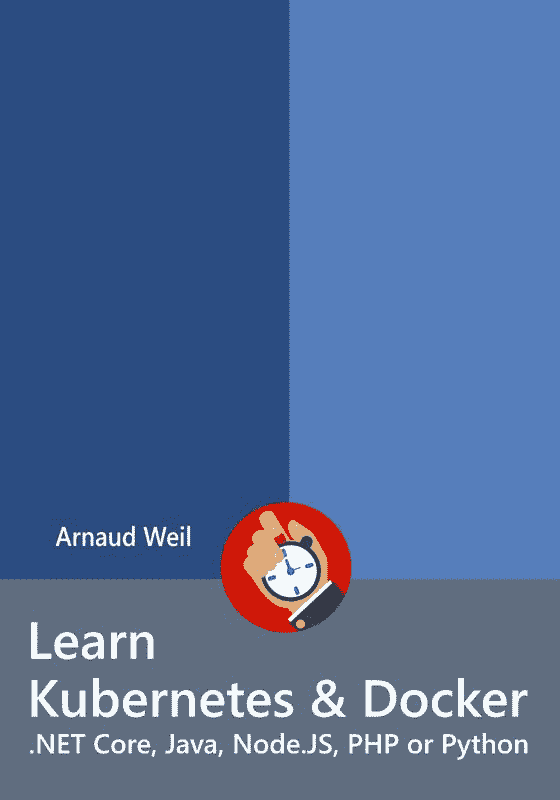

准备好下周创建并运行你的容器化和编排应用程序。

致我的父母，感谢你们教会我自由，并确保我能享受它。

致我伟大的家人。你们的爱与支持支持本书。

致那些对本书提出改进建议的读者，特别是 Doğan Kartaltepe，感谢你一如既往的支持支持。

## 引言

### 本书不是什么

我尽力让本书保持简洁，以便让你快速学习 Kubernetes 和 Docker 而而迷失在琐碎的细节中。如果你正在寻找一本能解决未来几年内问题的参考书，那么找到了。我假设你对容器没有先验知识。

### 准备工作

本书适用于任何需要容器的人。无论你是开发者、DevOps 经理还是技术人员，本书都能帮助你运行容器。

### 如何阅读本书

本书的目标是尽快让你产生效率。为此，我们将使用一些理论、多个演示以及练习。练习将如下：

动手实践：该拿起键盘编写代码了。

在代码示例中，反斜杠 `\` 用于折行。当你从书中复制代码时，不要输入这些反斜杠。

### 你需要的工具

完成本书所需的工具如下：

- 一台符合 Docker Desktop 或 Minikube 要求的 Windows、Linux 或 Mac 机器，或者具备创建 PaaS 集群的能力（Azure AKS, Google GKE, Amazon EKS）。

- 文本编辑器。

### 源代码

所有的演示和动手实践答案都可以在 bitbucket.org/epobb/kubernetesdockerfiles 获取。你可以以 ZIP 文件格式下载，如果你安装了 GIT，只需输入：

```bash
git clone https://bitbucket.org/epobb/kubernetesdockerfiles.git
```

## 1. 为什么用 Docker?

### 1.1 一个 DevOps 赋能工具

Docker 是一个运行容器的引擎，容器作为一种工具可以解决 DevOps 趋势带来的许多挑战。

在 DevOps 中，开发团队和运维团队的目标是冲突的：

作为一个敏捷的开发者，我希望频繁发布应用程序，这样部署就会变成常规。这背后的逻辑是，这种敏捷让“上线”事件变成一个正常、频繁且完全掌控的事件，而不是一个可能在一周后袭击我的可怕灾难。相反，如果部署出现任何问题，都是运维团队需要面对用户——所以他们自然希望稳定性。

容器让部署变得简单，因为部署仅仅是运行一个新容器、将用户路由到新容器并丢弃旧容器。这甚至可以由编排工具自动化，而且由于非常容易，我们可以让多个容器服务于同一个应用程序，以增加更新期间的稳定性。

如果你不使用容器，运维（Ops）需要处理你的托管环境：运行时、库以及你的应用程序所需的操作系统。另一方面，当使用容器时，他们只需要一种单一的方法，就可以处理你提供的容器，无论里面装的是什么。你大可以使用 `.NET Core`、`Java`、`Node.JS`、`PHP`、`Python` 或其他开发工具：只要你的代码是容器化的，对他们来说就无关紧要。在 DevOps 方面这对于容器来说是一个巨大的优势。

在“带有常用开发配置的 Docker”一章中，我们将看到如何为特定的开发技术创建容器镜像。但你的运维人员并不知道你是如何创建镜像的，他们只看到容器镜像。

### 1.2 它解决了依赖冲突

一个典型的 Web 应用看起来如下：

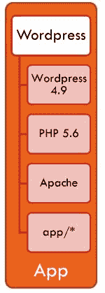

该应用由 HTTP 服务器提供的文件（这里是 `Apache`，但也可以是 `Kestrel`、`IIS`、`NGINX` 等）、一个运行时（这里是 `PHP 5.6`）和一个开发框架（这里是 `Wordpress 4.9`）组成。

如果没有容器，依赖项和文件都将放在同一个服务器上。由于管理这些依赖项非常耗时，类似的应用通常会被分组在同一台服务器上，共享它们的依赖项：

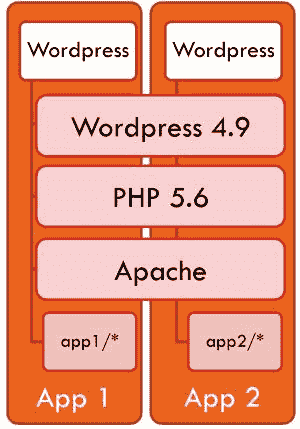

现在假设你想将 `PHP` 运行时从版本 `5.6`升级到 `7.2`。但版本更改会导致应用发生破坏性变化，因此应用也需要更新。在进行升级时，你需要同时更新 `App 1` 和 `App 2`。在一个可能托管了许多此类应用的服务器上，这将是一项艰巨的任务，你可能需要推迟升级直到所有应用都准备就绪。

另一个类似的问题是你想在同一台服务器上托管例如 `App 3`，但 `App 3` 使用 `Node.JS` 运行时以及一个包，该包在安装时会更改 `PHP` 运行时所使用的依赖项。运行时之间的冲突並不罕见，所以你可能已经遇到过这个问题了。

容器解决了这个问题，因为每个应用都将运行在自己的容器中，并拥有自己的依赖项。你典型的服务器看起来像这样：

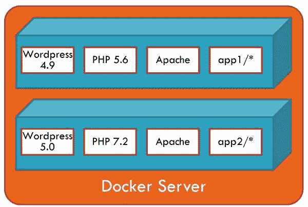

每个容器都封装了它自己的依赖项。这意味着你可以在容器中将 `PHP` 运行时从 `5.6` 版本迁移到 `7.2` 而不影响其他容器。任何其他使用例如 `Node.JS` 的容器都不会干扰任何 `Wordpress` 容器。

### 1.3 它允许轻松水平扩展

当服务器应用需要处理比单台服务器处理能力更高的流量时，解决方案是众而易知的：在它前面放置一个反向代理，并根据需要复制服务器。在我们之前的 `Wordpress` 应用示例中，这意味着将服务器连同所有的依赖项一起复制：

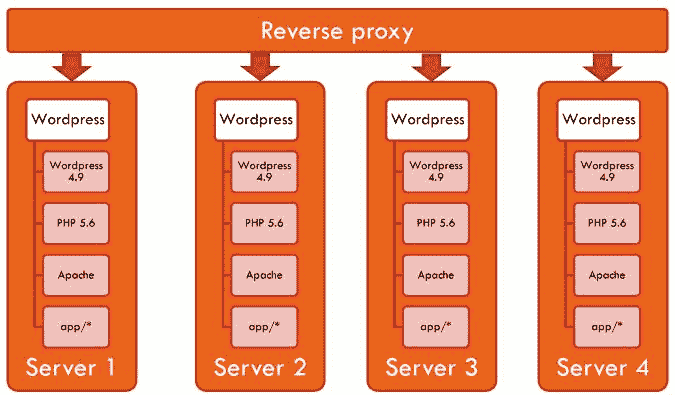

这在升级时只会让情况变得糟糕：我们需要升级每台服务器的依赖项，以及可能引发的所有冲突。

再次，容器对这个问题提供了解决方案。正如我们将在“基础概念”章节中看到的，容器是基于镜像的。你只需要从单个镜像运行你任意数量的容器，它们都将拥有完全相同的依赖项。

更好的是：当使用编排器（orchestrator）时，你只需要说明你想运行多少个容器、镜像名称，编排器就会在你所有的 Docker 服务器上创建相应数量的容器。我们将在编排器部分看到这些。它看起来是这样：

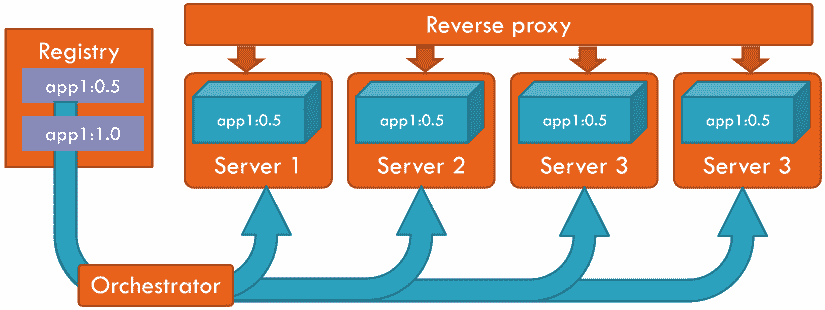

### 1.4 它允许无缝升级

即使在扩展后的场景中，基于容器的方法也让一个原本复杂的概念变得轻而易举。如果没有容器，如果你喜欢的管理员必须更新包括依赖项在内的每台服务器，他将不会高兴：

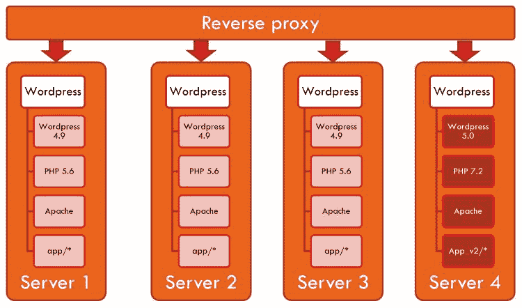

当然，在这种情况下，更新过程将取决于应用及其依赖项。如果你想活命，就别尝试向你的管理员提什么 DevOps 了。

通过使用容器，只需要告诉编排器你想运行新版本的镜像即可，它将逐渐将每个容器替换为另一个运行新版本的容器。无论容器内部运行的是什么技术栈，这都是一个简单的命令（事实上，正如我们将看到的，只需更改一行）。

下面的插图展示了这一过程：编排器替换一个容器，然后移动到其他容器。在新容器准备就绪之前，流量将被路由到旧版本的容器，这样就不会有服务中断。

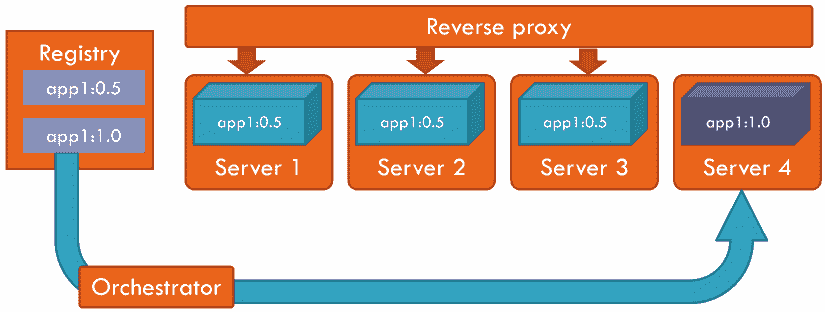

### 1.5 国际贸易早已在使用容器

当然，你可能在奇怪我为什么要做这样的比较。你甚至可能在评估我有多疯狂，或者考虑是否要回到买书的地方退书。别再想了：我不疯。国际贸易面临着同样的交付问题：我们正试图尽可能流畅地交付软件，而商业需要尽可能流畅地交付货物。

在过去，装载一艘船货物需要几天时间：


经典的装船方式

船在码头停留几天，期间每件货物都被装入其中。货物的大小不一，处理要求也不同，而船也有不同类型和尺寸的存储空间。这使得装载（卸载）变成了一个缓慢的过程。缓慢且昂贵：它需要许多人操作，而且船和货的固定是有成本的。

找到了解决方案：容器。这个想法非常简单：使用标准尺寸的箱子，并在里面装入你任何东西。你现在只需要处理标准的箱，无论里面装的是什么。问题解决了：船可以根据许多容器


集装箱装船

事实上，整个运输链（火车、卡车）都可以根据标准高效管理容器：


货运火车

信不信由：Docker 容器非常相似。当你创建一个镜像时，你把软件装进容器。当机器运行它时，容器被创建。容器镜像和容器可以以标准方式管理，从而在容器化软件的生命周期内提供标准的解决方案：

- 通用的构建；

- 通用的镜像存储；

- 通用的扩展方式；

- 通用的运行容器托管；

- 通用的运行容器控制和监控；

- 通用的更新运行容器到新版本。

最重要的部分是：无论容器内部是什么软件，都可以以通的方式处理。这不是 DevOps 的梦想吗？

## 2. 为什么需要 Kubernetes?

## 2.1 容器编排的需求

当你高度依赖容器或高负载时，管理容器将引发许多问题。思考如何：

- 部署和维护使用许多容器的应用。

- 部署和维护在不同机器上生成容器的应用。

- 管理容器使用的资源。

- 通过添加和删除容器来扩展应用，可能跨越不同的机器或动态配置的机器。

- 更新你的应用程序。

- 在不中断应用程序的情况下更新运行应用程序的服务器。

- 从一个主机切换到另一个主机。

这些问题被容器编排系统优雅地解决了。Kubernetes 就是这样一个容器编排平台。你可以把它看作是容器的操作系统。它自动执行跨主机集群的容器化应用的部署、扩展和运行。

## 2.2 什么是 K8s?

K8s 仅仅是 Kubernetes 的缩写。取开头 K 和结尾 s 之间的字母，数数它们的个数并用该数字替换它们。由于 `ubernete` 是 8 个字母，它可以被替换为 `8`，从而得到 K8s。

顺便提一下，Kubernetes 网站上有一个完整的 Kubernetes 术语表。

## 3. 运行 Docker

### 3.1 针对不同需求的各种产品

在运行托管关键应用程序容器的生产环境中，你可能倾向于让你熟悉的管理员来安装 `Docker Enterprise`。

但在你的开发机器或持续集成构建机器上，你可以简单地使用免费的 `Docker Engine Community` 或 `Docker Desktop`（取决于你的机器类型）。

简而言之：

本章的其余部分将引导你完成各种平台的安装步骤。

### Hello world 测试

无论你安装的是哪种版本，都可以在命令行（Linux 上的终端或 Windows 上的 PowerShell）中运行以下命令来检查安装情况：

```
docker run hello-world
```

它应该拉取一个镜像并输出以以下开头的文本：

Hello from Docker!

这条消息表明你的安装看起来工作正常。

### 3.2 开发者或 CI 机器 上的社区版

#### Windows 10

`Docker Desktop` 需要 Windows 10 专业版或企业版 64 位系统，因为它基于 `Hyper-V`。

如果你使用的 Windows 桌面版不符合要求，可以使用基于 `VirtualBox` 的旧版 `Docker Toolbox`。

在安装 `Docker Desktop` 之前，务必执行以下操作：

- 启用 `Hyper-V`

- 在 `BIOS` 中启用硬件虚拟化

然后，点击此链接并按照其中的说明操作。

在安装过程中，系统会提示你使用 Windows 容器还是 Linux 容器。我建议使用 Linux 容器，因为：

- 你以后随时更改主意，只需右键点击工具栏上的 Docker 图标并选择“切换到 Windows 容器 (Switch to Windows containers...)”。

- 目前大多数容器镜像都是基于 Linux 的。

#### Linux

还有其他 Docker 包可用，你可以根据你的版本遵循相应的步骤：

- CentOS 7

- Debian 或 Raspbian

- Fedora 26+ 64 位

- Ubuntu Bionic, Xenial 或 Trusty 64 位

无论你用的是哪种 Linux 发行版，这里都有通用的安装后步骤。请仔细阅读，特别是如果你无法成功运行 `hello-world` 测试时。

#### Mac

`Docker Desktop` 需要 Mac OS Sierra 10.12 或更高版本。

如果你使用的是较旧的 macOS 版本，可以使用基于 `VirtualBox` 的旧版 `Docker Toolbox`。

页面底部是安装 `Docker Desktop` 的说明。

### 3.3 服务器上的企业版

#### Windows Server 2016

Windows Server 2016 客户可以免费额外使用 `Docker Enterprise`。只需按照说明操作即可。

#### Linux

`Docker Enterprise` 可以在 CentOS、Red Hat、SUSE、Ubuntu 等更多系统上运行。点击此处查看你的 Linux 版本是否受支持。

#### 云服务

`Docker Enterprise` 作为 `Azure` 和 `AWS` 的模板可用。

## 4. 基础概念

我需要你掌握三个概念，以便我们能够顺利开始：`containers (容器)`、`images (镜像)` 和 `registries (镜像仓库库)`。

`container (容器)` 是我们最终想要在 Docker 中运行和托管的对象。你可以把它想象成一个隔离的机器，或者如果你愿意，也可以把它看作虚拟机。

从概念角度来看，`container` 运行在 `Docker host (Docker 主机)` 内部，与其他容器甚至宿主机操作系统隔离。除非你显式说明，否则它无法看到其他容器、物理存储或获取传入连接。它包含了运行所需的所有内容：操作系统、软件包、运行时、文件、环境变量、标准输入和输出。

你典型的 Docker 服务器看起来像这样——许多容器的宿主机：

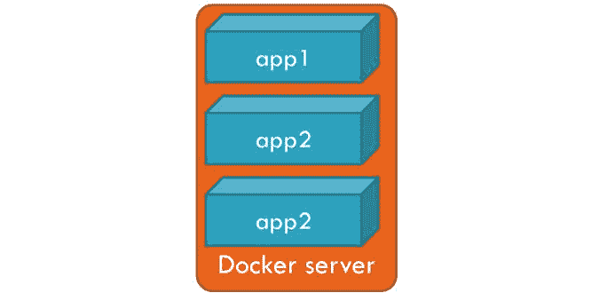

在上面的图中有两个 `app2` 容器是正常的：这通常发生在服务器同时托管发布版本和测试版本时。这意味着你可以在同一台服务器上托管这两个版本。事实上，每个容器都有自己的 `ID`，但我们现在先保持简单。

任何运行的 `container` 都是从 `image (镜像)` 创建的。`image` 描述了创建 `container` 所需的所有内容：它是容器的模板。你可以从单个 `image` 创建任意数量的容器。

整个蓝图如下：

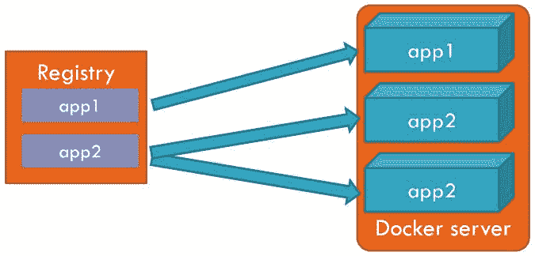

`Images (镜像)` 存储在 `registry (仓库)` 中。在上面的示例中，`app2` 镜像被用于创建两个容器。每个容器都有自己的生命，它们都共享一个公共根节点：来自 `registry` 的镜像。

在接下来的章节中，你将学习如何从现有镜像运行容器，然后将学习创建自己的镜像并将其上传到仓库。

## 5. 使用 Docker 镜像

### 5.1 动手实践：运行容器

在命令行中运行以下命令：

```
docker run hello-world
```

你可以看到以下文本输出：

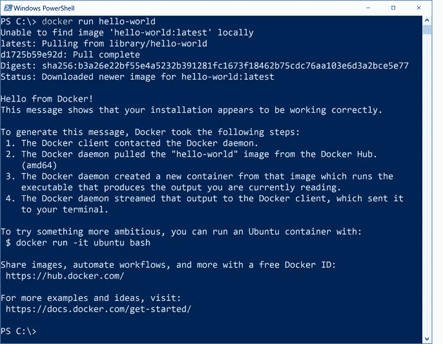

恭喜，你刚刚运行了第一个容器！以下是详细过程说明：

- 你的命令请求 Docker 根据 `hello-world` 镜像创建并运行一个容器。

- 由于磁盘上原本没有 `hello-world` 镜像，Docker 从默认仓库 `Docker Hub` 下载了它。关于它的更多信息将在稍后介绍。

- Docker 于 `hello-world` 镜像创建了一个容器。

- `hello-world` 镜像规定启动时应向控制台输出一些文本，因此这就是你在容器运行时看到的这些文本。

- 容器停止了。

以下是你所的操作（经过简化处理）：

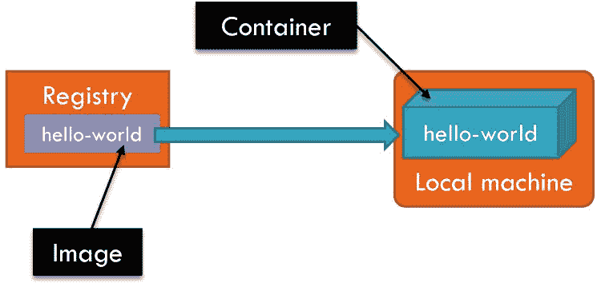

如果你再次运行完全相同的命令，你会发现除了步骤 2 之外，所有步骤都重复了：由于镜像已存在于你的机器上，因此不会被再次下载。这是一个简单的优化，但你以后会看到 Docker 优化了更多步骤。因此，Docker 极少消耗机器资源。

### 5.2 容器管理命令

你可以通过命令行使用 `--help` 选项获取 Docker 命令的帮助。例如，为了了解更多关于我们刚刚使用的 `docker run` 命令，你可以输入：

```
docker run --help
```

你可以使用以下命令进行容器管理：

- `docker ps`：列出仍在运行的容器。添加 `-a` 参数查看已停止的容器。

- `docker logs`：检索容器的日志，即使它已停止也是如此。

- `docker inspect`：获取运行中或停止容器的详细信息。

- `docker stop`：停止仍在运行的容器。

- `docker rm`：删除容器。

### 5.3 动手实践：事后检查

我们之前运行的容器停止了是因为它的任务只是输出文本。我们很快就会运行更多容器，但让我们通过这个停止的容器来熟悉容器工具。

在命令行中运行以下命令：

```
docker ps
```

没有输出，因为机器上没有正在运行的容器。现在在命令行中运行以下命令：

```
docker ps -a
```

你应该能看到类似下面的输出（具体的容器 ID 会不同）：注意容器 ID。它允许你对该容器运行命令。运行以下命令（将 ID 替换为你的容器 ID）：

```
docker logs 48f673b3
```

该命令输出与你运行容器时看到的完全相同。这是容器的标准输出。在现实场景中，你会会有后台运行的容器（例如 Web 服务器），该命令允许你查看它们的输出。

运行以下命令（将 ID 替换为你的容器 ID）：

```
docker inspect 48f673b3
```

这可以让你关于容器许多方面的大量信息——它是仍在运行还是已停止。同样，在现实场景中，这对于理解容器内部发生了什么可能有用。

所有这些信息占用空间，当你完全不再一个停止的容器时，你可能想要回收这些空间。这就是 `docker rm` 命令的作用。

运行以下命令（将 ID 替换为你的容器 ID）：

```
docker rm 48f673b3
```

现在你可以通过上述命令来确认该容器已不存在：

```
docker ps -a
```

```
docker logs 48bab7f673b3
docker inspect 48bab7f673b3
```

Docker 已经不再识别该容器了：

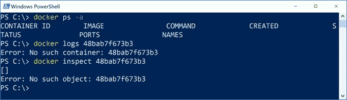


## 5.4 关于 `docker run` 的更多内容

你可以将 `docker run` 命令想象成买了一台新电脑，在上面执行某些命令，然后就把它扔掉。真的。每当从镜像创建一个容器时，你都会获得一个全新的、隔离且原始的环境在容器内进行操作。

你在容器内部得到的内容取决于容器基于哪个镜像。在镜像名称之后，你可以传递要在容器内执行的命令。

让我们用 `alpine` 镜像来说明这个“买完即丢弃的电脑”的比喻。`alpine` 镜像是一个非常小的 Linux 镜像，足够满足我们的需求。

让我们运行一个容器并让它显示其主机名。

```bash
docker run alpine printenv
```

我们基本上是请求使用 `alpine` 镜像创建一个容器，并让容器执行 `printenv` 命令，该命令是 `alpine` 镜像中封装的二进制程序之一。

意料之外，`alpine` 镜像被下载以创建容器，因为我的磁盘上原本没有它。

结果如下：

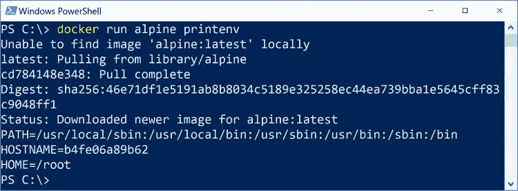

现在让我们再运行两个容器并让它们显示各自的主机名。

```bash
docker run alpine printenv
docker run alpine printenv
```

这与上面的命令相同，重复了两次。在每一行中，我们都在请求使用 `alpine` 镜像创建一个新容器，并让容器执行 `printenv` 命令。

`alpine` 镜像没有被下载，因为它已经在我们的磁盘中了。又创建了两个独立的容器。结果如下：

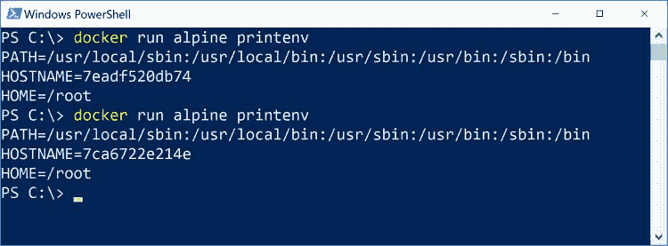

注意，每个容器内部显示的主机名是不同的。看到了吗？你在每个容器上都获得了一个等同于新机器的东西。

这是我操作的简易架构图：

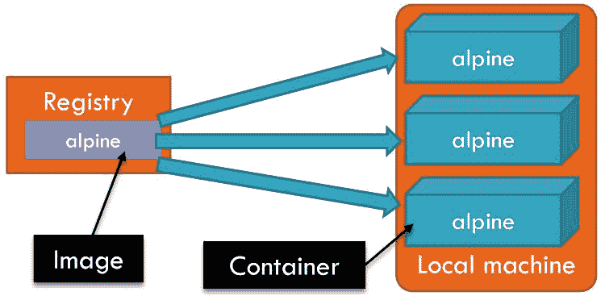

我想让你理解的是，Docker 是一个工具，让你能够获得等同于一次性、临时使用的计算机。一旦你明确了这一点，一个全新的世界就会向你敞开。你来自这样一个世界：获取一台新机器并配置它所需的精力足以让你决定保留它，而且每次后续使用都会产生副作用；而在容器的世界里，获取一个全新的环境廉到足以我们可以获取很多很多个。

如果我列出机器上停止的容器（`docker ps -a`），我将得到 3 个停止的容器，因为我刚刚请求创建了相应数量的容器。由于我很懒，我不想一个一个地删除它们，所以我使用了以下方便的命令：

```bash
docker container prune -f
```

这等同于为每个停止的容器运行一次 `docker rm` 命令。`-f` 选项是一个隐含确认，允许立即删除所有停止的容器，而不是请求确认该操作。

## 5.5 运行服务器容器

我们刚刚看到了如何运行短寿命容器。它们通常执行一些处理并输出某些内容。然而，长寿容器有一个非常常见的用途：服务器容器。无论你想托管 Web 应用程序、API 还是数据库，你都需要一个能够监听入站网络连接并且可能是长寿容器。

警告：最好不要把容器看作长寿的，即使它们确实如此。不要在容器内部存储信息。换句话说，确保你的容器是无状态的（stateless）而不是有状态（stateful）。我们稍后会看到如何以及在哪里存储你容器的状态。Docker 容器非常稳定，但使用无状态容器是因为这允许轻松扩展和恢复。关于这一点稍后会介绍。

简而言之，服务器容器：

- 是长寿的；
- 监听入站网络连接。

我们如何管理它？请继续下文。

### 运行长寿容器

到目前为止，我们一直通过 `docker run` 命令从命令行连接到容器。这对于运行长寿容器来说是不实用的。

要在断开连接的同时允许长寿容器在后台继续运行，我们在 `docker run` 命令中使用 `-d` 或 `--detach` 选项。

以分离模式（detached）运行容器意味着你立即取回了命令行，并且容器的标准输出不再被重定向到你的命令行。

假设我想运行一个 `ping` 命令。我可以使用一个 Linux `alpine` 容器来实现：

```bash
docker run alpine ping www.docker.com
```

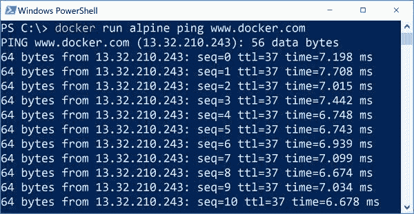

`ping` 命令不会结束，因为它一直在 ping Docker 服务器。这是一个长寿容器。我可以使用 `Ctrl-C` 快捷键从它分离，它会在后台继续运行。但最好从开始就以分离模式运行它：

```bash
docker run -d alpine ping www.docker.com
```

注意增加了 `-d` 选项。这样做时，容器启动了但我们看不到它的输出。相反，`docker run` 命令返回了刚创建的容器的 ID：

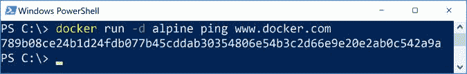

容器 ID 很长。不过，你不需要在命令中完全写出它。只要没有冲突，你可以在像 `docker logs` 或 `docker run` 这样需要容器 ID 的命令中使用 ID 的开头。这在你管理容器时非常方便。

```bash
docker logs 48bab7f673b3
docker inspect 48bab7f673b3
```

Docker 已经不再识别该容器了：


我们可以看到 NGINX 接收到的浏览器 HTTP 请求轨迹：

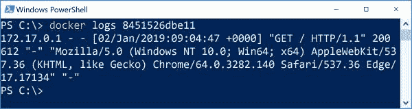

NGINX 容器继续运行并在端口 `8085` 上处理传入的请求。我可以通过 `docker ps` 命令看到它正在运行。让我们把它关掉，以便让我的机器不再有未使用的容器：

```bash
docker stop 8451
docker rm 8451
```

## 总结

你注意到了吗？我们现在等同于获得了一台全新的服务器，在上面安装任何我们需要的软件，并随时随地将其丢弃。

我特别喜欢容器的一点是，它们允许我使用任何软件而不会污染我的机器。通常情况下，在你的机器上尝试新软件之前你会犹豫不决，因为这意味着要安装几个依赖项，这些依赖项可能会与现有软件冲突，而且如果你改变主意并卸载主软件，这些依赖项仍会遗留。得益于容器，我甚至可以尝试大型服务器软件而不污染我的机器。

让我运行一个 Jenkins 服务器来证明这一点。Jenkins 是一个用 Java 编写的完整持续集成服务器。得益于 Docker，我不需要在机器上安装 Java 或任何依赖项就可以运行 Jenkins 服务器。Jenkins 默认在端口 `8080` 上监听，所以我只需要输入：

```bash
docker run -p 8088:8080 jenkins
```

注意，我可以添加 `-d` 选项，因为这是一个长时间运行的进程。然而，我在这里没有使用它，因为我想直接看到详细的输出。对于实际部署，我将使用 `-d` 选项，并在需要时使用 `docker logs` 命令检查输出。

然后，我可以将浏览器指向 `http://localhost:8088` 并完成设置：

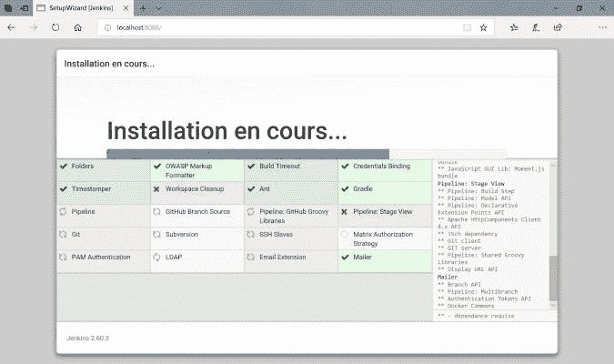

我得到了一个功能完整的 Jenkins：

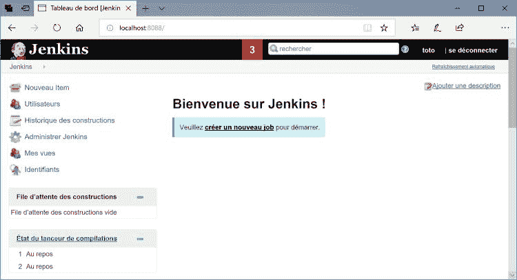

如果我决定不再继续 Jenkins 并尝试另一个持续集成服务器，我只需运行 `docker stop` 和 `docker rm` 命令即可。我也可以通过使用另一个端口再次执行 `docker run` 命令来运行两个独立的 Jenkins 服务器。

这种极低资源成本的隔离性和易用性是容器的巨大优势。现在你已经看到了在单台开发人员机器上管理服务器软件变得多么简单，想象一下这在服务器机器上将有多强大。得益于容器，DevOps 中的运维（Ops）部分变得顺畅无比。

在使用此类镜像时，你可能会好奇数据存储在哪里。Docker 使用卷（volumes）来实现这一点，我们将在本章节后面的部分介绍卷。此外，可能需要数据库来存储数据，那些也可以运行在容器中。目前，不要担心这些，因为我们需要先学习其他内容。

## 5.6 练习题 - 运行服务器容器

在容器中运行 Nextcloud 服务器。你需要使用的镜像是 `nextcloud`，它默认在端口 `80` 上监听。

确保你可以使用浏览器访问 Nextcloud 实例。

完成后，停止并删除容器。检查浏览器中是否已无法访问 Nextcloud 实例。

关于 Nextcloud 容器的更多信息可以从此处找到。

## 5.7 练习题答案

打开命令行。

运行以下命令：

```bash
docker run -d -p 8086:80 nextcloud
```

注意显示的容器 ID 的开头部分。

打开浏览器并指向 `http://localhost:8086`。

你应该能看到提示你创建账户的登录页面。输入你想要的用户名和密码，然后点击 Finish（完成）。

你应该能看到 Nextcloud 首页。

切换回命令行。

运行以下命令：

```bash
docker stop <id>
docker rm <id>
```

关闭浏览器。

## 5.8 使用卷

在使用此类镜像时，你可能会好奇数据存储在哪里。Docker 使用卷（volumes）来实现这一点，我们将在本章节后面的部分介绍卷。此外，可能需要数据库来存储数据，那些也可以运行在容器中。目前，不要担心这些，因为我们需要先学习其他内容。

容器是瞬态的，这意味着任何写入其内部的数据在容器停止时都会丢失。为了持久化数据，我们使用卷。卷允许我们将容器内部的目录映射到宿主机上的目录。这确保了即使容器被删除，数据依然存在。

我们使用 `-v` 选项来映射卷。例如：

```bash
docker run -v /host/dir:/container/dir image
```

在这个示例中，`/host/dir` 是主机上的路径，而 `/container/dir` 是容器内的路径。我们还可以使用命名卷：

```bash
docker run -v volume_name:/container/dir image
```

命名卷由 Docker 管理，比绑定挂载（bind mounts）更易用。

## 5.9 镜像从哪里来？

每个容器都是从镜像创建的。你向 `docker run` 命令提供镜像名称。Docker 首先在本地查找镜像，如果存在则使用它。如果镜像不存在，则将从注册表（registry）下载。

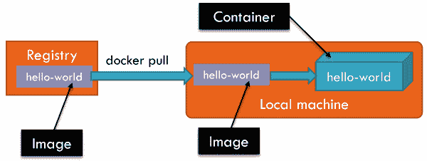

你可以使用以下命令列出本地镜像：

```bash
docker images
```


当镜像发布到注册表时，它的名称必须是：`repository_name/name:tag`

`tag` 是可选的。如果缺失，它被视为 `latest`。`repository_name` 可能是注册表的 DNS 或像 Docker Hub 这样的注册表名称。我们很快就会看到更多关于 Docker Hub 和私有仓库的内容。我们现在使用的所有镜像都是从 Docker Hub 下载的，因为它们不是 DNS 名称。

例如，可以在这里找到 Jenkins 镜像 。

虽然 `docker run` 命令会自动下载镜像，但你可能想手动触发下载。你可以直接使用 `docker pull` 命令。`pull` 命令将强制下载镜像，无论其是否已经存在。使用 `pull` 命令的相关场景包括：

- 你预计运行容器的机器在运行时无法访问注册表（例如没有互联网连接）；
- 你想确保拥有标记为 `latest` 的镜像的最新版本。

## 6. 创建 Docker 镜像

正如我们之前看到的，容器是从镜像创建的。到目前，我们一直在使用他人创建的镜像。现在是时候学习创建自己的镜像了。在我们的镜像中，我们可以放入程序及其依赖项，这样就可以从这些镜像创建许多容器并长期运行。

### 6.1 创建简单的镜像

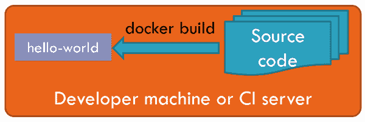

Docker 镜像是通过 `docker build` 命令和 `Dockerfile` 文件创建的。`Dockerfile` 文件包含了说明如何构建镜像的指令。

`Dockerfile` 文件可以有任何名称。命名为 `Dockerfile` 可以让其他人看到项目中的该文件时更容易理解其用途，并且意味着我们在使用 `docker build` 命令时不需要指定文件名。

我想创建一个基础镜像，该容器在运行时显示“hello world”消息。

为此，我创建了一个名为 `Dockerfile` 的文件，它描述了如何构建我的镜像。`Dockerfile` 文件始终以 `FROM` 指令开始，因为镜像是基于另一个基础镜像的。这是一个强大的功能，因为它允许你扩展可能已经很复杂的镜像。

对于我简单的文本输出需求，我可以使用 Debian Linux 镜像。这里是我的 `Dockerfile` 文件：

```dockerfile
FROM debian:8
```

这还远远不够。我确实获得了一个 Debian Linux 基础环境，但我没有运行任何可以显示“hello world”的命令。这可以通过 `CMD` 指令来实现。`CMD` 指令规定了在使用你的镜像创建容器时会运行哪个可执行文件，并提供了可选参数。

这里有一个改进后的 `Dockerfile` 文件，它创建了一个基于 Debian Linux 的镜像，并指示它在容器启动时问候我们的用户：

```Dockerfile
FROM debian:8
CMD ["echo", "Hello world"]
```

注意，要运行的程序及其参数是以字符串字符串数组的形式提供的。

为了从我的 `Dockerfile` 文件创建镜像，我需要运行 `docker build` 命令。因此，我在终端中进入 `Dockerfile` 文件所在的文件夹，输入以下命令：

```bash
docker build -t hello .
```

`-t` 切换开关用在所需的镜像之前。事实上，镜像可以在没有名称的情况下创建（它将只有一个生成的唯一 ID），因此它是 `docker build` 命令的一个可选参数。

注意上述命令末尾的点。它指定了使用哪个路径作为构建上下文（稍后会详细介绍），以及在何处寻找 `Dockerfile`。如果我的 `Dockerfile` 有另一个名称或位于其他地方，我可以添加 `-f` 切换开关来提供文件路径。

`docker build` 命令刚刚创建了一个名为 `hello` 的镜像。该镜像存储在我的本地计算机上，我可以像运行任何其他镜像一样运行它：

```bash
docker run --rm hello
```

如所预期，上面的 `docker run` 命令简单地打印了消息：

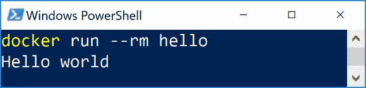

从那里开始，你可能想要发布你的镜像，以便他人运行基于它的容器。我们将在“发布 Docker 镜像”章节中学习如何这样做，但现在我想告诉你们更多关于创建镜像的知识。

为了让事情变得非常清晰，以下是我所做的：

- 创建了一个镜像：
- 创建了一个名为 `Dockerfile` 的文件
- 运行了 `docker build` 命令
- 从创建的镜像运行了一个容器。

我想再次强调一下这意味着：运行容器在虚拟上等同于启动一台全新的机器然后将其丢弃。我的意思是，为了打印那条“Hello world”消息，我们虚拟上获得了一台新电脑，让它执行了 `echo` 命令，然后把它丢掉。Docker 让“发后即忘”的计算变得廉价。当然，对于如此简单的目的来说，这完全是大材小用，但即使当我们安装框架或在容器内部移动文件时，这一点仍然成立：这是一个极佳的功能，当你理解了如何轻松地创建和销弃隔离的虚拟计算机时，你将获得大部分 Docker 的力量。

### 6.2 创建包含文件的镜像

我们刚刚创建的镜像不需要基础镜像已经包含的任何内容，这就是为什么我们的 `Dockerfile` 文件如此简单。但在现实世界的场景中，我很可能想要文件成为我创建的镜像的一部分。

假设我的磁盘上有一个名为 `index.html` 的文件，内容如下：

```html
<html>
<body>
  <h1>Hello !</h1>
  <div>I’m hosted by a container.</div>
</body>
</html>
```

我想创建一个包含 Web 服务器的镜像，该服务器将通过 HTTP 提供此页面。NGINX 是一个很好的选择。我可以继续使用 debian 基础镜像，并在我的 `Dockerfile` 文件中添加安装 NGINX 的指令，但基于已经配置并测试过的镜像进行工作更容易。Docker Hub 包含一个 NGINX 镜像，其中 NGINX 已经安装并配置为提供 `/usr/share/nginx/html` 目录下的文件。

我在与 HTML 文件相同的文件夹中创建了以下 `Dockerfile` 文件：

```Dockerfile
FROM nginx:1.15
COPY index.html /usr/share/nginx/html
```

除了 `nginx` 基础镜像外，你还可以看到一个 `COPY` 指令。它的第一个参数是从构建上下文拷贝的文件，第二个参数是镜像内部的目标目录。

构建上下文基本上是你提供给 `docker build` 命令的目录。它的内容可供 `COPY` 指令使用，但仅在镜像构建过程中可用。这意味着它仅对 `Dockerfile` 文件中的指令可用，除非你使用 `COPY` 指令，否则来自该目录的文件不会成为构建镜像（以及从该镜像启动的容器）的一部分。这就是为什么我们有一个 `COPY` 指令的原因：我们希望 `index.html` 文件成为我们创建的镜像内部 `/usr/share/nginx/html` 目录的一部分。

你可能注意到，这次 `Dockerfile` 文件没有包含 `CMD` 指令。记住，`CMD` 指令规定了从我的镜像创建容器时应该运行哪个可执行文件，所以我没有包含运行 NGINX 服务器的 `CMD` 指令这似乎很奇怪。没错。我没有包含 `CMD` 指令是因为基础 `nginx:1.15` 镜像已经包含了这样一个运行 NGINX 服务器的 `CMD` 指令，所以它是我镜像的一部分，只要我不想在容器启动时运行另一个可执行文件，就不需要包含自己的 `CMD` 指令了。

回到创建我们的 HTTP 服务器镜像，我在 `index.html` 和 `Dockerfile` 文件所在的文件夹内打开命令行，并运行以下命令：

```bash
docker build -t webserver .
docker run --rm -it -p 8082:80 webserver
```

这些命令根据 `Dockerfile` 指令构建了一个 `webserver`，然后启动了一个监听我机器 80 端口的容器。我可以启动浏览器并将其指向 `http://localhost:8082`。这显示了 HTML 文件的内容，因为它们是由运行中的容器提供的：

在命令行中，我看到来自 NGINX 的日志，证明它收到了来自浏览器的 HTTP 请求：

```
172.17.0.1 - - [.../2019:21:46 +0000] "GET / HTTP/1.1" 304 0 "-" "-"
```

在运行容器时，我添加 `--rm` 和 `-it` 开关仅仅是为了演示。在现实生活中，服务器容器将长时间运行，因此我会不带这些开关运行它。以下是我使用这些开关的原因：

- `-it` 允许我通过命令行使用 Ctrl-C 停止容器；
- `--rm` 确保容器在停止后被删除。

### 6.3 镜像本地创建

当我运行 `docker build` 命令从 `Dockerfile` 创建镜像时，生成的镜像存储在运行 `docker build` 命令的本地计算机上。这允许我从本地创建的镜像运行任意数量的容器，但可能我希望其他计算机也能运行我创建的镜像的容器。我们将在下一节学习如何这样做。

可以通过运行以下命令查看本地计算机上可用的镜像：

```bash
docker image ls
```

考虑到我之前构建的镜像，我可以看到类似以下的内容：

在本地随时可用镜像使得从它们运行容器变得非常快。然而，将来会有某些镜像是无用的。我可以使用 `docker rmi` 命令并提供镜像名称或 ID 来从我的本地机器上删除它们。

例如，可以使用以下任一命令删除 `webserver:latest` 镜像：

```bash
docker rmi c067edac5ec1
docker rmi webserver:latest
```

### 6.4 练习 - 构建并运行镜像

创建一个名为 `compute.js` 的文件，包含以下代码，它使用 JavaScript 计算并显示圆的面积：

```javascript
var radius = 2.0 ; var area = Math.pow(radius, 2) * Math.PI ; console.log(
  `Area of a ${radius} cm circle:   ${area} cm²`
);
```

创建一个 Docker 镜像，使用包含 Node.JS 的 `node:11-alpine` 镜像来运行这段代码。使用 Node.JS 运行 JavaScript 程序的命令是 `node <filename>`。

你可能可以在 `create-docker-images/exercises/jsimage/starter` 文件夹中找到 `compute.js` 文件的源代码，并在 `create-docker-images/exercises/jsimage/solution` 文件夹中找到解决方案的源代码。

### 6.5 练习题解答

创建一个名为 `Dockerfile` 的文件并向其中添加以下代码：

```docker
FROM node:11-alpine
COPY compute.js .
CMD node compute.js
```

打开命令行。将当前目录切换到创建 `Dockerfile` 和 `compute.js` 文件的目录。

运行以下命令：

```bash
docker build -t jsimage .
```

一旦镜像构建完成，运行以下命令：

```bash
docker run –rm jsimage
```

你可以看到类似下面的输出：

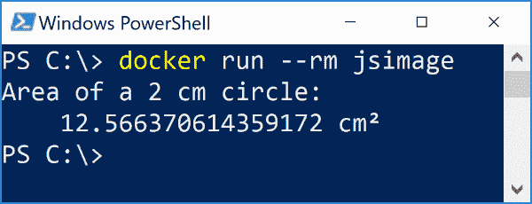

### 6.6 标签（Tags）的重要性

我们早之前看到过镜像名称包含一个名称（name）和一个标签（tag）。为了快速回顾这一点，镜像名称的格式为：

`<repository_name>/<name>:<tag>`

`tag` 是可选的。如果缺失，它被认为是 `latest`。

`repository_name` 可能是一个注册表的 DNS 或者是 Docker Hub 中某个注册表的名称。

虽然你的镜像没有发布到注册表（这是我们在本章中会做的，但在下一章将会改变），但你不需要包含注册表名称。因此你的镜像名称为：

`<name>:<tag>`

#### latest 标签

在我的演示中，我没有包含标签，因此使用了默认的 `latest` 标签。例如，当我运行以下命令时，实际镜像名称为 `hello:latest`：

```bash
docker build -t hello .
```

只要你创建的是简单的软件，并且运行在简单的 CI/CD 流水线上，使用 `latest` 标签是可以接受的。在简单的场景下，你可以：

- 更新源代码；
- 使用 `latest` 标签构建新镜像；
- 使用最新镜像运行新容器；
- 杀死之前的容器。

然而，这有一个限制：当在远程机器上运行 `docker run hello` 命令时（实际上意味着 `docker run hello:latest`），远程机器无法得知是否有更新版本的 `hello:latest` 镜像，因此你需要在远程机器上运行 `docker pull hello`，以便将镜像的最新版本下载到该机器上。

这听起来可能很麻烦，这也是不只使用 `latest` 标签的原因之一。

#### 为什么要给镜像打标签？

一旦你开始认真对待 CI/CD 流水线，很快就会出现其他原因。例如，你可能想要实现以下功能或全部：

- 如果发现最新镜像存在问题，可以回滚到之前的版本；
- 在不同的环境中运行不同的版本，例如在测试环境中运行 `latest` 版本，在生产环境中运行上一个版本；
- 同时运行不同版本，将某些用户路由到最新版本，将部分用户路由到之前的版本（金丝雀发布 canary release）；
- 为不同用户部署不同版本，并在支持他们时，可以在你的开发机上运行任何版本。

这些都是给镜像打标签的充分理由。如果你确保每个发布的镜像都有不同的标签，你就可以运行上述任何场景。

你可以随心所欲为镜像标记标签。常见的标签包括：

- 版本号，例如 `hello:1.0`, `hello:1.1`, `hello:1.2`
- Git 提交标签，例如 `hello:2cd7e376`, `hello:b43a14bb`

为了应用标签，只需在构建命令中指定它即可：

```bash
docker build -t hello:1.0 .
```

#### 基础镜像的标签

记住你的镜像是基于其他镜像的。这是通过在 `Dockerfile` 文件中使用 `FROM` 指令实现的。正如你可以给自己的镜像打标签一样，你使用的基础镜像可能是 `latest`，也可以是带标签的。

在我的演示中使用了带标签的镜像。例如，我的服务器镜像基于 `nginx:1.15` 基础镜像。将你的镜像基于最新版本是非常具有吸引力的，因为这样你始终运行在最新的软件上，尤其是这非常简单：你只需要省略标签或指定 `latest` 即可。因此，你可能想在 `Dockerfile` 文件中使用以下指令：

```dockerfile
FROM nginx:latest
```

不要这样做。首先，这并不意味着运行的任何容器将基于 `nginx` 镜像的最新可用版本。Docker 是关于可复现的镜像，因此最新版本是在你构建镜像时评估的，而不是在运行容器时。这意味着除非你再次运行 `docker build` 命令，否则版本不会改变。

其次，你可能会遇到麻烦。如果 `nginx` 镜像发布了带有破坏性更改（breaking changes）的新版本怎么办？如果你再次构建镜像，可能会得到一个损坏的镜像。

出于这些原因，我建议指定镜像标签。如果你想跟上基础镜像的新发布，请手动更新标签，并确保在发布之前测试你的镜像。

### 6.7 作为环境变量的参数

在现实生活中，容器的输入和输出可能会根据环境而变化。例如，当你运行一个程序时，它可能会连接到某个数据库。

#### 读取值

无论使用什么技术，你都可以访问环境变量。在运行时，你可以设置环境变量。

#### 提供值

要在运行时提供环境变量，你只需使用 `-e=value` 参数。

#### 默认值

你可能还想为环境变量定义一个默认值。这可以通过 `Dockerfile` 文件中的 `ENV` 指令完成。例如：

```dockerfile
ENV name=Dockie
```

为镜像期望的每个环境变量添加 `ENV` 指令是良好的实践。

#### 示例用法

我想创建一个可以 ping 任何站点的镜像。我将使用 Linux 脚本来实现。我在 `ping.sh` 文件中定义它：

```sh
#!/bin/sh
echo “Pinging $host …”
ping -c 5 $host
```

注意我使用了环境变量 `host`。我将定义一个包含并运行该脚本的镜像：

```dockerfile
FROM debian:8
ENV host=www.google.com
COPY ping.sh .
CMD ["sh", "ping.sh"]
```

注意我的 `Dockerfile` 文件包含一个 `ENV` 指令，指定在缺失时 `host` 将为 `www.google.com`。我通过运行 `docker build` 命令从该 `Dockerfile` 文件创建镜像：

```bash
docker build -t pinger .
```

接下来，基于该镜像运行两个容器：

```bash
docker run –rm pinger
docker run –rm -e host=www.bing.com pinger
```


第一个没有为`host`环境变量提供任何值，因此它默认为使用`Dockerfile`文件中指定的`www.google.com`值。第二个容器被提供了`www.bing.com`值。这里是这两个容器的输出（为了简洁进行了缩短）：

```text
C:>docker run –rm pinger

Pinging www.google.com…

PING www.google.com (172.217.18.196) 56(84) bytes of data

64 bytes from par10s38-in-f4.1e100.net (172.217.18.196)\
icmp_seq=1 ttl=37 time=6.52 ms

...

64 bytes from par10s38-in-f4.1e100.net (172.217.18.196)\
icmp_seq=5 ttl=37 time=7.35 ms

5 packets transmitted, 5 received, 0% packet loss, time
4005ms
rtt min/avg/max/mdev = 5.632/7.854/11.031/1.890 ms

C:>docker run –rm -e host=www.bing.com pinger

Pinging www.bing.com…

PING dual-a-0001.a-msedge.net (204.79.197.200) 56(84) bytes of data.

64 bytes from a-0001.a-msedge.net (204.79.197.200): icmp_seq=1 ttl=37 time=7.82 ms

[...]

64 bytes from a-0001.a-msedge.net (204.79.197.200): icmp_seq=5 ttl=37 time=8.08 ms

— dual-a-0001.a-msedge.net ping statistics —

5 packets transmitted, 5 received, 0% packet loss, time
4005ms
rtt min/avg/max/mdev = 7.820/8.669/10.193/0.954 ms
```

你可以看到，根据提供它们的值，每个容器都探测了不同的主机。这是一个简单的演示，但你可以提供更高级的值。通常情况下，你会提供完整的连接字符串、其他服务的 URL、用户名和密码等。这是一个灵活且强大的功能，因为一旦你开始使用编排器，这些值可能来自许多来源。

## 6.8 练习 - 允许镜像参数化

在`create-docker-images/exercises/jsparam/starter`文件夹中，你会找到一个`compute.js`文件，其代码如下：

```javascript
var radius = process . env . diameter / 2 ; var area = Math . pow ( radius , 2 ) * Math . PI ; console . log (
`Area of a ${ radius } cm radius disk:     ${ area } cm²` );
```

它是之前练习中代码的修改版本。它期望一个`diameter`环境变量可用，并显示给定直径的磁盘面积。创建一个包含 Node.JS 的`node:11-alpine`镜像来运行此代码的 Docker 镜像。运行两个具有不同`diameter`值的容器。

解决方案的源代码可以在`create-docker-images/exercises/jsparam/solution`文件夹中找到。

## 6.9 练习解答

创建一个名为`Dockerfile`的文件并将以下代码添加到其中：

```dockerfile
FROM node:11-alpine

ENV diameter=4.0

COPY compute.js .

CMD node compute.js
```

打开命令行。将当前目录更改到你创建`Dockerfile`和`compute.js`文件的目录。运行以下命令：

```bash
docker build -t jsparam .
```

一旦构建好镜像，运行以下命令：

```bash
docker run –rm jsparam
docker run –rm -e diameter=5.0 jsparam
```

你可以看到类似所示的输出：

```bash
C:>docker run –rm jsparam

Area of a 2 cm radius disk:
    12.566370614359172 cm2

C:>docker run –rm -e diameter=5.0 jsparam

Area of a 2.5 cm radius disk:
    19.634954084936208 cm2
```

## 6.10 存储

正如我们在“使用卷”章节中看到的，你最好创建导致无状态容器的镜像，依赖于外部数据存储。然而，有时你需要将数据存储在持久文件系统中。当这种需要出现时，使用如下`VOLUME`指令：

```dockerfile
VOLUME /path/to/directory
```

`/path/to/directory`是镜像内部使用的目录路径。当使用`docker run`命令创建容器时，可以使用`-v`选项将此目录映射到主机系统上的实际卷。这仅仅是一个指示。默认情况下，如果用户没有将此卷映射到容器的外部存储器，则数据将存储在容器内部。

## 6.11 网络

当你的镜像托管服务器软件时，它会在一个或多个端口上监听。例如，HTTP 服务器通常监听在 TCP 端口 80。你可以使用`EXPOSE`指令明确表示这一点：

```dockerfile
EXPOSE 80
```

使用此指令纯粹是为了文档目的。事实上，当从该镜像创建容器时，它**不会**将该端口开放到外部。任何创建容器的人都需要使用`docker run`命令的`-p`选项显式将该端口绑定到主机的实际端口上。如果忘记了，这就是我们在“等待入站网络连接”章节中看到的。

那么为什么要使用`EXPOSE`指令呢？再次，它仅用于文档目的：它让想要从你的镜像运行容器的人知道，他们应该使用`docker run`命令的`-p`选项将哪些端口重定向到外部。

## 6.12 了解更多

Docker 维护了可以在`Dockerfile`文件中使用的指令的参考。你可以在这里找到它。

## 7 发布镜像

### 7.1 发布的理由

当你创建一个镜像时，你需要一个仓库来发布它：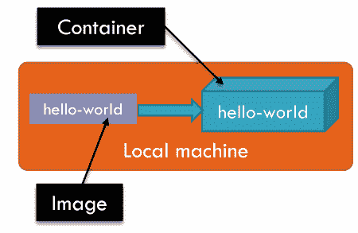

在机器上拥有镜像有两种方式：
- 使用正确的前缀构建镜像（`docker build`）；
- 给现有的镜像打标签（`docker tag`）；

无论你选择哪个仓库，标签过程都是相同的。

### 7.2 仓库

Docker 仓库基本上是一个存储器，提供以下功能：
- 存储各种镜像；
- 为同一镜像存储各种标签；
- 一个允许从机器推送镜像或为容器拉取镜像的 API；
- 使用 TLS 连接 API 以防止中间人攻击。

有很多仓库可用。你可以使用公共 Docker Hub，也可以使用自己的私有仓库。

### 7.3 发布镜像

无论选择哪个仓库，发布镜像都是一个三步骤的过程：
1. 使用正确的前缀构建镜像或打标签；
2. 登录仓库（`docker login`）；
3. 将镜像推送到仓库（`docker push`）。

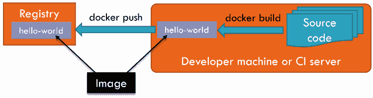

### 7.4 Docker Hub

Docker Hub 是由 Docker Inc 提供的 Docker 仓库。它允许无限存储公共镜像，并提供付费计划托管你的私有镜像。公共镜像可以被他人访问，这正是你希望让软件广泛传播所需的，而非内部软件。

为了在 Docker Hub 上发布镜像，你需要创建一个账户。为此，我访问 https://hub.docker.com/ 并点击 Sign Up 链接。我选择的 Docker ID 将是我发布到 Docker Hub 的镜像的前缀。在创建账户时，确保选择正确的 ID，因为它是你镜像名称的一部分。假设你的 ID 名称为`short-name`，你的镜像应该标记为：

`<short_name>/<name>:<tag>`

对于这本书，我创建了`learnbook`账户，我想发布之前创建的 webserver 镜像。只需正确命名并将其推送到仓库即可。有两种方法：

第一种是使用正确的名称再次运行`docker build`命令。当你从开始使用它时这是一个很好的选择，但如果我现在这样做，会导致我的磁盘上产生两个独立的镜像 - 内容相同但名称和 ID 不同。这不是一个好主意。

我的第二个选择要好得多：使用`docker tag`命令。Docker 镜像可以根据需要拥有多个名称，通过`docker tag`命令，可以将所有这些名称都添加到已有的镜像中。`docker tag`不会复制镜像（这与再次运行`docker build`不同）。

`docker tag`命令接受两个参数：第一个是现有镜像的名称，第二个是你想要添加到该镜像上的新名称。

```bash
docker tag webserver learnbook/webserver
```

现在我的机器上可以通过两个名称识别的同一个 Docker 镜像：`webserver`和`short_name/webserver`。如果我运行`docker image ls`命令，它将以两行的形式显示：注意，这两行的镜像 ID（Image ID）是相同的，这意味着在我的机器上实际上只有一个镜像，只是以不同的名称存在。

现在我的镜像已经命名正确，我可以将其发布到 Docker Hub 了。这只需要运行两个命令：

```bash
docker login
docker push learnbook/webserver
```

`docker login`命令会以交互方式要求输入我的 Docker Hub 凭据，但我也可以将它们作为参数传递给命令。

`docker push`命令足够智能，它只会推送与我使用的基础 nginx 镜像不同的部分，因为它已经存储在 Docker Hub 中，如输出所示：

```text
The push refers to repository [docker.io/learnbook/servers]

0f83d7865e1e: Pushed
6b5e2ed60418: Mounted from library/nginx
92c15149e23b: Mounted from library/nginx
0a07e81f5da3: Mounted from library/nginx

latest: digest: sha256:e8597…1ae0b1efb1 size: 1155
```

就是这样！Docker Hub 现在托管了我的镜像，供所有人查看和运行。每个人都能看到我的镜像，因为它是公开的。如果我不想向全世界共享它，可以将其设置为私有。

### 7.5 在另一台机器上运行镜像

这是一个极其简单的过程。事实上，你已经知道怎么做了：使用`docker run`命令。或者先用`docker pull`获取镜像，然后用`docker run`使用它（这在你计划在运行容器之前断开网络连接时非常有用）。

事实上，你可以在自己的机器上尝试一下（需已安装 Docker Engine 或 Docker Desktop）。运行以下命令：

```bash
docker run –rm -it -p 8085:80 learnbook/webserver
```

然后打开浏览器并访问到以下 URL，查看该容器如何通过 HTTP 提供我的网页。

`http://localhost:8085`

这不酷吗？一个无痛的交付系统。

这有一个小变体。如果你想运行存储在私有仓库（private registry）中的镜像，首先需要使用`docker login`命令登录仓库。完成后，你就可以`docker pull`镜像。如果你以后想用该镜像运行另一个容器，就不需要再次登录，因为镜像已经存储在你的机器上了。

### 7.6 练习 - 发布镜像并在另一台机器上运行容器

1. 在`https://hub.docker.com/`上创建一个 Docker ID。
2. 将你的`jsparam`镜像发布到 Docker Hub。
3. 找另一台运行 Docker Engine 或 Docker Desktop 的机器，并根据发布的`jsparam`镜像创建两个容器，以计算直径为 3.5 cm 和 1.5 cm 的圆的面积。

### 7.7 练习解答

使用浏览器访问`https://hub.docker.com/`并点击`Sign Up`链接。用你想要的 Docker ID 创建账户（在本解答的剩余部分中，我们假设它是`learnbook`，但请替换为你自己的）。

打开命令行。运行以下命令：

```bash
docker tag jsparam learnbook/jsparam
docker login -u learnbook -p <your-password>
docker push learnbook/jsparam
```

找另一台运行 Docker Engine 或 Docker Desktop 的机器并打开命令行。运行以下命令：

```bash
docker run –rm -e diameter=3.5 learnbook/jsparam
docker run –rm -e diameter=1.5 learnbook/jsparam
```

你应该会得到如下输出：

```text
> docker run –rm -e diameter=3.5 learnbook/jsparam

Unable to find image ‘learnbook/jsparam:latest’ locally
latest: Pulling from learnbook/jsparam
Digest: sha256:a80621fe…328f3
Status: Downloaded newer image for learnbook/jsparam:latest

Area of a 1.75 cm radius disk:
    9.62112750161874 cm²

> docker run –rm -e diameter=1.5 learnbook/jsparam

Area of a 0.75 cm radius disk:
    1.7671458676442586 cm²
```

### 7.8 私有仓库

公共仓库是共享 Docker 镜像的方便方式，但你可能想将某些镜像留给公司、你自己或某个组织。私有仓库确保你可以保持你的私有镜像……私有。

当我们使用`docker push`命令将镜像发布到 Docker Hub 时，私有仓库确保你可以保持你的私有镜像……私有。（注：此处原文似乎重复提了 Docker Hub）。当我们将镜像发布到 Docker Hub 时，在私有仓库，你首先需要使用`docker login`命令登录仓库。完成后，你就可以`docker pull`镜像。如果你以后想用该镜像运行另一个容器，就不需要再次登录，因为镜像已经存储在你的机器上了。

### 7.9 大小很重要

当你创建镜像时，你希望它尽可能小，原因有许多：
- 减少拉取和推送时间；
- 节省空间；
- 在运行容器的机器上，你希望减小镜像的大小。

为了减小镜像的大小，你需要理解它受哪些因素影响：
- 镜像包含的文件；
- 基础镜像的大小；
- 层。

#### 镜像包含的文件

在镜像中包含必要的文件。这可能显而易见，但很容易包含不需要的文件。

首先，避免过于宽泛的`COPY`指令。一个典型的例子是：

```dockerfile
COPY .
```

尽量精确。如果有必要，将其拆分为分开的`COPY`指令，例如：

```dockerfile
COPY ./Project/src/*.ts
COPY ./Project/package.json
```

显然，有时你需要复制整个文件夹的`COPY`指令，如下：

```dockerfile
COPY ./js/built /app
```

但是，你可能想从拷贝中排除文件。可以使用`.dockerignore`文件来实现。只需在构建上下文的根目录下添加`.dockerignore`文件，列出应排除的文件和文件夹，就像`.gitignore`文件一样。

这是一个`.dockerignore`示例：

```text
#忽略 .git 文件夹
.git

#忽略任何文件夹或子文件夹下的 TypeScript 文件
**/*.ts
```

其次，在使用 NPM、NuGet、apt 等包管理器时，确保在构建镜像时运行它们。这会避免将它们作为镜像上下文发送，并允许层缓存系统缓存运行结果。只要定义文件没有更改，Docker 就会重用缓存。

#### 基础镜像大小

你在`FROM`指令中选择的基础镜像（`Dockerfile`顶部的指令）是你构建的镜像的一部分。

在某些优化情况下，如果机器已经拉取过该基础镜像，则不需要再次拉取。但通常无法进行此类优化，因此你最好引用较小的基础镜像。

许多可以作为基础的镜像都有更小的变体。例如，我在“创建 Docker 镜像”章节使用的`debian`镜像很大。这是我使用的定义：

```dockerfile
FROM debian:8
CMD ["echo", "Hello world"]
```

该定义生成的镜像重量 127 MB（可以使用`docker image ls`命令检查大小）。

如果我进入该镜像的描述页面，可以看到有一个使用`8-slim`标签的较小变体。这是一个优化的定义：

```dockerfile
FROM debian:8-slim
CMD ["echo", "Hello world"]
```


这个修改后的定义生成了一个权重 79.3 MB 的镜像。我们刚刚节省了原始镜像 38% 体。

使用`node:alpine`镜像代替默认的`node`镜像也可以同样的操作。例如，我用于 Web 服务器镜像的镜像定义生成了一个 109 MB 的镜像：

```dockerfile
FROM nginx:1.15

COPY index.html /usr/share/nginx/html
```

如果我将基础镜像从`nginx:1.15`切换到`nginx:1.15-alpine`，生成的镜像仅重 16.1 MB。这比原始镜像节省了 85%！以下是优化的镜像定义：

```dockerfile
FROM nginx:1.15-alpine

COPY index.html /usr/share/nginx/html
```

### 镜像层 (Image layers)

在创建镜像时，Docker 会按顺序读取每条指令，并将生成的部分镜像分开保留：它们被缓存并用一个唯一的 ID 标记。这种缓存非常有效，因为它在镜像生命周期的不同阶段都会使用：

- 在未来的构建中，只要可能，`Docker` 将使用缓存部分而不是重新创建它；
- 当将镜像的新版本推送到 `Registry` 时，公共部分不会被推送；
- 当从 `registry` 拉取镜像时，你已拥有的公共部分不会被拉取。

缓存机制可以总结如下：当构建新镜像时，`Docker` 将尽力跳过直到第一个实际更改结果镜像的指令之前的所有指令。所有之前的指令都会导致使用缓存层。让我们来看一些例子。

假设我想创建一个包含 PHP 的镜像，因此我创建了以下`Dockerfile`文件：

```dockerfile
FROM debian:8

COPY . .

RUN apt-get update && apt-get upgrade && apt-get dist-upgrade -y

RUN apt-get install -y php5
```

当我使用`docker build`命令构建它时，需要花费相当长的时间，因为两个`RUN`步骤需要下载文件并对它们进行操作。这是正常且预期的。以下是截断的输出：

```
Step 1/4 : FROM debian:8
—> ec0727c65ed3
Step 2/4 : COPY . .
—> cb8153c1f09a
Step 3/4 : RUN apt-get update && apt-get upgrade && apt-get dist-upgrade -y
—> Running in eff335d4aeba
Get:1 http://security.debian.org jessie/updates InRelease [44.9 kB][…]
[…]
Removing intermediate container eff335d4aeba
—> f4a652ba0849
Step 4/4 : RUN apt-get install -y php5
—> Running in d43a7a64606d
```

等等，让我们看看输出的剩余：

```
Reading package lists…
Building dependency tree…
Reading state information…
The following extra packages will be installed:
  apache2 apache2-bin apache2-data apache2-utils file ifupdown isc-dhcp-client
  isc-dhcp-common krb5-locales libalgorithm-c3-perl libapache2-mod-php5
[…]
Need to get 23.2 MB of archives.
After this operation, 88.3 MB of additional disk space will be used.
Get:1 http://deb.debian.org/debian/ jessie/main libgdbm-3 amd64 1.8.3-13.1 [30.0 kB]
Get:2 http://deb.debian.org/debian/ jessie/main libjson-c2 amd64 0.11-4 [24.8 kB]
[…]
Preparing to unpack …/libkrb5support0_1.12.1+dfsg-19+deb8u5_amd64.deb …
Unpacking libkrb5support0:amd64 (1.12.1+dfsg-19+deb8u5)
…
Selecting previously unselected package libk5crypto3:amd64.
[…]
Removing intermediate container d43a7a64606d
—> 3499256d8527
Successfully built 3499256d8527
```

由于这是第一次构建，每条指令都被处理了。不过，4 个步骤中的每一个都已被缓存。

如果我在不更改任何内容的情况下运行相同的`docker build`命令，我可以从缓存层中获益。整个构建过程不到一秒钟，以下是输出：

```
Step 1/4 : FROM debian:8
—> ec0727c65ed3
Step 2/4 : COPY . .
—> Using cache
—> cb8153c1f09a
Step 3/4 : RUN apt-get update && apt-get upgrade && apt-get dist-upgrade -y
—> Using cache
—> f4a652ba0849
Step 4/4 : RUN apt-get install -y php5
—> Using cache
—> 3499256d8527
Successfully built 3499256d8527
```

注意每个层 ID 都匹配。为了改进这一点，我们应该重新排列指令。如果我们将`COPY . .`移动到末尾，`RUN`步骤将被缓存，只有当源代码发生变化时才会执行`COPY`。

以下是将`COPY`指令放在最后优化的`Dockerfile`：

```dockerfile
FROM debian:8

RUN apt-get update && apt-get upgrade && apt-get dist-upgrade -y

RUN apt-get install -y php5

COPY . .
```

## 8. 忘记安装 SDK

### 8.1 一种工具统治一切

在下一章节中，我将向你展示几种开发技术的 Dockerfile 文件示例。我想让你提前注意，我们使用的流程并不依赖于开发技术。无论是 Java、Python、.NET Core、Node.JS、PHP（或其他许多），用于构建、传输和部署应用程序的指令都是相同的。

这在许多环境中都是一个巨大的优势。如果你是一个团队的一员，可能有很多技术正在被使用；然而，构建、发布和部署应用程序的方法取决于应用程序的开发工具。使用单一工具来管理所有内容可以带来许多好处：

- 使用同一套开发栈的团队成员可以帮助使用其他栈的成员；
- 单一的 CI/CD 流程和通用工具可以用于大多数项目，且改进将惠及所有这些项目；
- 在实践中，无论使用什么技术，都使用相同的指令来构建、发布和部署应用程序。内容大致如下：

在 CI/CD 服务器上构建并分发

```bash
docker build -t learnbook/my-server .
docker push learnbook/my-server
```

在目标机器上部署

```bash
docker run –rm -it -p 80:80 learnbook/my-server
```

## 8.2 理性地构建：易的 CI

注意，我在上一节中使用了“构建（build）”一词，而我们在`Dockerfile`文件中执行的大部分工作是打包软件，而不是构建它。

但我真正的指的是构建。`Docker` 不仅仅是一种打包软件的技术，它实际上可以构建你的软件。当你构建一个镜像时，你实际上是在容器内部运行软件（`Dockerfile` 文件中的`RUN`命令）。由于这些`RUN`命令是在镜像中运行的，因此镜像描述了构建软件所需的依赖项。

还记得你作为开发人员时经历的那些艰难时光吗？你克隆了一些代码，结果发现构建它需要一整天，因为你需要安装许多构建依赖项和 SDK 工具。一旦你决定在镜像内部构建软件，你只需要`Docker`。无论是在开发机上还是 CI/CD 服务器上：都需要`Docker`。对于我一直从事的项目来说这是一个巨大的优势，我毫不相信你也将从中受益。

事实上，这甚至可以更进一步：你可以使用相同的`Docker`机器来构建和运行你的软件。与其拥有一个构建服务器和一个测试服务器，你实际上可以使用测试服务器进行构建。在编排上更进一步，你可以使用同一个`Kubernetes`集群来托管你的部署并构建代码——但那是另一个故事了。

让我们以 ASP.NET Core 应用程序为例。ASP.NET Core 要求我们恢复`.csproj`文件引用的`NuGet`包，然后将源代码（C# 文件）构建为`DLLs`并打包任何必要的依赖项。这可以通过以下`Dockerfile`定义完成：

```dockerfile
FROM microsoft/dotnet:2.2-sdk AS builder

WORKDIR /app

COPY . .

RUN dotnet restore

RUN dotnet publish –output /out/ –configuration Release

EXPOSE 80

ENTRYPOINT ["dotnet", "aspnet-core.dll"]
```

`FROM`指令确保了我们拥有构建所需的工具（SDK），然后调用`dotnet restore`和`dotnet publish`使我们的代码准备好在镜像内部进行部署。这允许我们在 CI 服务器或开发人员机器上运行`docker build`，并获得一个包含已构建文件的镜像。当容器在服务器上启动时（`docker run`），`ENTRYPOINT`指令简单地确保了我们的代码在容器内启动。

由于`Dockerfile`定义与我们的源代码存储一起归档，我们就可以确保构建指令与代码保持同步，不同的分支甚至可能有不同的`Dockerfile`定义。

然而，生成的镜像存在一个问题。你能猜到吗？

## 8.3 多阶段 Dockerfile

我们上面创建的镜像存在的问题是它太胖了。它的重量是 1730 MB！这是因为镜像包含了构建工具：如`dotnet restore`和`dotnet publish`等工具。我们不需要那些工具。此外，它还源码和中间构建产物。

我们可以使用`RUN`命令尝试清理镜像：删除中间构建产物、卸载构建工具、删除源代码，但将非常繁琐。是时候记住容器就像廉价的、一次性的机器了。让我们丢弃构建机器，换一个只安装了运行环境的全新机器吧！

`Docker` 有一种巧妙的方法来做到这一点：使用具有不同阶段的单个`Dockerfile`文件。可以通过在`FROM`指令末尾添加`AS <name>`来简单地命名镜像。考虑以下简化的`Dockerfile`文件：

```dockerfile
FROM fat-image AS builder
…
FROM small-image
COPY –from=builder /result .
…
```

它定义了两个镜像，但只有最后一个会被保留作为`docker build`命令的结果。得益于`COPY`命令的`--from`参数，在第一个镜像（命名为`builder`）中创建的文件系统供第二个镜像使用。它表示将`builder`镜像中的`/result`文件夹复制到第二个镜像的当前工作目录。

这种技术允许你从`fat-image`中受益工具，但得到的镜像仅包含其所基础的`small-image`中定义的环境。需要时，你可以在`Dockerfile`文件中包含许多阶段。

这是一个真实的示例。我改进了上一节中显示的`Dockerfile`文件，以便这次它使用多阶段构建：

```dockerfile
FROM microsoft/dotnet:2.2-sdk AS builder

WORKDIR /app

COPY *.csproj .

RUN dotnet restore

COPY . .

RUN dotnet publish –output /out/ –configuration Release

FROM microsoft/dotnet:2.2-aspnetcore-runtime-alpine

WORKDIR /app

COPY –from=builder /result .

EXPOSE 80

ENTRYPOINT ["dotnet", "aspnet-core.dll"]
```

在第一部分，我使用了完整的 SDK 镜像，并将`/out`目录的内容复制到`/app`。第二个镜像基于运行时环境，我得到的镜像仅为 161 MB。相比 SDK 镜像缩小了 91%！

为了在 Docker 内部生成产物，请确保使用多阶段`Dockerfile`。正如我们在 Size 章节中所看到的原因，你想要生成小镜像。

## 9. 通用开发配置的 Docker

我们看到了如何将应用程序封装到`Dockerfile`中，你应该已经了。然而，在创建第一个镜像时你可能对某些模式感到犹豫。我列出了常用开发技术的示例镜像。只需选择你自己的。

每个小节分为两个部分：

- 结果：指向镜像（我已经发布到了 Docker Hub，你可以直接运行它们）；
- 文件：详细介绍了用于创建镜像的文件（特别是`Dockerfile`文件）。

### 9.1 .NET Core

#### 结果

镜像发布为`learnbook/aspnetcore-server`。你可以通过以下命令运行容器：

```bash
docker run –rm -it -p 8088:80 learnbook/aspnetcore-server
```

然后将浏览器指向`http://localhost:8088`

#### 文件

你可以在`code/common-development-profiles/demos/aspnet-core`文件夹找到这些文件。

要提供的静态 HTML 文件：

```html
wwwroot/index.htm

<h1>Hello !</h1>
<p> 此页面由 ASP.NET Core 提供服务 </p>
<p> 尝试我们的 <a href="/v1/square/4">乘法 API</a>。</p>
```

使用 ASP.NET Core 编写的 REST API：

```csharp
// ApiController.cs
using System;
using Microsoft.AspNetCore.Mvc;

namespace aspnet_core {
    [Route("v1")]
    [ApiController]
    public class ValuesController : ControllerBase {
        // GET api/values
        [HttpGet("square/{value}")]
        public IActionResult Square(double value) {
            var result = Math.Pow(value, 2);
            return Ok(new {
                value = value,
                result = result
            });
        }
    }
}
```

```cs
using Microsoft.AspNetCore.Builder ;
using Microsoft.AspNetCore.Hosting ;
using Microsoft.AspNetCore.Mvc ;
using Microsoft.Extensions.Configuration ;
using Microsoft.Extensions.DependencyInjection ;

namespace aspnet_core {
public class Startup
{
public void ConfigureServices (
IServiceCollection services )
{
services . AddMvc (). SetCompatibilityVersion (
CompatibilityVersion . Version_2_1 );
}
public void Configure (
IApplicationBuilder app ,
IHostingEnvironment env
)
{
app . UseDeveloperExceptionPage ();
app . UseDefaultFiles ();
app . UseStaticFiles ();
app . UseMvc ();
}
} }
```

启动 HTTP 服务器：

`Program.cs`

```cs
using Microsoft.AspNetCore ;
using Microsoft.AspNetCore.Hosting ;

namespace aspnet_core {
public class Program
{
public static void Main ( string [] args )
{
```


## 9.1 .NET Core

### 结果
生成的镜像发布为 `learnbook/aspnet-core`。你可以通过以下命令从其运行容器：

`docker run –rm -p 8085:80 learnbook/aspnet-core`

然后将浏览器指向 `http://localhost:8085`

### 文件
你可以在 `code/common-development-profiles/demos/aspnet-core` 文件夹中找到这些文件。

### 入口点：
`Program.cs`

```csharp
public class Program
{
    public static void Main(string[] args)
    {
        WebHost.CreateDefaultBuilder(args)
            .UseStartup<Startup>()
            .Build()
            .Run();
    }
}
```

### 包含构建指令的 `.csproj` 文件：
`aspnet-core.csproj`

```xml
<Project Sdk="Microsoft.NET.Sdk.Web">
  <PropertyGroup>
    <TargetFramework>netcoreapp2.2</TargetFramework>
  </PropertyGroup>
  <ItemGroup>
    <PackageReference Include="Microsoft.AspNetCore.App" />
    <PackageReference Include="Microsoft.AspNetCore.Razor.Design" Version="2.2" PrivateAssets="All" />
  </ItemGroup>
</Project>
```

### 待构建镜像的定义：
`Dockerfile`

```dockerfile
# 使用带有 SDK 的镜像进行编译
FROM microsoft/dotnet:2.2-sdk AS builder
WORKDIR /app

# 获取构建文件
COPY *.csproj .

# 可选。先运行此命令以进行缓存
RUN dotnet restore

# 在镜像内获取源代码
COPY . .

RUN dotnet publish --output /out/ --configuration Release

# 创建一个轻量级镜像
FROM microsoft/dotnet:2.2-aspnetcore-runtime-alpine
WORKDIR /app

# 从上一个镜像复制编译后的产物
COPY --from=builder /out .

EXPOSE 80

ENTRYPOINT ["dotnet", "aspnet-core.dll"]
```

## 9.2 Java

### 结果
生成的镜像发布为 `learnbook/java`。你可以通过以下命令从其运行容器：

`docker run --rm learnbook/java`

### 文件
你可以在 `code/common-development-profiles/demos/java` 文件夹中找到这些文件。

### Java 源码：
`Hello.java`

```java
class Hello {
    public static void main(String[] args) {
        System.out.println("Java in a container.");
    }
}
```

### Docker 镜像定义：
`Dockerfile`

```dockerfile
# 使用带有 SDK 的镜像进行编译
FROM openjdk:8-jdk-alpine AS builder
WORKDIR /out

# 在镜像内获取源代码
COPY *.java .

# 编译源代码
RUN javac Hello.java

# 创建一个轻量级镜像
FROM openjdk:8-jre-alpine

# 从上一个镜像复制编译后的产物
COPY --from=builder /out/*.class .

CMD ["java", "Hello"]
```

## 9.3 Node.JS

### 结果
生成的镜像发布为 `learnbook/node-server`。你可以通过以下命令从其运行容器：

`docker run --rm -it -p 8087:80 learnbook/node-server`

然后将浏览器指向 `http://localhost:8087`

### 文件
你可以在 `code/common-development-profiles/demos/nodejs` 文件夹中找到这些文件。

### 待服务的静态 HTML 文件：
`www/index.htm`

```html
<h1>Hello!</h1>
<p>This page is served by Node.JS</p>
<p>Try our <a href="/v1/square/4">multiply API</a>.</p>
```

### 定义并运行 HTTP 服务器、静态文件服务器和 REST API：
`index.js`

```javascript
const HTTP_PORT = 80;
const cors = require('cors');
const express = require('express');
const path = require('path');

var sourcesDirectory = path.resolve(__dirname, 'www');
var app = express();
app.use(cors());

// API
app.get('/v1/square/:value', function(req, res) {
    const value = req.params.value;
    const square = Math.pow(value, 2);
    res.send({
        value,
        square
    });
});

// 静态文件
app.use(express.static(sourcesDirectory, {
    index: 'index.htm',
    extensions: ['htm']
}));

var server = require('http').createServer(app);
server.listen(HTTP_PORT);

console.log(`Listening on http://localhost:${HTTP_PORT}`);
```

### 列出构建期间需要恢复的依赖项：
`package.json`

```json
{
    "name": "node-server",
    "version": "1.0.0",
    "main": "index.js",
    "scripts": {
        "start": "node index.js"
    },
    "dependencies": {
        "async": "^2.4.1",
        "cors": "^2.8.3",
        "express": "^4.15.2"
    }
}
```

### Docker 镜像定义：
`Dockerfile`

```dockerfile
FROM node:14-alpine

# 创建目录
RUN mkdir /app
WORKDIR /app

# 安装依赖
COPY package.json .
RUN npm install

# 复制源码
COPY . .

EXPOSE 8087

CMD ["npm", "start"]
```

## 9.4 PHP

### 结果
生成的镜像发布为 `learnbook/php`。你可以通过以下命令从其运行容器：

`docker run --rm -it -p 8090:80 learnbook/php`

然后将浏览器指向 `http://localhost:8090`

### 文件
你可以在 `code/common-development-profiles/demos/php` 文件夹中找到这些文件。

### 待服务的静态 HTML 文件：
`index.php`

```html
<h1>Hello!</h1>
<p>This page is served by PHP</p>
<p>Try our <a href="/v1/square/4">multiply API</a>.</p>
```

### 简单的 API 定义：
`myapi.php`

```php
<?php
header("Content-Type: application/json");
$value = $_GET['value'];
$square = $value * $value;
$result = array(
    "value" => $value,
    "square" => $square
);
echo json_encode($result);
?>
```

### Docker 镜像定义：
`Dockerfile`

```dockerfile
FROM php:7.0-apache

# 启用 rewrite 模块
RUN a2enmod rewrite

# 复制源码
COPY . /var/www/html/
```

### Apache 重写规则：
`.htaccess`

```apache
<IfModule mod_rewrite.c>
RewriteEngine On
RewriteCond %{REQUEST_FILENAME} -f [OR]
RewriteCond %{REQUEST_FILENAME} -d
RewriteRule ^(.+)$ myapi.php=$1 [L]
</IfModule>
```

## 9.5 Python

### 结果
生成的镜像发布为 `learnbook/python-server`。你可以通过以下命令从其运行容器：

`docker run --rm -it -p 8089:5000 learnbook/python-server`

然后将浏览器指向 `http://localhost:8089`

### 文件
你可以在 `code/common-development-profiles/demos/python` 文件夹中找到这些文件。

### 待服务的静态 HTML 文件：
`templates/index.htm`

```html
<h1>Hello!</h1>
<p>This page is served by Python</p>
<p>Try our <a href="/v1/square/4">multiply API</a>.</p>
```

### 简单的 API 定义：
`server.py`

```python
from flask import Flask
from flask import render_template
from flask import request, jsonify

app = Flask(__name__)

@app.route('/v1/square/<value>')
def show_user_profile(value):
    value = int(value)
    square = value * value
    return jsonify(value=value, square=square)

@app.route('/')
def hello():
    return render_template('index.htm')
```

### Docker 镜像定义：
`Dockerfile`

```dockerfile
FROM python:3.7-stretch

# 安装模块
RUN pip install Flask

# Flask 模块需要
ENV FLASK_APP=server.py

# 复制源码到镜像
COPY templates ./templates
COPY server.py .

EXPOSE 5000

CMD ["flask", "run", "--host=0.0.0.0"]
```


# 10. Kubernetes 集群

## 10.1 Kubernetes 集群的组成部分

Kubernetes 集群的目标是运行你的容器。它会固执地确保你的容器正在运行。这里是你的容器运行的架构：


如果每个人都能理解我们所做的工作，生活将会太简单了，所以大多数人倾向于使用复杂的词汇。你可能已经听说过 pods，你可能好奇 pod 和容器之间的区别。

让我们变得简单点：目前你可以认为 pod 是一个容器。

pod 实际上比单个容器多得多，但在我们解释差异之前，你认为 pod 是一个容器是安全的。

Pods 是你想要运行的实际软件单元，而节点（nodes）是运行这些单元的硬件部分。将节点视为可以运行你 Pod 的资源。Pods 需要 CPU 和内存，而节点提供这些 CPU 和内存。节点作为 Kubernetes 集群的一部分，允许它们分布在整个集群中，这样我们就可以获得许多优势，例如韧性、高可用性和水平伸缩性。

节点有两种类型：工作节点（worker nodes）和主节点（master nodes）。我们刚刚看到的架构图只显示了工作节点，因为那些是真正运行你 Pod 的节点。主节点不运行你的 Pod：它们控制工作节点，以确保它们遵循你的意愿。我们已经看到 Kubernetes 集群的生存目标是运行你的 Pod，而主节点正是实现这一切的者。

这是我们的集群，现在包含了主节点：

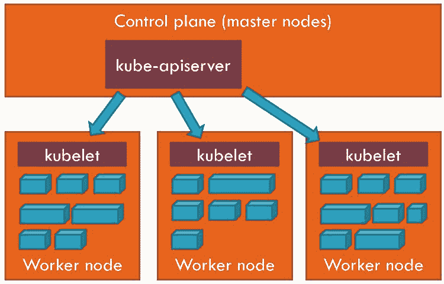

主节点之于工作节点，就像现实生活中管理者之于技术人员的关系：它们的工作是确保他人执行可见的工作。就像开发者编写实际软件，而他们的经理将待编写的软件任务分配给可用的开发者一样，工作节点运行实际面向用户的软件（Pods），而它们的主节点将待运行的 Pod 分配到可用的工作节点上。

可以有一个主节点，但通常为了实现高可用性会有多个主节点。无论是一个还是多个主节点，它们在逻辑上被组合在一起形成我们所说的控制平面（control plane）。

工作节点是非关键资源。万一其中一个节点发生故障，控制平面将在剩余节点上启动新 Pod，以替换在丢失节点上运行的 Pod。你需要确定你的集群需要多少个工作节点：节点太多意味着你无法充分利用每个节点的容量，但节点太少意味着你可能无法承受丢失某些节点的代价。希望节点可以动态添加和删除。

控制平面通过其 `API server` 接收你的指令。每个工作节点都运行一个 `kubelet` 守护进程，允许控制平面管理其 Pod 和其他资源。

由于你的 Kubernetes 集群希望确保你的 Pod 按预期运行，它还使用了几个额外的组件：

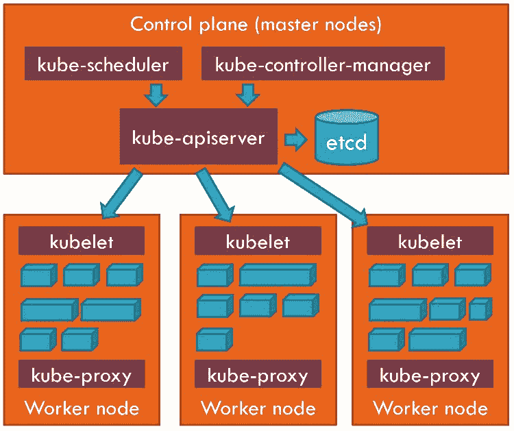

为了在 Kubernetes 中迈出第一步，你不需要理解这些额外的组件，因此之前的架构图是一个很好的简版参考。但是，请允许我向你介绍将让我们的 Kubernetes 集群更强大的“隐藏工人”。

`etcd` 是一个数据库，存储了集群的期望状态，以便控制平面可以在工作节点上采取适当行动，无论发生什么情况，都能达到并保持该状态。你的集群内部可能会发生很多事情：工作节点可能变得不可用，或者新节点可能加入集群，某个 Pod 可能会死亡或需要更新或扩展。得益于 `etcd` 数据库，控制平面可以确保它有一份关于需要达到什么状态的参考。只要有一半的主节点可用，`etcd` 就能正常工作。

`kube-scheduler` 负责在正确的节点上创建 Pod，而 `kube-controller-manager` 确保所需数量的 Pod 以预期的状态运行。

现在我们已经有了全局视图，可以回到 Kubernetes 集群更简单的表示方式：

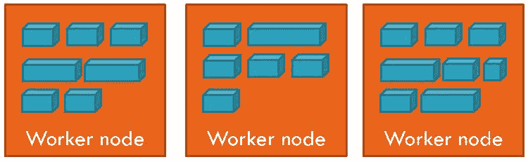

当我们每天在集群上运行应用程序时，重要的是 Kubernetes 提供了一种“工作节点/Pod”抽象：Pods 是你的软件单元，可以原子化地运行，而工作节点是硬件单元，提供运行这些单元所需的 CPU 和内存资源。你的软件需要 CPU 和内存，Kubernetes 在所有可用的工作节点上分配这些资源。

## 10.2 创建集群

有多种方法可以获取运行中的 Kubernetes 集群，你的选择取决于你想对它做什么。选择可分为 3 类：

我们现在想要的是一个可以工作的 Kubernetes，这样我们就可以学习如何使用 Kubernetes，并为生产集群准备工作负载，因此“开发工作站”解决方案是我们将奔向的目标。但是，为了运行面向用户的应用程序，我们需要一个私有的或云 PaaS Kubernetes 集群。让我们回顾一下这些。

### 开发工作站

在将应用程序发送到远端生产集群之前，你更倾向于在本地机器的 Kubernetes 集群上进行设置和测试，这就是为什么你需要在开发机器上拥有本地 Kubernetes 集群的原因之一。其他原因和你为任何开发平台安装本地设置而不是使用远程设置的原因相同。

幸运的是，在大多数情况下，在本地机器上设置 Kubernetes 集群是一项简单任务。至少有两个选项：`Docker Desktop` 和 `Minikube`。它们都建立一个单节点 Kubernetes 集群。

`Docker Desktop` 包含了 Docker 开发工具以及开箱即用的 Kubernetes 集群。如果你要在集群中运行 Docker 容器，这是一个很好的选择，特别是在 Windows 和 Mac 机器上。

`Minikube` 更加灵活。它让你决定想使用的 Kubernetes 版本、安装哪些扩展以及需要哪种容器运行时。灵活性是有代价的，所以要准备花一些时间设置，但在 Linux 机器上它非常简单。

### 云 PaaS

对于你的生产工作负载，你可以从主要的云提供商获取 Kubernetes 集群。这些集群的基础设置通常是一项枯燥的任务，而升级或保护集群等活动大多是不费力的或自动的。

使用 PaaS Kubernetes 集群的另一个优势是你可以根据需要添加或删除节点，因为你运行在云基础设施上。由于 Kubernetes 具有伸缩能力，它是运行资源密集工作负载的完美选择，因此能够几乎无限制地添加虚拟机，对于那些面临高负载或波动工作负载的人来说无疑是一个加分项。对此，许多 PaaS 服务允许动态节点供给。

一些 Kubernetes 服务包括：

- `Azure AKS`：仅对工作节点收费。你不需要管理主节点，也不为它们付费。AKS 在集群达到峰值时允许自动配置节点。
- `Google GKE`：仅对工作节点收费，并且在集群达到峰值时允许自动配置节点。
- `Amazon EKS`、`RedHat OpenShift`、`IBM CKS`、`Heptio Kubernetes Subscription`。

### 私有

某些用例是云 Kubernetes 服务无法涵盖的。例如，我的客户需要在指定的密封数据中心创建并管理 Kubernetes 集群。`kubeadm` 是 Kubernetes 发行版的一部分。它帮助使用 `init`、`join`、`upgrade` 和 `reset` 等基本命令设置和维护 Kubernetes 集群。

由于 `kubeadm` 是可组合的，有许多工具构建在其之上，帮助你在各种场景下设置 Kubernetes 集群。例如，你可以使用：

- `Kubespray`：在云端或裸机上设置自定义集群。它可以使用 `Ansible` 或 `Vagrant`。
- `Kops`：在 `AWS` 和 `GCE` 等云提供商上设置自定义集群。

这些工具可以让你在几小时内获得运行中的集群。然而，请注意，正确地保护集群需要一些努力，维护集群确实需要时间和投入。这不仅仅是备份或升级服务器：导致使用 Kubernetes 的业务需求通常意味着高可用性、自动扩展和可靠性，这反过来又意味着管理集群的人需要大量工作。

如果你自己构建集群，请确保你能提供：

- 控制平面的高可用性
- 工作节点的扩展性与自动修复
- 安全性（首先是节点之间以及到 `etcd` 之间通信的安全）
- 升级
- `etcd` 备份与恢复
- 卷（Volumes）的备份与恢复

## 10.3 练习 - 设置你的开发集群

**目标**：获取一个可用的开发集群。

你需要创建一个用于书中练习的 Kubernetes 集群。请从以下选项中选择：
- 安装 `Docker Desktop`
- 安装 `Minikube`
- 在云端创建一个 PaaS 集群。

完成后，你应该能够成功运行以下命令：

```bash
kubectl get nodes
```

## 10.4 练习解答

此练习没有提供详细的指导，因为你的经验可能会根据许多因素而异，安装细节已在各自工具的页面上提供。

## 10.5 连接到集群

### kubectl 工具

一旦你的 Kubernetes 集群准备就绪，你需要一个工具来与它交互。`kubectl` 是一个能够满足大多数需求的命令行工具。它足够灵活且完整，可以用于开发部署，也可以用于你的持续交付服务器（你肯定在使用 CI/CD 链对吧？）。它可以与你的本地开发集群工作，也可以与生产集群工作。它的适用场景如下所示：

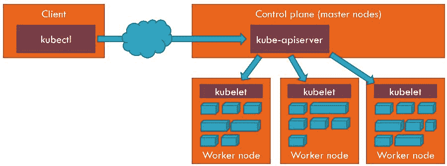

`kubectl` 工具通过集群 API 向你的 Kubernetes 集群发送命令。它允许对集群进行检查和监控（列出节点、pod 以及其他集群资源），并允许创建、删除和更新 Kubernetes 集群内部元素。

你可以从那里获取 `kubectl`。确保 `kubectl` 版本与你想要目标的 Kubernetes 集群版本匹配。为了检查一切是否正常，你可以运行以下命令：

```bash
kubectl version
```

如果一切设置正确，你将得到类似下面的输出：

```text
Client Version: version.Info{Major:“1”, Minor: … }
Server Version: version.Info{Major:“1”, Minor: … }
```

Client 部分显示你机器上的内容，而 Server 部分显示关于 Kubernetes 集群的信息。但等一下，哪个集群？如果你的机器上 Server 部分什么都没有显示怎么办？

### Kubectl 上下文

`kubectl` 工具通过 `context`（上下文）连接到 Kubernetes 集群。每个上下文存储特定用户在特定集群中的凭据。

拥有多个上下文是连接到不同集群（例如开发集群和生产集群）的一种明显方法，但也是使用不同凭据连接同一个集群的方便方法。例如，它允许你测试 CI/CD 工具使用的凭据是否正常工作。

你可以使用 `get-contexts` 命令列出当前上下文：

```bash
kubectl config get-contexts
```

```text
CURRENT  NAME
          some-cluster
          anotherOne
*       docker-desktop
          cloudk8s
```

注意“my-cluster”左侧的星号。它表示当前集群。换句话说，使用 `kubectl` 工具发布的任何命令都将作用于该集群。

要使用另一个上下文，可以使用以下命令：

```bash
kubectl config use-context <context-name>
```

如果你安装了 `Docker Desktop`，它允许你通过右键点击系统托盘图标来列出和切换上下文。

通常你用于连接所创建集群的工具会为你创建一个新的上下文条目，但你可以使用 `kubectl config` 命令的 `set-cluster`、`set-credentials` 和 `set-context` 子命令添加条目。

### 基础命令

从这里，我们可以使用一些 `kubectl` 命令：

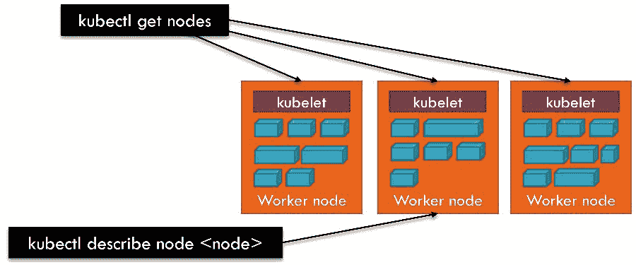

`get nodes` 命令列出你集群的主节点和工作节点。`get node` 命令将描述单个节点；你需要提供一个从 `get nodes` 命令获取的节点名称。

```bash
kubectl get nodes
```

```text
NAME            STATUS  ROLES  AGE    VERSION
aks-1923416-1  Ready  agent  27d19h  v1.14.6
aks-1923416-2  Ready  agent  27d19h  v1.14.6
```

```bash
kubectl describe node aks-1923416-1
```

```text
Name:      aks-1923416-1
Roles:     agent
(许多关于该节点的信息)
```

在像 `Azure AKS` 等某些环境中，主节点由你为你管理，不会被 `get nodes` 命令列出。上面的示例显示了这种情况。

## 11. 工具

有很多工具旨在让你的 Kubernetes 生活变得更轻松。由于 Kubernetes 可以完全由 API 驱动，你甚至可以编写自己的工具。然而，对于大多数需求，你只需要两个：一个文本编辑器和 `kubectl`。

既然我们已经见过 `kubectl`，让我介绍一些可能帮助你走 Kubernetes 之路的可选工具。

### 11.1 Kubernetes Dashboard

尽管 `kubectl` 是 Kubernetes 一个极其强大的瑞士军刀工具，但那些不习惯命令行界面的人通常会带着焦虑的脸来问我是否有图形化工具。是的，有的，那就是 Kubernetes Dashboard。它不是必需的工具，但可能会让习惯于图形用户界面而不是命令行工具的人感到安心。

Dashboard 是一个可以使用浏览器访问的 Web 界面。它允许在用户界面中进行简单的集群监管。

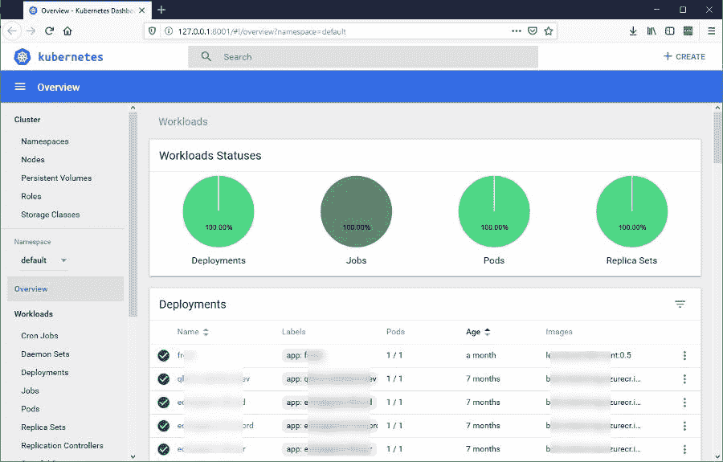

它提供了工作负载的高级视图：

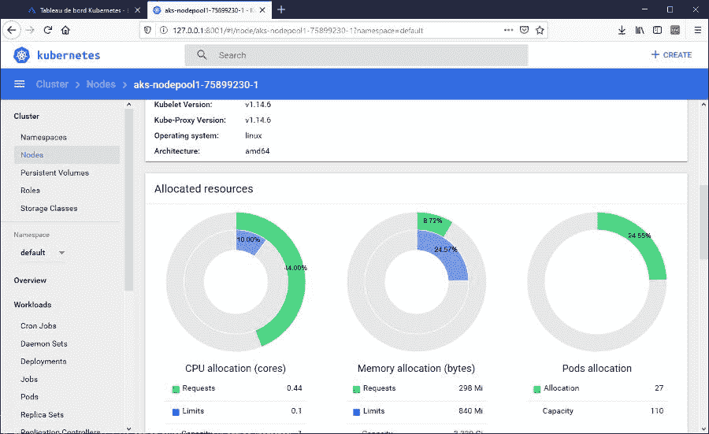

它允许你深入 Kubernetes 对象，包括节点。例如，这里是节点的详细页面：

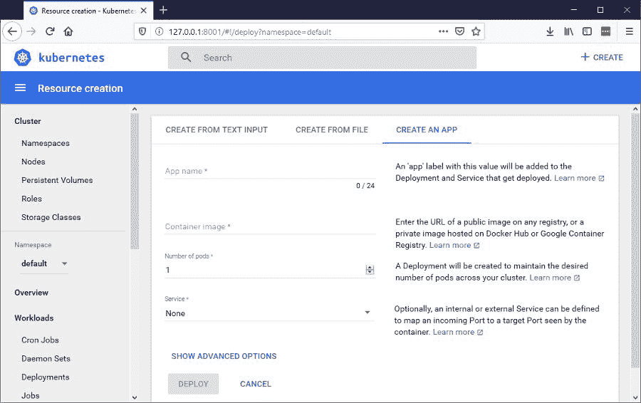

你可能会注意到右上角的“create”按钮。点击后，会出现创建一个 Deployment 和可选 Service 的页面：

Dashboard 可以按照项目页面说明进行安装。对于在 `Azure AKS` 上运行的用户，可能需要为 Dashboard 创建相应的权限：

```bash
kubectl create rolebinding dashboard --clusterrole=cluster-admin --serviceaccount=kube:dashboard
```

### 11.2 Visual Studio Code

与集群的日常工作涉及操作 YAML 文件，这些是文本文件。这需要一个良好的文本编辑器。如果你还没有，我只能推荐 Visual Studio Code，因为它轻量、灵活且跨平台。

Visual Studio Code 通过使用扩展进行自定义。点击左侧工具栏上的“Extensions”按钮。有一个来自 Microsoft 的 Kubernetes 扩展（插件），它可以为常见的 Kubernetes 和 Helm（后文）任务提供 GUI。它就像 Kubernetes Dashboard 和 `kubectl` 的混合体，我只能推荐它。这里是扩展的运行情况：

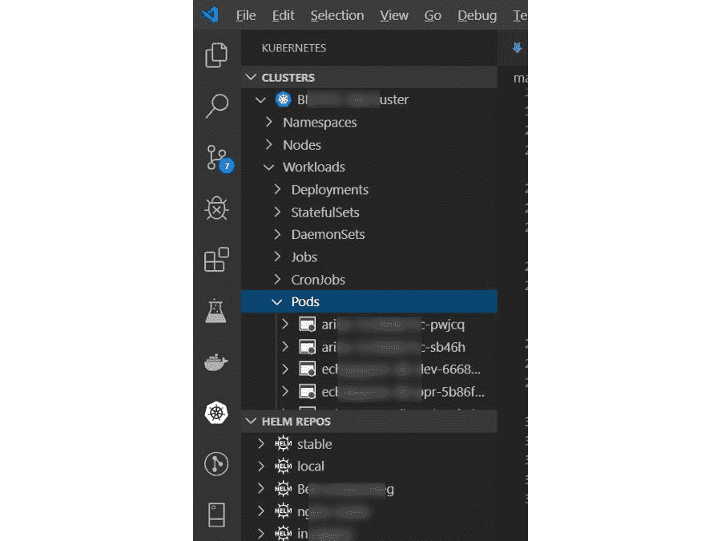

### 11.3 Helm

在后面的章节中，我们将学习 Helm 以及创建可以使用 Helm 部署的 chart。它是 Kubernetes 世界中常用的部署工具，因为它让 Kubernetes 部署更进了一层。本质上，比起没有它，Kubernetes 部署已经很容易很棒，但 Helm 让以下操作变得简单：
- 根据参数变动部署
- 将多个资源作为单一实体部署
- 回滚部署

现在还没有创建我们的 Helm chart 的时候，但我们需要使用 Helm 来部署 Ingress 控制器，然后创建我们的 chart，所以我介绍一下它。基本上，Helm 同时安装在你的部署机器（你的机器或 CD 服务器）和 Kubernetes 集群中。安装在集群内部的组件称为 Tiller。Tiller 跟踪已部署并在升级或回滚时进行升级或回滚。从概念角度来看，Helm 的安装如下：


为了避免以后浪费时间，如果还没有安装 Helm，现在是安装的好时机。只需以下步骤操作即可。

运行以下命令：

```bash
helm version
```

如果 Helm 已经安装了，你会看到类似的内容：

```text
Client: &version.Version{SemVer:“v2.12.3”, …}
Server: &version.Version{SemVer:“v2.12.3”, …}
```

在这种情况下，你可以直接跳到下一章。否则，请继续后续。

如果客户端（你的机器）缺少该程序，你需要获取 `helm` 可执行文件并将其添加到路径中。这可以通过手动完成，也可以通过包管理器完成，操作说明请参考 https://github.com/helm/helm#install。

以下指令用于非安全安装。请确保你对其进行进一步的安全加固。

使用以下命令在服务器上安装 Helm 的 Tiller 部分：

```bash
helm init –history-max 200
```


# 12. 运行 Pods

## 12.1 Deployments 和 ReplicaSets

如我们所见，Kubernetes 集群是一组可用的 CPU 和内存资源，用于运行你的 Pods。Pods 应该被认为是瞬态的，因为许多因素都会导致它们的死亡：它们可能会崩溃、可能因为消耗资源过多而被杀掉、在应用程序升级期间可能需要替换为新版本，并且它们可能仅仅因为运行它们的节点关机或以其他方式变得不可而消失。

不要担心：Kubernetes 会尽力让你的 Pods 在任何情况下都运行。这意味着将在可用的工作节点上重启尽可能多的 Pod。它实现这一点的方法是通过一个 `ReplicaSet` 对象。`ReplicaSet` 确保指定数量的 Pod 运行在正常状态，并根据需要启动新的 Pod 或停止不必要的或异常的 Pod。

为了管理版本变更（即减少旧 `ReplicaSet` 中的 Pods 并增加新 `ReplicaSet` 中的 Pods），Kubernetes 使用 `Deployment` 对象。其结构如下：

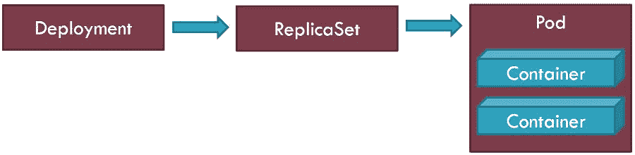

这看起来可能很复杂，但如果你考虑到它所有的职责，实际上其实很简单。对于你的大部分工作，你可以用一种简单（虽然不那么准确）的方式来理解它：


我们稍后在详细介绍升级策略时会回到 `ReplicaSets`，但现在只需认为创建 `Deployments` 是为了运行和升级你的 Pods。

你如何创建一个 `Deployment` 呢？实际上有两种方法：命令式（imperative）和声明式（declarative）。命令式看起来简单，所以我们从它们开始。声明式看起来更复杂，但从长远来看，它会让你的工作变得容易得多。

## 12.2 命令式命令

`kubectl create` 命令允许你以命令式创建 Kubernetes 资源。以下是使用 `hello-world` Docker 镜像创建 `Deployment` 的方法：

```bash
kubectl create deployment hello –image=hello-world
```

```text
deployment.apps/hello created
```

然后我们可以检查 Deployment 是否已实际创建：

```bash
kubectl get deployments -l app=hello
```

```text
NAME    READY  UP-TO-DATE  AVAILABLE  AGE
hello   0/1   1             0          1m45s
```

这里有几点值得注意：Deployment 的状态和选择器（selector）。让我解释一下这两者。

选择器 `-lapp=hello` 是可选的。它的意思是“只返回那些标签名为 `app` 值为 `hello` 的对象”。如果你的集群是空的，也可以不使用该选择器。标签是可以放置在 Kubernetes 对象上的元数据。选择器不会改变对象的行为；它们允许你日后选择相似的对象。

上面报告的状态看起来很奇怪，因为它声称 1 个预期资源中有 0 个可用，尽管其中一个是最新的。这仅仅是因为 `hello-world` 镜像是一个短运行镜像，它输出一些文本后就会停止，因此 Pod 是短命的。如果运行的是一个像 HTTP 服务器那样长时间运行的镜像，它将一直是可用的。

详细来说，`kubectl get deployment` 命令返回的列具有以下含义：

- **NAME**: 这是 `Deployment` 的名称。我们在 `kubectl get deployment` 命令中提供了它。
- **READY**: 这是由此 `Deployment` 创建的正在运行的 Pod 数量与我们请求数量的对比。我们没有指定 Pod 的数量，所以默认值是 `1`。0 表示没有运行的 Pod，这是由于 Pod 是短命的并停止了。
- **UP-TO-DATE**: 这是实际上可以运行请求的 `hello-world` 镜像的 Pod 数量。这意味着镜像可以成功从 Docker 注册表中拉取。
- **AVAILABLE**: 这是供你的用户使用的 Pod 数量。同样，这里报告 0 是因为我们运行了一个短命镜像。

事实上，情况要稍微复杂一点。记得 `Deployment` 的目标是确保无论发生什么，你的 Pod 都在运行吗？这意味着一旦我们的短命 Pod 停止，部署就会创建一个新的。所以，如果你连续运行几次上面的 `kubectl get` 命令，你会发现在某些时间点有一个 Pod 被标记为“Ready”。注意，Deployments 并不是为短命 Pod 设计的，我们本应该使用 `Job`，这样 Pod 就不会被无意义地重启。

注意：在命名 Kubernetes 对象时（任何需要名称的地方），请确保仅使用小写字母和/或连字符，且最大长度为 64 个字符。

## 12.3 练习 - 使用命令式命令

**目标：** 熟悉命令式创建资源。

`learnbook/k8s-pinger:0.6` 镜像每 5 秒 ping 一 `www.google.com`。

- 创建一个名为 `pinger` 的 `Deployment`，部署 `learnbook/k8s-pinger:0.6` 镜像。
- 显示 `Pods` 并检查是否有一个运行 `learnbook/k8s-pinger:0.6` 镜像的 Pod。
- 显示 `pinger` `Pod` 的日志，以确认它确实在 远程服务器。

### 12.4 练习解答

打开命令行。

运行以下命令：

```bash
kubectl create deployment pinger --image=learnbook/k8s-pinger
```

确保输出结果显示 `Deployment` 已创建。

运行以下命令：

```bash
kubectl get pods -l app=pinger
kubectl logs -l app=pinger
```

你应该得到类似下方的输出：

```text
NAME          READY  STATUS    RESTARTS  AGE
pinger-7489   1/1     Running   0          32s

round-trip min/avg/max = 12.100/12.100/12.100 ms
Sleeping for 5 seconds
Pinging at: …
PING www.google.com (216.58.209.228): 56 data bytes
— www.google.com ping statistics —
1 packets transmitted, 1 packets received, 0% packet loss
round-trip min/avg/max = 9.735/9.735/9.735 ms
Sleeping for 5 seconds
```

## 12.5 练习 - 观察 Kubernetes 处理失败的 pod

**目标：** 检查当 `Pod` 失败时会发生什么。

- 显示 `Pods` 和 `Deployments`。检查是否存在可用的 `pinger` `Pod` 实例。
- 使用以下命令删除 `pinger` `Pod`（删除 `Pod`，不是 `Deployment`）：

```bash
kubectl delete pod -l app=pinger
```

- 显示 `Pods` 和 `Deployments`。检查之前的 `Pod` 正在关闭，并且已经启动了一个新的 `Pod` 来替换它。
- 删除 `pinger` `Deployment`。显示 `Pods` 和 `Deployments`。检查所有的 `pinger` Pod 是否已删除。

### 12.6 练习解答

打开命令行。

运行以下命令：

```bash
kubectl get deployments
kubectl get pods
```

注意存在一个 `pinger` `Pod` 实例：

```text
> kubectl get deployments
NAME    READY  UP-TO-DATE  AVAILABLE  AGE
pinger  1/1    1               1          15m
```

```text
> kubectl get pods
NAME             READY  STATUS    RESTARTS  AGE
pinger-7489665  1/1    Running   0          15m
```

运行以下命令：

```bash
kubectl delete pod -l app=pinger
kubectl get deployments
kubectl get pods
```

注意为了替换正在删除的 Pod 而创建的新 `Pod`。这是由于 `Deployment` 那里，确保了 `Pod` 持续运行。

运行以下命令：

```bash
kubectl delete deployment pinger
kubectl get deployments
kubectl get pods
```

注意 `Deployment` 及其所属的 `Pods` 已删除或正在删除过程中。

## 12.7 声明式命令

从长远来看，管理 Kubernetes 对象的更好方法是：声明式命令。与其告诉 Kubernetes 要做什么，不如告诉 Kubernetes 你期望的状态是什么。这允许 Kubernetes 无论初始状态如何，都能达到预期的状态。这反过来简化了你的部署和维护工作。

例如，假设你告诉 Kubernetes 你想要两个 `Pods`。它将采取的行动将取决于你提供命令时以及之后 Kubernetes 集群的实际状态：

- 如果集群中没有 `Pod`，它将创建两个。
- 如果集群中有一个这样的 `Pod`，它将创建另一个。
- 如果集群中有 4 个这样的 `Pod`，它将删除两个。
- 如果集群中有两个这样的 `Pod` 运行的是旧版本的镜像，它们将被新镜像替换。
- 如果运行其中两个 `Pod` 的任一集群 `Node` 崩溃，相应的 `Pod` 将在另一个 `Node` 上创建。

声明式命令有一个缺点：起初它们看起来比命令式命令更复杂。这是因为它们很冗长，因为描述了预期状态中所有非默认的值。但从长远来看你会习惯的，而且把事情显式化本身就是一种良好的实践。

声明式命令带来了许多优势：

- 对于应用维护，比命令式命令更简单。
- 易于在 CI/CD 链中使用。
- 应用良好的实践，如：基础设施即代码和单一事实来源。

给定一个命令式命令，Kubernetes 会采取适当步骤来达到命令所描述的预期状态。

### 运行声明式命令

为了运行声明式命令，常用的方法是创建一个描述预期状态的 YAML 文件，并将该文件提供给 `kubectl` 命令。

这是一个 YAML 文件示例（稍后将介绍语法）：

`deploy.yaml`

```yaml
apiVersion: apps/vbeta1
kind: Deployment
metadata:
  name: my-front
spec:
  replicas: 1
  template:
    spec:
      containers:
      - name: my-front
        image: my-wordpress:1.0
        ports:
        - containerPort: 80
```

这里是让 Kubernetes 集群符合该描述的命令：

```bash
kubectl apply -f deploy.yaml
```

运行该命令后，Kubernetes 创建一个 `Deployment`，进而创建一个 `ReplicaSet`，然后创建一个运行 `my-wordpress:1.0` 镜像容器的 `Pod`：


### 要达的状态

Kubernetes 将尝试达到 YAML 文件描述的状态，无论集群初始状态如何。这对于在本地机器、测试集群或生产集群上部署应用非常有用：大部分只需要提供相同的 YAML（以及不同的参数或环境变量，稍后将介绍）。

这意味着扩容或升级应用程序变成了应用 YAML 文件的简单问题。例如，让我们扩容。处理大量的用户，更多的 Pod 将处理更高的用户量。扩容的另一个优势是你的应用程序变得更具韧性：四个 Pod 中丢失一个并无妨。

所以，让我们扩容。只需更改 YAML 文件中的一个数字并使用与之前相同的命令即可。

```yaml
apiVersion: apps/vbeta1
kind: Deployment
metadata:
  name: my-front
spec:
  replicas: 4
  template:
    spec:
      containers:
      - name: my-front
        image: my-wordpress:1.0
        ports:
        - containerPort: 80
```

```bash
kubectl apply -f deploy.yaml
```

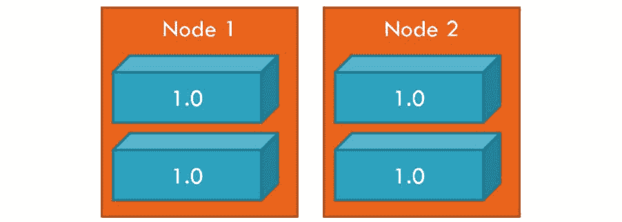

由于我的集群中运行着 4 个版本为 1.0 的 Pod，它们需要被版本为 1.1 的 Pod 替换。Kubernetes 会创建一个新的 1.1 Pod，并等待检查该 Pod 是否正常工作。如果 Pod 无法工作，Kubernetes 将停止创建 1.1 Pod，并保持 1.0 版本可用。如果 Pod 正常工作，Kubernetes 将删除一个 1.0 Pod 并继续创建第二个 1.1 Pod，以此此类推。

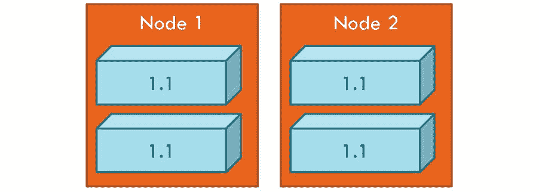

简而言之，你的应用程序在更新期间将保持稳定，且不会消耗超出范围的资源；最棒的部分是，这一切默认情况下都是自动化的。

再次，声明式命令无论初始状态如何都有效。如果你对空集群执行 `kubectl apply` 之前的 YAML 文件，它将一个接一个创建这 4 个 Pod。这是一个非常方便的功能，因为应用程序部署到开发集群的频率通常比部署到生产集群高。你可以定义 CI/CD 流水线，在每次推送代码时发布到开发集群，仅在向仓库添加标签或执行某些其他手动操作时发布到测试集群；使用完全相同的 YAML 文件和相同的 `kubectl apply` 命令就可以轻松实现，只是在开发集群上的执行频率比测试集群高而已。

如果你想使用单个 Kubernetes 集群来部署应用程序的开发版本和测试版本，这也是很容易：命名空间（Namespaces）可以将你的 Kubernetes 对象相互隔离。我们稍后会学习命名空间。

## 声明式语法

让我们仔细查看一下刚刚应用到 Kubernetes 集群的 YAML 文件，以及如何获取编写该文件的帮助。

`kubectl` 命令还可以输出必要的 YAML，这样当你创建一个声明式 YAML 文件时，可以从现有文件开始，而不是从空白页开始。你只需要在命令式命令中添加 `--dry-run` 和 `-o yaml` 开关即可。

例如，我之前使用的相同 `kubectl create deployment` 命令在添加必要的开关后，将输出以下 YAML：

```bash
kubectl create deployment hello --image=hello-world -dry-run -o yaml
```

```yaml
apiVersion: apps/v1
kind: Deployment
metadata:
  creationTimestamp: null
  labels:
    app: hello
  name: hello
spec:
  replicas: 1
  selector:
    matchLabels:
      app: hello
  strategy: {}
  template:
    metadata:
      creationTimestamp: null
      labels:
        app: hello
    spec:
      containers:
      - image: hello-world
        name: hello-world
        resources: {}
status: {}
```


该 YAML 比我在演示中使用的更冗长，因为它包含了默认值。这是一件好事，因为我们希望将其作为基础模板。另一个值得注意的点是，实际的 YAML 会根据你运行的 Kubernetes 集群版本而有所异：它是使用 Kubernetes API 生成的，而该 API 在不同 Kubernetes 版本之间略有不同。

如果你更倾向于 JSON，也可以使用它。YAML 和 JSON 都是对象、对象列表和对象属性的文本表示格式。我在本书中使用 YAML，因为这是 Kubernetes 声明式命令中最常见的格式。YAML 规范可以在官方网站上找到，你可以通过该网站的预览部分或该快速入门快速上手……

用于创建部署的文档中有四个主要属性（我们刚刚从 `kubectl` 命令获取的那些，或者我们在书中之前使用的那些）：

- `apiVersion`: 指明后续属性使用的 Kubernetes API 版本。
- `kind`: 我们正在创建或更新的 Kubernetes 对象。在这里是 `Deployment`（部署）。
- `metadata`: 应附加到 Kubernetes 对象上的数据。它被用于多种目的查找 Kubernetes 对象。我们之前在创建选择器以查看日志时使用过它（记得 `kubectl logs -l app=hello`），它也将用于 Kubernetes 对象之间的相互引用。
- `spec`: 描述 `Deployment` 应该是什么样：
  - `template`: 描述由此 `Deployment` 管理的 Pod 应该是什么样。
  - `replicas`: 此 `Deployment` 应该拥有的 Pod 数量。这涉及到在数量增加或 Pod 死亡时创建 Pod，或者在数量减少或 Pod 具有不同的模板存在时删除 Pod。
  - `strategy`: 说明当此 `Deployment` 的之前的版本需要更新时，`Deployment` 将如何对当前 Pod 执行操作；我们将在“更新策略”章节中看到更多内容。

## 声明式命令

让我们回顾一下如何使用声明式命令管理 Kubernetes 集群。

这是创建对象的方法：

```bash
kubectl apply -f deploy.yaml
```

这是你更新对象的方法（与上方命令相同）：

```bash
kubectl apply -f deploy.yaml
```

这是你完全删除对象的方法：

```bash
kubectl delete -f deploy.yaml
```

虽然 Kubernetes 可能非常复杂，但这些命令的简单性直白地说明了 Kubernetes 如何让复杂的操作变得简单。

在所有上述命令中，你可以将文件名替换为文件夹名。在这种情况下，文件夹中的所有文件都将通过命令。这允许你将每个 Kubernetes 对象写在单独的文件中而不是将它们全部打包。

例如，考虑以下文件（为了简洁已进行了截断）：

`deploy.yaml`
```yaml
apiVersion : apps / v1beta1 kind : Deployment … — apiVersion : v1 kind : Service …
```

使用 `--` 分隔符允许在单个 YAML 文件中描述多个对象。

它可以通过以下命令应用：

```bash
kubectl apply -f deploy.yaml
```

你也可以将其替换为 `k8s` 文件夹中的两个文件：

`k8s/deployment.yaml`
```yaml
apiVersion : apps / v1beta1 kind : Deployment …
```

`k8s/service.yaml`
```yaml
apiVersion : v1 kind : Service …
```

这些文件将使用单个命令应用：

```bash
kubectl apply -f ./k8s
```

## 12.8 练习 - 使用声明式命令创建资源

**目标**：熟悉声明式创建资源。

1. 在 YAML 文件中描述名为 `pinger` 的 `Deployment`，部署 `learnbook/k8s-pinger:0.6` 镜像并带有 `app=pinger` 标签。
2. 使用 `kubectl apply` 命令在 Kubernetes 集群中创建该 Deployment。
3. 显示 Pod 和 Deployment，检查 Deployment 是否创建。

## 12.9 练习答案

创建一个名为 `pinger-deployment.yaml` 的文件，内容如下：

```yaml
apiVersion : apps/v1 kind : Deployment metadata :
name : pinger spec :
template :
metadata :
labels :
app : pinger
spec :
containers :
- name : pinger
  image : learnbook/k8s-pinger:0.6
```

在创建上述文件的文件夹中打开命令行。

运行以下命令：

```bash
kubectl apply -f pinger-deployment.yaml
kubectl get deployment
kubectl get pods
kubectl logs -lapp=pinger
```

你应该得到类似下面的输出：

```bash
$ kubectl apply -f pinger-deployment.yaml
deployment.apps/pinger created
$ kubectl get deployment
NAME    READY   UP-TO-DATE   AVAILABLE   AGE
pinger  1/1     1               1           52s
$ kubectl get pods
NAME        READY   STATUS    RESTARTS AGE
pinger-646  1/1     Running   0         92s
$ kubectl logs -lapp=pinger
round-trip min/avg/max = 12.100/12.100/12.100 ms
Sleeping for 5 seconds
Pinging at: www.google.com (216.58.209.228): 56 data bytes
```

## 环境变量

运行在 Pod 中的容器通常需要提供环境变量。环境变量可以从容器内部的可执行程序读取；它是提供 API URL 或数据库连接字符串等额外信息的常用方法。

可以使用容器定义的 `env` 属性为 Pod 提供环境变量。这是一个带有两个环境变量的容器示例：

```yaml
apiVersion : apps / v1beta1 kind : Deployment metadata :
name : my - front spec : template :
spec :
containers :
```

* `name`: `my - front`
  `image`: `my - wordpress : 1.0`
  `env`:
  * `name`: `someName`
    `value`: `"some value"`
  * `name`: `someOtherName`
    `value`: `"some other value"`

当运行在 `my-wordpress:1.0` 镜像内部的可执行程序查询环境变量 `"someName"` 的值时，它接收到的值为 `"some value"`。

## 12.10 练习 - 更新声明式创建的 Pod

**目标**: 更新一个声明式创建的 Pod，为容器提供环境变量。

更新你在上一个练习中创建的 YAML 文件。你应该向容器传递以下环境变量：

`target`: `www.qwant.com`
`delay`: `30`

由于容器运行的是 `learnbook/k8s-pinger:0.6` 镜像，这些变量指定了容器应该每 30 秒 ping 一次 `www.qwant.com` 地址。

1. 显示 Pods 和 Deployments 并检查 Pod 是否已更新。
2. 显示带有 `app=pinger` 标签的 Pod 日志。检查是否正在向 `www.qwant.com` 进行 ping。
3. 在日志的某个时刻，你可以看到 `www.google.com` 和 `www.qwant.com` 都被 ping 了。你能解释为什么吗？

## 12.11 练习答案

编辑名为 `pinger-deployment.yaml` 的文件，内容如下：

```yaml
apiVersion : apps/v1beta1
kind : Deployment
metadata :
  name : pinger
spec :
  template :
    metadata :
      labels :
        app : pinger
    spec :
      containers :
      - name : pinger
        image : learnbook/k8s-pinger:0.6
        env :
          - name : target
            value : "www.qwant.com"
          - name : delay
            value : "30"
```

在创建上述文件的文件夹中打开命令行。

运行以下命令：

```bash
kubectl apply -f pinger-deployment.yaml
kubectl get deployment
kubectl get pods
kubectl logs -lapp=pinger --tail 20
```

你应该得到类似下方的输出：

> kubectl apply -f pinger-deployment.yaml
deployment.apps/pinger configured

注意这里显示的是 configured（已配置）而不是你上一个练习中的 created（已创建）。这是因为 `Deployment` 已经存在。

> kubectl get deployment
NAME    READY  UP-TO-DATE  AVAILABLE  AGE
pinger  1/1    1             1          3m54s

> kubectl get pods
NAME        READY  STATUS      RESTARTS  AGE
pinger-646  1/1    Terminating  0         62s
pinger-688  1/1    Running      0         8s

我们可以看到 Kubernetes 创建了一个新的 Pod 以使用适当的环境变量运行它。一旦新 Pod 启动并运行，旧的 Pod 就会终止。

> kubectl logs -lapp=pinger --tail 20
```round-trip min/avg/max = 11.246/11.246/11.246 ms
Sleeping for 5 seconds
Pinging at: …
PING www.google.com (216.58.201.228): 56 data bytes
— www.google.com ping statistics —
1 packets transmitted, 1 packets received, 0% packet loss
round-trip min/avg/max = 11.083/11.083/11.083 ms
Sleeping for 5 seconds
Pinging at: …
PING www.qwant.com (194.187.168.100): 56 data bytes
— www.qwant.com ping statistics —
1 packets transmitted, 0 packets received, 100% packet loss
Sleeping for 30 seconds
```

日志显示了对 `www.google.com` 和 `www.qwant.com` 的 ping，因为它先创建了新 Pod 然后终止了上一个 Pod。在这段时间内，两个 Pod 都是活跃状态，由于我们是使用应用于 Pod 的标签进行筛选的，`kubectl logs` 命令会获取两者的输出。如果稍后运行该命令，一旦第一个 Pod 完全停止，日志将仅显示对 `www.qcant.com` 的 ping。

## 控制器 (Controllers)

创建一个 `Deployment` 来管理你的 Pods，可以让你确保在任何时候（多或少，取决于集群状况和更新）始终运行给定数量的 Pod。根据你的需求，你可能想要创建其他类型的 Pod 控制器：

* **ReplicaSet / Deployment**: 运行应该始终存在的 Pod。
* **Job**: 以“发后后置不理”的方式运行 Pod：Kubernetes 确保规定数量的 Pod 运行完成（即容器中的主可执行程序无错误地退出）。
* **CronJob**: 与 `Job` 相同，但是是周期性运行。它就像定期创建一个 `Job`。
* **DaemonSet**: 确保每个集群 `Node` 上都运行一个 Pod。这对于与 Kubernetes 相关的 Pod 很有用。

## 12.12 调试 (Debugging)

出错的问题总会出错，常见错误包括：

1. 找不到容器镜像。
2. YAML 文件语法错误。
3. 资源限制（OOMKilled）。
4. 应用启动崩溃。

要进行调试，可以使用以下命令：

* `kubectl describe pod<name>`: 显示 Pod 的详细信息和事件。
* `kubectl logs -lapp=<label>`: 显示容器的实际输出。

如果你需要在容器内部运行代码检查，可以使用：

```bash
kubectl run -i --tty busybox
```

## 12.13 练习 - 调试 Pod

**目标**: 观察 Kubernetes 如何处理错误并找到错误原因。

1. 创建一个 `learnbook/debugging1:0.6` 的 `Deployment`，标签为 `app=debugging`。使用 `kubectl apply` 命令创建对应的 Deployment。
2. 显示 Pods 和 Deployments 以确保 Deployment 已创建。
3. 该 Deployment 的状态是什么？对应的 Pod 状态是什么？
4. 使用 `kubectl describe` 命令了解 Pod 内部发生了什么。
5. 创建一个 `mongo-express:0.49.0` 的 `Deployment`，标签为 `app=debugging2`。使用 `kubectl apply` 命令创建对应的 Deployment。
6. 显示 Pods 和 Deployments 以确保 Deployment 已创建。
7. 你可以看到对应的 Pod 不断重启。解释为什么。

## 12.14 练习答案

创建一个名为 `debugging1-deployment.yaml` 的文件，内容如下：

```yaml
apiVersion : apps/v1beta1
kind : Deployment
metadata :
  name : debugging1
spec :
  template :
    metadata :
      labels :
        app : debugging1
    spec :
      containers :
      - name : debugging1
        image : learnbook/debugging1:0.6
```

在创建上述文件的文件夹中打开命令行。

运行以下命令：

```bash
kubectl apply -f debugging1-deployment.yaml
kubectl get deployment
kubectl get pods
```

> kubectl apply -f debugging1-deployment.yaml
deployment.apps/debugging1 created

```
debugging1 0/1 1 0 24s
```

你可以看到 Deployment 中的一个 Pod 已经是最新的，但尚未就绪。

```bash
kubectl get pods
```

NAME READY STATUS RESTARTS AGE
debugging1-85 0/1 ImagePullBackOff 0 56s

你可以看到该 Pod 尚未就绪，它的状态为“ImagePullBackOff”。

```bash
kubectl describe pod debugging1-85994956bc-cnlnq
```

…

Containers:

  debugging1:

    Container ID:

    Image:          learnbook/debugging1:0.6

…

Events:

  Age               Message

  —-               -----

…

  30s (x6 over 111s) Back-off pulling image …

  16s (x4 over 111s) Pulling image “learnbook/debugging1:0.6”

  16s (x4 over 111s) Failed to pull image ……


16s (x4 over 111s) Error: ErrImagePull

3s (x7 over 111s) Error: ImagePullBackOff

你可以看到导致 `ImagePullBackOff` 状态的事件：Kubernetes 尝试拉镜像（两分钟内尝试了 4 次），但失败了。

实际上，这是由于 `learnbook/debugging1:0.6` 镜像不存在。

创建一个名为 `debugging2-deployment.yaml` 的文件，内容如下：

```yaml
apiVersion : apps/v1beta1
kind : Deployment
metadata :
  name : debugging2
spec :
  template :
    metadata :
      labels :
        app : debugging2
    spec :
      containers :
        - name : debugging2
          image : mongo-express:0.49.0
```

在创建上述文件的文件夹中打开命令行。

运行以下命令：

```bash
kubectl apply -f debugging2-deployment.yaml
kubectl get deployment
kubectl get pods
kubectl logs -lapp=debugging2
```

你应该将得到类似下面所示的输出：

```bash
kubectl apply -f debugging2-deployment.yaml
deployment.apps/debugging2 created
```

```bash
kubectl get deployment
```

NAME READY UP-TO-DATE AVAILABLE AGE

debugging1 0/1 1 0 13m

debugging2 0/1 1 0 26s

```

你可以看到 `Deployment` 中的一个 `Pod` 已经是最新的，但尚未就绪。

```bash

kubectl get pods

```

NAME READY STATUS RESTARTS AGE
debugging1-85 0/1 ImagePullBackOff 0 13m
debugging2-7c 0/1 CrashLoopBackOff 1 31s

```

你可以看到 `Pod` 被重启了一次，并且处于 `CrashLoopBackOff` 状态。Kubernetes 重启 `Pod` 是因为它的主执行程序正在崩溃。

```bash
kubectl logs -lapp=debugging2
```

…

    at Pool.emit (events.js:211:7)

    at Connection. <anonymous>(/node_modules/mongodb-core/lib/connection/pool.js:270:12)

…

    at Connection.emit (events.js:214:7)

    at Socket. <anonymous>(/node_modules/mongodb-core/lib/connection/connection.js:175:49)

…

你可以看到 `Pod` 内部的执行程序是一个 Node.JS 应用，它将堆栈跟踪发送到了日志（其输出）。在跟踪信息中，你可以看到失败的代码与到 MongoDB 的连接有关。

实际上，`mongo-express:0.49.0` 镜像需要一个包含 MongoDB 数据库连接字符串的环境变量，因为它是用于数据库管理的 Web 前。这就是你收到这条消息的原因，因为我没有要求为 `Pod` 提供环境变量。

### 12.15 练习 - 删除已创建的内容

**目标**：释放之前练习中创建的资源。

显示当前运行的 `Pods` 和 `Deployment`。

使用 `kubectl delete` 命令和之前练习创建的 YAML 文件，删除所有的 `Pods` 和 `Deployment`。

### 12.16 练习答案

在创建之前文件的文件夹中打开命令行。

运行以下命令：

```bash
kubectl get deployment
kubectl get pods
kubectl delete -f pinger-deployment.yaml
kubectl delete -f debugging1-deployment.yaml
kubectl delete -f debugging2-deployment.yaml
kubectl get deployment
kubectl get pods
```

你应该将得到类似下面的输出：

```bash
kubectl get deployment
NAME READY UP-TO-DATE AVAILABLE AGE
debugging1 0/1 1 0 12h
debugging2 0/1 1 0 12h
pinger 1/1 1 31h
```

```bash
kubectl get pods
NAME READY STATUS RESTARTS AGE
debugging1-85 0/1 ImagePullBackOff 0 12h
debugging2-7c 0/1 CrashLoopBackOff 8 12h
pinger-68bf5 1/1 Running 2 31h
```

```bash
kubectl delete -f pinger-deployment.yaml
deployment.apps/pinger deleted
kubectl delete -f debugging1-deployment.yaml
deployment.apps/debugging1 deleted
kubectl delete -f debugging2-deployment.yaml
deployment.apps/debugging2 deleted
kubectl get deployment
No found.
kubectl get pods
No found.
```

#### Pod 中总是含有一个容器吗？

`Pod` 通常运行单个容器，但事实并非如此。`Pod` 可能会运行多个容器，正如这种情况所示：(media/file50.jpg)。在这种情况下，容器被组在同一个 `Pod` 中，因为它们是紧密耦合的。虽然它们可以在不同的 `Pod` 中运行，但跨 `Pod` 的容器通信会产生开销。

注意有一个缺点：如果你想扩展相应的应用程序，你只能扩展整个 `Pod`。如果 `web-interface` 容器是瓶颈，你无法单独扩展它。在这种情况下，你可以解耦容器并运行不同的 `Pod`，以便只需扩展 `web-interface` 容器。

### 12.17 资源管理

正如我们在引言中所看到的，`Pods` 和 `Nodes` 是内存和 CPU 资源的抽象。`Node` 提供内存和 CPU，而 `Pod` 消耗内存和 CPU。

Kubernetes 需要确保 `Pod` 有效地消耗内存和 CPU，这意味着：

- 将 `Pod` 调度到资源足够的 `Node`；

- 终止消耗过多内存和 CPU 的异常 `Pod`。

Kubernetes 依靠 `requests` 和 `limits` 概念来实现这一点。这些是可选的，但使用它们是良好的实践，因为它们允许 Kubernetes 在压力下正确管理你的 `Pod`。

#### Requests

`Requests` 允许 `Controller` 声明运行 `Pod` 需要的内存和 CPU。它们指定了调度 `Pod` 的 `Node` 上应该具备的最小资源。当 Kubernetes 调度器需要创建 `Pod` 时，它会选择一个拥有 `Controller` 定义中 `requests` 部分指定的内存和 CPU 资源的 `Node`。

这是一个 `Deployment` 的示例定义：

```yaml
apiVersion: apps/v1beta1
kind: Deployment
spec:
  template:
    spec:
      containers:
      - name: front
        image: learnbook/k8s-front:0.4
        resources:
          requests:
            cpu: "100m"
            memory: "10Mi"
```

当 Kubernetes 调度器为该 `Deployment` 创建 `Pod` 时，它会选择一个至少可用 10Mi 内存和 100 毫毫 CPU 的 `Node`。

这意味着如果你提供的值过高，Kubernetes 可能无法调度你的 `Pod`，因此请明智选择。

#### Limits

当容器内部运行的执行程序出错时，它可能会消耗过多的 CPU 和内存资源。`Limits` 允许 Kubernetes 处理这种情况。

当你设置限制（`limits`）时，Kubernetes 会监控相应 `Pods` 使用的资源，并在实际使用的资源超过你设置的限制时将它们终止。

简而言之，限制（`limits`）基本上是你允许 `Pod` 使用的 CPU 和内存的最大量。

以下是一个使用限制的示例 `Deployment` 定义：

```yaml
apiVersion: apps/v1beta1
kind: Deployment
spec:
  template:
    spec:
      containers:
      - name: front
        image: learnbook/k8s-front:0.4
        resources:
          limits:
            cpu: "200m"
            memory: "50Mi"
```

实际上，Kubernetes 调度器会对资源进行超额配额（overcommits）：它不会立即终止超出其配额限制的 `Pods`，而是在总 `Node` 资源匮乏时才这样做。当这种情况发生时，Kubernetes 调度器会首先终止那些超出限制最严重的 `Pods`。

## 13. 暴露服务

## 13.1 服务的需求

既然你已经可以运行 `Pods`，你可能希望它们能够相互通信。这带来了几个问题，`Service` 对象将回答这些问题。

### 监听集群外部的连接

当你托管一个服务器时（例如 Web 服务器），你希望来自客户端的入站连接能够到达你的 `Pods`：

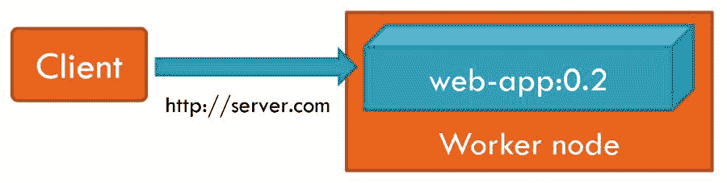

你可以通过以下命令来实现，该命令在 `8085` 端口监听来自集群外部的连接，并将其路由到名为 `name` 的 `Deployment` 部署在 `8080` 端口的 `Pods`：

```bash
kubectl port-forward deployment/name 8085:8080
```

然而，这是一个命令式命令，你现在已经知道对于中期维护来说，命令式命令并不是想要的。

我们如何使用声明式命令来描述集群应该监听连接这一事实呢？`Services` 回答这个问题。

### 跨 Node 通信

由于 Kubernetes 集群的目标是利用在不同 `Nodes` 上运行容器的优势，你的 `Pods` 将分布在不同的 `Nodes` 上。

一项常规任务（特别是在微服务架构中）是像这个简化示例所示的跨 `Nodes` 通信：

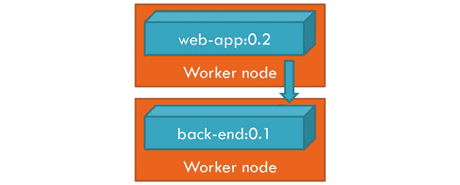

我们如何跨 `Nodes` 通信？我们应该保留一个运行中的 `Pods` 列表并对它们进行寻址吗？`Services` 也回答这个问题。

### 负载均衡到多个 Pod

为了提供应用程序的高可用性，在工作 `Nodes` 上复制相同的 `Pod` 是一种良好的做法。我们之前看到 `Deployments` 如何轻松地做到。但我们如何确保来自客户端的入站连接会被定向到所有的 `Pods`，如下例所示？

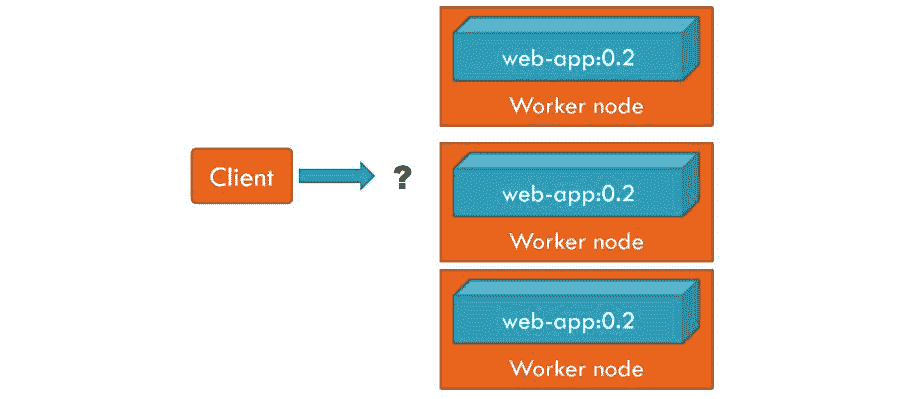

再次，答案是使用 `Services`。

### 13.2 Services

`Services` 是提供上述三个问题答案 Kubernetes 对象。

`Service` 对象监听传入连接并将其路由到使用标签（labels）选择的 `Pods`，如下：

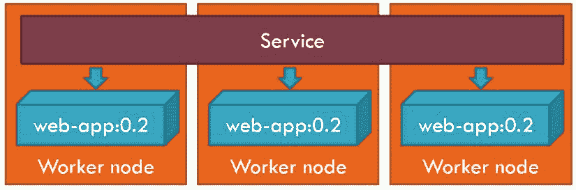

两种广泛使用的 `Service` 类型是 `LoadBalancer` 和 `ClusterIP`。区别在于它们是否允许来自集群外部的连接。让我们详细说明每一种。

### 来自集群外部的连接

在创建 `Service` 时使用 `LoadBalancer` 类型，它将把来自集群外部的请求路由到匹配给定选择器（selector）的 `Pods`。

这是一个 `LoadBalancer` 服务的示例定义：

```yaml
apiVersion: v1
kind: Service
metadata:
  name: mon-front-service
spec:
  type: LoadBalancer
  ports:
    - port: 8081
      targetPort: 80
  selector:
    app: web-app
```

当你 `kubectl apply` 该定义时，集群会为你的服务分配一个公共 IP。到该 IP 发出的请求将被路由到匹配的 `Pods`，如下所示：

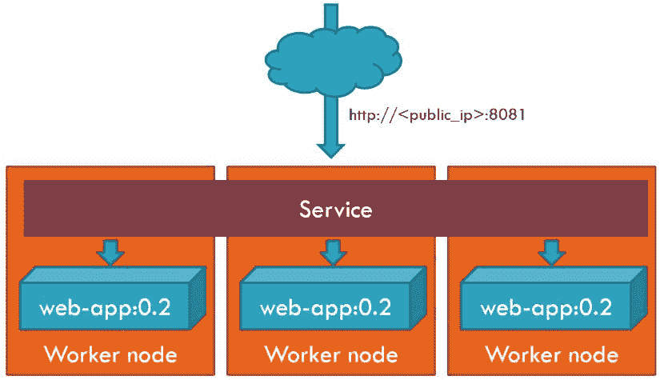

IP 如何分配取决于你在云端托管集群时选择的 Kubernetes 提供程序，或者你为自托管集群添加的扩展。

让我们部署一个面向 Web 的 应用程序作为示例。`Adminer` 是用 PHP 编写的数据库管理界面，作为名为 `adminer` 的 docker 镜像。为了部署它，我使用了以下两个定义：

**adminer-deployment.yaml**

```yaml
apiVersion: apps/v1
kind: Deployment
metadata:
  name: adminer
spec:
  selector:
    matchLabels:
      app: adminer
  template:
    metadata:
      labels:
        app: adminer
    spec:
      containers:
        - name: adminer
          image: adminer:latest
          ports:
            - containerPort: 8080
```

**adminer-service.yaml**

```yaml
apiVersion: v1
kind: Service
metadata:
  name: adminer
spec:
  type: LoadBalancer
  selector:
    app: adminer
  ports:
    - port: 80
      targetPort: 8080
```

这两个定义使用以下命令应用，正如你现在知道的那样：

```bash
kubectl apply -f .
```

第一个定义实际上部署了一个运行 `adminer` 应用程序的容器。第二个定义创建了一个 `Service`，将此应用程序暴露到外部世界。下面的图显示了我们刚刚创建的元素：

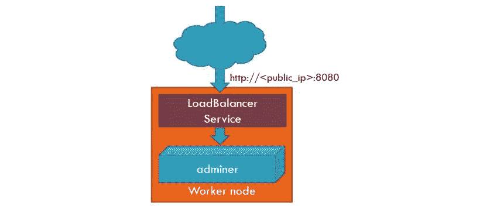

IP 的分配取决于你在云托管集群时选择的 Kubernetes 环境：

- 如果在 Docker Desktop 上运行，该 `Service` 将通过 `localhost`。

- 如果在 Minikube 上，通过 `kubectl get service` 查看。

- 如果在 PaaS 集群上运行，`EXTERNAL-IP` 列将显示 IP。

`EXTERNAL-IP` 显示了该 `Service` 是否可以访问。

### 13.3 练习 - 将服务暴露到互联网

**目标**：部署一个 Web 应用程序并从互联网访问它。

创建一个带有 `app=front` 标签的 `Pod`。使用 `LoadBalancer` `Service` 暴露该 `Pod`，它监听 `80` 端口。

打开浏览器并指向 `http://localhost:8080`（或者在 PaaS 中获取公共 URL）。完成后，删除创建的所有资源。

## 13.4 练习答案

创建一个名为 `front-deployment.yaml` 的文件，内容如下：

```yaml
apiVersion: apps/v1beta1
kind: Deployment
metadata:
  name: front
spec:
  template:
    metadata:
      labels:
        app: front
    spec:
      containers:
        - name: front
          image: learnbook/k8s-front:0.4
```

创建一个名为 `front-service.yaml` 的文件，内容如下：

```yaml
apiVersion: v1
kind: Service
metadata:
  name: front
spec:
  type: LoadBalancer
  ports:
    - port: 8080
      targetPort: 80
  selector:
    app: front
```

在创建上述文件的文件夹中打开终端。运行以下命令：

```bash
kubectl apply -f front-deployment.yaml
kubectl apply -f front-service.yaml
kubectl get deployment
kubectl get service
```

你应该应该得到类似下面的输出：


执行以下命令部署前端应用：

```
kubectl apply -f front-deployment.yaml
deployment.apps/front created

kubectl apply -f front-service.yaml
service/front created

kubectl get deployment
NAME    READY   UP-TO-DATE   AVAILABLE   AGE
front   1/1     1               1              9s

kubectl get service
NAME    TYPE           CLUSTER-IP   EXTERNAL-IP   PORT(S)
front   LoadBalancer   10.103.108.49  localhost      8080:30164/TCP
```

将浏览器指向返回的`EXTERNAL-IP`，在此情况下为`http://localhost:8080`。你的浏览器应该显示以下页面：

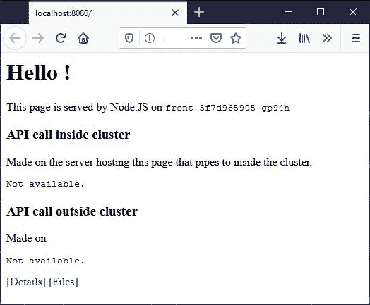

运行以下命令：

```bash
kubectl delete -f .
```

假设我们想要创建一个如下应用程序，其中一些审计器`Pods`需要向 web-app`Pods`发送 HTTP 请求：

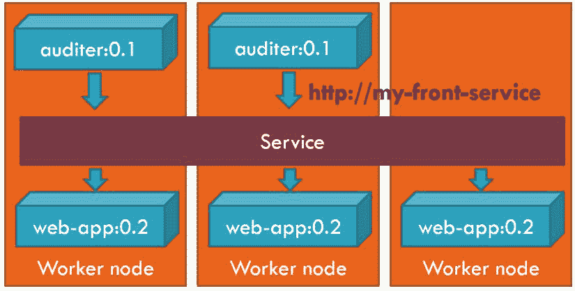

请注意，这种架构是微服务架构的代表，其中服务在集群内部调用其他服务。通过以下`ClusterIP`服务的定义很容易实现：

```yaml
apiVersion : v1
kind : Service
metadata :
  name : my-front-service
spec :
  type : ClusterIP
  ports :
    - port : 80
  selector :
    app : web-app
```

我们分配给`Service`的名称`my-front-service`非常重要：Kubernetes 集群内部的名称解析服务器将确保它被解析为与该`Service`中定义的选择器匹配的实际`Pods`。换句话说，当审计器`Pod`查询`http://my-front-service` URL 时，它实际上查询的是一个 web-app`Pod`。

还记得我为了演示`LoadBalancer` `Service`而部署的 adminer 服务吗？它可以查询数据库，因此我想部署一个 MySQL 数据库作为另一个`Pod`。为了让 adminer`Pod`与 MySQL`Pod`通信，我可以使用一个`Service`。由于该`Service`不需要从集群外部访问，`ClusterIP`服务类型是完美匹配。这里是我想要实现的架构图：

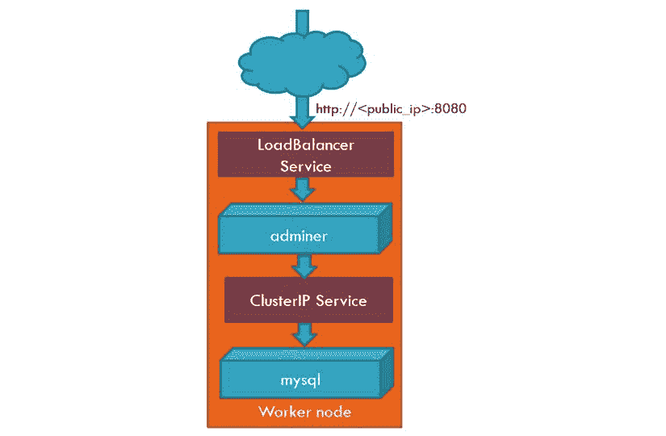

让我们部署架构图中所示的组件。对于 adminer 部分，我可以复用上面使用的完全相同的两个定义：

**adminer-deployment.yaml**

```yaml
apiVersion : apps/v1
kind : Deployment
metadata :
  name : adminer
spec :
  selector :
    matchLabels :
      app : adminer
template :
    metadata :
      labels :
        app : adminer
    spec :
      containers :
        - name : adminer
          image : adminer:latest
          ports :
            - containerPort : 8080
```

**adminer-service.yaml**

```yaml
apiVersion : v1
kind : Service
metadata :
  name : adminer
spec :
  type : LoadBalancer
  selector :
    app : adminer
  ports :
    - port : 80
      targetPort : 8080
```

现在，我们为 MySQL`Pod`和允许其从集群内部访问的`Service`添加两个定义：

**mysql-deployment.yaml**

```yaml
apiVersion : apps/v1
kind : Deployment
metadata :
  name : mysql
spec :
  selector :
    matchLabels :
      app : mysql
template :
    metadata :
      labels :
        app : mysql
    spec :
      containers :
        - name : mysql
          image : mysql:5.7
          ports :
            - containerPort : 3306
          env :
            - name : MYSQL_ROOT_PASSWORD
              value : “root”
```

是的，这是一个非常不安全的密码。这是一个演示。不要在家里这样做。

**mysql-service.yaml**

```yaml
apiVersion : v1
kind : Service
metadata :
  name : mysql
spec :
  type : ClusterIP
  selector :
    app : mysql
  ports :
    - port : 3306
      targetPort : 3306
```

这四个定义使用`kubectl apply`命令应用到集群：

```bash
kubectl apply -f .
```

得益于公共`LoadBalancer` `Service`，可以使用浏览器访问 adminer`Pod`，因此我可以将浏览器指向`http://localhost`（或`http://<public-ip>`）并获得登录界面。由于`mysql` `Service`暴露了 MySQL`Pod`，因此可以使用 Service 名称`mysql`从 adminer`Pod`访问它。这意味着可以使用`mysql`作为 MySQL 服务器的地址：`<public-ip>`

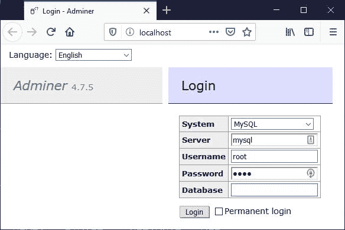

如所预期，我现在可以访问由`mysql` `Pod`托管的 MySQL 数据库：

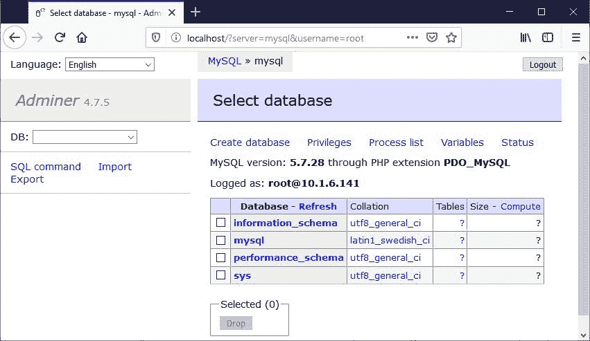

## 13.5 练习 - 在集群内部暴露 API

**目标：** 部署一个 API 并使其从互联网访问，然后让运行在集群内部的`Pods`访问。

你首先需要部署一个 API 并确保它可以从集群外部访问，以便于轻松检查它是否部署正确。我们首先想要如下的应用程序架构：


`learnbook/k8s-back:0.2` 镜是一个监听 80 端口的 API。将`learnbook/k8s-back:0.2`镜像部署为名为`back`的`Pod`，并带有`app=back`标签。使用监听 8081 端口的`LoadBalancer` `Service`暴露该`Pod`。

打开浏览器并指向`http://localhost:8081/v1/currenttime`（如果在 PaaS 集群中运行则使用公共 URL）。确保你可以访问该 API。

你现在需要部署前端 Web 应用程序并使用其外部地址使其消费 API。预期的目标应用程序架构如下：


将`learnbook/k8s-front:0.5`镜像部署为名为`front`的`Pod`，并带有`app=back`标签。使用监听 8081 端口的`LoadBalancer` `Service`暴露该`Pod`。

打开浏览器并指向`http://localhost:8081/v1/currenttime`（如果在 PaaS 集群中运行则使用获取的公共 URL）。确保你可以访问该 API。

你现在需要部署前端 Web 应用程序并使用其外部地址使其消费 API。

将`learnbook/k8s-front:0.5`镜像部署为名为`front`的`Pod`，并带有`app=back`标签。使用监听 8081 端口的`LoadBalancer` `Service`暴露该`Pod`。

打开浏览器并指向`http://localhost:8081/v1/currenttime`（如果在 PaaS 集群中运行则使用获取的公共 URL）。确保你可以访问该 API。

你现在需要部署前端 Web 应用程序并使用其外部地址使其消费 API。

`API_EXTERNAL_URL`环境变量让`front`知道应该调用哪个 API。使用监听 8081 端口的`LoadBalancer` `Service`暴露该`Pod`。

打开浏览器并指向`http://localhost:8081/v1/currenttime`（如果在 PaaS 集群中运行则使用获取的公共 URL）。确保你可以访问该 API。

你现在需要部署前端 Web 应用程序并使用其外部地址使其消费 API。

`API_CLUSTER_URL`环境变量让`front`知道应该调用哪个 API。使用监听 8081 端口的`LoadBalancer` `Service`暴露该`Pod`。

最后一步，使用名为`back-inside`的`ClusterIP` `Service`暴露`back` `Pod`，它监听 80 端口。


在您创建上述文件的文件夹中打开命令行。

运行以下命令：

```bash
kubectl apply -f front-deployment.yaml kubectl apply -f front-service.yaml kubectl get deployment kubectl get service
```

您将得到类似下面的输出：

> kubectl apply -f front-deployment.yaml

deployment.apps/front created

> kubectl apply -f front-service.yaml

service/front created

> kubectl get deployment

NAME    READY  UP-TO-DATE  AVAILABLE  AGE

back    1/1    1             1           23m

front   1/1    1             1           50s

> kubectl get service

NAME          TYPE          EXTERNAL-IP  PORT(S)

back-outside  LoadBalancer  localhost    8081:31388/TCP

front         LoadBalancer  localhost    8080:31594/TCP

将您的浏览器指向返回的`EXTERNAL-IP`，在此例中为`http://localhost:8080`。

您的浏览器应该显示以下页面：


创建一个名为`back-service-inside.yaml`的文件，内容如下（与上一个练习中的相同）：

```yaml
apiVersion : v1 kind : Service metadata :
name : back-inside spec :
type : ClusterIP
ports :
*   port : 80
selector :
*   app : back
```

在您创建上述文件的文件夹中打开命令行。

运行以下命令：

```bash
kubectl apply -f back-service-inside.yaml kubectl get services
```

您将得到类似下面的输出：

> kubectl apply -f back-service-inside.yaml

service/back-inside created

> kubectl get service

NAME          TYPE          EXTERNAL-IP  PORT(S)

back-inside  ClusterIP     <none>       80/TCP

back-outside  LoadBalancer  localhost    8081:31388/TCP

front         LoadBalancer  localhost    8080:31594/TCP

在您的浏览器中，再次查看显示`http://localhost:8080`的页面。

您的浏览器应该显示以下内容（注意“API call inside cluster”区域现在已填充内容）：


运行以下命令：

```bash
kubectl delete -f .
```

### 13.7 Ingress

Ingress 是一种用于为 Service 添加额外功能的 Kubernetes 对象。Ingress 在入站连接和 Service 之间增加了一个额外的层。它们是反向代理的抽象。


使用 Ingress 的一些优势包括：

- 根据传入的 URL 将请求路由到不同的 Service。例如，您可以使用类似的 URL 将用户路由到不同版本的应用程序：

  - `http://front/store` 可以路由到`store:1.0`应用；

  - `http://front/old/store` 可以路由到`store:0.8`应用。

- 在传入的请求和您的 Service 之间添加 TLS，以确保到集群的安全性（简而言之，使用`https://`地址代替`http://`地址），并在公共 Ingress Controller 中管理证书和加密。

- 管理您自己的负载均衡服务。

Ingress 对象在您的 Kubernetes 集群中声明，但实际功能由 Ingress Controller 提供。您可以部署并管理您选择的 Ingress Controller，例如：

- `nginx-ingress`

- `contour`

- `traefik`

- 在云端运行时使用的 PaaS 控制器

注意，ingress 控制是基于反向代理软件的。这是完全正常的，因为 Ingress 对象是反向代理的抽象。

一旦将 Ingress Controller 部署到您的 Kubernetes 集群，就可以根据需要添加任意数量 Ingress 对象。Ingress Controller 将扫描 Ingress 对象以确定它应该提供哪些服务。

以下是如何声明一个简单的 Ingress 对象：

```yaml
apiVersion : extensions / v1beta1 kind : Ingress metadata :
name : frontandback-ingress spec :
rules :
*   host : server.com
  http :
    paths :
    *   path : /app
      backend :
        serviceName : web-app
        servicePort : 80
```

得益于上述 Ingress 对象，Ingress Controller 将知道入站的`http://server.com/app`请求应该路由到名为`web-app`的 Service。该服务可以是一个`ClusterIP`类型的服务。

## 14. Volumes

### 14.1 卷的必要

对容器内部文件系统进行的更改是瞬即逝的。一旦容器停止，这些更改就会丢失，除非您采取某些步骤将它们持久化到其他地方。容器在无状态时更容易管理，但您在某些时刻需要持久化数据。

持久化需求取决于您的应用程序。持久化数据可以在同一个 Pod 的不同容器之间共享，可以在 Pod 之间共享，甚至可以在不同的集群之间共享。

Kubernetes 提供了几种类型来管理这些：

- `emptyDir`：短寿命存储，其生命周期与 Pod 等等。

- `Volume`：生命周期独立于任何 Pod 的卷。

- `PersistentVolumeClaim`：向集群资源请求存储的对象。

### 14.2 使用 Volumes 进行短寿命存储

Volume 是在 Pod 内部声明的。在上面的示例中，Volume 类型是`emptyDir`。它是一个可以写入的短寿命存储。

以下是一个 Pod 的 Volume 声明：

```yaml
apiVersion : apps / v1beta1 kind : Deployment spec :
template :
spec :
volumes :
*   name : persistent-data
  emptyDir : {}
containers :
*   name : front
  image : my-image:1.0
  volumeMounts :
  *   mountPath : /external
    name : persistent-data
```

如您所示，Volume 是在 Pod 内部声明的并挂载到 Pod 的容器上的。`front`容器将 Volume 视为其`/external`文件夹。

# 目标


创建并使用类型为`emptyDir`的`Volume`，以便运行在同一个`Pod`中的容器之间共享文件。

`learnbook/k8s-creator:0.2`镜像会在名为`/shared`的目录中创建随机名称的文件。`learnbook/k8s-front:0.5`镜像会列出其名为`/shared`目录下的文件。

你应当将这两个镜像作为两个容器运行在同一个`Pod`中，并在`Pod`内部创建一个类型为`emptyDir`的`Volume`。确保两个容器使用同一个`Volume`，以便一个容器写入的文件可以被另一个容器消费。

你应该实现以下目标架构：


创建一个`Deployment`，在同一个`Pod`中托管`learnbook/k8s-creator:0.2`和`learnbook/k8s-front:0.5`镜像。使用监听`8080`端口的`LoadBalancer`服务从`Pod`暴露前端应用。

打开浏览器并指向`http://localhost:8080/files`（或者如果你在 PaaS 集群中运行，则指向公共 URL）。文件夹中没有文件。解释为什么。

在`Pod`中添加一个类型为`emptyDir`的`Volume`，并确保它暴露给前端和创建容器。

打开浏览器并指向`http://localhost:8080/files`。当你刷新页面时，文件应该显示出来。

删除练习练习期间创建的所有资源。

使用相同的容器、相同的`Volume`和相同的`Service`重新创建`Pod`。

打开浏览器并指向`http://localhost:8080/files`。现在没有文件了。解释为什么。

## 14.4 练习解答

创建一个名为`front-deployment.yaml`的文件，内容如下：

```yaml
apiVersion : apps/v1beta1
kind : Deployment
metadata :
  name : front
spec :
  template :
    metadata :
      labels :
        app : front
    spec :
      containers :
        - name : front
          image : learnbook/k8s-front:0.3
        - name : creator
          image : learnbook/k8s-creator:0.2
```

创建一个名为`front-service.yaml`的文件，内容如下：

```yaml
apiVersion : v1
kind : Service
metadata :
  name : front
spec :
  type : LoadBalancer
  ports :
    - port : 8080
      targetPort : 80
  selector :
    app : front
```

在创建上述文件的文件夹中打开命令行。

运行以下命令：

```bash
kubectl apply -f front-deployment.yaml
kubectl apply -f front-service.yaml
kubectl get service
```

你将得到类似下方的输出：

> `kubectl apply -f front-deployment.yaml`

deployment.apps/front created

> `kubectl apply -f front-service.yaml`

service/front created

> `kubectl get deployment`

NAME    READY  UP-TO-DATE  AVAILABLE  AGE

front   1/1    1               1          97s

> `kubectl get service`

NAME  TYPE           CLUSTER-IP      EXTERNAL-IP   PORT(S)

front  LoadBalancer  10.102.58.78  localhost      8080:30221/TCP

将你的浏览器指向返回的`EXTERNAL-IP`，在这种情况下为`http://localhost:8080/files`。你将得到一个类似下面的页面：


显示的页面没有列出任何文件。这是因为 creator 容器在`/shared`目录中创建文件，该目录是 creator 容器本地的。我们看到的前端容器的`/shared`目录是另一个目录，属于前端容器本地。

创建一个名为`front-deployment.yaml2`的文件，内容如下：

```yaml
apiVersion : apps/v1beta1
kind : Deployment
metadata :
  name : front
spec :
  template :
    metadata :
      labels :
        app : front
    spec :
      volumes :
        - name : shared
          emptyDir : {}
      containers :
        - name : front
          image : learnbook/k8s-front:0.3
          volumeMounts :
            - mountPath : /shared
              name : shared
        - name : creator
          image : learnbook/k8s-creator:0.2
          volumeMounts :
            - mountPath : /shared
              name : shared
```

在创建上述文件的文件夹中打开命令行。

运行以下命令：

```bash
kubectl apply -f front-deployment2.yaml
```

你将得到类似下方的输出：

> `kubectl apply -f front-deployment2.yaml`

deployment.apps/front configured

刷新浏览器中的`http://localhost:8080/files`页面。你的浏览器应该显示一个类似那样的页面：


运行以下命令：

```bash
kubectl delete -f .
kubectl apply -f front-deployment2.yaml
kubectl apply -f front-service.yaml
```

你将得到类似下方的输出：

> `kubectl delete -f .`

deployment.apps "front" deleted

service "front" deleted

> `kubectl apply -f front-deployment2.yaml`

deployment.apps/front created

> `kubectl apply -f front-service.yaml`

service/front created

刷新浏览器中的`http://localhost:8080/files`页面。

## 14.5 使用 PersistentClaims 的持久存储

### 消费持久存储

`PersistentVolumeClaim`实际获取持久存储有两种方式，由运维人员决定策略。

第一种是由集群管理员创建`PersistentVolumes`，它们会被`PersistentVolumeClaims`消费。

第二种是在`PersistentVolumeClaim`上指定`StorageClass`，这允许动态创建`Volumes`。

为了处理在`Pod`之间共享的持久存储，Kubernetes 提供了`PersistentVolumeClaim`。`PersistentVolumeClaim`独立存在于任何`Pod`。

### PersistentVolumeClaim 声明

```yaml
apiVersion : v1
kind : PersistentVolumeClaim
metadata :
  name : claiming-disk
spec :
  accessModes :
    - ReadWriteOnce
  resources :
    requests :
      storage : 1 Gi
```

### 消费 VolumeClaim 的 Deployment 声明

```yaml
apiVersion: apps/v1beta1
kind: Deployment
metadata :
  name : front
spec :
  template :
    metadata :
      labels :
        app : front
    spec :
      volumes :
        - name : persistent-data
          persistentVolumeClaim :
            claimName : claiming-disk
      containers :
        - name : front
          image : my-image:1.0
          volumeMounts :
            - mountPath : /external
              name : persistent-data
```

## 14.6 练习 - 创建并使用 PersistentVolume

**目标**：使用`PersistentVolume`在`Pod`死亡后持久化文件。

使用上一个练习中的`Deployment`，但将`emptyDir`替换为你创建的`PersistentVolumeClaim`的引用。

打开浏览器并指向`http://localhost:8080/files`（或者如果你在 PaaS 集群中运行，则指向公共 URL）。当你刷新页面时，文件应该显示出来。

删除`Deployment`和`Service`。刷新浏览器：页面不可用。

重新创建`Deployment`和`Service`。

刷新浏览器。当你刷新页面时，之前的文件仍然显示。即使`Pod`被删除，它们也没有丢失。

删除所有创建的资源。

```yaml
apiVersion: v1
kind: PersistentVolumeClaim
metadata:
  name: shared-on-disk
spec:
  accessModes:
    - ReadWriteOnce
  resources:
    requests:
      storage: 1Gi
```

复用上练习中名为`front-deployment.yaml`文件，修改`volumes`部分以获得以下内容：

```yaml
apiVersion: apps/v1beta1
kind: Deployment
metadata:
  name: front
spec:
  template:
    metadata:
      labels:
        app: front
    spec:
      volumes:
        #- name: shared
        #  emptyDir: {}
        - name: shared
          persistentVolumeClaim:
            claimName: shared-on-disk
      containers:
        - name: front
          image: learnbook/k8s-front:0.3
          volumeMounts:
            - mountPath: /shared
              name: shared
        - name: creator
          image: learnbook/k8s-creator:0.2
          volumeMounts:
            - mountPath: /shared
              name: shared
```

复用上练习中名为`front-service.yaml`文件，其内容如下：

```yaml
apiVersion: v1
kind: Service
metadata:
  name: front
spec:
  type: LoadBalancer
  ports:
    - port: 8080
      targetPort: 80
  selector:
    app: front
```

在创建上述文件的文件夹中打开命令行。

运行以下命令：

```
kubectl apply -f persistentvolumeclaim.yaml
kubectl apply -f front-deployment.yaml
kubectl apply -f front-service.yaml
```

你将得到类似下面所示的输出：

```
> kubectl apply -f persistentvolumeclaim.yaml
persistentvolumeclaim/shared-on-disk created
> kubectl apply -f front-deployment.yaml
deployment.apps/front created
> kubectl apply -f front-service.yaml
service/front created
```

将浏览器指向`http://localhost:8080/files`。你将看到一个类似下面的页面：


在命令行中运行以下命令：

```
kubectl delete -f front-deployment.yaml
kubectl delete -f front-service.yaml
kubectl apply -f front-deployment.yaml
kubectl apply -f front-service.yaml
```

你将得到类似下面所示的输出：

```
> kubectl delete -f front-deployment.yaml
deployment.apps "front" deleted
> kubectl delete -f front-service.yaml
service "front" deleted
> kubectl apply -f front-deployment.yaml
deployment.apps/front created
> kubectl apply -f front-service.yaml
service/front created
```

在浏览器中刷新`http://localhost:8080/files`页面。你的浏览器应该显示一个与之类似的页面：


请注意，尽管`Pod`被删除并重建，但上一步中可见的文件仍然可见。

运行以下命令：

```
kubectl delete -f .
```

我需要你，超级英雄！

非常感谢阅读这本书。我真心希望它能帮助你理解并对 Kubernetes 建立自信。

作为读者，你是某种超级英雄：你获得了在集群上无缝打包和部署应用程序的能力，并让计算机变得更有用。

猜猜看？你还有另一个超能力：在你购买书的网站上对其进行评分。你可能觉得这无关紧要，但对于像这样自动编辑的书来说非常重要。请花你宝贵的时间为这本书评分。这对于像我这样的独立作者意义重大！

## 15. 配置

### 15.1 相似但不同

无论你的`Pods`内部使用什么编程语言，你的容器可能都需要取决于其配置的运行时参数。例如，连接数据库的地址或某些凭据。Kubernetes 的`ConfigMap`和`Secret`对象使得此类信息成为集群中的一等公民。

因此，这两个对象都可以使用我们见过的用于`Pods`、`Deployments`和`Services`的常用`kubectl`命令进行管理。例如，你可以使用以下命令获取所有`ConfigMap`列表：

```
kubectl get configmaps
```

`ConfigMap`和`Secret`非常相似，尽管对于更敏感的信息，会优先使用`Secret`而非`ConfigMap`。让我们来看两者。

### 15.2 ConfigMap

#### 声明

`ConfigMap`存储了键值对，这些键值对将提供给跨`Nodes`的任意数量的`Pods`。这些键及其值可以通过以下任一选项被`Pods`获取：

- 为所有条目定义的环境变量；

- 为某些条目定义的环境变量；

- 文件。

在声明`ConfigMap`的时候，你不需要知道它将如何暴露给`Pods`。这里有一个定义示例：

```yaml
apiVersion: v1
kind: ConfigMap
metadata:
  name: configmap-values
data:
  key1: "value1"
  key2: "value2"
```

在上述的定义中，有两个条目。`key1`条目具有`value1`值，而`key2`条目具有`value2`值。

如上所述，有三种方法从`Pod`消费这些键。

#### 作为文件消费


还记得用于持久化存储的`Volumes`吗？`ConfigMap`对象可以作为`Volume`挂载到`Pod`内部。这意味着它的每个键都被视为一个只读文件；每个文件的内容就是分配给键的值。

大多数编程语言都可以从文件中读取配置，因此大多数容器都期望此类配置文件。`ConfigMap`对象可以用于此，这意味着配置数据可以来自单个 YAML 文件。

作为一个例子，让我们将之前显示的`ConfigMap`挂载到`Pod`中：

```yaml
apiVersion: apps/v1beta1
kind: Deployment
spec:
  template:
    spec:
      volumes:
        - name: config
          configMap:
            name: configmap-values
      containers:
        - name: front
          image: learnbook/k8s-front:0.3
          volumeMounts:
            - mountPath: /config
              name: config
```

这与我们用于`Volumes`的语法完全相同，但`Volume`类型是`configMap`。你可以看到`front`容器挂载了卷到`/config`路径；结果是`front`容器看到了如下文件：

## 作为环境变量消费

许多容器需要以环境变量的形式提供参数。当配置存储在`ConfigMap`时，这很容易实现。考虑以下定义：

```yaml
apiVersion: apps/v1beta1
kind: Deployment
spec:
  template:
    spec:
      containers:
        - name: front
          image: learnbook/k8s-front:0.3
          envFrom:
            - configMapRef:
                name: configmap-values
```

`envFrom`条目意味着`ConfigMap`中的所有键都将以相同的名称作为环境变量暴露。考虑到我们定义的`configmap-values` `ConfigMap`，`front`容器将看到如下环境变量：

## 选择性环境变量消费

在某些情况下，你想为容器提供环境变量，但不想暴露`ConfigMap`的所有条目，或者你想以特定的变量名提供它们。这样做有一种更详细的语法，你可以在列出每个想要暴露的键以及分配给其值的环境变量名称。

考虑以下定义：

```yaml
apiVersion: apps/v1beta1
kind: Deployment
spec:
  template:
    spec:
      containers:
        - name: front
          image: learnbook/k8s-front:0.3
          env:
            - name: VAR_NAME
              valueFrom:
                configMapKeyRef:
                  name: configmap-values
                  key: key2
```

它创建了一个`Pod`并将单个`ConfigMap`值暴露为单个环境变量。名为`configmap-values`的`ConfigMap`中的`key2`条目被视为名为`VAR_NAME`的环境变量。你可以根据需要重复`env/name`条目，以创建所需的任意环境变量。

考虑到我们刚刚看到的定义，`front`容器将看到如下环境变量：

## 15.3 练习 - 创建并使用 ConfigMap

目标：创建一个`ConfigMap`并从`Pod`以不同的方式消费它。

我们的目标是如下架构：


创建一个具有以下条目的`ConfigMap`对象：

为`learnbook/k8s-front:0.4`镜像创建一个 Deployment，并使用`LoadBalancer` Service 将其暴露。

在浏览器中访问`http://localhost:8080/files` URL（它显示了容器中`/shared`文件夹下所有文件的名称）。不应出现任何文件。

更新 Deployment，使容器将`ConfigMap`对象视为其`/shared`目录下的文件。

刷新浏览器中的`http://localhost:8080/files`页面。应该显示来自`ConfigMap`的三个条目（注意只显示了文件的名称）。

在浏览器中访问`http://localhost:8080/details` URL（它显示了容器看到的所有环境变量名称）。请注意，没有名为`message`、`config`或`magicNumber`的项。

更新 Deployment，使容器将`ConfigMap`对象中的所有项视为环境变量。

刷新浏览器中的`http://localhost:8080/details`页面。应该显示来自`ConfigMap`的三个条目。

删除所有创建的资源。

## 15.4 练习解答

创建一个名为`commonvalues-configmap.yaml`的文件，内容如下：

```yaml
apiVersion : v1
kind : ConfigMap
metadata :
  name : common-values
data :
  message : “Hello world”
  config : “Debug”
  magicNumber : “42”
```

创建一个名为`front-deployment1.yaml`的文件，内容如下：

```yaml
apiVersion : apps/v1beta1
kind : Deployment
metadata :
  name : front
spec :
  template :
    metadata :
      labels :
        app : front
    spec :
      containers :
        - name : front
          image : learnbook/k8s-front:0.4
```

创建一个名为`front-service.yaml`的文件，内容如下：

```yaml
apiVersion : v1
kind : Service
metadata :
  name : front
spec :
  type : LoadBalancer
  ports :
    - port : 8080
      targetPort : 80
  selector :
    app : front
```

在创建上述文件的文件夹下打开命令行。

运行以下命令：

```bash
kubectl apply -f commonvalues-configmap.yaml
kubectl apply -f front-deployment1.yaml
kubectl apply -f front-service.yaml
kubectl get cm
kubectl describe cm common-values
```

你应该得到类似下方的输出：

```
> kubectl apply -f commonvalues-configmap.yaml
configmap / common-values created

> kubectl apply -f front-deployment1.yaml
deployment.apps/front created

> kubectl apply -f front-service.yaml
service / front created

> kubectl get cm
NAME            DATA   AGE
common-values   3      40s

> kubectl describe cm common-values
Name:         common-values
Namespace:    default
Labels:       < none >
Annotations:  …
Data ====
config:  -- Debug
magicNumber: -- 42
message:     -- Hello world
Events:  < none >
```

将浏览器指向`http://localhost:8080/files`。你应该得到一个类似下方的页面：


通过向`front-deployment1.yaml`添加一些条目，创建一个名为`front-deployment2.yaml`的文件。`front-deployment2.yaml`包含以下内容：

```yaml
apiVersion : apps/v1beta1
kind : Deployment
metadata :
  name : front
spec :
  template :
    metadata :
      labels :
        app : front
    spec :
      volumes :
        - name : shared
          configMap :
            name : common-values
      containers :
        - name : front
          image : learnbook/k8s-front:0.4
          volumeMounts :
            - mountPath : /shared
              name : shared
```

在命令行中运行以下命令：

```bash
kubectl apply -f front-deployment2.yaml
```

你应该得到类似下方的输出：

```
> kubectl apply -f front-deployment2.yaml
deployment.apps/front configured
```

刷新浏览器中的`http://localhost:8080/files`页面。你的浏览器应该显示一个与该所示的页面：


将浏览器指向`http://localhost:8080/details`。你应该得到一个类似下方的页面：


页面上没有显示名为`message`、`config`或`magicNumber`的项。

通过向`front-deployment1.yaml`添加一些条目，创建一个名为`front-deployment4.yaml`的文件。`front-deployment4.yaml`以下内容：

```yaml
apiVersion : apps/v1beta1
kind : Deployment
metadata :
  name : front
spec :
  template :
    metadata :
      labels :
        app : front
    spec :
      containers :
        - name : front
          image : learnbook/k8s-front:0.4
          envFrom :
            - configMapRef :
                name : common-values
```

在命令行中运行以下命令：

```bash
kubectl apply -f front-deployment4.yaml
```

你应该得到类似下方的输出：

```
> kubectl apply -f front-deployment4.yaml
deployment.apps/front configured
```

刷新浏览器中的`http://localhost:8080/files`页面。你的浏览器应该显示一个与该所示的页面：


运行以下命令：

```bash
kubectl delete .
```

## 15.5 练习 - 创建并使用 Secret

目标：以不同的方式创建并使用 Secret。

为`learnbook/k8s-front:0.4`镜像创建一个 Deployment，并使用`LoadBalancer` Service 将其暴露。

在浏览器中访问`http://localhost:8080/files` URL（它显示了容器中`/shared`文件夹下所有文件的名称）。不应出现任何文件。

更新 Deployment，使容器将`ConfigMap`对象视为其`/shared`目录下的文件。

刷新浏览器中的`http://localhost:8080/files`页面。应该显示来自`ConfigMap`的三个条目（注意只显示了文件的名称）。

在浏览器中访问`http://localhost:8080/details` URL（它显示了容器看到的所有环境变量名称）。请注意，没有名为`message`、`config`或`magicNumber`的项。

更新 Deployment，使容器将`ConfigMap`对象中的所有项视为环境变量。

刷新浏览器中的`http://localhost:8080/details`页面。应该显示来自`ConfigMap`的三个条目。

删除所有创建的资源。

Secrets 与`ConfigMap`非常相似，但为存储需要安全的信息提供了额外功能。

使用`stringData`创建 Secret：

```yaml
apiVersion : v1
kind : Secret
metadata :
  name : secret-values
stringData :
  key1 : “secret1”
  key2 : “secret2”
  message : “secret3”
```

在 Pod 中使用 Secret 与使用`ConfigMap`完全相同；你可以作为环境变量或文件使用。

作为文件使用：

```yaml
apiVersion : apps/v1beta1
kind : Deployment
metadata :
  name : front
spec :
  template :
    metadata :
      labels :
        app : front
    spec :
      volumes :
        - name : shared
          secret :
            name : secret-values
      containers :
        - name : front
          image : learnbook/k8s-front:0.4
          volumeMounts :
            - mountPath : /shared
              name : shared
```

作为环境变量使用：

```yaml
apiVersion : apps/v1beta1
kind : Deployment
metadata :
  name : front
spec :
  template :
    metadata :
      labels :
        app : front
    spec :
      containers :
        - name : front
          image : learnbook/k8s-front:0.4
          envFrom :
            - secretRef :
                name : secret-values
```

作为命名的环境变量使用：

```yaml
apiVersion : apps/v1beta1
kind : Deployment
metadata :
  name : front
spec :
  template :
    metadata :
      labels :
        app : front
    spec :
      containers :
        - name : front
          image : learnbook/k8s-front:0.4
          env :
            - name : VAR_NAME
              valueFrom :
                secretKeyRef :
                  name : secret-values
                  key : key2
```

创建一个名为`commonvalues-secret.yaml`的文件，内容如下：

```yaml
apiVersion : v1 kind : Secret metadata :
name : commonvalues-secret stringData :
message : “Hello secret world”
config : “Hidden”
magicNumber : “0”
```

创建一个名为`front-deployment1.yaml`的文件，内容如下：


创建一个名为`front-service.yaml`的文件，内容如下：

```yaml
apiVersion : v1 kind : Service metadata :
name : front spec :
type : LoadBalancer
ports :
  - port : 8080
    targetPort : 80
selector :
app : front
```

在创建上述文件的文件夹中打开命令行。

运行以下命令：

```bash
kubectl apply -f commonvalues-secret.yaml
kubectl apply -f front-deployment1.yaml
kubectl apply -f front-service.yaml
kubectl get secret
kubectl describe secret commonvalues-secret
```

你应该得到类似于下方的输出：

```text
> kubectl apply -f commonvalues-secret.yaml
secret / commonvalues-secret created
> kubectl apply -f front-deployment1.yaml
deployment.apps/front created
> kubectl apply -f front-service.yaml
service / front created
> kubectl get secret
NAME                   TYPE      DATA  AGE
commonvalues-secret   Opaque    3       76s
> kubectl describe secret commonvalues-secret
Name :         commonvalues-secret
Namespace :    default
Labels :       < none >
Annotations: Type:         Opaque
Data ==== config :       6 bytes
magicNumber :   1 bytes
message :       18 bytes
```

将浏览器访问到`http://localhost:8080/files`。页面上没有显示任何文件。

通过向`front-deployment1.yaml`添加一些条目，创建一个名为`front-deployment2.yaml`的文件。`front-deployment2.yaml`应该包含以下内容：

```yaml
apiVersion : apps/v1beta1 kind : Deployment metadata :
name : front spec :
template :
metadata :
labels :
app : front
spec :
volumes :
  - name : shared
    secret :
      secretName : commonvalues-secret
containers :
  - name : front
    image : learnbook/k8s-front:0.4
    volumeMounts :
      - mountPath : /shared
        name : shared
```

在命令行中运行以下命令：

```bash
kubectl apply -f front-deployment2.yaml
```

你应该得到类似于下方的输出：

```text
> kubectl apply -f front-deployment2.yaml
deployment.apps/front configured
```

刷新浏览器中刷新`http://localhost:8080/files`页面。你的浏览器应该显示一个列出`config`、`magicNumber`和`message`文件的页面。

将浏览器访问到`http://localhost:8080/details`。页面上没有显示名为`message`、`config`或`magicNumber`的条目。

通过向`front-deployment1.yaml`添加一些条目，创建一个名为`front-deployment4.yaml`的文件。`front-deployment4.yaml`应该包含以下内容：

```yaml
apiVersion : apps/v1beta1 kind : Deployment metadata :
name : front spec :
template :
metadata :
labels :
app : front
spec :
containers :
  - name : front
    image : learnbook/k8s-front:0.4
    envFrom :
      - secretRef :
        name : commonvalues-secret
```

在命令行中运行以下命令：

```bash
kubectl apply -f front-deployment4.yaml
```

你应该得到类似于下方的输出：

```text
> kubectl apply -f front-deployment4.yaml
deployment.apps/front configured
```

在浏览器中刷新`http://localhost:8080/details`页面。你现在应该能在页面上看到`message`、`config`和`magicNumber`条目。

运行以下命令：

```bash
kubectl delete -f .
```

## 16. 更新与扩展

## 16.1 水平扩展

水平扩展（Horizontal scaling）是一种允许应用程序处理更多并发请求的技术，也称为`scaling out`（扩容）。当你在机器上运行服务器应用程序时（或者对于`Pod`来说），它只能处理特定数量的并发请求，因为每个请求都需要某些`RAM`和`CPU`资源。

例如，你的应用程序可能每秒能处理 100 个请求。如果你想处理更多请求，可以在不同的服务器上复制该应用程序，以便处理更多请求。假设我们想每秒处理 300 个请求，我们可以运行 3 个应用程序实例。

在传统的服务器托管应用程序上，水平扩展需要费费一些工作。机器及其应用程序需要被复制，并且在三个副本前面需要使用负载均衡器应用程序，以便让传入的请求由三个副本均匀地提供。好消息是：Kubernetes 让这项任务变得极其简单。你只需要在`Deployment`的定义中设置`replicas`属性即可：

```yaml
apiVersion: apps/v1beta1
kind: Deployment
metadata:
  name: my-front
spec:
  template:
    metadata:
      labels:
        app: front
    spec:
      replicas: 3
      containers:
        - name: front
          image: learnbook/k8s-front:0.4
```

## 16.2 自动水平扩展

扩容曾是一项困难的任务，但 Kubernetes 使其变得简单。但我们这些 IT 人总是想要更多，所以当某些任务变得简单时，我们就会寻找更多挑战。老实说，市场也在要求创新，因此我们也顺应市场。那么，我们如何让水平扩展更具挑战性呢？

考虑一下：能够设置处理传入请求的`Pods`数量是可以的，但你如何设置那个数字呢？如果数字太低，`Pods`将无法处理用量高峰；如果数字太高，会有太多的`Pods`闲置无无事事，这意味着它们在白白消耗`CPU`和内存资源。

最好的办法是动态更改`Pods`的数量以满足实际需求：当出现用量高峰期时，创建更多`Pods`；当应用程序面临低使用率时，销毁无用的`Pods`以释放资源。

实际上，这可以通过一个简单的 Kubernetes 对象完成：

```yaml
apiVersion: autoscaling / v1
kind: HorizontalPodAutoscaler
metadata:
  name: captureorder
spec:
  scaleTargetRef:
    apiVersion: apps / v1
    kind: Deployment
    name: front
  minReplicas: 4
  maxReplicas: 10
  targetCPUUtilizationPercentage: 70
```

`HorizontalPodAutoscaler`会监控可用 Pod 的 CPU 使用情况，并将其与 Pod CPU 请求中设置的限制进行比较。如果 Pod 的使用率低于目标百分比，某些 Pod 将被销毁。反之，当 Pod 的使用率超过目标百分比时，会创建新的 Pod 直到达到目标百分比。当然，创建的 Pod 数量不会超过定义中`maxReplicas`，也不会低于`minReplicas`的数量。

在上面的示例中，自动扩展是基于 CPU 使用率的，但你也可以使用目标内存使用率。

简而言之，感谢`HorizontalPodAutoscaler`，你可以定义一个根据实际使用消耗资源的应用程序，在低负载时为其他应用程序留出空间。

### 16.3 更新策略

当你修改`Deployment`的模板部分时，现有的 Pod 不再是最新的，需要用使用新模板创建的 Pod 来替换。一旦你`kubectl apply`修改后的`Deployment`，Kubernetes 就会为你处理此任务。具体是如何操作的？让我们来看看。

由于`ReplicaSet`会确保给定版本的 Pod 正在运行，一旦版本发生变化，Kubernetes 就会创建一个新的`ReplicaSet`。旧的`ReplicaSet`会删除它管理的 Pod，而新的`ReplicaSet`将创建 Pod。这些删除和创建的顺序由`Deployment`的`strategy`属性决定。

#### Recreate（重建）

当你将策略设置为`Recreate`时，所有旧的 Pod 会首先停止。一旦它们不再运行，就会启动新的 Pod。

```yaml
apiVersion: apps/v1beta1
kind: Deployment
metadata:
  name: my-front
spec:
  strategy:
    type: Recreate
  replicas: 3
  template:
    metadata:
      labels:
        app: front
    spec:
      containers:
      - name: my-front
        image: my-wordpress
```

下面的序列说明了当使用`recreate`策略`kubectl apply` `Deployment`模板的更改时会发生什么。


Deployment 更改之前的状态


Pod 停止，然后 ReplicaSet 被删除


创建了一个新的 ReplicaSet


新的 ReplicaSet 使用新模板创建 Pod

`Recreate`更新策略意味着在任何时刻，运行的 Pod 数量都不会超过你设置的副本数，因此更新消耗的资源不会比运行中的应用程序多。但它意味着会在某一点没有 Pod 可用，这意味着你的应用程序将发生服务中断。这是否可行取决于你的决定。如果不可，`RollingUpdate`（滚动更新）策略可能对你很有吸引力。

#### Rolling update（滚动更新）

与其先停止所有现有的 Pod 再创建新的 Pod，Kubernetes 默认提供了一种更平滑的方法。你只需要为`strategy`类型指定`RollingUpdate`值即可：

```yaml
apiVersion: apps/v1beta1
kind: Deployment
metadata:
  name: my-front
spec:
  strategy:
    type: RollingUpdate
  replicas: 3
  template:
    metadata:
      labels:
        app: front
    spec:
      containers:
      - name: my-front
        image: my-wordpress
```

事实上，`RollingUpdate`是默认值，所以到目前为止我们没有指定任何策略类型时，我们使用的就是滚动更新策略。这意味着你通过 Kubernetes 免费获得了了细粒度、高可用且智能的更新。我告诉过你 Kubernetes 开发者很幸运吗？当然，想要运行它需要一些知识，但一旦你读到书的这一部分，你就获得了强大的力量，能够让你轻松地完成以前非常繁琐的工作。但让我详细说明滚动更新是如何发生的。

在滚动更新期间，Pod 会按 25% 的批次进行替换（这是一个可以更改的默认值）。首先使用新模板创建第一批 25% 的 Pod（当运行 3 个 Pod 时创建 1 个，当运行 8 个 Pod 时创建 2 个）。Kubernetes 等待新 Pod 运行后，然后停止相同数量的旧 Pod。一旦旧 Pod 停止，它将重复该过程，用新 Pod 替换另一批 25% 的旧 Pod。该过程不断重复直到所有旧 Pod 都被新 Pod 替换。

滚动更新过程甚至更好：当创建 25% 的新 Pod 组时，Pod 可能会失败；如果新 Pod 无法达到运行状态，滚动更新过程将停止并保留旧 Pod。这意味着如果新 Pod 有 Bug，应用程序仍保持运行；它仅由旧 Pod 提供服务，你可以使用新模板并再次`kubectl apply`来整理并解决问题。

简而言之，滚动更新过程确保了即使在新版本出现问题的情况下你的应用程序始终运行，并且在更新过程中使用的资源较少。

下面的序列说明了当使用滚动更新策略`kubectl apply` `Deployment`模板的更改时会发生什么。


使用新模板创建了 25% 的新 Pod


删除了 25% 的旧 Pod


对 Pod 的 25% 重复此过程


旧的 ReplicaSet 被删除

##### 滚动更新参数

如果你有高级需求，且以上方法还不能满足你，可以通过一些参数来修改它的行为：

```yaml
apiVersion: apps/v1beta1
kind: Deployment
metadata:
  name: my-front
spec:
  strategy:
    type: RollingUpdate
    rollingUpdate:
      maxSurge: 25%
      maxUnavailable: 25%
  replicas: 3
  template:
    metadata:
      labels:
        app: front
    spec:
      containers:
      - name: my-front
        image: my-wordpress
```

`maxSurge`和`maxUnavailable`参数指定了批次大小，即在更新期间可以额外创建或处于不可用的 Pod 数量。你可以提供数字或百分比。在百分比的情况下，它是相对于`replicas`参数的。

##### 蓝绿发布、金丝雀和彩虹

`rolling update`或`recreate`策略对于大多数需求都是足够的，但如果你运行的应用程序拥有大量用户，你可能希望尝试更微妙的更新类型。对于所有这些类型，你需要在更新过程中添加一些逻辑，这主要通过调整路由到 Pod 的`Service`选择器来实现。

在蓝绿发布期间，创建一个新版本（蓝色），同时用户被路由到旧版本（绿色）。新版本经过测试，一旦宣布就绪（绿色），它将完全替换旧版本，旧版本随后被删除。你可以通过简单地为 Pod 添加额外的蓝绿标签来实现这一点。

金丝雀发布试图模仿煤矿里的金丝雀：只要鸟是健康的，矿工就知道他们没有面临危险。在金丝雀发布中，你对应用程序进行监控，并将一部分用户路由到新版本，同时监控你的指标。如果指标显示问题，你就减少百分比；如果指标正常，你就增加百分比。这可以通过匹配部分新 Pod 的`Service`选择器来实现。

命名空间（Namespaces）为你提供了一种在 Kubernetes 集群内部将对象相互隔离的方法。它们允许对象名称、`Services`的网络名称、资源配额和授权（`RBAC`）进行分离。

命名空间是隔离集群内部团队的一种方便方式：对象被限制在它所在的`Namespace`中，这避免了某个团队修改另一个团队具有相同名称的对象。

Kubernetes 集群启动时有两个`Namespaces`，你可以添加自己的命名空间。两个默认的`Namespaces`是：

- `default`：用于未分配`Namespace`的对象。

- `kube-system`：用于提供 Kubernetes 功能的对象。


你可以像声明其他 Kubernetes 对象一样声明 `Namespace`：

```
apiVersion : v1 kind : Namespace metadata : name : prod
```

一旦在你的集群中存在一个 `Namespace`，你就可以向我们之前见过的 `kubectl` 命令中添加 `--namespace` 参数。例如，以下命令会在命名为 `team1` 的命名空间中创建或更新 `dep.yaml` 文件中描述的对象：

```bash
kubectl apply -f dep.yaml –namespace team1
```

假设 `dep.yaml` 文件描述了一个名为 `front` 的 `Deployment`。如果你运行上述命令，`front` Deployment 及其 `Pods` 将被限制在 `team1` 命名空间中，因此你可以在 `team2` 命名空间中运行相同的命令，并在 `team2` 命名空间中获得另一个“隔离”的 `front` 部署：

```bash
kubectl apply -f dep.yaml –namespace team2
```

查询 Kubernetes 资源时也是如此。例如，以下命令返回属于 `team1` 命名空间的 `Pods`：

```bash
kubectl get pods –namespace team1
```

当你不带 `--namespace` 参数运行相同的命令时，你不会获得来自所有命名空间的对象：你只会获得命名为 `default` 的命名空间中的对象。如果你想列出所有命名空间的 `Pods`，请在 `kubectl get` 命令上使用 `--all-namespaces` 参数。

由于你很可能每天都在同一个 `Namespace` 中工作，你不想在每个命令中都添加 `--namespace` 参数。只需运行以下命令，当前上下文将将设置为默认在 `team1` 内部工作：

```bash
kubectl config set-context –current –namespace=team1
```

从现在起，你的命令将在 `team1` `Namespace` 内部的对象上执行。由于 `Namespace` 与 `kubectl` 上下文关联，当你切换到另一个上下文并回到设置的上下文时，它会被记住。简而言之：一个 `kubectl` 上上下文指向一个集群、一个用户和一个 `Namespace`。

我们之前看到 `Services` 可以从集群内部通过名称进行访问，因此名为 `front` 的 `Service`可以通过 `http://front` URL 访问。这种 DNS 功能由 `CoreDNS` 组件提供。此外：`Service` 有两个域名：一个包含它的 `Namespace`，另一个不包含。例如，`front` Service 拥有两个域名：

- `front.team1`
- `front`

`front` 域名解析为请求来源所在的 `Namespace`。因此，如果来自 `team2` `Namespace` 的 `Pod` 查询 `http://front` URL，它实际上看到的只是 `team2` 命名空间中的 `front` `Service`。如果它需要访问 `team1` 命名空间的 `Service`，可以使用 `http://front.team1` URL。这种名称解析再次提供了命名空间之间的隔离：它在避免命名冲突的同时仍允许跨命名空间通信。

集群管理员可以使用 `ResourceQuota` 对象。它允许限制 `Namespace` 内部可以使用的资源。这样，来自某个 `Namespace` 的对象就不会因为占用集群的所有资源而饿死其他命名空间。可以定义以下属性：

- `limits.cpu`：`Pods` 请求的 CPU 限制总和；
- `limits.memory`：`Pods` 请求的内存限制总和；
- `requests.cpu`：`Pods` 的 CPU 请求总和；
- `requests.memory`：`Pods` 的内存请求总和。

注意，某些 Kubernetes 对象无法被限制在 `Namespace` 中，它们位于 `Namespaces` 之外：

- `Namespaces` 自身；
- `Nodes`；
- `PersistentVolumes`；

## 17.2 RBAC

到为止，我们一直使用 `kubectl` 命令对集群内部进行基础更改。这意味着管理集群只需要一个正确的 `context`。现在，想象一下某些恶意用户拥有这种权力：他会给你的集群带来混乱，获取机密信息，或迅速添加恶意的 `Pods`。你肯定不希望这样。

除了阻止外部用户，你还想限制特定用户在 Kubernetes 集群内部可以执行的操作。例如，在预生产集群中，你可能希望确保开发者只能列出 Kubernetes 对象而不能更改它们，而 CI/CD 引擎是唯一允许创建或更改对象的实体。你可能还希望确保只有特定用户或系统可以创建和读取 `Secrets`。

此类限制可以使用 `RBAC` 来定义。你可以将用户（或服务账户）链接到 Kubernetes API 的特定权限。

在配置 `RBAC` 之前，你必须确保你的集群已启用 `RBAC`。由于启用 `RBAC` 功能是在创建集群时做出的选择，你可能没有关于是否启用的信息。如果集群启用了 `RBAC`，你可以使用以下命令：

```bash
kubectl describe pod -n kube-system
```

如果 `RBAC` 已启用，你应该在授权模式中看到 `RBAC` 的提及：

media/file91jpg

正如许多授权系统一样，`RBAC` 不直接将用户链接到权限。相反，它将权限链接到 `Roles`，然后将用户分配给 `Roles`。这允许随着团队的变化轻松添加和删除用户，并为组重新配置权限。简而言之：`Roles` 是用户组。

角色有两种类型：

- `Role`：定义限制在命名空间的授权；
- `ClusterRole`：定义跨集群有效的授权。

media/file92jpg

`RoleBinding` 将一个用户（或服务账户）链接到 `Role`。同样地，`ClusterRoleBinding` 将一个用户（或服务账户）链接到 `ClusterRole`。

为了让启用了 RBAC 的集群正常运行，已经定义了一些 `ClusterRoles`，并绑定到你用于连接的用户。这里是一些 `ClusterRoles`：

```bash
kubectl get clusterroles

NAME                                    

admin                                   8d

cluster-admin                           8d

edit                                    8d

system:coredns                          8d

system:persistent-volume-provisioner

view                                    8d
```

列表经过简化。你可以看到三个常用的 `ClusterRoles`，如果你不想花时间创建自己的角色，可以将它们分配给新用户。`admin` 和 `cluster-admin` 角色具有扩展权限，应该谨慎授予。你可以使用以下命令检查分配给角色的授权：

```bash
kubectl describe clusterrole view
```

该列表再次经过简化。我们可以看到 `view` `ClusterRole` 具有列出 pod 的能力，因此该角色获得了 `kubectl get logs` 命令。

## 18. Helm

### 18.1 使用 Helm

Helm 被称为“Kubernetes 的包管理器”：

media/file93jpg

来自 Helm 网站的截图

我不会将 Helm 与 `NPM` 或 `NuGet` 这种同样管理包依赖关系的包管理器相提并，但当你想要向 Kubernetes 部署复杂应用时，它确实意味着了一条简便的路径。

从实践上讲，它主要允许为 `kubectl apply` 命令添加额外的功能：它允许在 YAML 文件中使用变量甚至是脚本，然后将这些文件打包在一起。Helm 包被称为 `Charts`（（图表）。

## 使用 Helm Charts

Helm 中最简单的部分是使用现有的 `Chart`，即使用 Helm 图表在 Kubernetes 集群中安装应用程序。这通过两个步骤完成：

1. 添加 Helm 存储库（chart 的来源，类似于 Docker 镜像的 `Registry`）；
2. 使用以下命令安装 chart：

`helm install <name>--set version=1.0,key=value,... chart`

`--set` 选项允许你重写 chart 中的默认值。当有许多值时，你可以在一个 YAML 文件中提供它们。

让我们举一个例子来说明这一点。假设我想安装 Redis。Redis 是一个分布式缓存，这意味着值存储在不同的机器上：这是一个可以轻松分发到多个 `Nodes` 上的 `Pods` 的绝佳示例。

从 Redis chart 的描述中可以看到创建的从节点数量由 `cluster.slaveCount` 变量设置。它的默认值为 1，我想将其重写为 3，以便我有 4 个 `Pods` 运行我的 Redis 集群（1 个主节点，3 个从）。

```bash
helm repo add stable https://kubernetes-charts.storage.googleapis.com/

“stable” has been added to your repositories

helm install mycache stable/redis --set cluster.slaveCount=3

NAME: mycache

LAST DEPLOYED: Thu Jan 30 14:07:47 2020

NAMESPACE: default

STATUS: deployed

REVISION: 1

TEST SUITE: None

NOTES:

  Please be patient while the chart is being deployed
```

在集群内部，可以通过以下 DNS 名称通过端口 6379 访问 Redis：

- `mycache-redis-master.default.svc.cluster.local` 用于读写操作
- `mycache-redis-slave.default.svc.cluster.local` 用于只读操作

要获取密码请运行：

`...`

输出为了简洁已经缩短，但正如你所看到的，在安装时 chart 会根据你提供的参数提供一些文档。

让我们列出我的集群中运行的 `Pods`：

```bash
kubectl get pods

NAME                     READY  STATUS    AGE

mycache-redis-master-0   1/1     Running   3m20s

mycache-redis-slave-0    1/1     Running   3m20s

mycache-redis-slave-1    1/1     Running   2m34s

mycache-redis-slave-2    1/1     Running   2m17s
```

好了，我确实有 4 个 `Pods` 在运行 Redis。就这么简单。

### 18.2 创建 Helm 包 (charts)

我们刚刚看到一个制作良好的 chart 如何简化复杂应用程序的部署。一旦你创建了适用于 Kubernetes 的应用程序，你可能想将其封装成一个 chart 以于分发。请注意，这是一个非常简单的过程。

一个 chart 实际上是 `*.tar.gz` 包中的文件集合：


这些文件有：

- 描述 Kubernetes 对象的 YAML 文件，就像我们目前看到的那些一样，但增加了添加脚本的可能性；
- 一个 `values.yaml` 文件，定义了脚本中使用变量的默认值；
- 一个 `NOTES.txt` 文件，在安装 chart 时将渲染帮助文本。

如前提到的，在 YAML 文件中可以使用 YAML 语法，并可以添加脚本块：就此而言，使用了 Go 模板：

```yaml
apiVersion: apps/v1beta1

kind: Deployment

metadata:

  name: back-{{ .Values.config }}
```

上述文件定义了一个 `Deployment`，该部署名称将通过在 `back-` 前缀后附加配置项来生成。配置项的实际值设置在 `values.yaml` 文件中，但在安装时可以使用 `--set` 选项或 YAML 文件进行重写。

与其从空文件夹开始，不如使用以下命令脚手架 chart 模板：

`helm create <name>`

这简单地创建一个包含足够启动文件的文件夹，以形成真正的 chart。然后你根据需要编辑这些文件。放置在 `templates` 目录中的任何 YAML 文件将成为 chart 的一部分。

然后你使用以下命令创建 chart 包（lint 仅用于验证目的）：

```bash
helm lint <name>

helm package <name>--debug
```

这会在一个名为 `<name>-0.1.0.tgz` 的文件中创建一个可安装的 chart（版本号来自 `Chart.yaml` 文件）。在你分发 chart 之前，你可能想检查它实际上做了什么。可以通过以下命令完成，它将输出原本会被发送到 Kubernetes 集群的 YAML：

```bash
helm install --dry-run --debug <name>-0.1.0.tgz
```

你现在可以通过两种方式分发你的 chart：

- 分发 `*.tar.gz` 文件；
- 将 `*.tar.gz` 文件放置在 Helm 存储库上（托管 `*.tar.gz` 文件的简单 HTTP 文件服务器）。

作为文件分发时，可以使用文件名安装 chart：

`helm install <name> <name>-0.1.0.tgz`

当使用存储库分发时，用户只需使用 `helm repo add` 命令添加你的存储库即可。

## 作者的话

我真心希望你喜欢阅读这本书就像我喜欢写它一样，并希望你能够熟练地使用 Docker 在 Kubernetes 集群上容器化并部署你的应用程序。

如果你想联系我，可以使用：

- email: `books@aweil.fr`
- Facebook: `facebook.com/learncollection`
- Twitter: `@epo`

如果你的项目需要，我也可以在范围内提供演讲、教学、咨询和编码服务。如果你喜欢这本书，你可能因为它而节省了大量时间。如果你愿意花点宝贵的时间在你购买这本书的网站上留言，我将不胜感激。多谢！

## 图片归属

- 经典船装载：公有领域，来自 Wikimedia Commons
- 集装箱船装载：公有领域，`Tvabutzku1234`，来自 Wikimedia Commons 。
- 货运火车：公有领域，`G-Man March 2005`，来自 Wikimedia Commons ，最初上传到英语维基百科。

## Learn collection

这本书是 Learn collection true。

Learn collection 允许开发者在几天内自学新技术。

### 已出版书籍

- Learn ASP.NET Core MVC
- Learn ASP.NET MVC
- Learn Docker
- Learn Kubernetes
- Learn Kubernetes & Docker
- Learn Meteor
- Learn Microservices
- Learn WPF MVVM

### 即待出版

- Learn Unit Testing
