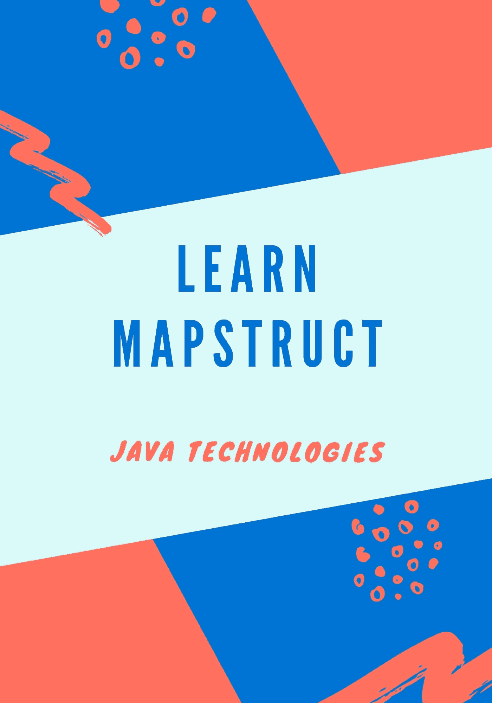

# 学习 MapStruct：通过示例带你深入 MapStruct 的各种功能



我想将这本书献给将使用这本书的学生们。祝你们未来职业成功，并希望你们永不停学习。

# 概述

MapStruct 是一个插件到 Java 编译器的注解处理器。一旦插件完成后，就可以被 `maven`、`gradle` 等命令行工具来处理映射注解，从而在编译时创建映射器类。

## 什么时候需要映射？

在多层应用中，数据对象被用于从数据库获取数据，而 UI 与 Model 交互。现在，将获取到数据模型中的数据需要映射到`Model`或`java beans`以传递给 UI。考虑以下情况。

与数据库连接的实体类。

`StudentEntity.java`

```java
@Entity
class StudentEntity {
    String id ;
    String name ;
}
```

与 UI 连接的模型类。

`Student.java`

```java
class Student {
    String id ;
    String name ;
}
```

## MapStruct 如何工作？

MapStruct 通过注解自动化创建映射器的过程，用于将数据对象映射到模型对象。它在编译时创建一个映射器实现，这有助于开发者在开发过程中发现错误并使其易于理解。例如——

`StudentMapper.java`

```java
@Mapper
class StudentMapper {
    StudentMapper INSTANCE = Mappers . getMapper ( StudentMapper . class );
    StudentEntity modelToEntity ( Student student );
}
```

现在可以使用`StudentMapper.INSTANCE`轻松地获取映射后的对象。

```java
StudentEntity studentEntity = StudentMapper.INSTANCE.modelToEntity(student);
```

# 环境搭建

MapStruct 是基于 Java 的库，因此第一个要求是在你的机器上安装 JDK。

## 第 1 步 - 安装 Java 开发包 (JDK)

你可以从 Oracle 的 Java 网站下载最新版本的 SDK —— **Java SE Downloads.**。你将在下载的文件找到安装 JDK 的说明，按照给定的说明进行安装和配置设置。最后设置`PATH`和`JAVA_HOME`环境变量指向包含`java`和`javac`的目录，通常分别为`java_install_dir/bin`和`java_install_dir`。

如果你正在运行 Windows 并且 JDK 安装在`C:\jdk-9.0.1`，你将需要在你的`C:\autoexec.bat`文件中放入以下行。

```batch
set PATH=C:\jdk-9.0.1\bin;%PATH%
set JAVA_HOME=C:\jdk-9.0.1
```

或者，在 Windows NT/2000/XP 上，你将需要右键点击“我的电脑”，选择属性 → 高级 → 环境变量。然后，你必须更新`PATH`值并点击确定按钮。

在 Unix 上，如果你将 JDK 安装在`/usr/local/jdk-9.0.1`并且使用 c shell，你将需要在`.cshrc`中放入以下内容：

```bash
setenv PATH /usr/local/jdk-9.0.1/bin
setenv JAVA_HOME /usr/local/jdk-9.0.1
```

或者，如果你使用集成开发环境 (IDE) 如 Eclipse、IntelliJ IDEA 或 Sun Studio，你将编译并运行一个简单的程序。

## 第 2 步 - 安装 mapstruct 库

从 Maven 仓库下载 mapstruct 依赖项，并将它们添加到你的类路径中。

- `mapstruct-1.3.Final`

- `mapstruct-processor-1.3.Final`

## 第 3 步 - 设置 IDE

要安装 Eclipse，从`https://www.eclipse.org/downloads/`下载最新的 Eclipse。下载后将二进制发行版解压到一个方便的位置。例如，在 Windows 上通过执行`C:\eclipse\eclipse.exe`启动。在 Unix (Solaris, Linux) 上，如果一切正常应该显示以下结果：

## 第 4 步 - 创建 Maven 项目

运行以下命令来创建一个 Maven 项目。

```bash
mvn archetype:generate -DgroupId=com.tutorialoint.mapping -DartifactId=mapping -DarchetypeId=maven-archetype-quickstart -DinteractiveMode=false
```

这将创建一个 Maven 项目。现在更新`pom.xml`文件如下：

```xml
<project xmlns="http://maven.apache.org/POM/4.0.0" xmlns:xsi="http://www.w3.org/2001/XMLSchema-instance"
  xsi:schemaLocation="http://maven.apache.org/POM/4.0.0 http://maven.apache.org/maven-v4_0.xsd">
  <modelVersion>4.0.0</modelVersion>
  <groupId>com.tutorialoint.mapping</groupId>
  <artifactId>mapping</artifactId>
  <packaging>jar</packaging>
  <version>1.0-SNAPSHOT</version>
  <name>mapping</name>
  <url>http://maven.apache.org</url>
  <dependencies>
    <dependency>
      <groupId>org.junit.jupiter</groupId>
      <artifactId>junit-jupiter-engine</artifactId>
      <version>5.0.0</version>
      <scope>test</scope>
    </dependency>
    <dependency>
      <groupId>org.mapstruct</groupId>
      <artifactId>mapstruct</artifactId>
      <version>1.3.1.Final</version>
    </dependency>
  </dependencies>
  <build>
    <plugins>
      <plugin>
        <groupId>org.apache.maven.plugins</groupId>
        <artifactId>maven-compiler-plugin</artifactId>
        <version>3.8.1</version>
        <configuration>
          <source>1.9</source>
          <target>1.9</target>
          <annotationProcessorPaths>
            <path>
              <groupId>org.mapstruct</groupId>
              <artifactId>mapstruct-processor</artifactId>
              <version>1.3.1.Final</version>
            </path>
          </annotationProcessorPaths>
        </configuration>
      </plugin>
    </plugins>
  </build>
</project>
```

运行以下命令来更新 Maven 依赖并构建项目。

```bash
mvn package
```

一旦命令成功。将基于 Maven 的项目导入到 Eclipse 作为 Maven 项目。其余部分由 Eclipse 处理。

# 基础映射

使用 MapStruct 非常简单。要创建映射器，在接口上使用`org.mapstruct.Mapper`注解。

```java
@Mapper
public interface StudentMapper {...}
```

现在在接口中创建一个转换方法。

```java
@Mapper
public interface StudentMapper {
    Student getModelFromEntity ( StudentEntity student );
}
```

如果源对象和目标对象的属性具有相同的名称，这些属性将自动映射。如果属性名称不同，请使用如下`@Mapping`注解 −

```java
@Mapper
public interface StudentMapper {
    @Mapping ( target = "className" , source = "classVal" )
    Student getModelFromEntity ( StudentEntity student );
}
```

在这里，`className`是`Student`中的属性名（目标对象），而`classVal`是`StudentEntity`中的属性名（源对象）。

## 示例

在 Eclipse 中打开在`Environment Setup`章节中创建的项目映射。

使用以下代码创建`Student.java` −

```java
package com . tutorialspoint . model ;

public class Student {
    private int id ;
    private String name ;
    private String className ;

    public int getId () {
        return id ;
    }

    public void setId ( int id ) {
        this . id = id ;
    }

    public String getName () {
        return name ;
    }

    public void setName ( String name ) {
        this . name = name ;
    }

    public String getClassName () {
        return className ;
    }

    public void setClassName ( String className ) {
        this . className = className ;
    }
}
```

使用以下代码创建`StudentEntity.java` −

```java
package com . tutorialspoint . entity ;

public class StudentEntity {
    private int id ;
    private String name ;
    private String classVal ;

    public int getId () {
        return id ;
    }

    public void setId ( int id ) {
        this . id = id ;
    }

    public String getName () {
        return name ;
    }

    public void setName ( String name ) {
        this . name = name ;
    }

    public String getClassVal () {
        return classVal ;
    }

    public void setClassVal ( String classVal ) {
        this . classVal = classVal ;
    }
}
```

使用以下代码创建`StudentMapper.java` −

```java
package com . tutorialspoint . mapper ;

import org . mapstruct . Mapper ;
import org . mapstruct . Mapping ;
import com . tutorialspoint . entity . StudentEntity ;
import com . tutorialspoint . model . Student ;

@Mapper
public interface StudentMapper {
    @Mapping ( target = "className" , source = "classVal" )
    Student getModelFromEntity ( StudentEntity student );

    @Mapping ( target = "classVal" , source = "className" )
    StudentEntity getEntityFromModel ( Student student );
}
```

使用以下代码创建`StudentMapperTest.java` −

```java
package com . tutorialspoint . mapping ;

import static org . junit . jupiter . api . Assertions . assertEquals ;
import org . junit . jupiter . api . Test ;
import org . mapstruct . factory . Mappers ;
import com . tutorialspoint . entity . StudentEntity ;
import com . tutorialspoint . mapper . StudentMapper ;
import com . tutorialspoint . model . Student ;

public class StudentMapperTest {
    private StudentMapper studentMapper = Mappers . getMapper ( StudentMapper . class );

    @Test
    public void testEntityToModel () {
        StudentEntity entity = new StudentEntity ();
        entity . setClassVal ( "X" );
        entity . setName ( "John" );
        entity . setId ( 1 );
        Student model = studentMapper . getModelFromEntity ( entity );
        assertEquals ( entity . getClassVal (), model . getClassName ());
        assertEquals ( entity . getName (), model . getName ());
        assertEquals ( entity . getId (), model . getId ());
    }

    @Test
    public void testModelToEntity () {
        Student model = new Student ();
        model . setId ( 1 );
        model . setName ( "John" );
        model . setClassName ( "X" );
        StudentEntity entity = studentMapper . getEntityFromModel ( model );
        assertEquals ( entity . getClassVal (), model . getClassName ());
        assertEquals ( entity . getName (), model . getName ());
        assertEquals ( entity . getId (), model . getId ());
    }
}
```

运行以下命令来测试映射。

```bash
mvn clean test
```

## 输出

一旦命令执行成功，验证输出。


```bash
mvn clean test

[INFO] Scanning for projects...
...
[INFO] --- maven-surefire-plugin:2.12.4:test (default-test) @ mapping ---
[INFO] Surefire report directory: \mvn\mapping\target\surefire-reports
-------------------------------------------------------
T E S T S
-------------------------------------------------------
Running com.tutorialspoint.mapping.StudentMapperTest
Tests run: 2, Failures: 0, Errors: 0, Skipped: 0, Time elapsed: 0.004 sec
...
```

## 自定义映射

我们还可以为使用`org.mapstruct.Mapper`注解创建的 Mapper 添加自定义方法。我们也可以创建抽象类而不是接口。Mapstruct 会自动创建相应的映射器类。

现在在接口中创建一个默认的转换方法。

```java
@Mapper
public interface StudentMapper {
    default Student getModelFromEntity ( StudentEntity studentEntity ){
        Student student = new Student ();
        student . setId ( studentEntity . getId ());
        student . setName ( studentEntity . getName ());
        student . setClassName ( studentEntity . getClassVal ());
        return student ;
    }
}
```

同样地，我们也可以创建一个抽象类作为映射器。

```java
@Mapper
public absgract class StudentMapper {
    Student getModelFromEntity ( StudentEntity studentEntity ){
        Student student = new Student ();
        student . setId ( studentEntity .getId ());
        student . setName ( studentEntity . getName ());
        student . setClassName ( studentEntity . getClassVal ());
        return student ;
    }
}
```

```java
model.setName ( "John" );

model.setClassName ( "X" );

StudentEntity entity = studentMapper.getEntityFromModel ( model );

assertEquals ( entity.getClassVal (), model.getClassName ());

assertEquals ( entity.getName (), model.getName ());

assertEquals ( entity.getId (), model.getId ());

}

}
```

运行以下命令来测试映射。

```bash
mvn clean test
```

## 输出

一旦命令执行成功，验证输出。

```bash
mvn clean test

[INFO] Scanning for projects...

...

[INFO] --- maven-surefire-plugin:2.12.4:test (default-test) @ mapping ---

[INFO] Surefire report directory: \mvn\mapping\target\surefire-reports

-------------------------------------------------------

T E S T S

-------------------------------------------------------

Running com.tutorialspoint.mapping.StudentMapperTest

Tests run: 2, Failures: 0, Errors: 0, Skipped: 0, Time elapsed: 0.004 sec

...
```

# 映射多个对象

我们也可以添加映射多个对象的映射。例如，我们想要使用`Student`和`Address`对象来获取一个`DeliveryAddress`对象。

现在创建一个映射接口，它可以将两个对象映射到一个对象。

```java
@Mapper

public interface DeliveryAddressMapper {
@Mapping ( source = "student.name" , target = "name" )
@Mapping ( source = "address.houseNo" , target = "houseNumber" )
DeliveryAddress getDeliveryAddress ( StudentEntity student , AddressEntity address );

}
```

## 示例

在 Eclipse 中按照`映射多个对象`章节中的更新打开项目映射。

使用以下代码创建`DeliveryAddress.java` ——

`DeliveryAddress.java`

```java
package . tutorialspoint . model ;

public class DeliveryAddress {
private String name ;

private int houseNumber ;

private String city ;

private String state ;

public String getName () {
return name ;
}

public void setName ( String name ) {
this . name = name ;
}

public int getHouseNumber () {
return houseNumber ;
}

public void setHouseNumber ( int houseNumber ) {
this . houseNumber = houseNumber ;
}

public String getCity () {
return city ;
}

public void setCity ( String city ) {
this . city = city ;
}

public String getState () {
return state ;
}

public void setState ( String state ) {
this . state = state ;
}

}
```

使用以下代码创建`AddressEntity.java` ——

`AddressEntity.java`

```java
package . tutorialspoint . entity ;

public class AddressEntity {
private int houseNo ;

private String city ;

private String state ;

public int getHouseNo () {
return houseNo ;
}

public void setHouseNo ( int houseNo ) {
this . houseNo = houseNo ;
}

public String getCity () {
return city ;
}

public void setCity ( String city ) {
this . city = city ;
}

public String getState () {
return state ;
}

public void setState ( String state ) {
this . state = state ;
}

}
```

使用以下代码创建`DeliveryAddressMapper.java` ——

`DeliveryAddressMapper.java`

```java
package . tutorialspoint . mapper ;

import org . mapstruct . Mapper ;

import org . mapstruct . Mapping ;

import com . tutorialspoint . entity . AddressEntity ;

import com . tutorialspoint . entity . StudentEntity ;

import com . tutorialspoint . model . DeliveryAddress ;

@Mapper

public interface DeliveryAddressMapper {
@Mapping ( source = "student.name" , target = "name" )
@Mapping ( source = "address.houseNo" , target = "houseNumber" )
DeliveryAddress getDeliveryAddress ( StudentEntity student , AddressEntity address );

}
```

使用以下代码创建`DeliveryAddressMapperTest.java` ——

`DeliveryAddressMapperTest.java`

```java
package . tutorialspoint . mapping ;

import static org . junit . jupiter . api . Assertions . assertEquals ;

import org . junit . jupiter . api . Test ;

import org . mapstruct . factory . Mappers ;

import com . tutorialspoint . entity . AddressEntity ;

import com . tutorialspoint . entity . StudentEntity ;

import com . tutorialspoint . mapper . DeliveryAddressMapper ;

import com . tutorialspoint . model . DeliveryAddress ;

public class DeliveryAddressMapperTest {
private DeliveryAddressMapper deliveryAddressMapper = Mappers . getMapper ( DeliveryAddressMapper . class );

@Test

public void testEntityToModel () {
StudentEntity student = new StudentEntity ();
student . setClassVal ( "X" );
student . setName ( "John" );
student . setId ( 1 );
AddressEntity address = new AddressEntity ();
address . setCity ( "Y" );
address . setState ( "Z" );
address . setHouseNo ( 1 );
DeliveryAddress deliveryAddress = deliveryAddressMapper . getDeliveryAddress ( student , address );
assertEquals ( deliveryAddress .getName (), student . getName ());
assertEquals ( deliveryAddress .getCity (), address . getCity ());
assertEquals ( deliveryAddress .getState (), address . getState ());
assertEquals ( deliveryAddress .getHouseNumber (), address . getHouseNo ());
}

}
```

运行以下命令来测试映射。

```bash
mvn clean test
```

## 输出

一旦命令执行成功，验证输出。

```bash
mvn clean test

[INFO] Scanning for projects...

...

[INFO] --- maven-surefire-plugin:2.12.4:test (default-test) @ mapping ---

[INFO] Surefire report directory: \mvn\mapping\target\surefire-reports

-------------------------------------------------------

T E S T S

-------------------------------------------------------

Running com.tutorialspoint.mapping.DeliveryAddressMapperTest

Tests run: 1, Failures: 0, Errors: 0, Skipped: 0, Time elapsed: 0.001 sec

Running com.tutorialspoint.mapping.StudentMapperTest

Tests run: 2, Failures: 0, Errors: 0, Skipped: 0, Time elapsed: 0.001 sec

Results :

Tests run: 3, Failures: 0, Errors: 0, Skipped: 0
```

# 映射嵌套 Bean

MapStruct 处理嵌套映射。例如，一个带有`Subject`作为嵌套 Bean 的`Student`。

现在创建一个映射接口，它可以对嵌套对象进行映射。

```java
@Mapper

public interface StudentMapper {
@Mapping ( target = "className" , source = "classVal" )
@Mapping ( target = "subject.name" , source = "subject" )
StudentEntity getModelFromEntity ( StudentEntity student );

}
```

```java
package com.tutorialspoint.mapper ;

import org.mapstruct.Mapper ;
import org.mapstruct.Mapping ;
import com.tutorialspoint.entity.StudentEntity ;
import com.tutorialspoint.model.Student ;

@Mapper
public interface StudentMapper {

    @Mapping ( target = "className" , source = "classVal" )
    @Mapping ( target = "subject" , source = "subject.name" )
    Student getModelFromEntity ( StudentEntity studentEntity );

    @Mapping ( target = "classVal" , source = "className" )
    @Mapping ( target = "subject.name" , source = "subject" )
    StudentEntity getEntityFromModel ( Student student );
}
```

使用以下代码更新`StudentMapperTest.java`：


# 使用 MapStruct 进行映射

## 测试映射器

以下是 `StudentMapperTest.java` 的测试代码：

```java
StudentMapperTest.java

package com.tutorialspoint.mapping ;

import static org.junit.jupiter.api.Assertions.assertEquals ;
import org.junit.jupiter.api.Test ;
import org.mapstruct.factory.Mappers ;
import com.tutorialspoint.entity.StudentEntity ;
import com.tutorialspoint.entity.SubjectEntity ;
import com.tutorialspoint.mapper.StudentMapper ;
import com.tutorialspoint.model.Student ;

public class StudentMapperTest {
    private StudentMapper studentMapper = Mappers.getMapper ( StudentMapper.class );

    @Test
    public void testEntityToModel () {
        StudentEntity entity = new StudentEntity ();
        entity.setClassVal ( "X" );
        entity.setName ( "John" );
        entity.setId ( 1 );
        SubjectEntity subject = new SubjectEntity ();
        subject.setName ( "Computer" );
        entity.setSubject ( subject );
        Student model = studentMapper.getModelFromEntity ( entity );
        assertEquals ( entity.getClassVal (), model.getClassName ());
        assertEquals ( entity.getName (), model.getName ());
        assertEquals ( entity.getId (), model.getId ());
        assertEquals ( entity.getSubject ().getName (), model.getSubject ());
    }

    @Test
    public void testModelToEntity () {
        Student model = new Student ();
        model.setId ( 1 );
        model.setName ( "John" );
        model.setClassName ( "X" );
        model.setSubject ( "Science" );
        StudentEntity entity = studentMapper.getEntityFromModel ( model );
        assertEquals ( entity.getClassVal (), model.getClassName ());
        assertEquals ( entity.getName (), model.getName ());
        assertEquals ( entity.getId (), model.getId ());
        assertEquals ( entity.getSubject ().getName (), model.getSubject ());
    }
}
```

运行以下命令来测试映射：

```bash
mvn clean test
```

## 输出

一旦命令执行成功，请验证输出：

```bash
mvn clean test
```

```text
[INFO] Scanning for projects...
...
[INFO] --- maven-surefire-plugin:2.12.4:test (default-test) @ mapping ---
[INFO] Surefire report directory: \mvn\mapping\target\surefire-reports
-------------------------------------------------------
T E S T S
-------------------------------------------------------
Running com.tutorialspoint.mapping.DeliveryAddressMapperTest
Tests run: 1, Failures: 0, Errors: 0, Skipped: 0, Time elapsed: 0.005 sec
Running com.tutorialspoint.mapping.StudentMapperTest
Tests run: 2, Failures: 0, Errors: 0, Skipped: 0, Time elapsed: 0.002 sec
Results :
Tests run: 3, Failures: 0, Errors: 0, Skipped: 0
...
```

# 映射直接字段

MapStruct 轻松地处理直接字段映射。例如，一个 `section` 为私有属性的 `Student`，以及一个 `section` 为公共属性的 `StudentEntity`。要实现 get getter/setter 映射，属性应该是公共的。如果是 `public final` 类型，则只存在 getter 方法用于映射。

现在创建一个映射器接口。我们将使用 `@InheritInverseConfiguration` 注解来现在复制反向配置：

```java
@Mapper
public interface StudentMapper {
    @Mapping ( target = "className" , source = "classVal" )
    @Mapping ( target = "subject" , source = "subject.name" )
    Student getModelFromEntity ( StudentEntity studentEntity );

    @InheritInverseConfiguration
    StudentEntity getEntityFromModel ( Student student );
}
```

## 示例

在 Eclipse 中像**映射嵌套对象**章节中更新的那样打开项目映射。

使用以下代码更新 `StudentEntity.java`：

```java
StudentEntity.java

package com.tutorialspoint.entity ;

public class StudentEntity {
    private int id ;
    private String name ;
    private String classVal ;
    private SubjectEntity subject ;
    public String section ;

    public int getId () {
        return id ;
    }

    public void setId ( int id ) {
        this.id = id ;
    }

    public String getName () {
        return name ;
    }

    public void setName ( String name ) {
        this.name = name ;
    }

    public String getClassVal () {
        return classVal ;
    }

    public void setClassVal ( String classVal ) {
        this.classVal = classVal ;
    }

    public SubjectEntity getSubject () {
        return subject ;
    }

    public void setSubject ( SubjectEntity subject ) {
        this.subject = subject ;
    }
}
```

使用以下代码更新 `Student.java`：

```java
Student.java

package com.tutorialspoint.model ;

public class Student {
    private int id ;
    private String name ;
    private String className ;
    private String subject ;
    private String section ;

    public int getId () {
        return id ;
    }

    public void setId ( int id ) {
        this.id = id ;
    }

    public String getName () {
        return name ;
    }

    public void setName ( String name ) {
        this.name = name ;
    }

    public String getClassName () {
        return className ;
    }

    public void setClassName ( String className ) {
        this.className = className ;
    }

    public String getSubject () {
        return subject ;
    }

    public void setSubject ( String subject ) {
        this.subject = subject ;
    }

    public String getSection () {
        return section ;
    }

    public void setSection ( String section ) {
        this.section = section ;
    }
}
```

使用以下代码更新 `StudentMapper.java`：

```java
StudentMapper.java

package com.tutorialspoint.mapper ;

import org.mapstruct.InheritInverseConfiguration ;
import org.mapstruct.Mapper ;
import org.mapstruct.Mapping ;
import com.tutorialspoint.entity.StudentEntity ;
import com.tutorialspoint.model.Student ;

@Mapper
public interface StudentMapper {
    @Mapping ( target = "className" , source = "classVal" )
    @Mapping ( target = "subject" , source = "subject.name" )
    Student getModelFromEntity ( StudentEntity studentEntity );

    @InheritInverseConfiguration
    StudentEntity getEntityFromModel ( Student student );
}
```

```java
assertEquals ( entity .getId (), model .getId ());

assertEquals ( entity . getSubject ().getName (), model . getSubject ());

assertEquals ( entity . section , model . getSection ());

}

}
```

运行以下命令来测试映射：

```bash
mvn clean test
```

## 输出

一旦命令执行成功，验证输出：

```bash
mvn clean test

[INFO] Scanning for projects...

...

[INFO] --- maven-surefire-plugin:2.12.4:test (default-test) @ mapping ---

[INFO] Surefire report directory: \mvn\mapping\target\surefire-reports

-------------------------------------------------------

T E S T S
-------------------------------------------------------

Running com.tutorialspoint.mapping.DeliveryAddressMapperTest

Tests run: 1, Failures: 0, Errors: 0, Skipped: 0, Time elapsed: 0.005 sec

Running com.tutorialspoint.mapping.StudentMapperTest

Tests run: 2, Failures: 0, Errors: 0, Skipped: 0, Time elapsed: 0.002 sec

Results :

Tests run: 3, Failures: 0, Errors: 0, Skipped: 0

...
```

# 使用 Builder

MapStruct 允许使用 Builder。我们可以使用 Builder 框架，也可以使用自定义的 builder。在下面的示例中，我们正在使用自定义的 builder。

## 示例

在 Eclipse 中按照`直接映射字段 (Mapping Direct Fields)`章节更新项目映射。

使用以下代码更新 `Student.java`：

```java
Student.java
package com . tutorialspoint . model ;

public class Student {

private final String name ;

private final int id ;

protected Student ( Student . Builder builder ) {
this . name = builder . name ;
this . id = builder . id ;
}

public static Student . Builder builder () {

return new Student . Builder ();
}

public static class Builder {

private String name ;

private int id ;

public Builder name ( String name ) {
this . name = name ;
return this ;

}

public Builder id ( int id ) {
this . id = id ;
return this ;
}

public Student create () {
return new Student ( this );
}

}

public String getName () {
return name ;
}

public int getId () {
ret + urn id ;
}

}
```

使用以下代码更新 `StudentMapper.java`：

```java
StudentMapper.java
package com . tutorialspoint . mapper ;

import org . mapstruct . Mapper ;

import org . mapstruct . Mapping ;
import com . tutorialspoint . entity . StudentEntity ;

import com . tutorialspoint . model . Student ;

@Mapper
public interface StudentMapper {

Student getModelFromEntity ( StudentEntity studentEntity );

@Mapping ( target = "id" , source = "id" )
@Mapping ( target = "name" , source = "name" )
StudentEntity getEntityFromModel ( Student student );

}
```

使用以下代码更新 `StudentMapperTest.java`：


# 运行测试

运行以下命令来测试映射。

```bash
mvn clean test
```

## 输出

一旦命令执行成功，验证输出。

```bash
mvn clean test

[INFO] Scanning for projects...

...

[INFO] --- maven-surefire-plugin:2.12.4:test (default-test) @ mapping ---

[INFO] Surefire report directory: \mvn\mapping\target\surefire-reports

-------------------------------------------------------

T E S T S
-------------------------------------------------------

Running com.tutorialspoint.mapping.DeliveryAddressMapperTest

Tests run: 1, Failures: 0, Errors: 0, Skipped: 0, Time elapsed: 0.005 sec

Running com.tutorialspoint.mapping.StudentMapperTest

Tests run: 2, Failures: 0, Errors: 0, Skipped: 0, Time elapsed: 0.002 sec

Results :

Tests run: 3, Failures: 0, Errors: 0, Skipped: 0

...
```

# 隐式类型转换

MapStruct 在大多数情况下会自动处理类型转换。例如，`int` 到 `Long` 的转换。MapStruct 也会处理空值。以下是一些重要的自动转换情况：

- 基本类型到包装类。
- 基本类型到 `String`。
- 枚举类型到 `String`。
- `Integer` 到 `BigDecimal`。
- `Calendar` 到 `XMLGregCalendar`。
- `date` 到 `String`。

## 示例

在 Eclipse 中按照 `Builder` 章节更新项目映射。

使用以下代码更新 `StudentEntity.java`：

```java
StudentEntity.java
package com.tutorialspoint.entity;

public class StudentEntity {

    private String id;
    private String name;
    private String classVal;
    private SubjectEntity subject;
    private String section;

    public String getId() {
        return id;
    }

    public void setId(String id) {
        this.id = id;
    }

    public String getName() {
        return name;
    }

    public void setName(String name) {
        this.name = name;
    }

    public String getClassVal() {
        return classVal;
    }

    public void setClassVal(String classVal) {
        this.classVal = classVal;
    }

    public SubjectEntity getSubject() {
        return subject;
    }

    public void setSubject(SubjectEntity subject) {
        this.subject = subject;
    }

    public String getSection() {
        return section;
    }

    public void setSection(String section) {
        this.section = section;
    }
}
```

`Student.java` 的代码保持不变：

```java
Student.java
package com.tutorialspoint.model;

public class Student {

    private final String name;
    private final int id;

    protected Student(Student.Builder builder) {
        this.name = builder.name;
        this.id = builder.id;
    }

    public static Student.Builder builder() {
        return new Student.Builder();
    }

    public static class Builder {

        private String name;
        private int id;

        public Builder name(String name) {
            this.name = name;
            return this;
        }

        public Builder id(int id) {
            this.id = id;
            return this;
        }

        public Student create() {
            return new Student(this);
        }
    }

    public String getName() {
        return name;
    }

    public int getId() {
        return id;
    }
}
```

使用以下代码更新 `DeliveryAddressMapperTest.java`：

```java
DeliveryAddressMapperTest.java
package com.tutorialspoint.mapping;

import static org.junit.jupiter.api.Assertions.assertEquals;

import org.junit.jupiter.api.Test;
import org.mapstruct.factory.Mappers;
import com.tutorialspoint.entity.AddressEntity;
import com.tutorialspoint.entity.StudentEntity;
import com.tutorialspoint.mapper.DeliveryAddressMapper;
import com.tutorialspoint.model.DeliveryAddress;

public class DeliveryAddressMapperTest {

    private DeliveryAddressMapper deliveryAddressMapper = Mappers.getMapper(DeliveryAddressMapper.class);

    @Test
    public void testEntityToModel() {
        StudentEntity entity = new StudentEntity();
        entity.setClassVal("X");
        entity.setName("John");
        entity.setId("1");
        AddressEntity address = new AddressEntity();
        address.setCity("Y");
        address.setState("Z");
        address.setHouseNo(1);
        DeliveryAddress deliveryAddress = deliveryAddressMapper.getDeliveryAddress(entity, address);

        assertEquals(deliveryAddress.getName(), student.getName());
        assertEquals(deliveryAddress.getCity(), address.getCity());
        assertEquals(deliveryAddress.getState(), address.getState());
        assertEquals(deliveryAddress.getHouseNumber(), address.getHouseNo());
    }
}
```

使用以下代码更新 `StudentMapperTest.java`：

```java
StudentMapperTest.java
package com.tutorialspoint.mapping;

import static org.junit.jupiter.api.Assertions.assertEquals;

import org.junit.jupiter.api.Test;
import org.mapstruct.factory.Mappers;
import com.tutorialspoint.entity.StudentEntity;
import com.tutorialspoint.entity.SubjectEntity;
import com.tutorialspoint.mapper.StudentMapper;
import com.tutorialspoint.model.Student;

public class StudentMapperTest {
    private StudentMapper studentMapper = Mappers.getMapper(StudentMapper.class);

    @Test
    public void testEntityToModel() {
        StudentEntity entity = new StudentEntity();
        entity.setName("John");
        entity.setId("1");
        Student model = studentMapper.getModelFromEntity(entity);
        assertEquals(entity.getName(), model.getName());
        assertEquals(Integer.parseInt(entity.getId()), model.getId());
    }

    @Test
    public void testModelToEntity() {
        Student.Builder builder = Student.builder().id(1).name("John");
        Student model = builder.create();
        StudentEntity entity = studentMapper.getEntityFromModel(model);
        assertEquals(entity.getName(), model.getName());
        assertEquals(Integer.parseInt(entity.getId()), model.getId());
    }
}
```

运行以下命令来测试映射。

```bash
mvn clean test
```

## 输出

一旦命令执行成功，验证输出。

```bash
mvn clean test
```

```
[INFO] Scanning for projects...
...
[INFO] --- maven-surefire-plugin:2.12.4:test (default-test) @ mapping ---
[INFO] Surefire report directory: \mvn\mapping\target\surefire-reports
-------------------------------------------------------
T E S T S
-------------------------------------------------------
Running com.tutorialspoint.mapping.DeliveryAddressMapperTest
Tests run: 1, Failures: 0, Errors: 0, Skipped: 0, Time elapsed: 0.005 sec
Running com.tutorialspoint.mapping.StudentMapperTest
Tests run: 2, Failures: 0, Errors: 0, Skipped: 0, Time elapsed: 0.002 sec
Results :
Tests run: 3, Failures: 0, Errors: 0, Skipped: 0
...
```

# 使用数字格式 Format

MapStruct 可以无缝地处理数字转换为所需格式的字符串。我们可以在 `@Mapping` 注解中通过 `numberFormat` 传递所需的格式。例如，考虑一种将存储在数字中的金额显示以货币格式显示的情况。

- **源** — 实体体的价格为 350。
- **目标** — 模型将价格显示为 $350.00。
- **numberFormat** — 使用格式 `$#.00`

## 示例

在 Eclipse 中按照**映射隐式类型转换 (Mapping Implicit Type Conversions)** 章节中的更新打开项目。

使用以下代码创建 `CarEntity.java`：

```java
CarEntity.java
```


```java
package com.tutorialspoint.entity;

public class CarEntity {
    private int id;
    private double price;

    public int getId() {
        return id;
    }

    public void setId(int id) {
        this.id = id;
    }

    public double getPrice() {
        return price;
    }

    public void setPrice(double price) {
        this.price = price;
    }
}
```

使用以下代码创建`Car.java`：

`Car.java`

```java
package com.tutorialspoint.model;

public class Car {
    private int id;
    private String price;

    public int getId() {
        return id;
    }

    public void setId(int id) {
        this.id = id;
    }

    public String getPrice() {
        return price;
    }

    public void setPrice(String price) {
        this.price = price;
    }
}
```

使用以下代码创建`CarMapper.java`：

`CarMapper.java`

```java
package com.tutorialspoint.mapper;

import org.mapstruct.Mapper;
import org.mapstruct.Mapping;
import com.tutorialspoint.entity.CarEntity;
import com.tutorialspoint.model.Car;

@Mapper
public interface CarMapper {
    @Mapping(source = "price", target = "price", numberFormat = "$#.00")
    Car getModelFromEntity(CarEntity carEntity);
}
```

使用以下代码创建`CarMapperTest.java`：

`CarMapperTest.java`

```java
package com.tutorialspoint.mapping;

import static org.junit.jupiter.api.Assertions.assertEquals;
import org.junit.jupiter.api.Test;
import org.mapstruct.factory.Mappers;
import com.tutorialspoint.entity.CarEntity;
import com.tutorialspoint.mapper.CarMapper;
import com.tutorialspoint.model.Car;

public class CarMapperTest {
    private CarMapperMapper studentMapper = Mappers.getMapper(StudentMapper.class);

    @Test
    public void testEntityToModel() {
        StudentEntity entity = new StudentEntity();
        entity.setName("John");
        entity.setId("1");
        Student model = studentMapper.getModelFromEntity(entity);
        assertEquals(entity.getName(), model.getName());
        assertEquals(Integer.parseInt(entity.getId()), model.getId());
    }

    @Test
    public void testModelToEntity() {
        Student.Builder builder = Student.builder().id(1).name("John");
        Student model = builder.create();
        StudentEntity entity = studentMapper.getEntityFromModel(model);
        assertEquals(entity.getName(), model.getName());
        assertEquals(Integer.parseInt(entity.getId()), model.getId());
    }
}
```

# 使用日期格式 Format

MapStruct 可以无缝地将日期转换为所需格式的字符串。我们可以在`@Mapping`注解中通过`dateFormat`传递所需的格式。例如，考虑一种将存储在数字中的日期以特定格式显示的情况。

- **源** — 实体的日期为`GregorianCalendar(2015, 3, 5)`。
- **目标** — 模型将日期显示为`05.04.2015`。
- **dateFormat** — 使用格式`dd.MM.yyyy`

`@Mapping(source = "manufacturingDate", target = "manufacturingDate", dateFormat = "dd.MM.yyyy")`

`Car getModelFromEntity(CarEntity carEntity);`

使用以下代码更新`CarMapperTest.java`：

`CarMapperTest.java`

```java
package com.tutorialspoint.mapping;

import static org.junit.jupiter.api.Assertions.assertEquals;
import java.util.GregorianCalendar;
import org.junit.jupiter.api.Test;
import org.mapstruct.factory.Mappers;
import com.tutorialspoint.entity.CarEntity;
import com.tutorialspoint.mapper.CarMapper;
import com.tutorialspoint.model.Car;

public class CarMapperTest {
    private CarMapper carMapper = Mappers.getMapper(CarMapper.class);

    @Test
    public void testEntityToModel() {
        CarEntity entity = new CarEntity();
        entity.setPrice(345000);
        entity.setId(1);
        entity.setManufacturingDate(new GregorianCalendar(2015, 3, 5));
        Car model = carMapper.getModelFromEntity(entity);
        assertEquals(model.getPrice(), "$345000.00");
        assertEquals(entity.getId(), model.getId());
        assertEquals("05.04.2015", model.getManufacturingDate());
    }
}
```

运行以下命令来测试映射：

`mvn clean test`

## 输出

一旦命令执行成功，验证输出：

`mvn clean test`

```
[INFO] Scanning for projects...
...

[INFO] --- maven-surefire-plugin:2.12.4:test (default-test) @ mapping ---

[INFO] Surefire report directory: \mvn\mapping\target\surefire-reports

-------------------------------------------------------
T E S T S
-------------------------------------------------------
Running com.tutorialspoint.mapping.CarMapperTest

Tests run: 1, Failures: 0, Errors: 0, Skipped: 0, Time elapsed: 0.035 sec

Running com.tutorialspoint.mapping.DeliveryAddressMapperTest

Tests run: 1, Failures: 0, Errors: 0, Skipped: 0, Time elapsed: 0 sec

Running com.tutorialspoint.mapping.StudentMapperTest

Tests run: 2, Failures: 0, Errors: 0, Skipped: 0, Time elapsed: 0.001 sec

Results :

Tests run: 4, Failures: 0, Errors: 0, Skipped: 0
...
```

# 使用表达式

MapStruct 允许调用转换方法来实现自定义逻辑。我们可以使用表达式来实现相同的功能，其中可以传递任何 java 对象并调用其方法来完成转换。

## 语法

```java
@Mapping(target = "target-property",
expression = "java(target-method())")
```

这里：

- `target-property` — 我们正在进行映射的属性。
- `expression` — mapper 将调用表达式中编写的 java 方法。
- `target-method` — `target-method`是要调用的方法。如果方法在不同的类中，请使用`new class-name.target-method()`。

## 示例

在 Eclipse 中打开在 **Mapping Using dateFormat** 章节中更新的项目映射。

使用以下代码更新`CarEntity.java`：

`CarEntity.java`

```java
package com.tutorialspoint.entity;

import java.util.GregorianCalendar;

public class CarEntity {
    private int id;
    private double price;
    private GregorianCalendar manufacturingDate;

    public int getId() {
        return id;
    }

    public void setId(int id) {
        this.id = id;
    }

    public double getPrice() {
        return price;
    }

    public void setPrice(double price) {
        this.price = price;
    }

    public GregorianCalendar getManufacturingDate() {
        return manufacturingDate;
    }

    public void setManufacturingDate(GregorianCalendar manufacturingDate) {
        this.manufacturingDate = manufacturingDate;
    }
}
```

使用以下代码更新`Car.java`：

`Car.java`

```java
package com.tutorialspoint.model;

public class Car {
    private int id;
    private String price;
    private String manufacturingDate;

    public int getId() {
        return id;
    }

    public void setId(int id) {
        this.id = id;
    }

    public String getPrice() {
        return price;
    }

    public void setPrice(String price) {
        this.price = price;
    }

    public String getManufacturingDate() {
        return manufacturingDate;
    }

    public void setManufacturingDate(String manufacturingDate) {
        this.manufacturingDate = manufacturingDate;
    }
}
```

使用以下代码更新`CarMapper.java`：

`CarMapper.java`

```java
package com.tutorialspoint.mapper;

import java.text.SimpleDateFormat;
import java.util.Date;
import java.util.GregorianCalendar;
import org.mapstruct.Mapper;
import org.mapstruct.Mapping;
import com.tutorialspoint.entity.CarEntity;
import com.tutorialspoint.model.Car;

@Mapper
public interface CarMapper {
    @Mapping(source = "price", target = "price", numberFormat = "$#.00")
    @Mapping(target = "manufacturingDate",
            expression = "java(getManufacturingDate(carEntity.getManufacturingDate()))")
    Car getModelFromEntity(CarEntity carEntity);

    default String getManufacturingDate(GregorianCalendar manufacturingDate) {
        if (manufacturingDate == null) {
            return null;
        }
        SimpleDateFormat sdf = new SimpleDateFormat("dd.MM.yyyy");
        return sdf.format(manufacturingDate);
    }
}
```

使用以下代码更新`Car.java`：

`Car.java`


```java
package com.tutorialspoint.model;

public class Car {

    private int id;
    private String price;
    private String manufacturingDate;
    private String brand;

    public int getId() {
        return id;
    }

    public void setId(int id) {
        this.id = id;
    }

    public String getPrice() {
        return price;
    }

    public void setPrice(String price) {
        this.price = price;
    }

    public String getManufacturingDate() {
        return manufacturingDate;
    }

    public void setManufacturingDate(String manufacturingDate) {
        this.manufacturingDate = manufacturingDate;
    }

    public String getBrand() {
        return brand;
    }

    public void setBrand(String brand) {
        this.brand = brand;
    }
}
```

使用以下代码更新`CarMapper.java`：

```java
package com.tutorialspoint.mapper;

import org.mapstruct.Mapper;
import org.mapstruct.Mapping;
import com.tutorialspoint.entity.CarEntity;
import com.tutorialspoint.model.Car;

@Mapper
public interface CarMapper {

    @Mapping(target = "brand", constant = "BMW")
    @Mapping(source = "price", target = "price", numberFormat = "$#.00")
    @Mapping(source = "manufacturingDate", target = "manufacturingDate", dateFormat = "dd.MM.yyyy")
    Car getModelFromEntity(CarEntity carEntity);
}
```

使用以下代码更新`CarMapperTest.java`：

```java
package com.tutorialspoint.mapping;

import static org.junit.jupiter.api.Assertions.assertEquals;
import java.util.GregorianCalendar;
import org.junit.jupiter.api.Test;
import org.mapstruct.factory.Mappers;
import com.tutorialspoint.entity.CarEntity;
import com.tutorialspoint.mapper.CarMapper;
import com.tutorialspoint.model.Car;

public class CarMapperTest {

    private CarMapper carMapper = Mappers.getMapper(CarMapper.class);

    @Test
    public void testEntityToModel() {
        CarEntity entity = new CarEntity();
        entity.setPrice(345000);
        entity.setId(1);
        entity.setManufacturingDate(new GregorianCalendar(2015, 3, 5));

        Car model = carMapper.getModelFromEntity(entity);

        assertEquals(model.getPrice(), "$345000.00");
        assertEquals(entity.getId(), model.getId());
        assertEquals("05.04.2015", model.getManufacturingDate());
        assertEquals("BMW", model.getBrand());
    }
}
```

运行以下命令来测试映射：

`mvn clean test`

## 输出

一旦命令执行成功，请验证输出。

`mvn clean test`

```
[INFO] Scanning for projects...
...
[INFO] --- maven-surefire-plugin:2.12.4:test (default-test) @ mapping ---
[INFO] Surefire report directory: \mvn\mapping\target\surefire-reports
-------------------------------------------------------
 T E S T S
-------------------------------------------------------
Running com.tutorialspoint.mapping.CarMapperTest
Tests run: 1, Failures: 0, Errors: 0, Skipped: 0, Time elapsed: 0.035 sec
Running com.tutorialspoint.mapping.DeliveryAddressMapperTest
Tests run: 1, Failures: 0, Errors: 0, Skipped: 0, Time elapsed: 0 sec
Running com.tutorialspoint.mapping.StudentMapperTest
Tests run: 2, Failures: 0, Errors: 0, Skipped: 0, Time elapsed: 0.001 sec

Results :
Tests run: 4, Failures: 0, Errors: 0, Skipped: 0
...
```

# 使用默认值

使用 Mapstruct，我们可以通过`@Mapping`注解的`defaultValue`属性，在源属性为 null 时传递默认值。

## 语法

`@Mapping(target = "target-property", source="source-property" defaultValue = "default-value")`

这里：

* `default-value` − 当`source-property`为 null 时，`target-property`将设置为`default-value`。

接下来的示例演示了这一点。

在 Eclipse 中按照**使用常量映射 (Mapping Using Constant)**章节更新项目映射。

使用以下代码更新`CarEntity.java`：

```java
package com.tutorialspoint.entity;

import java.util.GregorianCalendar;

public class CarEntity {

    private int id;
    private double price;
    private GregorianCalendar manufacturingDate;
    private String name;

    public int getId() {
        return id;
    }

    public void setId(int id) {
        this.id = id;
    }

    public double getPrice() {
        return price;
    }

    public void setPrice(double price) {
        this.price = price;
    }

    public GregorianCalendar getManufacturingDate() {
        return manufacturingDate;
    }

    public void setManufacturingDate(GregorianCalendar manufacturingDate) {
        this.manufacturingDate = manufacturingDate;
    }

    public String getName() {
        return name;
    }

    public void setName(String name) {
        this.name = name;
    }
}
```

（注：由于原文在`CarEntity.java`代码块结束处截断，翻译已按原文结尾结束）

测试运行：2, 失败：0, 错误：0, 跳过：0, 耗时：0.001 秒

结果：

测试运行：4, 失败：0, 错误：0, 跳过：0

...

# 使用默认表达式 (Expression)

通过`Mapstruct`，我们可以使用`@Mapping`注解的`defaultExpression`属性，在源属性为空时通过`defaultExpression`传递一个计算后的值。

## 语法

```java
@Mapping(target = "target-property", source="source-property"
defaultExpression = "default-value-method")
```

此处

* `default-value-method` − 如果`source-property`为空，`target-property`将被设置为`default-value-method`的结果。

接下来的示例演示了相同的用法。

## 示例

在 Eclipse 中按照**使用默认值进行映射**章节中的更新打开项目映射。

使用以下代码更新`CarEntity.java`：

```java
package com.tutorialspoint.entity;

import java.util.GregorianCalendar;

public class CarEntity {
    private int id;
    private double price;
    private GregorianCalendar manufacturingDate;
    private String name;

    public int getId() {
        return id;
    }

    public void setId(int id) {
        this.id = id;
    }

    public double getPrice() {
        return price;
    }

    public void setPrice(double price) {
        this.price = price;
    }

    public GregorianCalendar getManufacturingDate() {
        return manufacturingDate;
    }

    public void setManufacturingDate(GregorianCalendar manufacturingDate) {
        this.manufacturingDate = manufacturingDate;
    }

    public String getName() {
        return name;
    }

    public void setName(String name) {
        this.name = name;
    }
}
```

使用以下代码更新`Car.java`：

```java
package com.tutorialspoint.model;

public class Car {
    private int id;
    private String price;
    private String manufacturingDate;
    private String brand;
    private String name;

    public int getId() {
        return id;
    }

    public void setId(int id) {
        this.id = id;
    }

    public String getPrice() {
        return price;
    }

    public void setPrice(String price) {
        this.price = price;
    }

    public String getManufacturingDate() {
        return manufacturingDate;
    }

    public void setManufacturingDate(String manufacturingDate) {
        this.manufacturingDate = manufacturingDate;
    }

    public String getBrand() {
        return brand;
    }

    public void setBrand(String brand) {
        this.brand = brand;
    }

    public String getName() {
        return name;
    }

    public void setName(String name) {
        this.name = name;
    }
}
```

使用以下代码更新`CarMapper.java`：

```java
package com.tutorialspoint.mapper;

import org.mapstruct.Mapper;
import org.mapstruct.Mapping;
import com.tutorialspoint.entity.CarEntity;
import com.tutorialspoint.model.Car;
import java.util.List;
import java.util.UUID;

@Mapper(imports = UUID.class)
public interface CarMapper {
    @Mapping(source = "name", target = "name", defaultExpression = "java(UUID.randomUUID().toString())")
    @Mapping(target = "brand", constant = "BMW")
    @Mapping(source = "price", target = "price", numberFormat = "$#.00")
    @Mapping(source = "manufacturingDate", target = "manufacturingDate", dateFormat = "dd.MM.yyyy")
    Car getModelFromEntity(CarEntity carEntity);
}
```

使用以下代码更新`CarMapperTest.java`：


## 映射列表

以下示例演示了如何使用 MapStruct 将实体映射到模型。

### 示例

在 Eclipse 中打开项目映射。

使用以下代码创建 `CarMapperTest.java`：

```java
package com.tutorialspoint.mapping;

import static org.junit.jupiter.api.Assertions.assertEquals;
import java.util.GregorianCalendar;
import org.junit.jupiter.api.Test;
import org.mapstruct.factory.Mappers;
import com.tutorialspoint.entity.CarEntity;
import com.tutorialspoint.mapper.CarMapper;
import com.tutorialspoint.model.Car;

public class CarMapperTest {
private CarMapper carMapper = Mappers.getMapper(CarMapper.class);

@Test
public void testEntityToModel () {
CarEntity entity = new CarEntity (
entity.setPrice(345000);
entity.setId(1);
entity.setManufacturingDate(new GregorianCalendar(2015, 3, 5));
Car model = carMapper.getModelFromEntity(entity);
assertEquals(model.getPrice(), "$345000.00");
assertEquals(entity.getId(), model.getId());
assertEquals("05.04.2015", model.getManufacturingDate());
assertNotNull(model.getName());
assertEquals("BMW", model.getBrand());
}
}
```

运行以下命令来测试映射。

`mvn clean test`

### 输出

一旦命令成功，请验证输出。

```bash
mvn clean test
```

```text
[INFO] Scanning for projects...
...
[INFO] --- maven-surefire-plugin:2.12.4:test (default-test) @ mapping ---
[INFO] Surefire report directory: \mvn\mapping\target\surefire-reports
-------------------------------------------------------
T E S T S
-------------------------------------------------------
Running com.tutorialspoint.mapping.CarMapperTest
Tests run: 1, Failures: 0, Errors: 0, Skipped: 0, Time elapsed: 0 sec
Running com.tutorialspoint.mapping.DeliveryMapperTest
Tests run: 1, Failures: 0, Errors: 0, Skipped: 0, Time elapsed: 0 sec
Running com.tutorialspoint.mapping.StudentMapperTest
Tests run: 2, Failures: 0, Errors: 0, Skipped: 0, Time elapsed: 0.001 sec
```

```java
@Mapping(source = "manufacturingDate", target = "manufacturingDate", dateFormat = "dd.MM.yyyy")

Car getModelFromEntity(CarEntity carEntity);

List<String> getListOfStrings(List<Integer> listOfIntegers);

List<Car> getCars(List<CarEntity> carEntities);
```

使用以下代码更新 `CarMapperTest.java`：

```java
package com.tutorialspoint.mapping;

import static org.junit.jupiter.api.Assertions.assertEquals;
import static org.junit.jupiter.api.Assertions.assertNotNull;
import java.util.Arrays;
import java.util.GregorianCalendar;
import java.util.List;
import org.junit.jupiter.api.Test;
import org.mapstruct.factory.Mappers;
import com.tutorialspoint.entity.CarEntity;
import com.tutorialspoint.mapper.CarMapper;
import com.tutorialspoint.model.Car;

public class CarMapperTest {
private CarMapper carMapper = Mappers.getMapper(CarMapper.class);

@Test
public void testEntityToModel () {
    CarEntity entity = new CarEntity();
    entity.setPrice(345000);
    entity.setId(1);
    entity.setManufacturingDate(new GregorianCalendar(2015, 3, 5));
    CarEntity entity1 = new CarEntity();
    entity1.setPrice(445000);
    entity1.setId(2);
    entity1.setManufacturingDate(new GregorianCalendar(2015, 3, 5));
    List<CarEntity> carEntities = Arrays.asList(entity, entity1);
    Car model = carMapper.getModelFromEntity(entity);
    assertEquals("$345000.00", model.getPrice());
    assertEquals(entity.getId(), model.getId());
    assertEquals("BMW", model.getBrand());
    assertEquals("05.04.2015", model.getManufacturingDate());
    List<Integer> list = Arrays.asList(1, 2, 3);
    List<String> listOfStrings = carMapper.getListOfStrings(list);
    List<Car> listOfCars = carMapper.getCars(carEntities);
    assertEquals(3, listOfStrings.size());
    assertEquals(2, listOfCars.size());
}
}
```

运行以下命令来测试映射。

`mvn clean test`

### 输出

一旦命令成功，请验证输出。

`mvn clean test`

```text
[INFO] Scanning for projects...
...
[INFO] --- maven-surefire-plugin:2.12.4:test (default-test) @ mapping ---
[INFO] Surefire report directory: \mvn\mapping\target\surefire-reports
-------------------------------------------------------
T E S T S
-------------------------------------------------------
Running com.tutorialspoint.mapping.CarMapperTest
Tests run: 1, Failures: 0, Errors: 0, Skipped: 0, Time elapsed: 0.035 sec
Running com.tutorialspoint.mapping.DeliveryAddressMapperTest
Tests run: 1, Failures: 0, Errors: 0, Skipped: 0, Time elapsed: 0 sec
Running com.tutorialspoint.mapping.StudentMapperTest
Tests run: 2, Failures: 0, Errors: 0, Skipped: 0, Time elapsed: 0.001 sec
Results :
Tests run: 4, Failures: 0, Errors: 0, Skipped: 0
...
```

## 映射 Map

使用 MapStruct，我们可以使用 `@MapMapping` 注解创建 map 对象的映射。其他映射规则与我们之前看到的相同。

### 语法

```java
@Mapper
public interface UtilityMapper {
@MapMapping(valueDateFormat = "dd.MM.yyyy")
Map<String, String> getMap(Map<Long, GregorianCalendar> source);
}
```

以下示例演示了相同的内容。

### 示例

在 Eclipse 中打开**映射列表**章节中更新后的项目映射。

使用以下代码创建 `UtilityMapper.java`：

```java
package com.tutorialspoint.mapper;

import java.util.GregorianCalendar;
import java.util.Map;
import org.mapstruct.MapMapping;
import org.mapstruct.Mapper;

@Mapper
public interface UtilityMapper {
@MapMapping(valueDateFormat = "dd.MM.yyyy")
Map<String, String> getMap(Map<Long, GregorianCalendar> source);
}
```

使用以下代码创建 `UtilityMapperTest.java`：

```java
package com.tutorialspoint.mapping;

import static org.junit.jupiter.api.Assertions.assertEquals;
import java.util.GregorianCalendar;
import java.util.HashMap;
import java.util.Map;
import org.junit.jupiter.api.Test;
import org.mapstruct.factory.Mappers;
import com.tutorialspoint.mapper.UtilityMapper;

public class UtilityMapperTest {
private UtilityMapper utilityMapper = Mappers.getMapper(UtilityMapper.class);

@Test
public void testMapMapping () {
    Map<Long, GregorianCalendar> source = new HashMap<>();
    source.put(1L, new GregorianCalendar(2015, 3, 5));
    Map<String, String> target = utilityMapper.getMap(source);
    assertEquals("05.04.2015", target.get("1"));
}

@Test
public void testGetStream () {
    Stream<Integer> numbers = Arrays.asList(1, 2, 3, 4).stream();
    Stream<String> strings = utilityMapper.getStream(numbers);
    assertEquals(4, strings.count());
}
}
```

## 映射 Stream

使用 MapStruct，我们可以像处理集合一样创建流的映射。

### 语法

```java
@Mapper
public interface UtilityMapper {
@MapMapping(valueDateFormat = "dd.MM.yyyy")
Map<String, String> getMap(Map<Long, GregorianCalendar> source);

Stream<String> getStream(Stream<Integer> source);
}
```

以下示例演示了相同的内容。

### 示例

在 Eclipse 中打开**映射列表**章节中更新后的项目映射。

使用以下代码创建 `UtilityMapper.java`：

```java
package com.tutorialspoint.mapper;

import java.util.GregorianCalendar;
import java.util.Map;
import java.util.stream.Stream;
import org.mapstruct.MapMapping;
import org.mapstruct.Mapper;

@Mapper
public interface UtilityMapper {
@MapMapping(valueDateFormat = "dd.MM.yyyy")
Map<String, String> getMap(Map<Long, GregorianCalendar> source);

Stream<String> getStream(Stream<Integer> source);
}
```

使用以下代码创建 `UtilityMapperTest.java`：

```java
package com.tutorialspoint.mapping;

import static org.junit.jupiter.api.Assertions.assertEquals;
import java.util.GregorianCalendar;
import java.util.HashMap;
import java.util.Map;
import org.junit.jupiter.api.Test;
import org.mapstruct.factory.Mappers;
import com.tutorialspoint.mapper.UtilityMapper;

public class UtilityMapperTest {
private UtilityMapper utilityMapper = Mappers.getMapper(UtilityMapper.class);

@Test
public void testMapMapping () {
    Map<Long, GregorianCalendar> source = new HashMap<>();
    source.put(1L, new GregorianCalendar(2015, 3, 5));
    Map<String, String> target = utilityMapper.getMap(source);
    assertEquals("05.04.2015", target.get("1"));
}

@Test
public void testGetStream () {
    Stream<Integer> numbers = Arrays.asList(1, 2, 3, 4).stream();
    Stream<String> strings = utilityMapper.getStream(numbers);
    assertEquals(4, strings.count());
}
}
```


```java
package com.tutorialspoint.mapping;

import static org.junit.jupiter.api.Assertions.assertEquals;

import java.util.Arrays;
import java.util.GregorianCalendar;
import java.util.HashMap;
import java.util.Map;
import java.util.stream.Stream;
import org.junit.jupiter.api.Test;
import org.mapstruct.factory.Mappers;
import com.tutorialspoint.mapper.UtilityMapper;

public class UtilityMapperTest {
private UtilityMapper utilityMapper = Mappers.getMapper(UtilityMapper.class);

@Test
public void testMapMapping () {
    Map<Long, GregorianCalendar> source = new HashMap<>();
    source.put(1L, new GregorianCalendar(2015, 3, 5));
    Map<String, String> target = utilityMapper.getMap(source);
    assertEquals("05.04.2015", target.get("1"));
}

@Test
public void testGetStream () {
    Stream<Integer> numbers = Arrays.asList(1, 2, 3, 4).stream();
    Stream<String> strings = utilityMapper.getStream(numbers);
    assertEquals(4, strings.count());
}

}
```

`[INFO]` Surefire 报告目录：`\mvn\mapping\target\surefire-reports`

-------------------------------------------------------

T E S T S

-------------------------------------------------------

运行 `com.tutorialspoint.mapping.CarMapperTest`

测试运行: 1, 失败: 0, 错误: 0, 跳过: 0, 耗时: 0.327 sec

运行 `com.tutorialspoint.mapping.DeliveryAddressMapperTest`

测试运行: 1, 失败: 0, 错误: 0, 跳过: 0, 耗时: 0.001 sec

运行 `com.tutorialspoint.mapping.StudentMapperTest`

测试运行: 2, 失败: 0, 错误: 0, 跳过: 0, 耗时: 0.001 sec

运行 `com.tutorialspoint.mapping.UtilityMapperTest`

测试运行: 1, 失败: 0, 错误: 0, 跳过: 0, 耗时: 0.001 sec

结果 :

测试运行: 5, 失败: 0, 错误: 0, 跳过: 0

...

# 映射枚举 (Mapping Enum)

Mapstruct 自动映射枚举。同名的枚举会被自动映射。在名称不同的情况下，我们可以使用 `@ValueMapping` 注解来进行映射。

## 语法

```java
@Mapper

public interface UtilityMapper {

@ValueMapping(source = "EXTRA", target = "SPECIAL")

PlacedOrderType getEnum(OrderType order);

}
```

接下来的示例演示了相同的操作。

## 示例

在 Eclipse 中按照 **映射流（Mapping Stream）** 章节中更新的那样打开 mapping 项目。

使用以下代码更新 `UtilityMapper.java` −

```java
UtilityMapper.java
package com . tutorialspoint . mapper ;

import java . util . GregorianCalendar ;

import java . util . Map ;

import java . util . stream . Stream ;
import org . mapstruct . MapMapping ;

import org . mapstruct . Mapper ;
import org . mapstruct . ValueMapping ;
import com . tutorialspoint . enums . OrderType ;

import com . tutorialspoint . enums . PlacedOrderType ;

@Mapper
public interface UtilityMapper {

@MapMapping ( valueDateFormat = "dd.MM.yyyy" )
Map < String , String > getMap ( Map < Long , GregorianCalendar > source );

Stream < String > getStream ( Stream < Integer > source );

@ValueMapping ( source = "EXTRA" , target = "SPECIAL" )
PlacedOrderType getEnum ( OrderType order );

}
```

使用以下代码更新 `UtilityMapperTest.java` −

```java
UtilityMapperTest.java
package com . tutorialspoint . mapping ;

import static org . junit . jupiter . api . Assertions . assertEquals ;
import java . util . Arrays ;

import java . util . GregorianCalendar ;
import java . util . HashMap ;
import java . util . Map ;
import java . util . stream . Stream ;
import org . junit . jupiter . api . Test ;
import org . mapstruct . factory . Mappers ;
import com . tutorialspoint . enums . OrderType ;

import com . tutorialspoint . enums . PlacedOrderType ;
import com . tutorialspoint . mapper . UtilityMapper ;

public class UtilityMapperTest {
private UtilityMapper utilityMapper = Mappers . getMapper ( UtilityMapper . class );

@Test
public void testMapMapping () {
Map < Long , GregorianCalendar > source = new HashMap <>();
source . put ( 1L , new GregorianCalendar ( 2015 , 3 , 5 ));
Map < String , String > target = utilityMapper . getMap ( source );
assertEquals ( "05.04.2015" , target . get ( "1"));      
}

@Test
public void testGetStream () {
Stream < Integer > numbers = Arrays . asList ( 1 , 2 , 3 , 4 ). stream ();
Stream < String > strings = utilityMapper . getStream ( numbers );
assertEquals ( 4 , strings . count ());      
}

@Test
public void testGetEnum () {
PlacedOrderType placedOrderType = utilityMapper . getEnum ( OrderType . EXTRA );
PlacedOrderType placedOrderType1 = utilityMapper . getEnum ( OrderType . NORMAL );
PlacedOrderType placedOrderType2 = utilityMapper . getEnum ( OrderType . STANDARD );
assertEquals ( PlacedOrderType . SPECIAL . name (), placedOrderType . name ());
assertEquals ( PlacedOrderType . NORMAL . name (), placedOrderType1 . name ());
assertEquals ( PlacedOrderType . STANDARD . name (), placedOrderType2 . name ());
}

}
```

运行以下命令来测试映射。

`mvn clean test`

## 输出

一旦命令成功，验证输出。

`mvn clean test`

```
[INFO] Scanning for projects...
...
[INFO] --- maven-surefire-plugin:2.12.4:test (default-test) @ mapping ---

[INFO] Surefire report directory: \mvn\mapping\target\surefire-reports

-------------------------------------------------------

T E S T S

-------------------------------------------------------

Running com.tutorialspoint.mapping.CarMapperTest

Tests run: 1, Failures: 0, Errors: 0, Skipped: 0, Time elapsed: 0.256 sec

Running com.tutorialspoint.mapping.DeliveryAddressMapperTest

Tests run: 1, Failures: 0, Errors: 0, Skipped: 0, Time elapsed: 0.001 sec

Running com.tutorialspoint.mapping.StudentMapperTest

Tests run: 2, Failures: 0, Errors: 0, Skipped: 0, Time elapsed: 0.001 sec

Running com.tutorialspoint.mapping.UtilityMapperTest

Tests run: 1, Failures: 0, Errors: 0, Skipped: 0, Time elapsed: 0.001 sec

Results :

Tests run: 5, Failures: 0, Errors: 0, Skipped: 0
```

# 抛出异常 (Throwing Exception)

Mapstruct 允许抛出特定异常。考虑一种自定义映射的情况，我们希望数据无效时希望抛出自定义异常。

## 语法

```java
@Mapper(uses=DateMapper.class)
public interface UtilityMapper {

CarEntity getCarEntity(Car car) throws ParseException;

}
```

接下来的示例演示了相同的操作。

## 示例

在 Eclipse 中按照 **映射流（Mapping Stream）** 章节中更新的那样打开 mapping 项目。

使用以下代码更新 `UtilityMapper.java` −

```java
UtilityMapper.java
package com . tutorialspoint . mapper ;

import java . text . ParseException ;
import java . text . SimpleDateFormat ;
import java . util . GregorianCalendar ;
import java . util . Map ;
import java . util . stream . Stream ;
import org . mapstruct . MapMapping ;
import org . mapstruct . Mapper ;
import org . mapstruct . ValueMapping ;
import com . tutorialspoint . entity . Car ;
import com . tutorialspoint . enums . OrderType ;
import com . tutorialspoint . enums . PlacedOrderType ;

@Mapper(uses=DateMapper.class)
public interface UtilityMapper {

@MapMapping ( valueDateFormat = "dd.MM.yyyy" )
Map < String , String > getMap ( Map < Long , GregorianCalendar > source );

Stream < String > getStream ( Stream < Integer > source );

@ValueMapping ( source = "EXTRA" , target = "SPECIAL" )
PlacedOrderType getEnum ( OrderType order );

CarEntity getCarEntity( Car car ) throws ParseException;

}

class DateMapper {

public String asString( GregorianCalendar date ) {
    if ( date == null ) return null;
    return new SimpleDateFormat("dd.MM.yyyy").format(date);
}

public GregorianCalendar asDate( String date ) throws ParseException {
    if ( date == null ) return null;
    return new SimpleDateFormat("dd.MM.yyyy").parse(date);
}

}
```

使用以下代码更新 `UtilityMapperTest.java` −


```java
UtilityMapperTest.java
package com.tutorialspoint.mapping;

import static org.junit.jupiter.api.Assertions.assertEquals;
import static org.junit.jupiter.api.Assertions.assertTrue;
import java.util.Arrays;
import java.util.GregorianCalendar;
import java.util.HashMap;
import java.util.Map;
import java.util.stream.Stream;
import org.junit.jupiter.api.Test;
import org.mapstruct.factory.Mappers;
import com.tutorialspoint.enums.OrderType;
import com.tutorialspoint.enums.PlacedOrderType;
import com.tutorialspoint.mapper.UtilityMapper;
import com.tutorialspoint.entity.Car;

public class UtilityMapperTest {
    private UtilityMapper utilityMapper = Mappers.getMapper(UtilityMapper.class);

    @Test
    public void testMapMapping() {
        Map<Long, GregorianCalendar> source = new HashMap<>();
        source.put(1L, new GregorianCalendar(2015, 3, 5));
        Map<String, String> target = utilityMapper.getMap(source);
        assertEquals("05.04.2015", target.get("1"));
    }

    @Test
    public void testGetStream() {
        Stream<Integer> numbers = Arrays.asList(1, 2, 3, 4).stream();
        Stream<String> strings = utilityMapper.getStream(numbers);
        assertEquals(4, strings.count());
    }

    @Test
    public void testGetEnum() {
        PlacedOrderType placedOrderType = utilityMapper.getEnum(OrderType.EXTRA);
        PlacedOrderType placedOrderType1 = utilityMapper.getEnum(OrderType.NORMAL);
        PlacedOrderType placedOrderType2 = utilityMapper.getEnum(OrderType.STANDARD);
        assertEquals(PlacedOrderType.SPECIAL.name(), placedOrderType.name());
        assertEquals(PlacedOrderType.NORMAL.name(), placedOrderType1.name());
        assertEquals(PlacedOrderType.STANDARD.name(), placedOrderType2.name());
    }

    @Test
    public void testGetCarEntity() throws ParseException {
        Car car = new Car();
        CarEntity carEntity = utilityMapper.getCarEntity(car);
        assertTrue(carEntity != null);
    }
}
```

```java
Map<String, String> target = utilityMapper.getMap(source);
assertEquals("2015-04-05", target.get("1"));
}

@Test
public void testGetStream() {
    Stream<Integer> numbers = Arrays.asList(1, 2, 3, 4).stream();
    Stream<String> strings = utilityMapper.getStream(numbers);
    assertEquals(4, strings.count());
}

@Test
public void testGetEnum() {
    PlacedOrderType placedOrderType = utilityMapper.getEnum(OrderType.EXTRA);
    PlacedOrderType placedOrderType1 = utilityMapper.getEnum(OrderType.NORMAL);
    PlacedOrderType placedOrderType2 = utilityMapper.getEnum(OrderType.STANDARD);
    assertEquals(PlacedOrderType.SPECIAL.name(), placedOrderType.name());
    assertEquals(PlacedOrderType.NORMAL.name(), placedOrderType1.name());
    assertEquals(PlacedOrderType.STANDARD.name(), placedOrderType2.name());
}

@Test
public void testGetCar() {
    Car car = new Car();
    car.setId(1);
    car.setManufacturingDate("11/10/2020");
    boolean exceptionOccured = false;
    try {
        CarEntity carEntity = utilityMapper.getCarEntity(car);
    } catch (ParseException e) {
        exceptionOccured = true;
    }
    assertTrue(exceptionOccured);
}
}
```

运行以下命令来测试映射。

`mvn clean test`

## 输出

一旦命令执行成功，验证输出。

`mvn clean test`

```
[INFO] Scanning for projects...
...
[INFO] --- maven-surefire-plugin:2.12.4:test (default-test) @ mapping ---
[INFO] Surefire report directory: \mvn\mapping\target\surefire-reports
-------------------------------------------------------
T E S T S
-------------------------------------------------------
Running com.tutorialspoint.mapping.CarMapperTest
Tests run: 1, Failures: 0, Errors: 0, Skipped: 0, Time elapsed: 0.256 sec
Running com.tutorialspoint.mapping.DeliveryAddressMapperTest
Tests run: 1, Failures: 0, Errors: 0, Skipped: 0, Time elapsed: 0.001 sec
Running com.tutorialspoint.mapping.StudentMapperTest
Tests run: 2, Failures: 0, Errors: 0, Skipped: 0, Time elapsed: 0 sec
Running com.tutorialspoint.mapping.UtilityMapperTest
Tests run: 4, Failures: 0, Errors: 0, Skipped: 0, Time elapsed: 0 sec
Results :
Tests run: 8, Failures: 0, Errors: 0, Skipped: 0
...
```

运行`com.tutorialspoint.mapping.UtilityMapperTest`

测试运行次数：5，失败：0，错误：0，跳过：0，耗时：0 秒

### 结果：

测试运行次数：9，失败：0，错误：0，跳过：0

...
