# 1天学会 NodeJS：带示例的 Node JS 完整指南

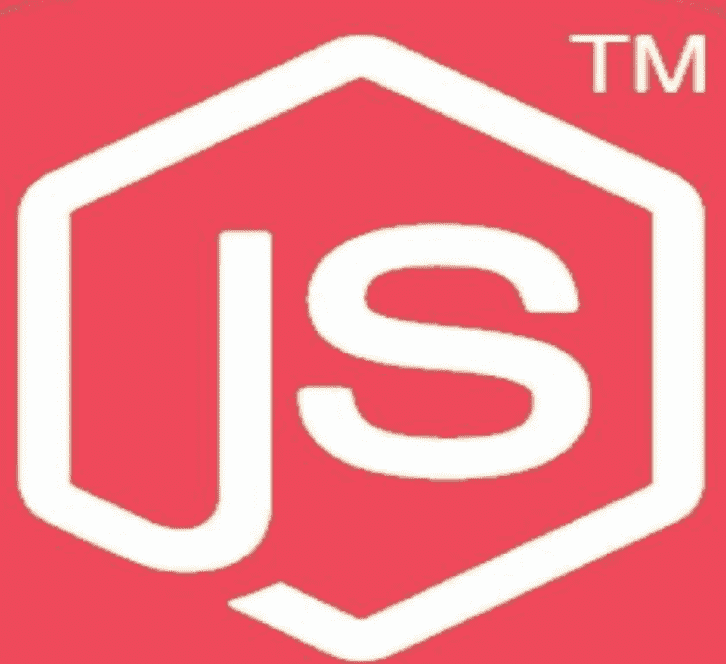

## 由 Krishna Rungta 编写

# 第 1 章：简介

现代 Web 应用在多年来由于引入了许多流行的框架（如 `bootstrap`、`Angular JS` 等）已经走了很远。所有这些框架都是基于流行的 JavaScript 框架。

但在涉及到开发基于服务器的应用时，似乎出现了一个空白，这就是 `Node.js` 登场的地方。

`Node.js` 也基于 JavaScript 框架，但它用于开发基于服务器的应用。在整个教程中，我们将详细研究 `Node.js` 以及我们如何使用它来开发基于服务器的应用。

## 什么是 node.js

`Node.js` 是一个开源、跨平台的运行时环境，用于开发服务器端 Web 应用。`Node.js` 应用用 JavaScript 编写，可以在各种操作系统上运行。

`Node.js` 基于事件驱动架构和非阻塞输入/输出 API，旨在优化实时 Web 应用的吞吐量和可扩展性。

在很长一段时间内，用于 Web 开发的框架都是基于无状态模型。无状态模型是指在一个会话（`session`）中生成的数据（例如用户设置信息和发生的事件）不会被维护以供用户下次会话使用。

为了在用户请求之间维护会话信息，必须完成大量工作。但有了 `Node.js`，Web 应用终于有了一种实现实时双向连接的方法，客户端和服务器都可以发起通信，允许它们自由地交换数据。

## 为什么使用 Node.js

我们将在接下来的章节中探讨 `Node.js` 的真实价值，但是什么让这个框架如此著名呢？多年来，大多数应用程序都是基于无状态的请求-响应框架。在类应用程序中，需要由开发者确保放置了正确的代码，以确保用户在与系统交互时维持 Web 会话的状态。

但通过 `Node.js` Web 应用，你现在可以进行实时操作并拥有双向通信。状态是维护的，且客户端或服务器均可启动通信。

## Node.js 的特性

让我们来看看 `Node.js` 的一些关键特性

1. **异步事件驱动 IO 有助于并发请求处理** – 这可能是 `Node.js` 最大的卖点之一。此特性基本上意味着，如果 `Node` 接收到某个输入/输出操作的请求，它将在后台执行该操作并继续处理其他请求。

这与其他编程语言非常不同。下面的代码给出了一个简单的示例：

```javascript
var fs = require('fs');

fs.readFile("Sample.txt", function(error, data) {
  console.log("Reading Data completed");
});
```

这与其他编程语言非常不同。下面的代码给出了一个简单的示例：

上面的代码片段查看了 `Sample.txt`。在其他编程语言中，只有在整个文件被读取后，才会发生处理。

2. **`Node.js` 使用 `V8` 引擎，该引擎被 `Google Chrome` 使用。** `Node.js` 因为 `V8` 引擎非常快。

3. **处理并发请求** – `Node.js` 的另一个重要方面是以最小的开销处理并发请求。

4. **`Node.js` 使用 JavaScript 库** – 这是 `Node.js` 的另一个特性。

5. **`Node.js` 拥有活跃且充满活力的社区** – 因为社区的存在，总有更新。

## 在使用 Node.js

`Node.js` 被许多大型公司使用。以下是列表：

- **Paypal** - Paypal 的许多网站已开始转向 `Node.js`。
- **LinkedIn** 正在使用 `Node.js` 驱动其移动产品。
- **Mozilla** 实现了 `Node.js` 以支持浏览器 API。
- **Ebay** 使用 `Node.js` 托管其 API 服务。

## 什么时候使用以及不该使用 Node.js

`Node.js` 最适用于流式或基于事件的实时应用，如：

1. 聊天应用程序
2. **游戏服务器** – 对于需要同时处理数千个请求的快速高性能服务器，这是一个理想框架。
3. **适用于协作环境** – 这适用于管理文档的环境。在文档管理环境中，会有很多人发布文档并在签出和签入时持续更改。因此 `Node.js` 适用于这些环境，因为当文档更改时，`Node.js` 的事件循环就会被触发。
4. **广告服务器** – 同样这里可能有数千个请求从中央服务器拉取广告，`Node.js` 可以是处理此问题的理想框架。
5. **流服务器** – 另一个使用 `Node` 的理想场景是多媒体流服务器，客户端从此服务器拉取不同的多媒体内容。

`Node.js` 适用于需要高并发但不需要专用 CPU 时间的情况。最好的是，由于 `Node.js` 是基于 JavaScript 的，它最适合构建基于相同 JavaScript 框架的客户端应用。

## 什么时候不该使用 Node.js

`Node.js` 可用于许多具有不同目的应用程序，唯一不应使用的场景是应用程序需要长时间的处理时间。

`Node.js` 结构设计为单线程。如果任何应用程序都需要后台执行一些长时间运行的计算。如果服务器正在进行某些计算，它将无法处理任何其他请求。

# 第 2 章：下载与安装 Node.js

要开始构建 `Node.js` 应用程序，第一步是安装 `Node.js` 框架。`Node.js` 框架支持多种操作系统，从 `Windows` 到 `Ubuntu` 和 `OS X`。一旦安装了 `Node.js` 框架，你就可以开始构建第一个 `Node.js` 应用程序。

`Node.js` 还可以通过使用自定义模块来嵌入外部功能或扩展功能。这些模块必须单独安装。模块的一个示例是 `MongoDB` 模块，它允许你的 `Node.js` 应用程序与 `MongoDB` 数据库交互。

## 如何安装 node.js

使用 `Node.js` 的第一步是在客户端系统上安装 `Node.js` 库。要执行 `Node.js` 的安装，请执行以下步骤：

**步骤 1)** 访问网站 `https://nodejs.org/en/download/` 并下载必要的二进制文件。在示例中，我们将下载 `Node.js` 的 32 位安装文件。

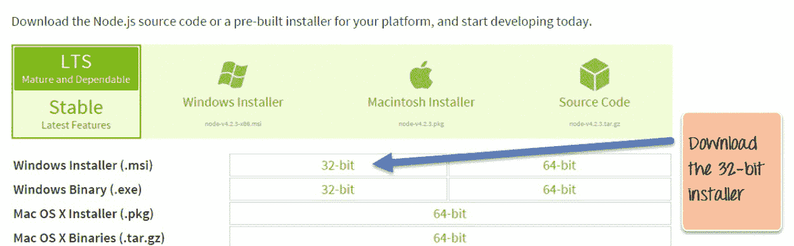

**步骤 2)** 双击下载的 `.msi` 文件开始安装。点击第一个屏幕上的“Run”（运行）按钮开始安装。

## 打开文件 - 安全警告

确定要运行此文件吗？

名称：`C:\All Downloads\Chrome\node-v4.2.3-x86.msi`

发布者：`Node.js Foundation`

类型：`Windows 安装程序包`

来源：`C:\All Downloads\Chrome\node-v4.2.3-x86.msi`

打开此文件之前始终询问

虽然来自互联网的文件可能有用，但此类类型的文件可能会损坏你的计算机。请仅运行你信任的发布者提供的软件。

风险是什么？


**步骤 3)** 在下一个屏幕中，点击“Next”（下一步）按钮继续安装

## Node.js Setup

欢迎使用 `Node.js` 安装向导

安装向导将在你的计算机上安装 `Node.js`。


**步骤 4)** 在下一个屏幕中，接受许可协议并点击“Next”（下一步）按钮。

## Node.js Setup

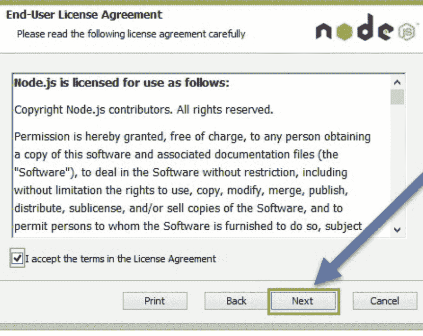

**步骤 5)** 在下一个屏幕中，选择 `Node.js` 需要安装的位置，然后点击“Next”（下一步）按钮。

1. 首先输入 `Node.js` 安装的文件位置。安装后 `Node.js` 的文件将存储在这里。
2. 点击“Next”（下一步）按钮继续安装。

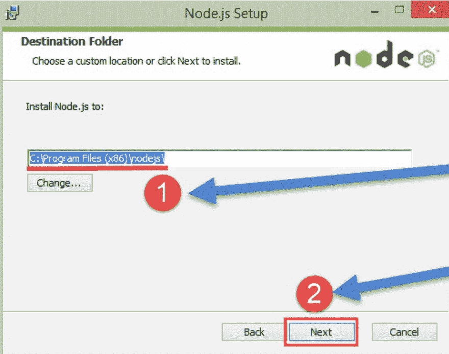

> 输入安装的文件位置
>
> 点击 Next 按钮

**步骤 6)** 接受默认组件并点击下一个按钮。

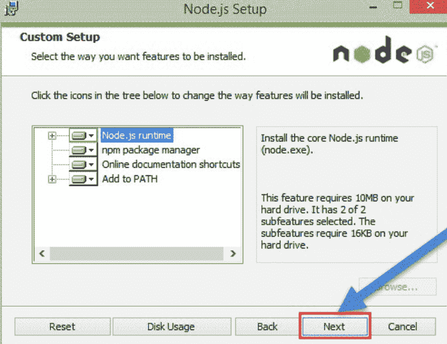

> 接受默认组件并点击 Next

**步骤 7)** 在下一个屏幕中，点击“Install”（安装）按钮开始安装。

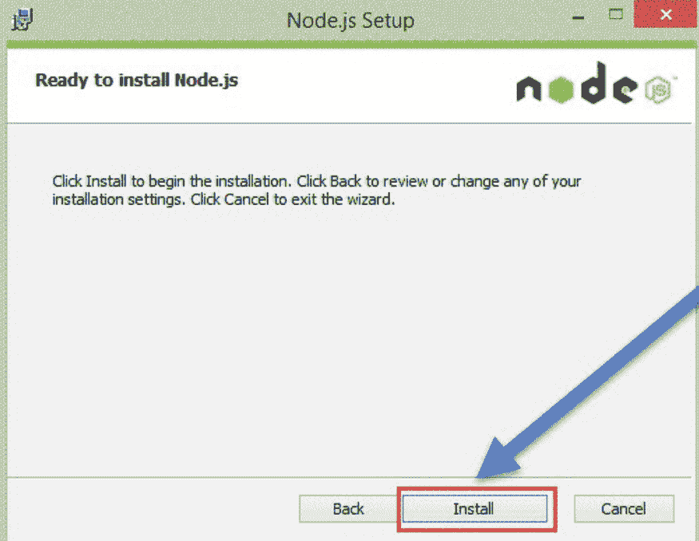

**步骤 8)** 点击“Finish”（完成）按钮完成安装。

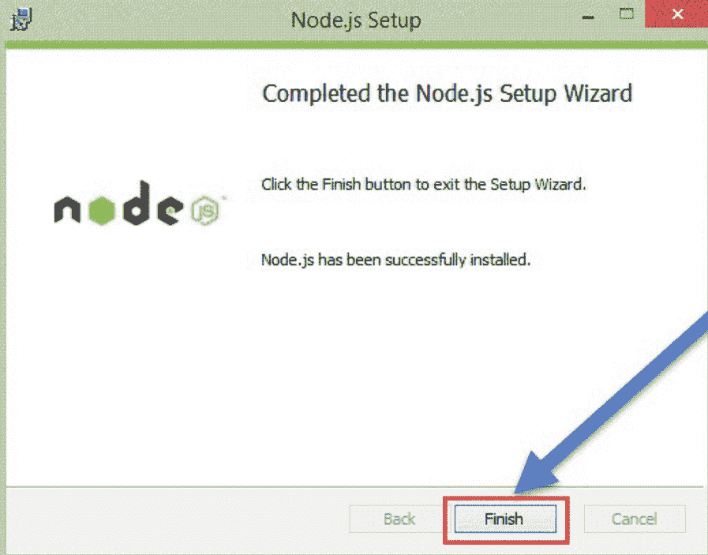

## 通过包管理器安装 node

在任何客户端机器上安装 `Node.js` 的另一种方法是使用“包管理器”。

在 `Windows` 上，包管理器被称为 `Chocolatey`。它被设计用于快速安装所需的应用程序和工具。通过 `Chocolatey` 安装 `Node.js`，需要执行以下步骤：

**步骤 1)** 安装 `Chocolatey` – `Chocolatey` 网站 (`https://chocolatey.org/`) 有关于如何安装此框架的说明。

- 第一步是在命令提示符中运行以下命令。该命令来自 `Chocolatey` 网站，是通过 `Chocolatey` 安装 `Node.js` 的标准命令。
- 下面是一个 `PowerShell` 命令，调用 `Chocolatey` 网站上的远程脚本。此命令需要在 `PowerShell` 窗口中运行。
- 此 `PowerShell` 脚本完成了下载并相应安装所需组件的工作。

```powershell
powershell -NoProfile -ExecutionPolicy Bypass -Command "iex ((New-Object Net.WebClient).DownloadString('https://chocolatey.org/install.ps1'))" && SET PATH=%USERPROFILE%\bin
```

可以安全地忽略升级版本低于 0.9 的错误。系统找不到指定的文件 - 未安装 lib

正在定位...

`Chocolate` (`choco.exe`) 现在已就绪。你可以通过输入 `choco` 在任何命令行中调用 `choco`。请确保 `chocolatey` 在路径中。

`D:\windows\system32>`

**步骤 2)** 下一步使用包管理器将 `Node.js` 安装到本地机器。这可以通过命令提示符中运行以下命令来实现：

```
nodejs v5.2.0
安装程序想要运行 'chocolateyInstall.ps1'
注意：如果不运行此脚本，安装将失败。注意：下次自动确认请使用 '-y' 或考虑设置全局。
确定要运行脚本吗？

1) yes
2) no
3) print

从 https://nodejs.org/dist/v5.2.0/node-v5.2.0-x64.msi 下载 64 位 nodejs
正在安装 nodejs...
nodejs 已安装。
nodejs 安装成功。
```


如果安装成功，你会收到 `Node.js` 安装成功的消息。注意：如果你得到类似 `C:\ProgramData\chocolatey\lib\tools` 的错误，请手动在路径创建文件夹。

## 在 Node.js 中运行你的第一个 Hello world 应用程序

一旦在计算机上下载并安装了 `Node.js`，让我们尝试在浏览器中显示“Hello World”。

创建一个名为 `firstprogram.js` 的 `Node.js` 文件

```javascript
var http = require('http');

http.createServer(function (req, res) {
  res.writeHead(200, {'Content-Type': 'text/html'});
  res.end('Hello World!');
}).listen(8080);
```

### 代码解释：

1. **`require` 函数** 的基本功能是读取一个 JavaScript 文件，执行该文件，然后返回一个对象。使用该对象，可以使用 `require` 函数调用的模块中的各种功能。在我们的案例中，由于我们想使用 `http` 的功能，因此我们使用 `require('http')` 命令。

2. 在代码的第 2 行中，我们创建一个基于简单函数的服务器应用程序。当向我们的服务器应用程序发送请求时，就会调用此函数。

3. 当收到请求时，我们要求函数向客户端返回“Hello World”响应。`writeHead` 函数用于向客户端发送头部数据，`end` 函数将关闭与客户端的连接。

4. 然后我们使用 `.listen` 函数让服务器应用程序监听端口 8080 客户端请求。你可以在这里指定任何可用端口。

## 执行代码

**步骤 1)** 将文件保存到计算机上：`C:\Users\Your Name\firstprogram.js`

**步骤 2)** 在命令提示符中，导航到文件所在的文件夹。输入命令：

`node firstprogram.js`

```
Node 命令提示符
你的环境已设置好，可使用 Node.js 8.4.0 (x64) 和 npm。
C:\Users\Chirag_Guru99>node firstprogram.js
```

**步骤 3)** 现在，你的计算机作为服务器工作了！如果有人尝试通过端口 8080 访问你的计算机，他们将获得“Hello World!”的消息回复！

**步骤 4)** 启动浏览器，输入地址：`http://localhost:8080`

## 输出


## 总结

- 我们学习了通过 `Node.js` 网站提供的 `msi` 安装模块安装 `Node.js`。此安装程序了了运行 `Node.js` 应用程序所需的模块。
- `Node.js` 也可以通过包管理器安装。`Windows` 的包管理器被称为 `Chocolatey`。通过在命令提示符中运行一些简单的命令，`Chocolatey` 包管理器会自动下载必要文件并将它们安装到客户端机器上。
- 一个简单的 `Node.js` 应用程序创建一个监听特定端口的服务器。当请求到达服务器时，客户端会自动向客户端发送“Hello World”响应。

# 第 3 章：模块 (Modules)

`Node.js` 中的模块是代码在单个单元中的逻辑封装。将代码进行此类分离，使其在未来的用途中更易管理和维护始终是一种良好的编程实践。这正是 `Node.js` 模块大显用场的地方。

每个模块都是具有独立封装功能的独立实体，因此它可以作为一个独立的工作单元来被管理。

在本教程中，我们将学习如何利用 `Node.js` 中的模块。

## 什么是 Node.js 模块？

如前所述，`Node.js` 模块是将代码封装在独立逻辑单元中的一种方法。市场上有很多现成的模块可以在 `Node.js` 中使用。

以下是 `Node.js` 应用中常用的一些流行模块：

1. **`Express` 框架** – `Express` 是一个极简且灵活的 `Node.js` Web 框架，为 Web 和移动应用提供了一套强大的功能。
2. **`Socket.io`** - `Socket.IO` 实现了实时基于事件的双向通信。该模块非常适合创建聊天类应用程序。
3. **`Jade`** - `Jade` 是一个高性能的模板引擎，使用 JavaScript 为 `node` 和浏览器实现。
4. **`MongoDB`** - `MongoDB` `Node.js` 驱动是 `MongoDB` 官方支持的 `Node.js` 驱动。
5. **`Restify`** - `restify` 是一个轻级框架，类似于 `express`，用于构建 `REST API`。
6. **`Bluebird`** - `Bluebird` 是一个功能完备的 `promise` 库，专注于创新功能和性能。

## 在 Node.js 中使用模块

为了在 `Node.js` 应用中使用模块，首先需要使用 `Node` 包管理器（`npm`）进行安装。

下所示命令行显示了如何安装 "`express`" 模块。

```bash
npm install express
```

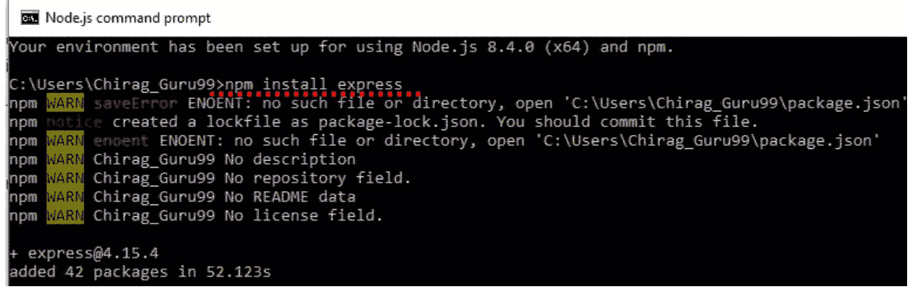

- 上述命令将下载包含“`express` 模块”的必要文件并处理安装工作。
- 一旦模块安装完成，要在 `Node.js` 应用中使用该模块，你需要使用 `require` 关键字。该关键字是 `Node.js` 用于将模块功能整合到应用程序中的方式。

让我们来看一个如何使用 `require` 关键字的示例。下面的 "`Guru99`" 代码示例展示了如何使用 `require` 函数：

```javascript
var express = require('express');
var app = express();
app.set('view engine', 'jade');
app.get('/', function(req, res) {
});
var server = app.listen(3000, function () {
});
```

1. 在第一句语句中，我们就使用了 `require` 关键字来引入 `express` 模块。"`express`" 模块针对 `Node.js` 开发优化的 JavaScript 库。这是最常用的 `Node.js` 模块之一。
2. 引入模块后，为了使用模块内部的功能，需要创建一个对象。这里创建了一个 `express` 模块的对象。


- 3. 一旦使用 `require` 命令引入了模块并创建了“对象”，就可以调用 express 模块所需的方法。在这里我们使用 `set` 命令来设置视图引擎，它被用于设置 Node.js 中使用的模板引擎。**注意：**（仅供读者理解，模板引擎是一种通过从数据文件中提取数据向应用程序中注入值的方法。这个概念在 Angular JS 中非常有名，其中大括号 `{{ key }}` 用于替换网页中的值。大括号中的单词 'key' 基本上表示变量，该变量在页面显示时将被一个值替换。）

- 4. 在这里我们使用 `listen` 方法让应用程序监听特定的端口号。

## 创建 NPM 模块

Node.js 具有创建自定义模块的能力并允许你将这些自定义模块包含在 Node.js 应用中。

让我们来看一个简单的示例，如何创建自己的模块并将其包含在主应用程序文件中。我们的模块将执行两个数字相加的简单任务。

遵循以下步骤查看如何创建模块并将其包含在应用程序中。

**步骤 1)** 创建名为 "Addition.js" 的文件并包含以下代码。该文件将包含你的模块逻辑。

以下是放入该文件的代码：

```javascript
var exports=module.exports={};
exports.AddNumber=function(a,b)
{
return a+b;
};
```

- 1. `exports` 关键字用于确保此文件中定义的功能可以被其他文件实际访问。

- 2. 然后我们定义了一个名为 `AddNumber` 的函数。该函数定义为接收 2 个参数，即 `a` 和 `b`。该函数被添加到模块 `exports` 中，成为一个可以被其他应用程序模块访问的公共函数。

- 3. 我们最后让自定义模块返回参数的相加值。

现在我们已经创建了具有两个数字相加功能的自定义模块。现在是时候创建一个将调用此模块的应用程序了。

在下一步中，我们将实际看到如何创建一个调用我们自定义模块的应用程序。

**步骤 2)** 创建名为 "app.js" 的文件，这是你的主应用程序文件，并添加以下代码：

```javascript
var Addition=require('./Addition.js');
console.log(Addition.AddNumber(1,2));
```

1. 我们正在使用 `require` 关键字引入 Addition.js 文件中的功能。

2. 由于 Addition.js 文件中的函数现在是可访问的，我们现在可以调用 `AddNumber` 函数。在函数中，我们传递了 2 个数字作为参数。然后在控制台中显示该值。

```bash
D:\Program Files (x86)\JetBrains\WebStorm 11.0.1\bin\runner.exe "D:\Program Files\nodejs\node.exe" app.js
Process finished with exit code 0
```


## 输出：

- 当你运行 app.js 文件时，你将在控制台日志中获得值 3。

- 结果是因为调用了 Addition.js 文件中的 `AddNumber` 函数。

## 扩展模块

在创建模块时，可以扩展另一个模块。让我们来看一个如何扩展模块的示例。

**步骤 1)** 创建基础模块。创建一个名为 "Tutorial.js" 的文件并包含以下代码：

```javascript
var exports=module.exports={};
exports.tutorial=function()
{
console.log("Guru99 Tutorial")
};
```

- 1. `exports` 关键字用于确保此文件中定义的功能可以被其他文件实际访问。

- 2. 然后我们定义了一个名为 `tutorial` 的函数。该函数将输出 "Guru99 Tutorial"。

**步骤 2)** 接下来我们将创建一个扩展模块。创建一个名为 "NodeTutorial.js" 的文件并包含以下代码：

```javascript
var Tutor=require('./Tutorial.js');
exports.NodeTutorial=function()
{
console.log("Node Tutorial")
}
exports.pTutor=function()
{
Tutor.tutorial();
}
```

- 1. 我们在新模块文件中使用了 `require` 函数。由于我们要扩展现有的 "Tutorial.js"，我们需要先引入它。

- 2. 然后我们创建了一个名为 `NodeTutorial` 的函数。该函数将做两件事：

    - 向控制台发送字符串 "Node Tutorial"。

    - 将基础模块 "Tutorial.js" 中的字符串 "Guru99 Tutorial"发送到我们的扩展模块 "NodeTutorial.js"。

**步骤 3)** 创建你的主 app.js 文件，这是你的主应用程序文件并包含以下代码：

```javascript
var localTutor=require('./NodeTutorial.js');
localTutor.NodeTutorial();
localTutor.pTutor();
```

1. 我们的主应用程序现在调用 "NodeTutorial" 模块。

2. 我们调用该函数，文本 "Node Tutorial" 将显示在控制台日志中。

3. 由于我们扩展了 Tutorial.js 模块并暴露了一个名为 `pTutor` 的函数，它还调用了 Tutorial.js 模块中的 `tutorial` 函数。

**输出：**

由于我们使用 Node 执行了上述 app.js 代码，我们将在控制台日志文件中获得以下输出：

- Node Tutorial

- Guru99 Tutorial

## 发布 NPM(Node Package Manager) 模块

可以将你的模块发布到自己的 GitHub 仓库中。

通过将你的模块发布到中心位置，你就不再需要承担在每个需要该模块的机器上手动安装它的负担。相反，你可以使用 npm 的 `install` 命令来安装你已发布的 npm 模块。

发布 npm 模块需要遵循以下步骤：

**步骤 1)** 在 GitHub 上创建你的仓库（GitHub 是一种在线代码仓库管理工具）。它可以用于托管你的代码仓库。

**步骤 2)** 你需要让本地的 npm 安装程序识别你是。这意味着我们需要告诉 npm 谁模块的作者是谁、邮箱 ID 以及任何可以与该 ID 关联的公司 URL。所有这些细节将在你的模块发布时被添加到你的 npm 模块中。

以下命令设置了 npm 模块作者的名称、电子邮件和 URL。

`npm set init.author.name "Guru99."`

`npm set init.author.email "guru99@gmail.com"`

`npm set init.author.url http://Guru99.com`

**步骤 3)** 下一步是使用上一步提供的凭据登录 npm。要登录，你需要使用以下命令：

```
npm login
```

**步骤 4)** 初始化你的包 – 下一步是初始化包以创建 `package.json` 文件。这可以通过执行以下命令来实现：

```
npm init
```

当你执行上述命令时，系统会提示你回答一些问题。最重要的是你模块的版本号。

**步骤 5)** 发布到 GitHub – 下一步是将你的源文件发布到 GitHub。可以通过运行以下命令来实现：

```bash
git add .
git commit -m "Initial release"
git tag v0.0.1
git push origin master --tags
```

## **步骤 6)** 发布你的模块 – 最后一步是将你的模块发布到 npm 注册表。这是通过以下命令完成的：

```bash
npm publish
```

## 使用 npm 管理第三方包

正如我们所看到的，“Node 包管理器”具有管理 Node.js 应用程序所需模块的能力。

让我们看看 node 包管理器中用于管理模块的一些功能：

- 1. 在全局模式下安装包 – 模块可以在全局级别安装，这基本上意味着这些模块将供本地机器上所有的 Node.js 项目使用。下面的示例显示了如何使用全局选项安装“express module”。

```bash
npm install express -global
```

上述语句中的全局选项允许模块在全局级别安装。

- 2. 列出本地机器上安装的所有全局包。这可以在命令提示符中执行以下命令来实现：

```bash
npm list --global
```

如果你之前在系统中安装过“express module”，则将显示下面的输出。在这里，你可以看到本地机器上安装的不同模块。

```text
C:\Users\Administrator>npm list --global
C:\Users\Administrator\AppData\Roaming\npm
 express@4.13.3
 accepts@2.1.13
 mime-types@2.1.8
  mime-db@1.20.0
  negotiator@0.5.3
  array-flatten@1.1.1
  content-disposition@0.5.0
  content-type@1.0.1
  cookie@0.1.3
  cookie-signature@1.0.6
  debug@2.2.0
  ms@0.7.1
  depd@1.0.1
  escape-html@1.0.2
  etag@1.7.0
  finalhandler@0.4.0
  unpipe@1.0.0
  fresh@0.3.0
  merge-descriptors@1.0.0
  methods@1.1.1
  on-finished@2.3.0
  ee-first@1.1.1
  parser@1.3.0
  path-to-regexp@0.1.7
  proxy-addr@1.0.10
  forwarded@0.1.0
  ipaddr.js@1.0.5
 qqs@4.0.0
 range-parser@1.0.3
 sendbody@0.13.0
  destroy@1.0.3
  http-errors@1.3.1
  inherits@2.0.1
  mime@1.3.4
  ms@0.7.1
  statuses@1.2.1
 serve-static@1.10.0
 type-is@1.6.10
 media-type@0.3.0
 mime-types@2.1.8
  mime-db@1.20.0
 utils-merge@1.0.0
 vary@1.0.1
```

- 3. 安装特定版本的包 – 有时可能需要只安装包的特定版本。一旦你知道了需要安装的包以及相关版本，你就可以使用 `npm install` 命令来安装该特定版本。

下面的示例显示了如何安装版本为 1.7.0 的 `underscore` 模块：

```bash
npm install underscore@1.7.0
```

- 4. 更新包 – 有时你可能需要将包更新到最新版本。下面的示例显示了如何更新包：

```bash
npm update underscore
```

- 5. 搜索包 – 如果你想检查某个包是否在 npm 注册表中可用，你可以使用 `search` 命令：

```bash
npm search express
```

- 6. 卸载包 – 如果你需要从系统中删除一个包，可以使用 `uninstall` 命令：

```bash
npm uninstall express
```

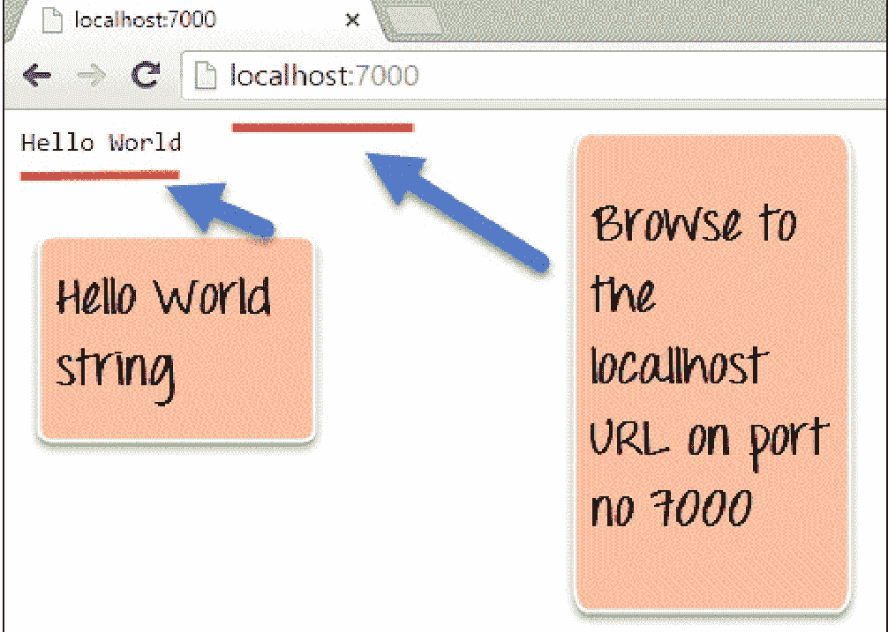

从输出中，

- 你可以清楚地看到，如果我们浏览到 localhost 7000 端口的 URL，你将在页面上看到显示字符串 'Hello World'。

- 因为在我们的代码中，我们专门指定了服务器监听 7000 端口，所以我们能够在浏览到此 URL 时查看输出结果。

以下是供你参考的代码：

```javascript
var http=require('http')
var server=http.createServer((function(request,response)
{
response.writeHead(200,
{"Content-Type" : "text/plain"},
response.end("Hello World\n");
}));
server.listen(7000);
```

## 在 Node.js 中处理 GET 请求

在 Node.js 中发送 GET 请求来从另一个网站获取数据相对非常简单。要在 node 中发送 Get 请求，我们首先需要安装 `request` 模块。这可以通过在命令行中执行以下行来实现：

```bash
npm install request
```

上述命令请求 Node 包管理器下载所需的 `request` 模块并进行相应的安装。

当你的 npm 模块安装成功后，命令行将显示已安装的模块名称：<name>@<version>。

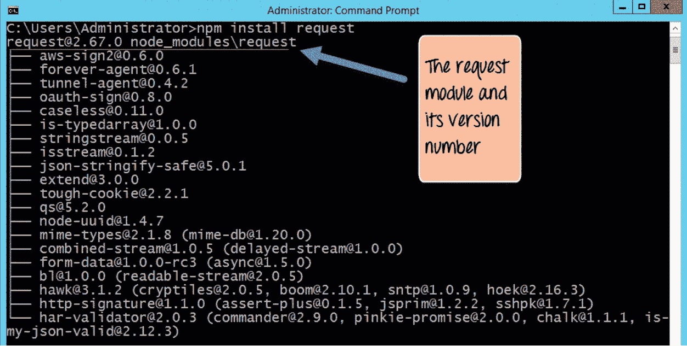

在上面的快照中，你可以看到 'request' 模块以及版本号 2.67.0 已经被下载并安装。

现在让我们来看看我们可以利用这个 'request' 命令的代码。

```javascript
var request = require("request");
request("http://www.google.com",function(error,response,body) {
  console.log(body);
});
```

### 代码解释：

1. 我们正在使用上一步中安装的 'require' 模块。该模块包含了必要的函数，可以用于向网站发送 GET 请求。

2. 我们正在向 www.google.com 发送 GET 请求，并在收到响应后随后调用一个函数。当收到响应时，参数(`error`, `response`, 和 `body`) 将具有以下值：

   a. Error - 如果在使用 GET 请求时收到任何错误，错误将被记录在这里。

   b. Response - 响应将包含返回在响应中的 http 头。

   c. Body - Body 将包含 Google 发送的响应完整内容。

3. 在这里，我们只是将 `body` 参数中收到的内容写入 console.log 文件中。所以基本上，我们从 **www.google.com** 获取的任何内容都将写入 console.log。

以下是供你参考的代码 require("request")：

```javascript
var request = require("request");

request("http://www.google.com",function(error,response,body)
{
console.log(body);
});
```

## 总结

- Node.js 框架可以使用 `http` 模块来开发 Web 服务器。可以使应用程序监听特定的端口，并在每当向应用程序发送请求时，都向客户端发送响应。

- `request` 模块可以从网站上获取信息。该信息将包含从相关网站请求的网页的完整内容。

# 第 5 章：使用 Express 的 Node.js

在本教程中，我们将查看 express 框架。该框架的设计方式使其能够作为一个极简且灵活的 Node.js Web 应用程序框架，为构建单页、多页以及混合 Web 应用提供了一套强大的功能。

## 什么是 Express.js

Express.js 是一个 Node js Web 应用程序服务器框架，专门为构建单页、多页和混合 Web 应用而设计。

它已成为 node.js 的标准服务器框架。Express 是被称为 MEAN 栈的后端部分。

MEAN 是一个免费且开源的 JavaScript 软件栈，用于构建动态网站和 Web 应用，它包含以下组件：

1) MongoDB - 标准 NoSQL 数据库

2) Express.js - 默认 Web 应用框架

3) Angular.js - 用于 Web 应用的 JavaScript MVC 框架

4) Node.js - 用于可扩展服务器端和网络应用的框架。

Express 框架使得开发可以处理多种类型请求（如 GET、PUT、POST 和 DELETE 请求）的应用程序变得非常简单。

## 安装和使用 Express

Express 通过 Node 包管理器安装。这可以通过在命令行中执行以下行来实现：

```bash
npm install express
```

上述命令请求 Node 包管理器下载所需的 express 模块并进行相应的安装。

让我们使用新安装的 Express 框架并创建一个简单的 "Hello World" 应用。

我们的应用程序将创建一个简单的服务器模块，它将监听 3000 端口。在我们的示例中，如果通过浏览器在此端口上发送请求，服务器应用程序将向客户端发送 'Hello World' 响应。

```javascript
var express=require('express');
var app=express();
app.get('/', function(req, res)
{
    res.send('Hello World!');
}
);
var server=app.listen(3000, function() {});
```

### 代码解释：

1. 在我们的第一行代码中，我们正在使用 `require` 函数来包含 "express 模块"。

2. 在这里，我们使用 express 模块来处理请求。

3. 在处理路由之前，我们需要一个回调函数来发送响应。


4. `res` 参数是向客户端发送 "Hello World!" 字符串的响应。

5. 我们的代码将监听 3000 端口的服务器应用程序。

6. 这里的 `res` 参数将向客户端发送内容。

7. 输出将：


从输出中，

- 你可以清楚地看到，如果我们浏览到 localhost 7000 端口的 URL，你将在页面上看到显示字符串 "Hello World"。

- 因为在我们的代码中，我们专门指定了服务器监听 7000 端口，所以我们能够在浏览到此 URL 时查看输出结果。

## 路由

路由是指确定应用程序响应请求的方式。例如：

```javascript
app.METHOD(PATH, HANDLER)
```

其中：

1. `app` 是 express 的实例
2. `METHOD` 是 HTTP 方法（如 GET 等）
3. `PATH` 是路径
4. `HANDLER` 是匹配路由时执行的函数

让我们看看如何在 Express 中实现路由的示例。我们的示例将创建三个路由：

1. `/Node` 路由访问时将显示 "Tutorial on Node"
2. `/Angular` 路由访问时将显示 "Tutorial on Angular"
3. 默认路由 `/` 将显示 "Welcome to99."

我们的基础代码与之前保持相同。下面的代码片段展示了如何实现路由：

```javascript
app.route('/Node').get(function(req, res) {
    res.send("Tutorial on Node");
});
app.route('/Angular').get(function(req, res) {
    res.send("Tutorial on Angular");
});
app.get('/', function(req, res) {
    res.send('Welcome to99.');
});
```

### 代码解释

1. 在这里，当用户选择 `http://localhost:3000/Node` 时，我们定义了一个路由。在该路由上挂载了一个回调函数，并在浏览该 URL 时调用它。

2. 该函数有两个参数。

- 我们将使用的主要参数是 `res` 参数，它可以用于向客户端发送信息。

- `req` 参数包含了所做请求的信息，因此 `req` 参数可以用于查找发送的额外参数。

3. 我们正在使用 `send` 函数在选择 Node 路由时向客户端发送 "Tutorial on Node"。

4. 同样，在选择 Angular 路由时向客户端发送 "Tutorial on Angular"。

5. 这是默认路由，当你访问应用程序的路由 `http://localhost:3000` 时会选择它。当选择默认路由时，将向客户端发送消息 "Welcome to Guru99 Tutorials"。

如果命令执行成功，当你在浏览器中运行代码时，将显示以下输出。

## 输出

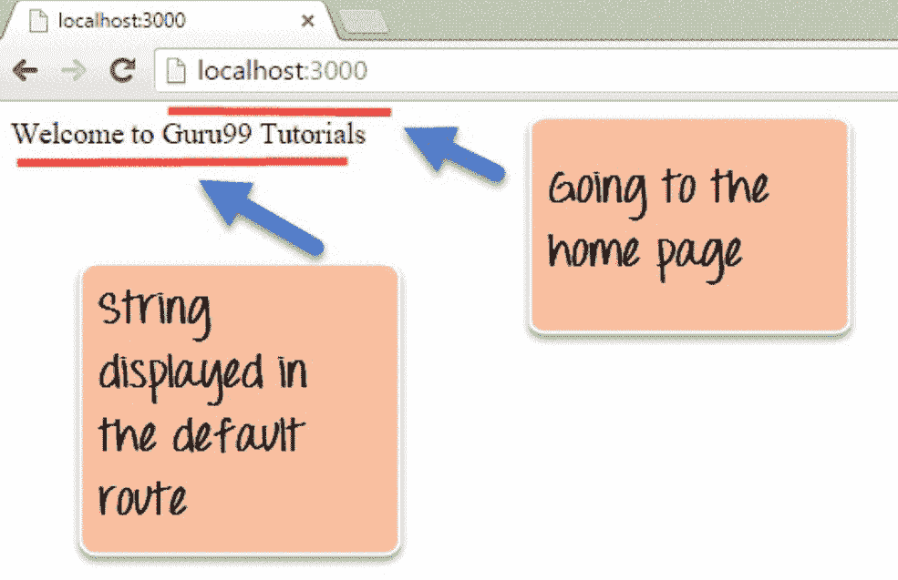

从输出可以看出，

- 你清楚地看到，如果我们访问端口 3000 的 localhost URL，你将在页面上看到 "Welcome to Guru99 Tutorials" 字符串。

- 因为在我们的代码中，我们已经提到了默认 URL 将显示此消息。

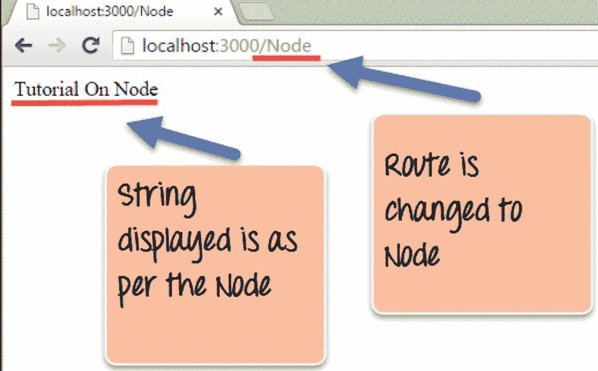

从输出可以看出，

你可以看到，如果 URL 已更改为 `/Node`，将选择相应的 Node 路由，并显示字符串 "Tutorial On Node"。

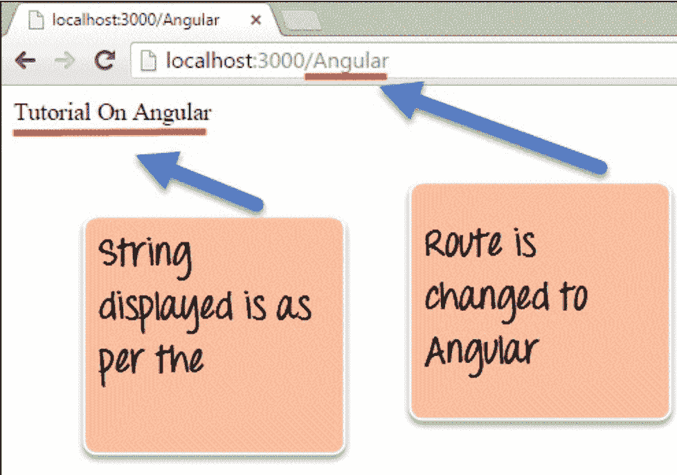

从输出可以看出，

你可以看到，如果 URL 已更改为 `/Angular`，将选择相应的 Angular 路由，并显示字符串 "Tutorial On Angular"。

## 使用 express.js 的示例 Web 服务器

从上面的示例中，我们已经了解如何根据路由来决定显示什么输出。这种路由用于大多数现代 Web 应用程序。Web 服务器的另一部分是在 Node.js 中使用模板。

在创建快速即时的 Node 应用程序时，一种简单快速的方法是为应用程序使用模板。市场上有很多用于制作模板的框架。在我们的案例中，我们将以 jade 框架作为模板示例。

Jade 可以通过 Node 包管理器（npm）安装。这可以通过在命令行中执行以下行来完成：

```bash
npm install jade
```

上述命令请求 Node 包管理器下载所需的 jade 模块并进行相应的安装。

让我们使用新安装的 jade 框架并创建一些基础模板。

**步骤 1** 第一步是创建一个 jade 模板。创建一个名为 `index.jade` 的文件并插入以下代码：

```html
html
head
  title!=title
body
  h1=message
```

1. 在这里，我们指定页面标题将更改为此模板被调用时传递的任何值。

2. 我们还指定 header 标签中的文本将被替换为传递到 jade 模板中的内容。

```javascript
var express = require('express');
var app = express();

app.set('view engine', 'jade');

app.get('/', function(req, res) {
  res.render('index', {
    title: 'Guru99', message: 'Welcome'
  });
});
var server = app.listen(3000, function() {});
```

### 代码解释

- 1. 应用程序中指定的第一个内容是 "view engine"，它将用于渲染模板。由于我们将使用 jade 来渲染模板，因此我们相应地进行了指定。

- 2. `render` 函数用于渲染网页。在我们的示例中，我们正在渲染之前创建的模板 (`index.jade`)。

- 3. 我们将 "Guru99" 和 "Welcome" 的值分别传递给参数 "title" 和 "message"。这些值将由 `index.jade` 模板中声明的 `title` 和 `message` 参数替换。

如果命令执行成功，当你在浏览器中运行代码时，将显示以下输出。

## 输出

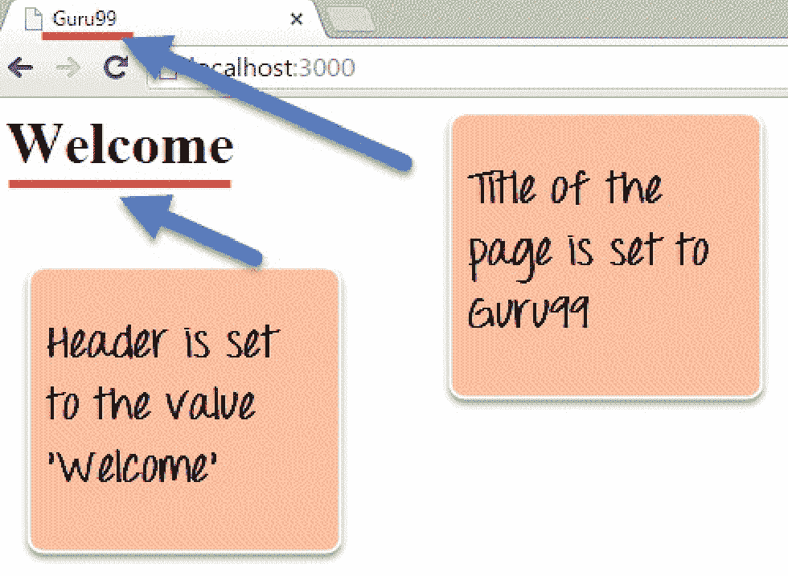

从输出可以看出，

我们可以看到页面标题被设置为 "Guru99"，页面页眉被设置为 "Welcome"。

- 这是由于我们在 node js 应用程序中调用的 jade 模板。

## 总结

- express 框架是开发 Node js 应用程序最常用的框架。express 框架构建在 node.js 框架之上，有助于快速开发基于服务器的应用程序。

- 路由用于根据所提出的请求将用户引导到 Web 应用程序的不同部分。每个路由的响应可以根据需要向用户显示的内容而异。

- 模板可以高效地注入内容。Jade 是 Node.js 应用程序中最流行的模板引擎之一。

# 第 6 章：结合 MongoDB 的 Node.js

大多数现代 Web 应用程序在后端都有某种数据存储系统来存储数据。例如，以 Web 购物应用程序为例，商品的价格或特定类型商品的数量等数据将存储在数据库中。

Node js 框架具有与数据库交互的能力，这是大多数现代 Web 应用程序通常需要的。Node js 可以处理关系型数据库（如 Oracle 和 MS SQL Server）和非关系型数据库（如 MongoDB 和 MySQL）。在教程中，我们将探索如何在 Node.js 中使用 MongoDB。

## Node.js 和 MongoDB

在本章中，我们将学习如何在 Node.js 中使用 MongoDB。MongoDB 是一种 NoSQL 数据库，对于现代 Web 应用程序非常流行。它以灵活的 BSON 存储数据。

要在 Node.js 中使用 MongoDB，需要使用驱动。驱动允许与 MongoDB 数据库交互并执行 CRUD 操作。

首先，我们需要使用 npm 安装 MongoDB 驱动：

```bash
npm install mongodb
```

接下来，我们将连接 MongoDB 数据库。

```javascript
var MongoClient = require('mongodb');
var url = 'mongodb://localhost:27017/EmployeeDB';

MongoClient.connect(url, function(err, db) {
  if (err) {
    console.log(err);
  }
  console.log("Connected");
  // 在此处执行操作
  db.close();
});
```

在接下来的章节中，我们将学习使用 Node.js 在 MongoDB 中执行 CRUD 操作。

## 向 MongoDB 插入数据

向集合插入数据，我们使用 `insertOne` 方法。这是向 Employee 集合插入文档的示例：

```javascript
var doc = { name: "Guru99", age: 25 };
db.collection('employees').insertOne(doc, function(err, result) {
  if (err) {
    console.log(err);
  }
  console.log("Inserted document id: ", result.insertedId);
});
```

## 从 MongoDB 获取数据

从集合获取数据，使用 `find` 方法。这是从 Employee 集合获取所有文档的示例：

```javascript
db.collection('employees').find().toArray(function(err, docs) {
  if (err) {
    console.log(err);
  }
  console.log(docs);
});
```

## 在 MongoDB 中更新数据

更新文档，使用 `updateOne` 方法。这是更新名为 Guru99 的员工年龄的示例：

```javascript
var query = { name: "Guru99" };
var update = { $set: { age: 26 } };
db.collection('employees').updateOne(query, update, function(err, result) {
  if (err) {
    console.log(err);
  }
  console.log("Matched count: ", result.matchedCount);
  console.log("Modified count: ", result.modifiedCount);
});
```

## 从 MongoDB 删除数据

删除文档，使用 `deleteOne` 方法。这是删除名为 Node99 的员工的示例：

```javascript
var query = { name: "Node99" };
db.collection('employees').deleteOne(query, function(err, result) {
  if (err) {
    console.log(err);
  }
  console.log("Deleted count: ", result.deletedCount);
});
```

```javascript
MongoClient.connect(url, function(err, db) {
  var cursor = db.collection('Employee').find();
  cursor.each(function(err, doc) {
    console.log(doc);
  });
});
```

### 代码解释

- 1. 在第一步中，我们正在创建一个游标（游标是一个用于指向从数据库获取的各种记录的指针。该游标随后用于遍历数据库中的不同记录。在这里，我们定义了一个名为 `cursor` 的变量，它将用于存储指向从数据库获取记录的指针），我们还可以指定从哪个 `Employee` 集合中获取记录。`find()` 函数用于指定我们想要从 MongoDB 集合中检索所有文档。

- 2. 我们现在正在遍历游标，并对游标中的每个文档执行一个函数。

- 3. 我们的函数将仅仅是简单地将每个文档的内容打印到控制台上。

注意：也可以从数据库获取特定的记录。这可以通过在 `find()` 函数中指定搜索条件来实现。例如，假设你只想获取员工名称为 "Guru99" 的记录，那么该语句可以写为 `var cursor = db.collection('Employee').find({EmployeeName: "Guru99"})`。

如果上述代码执行成功，你的控制台中将显示以下输出。

## 输出

```json
{
  "id": 567adf6b634178500288e69ca,
  "Employeeid": 1,
  "EmployeeName": "Guru99"
},
{
  "id": 567adf7934178500288e69cb,
  "Employeeid": 2,
  "EmployeeName": "Joe"
},
{
  "id": 567adf8234178500288e69cc,
  "Employeeid": 3,
  "EmployeeName": "Martin"
}
```


你能够清楚地看到集合中的所有文档都已检索到。这是通过使用 mongodb 连接 (`db`) 的 `find()` 方法并使用游标遍历所有文档来实现的。

## 在集合中插入文档

可以使用 MongoDB 库提供的 `insertOne` 方法向集合插入文档。下面的代码段显示了如何向 mongodb 集合插入一个文档。

```javascript
var MongoClient = require('mongodb').MongoClient;
var url = 'mongodb://localhost/EmployeeDB';

MongoClient.connect(url, function(err, db) {
  db.collection('Employee').insertOne({
    Employeeid: 4,
    EmployeeName: "NewEmployee"
  });
});
```

### 代码解释

- 1. 在这里，我们正在使用 MongoDB 库中的 `insertOne` 方法向 Employee 集合插入文档。

- 2. 我们正在指定需要插入到 Employee 集合的文档详细信息。

如果你现在检查 MongoDB 数据库的内容，将发现 `Employeeid` 为 4、`EmployeeName` 为 "NewEmployee" 的记录已插入到 Employee 集合中。

注意：控制台不会显示任何输出，因为记录正在被插入数据库，这里无法显示任何输出。

要检查数据是否已正确插入数据库，你需要在 MongoDB 中执行以下命令：

1. 使用 EmployeeDB
2. `db.Employee.find({Employeeid: 4})`

第一条语句确保你已连接到 EmployeeDb 数据库。第二条语句搜索员工 id 为 4 的记录。

## 更新集合中的文档

可以使用 MongoDB 库更新集合中的文档。下面的代码段显示了如何更新 mongoDB 集合中的一个文档。

```javascript
var MongoClient = require('mongodb').MongoClient;
var url = 'mongodb://localhost/EmployeeDB';

MongoClient.connect(url, function(err, db) {
  db.collection('Employee').updateOne({
    "EmployeeName": "NewEmployee"
  }, {
    $set: {
      "EmployeeName": "Mohan"
    }
  });
});
```

### 代码解释

- 1. 在这里，我们正在使用 MongoDB 库中的 `updateOne` 方法，它用于更新 mongo 集合中的文档。

- 2. 我们正在指定需要更新的文档的搜索标准。在我们案例中，我们要找到 `EmployeeName` 为 "NewEmployee" 的文档。

- 3. 然后我们将文档的 `EmployeeName` 值从 "NewEmployee" 设置为 "Mohan"。

如果你现在检查 MongoDB 数据库的内容，将发现 `Employeeid` 和 `EmployeeName` 为 "Mohan" 的记录已在 Employee 集合中更新。

要检查数据是否已正确更新数据库，你需要在 MongoDB 中执行以下命令：

1. 使用 EmployeeDB
2. `db.Employee.find({Employeeid: 4})`

第一条语句确保你已连接到 EmployeeDb 数据库。第二条语句搜索员工 id 为 4 的记录。

## 删除集合中的文档

可以使用 MongoDB 库提供的 `deleteOne` 方法删除集合中的文档。下面的代码段显示了如何删除 mongo 集合中的一个文档。


```javascript
var MongoClient = require('mongodb').MongoClient;
var url = 'mongodb://localhost/EmployeeDB';

MongoClient.connect(url, function(err, db) {
  db.collection('Employee').deleteOne({
    "EmployeeName": "NewEmployee"
  });
});
```

### 代码解释

1. 在这里，我们正在使用 MongoDB 库中的 `deleteOne` 方法，它用于删除 mongo 集合中的文档。
2. 我们正在指定需要删除的文档的搜索标准。在我们案例中，我们要找到 `EmployeeName` 为 "NewEmployee" 的文档。

如果你现在检查 MongoDB 数据库的内容，将发现 `EmployeeName` 为 "NewEmployee" 的记录已在 Employee 集合中删除。

要检查数据是否已正确删除，你需要在 MongoDB 中执行以下命令：

1. `use EmployeeDB`
2. `db.Employee.find({EmployeeName : "NewEmployee" })`

第一条语句确保你已连接到 EmployeeDB 数据库。第二条语句搜索员工名为 "NewEmployee" 的记录。

## 如何使用 express 构建 node 应用

1. 我们正在为应用程序创建一个名为 'Employee' 的路由。因此，每当有人浏览应用程序的 `http://localhost:3000/Employeeid` 时，为该路由定义的代码段就会被执行。
2. 在这里，我们通过 `db.collection('Employee').find()` 命令获取 'Employee' 集合中的所有记录。然后，我们将此集合赋值给一个变量 `cursor`（游标）。通过使用这个游标变量，我们能够遍历该集合中的所有记录。
3. 我们现在正在使用 `cursor.each()` 函数来遍历集合中的所有记录。对于每条记录，我们将定义一段代码段，规定在访问每条记录时执行的操作。
4. 最后，我们看到如果返回的记录不为空（null），那么我们就通过 `item.Employeeid` 获取员工 ID。代码的其他部分是为了构建适当的 HTML 代码，以便我们的结果能够在浏览器中正确显示。

## 第 3 步：在这一步中，我们将输出发送到网页上，并让我们的应用程序监听特定的端口。

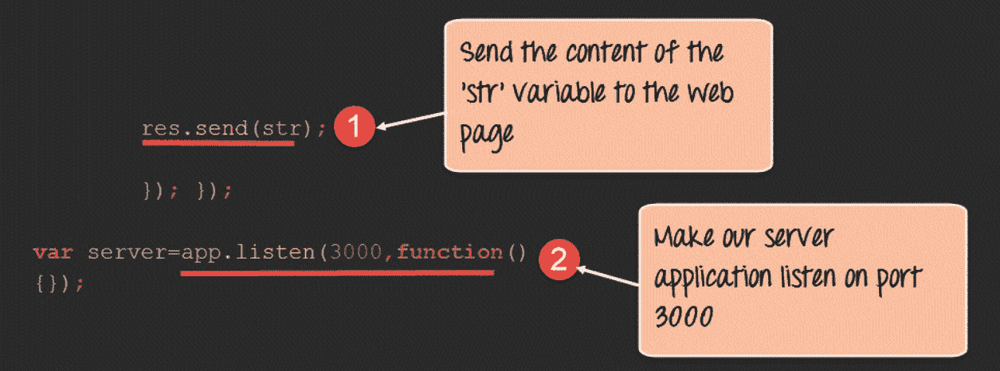

```
res.send(str);

});

var server = app.listen(3000, function() {
});
```

### 代码解释

1. 在这里，我们将之前步骤中构建的所有内容发送到我们的网页上。`res` 参数允许我们将内容作为响应发送到我们的网页。
2. 我们让整个 Node.js 应用程序监听 3000 端口。

## 输出

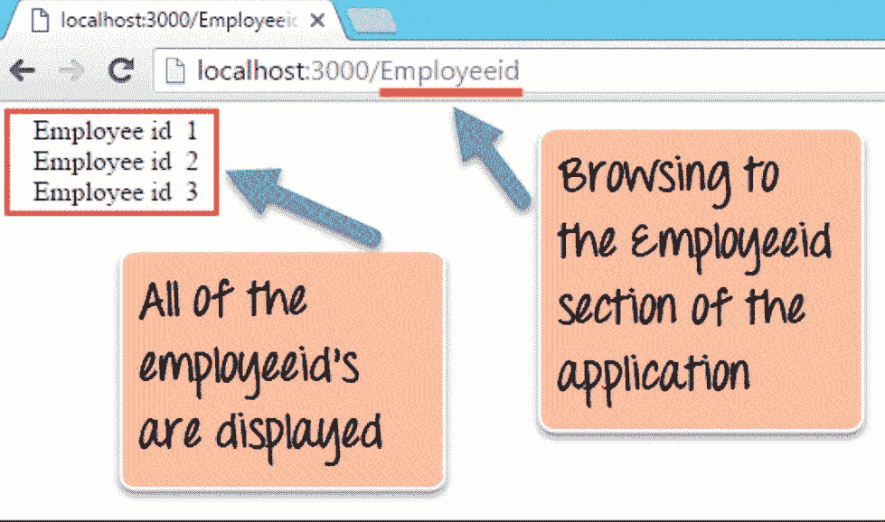

从输出可以看出，它清楚地显示 Employee 集合中所有的 employeeid 都被检索到了。这是因为我们使用 MongoDB 驱动连接到数据库并检索了所有的 Employee 记录，随后使用了 "express" 来显示这些记录。

以下是供你参考的代码：

```javascript
var express = require('express');
var app = express();
var MongoClient = require('mongodb').MongoClient;
var url = 'mongodb://localhost/EmployeeDB';
var str = "";

app.route('/Employeeid').get(function(req, res) {
  MongoClient.connect(url, function(err, db) {
    var cursor = db.collection('Employee').find();
    // noinspection JSDeprecatedSymbols
    cursor.each(function(err, item) {
      if (item != null) {
        str = str + " Employee id " + item.Employeeid + "";
      }
    });
    res.send(str);
    db.close();
  });
});

var server = app.listen(3000, function() {});
```

注意：根据你 MongoDB 驱动的版本，`each` 可能会被弃用。你可以规避这个问题。或者，你也可以使用 `forEach`。以下是使用 `forEach` 的示例代码。

```javascript
var express = require('express');
var app = express();
var MongoClient = require('mongodb').MongoClient;
var url = 'mongodb://localhost/EmployeeDB';
var str = "";

app.route('/Employeeid').get(function(req, res) {
  MongoClient.connect(url, function(err, db) {
    var collection = db.collection('Employee');
    var cursor = collection.find({});
    var str = "";
    cursor.forEach(function(item) {
      if (item == null) {
        str = str + " Employee id " + item.Employeeid + "";
      }
    }, function(err) {
      res.send(str);
      db.close();
    });
  });
});
var server = app.listen(8080, function() {});
```

## 总结

Node.js 的 `each` 常与 NoSQL 数据库结合使用，构建许多现代 Web 应用程序。常用的数据库包括 MySQL 和 MongoDB。

- 用于操作 MongoDB 数据库的常用模块之一是名为 'MongoDB' 的模块。该模块通过 Node 包管理器安装。
- 通过 MongoDB 模块，可以查询集合中的记录并执行标准的更新、删除和插入操作。
- 最后，现代实践之一是使用 express 框架配合 MongoDB 来交付现代应用程序。Express 框架可以利用 MongoDB 驱动返回的数据，并相应地在网页上向用户显示数据。

# 第 7 章：Promise（承诺）、Generator（生成器）、Event（事件）和 Filestream（文件流）

在之前的教程中，你已经见过用于异步事件的回调函数（callback functions）。但有时当回调函数开始嵌套时，它们可能会变成噩梦，程序也会变得冗长且复杂。

在这种情况下，Node.js 提供了额外的功能来解决在使用回调函数时遇到的问题。这些功能被分为 Promises、generators 和 events。在本次教程期间，我们将更详尽地学习和了解这些概念。

## 什么是 promises（承诺）

在我们开始学习 promises 之前，让我们先回顾一下 Node.js 中的“callback”（回调）函数是指什么。在之前的章节中，我们已经见过很多这类回调函数了，所以让我们快速回顾一下其中一个。

下面的示例显示了一个代码段，它用于连接到 MongoDB 数据库并对数据库中的其中一条记录执行更新操作。

```javascript
var MongoClient = require('mongodb').MongoClient;
var url = 'mongodb://localhost/EmployeeDB';

MongoClient.connect(url, function(err, db) {
  db.collection('Employee').updateOne(
    { "EmployeeName": "NewEmployee" },
    {
      $set: { "EmployeeName": "Mohan" }
    }
  );
});
```

1. 在上面的代码中，`function(err, db)` 部分被称为匿名函数或回调函数的声明。当 `MongoClient` 创建到与 MongoDB 数据库的连接时，一旦连接操作完成，它将返回回调。在某种意义上，连接操作是在后台执行的，当它完成后，它会调用我们的回调函数。记住，这是 Node.js 的关键点之一，它允许许多操作并发发生，从而不会阻塞用户执行操作。
2. 第二个代码块是在回调函数实际被调用时执行的内容。回调函数只是更新了我们 MongoDB 数据库中的一条记录。

那么什么是 promise 呢？嗯，promise 只是 Node.js 中回调函数的增强。

在开发过程中，我们可能需要嵌套回调函数。这会导致代码变得混乱且难以维护。简而言之，promise 是一种对回调函数的增强。

promise 的基本语法如下所示：

```javascript
var promise = doSomethingAsync()
promise.then(onFulfilled, Rejected)
```

- `doSomethingAsync` 是执行某些处理的回调函数。
- 这一次，在定义回调时，返回了一个名为 "promise" 的值。
- 当返回一个 promise 时，它可以有两个输出。这是由 `then` 子句定义的。操作成功由 `onFulfilled` 表示；它有错误由 `Rejected` 表示。

> **注意：** 所以 promise 的关键方面是返回值。在处理普通回调时，并没有返回值的概念。正因为有了返回值，我们对回调的定义有了更多的控制。

在下一个主题中，我们将看到 promises 的示例以及它们如何从回调中获益。

## Callbacks 到 promises

现在来看如何在 Node.js 应用程序内部使用 "promises" 的示例。为了在 Node.js 应用程序中使用 promises，必须首先下载并安装 'promise' 模块。

我们将按照下面所示修改代码，使用 promises 更新 'Employee' 集合中的一个员工。

### 第 1 步：安装 NPM 模块

在 Node JS 应用程序内部使用 Promises 需要 promise 模块。要安装 promise 模块，请运行下命令：

```bash
npm install promise
```

### 第 2 步：修改代码以包含 promises

```javascript
var Promise = require('promise');
var MongoClient = require('mongodb').MongoClient;
var url = 'mongodb://localhost/EmployeeDB';

MongoClient.connect(url)
  .then(function(err, db) {
    db.collection('Employee').updateOne({
      "EmployeeName": "Martin"
    }, {
      $set: {
        "EmployeeName": "Mohan"
      }
    })
  });
```

> **注意：**
> 如果你现在检查你的 MongoDB 数据库内容，你会发现如果存在 `EmployeeName` 为 "Martin" 的记录，它将被更新为 "Mohan"。
> 若要检查数据是否已正确插入数据库，你需要在 MongoDB 中执行以下命令：
> 1. `use EmployeeDB`
> 2. `db.Employee.find({EmployeeName : "Mohan"})`
> 第一条语句确保你已连接到 EmployeeDB 数据库。第二条语句搜索员工名为 "Mohan" 的记录。

## 处理承诺 (Promises)

在定义 promise 时，需要注意的是 `then` 方法本身会返回一个 promise。

因此，从某种意义上说，promise 可以相互嵌套或进行链式调用。

在下面的示例中，我们使用链式调用来定义 2 个回调函数，这两个回调函数都会向 MongoDB 数据库插入一条记录。

（注：链式调用是一个用于将方法的执行相互链接起来的概念。假设我们的应用程序有两个名为 `methodA` 和 `methodB` 的方法。逻辑是 `methodB` 应该在 `methodA` 之后调用，那么你就可以以这种方式链式执行，使得 `methodB` 在 `methodA` 之后直接调用。）

此示例中需要注意的是，通过使用嵌套 promise，代码变得更加简洁、易读且可维护。

```javascript
var Promise = require('promise');
var MongoClient = require('mongodb').MongoClient;
var url = 'mongodb://localhost/EmployeeDB';

MongoClient.connect(url)
  .then(function(db) {
    db.collection('Employee').insertOne({
      EmployeeId: 4,
      EmployeeName: "NewEmployee"
    })
    .then(function(db1) {
      db1.collection('Employee').insertOne({
        EmployeeId: 5,
        EmployeeName: "NewEmployee1"
      })
    })
  });
```

### 代码解释

1. 我们现在定义了 2 个顺序执行的 `then` 子句。在第一个 `then` 子句中，我们传递了包含数据库连接的 `db` 参数。然后，我们使用 `db` 连接的 `collection` 属性向 'Employee' 集合插入记录。使用 `insertOne` 方法将实际的文档插入到 Employee 集合中。
2. 接着，我们使用第二个 `then` 子句也向数据库插入了另一条记录。

如果你现在检查你的 MongoDB 数据库内容，你会发现第 2 条记录已插入到 MongoDB 数据库。

## 使用 BlueBird 库生成 promises

Bluebird 是一个功能丰富的 JavaScript Promise 库。Bluebird 最强大的特性是它允许你对其他 Node 模块进行“Promise 化”（promisify），以便以异步方式使用它们。Promisify 是一个应用于回调函数的概念。该概念用于确保每个调用的回调函数都返回某种值。

因此，如果 Node JS 模块包含一个不返回值的回调函数，如果我们对该模块进行 Promise 化，该特定模块中的所有函数都将自动被修改以确保它们返回值。

你可以使用 Bluebird 让 MongoDB 模块异步运行。这为编写 Node.js 应用增添了额外的便利。

我们将查看一个如何使用 bluebird 模块的示例。

我们的示例将首先连接到 "EmployeeDB" 数据库中的 "Employee collection"。如果建立了连接，它将获取集合中的所有记录并相应地在控制台中显示它们。

### 步骤 1：安装 NPM 模块

要在 Node 应用程序中使用 Bluebird，需要 Bluebird 模块。要安装 Bluebird 模块，请运行以下命令：

```bash
npm install bluebird
```

### 步骤 2：下一步是在你的代码中引入 bluebird 模块并对整个 MongoDB 数据库进行 Promise 化。通过 promisify，我们的意思是 bluebird 将确保 MongoDB 库中定义的每一个方法都返回一个 promise。

```javascript
var Promise = require('bluebird');
var mongo = Promise.promisifyAll(require('mongodb')).MongoClient;
var url = 'mongodb://localhost/EmployeeDB';
```

### 代码解释

1. `require` 命令用于引入 Bluebird 库。
2. 使用 Bluebird 的 `promisifyAll()` 方法创建 MongoDB 模块的异步版本。这确保了 MongoDB 模块的每个方法都在后台运行，并确保 MongoDB 库中的每个方法返回 promise。

### 步骤 3：最后一步是连接到数据库，获取集合中的所有记录并在控制台中显示它们

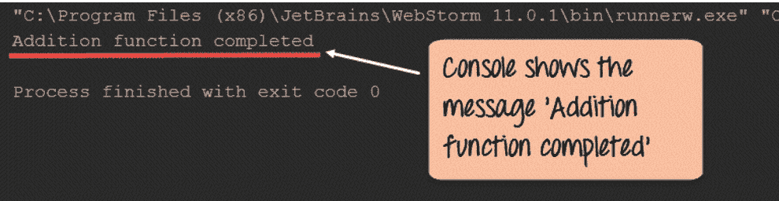

### 代码解释

1. 你会注意到我们使用的是 `connectAsync` 方法而不是普通的连接方法。Bluebird 实际上为 MongoDB 库添加了 `Async` 后缀来区分这些调用，并确保了没有 `Async` 的方法也能返回值。
2. 与 `connectAsync` 方法类似，我们现在使用 `findAsync` 方法返回 mongo 'Employee' 集合中的所有记录。
3. 最后，如果 `findAsync` 返回一个成功的 promise，我们定义了一个代码遍历集合中的每条记录并在控制台中显示它们。

如果上述步骤执行正确，所有文档都将显示在控制台中。


## 创建自定义 Promise

可以使用名为 `q` 的 Node 模块来创建自定义 Promise。需要使用包管理器下载并安装 `q` 库。在使用 `q` 库后，可以调用 `denodeify` 方法。

在下面的示例中，我们将创建一个名为 `Add` 的简单函数，用于将两个数字相加。我们将此函数转换为返回 Promise。

完成后，我们将使用 `Add` 函数返回的 Promise 在控制台中显示一条消息。

### 步骤 1) 安装 NPM 模块

要在 Node 应用程序中使用 `q`，需要 `q` 模块。要安装 `q` 模块，请运行以下命令：

```bash
npm install q
```

### 步骤 2) 创建自定义 Promise

```javascript
var q = require('q');

function Add(a, b) {
  return a + b;
}

var addPromise = q.denodeify(Add);

addPromise(10, 20).then(function(result) {
  console.log("Result: " + result);
});
```

## 什么是生成器

生成器在近期 Node.js 中变得非常有名，这可能是因为它们所能实现的功能。

- 生成器是可以在以后的某个时刻暂停并恢复执行的函数。
- 生成器在执行“惰性执行”等概念时非常有用。这基本上意味着，通过暂停执行并根据意愿恢复，我们能够在需要时才去提取值。

生成器具有以下 2 个关键方法：

1. **Yield 方法** – 在函数中调用该方法，用于在调用 `yield` 关键字的特定行停止函数的执行。
2. **Next 方法** – 该方法从主应用程序调用，以恢复带有 `yield` 关键字的函数的执行。函数的执行将继续进行，直到遇到下一个 `yield` 关键字或函数结束。

让我们来看一个如何使用生成器的示例。

在我们的示例中，我们将有一个简单的 `Add` 函数，它将对两个数字相加，但我们将不断在不同的点停止方法的执行，以展示如何使用生成器。

```javascript
function* Add(x) {
  yield x + 1;
  var y = yield(null);
  y = 6;
  return x + y;
}

var gen = Add(5);
gen.next();
gen.next();
```

### 代码解释

1. 第一步是定义我们的生成器函数。注意，这是通过在 `function` 关键字后添加一个 `*` 来完成的。然后我们定义了一个名为 `Add` 的函数，它接受一个参数 `x`。
2. `yield` 关键字是生成器特有的。这使其成为在任何操作中间暂停函数的强大结构。因此，在这里，函数的执行将暂停，直到我们调用 `next()` 函数（这将在第 4 步中完成）。此时，`x + 1` 的值（即 `6`）被产出，函数执行停止。
3. 这里是我们第一次调用生成器函数并将值 `5` 发送给 `Add` 函数的地方。该值将赋给 `Add` 函数的参数 `x`。
4. 一旦我们调用 `next()` 函数，`Add()` 函数将恢复执行。当执行下一个语句 `var y = yield(null)` 时，`Add()` 函数将再次停止执行。
5. 现在再次调用 `next()` 函数后，后续语句将运行，`x`（即 `5`）和 `y`（即 `6`）的组合值将被相加并返回（结果为 `11`）。

## 回调函数与生成器

生成器用于解决所谓的“回调地狱”问题。在开发 Node.js 应用程序期间，回调函数有时会嵌套得非常深，以至于使用回调函数变得太复杂。

这就是生成器有用之处。这种情况最常见的例子之一是创建定时器函数。

让我们看看生成器如何证明比回调函数更有用。

我们的示例将创建一个简单的时间延迟函数。然后我们希望调用此函数，并包含 1000、2000 和 3000 ms 的延迟。

### 步骤 1) 定义带有必要时间延迟代码的回调函数

```javascript
function Timedelay(ptime, callback) {
  setTimeout(function () {
    callback("Pausing for " + ptime);
  }, ptime);
}
```

### 代码解释

1. 在这里我们创建了一个名为 `Timedelay` 的函数，带有一个参数 `ptime`。它将获取我们想要在应用程序中引入的必要时间延迟。
2. 下一步只是创建一个消息，该消息将向用户显示应用程序将暂停多少毫秒。

### 步骤 2) 使用回调函数的嵌套调用

假设我们想根据 1000、2000 和 3000 毫秒的值串联回调函数，下面的代码显示了我们需要如何使用回调来实现这些（这会导致“回调地狱”）：

```javascript
Timedelay(1000, function() {
  console.log("Pausing for 1000");
  Timedelay(2000, function() {
    console.log("Pausing for 2000");
    Timedelay(3000, function() {
      console.log("Pausing for 3000");
    });
  });
});
```

*(注：原文此处代码片段不完整，此处补全为典型的回调嵌套示例以演示“回调地狱”)*

### 步骤 3) 使用生成器实现相同功能

使用生成器可以让代码看起来像同步代码一样扁平化：

```javascript
function* timerSequence() {
  yield Timedelay(1000, function(msg) { console.log(msg); gen.next(); });
  yield Timedelay(2000, function(msg) { console.log(msg); gen.next(); });
  yield Timedelay(3000, function(msg) { console.log(msg); gen.next(); });
}

var gen = timerSequence();
gen.next();
```


# Node.js 教程

## 介绍

## 事件

## 生成器

## 数据连接

## 使用 Jasmine

## Node.js 中的管道 (Pipes)

在 Node 应用程序中，可以使用 `pipe()` 方法将流连接在一起，该方法接受两个参数：

- 一个必需的可写流，作为数据的数据传输目标
- 一个可选的对象，用于传递选项。

使用管道的一个典型示例，如果你想将数据从一个文件传输到另一个文件。

让我们来看看如何使用管道将数据从一个文件传输到另一个文件的示例。

**步骤 1)** 创建一个名为 `datainput.txt` 的文件，内容如下。假设此文件存储在我们本地机器的 D 盘上。

```text
Node.js 教程
介绍
事件
生成器
数据连接
使用 Jasmine
```

**步骤 2)** 创建一个名为 `dataOutput.txt` 的空白文件，并将其放在本地机器的 D 盘上。

**步骤 3)** 编写以下代码来实现数据从 `datainput.txt` 文件到 `dataOutput.txt` 文件的传输。

```javascript
var fs = require("fs");

readStream = fs.createReadStream("D://datainput.txt");

var writeStream = fs.createWriteStream("D://dataoutput.txt");

readStream.pipe(writeStream);
```

## 代码解释

- 1. 我们首先为 `datainput.txt` 文件创建一个“readstream”，该文件包含了我们需要传输到新文件的所有数据。
- 2. 然后，我们需要为 `dataOutput.txt` 文件创建一个“writestream”，它是我们的空文件，是从 `datainput.txt` 文件传输数据的目标。
- 3. 接着我们使用 `pipe` 命令将数据从 `readstream` 传输到 `writestream`。`pipe` 命令会获取进入 `readstream` 的所有数据并将其推送到 `writestream`。

如果你现在打开 `dataOutput.txt` 文件，将看到 `datainput.txt` 文件中的所有数据。

## Node.js 中的事件

事件是 Node.js 的核心概念之一，Node.js 有时被称为事件驱动框架。

基本上事件是发生的事情。例如，如果建立了数据库的连接，就会触发数据库连接事件。事件驱动编程是创建某些函数，这些函数会在特定事件触发时被触发。

让我们来看在 Node.js 中定义事件的简单示例。

我们将创建一个名为 'data_received' 的事件。当此事件被触发时，控制台将发送文本 "data received"。

```javascript
var events = require('events');

var eventEmitter = new events.EventEmitter();

eventEmitter.on('data_received', function() {
  console.log('data received successfully.');
});

eventEmitter.emit('data_received');
```

## 代码解释

- 1. 使用 `require` 函数引入 'events' 模块。有了此模块，你将能够在 Node.js 中创建事件。
- 2. 创建一个新的事件发射器。这用于绑定事件，在我们的案例中事件是 "data_received"，绑定到步骤 3 中定义的回调函数。
- 3. 我们定义一个事件驱动函数，该函数表示如果触发了 "data_received" 事件，我们在控制台输出文本 "data_received"。
- 4. 最后，我们使用 `eventEmitter.emit` 函数手动触发我们的事件。这将触发 `data_received` 事件。

当程序运行时，文本 "data received" 将如所示发送到控制台：

```
"C:\Program Files (x86)\JetBrains\WebStorm 11.0.1\bin\runner.exe" 
data received successfully
Process finished with exit code 0
```

## 触发事件

在定义事件时，有不同的事件方法可以调用。本主题重点详细查看每一个方法。

### 1. 单次事件处理器

有时你可能只想在事件第一次发生时做出反应。在这些情况下，可以使用 `once()` 方法。

让我们看看如何为事件处理器使用 `once` 方法。

```javascript
var events = require('events');

var eventEmitter = new events.EventEmitter();

eventEmitter.once('data_received', function() {
  console.log('data received successfully.');
});

eventEmitter.emit('data_received');
```

### 2. 检查监听器

在生命周期任何时候，事件发射器都可以有零或多个监听器。如果你对监听器的数量感兴趣，查看 `listenerCount()`。

## newListener 事件

每当注册一个新的事件监听器时，事件发射器都会发射一个 `newListener` 事件。该事件用于检测新的事件监听器。当你需要为每个事件监听器分配资源或执行某些操作时，通常会使用 `newListener` 事件。

## 代码解释

- 1. 我们为 'newListener' 事件创建一个新的事件监听器。因此每当注册新的事件监听器时，控制台都会显示文本 "Added listener for " + 事件名称。
- 2. 这里我们为每个注册的事件向控制台写入 "Added listener for " + 事件名称。
- 3. 我们为我们的事件 'data_received' 定义了两个事件监听器。

如果上述代码执行正常，控制台将显示以下文本。这仅仅表明 'newListener' 事件监听器被触发了两次。

```text
Added listener for data_received events
Added listener for data_received events
```

管道（Pipes）可用于连接多个流。最常见的示例之一是将读流和写流连接起来，将数据从一个文件传输到另一个文件。

- Node.js 经常被标记为事件驱动框架，在 Node.js 中定义事件非常容易。可以定义响应这些事件的函数。
- 事件还暴露了用于响应关键事件的方法。例如，我们见过的 `once()` 事件处理器，它可以用于确保在事件触发时，回调函数只被执行一次。

# 第 8 章：使用 Jasmine 进行测试

测试是任何应用程序的要素要素。对于 Node.js，可用的测试框架被称为 Jasmine。在 2000 年初，曾有一个专门用于测试 JavaScript 应用程序的框架叫做 JsUnit。后来该框架经过了升级，现在被称为 jasmine。

Jasmine 有助于自动化单元测试，这在开发和部署现代 Web 应用程序时已经成为了一项非常关键的实践。

在本教程中，你将学习如何配置 jasmine 环境，以及如何使用 jasmine 开始测试你的第一个 Node.js 应用。

## 用于测试 Node.js 应用的 Jasmine 概述

Jasmine 是一个用于 JavaScript 的行为驱动开发 (BDD) 测试框架。它不依赖浏览器、DOM 或任何 JavaScript 框架。因此，它适用于网站、Node.js 项目或任何可以运行 JavaScript 的地方。要开始使用 Jasmine，你需要下载并安装必要的 Jasmine 模块。

接下来，你需要初始化环境并检查 jasmine 配置文件。以下步骤显示了如何在你的环境中设置 Jasmine。

**步骤 1)** 安装 NPM 模块

要在 Node 应用程序内部使用 jasmine 框架，需要先安装 jasmine 模块。要安装 `jasmine-node` 模块，请运行以下命令：

```
npm install jasmine-node
```

**步骤 2)** 初始化项目 – 通过此操作，jasmine 会为你创建一个 spec 目录和配置 json 文件。spec 目录用于存储你所有的测试文件。通过这种方式，jasmine 将知道你所有的测试在哪里，并据此执行它们。JSON 文件用于存储关于 jasmine 的特定配置信息。

要初始化 jasmine 环境，请运行以下命令：

```
jasmine init
```

**步骤 3)** 检查你的配置文件。配置文件将存储在 `spec/support` 文件夹中，名为 `jasmine.json`。该文件列出了你希望 Jasmine 运行器包含的源文件和规范（spec）文件。

下方的截图显示了 `package.json` 文件的典型示例。

```json
{
  "spec_dir": "spec",
  "spec_files": [
    "**/*[sS]pec.js"
  ],
  "helpers": [
    "helpers/**/*.js"
  ],
  "stopSpecOnExpectationFailure": false,
  "random": false
}
```

- 注意这里指定了 spec 目录。如前所述，当 jasmine 运行时，它会在该目录中搜索所有测试。
- 下一个需要注意的是 `spec_files` 参数 – 这表示无论创建什么测试文件都应该以 'spec' 关键字结尾。

## 如何使用 Jasmine 测试 Node.js 应用

为了使用 Jasmine 测试 Node.js 应用，需要遵循一系列步骤。

在下方的示例中，我们将定义一个用于两个两个数字的模块，该模块需要被测试。我们将定义一个包含测试代码的单独文件，然后使用相应的 相应测试 `Add` 函数。

**步骤 1)** 定义需要测试的代码。我们将定义一个相加两个数字并返回结果的函数。此代码写在一个名为 "Add.js" 的文件中。

```javascript
var exports = module.exports = {
  exports.AddNumber = function(a, b) {
    return a + b;
  }
}
```


### 代码解释

1. 使用 `exports` 关键字是为了确保此文件中定义的功能可以被其他文件实际访问。
2. 随后我们定义了一个名为 `AddNumber` 的函数。该函数被定义为接收两个参数 `a` 和 `b`。该函数添加到模块 `exports` 中，使其成为一个公共函数，可以被其他应用程序模块访问。
3. 最后，我们让我们的返回函数返回参数的累加值。

**步骤 2)** 接下来，我们需要定义 jasmine 测试代码，将用于测试 `Add.js` 文件中的 `AddNumber` 函数。以下代码需要存放在名为 `add-spec.js` 的文件中。

**注意：** 测试文件中需要添加 `spec` 单词，以便其被 jasmine 检测到。

```javascript
var app = require("../Add.js");

describe("Addition", function() {

  it("The function should add 2 numbers", function() {

    var value = app.AddNumber(5, 6);

    expect(value).toBe(11);

  });

});
```

### 代码解释

1. 我们需要首先包含我们的 `Add.js` 文件，以便测试该文件中的 `AddNumber` 函数。
2. 我们现在正在创建测试模块。测试模块的第一部分是描述一个方法，它基本上是我们的测试提供一个名称。在 particular 情况下，名称是 "Addition"。
3. 我们使用 `it` 块来定义具体的测试用例。
4. 我们使用 `expect` 来断言函数返回的实际值与预期的值 11 是否匹配。


1天学会 ASP.Net：初学者 ASP.Net 终极指南


1天学会 SQLite：初学者 SQLite 终极指南


1天学会 Linux：带示例的 Linux 完整指南


