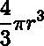
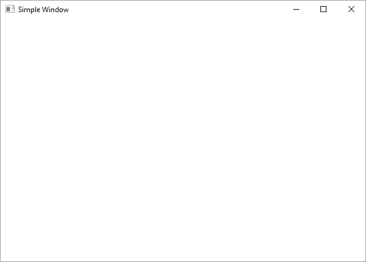
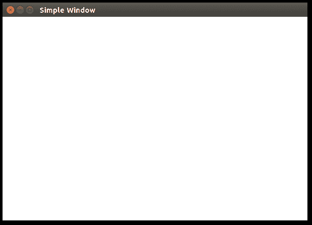
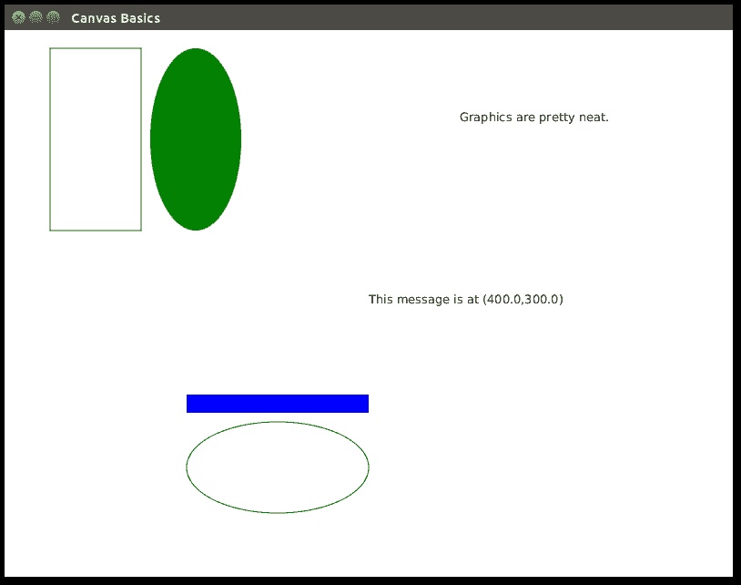
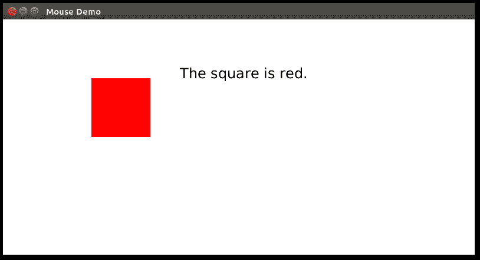
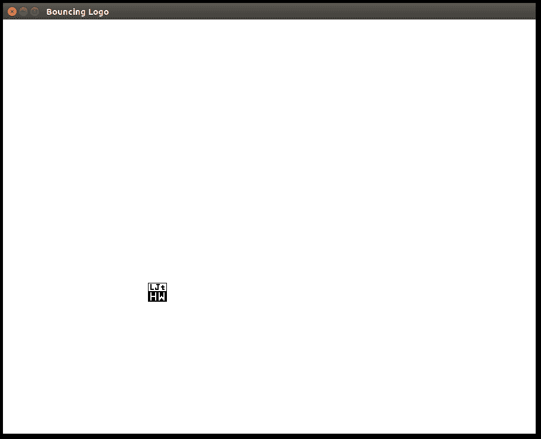
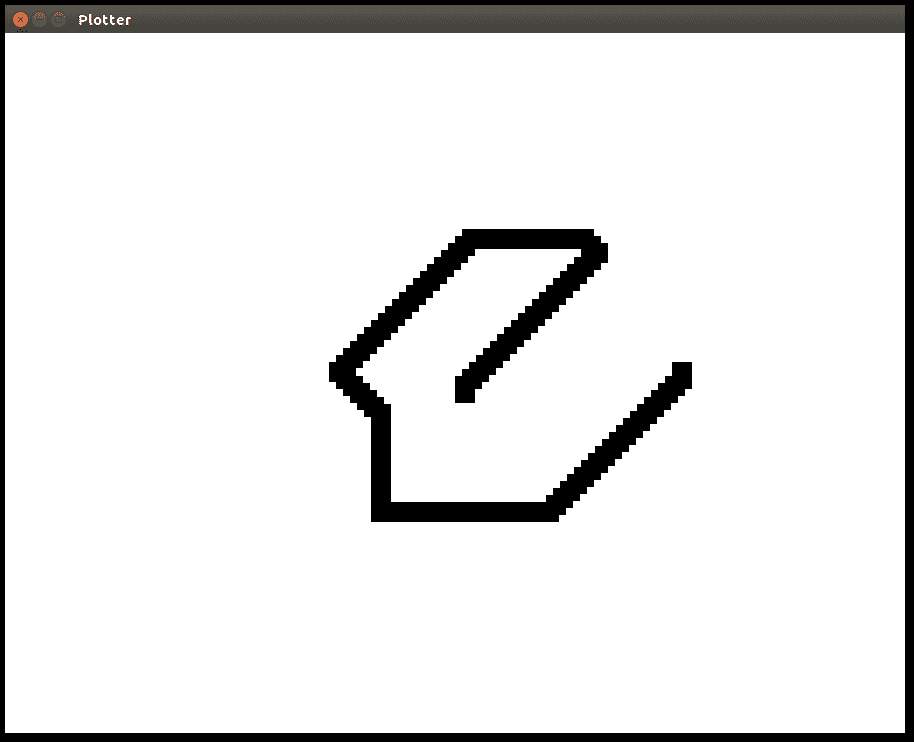

# 硬核学习 Java 面向对象编程

## 致谢

感谢上帝，他赐予我创造的能力。

感谢 Deanna，在我都不确定是否能完成时，她相信我能做到。

感谢数百位购买我第一本书的人；没有你们，这第二本书将不存在！

感谢耶稣，他每天教我恩典与谦卑。愿我每一天都更加依靠他。

## 前言：在做中学习

二十多年来，我一直在教初学者如何编程。超过 2000 名学生上过我的课程，离开时已经学会了如何编写运行良好的简单程序。有些人只学会了一点点，而另一些人在短短几年内获得了惊人的技能。

我有许多出色的学生，但我的大多数学生都是没有经验、对编程没有特殊天赋的普通孩子。这本书是像他们这样的普通人写的。

大多数编程书籍和在线教程是由那些具有极高天赋但对真实初学者缺乏经验的人编写的。他们的书往往涵盖了太多内容且速度过快，并且高估了真正初学者的理解能力。

如果你有丰富的经验或极高的天赋，你可以从几乎任何来源学习编程。我有时会看到这样的评论：“我教我 9 岁的女儿编程，她在六周后就做出了她的第一个 Android 应用！”如果你是天才儿童，那么这本书不是为你写的。

我也开始相信，编写大量的小程序是不可替代的。所以这就是你在这本书中要做的。你将输入小型程序并运行它们。

“最好的学习方式就是实践。” – P.R. Halmos

## 引言：面向对象的 Java

Java 是一种面向对象的编程语言。我的第一本书涵盖了 Java 语言的所有基础语法，但避开了所有面向对象的部分。这本书涵盖了其余部分。

如果你以前从未用任何语言编写过程序，那么这本书可能不适合你。在读完这本书之前，你需要对类似的语言具有一定的经验。如果你已经了解 Java 或其他语言（如 C、C++、C# 或 Javascript）的基础知识，那么你就没问题。如果你只熟悉 Python 或 Ruby 这样完全不同的语言，那么你需要追赶一下。

如果你在尝试跟随练习 1 中的代码时迷路了，那么你应该回去先读一本更简单的书，然后再尝试这一本。

## 你将学到

* 如何安装 Java 编译器和文本编辑器
* 如何与 Java 对象一起工作并创建你自己的类
* 字段和实例变量
* 方法和参数
* 构造函数
* 引用变量 vs 基本类型
* 泛型和强制转换
* 继承
* 接口
* 抽象类和方法
* 包
* 如何创建 JAR 文件
* JavaFX 中的图形用户界面
* GUI 中的鼠标和键盘输入
* 测试与效率
* 算法复杂度和大 O 符号
* ArrayList
* 排序

以及更多！

在最后一章中，你将编写一个流行的跳棋游戏的图形版本，并能够将其打包发送给他人。

书中的所有示例都可以在 Java 1.8 或更高版本中运行。如果你省略最后几个关于 JavaFX 的章节，大部分代码可以在 Java 1.6 或更高版本中运行。

## 你将不会学到

* 如何在终端中编译和运行 Java 程序
* Java 的基础知识
* 如何制作 Android 应用
* 不同“版本”的 Java 细节
* Javascript

## 创建、编译与运行

如果你以前写过一些 Java 但一直使用 IDE，那么你应该学习如何在简单的文本编辑器中编写代码，以及如何从终端编译你的代码。我的第一本书中有一专门关于此主题的[整个章节](https://learnjavathehardway.org/book/ex01.html)，可以免费在线阅读，如果你需要，请先完成该部分。

## 无基础

如果你还不知道如何在 Java 中创建变量以及编写 if 语句、循环和函数，那么你应该在尝试阅读这本书之前先学习这些内容。

## 无 Android

Android 应用非常复杂，如果你是初学者，一个应用远超你的能力范围。

## 无特定版本

除了最后几章，我将不会涵盖任何最近添加到 Java 中的新特性。如果你在意这些差异，那么这本书不适合你。

## 无 Javascript

“Javascript”是一门编程语言的名字，而“Java”也是一种编程语言的名字。这两种语言之间毫无关系。

## 许可证

本书的某些章节可免费在线阅读，但未经许可不得为他人制作。

提供的下载材料未经复制、扫描、复制或发布到公共网站，无论是全部还是部分。

购买了本书和或教程视频的教育工作者被许可将其用于自学或对单一学生进行面对面的辅导。教学此课程需要站点授权。

除非另有说明，所有内容版权 2015-2016 Graham Mitchell。

## 练习 0：设置

这个练习没有代码但**不要跳过**。它将帮助你安装一个良好的文本编辑器并安装 Java 开发工具包 (JDK)。如果你没有完成这两项任务，你无法完成书中任何其他练习。你应该尽可能准确遵循这些指令。

无论你使用什么类型的系统，你都要做三件事：

1. 安装一个用于编写代码良好的文本编辑器。
2. 弄清楚如何打开终端窗口以便输入命令。
3. 安装 JDK。

而且在 Windows 上，你还需要做第四件事：

4. 将 JDK 添加到系统 PATH。

（JDK 命令在 Apple 电脑和 Linux 计算机会自动添加到 PATH。）

我在下方提供了针对 Windows 的说明，然后是 Mac OS，最后是 Linux。请直接跳转到你偏好的操作系统部分。

## Windows

### 安装一个好用的文本编辑器 (Notepad++)

1. 使用网络浏览器访问 [notepad-plus-plus.org](http://notepad-plus-plus.org/)，下载最新版本的 `Notepad++` 文本编辑器并安装。执行此操作不需要管理员权限。

2. 一旦安装了 `Notepad++`，我总是会运行它并关闭“自动完成（Auto-Completion）”，因为它对初学者没有好处。（对我个人来说也很烦人）。打开“设置（Settings）”菜单并选择“首选项（Preferences）”。然后点击左侧列表中间部分的“自动完成（Auto-Completion）”。最后取消勾选“每次输入时启用自动完成（Enable auto-completion on each input）”旁边的复选框，然后点击“关闭（Close）”按钮。

3. 最后在 `Notepad++` 运行时，右键点击 Windows 任务栏上的 `Notepad++` 按钮，点击“将此程序固定到任务栏（Pin this program to taskbar）”。这将方便以后在编程时启动 `Notepad++`。

### 打开终端窗口 (PowerShell)

1. 点击开始按钮打开开始菜单。（在 Windows 8 及更高版本中，你可以通过按 Windows 键 + `S` 直接打开搜索框）。在搜索框中输入“powershell”。

2. 从结果列表中选择“Windows PowerShell”。

3. 右键点击任务栏上的 `PowerShell` 按钮并选择“将此程序固定到任务栏”。

4. 在 `Powershell/Terminal` 窗口中，输入

```
javac
```

你可能会看到一行红色的错误信息，内容类似于“The term ‘javac’ is not recognized as the name of a cmdlet....”

这意味着 JDK 没有安装并添加到 `PATH` 中，这正是我们目前预期的结果。

## 安装 Java 开发工具包 (JDK)

1. 使用网络浏览器访问 [Oracle Java SE 下载页面](http://www.oracle.com/technetwork/java/javase/downloads/index.html)。

2. 点击左侧顶部附近巨大的“Java”按钮来下载 Java 平台 (`JDK`) `8u102`。点击此将带你进入标题为“Java SE Development Kit 8 Downloads”的页面。

3. 在此页面上，你需要接受许可协议，然后选择列表底部附近的“Windows x86”版本。下载 `8u102` 版本或任何更高版本的文件。

   如果你确定运行的是 64 位的 Windows，那么下载 `JDK` 的“Windows x64”版本也是可以的。如果你不确定，应该下载“x86”（即 32 位）版本，因为该版本可以同时运行在 32 位和 64 位的 Windows 上。

   你*不需要*下载“Demos and Samples（演示与示例）”。

4. 下载完成后，运行 `jdk-8u102-windows-i586.exe` 进行安装。在你第一次点击“Next >”后，你会看到一个显示 `Install to: C:\Program Files (x86)\Java\jdk1.8.0_102\` 或类似内容的屏幕。请记下这个位置；你很快就会需要它。

5. 只需一直点击“Next（下一步）”直到全部完成。除非你*真的*知道自己在做什么，否则最好的办法可能就是让安装程序按它的意图运行。

## 将 JDK 添加到 PATH

1. 现在既然已经安装了 `JDK`，你需要找到安装所在文件夹的*确切*名称。查看 `C:` 盘下的 `Program Files` 文件夹，如果有的话查看 `C:\Program Files (x86)` 文件夹。你正在寻找一个名为 `Java` 的文件夹。里面有一个名为 `jdk1.8.0_102` 的文件夹，它里面还有一个名为 `bin` 的文件夹。文件夹名称*必须*包含 `jdk1.8`；`jre8` 是不一样的。确保有一个 `bin` 文件夹。

2. 当你进入 `bin` 文件夹后，可以左键点击上方文件夹的位置栏，它会变成类似 `C:\Program Files (x86)\Java\jdk1.8.0_102\bin` 的内容。你可以把它记下来，或者选中并右键复制到剪贴板。

3. 一旦 `JDK` 安装完成且你知道了该位置，打开你的终端窗口（PowerShell）。在 `PowerShell` 中，输入以下内容：

```
<<(code/set-environ-var-8u102.txt)
```

不过请将其写在同一行。即：

输入或粘贴 `[Environment]::SetEnvironmentVariable("Path", "$env:Path;`

先不要按回车。你可以通过右键粘贴到 `PowerShell`。

然后输入或粘贴上面的文件夹位置。如果你安装的是 x86 (32 位) 版本 `JDK` `8u102`，它应该是：

`C:\Program Files (x86)\Java\jdk1.8.0_102\bin`

（仍然不要按回车。）

然后在末尾添加 `", "User")`。最后，按 `ENTER`。

如果你遇到错误，说明你输入的内容不对。你可以按向上方向键找回命令，并使用左右方向键查找并修复错误，然后再次按 `ENTER`。

如果 `SetEnvironmentVariable` 命令完成且没有报错，输入 `exit` 关闭 PowerShell 窗口。**如果不关闭 PowerShell 窗口，你做的更改将不会生效。**

## 确保 JDK 安装正确

1. 再次启动 `PowerShell`。

2. 在提示符后输入 `javac -version`。

你应该能看到类似 `javac 1.8.0_102` 的响应。

3. 在提示符后输入 `java -version`。

你应该能看到类似 `java version "1.8.0_102"` 的响应。

确保它们报告的版本号相同！如果没有，你可能安装了两个不同的（不兼容的）Java 版本，这将导致你无法完成书中的练习。

如果版本号不匹配，进入控制面板并添加/程序。移除所有与 Java 相关的程序、`JDK`、`JRE`。如果安装了 Eclipse 也将其移除。移除*所有* Java 相关内容并重新开始。

*但是*，如果两个命令都正常工作、没有报错且版本号一致，那么恭喜你！

### 在命令行 (PowerShell) 中导航

你应该创建一个新文件夹来存放你的代码。完成这本书后，你将会有至少 100 个新文件。

> 如果你想操作得高级一点，就不需要使用鼠标切换回终端；你只需要在 Windows 或 Linux 上按下 `Alt + Tab`，或者在 Mac 上按下 `Command + Tab` 即可切换应用程序。
>
> 按住 `Alt` 键不要松开。然后按下并释放一次 `Tab` 键。在继续按住 `Alt` 键的同时，多次按下 `Tab` 直到选中你的终端窗口，然后松开 `Alt` 键完成切换。
>
> 如果你只是快速按下 `Alt+Tab` 并立即松开两个键，它通常会带你回到上一个应用程序。我*经常*这样做。当我在文本编辑器中时，按下 `Alt+Tab` 返回终端，当我在终端完成工作后，我再次按下 `Alt+Tab` 回到文本编辑器。一旦习惯了，这非常快。

你应该直接跳到本章的底部阅读“给初学者的警告”，否则，你已经完成了设置，并准备好在 Windows 上开始练习 01 了！干得好。

## Mac OS X

### 安装一个好用的文本编辑器 (TextWrangler)

1. 使用浏览器访问 [barebones.com](http://www.barebones.com/products/textwrangler/)。下载 TextWrangler 版本 `5.0` 或更高版本的磁盘映像。

2. 运行磁盘映像，然后打开“应用程序”（Applications）文件夹，并按照指示将图标拖到其中。你可能需要管理员用户名和密码进行验证。

3. 安装完成后，启动 TextWrangler，如果它没有自动出现在 Dock 栏中，请手动将它添加。

### 打开终端窗口 (Terminal)

1. 最小化 TextWrangler 并切换到 Finder。使用搜索（Spotlight）开始搜索“terminal”。这会打开一个小的 bash 终端。

2. 同样将你的 `Terminal` 放入 Dock 栏中。

3. 在 `Terminal` 窗口中，输入


```bash
javac
```

你可能会收到一个错误提示，告诉`javac`是一个未知命令。（欢迎通过邮件给我发送错误信息的截图，我可以更新这一段内容。）

这仅仅意味着尚未安装 JDK，这正是我们预期的结果。

## 安装 Java 开发工具包 (JDK)

1. 使用浏览器访问 [Oracle 的 Java SE 下载页面](http://www.oracle.com/technetwork/java/javase/downloads/index.html)。

2. 点击页面左侧上方巨大的“Java”按钮来下载 Java Platform (JDK) `8u102`。点击这将带你进入标题为“Java SE Development Kit 8 Downloads”的另一个页面。

3. 在该页面，你必须接受许可协议，然后选择列表中间的“Mac OS X x64”版本。下载版本`8u102`或更高版本的文件。

   你*不需要*下载“Demos and Samples”（演示与示例）。

4. 下载完成后，运行`jdk-8u102-macosx-x64.dmg`进行安装。

5. 一直点击“Next”（下一步）直到完成。除非你*真的*知道自己在做什么，否则最好就让安装程序按照它的意愿运行。

## 将 JDK 添加到 PATH

你可以跳过这部分，因为 JDK 安装程序在 Apple 电脑上会*为你*完成这一操作。不过，为了让更改生效，你可能需要关闭并重新打开终端。

## 确保 JDK 安装正确

1. 再次启动`Terminal`。

2. 在提示符处输入`javac -version`。

你应该看到类似`javac 1.8.0_102`的响应。

1. 在提示符处输入`java -version`。

你应该看到类似`java version "1.8.0_102"`的响应。

确保它们报告的是相同的版本号！如果不是，你可能安装了两个不同的（不兼容的）Java 版本，在完成本书书中的练习时会遇到困难。

如果版本号不匹配，请卸载与 Java、JDK、JRE 相关的所有程序。如果安装了 Eclipse，也将其删除。删除*所有* Java 相关内容并重新开始。

*但是*，如果两个命令都正常运行且没有任何错误，并且版本号匹配，那么恭喜你！搞定这一切是非常困难的，你可能已经具备了完成书中剩余内容的资质！

不过，先不要进入下一个练习！我们应该习惯使用命令行进行导航，因为这正是你运行在本书中编写的程序的方式。

#### 命令行导航 (Terminal)

你应该创建一个新文件夹来存放所有的代码。读完这本书后，你将会有至少 100 个新文件，把它们放在一个地方会更好。

输入`ls`然后按回车。（那个“L”是“list”的第一个字母。）此命令将*列出*当前文件夹/目录的内容。

`cd`命令意味着“切换目录”，它将带你*进入*“Documents”（文档）文件夹，以便未来的命令在该处生效。

注意，你的提示符会改变，显示你现在位于一个新文件夹内部。例如，当我第一次打开`Terminal`时，我的提示符是

`localhost:~ mitchell$`

然后当我进入“Documents”目录后，提示符会变为

`localhost:Documents mitchell$`

2. 在“视图”（View）选项卡中，勾选“显示行号”（Display line numbers）。

3. 确保“启用自动换行”（Enable text wrapping）旁边没有勾选。

4. 切换到“编辑器”（Editor）选项卡，并将`Tab width:`更改为 4。

5. 勾选“启用自动缩进”（Enable automatic indentation）。

## 打开终端窗口 (Terminal)

1. 最小化你的文本编辑器，在启动器 Dash 栏中搜索“Terminal”。其他 Linux 发行版可能将其称为“GNOME Terminal”、“Konsole”或“xterm”。其中任何一个都应该可以使用。

2. 同样将终端锁定到启动器栏上。

3. 在终端窗口中，输入

```bash
javac
```

你应该会收到一条错误信息，显示“The program `javac` can be found in the following packages”，后面跟着一个软件包列表。

这仅意味着没有安装 JDK，这正是我们预期的。

## 安装 Java 开发工具包 (JDK)

1. Linux 的优点之一是包管理器。如果你愿意，可以手动安装 Oracle 的“标准”版本 Java，但我总是直接使用 OpenJDK 版本：

```bash
sudo apt-get openjdk
```

基本上就这样了。书中的所有内容使用 OpenJDK 都能正常运行。（事实上，我每天大部分工作都使用 Linux，而书中的练习实际上是使用 OpenJDK 编写和测试的！）

然而，如果你坚持要像 Windows 和 Mac 用户那样安装某些特定版本，你可以从 [Oracle 的 Java SE 下载页面](http://www.oracle.com/technetwork/java/javase/downloads/index.html) 下载。

不过，安装过程需要你自行负责。说真的，请直接使用你包管理器提供的版本即可。

## 将 JDK 添加到 PATH

你可以跳过这部分，因为在 Linux 计算机上这已经为你完成了。不过，为了让更改生效，你可能需要关闭并重新打开终端。

然而，在我的电脑上，运行任何 Java 工具都会在终端窗口打印出一条烦人的信息：

> `Picked up JAVA_TOOL_OPTIONS: -javaagent:/usr/share/java/jayatanaag.jar`

这是因为 Eclipse 在没有这个 JAR 文件的情况下无法正常工作。但我们不会使用 Eclipse，而且这条信息很困扰我，所以你需要在名为`.profile`的隐藏文件末尾添加一行。（文件名以点/句号开头，所以它是隐藏的。）

1. 启动你的文本编辑器。点击“打开”（Open）。

2. 确保你处于“主目录”（Home）下。

3. 在“打开”窗口的任何地方点击右键，勾选“显示隐藏文件”（Show Hidden Files）。

4. 打开名为`.profile`的文件。

5. 在文件底部添加以下行：

```
unset JAVA_TOOL_OPTIONS
```

保存文件并关闭。你可能想再次点击“打开”并取消“显示隐藏文件”的勾选。

## 确保 JDK 安装正确

1. 再次启动终端。

2. 在提示符处输入`javac -version`。

你应该看到类似`javac 1.8.0_91`的响应。

1. 在提示符处输入`java -version`。

你应该能看到类似`openjdk version "1.8.0_91"`的响应。

确保它们报告的是相同的版本号！如果不是，你可能安装了两个不同的（不兼容的）Java 版本，这将导致你在完成书中练习时遇到困难。

如果版本号不匹配，请卸载所有与 Java、JDK、JRE 相关的程序。如果安装了 Eclipse，也将其删除。删除所有与 Java 相关的内容并重新开始。

然而，如果两个命令都成功运行且没有任何错误，版本号也匹配，那么恭喜你！让这一切运行起来相当困难，你可能已经具备完成书中剩余内容的要素！

不过先不要进入下一个练习！我们应该习惯使用命令行进行导航，因为这将是你运行在书中编写的程序的方式。

## 命令行 (终端) 导航

你应该创建一个新文件夹来存放所有的代码。读完这本书后，你将会有至少 100 个新文件，如果它们都在同一个地方会更好。

输入`ls`然后按回车键。（那是“list”的字母“L”）。此命令将列出当前文件夹/目录的内容。

`cd`命令意味着“更改目录”，它将带你进入“Documents”（文档）文件夹，以便未来的命令在该处生效。

注意，你的提示符会变化，显示你现在位于新文件夹内部。例如，当我第一次打开终端时，我的提示符是

`mitchell@localhost:~$`

一旦我进入“Documents”目录，提示符就会变为

`mitchell@localhost:~/Documents$`

进入后，你应该再次输入`ls`来查看你的 Documents 目录内容。现在我们准备好创建文件夹了。

`mkdir`意味着“创建目录”，它将在当前位置创建一个新文件夹。此后输入`ls`应该会看到新目录已经在那里了。你可以根据喜给文件夹起一个除“javahard2”以外的名字。每台电脑只需要创建一次这个文件夹。

进入`javahard2`文件夹。之后，输入`ls`。

```bash
cd javahard2
ls
```

其他的只会只会让你困惑，所以请坚持计划。

## 练习 1：操作对象

无法避免的是，Java 是一种面向对象的语言。在原版的《Java 径之路》（Learn Java the Hard Way）中，我尝试尽可能避免 Java 中面向对象的部分，但某些部分还是溜了！

在本章中，我们将观察 Java 在创建和操作对象时使用的一些常用模式，我还会简要回顾如何从命令提示符或终端窗口编译并执行 Java 程序。

将以下代码输入到名为`WorkingWithObjects.java`的单个文件中，并将其放入你可以从终端窗口访问的文件夹中。

如果其中某些内容让你感到陌生，不要担心。我们只是在观察模式，细节在这个作业中并不那么重要。特别是，你可能从未用过`ArrayList`或`Random`，这完全没关系。

如果你觉得这段代码*极其*难以理解，那么你可能遇到了问题。也许你不知道什么是`if`语句，或者`System.out.println`，或者你从未用过`for`循环。在这种情况下，这本书对你来说可能太难了。你应该回去先读一本更简单的书，等当你对 Java 基础非常熟悉后再回到这里。

无论如何，输入下面的代码，然后我会提醒你如何从终端编译它。记住，对于这些练习你不应该使用任何 IDE。还要记住不要输入每行前面的行号；那些数字是为了方便以后讨论代码。

```
import java.io.File;
import java.util.ArrayList;
import java.util.Random;
import java.util.Scanner;

public class WorkingWithObjects {
    public static void main( String[] args ) throws Exception {
        File f = new File("datafiles/phonetic-alphabet.txt");

        if ( f.exists() == false ) {
            System.out.println( f.getName() + " not found in this folder. :(");
            System.exit(1);
        }

        ArrayList<String> words = new ArrayList<String>();
        Scanner alpha = new Scanner(f);

        System.out.print("Reading words from \"" + f.getPath() + "\"... ");
        while ( alpha.hasNext() ) {
            String w = alpha.next();
            words.add(w);
        }
        alpha.close();
        System.out.print("done.\n\t");

        Random rng = new Random();
        rng.setSeed(12345);
        // rng.setSeed(23213);

        for ( int n=0; n<3; n++ ) {
            int i = rng.nextInt( words.size() );
            String s = words.get(i);
            System.out.print( s.toLowerCase() + " " );
        }
        System.out.println();
    }
}
```

`WorkingWithObjects.java`

一旦你输入了代码，我假设你已经将`WorkingWithObjects.java`文件保存到了名为`javahard2`的文件夹中。如果你将其保存到了不同的文件夹，请替换下面的名称。

打开终端窗口并进入到`javahard2`文件夹：

（如果你在使用没有 PowerShell 的非常老旧的 Windows 版本，那么你必须输入`dir`。不过其他人都可以输入`ls`。）

希望你会看到一个包含内容的输出列表：

这意味着你处于正确的路径。然后，你将使用 Java 编译器（称为`javac`）来编译该文件：

如果此命令给出关于`javac`本身的错误，那么你跳过了练习 0！回去确保 JDK 已安装并在`PATH`路径中，然后回来！

假设你注意细节并按照我告诉你的那样操作，此命令将运行几秒钟，然后终端将再次显示提示符，而不显示其他任何内容。

然而，如果你犯了错误，你将看到一些错误。如果你有任何错误消息，修复它们，然后`save`你的代码，回到终端再次编译。

最终你应该能够成功，它将会在没有任何错误也没有任何消息的情况下完成编译。执行目录列表操作，你应该看到字节码文件出现在代码旁边的文件夹中：

现在我们已经成功创建了字节码文件，可以通过运行名为`java`的 Java 虚拟机（JVM）程序来运行（或“执行”）它：

### 你应该看到的内容

好了，既然*那个*已经运行了，让我们谈谈在这个练习中看到的一些模式。

第 1 行导入了一个“库”。`java.io.File`包含了名为`File`的对象/类的定义。一旦导入了它，我们就可以在代码中创建`File`对象并调用这些对象内部定义的方法。

接三行导入了另外三个库，每个库都定义了一个对象。某些编程语言将这些导入的内容称为“模块”而不是库。

在上一章中，我们从 Java 的“标准库”中导入了一些对象：这些由语言创建者预构建的类和方法的集合。

在本章中，我们将创建自己的对象，每个对象将包含一个方法。

请输入以下代码并使其通过编译。将其保存在你的`javahard2`文件夹中，命名为`OldMacDonald.java`。

```
 1 class Cow {
 2     public void moo() {
 3         System.out.println("Cow says moo.");
 4     }
 5 }
 6 
 7 class Pig {
 8     public void oink() {
 9         System.out.println("Pig says oink.");
10     }
11 }
12 
13 class Duck {
14     public void quack() {
15         System.out.println("Duck says quack.");
16     }
17 }
18 
19 public class OldMacDonald {
20     public static void main( String[] args ) {
21 
22         Cow maudine = new Cow();
23         Cow pauline = new Cow();
24         maudine.moo();
25         pauline.moo();
26 
27         Pig snowball = new Pig();
28         snowball.oink();
29         snowball.oink();
30 
31         Duck ferdinand = new Duck();
32         ferdinand.quack();
33     }
34 }
```

`OldMacDonald.java`

### 你应该看到什么

第 1-5 行定义了一个名为`Cow`的对象。`Cow`类的定义包含了名为`moo()`的方法定义。注意第 2 行写的是`public void moo()`，而不是`public static void moo()`。除了`main()`之外，你将不再频繁使用`static`关键字了。

第 7 到第 11 行定义了一个名为`Pig`的类，包含一个`oink()`方法。第 13 到 17 行定义了一个名为`Duck`的类，它包含一个`quack()`方法。

第 19 到 34 行定义了与 Java 文件名匹配的类。注意在该文件中，`OldMacDonald`类前面带有`public`关键字，但其他任何类都没有。在 Java 中，每个文件只能有一个公共类，且该公有类的名称必须与文件名匹配。

该类包含`main()`方法，这是 Java 虚拟机执行文件时开始运行的地方。`OldMacDonald`类列在文件中其他类之后，但如果类的顺序不同，运行效果也是那样的。

当我们运行这个程序时，执行从`main()`方法的第一行开始。文件中的任何其他代码只有在从`main()`内部调用时才会执行。

第 22 和 23 行实例化两个`Cow`对象。分别调用`moo()`方法。这会导致执行跳转到第 3 行，运行方法内部的`println()`语句，然后返回下方。

在第 27 行，我们创建了一个`Pig`对象的实例，然后调用了两次它的`oink()`方法。在第 31 行，我们实例化了一个`Duck`对象并在下一行调用了它的唯一方法。


然后在第 33 行，我们遇到了 `main()` 方法的右大括号，这通常意味着程序的结束。

你看到了吗？定义你自己的对象并不难，一旦你实例化了一个对象，调用它们的方法也非常简单。

## 练习 3：在单独文件中定义对象

在上一个练习中，我们定义了三个对象（如果算上包含 `main()` 的那个就是四个），但它们都实现在同一个文件中。这通常不是标准做法。通常 Java 将每个类的实现放在它自己的文件中，然后会有另一个文件只持有 `main()` 方法，用于实例化对象并让它们运行。这个类通常被称为“驱动”（driver）类，因此通常我会在文件名中加入“Driver”一词。

输入以下代码，并将每个类放在单独的文件中，命名所示。将它们全部保存在同一个文件夹中。

```
1 public class OldMacCow {
2     public void moo() {
3         System.out.println("Cow still says moo.");
4     }
5 }
```

`OldMacCow.java`

在你输入并保存 `OldMacCow.java` 之后，你应该尝试编译它，以确保在继续之前没有犯任何错误。

```
1 public class OldMacDuck {
2     public void quack() {
3         System.out.println("Duck still says quack.");
4     }
5 }
```

`OldMacDuck.java`

你是否不小心尝试运行了这个文件或第一个文件？它们一个都不包含 `main()` 方法，因此单独运行它们是行不起的。

```
 1 public class OldMacDriver {
 2     public static void main( String[] args ) {
 3         OldMacCow maudine = new OldMacCow();
 4         OldMacCow pauline = new OldMacCow();
 5         maudine.moo();
 6         pauline.moo();
 7 
 8         OldMacDuck ferdinand = new OldMacDuck();
 9         ferdinand.quack();
10     }
11 }
```

`OldMacDriver.java`

到目前为止，我们只查看了对象内部的方法。但大多数对象内部也包含变量，这些变量被称为“字段”（有时称为“实例变量”）。

此程序将演示如何访问对象中的字段。

输入此代码并将其保存为独立文件，文件名按指示所示。

```
1 public class TVActor {
2     String name;
3     String role;
4 }
```

`TVActor.java`

然后输入这段代码并将其保存到与第一个文件相同的文件夹中。

```
 1 public class TVActorDriver {
 2     public static void main( String[] args ) {
 3         TVActor a = new TVActor();
 4         a.name = "Thomas Middleditch";
 5         a.role = "Richard Hendricks";
 6 
 7         TVActor b = new TVActor();
 8         b.name = "Martin Starr";
 9         b.role = "Bertram Gilfoyle";
10 
11         TVActor c = new TVActor();
12         c.name = "Kumail Nanjiani";
13         c.role = "Dinesh Chugtai";
14 
15         System.out.println( a.name + " played " + a.role );
16         System.out.println( b.name + " played " + b.role );
17         System.out.println( c.name + " played " + c.role );
18     }
19 }
```

`TVActorDriver.java`

记住，你`只需要` 编译包含 `main()` 方法的那个文件，尽管在完成每个文件后都测试编译每个文件是一个好主意，以确保在继续之前它是正确的。

### 你应该看到的内容

因此，类 `TVActor` 包含两个实例变量，它们都是 `Strings` 类型。第一个变量名为 `name`，第二个变量名为 `role`。

它们被称为“实例”变量，是因为对象的每个`实例`（副本）都会获得变量的自己的副本。

也就是说，在第 11 行结束之后，创建了三个 `TVActor` 类的实例。`public class TVActor` 相当于一种模式、配方或蓝图，而第 3 行在实例化对象时实际上`缝合`了衣服、`烹饪`了配方或`构建`了结构。

因此，名为 `a` 的实例拥有 `name` 变量的副本和 `role` 变量的副本。我们可以如第 4 行和第 5 行所示为 `a` 的这些变量副本赋值，尽管我们在书中后面会看到这被认为是不好的风格。

第 7 行创建了类的第二个实例，它拥有自己的实例变量副本。

第 11 行创建了类的第三个实例，它也拥有自己的变量副本。因此，到第 14 行，内存中至少浮着九个对象：三个 `TVActor` 对象和六个 `String` 对象（每个 `TVActor` 两个）。

## 练习 5：编程范式

在我深入研究面向对象编程 (OOP) 细节之前，查看 OOP 风格代码与其它编程范式中实现相同程序之间的区别可能会很有用。

我创建了一个执行四件事的小程序：

1. 允许人类输入消息。

2. 反转消息中字符的顺序。

3. 对每个单词进行“驼峰命名”（Camel-case）。也就是说，将“Hello how are you” 转换为“HelloHowAreYou”。

4. 显示结果。

首先，这是一个使用 Java 尽可能允许的简单单体风格的程序。除非你真的想写，否则不需要输入这个程序。

```
 1 import java.util.Scanner;
 2 
3 public class StringFunMonolith {
 4     public static void main( String[] args ) {
 5         Scanner keyboard = new Scanner(System.in);
 6 
 7         // input it
 8         System.out.print("Enter a message: ");
 9         String msg = keyboard.nextLine();
10 
 11         // reverse it
 12         String rev = "";
 13         for ( int i=msg.length()-1; i>=0; i-- )
 14             rev += msg.substring(i,i+1);
15 
 16         // camel-case it
 17         String lower = rev.toLowerCase();
 18         String[] words = lower.split(" ");
 19         String result = "";
 20         for ( String w : words )
 21             result += w.substring(0,1).toUpperCase() + w.substring(1);
22 
 23         // display it
 24         System.out.println(result);
 25     }
 26 }
```

`StringFunMonolith.java`

### 你应该看到的内容

因此，第 8-9 行输入消息，第 12-14 行反转它，第 17-21 行驼峰命名，第 24 行显示它。如果你不懂驼峰名的细节，不用太担心。

接下来，我用“函数式”风格编写了相同的程序。函数式风格只使用具有少量输入和一个输出的函数。函数之间通过输入和输出共享信息，否则不共享信息。再次，除非你想写，否则没有意义写这个版本。

```
 1 import java.util.Scanner;
 2 
3 public class StringFunFunctional {
 4     public static void main( String[] args ) {
 5         Scanner keyboard = new Scanner(System.in);
 6 
 7         // input it
 8         System.out.print("Enter a message: ");
 9         String msg = keyboard.nextLine();
10 
 11         // reverse it
 12         String rev = "";
 13         for ( int i=msg.length()-1; i>=0; i-- )
 14             rev += msg.substring(i,i+1);
15 
 16         // camel-case it
 17         String lower = rev.toLowerCase();
 18         String[] words = lower.split(" ");
 19         String result = "";
 20         for ( String w : words )
 21             result += w.substring(0,1).toUpperCase() + w.substring(1);
22 
 23         // display it
 24         System.out.println(result);
 25     }
 26 }
```

`StringFunFunctional.java`

第 1-9 行与之前相同，因为没有其他方式从人类那里获取输入。

但你可以看到在第 12 行，消息（`msg`）被传递给名为 `reverse` 的函数，结果被放回 `msg`，覆盖了原来的值。这更容易理解一点。

第 21-27 行是 `reverse` 函数本身。这需要额外的设置来命名函数和参数，以及额外的一行来“返回”最终结果。不过，我们可以把输入命名为 `s` 而不必关心它是 `msg`。

第 15 行是 `camelCase` 函数调用，第 29-36 行是函数定义。注意在第 29 行我们可以自由将参数命名为 `s` 而不必担心程序的其他部分。

`main()` 中的变量真的叫 `s` 吗？*不重要。

*其他函数使用变量 `s` 吗？* 不重要。

*返回值给了哪个变量？* 不重要。我们可以命名为 `result` 或 `rev` 或任何适合我们的。

函数式编程的另一个优点是，由于每个函数都接收输入并返回输出，函数可以非常紧凑地链起来。

这是相同的函数式版本，但函数全部嵌套在一起。

```
 1 import java.util.Scanner;
 2 
3 public class StringFunFunctionalShort {
 4     public static void main( String[] args ) {
 5         Scanner keyboard = new Scanner(System.in);
 6 
 7         System.out.print("Enter a message: ");
 8         System.out.println(camelCase(reverse(keyboard.nextLine())));
 9     }
 10 
 11     public static String reverse( String s ) {
 12         String rev = "";
 13         for ( int i=s.length()-1; i>=0; i-- )
 14             rev += s.substring(i,i+1);
15 
 16         return rev;
 17     }
 18 
 19     public static String camelCase( String s ) {
 20         String[] words = s.toLowerCase().split(" ");
 21         String result = "";
 22         for ( String w : words )
 23             result += w.substring(0,1).toUpperCase() + w.substring(1);
24 
 25         return result;
 26     }
 27 }
```

## StringFunFunctionalShort.java

你从外向内读取第 8 行。最内层的内容首先发生：调用 `keyboard.nextLine()`。一旦执行完毕，它会返回一个 String，我们立即将其传递给 `reverse()`，然后是 `camelCase()`，最后是 `println()`。

有些程序用函数式风格编写会比较困难，但当它有效时，看起来会非常漂亮且整洁。

> 顺便说一下，电子表格程序（如微软的 *Excel*、苹果的 *Numbers* 或 LibreOffice 的 *Calc*）中的公式是用函数式风格编写的。这是一种棘手的编码方式，如果你曾经为了写对一个公式而苦苦，你就知道了！

> 图形处理着色器（如 `OpenGL` 或 `Direct3D` 中的）通常也是用函数式风格写的，这使得它们非常适合并行处理。

好了，最后让我们用面向对象的风格来写这个相同的小程序。我们将像通常一样使用两个文件：一个包含我们的类/对象，另一个包含驱动程序。这些这些是你需要输入的代码。

```java
 1 public class StringFunObject {
 2 
 3     String message;
 4 
 5     public void setMessage( String s ) {
 6         message = s;
 7     }
 8 
 9     public String getMessage() {
10         return message;
11     }
12 
13     public void reverse() {
14         String rev = "";
15         for ( int i=message.length()-1; i>=0; i-- )
16             rev += message.substring(i,i+1);
17 
18         message = rev;
19     }
20 
21     public void camelCase() {
22         String[] words = message.toLowerCase().split(" ");
23         String result = "";
24         for ( String w : words )
25             result += w.substring(0,1).toUpperCase() + w.substring(1);
26 
27         message = result;
28     }
29 }
```

### StringFunObject.java

这个文件里有一些新东西。在第 3 行有一个实例变量 / 字段，就像你在上一个练习中学的那样。

注意在第 6 行，有一个方法将参数 `s` 的拷贝存储到一个名为 `message` 的变量中。这个 `message` 在哪里声明的？它是字段。我们将在后面的章节中详细讨论它，所以现在不用太担心。

只需记住，对于这段代码，任何引用“message” 的地方，它都是实例变量。所有其他变量都是“局部”的，这意味着它们只存在于定义它们的方法内部。

所以，这里是驱动程序的代码。这个也输入。


```java
import java.util.Scanner;

public class StringFunOODriver {
    public static void main( String[] args ) {
        Scanner keyboard = new Scanner(System.in);

        // input it
        System.out.print("Enter a message: ");
        String msg = keyboard.nextLine();

        StringFunObject sfo = new StringFunObject();
        sfo.setMessage(msg);
        sfo.reverse();
        sfo.camelCase();

        // display it
        System.out.println( sfo.getMessage() );
    }
}
```

### StringFunOODriver.java

#### 你应该看到的（提醒）

（这里再次提供了输出，这样你就不需要向上滚动了。）

这是非常典型的面向对象代码。第 11 行声明并实例化了一个对象。第 12 行调用该对象的 `setMessage()` 方法，并将消息作为参数传递进去。然后接下来的几次变化发生在对象*内部*：消息被反转，然后消息被转换为驼峰命名法。

最后在驱动程序的第 17 行，我们调用该对象的 `getMessage()` 方法，它向我们返回修改后的 `String` 用于打印。

也许你不喜欢面向对象的风格。也许你认为单体版本更好，或者也许认为函数式版本更好。

你知道吗？我同意你的观点。面向对象编程并不非常适合这种微型程序。当程序规模很大且复杂时（例如 10,000 行代码或更多），OOP 的效果最好。

每当*我*写一个程序来帮助自己自动化某些烦人的事情时，如果代码只有 500 行或更少，我几乎不会用面向对象的风格编写。

如果代码只有 10-50 行，我会用单体风格编写。如果在 50-500 行，我会使用函数；如果比这大得多，我将开始使用面向对象风格。

遗憾的是，这本书的其余部分将会有点奇怪。即使是只有 20 行的微型程序，我也将使用面向对象的风格。这会很糟糕。你可能不喜欢它。你可能会想：“如果他只是……，这个程序就会*简单得多*。”

但我不能只通过编写巨大的、完美的 1,000 行代码来教你面向对象编程。

## 练习 6：访问字段

在这个练习中，我们将更深入地观察拥有字段的对象。这里是对象的源码：

```java
public class Repeater {

    String phrase;
    int repeats;

    public void setValues( String p, int r ) {
        phrase = p;
        repeats = r;
    }

    public String getRepeatedPhrase() {
        String result = "";
        for ( int i=0; i<repeats; i++ )
            result += phrase;
        return result;
    }
}
```

`Repeater.java`

这个类有两个字段，一个名为 `phrase` 的 `String` 和一个名为 `repeats` 的 `int`。记住，如果我们在驱动中实例化多个版本，每个实例将拥有自己的。

> “实例变量”是定义在类中但在方法之外的变量。“字段”只是类成员的通用名称。它们的意思几乎相同，所以我交替使用。

以防你没从上一个练习中记得，这些属于整个类。

第 6-9 行实现了一个名为 `setValues()` 的方法。它从外部世界接收两个值：一个称为 `p` 的 `String` 和一个称为 `r` 的整数。

在第 7 行，我们将 `p` 的值拷贝存储到实例变量 `phrase` 中，在下一行我们将 `r` 的值存储到 `repeats` 中。在第 9 行之后，参数变量 `p` 和 `r` 就消失了；这些名字在方法之外没有任何意义。这个方法是 `void`，所以它不向外部世界返回任何值。

第 11 到 16 行包含了名为 `getRepeatedPhrase()` 方法的实现，它构建并返回一个 `String` 值的拷贝。

在第 12 行，我们从一个新 `String` `result` 开始，它被初始化为“空字符串”（我们称之为一个没有字符的 `String` 值）。

第 13 行设置了一个 `for` 循环，它将执行循环体 `repeats` 次。也就是说，如果 `repeats` 的值是 `4`，循环将运行四次。循环中没有大括号，所以循环的主体只有单行：`result += phrase;`，这会将 `phrase` 值的拷贝添加到 `result` 中现有内容的末尾。

当循环结束，`result` 现在包含了多个 `phrase` 的拷贝。

最后，在第 15 行，本地变量 `result` 中的 `String` 副本被返回到外部世界。该方法返回一个 `String`，这就是为什么方法的第一行写的是 `public String getRepeatedPhrase()` 而不是 `public void getRepeatedPhrase()`。

（注意，该方法并没有*返回变量 `result` 本身；它仅仅返回了该变量中 `value` 的副本。）

好了，这里是驱动代码：

```java
import java.util.Scanner;

public class PhraseRepeaterDriver {
    public static void main( String[] args ) {
        Scanner keyboard = new Scanner(System.in);

        System.out.print("Enter a message: ");
        String msg = keyboard.nextLine();
        System.out.print("Number of times: ");
        int n = keyboard.nextInt();

        PhraseRepeater pr = new PhraseRepeater();
        pr.setValues(msg, n);
        System.out.println( pr.getRepeatedPhrase() );
    }
}
```

`PhraseRepeaterDriver.java`

### 你应该看到的内容

如果你已经学了一段时间 Java，那么驱动程序的前十行非常直观：它们允许人类输入一些值，这些值被存储在本地变量 `msg` 和 `n` 中。

然后在第 12 行，我们实例化 `PhraseRepeater` 对象的副本，并将其引用存储在变量 `pr` 中。

接着在第 13 行，我们调用该对象的 `setValues()` 方法，传入我们本地变量的副本。驱动程序并不知道对象内部的实例变量命名为 `phrase` 和 `repeats`。驱动程序不在乎它们叫什么。

驱动程序不知道 `setValues()` 方法的参数会被命名为 `p` 和 `r`。这对驱动程序来说没有区别。只有对象本身关心这些变量被称为什么。

这种“不在乎”的态度是面向对象编程使得编写和调试非常大型复杂程序变得更容易的原因之一。

无论如何，驱动程序最后一行有用的代码是第 14 行，它调用了 `getRepeatedPhrase()` 方法。该方法返回一个 `String`，而返回的 `String` 被交给 `println()` 用于……打印。

注意 `setValues()` 方法*改变*了对象内部的某些内容。在调用方法后，对象中的字段发生了变化。因此，以某种方式改变对象内部状态的方法通常被称为“修改方法”（modifier methods）或“变器方法”（mutator methods）。

另一方面，`getRepeatedPhrase()` 方法*没有改变*对象内部的任何内容；两个实例变量都被使用了，但没有被修改。不过该方法确实返回了一个值，让你了解对象的内部状态。这样的方法通常被称为“访问方法”（accessor methods），因为它们允许驱动程序以某种方式访问字段。

## 练习 7：封装与自动化测试

这个练习的 OOP 部分并不比上一个练习更难。有两个字段被变器方法改变，并被访问器方法访问（但不改变）。

但在驱动程序中……哦，你将会看到的。

```java
public class SquareRootFinder {

    double n;
    int iterations;

    public void setNumber( double number ) {
        n = number;
        iterations = 7;
        if ( n < 10 )
            iterations++;
    }

    public double getRoot() {
        double x = n/4;
        for ( int i=0; i<iterations; i++ ) {
            x = (x+(n/x))/2.0;
        }
        return x;
    }
}
```

`SquareRootFinder.java`

所以，这里没什么新奇。`SquareRootFinder` 类有两个实例变量 `n` 和 `iterations`。`setNumber()` 方法允许类的用户传入一个值，该值会被复制到字段 `n` 中。

然后 `getRoot()` 方法进行了一些复杂的计算，以计算该数字平方根的估计值。它有效吗？有效。*是如何*工作的？这就是编程的奇妙之处。有时你并不知道。

继续输入驱动代码，然后我们继续这个思路。

```java
import java.util.Scanner;

public class SquareRootDriver {
    public static void main( String[] args ) {
        Scanner keyboard = new Scanner(System.in);
        double n;

        SquareRootFinder sqrt = new SquareRootFinder();

        do {
            System.out.print("Enter a number (or <=0 to quit): ");
            n = keyboard.nextDouble();

            if ( n > 0 ) {
                sqrt.setNumber(n);
                System.out.println( sqrt.getRoot() );
            }
        } while ( n > 0 );
    }
}
```

`SquareRootDriver.java`

### 你应该看到的内容

`SquareRootFinder` 类有两个实例变量 `n` 和 `iterations`。`setNumber()` 方法允许类的用户传入一个值，该值会被复制到字段 `n` 中。

然后 `getRoot()` 方法进行了一些复杂的计算来计算该数字平方根的估计值。它有效吗？有效。*是如何*工作的？这就是编程的奇妙之处。有时你并不知道。

那么，创建类的人是如何知道 `iterations` 是正确的？我测试过。测试了很多。不是只了几个数字，而是：

```java
public class SquareRootTester {
    public static void main( String[] args ) {
        SquareRootFinder sqrt = new SquareRootFinder();

        double max = 0, maxN = 0;
        double fakeroot, realroot, diff;

        System.out.print("Testing algorithm... ");
        for ( double n = 0; n<=2000; n += 0.01 ) {
            sqrt.setNumber(n);
            fakeroot = sqrt.getRoot();
            realroot = Math.sqrt(n);
            diff = Math.abs( fakeroot - realroot );
            if ( diff > max ) {
                max = diff;
                maxN = n;
            }
        }

        if ( max > 0.000001 ) {
            System.out.println("FAIL");
            System.out.println("Worst difference was " + max + " for " + maxN );
        }
        else
            System.out.println("PASS");
    }
}
```

`SquareRootTester.java`

### 如果运行测试程序你会看到什么

在我的测试程序中，我将 `getRoot()` 方法的输出与 Java 内置的 `Math.sqrt()` 计算的真实平方根进行比较。我测试了从 0 到 2000 的每一个数字，步长为 0.01。对于每个数字，我找到“我的”平方根与真实平方根之间的绝对差，如果最大差异大于 0.000001，那么我会抛出一个错误。

反复运行此程序允许我测试不同的内容。变量 `x` 是我对平方根的初始估计；我最初将 `x` 设置为 `n`，但随着 `n` 变大，这开始变得不准确。将 `x` 起于 `n/2` 更好，但这样对于非常小的 `n` 值就会不准确。

我发现的最佳折中方案是从 `n/4` 开始猜测，这使得我在范围内的每个数字在七次迭代内都能得到足够接近的结果。*除了* 0 到 1 之间的 `n` 值（此时 ）。我最终放弃了，并决定给小数字多增加一次迭代，以补偿我在这些情况下糟糕的初始估计。

通常情况下（至少对于设计良好/管理良好的软件而言），创建该类的人或团队中的其他成员会为该类设计一个“测试套件”。例如，`SQLite`（可以嵌入到其他软件中的数据库）以测试非常充分而闻名。引用自《SQLite 如何进行测试》：

> SQLite 的可靠性和健壮性部分通过详尽且仔细的测试得以。

> 截至 3.8.10 版本，SQLite 库包含约 94.2 KSLOC 的 C 代码。（KSLOC 意味着数行“源代码”，换句话说，就是排除空行和注释的代码行。）相比之下，项目的测试代码和测试脚本是其 971 倍——91515.5 KSLOC。

每当 `SQLite` 的维护者修复漏洞或进行改进时，他们都会运行完整的测试套件，以确保他们没有意外破坏其他内容！这是一个好主意，而且 OOP 强制你使用的模块化设计使得这种测试成为可能。

## 练习 8：未能进行封装

在上一个练习中，我们查看了极端测试以及封装如何使这一切成为可能。在这一次，我们将看到在字段和方法上可以进行的一些权衡。

```java
public class SphereCalc {
    double radius;

    public void setRadius( double r ) {
        radius = r;
    }

    public double getRadius() {
        return radius;
    }

    public double getSurfaceArea() {
        return 4*Math.PI*radius*radius;
    }

    public double getVolume() {
        return 4*Math.PI*Math.pow(radius,3) / 3.0;
    }
}
```

`SphereCalc.java`


这个对象与最近几个练习中的非常相似。这次有一个实例变量、一个变器方法（`setRadius()`）和三个访问器方法。（球的表面积为 ，球的体积为 。）

```
 1 public class SphereCalcTester {
 2     public static void main( String[] args ) {
 3 
 4         SphereCalc c = new SphereCalc();
 5 
 6         c.setRadius(5);
 7         if ( isNear(c.getSurfaceArea(), 314.159265359) )
 8             System.out.println("PASS: surfaceArea for " + c.getRadius());
 9         else
10             System.out.println("FAIL: surfaceArea not what was expected!");
11         if ( isNear(c.getVolume(), 523.598775598) )
12             System.out.println("PASS: volume for " + c.getRadius());
13         else
14             System.out.println("FAIL: volume not what was expected!");
 15 
 16         c.setRadius(0.1);
 17         if ( isNear(c.getSurfaceArea(), 0.125663706) )
 18             System.out.println("PASS: surfaceArea for " + c.getRadius());
 19         else
20             System.out.println("FAIL: surfaceArea not what was expected!");
 21         if ( isNear(c.getVolume(), 4.18879E-3) )
 22             System.out.println("PASS: volume for " + c.getRadius());
 23         else
24             System.out.println("FAIL: volume not what was expected!");
 25 
 26 
 27     }
 28 
29     public static boolean isNear( double a, double b ) {
30         return Math.abs(a-b) < 1E-9;
31     }
32 }
```

`SphereCalcTester.java`

### 你应该看到什么

这显然是一个测试器，而不仅仅是一个简单的驱动程序；我有通过或失败的测试。编写这些内容相当烦人，但我想向你们展示这个思路，而不让它变得太疯狂，所以我不得不用我的计算器配合几个测试用例来查看结果应该是怎样的。在未来的练习中，我们将看到一种处理很多测试更好的方法。

现在，它看起来可能没那么坏了。它可能就像测试器中的第 16 行一样。与其写：

```
c.setRadius(0.1);  // <-- 为什么要写这个...  
c.radius = 0.1;    // <-- 明明写这个要**容易得多**？
```

这样效率更高，对吧？既然你可以直接给变量赋值，谁又想去调用一个方法呢？！我这哥们才不想！

不管如何，希望这说明了那个“问题”。至于解决方案，你需要在下一个练习中再回来。

## 练习 9：私有字段和构造函数

假设你已经完成了上一个练习，你已经看到，如果直接修改类的字段而不是通过它们的方法，某些类将无法正常工作。在本次练习中，你将学习如何停止这种行为。

你还将学习一些能让别人更容易`use` 你的类并且让它更安全的东西。

```
 1 public class SphereCalc3 {
 2     private double radius, area, volume;
 3 
 4     public void setRadius( double r ) {
 5         radius = r;
 6         area = 4*Math.PI*r*r;
 7         volume = 4*Math.PI*Math.pow(r,3) / 3.0;
 8     }
 9 
10     public double getRadius()      { return radius; }
11     public double getSurfaceArea() { return area;   }
12     public double getVolume()      { return volume; }
13 }
```

`SphereCalc3.java`

这基本上是 `SphereCalc2` 的缩减版。当你在方法中所做的只是返回单个变量的值时，Java 程序员通常会将所有的“getter”方法写在同一行，就像我在第 10-12 行写的那样。

所以，唯一`有趣`的变化是在第 2 行的开头：关键字 `private`。

从你写第一个 Java 程序开始，多亏于 `public static void main`，一直在把东西设为 `public`，所以也许你已经怀疑了。

实例变量通常被设为 `private`。事实上，几乎总是如此。（你也可以将方法指定为私有而不是公共，但我们一段时间内不会看到那例子。）

私有意味着“别碰！”。任何私有变量都无法在定义它的类之外的任何地方被访问。

在`Inside`类内部，私有变量的工作方式与我们一直使用的字段完全一样；类内部任何方法都可以自由地更改或访问私有变量。

> “public”和“private”在 Java 中被称为“访问级别修饰符”。当你漏掉它们时（就像我们从第 4 练习以来对字段所做的那样），默认访问权限被称为“包级私有”（package-private），这意味着它们对于同一个“包”内的任何内容都是可访问的。我们到为止编写的所有类都在同一个包中，但在接近书末之前，我们不会对此做任何处理。

> 所以对于我们的目的，“public”变量和没有`no`包修饰符的变量是等价的：它们可以从类的`outside`被访问或更改。这是一件坏事。

Java 程序员对将字段设为私有通常非常严格。事实上，在大学高级计算机科学（Advanced Placement Computer Science）考试中，未能将实例变量标记为私有是一个非常严重的错误，以至于即使你的解决方案其他所有部分都是完美的，它也会让你丢失该题目超过 10% 的分值！

总之，回到主点。现在字段是私有的，使用 `SphereCalc3` 类的代码没有选择；它们`only`能通过 `setRadius()` 方法更改半径。尝试直接这样做甚至无法编译。

```
SphereCalc3 sph = new SphereCalc3();  
sph.radius = 7;   // <-- 这甚至无法编译。  
sph.setRadius(7); // 这当然工作得很好。  
System.out.println( sph.radius ); // 仍然无法编译
```

如你所见，即使你没有尝试`change` 实例变量，这种情况也适用。`private` 不仅仅防止修改字段，还防止访问它。这就是为什么你必须为每个你想要可访问的变量编写公共的“getter”方法。

某些编程语言（如 C#）处理这个问题的方法略有不同；你可以将变量标记为只读，这样它们就无法从类外部被`changed`（只能通过方法），但仍然可以被读取。其他语言有一种方法可以让`look` 像你正在直接访问变量，但它们实际上在秘密运行一个方法来设置或读取变量。

在 Java 中，带有 setter 和 getter 的私有字段是唯一的良好解决方案。

现在，在我们继续之前，还有一个潜在的问题。必须总是记住在做任何其他事情之前调用 setter 方法有一点烦人。看一看过去几次练习中的例子：

```
SphereCalc sph = new SphereCalc();  
sph.setRadius(5);  
// 现在可以安全地使用 SphereCalc 中的其他方法了  
//
SquareRootFinder srf = new SquareRootFinder();  
srf.setNumber(n);  
// 现在可以安全使用 SquareRootFinder 中的其他方法了  
//
PhraseRepeater pr = new PhraseRepeater();  
pr.setValues(msg, n);  
// 现在可以安全使用 PhraseRepeater 中的其他方法了  
//
StringFunObject sfo = new StringFunObject();  
sfo.setMessage(msg);
```

这不仅很烦人，而且不`safe`，但忘记调用 `setNumber()` 或 `setValues()` 将无法工作。幸运的是，有一个解决方案！一种特殊的“构造函数”。这是一个例子：

```
 1 public class SphereCalc4 {
 2     private double radius, area, volume;
 3 
 4     public SphereCalc4( double r ) {
 5         radius = r;
 6         area = 4*Math.PI*r*r;
 7         volume = 4*Math.PI*Math.pow(r,3) / 3.0;
 8     }
 9 
10     public void setRadius( double r ) {
 11         radius = r;
 12         area = 4*Math.PI*r*r;
 13         volume = 4*Math.PI*Math.pow(r,3) / 3.0;
 14     }
 15 
16     public double getRadius()      { return radius; }
17     public double getSurfaceArea() { return area;   }
18     public double getVolume()      { return volume; }
19 }
```

`SphereCalc4.java`

第 4-8 行是构造函数的实现。注意第 4 行与 `setRadius()` setter 变器方法不同，构造函数不是`void`。

此外注意构造函数的名称与类本身相同。这是要求的。如果你做到这两点，那么与其需要记住调用某个特殊方法为实例变量传递初始值，你可以在实例化对象时传递它们。你本来也必须这样做！例如：

```
SphereCalc4 sc = new SphereCalc4( 5 );  
// 立即安全地使用 SphereCalc 中的其他方法了  
SquareRootFinder srf = new SquareRootFinder(n);  
// 同上  
PhraseRepeater pr = new PhraseRepeater(msg, n);  
StringFunObject sfo = new StringFunObject(msg);
```

这在实现类时增加了一些工作量，因为你通常需要写一个构造函数并`also`编写你的 setter 方法。但它让操作对象变得更容易且更安全。

好了，现在就到此为止。在接下来的章节中我们将看到更多的构造函数。

## 练习 10：使用数组进行自动化测试

两个练习前，`SphereCalcTester` 对我们的对象测试得还不错，但每个测试都需要花费大量的代码，并且有很多重复代码。让测试代码尽可能易于编写和自动运行是非常重要的。否则，你可能会被诱不去测试你的代码，而这不会导致任何好的结果。

所以这里有一个针对 `SphereCalc4` 的测试器示例，它使得在不增加任何额外代码的情况下添加额外的测试变得容易得多！

这段代码使用双精度浮数数组来存储预期的输入和输出，且每个数组中的顺序相同，因此 `areas[0]` 存储半径 `inputs[0]` 的预期面积输出，而 `volumes[0]` 存储对应的预期体积。这样使用的数组被称为“并行”数组。

这不是实现此功能的**绝对**最佳方法，但目前已经足够了。我们将在书的后面部分看到更好的测试技术。

```
 1 public class BetterTesting {
 2     public static void main( String[] args ) {
 3 
 4         double[] inputs = {
 5             5,
 6             0.1,
 7             3.3,
 8             20000,
 9             8
10         };
 11         double[] areas  = {
 12             314.159265359,
 13             0.125663706,
 14             136.84777599,
 15             5026548245.743669104,
 16             804.247719319
 17         };
 18         double[] volumes = {
 19             523.598775598,
 20             4.18879E-3,
 21             150.532553589,
 22             3.3510321638291125E13,
 23             2144.660584851
 24         };
 25         int passed = 0;
 26         double r, a, v, A, V;
 27 
 28         SphereCalc4 c = new SphereCalc4(0);
 29         for ( int i=0; i<inputs.length; i++ ) {
 30             r = inputs[i];
 31             a = areas[i];
 32             v = volumes[i];
 33 
 34             c.setRadius(r);
 35             A = c.getSurfaceArea();
 36             V = c.getVolume();
 37             if ( isNear(A, a) )
 38                 passed++;
 39             else {
 40                 System.out.print("FAIL: surfaceArea for radius " + r );
 41                 System.out.println("-- Expected " + a + ", got " + A);
 42             }
 43             if ( isNear(V, v) )
 44                 passed++;
 45             else {
 46                 System.out.print("FAIL: volume for radius " + r );
 47                 System.out.println("-- Expected " + v + ", got " + V);
 48             }
 49         }
 51 
 51         if ( passed == 2*inputs.length )
 52             System.out.println("PASS: All tests passed.");
 53     }
 54 
 55     public static boolean isNear( double a, double b ) {
 56         return Math.abs(a-b) < 1E-9;
 57     }
 58 }
```

`BetterTesting.java`

### 你应该看到的内容

第 4 到 24 行仅包含输入和输出的值。我喜欢这样每行列出它们，但 Java 并不在乎你把它们都放在同一行。如果你 `确实` 把它们都放在同一行，为了你的心理健康，最好添加额外的空格使得对应的条目对齐，如下所示：

```
double[] inputs  = {   5,           0.1,           3.3,         // 等
double[] areas   = { 314.159265359, 0.125663706, 136.84777599,  // 等
double[] volumes = { 523.598775598, 4.18879E-3,  150.532553589, // 等
```

在第 28 行，我们只创建了一个单一的 `SphereCalc4` 对象，每次都会被重用。然后遍历数组中的每个值进行循环。注意：如果你不小心让数组的长度不同，那么这段代码可能会崩溃。这就是并行数组的问题之一。


在第 30 到 36 行中，我们提取出预期的半径、面积和体积，并将它们放入命名良好但易于输入的变量中，然后告诉对象`使用`那个半径并从对象中获取计算出的面积和体积。因此，`a`是预期的面积，而`A`是根据我们的对象得到的实际面积。

然后我们可以直接使用之前的`isNear()`函数配合`if`语句，检查我们得到的结果是否符合预期。每通过一次“PASS”，我们就增加变量的值，但懒得打印任何内容。如果发生失败，我们会打印一条错误消息。

循环结束后，“通过”的次数应该是输入数量的两倍，所以我们检查这一点，如果一切正常，就打印一条总结消息。

还不错，对吧？增加更多的测试用就像添加更多用例一样简单。

这个（无聊的）`Rectangle`类有两个私有字段。（在将来，我可能不会费心去写“私有字段”这些字；称它们为“字段”基本上就意味着它们是私有的。这是 Java 程序员通常的办事方式。我本应该为它们编写 getter 和 setter，但这个练习侧重于构造函数，所以我把它们省略了。）

有两个构造函数。关于构造函数，有三点你需要记住：

1. 它们的名称与类相同（在本例中为`Rectangle`）。
2. 它们没有返回类型——甚至连“void”都没有。
3. 它们的“工作”是确保所有必要的设置都已完成。这意味着初始化所有的实例变量，但有时也会发生其他事情。

我本想加上“构造函数必须是公共的”，但事实并非如此。它们`通常`是公共的，但有时你想要一个构造函数却不想让别人调用它，所以你会把其中一个构造函数设为私有之类的。

```
 1 public class RectangleDriver {
 2     public static void main( String[] args ) {
 3         // Rectangle r = new Rectangle();
 4         // r.length = 10;
 5         // r.width = 5;
 6 
 7         Rectangle r = new Rectangle(10, 5);
 8         System.out.println("The area is " + r.getArea());
 9     }
10 }
```

`RectangleDriver.java`

驱动程序中的第 3-5 行被注释掉了，但它们展示了几个练习前你为了实例化对象所会的操作。你必须构造对象本身（第 3 行），然后将值放入所有字段中。

现在我们的字段是私有的，而且我们现在有了构造函数，我们可以在驱动程序中仅用一行代码就完成这一切。这在第 7 行所示。

第 7 行发生的第一件事是等号的左侧。编译器创建一个`Rectangle`对象并将其命名为`r`。起初，它里面没有任何对象。

然后执行等号的右侧：它调用了参数构造函数，并将`10`和`5`作为参数传入。由于`10`在前，一个副本会被放入第一个参数（`int`类型`l`）中。然后，`5`的副本被传递给第二个参数（名为`w`的`int`）。

在第 9 行之前的后台秘密时刻，我们的`Rectangle`对象实际上在内存中被实例化了。然后通过第 9 行和第 10 行，构造函数将参数中的值复制到实例变量中。

一旦构造函数在第 11 行结束，后台还会发生另一件事，这在普通方法中`不会发生`：一个`Rectangle`对象的引用被返回给驱动程序。（我们将在稍后的练习中学习更多内容。）

这让我们回到了驱动程序的第 7 行，此时右侧刚刚完成。所以最后执行了该行的“等号”部分；从构造函数返回的（（对象的）引用被存储在左侧的变量（`r`）中。

所以到此时，第 7 行已完全完成，对象已经实例化，字段也有了值。

这一行代码就做了这么多工作，对吧？这就是为什么构造函数很棒的原因。虽然它比手动做所有事情稍微复杂一点点，但对于使用我们类的人来说更好，而且更安全，因为它`确保`了在对象被使用之前所有设置都已完成。

### 你应该看到的内容

酷吧？

## 练习 13：字段的默认值

在使用变量之前确保它们有值是一个好主意。事实上，在驱动程序代码中，如果你尝试在初始化变量之前使用它，Java 甚至无法编译该文件。

但在类内部，Java 在后台执行了一些隐藏魔法来让这变得稍微容易。字段有`默认`值，即使你从未给它们设置过任何值，这些值也会被使用。

```
 1 public class Dog
 2 {
 3     private String name, breed;
 4     private int age;
 5     private double weight;
 6 
 7     public Dog() {}
 8 
 9     public Dog( String n, String b, int a, double w ) {
10         name = n;
11         breed = b;
12         age = a;
13         weight = w;
14     }
15 
16     public String getName()   { return name;   }
17     public String getBreed()  { return breed;  }
18     public int getAge()       { return age;    }
19     public double getWeight() { return weight; }
20 
21     public String getEverything() {
22         return name + " is a " + breed + ", " + age + " years old, "
23             + weight + " kg.";
24     }
25 }
```

`Dog.java`

这个对象希望非常直观。几个字段，两个构造函数（一个默认构造函数和一个带参数的构造函数），大量的 getter，以及一个返回适合打印的漂亮`String`的“get everything”方法。

唯一“奇怪”的地方在第 7 行：默认构造函数存在但是空的。在那些大括号之间没有代码！

不过它是可以编译的。现在我们看驱动程序，它应该也相当无聊。尝试预测输出将是什么。

```
 1 public class DogDriver {
 2     public static void main( String[] args ) {
 3         Dog a = new Dog();
 4         Dog pal = new Dog("Lassie", "Rough Collie", 3, 26.0);
 5         Dog spike = new Dog("Yeller", "Mastador", 5, 43.0);
 6 
 7         System.out.println(a.getEverything());
 8         System.out.println(pal.getName() + " is a " + pal.getBreed() + ".");
 9         System.out.println(spike.getName() + " is a " + spike.getBreed() + ".");
10 
11         System.out.println(pal.getEverything());
12         System.out.println(spike.getEverything());
13     }
14 }
```

`DogDriver.java`

驱动程序在 5 和 6 行创建了两个`Dog`对象并在 8 到 11 行调用了各种方法。

我认为，有趣的行是 3 和 12。

第 3 行使用默认构造函数实例化了一个`Dog`对象。然后第 12 行调用了一个返回所有字段值的方法。这可以编译，但这些字段是什么时候初始化的呢？！

那么使用了什么值呢？

答案是 Java 字段有默认值。（而且`只有`字段如此。Java 中其他类型的变量`没有`默认值，这就是为什么如果你在初始化变量之前使用它，编译器会报错。）

`int`类型的字段默认值为`0`。`double`默认值为`0.0`。`boolean`的默认值为`false`。任何对象都认为`null`，这个引用意味着“此对象尚未指向任何内容”。`String`是对象，所以在这种情况下，*name*和*breed*字段都被设置为`null`。

始终显式地为所有字段赋值是一个好主意，但知道如果你忘记了，Java 会填充合理的默认值是很好的。

## 练习 14：toString 和 this

今天的练习希望有点趣。没有多少新概念，希望它们不要太复杂。

我们将查看对象拥有的名为`this`的内置引用变量，以及所有对象继承的名为`toString()`的内置方法。在编写这些代码之前，你可能想回顾一下上练习（`Dog.java`）中的`getEverything()`方法，并查看练习 4 中`TVActorDriver.java`中的字段。

```java
public class Tweet {
    private String created_at;
    private int favorite_count;
    private boolean favorited;
    private long id;
    private int retweet_count;
    private boolean retweeted;
    private String text;

    public Tweet( String created_at, int favorite_count, boolean favorited,
        long id, int retweet_count, boolean retweeted, String text )
    {
        this.created_at = created_at;
        this.favorite_count = favorite_count;
        this.favorited = favorited;
        this.id = id;
        this.retweet_count = retweet_count;
        this.retweeted = retweeted;
        this.text = text;
    }

    public String toString() {
        String out = "";
        out += text + "\n";
        if ( retweet_count > 0 ) {
            out += "Retweets: " + retweet_count + "  ";
        }
        if ( this.favorite_count > 0 ) {
            out += "Favorites: " + this.favorite_count + "\n";
        }
        else {
            out += "\n";
        }
        out += created_at + "\n";
        if ( this.retweeted ) {
            out += "[^v]";
        }
        else {
            out += "[  ]";
        }
        if ( favorited ) {
            out += "[*]";
        }
        else {
            out += "[ ]";
        }
        return out;
    }
}
```

`Tweet.java`

Twitter 是一家允许人们在网上发布非常短的消息以供他人阅读的公司。这些短消息被称为“推文”（tweets），并限制在 140 个字符以内。然而，让 Twitter 运行的代码复杂得多！在上面的代码中，我定义了一个 Java 版本的`Tweet`对象，它包含了 Twitter 定义的实际“推文”中存在的`部分`字段。（如果你想查看其余字段，需要浏览 [Twitter API 概览](https://dev.twitter.com/overview/api/tweets)。请注意 Twitter 是用 Ruby 和 Scala 编写的，而不是 Java，因此某些变量类型并不完全相同。）

这个对象中无聊的新点是，返回一个适合打印的直观字符串的方法被称为`toString()`而不是`getEverything()`。这样做是有原因的，我们很快就会看到。

不过，你会在第 13 行发现一些奇怪的地方。

从第 10 行开始的参数构造函数接收了`七个`传入参数。在之前的对象中，我只是给参数取了短名称——通常只是一个字母。但在这个对象中，有两个以‘f’开头的参数，另外两个以‘r’开头的参数。我担心尝试缩短它们会引起困惑。

因为参数的名称与字段的名称相同，它们“遮蔽”（shadow）了这些字段。这意味着参数的名称隐藏了字段的名称，因为它们定义在更靠近第 13 行的位置。

但 Java 给了我们一种访问被遮蔽字段的方法，即使用`this`关键字。在 Java 中，`this`始终包含指向你所处对象的引用。（如果这让你有点困惑也没关系。我们稍会讨论更多关于引用的内容。）

所以，`this.created_at`指属于整个当前对象的名为`created_at`的变量。而在该范围内——第 12 行到第 19 行——变量`created_at`指的是参数而不是字段。

```java
this.created_at = created_at;
```

…意味着将参数中的值存储到实例变量中。

第 14 行到第 19 行做了相同的事情。它们将参数值的拷贝存储到同名的字段中。

注意，在`toString()`方法中没有任何参数。因此，在此范围内唯一名为`retweet_count`的变量是字段。所以在第 25 行，我可以像在之前的练习中做的那样，直接通过名称访问它。

然而，使用`this.`访问字段（如第 28 行所示）是`总是`合法的。有些程序员总是这样做。我通常只在需要时才这样做。

`toString()`方法从第 23 行的一个名为`out`的空字符串开始，然后使用`if`语句逐部分构建它。到方法的结束时，我们得到了一个四行长的字符串，并它被返回给`main()`进行打印。

```java
public class TweetDriver {
    public static void main( String[] args ) {
        Tweet t = new Tweet("Thu Feb 19 20:19:00 UTC 2009", 8, true,
            568507566182344L, 2, false,
            "You can now buy 'Java the Hard Way' using bitcoin!");

        System.out.println(t.toString());
        System.out.println("\n--------");
        System.out.println(t);
    }
}
```

`TweetDriver.java`

### 你应该看到的内容

最后让我们谈谈为什么这个方法被称为`toString()`而不是其他名字。正如你在驱动程序的第 9 行所看到的，当你打印`toString()`方法返回的字符串时，一切运行得非常完美。

然而，在第 11 行，我们正尝试打印整个对象本身！通常这会显示一串杂乱的字母，但由于我们的对象定义了一个名为`toString()`的公共方法，Java 编译器将打印`toString()`返回的内容，而不是对象本身。

这非常有用！

好了，这个练习就到此为止！

## 练习 15：井井井战（Noughts and Crosses）/ 极端测试

这个练习的代码相当长！这是因为你现在已经掌握了足够编写有趣事情的知识。我们要编写的第一个是一个用于玩儿童游戏“井井井”（Noughts and Crosses）的对象，它也被称为“井字棋”（Tic Tac Toe）。


```java
public class NoughtsCrossesObject
{
    // 实例变量
    private String[][] board;
    private int turns;

    // 构造函数
    public NoughtsCrossesObject()
    {
        board = new String[3][3];
        turns = 0;

        for ( int r=0; r<3; r++ )
            for ( int c=0; c<3; c++ )
                board[r][c] = " ";
    }

    // 访问方法
    public boolean isWinner( String p ) {
        // 第一行
        if ( winCheck(p, 0,0, 0,1, 0,2) ) return true;
        // 中行
        if ( winCheck(p, 1,0, 1,1, 1,2) ) return true;
        // 下行
        if ( winCheck(p, 2,0, 2,1, 2,2) ) return true;
        // 左列
        if ( winCheck(p, 0,0, 1,0, 2,0) ) return true;
        // 中列
        if ( winCheck(p, 0,1, 1,1, 2,1) ) return true;
        // 右列
        if ( winCheck(p, 0,2, 1,2, 2,2) ) return true;
        // 左上到右下对角线
        if ( winCheck(p, 0,0, 1,1, 2,2) ) return true;
        // 左下到右上对角线
        if ( winCheck(p, 2,0, 1,1, 0,2) ) return true;

        return false;
    }

    private boolean winCheck(String p, int a,int b, int c,int d, int e,int f) {
        return board[a][b].equals(board[c][d])
            && board[a][b].equals(board[e][f]);
    }

    public boolean isFull() {
        if ( turns == 9 )
            return true;
        else
            return false;
        // return turns == 9;
    }

    public boolean isCat() {
        return isFull() && !isWinner("X") && !isWinner("O");
    }

    public boolean isValid( int r, int c ) {
        if ( 0 <= r && r <= 2 && 0 <= c && c <= 2 )
            return true;
        else
            return false;
    }

    public int numTurns() {
        return turns;
    }

    public String playerAt( int r, int c ) {
        if ( isValid(r,c) )
            return board[r][c];
        else
            return "@";
    }

    public boolean isTaken(int r, int c) {
        String p = playerAt(r,c);
        if ( p.equals(" ") )
            return false;
        else
            return true;
    }

    public String toString() {
        String out = "";
        out += "  0  " + board[0][0] +"|"+ board[0][1] +"|"+ board[0][2 +"\"\n";
        out += "    --+-+--" + "\n";
        out += "  1  " + board[1][0] +"|"+ board[1][1] +"|"+ board[1][2] +""\n";
        out += "    --+-+--" + "\n";
        out += "  2  " + board[2][0] +"|"+ board[2][1] +"|"+ board[2][2] +""\n";
        out += "     0 1 2 " + "\n";
        return out;
    }

    // 修改/变器方法
    public void playMove( String p, int r, int c ) {
        board[r][c] = p;
        turns++;
    }
}
```

## NoughtsCrossesObject.java

第一个实例变量（称为`board`的那个）是一个`String`类型的二维数组。这意味着数组中包含许多按行和列排列的字符串。

有一个构造函数，用于实例化一个三行三列的二维数组，将`turns`设置为零，然后使用嵌套循环在每个位置放入一个空白格。

`isWinner()`方法在`p`获胜时返回`true`，在玩家未获胜时返回`false`。它通过一个名为`winCheck()`的“辅助方法”来完成任务。注意`winCheck()`是一个`private`方法，这意味着我们可以在对象内部调用它，但不能在驱动程序的其他地方调用它。

`winCheck()`检查行`a`和列`b`是否包含与行`c`和列`d`相同的字母。然后它确认`[a,b]`中的字母也与`[e,f]`中的字母相同。如果所有条件都成立，则该方法返回一个`true`值。

`isFull()`在棋盘上所有格子都被使用时返回`true`。你可以像所示那样使用`if`语句和`else`语句来实现，也可以使用被注释掉的那单行代码来实现。

`isCat()`在棋盘填满但任何玩家都没有获胜时返回`true`。

`isValid()`在行值和列值都在范围内时返回`true`。

`numTurns()`返回回合数。

`playerAt()`返回指定行`r`和列`c`处的玩家，否则返回`@`。

`isTaken()`如果指定位置已被占用则返回`false`，否则返回`true`。

`toString()`返回棋盘的格式化输出字符串。

// 修改/变器方法

`playMove()`将玩家`p`放在`[r][c]`处，并将回合数加 1。

## NoughtsCrossesGame.java

你可以看到在第 8 行实例化了我们的对象，然后可以使用提供的所有方法来游戏。

第 12 行打印`ttt`对象，这会调用`toString()`方法。该方法会返回棋盘的状态。

第 14 行和第 15 行允许人类输入行和列。你可以通过在提示处输入两个数字来实现。

第 17 行到第 26 行进行错误检查，确保玩家在合法位置上操作。

第 27 行实际执行玩家的操作，第 29 行到第 32 行将玩家从“X”切换到“O”或反之。而第 37 行到第 42 行宣布获胜者。

现在让我们输入驱动程序：

```java
import java.util.Scanner;

public class NoughtsCrossGame {
    public static void main( String[] args ) {
        Scanner keyboard = new Scanner(System.in);

        String p = "X";
        NoughtsCrossesObject ttt = new NoughtsCrossesObject();
        int r, c;

        while ( !ttt.isWinner("X") && !ttt.isWinner("O") && !ttt.isFull() ) {
            System.out.println(ttt);
            System.out.print("'" + p + "', choose your location (row column): ");
            r = keyboard.nextInt();
            c = keyboard.nextInt();

            while ( !ttt.isValid(r,c) || ttt.isTaken(r,c) ) {
                if ( ttt.isValid(r,c) == false )
                    System.out.println("Not a valid location. Try again.");
                else if ( ttt.isTaken(r,c) )
                    System.out.println("Location already full. Try again.");

                System.out.print("'" + p + "', choose your location (row column): ");
                r = keyboard.nextInt();
                c = keyboard.nextInt();
            }
            ttt.playMove( p, r, c );

            if ( p.equals("X") )
                p = "O";
            else
                p = "X";
        }

        System.out.println(ttt);

        if ( ttt.isWinner("X") )
            System.out.println("X is the winner!");
        else if ( ttt.isWinner("O") )
            System.out.println("O is the winner!");
        else if ( ttt.isCat() )
            System.out.println("The game is a tie.");
    }
}
```

## 你应该看到的

噢，额，什么？

所以，我犯了一个错误。在对象的某个地方。如果所有代码都在`main()`函数中，这将会很难追踪。幸运的是，由于它是一个可以逐个调用的对象，我们可以对其进行自动化测试！

以下是我几年前写的一个测试器，用来让我的学生找到他们井井棋程序中的 Bug。我并不打算解释它，甚至不建议你手动输入一遍。直接下载或复制我提供的文件即可。

我可以告诉你，这个测试器会运行所有可能存在的井井棋游戏，并且每次都检查棋盘的状态。如果我们测试的对象报告的结果与测试器预期的结果不符，它就会报错。

如果这个测试器通过了你的代码，那么你的代码极可能没有 Bug。这是一个很不错的事实。


```java
 1 // 最初编写于 2007-09-19
  2 
  3 import java.util.Arrays;
  4 
  5 public class NoughtsCrossesTester
  6
  7     private static NoughtsCrossesObject ttt;
  8 
  9     public static void main( String[] args ) {
 10         // 构造函数
 11         System.out.print("Checking constructor................");
 12         System.out.print("....................................");
 13         ttt = new NoughtsCrossesObject();
 14         check( "numTurns()",    ttt.numTurns(),    0 );
 15         check( "isWinner('X')", ttt.isWinner("X"), false );
 16         check( "isWinner('O')", ttt.isWinner("O"), false );
 17         check( "isCat()",       ttt.isCat(),       false );
 18         check( "isFull()",      ttt.isFull(),      false );
 19         System.out.println("  [ok]");
 20 
 21         // 是否有效
 22         int trials = 0;
 23         System.out.print("Checking isValid()....");
 24         for ( int r = -100; r<=100; r++ )
 25             for ( int c = -100; c<=100; c++ ) {
 26                 check( "isValid("+r+","+c+")", ttt.isValid(r,c),
 27                     ( 0 <= r && r < 3 && 0 <= c && c < 3 ) );
 28                 if ( ++trials % 777 == 0 ) System.out.print(".");
 29             }
 30 
 31         System.out.println("  [ok]");
 32 
 33         // 运行所有可能的游戏以确保评分正确
 34         byte[] game = { 1, 2, 3, 4, 5, 6, 7, 8, 9 };
 35         int[] cells = { 0, 1, 2, 4, 8, 16, 32, 64, 128, 256 };
 36         int n = 0, i;
 37         boolean gameOver = false;
 38         String p = "X";
 39         int r, c, winner = 3;
 40         int xTotal = 0, oTotal = 0;
 41         boolean xWin, oWin, gato;
 42         trials = 0;
 43 
 44         System.out.print("Checking isWinner()....");
 45         while ( game[0] < 10 ) {
 46             // 玩单局游戏
 47             ttt = new NoughtsCrossesObject();
 48             n = 0;
 49             xTotal = oTotal = 0;
 50             for ( byte b : game ) {
 51                 r = (b-1) / 3;
 52                 c = (b-1) % 3;
 53                 ttt.playMove(p,r,c);
 54 
 55                 if ( p.equals("X") )
 57                     xTotal += cells[b];
 58                 else
 59                     oTotal += cells[b];
 60 
 61                 n++;
 62                 xWin = ( Arrays.binarySearch(winPatterns,xTotal) >= 0 );
 63                 oWin = ( Arrays.binarySearch(winPatterns,oTotal) >= 0 );
 64                 gato = ( ! xWin && ! oWin && n == 9 );
 65 
 66                 check( "numTurns()",    ttt.numTurns(),    n );
 67                 check( "isWinner('X')", ttt.isWinner("X"), xWin );
 68                 check( "isWinner('O')", ttt.isWinner("O"), oWin );
 69                 check( "isCat()",       ttt.isCat(),       gato );
 70                 check( "isFull()",      ttt.isFull(),      n == 9 );
 71 
 72                 p = ( p.equals("X") ? "O" : "X" );
 74                 if ( xWin || oWin )
 75                     break;
 76             }
 77             trials++;
 78             if ( trials % 720 == 0 )
 79                 System.out.print(".");
 80 
 81             next_permutation( game );
 82         }
 83         System.out.println("  [ok]");
 84         System.out.println("\nAll tests passed!");
 85     private static void check(String property, boolean is, boolean shouldBe) {
 86             if ( is != shouldBe ) {
 87                 System.out.println("\nFATAL ERROR: " + property + " returns " +
 88                     is + ", but should be " + shouldBe);
 89                 System.exit(1);
 90             }
 91     private static void check(String property, int is, int shouldBe) {
 92             if ( is != shouldBe ) {
 93                 System.out.println("\nFATAL ERROR: " + property + " returns " +
 94                     is + ", but should be " + shouldBe);
 95                 System.exit(1);
 96             } } 97     private static boolean unique(byte[] a) {
 98         boolean[] used = new boolean[10];
 99         for ( int i=0; i<a.length; i++) {
 100            if ( used[a[i]] )
 101                return false;
 102            else
 103                used[a[i]] = true;
 104        }
 105        return true; }
 106    private static void increment(byte[] a) {
 107         a[a.length-1]++;
 108         for ( int i=a.length-1; i>0; i--) {
 109             if ( a[i] >= 10 ) {
 110                 a[i] = 0;
 111             } } }
 112    private static void next_permutation(byte[] a) {
 113         do {
 114             increment( a );
 115         } while ( unique(a) );
 116     }
 117     private static int[] winPatterns = {
 118           7, 15, 23, 39, 56, 57, 58, 60, 71, 73, 75, 79,
 119           84, 85, 86, 87, 89, 92, 93, 94, 103, 105, 107, 116,
 120           117, 118, 120, 121, 122, 124, 135, 143, 146, 147, 150, 151,
 121           154, 158, 167, 178, 179, 184, 185, 186, 188, 201, 205, 210,
 122           212, 213, 214, 220, 233, 242, 244, 263, 271, 273, 275,
 123           277, 279, 281, 283, 285, 292, 293, 294, 295, 300, 302, 305,
 124           307, 308, 309, 312, 313, 314, 316, 329, 331, 337, 339, 340,
 125           341, 342, 345, 348, 356, 358, 369, 372, 401, 402, 403, 405,
 126           409, 410, 420, 421, 428, 433, 448, 449, 450, 452, 456,
 127           457, 458;
 128     };
 }
```

```java
 1 import java.util.ArrayList;
 2 
 3 public class ArrayListIntro {
 4     public static void main(String[] args) {
 5         ArrayList<String> arr = new ArrayList<String>();
 6 
 7         System.out.println( "ArrayList has size(): " + arr.size() );
 8 
 9         arr.add("Ant-Man");
10         arr.add("Hulk");
11         arr.add("Iron Man");
12         arr.add("Thor");
13         arr.add("Wasp");
14 
15         System.out.println( "ArrayList has size(): " + arr.size() );
16         System.out.println( "Current contents: " + arr );
17         showList(arr);
18 
19         arr.add(3, "Jarvis"); // inserts into slot 3; others slide right
20         showList(arr);
21 
22         int i = arr.indexOf("Hulk");
23         System.out.println( arr.get(i) + " is located in slot " + i );
24         arr.remove(i); // removes value in that slot; others slide left
25         showList(arr);
26 
27         arr.add(1, "Captain America"); // original slot 1 and other slide right
28         showList(arr);
29 
30         arr.set(1, "Cap"); // replaces the value in slot 1
31         showList(arr);
32 
33         arr.remove(5); // removing backward lets us avoid sliding 
34         arr.remove(4);
35         arr.remove(2);
36         arr.remove(0);
37         showList(arr);
38 
39         arr.add("Hawkeye");
40         arr.add("Quicksilver");
41         arr.add("Scarlet Witch");
42         showList(arr);
43 
44         i = arr.indexOf("Hawkeye");
46         String removed = arr.remove(i);
47         arr.add(i-1, removed);
48         showList(arr);
49 
50         System.out.println( "Current contents: " + arr );
51     }
52 
53     public static void showList( ArrayList<String> a ) {
54         System.out.println("size() is " + a.size() );
55         for ( int i=0; i<a.size(); i++ ) {
56             int len = a.get(i).length() + 4; // two quotes, two spaces
57             System.out.print("|" + centerPad(""+i, len));
58         }
59         System.out.println("|");
60         for ( String s : a )
61             System.out.print("| \"" + s + "\" ");
62         System.out.println("|\n");
63     }
64 
65     public static String centerPad(String s, int width) {
66         int totalSpaces = width - s.length();
67         int leftSide = totalSpaces / 2;
68         int rightSide = totalSpaces - leftSide;
69         String out = "";
70         for ( int i=0; i<leftSide; i++ )
71             out += " ";
72         out += s;
73         for ( int i=0; i<rightSide; i++ )
74             out += " ";
75         return out;
76 }
```

`ArrayListIntro.java`

这里只有一个文件！你可以直接编译并运行它！

首先（第 5 行），我们实例化了一个 `ArrayList` 对象。这是一个 `String` 类型的 `ArrayList`，这正是尖括号的作用所在。你可以为任何类型的对象创建 `ArrayList`。`ArrayList` 初始是空的。


`ArrayList` 拥有一个 `size()` 方法，可以告诉你其中当前存储了多少项。请注意，这与它的容量（capacity）无关：它们会随着添加和删除项目而增长或收缩。

接下来，我们使用 `add()` 方法向列表添加五个项目。你添加的第一个项目进入第 0 个槽位。下一个进入第 1 个槽位，依此类推。在这些调用之后，列表的 `.size()` 将 5。

在第 16 行，你可以（可能）看到 `ArrayList` 自身的打印格式非常整洁。打印良好的事实意味着 `ArrayList` 类内部有一个 `toString()` 方法，该方法负责构建并返回一个美观的 `String` 用于打印！

但我对默认显示并不满意，因为我希望在其中包含槽位编号，并且希望它们是居中的，所以这就是 `showList()` 函数的作用。

`centerPad()` 函数返回一个指定宽度的 `String`。该 `String` 将把参数 `s` 位于中间，并在左右留空。我知道这多此一举，但我想让它看起来好看一点。无论如何，回到 `ArrayList` 类的内置方法。

如果你只向 `add()` 方法提供一个值，它会将新值放在末尾，并在需要时调整大小。但如果你还向 `add()` 方法传递一个槽位编号，它将把新值放在你指定的槽位中，并将所有值向右（向更大的槽位）移动以腾出空间。我们在第 19 行执行了此操作，查看输出应该能清楚列表中其他值发生了什么。

## 你应该看到的内容

`ArrayList` 还拥有一个 `indexOf()` 方法，它会查找你传递的值并返回首次找到它的槽位编号。如果没有找到，它将返回 `-1` 而不是槽位编号。

`remove()` 方法会从指定的槽位删除值，然后将所有其他值向左（向较小的槽位）移动以填补空隙。再次，我希望输出让这一点变得清晰。

还有一个 `set()` 方法（第 30 行），用于替换现有的值。其余值不会移动。

删除一组值总是很棘手的，因为所有值都会向左（向较小的索引）滑动。因此，一个巧妙的技巧是从大到小地删除值，这样在处理过程中槽位编号就不会发生变化。

在第 44 行到 47 行，我的意图是从大到小地删除值，这样在处理过程中槽位编号就不会发生变化。

这本书是 H.G. 威尔斯的《莫尔陶博士岛》。这本书于 1896 年首次出版，版权现已过期；它现在属于公有领域，并由优秀的古特登堡计划（Project Gutenberg）在线托管。

## 你应该看到什么

关于这个练习没什么好说的。它是 `ArrayList` 的一个相当标准的用法。这只是对 `ArrayList` 的额外练习，以及关于对象的使用。

`try-catch` 块用于可能会抛出异常的代码。在这种情况下，实例化 `URL` 对象可能会因为“格式化的 URL 异常”而崩溃。如果 `URL` 类的 `openStream()` 方法无法打开到该 `URL` 的流，它也可能抛出异常。因此，我们将这两个语句都放在 `try` 块中。

假设两个都执行成功，`catch` 块中的代码将被跳过。如果任何一个语句抛出异常，`catch` 块中的代码就会运行。在这里，我们只是抱怨并退出程序。有时可以克服错误并继续运行，但我们在这里并不尝试。

## 练习 18：内存中的原始类型变量

到目前为止，我对变量的描述还比较笼统。变量是你储存值的地方。它们有一个名称（标识符）、一个类型（`int` 或 `double`）以及——最终有一个值。

我认为你已经写了足够久的代码，准备好面对更多细节了。输入代码，然后我们再讨论。

```java
 1 public class PrimitivesInMemory {
 2     public static void main(String[] args) {
 3 
 4         int age = 41;
 5         double btc = 0.11307678;
 6         boolean veracity = true;
 7 
 8         short month = 11;
 9         byte day = 31;
10         long debt = 18153890112907L;
11         float mass = 78.971F;
12 
13         System.out.println( btc );
14         System.out.println( debt );
15         System.out.println();
16 
17         String name = "Gosling";
18     }
19 }
```

`PrimitivesInMemory.java`

### 你应该看到什么

第 4 到第 6 行定义了你已经过的过的变量类型。整数只存储整数，但每个数字都被精确存储；整数永远不会有舍入问题。

`Doubles` 可以包含小数（分数部分），但在内部以科学计数法存储，并且只有特定数量的有效数字。

`Boolean` 变量只能存储 `true` 值或 `false` 值。

稍后我会详细讨论这三种变量类型。但首先，文件中接下来的四行代码定义了我之前没有提到过的四种变量类型！

#### 原始数据类型

`byte`、`short` 和 `long` 都是不同类型的整数。它们都只存储正或负整数，但它们的大小不同。`float` 就像 `double` 但大小只有它的一半。

让我解释一下我的意思。Java 中的 `int` 存储为 32 位二进制数。因此，二进制中的数字 5 *可以* 被简单写为 `101`，但一个包含 5 的 Java `int` 实际上存储方式如下：

`00000000000000000000000000000101`

而存储在 `byte` 类型变量中的相同 5 存储方式如下：

`00000101`

`short` 占用 16 位，而 `long` 有比 `int` 更大的空间；它使用 64 位。

Java 中所有这些数值类型类型都是“带符号”的，这意味着第一位（“最高位”）决定符号。`0` 表示正，`1` 表示负。然后剩余的位决定数字的绝对值或“幅度”。

(算是有吧。整数存储在一种名为“补码”的特殊格式中，这意味着负数的表示方式和我描述的略有不同。如果你想了解更多细节，可以查一下。)

这意味着由于剩余 31 位用于数值，Java 中的整数可以存储从 `00000000000000000000000000000000` (0) 到 `01111111111111111111111111111111` (2147483647) 之间的任何正数，以及从 `11111111111111111111111111111111` (-1) 到 `10000000000000000000000000000000` (-2147483648) 之间的任何负数。

以下是 Java 中其他整数类型的细节。

| type | bits | 最小值 | 最大值 |
| --- | --- | --- | --- |
| `byte` | 8 bits | -128 | 127 |
| `short` | 16 bits | -32768 | 32767 |
| `int` | 32 bits | -2147483648 | 2147483647 |
| `long` | 64 bits | -9223372036854775808 | 9223372036854775807 |

#### 引用类型

在第 17 行，我们创建了一个名为 `name` 的 `String` 变量并将值 `"Gosling"` 放入其中。其实我们并没有。

Java 中的字符串不是原始数据类型，所以值 `"Gosling"` 并没有直接存储在变量中。字符串值实际上存储在内存的另一个地方（称为“堆”），然后将其内存地址存储在变量中。

## 练习 19：内存中的引用变量

原始变量类型直接将变量的值存储在变量的内存位置中。引用变量将值存储在其他地方，而引用变量的内存位置则持有那个“其他地方”的位置。

```java
 1 import java.util.Scanner;
 2 import java.util.ArrayList;
 3 
 4 class Example {
 5 }
 6 
 7 public class ReferencesInMemory {
 8     public static void main(String[] args) {
 9 
10         int age = 41;
11         String name = "Gosling";
12 
13         int[] digits = { 3, 1, 4, 1, 5, 9, 2 };
14         Scanner keyboard = new Scanner(System.in);
15         ArrayList arr = new ArrayList();
16         Integer year = new Integer(1995);
17         Object obj = new Object();
18         Example ex = new Example();
19 
20         System.out.println( digits );
21         System.out.println( obj );
22         System.out.println( ex );
23         System.out.println();
24 
25         String[] names = { "John", "Paul", "George", "Ringo", "Brian" };
26         System.out.println( names );
27     }
 28 }
```

`ReferencesInMemory.java`

### 你应该看到的内容

（输出中的数字在你的系统上可能可能相同。）

在 Java 中，整数是一个基本数据类型。标识符 `age` 指向一个内存位置，而二进制值

`00000000000000000000000000101001`

……被直接存储在那个位置。我喜欢说 `age` 的“浅层”值是 `41`。由于 `age` 是一个基本数据类型，它只有一个浅层值，而没有“深层”值。（稍后我会详细解释我的意思。）

然而，`String` 在 Java 中并不是基本数据类型。`String` 是对象，且 `String` 变量持有的是值的*引用*，而不仅仅是值本身。

因此，标识符 `name` 也指向一个内存位置，但该内存位置**并没有**存储值 `"Gosling"`。相反，一个包含字符串字面量“Gosling”的对象被存储在其他地方（堆上），而*该*位置被存储在变量中。

也就是说，`name` 的“浅层”值是一个内存地址/引用，而“深层”值是字符串值。

在 Java 中，所有对象变量都有一个深层值和一个浅层值。对象的浅层值始终是引用，而深层值始终是实际对象。

如果你对这些都完全理解，你可能可以略过这个练习的剩余部分。如果没有，我将在下面尝试解释得清楚一点。

#### 符号表

大多数编程语言都会在一个名为“符号表”的大列表里跟踪程序中的所有变量。让我们来看程序的一个一小片段。

```java
int x;
int y = 5;
double z = 1;
String s;
```

在这段代码执行完毕后，符号表可能如下所示：

| 标识符 | 地址 | 类型 | 是否初始化？ |
| --- | --- | --- | --- |
| x | `@38000100` | `int` |否 |
| y | `@38000096` | `int` | 是 |
| z | `@38000088` | `double` | 是 |
| s | `@38000080` | 指向 `String` 的引用 |否 |

符号表包含标识符及其位置，但通常**不**持有变量的值。这些值存储在内存的另一个区域，被称为“栈（stack）”。

#### 栈

每个计算机程序（技术上，多线程程序中的每个线程）都会获得一个栈，栈是存储程序所有基本变量以及其他控制流簿记信息的地方。通常来说，栈中的地址倾向于从较大的数字开始并向下增长。不过，栈的细节有点复杂，所以不要太担心它们。

无论如何，该程序的的一个栈片段可能像这样：

| @38000100 | …096 | …092 | …088 | …084 | …080 |
| --- | --- | --- | --- | --- | --- |
| ?????? | 5 | | 1 | | ?????? |

你会注意到所有四个变量（`x`、`y`、`z` 和 `s`）现在都*声明*了；它们的名称和类型已经设置。但到目前只有其中两个被*初始化*了；`x` 和 `s` 还没有值。

让我们给这两个变量赋值。

```java
x = 12;
s = "hello";
```

符号表只发生了一点变化，因为我们没有声明任何新变量。

| 标识符 | 地址 | 类型 | 是否初始化？ |
| --- | --- | --- | --- |
| x | `@38000100` | `int` | 是 |
| y | `@38000096` | `int` | 是 |
| z | `@38000088` | `double` | 是 |
| s | `@38000080` | 指向 `String` 的引用 |否 |

| @38000100 | …096 | …092 | …088 | …084 | …080 |
| --- | --- | --- | --- | --- | --- |
| ?????? | 5 | | 1 | | ?????? |

输出的最后一行是你看到 `String` 对象数组时显示的内容。

嗯，我想对于这个练习来说这足够了！我们将在未来的练习中更多地讨论对象、引用和原始值之间的这种区别。

> 注意：在其他一些编程语言中（特别是 C 和 C++），可以将一个对象的值直接存放在栈（stack）上。在这些语言中，你可以在栈上创建对象，也可以在堆（heap）中动态分配它，并像 Java 那样在栈上存储指向它的 `reference`（引用）。

> 在 Java 中，你没有这个选择。直接在栈上分配对象是 `impossible`（不可能的）。在不将对象存储在堆中的情况下创建对象也是 `impossible`（不可能的）。

## 练习 20：原始值列表

在之前的两个练习中，你`finally` 终于学会了 Java 中原始数据类型（如 `int` 和 `double`）与引用/对象类型之间的区别。

现在我可以告诉你们一个秘密：`ArrayLists` `only` 可以持有引用。在代码中输入，然后我们来讨论细节。


```java
import java.util.ArrayList;

public class ListsOfPrimitives {
    public static void main(String[] args) {
        ArrayList<String> hats = new ArrayList<String>();

        hats.add("fez");
        hats.add("bowler");
        hats.add("beanie");
        hats.add("western");
        hats.add("fedora");

        System.out.println( hats );

        String jumble = "";
        for ( String s : hats ) {
            jumble += s;
        }
        System.out.println("All together now: " + jumble);

        // ArrayList<int> bins = new ArrayList<int>();
        ArrayList<Integer> bins = new ArrayList<Integer>();

        bins.add(new Integer(1));
        bins.add(new Integer(3));
        bins.add(new Integer(3));
        bins.add(new Integer(1));

        bins.add(1);
        bins.add(4);
        bins.add(6);
        bins.add(4);
        bins.add(1);

        System.out.println( bins );

        int total = 0;
        for ( Integer N : bins ) {
            int n = N.intValue();
            total += n;
        }
        System.out.println("The total is " + total);

        total = 0;
        for ( int n : bins ) {
            total += n;
        }
        System.out.println("The total is still " + total);

        ArrayList<Character> letters = new ArrayList<Character>();
        letters.add('z'); // auto-boxes char

        ArrayList<Double> weights = new ArrayList<Double>();
        weights.add(0.14); // auto-boxes double

        ArrayList<Boolean> dealt = new ArrayList<Boolean>();
        while ( dealt.size() < 52 )
            dealt.add(false); // auto-boxes boolean
    }
}
```

`ListsOfPrimitives.java`

### 你应该看到的

这个练习从创建一个 `String` 对象的 `ArrayList` 开始。列表初始是空的，但然后我们迅速添加了五个值。

很容易假装在那些代码行之后，`ArrayList` 包含了如下值：

| 0 | 1 | 2 | 3 | 4 |
| --- | --- | --- | --- | --- |
| `fez` | `bowler` | `beanie` | `western` | `fedora` |

事实上，`ArrayList` 类的 `toString()` 方法也让它看起来像那样。

但实际上，`ArrayLists` 只持有 `references`（引用）。所以真实的情况更像这样：

| 0 | 1 | 2 | 3 | 4 |
| --- | --- | --- | --- | --- |
| @d70 | @a60 | @868 | @db0 | @338 |

`ArrayList` 对象中的每个槽位都包含一个 `reference`（引用），而不是字符串字面量。字符串 `values` 实际上存储在引用的内存位置上。

Java 花了很大努力来隐藏 `Strings` 有时是引用的事实，这样你就可以在了解它们的情况下编写许多运行正常的代码。

当你想要创建一个持有原始整数的 `ArrayList` 时，问题就出现了。第 21 行被注释掉的代码显示了我们 `want`（想要）写的内容。但我们必须写的是第 22 行……因为 `ArrayLists` 只能持有引用。

`int` 是一个原始类型。`Integer` 是一个包含单个 `int` 的对象。Java 将此称为“包装”（wrapper）类，因为它是一个包裹在原始类型上的非常薄的层。

我们想向 `ArrayList` 中添加四个 `int`。但我们必须 `wrap`（包装）它们。`ArrayLists` 只能持有引用。

`int` 是一个原始类型。`Integer` 是一个包含单个 `int` 的对象。Java 将此称为“包装”（wrapper）类，因为它是一个包裹在原始类型上的非常薄的层。

我们想向 `ArrayList` 中添加四个 `int`。但我们必须 `wrap`（包装）它们。`ArrayLists` 只能持有引用。

`int` 是一个原始类型。`Integer` 是一个包含单个 `int` 的对象。Java 将此称为“包装”（wrapper）类，因为它是一个包裹在原始类型上的非常薄的层。

我们想向 `ArrayList` 中添加四个 `int`。但我们必须 `wrap`（包装）它们。`ArrayLists` 只能持有引用。

`int` 是一个原始类型。`Integer` 是一个包含单个 `int` 的对象。Java 将此称为“包装”（wrapper）类，因为它是一个包裹在原始类型上的非常薄的层。

## 练习 21：泛型与强制转换

在之前的两个练习中，你`finally` 终于学会了 Java 中原始数据类型（如 `int` 和 `double`）与引用/对象类型之间的区别。

现在我可以告诉你们一个秘密：`ArrayLists` `only` 可以持有引用。在代码中输入，然后我们来讨论细节。

```java
import java.util.ArrayList;

public class GenericsVsCasts {

    @SuppressWarnings("unchecked")
    public static void main(String[] args) {
        ArrayList objarr = new ArrayList();

        objarr.add("one");
        objarr.add("two");

        Object aa = objarr.get(0);
        Object bb = objarr.get(1);

        // String qq = objarr.get(0); // won't work
        // String rr = objarr.get(1); // won't work

        String ss = (String)objarr.get(0);
        String tt = (String)objarr.get(1);

        System.out.println(objarr);

        // ---------------------------------------
        Integer i = new Integer(123);
        objarr.add(i);

        System.out.println(objarr); // ["one", "two", 123] !!!

        // String uu = (String)objarr.get(2); // runtime ClassCastException

        // strarr.add(i); // won't compile
    }
}
```

`GenericsVsCasts.java`

第 5 行是一个被称为“annotation”（注解）。在这种情况下，它是告诉编译器不要显示关于该类 `main()` 方法中“未检查或不安全操作”的警告。如果没有这个注解，代码也可以编译，但这个警告让我很困扰。

它警告我，在泛型存在的情况下用旧方法处理 `ArrayLists` 是不安全的。

当你发现持有原始整数的 `ArrayList` 运行太慢时，Java 增加了“自动装箱”（autoboxing），这意味着 Java 现在会自动将 `int` 转换为 `Integer` 对象。

同样，Java 现在也有“自动拆箱”（unboxing），这样像第 39 行所示的从 `Integer` 对象获取 `int` 值的方法是可行的。

在第 45 和 46 行中，我们可以直接将 `int` 添加到 `ArrayList`。这很方便，但最好记住：从 `ArrayList` 中获取原始值会产生额外的工作。

泛型允许你创建一个对象类型是可变的结构。

我应该先解释一下 `Object` 是什么。在 Java 中，*每一个*对象都继承自一个名为 `Object` 的特殊类。

我们将在稍后的练习中详细讨论继承，但基本思想是：Java 中*所有*不是基本类型的类型都是一个 Object（对象）。

*   `String` 是 Object。
*   `Scanner` 是 Object。
*   `Integer` 是 Object（但 `int` 不是；那些是基本类型）。
*   *你*创建的任何类都是 Object。

因此，类型为 `Object` 的变量（例如第 12 行的 `aa`）持有一个引用，就像 Java 中其他非基本类型变量一样。但 `aa` 可以持有指向*任何*类型对象的引用。

## 无泛型型

`main()` 中的第一行代码创建了一个名为 `objarr` 的 `ArrayList`，但它*没有*告诉程序应该持有什么种类型的引用。因此，这个 `ArrayList` 可以持有指向对象的引用。可以是*任何* Object。

在第 9 行和第 10 行，我们可以向列表添加两个 String 的引用，因为 `objarr` 可以持有指向对象的引用，而 `String` 也是 Object。

在第 12 行和第 13 行，我们获取了这两个引用，并将它们的副本存储到名为 `aa` 和 `bb` 的两个 Object 变量中。

让我们停一下来看目前的符号表和 `ArrayList`：

| identifier | address | type | initialized? |
| --- | --- | --- | --- |
| objarr | `@12a020b0` | 指向对象 `ArrayList` 的引用 | yes |
| aa | `@12a020a8` | 指向 `Object` 的引用 | yes |
| bb | `@12a020a0` | 指向 `Object` 的引用 | yes |

`ArrayList` `objarr`:

| 0 | 1 |
| --- | --- |
| @a58 | @980 |

在这个虚构的示例中，String 字面量 `"one"` 存储在堆上的引用 `@a58`，String 字面量 `"two"` 位于引用 `@980`。

好了，现在看栈：

| …20b0 | …20a8 | …20a0 |
| --- | --- | --- |
| @f98 | @a58 | @980 |

我们可以看到，变量 `aa`（类型为 `Object`）持有引用 `@a58`。Object 变量 `bb` 持有 `@980`。

`@a58` 是指向 String “one”的引用。`@980` 是指向 String “two”的引用。但第 15 行和第 16 行的代码*无法*编译。尽管 `objarr.get(0)` 存储的引用*确实*是指向 `String` 的引用，但该信息已经丢失了。编译器只能确定 `objarr` 包含指向 `Object` 的引用，而不是所有的 Object 都是 String。

因此，在 Java 有泛型之前的时代，我们必须使用“强制转换（cast）”来解决编译器信息的缺失。这在第 18 行和第 19 行中得到了体现。

从列表中出来的是一个 `Object` 引用，但我们知道它*实际上*不是任意 Object，而是一个指向 *String* 的引用。我们知道这一点是因为我们最初把 String 放在那里的！

所以 `(String)` 是一个“强制转换”（括号是有意义且是必须的）。它告诉编译器：“我知道你认为那个引用只是一个 `Object`，但我向你保证它*实际上*是一个指向 `String` 的引用。让它通过吧。”

即使它们*不是*指向 String 的引用，这段代码也可以通过编译。但如果我们错误地尝试将引用强制转换为错误的类型，强制转换将在程序运行时“奔溃”。（具体来说，它会抛出 `ClassCastException`。你将在学习练习中尝试这一点。）

### 有泛型

在第 24 行，我们创建了第二个 `ArrayList`。但多亏泛型，我们可以指定它是指向 String 引用的 `ArrayList`。

（如果你愿意，可以在第二组角括号内放入 `String`，但这是可选的。尽管*我*经常把它放在那里，因为我会忘记可以不写它。）

在第 25 行和第 26 行之后，符号表看起来没有太大区别：

| identifier | address | type | initialized? |
| --- | --- | --- | --- |
| objarr | `@12a020b0` | 指向对象 `ArrayList` 的引用 | yes |
| aa | `@12a020a8` | 指向 `Object` 的引用 | yes |
| bb | `@12a020a0` | 指向 `Object` 的引用 | yes |
| strarr | `@12a02098` | 指向 String `ArrayList` 的引用 | yes |

以及 `ArrayList` `strarr`:

| 0 | 1 |
| --- | --- |
| @a58 | @980 |

和以前一样，列表持有两个 String 字面量的引用。但这次，编译器*知道*它们是指向 String 的引用，而不仅仅是 Object。

无论如何，既然编译器可以确定从 `strarr` 中出来的是 String ，第 28 行和第 29 行运行正常，不需要强制转换。

此外！由于 String 是 Object，第 33 行和第 34 行也运行正常。变量 `a` 可以持有指向*任何* Object 的引用，包括从 `ArrayList` 中获取的 String 引用。

…合并成一个大文件。我选择这些小说是因为它们很长，得益于优秀的 [古腾登堡计划](https://www.gutenberg.org/) 很容易获得，而且——最重要的是——它们现在都属于公有领域。

使用不同的源材料，你可能会得到略有不同的结果。

我已经回到了创建对象和驱动程序，所以你仍然输入以下文件以使程序运行。

```java
import java.io.FileInputStream;

public class IBeforeEDriver {
    public static void main( String[] args ) throws Exception {
        FileInputStream file = new FileInputStream("datafiles/en-sample.txt");
        IBeforeEChecker check = new IBeforeEChecker( file );
        System.out.println( check.getWordCount() + " ie/ei words found." );
        System.out.print( "\t" + check.getMatches() + " match the rule, " );
        System.out.print( check.getExceptions() + " do not: " );
        System.out.println(100.0*check.getMatches()/check.getWordCount() + "%");
    }
}
```

`IBeforeEDriver.java`

### 你应该看到什么

对于这个示例，该规则的生效率为 78%。

现在让我们来谈谈代码是如何工作的，以及为什么它要这样安排。


我想驱动程序部分应该很清楚了。我决定驱动程序必须通过构造函数传入一个`InputStream`对象，因为你可以从本地文本文件（使用`FileInputStream`）或从 URL（使用`java.net.URL`的`openStream()`方法）获取`InputStream`对象。

这样一来，`IBeforeEChecker`对象就不需要知道或关心数据从哪里来了。这使得该对象更具通用性，也更容易让他人使用。在设计对象时，你需要考虑这些事情。

驱动程序在运行器的第 6 行实例化了一个`IBeforeEChecker`对象。我希望这个过程快速完成，这样对象在调用真正需要这些信息的方法之前，就不会花费时间去计算统计数据。

另外注意，这个驱动程序调用了两次`getWordCount()`。它调用了两次`getMatches()`，并调用了一次`getExceptions()`。当我写这个对象时，我不确定所有方法是否被调用，还是只有少数几个，而且不知道方法会以什么顺序被调用。

这就是我创建这个对象的目标：

- `IBeforeEChecker`对象在被需要之前不应该做大量工作。
- 它不应该重复工作。任何计算都应该只发生一次。
- 驱动程序不需要知道调用某个神奇的“执行工作”函数；这应该在对象内部处理。
- 无论以什么顺序调用方法，方法都应该返回正确的值。
- 即使只调用了其中一个方法，方法也应该返回正确的值。
- 多次调用方法不应该导致工作重复。

考虑到这些点，让我们回到`IBeforeEChecker`对象的代码。

我们用四个私有变量开始对象；这些是实例变量/字段，在类中的每个方法中都可以访问。

`source`字段持有从对象用户处传入的`InputStream`对象的引用。稍后，我们将一个`Scanner`对象连接到这个`InputStream`以读取所有单词。

`matchCount`字段将存储符合“I before E”规则的单词数。它初始为零，因为我们还没有进行任何计算。

`computed`字段是一个布尔值，在我们实际读取所有单词并进行计算之前，它将一直为`false`。这个变量让我们不会重复执行工作。

最后，`wordList`是一个`ArrayList`的引用。我们所有的实例变量都在构造函数内部（12 到 15 行）赋予了合适的初始值，这始终是一个好主意。

### 私有辅助方法

从第 18 行开始，我们定义了一个`private`方法！`fitsRule()`将是一个“辅助方法”，我们用它来让代码更容易易读和理解，但由于它是私有的，驱动程序无法直接调用它。只有我们可以在编写其他方法时才能调用它。

`fitsRule()`接收一个`String`参数，如果该单词包含“ie”但不包含“cie”，或者它包含“cei”，则返回`true`。

从第 28 行开始，我们定义了第二个名为`doCalculations()`的私有辅助方法。这个名字很笨蛋，但很合适。

这个辅助方法将`Scanner`附加到用户给我们的`InputStream`上，然后一个单词接一个单词地扫描。对于每个单词，我们检查是否包含字母“ie”或“ei”。如果是，它就会添加到`ArrayList`中。（但只添加一次！添加重复单词会偏斜统计数据。）

读取完所有单词后，我们从`InputStream`关闭/断开`Scanner`。

然后，对于`wordList`中的每个 ie/ei 单词，我们使用另一个辅助方法查看该单词是否符合拼写规则。如果是，我们就增加计数器。

最后，我们将`computed`字段更改为`true`。我们很快就会发现这很重要。

### 公共方法

我们的第一个公共方法是`getMatches()`，它返回符合拼写规则的单词数量。返回`matchCount`，但只有在计算完成后才有效。

所以，我们检查`computed`变量。如果不是 true，说明还没有运行计算方法。

`getExceptions()`非常类似。我们不知道这些方法会以什么顺序被调用，所以这个方法也需要检查`computed`字段。一旦确定工作已完成，我们就执行一个小技巧。

调用`getWordCount()`方法获取 ie/ei 单词的总数，然后减去匹配数以得到异常数。并返回结果。

还有一个名为`getList()`的公共方法，它返回指向`ArrayList`的引用。驱动程序代码目前没有使用这个方法，但在我写对象时，我觉得可能有人想要获取这个列表。

我认为再次强调：所有的实例变量都是`private`，所以用户无法访问它们。如果我为对象编写 javadoc 文档，私有变量甚至不会被提到。另外，私有方法只是为了方便我。使用这个对象的人不知道它们，也不需要处理它们。构造函数和公共方法就是他们需要的。

## 练习 23：使用泛型编写趣味类

几个练习前，我们查看了 Java 泛型如何允许我们使用`ArrayList`，而不需要每次从中取出值时进行强制转换。

所以这次我们将看到如何在创建的类中使用泛型。这个练习有四个文件。前两个你可能应该跳过输入，你需要复制我的，因为驱动程序预期它们存在。

第三个（`PointSwapper`）是魔法发生的地方，你应该自己输入。

```
 1 public class PointSwapperInt {
 2     private int a, b;
 3 
 4     public PointSwapperInt( int a, int b ) {
 5         this.a = a;
 6         this.b = b;
 7     }
 8 
 9     public void swap() {
10         int temp = a;
11         a = b;
12         b = temp;
13     }
 14 
 15     public int getFirst() { return a; }
 16     public int getLast()  { return b; }
 17 
 18     public String toString() {
19         return "(" + a + ", " + b + ")";
20     }
 21 }
```

`PointSwapperInt.java`

我不确定为什么会有人想要这样的东西，但让我们假设由于某种原因，你想要一个表示点（比如`x`和`y`）的类，并且你想要能够轻松交换`x`和`y`的位置。

我也不清楚；就按我的思路吧。

所以首先，我们决定这两个值应该是整数。因此，我们的私有实例变量/字段是整数。构造函数接收两个整数作为参数。

我们有一个`swap()`方法，方法内部的临时变量也是整数。

我们的`getFirst()`方法返回一个整数。`getLast()`也返回一个整数。

这些之所以是整数并没有什么特别的理由；它们之所以是整数是因为我们的点是由整数组成的。

好，，现在让我们假设我们还想要用浮点值创建一个可以交换的点。这里是对应的代码！

```java
 1 public class PointSwapperDouble {
 2     private double a, b;
 3 
 4     public PointSwapperDouble( double a, double b ) {
 5         this.a = a;
 6         this.b = b;
 7     }
 8 
 9     public void swap() {
10         double temp = a;
11         a = b;
12         b = temp;
13     }
 14 
 15     public double getFirst() { return a; }
 16     public double getLast()  { return b; }
 17 
 18     public String toString() {
19         return "(" + a + ", " + b + ")";
20     }
 21 }
```

`PointSwapperDouble.java`

注意代码有多相似！除了所有的整数都变成了`double`。当唯一的区别是点的坐标类型时，必须复制这么多代码，真是遗憾。

所以这就是泛型大显身场的地方。这里相同代码的示例，但将类型变成了泛型。

```java
 1 public class PointSwapper<Type> {
 2     private Type a, b;
 3 
 4     public PointSwapper( Type a, Type b ) {
 5         this.a = a;
 6         this.b = b;
 7     }
 8 
 9     public void swap() {
10         Type temp = a;
11         a = b;
12         b = temp;
13     }
 14 
 15     public Type getFirst() { return a; }
 16     public Type getLast()  { return b; }
 17 
 18     public String toString() {
19         return "(" + a + ", " + b + ")";
20     }
 21 }
```

`PointSwapper.java`

注意在`public class`之后之后有一个包含单词的角括号。我选择在里面放入“Type”，但它只是一个标识符。你可以在那里放入任何内容，只要保持一致，它就能工作。（不过大多数 Java 程序员更倾向于用大写字母开头。）使用`<T>`非常常见，`<E>`（代表“element”）也是如此。

你会发现，每当我该说`int`或`double`的地方，我只需要放入类型参数（也称为“类型变量”）的名字：`Type`。简单！

好，这里是运行所有三个对象的驱动程序。

```java
 1 public class PointSwapperDriver {
 2     public static void main( String[] args ) {
 3         PointSwapperInt pi = new PointSwapperInt(3, 5);
 4 
 5         System.out.println( "before: " + pi );
 6         pi.swap();
 7         System.out.println( "after: " + pi );
 8         pi.swap();
 9         System.out.println( "after after: " + pi );
 10 
 11         PointSwapperDouble pd = new PointSwapperDouble(1.1, 4.4);
 12 
13         System.out.println( "\nbefore: " + pd );
14         pd.swap();
15         System.out.println( "after: " + pd );
16         pd.swap();
17         System.out.println( "after after: " + pd );
18 
19         PointSwapper<Integer> pg1 = new PointSwapper<>(2, 6);
20         PointSwapper<Double>  pg2 = new PointSwapper<>(1.3, 5.7);
 22 
23         System.out.println( "\nbefore: " + pg1 );
24         pg1.swap();
25         System.out.println( "after: " + pg1 );
26         pg1.swap();
27         System.out.println( "after after: " + pg1 );
 28 
29         System.out.println( "\nbefore: " + pg2 );
30         pg2.swap();
31         System.out.println( "after: " + pg2 );
32         pg2.swap();
33         System.out.println( "after after: " + pg2 );
34     }
```

`PointSwapper.java`

驱动程序的前几行创建了一个`PointSwapperInt`对象并测试它。然后实例化了一个`PointSwapperDouble`对象。乐趣从第 19 行创建`PointSwapper<Integer>`和`PointSwapper<Double>`

### 你应该看到的

遗憾的是，泛型在 Java 中的用法不像在其他语言中那样简单。在这个练习中，我们将编写一个像 Java 内置`ArrayList`一样工作的类。

## 练习 24：编写一个实用的类


```java
class HardArrayList<E> {
    private E[] arr;
    private int used;

    @SuppressWarnings("unchecked")
    public HardArrayList() {
        used = 0;
        arr = (E[])new Object[10];
    }

    public int size() {
        return used;
    }

    public boolean add(E obj) {
        if ( used == arr.length )
            grow();
        arr[used] = obj;
        used++;
        return true;
    }

    public void add(int index, E obj) {
        if ( used == arr.length )
            grow();
        // move the values to make space
        for ( int i=used; i>index; i-- )
            arr[i] = arr[i-1];
        arr[index] = obj;
        used++;
    }

    public E get(int index) {
        if ( index < used ) {
            return arr[index];
        }
        return null;
    }

    public E set(int index, E obj) {
        if ( index < used ) {
            E old = arr[index]; // set() returns old value
            arr[index] = obj;
            return old;
        }
        return null;
    }

    public E remove(int index) {
        if ( index < used ) {
            E temp = arr[index];
            // slide everything back one slot
            for ( int i=index; i<used; i++ )
                arr[i] = arr[i+1];
            used--;
            return temp;
        }
        return null;
    }

    public boolean contains(E obj) {
        for ( int i=0; i<used; i++ )
            if ( arr[i].equals(obj) )
                return true;
        return false;
    }

    public String toString() {
        String out = "";
        if ( used > 0 )
            out += arr[0];
        for ( int i=1; i<used; i++ )
            out += ", " + arr[i];
        return "[" + out + "]";
    }

    private void grow() {
        int newCapacity = 1 + 2*arr.length;
        @SuppressWarnings("unchecked")
        // E[] arr2 = new E[newCapacity]; // "error: generic array creation" :(
        E[] arr2 = (E[])new Object[newCapacity];
        for ( int i=0; i<arr.length; i++ )
            arr2[i] = arr[i];
        // move the reference so that arr now refers to the new larger array
        arr = arr2;
    }
}
```

`HardArrayList.java`

你会注意到，我*几乎*可以直接在类名后面加上 `<E>`，然后在所有我本该放置 `Integer` 或 `Double` 的地方都改为 `E`。

唯一的例外是第 8/9 行和 81/82 行。我*本想*直接创建一个 `E` 对象的数组，但这会导致“泛型数组创建”的错误而无法编译。

因此，我不得不实例化一个 `Object` 数组，然后将引用强制转换为 `E` 对象的数组。这很诡异，但显然在 Java 中必须这样做。此外，我还必须在那里加上 `SuppressWarnings` 注解，以避免编译时出现“未检查或不安全的操作”的警告。

在我开始详细解释这些方法之前，这里是驱动程序，它对 `ListsOfPrimitives.java` 进行了修改，改为使用这个 `ArrayList` 类，而不是 Java 标准库中的那个。

```java
public class JavaHardArrayListDriver {
    public static void main(String[] args) {
        JavaHardArrayList<String> hats = new JavaHardArrayList<>();

        hats.add("fez");
        hats.add("bowler");
        hats.add("beanie");
        hats.add("western");
        hats.add("fedora");

        System.out.println( hats );

        String jumble = "";
        for ( int i=0; i<hats.size(); i++ ) {
            jumble += hats.get(i);
        }
        System.out.println("All together now: " + jumble);

        JavaHardArrayList<Integer> bins = new JavaHardArrayList<>();

        bins.add(new Integer(1));
        bins.add(new Integer(3));
        bins.add(new Integer(3));
        bins.add(new Integer(1));

        bins.add(1);
        bins.add(4);
        bins.add(6);
        bins.add(4);
        bins.add(1);

        System.out.println( bins );

        int total = 0;
        for ( int i=0; i<bins.size(); i++ ) {
            total += bins.get(i);
        }
        System.out.println("The total is " + total);

        JavaHardArrayList<Character> letters = new JavaHardArrayList<>();
        letters.add('z'); // auto-boxes char

        JavaHardArrayList<Double> weights = new JavaHardArrayList<>();
        weights.add(0.14); // auto-boxes double

        JavaHardArrayList<Boolean> dealt = new JavaHardArrayList<>();
        while ( dealt.size() < 52 )
            dealt.add(false); // auto-boxes boolean
    }
}
```

`JavaHardArrayListDriver.java`

（我猜我也删减了几行代码，只是为了让它短一点点。）

### 你应该看到的

这个练习的目标是看到泛型以实用的方式使用的*真实*例子。你已经做到了。所以，如果你愿意，可以跳过所有这些文字，直接进入下一个练习。

然而，从理论上来说，你已经拥有理解此练习中所有代码所需的背景知识。你们中的一些可能对细节感兴趣，所以我将解释所有内容。

但如果你想跳过，也不要觉得抱歉。仅仅因为我花时间写这些，并不意味着我认为你必须阅读它们。真的！

### 设计思路

数组很酷。它们速度快且易于访问。但它们不会增长！一旦分配了数组，其大小就固定了，无法更改。不过我们稍后会处理这个问题。

我们将从一个包含十元素的固定大小数组开始。目前 `ArrayList` 中什么都没有，但有一个有十个槽位的数组准备就绪。我们还将使用一个单独的变量来跟踪数组当前存储了多少个值。

起初，情况看起来是这样：

`arr`

| 0 | 1 | 2 | 3 | 4 | 5 | 6 | 7 | 8 | 9 |
| --- | --- | --- | --- | --- | --- | --- | --- | --- | --- |
| ? | ? | ? | ? | ? | ? | ? | ? | ? | ? |
| used |   |   |   |   |   |   |   |   |   |

由于 *used* 从值零开始，我们可以想象 *used* 正在“指向”数组中的下一个可用槽。也就是说，我使用这个变量来计算数组中已经有多少个值，*同时也*用来引用下一个可用索引。

这是行得通的，因为数组索引（技术上称为“索引”）是从零而不是一开始的。

其实我撒谎了。在创建数组时，*arr* 填充的是 `null`。所以 *used* 是零。这里有一个更准确的图片：

`arr`

| 0 | 1 | 2 | 3 | 4 | 5 | 6 | 7 | 8 | 9 |
| --- | --- | --- | --- | --- | --- | --- | --- | --- | --- |
| null | null | null | null | null | null | null | null | null | null |
| used |   |   |   |   |   |   |   |   |

### 方法细节

我们从两个实例变量开始`arr` 和 `used`。*arr* 是一个 `E` 对象的数组，无论类型是什么。*used* 是一个整数，用于跟踪数组当前存储了多少值。它也“指向”下一个空位。

接下来是构造函数，它只是将 `used` 设置为 0 并分配一个十元素的数组。

`size()` 方法应该返回当前存储的项数，这存储在 `used` 字段中。

ArrayList（实际上所有的 List）都有两个 `add()` 方法。第一个在列表的“末尾”添加新项。此方法也应该在添加“成功”时返回 `true`。（Java 中的某些 List 可能会无法添加项，但在本例中，我们将始终返回 `true`）。

如果数组“满”了，我们就必须神奇地“增长”数组让其变大。（稍后详说！）然后，要么我们一开始就没有满，要么我们现在有了足够的空间，我们将项放入下一个可用槽位，然后增加计数器。

第二个 `add()` 方法接收一个要添加新项的特定索引。和之前一样，我们首先检查数组是否已满，如果需要则神奇地增长。

然后，为新项腾出一个“空隙”。从最后一个填充槽开始，将每个值复制到其右侧的位置（`arr[i-1]` 是 `arr[i]` 左侧的槽，所以每个值向右移动）。

我们从结尾一直循环到 *index*，这是他们想要添加新值的地方。所以当循环结束，所有的值都移动完毕，槽 *index* 已经准备好接收新值。我们将其放在那里，增加 *used* 并返回 `true`。

（我可能应该检查一下新的 *index* 是否超过了列表当前的大小。哎！我会在学习练习中让你做这一点。）

`get()` 方法要简单得多；它只需要返回指定 `index` 处的值。我们检查请求的索引是否“越界”，然后返回该值。

如果请求的索引*确实*越界了，那么目前什么都不会返回，而是执行 `return null`。如果我能更酷炫一点，我本该想个办法来像真正的 `ArrayList` 类那样抛出一个“IndexOutOfBounds”异常。但这段代码已经足够复杂了。

`set()` 方法替换给定索引处的值，并返回该位置之前先存储的任何值。同样，我们要检查被替换的值有没有越界。然后，我们对该位置的现有值进行复制，覆盖它，最后返回旧值。

`remove()` 方法就像是 `add()` 方法的反向操作；它将所有值向左移动一个位置，以确保数组中没有空隙。由于删除了一个值，`used` 就会减 1。该方法还会返回被删除的值的拷贝，因为 Java 的 `ArrayList` 类就是这样工作的。

`contains()` 方法非常简单；我们只需要逐个检查每个槽位。请注意，由于我们处理的是对象，必须使用 `equals()` 进行比较。如果我们找到了指定的对象，就返回 `true`；如果循环结束，说明我们没有找到它，可以返回 `false`。

另外注意，循环只计数到 `used`，而不是 `arr.length`。数组可能并没有满，所以查看那些没有任何内容的槽位是浪费的。

真正的 `ArrayList` 类有一个很棒的 `toString()` 方法，让打印变得容易。它创建一个包含所有值按顺序排列的字符串，中间用逗号分隔，然后将整个字符串包裹在方括号中。

### 魔法的 `grow()` 方法

最后，我们来到了神奇的 `grow()` 方法，它让数组变大。尽管 Java 中的数组是无法调整大小的。让我们来看一个“满”的数组，此时 `used == arr.length`。

arr: @2b8

| 0 | 1 | 2 | 3 | 4 | 5 | 6 | 7 | 8 | 9 |  |
| --- | --- | --- | --- | --- | --- | --- | --- | --- | --- | --- |
| @e50 | @660 | @540 | @b70 | @c08 | @fe0 | @4a8 | @3b0 | @580 | @960 |  |
|  |  |  |  |  |  |  |  |  |  | `used` |

`arr.length` 是 10，`used` 是 10，所以数组全满了。

在代码中，我们创建了一个容量为 21 的第二个更大的数组。（在图中我只把新容量设为 15，以便适应页面宽度。）

然后，我们将原始较小数组中的*所有*值复制到新的大数组中。看起来应该是这样：

arr2: @4c0

| 0 | 1 | 2 | 3 | 4 | 5 | 6 | 7 | 8 | 9 | 10 | 11 | 12 | 13 | 14 |
| --- | --- | --- | --- | --- | --- | --- | --- | --- | --- | --- | --- | --- | --- | --- |
| @e50 | @660 | @540 | @b70 | @c08 | @fe0 | @4a8 | @3b0 | @580 | @960 | null | null | null | null | null |

现在见证魔法。记住，在符号表中，数组变量仅仅持有一个引用。假设在这一刻，我们的符号表如下：

symbol table

| identifier | address | type |
| --- | --- | --- |
| arr | `@17400100` | reference to `E[]` |
| used | `@17400096` | `int` |
| newCapacity | `@17400092` | `int` |
| arr2 | `@17400084` | reference to `E[]` |

并且——更重要的一点是——如果栈目前如下：

stack

| 17400100 | …096 | …092 | …088 | …084 |


| --- | --- | --- | --- | --- |

| @2b8 | 10 | 14 |  | @4c0 |

这是那行看起来非常无聊的关键代码：

```
arr = arr2;
```

你看到了吗？！我们刚刚把 `arr2` 的浅拷贝值——它的引用——复制到了 `arr` 中，**覆盖**了它之前的值！所以现在栈看起来变成了这样：

stack

| 17400100 | …096 | …092 | …088 | …084 |

| --- | --- | --- | --- | --- |

| *@4c0* | 10 | 14 |  | @4c0 |

此时，`arr` 和 `arr2` 都持有了**同一个**引用：指向那个大数组的引用！在 `grow()` 方法运行后，它的局部变量（`newCapacity` 和 `arr2`）离开了作用范围，它们的条目也会被从栈中移除。

```
public class ThingySorter<E extends Comparable<E>> {
    
    private E[] arr;

    public ThingySorter( E[] arr ) {
        this.arr = arr;
    }

    private void swap( int i, int j ) {
        E temp = arr[i];
        arr[i] = arr[j];
        arr[j] = temp;
    }

    public void exchangeSort() {
        for ( int i=0; i<arr.length-1; i++ )
            for ( int j=i+1; j<arr.length; j++ )
                if ( arr[i].compareTo(arr[j]) > 0 )
                    swap(i,j);
    }

    public void quickSort() {
        quickSortHelper(0, arr.length-1);
    }

    private void quickSortHelper( int lo, int hi ) {
        if ( lo < hi ) {
            int pivotloc = partition(lo, hi);
            quickSortHelper(lo, pivotloc-1);
            quickSortHelper(pivotloc+1, hi);
        }
    }

    private int partition( int lo, int hi ) {
        int pi = (lo+hi)/2;
        E pivot = arr[pi];
        swap(pi,hi);
        int cur = lo;
        for ( int i=lo; i<hi; i++ ) {
            if ( arr[i].compareTo(pivot) < 0 ) {
                swap(i,cur);
                cur++;
            }
        }
        swap(cur,hi);
        return cur;
    }

    public boolean isSorted() {
        for ( int i=0; i<arr.length-1; i++ ) {
            if ( arr[i].compareTo(arr[i+1]) > 0 )
                return false;
        }
        return true;
    }
}
```

`ThingySorter.java`

嗯。看第一行。

当我最初创建这个作业时，我*希望*在类的第一行写下的是：

```
public class ThingySorter<E> {
```

但是这里有一个问题。在第 18 行（以及第 40 行），我获取了一个类型为 `E` 的对象并对其调用了 `compareTo()` 方法。而 Java 中并不是所有的对象都*有* `compareTo()` 方法！

所以我想写：

```
public class ThingySorter<E implements Comparable> {
```

……这似乎意味着“让 `E` 任意实现了 `Comparable` 接口的类型”。但那也不行。（关于接口，我们将在未来的练习中讨论。）事实证明，即使 `Comparable` 是一个接口而不是超类，你仍然需要写成：

```
public class ThingySorter<E extends Comparable> {
```

但这仍然不起作用，因为 `Comparable` 本身需要一个泛型类型（参数化类型）。所以必须写成：

```
public class ThingySorter<E extends Comparable<E>> {
```

这基本上意味着：`ThingySorter` 类需要一个类型参数。我们将参数命名为 `E`。但提供的类型必须是实现了 `Comparable` 接口的类型，并且它必须与*其他*类型为 `E` 的对象可比较。明白吗？

足够。

（如果你真的想写得高级一点，你可以写成：

```
public class ThingySorter<E extends Comparable<? super E>> {
```

……这意味着该类型必须与其他类型为 `E` 的对象*或 `E` 的任何子类*的对象可比较。再次强调，不要太担心这个，因为我们将在未来的练习中更多更多子类、超类、继承、接口和实现。）

```
import java.util.Arrays;
import java.util.Random;

public class ThingySorterDriver {
    public static void main( String[] args ) {

        long start, stop;
        Integer[] inums = {68, 65, 5, 56, 83, 17, 4, 9, 90, 78, 42, 10, 91, 34};
        Double[] dnums = {12.1, 45.7, 43.9, 7.0, 1.5, 13.7, 19.6, 49.1, 29.7};

        ThingySorter<Integer> sort1 = new ThingySorter<>(inums);
        System.out.println( Arrays.toString(inums) );
        System.out.println( "Sorted? " + sort1.isSorted() );
        sort1.exchangeSort();
        System.out.println( Arrays.toString(inums) );
        ThingySorter<Double> sort2 = new ThingySorter<>(dnums);
        System.out.println( Arrays.toString(dnums) );
        System.out.println( "Sorted? " + sort2.isSorted() );
        sort2.exchangeSort();
        System.out.println( Arrays.toString(dnums) );
    }
}
```

`exchangeSort()` 方法非常简单直接。我们让 `i` 从数组开头移动到末尾，然后 `j` 从 `i` 之后的位置开始也移动到末尾。如果位置 `i` 处的值大于位置 `j` 处的值，说明顺序乱了，应该交换位置。完成。

你应该注意到，这些是 `嵌套` 循环，而且每个循环都会计数到末尾。这意味着如果 `N` 是数组中元素的数量，那么两个循环内部的 `if` 语句会被检查大约 `N`x`N` 次，或者说 `N²` 次。

`quickSort()` 方法是递归的，因此它需要传入参数，以便使用这些参数来跟踪它当前正在处理数组的哪部分。但驱动类并不知道这一点（也不应该 `need` 知道这一点），所以这个公共方法只是负责填充空白，并调用该方法的递归版本。

如果你现在还不能完全理解递归快速排序的细节，请不要担心。这是一段相当复杂的代码，搞定所有细节花了我 `me` 一段时间。

不过，基本思想很容易。假设你就是那个递归快速排序方法。你被要求确保数组中 `lo` 和 `hi` 之间的所有值都是正确的顺序。

你选取一个“基准”（pivot）值，然后调整数值的位置，使得所有小于基准的值移动到数组的前部分，所有大于基准的值移动到数组的后部分。然后，你让递归快速排序方法排序前半部分。最后，你让递归快速排序方法为你排序后半部分。这里有一个简单的例子，排序九个值：

arr

```
| 0 | 1 | 2 | 3 | 4 | 5 | 6 | 7 | 8 |
| --- | --- | --- | --- | --- | --- | --- | --- | --- |
| 2 | 1 | 8 | 9 | 4 | 7 | 5 | 6 | 3 |
| lo |   |   |   |   |   |   |   | hi |
```

起初数组还没有排序，`lo` “指向”数组的第一个位置，`hi` 指向数组的最后一个位置。在我们的代码中，我们选择 `lo` 和 `hi` 之间的点作为基准。以更好的方式选择基准值确实会影响快速排序的速度，但我只是想做一些简单且运行良好的操作。

所以在此种情况下，它会选择基准值 4，它恰好位于位置 4。在 `partition()` 方法执行之前，这里是原始数组。我标出了它将选择的基准值。

arr

```
| 0 | 1 | 2 | 3 | 4 | 5 | 6 | 7 | 8 |
| --- | --- | --- | --- | --- | --- | --- | --- | --- |
| 2 | 1 | 8 | 9 | 4 | 7 | 5 | 6 | 3 |
| lo |   |   |   |   |   |   |   | hi |
```

`partition(0,8)` 调用会将所有小于 4 的值移动到数组开头，所有大于 4 的值移动到末尾。完成后，数组看起来像这样：

arr

```
| 0 | 1 | 2 | 3 | 4 | 5 | 6 | 7 | 8 |
| --- | --- | --- | --- | --- | --- | --- | --- | --- |
| 2 | 1 | 3 | 4 | 8 | 7 | 5 | 6 | 9 |
| lo |   |   | p |   |   |   |   | hi |
```

然后快速排序辅助方法将再次运行：执行两次。它会划分位置 0-2，然后划分位置 4-8。

快速排序的代码确实更复杂，但它总的比较次数要少得多。数组中的所有内容都只与基准值进行了比较，但现在位于前面的值（2, 1, 3）并没有与后面的值（8, 7, 5, 6, 9）进行比较……而且 `它们永远不会进行比较`。

事实上，每次 `partition()` 方法运行时，剩余的比较次数都会减半。所以它不是执行 `N` x `N` 次比较，而是执行了 `N` 乘以 `N` 的以 2 为底对数的比较。

> `N` 的对数（底为 2）基本上是你为了得到 `N` 而必须对 2 升的幂。例如，如果 `N` 是 8，那么 `log2(8)` 是 3，因为 2³ = 8。如果 `N` 是 100，那么 `log2(100)` 在于 6 和 7 之间，因为 2⁶ = 64 且 2⁷ = 128。（如果有计算器，你可以算出精确值，因为 `log2(N)` 等于 `log10(N) / log10(2)`。）

我们稍后会详细讨论它的影响，但首先……

二次时间意味着，如果你将数组中的数值数量翻倍，你必须进行的比较次数就会增加四倍（2x2）。如果你将数组的长度增加三倍，工作量就会增加 9 倍（3x3）。依此类推。

快速排序在每次遍历中都会将元素分为两个“半部分”，因此比较次数次数实际上更接近 `N x log2(N)`。由于几乎所有的算法复杂度分析都使用以 2 为底的对数，我们将其称为 `O(n log n)`（“N log N 数量级”）。这通常被称为“对数线性时间”，这是你在排序数值时能达到的极限。

想一想。如果交换排序的复杂度是 `O(n²)` 且 `N` 是 50,000，那么它将执行大约 50000 x 50000 次比较，那是 25 亿次啊！

快速排序执行的是 `50000 x log2(50000)`，而 50,000 的 2 基对数大约只有 15.6，所以它只进行了大约 780,000 次比较！

我不想深入探讨大 O 表示法，但在那之前，这里有一张你经常看到的复杂度图表，从最好到最差排序。

### Big O

| Big O | 名称 | 示例 |

| --- | --- | --- |

| `O(1)` | 常数 | 查找数组的第一个元素 |

| `O(log n)` | 对数 | 对排序后的数组进行二分查找 |

| `O(n)` | 线性 | 累加数组中的所有值 |

| `O(n log n)` | 对数线性 | 快速排序 |

| `O(n²)` | 二次 | 交换排序、冒排序 |

| `O(2^n)` | 指数 | 递归斐波那契数列 |

| `O(n!)` | 阶乘 | 暴力破解旅行商人问题 |

说明一下：常数时间意味着“无论输入有多大，花费的时间都是相同的”。

## 练习 26：排序速度 - 原生类型 vs 对象

在本次练习中，我们将观察处理大量原生类型与大量对象 之间的相对速度。

而且在好几个练习中的第一次，你只需要输入一个文件！


```java
 1 import java.util.Arrays;
 2 import java.util.Random;
 3 import java.util.Scanner;
 4 
 5 public class SortingSpeeds {
 6     public static void main( String[] args ) {
 7         long start, stop, elapsed, slowest = 0, fastest = Long.MAX_VALUE;
 8 
 9         int iterations = 40;
10         int SIZE = 20000;
11         int[]     intArr = new int    [SIZE];
12         Integer[] objArr = new Integer[SIZE];
13 
14         Random gen = new Random(555555585);
15         Scanner kb = new Scanner(System.in);
16 
17         System.out.println( "1) Primitive ints using selection sort" );
18         System.out.println( "2) Integer objects using selection sort" );
19         System.out.println( "3) Integer objects using Arrays.sort()" );
20         System.out.print( "Which one? " );
21         int choice = kb.nextInt();
22 
23         String testDescription = "error";
24 
25         for ( int runs=0; runs<iterations; runs++ ) {
26 
27             for ( int i=0; i<SIZE; i++ ) {
28                 intArr[i] = gen.nextInt(1000);
29                 objArr[i] = new Integer(intArr[i]);
30             }
31 
32             if ( choice == 1 ) {
33                 testDescription = "primitive ints using selection sort";
34                 start = System.nanoTime();
35                 selectionSortPrimitives(intArr);
36                 stop = System.nanoTime();
37             }
38             else if ( choice == 2 ) {
39                 testDescription = "Integer objects using selection sort";
40                 start = System.nanoTime();
41                 selectionSortObjects(objArr);
42                 stop = System.nanoTime();
43             }
44             else { // choice == 3, probably
45                 testDescription = "Integer objects using Arrays.sort()";
46                 start = System.nanoTime();
47                 Arrays.sort(objArr);
48                 stop = System.nanoTime();
49             }
50             elapsed = (stop-start)/1000000;
51 
52             if ( elapsed < fastest ) {
53                 fastest = elapsed;
54             }
55             if ( elapsed > slowest ) {
56                 slowest = elapsed;
57             }
58         }
59         System.out.println( "\n" + iterations + " runs sorting " );
60         System.out.println( testDescription );
61         System.out.println( "\tFastest time: " + fastest + " milliseconds." );
62         System.out.println( "\tSlowest time: " + slowest + " milliseconds." );
63     }
64     static void selectionSortPrimitives(int[] arr) {
65         for ( int i=0; i<arr.length-1; i++ ) {
66             int min = i;
67             for ( int j=i+1; j<arr.length; j++ ) {
68                 if ( arr[j] < arr[min]) {
69                     min = j;
70                 }
71             }
72             int temp = arr[i];
73             arr[i] = arr[min];
74             arr[min] = temp;
75         }
76     }
77     static void selectionSortObjects(Integer[] arr) {
78         for ( int i=0; i<arr.length-1; i++ ) {
79             int min = i;
80             for ( int j=i+1; j<arr.length; j++ ) {
81                 if ( arr[j].compareTo(arr[min]) < 0) {
82                     min = j;
83                 }
84             }
85             Integer temp = arr[i];
86             arr[i] = arr[min];
87             arr[min] = temp;
88         }
89     }
90 }
```

### SortingSpeeds.java

在本次练习中，我们将观察处理大量原生类型与大量对象之间的相对速度。

而且在好几个练习中的第一次，你只需要输入一个文件！

内部第一个块是另一个循环，它从 0 到 999 随机选取 20,000 个数字，并将副本存储到每个数组中。

然后，根据所选择的选项，我们为测试设置适当的描述，启动计时器，运行指定的排序，然后停止计时器。

单次测试运行后（假设我们已经不再处于预热阶段），我们会检查这次运行是否比我们之前的获胜者快，或者是否比我们之前最慢的运行慢。

这结束了我们的主外层循环，因此在所有测试完成后，我们只需打印出详情。

下面是两个函数（也称为“静态方法”）。它们几乎完全相同，区别在于一个必须使用 `.compareTo()`，而临时交换变量是一个 `Integer`。

### 关于效率

你可以看到，在同等的情况下，Java 处理原生 `int` 的速度比处理 `Integer` 对象快一点。在我的电脑上，基本类型的速度大约是后者的“两倍”。在编写处理**大量**值的代码时，请记住这一点。

但是！不要被欺骗了！真正的启示是，即使使用对象和我我自己写的一个糟糕的平方时间排序算法，我的机器也能在不到六分之一秒内排完 20,000 个值！

而且！没有理由自己写排序算法，因为 Java 有一个非常完美的库排序方法，可以在不到百分之一秒内完成相同值的排序！

真正更高效的是使用更好的算法，并且不需要你自己去写代码！

Java 标准库提供的内置排序方法是 O(n log n)（也称为对数线性）排序。对于基本类型 `int`，[文档说](https://docs.oracle.com/javase/8/docs/api/java/util/Arrays.html#sort-java.lang.Object-A-)它使用了一种“稳定的、自适应的、迭代归并排序，当输入数组部分有序时，它需要的比较次数远少于 n lg(n)，当输入数组随机随机排序时，它提供传统归并排序的性能……[它] 改自 Tim Peters 的 Python 列表排序（TimSort）。”

你知道我最喜欢使用标准库排序的哪一点吗？它只需要一行代码，而且我不需要调试！而且它使用的算法比我写的要高效得多。

所以，这里是我对编写高效代码的建议：

#### 米切尔先生编写高效代码的技巧

1. 不要担心效率。反正，你对什么是高效的判断可能是错误的。

2. 写出代码。不要担心它是否高效。

3. 让代码运行起来。（调试它。）

4. 确保代码执行了它应该执行的功能。（测试它。）

5. 现在既然它运行正常了，这代码够快了吗？如果是，你就完成了！

6. 如果太慢了，对代码进行“性能分析（profile）”，看看哪些部分慢。

7. 修复慢的部分。回到步骤 4。

让正确的代码运行得更快，比让一个“优化过”但损坏的代码运行起来要容易得多。

引用一位著名计算机科学家的话：

> “程序员浪费了大量的时间去思考或担心程序中非关键部分的速度，而这些对效率的尝试在考虑调试和维护时实际上会产生强烈的负面影响。我们应该忘记那些微小的效率，在大约 97% 的情况下如此：过早优化是万恶之源。然而，我们绝不应该放弃在那 3% 的关键时刻的机会。”

> – 唐纳德·克努斯（Donald Knuth）

这段引用来自 1974 年，当时像 PDP-11 这样流行的计算机内存不足 1 兆字节，运行时钟频率低于 15 MHz！如果为[这样的]机器编写程序……

## 练习 27：静态变量和方法

好了，我们现在讨论了效率，现在让我们回到 `static` 的含义。Java 的特性包括：静态变量和静态方法。

```java
import java.util.ArrayList;

public class Fish {
    private String name;
    private int id;
    private static int count = 0;

    public Fish(String name) {
        this.name = name;
        count++;
    }

    public String toString() {
        return name + " #" + count;
    }

    public static int numCreated() {
        return count;
    }
}
```

### FishDriver.java

驱动程序有一个鱼的名称数组，这样我就不需要重复编写相同的代码。还有一个 `ArrayList` 用于存储对 `Fish` 的引用。我从遍历每个名称开始……

```java
public class FishDriver {
    public static void main(String[] args) {
        String[] names = { "Wanda", "Bruce", "Dory", "Qwerty", "Blinky", "Lenny", "Flounder", "Mr. Puff", "Moby Dick", "Fred", "di" };
        ArrayList<Fish> school = new ArrayList<>();

        for (String n : names) {
            Fish f = new Fish(n);
            school.add(f);
        }

        for (Fish f : school) {
            System.out.println(f);
        }

        System.out.println(Fish.numCreated() + " Fish objects were created.");
    }
}
```

### 你应该看到的

在我过多谈论 `static` 的影响之前，让我们先记住普通的（非静态）实例变量和方法是如何工作的。

在 `Fish` 类中，字符串 `name` 和整数 `id` 属于特定的 `Fish` 对象。每当实例化一个 `Fish` 对象时，该对象都会获得这两个变量的副本。

所以，如果你创建了一个名为 `f` 的 `Fish` 对象，那么调用 `f.toString()` 操作的是 `f` 的 `name` 变量副本以及 `f` 的 `id` 变量副本。

`static` 变量则不同。它属于类，属于整个类。无论创建了多少个 `Fish` 对象，它们都共享同一个 `count` 变量副本。

这就是为什么在 `Fish` 类的构造函数中有一个 `count++`。*count* 在第 4 行初始化为 `0`，因此每当创建一个新的 `Fish` 时，该 Fish 都会对共享计数器加 1，然后将自己的 `id` 字段设置为相同的数字。

`numCreated()` 方法可以声明为 `static`，因为它`仅`尝试访问 `static` 变量。静态方法只能访问静态变量。这是因为即使在`没有`实例化该类的对象时，静态方法和静态变量也已经存在。

普通的（非静态）方法可以访问两种变量，静态或非静态的。

即使在没有创建 `Fish` 对象时，静态方法 `numCreated()` 也存在，你可以像我们在驱动程序第 21 行那样调用它：

```java
int fishCount = Fish.numCreated();
```

注意你直接使用了类名。从类的实例（instance）调用静态方法也是合法的（虽然很奇怪）：

```java
Fish omari = new Fish("Sticks");
int count = omari.numCreated();
```

这运行良好。

我们并不`需要`将 `numCreated()` 方法定义为 `static`。仅仅因为它只访问静态变量并不意味着它`必须`是静态的。如果我们没有把它变成静态，那么：

```java
int fc = Fish.numCreated();
```

将无法工作。

好了，这个练习可能足够了。在下一个练习中，我们将查看 Java 中常用的一些静态方法。

## 练习 28：Java 中的静态方法

既然你已经知道了静态方法和静态变量，我将指出 Java 中的几个。你在之前的练习中已经用过很多它们了！


# 静态方法

```java
public class StaticMethods {
    public static void main( String[] args ) {
        System.out.println( "println() is a static method!" );

        System.out.print("You don't need to instantiate a Math ");
        System.out.println("to call the random() method; it's static!");
        double a = Math.random();
        double b = Math.random();

        // Math class
        System.out.println( Math.PI );
        System.out.println( Math.abs(-9) ); // 绝对值
        System.out.println( Math.sqrt(2) ); // 平方根
        System.out.println( Math.min(a, b) + " is smaller." );
        System.out.println( Math.max(a, b) + " is larger." );
        System.out.println( Math.pow(a, b) ); // a 的 b 次方
        double x = Math.PI * 0.5;
        System.out.println( Math.sin(x) );
        System.out.println( Math.cos(x) );
        System.out.println( Math.tan(x) );

        // String class
        String digits = String.valueOf( Math.E ); // valueOf() 是静态的
        int num = Math.min(17, digits.length());
        String mitchell = digits.substring(0,num); // substring() 不是静态的
        System.out.println("Mr. Mitchell has " + mitchell + " memorized.");

        // Integer class
        System.out.println("ints take up " + Integer.SIZE + " bits.");
        System.out.println("\tSmallest possible int: " + Integer.MIN_VALUE);
        System.out.println("\t Largest possible int: " + Integer.MAX_VALUE);
        int model = Integer.parseInt("1070");
        model += 10;
        System.out.println( String.valueOf(model) );
        System.out.println( ""+model );
    }
}
```

`PopularStaticMethods.java`

Java 有一个名为 `Math` 的内置类。它位于 `java.lang` 包中，这意味着你不需要 `import` 任何就可以使用它；`java.lang` 中的所有内容都是总是导入的。

`Math` 类中的每一个方法都是静态的，因此永远不需要实例化 `Math` 对象。

`Math` 类还包含两个 `public` 静态变量，但这两个变量都被定义为 `final`，这意味着它们的值不能被改变。（所以别动歪主意。）

我一直喜欢 Java 文档解释它的方式：

`public static final double PI`

这个 `double` 值比任何其他值都接近 `pi`，即圆周与直径的比率。

“比任何其他值都接近。”不错。

你现在终于掌握了足够的知识来理解该定义中的所有内容：

变量名为 `PI`。它是一个 `double`，因为它是一个数字并且需要小数。它是 `final` 的，所以它已经有一个值且不能被改变。该变量是 `public` 的，这意味着可以从 `Math` 类外部直接访问。它是 `static` 的，这意味着它有一个属于整个类的副本，并且你不需要创建一个 `Math` 对象的实例就可以访问它。

呼。

这就是为什么阅读 Java 文档对初学者来说非常困难。单行代码中就包含了极多信息，而且每个词都有重要意义。

## 你应该看到的

`Math` 类中的每一个方法都是静态的，因此永远不需要实例化 `Math` 对象。

`Math` 类还包含两个 `public` 静态变量，但这两个变量都被定义为 `final`，这意味着它们的值不能被改变。（所以别动歪主意。）

`Integer` 类还包含几个实用的方法。`Integer.MAX_VALUE` 是溢出发生前 `int` 能够存储的最大值。再大 1 就会溢出。

图形程序往往仅能够接收 `String` 类型的输入。如果你要求用户输入年龄，当他们输入时，它以 `String` 形式进来。`Integer` 是溢出发生前 `int` 能够存储的最大值。再大 1 就会溢出。

另一个非常有用的方法是 `parseInt()`，它是 `valueOf()` 的反操作。如果你给它一个只包含数字的 `String`，它将返回一个具有相同值的 `int`。

`Integer` 类还有几个实用的方法。`String.valueOf()` 将……转换为 `String`。

`String` 类也有几个静态方法。`substring()` 不是静态的，因为它需要有一个值来生成子字符串。

```java
import static java.lang.Math.*;
import static java.lang.System.out;

public class ImportingStatic {
    public static void main( String[] args ) {
        double a = random();
        double b = random();

        out.println( PI );
        out.println( abs(-9) );
        out.println( sqrt(2) );
        out.println( min(a, b) + " is smaller." );
        out.println( max(a, b) + " is larger." );
        out.println( pow(a, b) ); // a raised to the power of b
        out.println( Math.sin(PI) );
        out.println( Math.cos(PI) );
        out.println( Math.tan(PI) );
    }
}
```

`ImportingStatic.java`

在某些编程语言中，你不能将某个命名为 `sqrt`。这是因为已经有一个内置的平方根函数且它一直存在。

你可以说 `sqrt` 的标识符位于默认的全局“命名空间”中。如果你还记得之前练习中的符号表，那么命名空间基本上就是你在写第一行自己的代码之前，就已经在符号表中的变量列表。

在其他语言中，一旦你导入了 `Math` 库，那么 `sqrt` 就会进入命名空间中。但如果你没有导入 `Math` 库，你仍然可以在程序中使用该名称。（不确定你为什么要这么做，但是……）

Java 采用了一种我喜欢的折中方案。`Math` 库始终是“被导入”的，但函数名不会弄乱全局命名空间。我不需要担心是否可以创建一个名为 `min` 的变量，因为尽管 `Math` 库是可用的，但所有静态方法都安全地封装在内部。如果我需要它们，必须写成 `Math.min()`。

但如果我正在创建一个真正的数学密集型程序呢？我真的必须写成：

```java
a = Math.sqrt( Math.pow(b, 2) + Math.pow(c, 2) - 2*b*c * Math.cos(A) );
```

天哪，不用！Java 允许你写一行代码，意思是“将所有静态方法和变量导入到当前命名空间”。

```java
import static java.lang.Math.*;
```

（在处理计算机时，`*` 往往是一个“通配符”字符，意味着“匹配任何内容”，在这里就是这样使用的。）

在导入这些静态项后，你现在可以直接写：

```java
a = sqrt( pow(b, 2) + pow(c, 2) - 2*b*c * cos(A) );
```

这看起来好多了！

## 你应该看到的内容

看，它真的有效！

`System` 类包含一个名为“out”的静态成员，它是一个带有我们常用的 `println` 方法的 `PrintStream` 对象！

所以你可以如所示仅导入这一个对象，允许我们写：

```java
out.println( "No System needed!" );
```

向命名空间中导入大量的静态项被认为是不良风格，所以请谨慎使用。

在学习练习之前还有一件事。你注意到程序末尾不寻常的输出了吗？也许没有注意到，但我预期 `pi` 的 `sin` 和 `tan` 应该是 0，而不是 `1.2246 x 10^-16`！

这是在计算机上处理浮点数时的常见问题。不仅 Java 如此；即使是专业的数值计算环境 `MATLAB` 给出的答案也是 `1.2246E-16`！我不知道你对高中数学记得如何，但 `1.22E-16` 是一个非常接近零的极小数：

`0.0000000000000001224646799`

但因为这种情况非常常见，所以在使用浮点数时不应该进行相等判断，因为舍入误差会导致它们产生细微差异。

也就是说，不要写：

```java
double a = 0;
double b = sin(PI);
if ( a == b ) {
    // do something
}
```

……因为 `if` 语句几乎永远为真。相反，请检查两个值是否“足够接近”：

```java
double a = 0;
double b = sin(PI);
double error = 1.0E14;
if ( abs(a-b) < error ) {
    // close enough!
}
```

这安全得多。

好了，这个练习就够了。我们在下一个练习中查看参数传递！

# 练习 30：作为参数的引用

在本次练习中，我们将回顾引用，并观察将引用变量作为参数传递给方法时产生。

在输入代码之前，提醒自己数组变量包含指向堆中内存位置的引用。记住，将一个数组赋值给另一个拷贝的是*引用*，而不是数组内部的值。

```java
import java.util.Arrays;

public class ReferenceParameters {
    public static void main( String[] args ) {
        int[] a = new int[7];
        Arrays.fill(a, 2);
        System.out.println(Arrays.toString(a));

        int[] b = { 1, 2, 3, 4, 5 };
        a = b;
        System.out.println(Arrays.toString(a));

        int[] c = new int[a.length*2];
        for (int i = 0; i < a.length; i++) {
            c[i] = a[i];
        }
        a = c;
        System.out.println(Arrays.toString(a));
    }

    public static void squareValues(int[] arr) {
        System.out.println("Squaring array " + arr);
        for (int i = 0; i < arr.length; i++) {
            arr[i] = arr[i] * arr[i];
        }
    }

    public static void chopArray(int[] arr) {
        int[] c = new int[arr.length/2];
        for (int i = 0; i < c.length; i++) {
            c[i] = arr[i];
        }
        System.out.println("The array is now " + c);
    }

    public static int[] chop2(int[] arr) {
        int[] c = new int[arr.length/2];
        for (int i = 0; i < c.length; i++) {
            c[i] = arr[i];
        }
        System.out.println("Returning the reference " + c);
        return c;
    }
}
```

`ReferenceParameters.java`

所以 `a` 是一个拥有 7 个槽位的数组（编号 0 到 6）。`Arrays.fill(a, 2)` 将 `2` 填充所有槽位。

接下来 `b` 也是一个数组。我们使用了初始化列表，所以它已经有了值，且 `b` 的长度为 `5`（索引 0 到 4）。

然后在第 10 行，我们用 `b` 的引用覆盖了 `a`。那个只全是 2 的数组消失了；`a` 和 `b` 现在引用同一个五元素数组。显示 `a` 证实了这一点。

在下一个小代码块中我们创建了第三个数组。`c` 的长度是 `a` 的两倍（所以是 10 个槽位，0-9）。我们使用传统的 `for` 循环将 `a` 的所有值拷贝到 `c` 中，因此 `c` 的前五个槽位有了数字 1-5。（其余部分仍然是零，因为那是 Java 数组默认填充的内容。）

接着在第 17 行我们再次覆盖了 `a`，这次是拷贝了 `c` 的引用。

这很酷，因为我们好像直接让 `a` 变大了。它以前有 5 个槽位，里面是 1-5，现在它拥有相同的内容但更大的容量！引用不同，但谁会在乎呢？嗯……我们会在乎。你很快就会发现。

从第 20 行开始，我们打印出引用以便跟踪它。请记住，虽然 Java 中的数组是对象（也是 `Object` 类型），但它们的 `toString()` 方法并没有什么好用的内容，因此尝试打印数组只会显示一些奇怪的符号，后面跟着一个内存引用。（首先开头有一个 `[` 表示它是一个数组，然后大写的 `I` 表示它是一个基本类型 `int` 数组，接着是一个 `@` 符号，最后是十六进制的引用/内存地址（也称为 16 进制）。）

## 你应该看到的

留意内存引用值的值。我们在第 20 行打印了 `a` 的当前地址，然后在接下的一行打印了它的内容。然后，我们将 `a` 引用的副本传递给静态方法 `squareValues()`。

`squareValues()` 方法有一个名为 `arr` 的参数。你可以看到 `arr` 内部包含的引用与 `a` 相同。它们是不同的变量，但它们都持有同一个地址的副本。因此，它们“指向”堆中的同一个物理数组。

该方法遍历数组中的每个槽位并修改了每个值。因此，当方法结束并将控制权交还给 `main()` 时，你可以看到 `a` 中的值也发生了变化。（这可能并不意外，因为它们是同一个数组。）

好了，第二个示例。显示 `a` 的引用，并将该引用的副本传递给静态方法 `chopArray()`。

在 `chopArray()` 内部，它也有一个叫 `arr` 的参数。这在技术上与上一个方法中的变量是不同的，但它也拥有来自 `a` 的引用值副本。

`chopArray()` 执行的第一个件事是创建一个名为 `c` 的新数组，其容量是 `arr` 的一半（所以 `c.length` 为 `5`）。就像我们之前做的一，该方法复制了所有值，并用指向这个新较小数组的引用**覆盖**了 `arr`。

因此，`arr` 不再指向与 `a` 相同的堆物理数组。我们可以通过显示 `arr` 现在持有的引用来确认这一点；你可以看到它是不同的。

然后方法结束并将控制权返回给 `main()`。这个价值 64,000 美元的问题是：`a` 发生了什么？

希望答案并不意外。什么也没有发生。`a` 没有任何变化。

确实，`arr` 拥有来自 `a` 的引用**副本**，但删除该副本与原始值无关。它仍然安全地存储在 `a` 中。

> 某些编程语言具有这样一种概念：传入参数可以被函数或方法修改。在这些语言（如 C++）中，你可以指定参数是否可以被更改。


> Java 没有这些。Java 中的**所有**参数都是按值传递（pass-by-copy）。如果参数是一个对象，它会创建引用的副本。如果参数是基本类型，它会创建值的副本。但它始终是一个副本。在 Java 中没有办法规避这一点，这有时虽然不方便，但在大多数情况下让 Java 程序更容易调试且编写起来更安全。

好了，最后一个示例。我们打印 `a` 的引用（以防你万一忘了它是什么），然后将其副本传递给静态方法 `chopArray2()`。

`chopArray2()` 方法与其命名相似的兄弟方法完全相同，但有一个细微区别：它没有尝试修改 `arr`（因为无论如何也没有任何好处）。相反，它**返回**了指向新较小数组的引用。

你可以看到该方法不像上一个那样是 `void`；它的返回类型是 `int[]`，这意味着它返回一个指向整数数组的引用。

那么这个返回的引用去哪了呢？回到 `main()` 中，你可以看到我们做了什么：

```
a = chopArray2(a);
```

我们将方法的返回值存储到 `a` 中，覆盖了那里原来的引用。在 Java 中没有其他方法可以做到。在 Java 中编写一个可以改变参数值的方法是不可能的。

希望你能看到这与第一个示例中发生的情况何不同。`squareArray()` 没有尝试改变参数 `arr` 的**值**。该变量中的引用从未被触碰。它只是改变了参数所指向的物理数组中的值。

这是一个细微的区别，但非常重要。

总之，这个练习就够了。在下一次练习中，我们将讨论这一切对 `String` 对象产生什么影响。

## 练习 31：Java 字符串是不可变的

到目前，你已经理解基本类型变量只持有一个值，而对象变量持有的是对象的*引用*。你理解了你可以通过更改引用来改变特定变量……**指向**的对象。嗯。

但是如果不更改引用，对象的内部细节是否可能发生变化？（我们把这些内部称为对象的“状态”。）

在 Java 中，答案是*有时*可以。某些对象具有“可变”状态——对象的内部可以被*变异*或改变。其他对象是*不可变*的；一旦对象被创建，就无法以任何方式进行修改。

在 Java 中，字符串是不可变的。好了，让我们看代码。

```
 1 import java.util.ArrayList;
 2 
 3 public class ImmutableStrings {
 4     public static void main( String[] args ) {
 5         ArrayList<Double> list = new ArrayList<>();
 6         list.add(1.0);
 7         list.add(2.0);
 8         list.add(3.0);
 9         System.out.println("List size: " + list.size());
 10        System.out.println("First element: " + list.get(0));
 11        list.remove(0);
 12        System.out.println("List size after removal: " + list.size());
 13        System.out.println("First element after removal: " + list.get(0));
 14        list.clear();
 15        System.out.println("List size after clear: " + list.size());
 16    }
 17 }
```

`ImmutableStrings.java`

所以我们在这里从 `ArrayList` 开始，因为 `ArrayList` 是*可变的*。看修改有多简单？它有一个叫 `add()` 的方法，通过添加元素来更改对象。添加元素时，`size()` 发生变化。还有一个叫 `clear()` 的方法，它将列表重置为空状态。

`ArrayList` 方法 `size()`、`get()`、`isEmpty()` 和 `indexOf()` 是访问器方法（accessor methods），因为它们报告对象的属性但不改变任何内容。

`ArrayList` 方法 `add()`、`clear()` 和 `set()` 是变异方法（mutator methods），因为它们改变了列表的状态。

（在某些编程语言中，访问器方法和变异方法被称为“getter”和“setter”。）

在 Java 中，字符串是不可变的，因为 `String` 类*没有任何变异方法*。`String` 类只有访问器方法。

### 你应该看到的

让我们看一个具体的例子。`substring()` 是一个字符串方法，它通过返回字符串对象的较短版本来报告。

如果变量 `word` 包含 `"impossible"`，那么 `word.substring(2)` **返回**从字符位置 2 到结尾的字符串（`"possible"`）。但 `word` 所指向的字符串对象不受影响。

在代码中，我们调用了 `substring()` 方法，它*返回*了一个较短的字符串，而我们没有对给出的结果做任何操作。

所以 `word` 所指向的对象无法被改变；它是不可变的。但我们可以改变该变量**指向**的对象！

`String` 变量 `w` 包含指向 `"workaround"` 的引用。如果我们写下

```
w = w.substring(0,4);
```

…那么 `w` 被改变指向由方法调用创建的新的、更短的 `String` 对象。

最后一段代码不应该让你感到意外。根据你在上一个练习中学到的知识，你知道如果你将一个对象作为参数传递给方法，该方法无法更改任何引用。

方法*可以*要求对象对自己进行变异，但由于 `String` 类没有任何变异方法（mutator methods），方法几乎没有办法更改传递给它的 `String`。

## 练习 32：参数 vs 属性

好了，既然上两个练习是关于方法如何无法改变其参数之一（除非该参数是可变对象），让我们让我们回想一下方法*可以*做什么。

Java 是一种面向对象的语言，所以你编写的*大部分*方法将属于对象。虽然对象内部的方法不能改变传递给它们的参数，但它们*可以*改变自身对象的任何实例变量/字段。

这是一个愚蠢的例子。我写了构造函数、一个 getter 方法和一个 `toString()` 方法，但由于它们不是本次练习的重点，我将每一个都放在了单行。

```
 1 public class NumberGuy {
 2     private int number;
 3 
 4     public NumberGuy() { number = 0; }
 5     public NumberGuy( int number ) { this.number = number; }
 6     public int getNumber() { return number; }
 7     public String toString() { return "" + number; }
 8 
 9     public void doubleYourself() {
10         number = number*2;
11     }
12 
13     public void changeThis( int q ) {
14         q = q*2;
15     }
16 }
```

`NumberGuy.java`

所以 `NumberGuy` 对象有一个字段（实例变量）：名为 `number` 的私有基本类型 `int`。

你可以看到 `doubleYourself()` 方法将该字段变为原来的两倍。

此外，还有一个名为 `changeThis()` 的方法。它接收一个参数，并尝试更改该参数的值。（你应该怀疑这不会产生持久的影响。）

```
 1 public class NumberGuyDriver {
 2     public static void main( String[] args ) {
 3         NumberGuy n = new NumberGuy(5);
 4 
 5         System.out.println(n);
 6         n.doubleYourself();
 7         System.out.println(n);
 8 
 9         int q = 4;
10         System.out.println(q);
11         n.changeThis(q);
12         System.out.println(q);
13     }
14 }
```

`NumberGuyDriver.java`

在驱动程序中，我们实例化了一个存储值为 `5` 的 `NumberGuy` 对象。我们显示它（使用方便的 `toString()` 方法来帮助我们）。然后我们要求对象使用它的变异方法让自己倍。。成功成功！

我们将一个包含 `4` 的变量传递给 `NumberGuy` 的 `changeThis()` 方法。但该方法并没有成功。

### 你应该看到的

Java 特意这样工作的。Java 是一种对象语言，你可能记得面向对象编程背后的核心思想之一是“封装”：对象内部的变量只能由该对象更改。对象可以根据需要改变自己，但它们不应该改变发送给它们的内容。

这使得大型程序更安全且更容易推理。你可以知道，在将一个变量传递给方法后，该方法不会意外地（或有意地！）更改该变量的值。

明白吗？

在下一个练习中，我们将观察面向对象编程的另一个方面，称为“继承”。

## 练习 33：基础继承

面向对象编程有三个主要特征：

*   多态

*   继承

*   封装

出于某种原因，我总是用“PIE”这个助记词来记住它们。面向对象的饼里有三块！

（有时人们会加入*抽象*，但封装只是抽象的一种更具体的形式。此外，它不放进饼里。）

*封装*是将数据和代码组合成一个包/对象，以便数据只能通过提供的方法对其进行访问或修改。到目前为止，你已经在书中看到了很多封装。

*多态*是指你可以编写一次代码并让它适用于不同类型的数据。Java 处理多态的一种方式是通过泛型，你也已经见过泛型。

*继承*是指一个新对象继承另一个对象的某些代码，这样你总共需要编写的代码就少了。这就是我们在这个练习中要学的！

留意关键字 `extends`，它将出现在 `Square` 类中。那个词意味着正在发生继承。

```
 1 public class Rect {
 2     private double length, width;
 3 
 4     public Rect() {
 5         length = width = 0;
 6     }
 7 
 8     public Rect( double length, double width ) {
 9         this.length = length;
10         this.width = width;
11     }
12 
13     public double getLength() { return length; }
14     public double getWidth() { return width; }
15 
16     public double getArea() { return length*width; }
17 
18     public double getPerimeter() { return 2*(length + width); }
19 
20     public String toString() { return "Rect[" + length + "x" + width + "]"; }
21 }
```

`Rect.java`

所以这是一个矩形类。注意它有两个字段：`length` 和 `width`，它没有变异方法（有时被称为 setters），所以 `Rect` 对象是不可变的。

```
 1 public class Square extends Rect {
 2     public Square( double side ) {
 3         super(side, side);
 4     }
 5 
 6     public String toString() {
 7         return "Square[" + getLength() + "x" + getWidth() + "]";
 8     }
 9 }
```

`Square.java`

`Square` 类使用关键字 `extends` 来继承 `Rect` 类。这意味着 `Square` 自动获得 `Rect` 的所有字段和方法。`Square` 类添加了一个构造函数和一个覆盖的 `toString()` 方法。

```
 1 public class BasicInheritance {
 2     public static void main( String[] args ) {
 3         Rect rect1 = new Rect(4,5);
 4         System.out.println(rect1);
 5         System.out.println("\tArea: " + rect1.getArea());
 6         System.out.println("\tPerimeter: " + rect1.getPerimeter());
 7 
 8         Square sq1 = new Square(3);
 9         System.out.println("\n"+sq1);
10         System.out.println("\tArea: " + sq1.getArea());
11         System.out.println("\tPerimeter: " + sq1.getPerimeter());
12 
13         Rect r = new Rect();
14         Rect s = new Square(2);
15         System.out.println("\n" + r + ", and " + s);
16 
17         r = s;
18         System.out.println("\nHere is my rectangle: " + r);
19     }
20 }
```

`BasicInheritance.java`

运行它时输出看起来是这样：

### 你应该看到的

我们在驱动程序（driver）中做的第一件事是实例化一个 `Rect` 对象。我们打印它并调用了它的一些方法。

然后我们实例化一个 `Square` 对象。你会注意到，我们可以代表 `Square` 对象调用 `getArea()` 方法，尽管这些方法只在父类中定义！这就是继承的魔力！

这是因为每个 `Square` 对象*也是*一个 `Rect` 对象，只是多了一些额外的内容。

接下，我们又实例化了另外两个对象并显示了它们。这证明了当调用 `toString()` 方法时，它使用的是该对象类型对应的正确版本。

在驱动程序的最后两行，我做了一些不寻常。变量 `r` 能够持有一个 `Rect` 类型对象的引用。变量 `s` 当前持有一个 `Square` 类型对象的引用。所以，

```java
r = s;
```

…将引用从 `s` 复制到 `r` 中。这样可以吗？当然可以，因为 `r` 能够持有一个 `Rect` 的引用，而 `s` 持有一个 `Square` 的引用，而且*每一个 `Square` 都是一个 `Rect`*。类型为 `Square` 的对象*也是*一个类型为 `Rect` 的对象，只是多了一些额外的内容。

你可以看到 Java 甚至足够智能到调用合适的 `toString()` 方法。尽管 `r` 指向矩形，但它调用的是方形版本的 `toString()` 方法，因为引用另一端的对象实际上是一个正方形。

很酷，对吧？因此在接下来的练习中，我们将更深入地观察继承是如何应用于字段的。

## 练习 34: 字段是如何继承的

在上一章中，我把问题简化得太过了。我说子类“会自动获得[父类的]字段的副本”。这种说法是正确的！但子类可能无法*访问*那些继承来的字段！

实际上，可能无法访问。在这个练习中还有一个新关键字：`protected`。


```java
public class FieldInheritance {

    private String first;
    protected String last;

    public FieldInheritance() {
        first = last = "";
    }

    public FieldInheritance( String first, String last ) {
        this.first = first;
        this.last = last;
    }

    public void setFirst( String s ) {
        first = s;
    }

    public void setLast( String s ) {
        last = s;
    }

    public String getFirst() { return first; }
    public String getLast()  { return last; }

    public String toString() {
        return first + " " + last;
    }
}
```

`FieldInheritance.java`

所以这个对象有两个字段：`first` 和 `last`。`String` 类型 `first` 是私有的（private），这通常是你想要的。

`String` 类型 `last` 是受保护的（protected），这与私有相似。不过，有一点点细微的区别。我们很快就会看到。

这个文件中没有其他有趣的内容，只有在定义 Java 类时通常需要编写的构造函数以及 getter 和 setter 方法。

```java
public class FieldInheritanceSub extends FieldInheritance {

    public FieldInheritanceSub() {
        super();
    }

    public FieldInheritanceSub( String first, String last ) {
        super(first, last);
    }

    public void test() {
        // first = "GOOD";
        last = "COFFEE";
    }
}
```

`FieldInheritanceSub.java`

这个子类 `extends`（继承）之前的类，这意味着它继承了所有字段和方法的副本（但没有继承构造函数）。因此 `FieldInheritanceSub` *确实*拥有 `first` 和 `last` 的副本。

但看看那个 `test()` 方法。注意到代码中有一行被注释掉了吗？那是故意为之。

子类*确实有*字段 `first` 的副本。但它无法直接访问它。为什么？因为该字段是 `private` 的。私有字段*只能*在同一个类中访问。此。

其他任何类无法触碰私有数据成员，*包括*子类。

然而，字段 `last` **可以**被访问，因为它是 `protected` 的。当一个字段具有受保护的可见性时，意味着它除了子类*以外*都是私有的。子类可以访问受保护的字段；其他任何类不能。

```java
public class FieldInheritanceDriver {
    public static void main( String[] args ) {
        FieldInheritance f = new FieldInheritance("Bill", "Brask");
        System.out.println(f);

        FieldInheritanceSub g = new FieldInheritanceSub("Turkish", "Delight");
        System.out.println(g);
        g.test();
        System.out.println(g);
    }
}
```

`FieldInheritance.java`

驱动程序证实了一切都符合预期。子类的 `test()` 方法能够修改父类的保护字段，但不能修改私有字段。

### 你应该看到的

如果你正在编写一个可能会被继承的类，那么将字段设置为 `protected` 而不是 `private` 是一个好主意。如果你在类中有一个知道应该对其他类限制的字段，将其设置为 `private`。

## 练习 35: “实用”继承 - 棋盘

我们在过去的几个练习中学习了继承，但我们写的程序并不实用，也不清楚要在它们中使用继承是为了。

所以在接下来的几个练习中，我们将构建一个涉及二维网格的游戏框架。

这个练习比大多数的都要长，因为我需要大量的代码让继承产生意义（在现实世界中也是如此）。

```java
public class GamePiece {
    protected int r, c;
    protected GameBoard board;
    protected String symbol;

    public GamePiece() {
        r = c = 0;
        board = null;
        symbol = "@";
    }

    public GamePiece(int r, int c, String symbol) {
        this.r = r;
        this.c = c;
        this.board = null;
        this.symbol = symbol;
    }

    public boolean addSelfToBoard( GameBoard board ) {
        if ( board.canAdd(r,c) && ! isOnBoard() && board.get(r,c) == null ) {
            this.board = board;
            board.add(this,r,c);
            return true;
        }
        return false;
    }

    public boolean isOnBoard() {
        return board != null && board.get(r,c) == this;
    }

    public void removeSelfFromBoard() {
        if ( isOnBoard() ) {
            board.remove(r,c);
            board = null;
        }
    }

    public int getRow() { return r; }
    public int getCol() { return c; }
    public String getSymbol() { return symbol; }

    public String toString() {
        return "GamePiece at (" + r + ", " + c + ")";
    }
}
```

这是放置在游戏棋盘上的部分的所谓“基类”。所有字段都设置为 `protected`，因为我们预期其他类会继承自这个类！

每个棋子都有一个指向所在棋盘的引用，并跟踪其在网格中的行和列。由于我们只是在终端屏幕上绘图，每个棋子都存储一个符号。有一些方法允许棋子将其添加到棋盘或从棋盘中移除。这些代码在我们稍后使用后就会意义。

```java
import java.util.ArrayList;

public class GameBoard {
    protected GamePiece[][] g;

    public GameBoard( int rows, int columns ) {
        g = new GamePiece[rows][columns];
    }

    public void add( GamePiece a, int r, int c ) {
        if ( !canAdd(r,c) )
            return;
        g[r][c] = a;
    }

    public boolean canAdd( int r, int c ) {
        return ( 0 <= r && r < g.length && 0 <= c && c < g[0].length );
    }

    public GamePiece get( int r, int c ) {
        return g[r][c];
    }

    public void remove(int r, int c ) {
        g[r][c] = null;
    }

    public String toString() {
        String out = "";
        for ( int r=0; r<g.length; r++ ) {
            for ( int c=0; c<g[0].length; c++ ) {
                if ( g[r][c] == null )
                    out += ".";
                else
                    out += g[r][c].getSymbol();
            }
            out += "\n";
        }
        return out;
    }
}
```

`GameBoard.java`

这是游戏棋盘！它包含一个 `GamePiece` 对象的二维数组（严格来说，它包含的是一个指向对象数组的引用）。它有将棋子添加到棋盘、移除它们等方法。注意，如果他们想用一个棋子覆盖另一个棋子，我们是允许的；这在某些游戏中是可以接受的！我们只需要检查他们是否因为将棋子放在边界之外而导致程序崩溃。

```java
import java.util.Scanner;

public class GameTestTicTac {
    public static void main( String[] args ) {
        GameBoard board = new GameBoard(3,3);
        Scanner kb = new Scanner(System.in);
        String p = "X";
        int r, c, turns = 0;
        boolean done = false;

        do {
            System.out.println("\n"+board);
            System.out.print(""+ p +"', turn: ");
            r = kb.nextInt();
            c = kb.nextInt();
            if ( board.canAdd(r,c) && board.get(r,c) == null ) {
                GamePiece XO = new GamePiece(r, c, p);
                XO.addSelfBoard(board);
                turns++;
                p = p.equals("X") ? "O" : "X";
                done = isWinner(board,"X") || isWinner(board,"O") || turns == 9;
            }
            else {
                System.out.println("\nSorry, you can't go there. Try again.");
            }
        } while ( !done );

        System.out.println("\n"+board);
        if ( isWinner(board, "X") )
            System.out.println("X wins!");
        else if ( isWinner(board, "O") )
            System.out.println("O wins!");
        else
            System.out.println("It's a tie!");
    }

    public static boolean isWinner( GameBoard board, String p ) {
        if ( winCheck(board, p, 0,0, 0,1, 0,2 ) ) return true;
        if ( winCheck(board, p, 1,0, 1,1, 1,2 ) ) return true;
        if ( winCheck(board, p, 2,0, 2,1, 2,2 ) ) return true;
        if ( winCheck(board, p, 0,0, 1,0, 2,0 ) ) return true;
        if ( winCheck(board, p, 0,1, 1,1, 2,1 ) ) return true;
        if ( winCheck(board, p, 0,2, 1,2, 2,2 ) ) return true;
        if ( winCheck(board, p, 0,0, 1,1, 2,2 ) ) return true;
        if ( winCheck(board, p, 2,0, 1,1, 0,2 ) ) return true;
        return false;
    }

    public static boolean winCheck(GameBoard board, String p, int a,int b,
            int c, int d, int e, int f) {
        if ( board.get(a,b) == null || board.get(c,d) == null
                || board.get(e,f) == null )
            return false;
        String A = board.get(a,b).getSymbol();
        String B = board.get(c,d).getSymbol();
        String C = board.get(e,f).getSymbol();
        return ( p.equals(A) && A.equals(B) && B.equals(C) );
    }
}
```

`GameTestTicTac.java`

尽管 `GamePiece` 和 `GameBoard` 应该应该是基类，但我们仍然可以使用它们来制作游戏。

所以 `whichOne` 变量告诉我们下一个创建的 `TicTacPiece` 应该是“X”还是“O”。构造函数调用了 `super()` 并传入 `r`、`c` 以及这两个字母中的一个，具体取决于目前为止制作了多少个棋子。如果是偶数（`whichOne%2 == 0`），我们就向父类构造函数传递“X”。

另外请注意，我们在这里几乎是*必须*使用三元运算符，因为对 `super()` 的调用必须是构造函数中的*第一*行。所以我们不能在它之前放置 `if` 语句。

然后，我们在 `whichOne` 的共享拷贝上加 `1`，这样下一个棋子就能做好准备工作。

你是否看到继承让我们能够轻松地创建一个 `GamePiece` 对象的版本，它更适用于井字棋，而无需重写任何代码？这就是核心思想所在。

好了，现在创建一个专门为井字棋设计的棋盘。


# `TicTacBoard` 类

```java
public class TicTacBoard extends GameBoard {
    private int numTurns;

    public TicTacBoard() {
        super(3,3);
        numTurns = 0;
    }

    @Override
    public boolean canAdd( int r, int c ) {
        return super.canAdd(r,c) && g[r][c] == null;
    }

    @Override
    public void add( GamePiece a, int r, int c ) {
        if ( canAdd(r,c) ) {
            super.add(a, r, c);
            numTurns++;
        }
    }

    public String currentPlayer() {
        return numTurns%2 == 0 ? "X" : "O";
    }

    public boolean isWinner() {
        return isWinner("X") || isWinner("O");
    }

    public boolean isOver() {
        return isWinner() || numTurns == 9;
    }

    public boolean isWinner( String p ) {
        if ( winCheck(p, 0,0, 0,1, 0,2) ) return true;
        if ( winCheck(p, 1,0, 1,1, 1,2) ) return true;
        if ( winCheck(p, 2,0, 2,1, 2,2) ) return true;
        if ( winCheck(p, 0,0, 1,0, 2,0) ) return true;
        if ( winCheck(p, 0,1, 1,1, 2,1) ) return true;
        if ( winCheck(p, 0,2, 1,2, 2,2) ) return true;
        if ( winCheck(p, 0,0, 1,1, 2,2) ) return true;
        if ( winCheck(p, 2,0, 1,1, 0,2) ) return true;
        return false;
    }

    private boolean winCheck(String p, int a,int b, int c,int d, int e,int f) {
        if ( g[a][b] == null || g[c][d] == null || g[e][f] == null )
            return false;
        String A = g[a][b].getSymbol();
        String B = g[c][d].getSymbol();
        String C = g[e][f].getSymbol();
        return ( p.equals(A) && A.equals(B) && B.equals(C) );
    }
}
```

`TicTacBoard.java`

我们原始的 `GameBoard` 类已经有一个名为 `canAdd()` 的方法。但我们不仅是检查行和列是否在范围内，*还*想确保那里已经没有棋子了。因此我们“重写”了 `canAdd()` 方法。

我决定对此进行注释标记。根据 Oracle 的说明，`@Override` 注解“通知编译器该元素旨在重写父类中声明的元素。虽然在重写方法时并不强制使用此注解，但它有助于防止错误。如果一个标记为 `@Override` 的方法未能正确重写其任一父类中的方法，编译器将生成错误。”

Eclipse *强制要求*使用此注解。虽然我不使用 Eclipse 且不向初学者推荐它，但你会在真实的 Java 代码中看到这个注解，所以我在这里包含了它。

需要明确的是，你可以省略重写注解，代码的运行方式仍然会完全相同。

除了重写 `canAdd()` 方法外，我们还重写了 `add()` 方法来记录回合数。

最后，我们添加了一系列实用方法，以便 `TicTacBoard` 告诉我们现在轮到谁了，以及是否产生了胜者。

好了，现在创建一个专门为井字棋设计的棋盘。

# `BreakthroughPiece` 类

```java
public class BreakthroughPiece extends GamePiece {
    private int rowDir;

    public BreakthroughPiece( int r, int c, boolean isWhite ) {
        super(r, c, isWhite ? "W" : "B");
        if ( isWhite )
            this.rowDir = -1;
        else
            this.rowDir = +1;
    }

    public boolean canMove( int colDir ) {
        int newRow = r+rowDir, newCol = c+colDir;

        // 不能移动出边界。
        if ( ! board.canAdd(newRow, newCol) )
            return false;

        // "棋子可以向前或斜向移动移动格，
        // 如果目标位置是空的。"
        if ( board.get(newRow, newCol) == null )
            return true;

        BreakthroughBoard bb = (BreakthroughBoard)board;
        // 只能斜向向前捕捉对方棋子。
        if ( colDir != 0 && bb.get(newRow, newCol).rowDir != this.rowDir )
            return true;

        return false;
    }

    public void move( int colDir ) {
        if ( ! canMove(colDir) )
            return;
        ((BreakthroughBoard)board).movePiece(r, c, r+rowDir, c+colDir);
        r += rowDir;
        c += colDir;
    }
}
```

`BreakthroughPiece.java` 类 `extends` 了上一个练习中的 `GamePiece` 对象，因此它继承了所有的字段和方法（构造函数除外）。

`rowDir` 字段告诉我们棋子是向棋盘顶部的“北方”移动还是向“南方”。值 `-1` 表示每当棋子移动时，其行值都会加上 `-1` —— 这使其更靠近网格的顶部。

因此在构造函数中，如果参数 `isWhite` 为 `true`，则我们将符号 `"W"` 传递给父类构造函数，然后将 `rowDir` 设置为 `-1`，因为白棋子从底部开始并向上移动。

`canMove()` 方法判断该棋子在给定方向上移动是否合法。参数 `colDir` 的作用与 `rowDir` 类似；它的值可能是 `-1`、`0` 或 `1`，表示它是在尝试向左上移动、直向上移动还是向右上移动。

由于该棋子目前位于第 `r` 行第 `c` 列，它尝试移动到的位置就是 `r + rowDir` 和 `c + colDir`。

如果该位置目前没有任何棋子，那么移动到那里是可以的。

假设那里*确实*有（否则我们已经返回了 `true`，不会执行到方法的这么深了），那么如果我们正在进行斜向移动（`colDir` 不为 `0`）*且*那里的棋子颜色与我们不同（它的 `rowDir` 与我们的的 `rowDir` 不同），那么移动到那里也是可以的。

呼。

如果你坚持过了这里，可能对类型转换感到好奇：

```java
BreakthroughBoard bb = (BreakthroughBoard)board;
```

`board` 字段继承自 `GamePiece`。它是对 `GameBoard` 对象的引用。如果你在 `BreakthroughGame.java` 中向下看，可以看到实际创建的对象是一个 `BreakthroughBoard` 对象。由于 `BreakthroughBoard` 对象 `extends GameBoard`，所以它*是一个* `GameBoard` 对象。因此字段 `board` 也可以持有它的引用。

问题在于，尽管该对象*确实是*一个 `BreakthroughBoard`，但引用它的变量*可能*只是持有一个无聊的 `GameBoard` 对象的引用。

因此，如果我们想调用 `BreakthroughBoard` 版本的 `get()` 方法而不是 `GameBoard` 版本的 `get()` 方法，我们必须对其进行类型转换。转换后，变量 `bb` 持有的与 `board` **完全相同**的内存地址，但编译器现在确定知道它可以调用所有 `BreakthroughBoard` 类特有的方法。

`move()` 方法中也有一个类型转换，以便我们调用 `movePiece()`。

好了，现在让我们来看看 `BreakthroughBoard` 的差异！

# `BreakthroughBoard` 类

```java
public class BreakthroughBoard extends GameBoard {
    public BreakthroughBoard() {
        super(8,8);
        for ( int c=0; c<8; c++ ) {
            createPieceAt(0,c,false);
            createPieceAt(1,c,false);
            createPieceAt(6,c,true);
            createPieceAt(7,c,true);
        }
    }

    @Override
    public BreakthroughPiece get( int r, int c ) {
        return (BreakthroughBoard)super.get(r,c);
    }

    public void createPieceAt( int r, int c, boolean isWhite ) {
        BreakthroughPiece piece = new BreakthroughPiece(r,c,isWhite);
        board.add(r,c,piece);
    }

    public void movePiece( int r, int c, int newRow, int newCol ) {
        board.remove(r,c);
        board.add(newRow,newCol);
    }

    public boolean isWinner( String symbol ) {
        int targetRow = symbol.equals("W") ? 0 : 7;
        for ( int c=0; c<8; c++ ) {
            if ( board.get(targetRow,c) != null ) {
                return true;
            }
        }
        return false;
    }

    @Override
    public String toString() {
        String out = "";
        for ( int r=0; r<board.length; r++ ) {
            out += "\t" + (board.length-r) + " ";
            for ( int c=0; c<board[0].length; c++ ) {
                if ( board.get(r,c) == null ) {
                    out += ".";
                else
                    out += board.get(r,c).getSymbol();
            }
            out += "\n";
        }
        return out;
    }
}
```

*(注：提示中的代码块包含行号，且与文本描述不符；已根据提供的逻辑进行了格式化）*

# `BreakthroughTest` 类

```java
public class BreakthroughTest {
    public static void main( String[] args ) {
        BreakthroughBoard board = new BreakthroughBoard();

        board.get(6,3).move(0);
        board.createPieceAt(4,4,false);
        board.createPieceAt(4,2,true);

        System.out.println("\n"+board);
        System.out.println( "Can move left: " + board.get(5,3).canMove(-1) );
        System.out.println( "Can move straight: " + board.get(5,3).canMove(0) );
        System.out.println( "Can move right: " + board.get(5,3).canMove(1) );
    }
}
```

`BreakthroughTest.java`

当我刚上面的两个类时，我想测试 `BreakthroughPiece` 的 `canMove()` 方法，而不需要处理游戏的其他部分。因此，我写了一个小测试器，如你在上方所示。

除非你想，否则不需要输入它。不过，它对于寻找 bug 很有帮助！


```java
import java.util.Scanner;
import static java.lang.System.out;

public class BreakthroughGame {
    public static void main( String[] args ) {
        BreakthroughBoard board = new BreakthroughBoard();
        Scanner kb = new Scanner(System.in);
        String col;
        int row, r, c, colDir;
        String player = "W";
        boolean goLeft, goForward, goRight;

        do {
            out.println("\n"+board);
            out.print("'"+ player +"", your turn: ");
            col = kb.next();
            row = kb.nextInt();

            r = 8-row;
            c = col.charAt(0) - 'A';

            BreakthroughPiece pick = board.get(r,c);
            if ( pick == null || ! pick.getSymbol().equals(player) ) {
                out.println("\nThere's no piece you can move there. Try again.");
                continue;
            }

            goLeft = pick.canMove(-1);
            goForward = pick.canMove(0);
            goRight = pick.canMove(1);
            if ( !goLeft && !goForward && !goRight ) {
                out.println("\nThat piece has no legal moves. Try again.");
                continue;
            }

            out.println();
            do {
                if ( goLeft )
                    out.println("1) Move forward diagonally to the left.");
                if ( goForward )
                    out.println("2) Move forward straight ahead.");
                if ( goRight )
                    out.println("3) Move forward diagonally to the right.");
                out.print("\nWhich move? ");
                colDir = kb.nextInt();
                if ( ! pick.canMove(colDir-2) )
                    out.println("\nThat wasn't one of the options. Try again.");
            } while ( ! pick.canMove(colDir-2) );

            pick.move(colDir-2);
            player = player.equals("W") ? "B" : "W";

        } while ( !board.isOver() );

        if ( board.isWinner("W") )
            out.println("Player \"W\" wins!");
        else
            out.println("Player \"B\" wins!");
    }
}
```

`BreakthroughGame.java`

最后这里是游戏本身的代码。它非常简单，因为大部分困难的部分已经处理好了。

与井字游戏不同，我们不让人类输入原始的 0-7 行号，而是让他们输入对应的列（A-H）然后是标记的行（1-8）。

因此，我们必须将从大到小的 1-8 行反向转换为 0-7 行。并将其从一个包含字母“A”的 `String` 转换为列号 0-7。

幸运的是，`Strings` 有一个 `charAt()` 方法，它可以返回一个 `char` 而不是 `String`，而 `char` 是数值型的。也就是说，如果你在屏幕上打印一个 `char`，你会看到一个字母形状，但在内部它们被存储为包含字母 Unicode 值的数字变量。因此，字母‘A’（注意单引号）的值为 65，而‘B’是 66。

然后我们获取他们想要移动的棋子的引用。我们检查那里是否有棋子，或者那里有棋子但颜色不对。如果是这样，我们就让他们重新选择。

如果我们还在执行中，说明有一个有效的移动。我们使用 `pick.canMove()` 来检查选项，并使用 `pick.move(colDir-2)` 执行操作。游戏循环一直持续到 `board.isOver()` 为真。最后，我们检查 `board.isWinner("W")` 来确定胜者。

## 练习 37：两种等价性

你已经见过用于基本类型的 `==`。到目前你可能已经学习对象必须使用 `equals()`。在这个练习中，我们将看到如何重写默认的 `equals()` 方法。

`Dude` 类继承自 `Object`。因此，在这个对象中，我们正在重写从 `Object` 类继承而的 `equals()` 和 `toString()` 版本。

```java
public class Dude {
    private int age;
    private String name;

    public Dude(String name, int age) {
        this.name = name;
        this.age = age;
    }

    @Override
    public boolean equals(Object obj) {
        Dude other = (Dude)obj;
        return ( this.age == other.age && this.name.equals(other.name) );
    }

    @Override
    public String toString() {
        return name + "|" + age;
    }
}
```

重写 `equals()` 时有一个小复杂之处。该方法期望一个 `Object` 类型的参数，而不是 `Dude` 类型。因此，假设他们传入的是一个 `Dude` 对象，我们将 `Object` 类型的引用强制转换回 `Dude` 类型，如下：

```java
Dude other = (Dude)obj;
```

如果他们发送的对象是其他类型的对象，程序就会崩溃，例如：

```java
Dude a = new Dude("Dynamite", "Bamford");
String s = "fuse";
if ( a.equals(s) ) // 爆炸
```

这会导致程序崩溃，而不是仅仅返回 `false`。这不太好。我们应该换一种方式编写 `equals()` 来检查这一点：

```java
if ( obj == null )
    return false; // 这个对象不等于 'null' 引用，对吧？
Dude other = null;
try {
    other = (Dude)obj;
}
catch ( ClassCastException e ) {
    return false; // 如果它不是一个 Dude，它们就不相等
}
return ( this.age == other.age && this.name.equals(other.name) );
```

那样会好得多。但你还在学习，所以我们现在的做法已经足够了。

`equals()` 方法的最后一行意味着“如果年龄相同且名字相等，则返回 `true`；否则返回 `false`。”你也可以这样写：

```java
if ( this.age == other.age && this.name.equals(other.name) )
    return true;
else
    return false;
```

这种写法的效果完全一样，但我更喜欢我这种写法。

```java
public class DudeDriver {
    public static void main( String[] args ) {
        Dude one = new Dude("Mitch", 39);
        Dude two = new Dude("Mitch", 39);
        Dude three = one;
        Dude four = new Dude("Curly", 71);

        if ( one.equals(two) )
            System.out.println(one + " equals " + two);
        else
            System.out.println(one + " does not equal " + two);

        if ( one.equals(three) )
            System.out.println(one + " equals " + three);
        else
            System.out.println(one + " does not equal " + three);

        if ( one.equals(four) )
            System.out.println(one + " equals " + four);
        else
            System.out.println(one + " does not equal " + four);

        System.out.println();
        if ( one == two )
            System.out.println(one + " == " + two);
        else
            System.out.println(one + " != " + two);

        if ( one == three )
            System.out.println(one + " == " + three);
        else
            System.out.println(one + " != " + three);
    }
}
```

`DudeDriver.java`

驱动程序创建了一些 `Dude` 对象并对它们进行比较。`Dude one` 和 `Dude two` 是“等效”对象：它们是具有相同字段值的两个对象。`Dude one` 和 `Dude three` 是指向同一个对象的两个引用。

### 你应该看到的

所以 `one.equals(two)` 和 `one.equals(three)` 正如预期的那样。但 `one == three` 是 true，因为引用（浅值）也是相同的。

## 练习 38：实现接口

我们一直在学习继承。从另一个类继承代码是重用代码的一种好方法。但在 Java（以及大多数“新”编程语言）中，你只能继承自*单个*类。

如果你想从多个地方获取组合功能，你需要别的东西。在 Java 中，那个“别的东西”就是*接口*（interface）。

接口就像一份合同；它是对实现某些方法的承诺。让我们从一个小例子开始。注意它以 `public interface` 而不是 `public class` 开始。

```java
public interface ArbitraryInterface {
    public double getNumber();
    public void doSomething(int n);
}
```

`ArbitraryInterface.java`

没有缺失的代码，就是这样！选择实现 `ArbitraryInterface` 的类承诺拥有两个公共方法：一个称为 `getNumber()`，另一个称为 `doSomething()`。第一个方法*必须*不能有参数并且必须返回一个 `double` 以履行合同。第二个方法必须有一个整数参数并且不返回任何内容。（尽管这个整数参数不一定非叫 *n*。）

现在这里有一个成功*实现*了该接口的类：

```java
public class InterfacePleaser implements ArbitraryInterface {
    public double getNumber() {
        return 4;
    }

    public void doSomething(int n) {
        n = Math.abs(n);
        for ( int i=1; i<=n; i++ ) {
            System.out.println(i);
        }
    }

    public int doSomethingElse(int x) {
        return x*x;
    }
}
```

`InterfacePleaser.java`

这个类`实现`了 `ArbitraryInterface` 接口。它必须拥有这两个方法，而它确实拥有！注意接口并不关心这些方法**做什么**。它们只需要存在即可。

在这个例中，我决定从要求的 `getNumber()` 中始终返回 `4`。接口并不关心这些方法**做什么**。它们只需要存在即可。

在本次练习中，我将尝试展示实现接口是多么*有用*的。我保证，在练习结束时，我们一定能理解这一点！

Java 中内置了一个名为 `Comparable` 的接口。（它位于 `java.lang` 包中，所以你不需要导入任何内容即可使用。）

它看起来像这样：

```java
public interface Comparable {
    public int compareTo(Object o);
}
```

它非常简单。为了变得是“可比较的”，一个类只需要实现一个方法：`compareTo()`。如果该类“小于”参数，该方法*应该*返回一个负数；如果在某些意义上相等，则返回 `0`；如果它“大于”参数，则返回一个正数。

当然，它所*必须*做的就是接受一个 `Object` 参数并返回任何整数，但如果你愿意配合的话，它会变得有用得多。


# Buddy 类

```
 1 public class Buddy implements Comparable {
 2     private int age;
 3     private String name;
 4 
 5     public Buddy(String name, int age) {
 6         this.name = name;
 7         this.age = age;
 8     }
 9 
10     public boolean equals(Object obj) {
 11         Buddy other = (Buddy)obj;
 12         return ( this.age == other.age && this.name.equals(other.name) );
 13     }
 14 
15     public int compareTo(Object obj) {
16         Buddy other = (Buddy)obj;
17         if ( this.name.equals(other.name) )
18             return (this.age - other.age);
19         else
20             return this.name.compareTo(other.name);
21     }
22 
23     public String toString() { return name + "-" + age; }
24 }
```

`Buddy.java`

这是一个实现了 `Comparable` 接口的简单小类。（同时也重写了默认的 `equals()` 方法。）

记住，传入的是一个 `Object`，而不是特定的 `Buddy`，所以我们必须对其进行类型转换。

如果名字相同，我们返回年龄之间的差值，如果 `this` 大于 `other`，结果将是一个正数；如果相同则为零；如果 `this` 小于 `other`，则为一个负数。

如果名字不同，我们就耍了弊，直接返回 `String` 类 `compareTo()` 方法提供的相同数字。

# BuddyTester 类

```
 1 import java.io.File;
 2 import java.util.Scanner;
 3 
 4 public class BuddyTester {
 5     public static void main( String[] args ) throws Exception {
 6 
 7         int correct = 0;
 8         int total   = 0;
 9         Scanner in = new Scanner(new File("datafiles/buddytests.txt"));
10         while ( in.hasNext() ) {
 11             String name1  = in.next();
 12             int    age1   = in.nextInt();
 13             String name2  = in.next();
 14             int    age2   = in.nextInt();
 15             int    wanted = in.nextInt();
16 
17             total++;
18             int got = test(name1,age1 , name2,age2);
19             if ( got == wanted )
20                 correct++;
21             else {
22                 System.out.print("\t" + name1 + "-" + age1 + " compared with ");
23                 System.out.print(name2 + "-" + age2 + " should have given ");
24                 System.out.println(wanted + ", but I got " + got + " instead.");
25             }
26         }
27         in.close();
28         System.out.println(correct + " out of " + total + " tests passed.");
29 
30     }
31 
32     public static int test( String n1,int a1, String n2,int a2 ) {
33         Buddy one = new Buddy(n1, a1);
34         Buddy two = new Buddy(n2, a2);
35         int num = one.compareTo(two);
36         if ( num == 0 )
37             return 0;
38         return (num / Math.abs(num));
39     }
40 }
```

`BuddyTester.java`

该类通过一系列测试用例测试了我们对 `compareTo()` 的实现。`buddytests.txt` 文件包含许多名字和年龄的组合以及比较的预期输出。

例如，文件的前两行看起来如下：

```
Bob     30    Bob     30   0
Alice   25    Bob     30  -1
```

所以，如果我们将一个名为“Bob”、年龄为 30 的 `Buddy` 与另一个名字和年龄都相同的 `Buddy` 进行比较，我们期望 `compareTo()` 告诉我们 `0`。

如果我们把一个名为“Alice”、年龄为 25 的 `Buddy` 与一个名为“Bob”、年龄为 30 的对象进行比较，我们期望返回一个负数，因为“Alice”在“Bob”之前。

静态方法 `test()` 为我们完成了这项工作。它创建了两个 `Buddy` 对象并调用了 `compareTo()`。

## 你所看到的

`Guy` 类与 `Buddy` 类几乎完全相同，不同在于它 `implements Comparable<Guy>`。这意味着编译器将确保我们只尝试用一个 `Guy` 对象与另一个进行 `compareTo()`。

```
public interface Comparable<T> {
    public int compareTo(T o);
}
```

现在，`Comparable` 有了泛型参数，这使得写起来变得稍微容易了一点。

```
 1 public class Guy implements Comparable<Guy> {
 2     private int age;
 3     private String name;
 4 
 5     public Guy(String name, int age) {
 6         this.name = name;
 7         this.age = age;
 8     }
 9 
10     public boolean equals(Object obj) {
 11         Guy other = (Guy)obj;
 12         return ( this.age == other.age && this.name.equals(other.name) );
 13     }
14 
15     public int compareTo(Guy obj) {
16         if ( this.name.equals(other.name) )
17             return (this.age - other.age);
18         else
19             return this.name.compareTo(other.name);
20     }
21 
22     public String toString() { return name + "-" + age; }
23 }
```

`Guy.java`

无论如何，我答应过给你有用的东西。

Java 中有一个名为 `Collections` 的工具类。它有很多静态方法，其中一个方法可以对 `ArrayList` 中的值进行排序。这非常方便。编写排序很麻烦，你可能还记得。

然而，只有一个问题。`ArrayList` 只持有对象的引用，而 Java 中并不是所有对象都可以比较。一个 `Scanner` 对象“小于”另一个 `Scanner` 对象有意义吗？`Math` 类呢？一个 `Math` 对象可以“大于”另一个吗？

所以 `Collections.sort()` 的定义大致如下：

```
public static void sort( List<Comparable> list )
```

（它实际上不是这样定义的，如果你勇敢且好奇，可以去查查。）

这意味着 `Collections.sort()` 可以对任何持有可比较对象引用的 `ArrayList` 进行排序。所以如果 `ArrayList` 只持有实现了 `Comparable` 接口对象的引用，那么它就可以使用对象的 `compareTo()` 方法对该 `ArrayList` 进行排序。很酷对吧？

```
 1 import java.util.Scanner;
 2 import java.util.ArrayList;
 3 import java.util.Collections;
 4 
 5 public class GuyDriver {
 6     public static void main( String[] args ) {
 7 
 8         ArrayList<Guy> list = getListFromFile("datafiles/buddytests.txt");
 9         System.out.println(list+"\n");
10 
11         Collections.sort(list);
12         for ( Guy g : list )
13             System.out.println(g);
14     }
15 
16     public static ArrayList<Guy> getListFromFile( String filename ) {
17         ArrayList<Guy> list = new ArrayList<>();
18         Scanner in = null;
19 
20         try {
21             in = new Scanner(new java.io.File(filename));
22         }
23         catch ( java.io.FileNotFoundException e ) {
24             System.err.println("Couldn't open 'buddytests.txt': " + e);
25             System.exit(1);
26         }
27 
28         while ( in.hasNext() ) {
29             Guy g = new Guy(in.next(), in.nextInt());
30             if ( ! list.contains(g) )
31                 list.add(g);
32             in.next(); // read these from the file but just throw them away
33             in.nextInt();
34             in.nextInt();
35         }
36         in.close();
37         return list;
38     }
39 
40 }
```

## `GuyDriver.java`

该程序根据数据文件中每行的第一部分创建 `Guy` 对象，并将所有唯一的对象添加到包含 `Guy` 对象的 `ArrayList` 中。

然后，它使用 `Collections.sort()` 对它们进行排序，并显示结果。

### 你应该看到的内容

思考一下刚才发生了什么。在 `getListFromFile()` 方法内部，Java 创造者编写的 `ArrayList` 代码能够使用 `contains()` 方法来判断列表中已经存在一个相同的 `Guy` 对象。

几年前就有人写了 `contains()` 方法。他们无法预料我在 2016 年会创建一个名为 `Guy` 的对象并希望他们与之协作。但是，仅仅因为我为新类定义了自定义的 `equals()` 方法，他们的代码就可以与我的代码一起工作。

而且 `Collections.sort()` 能够对 Java 创造者们从未梦过的对象 `ArrayList` 进行排序，而我所做的只是在我的类中 `implement Comparable`。

新代码运行旧代码非常常见：任何编程语言都可以做到。但当旧代码可以运行我的新代码时，这就很有用了。

Java 有相当多的内置接口。当你编写实现了这些其中一个接口的代码时，你就允许许多其他内置的 Java 代码能够免费地与你的代码工作。这非常酷。

我们将在下一次练习中查看另一个流行的 Java 接口。

# 练习 40：List 和 Map

在本次练习中，我们将查看两个非常常见的标准 Java 接口。其中一个你在整本书中一直在使用！

这两个接口的方法都太多了，无法在这里全部列出，但你可以查看官方的 javadocs：

*   [java.util.List](http://docs.oracle.com/javase/8/docs/api/java/util/List.html)
*   [java.util.Map](http://docs.oracle.com/javase/8/docs/api/java/util/Map.html)

特别注意“所有已知实现类”（All Known Implementing Classes）列表。

`List` 是一个存储带索引的对象的对象。`Map` 是一个将键映射到值的对象。（在其他编程语言中，“map”被称为字典或哈希表。）

在这段代码中，我正在使用 map 来存储单词在长段英语文本中出现的次数。键是单词，而“值”是用于保存计数的 `Integer` 对象。


```
 1 import java.util.Scanner;
 2 import java.util.Map;
 3 import java.util.HashMap;
 4 import java.util.TreeMap;
 5 import java.util.List;
 6 import java.util.ArrayList;
 7 import java.util.LinkedList;
 8 
 9 public class ListAndMap {
10 
11     public static void main( String[] args ) throws Exception {
12         Map<String, Integer> wordCounts;
13         if ( Math.random() < 0.5 )
14             wordCounts = new TreeMap<>();
15         else
16             wordCounts = new HashMap<>();
17 
18         Scanner input = new Scanner(new java.io.File("datafiles/en-sample.txt"));
19         buildMap(input, wordCounts);
20         input.close();
21 
22         List<String> winners;
23         if ( Math.random() < 0.5 )
24             winners = new ArrayList<>();
25         else
26             winners = new LinkedList<>();
27 
28         buildList(wordCounts, winners, 1000);
29         java.util.Collections.sort(winners);
30         System.out.println(winners);
31         Scanner input = new Scanner(new java.io.File("datafiles/en-sample.txt"));
32         String word;
33         do {
34             System.out.print("Enter a word or quit: ");
35             word = input.nextLine();
36             if ( word.length() == 0 )
37                 break;
38             int count = wordCounts.getOrDefault(word, 0);
39             System.out.println(word + ": " + count);
40         } while ( true );
41     }
42 
43     public static void buildMap( Scanner source, Map<String, Integer> map ) {
44         while ( source.hasNext() ) {
45             String s = source.next().toLowerCase();
46             if ( ! map.containsKey(s) ) {
47                 map.put(s, 1);
48             } else {
49                 int current = map.get(s);
50                 map.put(s, current+1);
51             }
52         }
53     }
54 
55     public static void buildList( Map<String, Integer> map, List<String> list, int cutoff ) {
56         for ( String key : map.keySet() ) {
57             if ( map.get(key) > cutoff )
58                 list.add(key);
59         }
60     }
61 }
```

`ListAndMap.java`

`Map` 对象被定义为将 `Strings` 映射到 `Integers`。尽管这有点傻，但我随机将 `wordCounts` 实例化为 `TreeMap` 或 `HashMap`，因为这并不重要！

> 在现实生活中，你会选择具有你所需的性能特性的实现。`TreeMap` 是使用一种被称为“红黑树”的自平衡二叉树实现的，它具有快速的查找和高效的序遍历功能。

> `HashMap` 是使用哈希表实现的，它提供了非常快的查找，但对于序遍历并不友好，而且你可能需要考虑“负载因子”。

但使用接口的一个很棒的地方是，如果你不知道它们的区别也不理解这些，你也可以直接使用接口。

嗯，某种程度上。接口不能被实例化，所以你无法直接说：

```
Map<String, Integer> wordCounts = new Map<>();
```

你*必须*选择一个实现，但只要你坚持使用接口定义的方法，你以后就可以更改主意，而你只需要修改一行代码。

在 `do-while` 循环中，我还使用了一种被称为“循环半”（loop-and-a-half）的奇技：我无限循环，然后在单个条件为真时 `break`。如果没有这项技术，我需要编写类似这样的代码：

```
do {
    System.out.print("\nEnter a word or ENTER to quit: ");
	word = kb.nextLine().toLowerCase();
	if ( word.length() > 0 ) {
	    int count = wordCounts.getOrDefault(word, 0);
		System.out.println(word + ": " + count);
	}
} while ( word.length() > 0 );
```

这看起来像是个小事，但我我不喜欢写两次布尔条件：一次在 `do-while` 循环内部的 `if` 语句中，另一次在 `do-while` 的条件中。

处理这个“问题”还有其他方法，但我个人更喜欢这种方法。

### 你应该看到的

Java 内置了许多接口，每个接口都有多个实现。在编写 Java 程序时，你通常会发现某些内置内容可以实现你部分的功能，然后设法如何将其与另一个内置内容连接起来。

## 练习 41：实现多个接口

在 Java 中，类只允许扩展/继承一个基类，但它们可以实现任意数量的接口。例如，`TreeMap` 类实现了五个接口：`Serializable`、`Cloneable`、`Map`、`NavigableMap` 和 `SortedMap`！

但我们还没有自己实现过。所以这里有另一个二维棋盘棋子来演示。如果这看起来我只只会做这种程序，我深表歉意。面向对象的编程对于小型程序来说并不总是有意义，而游戏就是一个例外。

希望我以后能弥补给你；我们将在稍后的练习中制作这个游戏的图形化版本。你甚至会用到鼠标！

这个类类没有继承我们几个练习前创建的 `GamePiece` 对象。这并没有特别的理由，除非我正试图通过这段代码演示不同的内容。

但首先是一个接口！

```
1 public interface Locatable {
2     Location getLocation();
3 }
```

`Locatable.java`

非常简单。“可定位的”（Locatable）事物必须有一个名为 `getLocation()` 的方法，该方法返回一个 `Location` 对象。（我们很快就会定义那个对象。）

```
1 public interface Translatable {
2     public void translate(int dx, int dy);
3 }
```

`Translatable.java`

在几何学和计算机图形中，“平”（translate）意味着在不改变对象大小或形状的情况下改变对象的位置。因此，我们将创建一个保证 `translate()` 方法的接口。

```
 1 public class Location implements Comparable<Location> {
 2     public int row;
 3     public int col;
 4 
 5     public Location() {
 6         row = col = 0;
 7     }
 8 
 9     public Location( int r, int c ) {
10         row = r;
11         col = c;
12     }
13 
14     public boolean equals( Object obj ) {
15         Location other = (Location)obj;
16         return this.row == other.row && this.col == other.col;
17     }
18 
19     public int compareTo( Location other ) {
20         if ( this.row == other.row )
21             return this.col - other.col;
22         return this.row - other.row;
23     }
24 
25     public Location below() {
26         return new Location(this.row+1, this.col);
27     }
28 
29     public Location above() {
30         return new Location(this.row-1, this.col);
31     }
32 
33     public Location left() {
34         return new Location(this.row, this.col-1);
35     }
36 
37     public Location right() {
38         return new Location(this.row, this.col+1);
39     }
40 
41     public String toString() {
42         return "(" + row + ", " + col + ")";
43     }
44 }
```

`Location.java`

`Location` 对象仅仅编码了行和列，但也有辅助方法来提供相邻的位置。你会注意到这个类也实现了一个接口。

```
 1 public class DropGamePiece
 2         implements Locatable, Comparable<DropGamePiece>, Translatable {
 3     private Location loc;
 4     private String symbol;
 5 
 6     public DropGamePiece() {
 7         loc = new Location(0,0);
 8         symbol = "x";
 9     }
10 
11     public DropGamePiece(int r, int c, String sym) {
12         this(new Location(r,c), sym);
13     }
14 
15     public DropGamePiece(Location loc, String sym) {
16         this.loc = loc;
17         symbol = sym;
18     }
19 
20     public Location getLocation() {
21         return loc;
22     }
23 
24     public String getSymbol() {
25         return symbol;
26     }
27 
28     public int compareTo( DropGamePiece other ) {
29         return loc.compareTo(other.loc);
30     }
31 
32     public void translate(int dr, int dc) {
33         loc.row += dr;
34         loc.col += dc;
35     }
36 
37     public String toString() {
38         return "DropGamePiece " + symbol + " at " + loc;
39     }
40 }
```

`DropGamePiece.java`

这个类实现了我们创建的两个接口，还实现了一个内置的接口。不过这个类本身很无趣。它有两个构造函数，所以你可以使用行和列整数创建棋子，也可以使用 `Location` 对象。

```
1 public class DropGamePieceTester {
2     public static void main( String[] args ) {
3         DropGamePiece one = new DropGamePiece(5,5, "A");
4         Location oneLoc = one.getLocation();
5         DropGamePiece two = new DropGamePiece(oneLoc.below(), "B");
6         System.out.println( one + "\n" + two );
7         two.translate(-1,0);
8         System.out.println( one + "\n" + two );
9         System.out.println( one.compareTo(two) );
10     }
11 }
```

`DropGamePieceTester.java`

这只是一个确保该类正常工作的小测试器。

## 练习 42：DropGame 和断言

在这个练习中，我们将编写一个类似于 Milton Bradley 的四连棋游戏代码。

两个玩家交替向网格中投入棋子。获胜者是第一个让一个棋子与其三个邻居匹配的人。（与四连棋不同，我们的游戏不检查四连。）

就像我们之前处理 NoughtsAndCrosses 一样，我们将创建一个包含游戏大部分规则的对象。

在在这里寻找 `assert` 关键字；它是新的！


```java
public class DropGameHelper {
    private DropGamePiece[][] board;
    private int numRows, numCols;

    public DropGameHelper( int numRows, int numCols ) {
        board = new DropGamePiece[numRows][numCols];
        this.numRows = numRows;
        this.numCols = numCols;

        for ( int r=0; r<numRows; r++ )
            for ( int c=0; c<numCols; c++ )
                board[r][c] = null;
    }

    public int numRows() { return numRows; }
    public int numCols() { return numCols; }

    public boolean isWinner( String p ) {
        for ( int r=0; r<numRows; r++ )
            for ( int c=0; c<numCols; c++ )
                if ( winCheck(p, board[r][c]) )
                    return true;
        return false;
    }

    private boolean winCheck( String p, DropGamePiece piece ) {
        if ( piece == null )
            return false;
        if ( ! p.equals(piece.getSymbol()) )
            return false;
        Location loc = piece.getLocation();
        if ( ! isValid(loc) )
            return false;

        Location left, right, below, above;
        int adjacentCount = 0;
        left = loc.left();
        right = loc.right();
        below = loc.below();
        above = loc.above();
        if ( isValid(left) && p.equals(this.playerAt(left)) )
            adjacentCount++;
        if ( isValid(right) && p.equals(this.playerAt(right)) )
            adjacentCount++;
        if ( isValid(below) && p.equals(this.playerAt(below)) )
            adjacentCount++;
        if ( isValid(above) && p.equals(this.playerAt(above)) )
            adjacentCount++;

        return adjacentCount >= 3;
    }

    public boolean isFull() {
        int usedCount = 0;
        for ( int r=0; r<numRows; r++ )
            for ( int c=0; c<numCols; c++ )
                if ( board[r][c] != null )
                    usedCount++;

        return usedCount == numRows*numCols;
    }

    public boolean isFull(int col) {
        assert isValid(col);
        int nullCount = 0;
        for ( int r=0; r<numRows; r++ )
            if ( board[r][col] == null )
                nullCount++;

        return nullCount == 0;
    }

    public boolean isValid( Location loc ) {
        return ( 0 <= loc.row && loc.row < numRows
              && 0 <= loc.col && loc.col < numCols
        );
    }

    public boolean isValid( int col ) {
        return ( 0 <= col && col < this.numCols );
    }

    public String playerAt( Location loc ) {
        if ( isValid(loc) && board[loc.row][loc.col] != null )
            return board[loc.row][loc.col].getSymbol();
        else if ( isValid(loc) && board[loc.row][loc.col] == null )
            return " ";
        else
            return "ERROR:" + loc;
    }

    public String toString() {
        String out = "", line;
        for ( int r=0; r<numRows; r++ ) {
            line = "|";
            for ( int c=0; c<numCols; c++ ) {
                DropGamePiece piece = board[r][c];
                if ( piece == null )
                    line += "_|";
                else
                    line += piece.getSymbol() + "|";
            }
            out += line + "\n";
        }
        // 在每列下绘制数字
        line = "|";
        for ( int c=0; c<numCols; c++ )
            line += c + "|";
        out += line + "\n";
        return out;
    }

    private int findLowestEmptyRow( int col ) {
        assert isValid(col);
        assert ! isFull(col);
        int row = numRows-1;
        while ( board[row][col] != null )
            row--;
        return row;
    }

    public void playMove( String p, int col ) {
        assert isValid(col);
        assert ! isFull(col);
        int row = findLowestEmptyRow(col);
        board[row][col] = new DropGamePiece(row, col, p);
    }
}
```

```java
import java.util.Scanner;

public class DropGameConsole {
    public static void main( String[] args ) {
        Scanner keyboard = new Scanner(System.in);

        String p = "O";
        DropGameHelper game = new DropGameHelper(6, 7);
        int col;

        while (game.isWinner("O")||game.isWinner("#")||game.isFull()) {
            System.out.println(game);
            System.out.print( p +"', 请选择你的列: ");
            col = keyboard.nextInt();

            while ( game.isValid(col) || game.isFull(col) ) {
                if ( game.isValid(col) == false )
                    System.out.println("无效位置。请重试。");
                else if ( game.isFull(col) )
                    System.out.println("该列已满。请重试。");
                else
                    System.out.print("选择你的列: ");
                    col = keyboard.nextInt();
            }
            game.playMove(p, col);

            if ( p.equals("O") )
                p = "#";
            else
                p = "O";
        }

        System.out.println(game);

        if ( game.isWinner("O") )
            System.out.println("O 赢了！");
        else if ( game.isWinner("#") )
            System.out.println("# 赢了！");
        else if ( game.isFull() )
            System.out.println("游戏以平局结束。");
    }
}
```

```java
public abstract class AbstractDoor {
    protected boolean isOpen;

    public AbstractDoor(boolean isOpen) { this.isOpen = isOpen; }
    public void open() { isOpen = true; }
    public void close() { isOpen = false; }

    public abstract double soundProofing();

    public final String toString() {
        return "门是 " + (isOpen ? "打开的。" : "关闭的.");
    }
}
```

### DropGameConsole.java

这是一个非常简单的终端版本游戏。所有有趣的代码都位于`DropGameHelper`中。

#### 你应该

我们在学习图形后会回顾`DropGameHelper`。那时我们将制作它的图形化版本！

### 练习 3：抽象类和最终方法

面向对象编程中我们还没有过的两个主要概念：抽象类和包。

抽象类是继承类和实现接口之间的折中方案，结合了后者的特征。

#### AbstractDoor.java

`AbstractDoor`是一个抽象类。如果一个类是`abstract`，它就不能被实例化。你必须继承它并实例化子类。

`soundProofing()`方法是抽象的，因此没有实现，只有一个方法定义。这类似于接口中的方法：子类被要求提供具体的实现。

我还决定将`toString()`方法设为`final`。（这与抽象类或抽象方法无关；我只是想在这一章提到它。）

`final`方法在某种程度上是抽象方法的相反。抽象方法*必须*在扩展此类的类中实现；而`final`方法*不能*在子类中被重写。

这里是一个没有正确处理的子类示例。

```
1 // 无法编译
2 public class BadDoor extends AbstractDoor {
3     public BadDoor(boolean b) { super(b); }
4 
5     @Override
6     public String toString() {
7         return "The bad door is " + (isOpen ? "open." : "closed.");
8     }
9 }
```

`BadDoor.java`

`BadDoor`类有两个问题。首先：它扩展了一个抽象类，但*未能*为抽象方法`soundProofing()`提供实现。编译器会报错。

其次，它尝试重写`toString()`方法，尽管该方法在父类中被标记为`final`。编译器也会报错。

现在让我们来看一个正确处理的类。

```
 1 public class GoodDoor extends AbstractDoor {
 2 
3     public GoodDoor(boolean b) { super(b); }
 4 
5     public double soundProofing() {
 6         if ( isOpen )
 7             return 0;
 8         else
9             return 8.5;
10     }
11 }
```

`GoodDoor.java`

`GoodDoor`类一切做得都是正确的。它实现了抽象方法，并且尝试重写任何`final`方法。这是一个很好的门。

```
 1 public class DoorDriver {
 2     public static void main(String[] args) {
 3         // AbstractDoor d1 = new AbstractDoor(true); // 无法实例化
 4         // BadDoor d2 = new BadDoor(true);  // 无法编译
 5 
6         GoodDoor d3 = new GoodDoor(false);
 7         System.out.println(d3);
 8         System.out.println("\tSound-proofing level: " + d3.soundProofing());
 9         d3.open();
10         System.out.println(d3);
11         System.out.println("\tSound-proofing level: " + d3.soundProofing());
 12 
13         AbstractDoor d4 = new GoodDoor(true);
 14         System.out.println(d4);
 15         System.out.println("\tSound-proofing level: " + d4.soundProofing());
 16     }
17 }
```

`DoorDriver.java`

与接口类似，抽象类不能被实例化。然而，正如我们看到的，使用引用变量是合法的：

```
AbstractDoor d4 = new GoodDoor(true);
```

变量`d4`保存任意`AbstractDoor`对象的引用。由于`GoodDoor`类`extends` `AbstractDoor`，因此任何`GoodDoor`对象*也是*一个`AbstractDoor`对象。因此`d4`可以持有它的引用，就像对待普通的非抽象父类一样。

### 你应该看到的

Java拥有接口，因此抽象方法和抽象类并没有被频繁使用。一些旧语言（如C++）没有类似接口的东西，因此所有内容都通过抽象类来处理。它们会创建一个所谓的“纯”抽象类，其中*所有*方法都是抽象的，而Java程序员可能会在这里使用接口。

Oracle的[关于抽象方法的Java教程](https://docs.oracle.com/javase/tutorial/java/IandI/abstract.html)提供了更多细节，但通常如果你“想在几个密切相关的类之间共享代码”，你会使用抽象类；而当你“预计互不相关的类会实现你的接口”时，你会使用接口。

## 练习 44：包 (Packages)

当我们探索此书中的最后一个主要的面向对象概念时，让我们回顾面向对象编程。


面向对象编程是为了给你提供工具，使得大型程序没有 bug 并且容易以复杂的方式组合在一起。我们不会只把 100,000 行代码放在一个函数里，而是将代码拆分成方法。

我们不会仅仅将所有变量堆在一起以便让每行代码都能访问它们；我们会显式地将它们作为参数传递给方法。并不是每个值都会从方法中出来——只有我们返回的值。

我们将相关的方法分组为较大的块，称为 `class`（类），并带有一些共享变量（字段）。

最后，我们将相关的类分组为更大的块，称为 `package`（包）。

你从一开始就在使用包了，只是还没有编写过自己的。考虑这个导入语句：

```
import java.util.ArrayList;
```

`ArrayList` 类包含在一个名为“util”的 `package` 中。这就是它的含义。Java 中的包是可选的，但几乎所有大型项目都会使用它们。

在我们开始编写代码之前，在你的代码文件夹内部创建一个新文件夹/目录。将新文件夹名为 `zoo`。你可以通过 `mkdir zoo` 执行此。然后通过 `cd zoo` 进入该目录。输入以下代码：

我们将根据上一个练习中编写的文件创建一个 JAR 文件，但你可以为任何 Java 类创建 JAR 文件，即使它没有使用包（packages）。

所以，这个练习没有新代码了！

进入你的终端窗口，确保你想要使用的类已经过编译。这是因为你只需要将 `.class` 文件放入 JAR 中即可。（你也可以把 `.java` 文件也放进去，但那样很奇怪，而且并不需要它们。）

执行此命令后，当前文件夹中应该有一个名为 `ZooDriver.class` 的文件，它包含了你程序的字节码版本。在 `zoo` 文件夹内部也应该有名为 `Horse.class` 和 `Llama.class` 的文件。

我们将使用 `jar` 命令创建一个名为 `Zoo.jar` 的 JAR 文件。如果你可以运行 `javac` 和 `java` 命令，那么你应该能够以同样的方式运行 `jar` 命令。

在你的终端窗口输入以下内容：

### 你应该看到什么

如果你是一个熟悉 `tar` 命令的资深 Unix 用户，你输入的内容看起来可能有点熟悉。但对于其他人来说……

你向 `jar` 命令传递了四个参数：`c`、`v`、`f` 和 `e`。`c` 表示“创建”（create），因为我们正尝试创建一个新的 JAR。`v` 表示“详细列表”（verbose），并在屏幕上打印正在发生的情况。你可以省掉 `v`，它将以静默模式运行。

`f` 表示你想要在此命令中提供 JAR 的“文件名”（filename）；它将是空格后的第一个参数。

JAR 文件中有一个特殊的文本文件，称为“清单”（manifest）。你可以自己创建清单并将其传递给 `jar` 命令，或者你也可以直接告诉 `jar` 命令哪一个 Java 类是“入口点”（entry point），让它为你创建清单。因此 `e` 表示我们只提供入口点。

所以，带有选项 `c`reate（创建）、`v`erbose（详细）、`f`ilename（文件名）和 `e`ntrypoint（入口点）之后是之后创建的 JAR 文件名：`Zoo.jar`。它现在应该存在于当前文件夹中。你可以通过在终端中输入 `ls` 命令来确认。

输出文件名是 `ZooDriver`，这是要放入清单的“入口点”类。这是包含 `main()` 方法的类。

我们可以自己创建一个清单文件。清单文件通常称为 `manifest.mf`，但如果将其命名为 `manifest.txt`，创建和编辑会稍微简单一些。对于这个 JAR，清单看起来像这样：

```
Main-Class: ZooDriver
```

manifest.txt

（它只有一行，但最后必须有一个换行符，所以在在保存之前至少按一次回车键。）

所以如果你想像这样提供自己的清单文件，`jar` 命令看起来应该是这样：

还有一个细节：我们先列出 JAR 文件名，后列出清单或入口点，因为 `f` 选项列在 `m` 选项之前。我们也可以这样做：

或者这样：

最后，在存档名称和入口点名称之后，你只需要列出所有想要放入 JAR 的 `.class` 文件名。在这种情况下，我们将当前文件夹下的 `ZooDriver.class` 和 `zoo` 文件夹中的所有类文件都放入其中。星号（`*`）是一个通配符，意味着“所有以 `.class` 结尾的文件”。你也可以显式地列出它们的名字：

呼。

现在你已经创建了 JAR 文件！你可以像这样从终端运行它：

### 你应该看到什么

只要安装了 Java 运行时（JRE），JAR 文件也可以通过双击来运行。然而，如果你的 JAR 只在终端窗口中显示内容（就像我们目前为止的所有程序都是这样），双击 JAR 文件可能不会自动打开终端，因此他们将看不到任何内容。

一旦我们在下一个练习中开始学习制作带有图形用户界面（GUI）的程序，JAR 文件就会更有意义。

如果你使用的是 Linux（很可能也用 Mac），在该文件被设为“可执行”之前，你同样无法双击 JAR 文件来运行。为了安全起见，这些操作系统不会执行任何随机文件。在我的机器上，你可以通过图形化方式使文件变为可执行（右键点击文件并选择“属性”，然后选择“权限”选项卡），也可以在终端中这样做：

这是“更改模式”（change mode）命令，它在 Linux 或 Mac 上应该可以工作。我实际上不知道在 Windows 的 Powershell 中如何操作！抱歉！如果有任何读者能找到 Windows 上的解决方法，请给我发邮件，我将把说明添加到书未来的版本中。

即使你在今天之前听过 JAR 文件，你可能并不知道 JAR 文件其实只是带有少量额外信息且扩展名不同的 ZIP 文件。这是真的！为你的 JAR 文件创建一个副本，但使用不同的扩展名：

（将 `Zoo.jar` 复制为 `Zoo.zip`。）

然后通过图形界面浏览到当前文件夹，双击它现在应该打开存档并显示其内容。我的包含一个压缩版本的 `ZooDriver.class`、一个名为 `zoo` 且包含另外两个压缩类文件的文件夹，以及一个名为 `META-INF` 包含清单文件的文件夹。

## 练习 46：简单的窗口

在 Java 中制作 GUI 程序比其他语言要简单得多，但它仍然需要良好的面向对象编程理解，所以我之前无法解释它。

但现在是时候了！

```
import javafx.application.Application;
import javafx.scene.Group;
import javafx.scene.Scene;
import javafx.stage.Stage;

public class SimpleWindow extends Application {
    @Override
    public void start(Stage stage) {
        Group root = new Group();
        Scene scene = new Scene(root, 600, 400);

        stage.setTitle("Simple Window");
        stage.setScene(scene);
        stage.show();
    }

    public static void main( String[] args ) {
        launch(args);
    }
}
```

SimpleWindow.java

假设你安装了 1.8 JDK，此程序应该可以正常编译和运行。如果你使用的是较旧版本的 Java，你必须研究如何安装 JavaFX。

如果你像我一样在 Linux 上使用 OpenJDK 版本的 Java，你需要单独安装 JavaFX：

不过，如果你使用的是 Oracle 发布的 JDK，这应该可以直接工作。

### 你应该看到什么



Windows 10 SimpleWindow 截图

如果你使用的是 Windows 10，你的（无聊的）窗口可能很像上面的截图。我通常在运行 Ubuntu Linux 的 PC 上工作，所以当我在我的机器上运行时，它看起来像这样：



Linux SimpleWindow 截图

自 1995 年 Java 的第一个版本以来就有 GUI 库。最初他们使用 AWT（抽象窗口工具包）。它比没有要好，但存在一些问题。

随后，在 1998 年 Java 1.2 版本发布时，引入了一个名为“Swing”的新型 GUI 库。这比 AWT 好得多，但仍然不够完美。

Oracle 提供的最新、最强大的 GUI 库是 JavaFX，它首次出现在 2011 年底的 Java 1.7 版本中。不过，它曾经是一个独立的下载包。

现在 JavaFX 是 Java 程序中进行图形处理的推荐方式，并且从 2014 年的 Java 1.8 版本开始默认安装。JavaFX 非常不错，所以这就是我要向你们展示的内容。

不过，我要提个醒。我几乎完全不做 GUI 编程，而且 JavaFX 对我来说仍然很新。因此我会尽力向你们展示基本思想，你可以自己学习剩下的细节。如果你非常熟悉 OOP，Oracle 的 [JavaFX 教程](http://docs.oracle.com/javase/8/javafx/get-started-tutorial/jfx-overview.htm) 非常棒！

好了，让我们聊聊你刚刚写的代码！

每个 JavaFX 应用程序都从 `javafx.application.Application` 的子类开始。名为 `start()` 的方法是程序开始的地方，并且是必须的。JavaFX 会创建一个名为“Stage”（阶段）的基本窗口，并将它的引用传递给 `start()` 方法。

在 `Stage` 对象内部有一个 `Scene`（场景）对象。`Scene` 是窗口中所有其他内容的容器。在场景内部是一个复杂得多的链式（树或图）结构，被称为“scene graph（场景图）”。这个程序有一个极其简单的场景图：只有一个名为“root”（根）的节点。

每个场景图都必须有一个根节点。在这次练习中，我只是使用了一个名为 `Group` 的容器节点，但组内部什么都没有。

场景图的根节点是一个持有所有剩余用户界面 (UI) 元素的容器。

在我们的代码中，我们得到了 `Stage` 窗口的引用。我们实例化了一个新的 `Group` 对象。然后我们实例化了一个 `Scene` 对象，并告诉它我们创建的 `Group` 对象将作为场景图的根。我们还告诉它让窗口默认大小为 600 像素宽、400 像素高。

然后，我们应该设置窗口/阶段的标题。我们需要给 `Stage` 对象一个其 `Scene` 的引用。最后，我们要求窗口显示自己。（否则窗口将存在但是不可见的。）

JavaFX 程序并不非要有 `main()` 方法。你可以使用名为“JavaFX Packager tool”的工具来创建它们。但如果你打算像这样从终端运行它们，你需要一个 `main()` 方法，而它需要做的就是调用 `launch()`，这是一个继承自 `Application` 的静态方法。

这个窗口非常简单，但它有标题也有大小。你可以移动窗口、改变它的大小、最小化它等。

更重要的是，这是所有 JavaFX 应用程序都将拥有的基础“外壳”。如果你不真正理解所有这些代码的作用或它是如何运行的，也没关系，因为在每一个程序中它几乎都是一样的。

（唯一的真实区别在于我们为场景图的根节点选择了不同的容器。）

## 练习 47：交互式窗口

在这次练习中，我们将观察一个实际上能执行某些操作的更复杂的 GUI 窗口。它将有一个可以输入文本的文本框和一个按钮。当你点击按钮时，它将在终端中显示该文本。

提前对开头所有的 import 语句表示歉意。我们的学习终于到了一个阶段，此时可能开始使用一个真正的集成开发环境 (IDE) 来为你自动完成某些 import 会更有意义。（如果你打算走那条路，我建议只用 Netbeans IDE 的 Java SE 包。）

或者，你也可以使用一些通配符来导入整个包，以节省你的输入时间：

```
import javafx.application.Application;
import javafx.event.*;
import javafx.geometry.*;
import javafx.scene.*;
import javafx.scene.control.*;
import javafx.scene.layout.*;
```

无论如何，当你有很多 import 语句时，大多数机构希望它们按字母顺序排列，我已经在这些 GUI 练习中尝试这样做了。

```java
 1 import javafx.application.Application;
 2 import javafx.event.ActionEvent;
 3 import javafx.event.EventHandler;
 4 import javafx.geometry.HPos;
 5 import javafx.geometry.Pos;
 6 import javafx.scene.Scene;
 7 import javafx.scene.control.Button;
 8 import javafx.scene.control.TextField;
 9 import javafx.scene.layout.GridPane;
10 import javafx.stage.Stage;
11 
12 public class MessengerWindow extends Application {
13     @Override
14     public void start(Stage stage) {
15         GridPane root = new GridPane();
16         Scene scene = new Scene(root, 300, 200);
17 
18         TextField tf = new TextField("Graphics the Hard Way!");
19         Button btn = new Button("Print Message");
20 
21         btn.setOnAction(new EventHandler<ActionEvent>() {
22             @Override
23             public void handle(ActionEvent event) {
24                 System.out.println( tf.getText() );
25             }
26         });
27 
28         root.setAlignment(Pos.CENTER);
29         root.setVgap(20);
30 
31         root.add(tf, 0, 0);
32         root.add(btn, 0, 1);
33 
34         stage.setTitle("Messenger Window");
35         stage.setScene(scene);
36         stage.show();
37     }
38 
39     public static void main(String[] args) {
40         launch(args);
41     }
42 }
```

`MessengerWindow.java`

就像上一次一样，这个应用程序有一个阶段、一个场景，以及至少一个作为场景图根节点的节点。在这种情况下，根节点将是 `GridPane`，这使得按行和列排列组件变得简单。

### 你应该看到的


Linux 截图

在设置好 `GridPane` 和场景之后，我们创建了两个“控件”：一个 `TextField` 和一个 `Button`。然后我们为按钮设置了一个所谓的事件处理器。JavaFX 有许多内置控件，但那些弹出一个整个新窗口的在技术上是独立的阶段，因此——例如 `FileChooser`。

我使用了一个匿名类来设置事件处理器，因为大多数 Java 程序员都是这样做的。你之前还没有见过这种形式。

> JavaFX 有许多内置控件，包括复选框、日期选择器、进度条和对话框。它们中的大多数位于 `javafx.scene.control`，但那些弹出整个新“窗口”的在技术上是独立的阶段，因此——例如 `FileChooser` 位于 `javafx.stage` 而不是这里。

编译后如果你查看代码文件夹，你会发现除了 `MessengerWindow.class` 之外，还有一个名为 `MessengerWindow$1.class` 的字节码文件。那就是匿名类的字节码！

不管如何，`EventHandler` 接口只有一个我们需要实现的单一方法。它被称为 `handle()`。在这种情况下，我们只需要调用 `TextField` 对象的 `getText()` 方法，并打印出它给我们的 `String` 即可。

`start()` 方法中的其余代码是让 `GridPane` 看起来像我们所想要的那样。我们希望面板内的控件在水平和垂直方向上都居中，因此我们在 `GridPane` 对象上调用了 `setAlignment()`。我们还希望控件之间有 20 像素的垂直间距。

然后，我们将 `TextField` 对象添加到网格的第 0 列第 0 行，并将 `Button` 添加到网格的第 0 列第 1 行。

最后，我们要求根节点将按钮对象的水平对齐方式设置为居中。（否则，按钮将左对齐。）

然后，就像之前一样，我们设置了窗口的标题，将包含我们场景图的场景（scene）附加到舞台（stage）上，并让它可见。


图形程序很快就会变得复杂，这就是为什么我不带初学者做这些的。在下一个练习中，我将向你展示另一种在 JavaFX 中设置用户界面的方法。

## 练习 48：使用 (F)XML 定义你的界面

通常情况下，编写 Java 代码来定义界面的外观并没有意义。我真的需要为了让按钮居中而不是左对齐就重新编译吗？

所以，和大多数图形库一样，JavaFX 包含了一种在独立的文本文件中描述用户界面布局的方法，该文件可以手动创建或使用工具创建。当应用程序运行时，它会加载该文件来设置它的界面。

Java 使用 XML 标记语言为此，并将其变体称为 FXML。这里有一个与之前的练习非常相似的程序，但使用 FXML 而不是 Java 代码来设置界面。

```java
 1 import javafx.application.Application;
 2 import javafx.fxml.FXMLLoader;
 3 import javafx.scene.Parent;
 4 import javafx.scene.Scene;
 5 import javafx.stage.Stage;
 6 
 7 public class MessengerFXML extends Application {
 8     @Override
 9     public void start(Stage stage) throws Exception {
10         Parent root = FXMLLoader.load(getClass().getResource("messenger.fxml"));
11         Scene scene = new Scene(root, 300, 200);
12 
13         stage.setTitle("Messenger FXML");
14         stage.setScene(scene);
15         stage.show();
16     }
17 
18     public static void main( String[] args ) {
19         launch(args);
20     }
21 }
```

主类比以前简单得多，因为整个场景图是从一个 FXML 文件加载的！老实说，这段代码没什么内容。

```java
 1 import javafx.event.ActionEvent;
 2 import javafx.fxml.FXML;
 3 import javafx.scene.control.Alert;
 4 import javafx.scene.control.TextField;
 5 
 6 public class MessengerFXMLController {
 7     @FXML private TextField tf;
 8 
 9     @FXML protected void handleButtonClickOrWhatever(ActionEvent event) {
10         Alert alert = new Alert(Alert.AlertType.INFORMATION, tf.getText());
11         alert.showAndWait();
12     }
13 }
```

嗯，我们不能再使用匿名类了，所以这里有一个持有在点击 `Button` 时运行的方法的类。`@FXML` 注解标记了你想要在 FXML 文件引用的变量或方法。

注意，这个类可以是任何类；它*并不需要*实现 `EventHandler` 接口。而且由于我们没有为接口实现特定的方法，所以我们的处理器方法可以命名为任何我们想要的名字。

如果我们有十个按钮，我们可以把所有十个处理器方法都放在同一个类中。我们甚至可以把它们放在原始类中，但稍微分开一点会更整洁。

```xml
 1 <?xml version="1.0" encoding="UTF-8"?>
 2 
 3 <?import javafx.scene.layout.GridPane?>
 4 <?import javafx.scene.control.TextField?>
 5 <?import javafx.scene.control.Button?>
 6 
 7 <GridPane fx:controller="MessengerFXMLController"
 8     xmlns:fx="http://javafx.com/fxml" alignment="center" vgap="20">
 9 
10     <TextField fx:id="tf"
11         text="Graphics the FXML Way!"
12         GridPane.columnIndex="0" GridPane.rowIndex="0"/>
13 
14     <Button text="Print Message"
15         GridPane.columnIndex="0" GridPane.rowIndex="1"
16         GridPane.halignment="CENTER"
17         onAction="#handleButtonClickOrWhatever"/>
18 </GridPane>
```

这是我们的 FXML 文件。我把它命名为 `messenger.fxml`，但你可以称它为任何名字，只要名称与我们在 `start()` 方法开头加载的名称匹配即可。

你`可以`使用 Java 来制作视频游戏。事实上，Minecraft（史上最畅销的独立视频游戏之一）就是用 Java 编写的。游戏通常需要对屏幕上绘制的内容及其绘制时机有非常详尽的控制，因此它们倾向于直接使用一个“画布（canvas）”并手动完成所有操作。

因此，接下来的几个练习将介绍如何在 JavaFX 程序中画布上进行绘制。

```java
 1 import javafx.application.Application;
 2 import javafx.scene.Group;
 3 import javafx.scene.Scene;
 4 import javafx.scene.canvas.Canvas;
 5 import javafx.scene.canvas.GraphicsContext;
 6 import javafx.scene.paint.Color;
 7 import javafx.stage.Stage;
 8 
 9 public class CanvasBasics extends Application {
10     @Override
11     public void start(Stage stage) {
12         Group root = new Group();
13         Scene scene = new Scene(root);
14 
15         Canvas canvas = new Canvas(800,600);
16         GraphicsContext gc = canvas.getGraphicsContext2D();
17 
18         gc.setStroke(Color.GREEN);
19         gc.setFill(Color.GREEN);
20         gc.strokeRect(50, 20, 100, 200);
21         gc.fillOval(160, 20, 100, 200);
22         gc.setFill(Color.BLUE);
23         gc.fillRect(200, 400, 200, 20);
24         gc.strokeOval(200, 430, 200, 100);
25 
26         gc.setFill(Color.BLACK);
27         gc.fillText("Graphics are pretty neat.", 500, 100);
28 
29         double x = canvas.getWidth() / 2;
30         double y = canvas.getHeight() / 2;
31         gc.fillText("This message is at (" + x + "," + y + ")", x, y);
32 
33         root.getChildren().add(canvas);
34 
35         stage.setTitle("Canvas Basics");
36         stage.setScene(scene);
37         stage.show();
38     }
39 
40     public static void main( String[] args ) {
41         launch(args);
42     }
43 }
```

`CanvasBasics.java`

在 `start()` 方法的最开始处，我们做了一点`小`不同的事情。我们没有告诉 `Scene` 窗口有多大，而是告诉 `Canvas` 对象应该是多大，然后让 `Scene` 自动调整大小以适应 `Canvas`。

此外，我们没有使用 `GridPane`，而是回到了仅使用一个无聊的 `Group` 作为场景图的根。事实上，场景图中除了根节点和 `canvas` 之外，什么内容都没有。

### 你应该看到的



`CanvasBasics` 的 Linux 截图

`Canvas` 是我们进行绘制的，但 `GraphicsContext` 对象包含了其中所有的方法。（这与其它编程语言的处理方式类似。）

所以我们告诉 `GraphicsContext`，每当它在画布上绘制线条描边时，都使用绿色（`setStroke()`）。同样，每当它在画布上填充形状时，它`也`使用绿色（`setFill()`）。

我们首先在画布上绘制一个仅有轮廓（描边）的矩形：距离左侧 50 像素，距离顶部 20 像素，宽度为 100 像素，高度为 200 像素。

> 几乎每一个 2D 图形库都将点 (0,0) 定义为屏幕的左上角。向右移动时 X 值增大，向底部移动时 Y 值增大。而且没有负值。

接下来我们绘制一个填充的椭圆。该椭圆将贴住左上角位于点 (160, 20) 的矩形侧边，而该矩形（以及椭圆）的大小为 100x200 像素。你可以看到椭圆和我们之前绘制的矩形大小相同，且椭圆从矩形右侧 110 像素处开始。

我们将填充颜色改为蓝色，并绘制一个左上角位于点 (200, 400) 的 200x20 填充矩形。然后，我们在矩形正下方绘制一个仅有轮廓的椭圆。我们从未更改过 `GraphicsContext` 的 `stroke` 属性，所以轮廓椭圆仍然是绿色的。

然后我们将填充颜色改为黑色，并在画布上显示“Graphics are pretty neat”字样。这条消息将从点 (500, 100) 开始。

最后，我们计算画布的中心点，并从那里开始绘制另一条不同的消息。

现在，除非将 `Canvas` 对象添加到场景图中，否则这些内容都不会显示。我们仍然需要告诉 `Stage` 这个场景属于它，并让窗口/阶段变为可见。

这可能不是世界上最有趣的图形程序，但你将理解 `GraphicsContext` 对象是如何绘制到 `Canvas` 上的。

然后我们创建第二个匿名类来创建一个匿名的 `AnimationTimer` 对象，并对其调用 `start()` 方法。`AnimationTimer` 每秒大约会调用其 `handle()` 方法 60 次。（参数 `now` 包含一个不断递增的纳秒数，这有助于确定`精确`距离上一次调用 `handle()` 已经过去了多久。这对于复杂程序中的平滑动画是必要的。）

处理器用当前颜色绘制一个矩形，并在屏幕上显示当前消息。然而，在多次调用 `handle()` 方法之间，画布`并没有`被清除，因此我们必须通过用白色矩形覆盖它来手动“擦除”之前的消息。否则，当消息变化时，它将覆盖之前的消息并导致无法阅读。

### 你应该看到的



`MouseDemo` 的 Linux 截图

对于程序来说，这种设计很奇怪，但它展示了编写游戏的一种非常常见的方式：使用一个每秒运行多次的主游戏循环。

在下一个练习中，我们将绕个路，看看当你`不`（不）使用 `Canvas` 时，场景图的变化是如何自动重绘的。但之后我们将回到使用画布进行更多动画制作。

## 练习 51：更复杂的鼠标交互

在本次练习中，我们重新回到场景图，而不是在 `Canvas` 上手动绘制所有内容，因此不需要 `AnimationTimer`。我们还将使用 Java 内置的 `Circle` 对象。

```java
 1 import javafx.application.Application;
 2 import javafx.event.EventHandler;
 3 import javafx.scene.Group;
 4 import javafx.scene.Scene;
 5 import javafx.scene.control.Label;
 6 import javafx.scene.input.MouseEvent;
 7 import javafx.scene.paint.Color;
 8 import javafx.scene.shape.Circle;
 9 import javafx.stage.Stage;
10 
11 public class TrafficLight extends Application {
12     @Override
13     public void start(Stage stage) {
14         Group root = new Group();
15         Scene scene = new Scene(root, 300, 600);
16 
17         Label label = new Label("Click on one of the circles!");
18         label.relocate(20, 10);
19 
20         Circle circle1 = new Circle(150, 140, 75);
21         circle1.setFill(Color.RED);
22         Circle circle2 = new Circle(150, 310, 75);
23         circle2.setFill(Color.YELLOW);
24         Circle circle3 = new Circle(150, 480, 75);
25         circle3.setFill(Color.web("#008000"));
26 
27         scene.addEventHandler(MouseEvent.MOUSE_CLICKED,
28                 new EventHandler<MouseEvent>() {
29             @Override
30             public void handle(MouseEvent t) {
31                 if ( circle1.contains(t.getX(), t.getY()) )
32                     label.setText("You clicked on the red circle!");
33                 else if ( circle2.contains(t.getX(), t.getY()) )
34                     label.setText("You clicked on the yellow circle!");
35                 else if ( circle3.contains(t.getX(), t.getY()) )
36                     label.setText("You clicked on the green circle!");
37                 else
38                     label.setText("Click at " + t.getX() + ", " + t.getY());
39             }
40         });
41 
42         root.getChildren().addAll(label, circle1, circle2, circle3);
43 
44         stage.setTitle("Traffic Light");
45         stage.setScene(scene);
46         stage.show();
47     }
48 
49     public static void main( String[] args ) { launch(args); }
50 }
```

`TrafficLight.java`

在之前的练习中，我们使用 `GridPane` 作为场景图的根节点。我们只需要告诉它将控件放在哪一行、哪一列，它就会管理所有东西的位置。

这次我们只使用通用的 `Group` 节点作为根节点，因此我们将手动指定该组内所有元素的位置。

`Label` 对象只显示文本。与 `TextField` 不同，文本不能由用户编辑，但我们仍然可以更改。标签默认将自己放置在 `(0, 0)` 点处，因此我们手动将其移动到从 `(10,20)` 开始。


然后我们创建三个`Circle`对象，指定每个圆的中心点和半径，然后告诉每个`Circle`对象用什么颜色填充自己。

对于第三个圆，我们本可以直接使用`Color.GREEN`，但我想演示一下 JavaFX 也允许你使用类似 Web 的十六进制值设置颜色。

然后，我们向`Scene`对象添加了一个匿名类来处理鼠标点击。与之前的练习不同，我们实际上是想知道他们点击了`哪里`，因此我们将调用`MouseEvent`参数的`getX()`和`getY()`方法。

JavaFX`Circle`对象非常方便，因为你只需要使用内置的`contains()`方法询问它们某个点是否在内部即可。所以，如果点击在第一个圆内，我们会更新标签文本以说明。如果点击没有在`任何`圆内，我们只需更改标签显示他们点击的位置。

最后，我们使用方便的`addAll()`方法将标签和我们的三个圆添加到场景图中。（我们也可以调用四次`add()`。）

## 练习 52：动画

在本次练习中，我们仍然使用场景图在事物发生变化时自动重绘的能力，但我们现在回到使用`AnimationTimer`来让物体在没有用户输入的情况下移动起来。

我们将让一个 Logo 在屏幕上“弹跳”。

```java
import javafx.animation.AnimationTimer;
import javafx.application.Application;
import javafx.event.EventHandler;
import javafx.scene.Group;
import javafx.scene.Scene;
import javafx.scene.image.Image;
import javafx.scene.image.ImageView;
import javafx.scene.input.KeyCode;
import javafx.scene.input.KeyEvent;
import javafx.scene.paint.Color;
import javafx.scene.shape.Rectangle;
import javafx.stage.Stage;

public class BouncingLogo extends Application {
    private boolean flashing = false;
    private double x, y, dx, dy;

    @Override
    public void start(Stage stage) {
        Group root = new Group();
        Scene scene = new Scene(root, 900, 700);

        x = 500;
        y = 350;
        dx = 5;
        dy = 5;

        Image img = new Image("file:datafiles/ljthw-logo-32px.png");
        ImageView logo = new ImageView(img);
        logo.relocate(x,y);

        Rectangle rect = new Rectangle(x, y, img.getWidth(), img.getHeight());
        rect.setFill(Color.WHITE);

        scene.addEventHandler(KeyEvent.KEY_PRESSED,
                new EventHandler<KeyEvent>() {
            @Override
            public void handle(KeyEvent t) {
                if ( t.getCode() == KeyCode.SPACE )
                    flashing = ! flashing;
            }
        });

        root.getChildren().add(rect);
        root.getChildren().add(logo);

        stage.setTitle("Bouncing Logo");
        stage.setScene(scene);
        stage.show();

        new AnimationTimer() {
            @Override
            public void handle(long now) {
                x += dx;
                y += dy;

                if ( x < 0 || x+img.getWidth() > scene.getWidth() )
                    dx = -dx;
                if ( y < 0 || y+img.getHeight() > scene.getHeight() )
                    dy = -dy;

                if ( flashing ) {
                    double red = Math.random();
                    double green = Math.random();
                    double blue = Math.random();
                    rect.setFill(Color.color(red,green,blue));
                }
                logo.relocate(x,y);
                rect.relocate(x,y);
            }
        }.start();
    }

    public static void main( String[] args ) { launch(args); }
}
```

`BouncingLogo.java`

我们使用两个变量`x`和`y`来跟踪图像的位置。变量`dx` (delta-x) 将用于跟踪图像 x 值在每一帧中的变化量，`dy` 也是如此，但针对的是 y 值。虽然可以使用角度和速度来代替，但那样你就得接触三角函数了，这对我的高中生们来说很麻烦。

由于这些变量将由我们的匿名内部类修改，因此我们必须将它们变为实例变量，而不仅仅是`start()`方法内部的局部变量。

我们从`datafiles`文件夹中的文件加载一张图像，并创建一个`Image`对象。然后，我们将`Image`封装在`ImageView`对象中，这是一个可以添加到场景图中的节点。（你可以使用`GraphicsContext`的`drawImage()`方法直接在`Canvas`上绘制`Image`对象，但除非它们在`ImageView`中，否则你不能直接将`Image`对象添加到场景图中。）我们还创建了一个同样大小的`Rectangle`对象，绘制在图像下方。

因此，图像（以及下方的矩形）从屏幕中心稍右的位置开始，每帧向右移动 5 像素 (`dx`) 向移动 5 像素 (`dy`)。

我们在`Scene`中添加了一个`KeyEvent`处理器来手动处理按键按下。当按下按键时，如果按键是空格键，我们就切换`flashing`变量的值。（稍后我们会看到这个变量的作用。）

然后，我们将`Rectangle`添加到场景图中，*然后*添加`ImageView`节点。按照这个顺序添加会将`Rectangle`画在底部，并将`Image`画在`Rectangle`之上。接着我们显示窗口。

`AnimationTimer`的匿名类稍微复杂一些。在每一帧中，我们将`dx`和`dy`加到图像的位置上。

然后，如果`x`的新值小于 0，或者比图像宽度更靠近墙壁，说明我们“撞”到了左墙或右墙。因此，我们改变`dx`的符号（也就是说，如果它原来是`5`，现在就是`-5`，反之亦然）。这将使图像在帧向另一个方向移动。

同样，如果`y`的新值超出边界，我们就改变`dy`来垂直反弹。

如果`flashing`变量为`true`，我们为新色的红、绿、蓝分量选取 0 到 1 之间的随机值，然后告诉矩形使用该新颜色进行填充。这每帧都会发生，所以图像下方的矩形会烦人地闪烁，直到再次按下空格键。

最后，我们`relocate()` `ImageView`和`Rectangle`对象到这个新位置，这会修改场景图并触发屏幕的重绘。

### 你应该看到的



Bouncing Logo Linux 截图

（动起来更酷。）

## 练习 53：处理按键事件

在游戏中错误地处理按键是非常常见的。假设你想让角色在按下右箭头键时向右移动。你可能会考虑这样的代码：

```
if ( t.getCode() == KeyCode.RIGHT )
    x += 5;
```

这种方法*确实*有效。但结果会很卡顿，而且他们无法一直按住键！所以让我们来看看效果更好的方法。

```java
import javafx.animation.AnimationTimer;
import javafx.application.Application;
import javafx.event.EventHandler;
import javafx.scene.Group;
import javafx.scene.Scene;
import javafx.scene.canvas.Canvas;
import javafx.scene.canvas.GraphicsContext;
import javafx.scene.input.KeyCode;
import javafx.scene.input.KeyEvent;
import javafx.scene.paint.Color;
import javafx.stage.Stage;

public class Plotter extends Application {
    private double x, y;
    private boolean up, down, left, right;

    @Override
    public void start(Stage stage) {
        Group root = new Group();
        Scene scene = new Scene(root);

        Canvas canvas = new Canvas(900,700);
        GraphicsContext gc = canvas.getGraphicsContext2D();

        x = 450;
        y = 350;
        int speed = 7;

        scene.addEventHandler(KeyEvent.KEY_PRESSED,
                new EventHandler<KeyEvent>() {
                    @Override
                    public void handle(KeyEvent t) {
                        if ( t.getCode() == KeyCode.UP || t.getCode() == KeyCode.W )
                            up = true;
                        if ( t.getCode() == KeyCode.DOWN || t.getCode() == KeyCode.S )
                            down = true;
                        if ( t.getCode() == KeyCode.LEFT || t.getCode() == KeyCode.A )
                            left = true;
                        if ( t.getCode() == KeyCode.RIGHT || t.getCode() == KeyCode.D )
                            right = true;

                        if ( t.getCode() == KeyCode.DIGIT1 )
                            gc.setFill(Color.BLACK);
                        else if ( t.getCode() == KeyCode.DIGIT2 )
                            gc.setFill(Color.RED);
                        else if ( t.getCode() == KeyCode.DIGIT3 )
                            gc.setFill(Color.GREEN);
                        else if ( t.getCode() == KeyCode.DIGIT4 )
                            gc.setFill(Color.BLUE);
                    }
                });

        scene.addEventHandler(KeyEvent.KEY_RELEASED,
                new EventHandler<KeyEvent>() {
                    @Override
                    public void handle(KeyEvent t) {
                        if ( t.getCode() == KeyCode.UP || t.getCode() == KeyCode.W )
                            up = false;
                        if ( t.getCode() == KeyCode.DOWN || t.getCode() == KeyCode.S )
                            down = false;
                        if ( t.getCode() == KeyCode.LEFT || t.getCode() == KeyCode.A )
                            left = false;
                        if ( t.getCode() == KeyCode.RIGHT || t.getCode() == KeyCode.D )
                            right = false;
                    }
                });

        root.getChildren().add(canvas);

        stage.setTitle("Plotter");
        stage.setScene(scene);
        stage.show();

        new AnimationTimer() {
            @Override
            public void handle(long now) {
                if ( up )
                    y -= speed;
                else if ( down )
                    y += speed;
                if ( left )
                    x -= speed;
                    else if ( right )
                    x += speed;

                    gc.fillRect(x, y, 20, 20);
            }
        }.start();
    }

    public static void main( String[] args ) { launch(args); }
}
```

### Plotter.java

我们正在使用四个布尔值来跟踪用户的意图移动。如果他们想向上，那么`up`就为`true`。如果他们不想向上，那么`up`应该为`false`。

你应该知道，如果你在文字处理文档中输入字母“q”，会发生三个独立的按键事件：

*   对于字母“Q”，由于会发生一个`KEY_PRESSED`事件。

*   对于字母“q”，会发生一个`KEY_TYPED`事件。

*   当他们松开“Q”键时，会发生一次`KEY_RELEASED`事件。

`KEY_PRESSED`和`KEY_RELEASED`是非常底层的事件，适用于任何按键，包括像`SHIFT`和`F1`这样的修饰键。`KEY_TYPED`是高层事件，只有在输入实际字符时才会触发。例如，当我想要输入大写的“Q”时，会生成五个`KeyEvents`：


1. `SHIFT` 的 `KEY_PRESSED`
2. `Q` 的 `KEY_PRESSED`
3. “Q” 的 `KEY_TYPED`
4. `Q` 的 `KEY_RELEASED`
5. `SHIFT` 的 `KEY_RELEASED`

注意，在 `KEY_PRESSED` 或 `KEY_RELEASED` 事件中，大写的“Q”和小写的“q”之间没有区别。它们都只是“Q”。

此外，如果你长按按键，操作系统的按键重复功能会在一秒后启动，你将获得多个 `KEY_TYPED` 事件。

所以我们是这样处理的：如果向上箭头被 `PRESSED`，我们将相应的布尔变量设为 `true`。然后，当向上箭头稍后被 `RELEASED` 时，我们将变量改回 `false`。

这样一来，我们就不必处理键盘重复的问题了，而且他们可以同时按住多个键，且一切都能正常运行。

然后，`AnimationTimer` 处理器完全不需要关心按键。如果 `up` 的布尔变量为 `true`，就向上移动。

我使用了一些 `else if` 语句来确保 `up` 优先于 `down`，`left` 优先于 `right`，但你可以移除它们，直接将这四个都变成 `if` 语句，它们仍然可以工作。如果他们同时按住 `UP` 和 `DOWN`，它们会互相抵消。

### 你应该看到的



Plotter Linux 截图

我想我应该补充一下，你只在 `PRESSED` 和 `RELEASED` 事件中使用 `getCode()`。如果你实际上想检查 `KEY_TYPED` 事件，你将需要调用 `getCharacter()` 来获取他们实际输入的字符串。

关于图形的新内容就到这里了。在接下来的两个练习中，我们将所有内容整合在一起，为你在之前的练习中制作的两个游戏制作图形界面！

## 练习 54：图形化井字游戏

在早期的练习 15 中，我们创建了 `NoughtsCrossesObject`，这是一个包含井字游戏所有有趣部分方法的对象。这个练习需要那些代码，所以如果你还没有输入它们（并修复它们！），现在应该去做了。

在这个练习中，我们将为这个游戏制作一个简单的图形界面，这样我们就可以使用鼠标了！

```java
import javafx.animation.AnimationTimer;
import javafx.application.Application;
import javafx.event.EventHandler;
import javafx.scene.Group;
import javafx.scene.Scene;
import javafx.scene.canvas.Canvas;
import javafx.scene.canvas.GraphicsContext;
import javafx.scene.input.MouseEvent;
import javafx.scene.paint.Color;
import javafx.scene.text.Font;
import javafx.scene.text.FontWeight;
import javafx.stage.Stage;

public class NoughtsCrossesGUI extends Application {
    private GraphicsContext gc;
    private String player = "X";
    private NoughtsCrossesObject ttt;
    private boolean started = false;
    private boolean gameOver = false;
    private boolean drawLabels = false;

    @Override
    public void start(Stage stage) {
        Group root = new Group();
        Scene scene = new Scene(root);

        Canvas canvas = new Canvas(800,800);
        gc = canvas.getGraphicsContext2D();

        ttt = new NoughtsCrossesObject();

        canvas.addEventHandler(MouseEvent.MOUSE_CLICKED,
                new EventHandler<MouseEvent>() {
            @Override
            public void handle(MouseEvent t) {
                if ( gameOver ) {
                    started = false;
                    gameOver = false;
                    ttt = new NoughtsCrossesObject();
                    return;
                }

                if ( ! started ) {
                    started = true;
                    return;
                }

                int r = ((int)t.getY() - 85) / 200;
                int c = ((int)t.getX() - 125) / 200;

                if ( ttt.isTaken(r,c) == false ) {
                    ttt.playMove(player,r,c);
                    player = ( player.equals("X") ? "O" : "X" );
                }
            }
        });

        root.getChildren().add(canvas);

        stage.setTitle("Noughts and Crosses");
        stage.setScene(scene);
        stage.show();

        new AnimationTimer() {
            @Override
            public void handle(long now) {
                drawEverything();
            }
        }.start();
    }

    public void drawEverything() {
        gc.setFill(Color.WHITE);
        gc.fillRect(0, 0, 800, 800);

        if ( ! started )
        {
            gc.setFill(Color.BLACK);
            gc.setFont(Font.font("Arial", FontWeight.BOLD, 48) );
            gc.fillText( "click to play", 275, 400 );
        }
        else
        {
            drawEmptyBoard();
            for ( int r=0; r<3; r++ )
                for ( int c=0; c<3; c++ )
                    if ( ttt.isTaken(r,c) )
                        drawSymbol(ttt.playerAt(r,c), r, c);

            gameOver = (ttt.isWinner("X") || ttt.isWinner("O") || ttt.isFull());
            if ( gameOver )
            {
                gc.setFont(Font.font("Arial", FontWeight.BOLD, 144));
                gc.setFill(Color.BLACK);
                if ( ttt.isWinner("X") )
                    gc.fillText("X wins!", 160, 400);
                if ( ttt.isWinner("O") )
                    gc.fillText("O wins!", 160, 400);
                if ( ttt.isCat() )
                    gc.fillText("TIE GAME", 50, 400);
            }
            else
            {
                gc.setFont(Font.font("Arial", FontWeight.BOLD, 72));
                gc.setFill(Color.BLACK);
                gc.fillText(player + ", go.", 10, 730);
            }
        }
    }
    public void drawEmptyBoard() {
        gc.setStroke(Color.BLACK);
        // horizontal lines
        gc.strokeLine(100,250,700,250);
        gc.strokeLine(100,450,700,450);
        // vertical lines
        gc.strokeLine(300,50,300,650);
        gc.strokeLine(500,50,500,650);
        // labels
        if ( drawLabels ) {
            gc.setFont(Font.getDefault());
            gc.setFill(Color.BLACK);
            gc.fillText("(0,0)",105,65);
            gc.fillText("(1,0)",105,265);
            gc.fillText("(2,0)",105,465);
            gc.fillText("(0,1)",305,65);
            gc.fillText("(1,1)",305,265);
            gc.fillText("(2,1)",305,465);
            gc.fillText("(0,2)",505,65);
            gc.fillText("(1,2)",505,265);
            gc.fillText("(2,2)",505,465);
        }
    }
    public void drawSymbol(String p, int r, int c) {
        gc.setStroke(Color.BLACK);
        int x = 200*c + 125;
        int y = 200*r + 85;
        if ( p.equals("X") ) {
            gc.strokeLine(x-50,y-50,x+50,y+50);
            gc.strokeLine(x+50,y-50,x-50,y+50);
        } else if ( p.equals("O") ) {
            gc.strokeOval(x-50,y-50,100,100);
        }
    }
    public static void main(String[] args ) { launch(args); }
}
```

### NoughtsCrossesGUI.java

这里的挑战在于，鼠标点击取决于游戏处于什么状态，这会有不同的含义。一种（良好的）方法是创建多个 `Scene` 对象，每个对象都有自己的 `MouseEvent` 处理程序，并在游戏变化时切换。

我没有这样做，而是选择了不那么完美的“变量和 `if` 语句”方法。当点击时，如果游戏结束，我们会更改变量使游戏不再结束，并通过创建一个新的 `NoughtsCrossesObject` 来重置棋盘。

如果在游戏未启动时点击，我们只需将状态设置为 `started` 并 `return` 出。

最后，如果在正常游戏期间点击，我们需要找出他们点击了哪一行哪一列。简单的数学计算就能给出答案。然后我们尝试在该格中放置符号并切换玩家。

如果他们点击的方格已被占用，我们不显示错误消息；仅仅什么都不做。

### 你应该看到的

`AnimationTimer` 处理器非常简单；我们只需调用一个名为 `drawEverything()` 的方法。很有创意吧？

`drawEverything()` 方法首先“清除屏幕”（用大白色矩形填充整个画布）。但它接下来的操作取决于游戏处于什么状态。如果游戏还没有开始，我们只显示“点击开始”。

一旦游戏*已经开始*，我们在屏幕上绘制网格，然后遍历行和列。如果某个特定的方格中有符号，我们在屏幕上绘制该符号。

然后我们检查游戏是否由于某种原因已经结束，如果是的话，我们在屏幕上显示相应的消息。如果游戏*没有*结束，我们就要求当前玩家采取回合。

剩下的唯一棘手部分在 `drawSymbol()` 方法中。它被调用时传入行和列，但实际上需要屏幕坐标。所以那里也需要一些数学计算。

## 练习 55：图形化掉子游戏

在最后一个练习中，我们将为几个练习前创建的 `DropGameHelper` 创建一个图形界面。你需要确保 `DropGameHelper.java` 与你为练习编写的代码在同一个文件夹中，此外还有 `DropGamePiece.java`、`Location.java` 以及辅助接口 `Locatable.java` 和 `Translatable.java`！


```java
import javafx.animation.AnimationTimer;
import javafx.application.Application;
import javafx.event.EventHandler;
import javafx.scene.Group;
import javafx.scene.Scene;
import javafx.scene.canvas.Canvas;
import javafx.scene.canvas.GraphicsContext;
import javafx.scene.input.MouseEvent;
import javafx.scene.paint.Color;
import javafx.scene.text.Font;
import javafx.scene.text.FontWeight;
import javafx.stage.Stage;

public class DropGameGUI extends Application {
    private GraphicsContext gc;
    private int player = 1;
    private DropGameHelper game;
    private boolean started = false;
    private boolean gameOver = false;
    private Location[][] locs;

    @Override
    public void start(Stage stage) {
        Group root = new Group();
        Scene scene = new Scene(root);

        Canvas canvas = new Canvas(900, 800);
        gc = canvas.getGraphicsContext2D();

        game = new DropGameHelper(6, 7);
        locs = new Location[6][7];
        for ( int r=0; r<locs.length; r++ )
            for ( int c=0; c<locs[0].length; c++ )
                locs[r][c] = new Location(r,c);
        gc.setStroke(Color.BLACK);

        canvas.addEventHandler(MouseEvent.MOUSE_CLICKED,
                new EventHandler<MouseEvent>() {
            @Override
            public void handle(MouseEvent t) {
                if ( gameOver ) {
                    started = false;
                    gameOver = false;
                    game = new DropGameHelper(6, 7);
                }
                else if ( ! started ) {
                    started = true;
                }
                else {
                    int xOffset = 100, colWidth = 100;
                    int col = ((int)t.getX() - xOffset) / colWidth;
                    if ( game.isValid(col) && ! game.isFull(col) ) {
                        game.playMove(""+player, col);
                        player = (player%2) + 1;
                    }
                }
            }
        });

        root.getChildren().add(canvas);

        stage.setTitle("Drop Game");
        stage.setScene(scene);
        stage.show();

        new AnimationTimer() {
            @Override
            public void handle(long now) {
                drawEverything();
            }
        }.start();
    }

    public void drawEverything() {
        gc.setFill(Color.WHITE);
        gc.fillRect(0, 0, 900, 800);

        if ( ! started )
        {
            gc.setFill(Color.BLACK);
            gc.setFont(Font.font("Arial", FontWeight.BOLD, 48) );
            gc.fillText( "click to begin", 275, 400 );
        }
        else
        {
            drawBoard();
            gameOver = game.isWinner("1") || game.isWinner("2") || game.isFull();
            if ( gameOver ) {
                gc.setFont(Font.font("Arial", FontWeight.BOLD, 120));
                gc.setFill(Color.BLACK);
                if ( game.isWinner("1") )
                    gc.fillText("Player 1 wins!", 50, 400);
                else if ( game.isWinner("2") )
                    gc.fillText("Player 2 wins!", 50, 400);
                else if ( game.isFull() )
                    gc.fillText("TIE GAME", 150, 400);
            }
            else {
                gc.setFont(Font.font("Arial", FontWeight.BOLD, 72));
                gc.setFill(Color.BLACK);
                gc.fillText("Player " + player + ", go.", 30, 750);
            }
        }
    }

    public void drawBoard() {
        double xOffset = 50;
        double yOffset = 50;
        double colWidth = 100;
        double rowHeight = 100;
        for (int r=0; r<locs.length; r++ )
            for (int c=0; c<locs[0].length; c++ ) {
                double x = xOffset + c*colWidth;
                double y = yOffset + r*rowHeight;
                if (locs[r][c] == null) {
                    gc.stroke(Color.BLACK);
                    gc.drawRect(x, y, colWidth, rowHeight);
                } else if (locs[r][c].player.equals("1")) {
                    gc.setFill(Color.RED);
                    gc.fillOval(x+10, y+10, colWidth-20, rowHeight-20);
                } else {
                    gc.setFill(Color.BLUE);
                    gc.fillOval(x+10, y+10, colWidth-20, rowHeight-20);
                }
            }
        }
    }

    public static void main( String[] args ) {
        launch(args);
    }
}
```

`DropGameGUI.java`

`DropGameGUI` 类继承自 `Application`，为游戏提供了图形界面。它使用 `Canvas` 来绘制游戏板，并使用 `AnimationTimer` 来处理渲染循环。

### 你应该看到的


`start` 方法初始化了场景、画布和鼠标事件监听器。如果游戏结束，它会重置；如果游戏尚未开始，它就会开始。否则，它计算点击的列并告诉 `DropGameHelper` 执行移动。

`drawEverything` 方法清除屏幕并绘制状态。如果游戏没有开始，它显示“点击开始”的消息。否则，它调用 `drawBoard()` 并判断胜利者或平局。

`drawBoard` 方法遍历 `locs` 二维数组。它为空单元格绘制矩形，并为不同的玩家绘制颜色的圆圈。

为了追踪轮到谁，我使用了：

```java
player = (player%2) + 1;
```

`%` 运算符是模运算；它找到 `player` 除以 2 的余数。如果 `player` 是 1，余数为 1……加 1 是 2。如果 `player` 是 2，余数是 0……加 1 是 1。我本可以使用三元运算符，但我想趁着这个练习还不晚向你们展示一个新技巧！

为了从数组中提取 `Location` 对象，我们使用：

```java
game.playerAt( locs[r][c] )
```

我本可以写成：

```java
game.playerAt( new Location(r,c) )
```

然而，这每每次调用 `drawBoard()` 都会*创建* 42 个新的 `Location` 对象，而该方法每秒大约调用 60 次。Java 运行时可能会处理并采取正确的操作，但我并不喜欢每秒创建并丢弃 2500 个对象。

我也可以直接回到 `DropGameHelper` 的代码中，添加一个接受行和列而不是 `Location` 对象的第二个 `playerAt()` 方法。这可能也不是个坏主意。

总之，这个游戏板上没有网格线。我决定为空白区域显示轮廓圆，为不同的玩家显示彩色圆，这样看起来足够漂亮，也让 `drawBoard()` 的代码看起来很不错。

## 下一步

你做到了！

如果你完成了所有的练习，通过了学习训练（Study Drills）并理解了自己在做什么，那么恭喜你！Java 对于初学者来说并不是一门容易的语言，所以给自己鼓鼓掌吧。

你现在已经掌握了 Java 面向对象编程的基础，更重要的是，你有了大量阅读代码、理解代码和修复 Bug 的经验。这些都是程序员重要的工具。凭借了这些技能，你应该能够拿起几乎任何编程书籍并游刃有余。

然而，你的旅程还没有结束。输入他人的程序已经很难，但从零开始编写自己的程序要困难得多。

我的大多数真实学生在完成作业后，通常又练习和学习了四五，才在行业内获得工作。目前，你在两个主要方面存在短板：

* 你需要更多的练习，尤其是编写自己的程序。

* 你不熟悉标准库。

### 你还不标准库

专业的 Java 程序员花费大量时间编写少量的代码，将他人编写的模块“粘合”在一起。其中许多内容包含在 Java 中，并可以通过 `import` 使用。

### 你需要更多的练习

我在公立学校教的学生确实使用书中的练习来开始学习，但并不是我要求他们做的全部。他们还必须从零开始编写大量的程序。如果你还没有完成

> *Programming by Doing*

中的作业，我强烈建议你去完成它们。（不过，这些作业并不很面向对象。）

* `CodingBat` (`java`) - 短小且有针对性的练习题。这些对于准备计算机科学高级位分（AP）考试的学生来说是极佳的练习。

* `Project Euler` - 一系列具有挑战性的数学/计算机编程问题，解决这些问题不仅需要数学洞察力。虽然数学会帮助你找到优雅且高效的方法，但解决大多数问题仍然需要计算机和编程技能。

非常感谢你使用我的书开启你的编程之旅。请在推特上关注 @grahammitchell 并使用标签 #LJtHW 让我知道！

编码愉快！

– Graham Mitchell

## 笔记

1 某些编程语言拥有 `pointers`（指针），它们是字面量存储内存地址的变量类型。（通常这些语言还允许进行 `pointer arithmetic`（指针算术），你可以通过数学计算到达不同的内存位置。）Java 在技术上拥有 `references`（引用），而不是 `pointers`。`pointers` 始终持有内存地址。而 `references` 可以持有内存地址，但有时也持有其他值来引用内存中的某个特定位置。有些人对这种差异非常纠结，但在本书书中，我将忽略这种区别。
