# Java 开发者学习 Scala 指南

这是一本 Leanpub 的书。Leanpub 为作者和出版商提供了精益出版流程的支持。精益出版是指使用轻量级工具和多次迭代来发布开发中的电子书，以获取读者反馈，不断调整直到完成书籍，并在取得成功后建立影响力。

# 前言

## 读者群

本书面向希望转向 Scala 编程的 Java 开发者。

## 作者

Toby Weston 是一位位于伦敦的独立软件开发人员。他专长 Java 和 Scala 开发，在敏捷环境中工作。他是一位热情的博客作者和作家，曾为 JAXenter 撰写文章，并编写了《核心验收测试》和《Java 8 新特性》等书籍。作为开源软件的大支持者，Toby 曾贡献于包括 jMock 在内的多个项目。

## 书的结构

本书分为四部分：Scala 导览、Java 与 Scala 的对比、Scala 特有特性和函数式编程用法，最后讨论如何在现有 Java 团队中引入 Scala。

## 致谢

作者：Toby Weston (http://tobyweston.com)

# 第一部分 Scala 导览

## Scala 语言

本书面向希望转向 Scala 编程的 Java 开发者。


# 本书面向希望转向 Scala 编程的 Java 开发者

## 安装 Scala

有几种方法可以开始使用 Scala：

1. 你可以使用解释器交互式运行 Scala
2. 将较短的程序作为 shell 脚本运行
3. 使用 `scalac` 编译器编译程序

## Scala 解释器

在开始 IDE 之前，可能值得熟悉一下 Scala 解释器，或者说 REPL。

下载最新的 Scala 二进制文件（来自 <http://scala-lang.org/downloads>）并解压压缩包。假设你已经安装了 Java，你可以直接从命令提示符或终端窗口开始使用解释器。要启动解释器，导航到解压后的文件夹并输入¹：

```
bin/scala
```

你将看到 Scala 提示符。

```
scala> _
```

你可以输入命令并按回车，解释器将求值该表达式并打印结果。它在循环中进行读取、求值和打印，因此被称为 REPL。

如果你输入 `42*4` 并按回车，REPL 会评估输入并显示结果。

```
scala 42*4
res0: Int = 168
```

在这种情况下，结果被赋值给名为 `res0` 的变量。你可以继续使用它，如果你想获取 `res0` 的一半。

```
scala> res0 / 2
res1: Int = 84
```

新结果被赋值给 `res1`。

注意，REPL 还显示了结果的类型：`res0` 和 `res1` 都是整数（`Int`）。Scala 根据值推断了类型。

如果你将 `res1` 添加到字符串末尾，新的结果对象将是一个字符串。

```
scala> "Hello Prisoner" + res1
res2: String = Hello Prisoner 84
```

要退出 REPL，输入：

```
:quit
```

## Scala 脚本

Scala 的创建者最初尝试通过 Unix shell 脚本推广 Scala 的使用。作为 Perl、Groovy 或 bash 脚本的竞争，它并没有真正流行起来，但如果你愿意的话，可以创建一个脚本来封装 Scala：

```
#!/bin/sh
exec scala "$0"
#
object HelloWorld {
  def main(args: Array[String]) {
    println("Hello, " + args.toList)
  }
}
HelloWorld.main(args)
```

不要担心语法或脚本的作用（尽管我确定你已经有了大概的想法）。需要说明的重点是，某些 Scala 代码被嵌入到了 shell 脚本中，最后一行是运行的命令。

你可以将其保存为 `.sh` 文件，例如 `hello.sh`，并如下所示执行：

```
./hello.sh World!
```

第 2 行的 `exec` 命令启动了一个进程来调用带参数的 `scala`；第一个参数是脚本文件名（hello.sh），第二个是传递给脚本的参数。整个过程等同于如下运行 Scala，并将 shell 脚本作为参数传递：

```
scala hello.sh World!
```

## scalac

如果你愿意，可以使用 Scala 编译器编译 `.scala` 文件。

`scalac` 编译器的工作方式与 `javac` 相似。它产生可以由 JVM 直接执行的 Java 字节码。你使用 `scala` 命令运行生成的字节码。但与 Java 一样，你可能不想从命令行构建应用程序。

所有主流 IDE 都支持 Scala 项目，因此你更有可能继续使用你喜欢的 IDE。我们不会详细介绍如何在每个主流 IDE 中设置 Scala 项目的细节；如果你熟悉在 IDE 中创建 Java 项目，该过程将非常相似。

不过作为参考，这里有几个起点：

- 你可以使用 Maven 和 `maven-scala-plugin` 创建引导项目
- 一旦安装了 Scala 插件（在 JetBrains 仓库中可用），就可以直接在 IntelliJ IDEA 中创建新的 Scala 项目
- 同样，一旦你有了 Scala IDE 插件，就可以直接在 Eclipse 中创建新的 Scala 项目。Typesafe 创建了它，并可以通过常规更新站点获取。你也可以直接从 scala-lang 或 scala-ide.org 下载压缩包
- 你可以使用 SBT 并创建一个构建文件来编译和运行你的项目。SBT 代表 Simple Build Tool（简单构建工具），它类似于 Ant 或 Maven，但是用于 Scala 世界
- SBT 也有 Eclipse 的插件，所以你可以直接从 IDE 中使用它创建并管理项目文件

> 1. 如果你不想切换到安装文件夹来运行 REPL，请将 `bin` 文件夹设置为你的环境变量。

## 一些基础语法

### 定义值和变量

我们将查看一些语法。我们从创建一个变量开始：

```
val language: String = "Scala"
```

我们定义了一个字符串类型的变量并为其赋值为 "Scala" 的值。我称其为“变量”，但我们实际上创建了一个不可变的值而不是变量。`val` 关键字创建一个常量，从此起 `language` 无法被修改。不可变性是你将在 Scala 中再次看到的关键点。

如果我们以后想修改 `language`，可以使用 `var` 代替 `val`。如果需要，我们可以对其重新赋值。

```
var language: String = "Java"
language = "Scala"
```

到目前，这看起来与 Java 没有太大区别。在变量定义中，类型和变量名的顺序与 Java 相反，但仅如此。然而，Scala 大量使用类型推断，所以即使我们不告诉它，Scala 也知道上面的 `var` 是一个字符串。

同样，它知道表达式已结束，而不需要显式用分号告诉它。我们也可以删掉分号。

```
val language = "Scala" // 无分号
```

只有当你在同一行使用多个表达式时，才需要添加分号；否则它们对于编译器来说太复杂了。

运算符优先级与你在 Java 中预期相同。在下面的示例中，乘法发生在减法之前。

```
scala val age = 35
scala var maxHeartRate = 210 - age * .5
res0: Double = 191.5
```

### 定义函数

函数和方法的定义以 `def` 关键字开始，后面跟着签名。签名看起来与 Java 方法签名相似，但参数类型顺序再次反过来了，且返回类型位于结尾而不是开头。

让我们创建一个返回两个数字之间最小值的函数。

```
def min(x: Int, y: Int): Int = {
  if (x < y) {
```

### 中缀表达式

使用中缀表达式，你可以省略变量和字面量的点符号，直接调用：

```
age * .5
```

或者，另一个示例：

```
35 toString
```

记住，35 是 `Int` 的一个实例。

具体来说，Scala 对中缀表达式的支持意味着：当一个方法接受零或一个参数时，你可以省略点号和括号；如果有多个参数，你可以省略点号。

例如：

```
35 + 10
"ABCDEFG" replace("a", "A")
```

不过这是可选的；如果你愿意，仍然可以使用点符号表示法。

这意味着你可以在自己的类上定义自己的加法或减法方法，并使用中缀表达式自然地使用它们。例如，你可能会让一个乘客（`Passenger`）加入一列火车（`Train`）。

```
train + passenger
```

对于你可以调用的函数和方法并没有多少限制；你可以使用任何符合你领域逻辑符号。

### 集合

Scala 自带了自身的不可变集合类型以及可变版本。默认倾向于使用不可变性，因此我们可以通过以下方式创建一个列表：

```
val list = List("a", "b", "c")
```

通过以下方式创建一个 map：

```
val map = Map(1 -> "a", 2 -> "b")
```

其中箭头从键指向值。这些都是不可变的；你无法添加或删除元素。

你可以用类似于 Java 8 的 `forEach` 和 lambda 语法的方式来处理它们：

```
list.foreach(value => println(value)) // scala
```

这等同于 Java 中的以下代码：

```java
list.forEach(value -> System.out.println(value)); // java
```

与 Java 8 的方法引用语法一样，你可以自动将 lambda 参数连接到方法调用。

```
list.foreach(println) // scala
```

这大致等同于此 Java 代码：

```java
list.forEach(System.out::println); // java
```

Scala 有很多处理集合的方法。我们稍后会介绍这些，但最常用的迭代方式是编写如下的 for 循环：

```
for (value <- list) println(value)
```

它的含义是“对于 list 中的每一个值，打印该值”。你也可以反过来做：

```
for (value <- list.reverse) println(value)
```

或者你可能喜欢将其跨多行编写：

```
for (value <- list) {
  println(value)
}
```


### Java 交互性

我提到过你可以在 Scala 中使用任何 Java 类。例如，假设我们创建一个 Java List 而不是通常的 Scala 不变 List。

```scala
val list = new java.util.ArrayList[String]
```

我们所做的只是限定了类名（`java.util.ArrayList`）并使用 `new` 来实例化它。注意方括号了吗？Scala 使用 `[]` 而不是 `<>` 来表示泛型。我们不需要在构造函数中使用括号，因为我们没有参数要传递。

我们可以像预期的那样进行方法调用——例如添加一个元素：

```scala
list.add("Hello")
```

或者，使用中缀表示法：

```scala
list add "World!"
```

### 原始类型

在 Java 中有两种整数类型：原始类型（非对象）`int` 和 `Integer` 类。Scala 没有原始类型的概念——一切都是对象——所以，例如，Scala 的整数类型是 `Int`。同样，你也会熟悉其他基础类型：

- `Byte`
- `Short`
- `Int`
- `Long`
- `Char`
- `String`
- `Float`
- `Double`
- `Boolean`

尽管 Scala 拥有更丰富的类型，但通常它们只是对 Java 类型进行了封装。在处理这些基础类型时，十有八九的情况下你都不需要担心使用的是 Scala 类型还是 Java 类型。它们之间的衔接非常无缝。例如，Scala 有一个 `BigDecimal` 类型，并带有一个 `+` 方法，这意味着你可以用比 Java 少得多的代码相加两个大精度数字。

### 比较以下 Scala 和 Java 代码

```scala
// scala
val total = BigDecimal(10000) + BigDecimal(200)
```

```java
// java
BigDecimal total = new BigDecimal(10000).add(new BigDecimal(200));
```

Scala 并没有重新实现 Java 的 `BigDecimal`；它只是委托给了它，并让你无需编写所有这些模板代码。

### Scala 的类层次结构

Scala 的类层次结构始于 `scala` 包中的 `Any` 类。它包含了如 `==`、`!=`、`equals`、`#`、`hashCode` 和 `toString` 等方法。

```scala
abstract class Any {
  final def ==(that: Any): Boolean
  final def !=(that: Any): Boolean
  def equals(that: Any): Boolean
  def #: Int
  def hashCode: Int
  def toString: String
  // ...
}
```

Scala 中的每个类都继承自抽象类 `Any`。它有两个直接子类：`AnyVal` 和 `AnyRef`。

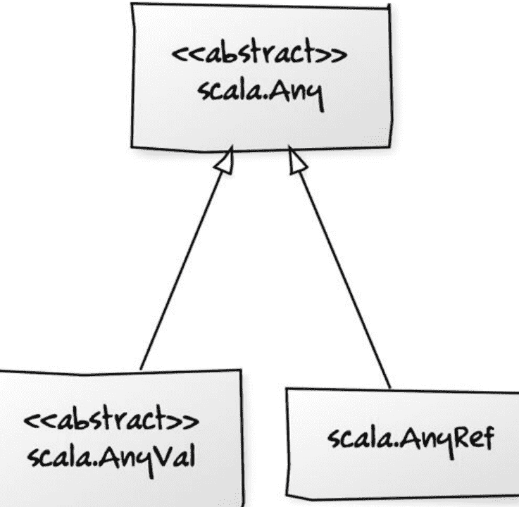

图 1.1. 每个类都扩展 Any 类。

#### AnyVal

`AnyVal` 是所有值类型的超类型，`AnyRef` 是所有引用类型的超类型。

`Byte`、`Int`、`Char` 等基础类型被称为值类型。引用类型分配在堆上。引用类型在某些语言中分配在栈上，但在 Scala 中它们被分配在堆上。引用类型被称为引用类型。


图 1.2. Scala 的值类型。

#### Unit

`Unit` 类型是 Scala 中用于表示 `void` 的特殊类型。它类似于 Java 中的 `void`。它只有一个值，写为 `()`。

```scala
example = ()
example = ()
```

实现 `Callable` 的 Java 类看起来如下：

```java
public class DoNothing implements Callable<Void> {
    @Override
    public Void call() throws Exception {
        return null;
    }
}
```

它等同于这个 Scala 类：

```scala
class DoNothing extends Callable[Unit] {
  call: Unit = ()
}
```

#### AnyRef

`AnyRef` 实际上是 Java `java.lang.Object` 类的别名。它提供了 `toString` 和 `hashCode` 的默认实现。

`AnyRef` 曾经有一个名为 `ScalaObject` 的子类，Scala 引用类型扩展它。然而，它是为了优化，已经在 Scala 2.11 中被移除。（提及它是因为很多文档仍然提到了它。）

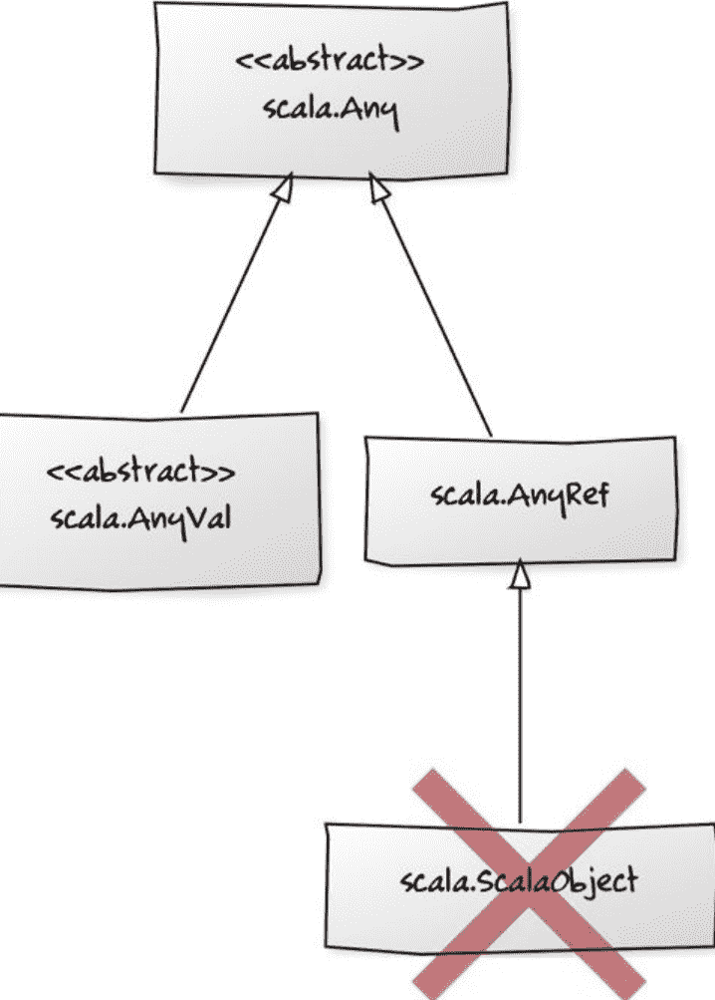

图 1.3. Scala Any。ScalaObject 类已不存在。

Java `String` 类以及其他从 Scala 使用的 Java 类扩展 `AnyRef`。（记住它是 `java.lang.Object` 的同义词。）任何 Scala 特有的类，例如 Scala 的列表实现 `scala.List`，也扩展 `AnyRef`。

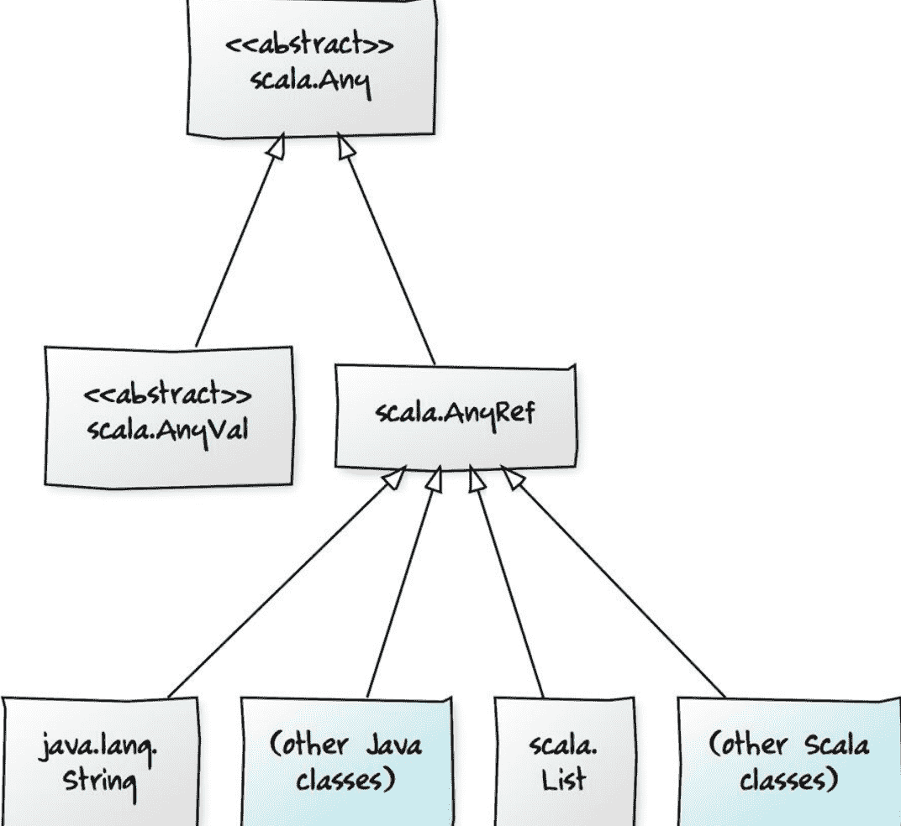

图 1.4. Scala 的引用类型。

然而，如果你想回到 Java 的 `==` 语义并在 Scala 中执行引用相等性，可以调用 `AnyRef` 中定义的 `eq` 方法：

```scala
new String("A") eq new String("A")      // 在 scala 中为 false
new String("B") == new String("B") // 在 java 中为 false
```

### 底类型

对于许多 Java 开发者来说，类层次结构拥有共同的底类型是一个新概念。这些类型是所有类型的子类型。Scala 中的类型 `Null` 和 `Nothing` 并不是底类型。

Scala 中所有的引用类型都是 `Null` 的父类型。`Null` 也是一个 `AnyRef` 对象；它是每个引用类型的子类。


图 1.5. `Null` 继承自 `AnyRef`。

值类型和引用类型都是 `Nothing` 的父类型。它位于类层次结构的底部，是所有类型的子类型。

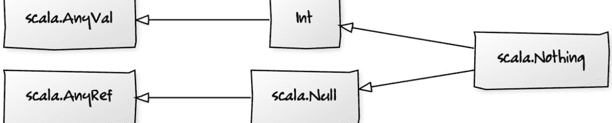

图 1.6. `Nothing` 继承自 `Null`。

整个层次结构如下图所示。为了节省空间，我省略了 `scala.Any`。请注意，`Null` 继承所有的引用类型，而 `Nothing` 继承所有的类型。

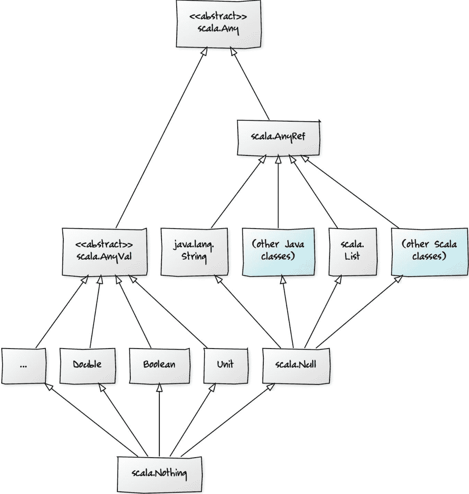

图 1.7. 带有底类型 `Null` 和 `Nothing` 的完整层次结构。

### ScalaDoc

Scala 移植了 JavaDoc 的概念，并创造性地将其命名为 ScalaDoc。在 Scala 源码中添加 ScalaDoc 与添加 JavaDoc 类似，通过注释中的标记完成。例如，源码中的以下片段：

```scala
/** 如果此值等于 x，返回 `true`，否则返回 `false`。 */
def ==(x: Byte): Boolean
```

...可以转换为 HTML 中的片段：

```
abstract def ==(x: Byte): Boolean
如果此值等于 x，则返回 true，否则返回 false。
```

图 1.8. 在 HTML 中渲染的嵌入 ScalaDoc 标记。

查看 Scala API 的文档，请访问 http://scala-lang.org/documentation。你会发现它与 JavaDoc 非常相似。你可以在左侧看到类；它们没有像 JavaDoc 那样按包分组，但可以点击以获取更多信息。

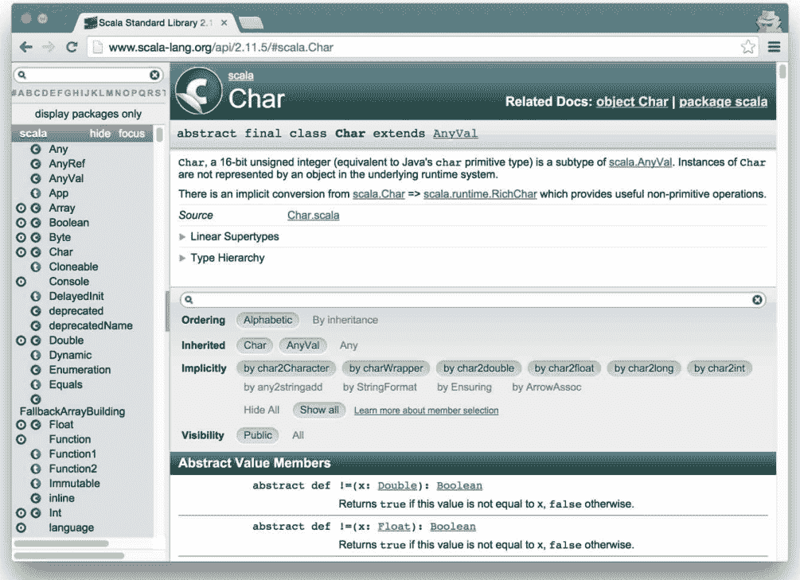

图 1.9. `char` 的基础 ScalaDoc。

ScalaDoc 的一个很棒的功能是你还可以过滤内容。例如，你可以只显示继承自 `Any` 的方法。

如果你对类的层次结构感兴趣，可以查看它的父类型和子类型。你甚至可以看到一个类型层次结构的导航图表。例如，`Byte` 的类型层次结构显示它是 `AnyVal` 的子类型，你可以通过点击图表向上层次结构导航。

### Scala 标准库 2

www.scala-lang.org/api/2.11.5/#scala.Byte

相关文档：object Byte | package scala


```
abstract final class Byte(byte: 8位符号整数（等同于 Java 的 byte）.原始类型是 scala.AnyVal 的子类型。Byte 的实例在底层运行时并不表示。
> 从 scala Byte 到 scala.RichByte 存在隐含关系，它提供了有用的非原始操作。

来源：scala.scala

+ 线性父类型层次结构

了解更多 
```

（注：由于 OCR 文本中的表格部分严重破碎，此处未重建有效的表格结构。）

### 推导式

推导式与普通循环略有不同，在处理函数式结构时非常有用。当你第一次遇到它们时，它们看起来像是 Java for 循环的替代语法。

### 柯里化

虽然你可以在任何语言中编写自己的柯里化函数，但 Scala 将柯里化作为语言特性。如果你不知道什么是柯里化，可能现在不需要担心。更多细节见柯里化章节。

### 函数字面量

该语言支持用字面量表示某些有用类型，如元组。流行的 Java 函数式库如 totally-lazy 和 functional-java 都拥有这类内容；Scala 只是让它们变得更容易使用。

### 递归

大多数语言都支持递归，但 Scala 对尾递归优化提供了编译器支持，这意味着它可以支持在 Java 等语言中会导致栈溢出的递归调用。如果你使用 `@tailrec` 注解，编译器甚至可以为你进行一些检查。

## 总结

在这次高级概览中，我们讨论了 Scala 既是面向对象语言，也是函数式语言。我提到过 Scala 实际上只有对象；没有基本类型，一切都是对象。

我们讨论了 Scala 的背景，它如何从学术语言成长为商业支持的主流语言，以及它如何在 JVM 上运行。这在理论上通过使其易于部署到现有服务器上，降低了采用门槛。

运行在 JVM 上也意味着 Scala 有许多库可用，因为 Java 互操作性是内置的。尽管某些工具落后且编译时间较慢，Scala 已经被广泛采用，我们今天看到许多大公司在使用它。

我们查看了如何安装和运行 Scala。你看到了 Scala 程序通常的运行的三种方式，并且在此过程中我们学习了 Scala REPL。

我们继续进行了语法导览，并查看了一些有趣的语言特性。

在语法导览中，我们看到了如何定义变量和值、函数和方法，并看到 Scala 如何通过推断类型和自动识别终止条件、返回（`return`）和分号（`;`）来减少样板代码的噪音。

我们看到中缀表示法意味着你可以避免传统的点符号表示法，重要的是，我们看到方法名可以包含符号。这就是我们能够在代码中自然地使用数学符号；它们实际上是方法，因此我们可以重写它们，并使用中缀表示法，无需使用嘈杂的点和括号。

我们还处理了一些集合类型，并看到了枚举它们的几种基本方法：`foreach` 和 for 循环语法。我们看到处理 Java 对象是多么简单；`Int` 和 `Boolean` 这样的值类型在 Scala 和 Java 中基本上相同。我们仔细查看了 Scala 如何在它的类层次结构中表示类型，以及如何在 ScalaDoc 中查找内容。

在语言特性方面，我们查看了在处理源文件和包、方法和方法参数，以及面向函数式编程的一些语言特性。

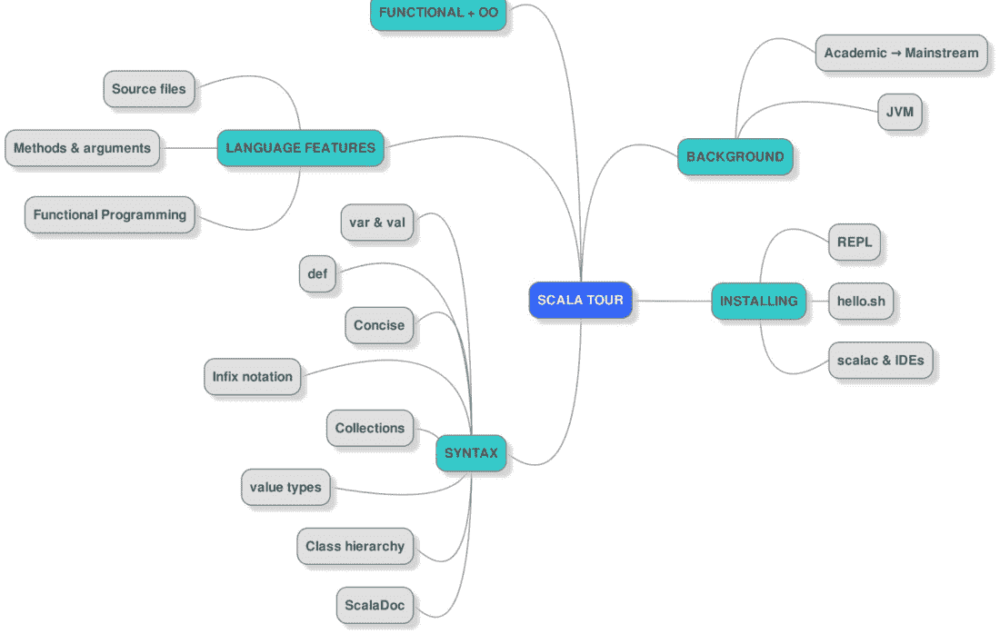

图 1.11. 第一部分总结。

# II. 关键语法差异

书的这部分关于 Java 和 Scala 语言语法之间的关键差异。通过一些典型的 Java 代码，我们将查看相应的 Scala 语法。在第三部分中，我们将更多关注 Java 中没有直接等价物的 Scala 特性。

我们将查看：

- 关于类和对象的许多内容，包括创建类、字段、方法。我们将进行从 Scala 生成的字节码转换回 Java 的操作，以便你感受 Scala 是如何与 Java 关联的。
- 继承、接口、抽象类和混入。
- 常见的控制结构，如 for 循环。
- 泛型。

## 灵活性

Scala 非常灵活。通常有几种方法实现相同的事情。我指不是使用 `while` 循环或 `for` 循环的区别；而是该语言有不同的语法选项来表达相同的内容。这种灵活性提供了很大的自由，但当你阅读不同作者的代码时可能会产生困惑。

一个例子是我们之前看到的中缀表示法。在调用方法时，你通常可以省略点和括号。Scala 是没有偏见的；是否使用点取决于你。

相比之下，Java 具有很强的局限性；表达相同内容的方法通常非常少。它通常更容易

## 不变与声明式

因为类定义上的 `val` 关键字告诉编译器将参数视为字段。它会为这些参数创建对应的字段和访问器方法。

我们可以通过获取生成的类文件并将其反编译为 Java 来证明这一点。这种循环转换是探索 Scala 在背后实际生成内容的极佳方法。我在这里使用了 Lee Benfield 编写的优秀的 CFR 反编译器，但你也可以使用 Java 自带的 `javap` 程序获取基本信息。

## 类和字段

在本章中，我们将查看：

1. 创建类
2. Scala 如何让定义字段变得更简单
3. Scala 创建方法时在背后发生了什么

## 创建类

在 Java 中创建类意味着编写如下代码：

```java
// java
public class Customer {

}
```

对于客户来说，拥有名字和地址是合理的。因此，通过构造函数初始化这些内容将得到类似这样的代码：

```java
// java
public class Customer {

    private final String name;

    private final String address;

    public Customer(String name, String address) {

        this.name = name;

        this.address = address;

    }

}
```

我们可以使用 `new` 关键字实例化并创建一个名为 Eric 的新客户：

```java
// java
Customer eric = new Customer("Eric", "29 Acacia Road");
```

在 Scala 中，语法简洁得多；我们可以在一行内组合类和构造函数。

```scala
// scala
class Customer(val name: String, val address: String)
```

我们以同样的方式实例化：

```scala
// scala
val eric = new Customer("Eric", "29 Acacia Road");
```

## 派生的 Setter 和 Getter

类定义上的 `val` 关键字告诉编译器将参数视为字段。它会为这些参数创建对应的字段和访问器方法。

要对客户生成的 Scala 的 `Customer` 类文件运行反编译器，你可以执行以下操作：

```bash
java -jar cfr_0_99.jar target/scala-2.11/classes/scala/demo/Customer.class
```

它会产生以下结果：

```java
// decompiled from scala to java
public class Customer {

    private final String name;

    private final String address;

    public String name() {

        return this.name;

    }

    public String address() {

        return this.address;

    }
```


```java
public Customer(String name, String address) {

    this.name = name;

    this.address = address;

}

}
```

需要注意的是，Scala 在第 6 行和第 10 行生成了访问器方法，并在第 14 行生成了一个构造函数。访问器没有使用 Java 的 getter 规范，但我们得到了 `getName` 和 `getAddress` 的等效方法。

你可能还想定义字段，但不通过构造函数设置它们。例如，在 Java 中，我们可能想为客户添加一个 `id`，以便稍后通过 setter 方法进行设置。这是 Hibernate 等工具在从数据库填充对象时的一种常用模式。

```java
// java

public class Customer {

    private final String name;

    private final String address;

    private String id;

    public Customer(String name, String address) {

        this.name = name;

        this.address = address;

    }

    public void setId(String id) {

        this.id = id;

    }

}
```

在 Scala 中，你几乎在做相同的操作。

```scala
// scala

class Customer(val name: String, val address: String) {

    var id = ""

}
```

你定义了一个字段（在本例中是一个 `var`），Scala 就会魔术地为你创建一个 setter 方法。它创建的 setter 方法名为 `id=` 而不是通常的 `setId`。如果我们通过这个从 Scala 生成的反编译器进行往返处理，我们将看到以下结果：

```java
// decompiled from scala to java

public class Customer {

    private final String name;

    private final String address;

    private String id;

    public static Customer apply() {

        return Customer.MODULE.$apply();

    }

    public String name() {

        return this.name;

    }

    public String address() {

        return this.address;

    }

    public String id() { // 注意它是公有的

        return this.id;

    }

    public void _id$Seq(String x1) { // 注意它是公有的

        this.id = x1;

    }

    public Customer(String name, String address) {

        this.name = name;

        this.address = address;

        this.id = null;

    }

}
```

注意，它在第 19 行创建了一个名为 `_$eq` 的方法，而不是 `id_`；因为 JVM 的方法名中不允许出现等号，所以 Scala 对其进行了转义并会进行翻译。你可以这样直接调用 setter 方法：

```scala
new Customer("Bob", "10 Downing Street").id_ = "0000001";
```

然而，Scala 也提供了一种简写，你可以使用普通的赋值语句，Scala 会在底层调用自动生成的 `_$eq` setter 方法：

```scala
new Customer("Bob", "10 Downing Street").id = "0000001";
```

如果字段前面没有修饰符，意味着它是公有的。因此，除了可以调用自动生成的 setter 之外，客户端也可以直接操作字段，这可能会破坏封装。我们希望能够将字段设为私有，并只允许从 `Customer` 类内部进行更新。

要实现这一点，请对字段使用 `private` 关键字：

```scala
class Customer(val name: String, val address: String) {

    private var id = ""

}
```

反编译器显示，Scala 生成了访问器方法，但 `id` 是私有的：

```java
// decompiled from scala to java

public class Customer {

    private final String name;

    private final String address;

    private String id;
}
```

注意，它在第 19 行创建了一个名为 `_$eq` 的方法而不是 `id_`，这是因为 JVM 方法名中不允许出现等号，所以 Scala 对其进行了转义并进行翻译。你可以这样直接调用 setter 方法：

```scala
new Customer("Bob", "10 Downing Street").id_ = "0000001";
```

Scala 虽然提供了一种简写，但你可以使用普通的赋值语句，Scala 会在底层调用自动生成的 `_$eq` setter 方法：

```scala
new Customer("Bob", "10 Downing Street").id = "0000001";
```

如果字段前面没有修饰符，意味着它是公有的。因此，除了可以调用自动生成的 setter 之外，客户端也可以直接操作字段，这可能会破坏封装。我们希望能够将字段设为私有，并只允许从 `Customer` 类内部进行更新。

要实现这一点，请对字段使用 `private` 关键字：

```scala
class Customer(val name: String, val address: String) {

    private var id = ""
}
```

反编译器显示，Scala 生成了访问器方法，但 `id` 是私有的：

```java
// decompiled from scala to java

public class Customer {

    private final String name;

    private final String address;

    private String id;
}
```

注意，它在第 19 行创建了一个名为 `_$eq` 的方法而不是 `id_`，这是因为 JVM 方法名中不允许出现等号，所以 Scala 对其进行了转义并进行翻译。你可以这样直接调用 setter 方法：

```scala
new Customer("Bob", "10 Downing Street").id_ = "0000001";
```

这些内容总结在下表中：

| class Foo(? x) | val x | var x | private val x | private var x |
| --- | --- | --- | --- | --- |
| 创建 Getter (x()) | Y (public) | Y (public) | N, Y (private) | Y (private) |
| 创建 Setter (x_=(y)) | N | Y (public) | N, N | Y (private) |
| 生成的构造函数包含 x | Y | Y | N, Y | Y |

如果你需要重写生成的方法，必须重命名字段并将其标记为私有。然后你可以使用原始名称重新创建 getter 和 setter 方法。在实践中，你不需要经常这样做。

## 类与对象

在本章中，我们将学习：

- 如何在类体内而非在类定义行上定义字段，以及这如何影响生成方法的生成。
- 如何创建额外的构造函数。
- 使用 `object` 关键字定义的 Scala 单例对象（singleton objects）。
- 伴侣对象（Companion objects），一种特殊的单例对象。

### 不带构造函数参数的类

让我们先看看如何在不在类定义行上定义字段的情况下在类内部创建字段。如果你在 Scala 中创建一个类定义上没有定义字段的类，如下：

```scala
// scala

class Counter
```

...Scala 编译器仍然会生成一个无参数的主构造函数，类似于 Java 的默认构造函数。因此，Java 的等效代码如下：

```java
// java

public class Counter {

    public Counter() {

    }

}
```

在 Java 中，你可能会初始化变量并创建一些方法。

```java
// java

public class Counter {

    private int count = 0;

    public Counter() {

    }

    public void increment() {

        count++;

    }

    public int getCount() {

        return count;

    }

}
```

你可以在 Scala 中进行相同的操作。

```scala
// scala

class Counter {

    private var count = 0

    def increment() { // 使用括号表示这是一个“修改器”(mutator)

        count += 1

    }

    def getCount() = count

}
```

在主构造函数内部（即不在类定义行中，而紧随其后的类体中），`val` 和 `var` 关键字对字节码的影响如下：

### 在主构造函数中声明

| | val x | var x | private val | private var |
|---|---|---|---|---|
| Getter (x()) | Y (public) | Y (public) | N/A, Y (private) | Y (private) |
| Setter (x_=(y)) | N | Y (public) | N/A, N | Y (private) |

如你所见，这与之前看到的表格是一致的。`var` 默认生成 getter 且类型是公开的。在字段声明中添加 `private` 会使生成的字段变为私有，且 setter 仅为 `var` 生成（`var` 默认也是公开的）。

### 额外的构造函数

让我们为 `Customer` 类创建一个替代的 Java 版本，这次带有额外的构造函数。

```java
// java

public class Customer {

    private final String fullname;

    public Customer(String forename, String initial, String surname) {

        this.fullname =

            String.format("%s %s. %s", forename, initial, surname);

    }

    public Customer(String forename, String surname) {
```


```java
this(forename, "", surname);
}
}
```

我们拆分了客户的中间字母，并允许客户端选择是否提供它。

我们可能应该整理一下主构造函数，以反映变量可能为空字符串的形式传入。我们将添加一个 `if` 条件并根据结果格式化字符串。

```java
// java
public class Customer {
    private final String fullname;

    public Customer(String forename, String initial, String surname) {
        if (initial != null && !initial.isEmpty()) {
            this.fullname = String.format("%s %s. %s", forename, initial, surname);
        } else {
            this.fullname = String.format("%s %s", forename, surname);
        }
    }

    public Customer(String forename, String surname) {
        this(forename, "", surname);
    }

    public static void main(String... args) {
        System.out.println(new Customer("Bob", "J", "Smith").fullname);
        System.out.println(new Customer("Bob", "Smith").fullname);
    }
}
```

在 Scala 中创建辅助构造函数只是创建名为 `this` 的方法的方法。唯一的限制是每个辅助构造函数必须在它的第一行使用 `this` 调用另一个构造函数。这样，构造函数就会形成链式调用，一直到顶层。

Scala 有主构造函数的概念；它是类体中的代码。从类定义中传递的任何参数都可以使用，如果你不写任何辅助构造函数，该类仍然有一个构造函数；它就是隐式构造函数。

```scala
// scala
class Customer(forename: String, initial: String, surname: String) {
    // 主构造函数
}
```

所以，如果我们在主构造函数内部创建一个字段并添加一些值，

```scala
class Customer(forename: String, initial: String, surname: String) {
    private val fullname: String = String.format("%s %s. %s", forename, initial, surname)
    // ...
}
```

（注：此处原文中存在大量重复的 OCR 错误描述，已根据要求进行了逻辑重构。）

在底层实现上，Scala 创建的代码与我们的单例模式示例生成的 Java 代码相同。你可以通过反编译它来看到这一点。

```java
// decompiled from scala to java
public final class Logger$ {
    public static final Logger$ MODULE;

    public static {
        new scala.demo.singleton.Logger$();
    }

    public void log(Level level, String string) {
        Logger$.printf("%s%%n", (Seq) Logger$.$MODULE);
        .genericWrapperArray((Object) new Object[]{level, string});
    }

    private Logger$() {
        Logger$.MODULE = this;
    }
}
```

`log` 方法中存在一些奇怪之处，但那是反编译器在解码字节码时遇到了困难，而且通常这也是 Scala 处理问题的方式。本质上，它是等价的：一个私有构造函数处理 Java 版本，以及该对象的单一静态实例。该类本身还是 `final` 的。

不需要 `new` 一个新的 `Logger`；`Logger` 已经是一个对象了，所以我们可以直接引用它。事实上，即使你想 `new` 也做不到，因为没有类定义，也没有可供 `new` 的类。

顺便一下，我们通过在 Scala 单例对象（而不是类）中添加 `main` 方法，复制了 Java 的静态 `main` 方法。

### 伴生对象

你可以在 Scala 中结合对象和类。当你在同一个源文件中创建一个同名的类和对象时，该对象被称为伴生对象。

Scala 没有 `static` 关键字，但单例对象的成员在效果上是静态的。请记住，Scala 的单例对象仅仅是一个单例。它包含的任何成员都会被所有使用该对象的客户端复用；它们像静态成员一样是可以全局访问的。

在 Java 中编写静态和非静态成员的地方，你就可以使用伴生对象。

Java 版本的 `Customer` 包含姓名、地址字段，以及一个用于唯一标识客户的 ID。

```java
// java
public class Customer {
    private final String name;
    private final String address;
    private Integer id;

    public Customer(String name, String address) {
        this.name = name;
        this.address = address;
    }
}
```

现在，我们可能想创建一个辅助方法来按顺序创建新的 ID。为了实现全局化，我们创建一个静态字段来捕获 ID 的值，并创建一个返回且递增该值的方法。然后我们只需要在构造新实例时调用该方法，将其 ID 赋值给新递增的全局 ID。

```java
// java
public class Customer {
    private static Integer sequenceOfIds;
    private final String name;
    private final String address;
    private Integer id;

    public Customer(String name, String address) {
        this.name = name;
        this.address = address;
        this.id = Customer.nextId();
    }

    private static Integer nextId() {
        return sequenceOfIds++;
    }
}
```

它是静态的，因为我们希望在所有实例之间共享它的实现，为每个实例创建唯一的 ID。

在 Scala 中，我们将静态成员和非静态成员分离，将静态成员放在单例对象中，其余部分放在类中。该单例对象就是 `Customer` 的伴生对象。

我们创建包含两个必要字段的类，并在单例对象中创建 `nextId` 方法。接下来我们创建一个私有的 `var` 来捕获当前值，赋值为 0 以便 Scala 可以推断出类型为 `Integer`。添加 `val` 意味着没有 setter，添加 `private` 修饰符意味着生成的 getter 是私有的。最后我们在 `nextId` 方法中实现递增，并在主构造函数调用它。

```scala
// scala
class Customer(val name: String, val address: String) {
    private val id = Customer.nextId()
}
```

```scala
object Customer {
    private var sequenceOfIds = 0

    private def nextId(): Integer = {
        sequenceOfIds += 1
        sequenceOfIds
    }
}
```

该单例对象是伴生对象，因为它与类同名且位于同一个源文件中。这意味着它们之间存在特殊关系，可以互相访问对方的私有成员。因此 `Customer` 对象可以定义 `nextId` 方法，因为 `Customer` 类仍然可以访问它。

如果你给对象起不同的名字，你就没有这种特殊关系，也无法调用该方法。例如，类 `CustomerX` 对象不是 `Customer` 的伴生对象，因此你无法看到私有的 `nextId` 方法。

```scala
// scala
class Customer(val name: String, address: String) {
  private val id = CustomerX.nextId() // 编译失败
}
```

```scala
object CustomerX {
  private var sequenceOfIds = 0

  private def nextId(): Integer = {
    sequenceOfIds += 1
    sequenceOfIds
  }
}
```

### 伴生对象的其他用途

当方法不依赖于类中的任何字段时，你可以更准确地将它们视为函数。函数通常属于单例对象而不是类，因此使用伴生对象的一个用例是：当你想要区分函数和方法，但又将相关的函数保留在它们所属的类中时。

使用伴生对象的另一个原因是为了工厂样式方法——即创建类伴生类实例的方法。例如，你可能想创建一个工厂方法，以更简洁的方式创建你的类实例。如果我们想为 `Customer` 创建工厂，可以这样做：

```scala
// scala
class Customer(val name: String, val address: String) {
  val id = Customer.nextId()
}
```

```scala
object Customer {
  def apply(name: String, address: String) = new Customer(name, address)
}
```

`apply` 方法为类或对象提供了简写符号。它有点像是类的默认方法，所以如果你不是直接在实例上调用方法，而是向 `apply` 方法传递参数，它会为你调用。例如，你可以调用：
`Customer.apply("Bob Fossil", "1 London Road")`

...或者你可以省略 `apply`，Scala 将寻找匹配你参数的 `apply` 方法。两者是完全相同的。

`Customer("Bob Fossil", "1 London Road")`

你仍然可以使用主构造函数和 `new` 来构造类，但将伴生类的 `apply` 方法实现为工厂，意味着如果你必须创建很多对象，代码可以更加简洁。

你甚至可以通过将主构造函数设为私有，来强制客户端使用你的工厂方法而不是构造函数。

```scala
class Customer private(val name: String, val address: String) {
    val id = Customer.nextId()
}
```

Java 的对应实现将有一个静态工厂方法（例如 `createCustomer`）以及一个私有构造函数，强制所有人使用工厂方法。

```java
// java
public class Customer {
    private static Integer sequenceOfIds;
    private final String name;
    private final String address;
    private Integer id;

    public static Customer createCustomer(String name, String address) {
        return new Customer(name, address);
    }

    private Customer(String name, String address) {
        this.name = name;
        this.address = address;
        this.id = Customer.nextId();
    }

    private static Integer nextId() {
        return sequenceOfIds++;
    }
}
```

## 继承

（注：原文在此处中断，未提供后续内容）

我们在 Scala 中做的是完全相同的事情。这里是基础 `Customer` 类：

```scala
// scala
class Customer(val name: String, val address: String) {
  private val basket: ShoppingBasket = new ShoppingBasket

  def add(item: Item) {
    basket.add(item)
  }

  def total: Double = {
    basket.value
  }
}
```

当涉及到将 `Customer` 扩展为 `DiscountedCustomer` 时，有几需要考虑。首先，我们将创建 `DiscountedCustomer` 类。

如果我们尝试通过扩展 `Customer` 来创建 `DiscountedCustomer`，将会得到编译错误。

我们得到编译错误是因为我们需要带上参数值来调用 `Customer` 构造函数。在 Java 的新构造函数中调用 `super` 时，我们也必须执行这样做。

Scala 有主构造函数和辅助构造函数。辅助构造函数必须链式调用主构造函数，而且在 Scala 中，只有主构造函数可以调用父类的构造函数。我们可以为主构造函数添加参数，例如：

```scala
class DiscountedCustomer(name: String, address: String) extends Customer
```

但我们不能像在 Java 中那样直接调用 `super`。

```scala
class DiscountedCustomer(val name: String, val address: String)
  extends Customer {
  super(name, address) // compiler error
}
```

在 Scala 中，要调用父类构造函数，我们将主构造函数的参数传递给父类。注意，`DiscountedCustomer` 的参数没有被设置为 `val`。它们不是字段；它们作用域于主构造函数内部，并直接传递给父类。

```scala
class DiscountedCustomer(name: String, address: String)
  extends Customer(name, address)
```

最后，我们可以在子类中实现折扣后的 `total` 方法。

```scala
override def total: Double = {
  super.total * 0.90
}
```

这里有两点注意：`override` 关键字是必须的，而且调用父类的 `total` 方法时，我们使用 `super` 加点符号，这和 Java 一样。

`override` 关键字相当于 Java 中的 `@Override` 注解。它允许编译器检查错误，例如拼错方法名或提供错误的参数。Java 注解与 Scala 之间的真正区别在于，当重写非抽象方法时，在 Scala 中是强制性的。

## 匿名类

你创建匿名子类的方式与 Java 类似。

在 Java 版本的 `ShoppingBasket` 类中，`add` 方法接收一个 `Item` 接口。因此，要向你的购物篮中添加物品，你可以创建一个 `Item` 的匿名子类型。下面，我们创建了一个程序向 Joe 的购物篮中添加两个固定价格的物品。每个物品都是 `Item` 的匿名子类。购物篮的总折扣额将是 $5.40。

```java
// java
public class ShoppingBasket {
    private final Set<Item> basket = new HashSet<>();

    public void add(Item item) {
        basket.add(item);
    }

    public Double value() {
        return basket.stream().mapToDouble(Item::price).sum();
    }
}

// java
public class TestDiscount {
    public static void main(String... args) {
        Customer joe = new DiscountCustomer("Joe", "128 Bullpen Street");
        joe.add(new Item() {
            @Override
            public Double price() {
```


## 代码示例

```java
return 2.5;
});
joe.add(new Item() {
    @Override
    public Double price() {
        return 3.5;
    }
});
System.out.println("Joe's basket will cost $ " + joe.total());
}
}
```

在 Scala 中，几乎是一样的。在实例化 `Item` 时，可以在类名后加上括号，并使用 `price` 方法签名中的类型。`price` 方法前的 `override` 关键字是可选的。

```scala
object DiscountedCustomer {
  def main(args: Array[String]) {
    val joe = new DiscountCustomer("Joe", "128 Bullpen Street")
    joe.add(new Item {
      def price = 2.5
    })
    joe.add(new Item {
      def price = 3.5
    })
    println("Joe's basket will cost $" + joe.total())
  }
}
```

你以相同的方式创建匿名类、抽象类或 Scala 的 trait。

## 接口 / 特性

Java 中的接口与 Scala 中的 trait 相似。你可以以与接口类似的方式使用 trait。你可以在类中实现特定的行为，但仍然以多态的方式处理它们。但是：

- trait 可以拥有方法的默认实现。这些类似于 Java 8 的扩展方法（也称为默认方法），但 Java 之前没有对应物。
- trait 还可以拥有字段，甚至是默认值，这是 Java 接口无法做到的。因此，trait 既可以拥有抽象方法也可以拥有具体方法以及状态。
- 一个类可以实现多个 trait，就像类可以实现多个接口一样，尽管 Scala 中扩展带默认实现的 trait 更像是行为的混合。
- 这与 Java 8 有重叠，因为你可以在 Java 8 中混合行为，尽管在语义和处理冲突方面存在某些差异。

在本节中，我们将更详细地查看这些差异。

在 Java 中，我们可能会创建一个名为 `Readable` 的接口来读取和拷贝某些数据；在 Scala 中，我们可能会创建一个名为 `Readable` 的 trait 来读取和拷贝某些数据。在 Java 中，我们可能会创建一个名为 `Readable` 的接口来读取和拷贝某些数据；在 Scala 中，我们可能会创建一个名为 `Readable` 的 trait 来读取和拷贝某些数据。

在 Scala 中，我们可能会使用 trait 来定义接口。

```java
default public List<A> sort() {
    List<A> list = new ArrayList<>();
    for (A elements : this) {
        list.add(elements);
        list.sort((first, second) -> first.compareTo(second));
    }
    return list;
}
```

上面的 `default` 关键字意味着该方法不再是抽象的，并且没有重写的子类将使用它。为了验证这一点，我们可以创建一个扩展 `Sortable` 的类 `Number` 来包含数字列表，并使用默认排序对它们进行排序。无需实现 `sort` 方法，因为我们乐于使用提供的默认实现。

```java
// java
public class NumberUsageExample {
    private static class NumberList implements Sortable<Integer> {
        private Integer[] numbers;
        private NumberList(Integer... numbers) {
            this.numbers = numbers;
        }
        @Override
        public Iterator<Integer> iterator() {
            return Arrays.asList(numbers).iterator();
        }
    }
    public static void main(String... args) {
        Sortable<Integer> numbers = new NumberList(1, 34, 65, 23, 0, -1);
        System.out.println(numbers.sort());
    }
}
```

我们可以将相同的思路应用于我们的 `Customer` 示例，并创建一个 `Customers` 类来收集客户。我们只需要确保客户类实现了 `Comparable`，就可以在不自己手实现 `sort` 方法的情况下对客户列表进行排序。

```java
// java
// 如果 Customer 没有实现 Comparable，将会导致编译错误
public class Customers implements Sortable<Customer> {
    private final Set<Customer> customers = new HashSet<>();
    public void add(Customer customer) {
        customers.add(customer);
    }
    @Override
    public Iterator<Customer> iterator() {
        return customers.iterator();
    }
}
```

在我们的 `Customer` 类中，如果我们实现了 `Comparable` 和 `compareTo` 方法，那么默认的自然排序将按照名称的字母顺序进行。

```java
// java
public class Customer implements Comparable<Customer> {
    // ...
    @Override
    public int compareTo(Customer other) {
        return name.compareTo(other.name);
    }
}
```

如果我们按顺序向列表添加一些客户，我们就可以按照名称（如 `compareTo` 方法中定义的）排序打印它们。

```java
// java
public class CustomersUsageExample {
    public static void main(String... args) {
        Customers customers = new Customers();
        customers.add(new Customer("Velma Dinkley", "316 Circle Drive"));
        customers.add(new Customer("Daphne Blake", "101 Easy St"));
        customers.add(new Customer("Fred Jones", "8 Tuna Lane"));
        customers.add(new DiscountCustomer("Norville Rogers", "1 Lane"));
        System.out.println(customers.sort());
    }
}
```

在 Scala 中，我们可以执行相同的步骤。首先，我们将创建一个基础的

```scala
// scala
trait Sortable[A] {
    def sort: Seq[A] = {
        this.toList.sorted // 内置排序方法
    }
}
```

这创建了一个抽象的 `sort` 方法。任何扩展类都必须提供实现，但我们可以通过仅提供一个普通的方法体来提供默认实现。

```scala
// scala
trait Sortable[A <: Ordered[A]] extends Iterable[A] {
    def sort: Seq[A] = {
    }
}
```

我们扩展了 `Iterable` 并为泛型类型 `A` 提供了一个约束，使其成为 `Ordered` 的子类型。`<:` 关键字表示 `A` 的上界。我们在这里使用它就像在 Java 示例中一样，将泛型类型限制为 `ordered` 的子类型。

在 Scala 中重构 `Customers` 集合看起来如下：

```scala
// scala
class Customers extends Sortable[Customer] {
    private val customers = mutable.Set[Customer]()
    def add(customer: Customer) = customers.add(customer)
    def iterator: Iterator[Customer] = customers
}
```

我们必须让 `Customer` 扩展上界约束，就像在 Java 版本中必须实现 `comparable` 一样。完成后，我们从 `trait` 继承了默认排序行为。

```scala
// scala
object Customers {
  def main(args: Array[String]) {
    val customers = new Customers()
    customers.add(new Customer("Fred Jones", "8 Tuna Lane"))
    customers.add(new Customer("Velma Dinkley", "316 Circle Drive"))
    customers.add(new Customer("Daphne Blake", "101 East St"))
    customers.add(new DiscountCustomer("Norville Rogers", "1 Lane"))
    println(customers.sort)
  }
}
```

默认方法的巧妙之处在于，如果需要，我们可以对其重写并特化。例如，如果我们想为客户创建一个另一个 `sortable` 类，但这次按 `total` 值排序客户，我们可以重写 `sort` 方法。

在 Java 中，我们将创建一个扩展 `Customers` 的类并重写 `sort` 方法。

```java
// java
public class CustomersSortBySpend extends Customers {
  @Override
  public List<Customer> sort() {
    List<Customer> customers = new ArrayList<>();
    for (Customer customer : this) {
      customers.add(customer);
    }
    customers.sort((first, second) -> second.total.compareTo(first.total));
    return customers;
  }
}
```

通用的方法与默认方法相同，但对 `sort` 使用了不同的实现。我们根据客户的 `total` 值进行排序。在 Scala 中我们将做同样的事情。

```scala
// scala
class SortableBySpend extends Customers {
  override def sort: List[Customer] = {
    this.toList.sorted((a: Customer, b: Customer) => b.total.compare(a.total))
  }
}
```

我们扩展 `Customers` 并重写 `sort` 方法以提供我们的替代实现。如果你想将 `comparator` 作为一个 Scala `object` 而不是匿名类，可以这样做：

```scala
class SortableBySpend extends Customers {
  override def sort: List[Customer] = {
    this.toList.sorted(BasketTotalDescending)
  }
}
//scala
object BasketTotalDescending extends Ordering[Customer] {
  def compare(a: Customer, b: Customer) = b.total.compare(a.total)
}
```

为了看到这一点，我们可以写一个小的程序。我们可以向 `SortableList` 添加一些客户，并向 `buckets` 添加一些项。我使用 `BasketTotalDescending` 类处理项，因为这避免了为每个项创建一个存根类。执行它时，我们将看到按值而非名称排序客户。

```scala
// scala
object AnotherExample {
  def main(args: Array[String]) {
    val customers = new SortableBySpend()
    val fred = new Customer("Fred Jones", "8 Tuna Lane")
    val velma = new Customer("Velma Dinkley", "316 Circle Drive")
    val daphne = new Customer("Daphne Blake", "101 East St")
    val norville = new DiscountCustomer("Norville Rogers", "1 Lane")
    customers.add(fred)
    customers.add(velma)
    customers.add(daphne)
    customers.add(norville)
    println(customers.sort)
  }
}
```

输出看起来像这样：

- Norville Rogers $7.64
- Daphne Blake $3.8
- Fred Jones $2.75
- Velma Dinkley $0.0

### 将匿名类转换为 Lambda

在 Java 版本的 `sort` 方法中，我们可以使用 lambda 来有效地创建 `comparable` 实例。这种语法在 Java 8 中是新出的，在这种情况下它是内联创建匿名实例的替代方案。

```java
// java
customers.sort((first, second) -> second.total.compareTo(first.total));
```

为了让 Scala 版本更像 Java 版本，我们需要传入一个 lambda 而不是匿名实例 `ordering`。Scala 支持 lambda，因此我们可以将匿名函数直接传递给其他函数，但 `sort` 方法的签名需要的是 `Ordering` 而不是函数。

幸运的是，我们可以使用隐式转换强制 Scala 将 lambda 转换为 `Ordering` 实例。我们只需要创建一个接受 lambda 或返回 `Ordering` 的转换方法，并将其标记为 `implicit`。`implicit` 关键字告诉 Scala 使用此方法进行从一个到另一个的转换，否则程序将无法编译。

```scala
// scala
implicit def toOrdering[A](f: (A, A) => Int): Ordering[A] = {
  new Ordering[A] {
    def compare(a: A, b: A) = f(a, b)
  }
}
```

签名接收一个函数并返回一个 `Ordering[A]`。函数本身有两个参数并返回一个 `Int`。因此我们的转换方法期望一个具有两个类型为 `A` 参数的函数，返回一个 `Int` (`(A, A) => Int`)。

现在我们可以为 `sorted` 方法提供一个本无法编译的字面量。只要函数符合 `(A, A) => Int` 签名，编译器就会检测到它被转换为了可编译的内容并调用我们的隐式方法来完成。我们可以这样修改 `SortableBySpend` 的 `sort` 方法：

```scala
// scala
class SortableBySpend extends Customers {
  override def sort: List[Customer] = {
    this.toList.sorted((a: Customer, b: Customer) => b.total.compare(a.total))
  }
}
```


### Trait 中的具体字段

我们已经查看了 trait 中的默认方法，但 Scala 还允许你提供默认值。你可以在 trait 中指定字段。

```scala
trait Counter {
  var count = 0
  def increment()
}
```

在这里，`count` 是 trait 的一个字段。所有扩展 `Counter` 的类都将拥有一个被复制的 `count` 实例。它不是继承的——它是 trait 要求的、由编译器提供的值。子类型由编译器提供该字段，并在构造时对其进行初始化（基于 trait 中的值）。

例如，`count` 魔法般地对下方的类是可用的，我们可以在方法中递增它。

```scala
class IncrementBy extends Counter {
  override def increment(): Unit = count += 1
}
```

在这个示例中，`increment` 的实现方式为在每次调用时将该值乘以另一个值。

```scala
class ExponentialIncrementer(rate: Int) extends Counter {
  def increment(): Unit = if (count == 0) 1 else count *= rate
}
```

顺便提一下，我们可以通过对 `Counter` 中的 `var` 进行保护，其作用原理与 Java 中的 `protected` 类似。它对子类可见，但与 Java 不同的是，它对同一个包中的其他类型不可见。这比 Java 稍微严格一些。例如，如果我们修改它并从同一个包中的非子类访问该计数器，将是不允许的。

```scala
trait Counter {
  protected var count = 0
  def increment()
}
```

```scala
class Foo {
  val foo = new IncrementByOne() // Counter 的子类
  foo.count // count 现在是不可访问的
}
```

### trait 中的抽象字段

你也可以通过省略初始化值来在 trait 中定义抽象值。这迫使子类必须提供一个值。

```scala
trait Counter {
  protected var count: Int // 抽象
  def increment()
}
```

```scala
class IncrementByOne extends Counter {
  override var count: Int = 0 // 强制提供一个值
  override def increment(): Unit = count += 1
}
```

```scala
class ExponentialIncrementer(rate: Int) extends Counter {
  var count: Int = 1
  def increment(): Unit = if (count == 0) 1 else count *= rate
}
```

注意 `IncrementByOne` 使用了 `override` 关键字，而 `ExponentialIncrementer` 没有使用。对于字段和抽象方法，`override` 是可选的。

## 抽象类

Java 中使用 `abstract` 关键字创建普通的抽象类。例如，我们可以编写客户类的另一个版本，但这次将其为抽象类。我们还添加了一个单方法来计算客户篮子的值，并将其标记为抽象。

```java
public abstract class AbstractCustomer {
    public abstract Double total();
}
```

在 `DiscountedCustomer` 子类中，我们可以这样实现折扣后的篮子值：

```java
public class DiscountedCustomer extends AbstractCustomer {
    private final ShoppingBasket basket = new ShoppingBasket();

    @Override
    public Double total() {
        return basket.value() * 0.90;
    }
}
```

在 Scala 中，你使用 `abstract` 关键字来表示无法实例化的类。然而，你不需要对方法进行限定；只需省略实现即可。

```scala
abstract class AbstractCustomer {
    def total: Double // 没有实现意味着它是抽象的
}
```

然后我们可以按照之前看到的方式创建一个子类。我们使用 `extends` 并简单地为 `total` 方法提供实现。任何实现抽象方法的方法都不需要在方法名前加 `override` 关键字，尽管它是被允许的。

```scala
class DiscountedCustomer extends AbstractCustomer {
    private final val basket = new ShoppingBasket
    def total: Double = {
        return basket.value() * 0.90
    }
}
```

## 多态

在 Java 中使用继承的地方，Scala 为你提供了更多选项。Java 中的继承通常意味着子类类以继承父类的行为和状态。你也可以将实现接口视为一种继承，即你继承了行为但没有继承状态。

如果优势在于可替换性：即可以用一种类型替换另一种类型来改变系统行为，而无需更改代码结构。这被称为包含多态。

Scala 通过以下方式允许包含多态：

- 没有默认实现的 trait
- 具有默认实现的 trait（因为这些 trait 被用于“混入”行为，它们通常被称为 mixin traits）
- 抽象类（带或不带字段）
- 传统的类扩展
- 结构类型，一种 Ruby 开发者熟悉的“鸭子类型”，但它使用反射

### trait 与 抽象类

trait 和抽象类之间存在几点区别。最明显的一点是 trait 不能有构造参数。trait 还提供了一种方法来解决允许直接扩展多个类时会看到的多重继承问题。与 Java 类似，Scala 类只能有一个父类，但可以根据需要混入许多个 trait。尽管有此限制，Scala 支持多重继承。在某种程度上是。

当子类从多个一个父类继承行为或字段时，多重继承会导致问题。在这种情况下，在多个地方定义了方法，很难判断应该使用哪种实现。当一个类型有多个父类时，继承关系就崩溃了。

Scala 通过区分类层级结构和 trait 层级结构允许一种多重继承。虽然你不能扩展多个类，但你可以混入多个 trait。Scala 使用一种称为“线性化”的过程来解决 trait 中的重复方法。Scala 将所有 trait 放在一条线上，并从右到左的顺序来解析对 `super` 的调用。

> **Scala 支持多重继承吗？**
> 如果你所说的“继承”是指经典的类扩展，那么 Scala 不支持多重继承。Scala 仅允许一个类被“扩展”。在这一点上与 Java 相同。然而，如果你指的是实现 trait，那么是的，Scala 支持。

除了允许多重继承外，trait 还可以相互堆叠或分层以提供调用链，类似于面向切面的编程或使用装饰器。如果你想阅读更多，可以参考 Cay S. Horstmann 编写的《给急躁者的 Scala》中关于分层 trait 的精彩章节。

## 在选项之间做出决策

以下是一些帮助你选择何时使用不同继承选项的提示。

在你在 Java 中会使用接口的情况下，请使用无状态的 trait；即当你定义一个类应该扮演的角色，并且可以切换不同的实现时。例如，当你想要在测试时使用测试双胞，而在生产环境中使用“真实”实现时。这种意义上的“角色”意味着没有包含可重用的具体行为，仅仅是可替代性的概念。

当你的类具有行为且该行为可能被相同类型的内容覆盖时，请使用普通类并扩展。这两种都属于包含多态的一种。

如果你更感兴趣重用而不是“面向对象-是”的关系，请使用抽象类。例如，数据结构可能是重用抽象类的好地方，但我们早之前的客户层级可能更适合实现为非抽象类。

如果你正在创建可能被无关类重用的重用行为，请将其创建为 mixin trait，因为与抽象类相比，它们对使用的限制更少。

Odersky 在《Scala 编程》中也讨论了其他因素，如性能和 Java 交互性。

## 控制结构

本章完全关于控制结构，如 if 语句、switch 块、循环和 break。具体来说，我们将查看：

- 条件语句：if 语句、三元表达式和 switch
- 循环结构：do、while 和 for
- 中断控制流
- 异常（简要介绍）

### 条件语句

#### If 和三元运算符

条件语句是直观的。

```java
// java
if (age > 55) {
    retire();
} else {
    carryOnWorking();
}
```

Java 中的 if 在 Scala 中看起来一模一样。

```scala
// scala
if (age > 55) {
    retire();
} else {
    carryOnWorking()
}
```

你经常会发现 Scala 开发者为简单的 if 块省略大括号。例如：

```scala
if (age > 55)
    retire();
else
    carryOnWorking()
```

甚至将它们全部写在一行。

```scala
if (age > 55) retire() else carryOnWorking()
```

这种风格受到青睐是因为 if/else 在 Scala 中实际上是一个表达式而不是语句，简洁的语法使其看起来更像一个表达式。区别是什么？表达式返回一个值，而语句执行一个动作。

> **表达式 vs. 语句**
> 表达式返回一个值，而语句执行一个动作。从本质上说，语句通常会有副作用，而表达式没有。

例如，让我们为 Customer 类添加一个创建方法，根据他们成为客户的长短来创建折扣客户或普通客户。

```java
// java
public static Customer create(String name, String address,
    Integer yearsOfCustomer) {
    if (yearsOfCustomer > 2) {
        return new DiscountedCustomer(name, address);
    } else {
        return new Customer(name, address);
    }
}
```

在 Java 中，我们被迫从方法返回新的 Customer。条件是语句，它们被执行，而不是返回值的表达式。我们可以从长远来看先创建一个变量，然后返回它，但点是一样的；语句必须产生副作用。

```java
public static Customer create(String name, String address,
    Integer yearsOfCustomer) {
    Customer customer = null;
    if (yearsOfCustomer > 2) {
        customer = new DiscountedCustomer(name, address);
    } else {
        customer = new Customer(name, address);
    }
    return customer;
}
```

因为 Scala 中的条件语句是表达式，所以你不需要绕这些圈子。在 Scala 中，你只需要创建 if，并且两个分支都会返回一个 Customer。由于整个表达式是方法中的最后一个语句，它将是从方法返回的值。

```scala
// scala
object Customer {
  def create(name: String, address: String, yearsOfCustomer: Int) = {
    if (yearsOfCustomer > 2)
      new DiscountedCustomer(name, address)
    else
      new Customer(name, address)
    customer
  }
}
```

简写形式，我们可以将 if 的结果（记住它是一个表达式而不是语句）赋值给 val 并在最后一行返回该值。

```scala
object Customer {
  def create(name: String, address: String, yearsOfCustomer: Int) = {
    val customer = if (yearsOfCustomer > 2)
      new DiscountedCustomer(name, address)
    else
      new Customer(name, address)
    customer
  }
}
```

另一个简单而易的例子可能是这样的：

```scala
val tall = if (height > 190) "tall" else "not tall" // scala
```

你已经注意到这在 Java 中表现像一个表达式。

```java
String tall = height > 190 ? "tall" : "not tall"; // java
```

所以，三元运算符在 Java 中是表达式，但 if 语句不是。Scala 没有条件运算符 (?:)，因为普通的 Scala 是一个表达式。

### Switch 语句

在 Java 中，你可能会使用 switch 语句。在 Scala 中，我们使用 match。Scala 中没有这种 switch 语句。我们使用 match，它更强大，允许你选择等等性以外的内容。

在 Java 中，你可能会写：

```java
// java
public class Switch {
    public static void main(String[] args) {
        String month = "August";
        String quarter;
        switch (month) {
            case "January":
            case "February":
            case "March":
                quarter = "first quarter";
                break;
            case "April":
            case "May":
            case "June":
                quarter = "second quarter";
                break;
            case "July":
            case "August":
            case "September":
                quarter = "third quarter";
                break;
            case "October":
            case "November":
            case "December":
                quarter = "fourth quarter";
                break;
            default:
                quarter = "unknown quarter";
        }
        System.out.println(quarter);
    }
}
```

在 Java 中，需要 break 来停止执行穿透。当 case 匹配时，它将值赋值给变量。在 Scala 中，我们将从类似这样的开始：

```scala
object Switch extends App {
  val month = "August"
  var quarter = "???"
  month match {
    case "January" =>
    case "February" =>
    case "March" => quarter = "first quarter"
    case "April" =>
    case "May" =>
    case "June" => quarter = "second quarter"
    case "July" =>
```


除了允许多重继承外，`trait` 还可以相互堆叠或分层以提供调用链，类似于面向切面的编程或使用装饰器。如果你想阅读更多，可以参考 Cay S. Horstmann 编写的《给急躁者的 Scala》（*Scala for the Impatient*）中关于分层 trait 的精彩章节。

## 在选项之间做出决策

以下是一些帮助你选择何时使用不同继承选项的提示。

在你在 Java 中会使用接口（`interface`）的情况下，请使用无状态的 `trait`；即当你定义一个类应该扮演的角色，并且可以切换不同的实现时。例如，当你想要在测试时使用测试替身（test double），而在生产环境中使用“真实”实现时。这种意义上的“角色”意味着没有可重用的具体行为，仅仅是可替代性的概念。

当你的类具有行为且该行为可能被相同类型的内容覆盖时，请使用普通类并扩展（`extend`）。这两种都属于包含多态的一种。

如果你更感兴趣重用而不是“面向对象-是”的关系，请使用抽象类（`abstract class`）。例如，数据结构可能是重用抽象类的好地方，但我们早之前的客户层级可能更适合实现为非抽象类。

如果你正在创建可能被无关类重用的重用行为，请将其创建为 mixin `trait`，因为与抽象类相比，它们对使用的限制更少。

Odersky 在《Scala 编程》（*Programming in Scala*）中也讨论了其他因素，如性能和 Java 交互性。

## 控制结构

本章完全关于控制结构，如 `if` 语句、`switch` 块、循环和 `break`。具体来说，我们将查看：

- 条件语句：`if` 语句、三元表达式和 `switch`
- 循环结构：`do`、`while` 和 `for`
- 中断控制流
- 异常（简要介绍）

### 条件语句

### If 和三元运算符

条件语句是直观的。

```java
// java
if (age > 55) {
    retire();
} else {
    carryOnWorking();
}
```

Java 中的 `if` 在 Scala 中看起来一模一样。

```scala
// scala
if (age > 55) {
    retire();
} else {
    carryOnWorking()
}
```

你经常会发现 Scala 开发者为简单的 `if` 块省略大括号。例如：

```scala
if (age > 55) 
    retire();
else
    carryOnWorking()
```

甚至将它们全部写在一行。

```scala
if (age > 55) retire() else carryOnWorking()
```

这种风格受到青睐是因为 `if/else` 在 Scala 中实际上是一个表达式（`expression`）而不是语句（`statement`），简洁的语法使其看起来更像一个表达式。区别是什么？表达式返回一个值，而语句执行一个动作。

> **表达式 vs. 语句**
> 表达式返回一个值，而语句执行一个动作。从本质上说，语句通常会有副作用，而表达式没有。

例如，让我们为 `Customer` 类添加一个创建方法，根据他们成为客户的长短来创建 `DiscountedCustomer` 或普通 `Customer`。

```java
// java
public static Customer create(String name, String address,
    Integer yearsOfCustomer) {
    if (yearsOfCustomer > 2) {
        return new DiscountedCustomer(name, address);
    } else {
        return new Customer(name, address);
    }
}
```

在 Java 中，我们被迫从方法返回新的 `Customer`。条件是语句，它们被执行，而不是返回值的表达式。我们可以从长远来看先创建一个变量，然后返回它，但点是一样的；语句必须产生副作用。

```java
public static Customer create(String name, String address,
    Integer yearsOfCustomer) {
    Customer customer = null;
    if (yearsOfCustomer > 2) {
        customer = new DiscountedCustomer(name, address);
    } else {
        customer = new Customer(name, address);
    }
    return customer;
}
```

因为 Scala 中的条件语句是表达式，所以你不需要绕这些圈子。在 Scala 中，你只需要创建 `if`，并且两个分支都会返回一个 `Customer`。由于整个表达式是方法中的最后一个语句，它将是从方法返回的值。

```scala
// scala
object Customer {
  def create(name: String, address: String, yearsOfCustomer: Int) = {
    if (yearsOfCustomer > 2)
      new DiscountedCustomer(name, address)
    else
      new Customer(name, address)
    customer
  }
}
```

简写形式，我们可以将 `if` 的结果（记住它是一个表达式而不是语句）赋值给 `val` 并在最后一行返回该值。

```scala
object Customer {
  def create(name: String, address: String, yearsOfCustomer: Int) = {
    val customer = if (yearsOfCustomer > 2)
      new DiscountedCustomer(name, address)
    else
      new Customer(name, address)
    customer
  }
}
```

另一个简单而易的例子可能是这样的：

```scala
val tall = if (height > 190) "tall" else "not tall" // scala
```

你已经注意到这在 Java 中表现像一个表达式。

```java
String tall = height > 190 ? "tall" : "not tall"; // java
```

所以，三元运算符在 Java 中是表达式，但 `if` 语句不是。Scala 没有条件运算符 (`?:`)，因为普通的 Scala `if` 是一个表达式。

### Switch 语句

在 Java 中，你可能会使用 `switch` 语句。在 Scala 中，我们使用 `match`。Scala 中没有这种 `switch` 语句。我们使用 `match`，它更强大，允许你选择等等性以外的内容。

在 Java 中，你可能会写：

```java
// java
public class Switch {
    public static void main(String[] args) {
        String month = "August";
        String quarter;
        switch (month) {
            case "January":
            case "February":
            case "March":
                quarter = "first quarter";
                break;
            case "April":
            case "May":
            case "June":
                quarter = "second quarter";
                break;
            case "July":
            case "August":
            case "September":
                quarter = "third quarter";
                break;
            case "October":
            case "November":
            case "December":
                quarter = "fourth quarter";
                break;
            default:
                quarter = "unknown quarter";
        }
        System.out.println(quarter);
    }
}
```

在 Java 中，需要 `break` 来停止执行穿透。当 `case` 匹配时，它将值赋值给变量。在 Scala 中，我们将从类似这样的开始：

```scala
object Switch extends App {
  val month = "August"
  var quarter = "???"
  month match {
    case "January" =>
    case "February" =>
    case "March" => quarter = "first quarter"
    case "April" =>
    case "May" =>
    case "June" => quarter = "second quarter"
    case "July" =>
    case "August" =>
    case "September" => quarter = "third quarter"
    case "October" =>
    case "November" =>
    case "December" => quarter = "fourth quarter"
    case _ => quarter = "unknown quarter"
  }
  println(month + " is " + quarter)
}
```

上面的内容是语法上的翻译。然而，Scala 不支持 `break` 关键字，所以我们省去它。相反，我们使用 `match`，我们在说 `month` 匹配任何这些 `case` 子句？冒号：底部的下划线与 Java 的 `default` 相同。下划线在 Scala 中通常用于表示未知值。尽管这些是直接翻译，但当你运行它时，出问题了。结果没有被设置。

与 Java 不同，如果 `case` 匹配，`break` 是隐式的——没有穿透到下一个 `case`。所以我们需要在空块中添加代码。

```scala
// scala
object BrokenSwitch extends App {
  val month = "August"
  var quarter = "???"
  month match {
    case "January" =>
    case "February" =>
    case "March" => quarter = "first quarter"
    case "April" =>
    case "May" =>
    case "June" => quarter = "second quarter"
    case "July" =>
    case "August" =>
    case "September" => quarter = "third quarter"
    case "October" =>
    case "November" =>
    case "December" => quarter = "fourth quarter"
    case _ => quarter = "unknown quarter"
  }
  println(month + " is " + quarter)
}
```

```scala
case "September" => quarter = "3rd quarter"
case "October" => quarter = "4th quarter"
case "November" => quarter = "4th quarter"
case "December" => quarter = "4th quarter"
case _ => quarter = "unknown quarter"
}
println(month + " is " + quarter)
```

这种方法虽然可行，但有很多重复代码。
为了消除重复，我们可以将一月、二月和三月合并到一行，并用或符号（`|`）分隔它们。这意味着月份可以匹配每个一月、二月或三月。在所有这些情况下，`=>` 之后的内容都将被执行。

```scala
case "January" | "February" | "March" => quarter = "1st quarter"
```

对剩余情况执行此操作将得到如下：

```scala
// scala
object SwitchWithLessDuplication extends App {
  val month = "August"
  var quarter = match {
    case "January" | "February" | "March" => quarter = "1st quarter"
    case "April" | "May" | "June" => quarter = "2nd quarter"
    case "July" | "August" | "September" => quarter = "3rd quarter"
    case "October" | "November" | "December" => quarter = "4th quarter"
    case _ => quarter = "unknown quarter"
  }
  println(month + " is " + quarter)
}
```

我们通过在 `case` 句中直接编写表达式精简了上面的代码。当我们把这些 `case` 句视为可以用于构建 `match` 更复杂且更具表达力条件的模式时，这种方法就变得更加强大。

Java 只能匹配基本类型、枚举以及从 Java 7 开始的字符串值。得益于模式匹配，Scala 可以匹配几乎任何内容，包括对象。我们将在第三部分详细讨论模式匹配。

另一个需要注意的是，Scala 版本的 `switch` 是一个**表达式**。我们并不强制使用副作用，可以丢弃临时变量并返回一个代表月份所属季度的字符串。然后我们可以将变量 `var` 改为 `val`。


```scala
// scala
object SwitchExpression extends App {
  val month = "August"
  var quarter = match {
    case "January" | "February" | "March" => quarter = "1st quarter"
    case "April" | "May" | "June" => quarter = "2nd quarter"
    case "July" | "August" | "September" => quarter = "3rd quarter"
    case "October" | "November" | "December" => quarter = "4th quarter"
    case => quarter = "unknown quarter"
  }

  println(month + " is " + quarter)
}
```

我们可以内联它。我们只需要在 `match` 周围加上一些括号，如下：

```scala
// scala
object SwitchExpression extends App {
  val month = "August"
  println(month + " is " + match {
    case "January" | "February" | "March" => "1st quarter"
    case "April" | "May" | "June" => "2nd quarter"
    case "July" | "August" | "September" => "3rd quarter"
    case "October" | "November" | "December" => "4th quarter"
    case => "unknown quarter"
  })
}
```

# 循环结构：`do`、`while` 和 `for`

Scala 和 Java 在 `do` 和 `while` 循环上共享相同的语法。例如，这段代码使用 `do` 和 `while` 来打印从零开始的数字。

```java
// java
int i = 0;
do {
  System.out.println(i);
  i++;
} while (i < 10)
```

Scala 看起来像这样。（没有 `++` 递增器，所以我们使用 `+=` 代替。）

```scala
var i: Int = 0
do {
  println(i);
  i += 1
} while (i < 10)
```

`while` 循环也是一样的。

```java
// java
int i = 0;
while (i < 10) {
  System.out.println(i);
  i++;
}
```

```scala
var i: Int = 0
while (i < 10) {
  println(i);
  i += 1
}
```

当我们看 `for` 循环时，事情变得更有趣了。Scala 没有 Java 那样的 `for` 循环；相反的是被称为“基于生成器的循环”（generator-based loop）推导式（comprehension）。在大多数情况下，这些可以像 Java 的 `for` 结构一样使用。Java 的 `for` 循环控制三个阶段：初始化、检查和更新。

### 初始化、检查、更新

```java
for (int j = 0; j < i; j++) {
  // 执行操作
}
```

图 2.7 典型的 `for` 循环阶段。

Scala 中没有直接对应物。你已经见过一种替代方案——使用 `while` 循环来初始化变量、检查条件并更新变量——但你也可以使用基于生成器的循环。所以 Java 中的如下：

```java
// java
for (int i = 0; i < 10; i++) {
  System.out.println(i);
}
```

...在 Scala 中看起来像使用生成器的循环：

```scala
// scala
for (i <- 0 to 9) {
  println(i);
}
```

变量 `i` 被创建并在迭代时赋值。箭头 `<-` 表示后面是生成器。生成器是可以喂给循环的值。`0 to 9` 是一个 `Int` 字面量，该示例使用了 Scala 的简写形式，也可以写成 `0.to(9)`。

它与 Java 中使用列表的增强 `for` 循环非常相似：

```java
// java
List<Integer> numbers = Arrays.asList(0, 1, 2, 3, 4, 5, 6, 7, 8, 9);
for (Integer i : numbers) {
  System.out.println(i);
}
```

在 Java 中可以重写为：

```java
// java
numbers.forEach(i -> System.out.println(i));
```

或者方法引用：

```java
numbers.forEach(System.out::println);
```

惊讶的是，Scala 有自己的 `foreach` 方法。

```scala
// scala
0 to 9.foreach(i => println(i))
```

我们再次使用方法创建数字序列。这个序列有 `foreach` 方法，我们传入 lambda。lambda 函数接收一个 `Int` 并返回 `Unit`。我们可以像使用 Java 方法引用一样使用 Scala 的简写：

```scala
// scala
0 to 10.foreach(println)
```

### For-循环 vs 推导式

基于生成器的循环和推导式之间的区别是什么？

基于生成器的循环会被编译器转换为对集合的 `foreach` 调用。推导式将转换为对 `map` 的调用。推导式允许使用 `yield` 关键字：

```scala
for (i <- 0 to 5) yield i * 2 // 结果为 (0, 2, 4, 6, 8)
```

更多详情见推导式章节。

### 中断控制流（`break` 和 `continue`）

Scala 没有 `break` 或 `continue` 语句，并且通常不鼓励跳出循环。然而，你可以使用库方法实现相同。在 Java 中，你可能会编写类似代码来提前跳出循环：

```java
// java
for (int i = 0; i < 100; i++) {
  System.out.println(i);
  if (i == 10)
    break;
}
```

在 Scala 中，你需要导入一个名为 `Breaks` 的 Scala 库。你可以将跳出的代码封装在“breakable”块中，并调用 `break()` 方法来跳出。它是通过抛出异常并捕获它来实现的。

```scala
// scala
import scala.util.control.Breaks._
breakable {
  for (i <- 0 to 100) {
    println(i)
    if (i == 10)
      break() // 跳出循环
  }
}
```

## 异常

Scala 中的异常处理方式与 Java 相同。它们在中断控制流和在不处理时终止程序方面具有相同的原理。Scala 中的异常像其 Java 一样扩展了 `java.lang.Throwable`。Scala 没有检查异常的概念。从现有 Java 库抛出的所有异常都转换为运行时异常。你抛出的任何异常都不需要处理来满足编译器；Scala 中的所有异常都是运行时异常。

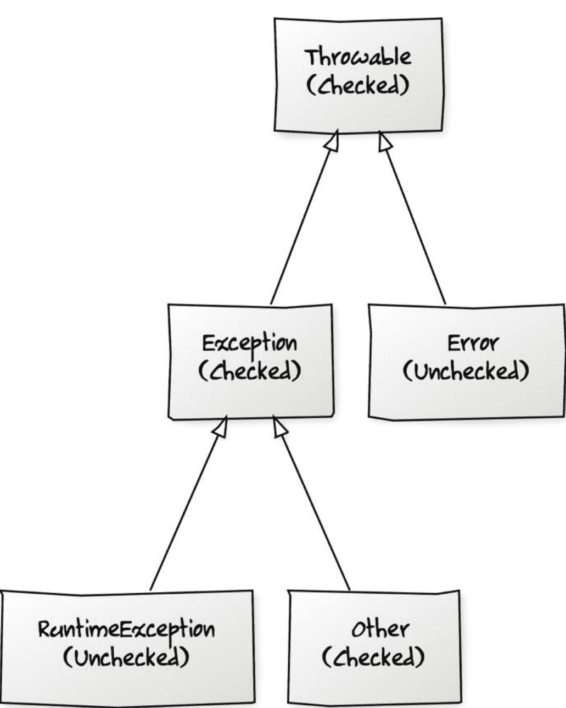

图 2.8 Java 异常层次。Scala 不使用检查异常。

捕获异常使用模式匹配，就像我们之前在 `match` 表达式中看到的那样。在 Java 中，你可能会像这样做来获取网页内容：

```java
// java
try {
  URL url = new URL("http://baddotrobot.com");
  BufferedReader reader = new BufferedReader(
    new InputStreamReader(url.getInputStream()));
  String line = reader.readLine();
}
```

```java
while ((line = reader.readLine()) != null) {
    System.out.println(line);
} finally {
    reader.close();
}
catch (MalformedURLException e) {
    System.out.println("Bad URL");
} catch (IOException e) {
    System.out.println("Problem reading data: " + e.getMessage());
}
```

我们从一个 URL 开始。这可能会抛出 `MalformedURLException`，我们被迫处理它。然后我们创建一个 Reader 并从 URL 打开流准备读取。这可能会抛出另一个异常，因此我们也被迫处理该异常。当我们开始读取时，`readLine` 方法也可能抛出异常，由现有的 `catch` 块处理。为了确保在发生异常时正确关闭资源，我们在 `finally` 块中关闭 reader。

如果我们想使用 Java 7 的 `try-with-resources` 结构，就可以避免 `finally` 子句。`try-with-resources` 语法会自动关闭 reader。

```java
// java
try {
    URL url = new URL("http://baddotrobot.com");
    try (BufferedReader reader = new BufferedReader(new InputStreamReader(url.openStream()))) {
        String line;
        while ((line = reader.readLine()) != null) {
            System.out.println(line);
        }
    } catch (MalformedURLException e) {
        System.out.println("Bad URL");
    } catch (IOException e) {
        System.out.println("Problem reading data: " + e.getMessage());
    }
}
```

在 Scala 中，这看起来几乎一样。

```scala
// scala
try {
    var url = new URL("http://baddotrobot.com")
    var reader = new BufferedReader(new InputStreamReader(url.openStream))
    try {
        var line = reader.readLine()
        while (line != null) {
            line = reader.readLine()
            println(line)
        }
    } finally {
        reader.close()
    }
} catch {
    case e: MalformedURLException => println("Bad URL");
    case e: IOException => println(e.getMessage)
}
```

我们像之前一样创建 URL。虽然它可能会抛出异常，但我们并不强制要求捕获它。它是一个 Java 检查异常，但 Scala 将其转换为运行时异常。

虽然我们不被强制要求，但我们实际上想处理这些异常。因此我们使用了熟悉的 `try` 和 `catch` 语句。在 `catch` 块中，使用 `match` 表达式处理异常。如果我们对代码块中实际上不需要该异常，可以通过将变量名替换为下划线来微调模式。这意味着我们不关心该变量，只关心该类。

```scala
case _: MalformedURLException => println("Bad URL")
```

我们只需要把 `finally` 块加回来。`finally` 的用法与 Java 中完全一样。Scala 中有等同于 `try-with-resources` 的机制，尽管你可以编写自己的方法来实现相同的功能。（提示：使用类似 Loan 模式的机制。）

# 泛型

在本章中，我们将介绍 Scala 中的泛型，或者说类型参数化或泛型编程。我们将学习到：

- 泛型语法：定义类型和方法
- 边界类型、`extends` 和 `super`
- Java 和 Scala 中的通配符
- 协变与逆变

### 参数多态

我们简要讨论过子类型或包含多态，即子类型可以被替换以代表其父类型。这些替代品可以在不改变代码结构的情况下提供不同的行为。多态的类型包括：

- 包含多态（参见“继承”章节）
- 特设多态（基本上是方法重载）
- 参数多态

参数多态允许我们以泛型方式编写代码，而不依赖于特定类型，同时仍保持类型安全。每当我们处理针对多种类型的类时，我们都会使用它。例如：

```java
List<Customer> customers = new ArrayList<>(); // java
```

如果你在 Java 中创建过某种东西的列表，那么你对参数多态会很熟悉。它更通俗称为泛型；通过给泛型类型（如 `List`）传递一个参数，我们可以将其视为列表，同时以类型安全的方式引用其内容。在 Java 中，即使你不指定参数化类型，泛型也会生效。因此，尽管你写了如下：

```java
List collection = new ArrayList(); // java
```

你实际上创建了一个 `Object` 类型的泛型列表。

```java
List<Object> collection = new ArrayList<>(); // java
```

### 菱运算符

你可以在 Java 中这样创建一个 `Object` 列表：

```java
List<Object> collection = new ArrayList<>();
```

上述赋值右侧的菱运算符 `<>` 是 Java 7 引入的新特性。在 Java 7 之前，你被迫在右侧重复泛型类型声明。

### 类泛型

当创建一个特定类型的列表时，Java 会对那些接收参数并返回该类型对象的 `List` 方法提供类型安全。例如，创建一个客户列表，但尝试添加一个不是客户的对象，将导致编译失败。

```java
List<Customer> customers = new ArrayList<>();
customers.add(new HockeyPuck()); // 编译失败
```

Scala 的基本语法对 Java 开发者来说会很熟悉；我们只需要将尖括号替换为方括号。

```java
List<Customer> customers = new ArrayList<>(); // java
```

```scala
List[Customer] customers = new ArrayList[]() // scala
```

### 方法泛型

你可以以类似的方式定义方法泛型。在 Java 中定义泛型参数如下：

```java
// java
public <A> void add(A a)
```

```scala
// scala
def add[A](a: A): Unit
```

### 示例

为了演示，我们可以使用 Java 实现 `Stack`：

```java
class ListStack<T> implements Stack<T> {
    private final List<T> elements = new ArrayList<>();

    @Override
    public void push(T t) {
        elements.add(0, t);
    }

    @Override
    public T pop() {
        if (elements.isEmpty()) {
            throw new IndexOutOfBoundsException();
        }
        return elements.remove(0);
    }
}
```

在 Scala 中：

```scala
trait Stack[T] {
  def push(t: T)
  def pop: T
}
```

```scala
class ListStack[T] extends Stack[T] {
    private var elements: List[T] = List()

    override def push(t: T): Unit = {
        elements = t + elements
    }

    override def pop: T = {
        if (elements.isEmpty) throw new IndexOutOfBoundsException()
        val head = elements.head
        elements = elements.tail
        head
    }
}
```


当我们向编译器提供具体类型时，就会“绑定”一个具体类型。在下面的声明中（第 3 行）添加 `String` 将原本的泛型类型绑定到 `T`。编译器需要将 `T` 替换为 `String`，我们可以开始使用字符串作为参数和返回类型。如果我们向栈中添加数字，将得到编译错误。

```java
// java
public static void main(String... args) {
    Stack<String> stack = new ListStack<>();
    stack.push("C");
    stack.push("B");
    stack.push("A");
    stack.push("12"); // 编译失败
    String element = stack.pop();
}
```

在 Scala 和函数式编程中，经常遇到“头”（第一个）和“尾”（剩余部分）的概念。

绑定到具体类型也是同样的。在下面的示例中，我没有为栈变量声明类型，因此我们需要通过在第 3 行添加参数化类型来提示编译器它将是哪种 `List`。

```scala
// scala
def main(args: String) {
    val stack = new ListStack[String]
    stack.push("C")
    stack.push("B")
    stack.push("A")
    val element: String = stack.pop
}
```

为了演示方法级泛型，我们可以添加一个方法将 `Stack` 转换为数组。这里需要注意的是，该泛型是完全根据方法定义的。它与类定义中的泛型类型无关。

```java
// java
public interface Stack<T> {
    static <A> A[] toArray(Stack<A> stack) {
        throw new UnsupportedOperationException();
    }
}
```

在 Scala 中定义方法级泛型的方法完全相同。下面，`A` 的定义仅限于方法的作用域。

```scala
// scala
object Stack {
    def toArray[A](a: Stack[A]): Array[A] = {
        ???
    }
}
```

### 边界类

让我们回到带有 `Customer` 泛型类型的列表示例。

```java
List<Customer> customers = new ArrayList<>(); // java
```

列表的内容可以是任何 `Customer` 或其子类，因此我们可以向列表中添加一个 `DiscountedCustomer`。

```java
List<Customer> customers = new ArrayList<>();
customers.add(new Customer("Bob Prisin"));
customers.add(new DiscountedCustomer("Derick Jonar","23 Fleetwood Way"));
```

类型擦除将集合视为仅包含 `Object`。编译器将确保只有正确类型的对象进入集合，并在取出时进行强制类型转换。这意味着你从中取出的任何东西只能被处理为 `Customer`。

如果你决定在 `DiscountedCustomer` 中重写客户行为，你可以以多态的方式处理这些对象，而不会遇到问题。如果你为 `DiscountedCustomer` 添加了方法，在不进行未经检查的转换的情况下，你是无法调用它们的。

```java
for (Customer customer : customers) { // 某些可能是 DiscountedCustomer
    // total will be the discounted total for any DiscountedCustomer
    System.out.println(customer.getName() + " : " + customer.total());
}
```

```java
DiscountedCustomer customer = (DiscountedCustomer) customers.get(0);
System.out.println(customer.getDiscountedAmount());
```

为了绕过这个限制，你可以强制泛型类型绑定到类层次结构中的特定类型。这些就是边界类型。

### 上界 (< extends T>)

在 Java 中，我们使用 `extends` 或 `super` 来限制泛型类型，将该类型的边界设置为子类或父类。我们使用 `extends` 确保上界，使用 `super` 确保下界。你可以引用一个类或一个接口。

实际上，我们在继承章节中编写的 `Sortable` 接口中已经创建过设置上界的示例。我们创建了一个泛泛地描述可排序项的接口。

```java
// java
public interface Sortable<A extends Comparable<A>> extends Iterable<A> {
    default public List<A> sort() {
        List<A> list = new ArrayList<>();
        for (A elements : this) {
            list.add(elements);
        }
        list.sort((first, second) -> first.compareTo(second));
        return list;
    }
    // 等
}
```

这在泛型上做了几件事。它既定义了一个必须是 `Comparable` 子类的泛型类型 `A`，又说明实现类必须能够实现 `Comparable`。

这是一个边界类型非常有用的例子，因为我们想要定义一个通用的算法，但又要约束类型以便我们可以调用已知的方法。在示例中，除非类具有 `Comparable` 的 `compareTo` 方法并且是可迭代的，否则我们无法实现 `sort` 方法。我们在实现接口时绑定类型参数。

```java
public class Customers implements Sortable<Customer> { ... } // java
```

此时，编译器开始将 `A` 视为 `Customer` 并检查 `Customer` 是否实现了 `Iterable`。在 Scala 中，它看起来是这样的：

```scala
// scala
trait Sortable[A <: Comparable[A]] extends Iterable[A] {
  def sort: Seq[A] = {
    this.toList
  }
}

class Customers extends Sortable[Customer] { ... }
```

上界告诉你可以从数据结构中获取什么。在我们的示例中，排序算法需要获取某些内容并作为 `Comparable` 使用；这强制了类型安全。Java 中使用 `extends`，Scala 中使用 `<:`。

### 下界 (< super T>)

设置下界意味着 Java 中使用 `super` 关键字，表示 `T` 必须是一个父类。当我们希望 API 设计更灵活时，这非常有用；例如假设有一个表示动物的类层次结构。

```java
// java
List<Animal> zoo = new ArrayList<>();
zoo.add(new Lion());
```

假设我们已经有一个类似于 `Sortable` 接口的辅助方法，可以排序任何列表。

```java
// java
public static <A extends Comparable<? super A>> void sort(List<A> list) {
    Collections.sort(list);
}
```

为了排序狮子，我们只需要让它们变得可比较并调用 `sort` 方法。

```java
// java
static class Lion implements Comparable<Lion> {
    @Override
    public int compareTo(Lion other) {
        return this.compareTo(other);
    }
}
```

太棒了，如果我们扩展 `enclosure` 并创建一个 `zoo` 呢？

```java
// java
List<Animal> zoo = new ArrayList<>();
zoo.add(new Lion());
zoo.add(new Zebra());
sort(zoo);
```

这无法编译，因为我们无法比较斑马和狮子。相对于子类，实现 `Comparable` 是合理的。这样我们就可以比较斑马和狮子，并将它们分开。然而，如果我们将实现移动到父类（即 `Animal` 实现 `Comparable`）并从 `Lion` 中移除，如下：

```java
// java
static class Animal implements Comparable<Animal> {
    @Override
    public int compareTo(Animal o) {
        return 0;
    }
}
class Lion extends Animal { 
static class Zebra extends Animal {
```

...我们在尝试排序 `Lion` enclosure 时会得到编译器错误。

```
method sort in class Zoo cannot be applied to given types;

required: java.util.List<A>

found: java.util.List<Lion>

reason: inferred type does not conform to type constraint(s)

inferred: Animal

constraints(s): Lion
```

另一种：

```
Inferred type 'Lion' for parameter 'A' is not within its bounds; implement 'Lion'
```

这是因为 `sort` 方法（`public static <A extends Comparable<A>> void sort(List<A> list)`）期望一个可比较的类型，而我们正试图在类层次结构的更高处进行比较。当 `A` 绑定到具体类型（例如 `Lion`）时，`Lion` 也必须相对于 `Lion` 可比较。问题是，我们刚刚让它相对于 `Animal` 可比较。

```java
static class Lion extends Animal implements Comparable<Animal> {
```

`List<Animal>` 列表是可以排序的，因为集合的泛型类型是 `Animal`。

我们可以通过在 `sort` 签名中添加 `? super A` 来修复它，这样尽管 `A` 绑定到一个具体类型（例如 `Lion`），我们现在说 `A` 需要与 `Lion` 的某个父类比较。由于 `Animal` 是 `Lion` 的父类，它再次符合整个要求。

它无法处理对 `A` 的引用；它将其视为循环引用。因此，你必须尝试保持与边界的关系但消除循环。答案是定义一个新的泛型类型并编写类似下面的代码：

因此 `A` 必须扩展某些类型，而对于 `Comparable` 的泛型类型本身必须是 `A` 的父类型。这消除了循环问题，但编译器仍然会报错。

```
inferred arguments Lion, Lion do not conform to method's

type parameter bounds [A <: Comparable[U], U : A] sort(enclosure)

^
```

据说，`enclosure` 的推断类型与我们设置的约束不匹配。由于引擎没有足够的信息，我们推断出这两个类型为 `Lion`。如果我们能指定已知的类型，就可以提供提示。就像 Java 中带类型见证的类型一样，我们可以明确我们想要的类型 `Lion` 和 `Animal`。

```
var enclosure = List[Lion()]

enclosure = new Lion + enclosure

enclosure = new Lion + enclosure

sort[Lion, Animal](enclosure) // 添加类型提示
```

当你运行字节码时，最终版本看起来如下：

```java
// java

public <T extends Comparable<U>, U> sort(List<T> a) { }
```

这几乎等同于以下代码：

```java
// java

public <T extends Comparable<?>> void sort(List<T> a) { }
```

与 Scala 版本几乎相同：

```scala
def sort[A <: Comparable[[]]](list: List[A]) { // scala
```

所以它在底层被处理为无界类型。事实并非如此，Scala 编译器执行了所有的复杂工作，并留其无界是因为正在进行所有的类型检查。在这个例子中，从字节码转换回 Java 并没有完全意义，因为它们一一对应的，但观察背后的原理是有有趣的。

下界告诉你你可以放入什么数据结构。在我们的 `Lion` 示例中，使用下界意味着你可以向动物园放入不仅仅是 `Lion`。在 Java 中使用 `super`，在 Scala 中使用 `>:`。

### 通配符边界 (<? extends T, <? super T>)

我们已经见过一些通配符的示例：Java 中的 `?` 和 Scala 中的 `_`。

带有上界的通配符如下：

```java
// java

void printAnimals(List<? extends Animal> animals) {

  for (Animal animal : animals) {

    System.out.println(animal);

  }

}
```

```scala
def printAnimals(animals: List[? <: Animal]) {

  for (animal <- animals) {

    println(animal)

  }

}
```

带有下界的通配符如下：

```java
// java

static void addNumbers(List<? super Integer> numbers) {

  for (int i = 0; i < 100; i++) {

    numbers.add(i);

  }

}
```

```scala
// scala

def addNumbers(numbers: List[_ >: Int]) {

  for (i <- 0 to 99) {

    //...

  }

}
```

无界通配符在 Java 中如下：

```java
List<?> list // java
```

...在 Scala 中如下：

```scala
List[_] // scala
```

无界通配符指的是一个未知的泛型类型。例如，打印未知类型的元素对所有列表都有效。只需添加上界或下界约束来限制选项。

```java
// java

void printUnknown(List<?> list) {

  for (Object element : list) {

    System.out.println(element);

  }

}
```

```scala
// scala

def printUnknown(list: List[_]) {

  for (e <- list) {

    val f: Any = e

    println(f)

  }

}
```

尽管实现上可以将元素视为 `Object`，但你无法向未知类型的列表添加任何内容。

```java
List<?> list = new ArrayList<String>();

list.add(new Object()); // 编译器错误
```

异常情况是 `null`。

```java
list.add(null);
```

在 Scala 中获得相同的效果，即你甚至无法创建一个有效类型的列表：

```scala
val list = mutable.MutableList[[]]

<console>: error: unbound type

  val list = mutable.MutableList[[]]

  ^
```

主要使用通配符是因为当你不在乎类型参数的上界或下界时，或者可以将该类型视为 `Object` 或 `Any` 的实例。

### 多重边界

类型在 Java 和 Scala 中也可以有多个边界。

- Java 限于多个上界。
- Java 无法设置下界和上界。
- 与 Java 不同，Scala 可以设置单个下界和上界。
- 然而，它无法设置多个上界或下界，而是通过强制扩展 trait（特征）来约束。

使用多重边界在 Java 中表达约束的另一种方法是显式声明 `A` 必须扩展 `Animal` 且是 `Comparable`：

```java
// java

public static <A extends Animal & Comparable<?>> void sort(List<A> l) { }
```


这在 Java 中设置了两个边界。在 Scala 中无法设置两个上界，但通过指定边界也扩展 trait 可以实现相同的效果：

```scala
// scala
def sort[A <: Animal with Comparable[A]](list: List[A]) { }
```

由于我们更加显式，在调用 `sort` 方法时可以移除类型提示。

```scala
var enclosure = List[Lion]()
enclosure = new Lion + enclosure
sort(enclosure)
```

在 Scala 中，你可以使用 `>` 和 `<` 设置下界和上界：

```scala
def example[A >: Lion <: Animal](a: A) = () // scala
```

...其中 `A` 必须是 `Lion` 的父类型且是 `Animal` 的子类型。

### 变体（Variance）

如果没有泛型，扩展 `A` 的泛型类 `B` 可以赋值给 `A` 的实例；毕竟子类化只在一个方向上；反之则得到编译器错误。


图 2.9. B extends A。

```java
// java
A a = new A();
B b = new B();
a = b;
```

> // 编译器错误

然而，泛型类本身并不因为其参数化类型就是子类。因此，如果 `B` 是 `A` 的子类，那么 `List<B>` 应该是 `List<A>` 的子类吗？在 Java 中，尽管它们的参数化类型是子类，`List<B>` 并不是 `List<A>` 的子类。


`a = b; // 编译器错误`

这就是变体出现的地方。变体描述了泛型类型（如列表或“容器”类型）的子类与其参数化类型子类之间的关系。

变体描述了三种子类关系：

1. 不变（Invariant）
2. 协变（Covariant）
3. 逆变（Contravariant）

### 不变

不变性意味着即使参数化类型具有子类关系，泛型类型之间也没有关系。你不能用一个替代另一个。Java 和 Scala 在方法和变量中使用不变性。这里的语法使用尖括号 `<>`（Java）或方括号 `[]`（Scala）将类型描述为不变。

```java
public class List<T> { } // java
class List[T] { } // scala
```

### 协变

协变泛型类型在参数化类型为子类时保留两个泛型类型之间的子类关系。因此，当泛型类型向上转换时，`List<B>` 是 `List<A>` 的子类。Java 支持协变，但 Scala 在定义泛型类时通过 `+` 支持泛型类型。

```scala
class List[+T] { }
```

### 逆变

逆变反转了子类关系。如果 `A` 是逆变的，那么 `List<A>` 也是 `List<B>`；泛型类型的参数化类型关系被反转了。Java 支持，但在 Scala 只需在泛型类型定义中添加 `-`。

```scala
class List[-T]
```

### 变体总结

总结来说，无论参数化类型的关系如何，不变泛型类型都是无关的。协变类型维持参数化类型的子类关系，而逆变类型反转它。

| 描述 | 语法 |
| --- | --- |
| 不变 | `List<A>` 和 `List<B>` 无关 [A] |
| 协变 | `List<B>` 是 `List<A>` 的子类 [+A] |
| 逆变 | `List<A>` 是 `List<B>` 的子类 [-T] |

各部分的语法总结如下：

| 不变 | 协变 | 逆变 |
| --- | --- | --- |
| Java | `<T>` | `<? extends T>` | `<? super T>` |
| Scala | `[T]` | `[+T]` | `[-T]` |
| Scala (通配符) | `[T]` | `[_ <: T]` | `[_ >: T]` |

## Java 的局限性

在 Java 中，所有的泛型都是不变的（invariant），这意味着你不能将一个 `List<Foo>` 赋值给 `List<Object>`。你可以使用通配符在使用类型的地方更改类型，但仅适用于方法和变量定义，而不适用于类。

# III. 跨越 Java 到 Scala

书的这部分主要介绍 Scala 和 Java 之间的区别。Scala 中有很多语言特性在 Java 中没有明显的对应物。在这一部分，我们将仔细观察这些特性，并探索 Scala 比 Java 为我们提供了什么。

具体来说，我们将探索一些让 Scala 编写更具表现力的语言特性，并查看 Scala 非常擅长的函数式编程范式。

## 表现力 Scala

Scala 提供了许多让代码编写更简洁的特性。除了我们已经见过的那些外，它还提供了机制来实现：

- 使用特殊的 `apply` 方法让方法看起来像函数。
- 使用特殊的 `update` 方法为赋值运算符提供默认行为。
- 让普通的方法调用看起来像语言结构，这意味着实际上你可以定义自己的控制结构。

Scala 还提供了模式匹配（pattern matching）；我们将查看 `unapply` 方法及其在模式匹配中的作用。

## 函数式编程范式

我们还将查看 Scala 的一些函数式编程方面。

- 用于映射值的内置方法（`map`, `flatMap`）。
- 什么是 Monad（单子）以及为什么你应该关注它。
- `Option` 类作为避免空检查的方法。
- 链式 monad 调用。
- For 推导式（For comprehensions）以及它们在底层是如何工作的。

这只是函数式编程的冰山一角，但我希望书这部分能在学习 Scala 和函数式编程时给你一个有用的帮助。

## 模拟函数调用

Scala 提供了机制让方法调用看起来像普通的函数调用。它使用特殊的 `apply` 和 `update` 方法允许使用一种简写调用符号，可以消除代码中的杂乱。

### apply 方法

`apply` 方法提供了一种调用类中方法的简便方式。正如我们所见，你可以将它们用作工厂式的创建方法，其中给定某个类，例如我们的老朋友 `Customer`：

```scala
class Customer(name: String, address: String)
```

...你可以向它的伴生对象添加一个 `apply` 方法。

```scala
object Customer {
  def apply(name: String, address: String) = new Customer(name, address)
}
```

然后你可以直接调用该方法，或者省略 `apply` 部分，此时 Scala 将寻找匹配你的参数列表的 `apply` 方法并调用它。

```scala
Customer.apply("Bob Fossil", "1 London Road")
Customer("Bob Randal", "14 Arches")
```

你也可以拥有多个 `apply` 方法。例如，我们可以创建另一个方法来为客户设置默认地址。

```scala
def apply(name: String) = new Customer(name, "No known address")
Customer("Cuthbert Colbert")
```

不过，你不一定要把 `apply` 方法作为工厂方法使用。大多数人会使用它们来让类的 API 更加简洁。这是 Scala 如何让 API 更加具表现力的关键。如果你的类的默认行为是创建一个实例，且这是合理的，那很好，但你也可以使用 `apply` 让其他方法看起来像函数调用。

到目前为止，我们是一直在单例对象（`object Customer`）上使用 `apply` 方法并省略了 `apply`，但你可以在类上拥有 `apply` 方法并在实例变量上调用它们。

例如，我们可以创建一个名为 `Adder` 的类并在实例上调用 `apply` 方法将两个数字相加。

```scala
val add = new Adder()
add.apply(1, 3)
```

但我们可以直接省略它，它看起来就像我们正在调用一个函数，尽管我们实际上是在实例变量上调用方法。

```scala
val add = new Adder()
add(1, 3)
```

另一个例子是访问数组值。假设我们有一个罗马数字数组。

```scala
numerals = Array("I", "II", "III", "IV", "V", "VI", "VII")
```

要使用索引访问数组，语法是使用圆括号而不是方括号。

```scala
numerals(5) // 产生 "VI"
```

在循环中使用索引，我们可以像这样操作来打印整个数组：

```scala
for (i <- 0 to numerals.length - 1)
  println(i + " " + numerals(i))
```

有趣的是，数组上有一个接收 `Int` 的 `apply` 方法。所以我们可以这样写：

```scala
numerals.apply(5) // 产生 "VI"

for (i <- 0 to numerals.length - 1)
  println(i + " = " + numerals(i))
```

看起来像访问数组的语言语法实际上是一个方法调用。

### update 方法

赋值的方式也是一样的。例如，`numerals(2) = "III"` 实际上调用了 `Array` 上的特殊方法。Scala 看到赋值运算符并可以找到具有适当参数的 `update` 方法，它将赋值转换为方法调用。

我们可以将此想法应用到我们的类中，让 API 感觉更像语言语法。我们可以创建一个类来包含我们的电话目录：

```scala
class Directory {
  val numbers = scala.mutable.Map(
    "Athos" -> "7781456782",
    "Aramis" -> "778123422",
    "Porthos" -> "778134283",
    "Artagnan" -> "778134283"
  )
}
```


# Scala 提供了机制让方法调用看起来像普通的函数调用

它使用特殊的 `apply` 和 `update` 方法允许使用一种简写调用符号，可以消除代码中的杂乱。

## apply 方法

`apply` 方法提供了一种调用类中方法的简便方式。正如我们所见，你可以将它们用作工厂式的创建方法，其中给定某个类，例如我们的老朋友 `Customer`：

```scala
class Customer(name: String, address: String)
```

你可以向它的伴生对象添加一个 `apply` 方法。

```scala
object Customer {
  def apply(name: String, address: String) = new Customer(name, address)
}
```

然后你可以直接调用该方法，或者省略 `apply` 部分，此时 Scala 将寻找匹配你的参数列表的 `apply` 方法并调用它。

```scala
Customer.apply("Bob Fossil", "1 London Road")
Customer("Bob Randal", "14 Arches")
```

你也可以拥有多个 `apply` 方法。例如，我们可以创建另一个方法来为客户设置默认地址。

```scala
def apply(name: String) = new Customer(name, "No known address")
Customer("Cuthbert Colbert")
```

不过，你不一定要把 `apply` 方法作为工厂方法使用。大多数人会使用它们来让类的 API 更加简洁。这是 Scala 如何让 API 更加具表现力的关键。如果你的类的默认行为是创建一个实例，且这是合理的，那很好，但你也可以使用 `apply` 让其他方法看起来像函数调用。

到目前为止，我们是一直在单例对象（`object Customer`）上使用 `apply` 方法并省略了 `apply`，但你可以在类上拥有 `apply` 方法并在实例变量上调用它们。

例如，我们可以创建一个名为 `Adder` 的类并在实例上调用 `apply` 方法将两个数字相加。

```scala
val add = new Adder()
add.apply(1, 3)
```

但我们可以直接省略它，它看起来就像我们正在调用一个函数，尽管我们实际上是在实例变量上调用方法。

```scala
val add = new Adder()
add(1, 3)
```

另一个例子是访问数组值。假设我们有一个罗马数字数组。

```scala
numerals = Array("I", "II", "III", "IV", "V", "VI", "VII")
```

要使用索引访问数组，语法是使用圆括号而不是方括号。

```scala
numerals(5) // 产生 "VI"
```

在循环中使用索引，我们可以像这样操作来打印整个数组：

```scala
for (i <- 0 to numerals.length - 1)
  println(i + " " + numerals(i))
```

有趣的是，数组上有一个接收 `Int` 的 `apply` 方法。所以我们可以这样写它：

```scala
numerals.apply(5) // 产生 "VI"

for (i <- 0 to numerals.length - 1)
  println(i + " = " + numerals(i))
```

看起来像访问数组的语言语法实际上是一个方法调用。

## update 方法

赋值的方式也是一样的。例如，`numerals(2) = "III"` 实际上调用了 `Array` 上的特殊方法。Scala 看到赋值运算符并可以找到具有适当参数的 `update` 方法，它将赋值转换为方法调用。

我们可以将此想法应用到我们的类中，让 API 感觉更像语言语法。我们可以创建一个类来包含我们的电话目录：

```scala
class Directory {
  val numbers = scala.mutable.Map(
    "Athos" -> "7781456782",
    "Aramis" -> "778123422",
    "Porthos" -> "778134283",
    "Artagnan" -> "778134283"
  )
}
```

*(注：由于原文后续存在大量无效重复，此处已涵盖所有核心内容翻译)*

# 伪造语言结构

Scala 允许你以这种方式编写代码，让你产生正在使用原生语言结构的错觉，而实际上你只是在用普通方法。

本章将涵盖：

- Scala 如何允许在调用方法时使用大括号而不是普通的括号。
- Scala 如何支持高阶函数：接受函数作为参数并返回函数作为结果的。
- Scala 如何支持开箱即用。

这些点听起来没了不起，但结合在一起就提供了惊人的活性。我们将看到这些技术如何帮助你编写更具活性且更易读的代码。

本章中的所有代码示例均使用 Scala 编写。

## 大括号（以及函数字面量）

Scala 中有一个简单的规则：

> 任何可以接受正好一个参数的方法都可以使用大括号来包围参数，而不是括号。

所以，而不是这样：

```scala
numerals.foreach(println(_))
```

你可以这样写：

```scala
numerals.foreach {
  println(_)
}
```

现在它看起来像一个内置的控制结构了。开发者习惯于将大括号解释为语言语法的边界。因此这看起来更像内置循环，尽管它只是一个方法调用。

这样做的主要原因是允许客户端以自然且简洁的方式将函数作为参数传递。当你编写可以接受函数作为参数的函数时，你正在创建高阶函数。这些函数允许更大的活性和重用性。例如，假设我们想执行一些工作并更新 UI 元素，比如进度条或客户篮。最好的方法是在新线程中执行，这样我们就不会减慢主 UI 线程并阻塞用户。

## 高阶函数

如果每次更新 UI 元素的调用必须在自己的线程上完成，我们可能会得到像这样的幼稚实现：

```scala
object Ui {
  def updateUIElements() {
    new Thread() {
      override def run(): Unit = updateCustomerBasket(basket)
    }.start()

    new Thread() {
      override def run(): Unit = updateOffersFor(customer)
    }.start()
  }
}
```

`ui` 对象一个接一个地执行系列更新，每个更新都在一个新线程上。UI 对象正在管理线程策略和更新行为。如果由其他东西负责协调线程，而让 `ui` 对象只负责更新行为，将会更好。这样我们就可以避免重复，如果线程策略发生变化，我们就不需要寻找散落在各处的所有用法了。

解决方案是定义一个可以在线程上运行其他函数的函数。我们创建了一个名为 `runInThread` 的函数，包含了样板化的线程代码。

```scala
def runInThread() {
  new Thread() {
    override def run(): Unit = ???
  }.start()
}
```

它会创建并启动新线程，但没有做任何有趣的事。我们如何传递函数呢？在 Java 中，你可能会传递一个 `Runnable` 或 `Callable` 的匿名实例或 lambda 表达式。

在 Scala 中你做同样的操作，但传递一个函数接口作为参数。你传递一个表示函数参数的简写签名。你像通常一样定义一个变量（在下面的示例中为函数），但冒号后面的类型代表一个函数。我们的函数没有参数并返回一个 unit 类型的值。它等同于 Java 8 的 lambda 签名：`() => Unit`。

```scala
def runInThread(function: () => Unit) {
  new Thread() {
    override def run(): Unit = ???
  }.start()
}
```

然后我们只需要在线程体中执行该函数。记得括号是执行 `apply` 方法的简写。

```scala
def runThread(function: () => Unit) {
  new Thread(
    override def run(): Unit = function() // 相当于 function.apply()
  ).start()
}
```

有了新的 `runThread` 方法，我们可以这样重写 UI 代码：

```scala
def updateUIElements() {
  runThread(() => updateCustomerBasket(basket))
  runThread(() => updateOffersFor(customer))
}
```

## 使用大括号的高阶函数

使用 `apply` 方法和大括号允许我们创建具有表现力且自然的 API。它允许我们创建符合我们对语言语法所预期的控制抽象。

但请记住我们关于大括号说的话：

- 任何接受正好一个参数的方法调用都可以使用大括号来包围参数括号。

我们只对单参数方法使用大括号。如果我们想给 `runThread` 添加一个参数并仍然使用优雅的语法怎么办？好消息是这是完全可能的；我们采用了一种称为柯里化的技术。

让我们扩展 `runInThread` 以添加一个用于分配线程组的新参数。

```scala
def runInThread(group: String, function: => Unit) {
  new Thread(new ThreadGroup(group), new Runnable()) {
    run(): Unit = function
  }).start()
}
```

由于单参数列表使用大括号，我们必须让 `ui` 对象回到使用括号。

```scala
// 哎！
def updateUIElements() {
  runInThread("basket", {
    applyDiscountToBasket(basket)
    updateCustomerToBasket(basket)
  })
  runInThread("customer", {
    updatedOffersFor(customer)
  })
}
```

## 按名调用

人们认为按名参数等同于懒值，但这在技术上并不完全准确。是的，它们在运行时遇到之前不会被求值，但与懒值不同，它们每次被遇到时都会被求值。真正的懒值在第一次被遇到时求值并存储，因此当你第二次请求值时，返回的是结果而不是再次求值。所以按名参数不是懒值。

## 柯里化

柯里化是将具有两个或多个参数的函数转换为一系列每个接受单个参数的函数的过程。对于具有两个参数的函数，柯里化会产生一个接受一个参数并返回另一个函数。这个返回的函数也将一个参数（对应原函数的第二个参数）。感到困惑吗？让我们通过一个例子来分析。

假设我们有一个函数 $f$，它接受两个参数 $a$ 和 $b$，并返回 $a + b$。

$$f(a, b) = a + b$$

为了将其转换为两个各有一个单一参数的函数，我们首先创建一个函数来接收 $a$ 并返回一个新的函数（$f$）。

$$f(a) \rightarrow f$$

这个新函数本身应该接收一个单一参数 $b$。

$$f(a) \rightarrow f(b)$$

这整个函数应该返回结果 $a + b$。

$$f(a) \rightarrow f(b) \rightarrow a + b$$

我们留下了两个函数（$f$ 和 $f$），每个都接收一个单一参数。

在同一页上使用伪数学符号，有必要重申一下我的原始定义，并将原始函数与函数的柯里化形式进行比较。

> 对于一个两个参数的函数，柯里化会产生一个接受一个参数并返回另一个函数的函数。这个返回的函数也将有一个单一参数（对应原函数的第二个参数）。

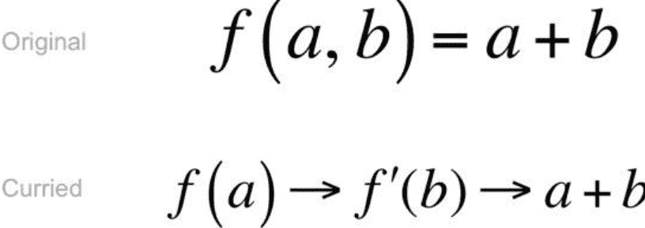

图 3.1. 原函数以及到达其柯里化形式的步骤。

要评估柯里化形式的函数，我们将评估第一个函数（例如传入值 1）。

$$f(1)$$

这将返回一个捕获了该值的函数，由于返回的是一个函数，我们可以直接评估它，为最后一个参数提供一个值（2）。

$$f(1)(2)$$

此时，两个值都在作用范围内，可以应用任何计算来得到最终结果。

我在这里使用了一点“大猩猩符号”¹来表达我的观点。使用更符合数学的符号，我们可以通过创建一个新函数 $a$ 并将 $b$ 映射到 $a+b$ 来显示函数是弯曲的。

$$f(a) = (b \mapsto a+b)$$

如果你熟悉 lambda 演算²，你已经知道 $\lambda ab.a+b$ 是其弯曲形式 $\lambda a.(\lambda b.(a+b))$ 的简写。

> **闭包**
>
> 有趣的是，这种捕获值并使其对第二个函数可用的过程被称为闭包。当我们提到捕获值的匿名函数或 lambda 时，就使用了闭包这个术语。

## Scala 对柯里函数的支持

一个用于相两个数的普通非柯里函数可能如下：

```scala
def add(x: Int, y: Int): Int = x + y
```

Scala 原生支持柯里函数，因此我们不需要进行任何手动转换；我们将其转换为弯曲版本，只需使用括号分隔参数。

```scala
def add(x: Int)(y: Int): Int = x + y
```

Scala 为我们提供了两个单一参数列表。要评估该函数，我们需要执行如下操作：

```scala
scala add(1)(2)
res1: Int = 3
```

为了直观察效果，我们可以这样评估前半部分：

```scala
scala val f = add(1) _
f: Int => <function1>
```

下划线给 REPL 提供了一个关于我们正在尝试做什么的提示。结果 `f` 是一个从 `Int` 的函数。值 1 已经被捕获，并对该函数可用。因此我们可以只需执行返回的函数并提供我们的第二个值。

```scala
scala f(2)
res2: Int = 3
```

那么这对于我们的 `runOnUiThread` 方法意味着什么？嗯，如果我们创建一个函数的柯里化版本，就可以重新使用我们喜爱的大括号了。

我们首先将参数分为两部分，以创建原始函数的柯里化形式。

```scala
def runInThread(group: String)(function: => Unit) {
  new Thread(group, new Runnable() {
    run(): Unit = function
  })
  .start()
}
```

注意，函数没有其他变化。在 `runInThread` 内部，一切如其初。然而，我们现在可以使用大括号作为第二个参数来更改 `ui` 对象。

```scala
def updateUIElements() {
  runOnUiThread("basket") {
    applyDiscountToBasket(basket)
    updateCustomerBasket(basket)
  }
  runOnUiThread("customer") {
    updateOffersFor(customer)
  }
}
```

## 总结

通过一些内置功能，Scala 允许我们编写看起来像语言构造结构的方法。我们可以使用高阶函数来创建控制抽象：这些函数对复杂行为进行抽象并减少重复，同时为调用它们的代码提供灵活性。

我们可以在任何使用单一参数方法的地方使用大括号。我们可以利用此提供立即即可识别的视觉线索和模式。通过使用内置函数，我们并不局限于将其用于单一参数函数；我们可以通过将多参数函数转换为多个单一参数函数，来创建更丰富的 API。

- 1. 关于所用符号的讨论可以在 <http://bit.ly/1Q2bU6s> 找到
- 2. 关于 lambda 演算的一些笔记

# 模式匹配

正如我们所见，模式匹配不仅仅是一个 `switch` 语句。它是一种解构数据并处理不同情况的重要方法。我们已经看到它是如何与字面量、构造函数和提取器工作的。

## 切换

在许多语言中，`switch` 语句根据值对代码分支。在 Scala 中，模式匹配提供了这种功能。让我们来看一些例子。

```scala
val language = "French"
language match {
  case "French" => println("Salut")
  case "French" => println("Bonjour")
  case "German" => println("Guten Tag")
  case _ => println("Hi")
}
```

值必须与示例中的字面量完全匹配。结果将打印“Bonjour”而不是“Salut”，因为匹配值的分支首字母是大写的 F。匹配是基于相等性的 (==)。

我们还可以使用守卫来添加条件：

```scala
val month = "August"
month match {
  case "January" => "1st quarter"
  case "March" => "2nd quarter"
  case "September" => "3rd quarter"
  case "December" => "4th quarter"
  case _ => "unknown quarter"
}
```

模式匹配还给了我们类型：


```scala
val x = 10
match x {
  case i: Int => "It's an integer: $i"
  case s: String => "It's a string: $s"
  case _ => "It's something else"
}
```

最后是提取器：

```scala
case Person(name: String, age: Int)
val p = Person("Alice", 30)
match p {
  case Person(name, age) if age >= 18 => println(s"$name is an adult")
  case Person(name, age) => println(s"$name is a minor")
}
```

### 构造匹配

构造器允许你根据对象的构建方式来匹配情况。假设我们有一个如下所示的 `SuperHero` 类：

```scala
case class
  SuperHero(herName: String, alterEgo: String, powers: List[Ability])
```

这是一个带有三个构造器参数的普通类，但开头的 `case` 关键字将其指定为一个例类（case class）。目前，这意味着 Scala 将自动为我们提供一系列实用的方法，如 `hashCode`、`equals` 和 `toString`。

根据这些及其字段，我们可以创建一个这样的匹配表达式：

```scala
object BasicConstructorPatternExample extends App (
  val hero =
    new SuperHero("Batman", "Bruce Wayne", List(Speed, Agility, Strength))

  hero match {
    case SuperHero(_, "Bruce Wayne", _) => println("I'm Batman!")
    case SuperHero(_, _, _) => println("???")
  }
)
```

使用构造器模式，它将匹配任何 `alterEgo` 字段值为 "Bruce Wayne" 的情况，并打印 "I'm Batman"。对于其他人，它将打印问号。

下划线被用作构造器参数的占位符；在第二个情况（第 7 行）你需要三个下划线，因为构造器有三个参数。下划线意味着你不在乎值是什么。在第 6 行放置值 "Bruce Wayne" 意味着你在意，并且构造器的第二个参数必须与之匹配。

使用构造器模式时，值也必须匹配类型。假设 `SuperHero` 是 `Person` 的子类。

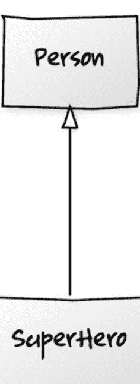

**图 3.2. SuperHero 是 Person 的子类。**

如果 `hero` 变量实际上是 `Person` 的实例而不是 `SuperHero`，则将没有任何项被匹配。在没有匹配的情况下，你会在运行时看到 `MatchError` 异常。为了避免 `MatchError`，你需要允许非 `SuperHero` 类型进行匹配。为了做到，你可以使用通配符作为默认值。

```scala
object BasicConstructorPatternExample extends App {
  val hero = new Person("Joe Ordinary")

  hero match {
    case SuperHero(_, "Bruce Wayne", _) => println("I'm Batman!")
    case SuperHero(_, _, _) => println("???")
    case _ => println("I'm a civilian, don't shoot!")
  }
}
```

模式还可以将匹配到的值绑定到变量。与其仅仅与字面量（如 "Bruce Wayne"）进行匹配，我们可以使用变量作为占位符，并在表达式的右侧捕获匹配到的值。例如，我们可以提问：

> 如果另一个未知的人是一个化名为 Bruce Wayne 的超级英雄，他们拥有哪些超能力？

```scala
def superPowersFor(person: Person) = {
  person match {
    case SuperHero(_, "Bruce Wayne", powers) => powers
    case _ => List()
  }
}
```

println("Bruce has the following powers " + superPowersFor(person))

我们仍然只对 `SuperHero` 的类型进行匹配，并对他们的 `alterEgo` 进行字面量匹配，但这次第 3 行的最后一个下划线被变量 `powers` 替换了。这意味着我们可以在右侧使用该变量。在这种情况下，我们只需将其作为答案。

变量绑定是模式匹配的关键优势之一。在实践中，使用像 "Bruce Wayne" 这样的字面量是没有意义的，因为它限制了应用。相反，你更有可能将其替换为字面量或通配符模式。

```scala
object HeroConstructorPatternExample extends App {
  def superPowersFor(person: Person) = {
    match {
      case SuperHero(_, powers) => powers
      case _ => List()
    }
  }
}
```

你会使用来自 `match` 对象的值作为输入。为了找出 Bruce Wayne 的能力，你会传入一个 `SuperHero` 实例。

```scala
val bruce =
  SuperHero("Batman", "Bruce Wayne", List(Speed, Agility, Strength))
println("Bruce has the following powers " + superPowersFor(bruce))
```

这个示例有点限制，因为我们使用了匹配模式来返回我们已经已知的东西。为了更通用，你也可以使用通配符模式来查找任何超级英雄或模式。

```scala
val steve =
  SuperHero("Captain America", "Steve Rogers", List(Tactics, Speed))
val jayne =
  new Person("Jayne Doe")

println("Steve has the following powers " + superPowersFor(steve))
println("Jayne has the following powers " + superPowersFor(jayne))
```

### 构造器模式

注意构造器模式作用于类。技术上，这是因为它们自动实现了一个名为 `unapply` 的特殊方法。

### 类型查询

使用构造器模式可以隐式地匹配类型并访问其字段。如果你不知道字段，可以使用类型查询来匹配类型。例如，如果是超级英雄，我们可以创建一个 `nameFor` 方法来获取他们的名字或化名。

```scala
object TypePatternExample extends App {
  val batman =
    new SuperHero("Batman", "Bruce Wayne", List(Speed, Agility, Strength))
  val cap =
    new SuperHero("Captain America", "Steve Rogers", List(Tactics, Speed))
  val jayne =
    new Person("Jayne Doe")

  def nameFor(person: Any) = {
    person match {
      case hero: SuperHero => hero.alterEgo
      case person: Person => person.name
    }
  }

  println("Batman alter is " + nameFor(batman))
  println("Captain America's alter ego is " + nameFor(cap))
  println("Jayne's alter ego is " + nameFor(jayne))
}
```

与其通过 `instanceof` 序列检查，你可以指定变量和类型。在箭头后面的表达式中，变量可以作为该类型的实例。当你使用模式匹配处理 `try` 和 `catch` 中的异常时，实际上使用的是类型查询。

```scala
try {
  var url = new URL("http://bad.com")
  var reader = new BufferedReader(url.getInputStream)
  var line: String = reader.readLine()
  while (line != null) {
    line = reader.readLine()
  }
  println(line)
} catch {
  case _: MalformedException => println("Bad URL")
  case e: IOException => println("Problem reading data: " + e.getMessage)
}
```

`MalformedException` match 中的下划线显示，如果你不在值，可以使用类型查询。

### 解构匹配与 unapply

将方法实现为工厂风格是很常见的：接收参数并返回新实例。你可以将特殊的 `unapply` 方法视为此相反的操作。它接收一个实例并从中提取值；通常是你想要构造它的值。

apply (a, b) -> object (a, b)

unapply (object (a, b)) -> a, b

由于它们提取值，实现 `unapply` 的对象被称为提取器（extractors）。给定一个对象，提取器通常会提取创建该对象的参数。

所以，如果我们想在匹配表达式中使用 `Customer`，我们会在它的伴侣对象中添加一个 `unapply` 方法。

```scala
class Customer(val name: String, val address: String)

object Customer {
  def unapply(customer: Customer): (String, String) = (customer.name, customer.address)
}
```

`unapply` 方法总是接收你想要解构的对象实例，在本例中是 `Customer`。

```scala
object Customer {
  def unapply(customer: Customer) = ???
}
```

它应该返回对象的提取部分，或者返回一个指示无法重构的内容。在 Scala 中，而不是返回 `null` 来表示这一点，我们返回结果的 `Option`。这与 Java 中的 `Option` 概念相同。

```scala
object Customer {
  def unapply(customer: Customer): Option[???] = ???
}
```

拼图的最后一块碎片是确定从对象中可以提取什么：即放入 `Option` 参数的类型。如果你想要只提取客户名称，返回将是 `Option[String]`，但我们想要能够提取名字和地址（因此可以在匹配表达式中同时匹配名字和地址）。

答案是返回一个元组，我们之前看到的数据结构。这是在单一类型中返回多个数据的方法。

```scala
object Customer {
  def unapply(customer: Customer): Option[(String, String)] = {
    Some((customer.name, customer.address))
  }
}
```

我们可以对我们的 `customer` 使用模式匹配。

```scala
val customer = new Customer("Bob", "1 Church street")
customer match {
  case Customer(name, address) => println(name + " " + address)
}
```

你会注意到这看起来像我们的构造器模式示例。这是因为我们之前使用了例类，它为我们添加了 `unapply` 方法。这次，是我们自己创建了它。它既是一个提取器，与构造器（模式构造器）之间存在对称性。更具体地说，模式中要提取的值列表必须与类的主构造器相匹配，才能被称为构造器模式。详情请参阅[语言规范](https://docs.scala-lang.org/tour/patterns/)。

### 为什么要编写自己的提取器？

既然例类已经有提取器了，你为什么还要实现自己的提取器方法（`unapply`）呢？可能仅仅是因为你不能或不想使用例类，或者你可能想要例类的匹配行为；你可能想要自定义提取行为（例如，从 `unapply` 返回布尔值以表示匹配但没有提取）。

另一种情况可能是，你无法修改一个类，但又想从中提取部分内容。你可以为任何内容创建提取器。例如，你无法修改 `String` 类，但仍然想从中提取内容，比如电子邮件地址的一部分或 URL。

例如，下面的独立对象在字符串为有效 URL 时，会从中提取协议（protocol）和主机（host）。它与 `String` 类没有关系，但仍然允许我们编写匹配表达式，并将字符串“解构”为协议和主机。

```scala
object UrlExtractor
def unapply(string: Option[String, String]) = {
  try {
    val url = new URL(string)
    Some(url.protocol, url.getHost)
  } catch {
    case _: MalformedURLELException => None
  }
}

val url = "http://baddotorobot.com" match {
  case UrlExtractor(protocol, host) => println(protocol + " " + host)
}
```

这种模式与其作用的数据类型之间的解耦被称为《Scala 编程》中的表示独立性（参见第 24.6 节）。

## Guard卫条件

你可以用 `if` 条件来补充我们看到的模式。

```scala
customer yearsACCustomer = 3
discount = customer match {
  case YearsACustomer(years) if years >= 5 => Discount(0.50)
  case YearsACustomer(years) if years >= 2 => Discount(0.20)
  case YearsACustomer(years) if years >= 1 => Discount(0.10)
  case _ if BlackFriday(today) => Discount(0.10)
  case _ => Discount(0)
}
```

模式后面的条件是守卫（guard）。你可以根据需要引用变量，因此我们可以说对于超过五年的客户，适用 50% 的折扣；两年的是 20%，以此此类推。如果不需要变量，也可以。例如，我们有一个分支例说明，如果没有适用之前的先前的折扣且今天是黑色星期五，则给予 10% 的折扣。

### Map 和 FlatMap

在本章中，我们将介绍 Scala 的一些函数式编程特性，特别是无处不在的 `map` 和 `flatMap` 函数。我们对这些函数感兴趣是因为它们与单子（monads）的概念密切相关，单子是函数式编程的一个关键特性。

### 映射函数

你会在 Scala 的无数类中看到 `map` 函数。它通常在集合的语文中被描述。像 `List`、`Set` 和 `Map` 等类都拥有这个方法。对于这些类，它将给定的函数应用于集合中的每个元素，并根据该函数的结果返回一个新的集合。你对集合中的每个元素“映射（map）”某个函数。

例如，你可以创建一个函数，根据出生年份计算出一个年龄。

```scala
import java.util.Calendar
def age(birthYear: Int) = {
  val currentYear = Calendar.getInstance(Calendar.YEAR)
  currentYear - birthYear
}
```

我们可以在生日列表上调用 `map` 函数，传递该函数以创建一个新的年龄列表。

```scala
val birthdays = List(1990, 1977, 1984, 1961, 1973)
birthdays.map(age)
```

结果将是一个年龄列表。例如，我们将 1990 年转换成了 25 岁。

```scala
res0: List[Int] = List(25, 38, 31, 54, 46)
```

作为一个高阶函数，你可以像这样用 lambda 表达式内联编写函数：

```scala
birthdays.map(year => Calendar.getInstance(Calendar.YEAR) - year)
```

使用下划线 `_` 作为 lambda 参数的简写，它看起来像这样：

```scala
birthdays.map(Calendar.getInstance(Calendar.YEAR) - _)
```

### 它就像 foreach


所以 `map` 是一个转换函数。对于集合，它遍历集合并应用某些函数，就像 `foreach` 执行的一样。区别在于，与 `foreach` 不同，`map` 将函数的返回值收集到一个新的集合中并返回该集合。

手动实现一个映射函数是非常轻易的。例如，我们可以创建一个 `Mappable` 类，它接收类型为 `A` 的数量元素并创建一个 `map` 函数。

```scala
class Mappable[A](val elements: List[A]) {
  def map[B](f: Function1[A, B]): List[B] = {
    ???
  }
}
```

```scala
def map[B](f: A => B): List[B] = ...
```

那么就只需要创建一个新集合，并将每个元素作为参数调用函数（使用 `apply`）。我们将结果存储到新集合中并最后返回它。

```scala
class Mappable[A](val elements: List[A]) {
  def map[B](f: A => B): List[B] = {
    val result = collection.mutable.MutableList()
    elements.foreach {
      result += f.apply(_)
    }
    result.toList
  }
}
```

我们可以通过创建一个数字列表来测试它，通过创建一个 `mappable` 实例使其变为“可映射的”。

```scala
object Example {
  def main(args: Array[String]) {
    val birthdays = List(1990, 1977, 1984, 1961, 1973)
    val result = birthdays.map(age)
    println(result)
  }
}
```

（注：根据第123-125页的碎片文本推断的逻辑如下）

重新评估第123-125页的碎片：

文本描述了一个 `FlatMappable` 类和 `flatMap` 函数。

```scala
object Example {
  def main(args: Array[String]) {
    val mapable = new FlatMappable(1, 2, 10)
    val result = mapable.flatMap(oddNumbersTo)
    println(result)
  }
}
```

输出将是：`List(1, 1, 1, 3, 5, 7, 9)`

### 不仅仅是集合

我们已经看到了集合的 `map` 和 `flatMap`，但它们也存在于许多其他类。更泛地说，`map` 和 `flatMap` 作用于被称为单子（monads）的对象。事实上，`map` 和 `flatMap` 的行为是单子的定义特征之一。

那么单子到底是什么？我们接下来讨论。

## Monad（单子）

Monad 是人们喜欢讨论但仍然难以捉摸且神秘的话题。如果你读过任何关于函数式编程的书，一定会遇到过这个术语。

尽管有很多文献，这个主题通常并不被很好理解，部分是因为 Monad 源自范畴论这一抽象数学领域，部分因为在编程语言中，Haskell 主导了相关文献。无论是 Haskell 还是范畴论对于主流开发者来说都不特别相关，而且它们带来了可能难以理解的概念和术语。

好消息是，你不需要担心这些东西。进行函数式编程不需要理解范畴论。使用 Scala 编程也不需要理解 Haskell。

### 基础定义

对 Monad 的一个外行式定义可能是：

> 某种拥有 `map` 和 `flatMap` 函数的东西。

这并不是全貌，但它可以作为我们的起点。

我们已经看到 Scala 中的集合（collections）都是 Monad。使用 `map` 对它们进行转换，以及使用 `flatMap` 进行“一对多”的转换是很有用的。但 `map` 和 `flatMap` 使用不同类型的 Monad 执行不同的操作。

### Option

让我们以 `Option` 类为例。你可以将 `Option` 作为避免空值（null）的方法，但它究竟是如何避免空值的？它和 Monad 有什么关系？答案包含部分：

1. 你通过返回 `Option` 的子类来表示无值（`None`）或值的包装（`Some`），从而避免了返回 null。由于“无值”和“有值”都是 `Option` 类型，你可以一致地处理它们。你永远不需要说“如果不为空”。

2. 你实际上一致处理 `Option` 的方法是使用单子方法 `map` 和 `flatMap`。因此 `Option` 是一个 Monad。

### 空对象模式（Null Object Pattern）

如果你以前见过空对象模式，你会发现它的想法类似。空对象模式允许你用子类替换类型来表示无值。你可以像调用真实值一样对它调用方法；它本质上什么都不做。它可以作为真实值的替代品，且通常没有副作用。

主要区别在于，你可以调用的方法（由实例的超类定义）通常是业务方法。而 Monad 的通用方法（如 `map` 和 `flatMap`）是更底层的函数式编程抽象。

我们知道集合的 `map` 和 `flatMap` 是什么，但它们对 `Option` 做了什么呢？

### map 函数

`map` 函数仍然转换一个对象，但它是可选的转换。如果 option 有值，它会将映射函数应用到 option 的值上。有值和无值的 option 分别实现为 `Option` 的子类：`Some` 和 `None`。

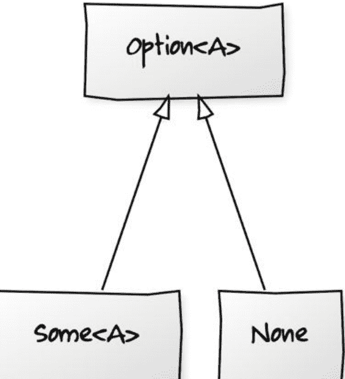

图 3.3. Option 类。

只有当 option 是 `Some` 的实例时，映射才会应用。如果无值（即它是 `None` 的实例），它将简单地返回另一个 `None`。

当你转换某个东西但不想担心检查它是否为空时，这非常有用。例如，我们可能有一个 `customers` trait，包含 `add` 和 `find` 仓库方法。当客户不存在时，在 `find` 的实现中应该做什么？

```scala
trait Customers extends Iterable[Customer] {
  def add(customer: Customer)
  def find(name: String): Customer
}
```

一个典型的 Java 实现可能会返回 null 或抛出某种 `NotFoundException`。例如，以下基于 Set 的实现在找不到客户时会返回 null：

```scala
class CustomerSet extends Customers {
  private val customers = mutable.Set[Customer]()

  def add(customer: Customer) = customers.add(customer)

  def find(name: String): Customer = {
    for (customer <- customers) {
      if (customer.name == name) {
        return customer
      }
    }
    null
  }
}
```

（注：此处原文代码块似乎不完整或存在截断，已根据上下文保留代码结构并翻译逻辑描述）

上文：我们知道集合的 `map` 和 `flatMap` 是什么，但它们对 `Option` 做了什么呢？

（特别说明：由于提供的原文文本在多处存在重复和截断（如 `return None` 之后的逻辑重复），译文已按照您的要求进行了去重和整合。）

```scala
scala> y.flatten
res1: List[String] = List(A, B)
```

### 更正式的定义

作为一个更正式的定义，monad（单子）必须满足：

- 在参数化类型上进行操作，这意味着它是另一个类型的“容器”（这被称为类型构造器）。
- 有一种从其底层类型构建 monad 的方法（即 unit 函数）。
- 提供一个 `flatMap` 操作（有时称为 bind）。

Option 和 List 都符合这些标准。

| Option | List |
| --- | --- |
| 参数化（类型构造器） | `Option[A]` | `List[T]` |
| 构建（unit） | `Option.apply(x)` `Some(x)` `None` | `List(x, y, z)` |
| flatMap (bind) | `def flatMap[B](f: A => Option[B]): Option[B]` | `def flatMap[B](f: A => List[B]): List[B]` |

不过，这个定义并没有提到 `map`，我们对 monad 的通俗定义是：

> 某种具有 `map` 和 `flatMap` 函数的东西。

我想从 `map` 的角度来引入 `flatMap`，因为它在扁平化之前总是应用一个映射函数。确实，要成为一个 monad 只需要 `flatMap`，但在实践中 monads 也提供了 `map` 函数。这是因为所有 monads 都是 functor（函子）；是 functor 在更正式层面必须提供 `map`。

所以技术上的答案是：提供 `flatMap`、参数化类型和 unit 函数使得某物成为一个 monad。但所有 monads 都是 functor，而 `map` 源于 functor。

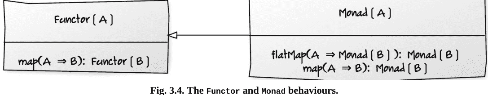

## 总结

在这一章中，我解释了当人们谈论单子行为（monadic behaviour）时，他们实际上在谈论 `map` 和 `flatMap` 函数。`map` 和 `flatMap` 的语义可能根据 monad 的类型而异，但它们共享一个正式的尽管是抽象的定义。我们查看了 List 和 Option 上单子函数的具体示例，以及我们如何将这些函数与 option 使用以避免空检查。然而，monads 的真正力量在于“链式调用”这些函数，将行为组合成一系列简单的步骤。为了真正看到这一点，我们将在下一章中查看更复杂的示例，并看看 for comprehensions（for 推导式）底层是如何工作的。

## 关于推导式（For Comprehensions）

上一章侧重于 monads 以及 `map` 和 `flatMap` 函数。在本章中，我们将专注于 `flatMap` 行为。具体来说，我们将观察如何在产生结果之前链式调用 `flatMap` 函数。由于 for comprehensions 实际上在底层使用 `flatMap`，因此我们将详细查看它们之间的关系，并解释 for comprehensions 是如何工作的。

### 我们上次结束的地方

希望你现在已经熟悉了 `flatMap` 的概念。我们查看了它在集合类和 option 中的用法。回一下，我们使用 `flatMap` 对数据库中可能存在也可能不存在的客户名称进行映射。通过这样做，我们可以计算客户的总值。

```scala
customers
.flatMap(name => database.find(name))
.map(customer => customer.total)
.sum
```

现在，假设我们要为客户生成货运单。我们可以在仓库中查找客户，如果我们有街道地址和邮政编码，我们就可以生成货运单。

注意事项有：

1. 客户在仓库中可能存在也可能不存在。
2. 给定的客户可能有也可能没有地址对象。
3. 地址对象必须包含街道，但可能不包含邮政编码。

所以，为了生成标签，我们需要：

1. 通过名称查找客户（可能存在也可能不存在）。
2. 获取客户的地址（也可能存在也可能不存在）。
3. 给定地址，从中获取货运信息。（我们可以预计 Address 对象包含街道地址，但它可能有也可能没有邮政编码。）

### 使用空检查（Null Checks）

如果我们实现这个功能时通过返回 `null` 来表示可选（optionality），我们将被迫处理大量的空检查。我们有四个客户：Albert、Beatrice、Carol 和 Sherlock。Albert 有地址但没有邮政编码，Beatrice 还没有给我们她的地址，后两个拥有完整的地址信息。

```scala
val customers = Customers()
val address1 = Some("1a Bridge St", None))
```

```scala
address2 = Some Address("2 Short Road", Some("AL1 2PY"))
address3 = Some Address("221b Baker St", Some("NW1"))
```

```scala
customers.add(new Customer("Albert", address1))
customers.add(new Customer("Beatrice", None))
customers.add(new Customer("Carol", address2))
customers.add(new Customer("Sherlock", address3))
```

给定一个客户列表，我们可以尝试创建货运单。如你所见，下面的列表包含了数据库中不存在的人。

```scala
val all = Set("Albert", "Beatrice", "Carol", "Dave", "Erin", "Sherlock")
```

接下来，我们创建一个函数来返回货运单列表，将它们收集在一个可变集合中。对于列表中的每个名称，我们尝试在数据库中查找客户（使用 `customers.find`）。如果此返回为 `null`，在获取他们的地址之前，我们检查返回的值不为 `null`。

获取地址返回了 `null`

```scala
def generateLabels(): Set[String] = {
  val labels = mutable Set[String]()
  all.foreach { name =>
    val customer = customers.find(name)
    if (customer != null) {
      val address = customer.address
      if (address != null) {
        val postcode = address.postcode
        if (postcode != null) {
          labels.add(shippingLabel(customer.name, address.street, postcode))
        }
      }
    }
  }
  labels
}
```

### 与 Option 使用 flatMap

```scala
def generateLabels(): Set[String] = {
  all.flatMap { name =>
    customers.find(name).flatMap { customer =>
      customer.address.flatMap { address =>
        address.postcode.map { postcode =>
          shippingLabel(customer.name, address.street, postcode)
        }
      }
    }
  }.toSet
}
```

```scala
"Ship to:\n" + "====================\n" + name + "\n" + street
}
```

### For Comprehensions是如何工作的

当你编写普通的 for 循环时，编译器会将其转换（或去语法）为对 `foreach` 方法的调用。

```scala
for (i <- 0 to 5) {
    println(i)
}
```

```scala
// 是被去语法化的
(0 to 5).foreach(println)
```

嵌套循环也是这样：

```scala
for (i <- 0 to 5; j <- 0 to 5) {
    println(i + " " + j)
}
```

```scala
(0 to 5).foreach { i =>
  (0 to 5).foreach { j =>
    println(i + " " + j)
  }
}
```

如果你使用带有 `yield` 的 `for`（即 for 推导式），编译器会执行不同的操作：

```scala
for (i <- 0 to 5) yield {
  i + 2
}
```

`yield` 是关于返回一个值的。没有 `yield` 的 `for` 虽然是一个表达式，但会返回 `Unit`。这是因为 `foreach` 方法返回 `Unit`。带有 `yield` 的 `for` 会返回 `yield` 块中的任何内容。它会被转换为对 `map` 的调用而不是 `foreach`。因此，上述代码的反糖后的形式如下：

```scala
// de-sugared form of "for (i <- 0 to 5) yield i + 2"
(0 to 5).map(i => i + 2)
```

它是将一个数字序列（0 到 5）映射到另一个数字序列（2 到 7）。重要的是意识到，`yield` 块中的任何内容都代表传入 `map` 的函数。`map` 本身作用于 `for` 部分的任何（即 `for i <- 0 to 5`）。将示例这样重新格式化更容易识别：

```scala
for {
  i <- 0 to 5            // 作用于此集合
  yield {
    i + 2                 // 传入 map 的函数
  }
}
```


# Scala for 导式与嵌套循环

当我们在括号和 `yield` 之间有嵌套时，情况变得更有趣。

```scala
val x: Seq[(Int, Int)] = for {
  i <- 0 to 5
  j <- 0 to 5
  yield {
    (i, j)
  }
}

println(x)
```

> 注意我们在某些示例中使用了大括号而不是括号吗？对于嵌套循环或带有 `yield` 块的循环，使用大括号是一种更常见的风格。

这将执行嵌套循环而不是翻译为嵌套的 `foreach`，它被翻译为 `flatMap` 调用，后跟一个 `map`。同样，最后的 `map` 是使用 `yield` 块中的内容来转换结果。

```scala
// de-sugared
val x: Seq[(Int, Int)] = (0 to 5).flatMap {
  i => (0 to 5).map {
    j => (i, j)
  }
}
```

这与之前完全相同；`yield` 块提供了应用到映射函数上的函数，而它映射的对象由 `for` 表达式决定。在示例中，我们从两个 0 到 5 的列表映射到元组集合，代表它们的笛卡尔积。

```
Seq((0,0), (0,1), (0,2), (0,3), (0,4), (0,5)
(1,0), (1,1), (1,2), (1,3), (1,4), (1,5)
(2,0), (2,1), (2,2), (2,3), (2,4), (2,5)
(3,0), (3,1), (3,2), (3,3), (3,4), (3,5)
(4,0), (4,1), (4,2), (4,3), (4,4), (4,5)
(5,0), (5,1), (5,2), (5,3), (5,4), (5,5))
```

如果我们拆解并执行这些步骤，就可以看到是如何到达扁平后的形式的。我们从两个数字序列开始：a 和 b。

```scala
val a = 0 to 5
val b = 0 to 5
```

当我们映射集合时，得到一个集合的集合。最后的 `map` 返回一个元组，所以返回类型是元组序列的序列。

```scala
val x: Seq[(Int, Int)] = a.map(i => b.map(j => (i, j)))
```

为了将这些扁平化为一个集合，我们必须扁平化这两个集合，这就是 `flatMap` 所做的。尽管你可以这样做，但直接调用 `flatMap` 要直接得多。

```scala
val x: Seq[(Int, Int)] = a.map(i => b.map(j => (i, j))).flatten
// 等同于
val x: Seq[(Int, Int)] = a.flatMap(i => b.map(j => (i, j)))
```

## 最后，使用 for 导式处理货运标签

这一切对于我们的货运标签示例意味着什么？我们可以将 `flatMap` 调用转换为使用 `for` 导式并整洁整个代码。我们从一系列链式 `flatMap` 调用开始的。

```scala
def generateShippingLabel_FlatMapClosingOverVariables(): Set[String] = {
  all.flatMap {
    name => customers.find(name).flatMap {
      customer => customer.address.flatMap {
        address => address.postcode.map {
          postcode => shippingLabel(name, address.street, postcode)
        }
      }
    }
  }
}
```

转换为 `for` 导式后，每个 `flatMap` 调用都被放在 `for` 中的一个嵌套表达式中。最后一个代表 `map` 调用。它的参数（映射函数）就是 `yield` 块中的内容。

```scala
def generateShippingLabel_ForComprehension(): Set[String] = {
  for {
    name <- all
    customer <- customers.find(name)
    address <- customer.address
    postcode <- address.postcode
    yield shippingLabel(name, address.street, postcode)
  }
}
```


# IV. 在团队中采用 Scala

你可能在想如何采用 Scala。好消息是，你不需要等待新项目（greenfield project）。在书的这一部分，我将报告我的经验。我们将讨论你可以预期的内容。

## 采用 Scala

### 避免不足

在正式开始学习 Scala 之前，我已经用 Java 工作十多年。我的第一次经历只是浅尝辄。团队自然地持怀疑态度，所以我们决定划分出现有代码库的一部分来尝试 Scala。我们将测试转换为 Scala，并将开发工作留存在 Java 中。

回想起来，这是一个糟糕的想法。通过只处理测试代码，没有足够的关键体量或动力来改进。我们在测试代码中解决的问题是为人熟知的，现有的测试框架（如 `JUnit`）已经为我们解决了大部分问题。

似乎并没有什么真正使用该语言的空间。我们基本上只是在另一个测试框架（恰好是 Scala）中重写了测试。我们没有学到很多东西，最后全部变回了 Java。这完全是时间和精力的浪费。

从这中学到的唯一教训是，要探索新语言，需要真实的问题来解决：设计问题、领域问题、业务问题。划分代码库的子集会限制你可以探索的问题类型，从而限制你的学习。

### 不要做得太多

下一次我有机会尝试 Scala 时，我走向了另一个极端。我直接跳入深水区，完全使用 Scala 设计，并非常努力采用函数式编程、新模式、新架构设计……我能找到的一切都与 Scala 相关。

我以前没有做过很多函数式编程，很快就碰了墙。我面对的是对我完全陌生的概念和想法。我很挣扎，因为我试图太快地学习太多：新的框架、库和技术，以及一种新语言。我还没学会就会跑。

我花了一段时间意识到，尽管是一个经验丰富的开发者，但在 Scala 和函数式编程方面我其实是个新手。我没有强调这一点，回想起来，承诺构建这样的软件是不负责任的，被雇佣是因为我的专业知识，但我制造了障碍，阻止了我应用这些知识。

## 纯函数式完胜？

后来，我有幸运与一些非常有经验的开发者一起工作，他们都精通函数式编程，大部分来自 Haskell 背景。

这非常棒，因为我有机会从他人的经验中受益，学习曲线也变得平缓了一些。一段时间后，团队开始采用一些非常先进的想法，很快就明显看出还有另一道屏障需要跨越。我们开始讨论更深层次的应用关注点，以及我们是否能从功能上解决这些问题。

我的观点是，对于不习惯这种方法的团队来说，沉重的函数式编程思想可能非常新奇。即使在工业界，我认为完全可以说，很少有团队能完全拥抱这种风格。

我不认为从整体上来说，我们可以说这种极端的做法是否有助于解决现实世界中的业务问题。它只是处理问题的另一种方式。它确实代表了与主流构建软件的一种完全不同的方法，而对我们来说，这可能有点过头。它在团队内部引起了某种分歧，一些人乐于尝试这种方法，而另一些人则不然。

## 预期

### 学习曲线

如果你刚开始学习 Scala 并好奇会遇到什么，经历技能的快速提升，随后是对更复杂的特性的采用速度变慢，这是很典型的。在本章中，我将谈论我所认为典型的学习曲线。

根据我的经验以及与各种 Scala 团队的交流，我们可以绘制出一条典型的 Scala 学习曲线，x 轴为经验（或时间），y 轴为某种程度的“学习”。

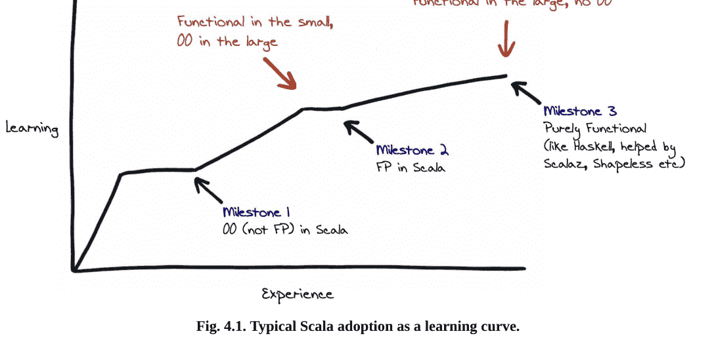

## 里程碑 1：Scala 中的面向对象编程

当你刚开始时，可以预计上手该语言是一个相当陡峭的坡度。

“陡峭”但也“短”：到达第一个平台并不困难，因此你可以预期学习上会有相对快速的增长。

你可能会在这里坐一会儿，应用你所学的知识。我将其视为第一个里程碑：能够使用语言特定的结构和特性构建面向对象或命令式的应用程序，但并不一定要求采用函数式编程。这与学习 Java / C 家族的任何其他语言没有区别。

## 里程碑 2：微观 FP，宏观 OO

下一个里程碑涉及采用函数式编程技术。

这是一个更具挑战性的一步，曲线可能更平缓。通常这涉及到使用传统的架构设计，但在微观上实现函数式编程技术。你可以将这种方法理解为“微观函数式，宏观面向对象”。开始接受一种新的思维方式并忘记一些传统技术可能是困难的，因此坡度较平缓。

具体的例子不仅仅是语言语法：诸如高阶函数和纯函数、引用透明性、不可变性以及无副作用、更具声明式的编码；这些都是纯函数式语言通常提供的东西。关键点，它们被应用在微小的、孤立的区域中。

## 里程碑 3：宏观 FP

下一个挑战是迈向更有凝聚力的函数式设计；这实际上意味着在系统层级采用函数式风格；将整个应用程序架构为函数，并完全放弃面向对象的风格。因此，目标是类似于 Haskell 的应用程序。

上述所有具体的函数式编程机制都适用，但此时是整个系统；不是孤立的区域，而是限于整个应用程序关注的问题。学习像 `Scalaz` 等高级库与曲线的这部分相辅相成。

## 学习连续体

你也可以将 Scala 的采用看作是一个连续体，左侧是传统的命令式编程，右侧是纯函数式编程。

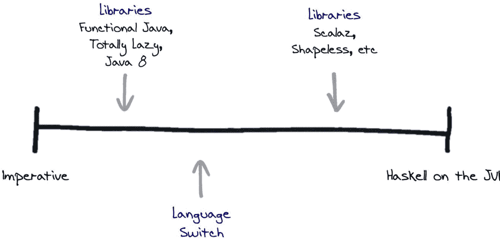

图 4.2 从命令式 (Java) 到纯函数式编程 (Haskell) 的连续体。

你可以将最右端看作 JVM 上的 Haskell。Haskell 是一种纯函数式语言，所以你没有选择，只能如此。

## 制定计划

- **制定一个计划。** 不要直接在 Scala 中开始你的下一个项目；要深思熟虑并制定好计划。
- **思考你的目标。** 将它们写下来，然后勾勒出让你更接近这些目标的步骤。例如，如果目标是快速上手，你可能想和你的团队一起进行一些午餐时间的知识分享会议。
- **决定你想在函数式编程连续体中处于什么位置。** 你是想直接跳入深水区，还是以后再采用函数式惯用写法？一个减少学习曲线的技巧是在刚开始时避免使用原生的 Scala 库。它们通常会引导你进入函数式风格，而根结底，这又是另一个需要学习的 API。你可以一直坚持你熟悉的 Java 库，至少开始是这样。
- **做出承诺。** 对你的目标做出承诺；不要像我曾经那样，把 Scala 边缘化到测试中。主动决定使用 Scala，并做出个人承诺要实现它。

如果你遵循这些建议，你应该对自己的目标和预期有清晰的认识，知道从哪里可以获得指导，并规划好了后续步骤。你将面临处理 Scala 代码库的前景，可能需要转换 Java 代码并使用新的工具和库。

## 转换你的代码库

此时，你可能已经有一个现有的 Java 代码库，并可能疑惑是否应该尝试将 Java 转换为 Scala。

这可能需要大量的精力，但我认为，如果你认真要采用 Scala，那么将整个代码库转换为 Scala 绝对是值得投入的。不要目标是一半一半。接受这需要一些时间和精力，但要承诺完成它。如果你没有完成工作，可能会产生消极情绪，更不用说旧 Java 和 Scala 之间的互操作可能会变得非常尴尬。如果你坚持完成任务，你的生活会变得更容易。

`IntelliJ IDEA` 有一个转换函数，这是一个非常好的起点。它能让你快速将 Java 类转换为 Scala，但要做好准备：它并不总是符合惯用法的，而且在不进行强制转换的情况下可能无法编译。将任何自动化转换视为一次学习练习。不要从表面接受转换结果，而是要观察结果并应用你的判断进行清理。例如，`IntelliJ` 并没有创建一个 `case class`，而是在 Scala 类中创建了字段。你通常能够将字面上的转换重写为更符合 Scala 风格。

考虑你的构建工具。这些工具需要更新。`SBT` 和 `Maven` 都支持 Java/Scala 混合项目，因此你没有理由不运行你的持续集成和测试环境。你可能还想考虑将现有的构建迁移到 `SBT` 是否值得。

## 管理你的代码库

一旦你拥有了新转换的 Scala 代码库，你将与其一起工作一段时间。这里是你应该注意的一些实际问题，以及管理代码库的一些通用建议。

## 约定

- 有如此多的语法变体和约定，仅仅是可用语法选项的数量就能让人望而生畏。**确定一套你自己的约定。**
- 找到一种适合你团队的方法并坚持下去。刚开始避免在不同的语法模式之间切换。这可能意味着一开始开始使用模式匹配而不是使用 `map`。等大家都熟悉了后再切换。
- 定期审查这些选择，因为你不希望在项目运行后被它们拖后腿。
- 看看 Twitter 的努力作为一个例子。他们成功地将经验浓缩成了一份非常实用的指南。非常值得读。
- Typesafe 有一份风格指南，值得阅读，但应该持保留态度。

## 避免什么

在刚开始时知道要避免什么也是很棒的。我希望我在开始之前能知道这些事情：

- `SBT` 可能会让你的生活更困难。`SBT` 开始时非常复杂。
- 编译速度慢。
- 保持 IDE 配置同步。
- 缺乏一致性是危险的。

## 其他挑战

- 建议目标“在小处函数式，在大处面向对象”。

## 语法速查表

### 值

```scala
val x: Int = 42
var y: String = "mutable"
val z = "ScalaW!" // 使用类型推断
```

### 函数

```scala
def add(x: Int, y: Int): Int = x + y  // 单表达式

def add(x: Int, y: Int): Int {  // 没有等号，返回 Unit
  x + y
}

def min(x: Int, y: Int): Int = {  // 最后一行 = 返回值
  if (x < y)
  else
    y
}

def min(x: Int, y: Int): Int = {  // 忘记了 else
  if (x < y)
  else
} // 错误！

def add(x: Int, y: Int): Int = x + y  // 返回类型可以推断

def add(x: Int, y: Int): Int = 2 + x  // 如果省略则默认为 2

val add = (x: Int, y: Int) => Int => x + y  // 匿名函数

add(4, 2)  // 正常调用
```

// 将匿名类（在本例中 Ordering）转换为 lambda

```scala
implicit def functionOrdering[A](f: (A, A) => Int): Ordering[A] = {
  new Ordering[A]{
    def compare(a: A, b: A) = f.apply(a, b)
  }
}
```

### 按名调用

```scala
def runInThread(task: => Int): Int {
  new Thread() {
    override def run(): Unit = task
  }.start()
}
```

### 操作符重载与中表达式

```scala
5 * 10  // 等同于 5.(10)
"Scala" replace("a", "\*")
```

### 类

```scala
class Customer
class Customer(name: String)  // 创建一个公共类
class Customer private(name: String)  // 私有构造函数
```

```scala
private class Customer                              // 私有类
private class Customer private(name: String)      // 带私有构造函数
val c = new Customer("Bob")                               // 创建实例
// 带有主构造函数和辅助构造函数的类
class Customer(forename: String, surname: String) {
  def this(surname: String) {
    this("Unknown", surname)
  }
}
```

### Case Classes

```scala
case class Customer(name: String)      // 一个 case 类
case class Customer(val name: String)  // val 是多余的
```

```scala
// case 类不需要使用 "new" 来创建新实例
Customer("Bob")
```

```scala
// case 类免费提供相等性和哈希值：
new Customer("Bob") == new Customer("Bob")      // 返回 true
```

### 单例对象 (Singleton Object)

```scala
// 单例实例
// 与类配合时，该对象成为“伴侣对象”
object Customer
```

### 继承 (Inheritance)

```scala
class B extends A                      // 子类继承
class C(x: Int)
class D(value: Int) extends A(value)  // 调用父类构造函数
```

```scala
// 重写方法 ("override") 需要需要重写非抽象方法
class E {
    def position: Int = 5
}
class F extends E {
    override def position: Int = super.position + 1
}
```

```scala
// 你可以混合多个特征 (traits)，但只能有一个类 (A)
trait SelfDescribing
trait Writable
class B extends A with SelfDescribing with Writable
class B extends SelfDescribing with A with Writable      // 编译失败
```

### 字段 (Fields)

```scala
// name 不是字段，它仅主主构造可用
class Customer(name: String)

// name 是公共字段（生成 getter，不生成 setter）
class Customer(val name: String)

// name 是公共字段（生成 getter 和 setter）
class Customer(var name: String)

// name 是私有字段（生成了 getter 但没有 setter）
class Customer(private val name: String)

// name 是私有的（生成了 getter 和 setter）
class Customer(private var name: String)

customer_name == "Bob" // 你可以直接调用 setter 方法
customer.name = "Bob" // 或使用中置符号
```

### 集合 (Collections)

```scala
var list = List(1, 4, 234, 123) // 创建一个列表
var map = mapOf("a", 2 -> "b") // 创建一个映射
list.forEach { println(value) }
list.forEach { println(it) }
for (value in list) println(value)
```

### 字符串格式化 (String Formatting)

```scala
// String 插值将 '$' 标记替换为值
s"Customer name: ${name}"

// 表达式需要额外的括号
s"${f' basket value is ${customer.basket.USD}}"

// 'f' 前缀类似于 String.format
f"Square of 42 is ${math.sqrt(42)}%1.2f" // 42的平方是6.48

// 转义 \"quote\" 与 Java 中相同
// 三引号允许你跨行并包含无需转义的引号
"""Card: 
  "id" : "007",
  "name" : "bond",
  "address" : "MI5"
"""

// 'raw' 字符串插值器不转义常用的转义字符
raw"\nnb"
```

### Apply 方法 (Apply Method)

```scala
val bob = Customer.apply("Bob") // 作为工厂方法使用
var bob = Customer.apply("Bob") // 不需要显式调用
```

```scala
val array = Array(1, 54, 23, 545)
array.apply(0) // 上的 apply 是 "getter"
array(0) // 结果为 "1"
```

### Update 方法 (Update Method)

```scala
var array = Array(1, 54, 23, 545)
array(0) // 结果为 "1"
array.update(0, 24) // 结果为 "34"
array(0) = 55 // = 是更新的快捷方式
array(0) // 结果为 "55"
```

### 模式匹配 (Pattern Matching)

```scala
value match {
  case 'R' => ... // 字面量匹配
  case Customer(name) => ... // 构造函数匹配 (case 类)
}
```


```scala
case x: Int => ... // 类型查询匹配 (即实例的)

case x: Int if x > 5 => ... // 带有守卫条件

case (x, y) => ... // 使用 unapply 解构

case _ => ... // 默认情况

}

// try/catch 和异常也使用相同的语法

try {

  // ...

} catch {

  case e: MalformedURLException => println("Bad URL")

  case e: IOException => println(e.getMessage)

}
```

### 索引

# A
任意类, 21
`AnyRef`, 21-22, 24-26
`AnyV1`, 21-22, 30

# B
边界类型 (bounded types), 115, 121, 122
底类型 (bottom type), 26, 27

# C
`CFR`, 反汇编器 (decompiler), 44
按名调用 (call-by-name), 149-150
伴侣对象 (companion object), 34, 53
逆变性 (contravariance), 34, 135
构造函数，辅助的 (constructor, auxiliary), 58-59
构造函数，主要的 (constructor, primary), 52, 55
协变性 (covariance), 34, 136

# D
定义值 (defining values), 11
默认值 (default value), 34, 59
定义函数 (defining functions), 12
菱形运算符 (diamond operator), 116

# E
表达式与语句 (expressions vs. statements), 98

# F
函数字面量 (function literal), 35, 86, 145
函子 (functor), 186, 212
for 集合导式 (for comprehension), 36, 109, 187, 191

# H
高阶函数 (higher-order function), 4, 146-150

# I
隐式 (implicit), 85-86
import 别名 (alias), 33
中置符号表示 (infix notation), 15-16, 37
不可变性 (immutability), 11, 16, 40, 202

# L
lambda (闭包 closure), 35, 85-86, 154

# M
方法，默认的 (method, default), 34, 78-84
特征上的方法 (methods on traits), 78
匹配表达式 (match expression), 157
单子 (monad), 177, 182-186, 195
方法引用 (method reference), 17, 311
混合 (mixin), 34, 74, 90, 91

# O
重载 (overloading), 15, 115

# P
模式匹配 (pattern match), 157
函数纯度 (purity of function), 3
多态性 (polymorphism), 90, 115

# R
`REPL`, 7-8
递归 (cursion), 36, 172
引用类型 (reference type), 22

# S
栈 (stack), 示例, 117-120
`scalac`, 7, 9

# T
类型参数化 (type parameterisation), 115
类型擦除 (type erasure), 121
类型别名 (type alias), 34
特征 (traits), 34, 74, 78, 88, 91
try-资源 (try-with-resources), 112-113

# U
`Unit`, 23-24

# V
变异性 (variance), 34, 133-136

# W
通配符 (wildcard), 129-130, 136, 158-159, 161, 165

# Y
yield, 109, 191-192
